# CandleViewer

CandleViewer is a private, self-hosted trading terminal for one owner and a few account managers,
trading **Bybit v5 USDT linear perpetuals only**. A fully custom WebGL2 chart engine draws the
order-flow views a discretionary trader reads (footprint, volume and delta profiles, CVD, a DOM
liquidity heatmap, big trades, Deep Stats). Behind it sits a complete execution loop (order ticket,
chart and DOM trading, brackets, emulated OCO, iceberg, TWAP and chase, multi-account trade-group
fan-out), a rule engine, paper trading on Bybit demo, recording and deterministic replay, a journal,
and RBAC-gated owner and admin screens inside the same web app. It is built to move real money, so
its safety properties are numbered invariants in [`CONSTITUTION.md`](CONSTITUTION.md), enforced in
code and checked in CI. The project is pre-release: no release train has been cut yet (see Status
and roadmap below).

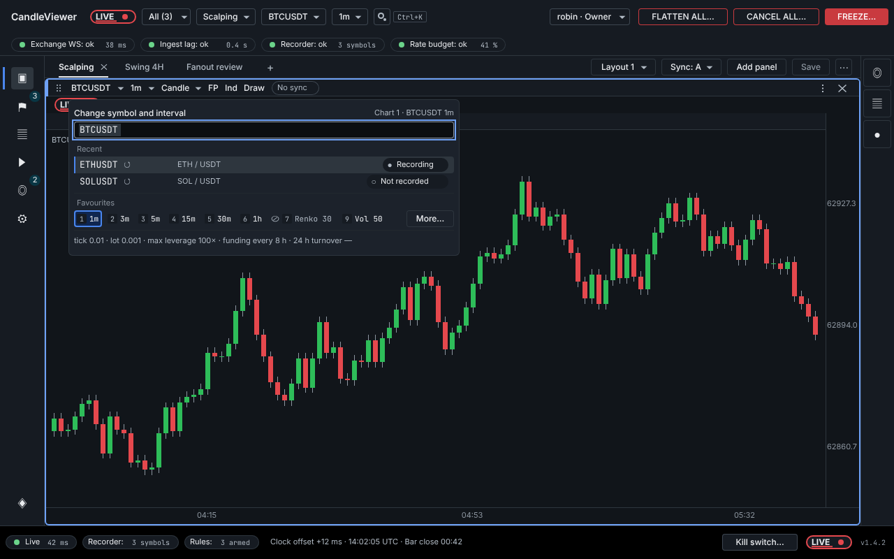

_SCR-020 workspace hosting a SCR-030 chart with the SCR-041 symbol and interval switcher open — E12-D04, frame 2 of board 01 (a merged design board, not a screenshot)._

## What it is, and what it is not

**It is** a trading terminal for a handful of trusted users:

- **Web first, desktop wrapped.** A React + TypeScript single-page app; an Electron shell wraps the
  same app for the desktop and carries no business logic. Owner and admin screens are RBAC-gated
  routes inside it, not a second application.
- **One venue, one product.** Bybit v5 USDT linear perpetuals, in `live` and `demo` (paper trading),
  with `testnet` only for connectivity smoke tests. The environments never mix (C-2.11).
- **Built for more venues later.** The exchange layer is an adapter behind the `exchange/base/`
  interfaces (C-2.2): only `exchange/bybit` knows Bybit, and book, bars, order flow, OMS, recorder
  and rules consume normalised events (C-2.3). Another exchange or trading platform is meant to
  arrive as one more adapter under `exchange/<venue>/` with no changes elsewhere (principle P3 of
  [`20-architecture.md`](docs/plan/20-architecture.md)). That is post-GA, not current scope: it
  needs an amendment of the scope guardrail C-1.2 (C-16.1, C-16.2) and an ADR (C-3.4).
- **Order flow, honestly labelled.** Bybit publishes no L3 feed, so heuristics such as iceberg or
  stop-run detection are always marked _(estimated)_ (C-2.13), and history the recorder does not
  hold is shown as a gap, never filled in (C-2.14).
- **Self-hosted and private.** The backend binds to loopback and WSL-internal interfaces only;
  remote access goes over Tailscale (C-12.9).

**It is not.** CONSTITUTION §1.3 (rule C-1.2) puts the following out of scope, and a PR that adds
one is rejected on sight:

- no mobile client of any kind (the API stays client-agnostic, C-1.3, but no mobile work happens);
- no other exchange or product category **in the current plan** (the adapter seam above is how one
  is added later);
- no options, GEX or gamma analytics;
- **no withdrawal, transfer or funding operation, through any code path, ever** (C-2.8);
- no public internet exposure, no tunnel other than Tailscale, no SaaS that receives market, order
  or account data;
- no separate admin app, no multi-tenant SaaS, no third-party chart library as the production
  renderer.

It moves real money: every position-opening order carries an exchange-native stop-loss, and every
order, auth and key action leaves an append-only audit record.

## How it is built

The backend is **one Python 3.12 FastAPI / asyncio process** with explicit internal boundaries, a
modular monolith (C-2.1): modules talk through published interfaces and a bounded in-process event
bus, never through each other's internals, and only `exchange/bybit` knows anything about Bybit
(C-2.2). The diagrams below summarise [`docs/plan/20-architecture.md`](docs/plan/20-architecture.md)
and [`docs/plan/26-chart-engine-design.md`](docs/plan/26-chart-engine-design.md); where they differ,
those documents and the Constitution win.

### System architecture

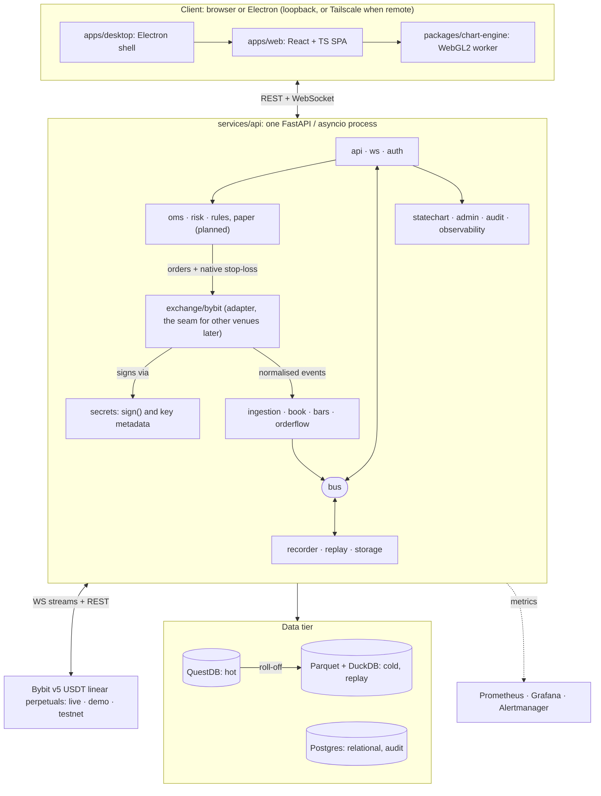

The Electron shell carries no business logic, and owner and admin screens are RBAC-gated routes of
the same SPA. `exchange/bybit` signs every request through `secrets`; QuestDB holds the hot ticks,
book deltas, bars and footprint cells, and Postgres the relational state, the envelope-encrypted keys
and the append-only audit log. The adapter boundary is the plug-in seam for further venues. Boxes
group backend modules by concern; the authoritative module list, paths and allowed dependencies are
CONSTITUTION §3 (adding a module or an edge needs an ADR, C-3.4). `paper` and `journal` are planned:
their modules are empty scaffolds today.

### Market data, from the exchange to the GPU

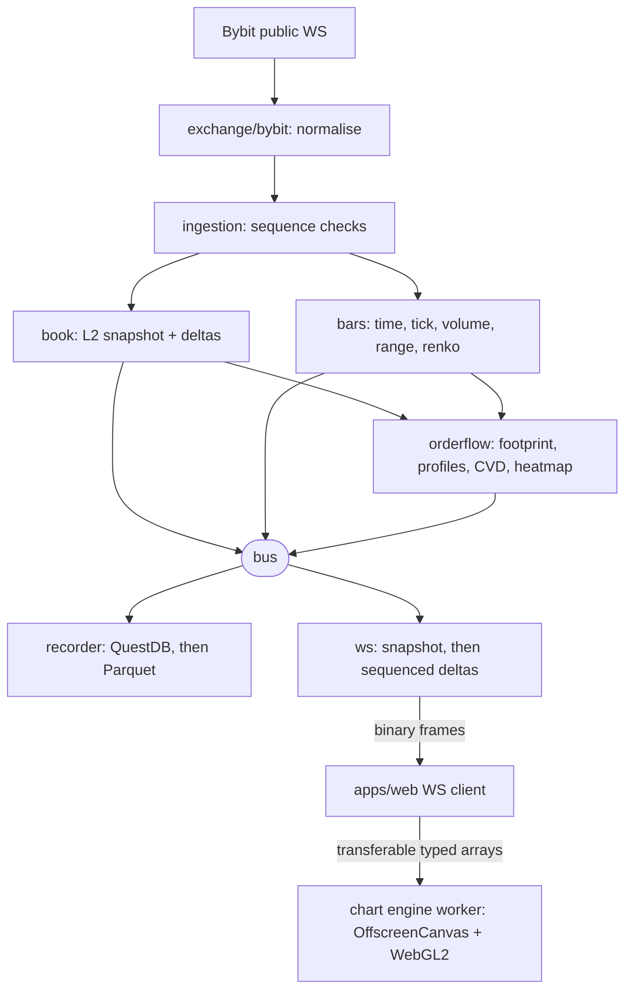

- Both hops are snapshot-then-delta with sequence numbers; any gap drops the state and re-snapshots
  (C-2.5). A slow consumer gets coalesced state or a fresh snapshot, or is disconnected with a
  reason code, never an unbounded queue (C-2.18).
- Replay re-emits recorded events into the same book, bars and order-flow code, so a replay is
  byte-identical across runs (C-2.15).
- The engine has no React, no network and no exchange knowledge (C-2.16). Prices reach it as integer
  ticks in typed arrays, and nothing on this path is a statechart (C-2.20).

### The execution loop

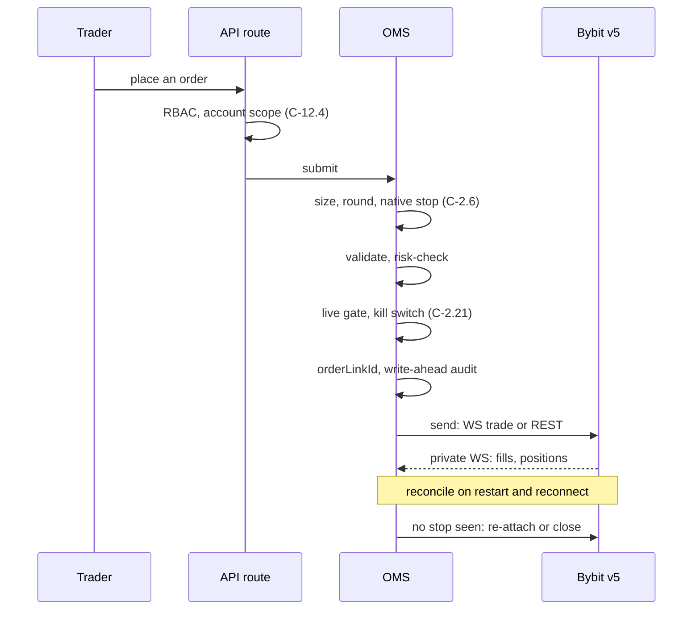

Orders come from the ticket, a chart or the DOM; rule actions enter the same OMS steps in-process.
A trade-group ticket fans out into one such order per selected account, each sized by that
account's profile and each carrying its own native stop. The gates before the send are direct
checks, never statecharts (C-2.21); the `orderLinkId` (C-2.10) is minted before the write-ahead
persist and audit record (C-2.9), and retries reuse it. Live orders go over Bybit's WS trade
channel, with REST as the fallback, and demo orders over REST only
([`20-architecture.md`](docs/plan/20-architecture.md) §1.1, §7.1). The private stream is the source
of truth: a send whose outcome is unknown is settled by reconciliation (at startup, after a
reconnect and periodically), never by a blind re-send, and a position whose exchange-side stop does
not appear in time gets it re-attached or is closed reduce-only. The step order is the submission
pipeline of [`24-internal-schemas.md`](docs/plan/24-internal-schemas.md) §8.4; the fan-out and the
per-account rate budgets are [`20-architecture.md`](docs/plan/20-architecture.md) §10.2.

### The safety ring

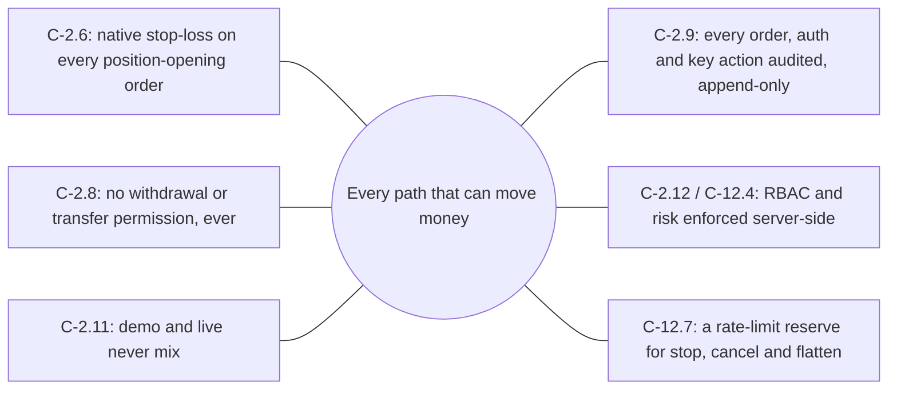

The six are the invariants that [`AGENTS.md`](AGENTS.md) §8 (item 8) forbids removing or bypassing.
No feature flag can switch off the native stop, RBAC, audit or the withdrawal check (C-4.14). At
startup the backend checks every stored key and refuses trading mode if one can withdraw or
transfer or lacks an IP allowlist, and a Semgrep rule keeps withdrawal endpoints out of the code
(C-2.8). API keys are envelope-encrypted at rest and exist in plaintext only inside the secrets
module, at the moment of signing (C-2.7).

**Lifecycles as statecharts.** Twenty long-lived lifecycles (orders, trade groups, the emulated
algos, sessions, the kill switch, reconciliation and more) are JSON statechart contracts in
[`28-statechart-catalogue.md`](docs/plan/28-statechart-catalogue.md), committed under
`services/api/candleviewer/statechart/machines/` and run only through `cv.statechart.factory` on
the pinned `xstate-statemachine==0.9.1`
([ADR-0016](docs/plan/27-adrs/ADR-0016-statechart-runtime.md)); where code and contract disagree,
the contract is right (C-2.19). They record and orchestrate, but every safety decision is a
synchronous check made first (C-2.21), and no hot path (book deltas, bar building, footprint
aggregation, per-tick rule evaluation) is ever a statechart (C-2.20).

## The gallery

Merged design boards (their tickets are closed as completed) from [`docs/design/`](docs/design/),
drawn in Penpot, cropped here to one frame and down-scaled. They are the build contract for screens
still being implemented, not screenshots of the running app. The footprint, heatmap and DOM screens
are not shown: they have no merged hi-fi board yet. Screen ids follow
[`docs/plan/14-screens-catalogue.md`](docs/plan/14-screens-catalogue.md).

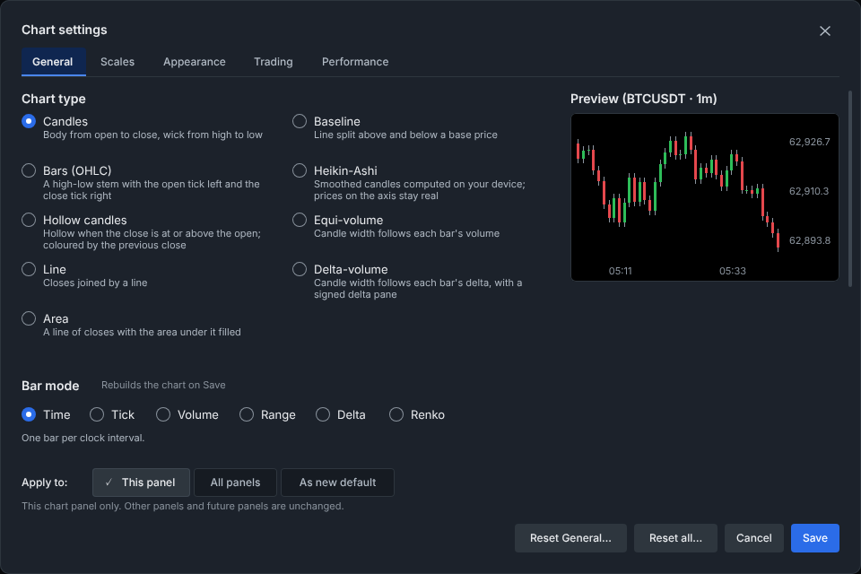

_SCR-031 chart settings, General tab: nine chart types, six bar modes and a live preview — E12-D05, frame 1 of board 01 (dialog only)._

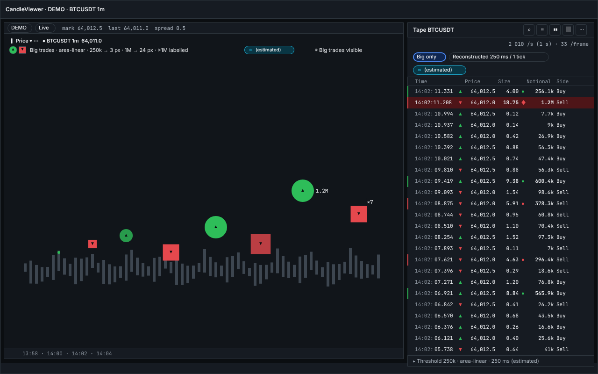

_SCR-053 tape docked beside a SCR-030 chart with the big-trade bubbles on, each heuristic marked (estimated) — E22-D03, frame 1 of board 01._

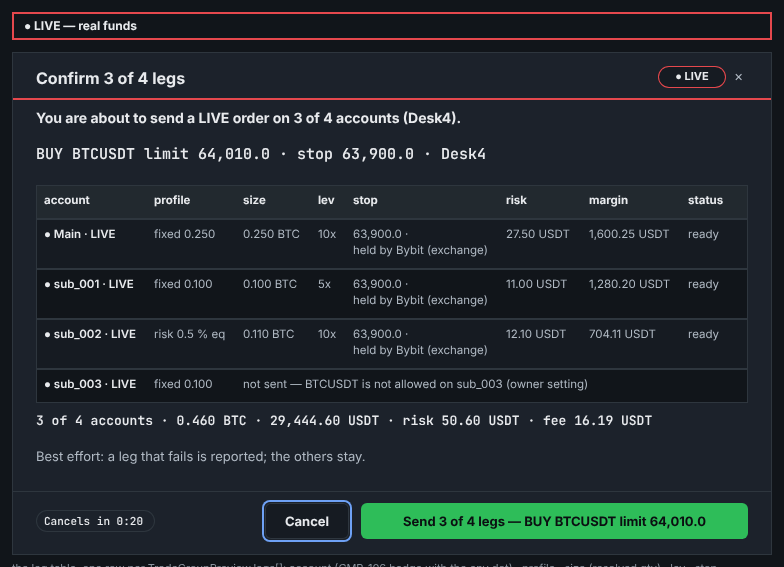

_SCR-076 order confirmation for a trade-group fan-out, before anything is sent: each sent leg with its exchange-held stop; the excluded account shows its reason — E30-D03, frame 1 of board 03._

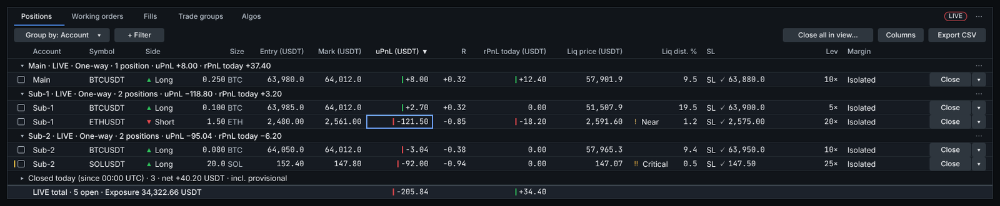

_SCR-063 positions grid grouped by account, every row showing its stop-loss and its distance to liquidation — E29-D02, frame 1 of board 01 (grid panel only)._

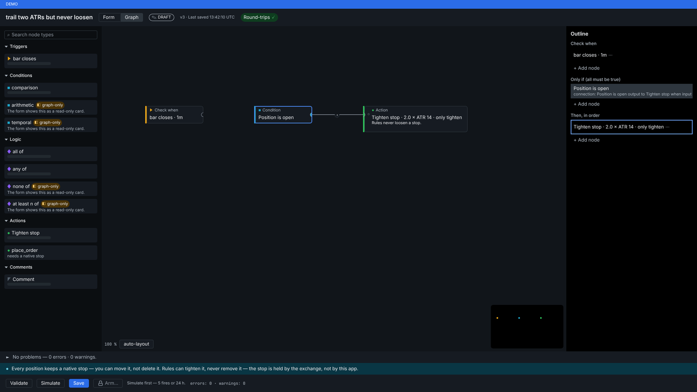

_SCR-082 rule editor, node-graph mode: a trailing-stop rule that may tighten the native stop but never loosen it — E37-D02, frame 1 of board 01._

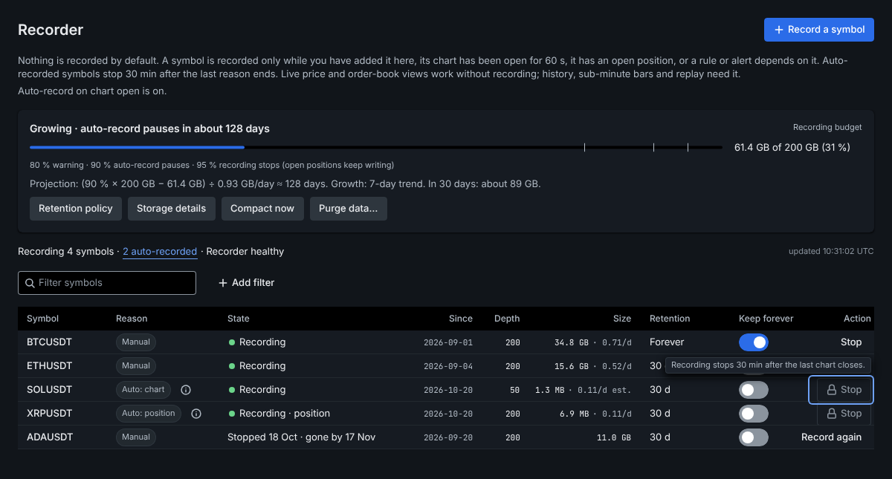

_SCR-140 recorder and storage (owner only): opt-in recording, the disk budget and per-symbol retention — E16-D02, frame 1 of board 01 (main pane only)._

## Repository map

Orientation only: the authoritative layout and module paths are [`AGENTS.md`](AGENTS.md) §2 and
CONSTITUTION §3. "Planned" marks work whose epic has not landed yet.

```text
CandleViewer/
├─ apps/
│  ├─ web/             React + TypeScript SPA: shell, routing with RBAC guards, sign-in, onboarding
│  └─ desktop/         Electron shell: windows, CSP, GPU flags, keychain bridge; no business logic
├─ packages/
│  ├─ chart-engine/    custom WebGL2 engine: scaffold and benchmark harness, renderer planned
│  ├─ ui/              design system: tokens, primitives, components, Storybook
│  ├─ protocol/        REST and WS types generated from the contracts, never hand-edited
│  ├─ rule-graph/      rule IR to node-graph adapter, with no React and no DOM
│  ├─ fixtures/        recorded, redacted Bybit captures and golden outputs
│  └─ config/          shared ESLint, TypeScript, Prettier and Vitest presets
├─ services/api/       Python backend: candleviewer/ (the modules), tests/ (incl. statechart contracts)
├─ backend/db/         QuestDB DDL and storage seed data
├─ infra/              docker compose (core, obs and cold profiles), images, Prometheus, Grafana
├─ tests/              cross-cutting suites: load, perf, fuzz, CI gates, toolchain
├─ tools/  scripts/    repo tooling and the governance checks
└─ docs/
   ├─ plan/            architecture, contracts, ADRs (27-adrs/), roadmap, backlog
   ├─ design/          design specs and Penpot board exports, per epic
   └─ research/        research reports, including the statechart runtime verification
```

## Working in this repo

Read, in this order: [`CONSTITUTION.md`](CONSTITUTION.md) (the non-negotiables),
[`AGENTS.md`](AGENTS.md) (the operating manual), [`CLAUDE.md`](CLAUDE.md) (the condensed entry
point for agent sessions), then your ticket: the GitHub issue and its JSON twin in
[`docs/plan/backlog/`](docs/plan/backlog/). [`docs/plan/README.md`](docs/plan/README.md) indexes
every plan document with a reading order per role, and [`CONTRIBUTING.md`](CONTRIBUTING.md) is the
on-ramp for human contributors.

Every command (install, the local gate, code generation, the dev loop) is listed once, in
[`AGENTS.md`](AGENTS.md) §4, and the local stack is
[`infra/docker-compose.dev.yml`](infra/docker-compose.dev.yml). Work inside WSL Ubuntu with Docker
Desktop's WSL integration. The default market-data feed is synthetic: it replays a committed sample
from `packages/fixtures/raw/`, so development never needs exchange credentials. A new joiner's
walkthrough is [`docs/plan/qa/first-hour-checklist.md`](docs/plan/qa/first-hour-checklist.md).

**The quality bar.** One ticket, one branch, one PR, with a conventional-commit title and
`Closes #N`, ideally under 400 changed lines (C-4.8). A PR merges only when every required check is
green, and the check names and what each enforces live in one place only, CONSTITUTION §9 (C-9.1).
Coverage stays at or above floors that are never lowered in the PR that fails them (C-9.4). Every
PR needs two independent approving reviews; on a security path one of the two is the security
review (C-10.1(b), C-10.2), and a design PR also needs the owner's approval. It then squash-merges
through the merge queue ([`docs/plan/01-sdlc-and-branching.md`](docs/plan/01-sdlc-and-branching.md)
§7). Tests never touch a live exchange: they replay recorded, redacted Bybit fixtures (C-13.5).

## Status and roadmap

**Pre-release.** No release train has been cut yet (`version.txt` reads `0.0.0`). Parallel AI
agents deliver the backlog in one-week sprints, paced by the owner's review bandwidth. Today:

- **Backend:** most modules are in place, with their tests: ingestion, book, bars, order flow, the
  recorder and replay, the storage tiers, auth with TOTP and RBAC, accounts and the encrypted key
  vault, admin, the WebSocket gateway, the OMS order pipeline, and the statechart runtime with all
  twenty contracts. `paper` and `journal` are still empty scaffolds.
- **Frontend:** the app shell, routing with RBAC guards, the sign-in, onboarding and step-up flows,
  and the design system with Storybook. The trading screens are designed (see the gallery) and
  being built.
- **Chart engine:** a scaffold and its benchmark harness; the engine itself is specified in
  [`26-chart-engine-design.md`](docs/plan/26-chart-engine-design.md).

The release trains come from [`30-release-roadmap.md`](docs/plan/30-release-roadmap.md); train
mechanics, the production readiness review and the live-enablement gate are in
[`07-release-and-prr.md`](docs/plan/07-release-and-prr.md).

| Train              | Sprints | Dates                   | Focus                                                                                   |
| ------------------ | ------- | ----------------------- | --------------------------------------------------------------------------------------- |
| R0 Foundations     | S01–S04 | 2026-09-25 → 2026-10-22 | governance, monorepo, CI/CD, design system v0, auth                                     |
| R1 Charting alpha  | S05–S09 | 2026-10-23 → 2026-11-26 | engine core, bars, indicators, drawings, layouts, recording                             |
| R2 Order-flow beta | S10–S13 | 2026-11-27 → 2026-12-24 | footprint, profiles, heatmap and ladder, big trades, CVD, replay                        |
| R3 Trading on demo | S14–S19 | 2026-12-25 → 2027-02-04 | accounts and keys, ticket, chart and DOM trading, algos, fan-out, rules, journal, admin |
| R4 Live enablement | S20–S22 | 2027-02-05 → 2027-02-25 | pen-test, PRR, kill switch, key audits, live gating                                     |
| R5 Hardening / GA  | S23–S26 | 2027-02-26 → 2027-03-25 | performance, accessibility, chaos, docs, GA                                             |

Dates from [`30-release-roadmap.md`](docs/plan/30-release-roadmap.md) §1.1 (source:
`docs/plan/backlog/_tools/calendar_cv.py`).

**GA target: 2027-03-25.** Live progress is on the
[sprint board](https://github.com/orgs/CandleViewer/projects/3).

## Troubleshooting

- **WSL filesystem vs `/mnt/c`.** A clone under `/mnt/c/...` sends every file operation across the
  9p boundary: far slower, and prone to stale-file and permission errors under docker compose.
  Clone inside the WSL filesystem instead (for example `~/code/CandleViewer`).
- **Port conflicts.** The stack's health wait (`infra/scripts/healthcheck.sh`) gives up after its
  timeout (120 s by default) when a service cannot bind its host port. The `core` profile binds
  5432 (Postgres), 8812, 9009 and 9000 (QuestDB PG wire, ILP and web console) and 8000 (the API);
  `obs` binds 9090 (Prometheus), 9091 (Pushgateway), 9093 (Alertmanager) and 3001 (Grafana, whose
  container port is 3000); the opt-in `cold` profile binds 9002 and 9003 (MinIO). See what is
  running with `docker compose -f infra/docker-compose.dev.yml ps`, stop the conflicting process, or
  move a port with the `*_PORT` variable that `infra/compose/docker-compose.yml` reads for it (for
  example `GRAFANA_PORT`).
- **Docker Desktop integration.** On WSL Ubuntu, enable _Settings → Resources → WSL Integration_
  for your distro in Docker Desktop; without it `docker` and `docker compose` are not on `PATH`
  inside WSL.
- **`CV_FEED=live` refuses to start.** By design: without exchange credentials the API fails fast
  rather than starting half-configured. Keep the default `CV_FEED=synthetic` unless you hold real,
  provisioned Bybit credentials.

## Security

Report a suspected vulnerability privately, through GitHub private vulnerability reporting
(_Security → Report a vulnerability_), as [`SECURITY.md`](SECURITY.md) §1 describes; never in a
public issue, discussion, pull request or comment (C-12.13). Never paste a real key, secret or
session token anywhere: the secrets policy is [`SECURITY.md`](SECURITY.md) §4.

## Licence

CandleViewer is released under the [MIT License](LICENSE). Taking part in the project means
following the [Code of Conduct](CODE_OF_CONDUCT.md).
