# E04-D02 — Design QA and accessibility review of the observability / health surfaces

| Field           | Value                                                                                                                                                                                     |
| --------------- | ----------------------------------------------------------------------------------------------------------------------------------------------------------------------------------------- |
| Ticket          | #209 E04-D02 — design QA + accessibility review of CMP-076, CMP-077, CMP-092, CMP-178, CMP-207, CMP-208, CMP-210                                                                          |
| Epic            | E04 (observability)                                                                                                                                                                       |
| Kind            | Task — design-QA / a11y record (`design-qa`, `a11y`)                                                                                                                                      |
| Status          | QA record for the orchestrator's design approval. The built five are verified here; the unbuilt surfaces are spec-level rows with owners; the human legs are blocked and named (§13, §14) |
| Base            | `origin/main` `da578081418db74b0d7b561184fe6e1169e46e4e` (`da5780814`); the BQ list was read at `93025160e` and its cited files are unchanged at `da5780814`                              |
| Branch          | `design/obs-design-qa`                                                                                                                                                                    |
| Ruling          | the orchestrator's ruling of record on the BQ list (issuecomment 6536560244, BQ-01..BQ-23), 2026-10-31, under the owner's 2026-10-29 delegation (#2701)                                   |
| Filed           | #5134 — light theme: status inks fail WCAG 2.2 AA contrast on the health surfaces (P1)                                                                                                    |
| Contrast script | `docs/design/_tools/e04_d02_contrast_audit.py` (stdlib only; §5 is its output)                                                                                                            |
| Evidence        | `docs/design/E04/img/e04-d02/` — 212 PNGs (84 state × theme renders, 4 focus renders, 60 greyscale, 32 deuteranopia, 32 protanopia)                                                       |

## 0. Conventions and honest scope

**Base.** Every `file`:line in this record is read at `da578081418db74b0d7b561184fe6e1169e46e4e`. The BQ list was read at `93025160e`; a diff over `apps/web/src/features`, `docs/plan/22-api-openapi.yaml`, `infra`, `.semgrep` and `tools/contrast` between the two is empty for every cited file, so the BQ cites hold.

**PNGs.** Every PNG below is committed under `docs/design/E04/img/e04-d02/`, embedded at full resolution (device scale 1, the component plus an 8 px margin) and pinned to the head sha. The PR body embeds the 88 state and focus renders at full resolution from the PR's head sha, re-pinned on every push; the record's own links are repo-relative.

**Shorthand** (as in the BQ list). `15` = `docs/plan/15-component-catalogue.md`; `14` = `docs/plan/14-screens-catalogue.md`; `05` = `docs/plan/05-accessibility-standard.md`; `03` = `docs/plan/03-testing-strategy.md`; `02` = `docs/plan/02-definition-of-ready-done.md`; `04` = `docs/plan/04-security-program.md`; `22` = `docs/plan/22-api-openapi.yaml`; `D01` = `docs/design/E04/E04-D01.md`; `17D2` / `HO17` = `docs/design/E17/E17-D02.md` / `E17-D02-handoff.md`; `CS` / `CSS` = `apps/web/src/features/app-shell/ConnectionStatus.tsx` / `ConnectionStatusSlot.tsx`; `CR` / `CRS` = `ConnectionRegion.tsx` / `ConnectionRegionSlot.tsx` (same folder); `ANN` = `apps/web/src/features/app-shell/announcer.tsx`; `SB` = `apps/web/src/features/app-shell/StatusBar.tsx`; `DMB` / `DB` = `apps/web/src/features/system-states/DegradedModeBanner.tsx` / `DegradedBanner.tsx`; `REG` = `apps/web/src/lib/ws/state/connectionRegion.ts`; `pairs` = `tools/contrast/pairs.mjs`.

**Honest scope.**

1. **The axe, keyboard and announcement session is the agent's.** It is an agent-driven Playwright + `@axe-core/playwright` session against the built `apps/web`, served by `vite preview` on a loopback address (`<loopback>`, as `apps/web/e2e/playwright.config.ts` does). It ran 2026-10-31 from 01:30:21Z to 01:46:33Z (main run, 47 tests, all passed) and from 01:48:25Z to about 01:53:30Z (the transport-cause outage, 3 tests, all passed). It is not an Actions run and not a screen-reader capture. The scripts are quoted in §2, untracked and never committed (BQ-02).
2. **The greyscale read is an agent stand-in, run blind.** A fresh agent named the state of each of the 60 greyscale PNGs from opaque, shuffled copies (`g01`…`g60`), with the key held back; 50 / 60 match the driven state, and every miss is an existing finding (F08, F09, F10). An earlier read whose file names carried the state was discarded. It is not a person; the human blind read stays open for the owner (§6, §13).
3. **No human screen-reader pass ran.** NVDA and VoiceOver are blocked on a human tester; the §14 log is blank.
4. **Grafana is static only** (§10): no instance was started and no screenshot was taken.
5. Nothing in `apps/web/src`, `packages/`, the e2e harness or any test was edited. The API was stubbed at the network layer (`apps/web/e2e/support/api.ts`), and the socket was driven by the repo's own harness (`apps/web/e2e/support/wsHarness.ts`) in front of the real client. A few states needed a session-only `routeWebSocket` rule registered after the harness (§2, "How driven").

**Themes.** `dark | light | high-contrast`, set through the preferences stub and asserted on `html[data-theme]`, as `apps/web/e2e/shell-chrome.spec.ts` does. High-contrast resolves as dark plus the `semantic-hc` overlay (`packages/ui/scripts/build-tokens.mjs`:94–98). The overlay overrides `color.text.*`, `color.buy.*`, `color.sell.*`, `color.border.*`, `color.focus.ring`, `color.action.primary.*` and `color.status.danger.default`. It carries no `status.*.strong` or `.subtle` token, so for those pairs hc equals dark (computed, not copied, §5).

**Severity.** `03` §11.3 (P0–P3); a WCAG 2.2 AA violation is P2 at minimum (`03`:355). #5134 is P1 by the ruling (C-14.1 makes AA the bar). The light danger / warning ink identity is a **Major** row by the ruling (no SC failure).

**Ruling stamps.** Every item below is applied as ruled: RULED (orchestrator, 2026-10-31, #209 ruling of record — 6536560244's answer).

| BQ                    | Applied as                                                                                                                                                                           | Where       |
| --------------------- | ------------------------------------------------------------------------------------------------------------------------------------------------------------------------------------ | ----------- |
| BQ-01                 | built five QA'd on the running built app; CMP-178, signed-in CMP-207 and every unbuilt state spec-level, each blocked on its build ticket                                            | §1, §7      |
| BQ-02                 | no story, hook or test added; the built app + the RTL renders are the surface; missing stories are gap rows                                                                          | §1, §12 F13 |
| BQ-03                 | agent axe session, every built state × three themes, `color-contrast` on, all impacts, banner slot included; fresh `a11y-nightly.yml` run on `main` at READY; honest-scope line      | §0, §2      |
| BQ-04 / BQ-05         | the matrix; C-a…C-d counted by `MutationObserver` over every live region, `data-seq` second; C-c blocked on #304 / #408; C-d blocked on #304 (F11)                                   | §2, §3      |
| BQ-06                 | owner of CMP-077 `Retry now` / `Details` = E10-S01 #304; SCR-159's Retry now a supplementary case                                                                                    | §4, §12 F17 |
| BQ-07 / BQ-08         | generated contrast table, hc computed, ≥7:1 informational column, distinct-ink row; registration gap with #5134                                                                      | §5, §12 F05 |
| BQ-09                 | greyscale / CVD; agent blind read as a stand-in; human read open; 30 s colour-only step routed to #325                                                                               | §6, §12 F10 |
| BQ-10 / BQ-11         | merged design wins over `D01`; `17D2` rows "merged on main, #325 owner approval pending"; focus-trap contradiction to #325 and #408; vocabulary cross-walk recommends, edits nothing | §7, §8      |
| BQ-12 / BQ-13         | alert text static; Grafana static only                                                                                                                                               | §9, §10     |
| BQ-14 / BQ-15 / BQ-16 | isolation test re-run and pasted; SR-005 last-4 wins (deviation row); no `security-review`; VR gap row                                                                               | §11         |
| BQ-17                 | #408 / #302 may cite these rows; #209 walks no E17 matrix                                                                                                                            | §1          |
| BQ-18                 | NVDA / VoiceOver blocked on a human tester; blank log; owner asked through the #2701 digest                                                                                          | §14         |
| BQ-19                 | sign-offs = the orchestrator's design approval + this QA record under the delegation; the human SR pass is a blocked leg with its owner, not a gate on sign-off                      | §13         |
| BQ-20                 | one issue filed (#5134); the ink identity a Major row for the DS owner; everything else rows routed to owning tickets; nothing else filed                                            | §12         |
| BQ-21                 | this record, the PNGs under `img/e04-d02/`, one stdlib script                                                                                                                        | header, §5  |
| BQ-22 / BQ-23         | the PR closes #209; scope slug `infra-devops`; lateness reported, no plan-JSON edit                                                                                                  | §1          |

## 1. Scope and what is built

RULED (orchestrator, 2026-10-31, #209 ruling of record — 6536560244's answer): BQ-01, BQ-02, BQ-17, BQ-23.

The ticket is Sprint 03 (2026-10-09..15); its only `blocked_by` is E04-D01 (#111, closed 2026-09-26). The real blockers were the builds, which landed 2026-10-27..30 (#4754, #4763, #4767, #4785; #306 closed 2026-10-30). No waiver is claimed. #408 (E17-D04) and #302 (E10-Q03) may cite these rows instead of repeating them; #209 does not walk the E17 state matrix, the dev fault channel, CMP-078 or SCR-152's layout.

| CMP                                                   | Built at base                                                                                                                                       | Built states QA'd here (§2)                                                                                                                              | Unbuilt, spec-level only — blocked on                                                                      | Owner for routing                                             |
| ----------------------------------------------------- | --------------------------------------------------------------------------------------------------------------------------------------------------- | -------------------------------------------------------------------------------------------------------------------------------------------------------- | ---------------------------------------------------------------------------------------------------------- | ------------------------------------------------------------- |
| 076 ConnectionStatus                                  | partly: Live, Connecting…, Reconnecting (n); one density; no popover (`CS`:89–120, `CSS`:10–19; `15`:855)                                           | live, connecting, reconnecting (shell cause), reconnecting (transport cause, attempt count), the chip after a fatal close, the chip after 4403 — 6       | Delayed, Stale, fatal Offline, popover, Live with a latency value — #304                                   | E10-S01 #304                                                  |
| 077 ReconnectOverlay (built as the connection region) | partly: the non-modal region (`CR`:57–64, :66–101; `15`:867)                                                                                        | reconnecting, 30 s step, long outage (each under a shell cause and a transport cause), offline (fatal), session ended, read-only R1, R2, R5, R6 — 12     | `Retry now`, `Details`, recovered, unstable — #304 (BQ-06)                                                 | #304 (Retry now / Details); #302 for the closed #306's region |
| 092 DegradedModeBanner                                | yes: info / warning / blocking rows, dismiss, announce (`DMB`:60–110, `DB`)                                                                         | blocking (maintenance), warning (break-glass), info (recorder down), all three stacked, warning (private-feed reconnect) — 5                             | —                                                                                                          | #302 (for the closed #306)                                    |
| 178 SystemHealthTile                                  | **no**                                                                                                                                              | —                                                                                                                                                        | every state — #1022 (E42-S01) and #1084 (E42-S06)                                                          | #1084                                                         |
| 207 BuildFooter                                       | **no component**: the status bar's `v{version}` (`SB`:204) and the pre-auth line (`apps/web/src/features/system-states/BackendUnreachable.tsx`:159) | the version label, inside the status-bar renders                                                                                                         | signed-in commit / build time / environment — #1376 (E48-S01)                                              | #1376                                                         |
| 208 StatusBar / 210 HealthChips                       | partly: two chips ("Connection: …", "WS latency: …"), the 1 Hz UTC clock, environment, version (`SB`:74–116, :179–207; `15`:2703, :2724)            | live, connecting, the shell-cause outage (reads "offline"), after a fatal close (reads "offline"), the transport-cause outage (reads "reconnecting") — 5 | lag / recorder / rate-limit chips, link, focus — #304, #1022, #1084; a measured latency value — #304 (F11) | #304                                                          |

Built states: 28 per theme, 84 state × theme captures. No component has a Storybook story or a VR baseline (F13, F14).

## 2. axe matrix (state × theme)

RULED (orchestrator, 2026-10-31, #209 ruling of record — 6536560244's answer): BQ-01, BQ-03, BQ-04.

**Configuration.** `@axe-core/playwright` with `AXE_GATE_TAGS` (`apps/web/e2e/a11y/tags.ts`: `wcag2a`, `wcag2aa`, `wcag21a`, `wcag21aa`, `wcag22a`, `wcag22aa`), `color-contrast` on, **all impacts kept**. Include list per capture: `header`, `nav[aria-label="Primary"]`, `aside`, `footer` (the four chrome targets of `apps/web/e2e/shell-chrome.spec.ts`:107) **plus `[data-shell-slot="banner"]`**, the slot holding CMP-077 and CMP-092 (`apps/web/src/features/app-shell/AppShell.tsx`:119); all five were present in all 84 captures. Chromium headless, 1280 × 800, device scale 1, reduced motion. Owner session (`stubSession`), route `/terminal`.

**Run link.** A fresh `a11y-nightly.yml` run was dispatched on `main` for this record (BQ-03): [run 41160351010](https://github.com/CandleViewer/CandleViewer/actions/runs/41160351010), job `a11y-sweep`, at `main` `9afa0b29d5`, dispatched 2026-10-31 02:30Z. **The run concluded `failure`**, in its step "Collect and evaluate (axe, keyboard, flash; trees are PR-only baselines)", as every scheduled run has since at least 2026-10-26; the run log was not readable from this session. Its `a11y-sweep-reports` artifact shows axe 0 violations on all 66 screens it covers and keyboard 128 of 128 steps passing, so the red comes from another leg of that step (flash or the tree baselines), not from axe. The red lane is not on the nightly red-run tracker (#3853) and is reported to the orchestrator, not filed here (BQ-20). None of the 66 screens drives the states below. That run is the repo's gate evidence; it does not drive the states below, which only this agent session drove (§0).

**Result.** Dark: 0 violations in 28 captures. High-contrast: 0 violations in 28 captures. Light: **9 serious `color-contrast` nodes in 7 of 28 captures**, no other rule and no other impact; these are the light pairs filed as #5134 (F01–F03). No moderate or minor violation fired in any theme. `color-contrast` "needs review" (axe _incomplete_, not violations): `span[role="img"] > span:nth-child(1)` in 84 captures and `span[data-glyph=""] > span[aria-hidden="true"]` in 51, both "Element content contains only non-text characters" (glyph-only spans).

| #   | Component     | State                         | dark | light                          | hc  | Rendered text (dark)                                                                                                                                                                                                                                                                           | How driven                                                                                                                                                                                                                    |
| --- | ------------- | ----------------------------- | ---- | ------------------------------ | --- | ---------------------------------------------------------------------------------------------------------------------------------------------------------------------------------------------------------------------------------------------------------------------------------------------- | ----------------------------------------------------------------------------------------------------------------------------------------------------------------------------------------------------------------------------- |
| 01  | CMP-076       | live                          | 0    | 0                              | 0   | Live                                                                                                                                                                                                                                                                                           | installWsHarness, /terminal, first auth_ok                                                                                                                                                                                    |
| 02  | CMP-076       | connecting                    | 0    | 0                              | 0   | ↻ Connecting…                                                                                                                                                                                                                                                                                  | a session routeWebSocket registered after the harness accepts the socket and never sends welcome                                                                                                                              |
| 03  | CMP-076       | reconnecting                  | 0    | 0                              | 0   | ↻ Reconnecting · last data 00:00 ago                                                                                                                                                                                                                                                           | harness kill(): the live socket drops 1006 and new sockets are refused before they open; the client reads a never-opened socket as a reachability failure (shell cause tailnet_unreachable), captured within ~1 s of the drop |
| 04  | CMP-076       | after-fatal                   | 0    | 0                              | 0   | ↻ Reconnecting · last data 00:00 ago                                                                                                                                                                                                                                                           | harness revokeSession() (the chip / status bar in the same state)                                                                                                                                                             |
| 05  | CMP-076       | after-4403                    | 0    | 0                              | 0   | ↻ Reconnecting · last data 00:01 ago                                                                                                                                                                                                                                                           | as session-ended (the chip in the same state)                                                                                                                                                                                 |
| 06  | CMP-077       | reconnecting                  | 0    | 0                              | 0   | Disconnected — reconnecting Not connected to the tailnet — last data 00:00 ago. Exchange-side stops still protect open positions; app-managed rules are paused.                                                                                                                                | harness kill(): the live socket drops 1006 and new sockets are refused before they open; the client reads a never-opened socket as a reachability failure (shell cause tailnet_unreachable), captured within ~1 s of the drop |
| 07  | CMP-077       | reconnecting-30s              | 0    | **1 serious `color-contrast`** | 0   | Disconnected — reconnecting Not connected to the tailnet — last data 00:32 ago. Exchange-side stops still protect open positions; app-managed rules are paused.                                                                                                                                | as reconnecting, held 32 s real time (T4 30 s step)                                                                                                                                                                           |
| 08  | CMP-077       | long-outage                   | 0    | 0                              | 0   | Disconnected for 05:02 — escalated Not connected to the tailnet — last data 05:02 ago. Exchange-side stops still protect open positions; app-managed rules are paused.                                                                                                                         | as reconnecting, held 302 s real time (T4 5 min step)                                                                                                                                                                         |
| 09  | CMP-077       | offline-fatal                 | 0    | 0                              | 0   | Offline — retry stopped Can't connect. Copy details and report a bug. New orders off; cancel and close remain available, confirmed over the server. Exchange-side stops still protect open positions; app-managed rules are paused.                                                            | harness revokeSession(): bye session_revoked reconnect:false, close 4401                                                                                                                                                      |
| 10  | CMP-077       | session-ended                 | 0    | 0                              | 0   | Session ended Your access was removed — contact the owner. Exchange-side stops still protect open positions; app-managed rules are paused — sign in again to cancel or close. Sign in                                                                                                          | after live, a session routeWebSocket closes the next socket 4403; harness kill()                                                                                                                                              |
| 11  | CMP-077       | read-only-r1-shutdown         | 0    | 0                              | 0   | Order entry off — backend restarting Cancel and close still work; exchange-side stops still protect open positions; app-managed rules are paused.                                                                                                                                              | firstAuthSystem: system shutdown_notice                                                                                                                                                                                       |
| 12  | CMP-077       | read-only-r2-kill-switch      | 0    | 0                              | 0   | Order entry off — trading frozen by the owner. Cancel still works.                                                                                                                                                                                                                             | firstAuthSystem: system kill_switch engaged, scope global                                                                                                                                                                     |
| 13  | CMP-077       | read-only-r5-private-down     | 0    | 0                              | 0   | Order entry off — private feed down; fills cannot be seen live. Cancel and close still work, confirmed over REST.                                                                                                                                                                              | firstAuthSystem: exchange_state private_ws connecting, held 11 s (row 9 -> R5 hand-over)                                                                                                                                      |
| 14  | CMP-077       | read-only-r6-system-unknown   | 0    | 0                              | 0   | Order entry off — kill-switch status unknown until the server reports it. Cancel and close still work.                                                                                                                                                                                         | firstAuthSystem: system kill_switch with no kill_switch body                                                                                                                                                                  |
| 15  | CMP-092       | blocking-maintenance          | 0    | **1 serious `color-contrast`** | 0   | Blocking Maintenance mode — new orders off. Cancel and close still work.                                                                                                                                                                                                                       | firstAuthSystem: notice maintenance.enabled                                                                                                                                                                                   |
| 16  | CMP-092       | warning-break-glass           | 0    | **1 serious `color-contrast`** | 0   | Warning Break-glass recovery was used on this server; the Owner must review it. Order entry unaffected.                                                                                                                                                                                        | firstAuthSystem: notice auth.break_glass_used                                                                                                                                                                                 |
| 17  | CMP-092       | info-recorder-down            | 0    | **1 serious `color-contrast`** | 0   | Info Recorder down — no new history is being written. Charts, orders, positions, cancel and close still work.                                                                                                                                                                                  | firstAuthSystem: health with component recorder down                                                                                                                                                                          |
| 18  | CMP-092       | stacked-blocking-warning-info | 0    | **3 serious `color-contrast`** | 0   | Blocking Maintenance mode — new orders off. Cancel and close still work. Warning Break-glass recovery was used on this server; the Owner must review it. Order entry unaffected. Info Recorder down — no new history is being written. Charts, orders, positions, cancel and close still work. | firstAuthSystem: the three notices above                                                                                                                                                                                      |
| 19  | CMP-092       | warning-private-reconnect     | 0    | **1 serious `color-contrast`** | 0   | Warning Position data is being verified — actions temporarily limited. Market data is live; cancel and close still work, confirmed over REST.                                                                                                                                                  | firstAuthSystem: exchange_state private_ws connecting, < 10 s                                                                                                                                                                 |
| 20  | CMP-208 / 210 | live                          | 0    | 0                              | 0   | Connection: live WS latency: unavailable 01:30:23 UTC DEMO Trading environment: Demo v0.1.0                                                                                                                                                                                                    | installWsHarness, /terminal, first auth_ok                                                                                                                                                                                    |
| 21  | CMP-208 / 210 | connecting                    | 0    | 0                              | 0   | Connection: connecting WS latency: unavailable 01:30:23 UTC DEMO Trading environment: Demo v0.1.0                                                                                                                                                                                              | a session routeWebSocket registered after the harness accepts the socket and never sends welcome                                                                                                                              |
| 22  | CMP-208 / 210 | reconnecting                  | 0    | 0                              | 0   | Connection: offline WS latency: unavailable 01:30:24 UTC DEMO Trading environment: Demo v0.1.0                                                                                                                                                                                                 | harness kill(): the live socket drops 1006 and new sockets are refused before they open; the client reads a never-opened socket as a reachability failure (shell cause tailnet_unreachable), captured within ~1 s of the drop |
| 23  | CMP-208 / 210 | after-fatal                   | 0    | 0                              | 0   | Connection: offline WS latency: unavailable 01:35:27 UTC DEMO Trading environment: Demo v0.1.0                                                                                                                                                                                                 | harness revokeSession() (the chip / status bar in the same state)                                                                                                                                                             |
| 28  | CMP-077       | reconnecting-ws               | 0    | 0                              | 0   | Disconnected — reconnecting (2) Last data 00:00 ago. New orders off; cancel and close remain available, confirmed over the server. Exchange-side stops still protect open positions; app-managed rules are paused. Next try in ~1 s                                                            | harness kill() then every new socket accepted (opens) and closed 1011 on its first frame by a session routeWebSocket: the transport cause, attempt counter and countdown                                                      |
| 29  | CMP-077       | reconnecting-ws-30s           | 0    | **1 serious `color-contrast`** | 0   | Disconnected — reconnecting (6) Last data 00:32 ago. New orders off; cancel and close remain available, confirmed over the server. Exchange-side stops still protect open positions; app-managed rules are paused. Next try in ~28 s                                                           | as reconnecting-ws, held 32 s real time                                                                                                                                                                                       |
| 30  | CMP-077       | long-outage-ws                | 0    | 0                              | 0   | Disconnected for 05:02 — escalated Last data 05:02 ago. New orders off; cancel and close remain available, confirmed over the server. Exchange-side stops still protect open positions; app-managed rules are paused. Next try in ~33 s                                                        | as reconnecting-ws, held 302 s real time                                                                                                                                                                                      |
| 31  | CMP-076       | reconnecting-ws               | 0    | 0                              | 0   | ↻ Reconnecting (2) · last data 00:00 ago                                                                                                                                                                                                                                                       | harness kill() then every new socket accepted (opens) and closed 1011 on its first frame by a session routeWebSocket: the transport cause, attempt counter and countdown                                                      |
| 32  | CMP-208 / 210 | reconnecting-ws               | 0    | 0                              | 0   | Connection: reconnecting WS latency: unavailable 01:48:27 UTC DEMO Trading environment: Demo v0.1.0                                                                                                                                                                                            | harness kill() then every new socket accepted (opens) and closed 1011 on its first frame by a session routeWebSocket: the transport cause, attempt counter and countdown                                                      |

Shots 24–27 are not in this table: they are the four §4 focus renders, dark only, with no axe run on them.

Violation nodes (all `color-contrast`, serious, light):

| Shot                                             | Node                                                | Pair (§5, mapped from the built style; axe's own ratio not captured) |
| ------------------------------------------------ | --------------------------------------------------- | -------------------------------------------------------------------- |
| `07-077-reconnecting-30s-light.png`              | `section > div > p:nth-child(2)`                    | `danger.strong` on `danger.subtle` 3.85 (age line from 30 s)         |
| `15-092-blocking-maintenance-light.png`          | `div[data-severity="blocking"] > span:nth-child(1)` | `danger.strong` on `danger.subtle` 3.85                              |
| `16-092-warning-break-glass-light.png`           | `div[data-severity="warning"] > span:nth-child(1)`  | `warning.strong` on `warning.subtle` 4.11                            |
| `17-092-info-recorder-down-light.png`            | `div[data-severity="info"] > span:nth-child(1)`     | `info.strong` on `info.subtle` 4.34                                  |
| `18-092-stacked-blocking-warning-info-light.png` | `div[data-severity="blocking"] > span:nth-child(1)` | `danger.strong` on `danger.subtle` 3.85                              |
| `18-092-stacked-blocking-warning-info-light.png` | `div[data-severity="warning"] > span:nth-child(1)`  | `warning.strong` on `warning.subtle` 4.11                            |
| `18-092-stacked-blocking-warning-info-light.png` | `div[data-severity="info"] > span:nth-child(1)`     | `info.strong` on `info.subtle` 4.34                                  |
| `19-092-warning-private-reconnect-light.png`     | `div[data-severity="warning"] > span:nth-child(1)`  | `warning.strong` on `warning.subtle` 4.11                            |
| `29-077-reconnecting-ws-30s-light.png`           | `section > div > p:nth-child(2)`                    | `danger.strong` on `danger.subtle` 3.85 (age line from 30 s)         |

**Observed variance** (cause not investigated). A few captures differ in text between themes: shot 03 (hc) shows `Reconnecting (1)` and shot 06 (hc) the transport-cause copy (`Disconnected — reconnecting (1)`, `Next try in ~1 s`) where dark and light show the shell-cause copy; shots 28–30 show different attempt counts and countdowns per theme; the status-bar clock differs per capture. A harness `kill()` reads as "Not connected to the tailnet" because the client treats a socket that never opened as a reachability failure, so shots 28–32 drive the transport cause separately: every new socket opens and is closed 1011 on its first frame (14 such closes in dark, 13 in light, 13 in hc over the 302 s hold).

### 2.1 Renders (state × theme)

**01 CMP-076 — live**


**02 CMP-076 — connecting**

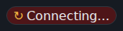

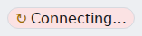

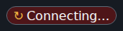

**03 CMP-076 — reconnecting**


**04 CMP-076 — after-fatal**


**05 CMP-076 — after-4403**


**06 CMP-077 — reconnecting**


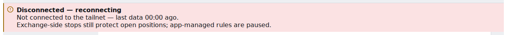


**07 CMP-077 — reconnecting-30s**


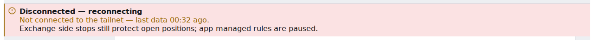


**08 CMP-077 — long-outage**


**09 CMP-077 — offline-fatal**


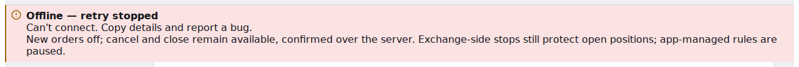

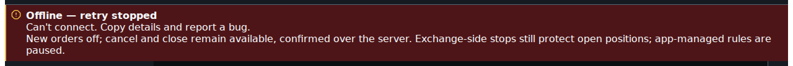

**10 CMP-077 — session-ended**


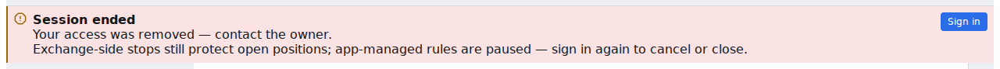


**11 CMP-077 — read-only-r1-shutdown**


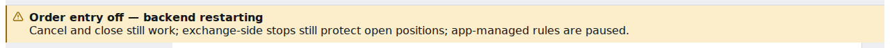


**12 CMP-077 — read-only-r2-kill-switch**


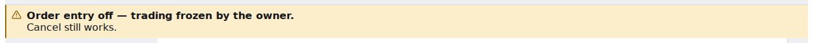


**13 CMP-077 — read-only-r5-private-down**


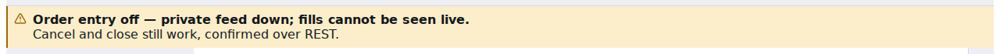


**14 CMP-077 — read-only-r6-system-unknown**


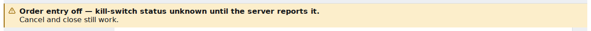


**15 CMP-092 — blocking-maintenance**


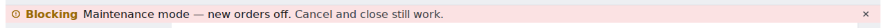


**16 CMP-092 — warning-break-glass**

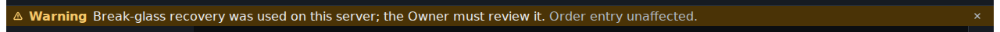

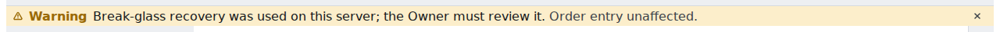

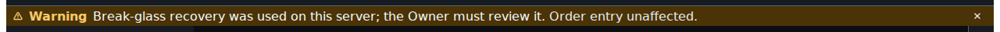

**17 CMP-092 — info-recorder-down**


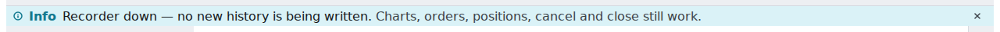


**18 CMP-092 — stacked-blocking-warning-info**

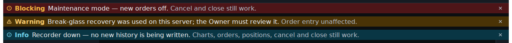

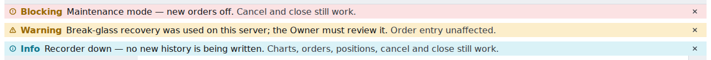

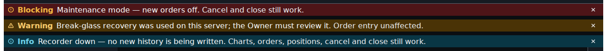

**19 CMP-092 — warning-private-reconnect**

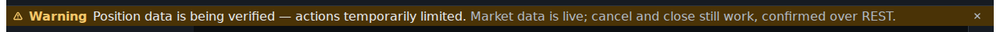

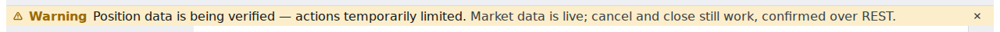

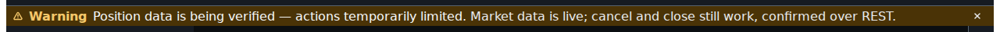

**20 CMP-208 / 210 — live**

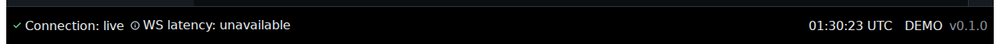

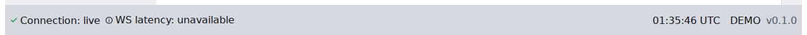

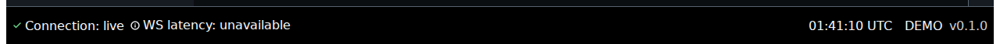

**21 CMP-208 / 210 — connecting**

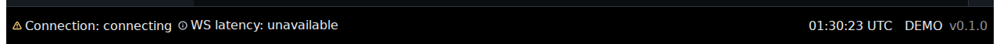

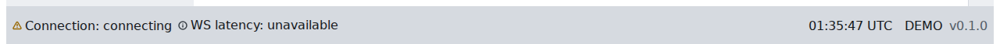

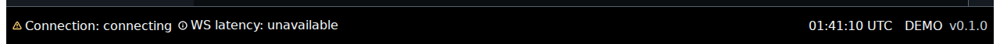

**22 CMP-208 / 210 — reconnecting**

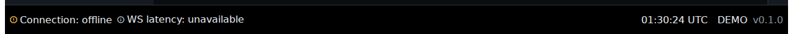

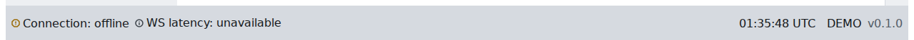

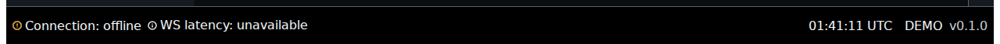

**23 CMP-208 / 210 — after-fatal**


**28 CMP-077 — reconnecting-ws**


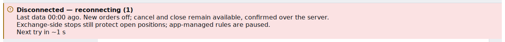


**29 CMP-077 — reconnecting-ws-30s**


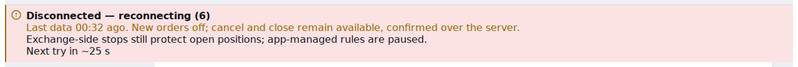


**30 CMP-077 — long-outage-ws**


**31 CMP-076 — reconnecting-ws**


**32 CMP-208 / 210 — reconnecting-ws**

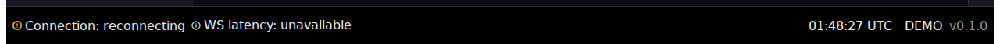

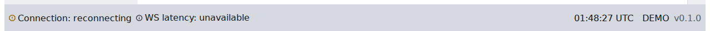

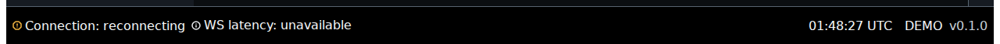

### 2.2 Session scripts (quoted; untracked, never committed — BQ-02)

Eight files in an untracked session directory at the worktree root (seven quoted below; the eighth, `package.json`, is `{ "private": true, "type": "module" }`); `node_modules` was a symlink to `apps/web/node_modules` so the repo's `apps/web/e2e/support` code is imported unchanged. The only network address in them, a loopback literal (the same one `apps/web/e2e/playwright.config.ts` uses), is written `<loopback>` here. A ninth, untracked stdlib script merged the raw JSON into one evidence file and is not quoted. Commands run: `pnpm --filter "@candleviewer/web^..." run build && pnpm --filter @candleviewer/web build` (exit 0); `playwright test -c qa.config.ts` (47 passed, 16.2 min); `playwright test -c qa.config.ts probe.qa.ts` (1 passed); `playwright test -c qa.config.ts outage-ws.qa.ts` (3 passed, 5.1 min).

<!-- prettier-ignore-start -->

<details><summary><code>qa.config.ts</code></summary>

```ts
import { defineConfig } from "@playwright/test";

// E04-D02 (#209) rendered-evidence session: an untracked session config, never committed (BQ-02).
// Serves the built apps/web with `vite preview` on <loopback>, as apps/web/e2e/playwright.config.ts does.
const PORT = process.env["QA_PORT"] ?? "4291";
export default defineConfig({
  testDir: ".",
  testMatch: /.*\.qa\.ts/,
  timeout: 600_000,
  workers: Number(process.env["QA_WORKERS"] ?? "6"),
  retries: 0,
  reporter: [["list"]],
  use: {
    baseURL: `http://<loopback>:${PORT}`,
    viewport: { width: 1280, height: 800 },
    deviceScaleFactor: 1,
    reducedMotion: "reduce",
  },
  webServer: {
    command: `npx vite preview --port ${PORT} --host <loopback> --strictPort`,
    url: `http://<loopback>:${PORT}`,
    reuseExistingServer: false,
    cwd: "../apps/web",
    timeout: 120_000,
  },
});
```

</details>

<details><summary><code>lib.ts</code></summary>

```ts
// E04-D02 (#209) rendered-evidence session: shared helpers. Untracked, never committed (BQ-02).
// Reuses the repo's e2e support exactly: `stubSession` / `json` (API stubbed at the network layer,
// C-13.5), `installWsHarness` (the fake 23 gateway in front of the REAL client), `AXE_GATE_TAGS`.
import { mkdirSync, writeFileSync } from "node:fs";
import { join } from "node:path";
import AxeBuilder from "@axe-core/playwright";
import { expect, type Locator, type Page } from "@playwright/test";
import { AXE_GATE_TAGS } from "../apps/web/e2e/a11y/tags";
import { json, stubSession } from "../apps/web/e2e/support/api";
import {
  installWsHarness,
  type GatewayOptions,
  type Heartbeat,
  type WsHarness,
} from "../apps/web/e2e/support/wsHarness";

/** Output root, from the environment only (no path is written into this script). */
export const OUT = process.env["QA_OUT"] ?? "";
if (OUT === "") throw new Error("QA_OUT is not set");
mkdirSync(join(OUT, "png"), { recursive: true });
mkdirSync(join(OUT, "raw"), { recursive: true });

export type Theme = "dark" | "light" | "high-contrast";
/** The preference the server holds -> the root's `data-theme` (as shell-chrome.spec.ts THEMES). */
export const THEMES: readonly (readonly [Theme, Record<string, unknown>])[] = [
  ["dark", { theme: "dark" }],
  ["light", { theme: "light" }],
  ["high-contrast", { theme: "dark", high_contrast: true }],
];

/** The four chrome targets of shell-chrome.spec.ts plus the banner slot (BQ-03). */
export const AXE_TARGETS = [
  "header",
  'nav[aria-label="Primary"]',
  "aside",
  "footer",
  '[data-shell-slot="banner"]',
] as const;

export const CMP = {
  "076": (p: Page): Locator => p.locator('[data-shell-slot="connection"]'),
  "077": (p: Page): Locator => p.locator('section[aria-label="Connection"]'),
  "092": (p: Page): Locator =>
    p.locator('[data-shell-slot="banner"] [data-severity]').first().locator("xpath=.."),
  "208-210": (p: Page): Locator => p.locator("footer"),
} as const;
export type CmpKey = keyof typeof CMP;

export interface StateRecord {
  cmp: CmpKey;
  state: string;
  theme: Theme;
  png: string;
  text: string;
  dataState: string | null;
  axe: AxeSummary;
}
export interface AxeSummary {
  targets: string[];
  violations: { id: string; impact: string | null; nodes: number; targets: string[]; help: string }[];
  incompleteColorContrast: number;
  incompleteColorContrastNodes: { target: string; why: string }[];
  passesColorContrastNodes: number;
}

export async function boot(
  page: Page,
  appearance: Record<string, unknown>,
  opts: { heartbeat?: Heartbeat; gateway?: GatewayOptions; waitAuth?: boolean } = {},
): Promise<WsHarness> {
  await stubSession(page, { role: "owner" });
  await page.route("**/api/v1/me/preferences", (r) => r.fulfill(json({ appearance })));
  const h = await installWsHarness(page, opts.heartbeat, opts.gateway ?? {});
  return h;
}

export async function go(page: Page, h: WsHarness, theme: Theme, waitAuth = true): Promise<void> {
  await page.goto("/terminal");
  await expect(page.locator("html")).toHaveAttribute("data-theme", theme);
  if (waitAuth) await expect.poll(() => h.authenticated(), { timeout: 20_000 }).toBe(1);
}

export async function axe(page: Page): Promise<AxeSummary> {
  let b = new AxeBuilder({ page }).withTags([...AXE_GATE_TAGS]);
  const targets: string[] = [];
  for (const t of AXE_TARGETS) {
    if ((await page.locator(t).count()) === 1) {
      b = b.include(t);
      targets.push(t);
    }
  }
  const res = await b.analyze();
  return {
    targets,
    violations: res.violations.map((v) => ({
      id: v.id,
      impact: v.impact ?? null,
      nodes: v.nodes.length,
      targets: v.nodes.map((n) => n.target.join(" ")),
      help: v.help,
    })),
    incompleteColorContrast:
      res.incomplete.find((v) => v.id === "color-contrast")?.nodes.length ?? 0,
    incompleteColorContrastNodes: (res.incomplete.find((v) => v.id === "color-contrast")?.nodes ?? []).map(
      (n) => ({ target: n.target.join(" "), why: (n.any[0]?.message ?? "").slice(0, 200) }),
    ),
    passesColorContrastNodes:
      res.passes.find((v) => v.id === "color-contrast")?.nodes.length ?? 0,
  };
}

/** The component plus an 8 px margin, clamped to the viewport; DPR 1 (config). */
export async function shot(page: Page, loc: Locator, file: string): Promise<void> {
  await loc.scrollIntoViewIfNeeded();
  const box = await loc.boundingBox();
  if (box === null) throw new Error(`no box for ${file}`);
  const vp = page.viewportSize() ?? { width: 1280, height: 800 };
  const m = 8;
  const x = Math.max(0, Math.floor(box.x - m));
  const y = Math.max(0, Math.floor(box.y - m));
  const w = Math.min(vp.width - x, Math.ceil(box.width + 2 * m));
  const hgt = Math.min(vp.height - y, Math.ceil(box.height + 2 * m));
  await page.screenshot({ path: join(OUT, "png", file), clip: { x, y, width: w, height: hgt } });
}

/** One captured state of one component in one theme: PNG + the state's axe result. */
export async function capture(
  page: Page,
  rec: StateRecord[],
  nn: string,
  cmp: CmpKey,
  state: string,
  theme: Theme,
  axeResult: AxeSummary,
): Promise<void> {
  const loc = CMP[cmp](page);
  await expect(loc).toBeVisible();
  const png = `${nn}-${cmp}-${state}-${theme}.png`;
  await shot(page, loc, png);
  rec.push({
    cmp,
    state,
    theme,
    png: `png/${png}`,
    text: ((await loc.innerText()) ?? "").replace(/\s+/gu, " ").trim(),
    dataState: await loc.evaluate(
      (el) => el.getAttribute("data-state") ?? el.querySelector("[data-status]")?.getAttribute("data-status") ?? null,
    ),
    axe: axeResult,
  });
}

export function save(name: string, body: unknown): void {
  writeFileSync(join(OUT, "raw", `${name}.json`), JSON.stringify(body, null, 2));
}

/** A `system` notice / payload body for the harness's `firstAuthSystem` (23 §15.9). */
export const SYS = {
  shutdown: { kind: "shutdown_notice", closing_in_ms: 60_000, expected_downtime_ms: 30_000 },
  killEngaged: { kind: "kill_switch", kill_switch: { engaged: true, scope: "global" } },
  killUnknown: { kind: "kill_switch" },
  privateConnecting: { kind: "exchange_state", private_ws: "connecting" },
  maintenance: {
    kind: "notice",
    severity: "warning",
    reason: "maintenance.enabled",
    message: "Maintenance window started.",
  },
  breakGlass: {
    kind: "notice",
    severity: "critical",
    message: "Break-glass recovery was used on this server; the Owner must review it.",
    reason: "auth.break_glass_used",
  },
  recorderDown: {
    kind: "health",
    health: "degraded",
    components: [{ name: "recorder", state: "down" }],
  },
} as const;

/**
 * Counts text-changing mutations per live region: every `[aria-live]`, `[role=status]`,
 * `[role=alert]`, `[role=log]` (BQ-05), with the announcer's `data-seq` nodes as a secondary count.
 */
export async function installObserver(page: Page): Promise<void> {
  await page.evaluate(() => {
    const SEL = "[aria-live],[role=status],[role=alert],[role=log]";
    type Q = {
      names: Record<string, string>;
      counts: Record<string, number>;
      records: Record<string, number>;
      last: Record<string, string>;
      appeared: string[];
      seqs: number[];
      log: { t: number; region: string; text: string }[];
    };
    const q: Q = { names: {}, counts: {}, records: {}, last: {}, appeared: [], seqs: [], log: [] };
    (window as unknown as { __qa: Q }).__qa = q;
    let n = 0;
    const where = (el: Element): string =>
      el.closest("footer")
        ? "footer"
        : el.closest('[data-shell-slot="banner"]')
          ? "banner-slot"
          : el.closest("header")
            ? "header"
            : el.hasAttribute("data-cv-inert-exempt")
              ? "shell-announcer"
              : "document";
    const name = (el: Element): string =>
      [
        el.getAttribute("role") ? `role=${el.getAttribute("role")}` : "",
        el.getAttribute("aria-live") ? `aria-live=${el.getAttribute("aria-live")}` : "",
        el.getAttribute("aria-label") ? `"${el.getAttribute("aria-label")}"` : "",
        `in ${where(el)}`,
      ]
        .filter(Boolean)
        .join(" ");
    const register = (el: Element, late: boolean): string => {
      let id = el.getAttribute("data-qa-region");
      if (id === null) {
        n += 1;
        id = `R${n}`;
        el.setAttribute("data-qa-region", id);
        q.names[id] = name(el);
        q.counts[id] = 0;
        q.records[id] = 0;
        q.last[id] = el.textContent ?? "";
        if (late) q.appeared.push(id);
      }
      return id;
    };
    for (const el of document.querySelectorAll(SEL)) register(el, false);
    const obs = new MutationObserver((muts) => {
      const touched = new Set<string>();
      for (const m of muts) {
        if (m.type === "attributes") continue;
        for (const node of m.addedNodes) {
          if (node instanceof Element) {
            if (node.matches(SEL)) register(node, true);
            for (const el of node.querySelectorAll(SEL)) register(el, true);
            const seqEls = node.matches("[data-seq]") ? [node] : [...node.querySelectorAll("[data-seq]")];
            for (const s of seqEls) q.seqs.push(Number(s.getAttribute("data-seq")));
          }
        }
        const target = m.target instanceof Element ? m.target : m.target.parentElement;
        const region = target?.closest(SEL) ?? null;
        if (region === null) continue;
        const id = register(region, true);
        q.records[id] = (q.records[id] ?? 0) + 1;
        touched.add(id);
      }
      for (const id of touched) {
        const el = document.querySelector(`[data-qa-region="${id}"]`);
        const text = el?.textContent ?? "";
        if (text !== q.last[id]) {
          q.counts[id] = (q.counts[id] ?? 0) + 1;
          q.last[id] = text;
          q.log.push({ t: Date.now(), region: id, text: text.slice(0, 160) });
        }
      }
    });
    obs.observe(document.body, { subtree: true, childList: true, characterData: true });
  });
}

export async function readObserver(page: Page): Promise<{
  counts: Record<string, number>;
  records: Record<string, number>;
  appeared: string[];
  seqs: number[];
  log: { t: number; region: string; text: string }[];
}> {
  return page.evaluate(() => {
    const q = (window as unknown as { __qa: Record<string, unknown> }).__qa;
    const names = q["names"] as Record<string, string>;
    const relabel = (o: Record<string, number>): Record<string, number> =>
      Object.fromEntries(Object.entries(o).map(([k, v]) => [`${k} ${names[k]}`, v]));
    return {
      counts: relabel(q["counts"] as Record<string, number>),
      records: relabel(q["records"] as Record<string, number>),
      appeared: (q["appeared"] as string[]).map((k) => `${k} ${names[k]}`),
      seqs: q["seqs"] as number[],
      log: (q["log"] as { t: number; region: string; text: string }[]).map((l) => ({
        ...l,
        region: `${l.region} ${names[l.region]}`,
      })),
    };
  });
}

/** The highest `data-seq` in the shell announcer now (0: none). */
export const maxSeq = (page: Page): Promise<number> =>
  page.evaluate(() =>
    Math.max(0, ...[...document.querySelectorAll("[aria-live] > p[data-seq]")].map((p) => Number(p.getAttribute("data-seq")))),
  );

/** What has focus, where, and how it is drawn. */
export const focusInfo = (page: Page) =>
  page.evaluate(() => {
    const el = document.activeElement;
    if (el === null || el === document.body) return { el: "body" };
    const cs = getComputedStyle(el);
    const region = el.closest("footer")
      ? "footer"
      : el.closest('[data-shell-slot="banner"]')
        ? "banner-slot"
        : el.closest('[data-shell-slot="connection"]')
          ? "header/connection-slot"
          : el.closest("header")
            ? "header"
            : el.closest("nav")
              ? "nav"
              : el.closest("main")
                ? "main"
                : el.closest("aside")
                  ? "aside"
                  : "other";
    return {
      el: el.tagName.toLowerCase(),
      role: el.getAttribute("role"),
      name: (el.getAttribute("aria-label") ?? (el.textContent ?? "").trim()).slice(0, 120),
      region,
      focusVisible: el.matches(":focus-visible"),
      outline: `${cs.outlineStyle} ${cs.outlineWidth} ${cs.outlineColor}`,
      boxShadow: cs.boxShadow,
    };
  });
```

</details>

<details><summary><code>matrix.qa.ts</code></summary>

```ts
// E04-D02 (#209) rendered-evidence session: the built states x three themes (BQ-01, BQ-03, BQ-04).
// Every state is driven through the REAL client by the repo's e2e WS harness; nothing in src/ is touched.
import { expect, test, type Page } from "@playwright/test";
import {
  axe,
  boot,
  capture,
  CMP,
  go,
  save,
  SYS,
  THEMES,
  type StateRecord,
  type Theme,
} from "./lib";

const region = (p: Page) => CMP["077"](p);
const chipText = (p: Page) => CMP["076"](p).locator("button");

for (const [theme, appearance] of THEMES) {
  test.describe(theme, () => {
    test(`live ${theme}`, async ({ page }) => {
      const rec: StateRecord[] = [];
      const h = await boot(page, appearance);
      await go(page, h, theme);
      await expect(chipText(page)).toHaveAttribute("data-status", "live");
      await expect(page.locator('[data-chip="connection"]')).toHaveText("Connection: live");
      const a = await axe(page);
      await capture(page, rec, "01", "076", "live", theme, a);
      await capture(page, rec, "20", "208-210", "live", theme, a);
      save(`live-${theme}`, rec);
    });

    test(`connecting ${theme}`, async ({ page }) => {
      const rec: StateRecord[] = [];
      const h = await boot(page, appearance);
      // Registered after the harness, so it answers the page socket: it accepts and never says
      // `welcome`, holding the client's first attempt in `connecting` (a network-layer stub only).
      await page.routeWebSocket("**/api/v1/ws", () => undefined);
      await go(page, h, theme, false);
      await expect(chipText(page)).toHaveText(/Connecting…/u);
      const a = await axe(page);
      await capture(page, rec, "02", "076", "connecting", theme, a);
      await capture(page, rec, "21", "208-210", "connecting", theme, a);
      save(`connecting-${theme}`, rec);
    });

    test(`outage ${theme}`, async ({ page }) => {
      test.setTimeout(480_000);
      const rec: StateRecord[] = [];
      const h = await boot(page, appearance);
      await go(page, h, theme);
      await expect(chipText(page)).toHaveAttribute("data-status", "live");
      const killedAt = Date.now();
      h.kill();
      await expect(region(page)).toHaveAttribute("data-state", "reconnecting", { timeout: 15_000 });
      await expect(region(page)).toContainText(/Next try in|Connecting…/u);
      let a = await axe(page);
      await capture(page, rec, "06", "077", "reconnecting", theme, a);
      await capture(page, rec, "03", "076", "reconnecting", theme, a);
      await capture(page, rec, "22", "208-210", "reconnecting", theme, a);
      // T4 30 s: the age line takes color.status.danger.strong (CR:69-70), no word change.
      await page.waitForTimeout(Math.max(0, killedAt + 32_000 - Date.now()));
      a = await axe(page);
      await capture(page, rec, "07", "077", "reconnecting-30s", theme, a);
      // T4 5 min: long-outage (connectionRegion.ts:10), real time, no clock override.
      await page.waitForTimeout(Math.max(0, killedAt + 302_000 - Date.now()));
      await expect(region(page)).toHaveAttribute("data-state", "long-outage", { timeout: 20_000 });
      a = await axe(page);
      await capture(page, rec, "08", "077", "long-outage", theme, a);
      save(`outage-${theme}`, rec);
    });

    test(`revoke ${theme}`, async ({ page }) => {
      const rec: StateRecord[] = [];
      const h = await boot(page, appearance);
      await go(page, h, theme);
      await expect(chipText(page)).toHaveAttribute("data-status", "live");
      h.revokeSession(); // bye session_revoked, reconnect: false, close 4401 (fatal)
      await expect(region(page)).toHaveAttribute("data-state", "offline", { timeout: 15_000 });
      const a = await axe(page);
      await capture(page, rec, "09", "077", "offline-fatal", theme, a);
      await capture(page, rec, "04", "076", "after-fatal", theme, a);
      await capture(page, rec, "23", "208-210", "after-fatal", theme, a);
      save(`revoke-${theme}`, rec);
    });

    test(`session-ended ${theme}`, async ({ page }) => {
      const rec: StateRecord[] = [];
      const h = await boot(page, appearance);
      await go(page, h, theme);
      await expect(chipText(page)).toHaveAttribute("data-status", "live");
      // The next socket is closed 4403 (a network-layer stub registered after the harness).
      await page.routeWebSocket("**/api/v1/ws", (ws) => void ws.close({ code: 4403, reason: "forbidden" }));
      h.kill();
      await expect(region(page)).toHaveAttribute("data-state", "session-ended", { timeout: 20_000 });
      const a = await axe(page);
      await capture(page, rec, "10", "077", "session-ended", theme, a);
      await capture(page, rec, "05", "076", "after-4403", theme, a);
      save(`session-ended-${theme}`, rec);
    });

    const readOnly: readonly (readonly [string, string, string, Record<string, unknown>])[] = [
      ["11", "read-only-r1-shutdown", "R1-shutdown", SYS.shutdown],
      ["12", "read-only-r2-kill-switch", "R2-kill-switch", SYS.killEngaged],
      ["14", "read-only-r6-system-unknown", "R6-system-unknown", SYS.killUnknown],
    ];
    for (const [nn, state, reason, body] of readOnly) {
      test(`${state} ${theme}`, async ({ page }) => {
        const rec: StateRecord[] = [];
        const h = await boot(page, appearance, { gateway: { firstAuthSystem: [body] } });
        await go(page, h, theme);
        await expect(region(page)).toHaveAttribute("data-reason", reason, { timeout: 15_000 });
        const a = await axe(page);
        await capture(page, rec, nn, "077", state, theme, a);
        save(`${state}-${theme}`, rec);
      });
    }

    test(`private-reconnect ${theme}`, async ({ page }) => {
      const rec: StateRecord[] = [];
      const h = await boot(page, appearance, { gateway: { firstAuthSystem: [SYS.privateConnecting] } });
      await go(page, h, theme);
      const at = Date.now();
      await expect(page.locator('[data-shell-slot="banner"] [data-severity="warning"]')).toBeVisible();
      let a = await axe(page);
      await capture(page, rec, "19", "092", "warning-private-reconnect", theme, a);
      // §6 row 9 -> R5 at 10 s (PRIVATE_HANDOVER_MS)
      await page.waitForTimeout(Math.max(0, at + 11_000 - Date.now()));
      await expect(region(page)).toHaveAttribute("data-reason", "R5-private-down", { timeout: 10_000 });
      a = await axe(page);
      await capture(page, rec, "13", "077", "read-only-r5-private-down", theme, a);
      save(`private-reconnect-${theme}`, rec);
    });

    const banners: readonly (readonly [string, string, readonly Record<string, unknown>[], number])[] = [
      ["15", "blocking-maintenance", [SYS.maintenance], 1],
      ["16", "warning-break-glass", [SYS.breakGlass], 1],
      ["17", "info-recorder-down", [SYS.recorderDown], 1],
      ["18", "stacked-blocking-warning-info", [SYS.maintenance, SYS.breakGlass, SYS.recorderDown], 3],
    ];
    for (const [nn, state, bodies, rows] of banners) {
      test(`${state} ${theme}`, async ({ page }) => {
        const rec: StateRecord[] = [];
        const h = await boot(page, appearance, { gateway: { firstAuthSystem: bodies } });
        await go(page, h, theme);
        await expect(page.locator('[data-shell-slot="banner"] [data-severity]')).toHaveCount(rows, {
          timeout: 15_000,
        });
        const a = await axe(page);
        await capture(page, rec, nn, "092", state, theme, a);
        save(`${state}-${theme}`, rec);
      });
    }
  });
}

export type { Theme };
```

</details>

<details><summary><code>outage-ws.qa.ts</code></summary>

```ts
// E04-D02 (#209) session: CMP-077's transport-cause Disconnected (attempt counter + countdown), held.
// The harness's kill() refuses new sockets before they open, which the client reads as a shell cause
// (connection.ts: a socket that never opened records a reachability failure -> tailnet_unreachable).
// Here every new socket is accepted (it opens) and closed 1011 on its first frame, so the client keeps
// the transport cause and counts attempts. A network-layer stub only, registered after the harness.
import { expect, test } from "@playwright/test";
import { axe, boot, capture, CMP, go, save, THEMES, type StateRecord } from "./lib";

test.describe.configure({ mode: "parallel" });

for (const [theme, appearance] of THEMES) {
  test(`outage-ws ${theme}`, async ({ page }) => {
    test.setTimeout(480_000);
    const rec: StateRecord[] = [];
    const h = await boot(page, appearance);
    await go(page, h, theme);
    await expect(CMP["076"](page).locator("button")).toHaveAttribute("data-status", "live");
    let refused = 0;
    await page.routeWebSocket("**/api/v1/ws", (ws) => {
      ws.onMessage(() => {
        refused += 1;
        void ws.close({ code: 1011, reason: "qa_session_drop" });
      });
    });
    const killedAt = Date.now();
    h.kill();
    const region = CMP["077"](page);
    await expect(region).toHaveAttribute("data-state", "reconnecting", { timeout: 15_000 });
    await expect(region).toContainText(/Next try in ~\d+ s/u, { timeout: 15_000 });
    await expect(region).toContainText(/Disconnected — reconnecting \(\d+\)/u);
    let a = await axe(page);
    await capture(page, rec, "28", "077", "reconnecting-ws", theme, a);
    await capture(page, rec, "31", "076", "reconnecting-ws", theme, a);
    await capture(page, rec, "32", "208-210", "reconnecting-ws", theme, a);
    await page.waitForTimeout(Math.max(0, killedAt + 32_000 - Date.now()));
    await expect(region).toContainText(/Last data 00:3\d ago/u);
    a = await axe(page);
    await capture(page, rec, "29", "077", "reconnecting-ws-30s", theme, a);
    await page.waitForTimeout(Math.max(0, killedAt + 302_000 - Date.now()));
    await expect(region).toHaveAttribute("data-state", "long-outage", { timeout: 20_000 });
    a = await axe(page);
    await capture(page, rec, "30", "077", "long-outage-ws", theme, a);
    save(`outage-ws-${theme}`, rec);
    save(`probe-outage-ws-${theme}-drops`, { socketsClosed1011: refused });
  });
}
```

</details>

<details><summary><code>announce.qa.ts</code></summary>

```ts
// E04-D02 (#209) rendered-evidence session: announcement cases C-a, C-b, C-d (BQ-05; C-c is blocked
// on #304 and #408's forced-state channel and is not driven). Dark theme; counts by MutationObserver.
import { expect, test } from "@playwright/test";
import { boot, CMP, go, installObserver, maxSeq, readObserver, save, THEMES } from "./lib";

const [, dark] = THEMES[0]!;
const pings = (h: { frames: readonly { frame: { t: string } }[] }): number =>
  h.frames.filter((f) => f.frame.t === "ping").length;
const pongs = (h: { sent: readonly { t: string }[] }): number =>
  h.sent.filter((f) => f.t === "pong").length;

test("C-a connected, 60 heartbeat round-trips at interval_ms 1000", async ({ page }) => {
  test.setTimeout(180_000);
  const h = await boot(page, dark, { heartbeat: { interval_ms: 1_000, timeout_ms: 5_000 } });
  await go(page, h, "dark");
  await expect(CMP["076"](page).locator("button")).toHaveAttribute("data-status", "live");
  await installObserver(page);
  const seq0 = await maxSeq(page);
  const p0 = pings(h);
  const q0 = pongs(h);
  const t0 = Date.now();
  await expect.poll(() => pongs(h) - q0, { timeout: 120_000, intervals: [500] }).toBeGreaterThanOrEqual(60);
  const obs = await readObserver(page);
  save("announce-C-a", {
    case: "C-a",
    heartbeat: { interval_ms: 1_000, timeout_ms: 5_000 },
    pingsSent: pings(h) - p0,
    pongsAnswered: pongs(h) - q0,
    elapsedMs: Date.now() - t0,
    chipAfter: await CMP["076"](page).locator("button").getAttribute("data-status"),
    dataSeqBefore: seq0,
    dataSeqAfter: await maxSeq(page),
    observer: obs,
  });
});

test("C-b kill() and hold Disconnected for 60 s", async ({ page }) => {
  test.setTimeout(180_000);
  const h = await boot(page, dark);
  await go(page, h, "dark");
  await expect(CMP["076"](page).locator("button")).toHaveAttribute("data-status", "live");
  await installObserver(page);
  const seq0 = await maxSeq(page);
  const c0 = h.connections();
  const t0 = Date.now();
  h.kill();
  await page.waitForTimeout(60_000);
  const obs = await readObserver(page);
  save("announce-C-b", {
    case: "C-b",
    heldMs: Date.now() - t0,
    reconnectAttemptsRefused: h.connections() - c0,
    regionState: await CMP["077"](page).getAttribute("data-state"),
    regionTitle: await CMP["077"](page).locator("p").first().innerText(),
    dataSeqBefore: seq0,
    dataSeqAfter: await maxSeq(page),
    assertiveText: await page.locator('[aria-live="assertive"] > p[data-seq]').allInnerTexts(),
    observer: obs,
  });
});

test("C-d 60 ticker updates about 1 s apart (degraded band attempt)", async ({ page }) => {
  test.setTimeout(180_000);
  const h = await boot(page, dark);
  await go(page, h, "dark");
  await expect(CMP["076"](page).locator("button")).toHaveAttribute("data-status", "live");
  const status = page.getByRole("status", { name: "System status" });
  const before = await status.innerText();
  await installObserver(page);
  const seq0 = await maxSeq(page);
  const s0 = h.sent.length;
  const seen = new Set<string>();
  for (let i = 0; i < 60; i += 1) {
    h.sendTicker("BTCUSDT");
    await page.waitForTimeout(1_000);
    seen.add(await status.innerText());
  }
  const obs = await readObserver(page);
  const subs = h.frames.filter((f) => f.frame.t === "sub").map((f) => f.frame);
  save("announce-C-d", {
    case: "C-d",
    tickerFramesSent: h.sent.slice(s0).filter((f) => String(f["ch"]).startsWith("ticker.")).length,
    clientSubFrames: subs,
    statusBefore: before,
    statusValuesSeen: [...seen],
    latencyValueNode: await page.locator("[data-latency-value]").count(),
    chipAfter: await CMP["076"](page).locator("button").getAttribute("data-status"),
    dataSeqBefore: seq0,
    dataSeqAfter: await maxSeq(page),
    observer: obs,
  });
});
```

</details>

<details><summary><code>keyboard.qa.ts</code></summary>

```ts
// E04-D02 (#209) rendered-evidence session: keyboard (BQ-06). Tab order, visible focus, focus kept on a
// state change; CMP-077's Retry now / Details are not built (owner E10-S01 #304). Dark theme.
import { expect, test, type Page } from "@playwright/test";
import { boot, CMP, focusInfo, go, save, shot, SYS, THEMES } from "./lib";

const [, dark] = THEMES[0]!;
type F = Awaited<ReturnType<typeof focusInfo>>;
const key = (f: F): string => JSON.stringify([f.el, "name" in f ? f.name : "", "region" in f ? f.region : ""]);

/** Tab from the document start until focus returns to the first stop (or 60 presses). */
async function tabWalk(page: Page): Promise<F[]> {
  await page.evaluate(() => (document.activeElement as HTMLElement | null)?.blur());
  const out: F[] = [];
  for (let i = 0; i < 60; i += 1) {
    await page.keyboard.press("Tab");
    const f = await focusInfo(page);
    if (out.length > 1 && key(f) === key(out[0]!)) break;
    out.push(f);
  }
  return out;
}

async function tabTo(page: Page, name: RegExp): Promise<F> {
  await page.evaluate(() => (document.activeElement as HTMLElement | null)?.blur());
  for (let i = 0; i < 60; i += 1) {
    await page.keyboard.press("Tab");
    const f = await focusInfo(page);
    if ("name" in f && name.test(f.name ?? "")) return f;
  }
  throw new Error(`no Tab stop named ${name}`);
}

test("K1 CMP-076 / 208 / 210 live: Tab order; focus kept on the chip when the region enters", async ({
  page,
}) => {
  const h = await boot(page, dark);
  await go(page, h, "dark");
  await expect(CMP["076"](page).locator("button")).toHaveAttribute("data-status", "live");
  const walk = await tabWalk(page);
  const chip = await tabTo(page, /^Connection: /u);
  await shot(page, CMP["076"](page), "24-076-live-focus-dark.png");
  h.kill();
  await expect(CMP["077"](page)).toHaveAttribute("data-state", "reconnecting", { timeout: 15_000 });
  const afterEntry = await focusInfo(page);
  await page.waitForTimeout(3_000); // three 1 Hz ticks of the chip and the region
  const afterTicks = await focusInfo(page);
  await shot(page, CMP["076"](page), "27-076-reconnecting-focus-dark.png");
  const walkDisconnected = await tabWalk(page);
  save("keyboard-K1", { walk, chip, afterEntry, afterTicks, walkDisconnected });
});

test("K2 CMP-092 stacked rows: Dismiss reachable, operable, focus moves per T-19", async ({ page }) => {
  const h = await boot(page, dark, {
    gateway: { firstAuthSystem: [SYS.maintenance, SYS.breakGlass, SYS.recorderDown] },
  });
  await go(page, h, "dark");
  const rows = page.locator('[data-shell-slot="banner"] [data-severity]');
  await expect(rows).toHaveCount(3, { timeout: 15_000 });
  const walk = await tabWalk(page);
  const first = await tabTo(page, /^Dismiss /u);
  await shot(page, CMP["092"](page), "25-092-dismiss-focus-dark.png");
  const steps: { pressed: string; focus: F; rows: number }[] = [];
  for (let i = 0; i < 3; i += 1) {
    await page.keyboard.press("Enter");
    await page.waitForTimeout(300);
    steps.push({ pressed: "Enter", focus: await focusInfo(page), rows: await rows.count() });
  }
  save("keyboard-K2", { walk, first, steps });
});

test("K3 CMP-077 session-ended: Sign in reachable and operable; no dismiss; no trap", async ({ page }) => {
  const h = await boot(page, dark);
  await go(page, h, "dark");
  await expect(CMP["076"](page).locator("button")).toHaveAttribute("data-status", "live");
  await page.routeWebSocket("**/api/v1/ws", (ws) => void ws.close({ code: 4403, reason: "forbidden" }));
  h.kill();
  await expect(CMP["077"](page)).toHaveAttribute("data-state", "session-ended", { timeout: 20_000 });
  const regionButtons = await CMP["077"](page).getByRole("button").allInnerTexts();
  const walk = await tabWalk(page);
  const signIn = await tabTo(page, /^Sign in$/u);
  await shot(page, CMP["077"](page), "26-077-sign-in-focus-dark.png");
  await page.keyboard.press("Tab");
  const afterSignIn = await focusInfo(page);
  await tabTo(page, /^Sign in$/u);
  const urlBefore = new URL(page.url()).pathname;
  await page.keyboard.press("Enter");
  await page.waitForTimeout(2_000);
  save("keyboard-K3", {
    regionButtons,
    walk,
    signIn,
    afterSignIn,
    urlBefore,
    urlAfter: new URL(page.url()).pathname + new URL(page.url()).search,
    loginHeading: await page.getByRole("heading", { name: "Sign in to CandleViewer" }).count(),
  });
});

test("K4 CMP-077 reconnecting / offline: no control, Tab passes through, Retry now / Details absent", async ({
  page,
}) => {
  const h = await boot(page, dark);
  await go(page, h, "dark");
  await expect(CMP["076"](page).locator("button")).toHaveAttribute("data-status", "live");
  h.kill();
  await expect(CMP["077"](page)).toHaveAttribute("data-state", "reconnecting", { timeout: 15_000 });
  const reconnecting = {
    focusables: await CMP["077"](page)
      .locator("a[href], button, input, select, textarea, [tabindex]")
      .count(),
    retryNow: await page.getByRole("button", { name: /Retry now/u }).count(),
    details: await page.getByRole("button", { name: /Details/u }).count(),
    dismiss: await CMP["077"](page).getByRole("button", { name: /Dismiss|Close/u }).count(),
  };
  save("keyboard-K4", { reconnecting });
});

test("K5 supplementary SCR-159 (not CMP-077): Retry now on the offline page", async ({ page, context }) => {
  const h = await boot(page, dark);
  await go(page, h, "dark");
  await expect(CMP["076"](page).locator("button")).toHaveAttribute("data-status", "live");
  const probes: string[] = [];
  await page.route("**/api/v1/health*/**", (r) => (probes.push(r.request().url()), r.abort()));
  await page.route("**/api/v1/health*", (r) => (probes.push(r.request().url()), r.abort()));
  await context.setOffline(true);
  h.kill();
  const retry = page.getByRole("button", { name: /Retry now/u });
  let reached = true;
  try {
    await expect(retry).toBeVisible({ timeout: 30_000 });
  } catch {
    reached = false;
  }
  const result: Record<string, unknown> = { reached };
  if (reached) {
    result["focusOnEntry"] = await focusInfo(page);
    result["retryFocus"] = await tabTo(page, /Retry now/u);
    const n = probes.length;
    await page.keyboard.press("Enter");
    await page.waitForTimeout(2_000);
    result["probesAfterEnter"] = probes.length - n;
    result["heading"] = await page.locator("main h1, main h2").first().innerText().catch(() => null);
  }
  save("keyboard-K5-SCR-159", result);
});
```

</details>

<details><summary><code>probe.qa.ts</code></summary>

```ts
// E04-D02 (#209) session: names every live region the observer counts (BQ-05), by its DOM context.
import { expect, test } from "@playwright/test";
import { boot, CMP, go, save, THEMES } from "./lib";

test("probe live regions on /terminal/last, live", async ({ page }) => {
  const [, dark] = THEMES[0]!;
  const h = await boot(page, dark);
  await go(page, h, "dark");
  await expect(CMP["076"](page).locator("button")).toHaveAttribute("data-status", "live");
  const regions = await page.evaluate(() =>
    [...document.querySelectorAll("[aria-live],[role=status],[role=alert],[role=log]")].map((el, i) => ({
      n: i + 1,
      tag: el.tagName.toLowerCase(),
      role: el.getAttribute("role"),
      ariaLive: el.getAttribute("aria-live"),
      label: el.getAttribute("aria-label"),
      className: el.getAttribute("class"),
      inertExempt: el.hasAttribute("data-cv-inert-exempt"),
      text: (el.textContent ?? "").slice(0, 80),
      parent: (el.parentElement?.outerHTML ?? "").replace(el.outerHTML, "<SELF/>").slice(0, 300),
    })),
  );
  save("probe-regions", regions);
});
```

</details>

<!-- prettier-ignore-end -->

## 3. Announcement cases C-a to C-d

RULED (orchestrator, 2026-10-31, #209 ruling of record — 6536560244's answer): BQ-04, BQ-05.

**Method.** A `MutationObserver` (childList + characterData + subtree) over every `[aria-live]`, `[role=status]`, `[role=alert]` and `[role=log]` in the document counts **text-changing mutations per region**; the shell announcer's `data-seq` nodes (`ANN`:92–94) are the secondary count. This is an automated proxy; the screen-reader capture is §14's human leg. Dark theme. CMP-076 owns no live region (`15`:850; `CS`:74–76); the connection announcements are the region container's, through the announcer's polite / assertive pair (`CRS`:38–45).

Regions present on the live `/terminal/last` page (document order; `probe.qa.ts`):

| Region | Markup                                                  | Whose                                                                          |
| ------ | ------------------------------------------------------- | ------------------------------------------------------------------------------ |
| R1     | `aria-live="polite"`, banner slot                       | CMP-092's container (`DB`)                                                     |
| R2     | `role="alert"`, main canvas, empty                      | the routed page area; outside the six                                          |
| R3     | `role="status"` "System status", footer                 | CMP-208's latency-state region (`SB`)                                          |
| R4     | `aria-live="polite"`, shell announcer                   | `ANN`                                                                          |
| R5     | `aria-live="assertive"`, shell announcer                | `ANN`                                                                          |
| R6     | `role="status"` `aria-live="polite"`, empty             | outside the six; owner not identified in this session                          |
| R7     | `role="status"` `aria-live="polite"`, body level, empty | outside the six; owner not identified in this session                          |
| R8+    | `aria-live="off"` nodes, banner slot                    | CMP-077's countdown line (`CR`), one inserted per attempt cycle; not announced |

| Case | Driven                                                                                                                                                                                                      | Expected                                                           | Text changes (non-zero regions)                                                                                                                                                                                                                                                                           | `data-seq` Δ | Status                                                                                                                                                                                                                                                                                                                                                                 |
| ---- | ----------------------------------------------------------------------------------------------------------------------------------------------------------------------------------------------------------- | ------------------------------------------------------------------ | --------------------------------------------------------------------------------------------------------------------------------------------------------------------------------------------------------------------------------------------------------------------------------------------------------- | ------------ | ---------------------------------------------------------------------------------------------------------------------------------------------------------------------------------------------------------------------------------------------------------------------------------------------------------------------------------------------------------------------- |
| C-a  | connected; heartbeat `interval_ms` 1 000 / `timeout_ms` 5 000; 60 client pings, 60 harness pongs over 60 s; chip after: `live`                                                                              | 0 writes to any live region                                        | 0 in every region (7 regions watched)                                                                                                                                                                                                                                                                     | 0            | run — **as expected**                                                                                                                                                                                                                                                                                                                                                  |
| C-b  | `kill()`, held Disconnected 60 s; 6 reconnect sockets refused; region `data-state` `reconnecting`, title "Disconnected — reconnecting". Ticks and reattempts, not heartbeats (none flow while Disconnected) | exactly one assertive write (row 1)                                | R5 (assertive): 1 — "Disconnected. New orders off. Cancel and close still work, confirmed over the server. Exchange-side stops still protect open positions."; R8 (`aria-live="off"` countdown line, not announced): 1 ("Connecting…"); R9–R13: 0 — one `aria-live="off"` node inserted per attempt cycle | 1            | run — **as expected**                                                                                                                                                                                                                                                                                                                                                  |
| C-c  | the transport-degraded / Delayed chip entry                                                                                                                                                                 | one polite announcement                                            | not driven                                                                                                                                                                                                                                                                                                | —            | **blocked on #304** (the chip has no Delayed source: `CSS`:10–19 maps every non-live kind to reconnecting) **and #408's forced-state channel**; nothing faked                                                                                                                                                                                                          |
| C-d  | latency held in the 100–249 ms band, 60 ticker updates ~1 s apart                                                                                                                                           | one mutation of "System status" (`ok → degraded`), none per update | attempted for the record: 60 ticker frames sent, 0 client `sub` frames; "System status" read "WS latency: unavailable" throughout; 0 text changes; latency value node present: 0                                                                                                                          | 0            | **blocked on #304**: no built consumer subscribes to a topic, so no frame age is measured (F11). The band also cannot be held without editing the harness (`apps/web/e2e/support/wsHarness.ts`:177 stamps every frame `ts: now()`); that harness limit is recorded in F11 and not routed to a separate owner. The precondition was never met; this is not a C-d result |

The unit tests the ticket asks for already exist and are cited, **not re-run in this session**: one row-1 message per Disconnected episode over 40 one-second ticks and a second attempt (`apps/web/test/features/app-shell/connection-region.test.tsx`:260–286), and "ticks, attempts … say nothing" (`apps/web/test/lib/ws/connectionRegion.test.ts`:176–190). The 40-tick vs 60-heartbeat difference is a note, not a new test.

## 4. Keyboard

RULED (orchestrator, 2026-10-31, #209 ruling of record — 6536560244's answer): BQ-06.

Dark theme, owner session, Tab from the document start. Every stop below reported `:focus-visible` true. CMP-077's `Retry now` and `Details` are not built (`CR`:57–61; `15`:867); that leg is **blocked on #304**.

| Case                                    | What was done                                                               | Observed                                                                                                                                                                                                                                                                                                                                                                                                                                                                                                                                                                                                                                                                                                                                                                                                                                 |
| --------------------------------------- | --------------------------------------------------------------------------- | ---------------------------------------------------------------------------------------------------------------------------------------------------------------------------------------------------------------------------------------------------------------------------------------------------------------------------------------------------------------------------------------------------------------------------------------------------------------------------------------------------------------------------------------------------------------------------------------------------------------------------------------------------------------------------------------------------------------------------------------------------------------------------------------------------------------------------------------- |
| K1 CMP-076 / 208 / 210, live            | Tab walk; Tab to the chip; `kill()`; wait for the region; 3 s of 1 Hz ticks | Order: Skip to main content [other] → Account [header] → Interval [header] → Search commands Ctrl+K [header] → Connection: Live [header/connection-slot] → Sign out [header] → Terminal [nav] → Rules [nav] → Journal [nav] → Replay [nav] → Alerts [nav] → Settings [nav] → Admin [nav] → Collapse navigation rail [nav] → Notifications [aside] → (document). The chip is one Tab stop in the header, computed outline `auto 3px rgb(232, 234, 237)` (the browser's ring). The status-bar chips are not Tab stops. After the region entered, focus stayed on the chip (name "Connection: Reconnecting (1), last data 00:00 ago, 01:30:23 UTC", outline `auto 1px rgb(16, 16, 16)`); after 3 s still on the chip ("Connection: Reconnecting, last data 00:03 ago, 01:30:23 UTC"). The Disconnected Tab walk adds no stop for the region |
| K2 CMP-092, three stacked rows          | Tab walk; Tab to the first Dismiss; Enter three times                       | The three `Dismiss …` buttons sit between "Collapse navigation rail" [nav] and "Notifications" [aside], in row order. Enter → "Dismiss Break-glass recovery was used on this server; the Owner must review it." [banner-slot], rows left 2; Enter → "Dismiss Recorder down — no new history is being written." [banner-slot], rows left 1; Enter → "Search commands Ctrl+K" [header], rows left 0. Focus was never on the document body. After the last Dismiss focus moved back to the header, not forward to "Notifications": a candidate under SC 2.4.3 (F39, #302)                                                                                                                                                                                                                                                                   |
| K3 CMP-077, session ended               | 4403 close; Tab to `Sign in`; Tab past it; Tab back, Enter                  | Region buttons: `Sign in` only (no dismiss). `Sign in` [banner-slot] sits between "Collapse navigation rail" and "Notifications"; Tab from it → "Notifications" (no trap). Enter → `/login?next=%2Fterminal%2Flast` from `/terminal/last`; the login heading rendered (1)                                                                                                                                                                                                                                                                                                                                                                                                                                                                                                                                                                |
| K4 CMP-077, reconnecting                | count focusables and controls inside the region                             | focusables 0; `Retry now` 0; `Details` 0; Dismiss / Close 0                                                                                                                                                                                                                                                                                                                                                                                                                                                                                                                                                                                                                                                                                                                                                                              |
| K5 SCR-159 (supplementary; not CMP-077) | browser offline + `kill()`; health probes aborted; Tab to Retry now; Enter  | Reached: yes; focus on entry: the document body; `Retry now` reachable in `main`; Enter sent 1 liveness probe                                                                                                                                                                                                                                                                                                                                                                                                                                                                                                                                                                                                                                                                                                                            |

Gherkin 5 reading: focus is not lost (K1) and no dismiss affordance exists (K3, K4); the retry leg is blocked on #304 (F17). The chip's focus ring is the UA's (F12).


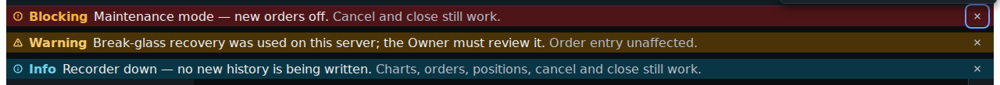


## 5. Contrast table

RULED (orchestrator, 2026-10-31, #209 ruling of record — 6536560244's answer): BQ-07, BQ-08, BQ-20, BQ-21.

**Command:** `python3 -I docs/design/_tools/e04_d02_contrast_audit.py` (Markdown; `--json` for JSON; `--check` exits 1 if the four #5134 ratios drift from the computed table). Stdlib only. It resolves themes as `packages/ui/tokens/themes.json` declares and `loadResolvedThemes()` layers them (dark = primitives + semantic-dark; light = dark + semantic-light; high-contrast = dark + the hc overlay), and takes the ratio from `tools/contrast/color-math.mjs` (unrounded, compared with `>=`). Bars: text 4.5, large text 3, non-text 3; the hc column also reports the informational 7:1 bar (`05` §5).

**Cross-check:** a throwaway script importing `loadResolvedThemes()` and `contrastRatio()` compared 123 values (every pair ratio in every theme, plus the 12 `status.*.strong` inks) at tolerance 1e-9: **0 differences**. `--check` at the base: "check: the four #5134 ratios match the computed table", exit 0. `ruff check --line-length 100` and `black --check -l 100` pass on the script; mypy was not run.

**Reading.** The pair list is derived from the `15` Tokens lines and the built styles; the `use` / surface labels and the built / spec tags are that derivation, not taken from a gate. The "in pairs.mjs" column matches foreground and background only (not the threshold, not any per-pair theme restriction); the bracket names the threshold(s) the pair is registered at, which may differ from the row's use (`warning.strong` on `warning.subtle`, use text, shows `yes (NON_TEXT)`). The "unregistered 21" count uses the same matching. Output, verbatim:

<!-- prettier-ignore-start -->

| fg | bg | use | threshold | dark | light | hc | hc>=7:1 (info) | verdict (dark / light / hc) | in pairs.mjs | surface |
|---|---|---|---|---|---|---|---|---|---|---|
| `color.text.primary` | `color.surface.raised` | text | 4.5 | 14.35 | 15.62 | 16.25 | yes | PASS / PASS / PASS | yes (TEXT) | CMP-076 chip word, live/stale [built ConnectionStatus] / CMP-178 tile value [spec CMP-178] |
| `color.data-confidence.live.indicator` | `color.surface.raised` | non-text | 3 | 14.35 | 15.62 | 16.25 | yes | PASS / PASS / PASS | no | CMP-076 live glyph [built ConnectionStatus] |
| `color.data-confidence.stale.indicator` | `color.surface.raised` | non-text | 3 | 11.00 | 4.11 | 11.00 | yes | PASS / PASS / PASS | no | CMP-076 stale glyph; CMP-178 stale [built ConnectionStatus, spec CMP-178] |
| `color.text.primary` | `color.status.info.subtle` | text | 4.5 | 10.74 | 15.44 | 12.16 | yes | PASS / PASS / PASS | yes (TEXT) | CMP-076 delayed chip word [built ConnectionStatus] / CMP-092 info message [built DegradedModeBanner] |
| `color.status.info.default` | `color.status.info.subtle` | non-text | 3 | 4.64 | 3.44 | 4.64 | no | PASS / PASS / PASS | no | CMP-076 delayed glyph [built ConnectionStatus] |
| `color.text.primary` | `color.status.warning.subtle` | text | 4.5 | 9.86 | 15.62 | 11.16 | yes | PASS / PASS / PASS | yes (TEXT) | CMP-076 stale T2 chip word [built ConnectionStatus] / CMP-077 read-only title; CMP-092 warning message [built ConnectionRegion, built DegradedModeBanner] |
| `color.status.warning.strong` | `color.status.warning.subtle` | non-text | 3 | 7.56 | 4.11 | 7.56 | yes | PASS / PASS / PASS | yes (NON_TEXT) | CMP-076 T2 glyph; CMP-077 read-only border and glyph; CMP-092 warning glyph [built ConnectionStatus, built ConnectionRegion, built DegradedModeBanner] |
| `color.text.primary` | `color.status.danger.subtle` | text | 4.5 | 12.06 | 14.64 | 13.66 | yes | PASS / PASS / PASS | yes (TEXT) | CMP-076 offline / reconnecting word; CMP-077 title [built ConnectionStatus, built ConnectionRegion] / CMP-092 danger message [built DegradedModeBanner] |
| `color.status.danger.strong` | `color.status.danger.subtle` | non-text | 3 | 7.83 | 3.85 | 7.83 | yes | PASS / PASS / PASS | no | CMP-076 glyph; CMP-077 border and glyph; CMP-092 danger glyph [built ConnectionStatus, built ConnectionRegion, spec DegradedModeBanner] |
| `color.status.danger.strong` | `color.status.danger.subtle` | text | 4.5 | 7.83 | 3.85 | 7.83 | yes | PASS / FAIL / PASS | no | CMP-077 age line from 30 s; CMP-092 danger tone label [built ConnectionRegion, built DegradedModeBanner] |
| `color.text.secondary` | `color.status.danger.subtle` | text | 4.5 | 7.40 | 8.42 | 12.06 | yes | PASS / PASS / PASS | no | CMP-077 body lines [built ConnectionRegion] / CMP-092 danger stillWorks [built DegradedModeBanner] |
| `color.text.secondary` | `color.status.warning.subtle` | text | 4.5 | 6.05 | 8.98 | 9.86 | yes | PASS / PASS / PASS | no | CMP-077 read-only body; CMP-092 stillWorks [built ConnectionRegion, built DegradedModeBanner] |
| `color.status.warning.strong` | `color.status.warning.subtle` | text | 4.5 | 7.56 | 4.11 | 7.56 | yes | PASS / FAIL / PASS | yes (NON_TEXT) | CMP-092 warning tone label [built DegradedModeBanner] |
| `color.text.inverse` | `color.status.danger.strong` | text | 4.5 | 10.42 | 4.73 | 10.42 | yes | PASS / PASS / PASS | no | CMP-077 long-outage title and body [built ConnectionRegion] |
| `color.text.inverse` | `color.status.danger.strong` | non-text | 3 | 10.42 | 4.73 | 10.42 | yes | PASS / PASS / PASS | no | CMP-077 long-outage border and glyph [built ConnectionRegion] |
| `color.text.secondary` | `color.status.info.subtle` | text | 4.5 | 6.59 | 8.88 | 10.74 | yes | PASS / PASS / PASS | no | CMP-092 info stillWorks [built DegradedModeBanner] |
| `color.status.info.strong` | `color.status.info.subtle` | text | 4.5 | 7.30 | 4.34 | 7.30 | yes | PASS / FAIL / PASS | no | CMP-092 info tone label [built DegradedModeBanner] |
| `color.status.info.strong` | `color.status.info.subtle` | non-text | 3 | 7.30 | 4.34 | 7.30 | yes | PASS / PASS / PASS | no | CMP-092 info glyph [built DegradedModeBanner] |
| `color.focus.ring` | `color.status.danger.subtle` | non-text | 3 | 5.59 | 5.50 | 14.54 | yes | PASS / PASS / PASS | no | CMP-077 / CMP-092 focus ring [spec ConnectionRegion, spec DegradedModeBanner] |
| `color.focus.ring` | `color.status.warning.subtle` | non-text | 3 | 4.57 | 5.86 | 11.88 | yes | PASS / PASS / PASS | no | CMP-092 dismiss focus ring [spec DegradedModeBanner] |
| `color.focus.ring` | `color.surface.raised` | non-text | 3 | 6.66 | 5.86 | 17.30 | yes | PASS / PASS / PASS | yes (NON_TEXT) | CMP-076 chip focus ring [spec ConnectionStatus] |
| `color.text.primary` | `color.surface.hover` | text | 4.5 | 12.22 | 14.37 | 13.83 | yes | PASS / PASS / PASS | yes (TEXT) | CMP-076 chip hover [spec ConnectionStatus] |
| `color.border.default` | `color.surface.raised` | non-text | 3 | 1.41 | 1.22 | 2.86 | no | FAIL / FAIL / FAIL | no | CMP-076 chip hairline border [built ConnectionStatus] |
| `color.text.primary` | `color.surface.sunken` | text | 4.5 | 17.42 | 12.82 | 19.73 | yes | PASS / PASS / PASS | no | CMP-208 bar text; CMP-210 chip word [built StatusBar] |
| `color.text.secondary` | `color.surface.sunken` | text | 4.5 | 10.69 | 7.37 | 17.42 | yes | PASS / PASS / PASS | yes (TEXT) | CMP-208 latency value; CMP-210 none-tone ink [built StatusBar] |
| `color.text.tertiary` | `color.surface.sunken` | text | 4.5 | 6.83 | 4.86 | 13.61 | yes | PASS / PASS / PASS | yes (TEXT) | CMP-208 tertiary items [built StatusBar] |
| `color.status.success.strong` | `color.surface.sunken` | non-text | 3 | 11.41 | 2.78 | 11.41 | yes | PASS / FAIL / PASS | no | CMP-210 ok glyph [built StatusBar] |
| `color.status.warning.strong` | `color.surface.sunken` | non-text | 3 | 13.36 | 3.37 | 13.36 | yes | PASS / PASS / PASS | yes (NON_TEXT) | CMP-210 warn glyph [built StatusBar] |
| `color.status.danger.strong` | `color.surface.sunken` | non-text | 3 | 11.31 | 3.37 | 11.31 | yes | PASS / PASS / PASS | no | CMP-210 error glyph [built StatusBar] |
| `color.text.secondary` | `color.surface.sunken` | non-text | 3 | 10.69 | 7.37 | 17.42 | yes | PASS / PASS / PASS | yes (TEXT) | CMP-210 none-tone glyph [built StatusBar] |
| `color.text.secondary` | `color.surface.raised` | text | 4.5 | 8.81 | 8.98 | 14.35 | yes | PASS / PASS / PASS | yes (TEXT) | CMP-178 label [spec CMP-178] |
| `color.text.tertiary` | `color.surface.raised` | text | 4.5 | 5.62 | 5.92 | 11.21 | yes | PASS / PASS / PASS | yes (TEXT) | CMP-178 caption [spec CMP-178] |
| `color.status.success.strong` | `color.surface.raised` | non-text | 3 | 9.40 | 3.39 | 9.40 | yes | PASS / PASS / PASS | no | CMP-178 ok mark [spec CMP-178] |
| `color.status.warning.strong` | `color.surface.raised` | non-text | 3 | 11.00 | 4.11 | 11.00 | yes | PASS / PASS / PASS | no | CMP-178 warn mark [spec CMP-178] |
| `color.status.danger.strong` | `color.surface.raised` | non-text | 3 | 9.32 | 4.11 | 9.32 | yes | PASS / PASS / PASS | no | CMP-178 error mark [spec CMP-178] |
| `color.neutral.default` | `color.surface.raised` | non-text | 3 | 5.62 | 5.92 | 5.62 | no | PASS / PASS / PASS | yes (NON_TEXT) | CMP-178 neutral mark [spec CMP-178] |
| `color.text.secondary` | `color.surface.app` | text | 4.5 | 9.85 | 10.35 | 16.06 | yes | PASS / PASS / PASS | yes (TEXT) | CMP-207 build footer text [spec CMP-207] |

Distinct ink per severity (`color.status.*.strong`):

| theme | success | info | warning | danger | identities |
|---|---|---|---|---|---|
| dark | `#6BD48A` | `#6ED0E8` | `#F5C86B` | `#F0B441` | - |
| light | `#1E9448` | `#12798F` | `#9A6A05` | `#9A6A05` | warning==danger |
| high-contrast | `#6BD48A` | `#6ED0E8` | `#F5C86B` | `#F0B441` | - |

pairs 37; fail-text 3; fail-nontext 2; unregistered 21; ink-identities 1

<!-- prettier-ignore-end -->

Against #5134: the four failing light pairs (text 3.85, 4.11, 4.34; non-text 2.78) are F01–F04 and their gate registration is F05, all in #5134's fix. The **light danger / warning ink identity** (`#9A6A05` for both) is F06, a **Major row for the design-system owner** (no SC failure; words and glyphs differ). The second non-text FAIL, `color.border.default` on `color.surface.raised` in all three themes, is the chip's hairline border (F07, candidate). Dark and high-contrast pass every other pair.

## 6. Greyscale and colour-vision renders

RULED (orchestrator, 2026-10-31, #209 ruling of record — 6536560244's answer): BQ-09.

**Method.** `docs/design/_tools/cvd_sim.py` on each dark and light render (run with a local virtual environment carrying numpy and Pillow; 60 inputs, 0 failures): greyscale for dark and light (60), deuteranopia and protanopia for dark (32 + 32, including the 4 focus renders). **The read is an agent stand-in, run blind:** the 60 greyscale PNGs were copied under opaque, shuffled names (`g01.png`…`g60.png`, fixed seed); a fresh agent was told only that they are crops of a trading app's health and connection UI, was allowed to open those 60 files and nothing else, and named each state with its cue and a confidence. The key from opaque name to driven state was held back and applied afterwards. A first read whose file names carried the driven state was discarded (lens round 1). It is an agent, not a person: Gherkin 4 is not ticked by it, and the human blind read stays open for the owner.

**Result.** 60 reads, all marked confident by the reader. **50 / 60 name the driven state.** The 10 that do not are each an existing finding, not a reader error: shots 04 and 05 (both themes) read "Reconnecting" because the chip shows exactly that after a fatal close and after 4403 (F08); shots 07 and 29 (both themes) read as their 06 / 28 siblings because the 30 s step changes no word, only a dimmed line (colour-only, F10, routed to #325); shot 22 (both themes) reads "offline" because the status bar says "Connection: offline" while the region says it is reconnecting (F09). What carries state in greyscale: the word and glyph on the chip and status bar; the banner title; the bold severity word on CMP-092 rows; the triangle glyph plus "Order entry off" on read-only rows; the 5 min step's title "Disconnected for 05:02 — escalated" (08, 30). The greyscale method cannot see the light danger / warning ink identity (F06).

| Greyscale PNG (driven state)                               | Opaque name | Named by the blind reader                                              | Cue                                          | Confident | Matches the driven state |
| ---------------------------------------------------------- | ----------- | ---------------------------------------------------------------------- | -------------------------------------------- | --------- | ------------------------ |
| `01-076-live-dark-greyscale.png`                           | `g14.png`   | connected / live                                                       | chip text 'Live' with check                  | yes       | yes                      |
| `01-076-live-light-greyscale.png`                          | `g31.png`   | connected / live                                                       | chip text 'Live' with check                  | yes       | yes                      |
| `02-076-connecting-dark-greyscale.png`                     | `g53.png`   | connecting                                                             | chip text 'Connecting…'                      | yes       | yes                      |
| `02-076-connecting-light-greyscale.png`                    | `g17.png`   | connecting                                                             | chip text 'Connecting…'                      | yes       | yes                      |
| `03-076-reconnecting-dark-greyscale.png`                   | `g55.png`   | reconnecting                                                           | chip text 'Reconnecting'                     | yes       | yes                      |
| `03-076-reconnecting-light-greyscale.png`                  | `g40.png`   | reconnecting                                                           | chip text 'Reconnecting'                     | yes       | yes                      |
| `04-076-after-fatal-dark-greyscale.png`                    | `g46.png`   | reconnecting                                                           | chip text 'Reconnecting'                     | yes       | no — F08                 |
| `04-076-after-fatal-light-greyscale.png`                   | `g02.png`   | reconnecting                                                           | chip text 'Reconnecting' with circular arrow | yes       | no — F08                 |
| `05-076-after-4403-dark-greyscale.png`                     | `g16.png`   | reconnecting                                                           | chip text 'Reconnecting'                     | yes       | no — F08                 |
| `05-076-after-4403-light-greyscale.png`                    | `g05.png`   | reconnecting                                                           | chip text 'Reconnecting' with circular arrow | yes       | no — F08                 |
| `06-077-reconnecting-dark-greyscale.png`                   | `g47.png`   | disconnected, reconnecting (not connected to tailnet)                  | title 'Disconnected — reconnecting'          | yes       | yes                      |
| `06-077-reconnecting-light-greyscale.png`                  | `g36.png`   | disconnected, reconnecting (not connected to tailnet)                  | title 'Disconnected — reconnecting'          | yes       | yes                      |
| `07-077-reconnecting-30s-dark-greyscale.png`               | `g21.png`   | disconnected, reconnecting (not connected to tailnet)                  | title 'Disconnected — reconnecting'          | yes       | no — F10                 |
| `07-077-reconnecting-30s-light-greyscale.png`              | `g52.png`   | disconnected, reconnecting (not connected to tailnet)                  | title 'Disconnected — reconnecting'          | yes       | no — F10                 |
| `08-077-long-outage-dark-greyscale.png`                    | `g49.png`   | long outage, escalated disconnect (05:02)                              | title 'escalated'                            | yes       | yes                      |
| `08-077-long-outage-light-greyscale.png`                   | `g59.png`   | long outage, escalated disconnect (05:02)                              | title 'escalated'                            | yes       | yes                      |
| `09-077-offline-fatal-dark-greyscale.png`                  | `g08.png`   | offline, retry stopped                                                 | title 'Offline — retry stopped'              | yes       | yes                      |
| `09-077-offline-fatal-light-greyscale.png`                 | `g42.png`   | offline, retry stopped                                                 | title 'Offline — retry stopped'              | yes       | yes                      |
| `10-077-session-ended-dark-greyscale.png`                  | `g10.png`   | session ended (sign-in required)                                       | title 'Session ended' + Sign in button       | yes       | yes                      |
| `10-077-session-ended-light-greyscale.png`                 | `g60.png`   | session ended (sign-in required)                                       | title 'Session ended' + Sign in button       | yes       | yes                      |
| `11-077-read-only-r1-shutdown-dark-greyscale.png`          | `g28.png`   | warning banner: order entry off, backend restarting                    | triangle glyph + text                        | yes       | yes                      |
| `11-077-read-only-r1-shutdown-light-greyscale.png`         | `g20.png`   | warning banner: order entry off, backend restarting                    | triangle glyph + text                        | yes       | yes                      |
| `12-077-read-only-r2-kill-switch-dark-greyscale.png`       | `g03.png`   | warning banner: order entry off, trading frozen by owner               | triangle glyph + text                        | yes       | yes                      |
| `12-077-read-only-r2-kill-switch-light-greyscale.png`      | `g34.png`   | warning banner: order entry off, trading frozen by owner               | triangle glyph + text                        | yes       | yes                      |
| `13-077-read-only-r5-private-down-dark-greyscale.png`      | `g56.png`   | warning banner: order entry off, private feed down                     | triangle glyph + text                        | yes       | yes                      |
| `13-077-read-only-r5-private-down-light-greyscale.png`     | `g06.png`   | warning banner: order entry off, private feed down                     | triangle glyph + text                        | yes       | yes                      |
| `14-077-read-only-r6-system-unknown-dark-greyscale.png`    | `g04.png`   | warning banner: order entry off, kill-switch status unknown            | triangle glyph + text                        | yes       | yes                      |
| `14-077-read-only-r6-system-unknown-light-greyscale.png`   | `g19.png`   | warning banner: order entry off, kill-switch status unknown            | triangle glyph + text                        | yes       | yes                      |
| `15-092-blocking-maintenance-dark-greyscale.png`           | `g07.png`   | blocking banner: maintenance mode                                      | 'Blocking' label + text                      | yes       | yes                      |
| `15-092-blocking-maintenance-light-greyscale.png`          | `g27.png`   | blocking banner: maintenance mode                                      | 'Blocking' label + text                      | yes       | yes                      |
| `16-092-warning-break-glass-dark-greyscale.png`            | `g50.png`   | warning banner: break-glass recovery used                              | 'Warning' label + triangle                   | yes       | yes                      |
| `16-092-warning-break-glass-light-greyscale.png`           | `g13.png`   | warning banner: break-glass recovery used                              | 'Warning' label + triangle                   | yes       | yes                      |
| `17-092-info-recorder-down-dark-greyscale.png`             | `g54.png`   | info banner: recorder down                                             | 'Info' label + text                          | yes       | yes                      |
| `17-092-info-recorder-down-light-greyscale.png`            | `g01.png`   | info banner: recorder down                                             | 'Info' label + text                          | yes       | yes                      |
| `18-092-stacked-blocking-warning-info-dark-greyscale.png`  | `g09.png`   | stack of three banners: blocking, warning, info                        | labels Blocking/Warning/Info                 | yes       | yes                      |
| `18-092-stacked-blocking-warning-info-light-greyscale.png` | `g22.png`   | stack of three banners: blocking, warning, info                        | labels Blocking/Warning/Info                 | yes       | yes                      |
| `19-092-warning-private-reconnect-dark-greyscale.png`      | `g45.png`   | warning banner: position data being verified, actions limited          | 'Warning' label + text                       | yes       | yes                      |
| `19-092-warning-private-reconnect-light-greyscale.png`     | `g44.png`   | warning banner: position data being verified, actions limited          | 'Warning' label + text                       | yes       | yes                      |
| `20-208-210-live-dark-greyscale.png`                       | `g23.png`   | status bar: connection live                                            | text 'Connection: live' with check           | yes       | yes                      |
| `20-208-210-live-light-greyscale.png`                      | `g29.png`   | status bar: connection live                                            | text 'Connection: live' with check           | yes       | yes                      |
| `21-208-210-connecting-dark-greyscale.png`                 | `g48.png`   | status bar: connection connecting (warn glyph)                         | text 'Connection: connecting'                | yes       | yes                      |
| `21-208-210-connecting-light-greyscale.png`                | `g25.png`   | status bar: connection connecting (warn glyph)                         | text 'Connection: connecting'                | yes       | yes                      |
| `22-208-210-reconnecting-dark-greyscale.png`               | `g15.png`   | status bar: connection offline                                         | text 'Connection: offline'                   | yes       | no — F09                 |
| `22-208-210-reconnecting-light-greyscale.png`              | `g12.png`   | status bar: connection offline                                         | text 'Connection: offline'                   | yes       | no — F09                 |
| `23-208-210-after-fatal-dark-greyscale.png`                | `g38.png`   | status bar: connection offline                                         | text 'Connection: offline'                   | yes       | yes                      |
| `23-208-210-after-fatal-light-greyscale.png`               | `g32.png`   | status bar: connection offline                                         | text 'Connection: offline'                   | yes       | yes                      |
| `24-076-live-focus-dark-greyscale.png`                     | `g57.png`   | connected / live                                                       | chip text 'Live' with check                  | yes       | yes                      |
| `25-092-dismiss-focus-dark-greyscale.png`                  | `g39.png`   | stack of three banners: blocking, warning, info (close button focused) | labels; focus ring on first close x          | yes       | yes                      |
| `26-077-sign-in-focus-dark-greyscale.png`                  | `g58.png`   | session ended (sign-in required)                                       | title 'Session ended' + Sign in button       | yes       | yes                      |
| `27-076-reconnecting-focus-dark-greyscale.png`             | `g37.png`   | reconnecting                                                           | chip text 'Reconnecting'                     | yes       | yes                      |
| `28-077-reconnecting-ws-dark-greyscale.png`                | `g33.png`   | disconnected, reconnecting attempt 2                                   | title 'reconnecting (2)'                     | yes       | yes                      |
| `28-077-reconnecting-ws-light-greyscale.png`               | `g30.png`   | disconnected, reconnecting attempt 1                                   | title 'reconnecting (1)'                     | yes       | yes                      |
| `29-077-reconnecting-ws-30s-dark-greyscale.png`            | `g43.png`   | disconnected, reconnecting attempt 6                                   | title 'reconnecting (6)'                     | yes       | no — F10                 |
| `29-077-reconnecting-ws-30s-light-greyscale.png`           | `g26.png`   | disconnected, reconnecting attempt 6                                   | title 'reconnecting (6)', next try countdown | yes       | no — F10                 |
| `30-077-long-outage-ws-dark-greyscale.png`                 | `g11.png`   | long outage, escalated disconnect (05:02)                              | title 'Disconnected for 05:02 — escalated'   | yes       | yes                      |
| `30-077-long-outage-ws-light-greyscale.png`                | `g35.png`   | long outage, escalated disconnect (05:02)                              | title 'escalated', 05:02                     | yes       | yes                      |
| `31-076-reconnecting-ws-dark-greyscale.png`                | `g24.png`   | reconnecting (attempt 2)                                               | chip text 'Reconnecting (2)'                 | yes       | yes                      |
| `31-076-reconnecting-ws-light-greyscale.png`               | `g41.png`   | reconnecting (attempt 2)                                               | chip text 'Reconnecting (2)'                 | yes       | yes                      |
| `32-208-210-reconnecting-ws-dark-greyscale.png`            | `g51.png`   | status bar: connection reconnecting                                    | text 'Connection: reconnecting'              | yes       | yes                      |
| `32-208-210-reconnecting-ws-light-greyscale.png`           | `g18.png`   | status bar: connection reconnecting                                    | text 'Connection: reconnecting'              | yes       | yes                      |

### 6.1 Greyscale, deuteranopia and protanopia renders

**01 CMP-076 live**


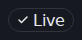

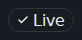


**02 CMP-076 connecting**


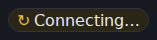

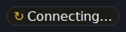


**03 CMP-076 reconnecting**


**04 CMP-076 after-fatal**


**05 CMP-076 after-4403**


**06 CMP-077 reconnecting**


**07 CMP-077 reconnecting-30s**


**08 CMP-077 long-outage**


**09 CMP-077 offline-fatal**

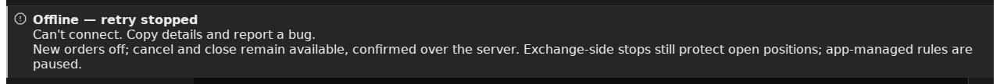

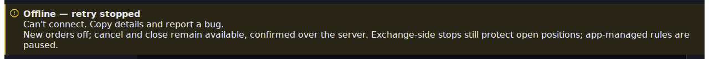

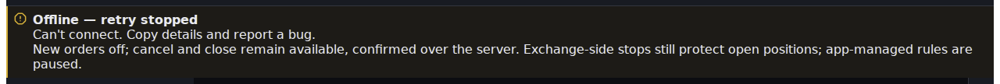

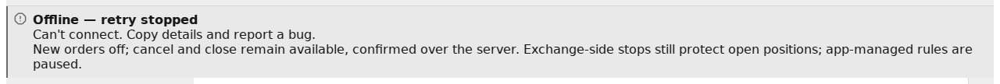

**10 CMP-077 session-ended**


**11 CMP-077 read-only-r1-shutdown**


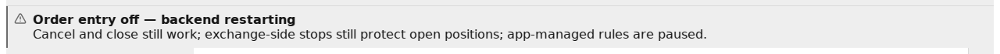

**12 CMP-077 read-only-r2-kill-switch**


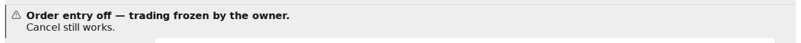

**13 CMP-077 read-only-r5-private-down**


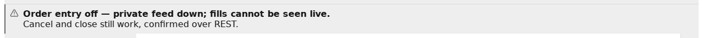

**14 CMP-077 read-only-r6-system-unknown**


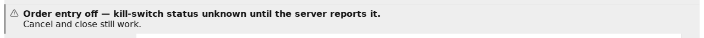

**15 CMP-092 blocking-maintenance**


**16 CMP-092 warning-break-glass**


**17 CMP-092 info-recorder-down**


**18 CMP-092 stacked-blocking-warning-info**


**19 CMP-092 warning-private-reconnect**


**20 CMP-208 / 210 live**


**21 CMP-208 / 210 connecting**


**22 CMP-208 / 210 reconnecting**


**23 CMP-208 / 210 after-fatal**


**24 CMP-076 live, focused**


**25 CMP-092 stacked, Dismiss focused**


**26 CMP-077 session-ended, Sign in focused**


**27 CMP-076 reconnecting, focused**


**28 CMP-077 reconnecting-ws**


**29 CMP-077 reconnecting-ws-30s**


**30 CMP-077 long-outage-ws**


**31 CMP-076 reconnecting-ws**


**32 CMP-208 / 210 reconnecting-ws**


## 7. E04-D01 spec-level table

RULED (orchestrator, 2026-10-31, #209 ruling of record — 6536560244's answer): BQ-10, BQ-17. Findings: F15–F20, F35–F38.

Method. One row per contract of `D01` for the six components (CMP-076, 077, 092, 178, 207, 210), checked against what is merged: the built code, `15`, and `17D2`. `17D2` is merged on main, #325 owner approval pending (`docs/design/E17/E17-D02.md`:1: "Draft — owner approval pending"); every row it supersedes carries that label. The merged design wins over `D01`; a superseded row is a note for the catalogue owner, nothing is re-decided here. Verdicts: **holds** / **superseded** (by the cite) / **drift** (the build or the contract departs, no document covers it) / **blocked on <ticket>** (the case needs a built surface that does not exist). No catalogue, API or design file is edited by this record.

| #   | `D01` contract (cite)                                                                                                                                                                                                    | Merged / built (cite)                                                                                                                                                                                                                                                                                                                                                                                                                                                                                                                                | Verdict                                                                                                                                                                                                                                                                                                       | Note for                                                                                                                                                                                                                                                                                              |
| --- | ------------------------------------------------------------------------------------------------------------------------------------------------------------------------------------------------------------------------ | ---------------------------------------------------------------------------------------------------------------------------------------------------------------------------------------------------------------------------------------------------------------------------------------------------------------------------------------------------------------------------------------------------------------------------------------------------------------------------------------------------------------------------------------------------- | ------------------------------------------------------------------------------------------------------------------------------------------------------------------------------------------------------------------------------------------------------------------------------------------------------------- | ----------------------------------------------------------------------------------------------------------------------------------------------------------------------------------------------------------------------------------------------------------------------------------------------------- |
| 1   | CMP-077 is `role="alertdialog"`, non-dismissible, only `Retry now` / `Details` interactive (`D01`:163-164; Esc does not dismiss, `D01`:201-204)                                                                          | Non-modal `region` named "Connection", **no `alertdialog`, no focus trap**, a state change never moves focus (`15`:863; `17D2` §6 "Keyboard, focus, name / role", and its own contradiction row C2, `17D2`:424); built as `<section aria-label="Connection">` with no key handler (`CR`:72-77; no `onKeyDown` / `Escape` in `CR`)                                                                                                                                                                                                                    | **superseded** by `15`:863 / `17D2` §6 (merged on main, #325 owner approval pending). The Esc-does-not-dismiss half holds trivially: there is nothing to dismiss                                                                                                                                              | **To be posted at merge on #325 and #408** (BQ-10 / BQ-17; F15): `D01`:163 and #408's Gherkin line "Tab cycles within it" contradict the merged contract; the owner's approval of #325 decides. #408 should assert "Tab leaves the region" (`15`:866 no-trap test)                                    |
| 2   | Retry-exhausted variant: after N = 5 failed backoffs the countdown becomes a static "Retries paused — [ Retry now ]" (`D01`:152-156; N proposed, `D01`:322)                                                              | `RetryExhausted` = the `offline` chip state; `offline` only for a fatal close or `bye.reconnect: false` (`15`:862-863); the client has no attempt cap (the title keeps counting, `REG`:180 `Disconnected — reconnecting (${link.attempt})`); built `offline` copy "Offline — retry stopped" (`REG`:157)                                                                                                                                                                                                                                              | **superseded** by `15`:862 / `17D2` §6 (merged on main, #325 owner approval pending)                                                                                                                                                                                                                          | Catalogue owner: the N = 5 threshold in `D01` has no consumer. Not a defect in the build                                                                                                                                                                                                              |
| 3   | `[ Retry now ]` and `[ Details ]` are the CMP-077 controls (`D01`:163-164, :197-199)                                                                                                                                     | Props `onRetryNow`, `onDetails` in the contract (`15`:860); **not built**: "Deferred: `Retry now` (B2; the WS client exposes no manual retry), `Details`" (`CR`:57-61, `15`:867); only `Sign in` renders (`CR`:94-98). SCR-159's page has a working Retry now (`apps/web/src/features/system-states/OfflineOverlay.tsx`:238-245, `onRetry={probeLivenessNow}`), not CMP-077                                                                                                                                                                          | **blocked on #304** (E10-S01's open Done-means; the owner of CMP-077's `Retry now` / `Details`, BQ-06 ruling)                                                                                                                                                                                                 | Hand-off posted on #304 at merge                                                                                                                                                                                                                                                                      |
| 4   | `[ Details ]` Owner / Manager / Viewer split: never an API key, secret, account id or raw exchange payload (`D01`:165-168)                                                                                               | Two bound instances (`15`:861; `17D2` "Details split"); **not built** (`CR`:57-61: "no role or diagnostics surface here yet")                                                                                                                                                                                                                                                                                                                                                                                                                        | **blocked on #304** (same Done-means as row 3)                                                                                                                                                                                                                                                                | Security leg of the row is carried to §11 (spec-level)                                                                                                                                                                                                                                                |
| 5   | Restored / reconciliation line: dismissible, never auto-hidden, "While you were offline: 1 order filled, 1 stop moved by a rule." (`D01`:169-171)                                                                        | `recovered` is a contract state (dismissible, never auto-hidden before 10 s, `15`:862); **not built** (`CR`:58); the built region simply leaves when the link is back and the announcer episode ends (`CRS`:60-66)                                                                                                                                                                                                                                                                                                                                   | **blocked on #304** (recovered is in the deferred list `CR`:57-59)                                                                                                                                                                                                                                            | The "summary of what happened offline" string has no merged owner in `15`; `D01`'s example is the only source. Catalogue owner                                                                                                                                                                        |
| 6   | CMP-076 maps to `HealthReport.overall` + WS `system` liveness (`D01`:225)                                                                                                                                                | CMP-076 is the client-to-backend transport and feed-freshness chip with five values `live / delayed / stale / reconnecting / offline` (`15`:846-847; `CS`:6); built chip is fed from the shell connection store and the latency, never from `HealthReport` (`CSS`:10-19, :38-40)                                                                                                                                                                                                                                                                     | **superseded** by `15`:846-847 / `17D2` §3, §5 (merged on main, #325 owner approval pending)                                                                                                                                                                                                                  | Catalogue owner: `D01`'s mapping conflates two vocabularies (cross-walk, §8). Delayed, Stale and fatal Offline have no source in the shell (`CSS`:7-8, `15`:855): **blocked on #304**                                                                                                                 |
| 7   | State transitions use one 200 ms opacity cross-fade, once per transition, instant under reduced motion (`D01`:205-210)                                                                                                   | Motion is bound to E08-D11 and `17D2` §12 (`15`:854); the four built files declare no transition, animation or reduced-motion branch (grep over `CS`, `CR`, `DMB`, `SB`: only comments mention "transition")                                                                                                                                                                                                                                                                                                                                         | **drift, benign**: nothing animates, so the reduced-motion equivalent (instant swap) is what ships; the `D01` cross-fade is not built                                                                                                                                                                         | #304 / #306 owner if the cross-fade is wanted; no a11y consequence. Not seen rendered                                                                                                                                                                                                                 |
| 8   | Reassurance copy is one shared literal, "Native stops on the exchange are unaffected." / "Your exchange-side stops are unaffected.", gated on the incident's `component` so it is never shown when false (`D01`:211-215) | Built Disconnected region says "Exchange-side stops still protect open positions; app-managed rules are paused." (`REG`:44) on every Disconnected line 2 (`REG`:171, :176) and with the fatal offline text (`REG`:156), unconditionally; the CMP-092 rows carry their own `stillWorks` per row (`DMB`:93-95; copy in `apps/web/src/features/system-states/copy.ts`:29–92, the `DEGRADED_COPY` table). `D01`'s literal string is not in the build; CMP-178's `stillSafe?` renders it (`15`:2229, host decides)                                        | **superseded** (wording) by `17D2` §10 B copy deck (merged on main, #325 owner approval pending); **holds** (gating) for CMP-092 rows (per-row `stillWorks`); the Disconnected region is ungated by design: a client-to-backend loss leaves exchange-side stops in place whatever the incident                | Catalogue owner: the "defined once" literal now exists in three wordings (`D01`, `REG`:44, CMP-178 `stillSafe`). Recorded, not re-decided                                                                                                                                                             |
| 9   | CMP-092 for the unreachable-backend banner is `role="status"` (`D01`:61-66); a danger outage banner is `role="alert"` once (`D01`:99-102); maintenance is a distinct info row with a window (`D01`:103-105)              | `15`:1018: `role="status"` for info / warning, `role="alert"` once for a blocking row; the one announcement per condition (`17D2` §8 "A11y"). Built: rows carry no role; announcements go through the shell's pre-rendered `aria-live` pair (`ANN`:86-90, no `role`) and CMP-092's own polite `aria-live` node (`DB`:149; `DB`:58-62 "no role (as the announcer's)"); blocking row = assertive "{message} {stillWorks}" (`DB`:58-60); maintenance row built: "Maintenance mode — new orders off." (`apps/web/src/features/system-states/copy.ts`:33) | **superseded** by `17D2` §8, §11 (merged on main, #325 owner approval pending); **drift** between `15`:1018's role words and the built `aria-live` regions (same effect for a screen reader, different markup)                                                                                                | Catalogue owner (`15`:1018) and #306's owner. `D01` is also internally inconsistent: the unreachable banner is `status` (`D01`:64) but the same kind of danger banner is `alert` (`D01`:100). Maintenance with a start / end window: no window rendered (`copy.ts`:31–36 has none): drift, #306 owner |
| 10  | CMP-178 tiles resolve independently; no shared loading gate; each tile stamps its own as-of (`D01`:67-70)                                                                                                                | `15`:2229-2233: per-tile `state: "loading"\|"ready"\|"error"\|"unavailable"`, `asOf?`, `valueAsOf?`; **component not built**                                                                                                                                                                                                                                                                                                                                                                                                                         | **holds** (the catalogue carries it); **blocked on #1022** (E42-S01) for any rendered case                                                                                                                                                                                                                    | n/a                                                                                                                                                                                                                                                                                                   |
| 11  | CMP-178 closes the four-word vocabulary: `tone` `ok / warning / danger` + a fifth neutral tone for `not_deployed`; `lastGoodAt?` prop (`D01`:43-46, :262-265, :318-319)                                                  | In `15`:2229: `tone: "ok"\|"warning"\|"danger"\|"stale"\|"neutral"`, `stateWord?`, `lastGoodAt?`, `asOf?`; the schema carries `last_good_at` per component (`22`:22764). The `D01` field gap on E04-T04 is closed                                                                                                                                                                                                                                                                                                                                    | **holds** (closed loop, both ends merged); **blocked on #1022 / #1084** for the rendered tone-per-state glyph set (check, triangle, octagon, clock, ring: `15`:2230)                                                                                                                                          | Vocabulary mismatch with the API enum: §8                                                                                                                                                                                                                                                             |
| 12  | CMP-178 sparkline with a `[ Table view ]` table alternative behind a toggle, scoped `<table>` with caption naming metric + unit (`D01`:81-84)                                                                            | `15`:2230: sparkline `role="img"` with a trend label and a "View as table" disclosure holding a CMP-049 table (time, value, unit); `history?` / `historyUnit?` props (`15`:2229); Storybook `HistoryTable` (`15`:2232). Toggle label differs ("View as table" vs `[ Table view ]`)                                                                                                                                                                                                                                                                   | **superseded** (label only) by `15`:2230; otherwise **holds**. **Blocked on #1022** for any rendered case                                                                                                                                                                                                     | Catalogue owner: pick one label; the catalogue's is the merged one                                                                                                                                                                                                                                    |
| 13  | CMP-210 cluster top-right (WS, ingestion lag, recorder, exchange rate-limit budget); a non-ok chip links to SCR-143 at its tile (`D01`:85-87); `.state` becomes chip state, `.detail` becomes tooltip (`D01`:227)        | `15`:2719-2720: `state: "ok"\|"warn"\|"error"\|"stale"\|"unknown"`, `href` for owner sessions only, name "`label`: `state`, `value`", a non-owner chip is focusable text with no link. Built: two chips (connection, latency) in the **status bar**, not the top bar; status text, no link, no focus; no ingestion-lag, recorder or rate-limit chip (`15`:2724; `SB`:74-116)                                                                                                                                                                         | **superseded** (placement, `href` owner-only) by `15`:2719-2720; the remaining chips and the link are **blocked on #1022 / #1084** (E42-S01 / S06, per `15`:2724 "no source")                                                                                                                                 | The four-word chip vocabulary `ok / warn / error / stale / unknown` is not `D01`'s `ok / warning / down / not_deployed`: §8                                                                                                                                                                           |
| 14  | CMP-207 is the version / build line on every surface's footer, from `HealthReport.version/git_sha` (`D01`:233)                                                                                                           | `15`:2683-2690: the version label alone before sign-in; `commit`, `builtAt`, `environment` only after sign-in (`environment` from `Me.session.environment`, `BuildInfo` has none); commit hash selectable and copyable; **no node name anywhere**. Built: no BuildFooter component; the status bar's `v{CLIENT_VERSION}` (`SB`:204) and the pre-auth line `CandleViewer v{version} · environment not known yet` (`apps/web/src/features/system-states/copy.ts`:147, drawn at `BackendUnreachable.tsx`:159)                                           | **superseded** by `15`:2689-2690 (the unreachable-backend and app-level boundary surfaces of `D01` are pre-auth or error contexts: a `git_sha` there would break the pre-auth rule). Signed-in CMP-207 (commit, build time, environment, copy affordance): **blocked on #1376** (E48-S01; SCR-119's consumer) | #1376 owner and catalogue owner: `D01`:233's "all four surfaces' footer" must not render `git_sha` pre-auth                                                                                                                                                                                           |
| 15  | `D01` §6 promises a contrast / CVD run "before sign-off" (`D01`:244-255) and the header says every state is built and exported (`D01`:7-20) while §3 / §6 / §10 still say "pending" (`D01`:48, :249-254, :330-337)       | The run was never executed on `D01` (the DoD boxes stay open, `D01`:328-340); the contrast table is this record's §5, the greyscale / CVD pass its §6                                                                                                                                                                                                                                                                                                                                                                                                | **drift** (stale text inside `D01`, header vs body); **holds** as a requirement, now closed by §5 / §6                                                                                                                                                                                                        | `D01`'s owner: no edit here (BQ-10: the record recommends)                                                                                                                                                                                                                                            |

Counts (by each row's leading verdict): 15 rows: **superseded** 8 (rows 1, 2, 6, 8, 9, 12, 13, 14), **blocked** 3 (rows 3, 4, 5), **holds** 2 (rows 10, 11), **drift** 2 (rows 7, 15). Rows 6, 9, 10, 11, 12, 13 and 14 also carry a secondary verdict or a blocked leg, stated in the row.

### 7.1 Built-surface cases that stay open for the two unbuilt components

| Component                      | Built-surface case                                                                                                                                   | Status                                                                                                                                              |
| ------------------------------ | ---------------------------------------------------------------------------------------------------------------------------------------------------- | --------------------------------------------------------------------------------------------------------------------------------------------------- |
| CMP-178 SystemHealthTile       | every state (loading, ready, error, unavailable, stale, neutral, not-received, history table), keyboard, axe, contrast, announcements of transitions | **blocked on #1022** (E42-S01, component) and **#1084** (E42-S06, screen wiring); both open at HEAD. Not seen rendered                              |
| CMP-207 BuildFooter, signed-in | commit / build time / environment line, selectable commit, SignedInDemo / SignedInLive, LongVersionLabel stories, three themes                       | **blocked on #1376** (E48-S01). The pre-auth half is the version label at `BackendUnreachable.tsx`:159 and the status bar's `v{version}` (`SB`:204) |

### 7.2 Note for #325 and #408 (the focus-trap / `alertdialog` contradiction)

`D01`:163 (`role="alertdialog"`, non-dismissible) and #408's Gherkin line (Tab cycles within the region) both contradict the merged contract `15`:863 and `17D2` §6 ("no `alertdialog`, no focus trap"; the state change never moves focus, `05` §3.4 item 3). The merged contract is non-modal, so the region can never trap. `17D2` is merged but its owner approval is pending (#325), so the approval decides. #209 asserts the merged contract in its keyboard leg and does not change either document.

## 8. Vocabulary cross-walk — recommends, edits nothing

RULED (orchestrator, 2026-10-31, #209 ruling of record — 6536560244's answer): BQ-11.

`D01` §2 says its four words are "the literal value of `HealthReport.components[].state`" (`D01`:43-44) and that no UI-only synonym exists (`D01`:290-291). At HEAD that is not true: there are six vocabularies for "how healthy is it".

| Meaning                          | `D01` §2 (`D01`:36-41) | API `ComponentState` (`22`:18125-18128; `services/api/candleviewer/observability/health_probes.py`:25-36) | CMP-178 `tone` (`15`:2229)         | CMP-210 chip `state` (`15`:2719)                                                 | Built chips (`SB`:86-91, :105-110; `CS`:6, :39-55)                                                                                                     | `05` §4 item 1 (`05`:115)                                                                            |
| -------------------------------- | ---------------------- | --------------------------------------------------------------------------------------------------------- | ---------------------------------- | -------------------------------------------------------------------------------- | ------------------------------------------------------------------------------------------------------------------------------------------------------ | ---------------------------------------------------------------------------------------------------- |
| Healthy, within budget           | `ok`                   | `healthy`                                                                                                 | `ok`                               | `ok`                                                                             | connection `live` (word "Live", `CS`:42); latency `ok` ("WS latency: ok")                                                                              | "Connected"                                                                                          |
| Degraded but functioning         | `warning`              | `degraded` **and** `warning` (two words; rank down > warning > degraded > healthy, `22`:18128)            | `warning`                          | `warn`                                                                           | connection `connecting` (`warn` tone, `SB`:88); latency `degraded` (`warn`, `SB`:107); chip `delayed` "Reduced rate" (`CS`:44-46, unfed)               | "Degraded"                                                                                           |
| Down / unreachable / incident    | `down`                 | `down`                                                                                                    | `danger` (renders the `down` word) | `error`                                                                          | connection `reconnecting` and `offline` (both `error` tone, `SB`:89-90); latency `breach`; chip `reconnecting` / `offline` ("Offline — retry stopped") | "Disconnected"                                                                                       |
| Intentionally absent             | `not_deployed`         | `not_deployed` (`ranks as healthy for overall`)                                                           | `neutral`                          | `unknown` (nearest; "unknown when the feed behind the chips is down", `15`:2720) | latency `unavailable` (`none` tone, `SB`:109)                                                                                                          | n/a                                                                                                  |
| Data old / not refreshed         | none                   | none                                                                                                      | `stale`                            | `stale`                                                                          | chip `stale` (`CS`:47-48, unfed); no status-bar equivalent                                                                                             | n/a                                                                                                  |
| Page-or-ticket severity (alerts) | none                   | none                                                                                                      | none                               | none                                                                             | none                                                                                                                                                   | none (`infra/alertmanager/templates/cv.tmpl`:5: `PAGE` / `TICKET`, `Severity: <word>`, `cv.tmpl`:10) |

Mismatches, each routed to the owner of the vocabulary (recommend only):

1. (F21) **`D01` claims a literal match with the API and has none.** The API has `healthy` and `degraded` where `D01` has `ok`; `warning` exists in both but the API has a second, lower "degraded" word between `healthy` and `warning` that `D01` never names (`22`:18128). Owner: `D01` / the catalogue owner and the E04-T04 API owner; a mapping table belongs in `22`'s `ComponentState` description or in CMP-178's data contract (#1022 / #1084). Severity P2 (a contract that tells two consumers different words; no user-visible failure today because CMP-178 is unbuilt).
2. (F22) **CMP-178 `tone` and CMP-210 `state` are two different five-word sets** (`ok / warning / danger / stale / neutral` vs `ok / warn / error / stale / unknown`) for the same component states; the first spells the word `warning`, the second `warn`; the first has `danger`, the second `error`; `neutral` vs `unknown` are not the same meaning (absent vs feed down). Owner: catalogue owner with #1022 / #1084. Severity P3 until either is built, P2 once a chip is derived from a tile (`D01`:227 does exactly that).
3. (F23) **The built status bar maps three connection kinds to two tones** (`SB`:86-91: `connecting` is `warn`, `reconnecting` and `offline` are both `error`), while the chip component has five distinct words (`CS`:39-55) and the region has its own titles; the status-bar word for the same state is `reconnecting`, the chip's is "Reconnecting (n)" or "Connecting…", the region's title is "Disconnected — reconnecting (n)" (`REG`:163-180). Three renderings, one state: a screen reader user hears "Connection: reconnecting" (status bar), "Connection: Reconnecting (3), last data 00:12 ago…" (chip name, `CS`:99), and "Disconnected — reconnecting (3)" (region). Owner: #304 (E10-S01) and the E17-D02 copy deck (#325). Severity P3 (all three carry a word; the words differ).
4. (F24) **`05` §4 item 1 names "Connected / Degraded / Disconnected"**, a fourth set; the build says "Live" (not "Connected") and has no "Degraded" word on the connection chip (its closest is "Reduced rate", unfed). Owner: `05`'s owner (the accessibility standard) / #325. Severity P3. Recommend: `05` cites the chip's five words (E17-D02 §5) instead of its own three.
5. (F25) **Latency states `ok / degraded / breach / unavailable`** (`apps/web/src/lib/telemetry/latencyIndicator.ts`:21-33; 100 ms / 250 ms) reuse the API's word "degraded" for a client-measured data-age reading, which is not the API's `degraded` (a probe state). Owner: #304. Severity P3.
6. (F26) **Alerts use `page / ticket`**, not a health word; two summaries use "warning-level" and "critical" as English words inside the text (`infra/prometheus/alerts/clock_sync.yml`:12, :26), a third severity wording beside `page / ticket`. Owner: E04-T05 (#158, closed). Severity P3. See §9.

Recommendation (not applied): one table in `22` (or `D01`'s successor) naming for each API word its chip word, tile tone and alert wording; `D01` §2 then says "mapped to", not "the literal value of".

## 9. Alert text (E04-T05), static review

RULED (orchestrator, 2026-10-31, #209 ruling of record — 6536560244's answer): BQ-12.

Method. A static read of the rule files under `infra/prometheus/alerts/` (14 files) and the notification template `infra/alertmanager/templates/cv.tmpl`, plus the routing in `infra/alertmanager/alertmanager.yml`. Parsed with a YAML loader; counts are of `alert:` rules (recording rules excluded). Nothing was rendered or sent.

| Check                                                                       | Result at HEAD                                                                                                                                                                                                                                                                                                                                                                                                     |
| --------------------------------------------------------------------------- | ------------------------------------------------------------------------------------------------------------------------------------------------------------------------------------------------------------------------------------------------------------------------------------------------------------------------------------------------------------------------------------------------------------------ |
| Rule count                                                                  | **145** alert rules in 14 files (largest: `metric_guards.yml` 41, `system_ticket.yml` 47, `system_page.yml` 17)                                                                                                                                                                                                                                                                                                    |
| Severity labels                                                             | `page` **26**, `ticket` **118**, `none` **1** (the Watchdog, `infra/prometheus/alerts/meta.yml`:11). The BQ list's page 22 / ticket 113 came from a grep that missed the inline flow-mapping form `labels: { severity: … }` (`infra/prometheus/alerts/recorder.yml`:22 and 8 more lines there: 4 page, 5 ticket); the rule files are unchanged since the base, and the YAML parse gives 145 rules and 26 / 118 / 1 |
| `summary:` annotation                                                       | present on all 145; length 16 to 256 characters, mean 60; 17 are templated with `{{ $labels.x }}` / `{{ $value }}`                                                                                                                                                                                                                                                                                                 |
| `runbook_url:` annotation                                                   | present on all 145 (as `meta.yml`:2 requires)                                                                                                                                                                                                                                                                                                                                                                      |
| Emoji or non-ASCII in any summary                                           | **0** (every summary is ASCII)                                                                                                                                                                                                                                                                                                                                                                                     |
| Colour words (red, amber, green, yellow, orange, blue, grey) in any summary | **0**                                                                                                                                                                                                                                                                                                                                                                                                              |
| Severity is a word in the notification                                      | title `[PAGE]` / `[TICKET]` then `[FIRING]` / `[RESOLVED]` (`cv.tmpl`:5); body line `Severity: <word>` (`cv.tmpl`:10) plus `Component`, `Env`, `Occurrences`, `Summary`, `Runbook` (`cv.tmpl`:7-13). No colour- or emoji-only meaning is authored                                                                                                                                                                  |
| Resolved-event pages                                                        | `severity = page` with `resolves = window` goes to a receiver that sends no `[RESOLVED]` (`alertmanager.yml`:28-33; `send_resolved: false` for `page_event`) so a cleared window is not read as handled: copy-honest                                                                                                                                                                                               |
| Redaction in the text                                                       | every interpolated label / annotation is piped through `reReplaceAll` for token-shaped values (`cv.tmpl`:2-4, :5-13)                                                                                                                                                                                                                                                                                               |

Findings (candidate, routed; nothing filed):

- **A-1 = E04-D02-F26 (P3, E04-T05 #158 closed)**: `BybitClockDriftWarning` ("...is warning-level ({{ $value }} ms)", `clock_sync.yml`:12, `severity: ticket`) and `BybitClockDriftCritical` ("...is critical ({{ $value }} ms)", `clock_sync.yml`:26, `severity: page`) put an English severity word in the summary that is not the label's word; `meta.yml`:1 says "two severities only (page|ticket)". The reader sees "[PAGE] ... critical" and "[TICKET] ... warning-level": consistent in rank, a third vocabulary in text.
- **A-2 = E04-D02-F27 (P3, E04-T05 #158 closed)**: `severity: none` (Watchdog) is a third label value against `meta.yml`:1 "two severities only"; the title template maps anything that is not `page` to `TICKET` (`cv.tmpl`:5). The Watchdog is routed to the dead-man receiver by alert name (`alertmanager.yml`:22-24) so it never takes this title; the template would mislabel it if it ever did. Latent, not a user-visible defect.
- **A-3 (not verified, no finding)**: the Slack-compatible receivers (`alertmanager.yml`:70-87) set no explicit attachment colour, so the receiver's default firing / resolved colouring applies on the chat side. The meaning is carried by the `[PAGE]` / `[TICKET]` and `[FIRING]` / `[RESOLVED]` words in the title either way, so it is not colour-only. Not observed rendered.

Cross-walk with §8: the alert vocabulary is `page / ticket` (+ `FIRING / RESOLVED`); no summary uses `healthy / degraded / down / not_deployed` as a state word (substring counts over the 145 summaries: "down" 3, "degraded" 2, "stale" 1; used in prose, not as a contract word).

## 10. Grafana (E04-S01) — static only

RULED (orchestrator, 2026-10-31, #209 ruling of record — 6536560244's answer): BQ-13.

**No screenshot was taken and no Grafana instance was started; this review reads the committed JSON only.** Nothing below was seen rendered. No datasource name, URL, host or IP appears in this section; the JSON carries a datasource reference per panel, which the linter checks (`infra/grafana/lint_dashboards.py`:140-141) and which is not reproduced here.

Scope: the six dashboards E04-S01 (#152) delivered, `frontend`, `market-data`, `rules`, `storage`, `system-health`, `trading`, under `infra/grafana/dashboards/` (three more JSON files, `ga-defects`, `ingestion`, `recorder`, arrived later and are out of scope).

| Dashboard            | Title (as committed) | Panels (excluding row / text) | `stat` panels | Units seen                                         |
| -------------------- | -------------------- | ----------------------------- | ------------- | -------------------------------------------------- |
| `frontend.json`      | CV / Frontend        | 7                             | 3             | ms, short, ops, decmbytes                          |
| `market-data.json`   | CV / Market data     | 29                            | 0             | ops, Bps, s, short, ms, percentunit, bytes, binBps |
| `rules.json`         | CV / Rules           | 4                             | 0             | ops                                                |
| `storage.json`       | CV / Storage         | 6                             | 0             | ops, bytes, percentunit, s, short                  |
| `system-health.json` | CV / System health   | 15                            | 2             | s, percentunit, short, bytes, ops                  |
| `trading.json`       | CV / Trading         | 29                            | 2             | s, ops, short                                      |

Totals: 90 panels, **7 stat panels**, 83 time series. Every panel has a title and a unit; the linter requires it (`lint_dashboards.py`:140-143). Titles are descriptive and carry the budget or threshold in words where a threshold line is drawn (for example "Frame time p95 (budget 16 ms)", "Disk used ratio (warn 80 %, page 95 %)", "WS probe RTT p95 (lines: 150 ms and 500 ms)"). Each dashboard opens with a text panel naming the dashboard and the selected environment.

Palette. All 163 threshold steps use three colours: `#0072B2` (base), `#E69F00` (first threshold), `#D55E00` (second); 90 / 35 / 38 occurrences. This is the Okabe-Ito set (blue, orange, vermillion), chosen for colour-vision-deficient readers. Computed, not rendered:

| Colour    | Relative luminance | Contrast on white | on black | on a dark panel background of `#181b1f` (Grafana's default dark; an assumption, not read from the JSON) |
| --------- | ------------------ | ----------------- | -------- | ------------------------------------------------------------------------------------------------------- |
| `#0072B2` | 0.152              | 5.19              | 4.05     | 3.33                                                                                                    |
| `#E69F00` | 0.416              | 2.25              | 9.32     | 7.67                                                                                                    |
| `#D55E00` | 0.222              | 3.87              | 5.43     | 4.47                                                                                                    |

Mutual contrast: blue vs vermillion 1.34, amber vs vermillion 1.72, blue vs amber 2.30. In greyscale the "ok" blue and the "breach" vermillion are within 1.34:1 of each other, so a greyscale or low-vision reader separates only the amber step.

Findings (candidate; nothing filed; owner E04-S01 #152, closed, routed through the orchestrator):

- **G-1 = E04-D02-F28 (P2)**: **the 7 `stat` panels carry state by background colour alone.** All seven use `colorMode: background`, `textMode: value_and_name`, `graphMode: none`, and **none has a value mapping** (checked on `fieldConfig.defaults.mappings`): `frontend` "Frame time p95 (budget 16 ms)", "WS decode p95 / budget (2 ms)", "Frame time p95 / budget (16 ms)"; `system-health` "Loop lag p99 (budget 50 ms)", "Loop lag > 100 ms fraction"; `trading` "Unknown orders (page > 0 for 60 s)", "Naked-position alerts (page > 0)". A reader who cannot tell blue / amber / vermillion apart, or who reads greyscale, sees a number with no ok / warning / breach word (WCAG 1.4.1, `05` §4 item 1's "text state" rule; `03`:355 P2 for an AA violation). A value mapping that adds a word per threshold band, or a text suffix, removes the colour-only reading. The two `trading` stat panels are the "page" conditions (unknown orders, naked positions): the most safety-relevant panels are among the seven.
- **G-2 = E04-D02-F29 (P3)**: `trading.json` stat panels "Unknown orders" and "Naked-position alerts" declare thresholds `1` (amber) and `1` (vermillion): the same value for both steps, so the amber step is unreachable and the panel jumps from blue to vermillion. Either intended (page at > 0, no warning band) or a copy error; the committed JSON cannot say which.
- **G-3 = E04-D02-F30 (P3)**: two stat panels have unit `short` for a ratio to a budget ("WS decode p95 / budget (2 ms)", "Frame time p95 / budget (16 ms)"): the ratio reads as a bare number; the title says "/ budget" but the unit is not in the value.
- **G-4 = E04-D02-F30 (P3)**: numeric state panels without value mappings: `system-health` "health_component_state (0=ok, higher=worse)" and "WS connection state (1=up)" show 0 / 1 / 2 integers; the meaning lives in the panel title. A mapping to the §8 words (`healthy`, `degraded`, `warning`, `down`, `not_deployed`) would give the reader the contract's words, not an ordinal.
- **G-5 = E04-D02-F31 (P3)**: threshold lines on time series: 18 time-series panels draw dashed threshold lines (`thresholdsStyle: dashed`); the amber and vermillion lines differ by colour only (same dash). The panel titles state the threshold values in words ("lines: 150 ms and 500 ms"), which covers the 1.4.1 reading for those panels. The other time series declare thresholds but draw none (`thresholdsStyle` unset), so there is no colour meaning on them. Informational, no action beyond G-1.
- **G-6 = E04-D02-F31 (P3, computed only)**: blue and vermillion luminance contrast is 1.34:1, so in greyscale the two ends of the scale are near-identical (see palette table); not seen rendered.

Not run: contrast of the stat value text against each background colour (Grafana chooses the text colour; the JSON does not set it); screenshots; the datasource scrub that a screenshot would need. Blocked on nothing; the owner of the review chose static only (BQ-13 ruling).

## 11. Performance and security

RULED (orchestrator, 2026-10-31, #209 ruling of record — 6536560244's answer): BQ-14, BQ-15, BQ-16.

### 11.1 Performance: the 1 Hz status-bar path (BQ-14), re-run at HEAD

Test: `apps/web/test/features/app-shell/status-bar-isolation.test.tsx`, "E10-S01 S4: the 1 Hz status bar never re-renders the shell or the workspace" (lines 67-96): renders the shell, drives 60 simulated seconds of latency updates (one per second) plus the 1 Hz clock, asserts zero re-renders of the outlet, the shell and the status bar itself (`:90-92`), and at least 60 re-renders of the status bar's own leaves (`:94`).

Command (the repo's runner, from `apps/web`: the package's own `vitest` binary, invoked directly, which is what `pnpm --filter @candleviewer/web exec vitest` runs): `vitest run test/features/app-shell/status-bar-isolation.test.tsx`

Output, pasted (the working-directory path on the `RUN` line is scrubbed):

```
 RUN  v4.1.12 <apps/web>

 Test Files  1 passed (1)
      Tests  1 passed (1)
   Start at  01:09:36
   Duration  2.48s (transform 1.28s, setup 231ms, import 1.57s, tests 110ms, environment 482ms)
```

Reading. Measurement, not citation: 1 test, passed. It proves leaf isolation under jsdom and fake timers (render counts), not paint cost or frame time; no profiler trace was taken (BQ-14 ruling). CMP-208's `15`:2702 "performance (no re-render storm at 1 Hz updates)" test requirement is met by this test. The latency value updates are leaf-only (`SB`:122-131) and the clock is the only 1 Hz leaf (`SB`:134-136).

### 11.2 Security: the three checks, for the built five (BQ-15)

Describes patterns only; no host, path or literal value is spelled out. The five: CMP-076, CMP-077, CMP-092, CMP-208, CMP-210 as built.

**Check 1: no HTML sink.** `grep` for `dangerouslySetInnerHTML` over `apps/web/src` returns **nothing**; over `packages/ui/src` its only occurrence is the type-level `Omit` that removes the attribute from icon props (`packages/ui/src/icons/IconSvg.tsx`:11): the ban, not a use. No `innerHTML`, `outerHTML` or `insertAdjacentHTML` write in `apps/web/src/features/app-shell` or `features/system-states` (grep). All text of the five is React text children: chip word and name (`CS`:99-117), region title and lines (`CR`:82-91), banner message and `stillWorks` (`DMB`:91-96), status-bar words (`SB`:75-82, :122-131). Message strings are fixed copy (`apps/web/src/features/system-states/copy.ts`:33, :40, :53, the `DEGRADED_COPY` table at :29–92; `REG`:43-44, :62-65); a `health.components[]` name selects a row through a `switch` and is never rendered (`apps/web/src/features/system-states/degradedIssues.ts`:59-71).

**Check 2: which gate enforces it (corrects the BQ list).** The Semgrep rule `.semgrep/cv-shell-dangerously-set-inner-html.yml` (id `cv-shell-dangerously-set-inner-html`, SR-127, severity ERROR) bans the attribute and raw `innerHTML` / `outerHTML` / `insertAdjacentHTML` writes (`:14-19`) over `apps/web/src/{shell,routes,features,lib}`, `packages/ui/src`, `apps/desktop` and any `cv-shell-*` path (`:20-28`): it covers the folders the five live in (`features/app-shell`, `features/system-states`). **ESLint is narrower, and the BQ list had it narrower still:** `apps/web/eslint.config.mjs`:39-49 applies `eslint-plugin-security` (all recommended rules at error) and `no-unsanitized/method` + `/property` to `src/shell/**` and `src/routes/**` (E10-X02, SR-127), and `:56-77` adds `no-unsanitized` with `noInlineConfig` plus `react/no-danger` to the drawings folders only. **`src/features/**` (where all five components live) has no ESLint HTML-sink rule and no `react/no-danger`**; Semgrep is the only gate there (P3 defence-in-depth gap, E04-D02-F32).

**Check 3: no key id rendered; BuildFooter / version shows the version only pre-auth.** None of the five reads or renders a key id, key label or masked id (grep over `features/app-shell`, `features/system-states` and the connection state in `apps/web/src/lib/ws/state` for key id, api key, masked, last-4 patterns: only an unrelated redaction helper in `apps/web/src/shell/crash/redact.ts`, whose job is to scrub). The version rendered is `package.json`'s (`apps/web/vite.config.ts`:21, read through `CLIENT_VERSION`, `apps/web/src/lib/ws/protocol/frames.ts`:43): a semantic version, no commit, host name or path. Pre-auth the only build line is "CandleViewer v{version} · environment not known yet" (`apps/web/src/features/system-states/copy.ts`:147; `BackendUnreachable.tsx`:159), which is the version label alone as `15`:2689-2690 requires and says the environment is not known rather than guessing one. The signed-in status bar adds the environment in words (`SB`:150-159; an unknown environment reads "ENV UNKNOWN", never a defaulted Demo) and the version (`SB`:204): environment and version only, no commit, no node name.

Result: 3 of 3 pass for the built five; one defence-in-depth gap noted (E04-D02-F32).

### 11.3 Key-id rule: SR-005 wins over the ticket (deviation row)

| Source                                          | Rule                                                                                                                               |
| ----------------------------------------------- | ---------------------------------------------------------------------------------------------------------------------------------- |
| #209 ticket (QA brief)                          | "no component renders more than the **first 4** characters of any key id"                                                          |
| SR-005 (`docs/plan/04-security-program.md`:804) | no admin screen may return "any part of the key id beyond its **last 4** characters" (`...` plus those 4, `key_id_masked` in `22`) |

**Deviation (RULED): the record follows SR-005: last 4.** The merged security standard wins over the ticket text. A first-4 prefix of an exchange key id would be more identifying than the last 4 and is not what the contract's `key_id_masked` carries. Result for the six: none of them renders a key id at all (check 3), so neither the first-4 nor the last-4 limit is exercised; the rule is carried as the check any future CMP-178 / CMP-207 change must meet.

### 11.4 Spec-level security rows for the unbuilt components

| Component           | Contract the build must meet                                                                                                                                                                                                                                                                                                       | Cite                                                                                                | Owner (note)                                                                                                                                                              |
| ------------------- | ---------------------------------------------------------------------------------------------------------------------------------------------------------------------------------------------------------------------------------------------------------------------------------------------------------------------------------- | --------------------------------------------------------------------------------------------------- | ------------------------------------------------------------------------------------------------------------------------------------------------------------------------- |
| CMP-178 `detail?`   | Fed by `HealthReport.components[].detail`, an unbounded free `string` (`22`:22762). It must be rendered as **plain text, never HTML**, and must **never carry a key id or a node name**; the producer should bound its length and the consumer should truncate for display. It is the only free-text field on the tile (`15`:2229) | `22`:22762; `15`:2229-2230; `D01`:117-118 ("never a raw exchange payload verbatim — security note") | Note to #1084 (E42-S06, the screen wiring) and the API owner of `HealthReport` (E04-T04); the E42 component ticket #1022 renders it. Spec-level; blocked on #1022 / #1084 |
| CMP-207 BuildFooter | **No node name anywhere** (no contract carries one); `commit`, `builtAt` and `environment` **only after sign-in**; pre-auth the version label alone (threat-model item U26); the commit hash is selectable and copyable for support bundles, so the copy affordance must not add a hostname or path                                | `15`:2684-2690                                                                                      | #1376 (E48-S01). The ticket's phrase "BuildFooter exposes version/commit" (ticket text) is read as signed-in only, per `15`:2689                                          |

Security label: none requested; a docs-only PR touching no security path (BQ-15 ruling).

### 11.5 Visual-regression gap row (BQ-16; F14)

| Item                    | Finding                                                                                                                                                                                                                                                            |
| ----------------------- | ------------------------------------------------------------------------------------------------------------------------------------------------------------------------------------------------------------------------------------------------------------------ |
| Ticket ask              | "Use the E05 visual-regression baseline"                                                                                                                                                                                                                           |
| What the harness reads  | the `packages/ui` Storybook index only: `packages/ui/vr/matrix.ts`:54-57 (`parseStoryIndex` of `index.json`); the stories glob is `packages/ui/.storybook/main.ts`:10-12 (`../src/**/*.stories.@(ts                                                                | tsx)`); baselines: 4,356 PNGs (`docs/plan/27-adrs/ADR-0019-visual-regression-tooling.md`:188) |
| Where the six live      | the five built components are in `apps/web` by design (`CR`:44-46; `DMB`:60-62; `15`:1020); `apps/web` has no `.storybook` directory and no `*.stories.*` file (checked); CMP-178 and CMP-207 are not built (§7.1)                                                 |
| Result                  | **No VR baseline exists for any of the six.** Every catalogued story (`15`:852, :865, :1020, :2232, :2687, :2701, :2722) is unbuilt, so there is no story for the harness to index and nothing to diff                                                             |
| Evidence that stands in | this record's committed PNGs are evidence for the reviewer, **not a baseline** (no `vr_update` run, no CODEOWNER baseline commit)                                                                                                                                  |
| Route                   | gap row routed with the missing stories (BQ-02): #304 / #306's owner for the five; #1022 and #1376 for CMP-178 and signed-in CMP-207. A semantic-token change (e.g. the light-theme contrast bug) moves baselines through the `vr_update` path, CODEOWNER-approved |
| Severity                | P3 (a coverage gap, no behaviour is wrong)                                                                                                                                                                                                                         |

## 12. Findings

RULED (orchestrator, 2026-10-31, #209 ruling of record — 6536560244's answer): BQ-20. One issue is filed (#5134). Everything else is a row, routed as **one comment per owning ticket at merge**; nothing else is filed. Rows whose owning ticket is closed (#111, #152, #158) or has no issue named here (E10-X02) are routed through the orchestrator. Severity per `03` §11.3. Local labels in §7–§11 (S-, A-, G-, mismatch n) map to the ids below.

| Id          | Surface                                                                         | WCAG SC or cite                                                                                                                                                                                                                                                                                                                     | Severity                 | Owner ticket                      | Routed to                                                | Status                   |
| ----------- | ------------------------------------------------------------------------------- | ----------------------------------------------------------------------------------------------------------------------------------------------------------------------------------------------------------------------------------------------------------------------------------------------------------------------------------- | ------------------------ | --------------------------------- | -------------------------------------------------------- | ------------------------ |
| E04-D02-F01 | CMP-092 severity word (blocking, danger tone); CMP-077 age line from 30 s       | SC 1.4.3: `color.status.danger.strong` on `.subtle`, light 3.85 (§5); axe serious on shots 07, 15, 18, 29 light                                                                                                                                                                                                                     | P1 (ruling)              | DS lane                           | #5134                                                    | filed (#5134)            |
| E04-D02-F02 | CMP-092 severity word, warning                                                  | SC 1.4.3: `warning.strong` on `warning.subtle`, light 4.11; axe serious on shots 16, 18, 19 light                                                                                                                                                                                                                                   | P1 (ruling)              | DS lane                           | #5134                                                    | filed (#5134)            |
| E04-D02-F03 | CMP-092 severity word, info                                                     | SC 1.4.3: `info.strong` on `info.subtle`, light 4.34; axe serious on shots 17, 18 light                                                                                                                                                                                                                                             | P1 (ruling)              | DS lane                           | #5134                                                    | filed (#5134)            |
| E04-D02-F04 | CMP-210 ok glyph in the status bar                                              | SC 1.4.11: `success.strong` on `surface.sunken`, light 2.78 (non-text; axe does not test it)                                                                                                                                                                                                                                        | P1 (ruling)              | DS lane                           | #5134                                                    | filed (#5134)            |
| E04-D02-F05 | Contrast gate registration                                                      | F01–F04 pairs absent from `pairs` (`warning.strong` on `warning.subtle` registered at the non-text bar only); `HO17`:39 planned them under E17-T04 (#413, closed). The script reports 21 of 37 table rows unregistered (§5)                                                                                                         | P1 (part of #5134's fix) | DS lane                           | #5134                                                    | filed (in #5134's scope) |
| E04-D02-F06 | Severity inks, light theme                                                      | `color.status.warning.strong` == `color.status.danger.strong` == `#9A6A05` in light (§5 distinct-ink table); no SC 1.4.1 failure (words and glyphs differ); greyscale cannot see it                                                                                                                                                 | **Major** (ruling)       | design-system owner               | comment on #5134 at merge ("related, not in this issue") | routed                   |
| E04-D02-F07 | CMP-076 chip hairline border                                                    | `color.border.default` on `color.surface.raised`, non-text 1.41 / 1.22 / 2.86, fails 3:1 in all three themes (§5). Candidate under SC 1.4.11, only if the border is needed to identify the control                                                                                                                                  | P3 (candidate)           | E10-S01                           | #304                                                     | routed                   |
| E04-D02-F08 | CMP-076 chip after a fatal close / 4403                                         | Observed: the chip reads "Reconnecting · last data …" (shots 04, 05) while CMP-077 reads "Offline — retry stopped" / "Session ended" (09, 10) and the status bar "Connection: offline" (23). `CSS`:6–19 folds every non-live kind into reconnecting; `15`:855 (no fatal Offline source). The blind read could not name 04 / 05 (§6) | P2                       | E10-S01                           | #304                                                     | routed                   |
| E04-D02-F09 | CMP-208 / 210 connection word, shell-cause outage                               | Observed: "Connection: offline" (shot 22) while the region reads "Disconnected — reconnecting" (06) and the chip "Reconnecting" (03); under a transport cause it reads "reconnecting" (32). `SB`:86–91 maps the store's kind, whose `offline` is a running retry (`CSS`:6–8)                                                        | P3                       | E10-S01                           | #304                                                     | routed                   |
| E04-D02-F10 | CMP-077 30 s step                                                               | SC 1.4.1 candidate: the age line takes `color.status.danger.strong` with no word change (`CR`:69–70; `REG`:9, :148); blind-read cue "dimmed" only (§6)                                                                                                                                                                              | P3 (candidate)           | E17-D02                           | #325                                                     | routed (BQ-09)           |
| E04-D02-F11 | CMP-208 / 210 latency; CMP-076 Live latency                                     | Observed: "WS latency: unavailable" in all 15 status-bar captures and through C-d; 60 ticker frames drew 0 client `sub` frames, so no frame age is measured; the harness stamps `ts: now()` (`apps/web/e2e/support/wsHarness.ts`:177), so the 100–249 ms band cannot be held without an edit (C-d blocked)                          | P3 (gap)                 | E10-S01                           | #304                                                     | routed                   |
| E04-D02-F12 | CMP-076 chip focus indicator                                                    | The UA focus ring shows (`outline-style: auto`), not `color.focus.ring`; computed width 3 px while live, 1 px after the region entered (§4 K1); ring visible in shots 24, 27. Deferral documented at `CS`:84–85                                                                                                                     | P3                       | E10-S01                           | #304                                                     | routed                   |
| E04-D02-F13 | Stories for the five built (Gherkin 1, "in Storybook")                          | No story exists (`15`:852, :865, :1020, :2701, :2722); `apps/web` has no `.storybook`                                                                                                                                                                                                                                               | P3 (gap)                 | E10-S01; E10-S04 (closed)         | #304 (076, 208, 210); #302 (077, 092)                    | routed                   |
| E04-D02-F14 | Visual-regression baselines (§11.5, S-25)                                       | No VR baseline for any of the six (`packages/ui/vr/matrix.ts`:54–57)                                                                                                                                                                                                                                                                | P3 (gap)                 | E10-S01; E42-S01; E48-S01         | #304, #302; #1022, #1376 for the unbuilt                 | routed                   |
| E04-D02-F15 | CMP-077 role / focus trap (§7 row 1, §7.2, S-01)                                | `D01`:163 and #408's Gherkin vs `15`:863 / `17D2` §6                                                                                                                                                                                                                                                                                | P3                       | E17-D02; E17-D04                  | #325, #408                                               | routed                   |
| E04-D02-F16 | CMP-077 retry-exhausted variant (§7 row 2, S-02)                                | `D01`:152–156 vs `15`:862                                                                                                                                                                                                                                                                                                           | P3                       | catalogue owner                   | #325                                                     | routed                   |
| E04-D02-F17 | CMP-077 `Retry now`, `Details`, recovered (§7 rows 3–5, S-03)                   | `CR`:57–61; `15`:860–863, :867; Gherkin 5 retry leg                                                                                                                                                                                                                                                                                 | P2                       | E10-S01 (BQ-06)                   | #304 (hand-off)                                          | routed                   |
| E04-D02-F18 | CMP-076 source mapping; Delayed / Stale / Offline unfed (§7 row 6, S-04)        | `D01`:225 vs `15`:846–847; `CSS`:7–8                                                                                                                                                                                                                                                                                                | P3                       | catalogue owner; E10-S01          | #325; #304                                               | routed                   |
| E04-D02-F19 | Reassurance copy in three wordings (§7 row 8, S-05)                             | `D01`:211–215; `REG`:44, :156, :171, :176                                                                                                                                                                                                                                                                                           | P3                       | catalogue owner                   | #325                                                     | routed                   |
| E04-D02-F20 | CMP-092 roles vs `aria-live`; maintenance window (§7 row 9, S-06)               | `15`:1018 vs `ANN`:86–90, `DB`:149; `D01`:64 vs :100; `apps/web/src/features/system-states/copy.ts`:33                                                                                                                                                                                                                              | P3                       | E10-S04 (closed); catalogue owner | #302; #325                                               | routed                   |
| E04-D02-F21 | `D01` vocabulary vs API `ComponentState` (§8 mismatch 1, S-07)                  | `D01`:43–44 vs `22`:18125–18128                                                                                                                                                                                                                                                                                                     | P2                       | E04-T04 API owner; E42-S06        | #1084 (+ the API owner via the orchestrator)             | routed                   |
| E04-D02-F22 | CMP-178 `tone` vs CMP-210 `state` (§8 mismatch 2, S-08)                         | `15`:2229 vs :2719; `D01`:227                                                                                                                                                                                                                                                                                                       | P3                       | catalogue owner; E42              | #325; #1084                                              | routed                   |
| E04-D02-F23 | One connection state, three wordings (§8 mismatch 3, S-09)                      | `SB`:86–91; `CS`:39–55; `REG`:163–180                                                                                                                                                                                                                                                                                               | P3                       | E10-S01; E17-D02                  | #304; #325                                               | routed                   |
| E04-D02-F24 | `05` §4 item 1 vocabulary (§8 mismatch 4, S-10)                                 | `05`:115                                                                                                                                                                                                                                                                                                                            | P3                       | `05` owner / E17-D02              | #325                                                     | routed                   |
| E04-D02-F25 | Latency word "degraded" (§8 mismatch 5, S-11)                                   | `apps/web/src/lib/telemetry/latencyIndicator.ts`:21–33                                                                                                                                                                                                                                                                              | P3                       | E10-S01                           | #304                                                     | routed                   |
| E04-D02-F26 | Alert summaries' severity words (§8 mismatch 6, §9 A-1, S-12)                   | `infra/prometheus/alerts/clock_sync.yml`:12, :26; `meta.yml`:1                                                                                                                                                                                                                                                                      | P3                       | E04-T05 (#158, closed)            | orchestrator                                             | routed                   |
| E04-D02-F27 | Watchdog `severity: none` (§9 A-2, S-13)                                        | `infra/prometheus/alerts/meta.yml`:11; `infra/alertmanager/templates/cv.tmpl`:5                                                                                                                                                                                                                                                     | P3                       | E04-T05 (#158, closed)            | orchestrator                                             | routed                   |
| E04-D02-F28 | Grafana: 7 stat panels colour-only (§10 G-1, S-14)                              | SC 1.4.1; no value mappings                                                                                                                                                                                                                                                                                                         | P2                       | E04-S01 (#152, closed)            | orchestrator                                             | routed                   |
| E04-D02-F29 | Grafana: equal thresholds on two trading stats (§10 G-2, S-15)                  | `infra/grafana/dashboards/trading.json`                                                                                                                                                                                                                                                                                             | P3                       | E04-S01 (#152, closed)            | orchestrator                                             | routed                   |
| E04-D02-F30 | Grafana: ratio units and numeric state panels (§10 G-3, G-4, S-16)              | `frontend.json`; `system-health.json`                                                                                                                                                                                                                                                                                               | P3                       | E04-S01 (#152, closed)            | orchestrator                                             | routed                   |
| E04-D02-F31 | Grafana: palette in greyscale; dashed lines by colour only (§10 G-5, G-6, S-17) | blue vs vermillion 1.34:1 (computed)                                                                                                                                                                                                                                                                                                | P3                       | E04-S01 (#152, closed)            | orchestrator                                             | routed                   |
| E04-D02-F32 | No ESLint HTML-sink rule on `src/features/**` (§11.2, S-18)                     | `apps/web/eslint.config.mjs`:39–49, :56–77; `.semgrep/cv-shell-dangerously-set-inner-html.yml`:20–28                                                                                                                                                                                                                                | P3                       | E10-X02 (SR-127)                  | orchestrator                                             | routed                   |
| E04-D02-F33 | Key-id rule: first 4 vs last 4 (§11.3, S-19)                                    | SR-005, `04`:804                                                                                                                                                                                                                                                                                                                    | — (deviation)            | —                                 | —                                                        | recorded; no action      |
| E04-D02-F34 | CMP-178 `detail` (§11.4, S-20)                                                  | `22`:22762; `15`:2229                                                                                                                                                                                                                                                                                                               | P2                       | E42-S06; E04-T04 API owner        | #1084 (+ the API owner via the orchestrator)             | routed                   |
| E04-D02-F35 | CMP-207 pre-auth / signed-in (§7 row 14, §11.4, S-21)                           | `15`:2684–2690; `D01`:233                                                                                                                                                                                                                                                                                                           | P3                       | E48-S01                           | #1376                                                    | routed                   |
| E04-D02-F36 | CMP-210 missing chips, link, focus (§7 row 13, S-22)                            | `15`:2724; `SB`:74–116                                                                                                                                                                                                                                                                                                              | P3                       | E42-S01 / S06                     | #1084                                                    | routed                   |
| E04-D02-F37 | `D01` cross-fade not built (§7 row 7, S-23)                                     | `D01`:205–210                                                                                                                                                                                                                                                                                                                       | P3                       | E10-S01; E10-S04 (closed)         | #304 (076); #302 (077, 092)                              | routed                   |
| E04-D02-F38 | `D01` internal drift (§7 row 15, S-24)                                          | `D01`:7–20 vs :48, :249–254, :328–340                                                                                                                                                                                                                                                                                               | P3                       | E04-D01 (#111, closed)            | orchestrator                                             | routed (note only)       |
| E04-D02-F39 | CMP-092 focus after the last Dismiss (§4 K2)                                    | SC 2.4.3 candidate: after the last row is dismissed, focus moves back to the header's "Search commands Ctrl+K", not forward to "Notifications" (observed, K2)                                                                                                                                                                       | P3 (candidate)           | E10-S04 (closed)                  | #302                                                     | routed                   |

Count: 39 rows — 5 filed under #5134 (F01–F05), 1 Major for the DS owner (F06), 32 routed, 1 deviation recorded. By severity: P1 5 (F01–F05), Major 1 (F06), P2 5 (F08, F17, F21, F28, F34), P3 27, deviation 1 (F33).

## 13. Gherkin and DoD trace

RULED (orchestrator, 2026-10-31, #209 ruling of record — 6536560244's answer): BQ-01, BQ-05, BQ-06, BQ-09, BQ-18, BQ-19, BQ-22.

| #   | Criterion                                                                                             | Result                                                                                                                                                                                                                                                                                                                                                                                                                                                                                                                                                   | Evidence |
| --- | ----------------------------------------------------------------------------------------------------- | -------------------------------------------------------------------------------------------------------------------------------------------------------------------------------------------------------------------------------------------------------------------------------------------------------------------------------------------------------------------------------------------------------------------------------------------------------------------------------------------------------------------------------------------------------- | -------- |
| G1  | Six components rendered in Storybook in every state and theme; axe zero violations; run link attached | **Built five: verified on the built app.** Dark and high-contrast: 0 violations of any impact in 56 captures. Light: 9 serious `color-contrast` nodes in 7 of 28 captures, filed (#5134; F01–F03). "In Storybook": **routed gap** (no story exists; F13 → #304, #302). CMP-178: **blocked on #1022 / #1084**. Signed-in CMP-207: **blocked on #1376**. Run link: `a11y-nightly.yml` run 41160351010 on `main` (§2): axe 0 on its 66 screens, but the run is red from another leg, red nightly since at least 2026-10-26 and reported to the orchestrator | §2       |
| G2  | 60 heartbeat updates in the degraded state → exactly one announcement                                 | **Blocked:** the degraded-state case C-c on #304 / #408; the latency-band case C-d on #304 (F11); the screen-reader capture on the human tester (§14). Adjacent automated proxies run, not the criterion: C-a 0 text changes over 60 heartbeat round-trips (connected); C-b 1 assertive write over 60 s Disconnected with 6 refused reattempts (no heartbeats flow while Disconnected)                                                                                                                                                                   | §3       |
| G3  | Every health state token in three themes: text ≥4.5:1, non-text ≥3:1; failures filed                  | **Verified; AA failures filed.** 37 pairs × 3 themes; dark and hc pass all but the chip hairline border (F07, candidate); light fails 3 text pairs and 2 non-text pairs: the three text pairs and the ok glyph → #5134 (F01–F04); the hairline border F07 is a candidate routed to #304, not filed (BQ-20)                                                                                                                                                                                                                                               | §5       |
| G4  | A reviewer who has not seen the colour version names each state from greyscale                        | **Open: the human blind read** (owner). Agent stand-in, run blind on opaque names: 50 / 60 match the driven state; the 10 misses are F08 (04, 05), F10 (07, 29) and F09 (22), both themes. Not a pass. The 30 s step is colour-only (F10)                                                                                                                                                                                                                                                                                                                | §6       |
| G5  | Keyboard: retry reachable and operable, focus not lost, no dismiss affordance                         | **Retry reachable and operable: blocked on #304** (not built; F17). **Focus not lost: verified** (K1). **No dismiss affordance: verified** (K3, K4). SCR-159's Retry now works (K5, supplementary, not counted for CMP-077)                                                                                                                                                                                                                                                                                                                              | §4       |

| DoD item                                                                                                     | Result                                                                                                                                                                    |
| ------------------------------------------------------------------------------------------------------------ | ------------------------------------------------------------------------------------------------------------------------------------------------------------------------- |
| All Gherkin verified with evidence attached (axe run links, SR notes, contrast table, greyscale screenshots) | per the table above: axe matrix and run-link line (§2), contrast table (§5), greyscale and CVD PNGs (§6) attached; SR notes blocked on a human tester (§14)               |
| Every finding fixed in-sprint or filed as a Bug with priority and linked here                                | the AA failures are filed as #5134 (P1); every other finding is a routed row (§12), as ruled (BQ-20)                                                                      |
| Designer sign-off comment recorded                                                                           | the orchestrator's design approval of this PR, under the owner's delegation (BQ-19)                                                                                       |
| Accessibility specialist sign-off recorded                                                                   | this QA record plus the orchestrator's design approval, under the delegation (BQ-19). The human SR pass is a blocked leg with its owner (§14), not a gate on the sign-off |
| `15` updated if any component contract changed                                                               | N/A — no contract changed; §7 and §8 recommend only                                                                                                                       |
| PR(s) for any in-sprint fixes merged via merge queue                                                         | N/A — no in-sprint fix; the fix is #5134 (DS lane)                                                                                                                        |

## 14. Screen-reader log (blank)

RULED (orchestrator, 2026-10-31, #209 ruling of record — 6536560244's answer): BQ-18.

**Owner: the human tester**, asked through the #2701 digest (item 5 of 6536159059 already names E04-D02's six components); never assumed. `05` §8.1 pins NVDA 2024.x on Windows 11 and VoiceOver on macOS (`05`:219, :221–222). No result below was observed; every cell is blank until a person fills it.

| Field               | Value |
| ------------------- | ----- |
| Tester              |       |
| OS and version      |       |
| Browser and version |       |
| AT and version      |       |
| Date (UTC)          |       |
| Build / sha         |       |

| Case                                                       | Expected (from §3, §4)                                                                   | NVDA result | VoiceOver result |
| ---------------------------------------------------------- | ---------------------------------------------------------------------------------------- | ----------- | ---------------- |
| L1 CMP-076 chip, Tab to it while live                      | name "Connection: Live"                                                                  |             |                  |
| L2 CMP-076 chip, focused while the region enters and ticks | focus stays; no announcement per tick                                                    |             |                  |
| L3 C-a: 60 heartbeats while connected                      | nothing announced                                                                        |             |                  |
| L4 C-b: Disconnected, held 60 s                            | one assertive message ("Disconnected. New orders off. …"); nothing per tick or reattempt |             |                  |
| L5 CMP-077 session ended                                   | the state is announced; `Sign in` reachable and named                                    |             |                  |
| L6 CMP-077 read-only (R1, R2, R5, R6)                      | the reason is announced once                                                             |             |                  |
| L7 CMP-092 blocking / warning / info rows                  | severity word read with the message; `Dismiss …` buttons named                           |             |                  |
| L8 CMP-092 dismiss with Enter                              | focus moves to the next row's Dismiss, then out                                          |             |                  |
| L9 CMP-208 "System status" region at 1 Hz                  | not announced per clock tick                                                             |             |                  |
| L10 C-c: Delayed chip entry (blocked on #304, #408)        | one polite announcement                                                                  |             |                  |
