# E05-D02 — Design-system atoms and molecules: batch 1 of 4 (actions and selection)

**Ticket:** E05-D02 (#161) · **Epic:** E05 Design system v0 · **Status:** In Review — awaiting owner approval (batch 1 of 4)
(design PR: the owner approves under C-10.1; the coordinator reviews)
**Penpot:** file **CandleViewer DS** (`b564c72c-f31f-81ec-8008-b112c6fdc116`), page `10 Components — Atoms`
(`https://design.penpot.app/#/workspace?team-id=b564c72c-f31f-81ec-8008-b109a9175d0b&file-id=b564c72c-f31f-81ec-8008-b112c6fdc116&page-id=a4fbc4c3-2c4d-80f4-8008-b1248b9e760f`).
**Batches:** #161 ships as four design PRs. This one covers actions and selection: CMP-001 Button, CMP-002 IconButton,
CMP-003 SegmentedControl, CMP-004 Toggle, CMP-005 Checkbox, CMP-006 RadioGroup, CMP-010 Slider, CMP-014 Spinner,
CMP-019 Icon (with the 47-glyph base set), CMP-031 ColorSwatch / ThemeChip and CMP-039 FocusRing. Batches 2–4 follow:
form controls, feedback and overlays, and data display; the last one carries `Closes #161`.
**Companion:** `E05-D02-a11y-audit.md` (accessibility pre-review of this batch).

## 1. What was built

- **11 components plus the icon set.** Ten are Penpot variant components, one per CMP id, named `CMP-0xx · Name`
  (brief §10). CMP-039 FocusRing is spec only (catalogue: "utility, non-visual export") and is documented with two
  reference frames instead. The variant properties and values are the catalogue's, and every documented Variant ×
  State is drawn by one matrix rule (§3).
- **47 icon components** `icon/{name}`: the base registry glyphs of E05-T06 (#271), Lucide ISC, stroke bound to the
  context text token. The custom trading glyphs (brief §5) are not drawn in this batch.
- **One documentation section per component**, on the same page. Each holds the verbatim catalogue Props/A11y text,
  the variant set, a labelled matrix with one instance per drawn combination, the keyboard table (WAI-ARIA APG
  pattern named), the accessible-name/role table, and the disabled-with-reason demo where the control can be gated.
- **The Penpot token mirror re-synced** with `packages/ui/tokens` at `73441f53` (§4).
- **The catalogue entries aligned** with the drawn design in `docs/plan/15-component-catalogue.md` (ticket DoD): the
  Tokens lines now name the shipped tokens, entries without a States line get one, and the Props lines gain what the
  designs need (`disabledReason`, accessible-name props, size values). Four edits wait for an owner answer and are not
  in this PR (§6 C3, C4, D3, D11), and the CMP-019 Props line waits for E05-T06 (#271) to merge (§6 C11).

Every fill, stroke, radius, padding, gap, height, typography and opacity is bound to a **semantic** token. The
recorded exceptions are the geometry constants in §5.1 and the items in §5.2: the primitives the conventions name
(`border.focus` for the ring width, `opacity.disabled`, `size.icon.sm|lg` on the CMP-019 size scale) and Penpot's own
variant-set chrome.

### 1.1 Penpot structure

- Every section of this batch is on page `10 Components — Atoms` of the CandleViewer DS file.
- One section per component: a board at the page root named `CMP-0xx · Name — doc` (CMP-039:
  `CMP-039 · FocusRing (spec only) — doc`), a flex column on `color.surface.canvas`. In order it holds the title, the
  catalogue Props/A11y description, the variant set, the matrix (one labelled instance per drawn variant, on
  `color.surface.app` cells), the keyboard and accessible-name texts, the disabled-with-reason row (where the control
  can be gated), then notes and samples.
- The variant set `CMP-0xx · Name` sits inside its section. Its properties are the catalogue's axes (`Variant`,
  `Size`, `State`, then the component's own); an axis with a single value is not a property (CMP-014 has `Size`
  only). CMP-039 has no variant set: its section holds two reference frames,
  `CMP-039 · FocusRing — ref frame (RingOnButton)` and `CMP-039 · FocusRing — ref frame (RingOnCustomSurrogate)`.
- The 47 `icon/{name}` components live in the section `CMP-019 · Icon — base set (47 registry glyphs)`, exported as
  `img/CMP-019-icon-set.png` (§8, CMP-019).
- Penpot names drop a catalogue `/` (Penpot reads it as a path): `CMP-004 · Toggle`, `CMP-014 · Spinner`,
  `CMP-031 · ColorSwatch`.

## 2. How to review

1. Open the page link above and switch the colour theme (`theme/dark` → `light` → `high-contrast`) and the density
   theme (`density/compact` → `comfortable`) in the token panel. Only colours change with the theme, and only control
   and row heights change with density: nothing is added, removed or moved (the "density swap is structural-free"
   acceptance criterion).
2. Each component's PNG below is its documentation section at dark/compact, exported from Penpot.
3. The owner decisions this batch needs are collected in §6; each component's own questions are listed with it in §8.
4. The catalogue edits are in `docs/plan/15-component-catalogue.md` (CMP-001..006, 010, 014, 019, 031, 039 only).

## 3. Conventions used for every component

The component sections in §8 cite these as "conventions §n".

1. **Naming:** one Penpot variant component per CMP id, `CMP-0xx · Name`. Properties in Title Case (`Variant`,
   `Size`, `State` first, then the component's own axes); values are the catalogue's literal lower-case values;
   boolean axes are `true`/`false`; inner layers are named by anatomy part (`container`, `label`, `focus-ring`…).
2. **Matrix rule:** every documented Variant × every documented State at the default size; every non-default Size at
   State=default for every Variant; component-specific axes once each unless the catalogue lists states for them.
   States the catalogue does not list are not invented, except `focus-visible` and `disabled` (and
   `disabled-with-reason` wherever a control can be RBAC- or environment-gated, ticket AC3), which are universal.
3. **States:** hover → the variant's `.hover` token (neutral and ghost surfaces → `color.surface.hover`);
   focus-visible → the CMP-039 ring (2 px `color.focus.ring`, `border.focus` width, 2 px offset, radius +2);
   active → `color.action.primary.active`, neutral/ghost → `color.surface.selected`; disabled → the whole component
   at `opacity.disabled` (contrast is measured on the dimmed result; WCAG 1.4.3 exempts inactive controls);
   disabled-with-reason → disabled + an `icon/locked` + the reason in a CMP-016 Tooltip (the CMP-079 RbacGate
   pattern, never a bare greyed control); loading → a CMP-014 Spinner, width locked.
4. **Colour never alone:** buy/sell keep their words, status tones carry their registry glyph.
5. **Auto-layout and density:** flex on every component and every internal container; only focus rings and overlay
   anchors are absolute. Heights bind `size.control.height` or `size.row.height`, paddings and gaps bind the
   `space.*` aliases, and the `density` theme group re-points only the two heights, so a density switch changes
   nothing structural. Static documentation illustrations (recorded 2026-10-20) may place data-positioned marks
   absolutely inside one clipped board, with token-bound paint (CMP-039's RingOnCustomSurrogate chart).
6. **Typography:** UI text binds `type.ui.*`; every number binds `type.num.*` (JetBrains Mono, tabular),
   right-aligned where tabular.
7. **Icons:** only the 47 base registry glyphs, as `icon/{name}`; the stroke colour is the context's text token
   (`color.text.*`, `color.text.on-action`, status tokens); the size is the semantic `size.icon` (16 px compact). The
   CMP-019 size scale is the one recorded exception that shows the primitives `size.icon.sm|md|lg`, pending §7. An
   icon next to visible text is decorative; an icon-only control carries `aria-label`.
8. **Shape tokens:** radius `radius.control` (controls), `radius.card` (cards, popovers, tooltips), `radius.badge`
   (chips, pills), `radius.dialog`; elevation `elevation.popover|dialog|card`; surfaces
   `color.surface.app|canvas|raised|overlay`; borders `color.border.subtle|default|strong`.
9. **Token mapping:** a catalogue token name that does not exist is mapped to a shipped semantic token and recorded
   in the component's token-mapping table (this PR rewrites the catalogue Tokens lines to match); where no semantic
   token can express it, an open question is recorded instead of inventing a token.
10. **Hit targets:** compact controls are at least 24×24 px (`size.control.height` = 24); a smaller glyph (checkbox
    box, radio ring, slider thumb) gets its 24 px row or rail as the hit area. Exceptions are logged per component;
    this batch has none.

## 4. Token mirror and themes (Penpot)

The DS file's token sets had drifted from `packages/ui/tokens` (the source of truth). This batch re-synced them,
additively, at `73441f53`:

- **Added:** 102 tokens. 38 primitives (`elevation.0–5`, the E47 palette additions, `palette.cvd.*`), 38 in
  semantic-dark (`elevation.*`, `space.row.height.*`, `color.data-confidence.*`, `color.cvd.*`) and 13 in
  semantic-light (`color.cvd.*`).
- **Updated:** 24 values, all from E47's palette remediation (the heatmap bid/ask steps, `profile.bar`,
  `profile.valuearea`, light `footprint.imbalance`).
- **New sets and themes:** `semantic-hc` (9) with the `theme/high-contrast` theme; `density-compact` and
  `density-comfortable`, each re-pointing only `size.control.height` and `size.row.height` (the `density.resolves`
  entries of `themes.json` that carry a comfortable value today; `space.inset.*` and `space.field.gap` have a single
  value), with the `density/compact|comfortable` themes.
- **Fixed:** `theme/light` now layers `semantic-dark` under `semantic-light`, as `themes.json` does; before, the
  light theme left every non-colour semantic token unresolved.
- Motion tokens (`duration`, `cubicBezier`) have no Penpot token type and are not mirrored.

Nothing was renamed or removed. The sync is the mirror of the code tokens, not a design change.

## 5. Recorded exceptions

### 5.1 Geometry constants without a token

Each value below is drawn raw and logged for ticket AC2 ("zero hardcoded hex or px values"). Component sections call
this "the CMP-018 group question"; CMP-018 Divider ships in a later batch, so the consolidated question is this table
and §6 B1.

| Constant                | Value                                                                                                                                                                                                                             | Components                                                                                        | Proposed resolution                                                                                                            |
| ----------------------- | --------------------------------------------------------------------------------------------------------------------------------------------------------------------------------------------------------------------------------- | ------------------------------------------------------------------------------------------------- | ------------------------------------------------------------------------------------------------------------------------------ |
| Control outline         | 1 px stroke, aligned inside; equals the primitive `border.hairline`, unbound                                                                                                                                                      | CMP-005 unchecked box, CMP-006 ring                                                               | Record `border.hairline` as a named primitive exception, like `border.focus`; a semantic border-width token is the alternative |
| Focus-ring offset       | 2 px: the ring rect sits at −2,−2 and is the target + 4 px (28×28 around a 24 px control)                                                                                                                                         | Every focus-visible variant (CMP-001, 002, 003, 004, 005, 006, 010, 031) and the CMP-039 contract | A CMP-039 constant, `outline-offset: 2px` in code; no token                                                                    |
| Focus-ring radius       | Target radius + 2 px (`radius.control` 4 → 6 px, unbound) on rectangular controls; pills and circles bind `radius.badge`                                                                                                          | CMP-001, 002, 003, 005, 031; CMP-039                                                              | A CMP-039 constant: a CSS outline follows the element's radius, so code needs no token (§6 B2)                                 |
| Glyph stroke            | 1.5 px, non-scaling, on the 24-unit Lucide grid                                                                                                                                                                                   | The 47 `icon/{name}` components and every nested icon                                             | An icon-set constant (brief §5 and the registry's `IconSvg.tsx`); no token                                                     |
| Spinner arc             | 2 px stroke (the value of the primitive `border.thick`), 270° arc, radius 9/24 of the box, round caps                                                                                                                             | CMP-014, and CMP-001 loading                                                                      | A spinner-glyph constant, like the icon stroke; no token                                                                       |
| Halo strokes (proposal) | 2 px `color.surface.canvas` gap and halo strokes, unbound                                                                                                                                                                         | CMP-039 RingOnCustomSurrogate                                                                     | Bind `border.focus` if the halo is approved (§6 D11)                                                                           |
| Loading width lock      | The label layer at opacity 0 (no 0-opacity token)                                                                                                                                                                                 | CMP-001 primary, secondary, ghost and danger loading                                              | Keep: opacity 0 keeps the label's width and its accessible name                                                                |
| Sample dimensions       | Slider master 216 px (240 px with the lock slot) and an 80 px filled track for value 40 of 0–100; 320 px fullWidth sample frames; a 240×120 px surrogate chart with data-positioned candles; the 960 px documentation text column | CMP-010, CMP-001, CMP-003, CMP-039, every section                                                 | Data and documentation layout, not style values: instances fill their parent and code positions from the value; no token       |

### 5.2 Other recorded exceptions

- **Named primitives** (conventions §3 and §7): `border.focus` for the ring width, `opacity.disabled` for both
  disabled states, and `size.icon.sm|lg` on the CMP-019 size scale. Until CMP-002 nests `CMP-019 · Icon` (§5.3), its
  sm and lg variants bind `size.icon.sm|lg` on the nested `icon/{name}` layer.
- **EXC-CMP-001-1:** CMP-001's overlay spinner (primary, secondary, ghost and danger loading) is absolutely
  positioned, the one component internal outside the auto-layout rule; it needs owner approval (§6 B3).
- **Documentation illustrations** (conventions §5): CMP-039's RingOnCustomSurrogate chart places data-positioned marks
  absolutely; its paint stays token-bound.
- **Penpot variant-set chrome:** every variant set keeps Penpot's own 2 px `#BB97D8` inner stroke and 20 px radius,
  unbound. They belong to Penpot's container, not to any component (§6 B7).
- **Icon instance boards:** the `icon/{name}` masters predate the CMP-019 anatomy (24 px boards without auto-layout,
  strokes aligned inside), so every nested icon instance is a board without flex (§6 B6).

### 5.3 Known gaps in the Penpot build (no owner decision needed)

- **CMP-006 — rework in progress:** the first build drew 4 of the 5 spec variants. The rework
  (State=disabled-with-reason, the option-lock sample, the revised description, CMP-016 reason tooltips) is drawn and
  exported but not yet verified, and the build record in §8 is still the first build's.
- **CMP-039 — rework in progress:** the first build stopped before the RingOnCustomSurrogate chart; the rework has
  drawn the chart (export in §8) and is still being finished and verified.
- **Reason tooltips:** CMP-002, 003, 004, 010 and 031 show the reason as a caption beside the gated instance until
  CMP-016 Tooltip instances (batch 3) replace it; CMP-001, CMP-005 and the reworked CMP-006 already use them.
- **CMP-002** nests `icon/{name}` instances (it was built before `CMP-019 · Icon` existed). A swap pass moves the
  `size.icon.sm|lg` bindings into CMP-019 and re-exports the section.
- **Penpot descriptions:** CMP-002, CMP-003 and CMP-014 carry the catalogue Props/A11y lines from before this PR's
  catalogue edits; they are re-copied once the owner approves them.
- **Description markers:** some sections show the catalogue text with its Markdown markers, others without; one
  pass makes them consistent.

## 6. Decisions for the owner (collected)

Deduplicated across the 11 components; each component's own wording stays in its section (§8). Every item gives the
question, the recommended answer and the components it affects.

### (a) Token gaps (E05-D01's token files, outside this PR's write set)

- **A1 — Retune the five label-on-fill pairs below 4.5:1?** Dark `color.text.on-action` on
  `color.action.primary.hover` 3.54:1; high-contrast `on-action` on `primary.active` 2.87:1; light `on-action` on
  `color.status.danger.default` 3.45:1; high-contrast `on-action` on `danger.default` 3.83:1; light
  `color.text.inverse` on `color.buy.hover` 3.90:1. **Recommended:** yes, through #3896 (filed, open), which retunes
  the token values and adds a label-on-fill matrix test. The components keep the semantically correct bindings, so
  nothing is redrawn. **Affects:** CMP-001 (labels); CMP-002 shares the fills (its glyphs pass the 3:1 non-text bar).
- **A2 — Add the missing state tokens?** No `color.status.danger.hover|active`, `color.buy.active`,
  `color.sell.active` or `color.action.secondary.active`. Danger hover and active are drawn unchanged, buy and sell
  active fall back to `.default`, and secondary active binds `color.surface.selected`, which equals the rest fill in
  dark and light, so a press shows nothing. **Recommended:** yes, in the same token pass as #3896 (it retunes these
  ramps already), then redraw those cells. **Affects:** CMP-001, CMP-002.
- **A3 — Which token draws non-text control outlines?** No `color.border.*` or `color.surface.*` token reaches 3:1
  against the surfaces (`color.border.strong` is 1.35–2.02:1), so the off track, the unchecked box and ring and the
  slider's rest track bind the text token `color.text.tertiary` (5.20–5.96:1 dark, 5.44–6.36:1 light, 10.36–11.87:1
  high contrast). `color.neutral.default` matches it in dark and light but leaves the high-contrast on and off tracks
  only 1.18:1 apart. **Recommended:** add a semantic control-outline token aliased to today's `color.text.tertiary`
  values, so nothing changes visually and no component binds a text token for a non-text part; keep
  `color.text.tertiary` until it lands, and add the dark knob pair (`on-action` on the off track, 3.08:1) to the token
  contrast proof. **Affects:** CMP-004, CMP-005, CMP-006, CMP-010.
- **A4 — Re-tune light `color.border.subtle` against overlays?** In light it equals `color.surface.overlay`
  (`#E3E6EA`, 1.00:1; dark 1.09:1), so a subtle border or divider inside a menu, popover or tooltip disappears.
  **Recommended:** re-tune it in #3896's token pass; until then, rules on overlays bind `color.border.default`.
  **Affects:** no batch-1 component binds it, but batch 1's reason tooltips and the CMP-031 picker sit on overlays;
  CMP-018 and CMP-030 (a later batch) bind it.
- **A5 — Define the user-pickable colour palette?** No semantic set defines drawing or account colours (only
  `color.drawing.default` and `color.drawing.selected`), and in light `color.drawing.selected` is 2.999:1 on raised and
  2.76:1 on overlay, below WCAG 1.4.11 on the picker's own surface. **Recommended:** a token PR that defines the
  palette with a human name per colour (the swatch's `aria-label`), each checked at ≥3:1 against
  `color.surface.overlay` in all three themes, instead of a 1 px swatch outline. **Affects:** CMP-031.
- **A6 — Separate the status glyph colours?** `color.status.danger.strong` and `color.status.warning.strong` are
  near-identical amber in dark (`#F0B441`, `#F5C86B`) and identical in light (`#9A6A05`), and light
  `color.status.success.strong` is 3.11:1 on overlay and hover and 2.78:1 on sunken and selected. The glyph and the
  word still carry the meaning (05 §4). **Recommended:** yes, in the E05-D01 token follow-up: keep danger distinct
  from sell (E05-D01's rule) and make it distinct from warning, and lift light success to ≥3:1 on every tier.
  **Affects:** CMP-019 status contexts and every later status-tone component.
- **A7 — High contrast: keep the focus ring equal to the primary fill?** Both are `#6EA1F5` (1.00:1), so around a
  primary button, a checked box or radio, a pressed IconButton, a selected segment or a slider thumb only the 2 px
  offset gap separates them. **Recommended:** accept for v0: the ring's adjacent colour is the surface gap (≥4.72:1),
  which meets WCAG 1.4.11; E05-D04 may still choose a distinct high-contrast ring hue. **Affects:** CMP-001, 002, 003,
  005, 006, 010.
- **A8 — Semantic motion tokens?** Only primitives exist (`motion.duration.*`, `motion.easing.*`, `opacity.muted`);
  the CMP-004 and CMP-014 motion pairs cite them. **Recommended:** accept them in the documented pairs now (never bound
  to a shape) and rename to E05-D03's recipes (#162) when they land. **Affects:** CMP-004, CMP-014 (CMP-001 loading).
- **A9 — A thick focus-ring token?** The Settings preference "Increase focus-ring thickness"
  (`data-focus-ring="thick"`) has no defined width, and no 4 px border primitive exists. **Recommended:** approve 4 px
  and add the primitive and a semantic token in the token follow-up; CMP-039 draws it then. **Affects:** CMP-039, so
  every focusable component.
- **A10 — Icon optical sizes 16 / 20 / 24?** **Recommended:** yes, as §7 proposes. **Affects:** CMP-019, the CMP-002
  size scale, every icon consumer.
- **A11 — Keep the size model?** sm/md/lg share the density-owned `size.control.height` and differ only in padding,
  gap and type (`lg` borrows `type.ui.heading-sm`); `size.icon` doubles as the 16 px control-glyph size (checkbox box,
  radio ring, switch knob, slider thumb); no semantic size exists above 32 px, so CMP-014 has no `lg`.
  **Recommended:** keep all three for v0: height belongs to density, which is what keeps the density swap
  structural-free; add per-size tokens only when a screen needs them. **Affects:** CMP-001, 002, 004, 005, 006,
  010, 014.
- **A12 — Buy/sell labels on `color.text.inverse`?** White `color.text.on-action` is 2.46:1 on dark buy and 3.91:1 on
  dark sell; `color.text.inverse` gives 7.87:1 and 4.94:1 (dark sell stays below the 7:1 AAA stretch of 05 §5.3).
  **Recommended:** confirm `color.text.inverse`; reach 7:1 on dark sell in #3896 only if the sell hue survives.
  **Affects:** CMP-001, and CMP-019 icons on buy/sell fills.

### (b) Geometry constants and layout exceptions

- **B1 — Accept the §5.1 constants as recorded exceptions?** **Recommended:** yes, as the CMP-018 group question
  proposes: `border.hairline` (1 px outlines) becomes a named primitive exception like `border.focus`; the 1.5 px
  glyph stroke and the 2 px spinner arc are glyph-grid constants; the 2 px offset and the +2 radius are CMP-039
  constants; sample dimensions are data. No new tokens. **Affects:** all 11 (ticket AC2).
- **B2 — Focus-ring radius: target radius + 2, or the target's own radius token?** The specs name `radius.control`
  for the ring; the builds draw radius + 2 (6 px on a 4 px control), the shape a CSS outline renders. **Recommended:**
  radius + 2, as drawn and as the CMP-039 Tokens line in this PR says ("the ring follows the element's corner
  radius"). **Affects:** CMP-001, 002, 003, 005, 031 (pills and circles bind `radius.badge` either way).
- **B3 — Approve EXC-CMP-001-1?** The overlay spinner of CMP-001's primary, secondary, ghost and danger loading
  states is absolutely positioned (brief §10 allows that only for focus rings and overlay anchors). It is the only
  measurement-free way to draw "spinner replaces label, width locked"; a probe showed Penpot cannot stack two children
  in one grid cell. **Recommended:** approve; code centres the spinner over the transparent label the same way, without
  per-instance measurement. **Affects:** CMP-001.
- **B4 — Slider track thickness without a token?** No semantic size exists below 16 px, so the 8 px track is an empty
  board whose height comes from its `space.inset.xs` padding. **Recommended:** accept. **Affects:** CMP-010.
- **B5 — Swatch picker gap?** At `space.inset.xs` (4 px) the focus ring's outer edge meets the neighbouring swatch
  exactly. **Recommended:** widen the picker gap to `space.inset.sm` (8 px) so the ring always sits on clear surface.
  **Affects:** CMP-031.
- **B6 — Rebuild the 47 `icon/{name}` masters to the CMP-019 anatomy?** They are 24 px boards without auto-layout,
  with strokes aligned inside where Lucide centres them, so closed shapes draw small (the `settings` hub is a dot at
  12 px) and every nested icon is a board without flex. **Recommended:** yes, as a separate Penpot task before batch 2
  nests more icons: a 16 px board bound to `size.icon`, flex, a fill-sized glyph group with a bounds rect, centred
  strokes; then re-bind the colour tokens on the nested copies. **Affects:** CMP-019 and every component that nests an
  icon.
- **B7 — Penpot variant-set chrome?** Every variant set keeps Penpot's 2 px `#BB97D8` stroke and 20 px radius.
  **Recommended:** keep them (Penpot's marker of a variant container, not component geometry) and leave them out of
  the AC2 audit. **Affects:** every variant set.

### (c) Catalogue ambiguities (props, defaults, sizes)

- **C1 — IconButton owner approvals A, B and C?** A: a pressed toggle is drawn with a `color.action.primary.default`
  fill (3.85:1 on canvas, dark) and an `on-action` glyph, because `color.surface.selected` equals the secondary fill;
  B: `pressed` only on secondary and ghost; C: no buy or sell variant (an icon-only control cannot carry the Buy/Sell
  word). **Recommended:** approve all three; the CMP-002 Props and States lines in this PR say so. **Affects:** CMP-002.
- **C2 — Gating props for the controls that lacked them?** CMP-003, CMP-005, CMP-006 (group and option), CMP-010 and
  CMP-031 had no `disabledReason`, though their consumers gate them (CMP-128/129 compose CMP-003 with a reason,
  CMP-104 and US-PROF-008 cap the slider, SCR-114 and SCR-133 lock options and checkboxes; ticket AC3).
  **Recommended:** approve; this PR adds the props. **Affects:** CMP-003, 005, 006, 010, 031.
- **C3 — Size values?** CMP-003 is drawn sm and md (no lg); CMP-014 sm = `size.icon`, md = `size.control.height`
  (no lg); CMP-004's `size` has no values and no Size axis is drawn. **Recommended:** keep sm|md for CMP-003 and
  CMP-014 (in this PR's Props lines); drop `size` from CMP-004, whose height follows density (that edit waits for your
  answer). **Affects:** CMP-003, CMP-004, CMP-014.
- **C4 — CMP-004 `labelPosition` default?** None is stated; drawn `right` (the Storybook names hint at `hidden`).
  **Recommended:** `right`: the visible label is the switch's name and part of its target (the edit waits for your
  answer). **Affects:** CMP-004.
- **C5 — Accessible names for groups and sliders?** CMP-040 FormField's `<label for>` cannot name a `radiogroup` or
  `slider` role, and a nameless slider fails axe `aria-input-field-name`. **Recommended:** keep the
  `aria-label?/aria-labelledby?` props (one required) that this PR adds, and let CMP-040 pass its label id (batch 2
  settles the CMP-040 side). **Affects:** CMP-006, CMP-010 (CMP-003 names its group the same way).
- **C6 — CMP-005 radius and indeterminate API?** Catalogue `radius.xs` (2 px) has no semantic alias, so the box uses
  `radius.control` (4 px); the API could be `checked` + `indeterminate?` or Radix's
  `checked: boolean | "indeterminate"`. **Recommended:** accept `radius.control`; keep the catalogue's props as the public API (the
  implementation may map them onto Radix). **Affects:** CMP-005.
- **C7 — CMP-006 gap mapping and empty value?** `space.control.gap` does not exist: mapped to `space.stack.sm`
  (vertical) and `space.inset.lg` (horizontal); a group with no value is not drawn. **Recommended:** confirm the
  mapping (it is in this PR's Tokens line), and forms always supply a default value. **Affects:** CMP-006.
- **C8 — Slider marks?** Drawn as numeric labels (`type.num.sm`) without ticks; the catalogue is silent on snapping.
  **Recommended:** labels only and no snapping: keys and pointer move by `step`, and consumers pass marks that are
  multiples of it. **Affects:** CMP-010.
- **C9 — Spinner modes and colour?** No "Loading" default for `label`: its presence selects standalone
  (`role="status"`) or nested (`aria-hidden`), and a lint/test asserts every unlabelled spinner sits in a busy or
  status host; on a filled host the arc takes the host's label token as an instance override, not an "on-fill" axis.
  **Recommended:** confirm both (the A11y and Tokens lines in this PR say so). **Affects:** CMP-014, CMP-001, CMP-038.
- **C10 — CMP-001 Storybook `IconOnly`?** Dropped in favour of CMP-002, since a Button always shows its label.
  **Recommended:** approve (the Storybook line in this PR). **Affects:** CMP-001, CMP-002.
- **C11 — CMP-019 Props API?** The catalogue's `decorative?` + `label` versus E05-T06's `aria-label` /
  `aria-labelledby` (#271, not merged). **Recommended:** adopt E05-T06's API when #271 merges; the Props line edit is
  held until then. **Affects:** CMP-019.
- **C12 — ColorSwatch scope and naming?** ThemeChip has no props or visual of its own (only the single-colour swatch
  is drawn); someone must own the colour-name table (Cyan, Amber) behind `aria-label`; a static swatch would be
  `role="img"` with a name, or `aria-hidden` beside text that names the colour; the glyph takes `color.text.inverse` or
  `color.text.on-action`, whichever is ≥3:1 on the swatch. **Recommended:** ThemeChip is the same swatch in v0 (a
  multi-colour theme or ramp chip, if SCR-116 needs one, gets its own entry); the palette PR (A5) owns the names;
  confirm the static role and the glyph rule. **Affects:** CMP-031.
- **C13 — Strict matrix reading?** Combinations the rules make derivable are not drawn (e.g. Checked + disabled,
  Marks + focus-visible); CMP-031 draws Selected + disabled-with-reason because the check takes the lock's slot.
  **Recommended:** accept (conventions §2). **Affects:** CMP-004, 005, 006, 010, 031.
- **C14 — Plain segment boards?** CMP-003's segments are boards inside the one component (a screen re-binds the
  selected segment's tokens on the instance) rather than a nested `segment` component. **Recommended:** keep: one
  component per CMP id (brief §10). **Affects:** CMP-003.

### (d) Behaviour proposals

- **D1 — Buy/sell loading keeps the label?** 05 §4 rules out "spinner replaces label" for buy and sell (the side
  would be colour-only for the whole request), so the label stays and a spinner takes the icon-left slot; without
  `iconLeft` the button widens once by 20 px (compact). **Recommended:** approve; the CMP-001 States line in this PR
  records it (declining means reverting that line and an owner-signed exception to 05 §4). **Affects:** CMP-001.
- **D2 — Suppress activation while loading?** Enter, Space and click do nothing under `aria-busy`, so an order cannot
  be submitted twice. **Recommended:** approve (in this PR's States line). **Affects:** CMP-001.
- **D3 — The critical toggle's confirm?** The atom only emits `onChange`. Proposed consumer wrapper: turning on opens
  CMP-044 ConfirmDialog and sets `checked` only on Confirm; Esc or Cancel leaves it off and focus returns to the
  switch; turning off is immediate. **Recommended:** approve, with the standard variant on Demo and the typed variant
  on Live (brief §12 asks the confirm-gate variant to be stated); the A11y line edit waits for your answer.
  **Affects:** CMP-004 (CMP-107 one-click trading).
- **D4 — Amber as the armed signal?** Critical + checked draws a `color.status.warning.strong` track with a
  `color.text.inverse` knob, plus the `warning` glyph and a bold label (`color.status.warning.default` fails in light:
  2.999:1 on raised, 2.76:1 on overlay); the persistent "1-click ARMED" text stays with CMP-107. **Recommended:**
  approve. **Affects:** CMP-004.
- **D5 — Selection that writes to the exchange?** APG radio groups check the option the arrows land on, so CMP-128
  (margin mode) and CMP-129 (position mode) would send one exchange write per key press. **Recommended:** CMP-003 stays
  APG-standard, and CMP-128/129 hold the change behind their own confirm so arrow-browsing never writes. **Affects:**
  CMP-003 (CMP-128, CMP-129).
- **D6 — Add hover to SegmentedControl?** The entry lists no States, so hover is not drawn. **Recommended:** add it
  (unselected → `color.surface.hover` + `color.text.primary`; selected → `color.action.primary.hover`) after
  approval, in the batch-1 follow-up. **Affects:** CMP-003.
- **D7 — RadioGroup option lock?** A locked option (SCR-114: "skip confirmation is unavailable for LIVE market
  orders") is reachable by the arrows but never checked, so its reason can be read: an exception to selection follows
  focus, shown as a documentation sample rather than a variant. **Recommended:** approve as a sample. **Affects:**
  CMP-006.
- **D8 — Slider lock placement?** The locked glyph sits in a lock slot after the slider, outside the rail, so the rail
  keeps its pointer target and the marks stay under their values. **Recommended:** approve. **Affects:** CMP-010.
- **D9 — Spinner loop cap?** Brief §7 asks for a pause control on looping motion over 5 s and names spinners; the
  proposal stops the rotation (and the reduced-motion pulse, whose trough dips to 2.18–2.73:1 in dark and light) after
  5 s and holds the static arc while the host's text keeps saying "loading". **Recommended:** approve the cap; it
  meets brief §7 without a pause button. **Affects:** CMP-014, CMP-001 loading, CMP-038.
- **D10 — IconButton name tooltip and gated width?** An icon-only button shows sighted mouse users no name, and its
  disabled-with-reason state adds the lock glyph, widening the box from 24 to 44 px (compact). **Recommended:** add a
  CMP-016 tooltip showing `label` on hover and focus; keep the lock glyph and the 44 px width, so a gated control never
  looks merely disabled. **Affects:** CMP-002.
- **D11 — A halo behind canvas-surrogate rings?** Over chart data ink the ring is 1.06:1 against `color.candle.up` and
  `color.heatmap.bid.3` and 1.51:1 against `color.candle.down` (dark), so WCAG 1.4.11 fails where marks touch it.
  Proposal: back surrogate rings with a 2 px `color.surface.canvas` gap and halo; the ring itself is unchanged.
  **Recommended:** approve, binding the halo strokes to `border.focus` (extend that recorded exception); the CMP-039
  A11y line edit waits for your answer. **Affects:** CMP-039, chart DOM-mirror surrogates (CMP-180+).
- **D12 — Direction glyphs on Buy/Sell?** 05 §4.1 asks for ▲/▼ with Buy and Sell; the base registry has none, so the
  buttons carry colour and the word, which already keeps colour from being the only signal. **Recommended:** add the
  glyphs when E05-T06's custom trading glyphs land. **Affects:** CMP-001.

## 7. Icon optical sizes (the question raised on #161 from E05-T06)

**Proposal: adopt the brief's 16 / 20 / 24 px scale, with compact controls using 16.**

- **The two sources disagree.** The shipped primitives are `size.icon.sm|md|lg` = 12 / 16 / 20, with the
  semantic `size.icon` = md = 16. The brief (§5) and #271 say 16 / 20 / 24 at a 1.5 px stroke.
- **Why 16 / 20 / 24.** The base set is Lucide, drawn on a 24 px grid. At 12 px every glyph is halved: a
  1.5 px stroke is 12.5% of the box, interior counters close up (`settings`, `filter`, `pin`, `disconnected`), and
  the result falls below a comfortable reading size for 13 px body text. 16 px is the smallest size at which the
  whole registry stays legible in the exports in this PR. 20 px fits the comfortable 32 px controls (6 px each
  side), and 24 px is the glyph's native grid, used by empty states and dialogs.
- **What changes.** `size.icon.sm|md|lg` become 16 / 20 / 24; the semantic `size.icon` re-points from `md` to
  `sm`, so compact UI renders exactly as today (16); `density-comfortable` additionally re-points `size.icon` to
  `md` (20), so comfortable controls get the larger glyph through the same density swap. Code that sets an
  explicit `size="md"` on an icon grows from 16 to 20 and should switch to the semantic default; the #271
  registry is size-agnostic and follows the tokens.
- **Who does it.** A token change in `packages/ui/tokens` (E05-D01's files), outside this PR's write set: if you
  approve, the coordinator schedules it with the E05 token work. The `icon/{name}` components already draw every
  glyph on the 24 px grid, so no icon is redrawn.

## 8. Components

### CMP-001 · Button

**Catalogue (verbatim):**

- **Props**: `variant: "primary"|"secondary"|"ghost"|"danger"|"buy"|"sell"` (default `secondary`) · `size: "sm"|"md"|"lg"` (default `md`) · `iconLeft?/iconRight?: IconName` · `loading?: boolean` · `disabled?: boolean` · `disabledReason?: string` (renders tooltip per RBAC-deny rule) · `fullWidth?: boolean` · `onClick`.
- **A11y**: role `button` (native `<button>`), `aria-disabled` + `aria-describedby` pointing at reason tooltip when disabled-with-reason (never purely `disabled` attribute for RBAC denies, so the tooltip stays reachable), `aria-busy` when loading. Keyboard: `Enter`/`Space` activates; focus ring 2px offset.

| Axis    | Values                                                                         | Default   |
| ------- | ------------------------------------------------------------------------------ | --------- |
| Variant | primary, secondary, ghost, danger, buy, sell                                   | secondary |
| Size    | sm, md, lg                                                                     | md        |
| State   | default, hover, focus-visible, active, disabled, disabled-with-reason, loading | default   |

**Drawn:** 54 variant(s) per the matrix rule; Penpot variant set `17279edf-22b9-80e9-8008-d15fb7d9c222`. The export below is newer than the build record: its reason row now holds CMP-016 Tooltip instances, so the caption deviation and the CMP-016 question below are already resolved.

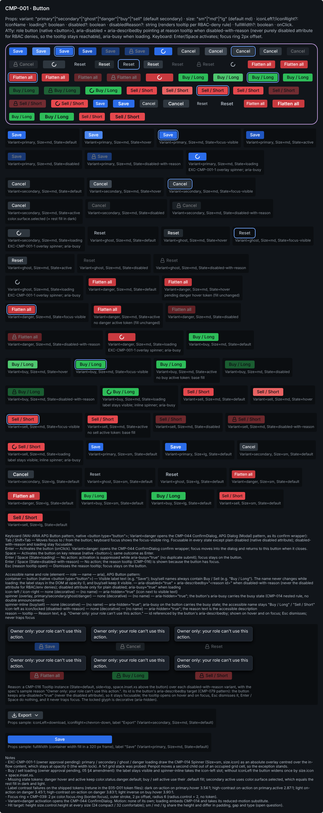

**Keyboard** (Button (WAI-ARIA APG Button pattern, native `<button type="button">`); Variant=danger opens the CMP-044 ConfirmDialog (Dialog (Modal) pattern) as its confirm wrapper):

| Keys                                       | Action                                                                                                                                                                                                      |
| ------------------------------------------ | ----------------------------------------------------------------------------------------------------------------------------------------------------------------------------------------------------------- |
| Tab / Shift+Tab                            | Moves focus to / from the button; keyboard focus shows the focus-visible ring. Focusable in every state except plain disabled (native disabled attribute); disabled-with-reason and loading stay focusable. |
| Enter                                      | Activates the button (onClick). Variant=danger: opens the CMP-044 ConfirmDialog confirm wrapper; focus moves into the dialog and returns to this button when it closes.                                     |
| Space                                      | Activates the button on key release (native `<button>`); same outcome as Enter.                                                                                                                             |
| Enter / Space (State=loading)              | No action: activation is suppressed while aria-busy="true" (no duplicate submit); focus stays on the button.                                                                                                |
| Enter / Space (State=disabled-with-reason) | No action; the reason tooltip (CMP-016) is shown because the button has focus.                                                                                                                              |
| Esc (reason tooltip open)                  | Dismisses the reason tooltip; focus stays on the button.                                                                                                                                                    |

**Accessible name and role:**

| Element                                           | Role                                     | Name                                                                                                                                                                                                         | ARIA                                                                                                                                                                                                            |
| ------------------------------------------------- | ---------------------------------------- | ------------------------------------------------------------------------------------------------------------------------------------------------------------------------------------------------------------ | --------------------------------------------------------------------------------------------------------------------------------------------------------------------------------------------------------------- |
| container                                         | button (native `<button type="button">`) | Visible label text (e.g. "Save"); buy/sell names always contain Buy / Sell (e.g. "Buy / Long"). The name never changes while loading: the label stays in the DOM at opacity 0, and buy/sell keep it visible. | aria-disabled="true" + aria-describedby="`<reason id>`" when disabled-with-reason (never the disabled attribute for RBAC/env denies); disabled attribute only for plain disabled; aria-busy="true" when loading |
| icon-left / icon-right                            | none (decorative)                        | —                                                                                                                                                                                                            | aria-hidden="true" (icon next to visible text)                                                                                                                                                                  |
| spinner (overlay, primary/secondary/ghost/danger) | none (decorative)                        | —                                                                                                                                                                                                            | aria-hidden="true"; the button's aria-busy carries the busy state (CMP-014 nested rule, no double announcement)                                                                                                 |
| spinner-inline (buy/sell)                         | none (decorative)                        | —                                                                                                                                                                                                            | aria-hidden="true"; aria-busy on the button carries the busy state; the accessible name stays "Buy / Long" / "Sell / Short"                                                                                     |
| icon-left as icon/locked (disabled-with-reason)   | none (decorative)                        | —                                                                                                                                                                                                            | aria-hidden="true"; the reason text is the accessible description                                                                                                                                               |
| reason                                            | tooltip                                  | Reason text, e.g. "Owner only: your role can't use this action."                                                                                                                                             | id referenced by the button's aria-describedby; shown on hover and on focus; Esc dismisses; never traps focus                                                                                                   |

**Token mapping** (catalogue name → shipped semantic token):

| Catalogue                                               | Shipped                                                                                                                                                                                                                      | Note                                                                                                                                                                                                                                                                        |
| ------------------------------------------------------- | ---------------------------------------------------------------------------------------------------------------------------------------------------------------------------------------------------------------------------- | --------------------------------------------------------------------------------------------------------------------------------------------------------------------------------------------------------------------------------------------------------------------------- |
| `color.action.*`                                        | color.action.primary.default, color.action.primary.hover, color.action.primary.active, color.action.secondary.default, color.action.secondary.hover                                                                          | Primary and secondary fills. No color.action.ghost, .danger or .secondary.active exist: ghost uses color.surface.hover (hover) and color.surface.selected (active); danger uses color.status.danger.default; secondary active uses color.surface.selected (conventions §3). |
| color.buy                                               | color.buy.default, color.buy.hover                                                                                                                                                                                           | Buy fill. Label, icons and spinner-inline color.text.inverse (7.87:1 dark, 5.39:1 light, 10.51:1 HC). No color.buy.active: active = color.buy.default.                                                                                                                      |
| color.sell                                              | color.sell.default, color.sell.hover                                                                                                                                                                                         | Sell fill. Label, icons and spinner-inline color.text.inverse (4.94:1 dark, 5.20:1 light, 8.02:1 HC). No color.sell.active: active = color.sell.default.                                                                                                                    |
| radius.sm                                               | radius.control                                                                                                                                                                                                               | radius.sm is the 4 px primitive; radius.control is its semantic alias for controls (conventions §8).                                                                                                                                                                        |
| `space.button.*`                                        | space.button.paddingX (md paddingX), space.inset.sm (sm paddingX, lg gap), space.inset.lg (lg paddingX), space.inset.xs (sm/md gap)                                                                                          | space.button.paddingY is not used: the height is fixed by size.control.height and content is centred (4 px top and bottom plus the 18.2 px label line would overflow the 24 px compact height).                                                                             |
| elevation.0                                             | elevation.chrome                                                                                                                                                                                                             | Primitive replaced by its semantic alias (flat, no shadow).                                                                                                                                                                                                                 |
| (not listed) danger variant                             | color.status.danger.default, color.text.on-action                                                                                                                                                                            | Danger has no action token; status.danger is the danger family and stays distinct from sell (brief §2.1). No danger hover/active token (open question).                                                                                                                     |
| (not listed) height, icons, type, text, focus, disabled | size.control.height, size.icon, type.ui.label, type.ui.body-strong, type.ui.heading-sm, color.text.primary, color.text.secondary, color.text.on-action, color.text.inverse, color.focus.ring, border.focus, opacity.disabled | border.focus and opacity.disabled are primitives used only where conventions §3 names them (focus-ring width, disabled states).                                                                                                                                             |

**Hit target:** Height size.control.height at every size (24 px compact / 32 px comfortable); width is never below 24 px (smallest case, sm with a two-letter label, is about 32 px). Meets WCAG 2.5.8 with no essential exception. Loading never shrinks the target: primary/secondary/ghost/danger keep the default width (width lock); buy/sell keep it when iconLeft is set and otherwise grow by size.icon + space.inset.xs.  
**Motion:** No animated property of its own. motion-safe: hover, active, focus and disabled changes are instant token swaps (no transition); motion-reduce: identical (instant). State=loading embeds CMP-014 Spinner, the only animation: motion-safe = CMP-014's continuous rotation; motion-reduce = CMP-014's reduced-motion substitute, which the catalogue defines as pulsing opacity instead of rotation. CMP-001 adds nothing of its own and takes whatever CMP-014 finalises unchanged (note for CMP-014: the global reduce rule in packages/ui/src/theme/theme.css caps every animation at one 0.01 ms iteration, so the pulse needs CMP-014's E05-D03 (#162) recipe to survive it). Loading never reflows, except buy/sell without iconLeft, which widen once, instantly, by size.icon + space.inset.xs. No E05-D03 recipe applies to CMP-001 itself.

**Deviations recorded by the build:**

- Focus ring radius is a raw 6 px (radius.control 4 + 2, per the CMP-039 rule and the state rules of conventions §3) instead of radius.control as the spec anatomy says. The ring rect's -2,-2 outset and +4 px size are geometry constants. Stroke is bound to color.focus.ring / border.focus with outer alignment, and the root's clipContent is off.
- Loading for primary/secondary/ghost/danger: the content layer's opacity 0 is a raw value (no 0-opacity token exists). This is the spec's width-lock mechanism.
- EXC-CMP-001-1 kept: the overlay spinner is an absolute child with centre/centre constraints. I probed the spec's 1x1 grid alternative and Penpot moves a second child out of an occupied grid cell, so a grid stack is not possible.
- spinner and spinner-inline use the CMP-014 Spinner Size=sm variant (16 px; CMP-014 binds its root to size.icon) instead of binding size.icon on the instance. Arc stroke colours follow the spec rules: on-action, text.primary or text.secondary for the overlay, and text.inverse for spinner-inline.
- Icon instances: the icon/{name} mains are 24 px, so each icon-left/icon-right instance is resized to 16 px and bound to size.icon (the binding alone did not resize them). Glyph strokes stay at the icon mains' 1.5 px.
- description_verbatim is rendered with the Markdown markers (** and backticks) removed. In the a11y text, the spec's em-dash 'no name' cells are written '(no name)'.
- Reason row: CMP-016 Tooltip is not in the library, so the six disabled-with-reason instances (one per Variant) sit beside a caption naming the CMP-016 Tooltip and the spec's reason text, "Owner only: your role can't use this action." I used the spec's text.
- The plugin API has no component annotations, so 'pending danger hover token' and the other missing-state-token notes are second caption lines in the matrix cells and also appear in the notes text.
- Added beyond the standard section items: the spec's props-samples row (icons sample: icon/download + chevron-down, label "Export"; fullWidth sample: width fill in a 320 px frame, an illustrative sample constant) and a notes text after the reason row.
- Icons sample: swapComponent(icon/download) scaled the new glyph's children twice. Its three vector children carry explicit geometry overrides equal to the download main scaled 16/24.
- The variant container keeps Penpot's default purple container stroke, as in the sibling sections.
- elevation.chrome (a zero shadow) is bound to every container, as the spec says.

**Open questions for the owner:**

- Token contrast failures for button text (4.5:1), measured on the shipped tokens: dark color.text.on-action on color.action.primary.hover = 3.54:1 (#FFFFFF on #4A86EE); high-contrast color.text.on-action on color.action.primary.active = 2.87:1 (#0B0E11 on #1F55BF, active has no HC override); light color.text.on-action on color.status.danger.default = 3.45:1 (light danger.default is amber #B87F0A); high-contrast danger = 3.83:1 (#0B0E11 on #C93A3F); light color.text.inverse on color.buy.hover = 3.90:1 (#FFFFFF on #1E9448). A full recompute of the label-on-fill matrix (every variant x state x three themes) finds exactly these five failures. The spec binds the semantically correct tokens (conventions §3); the fix is a token retune in packages/ui/tokens (E05-D01's files, outside this PR's write set). Filed as #3896 against the E05-D01 token files; the PR body lists the five pairs. Until it lands, the brief §12 QA item 'passes the automated contrast-matrix check for every colour pair it introduces or touches' cannot be ticked for these five pairs.
- Missing state tokens: no color.status.danger.hover or .active, color.buy.active, color.sell.active, color.action.secondary.active. Drawn: danger hover and active unchanged; buy/sell active = their .default fill (one step back from hover); secondary active = color.surface.selected, which equals color.action.secondary.default in dark (#2E363E) and light (#D6DAE0), so a secondary press shows no change from rest. Add these tokens?
- Buy/sell text uses color.text.inverse, not color.text.on-action: white on the dark-theme fills is 2.46:1 (buy) and 3.91:1 (sell); inverse gives 7.87:1 and 4.94:1. Dark sell stays below the 7:1 AAA stretch of 05 §5.3. Confirm.
- 05 §4.1 asks for a ▲/▼ glyph with Buy/Sell; the base registry has no trading-direction glyph and custom glyphs are not drawn in this batch, so buy/sell Buttons carry colour + the word only. Add the glyph when the custom set lands?
- Size scale: there is no per-size control height (size.control.height is owned by density), so sm/md/lg share the height and differ only in padding, gap and type; lg borrows type.ui.heading-sm (14 px / 600). Keep this, or add size-specific height and label tokens?
- OWNER APPROVAL (list in the PR body), buy/sell loading: 05 §4 (non-negotiable) and conventions §4 rule out the catalogue's 'spinner replaces label' for buy and sell, because the order side would be shown by colour alone for the whole request. Drawn instead: the label stays visible and an in-flow spinner (spinner-inline) takes the icon-left slot; the accessible name stays "Buy / Long" / "Sell / Short" under aria-busy. Cost: without iconLeft the button widens by size.icon + space.inset.xs (20 px compact) when loading starts (a fullWidth button cannot change width). Approve this amendment to the catalogue States line, or keep 'spinner replaces label' for buy/sell as an owner-signed exception to 05 §4.
- OWNER APPROVAL (list in the PR body), exception EXC-CMP-001-1: the overlay spinner for primary/secondary/ghost/danger loading is absolutely positioned, which conventions §5 and brief §10 do not allow outside focus rings and overlay anchors. It is the only measurement-free way to draw 'spinner replaces label, width locked' in flex auto-layout (ticket performance note). If the owner declines, draw those four loading variants like buy/sell (spinner-inline before the visible label; the width lock then holds only when iconLeft is set). The exception is withdrawn if the builder can stack content and spinner in one Penpot grid cell.
- Loading: activation is suppressed while aria-busy (prevents a duplicate order submit). Confirm.
- Storybook 'IconOnly' for CMP-001 is dropped in favour of CMP-002 IconButton (a Button always shows its label). Confirm.
- CMP-016 Tooltip does not exist yet: the reason row needs a real Tooltip instance once CMP-016 is built.

### CMP-002 · IconButton

**Catalogue (verbatim, as copied into the Penpot description before this PR's catalogue edits):**

- **Props**: `icon: IconName` · `label: string` (mandatory, becomes `aria-label`) · `variant`/`size` as CMP-001 · `pressed?: boolean` (toggle mode) · `disabled?/disabledReason?`.
- **A11y**: `aria-label` required (lint-enforced, build fails without it), `aria-pressed` for toggle mode, min hit-target 24×24px compact / 44×44px comfortable (`05-accessibility-standard.md` §3.4.7 essential-exception documented for compact toolbars with adjacent spacing compensation).

| Axis    | Values                                                        | Default   |
| ------- | ------------------------------------------------------------- | --------- |
| Variant | primary, secondary, ghost, danger                             | secondary |
| Size    | sm, md, lg                                                    | md        |
| State   | default, hover, focus-visible, disabled, disabled-with-reason | default   |
| Pressed | false, true                                                   | false     |

**Drawn:** 38 variant(s) per the matrix rule; Penpot variant set `17279edf-22b9-80e9-8008-d1722e117ef2`.

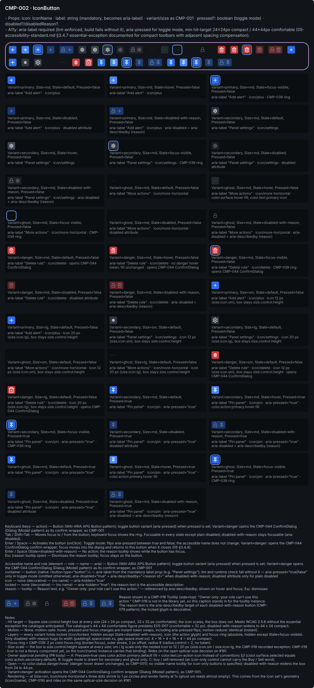

**Keyboard** (Button (WAI-ARIA APG Button pattern); toggle button variant (aria-pressed) when `pressed` is set; Variant=danger opens the CMP-044 ConfirmDialog (Dialog (Modal) pattern) as its confirm wrapper, as CMP-001):

| Keys                                       | Action                                                                                                                                                                                                                                                                           |
| ------------------------------------------ | -------------------------------------------------------------------------------------------------------------------------------------------------------------------------------------------------------------------------------------------------------------------------------- |
| Tab / Shift+Tab                            | Moves focus to / from the button; keyboard focus shows the ring. Focusable in every state except plain disabled; disabled-with-reason stays focusable (aria-disabled).                                                                                                           |
| Enter / Space                              | Activates the button (onClick). Toggle mode: flips aria-pressed between true and false; the accessible name does not change. Variant=danger: opens the CMP-044 ConfirmDialog confirm wrapper; focus moves into the dialog and returns to this button when it closes (05 §3.4.4). |
| Enter / Space (State=disabled-with-reason) | No action; the reason tooltip shows while the button has focus.                                                                                                                                                                                                                  |
| Esc (reason tooltip open)                  | Dismisses the reason tooltip; focus stays on the button.                                                                                                                                                                                                                         |

**Accessible name and role:**

| Element   | Role                                     | Name                                                                                                       | ARIA                                                                                                                                                                                              |
| --------- | ---------------------------------------- | ---------------------------------------------------------------------------------------------------------- | ------------------------------------------------------------------------------------------------------------------------------------------------------------------------------------------------- |
| container | button (native `<button type="button">`) | aria-label from the mandatory `label` prop (e.g. "Panel settings"); lint and runtime check fail without it | aria-pressed="true\|false" only in toggle mode (omitted otherwise); aria-disabled="true" + aria-describedby="`<reason id>`" when disabled-with-reason; disabled attribute only for plain disabled |
| icon      | none (decorative)                        | —                                                                                                          | aria-hidden="true"                                                                                                                                                                                |
| locked    | none (decorative)                        | —                                                                                                          | aria-hidden="true"; the reason text is the accessible description                                                                                                                                 |
| reason    | tooltip                                  | Reason text, e.g. "Owner only: your role can't use this action."                                           | referenced by aria-describedby; shown on hover and focus; Esc dismisses                                                                                                                           |

**Token mapping** (catalogue name → shipped semantic token):

| Catalogue                                       | Shipped                                                                                                                                                                  | Note                                                                                                                                                                                                                                                   |
| ----------------------------------------------- | ------------------------------------------------------------------------------------------------------------------------------------------------------------------------ | ------------------------------------------------------------------------------------------------------------------------------------------------------------------------------------------------------------------------------------------------------ |
| `color.action.*`                                | color.action.primary.default, color.action.primary.hover, color.action.secondary.default, color.action.secondary.hover, color.surface.hover, color.status.danger.default | Fills per variant as CMP-001 (ghost: no fill, color.surface.hover on hover; danger: color.status.danger.default). Pressed=true uses color.action.primary.default / .hover with color.text.on-action (deviation from conventions §3, owner approval A). |
| radius.sm                                       | radius.control                                                                                                                                                           | As CMP-001.                                                                                                                                                                                                                                            |
| `size.icon.*`                                   | size.icon                                                                                                                                                                | md icon. sm/lg come from the nested CMP-019 · Icon at Size=sm\|lg (the recorded exception that shows size.icon.sm\|lg); IconButton binds no icon primitive. The box binds size.control.height for width and height.                                    |
| (not listed) icon colours, gap, focus, disabled | color.text.primary, color.text.secondary, color.text.on-action, space.inset.xs, color.focus.ring, border.focus, opacity.disabled                                         | Icon colours per variant; space.inset.xs is the gap and the disabled-with-reason padding.                                                                                                                                                              |

**Hit target:** Square size.control.height box at every size (24 x 24 px compact, 32 x 32 px comfortable); the icon scales, the box does not. Meets WCAG 2.5.8 without the essential exception the catalogue anticipated. The catalogue's 44 x 44 comfortable figure predates E05-D07 (comfortable = 32 px). disabled-with-reason widens to 44 x 24 compact.  
**Motion:** None. motion-safe: hover, pressed and focus changes are instant token swaps, including aria-pressed flips; motion-reduce: identical (instant).

**Deviations recorded by the build:**

- The focus-ring radius is a raw 6 px (radius.control + 2), not bound to radius.control as the spec's anatomy token list says. This follows CMP-039 ('radius.control 4 gives 6'), the build's state rule and CMP-001. The ring's other geometry is also untokened: offset -2,-2 and target+4 size (28x28; 48x28 on the hidden ring of disabled-with-reason). Stroke colour and width are bound (color.focus.ring, border.focus, outer).
- The icon part is not a nested 'CMP-019 · Icon' instance, because the library has no CMP-019 · Icon component (only the 47 icon/{name} components). So the icon/{name} instance carries CMP-019's sizing itself. Size=md binds size.icon. Size=sm and Size=lg bind the primitives size.icon.sm (12) and size.icon.lg (20), the CMP-019 exception recorded in conventions §7. As a result, the primitive binding sits on the nested icon layer inside IconButton, although the spec says 'IconButton binds no icon primitive'. The locked glyph binds size.icon in every variant.
- The icon/{name} instances (24-unit icon-set boards) have no flex layout of their own. Their 1.5 px glyph strokes and their geometry come from the icon set; CMP-001 uses the same icons.
- Hidden layers are kept in every variant. locked is hidden except State=disabled-with-reason. Flex does not lay out hidden layers, so locked is placed by hand at 4,4 inside the 24 px box. focus-ring is absolute and hidden except State=focus-visible.
- Padding is 0 on every root except disabled-with-reason (the spec says 'no padding'), so there is no padding token to bind. disabled-with-reason hugs its width (paddingX space.inset.xs, gap space.inset.xs): 44 x 24.
- The description is description_verbatim with the markdown markers ('**' and backticks) removed; the words are unchanged, as in CMP-001, CMP-014 and CMP-020. The keyboard and a11y texts also drop backticks. In the a11y text, a name cell of '—' is shown as '(no name)', as CMP-001 does.
- These widths are fixed layout values with no token: the variant container and matrix at 960 px; each matrix cell at 314 px (a 3-column grid; caption and note texts fill the cell width and wrap); the description, keyboard, a11y and notes texts at 960 px; the reason caption at 480 px.
- The variant container keeps Penpot's own purple variant-set stroke, which is not token-bound and has no fill, as on the other sets.
- Doc content beyond the brief, all token-bound: (a) each matrix cell has a 'note' text under its 'Axis=value' caption. It gives the aria-label, the glyph and the state annotation, and 'opens CMP-044 ConfirmDialog' on the active danger cells, as the spec's container note asks. (b) A 'notes' text covers hit target, motion, layers, focus ring, size scale, the pending owner approvals A/B/C, open items and an icon rendering note.
- The variant container's children were put back into spec draw order; createVariantContainer had sorted them by canvas position.
- CMP-016 Tooltip is not in the library. The reason row therefore shows the six disabled-with-reason instances next to a caption that starts 'Reason shown in a CMP-016 Tooltip (side=top): "Owner only: your role can't use this action."' instead of a tooltip instance.

**Open questions for the owner:**

- OWNER APPROVAL A (list in the PR body), Pressed=true treatment, a deviation from conventions §3: color.surface.selected resolves to the same value as color.action.secondary.default (dark #2E363E, light #D6DAE0), so a pressed secondary toggle would look unpressed; a color.action.primary.default glyph on color.surface.selected is 2.58:1 in dark (below 3:1, WCAG 1.4.11); and no semantic size or stroke-width token exists to draw a separate indicator bar. Drawn instead: color.action.primary.default fill (3.85:1 on canvas dark, 4.44:1 light, 7.05:1 HC) + color.text.on-action icon (4.76:1 dark and light, 7.45:1 HC). If declined, the alternative is conventions §3 plus a new indicator token from the E05-D01 token owner.
- OWNER APPROVAL B (list in the PR body), toggle mode limited to secondary and ghost: under treatment A a pressed primary IconButton looks identical to an unpressed one, and a pressed danger toggle has no use. If the owner declines, draw Pressed=true x all five states for primary and danger as well and record the identical primary look as an open question (as CMP-001 does for danger hover/active).
- OWNER APPROVAL C (list in the PR body), buy and sell removed: an icon-only control cannot carry the Buy/Sell word (conventions §4, 05 §4), so the catalogue's 'variant as CMP-001' is narrowed to primary/secondary/ghost/danger. Confirm the catalogue change.
- Size scale: the box is always size.control.height square, so sm/md/lg scale the nested CMP-019 Icon (12/16/20 px shipped). This rides on the open optical-size decision on #161 (12/16/20 shipped vs 16/20/24 in the brief).
- No color.status.danger.hover: danger hover is drawn unchanged (same gap as CMP-001).
- Icon-only buttons give sighted mouse users no visible name; the catalogue specifies no label tooltip. Add a CMP-016 tooltip showing `label` on hover and focus?
- disabled-with-reason shows the locked glyph beside the action glyph, widening the box from 24 to 44 px (compact). Acceptable in dense toolbars, or use the reason tooltip alone for IconButton?
- Build: 'CMP-019 · Icon' is not a library component. Once it exists, swap the nested icon/{name} instances for CMP-019 instances at Size=sm/md/lg, so the size.icon.sm/lg primitive binding moves out of IconButton.
- Build: CMP-016 Tooltip is not in the library. Replace the reason-row caption with a Tooltip instance once it is built.
- Rendering: at Size=sm, icon/more-horizontal's three dots shrink to 1 px circles and render faintly at 1x, so the ghost sm variant looks almost empty. The cause is the icon set's geometry, not IconButton, and it falls under the same optical-size decision.

### CMP-003 · SegmentedControl

**Catalogue (verbatim, as copied into the Penpot description before this PR's catalogue edits):**

- **Props**: `options: {value,label,icon?}[]` · `value` · `onChange` · `size` · `fullWidth?`.
- **A11y**: `role="radiogroup"` container, each option `role="radio"` + `aria-checked`; arrow-key roving tabindex navigation, `Home`/`End` jump to first/last.

| Axis    | Values                                                 | Default |
| ------- | ------------------------------------------------------ | ------- |
| Size    | sm, md                                                 | md      |
| State   | default, focus-visible, disabled, disabled-with-reason | default |
| Content | text, icon-only                                        | text    |
| Options | 2, 3, 6                                                | 3       |

**Drawn:** 8 variant(s) per the matrix rule; Penpot variant set `17279edf-22b9-80e9-8008-d17cda378f3f`.

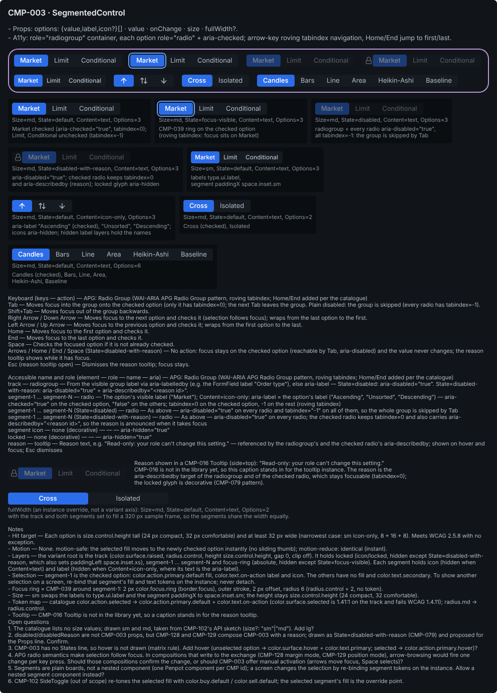

**Keyboard** (Radio Group (WAI-ARIA APG Radio Group pattern, roving tabindex; Home/End added per the catalogue)):

| Keys                                                     | Action                                                                                                                                                                          |
| -------------------------------------------------------- | ------------------------------------------------------------------------------------------------------------------------------------------------------------------------------- |
| Tab                                                      | Moves focus into the group onto the checked option (only it has tabindex=0); the next Tab leaves the group. Plain disabled: the group is skipped (every radio has tabindex=-1). |
| Shift+Tab                                                | Moves focus out of the group backwards.                                                                                                                                         |
| Right Arrow / Down Arrow                                 | Moves focus to the next option and checks it (selection follows focus); wraps from the last option to the first.                                                                |
| Left Arrow / Up Arrow                                    | Moves focus to the previous option and checks it; wraps from the first option to the last.                                                                                      |
| Home                                                     | Moves focus to the first option and checks it.                                                                                                                                  |
| End                                                      | Moves focus to the last option and checks it.                                                                                                                                   |
| Space                                                    | Checks the focused option if it is not already checked.                                                                                                                         |
| Arrows / Home / End / Space (State=disabled-with-reason) | No action: focus stays on the checked option (reachable by Tab, aria-disabled) and the value never changes; the reason tooltip shows while it has focus.                        |
| Esc (reason tooltip open)                                | Dismisses the reason tooltip; focus stays.                                                                                                                                      |

**Accessible name and role:**

| Element                                            | Role              | Name                                                                                                                              | ARIA                                                                                                                                                                      |
| -------------------------------------------------- | ----------------- | --------------------------------------------------------------------------------------------------------------------------------- | ------------------------------------------------------------------------------------------------------------------------------------------------------------------------- |
| track                                              | radiogroup        | From the visible group label via aria-labelledby (e.g. the FormField label "Order type"), else aria-label                         | State=disabled: aria-disabled="true". State=disabled-with-reason: aria-disabled="true" + aria-describedby="`<reason id>`".                                                |
| segment-1 … segment-N                              | radio             | The option's visible label ("Market"); Content=icon-only: aria-label = the option's label ("Ascending", "Unsorted", "Descending") | aria-checked="true" on the checked option, "false" on the others; tabindex=0 on the checked option, -1 on the rest (roving tabindex)                                      |
| segment-1 … segment-N (State=disabled)             | radio             | As above                                                                                                                          | aria-disabled="true" on every radio and tabindex="-1" on all of them, so the whole group is skipped by Tab                                                                |
| segment-1 … segment-N (State=disabled-with-reason) | radio             | As above                                                                                                                          | aria-disabled="true" on every radio; the checked radio keeps tabindex=0 and also carries aria-describedby="`<reason id>`", so the reason is announced when it takes focus |
| segment icon                                       | none (decorative) | —                                                                                                                                 | aria-hidden="true"                                                                                                                                                        |
| locked                                             | none (decorative) | —                                                                                                                                 | aria-hidden="true"                                                                                                                                                        |
| reason                                             | tooltip           | Reason text, e.g. "Read-only: your role can't change this setting."                                                               | referenced by the radiogroup's and the checked radio's aria-describedby; shown on hover and focus; Esc dismisses                                                          |

**Token mapping** (catalogue name → shipped semantic token):

| Catalogue                                                            | Shipped                                                                                                                                                                                                         | Note                                                                                                                                                                                                                                                          |
| -------------------------------------------------------------------- | --------------------------------------------------------------------------------------------------------------------------------------------------------------------------------------------------------------- | ------------------------------------------------------------------------------------------------------------------------------------------------------------------------------------------------------------------------------------------------------------- |
| color.surface.raised                                                 | color.surface.raised                                                                                                                                                                                            | Exists; track fill.                                                                                                                                                                                                                                           |
| color.action.selected                                                | color.action.primary.default (selected fill) + color.text.on-action (its text and icon)                                                                                                                         | No color.action.selected token. color.surface.selected rejected: 1.41:1 against the track fails WCAG 1.4.11 for a state indicator. The primary fill is 3.64:1 against the track in dark, 4.13:1 light, 6.66:1 HC; selected text 4.76:1 dark/light, 7.45:1 HC. |
| radius.md                                                            | radius.control                                                                                                                                                                                                  | radius.md is a 6 px primitive; controls use radius.control (4 px) per conventions §8; the track and every segment share it.                                                                                                                                   |
| (not listed) unselected text, height, padding, type, focus, disabled | color.text.secondary, size.control.height, size.icon, space.button.paddingX, space.inset.sm, space.inset.xs, type.ui.label, type.ui.body, type.ui.body-strong, color.focus.ring, border.focus, opacity.disabled | Unselected text is 8.81:1 on the track (dark).                                                                                                                                                                                                                |

**Hit target:** Each option is size.control.height tall (24 px compact, 32 px comfortable) and at least 32 px wide (narrowest case: sm icon-only, 8 + 16 + 8). Meets WCAG 2.5.8 with no exception.  
**Motion:** None. motion-safe: the selected fill moves to the newly checked option instantly (no sliding thumb); motion-reduce: identical (instant).

**Deviations recorded by the build:**

- Focus ring: radius is drawn as the plain number 6 px (radius.control + 2, no token) following conventions section 3 and the CMP-039 rule. The spec's focus-visible rule binds radius.control on the ring instead. Ring geometry is segment-1 width + 4 by 28 px at offset -2,-2 with an outer stroke (color.focus.ring, border.focus); these are fixed numbers with no token.
- The fullWidth sample frame is an example width of 320 px (no token) with no fill. The instance track and both segments are set to fill, giving 160/160 px.
- Fixed 960 px widths come from the section layout and have no token: the variant container, the matrix, and the description, keyboard, a11y and notes texts.
- Hidden icon slots in the Content=text variants hold the icon-only sample glyphs: arrow-up, arrow-up-down, arrow-down, repeated in that order for segments 4-6 of Options=6. The spec names glyphs only for the icon-only sample.
- Reason row: CMP-016 Tooltip is not in the library, so the disabled-with-reason instance sits next to a caption with the spec's sample reason ("Read-only: your role can't change this setting.") instead of a Tooltip instance.
- The section adds two items after the reason row: props-samples (the fullWidth sample from the spec anatomy) and a notes text (hit target, motion, layers, selection override, focus ring, size, token map, the spec's open questions). Each matrix cell has a second caption line with aria notes, including the icon-only aria-labels the spec asks to annotate.
- The description shows description_verbatim with the markdown markers (** and backticks) removed for display, as the CMP-002 build did.
- Creating the variant container scrambled its children, so I put them back in the spec's draw order with setParentIndex.

**Open questions for the owner:**

- The catalogue lists no `size` values; drawn sm and md, taken from CMP-102's API sketch (`size?: "sm"|"md"`). Add lg?
- disabled/disabledReason are not CMP-003 props, but CMP-128 and CMP-129 compose CMP-003 with a reason; drawn as State=disabled-with-reason (CMP-079) and proposed for the Props line. Confirm.
- CMP-003 has no States line, so hover is not drawn (matrix rule). Add hover (unselected option → color.surface.hover + color.text.primary; selected → color.action.primary.hover)?
- APG radio semantics make selection follow focus. In compositions that write to the exchange (CMP-128 margin mode, CMP-129 position mode), arrow-browsing would fire one change per key press. Should those compositions confirm the change, or should CMP-003 offer manual activation (arrows move focus, Space selects)?
- Segments are plain boards, not a nested component (one Penpot component per CMP id); a screen changes the selection by re-binding segment tokens on the instance. Allow a nested `segment` component instead?
- CMP-102 SideToggle (out of scope) re-tones the selected fill with color.buy.default / color.sell.default; the selected segment's fill is the override point.
- Builder: which focus-ring radius is canonical? The spec binds radius.control on the ring; conventions section 3 / CMP-039 say radius + 2 = 6 px with no token, and that is what I drew. Should a focus-ring radius token exist?
- Builder: which glyphs should the hidden icon slots in the Content=text variants carry? I used the icon-only sample glyphs, repeated in order.

### CMP-004 · Toggle

**Catalogue (verbatim):**

- **Props**: `checked` · `onChange` · `label` · `labelPosition: "left"|"right"|"hidden"` · `size` · `disabled?/disabledReason?` · `critical?: boolean` (renders with stronger visual weight + confirm-wrapper requirement, e.g. 1-click arm).
- **A11y**: native `role="switch"` `aria-checked`. `Enter`/`Space` toggles.

| Axis           | Values                                                 | Default |
| -------------- | ------------------------------------------------------ | ------- |
| State          | default, focus-visible, disabled, disabled-with-reason | default |
| Checked        | false, true                                            | false   |
| Critical       | false, true                                            | false   |
| Label Position | right, left, hidden                                    | right   |

**Drawn:** 9 variant(s) per the matrix rule; Penpot variant set `17279edf-22b9-80e9-8008-d1567d943f48`.

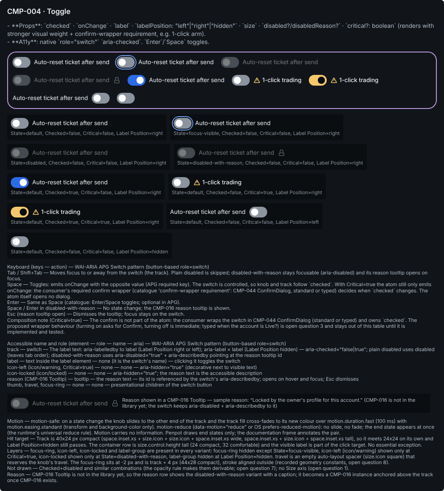

**Keyboard** (WAI-ARIA APG Switch pattern (button-based role=switch)):

| Keys                                  | Action                                                                                                                                                                                                                                                                                                                                                                                |
| ------------------------------------- | ------------------------------------------------------------------------------------------------------------------------------------------------------------------------------------------------------------------------------------------------------------------------------------------------------------------------------------------------------------------------------------- |
| Tab / Shift+Tab                       | Moves focus to or away from the switch (the track). Plain disabled is skipped; disabled-with-reason stays focusable (aria-disabled) and its reason tooltip opens on focus.                                                                                                                                                                                                            |
| Space                                 | Toggles: emits onChange with the opposite value (APG required key). The switch is controlled, so knob and track follow `checked`. With Critical=true the atom still only emits onChange: the consumer's required confirm wrapper (catalogue 'confirm-wrapper requirement': CMP-044 ConfirmDialog, standard or typed) decides when `checked` changes. The atom itself opens no dialog. |
| Enter                                 | Same as Space (catalogue: Enter/Space toggles; optional in APG).                                                                                                                                                                                                                                                                                                                      |
| Space / Enter in disabled-with-reason | No state change; the CMP-016 reason tooltip is shown.                                                                                                                                                                                                                                                                                                                                 |
| Esc (reason tooltip open)             | Dismisses the tooltip; focus stays on the switch.                                                                                                                                                                                                                                                                                                                                     |

**Accessible name and role:**

| Element                                 | Role                          | Name                                                                                                                | ARIA                                                                                                                                                                             |
| --------------------------------------- | ----------------------------- | ------------------------------------------------------------------------------------------------------------------- | -------------------------------------------------------------------------------------------------------------------------------------------------------------------------------- |
| track                                   | switch                        | The label text: aria-labelledby to label (Label Position right or left); aria-label = label (Label Position hidden) | aria-checked="false\|true"; plain disabled uses disabled (leaves tab order); disabled-with-reason uses aria-disabled="true" + aria-describedby pointing at the reason tooltip id |
| label                                   | text inside the label element | none (it is the switch's name)                                                                                      | clicking it toggles the switch                                                                                                                                                   |
| icon-left (icon/warning, Critical=true) | none                          | none                                                                                                                | aria-hidden="true" (decorative next to visible text)                                                                                                                             |
| icon-locked (icon/locked)               | none                          | none                                                                                                                | aria-hidden="true"; the reason text is the accessible description                                                                                                                |
| reason (CMP-016 Tooltip)                | tooltip                       | the reason text                                                                                                     | its id is referenced by the switch's aria-describedby; opens on hover and focus; Esc dismisses                                                                                   |
| thumb, travel, focus-ring               | none                          | none                                                                                                                | presentational children of the switch button                                                                                                                                     |

**Token mapping** (catalogue name → shipped semantic token):

| Catalogue                                     | Shipped                                    | Note                                                                                                                                                                                                                                                                                                                                                                                                                                                                                       |
| --------------------------------------------- | ------------------------------------------ | ------------------------------------------------------------------------------------------------------------------------------------------------------------------------------------------------------------------------------------------------------------------------------------------------------------------------------------------------------------------------------------------------------------------------------------------------------------------------------------------ |
| color.action.on (written color.action.on/off) | color.action.primary.default               | Track fill when Checked=true. Critical armed track uses color.status.warning.strong instead (color.status.warning.default is 3.00:1 on raised and 2.76:1 on overlay in light). Track vs canvas/raised/overlay: 3.36-3.85 dark, 3.80-4.44 light, 6.15-7.05 hc; knob color.text.on-action on it 4.76 / 4.76 / 7.45.                                                                                                                                                                          |
| color.action.off                              | color.text.tertiary                        | Track fill when Checked=false. No `color.border.*` or `color.surface.*` token reaches 3:1 against surfaces (color.border.strong is 1.35-2.02:1 on app, canvas, raised and overlay). color.text.tertiary vs canvas/raised/overlay: 5.20-5.96 dark, 5.44-6.36 light, 10.36-11.87 hc. Knob color.text.on-action on it: 3.08 dark (thin margin, add the pair to the token contrast proof), 6.81 light, 12.54 hc. color.neutral.default is the existing non-text alternative (open question 5). |
| motion.toggle                                 | none (no semantic motion token is shipped) | The motion pair cites primitives motion.duration.fast + motion.easing.standard through the E05-T02 runtime (data-motion, --cv-motion-scale); named recipes arrive with E05-D03 (#162, #3174). Open question 6.                                                                                                                                                                                                                                                                             |
| focus-ring (section 0.3 rule 4)               | color.focus.ring                           | 2 px ring (border.focus) at a 2 px offset, radius.badge, per CMP-039; 5.39-7.05:1 on canvas, raised and overlay in every theme (4.72-8.08 over all seven surfaces).                                                                                                                                                                                                                                                                                                                        |

**Hit target:** Track is 40x24 px compact (space.inset.xs + size.icon + size.icon + space.inset.xs wide, space.inset.xs + size.icon + space.inset.xs tall), so it meets 24x24 on its own and Label Position=hidden still passes. The container row is size.control.height tall (24 compact, 32 comfortable) and the visible label is part of the click target. No essential exception.  
**Motion:** motion-safe: on a state change the knob slides to the other end of the track and the track fill cross-fades to its new colour over motion.duration.fast (100 ms) with motion.easing.standard (transform and background-color only). motion-reduce (data-motion="reduce" or OS prefers-reduced-motion): no slide, no fade; the end state appears at once (the runtime's universal reduce rule). Motion carries no information. Penpot draws end states only; the documentation frame annotates the pair.

**Deviations recorded by the build:**

- Keyboard text: the spec's 5 keyboard rows are copied word for word as 'keys — action', backticks included. The header is now 'Keyboard (keys — action) — WAI-ARIA APG Switch pattern (button-based role=switch)', the same form as the CMP-005 and CMP-006 sections. I removed the old 'Space / Enter on a Critical=true switch that is off — Proposed ...' row. I added one line at the end: 'Composition note (Critical=true) — The confirm is not part of the atom: the consumer wraps the switch in CMP-044 ConfirmDialog (standard or typed) and owns `checked`. The proposed wrapper behaviour (...) is open question 3 and stays out of this table until it is implemented and tested.' The line is built from the spec's Space row and OQ3; it is not a spec row.
- Notes text (an extra section item, beyond the six in the brief, kept from the first build): Motion and Hit target now use the spec's motion and hit_target text word for word. The old version had paraphrased them and left out '(the runtime's universal reduce rule)', '(24 compact, 32 comfortable)' and 'No essential exception.' I added three lines built from the spec: Layers (which layers are hidden, travel as an empty auto-layout spacer, the focus-ring geometry from OQ8), Not drawn (OQ7 combinations and OQ1, no Size axis) and Reason (CMP-016 is still missing). The format follows the CMP-005 and CMP-006 notes.
- The section has no open-questions text and no tokens text, the same as CMP-005 and CMP-006. It quotes no contrast figures, so there were no figures to update. The revised figures (6.81 light knob, ranges 'on canvas, raised and overlay', focus ring 4.72-8.08 over all seven surfaces) appear only in the spec and PR doc. The notes and keyboard texts refer to OQ1, OQ3, OQ7 and OQ8 by number.
- Reason row: CMP-016 Tooltip is still not in the library (none of the 59 local components matches CMP-016 or Tooltip). The row still shows a disabled-with-reason instance plus the caption 'Reason shown in a CMP-016 Tooltip — sample reason: “Locked by the owner's profile for this account.” ...'.
- Unchanged from the first build: the variant root is the anatomy 'container'. There is no separate container layer, and opacity.disabled sits on the variant root.
- Unchanged: icon-locked is the last child of the root, as the spec anatomy says ('always the last child of container'). The generic state rule puts the locked icon before the label.
- Unchanged geometry constants with no token: the focus ring is 44x28 (track 40x24 + 4) at -2,-2 relative to the track, absolute, with an outer stroke (spec OQ8). The ring radius is bound to radius.badge (pill), as the spec says, rather than 'target radius + 2'. The track gap is 0. Glyph strokes are 1.5 px, from the icon/{name} components.
- Unchanged: every variant keeps all its layers and hides the ones it does not use: focus-ring except at focus-visible, icon-left unless Critical=true, icon-locked unless disabled-with-reason, and label-group at Label Position=hidden.
- Unchanged: the variant container keeps Penpot's built-in variant-set stroke (#bb97d8, 2 px inner), which is not bound to a token. The CMP-012, CMP-014 and CMP-020 sets have the same stroke.
- Unchanged layout constants with no token: the variant container and the matrix are 960 px wide. The description, keyboard, a11y and notes texts are 960 px wide with auto height. The reason caption is 680 px. Icon instances were resized to 16x16 and then bound to size.icon, because binding alone did not resize them.

**Open questions for the owner:**

- `size` is listed with no values. No Size axis is drawn; the height follows density through size.control.height. Owner: drop `size` from CMP-004, or define its values? A second switch size would need sizing tokens that do not exist (the only semantic sizes are size.icon 16 and size.control.height 24/32).
- `labelPosition` has no stated default. Drawn default: right. The Storybook story names (Default vs WithLabel) hint the default might be hidden. Confirm.
- Critical confirm (a proposal, kept out of the keyboard table until it is implemented and tested): the catalogue makes the confirm a consumer wrapper, so the atom only emits onChange. Proposed wrapper: turning ON opens CMP-044 ConfirmDialog variant="standard" and the consumer sets `checked` only on Confirm; Esc or Cancel leaves it off and focus returns to the switch (05 section 3.4.4); turning OFF is immediate, because arming is the risky direction (05 section 3.1.4 requires a keyboard-operable confirm for destructive actions; section 3.1.5 makes 1-click an explicit opt-in with a persistent indicator). Confirm the direction and the variant (typed when the account is Live?). Brief section 12 requires anything that arms trading to state its confirm-gate variant.
- Armed look: track color.status.warning.strong with a color.text.inverse knob. color.status.warning.default was rejected (light: 3.00:1 on raised, 2.76:1 on overlay). Confirm amber as the armed signal. The persistent '1-click ARMED' text and icon stay with CMP-107 (05 section 3.1.5 and the CMP-107 A11y line); the switch adds no state word.
- Off-state contrast (WCAG 1.4.11 needs 3:1) for the off track here, the CMP-005 box and CMP-006 ring outlines and the CMP-010 rest track. No `color.border.*` or `color.surface.*` token reaches 3:1 (color.border.strong is 1.35-2.02:1 on app, canvas, raised and overlay). Figures on canvas, raised and overlay: (a) color.text.tertiary (drawn; a text token): 5.20-5.96 dark, 5.44-6.36 light, 10.36-11.87 hc; knob color.text.on-action on it 3.08 dark, 6.81 light, 12.54 hc; on and off tracks 1.55 / 1.43 / 1.68:1 apart. (b) color.neutral.default (an existing non-text token): the same value as (a) in dark (#8B949E) and light (#525C66), so the same figures; in high contrast it stays #8B949E: 5.20-5.96, knob 6.29, but the on and off tracks are only 1.18:1 apart. (c) a new semantic control-outline token in a token PR. (a) is the stronger high-contrast choice. Owner: (a), (b) or (c)?
- Motion: no semantic motion token exists, so the pair cites primitives motion.duration.fast + motion.easing.standard. Accept, or rename when E05-D03 (#162) lands?
- Matrix (strict reading of conventions section 2): the four states are drawn at Checked=false, Critical=false, Label Position=right; Checked=true, Critical=true, left and hidden are each drawn once at State=default; Critical+Checked (armed) is added because the catalogue's Storybook names 'Critical (1-click-arm look)'. Checked+disabled and similar combinations are not drawn; the opacity rule makes them derivable.
- Recorded geometry constants (no token; logged for #161 AC2, same ruling as the CMP-018 group question): the focus ring sits at -2 px and is track + 4 px (44x28 compact), stroke aligned outside.
- Once CMP-016 Tooltip is in the library, the reason row needs a real CMP-016 instance with the text 'Locked by the owner's profile for this account.', placed above the track. Until then it is a caption.

### CMP-005 · Checkbox

**Catalogue (verbatim):**

- **Props**: `checked` · `indeterminate?` · `onChange` · `label` · `disabled?/disabledReason?`.
- **A11y**: native `<input type=checkbox>` semantics, `aria-checked="mixed"` for indeterminate.

| Axis    | Values                                                 | Default |
| ------- | ------------------------------------------------------ | ------- |
| State   | default, focus-visible, disabled, disabled-with-reason | default |
| Checked | false, true, indeterminate                             | false   |

**Drawn:** 6 variant(s) per the matrix rule; Penpot variant set `17279edf-22b9-80e9-8008-d15c839b975c`.

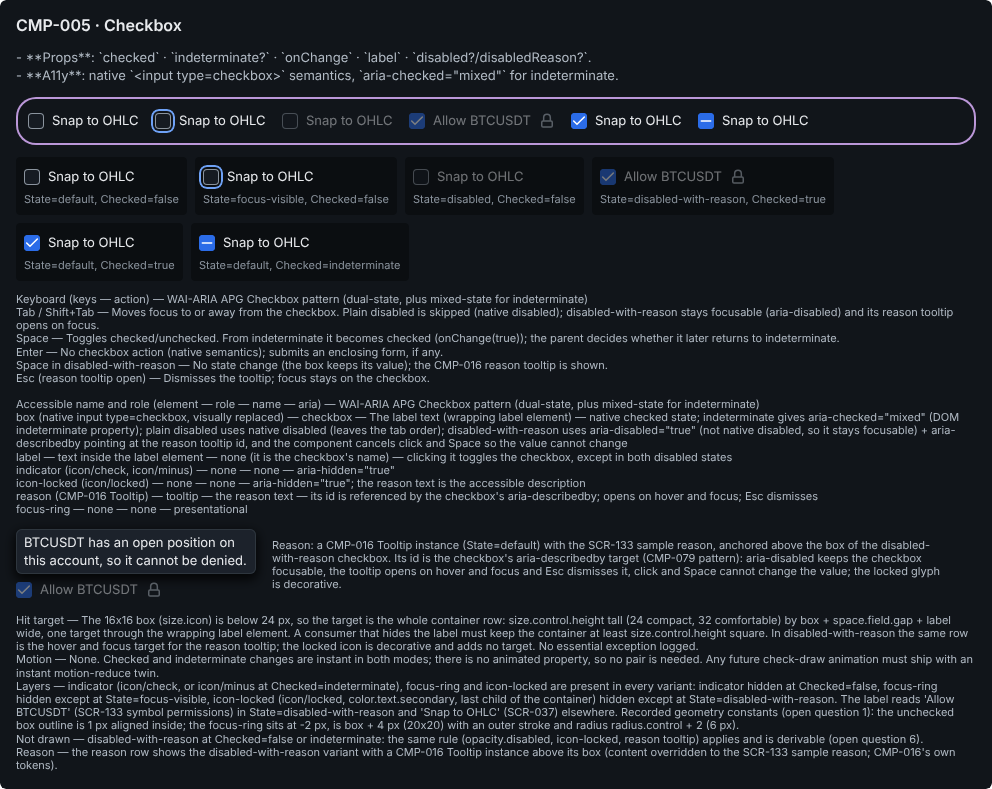

**Keyboard** (WAI-ARIA APG Checkbox pattern (dual-state, plus mixed-state for indeterminate)):

| Keys                          | Action                                                                                                                                                                             |
| ----------------------------- | ---------------------------------------------------------------------------------------------------------------------------------------------------------------------------------- |
| Tab / Shift+Tab               | Moves focus to or away from the checkbox. Plain disabled is skipped (native disabled); disabled-with-reason stays focusable (aria-disabled) and its reason tooltip opens on focus. |
| Space                         | Toggles checked/unchecked. From indeterminate it becomes checked (onChange(true)); the parent decides whether it later returns to indeterminate.                                   |
| Enter                         | No checkbox action (native semantics); submits an enclosing form, if any.                                                                                                          |
| Space in disabled-with-reason | No state change (the box keeps its value); the CMP-016 reason tooltip is shown.                                                                                                    |
| Esc (reason tooltip open)     | Dismisses the tooltip; focus stays on the checkbox.                                                                                                                                |

**Accessible name and role:**

| Element                                             | Role                          | Name                                    | ARIA                                                                                                                                                                                                                                                                                                                                                                            |
| --------------------------------------------------- | ----------------------------- | --------------------------------------- | ------------------------------------------------------------------------------------------------------------------------------------------------------------------------------------------------------------------------------------------------------------------------------------------------------------------------------------------------------------------------------- |
| box (native input type=checkbox, visually replaced) | checkbox                      | The label text (wrapping label element) | native checked state; indeterminate gives aria-checked="mixed" (DOM indeterminate property); plain disabled uses native disabled (leaves the tab order); disabled-with-reason uses aria-disabled="true" (not native disabled, so it stays focusable) + aria-describedby pointing at the reason tooltip id, and the component cancels click and Space so the value cannot change |
| label                                               | text inside the label element | none (it is the checkbox's name)        | clicking it toggles the checkbox, except in both disabled states                                                                                                                                                                                                                                                                                                                |
| indicator (icon/check, icon/minus)                  | none                          | none                                    | aria-hidden="true"                                                                                                                                                                                                                                                                                                                                                              |
| icon-locked (icon/locked)                           | none                          | none                                    | aria-hidden="true"; the reason text is the accessible description                                                                                                                                                                                                                                                                                                               |
| reason (CMP-016 Tooltip)                            | tooltip                       | the reason text                         | its id is referenced by the checkbox's aria-describedby; opens on hover and focus; Esc dismisses                                                                                                                                                                                                                                                                                |
| focus-ring                                          | none                          | none                                    | presentational                                                                                                                                                                                                                                                                                                                                                                  |

**Token mapping** (catalogue name → shipped semantic token):

| Catalogue                       | Shipped                      | Note                                                                                                                                   |
| ------------------------------- | ---------------------------- | -------------------------------------------------------------------------------------------------------------------------------------- |
| color.action.selected           | color.action.primary.default | Box fill and outline when Checked=true or indeterminate. Against canvas/raised/overlay: 3.36-3.85 dark, 3.80-4.44 light, 6.15-7.05 hc. |
| radius.xs                       | radius.control               | No semantic token resolves to radius.xs (2 px); radius.control resolves to radius.sm (4 px). Open question 2.                          |
| focus-ring (section 0.3 rule 4) | color.focus.ring             | 2 px ring (border.focus) at a 2 px offset, radius.control, per CMP-039.                                                                |

**Hit target:** The 16x16 box (size.icon) is below 24 px, so the target is the whole container row: size.control.height tall (24 compact, 32 comfortable) by box + space.field.gap + label wide, one target through the wrapping label element. A consumer that hides the label must keep the container at least size.control.height square. In disabled-with-reason the same row is the hover and focus target for the reason tooltip; the locked icon is decorative and adds no target. No essential exception logged.  
**Motion:** None. Checked and indeterminate changes are instant in both modes; there is no animated property, so no pair is needed. Any future check-draw animation must ship with an instant motion-reduce twin.

**Deviations recorded by the build:**

- Geometry constants with no token: the box outline is a 1 px stroke aligned inside. It is not bound, as the spec says (equal to the primitive border.hairline). The focus-ring is an absolute 20x20 rect (box + 4) at -2,-2 with an outer stroke. The 1.5 px glyph strokes come with the icon/{name} components.
- Focus-ring radius: the spec anatomy names radius.control for the ring. I drew it at radius.control + 2 = 6 px, unbound, so it stays concentric with the 4 px box. This follows the CMP-039 / conventions §3 rule and matches the five existing mains.
- Hidden layers are kept in every variant, as the spec anatomy says. indicator is hidden at Checked=false, focus-ring is hidden except at State=focus-visible, and icon-locked is hidden except at State=disabled-with-reason. icon-locked was added to the five existing mains as their last child. Penpot's flex skips hidden layers, so those layers were moved to the spot the row would give them (119,4) instead of the far-off spot where they were created.
- Layout constants with no token: the description, variant set, matrix, keyboard, a11y and notes are 960 px wide. The reason caption is 680 px wide with auto height.
- The variant container keeps Penpot's built-in purple variant-set stroke, which is not token-bound. It is the only unbound paint in the section, the same as on CMP-004, CMP-012 and CMP-014.
- The description is description_verbatim byte for byte, markdown markers included (191 UTF-16 code units, checked). This matches the existing CMP-005 section and the earlier verification's expectation; CMP-014 and CMP-020 removed the markers instead.
- Reason row: the spec says the reason is 'anchored above the box', so the row holds an 'anchor' board (a flex column, gap space.stack.xs) with the CMP-016 Tooltip instance on top of the disabled-with-reason checkbox instance. A caption sits beside it. The task wording says the tooltip goes 'beside' the checkbox. The tooltip's 'content' text is an instance override set to the spec sample reason. CMP-016 has a single variant (State=default) with no side or arrow, so no arrow is drawn.
- Extra section item kept from the earlier build and updated: a 'notes' text after the reason row. It covers the hit target, motion, layers, what is not drawn and how the reason is shown.
- The new main has an extra plugin-data key (cvd02/draw = 'State=disabled-with-reason, Checked=true'). It is there so the find-or-create step could not make a second copy over the unreliable bridge.

**Open questions for the owner:**

- Recorded geometry constants (no token; logged for #161 AC2): the unchecked box outline is 1 px aligned inside (equal to the primitive border.hairline, not bound: conventions name only border.focus and there is no semantic stroke-width token); the focus ring sits at -2 px and is box + 4 px (20x20). Owner ruling, shared with CMP-006 and the CMP-018 group question: name border.hairline as a recorded exception like border.focus, or add a semantic border-width token. The outline colour (color.text.tertiary) is CMP-004 open question 5.
- Radius: catalogue radius.xs (2 px) has no semantic alias; drawn with radius.control (4 px on a 16 px box). Accept?
- Indeterminate API: the Penpot axis is Checked = false | true | indeterminate. Keep the `checked` + `indeterminate?` props, or adopt Radix's `checked: boolean | "indeterminate"`?
- High contrast: color.focus.ring and color.action.primary.default both resolve to #6EA1F5 (1.00:1), so around a checked box only the 2 px surface gap separates ring from box. Accept, or re-point the HC ring?
- size.icon is reused as the 16 px control-glyph size (checkbox box, radio ring, switch knob, slider thumb, slider mark slots). Confirm this is intended rather than a dedicated semantic size.
- Matrix: focus-visible and disabled are drawn at Checked=false; disabled-with-reason at Checked=true, the state both catalogued needs have: SCR-133 (components list CMP-005; grid cells are checkboxes; 'symbols with open positions are marked and cannot be denied - state drawn') and SCR-115 ('risk, lockout, kill-switch and rejection notifications cannot be fully muted - state drawn'; its A11y line describes labelled checkboxes, though its component list names CMP-004 Toggle). The same rule at Checked=false or indeterminate (dim, icon-locked, reason) is derivable and not drawn. Checked=true and indeterminate are drawn once at State=default.
- Builder: the focus ring is drawn at radius 6 (radius.control + 2, concentric), not bound to radius.control as the spec anatomy reads. Which one is intended?
- Builder: CMP-016 Tooltip has no side or arrow variant yet. Should the reason demo use side=top with an arrow pointing at the box once CMP-016 has one?

### CMP-006 · RadioGroup

**Catalogue (verbatim):**

- **Props**: `options: {value,label,disabled?,disabledReason?}[]` · `value` · `onChange` · `orientation: "vertical"|"horizontal"` (default `"vertical"`) · `disabled?/disabledReason?` · `aria-label?/aria-labelledby?` (one is required: the group's accessible name).
- **A11y**: `role="radiogroup"`, roving tabindex, arrow-key navigation.

| Axis        | Values                                                 | Default  |
| ----------- | ------------------------------------------------------ | -------- |
| State       | default, focus-visible, disabled, disabled-with-reason | default  |
| Orientation | vertical, horizontal                                   | vertical |

**Drawn:** 5 variant(s) per the matrix rule; Penpot variant set `17279edf-22b9-80e9-8008-d166ff408d68`. **Rework in progress:** the build record below (deviations, open questions) is the first build's, which drew 4 of the 5 variants. The export shows the reworked section, which adds State=disabled-with-reason, the option-lock sample and CMP-016 reason tooltips; it is being verified, and the record is refreshed then.

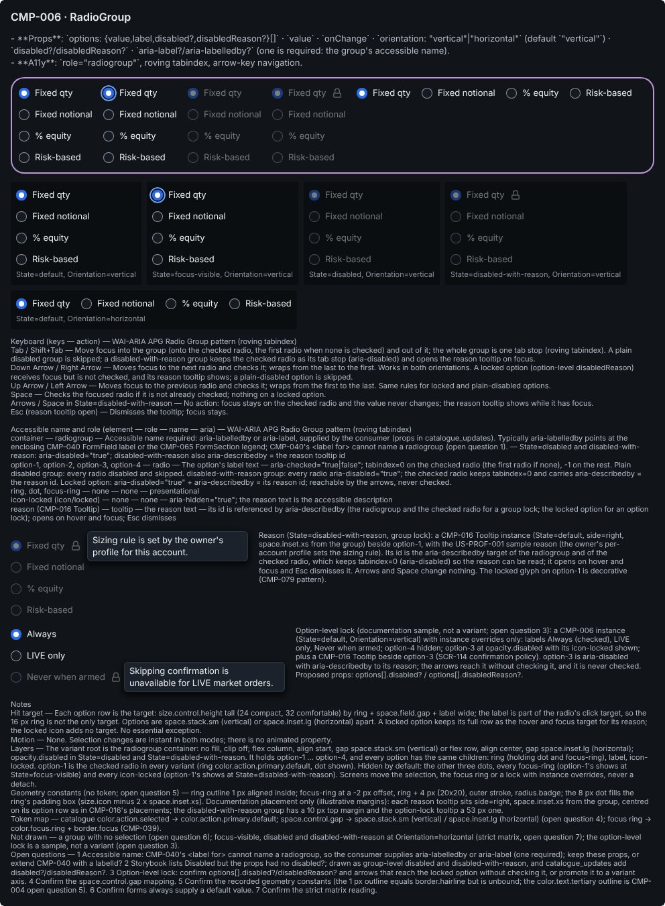

**Keyboard** (WAI-ARIA APG Radio Group pattern (roving tabindex)):

| Keys                                         | Action                                                                                                                                                                                                                                                                                                                    |
| -------------------------------------------- | ------------------------------------------------------------------------------------------------------------------------------------------------------------------------------------------------------------------------------------------------------------------------------------------------------------------------- |
| Tab / Shift+Tab                              | Move focus into the group (onto the checked radio, the first radio when none is checked) and out of it; the whole group is one tab stop (roving tabindex). A plain disabled group is skipped; a disabled-with-reason group keeps the checked radio as its tab stop (aria-disabled) and opens the reason tooltip on focus. |
| Down Arrow / Right Arrow                     | Moves focus to the next radio and checks it; wraps from the last to the first. Works in both orientations. A locked option (option-level disabledReason) receives focus but is not checked, and its reason tooltip shows; a plain-disabled option is skipped.                                                             |
| Up Arrow / Left Arrow                        | Moves focus to the previous radio and checks it; wraps from the first to the last. Same rules for locked and plain-disabled options.                                                                                                                                                                                      |
| Space                                        | Checks the focused radio if it is not already checked; nothing on a locked option.                                                                                                                                                                                                                                        |
| Arrows / Space in State=disabled-with-reason | No action: focus stays on the checked radio and the value never changes; the reason tooltip shows while it has focus.                                                                                                                                                                                                     |
| Esc (reason tooltip open)                    | Dismisses the tooltip; focus stays.                                                                                                                                                                                                                                                                                       |

**Accessible name and role:**

| Element                                | Role       | Name                                                                                                                                                                                                                                                                                             | ARIA                                                                                                                                                                                                                                                                                                                                                                                                                          |
| -------------------------------------- | ---------- | ------------------------------------------------------------------------------------------------------------------------------------------------------------------------------------------------------------------------------------------------------------------------------------------------ | ----------------------------------------------------------------------------------------------------------------------------------------------------------------------------------------------------------------------------------------------------------------------------------------------------------------------------------------------------------------------------------------------------------------------------- |
| container                              | radiogroup | Accessible name required: aria-labelledby or aria-label, supplied by the consumer (props in catalogue_updates). Typically aria-labelledby points at the enclosing CMP-040 FormField label or the CMP-065 FormSection legend; CMP-040's `<label for>` cannot name a radiogroup (open question 1). | State=disabled and disabled-with-reason: aria-disabled="true"; disabled-with-reason also aria-describedby = the reason tooltip id                                                                                                                                                                                                                                                                                             |
| option-1, option-2, option-3, option-4 | radio      | The option's label text                                                                                                                                                                                                                                                                          | aria-checked="true\|false"; tabindex=0 on the checked radio (the first radio if none), -1 on the rest. Plain disabled group: every radio disabled and skipped. disabled-with-reason group: every radio aria-disabled="true"; the checked radio keeps tabindex=0 and carries aria-describedby = the reason id. Locked option: aria-disabled="true" + aria-describedby = its reason id; reachable by the arrows, never checked. |
| ring, dot, focus-ring                  | none       | none                                                                                                                                                                                                                                                                                             | presentational                                                                                                                                                                                                                                                                                                                                                                                                                |
| icon-locked (icon/locked)              | none       | none                                                                                                                                                                                                                                                                                             | aria-hidden="true"; the reason text is the accessible description                                                                                                                                                                                                                                                                                                                                                             |
| reason (CMP-016 Tooltip)               | tooltip    | the reason text                                                                                                                                                                                                                                                                                  | its id is referenced by aria-describedby (the radiogroup and the checked radio for a group lock; the locked option for an option lock); opens on hover and focus; Esc dismisses                                                                                                                                                                                                                                               |

**Token mapping** (catalogue name → shipped semantic token):

| Catalogue                       | Shipped                                                | Note                                                                                                                                                                                       |
| ------------------------------- | ------------------------------------------------------ | ------------------------------------------------------------------------------------------------------------------------------------------------------------------------------------------ |
| color.action.selected           | color.action.primary.default                           | Checked ring fill and outline. Against canvas/raised/overlay: 3.36-3.85 dark, 3.80-4.44 light, 6.15-7.05 hc.                                                                               |
| space.control.gap               | space.stack.sm (vertical); space.inset.lg (horizontal) | No `space.control.*` token exists. The gap between options (8 / 16 px) is at least the ring-to-label gap (space.field.gap, 8 px), so each label groups with its own ring. Open question 4. |
| focus-ring (section 0.3 rule 4) | color.focus.ring                                       | 2 px ring (border.focus) at a 2 px offset, radius.badge, per CMP-039.                                                                                                                      |

**Hit target:** Each option row is the target: size.control.height tall (24 compact, 32 comfortable) by ring + space.field.gap + label wide; the label is part of the radio's click target, so the 16 px ring is not the only target. Options are space.stack.sm (vertical) or space.inset.lg (horizontal) apart. A locked option keeps its full row as the hover and focus target for its reason; the locked icon adds no target. No essential exception.  
**Motion:** None. Selection changes are instant in both modes; there is no animated property.

**Deviations recorded by the build:**

- The variant root is the anatomy 'container' (the spec's parent is 'component root'), so there is no separate 'container' layer. This matches how CMP-004 and CMP-005 were built. The orientation-dependent layout and gap (column/start/space.stack.sm or row/center/space.inset.lg) and opacity.disabled sit on the variant root, which has no fill and clipContent off.
- Ring stroke: 1 px, inner alignment, width not bound to a token. The spec keeps it unbound until the CMP-005 stroke-width question is decided. The stroke colour is bound (color.text.tertiary when unchecked, color.action.primary.default when checked).
- focus-ring constants with no token: 20x20 (ring 16 + 4), placed at -2,-2 relative to option-1's ring, absolute, outer stroke. Its radius is bound to radius.badge as the spec says, not 'target radius + 2'; for a circle the result is the same. Stroke colour is bound to color.focus.ring and width to border.focus.
- dot: an 8x8 ellipse with layout sizing fill/fill inside the ring's padding box, so no width/height token. Its size comes from size.icon minus 2 x space.inset.xs. Fill is bound to color.text.on-action.
- The focus-ring layer is in every variant, on option-1's ring, and hidden except State=focus-visible (as the spec says), so all variants have the same layers.
- Option labels are 'Fixed qty', 'Fixed notional', '% equity', 'Risk-based'. I read the spec's '(SCR-114 sizing rules)' as a source note, not label text.
- The variant container keeps Penpot's built-in variant-set stroke (#bb97d8, 2 px inner), which is not token-bound. Left as-is to match the CMP-004, CMP-005, CMP-012 and CMP-014 containers.
- Layout constants: the variant container (flex row wrap, align start, gap space.inset.lg, padding space.inset.md) and the matrix (flex row wrap, gap space.inset.sm) are fixed at 960 px wide so they wrap inside the section. The description and the keyboard, a11y and notes captions are 960 px with auto-height. Matrix cells have clipContent off.
- Added a 'notes' caption after a11y (hit target, motion, layers, states not drawn), taken from the spec's hit_target, motion and open questions. This goes beyond the six listed section items, as in CMP-004 and CMP-005.
- No reason row (section item 6): the draw list has no disabled-with-reason state. CMP-016 Tooltip is also not in the library (checked at the start). The notes caption records that per-option disabled-with-reason is not drawn.

**Open questions for the owner:**

- Accessible name: CMP-040 FormField associates its label with `<label for>`, which cannot name a role=radiogroup element, so the consumer must supply aria-labelledby (the FormField label's or the CMP-065 legend's id) or aria-label; catalogue_updates add `aria-label?/aria-labelledby?` (one required). Owner: keep these props, or extend CMP-040 with a `labelId` the group consumes?
- Storybook lists Disabled but the props have no `disabled?`. Drawn as a group-level disabled and disabled-with-reason; catalogue_updates add `disabled?/disabledReason?`.
- Option-level lock (SCR-114: 'skip confirmation is unavailable for LIVE market orders - state drawn'): proposed `options: {value,label,disabled?,disabledReason?}[]`. It is shown in the documentation frame as an instance-override sample (option-3 dimmed with its icon-locked and reason), not as a variant, because the per-option checked state is not a variant either; every option carries hidden dot, focus-ring and icon-locked layers, so screens draw it without detaching. Proposed behaviour: the arrows reach the locked option without checking it (an exception to selection-follows-focus) so its reason can be read. Confirm, or promote it to a variant axis.
- `space.control.gap` does not exist: mapped to space.stack.sm (vertical) and space.inset.lg (horizontal). Confirm.
- Recorded geometry constants (no token; logged for #161 AC2): the ring outline is 1 px aligned inside (equal to the primitive border.hairline, not bound; same ruling as CMP-005 open question 1 and the CMP-018 group question); the focus ring sits at -2 px and is ring + 4 px (20x20). The unchecked outline colour (color.text.tertiary) is CMP-004 open question 5.
- A group with no selection (value unset) is not drawn; APG puts focus on the first radio. Confirm forms always supply a default value.
- Matrix (strict reading): focus-visible, disabled and disabled-with-reason (group lock) are drawn at Orientation=vertical; horizontal is drawn once at State=default; the option-level lock is a documentation sample (open question 3).

### CMP-010 · Slider

**Catalogue (verbatim):**

- **Props**: `value` · `min/max/step` · `onChange` · `marks?: number[]` · `disabled?/disabledReason?` · `aria-label?/aria-labelledby?` (one is required: the slider's accessible name).
- **A11y**: `role="slider"`, `aria-valuenow/min/max/text`, arrow keys ±step, `PageUp/Down` ±10×step, `Home/End`.

| Axis  | Values                                                 | Default |
| ----- | ------------------------------------------------------ | ------- |
| State | default, focus-visible, disabled, disabled-with-reason | default |
| Marks | false, true                                            | false   |

**Drawn:** 5 variant(s) per the matrix rule; Penpot variant set `17279edf-22b9-80e9-8008-d170ad1ce1b1`.

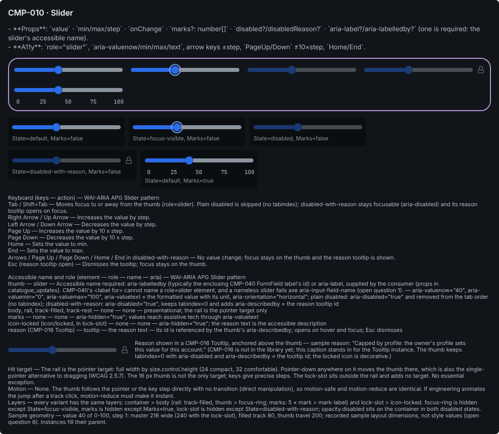

**Keyboard** (WAI-ARIA APG Slider pattern):

| Keys                                                              | Action                                                                                                                                                                                    |
| ----------------------------------------------------------------- | ----------------------------------------------------------------------------------------------------------------------------------------------------------------------------------------- |
| Tab / Shift+Tab                                                   | Moves focus to or away from the thumb (role=slider). Plain disabled is skipped (no tabindex); disabled-with-reason stays focusable (aria-disabled) and its reason tooltip opens on focus. |
| Right Arrow / Up Arrow                                            | Increases the value by step.                                                                                                                                                              |
| Left Arrow / Down Arrow                                           | Decreases the value by step.                                                                                                                                                              |
| Page Up                                                           | Increases the value by 10 x step.                                                                                                                                                         |
| Page Down                                                         | Decreases the value by 10 x step.                                                                                                                                                         |
| Home                                                              | Sets the value to min.                                                                                                                                                                    |
| End                                                               | Sets the value to max.                                                                                                                                                                    |
| Arrows / Page Up / Page Down / Home / End in disabled-with-reason | No value change; focus stays on the thumb and the reason tooltip is shown.                                                                                                                |
| Esc (reason tooltip open)                                         | Dismisses the tooltip; focus stays on the thumb.                                                                                                                                          |

**Accessible name and role:**

| Element                                 | Role    | Name                                                                                                                                                                                                                                                                                                       | ARIA                                                                                                                                                                                                                                                                                                                                             |
| --------------------------------------- | ------- | ---------------------------------------------------------------------------------------------------------------------------------------------------------------------------------------------------------------------------------------------------------------------------------------------------------- | ------------------------------------------------------------------------------------------------------------------------------------------------------------------------------------------------------------------------------------------------------------------------------------------------------------------------------------------------ |
| thumb                                   | slider  | Accessible name required: aria-labelledby (typically the enclosing CMP-040 FormField label's id) or aria-label, supplied by the consumer (props in catalogue_updates). CMP-040's `<label for>` cannot name a role=slider element, and a nameless slider fails axe aria-input-field-name (open question 1). | aria-valuenow="40", aria-valuemin="0", aria-valuemax="100", aria-valuetext = the formatted value with its unit, aria-orientation="horizontal"; plain disabled: aria-disabled="true" and removed from the tab order (no tabindex); disabled-with-reason: aria-disabled="true", keeps tabindex=0 and adds aria-describedby = the reason tooltip id |
| body, rail, track-filled, track-rest    | none    | none                                                                                                                                                                                                                                                                                                       | presentational; the rail is the pointer target only                                                                                                                                                                                                                                                                                              |
| marks                                   | none    | none                                                                                                                                                                                                                                                                                                       | aria-hidden="true"; values reach assistive tech through aria-valuetext                                                                                                                                                                                                                                                                           |
| icon-locked (icon/locked, in lock-slot) | none    | none                                                                                                                                                                                                                                                                                                       | aria-hidden="true"; the reason text is the accessible description                                                                                                                                                                                                                                                                                |
| reason (CMP-016 Tooltip)                | tooltip | the reason text                                                                                                                                                                                                                                                                                            | its id is referenced by the thumb's aria-describedby; opens on hover and focus; Esc dismisses                                                                                                                                                                                                                                                    |

**Token mapping** (catalogue name → shipped semantic token):

| Catalogue                       | Shipped                      | Note                                                                                                                                                                                                                                                                                                                     |
| ------------------------------- | ---------------------------- | ------------------------------------------------------------------------------------------------------------------------------------------------------------------------------------------------------------------------------------------------------------------------------------------------------------------------ |
| `color.action.*`                | color.action.primary.default | Filled track and thumb. Against canvas/raised/overlay: 3.36-3.85 dark, 3.80-4.44 light, 6.15-7.05 hc.                                                                                                                                                                                                                    |
| color.track                     | color.text.tertiary          | Unfilled track. No `color.border.*` token reaches 3:1 (color.border.strong is 1.35-2.02:1 on app, canvas, raised and overlay). color.text.tertiary on canvas, raised and overlay: 5.20-5.96 dark, 5.44-6.36 light, 10.36-11.87 hc. color.neutral.default is the existing non-text alternative (CMP-004 open question 5). |
| radius.pill                     | radius.badge                 | radius.badge resolves to radius.pill (9999).                                                                                                                                                                                                                                                                             |
| focus-ring (section 0.3 rule 4) | color.focus.ring             | 2 px ring (border.focus) at a 2 px offset, radius.badge, per CMP-039.                                                                                                                                                                                                                                                    |

**Hit target:** The rail is the pointer target: full width by size.control.height (24 compact, 32 comfortable). Pointer-down anywhere on it moves the thumb there, which is also the single-pointer alternative to dragging (WCAG 2.5.7). The 16 px thumb is not the only target; keys give precise steps. The lock-slot sits outside the rail and adds no target. No essential exception.  
**Motion:** None. The thumb follows the pointer or the key step directly with no transition (direct manipulation), so motion-safe and motion-reduce are identical. If engineering animates the jump after a track click, motion-reduce must make it instant.

**Deviations recorded by the build:**

- Built from the spec as revised at 09:27:44Z, which landed while I was waiting for the bridge (unchanged since). The revision added the 5th draw entry (State=disabled-with-reason), the body and lock-slot parts and the reason row. All five draw entries are built.
- Variant root = the anatomy 'container' (the spec's 'component root'), the same way CMP-004 to CMP-006 were built. opacity.disabled sits on the variant root in both disabled states.
- The generic state rule puts the locked icon 'before the label'. The slider has no label, so I followed the spec anatomy instead: icon-locked sits in a lock-slot that is the last child of the container, after the body.
- Recorded geometry constants with no token, as the spec names them in its open question 6: the master width is fixed at 216 px (240 px for disabled-with-reason) and track-filled is fixed at 80 px wide (sample value 40 of 0-100). The focus ring is a 20x20 rect at -2,-2 from the thumb, absolute, stroke alignment outer. The section, variant container and matrix are 960 px wide and the reason caption is 680 px wide with auto-height (layout constants).
- Focus-ring radius is bound to radius.badge (pill, 9999) as the spec says, not a numeric 'target radius + 2'. The thumb is a circle, so the result is the same: a circle 2 px outside the thumb.
- The track thickness has no token: each track segment is an empty flex board whose height hugs its space.inset.xs top and bottom padding. Measured in Penpot: 8 px tall under the 16 px thumb.
- Hidden layers are present in every variant, as the spec says. focus-ring is hidden except State=focus-visible, marks is hidden except Marks=true, and lock-slot is hidden except State=disabled-with-reason. Penpot's flex skips hidden layers. Measured root sizes: 216x24, 240x24 for disabled-with-reason, and 216x42 for Marks=true.
- The '100' mark label (20 px wide) overflows its 16 px slot by 2 px on each side and so ends 2 px past the 216 px root. The spec allows this ('may overflow equally on both sides') and clip is off, so it renders; in the matrix cell it still sits inside the cell padding.
- The variant container keeps Penpot's built-in variant-set stroke (#bb97d8, 2 px), which has no token. Left as is to match CMP-004, CMP-012 and CMP-014.
- Reason row: CMP-016 Tooltip is not in the library (checked twice). The row holds an instance of the disabled-with-reason variant plus a caption (type.ui.caption, color.text.secondary) that names the CMP-016 Tooltip and the spec's sample reason, 'Capped by profile: the owner's profile sets this value for this account.' The row gap is bound to space.inset.md; the spec gives no token for the row.
- The section has one extra beyond the brief's list: a 'notes' caption after the reason row. It holds the hit target, motion, the hidden-layer map and the sample geometry, as CMP-004 to CMP-006 did.
- The description text keeps description_verbatim exactly, including its markdown markers (backticks and **), as CMP-005 and CMP-006 did.

**Open questions for the owner:**

- Accessible name: CMP-040 FormField uses `<label for>`, which cannot name a role=slider element, and a nameless slider fails axe aria-input-field-name (the CI a11y gate). catalogue_updates add `aria-label?/aria-labelledby?` (one required). Owner: keep these props, or extend CMP-040 with a `labelId` the slider consumes?
- Track thickness: there is no semantic sizing token below 16 px, so each track segment is an empty auto-layout board whose height hugs its vertical padding space.inset.xs, giving an 8 px track under a 16 px thumb. Accept, or add a track-thickness token?
- Marks are drawn as numeric labels only (type.num.sm); a tick would need an unbound size. Confirm, and say whether values snap to marks (the catalogue is silent).
- Filled and unfilled track differ from each other by only 1.43-1.68:1; the value is carried by the thumb (3.36:1 or more against app, canvas, raised and overlay in every theme, protruding 4 px above and below the track), its position and aria-valuetext. Accept.
- disabled-with-reason is drawn (ticket #161 AC3): CMP-104 LeverageSlider already declares `disabled?/disabledReason?` and extends this contract, and US-PROF-008 disables the leverage control with 'capped by profile'; catalogue_updates add `disabledReason?`. The locked icon sits in a lock-slot after the body (not inside the rail), so the rail keeps its pointer target and the marks stay under their values. Confirm the placement.
- Recorded geometry constants (no token; logged for #161 AC2): the master width 216 px (240 px for the disabled-with-reason variant, which adds space.field.gap + size.icon) and the filled-track width 80 px are sample layout dimensions for value 40 of 0-100, not style values; instances fill their parent and code positions the thumb from the value. The focus ring sits at -2 px and is 20x20 (thumb + 4).
- Matrix (strict reading): focus-visible, disabled and disabled-with-reason are drawn at Marks=false; Marks=true is drawn once at State=default.
- Once CMP-016 Tooltip exists in the library, the reason row needs a real Tooltip instance anchored above the thumb of the disabled-with-reason instance, in place of the caption.

### CMP-014 · Spinner

**Catalogue (verbatim, as copied into the Penpot description before this PR's catalogue edits):**

- **Props**: `size` · `label?: string` (for standalone use, else decorative inside a labelled parent).
- **A11y**: `role="status"` + `aria-live="polite"` when standalone; `aria-hidden` when nested inside an already-announced busy control (e.g. CMP-001 loading state) to avoid double announcement.

| Axis  | Values  | Default |
| ----- | ------- | ------- |
| Size  | sm, md  | md      |
| State | default | default |

**Drawn:** 2 variant(s) per the matrix rule; Penpot variant set `17279edf-22b9-80e9-8008-d152b369d9b9`.

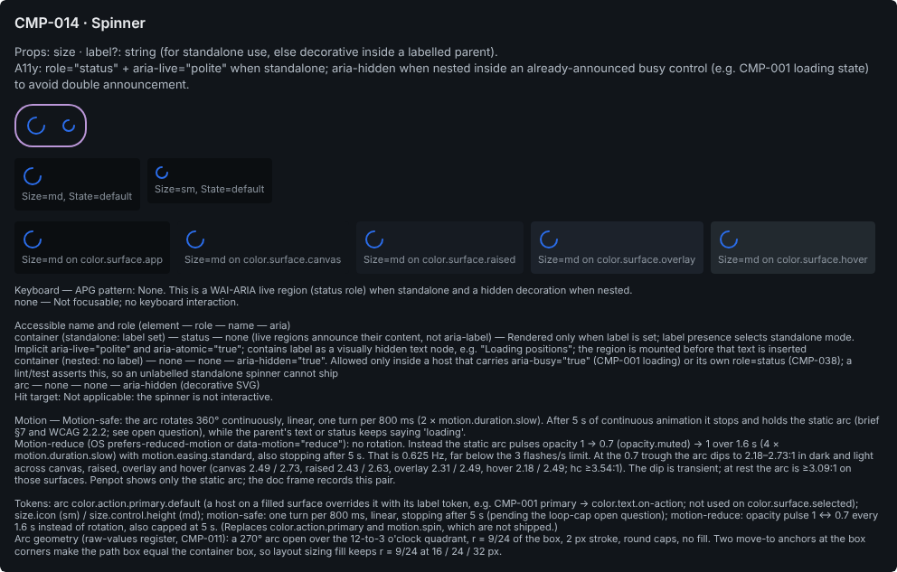

**Keyboard** (None. This is a WAI-ARIA live region (status role) when standalone and a hidden decoration when nested.):

| Keys | Action                                  |
| ---- | --------------------------------------- |
| none | Not focusable; no keyboard interaction. |

**Accessible name and role:**

| Element                             | Role   | Name                                                       | ARIA                                                                                                                                                                                                                                                           |
| ----------------------------------- | ------ | ---------------------------------------------------------- | -------------------------------------------------------------------------------------------------------------------------------------------------------------------------------------------------------------------------------------------------------------- |
| container (standalone: `label` set) | status | none (live regions announce their content, not aria-label) | Rendered only when `label` is set; `label` presence selects standalone mode. Implicit aria-live="polite" and aria-atomic="true"; contains `label` as a visually hidden text node, e.g. "Loading positions"; the region is mounted before that text is inserted |
| container (nested: no `label`)      | none   | none                                                       | aria-hidden="true". Allowed only inside a host that carries aria-busy="true" (CMP-001 loading) or its own role=status (CMP-038); a lint/test asserts this, so an unlabelled standalone spinner cannot ship                                                     |
| arc                                 | none   | none                                                       | aria-hidden (decorative SVG)                                                                                                                                                                                                                                   |

**Token mapping** (catalogue name → shipped semantic token):

| Catalogue                         | Shipped                                                                                                                                                                                                    | Note                                                                                            |
| --------------------------------- | ---------------------------------------------------------------------------------------------------------------------------------------------------------------------------------------------------------- | ----------------------------------------------------------------------------------------------- |
| color.action.primary              | color.action.primary.default                                                                                                                                                                               | ≥3.09:1 against canvas, raised, overlay and hover in every theme (not on selected: 2.58:1 dark) |
| motion.spin                       | none (no semantic motion tokens exist). The timing is documented in the motion field using the primitives motion.duration.slow, motion.easing.standard and opacity.muted, which are never bound to a shape |                                                                                                 |
| size (no values in the catalogue) | sm = size.icon (16); md = size.control.height (24 compact / 32 comfortable)                                                                                                                                |                                                                                                 |

**Hit target:** Not applicable: the spinner is not interactive.  
**Motion:** Motion-safe: the arc rotates 360° continuously, linear, one turn per 800 ms (2 × motion.duration.slow). After 5 s of continuous animation it stops and holds the static arc (brief §7 and WCAG 2.2.2; see open question), while the parent's text or status keeps saying 'loading'. Motion-reduce (OS prefers-reduced-motion or data-motion="reduce"): no rotation. Instead the static arc pulses opacity 1 → 0.7 (opacity.muted) → 1 over 1.6 s (4 × motion.duration.slow) with motion.easing.standard, also stopping after 5 s. That is 0.625 Hz, far below the 3 flashes/s limit. At the 0.7 trough the arc dips to 2.18–2.73:1 in dark and light across canvas, raised, overlay and hover (canvas 2.49 / 2.73, raised 2.43 / 2.63, overlay 2.31 / 2.49, hover 2.18 / 2.49; hc ≥3.54:1). The dip is transient; at rest the arc is ≥3.09:1 on those surfaces. Penpot shows only the static arc; the doc frame records this pair.

**Deviations recorded by the build:**

- Arc stroke width 2 px is a raw value (no semantic stroke-width token; border.focus is reserved for focus rings), as the spec records in the CMP-011 raw-values register.
- Arc geometry is raw: a 270° arc open over the 12-to-3 o'clock quadrant, r = 9/24 of the box, round caps, no fill. It is drawn as three cubic Béziers (kappa 0.5523), not an SVG arc command: d = M21 12 C21 16.97 16.97 21 12 21 C7.03 21 3 16.97 3 12 C3 7.03 7.03 3 12 3.
- The arc path also carries two move-to-only anchor points, at (0,0) and (24,24). They make the path's box equal the container box, the way a 24×24 SVG viewBox would. With layout sizing fill on both axes, as the spec asks, the arc then scales with the container and keeps r = 9/24 at 16, 24 and 32 px. Without the anchors the box is 18×18 and fill would stretch the arc to r = 12. A pixel check of the 24 px export showed the anchors draw nothing.
- Description, a11y and tokens texts strip the markdown markers (leading '- ', '**' and backticks) but keep the words verbatim. This matches the existing CMP-018 doc section.
- The variant property is Size only (md, sm). State has the single value 'default' and does not vary in draw, so it is not a variant property, per the brief's rule. The matrix captions still read 'Size=md, State=default' and 'Size=sm, State=default', following the draw entries.
- The section has three extras beyond the brief's list, inserted in this order: title, description, variant set, matrix, then a 'surfaces' strip, then keyboard and a11y, then a 'motion' text and a 'tokens' text. The surfaces strip shows an md instance on color.surface.app, canvas, raised, overlay and hover, the five surfaces the spec allows. The motion text exists because the spec's motion field says 'the doc frame records this pair'. The tokens text holds the catalogue_updates Tokens line plus the arc geometry note.
- The variant container keeps Penpot's default variant-set outline stroke, which has no token, the same as CMP-018.
- No focus-visible, disabled, disabled-with-reason, loading or error states were drawn. The spinner is not interactive and the spec lists only State=default. For the same reason there is no CMP-016 reason row.
- The PNG is named after the spec file's kebab name (CMP-014-spinner-loader.png), not the Penpot name 'CMP-014 · Spinner'.

**Open questions for the owner:**

- The catalogue gives no size values. This spec uses sm = size.icon (nested and inline) and md = size.control.height (standalone). lg is not drawn because no semantic size token exists above 32 px, and panel loading uses CMP-015 or CMP-029 skeletons. Confirm.
- A 'Loading' default for `label` was considered and declined. `label` presence selects the mode (label → standalone role=status; none → nested, aria-hidden), so a default would make every nested spinner announce and bring back the double-announcement bug that CMP-014 and CMP-038 exist to avoid. Instead, a lint/test asserts that every unlabelled spinner sits inside a host with aria-busy or its own role=status. Confirm.
- Raw values: the 2 px arc stroke and the arc geometry are unbound (raw-values register in CMP-011; the primitive border.thick = 2 exists). Add a semantic stroke-width token, or accept?
- Loop cap: brief §7 says looping motion longer than 5 s needs a pause control, and it names spinners. WCAG 2.2.2 would treat a loading indicator as essential. Is the proposed auto-stop at 5 s (static arc after that) wanted, or does the essential exception apply?
- Motion tokens exist only as primitives (`motion.duration.*`, `motion.easing.*`). Should a semantic motion layer be added before code binds them?
- Arc colour on filled hosts is handled by an instance override (e.g. CMP-001 primary uses color.text.on-action), not by a variant. The CMP-001 spec must name the override it uses. Alternatively, add an 'on-fill' axis to the spinner.
- Penpot name: 'Spinner / Loader' is named 'CMP-014 · Spinner' because Penpot reads '/' as an asset path.
- A 'Loading' default for `label` was considered and declined. `label` presence selects the mode (label → standalone role=status; none → nested, aria-hidden), so a default would make every nested spinner announce and bring back the double-announcement bug. Instead, a lint/test asserts that every unlabelled spinner sits inside a host with aria-busy or its own role=status. Confirm.

### CMP-019 · Icon

**Catalogue (verbatim):**

- **Props**: `name: IconName` · `size` · `decorative?: boolean` (default true → `aria-hidden`; false requires `label`).
- **A11y**: `aria-hidden="true"` by default; when `decorative=false`, renders `role="img"` + `aria-label`.

| Axis | Values     | Default |
| ---- | ---------- | ------- |
| Size | sm, md, lg | md      |

**Drawn:** 3 variant(s) per the matrix rule; Penpot variant set `17279edf-22b9-80e9-8008-d176fa028600`.

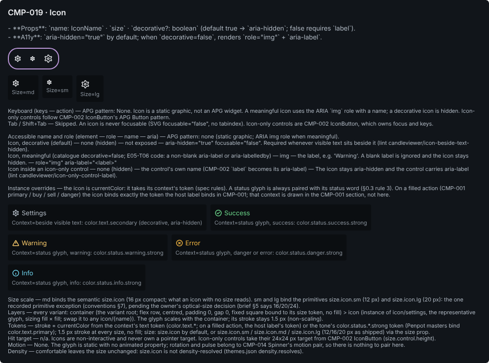

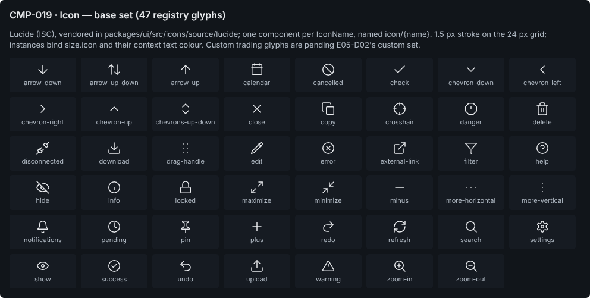

**Keyboard** (None. Icon is a static graphic, not an APG widget. A meaningful icon uses the ARIA `img` role with a name; a decorative icon is hidden. Icon-only controls follow CMP-002 IconButton's APG Button pattern.):

| Keys            | Action                                                                                                                                          |
| --------------- | ----------------------------------------------------------------------------------------------------------------------------------------------- |
| Tab / Shift+Tab | Skipped. An icon is never focusable (SVG focusable="false", no tabindex). Icon-only controls are CMP-002 IconButton, which owns focus and keys. |

**Accessible name and role:**

| Element                                                                                                | Role          | Name                                                                           | ARIA                                                                                                                             |
| ------------------------------------------------------------------------------------------------------ | ------------- | ------------------------------------------------------------------------------ | -------------------------------------------------------------------------------------------------------------------------------- |
| Icon, decorative (default)                                                                             | none (hidden) | not exposed                                                                    | aria-hidden="true" focusable="false". Required whenever visible text sits beside it (lint candleviewer/icon-beside-text-hidden). |
| Icon, meaningful (catalogue decorative=false; E05-T06 code: a non-blank aria-label or aria-labelledby) | img           | the label, e.g. 'Warning'. A blank label is ignored and the icon stays hidden. | role="img" aria-label="`<label>`"                                                                                                |
| Icon inside an icon-only control                                                                       | none (hidden) | the control's own name (CMP-002 `label` becomes its aria-label)                | The icon stays aria-hidden and the control carries aria-label (lint candleviewer/icon-only-control-label).                       |

**Token mapping** (catalogue name → shipped semantic token):

| Catalogue      | Shipped                                                                    | Note                                                                                                                                                                                                                                                                  |
| -------------- | -------------------------------------------------------------------------- | --------------------------------------------------------------------------------------------------------------------------------------------------------------------------------------------------------------------------------------------------------------------- |
| `color.icon.*` | color.text.primary                                                         | No `color.icon.*` group ships. Icons are currentColor: they take the context's text token (color.text.primary / secondary / tertiary; on a filled action the host label's token) or the tone's `color.status.*.strong` token. Penpot masters bind color.text.primary. |
| `size.icon.*`  | size.icon (default md); size.icon.sm / size.icon.lg on the Size scale only | Default (md, 16 px compact) binds the semantic size.icon. The SizeScale shows the primitives size.icon.sm (12) and size.icon.lg (20), the recorded exception in conventions §7.                                                                                       |

**Hit target:** n/a. Icons are non-interactive and never own a pointer target. Icon-only controls take their 24x24 px target from CMP-002 IconButton (size.control.height).  
**Motion:** None. The glyph is static with no animated property; rotation and pulse belong to CMP-014 Spinner's motion pair, so there is nothing to pair here.

**Deviations recorded by the build:**

- Sizes sm and lg bind the primitives size.icon.sm (12 px) and size.icon.lg (20 px) to the container's width and height. This is the one primitive exception conventions section 7 records. Size md binds the semantic size.icon (16 px).
- The 1.5 px glyph stroke has no token. It comes from the existing icon/{name} masters and is not scaled when an instance is resized.
- The variant container keeps Penpot's default variant-set outline: stroke #BB97D8, 2 px, radius 20, none of it token-bound. CMP-014 and CMP-018 do the same. A binding audit of all 78 shapes in the section found no other unbound fill, stroke, radius, padding, gap or typography.
- Token binding was lost once. cv.icon bound the stroke colour on the nested icon/settings copies, but the binding disappeared because the boards became components in the same call. I re-applied color.text.primary in a later call and confirmed it on all 6 vectors of the three variants. Matrix instances carry it too.
- The existing icon/{name} masters (from the earlier base-set task; I did not touch them) do not match the spec anatomy. Each is a 24x24 board with no auto-layout, no 'glyph' group, no 'bounds' rect and no size.icon binding, and the vectors are direct children with 'scale' constraints. All 126 glyph strokes on the 47 masters use strokeAlignment 'inner', where SVG and Lucide strokes are centred. As a result closed shapes draw smaller than the source: the settings gear's centre circle at Size=sm (12 px) is r 1.5 with a 1.5 px inner stroke, so it renders as a solid dot.
- Variant property: Size only (md, sm, lg), because it is the only axis in the spec. No focus-visible, disabled, disabled-with-reason, loading or error states were drawn: Icon is not interactive and the spec lists none. So there is no reason row and no CMP-016 Tooltip (CMP-016 is not in the library anyway).
- The variant root has clipContent=false, matching the icon masters' 'clip off'; the spec is silent on clipping for the container. The icon instance uses layout sizing fill x fill, as specified.
- The variant container hugs its content (104x44) instead of a fixed 960 px width. It is still a flex row with wrap, gap space.inset.lg and padding space.inset.md.
- The description text is description_verbatim exactly, markdown markers included.
- Three extras were added after a11y, so the required order (title, description, variant set, matrix, keyboard, a11y) is unchanged. (1) A 'contexts-heading' caption. (2) A 'contexts' row with five instance-override demos, each a cv.icon at size.icon plus its word: beside text uses settings with color.text.secondary; success, warning, error and info use their `color.status.*.strong` token. (3) A 'notes' caption covering the size scale, layers, the catalogue Tokens line, hit target, motion and density. The 'on a filled action' context is not drawn; the heading says it lives in the CMP-001 section.
- The PNG is named CMP-019-icon.png after the spec file. The existing CMP-019-icon-set.png from the base-set section was left alone.

**Open questions for the owner:**

- Optical sizes: brief §5 specifies 16/20/24 px for size.icon.sm/md/lg, but the shipped primitives are 12/16/20 px (packages/ui README records this as an open owner decision). The SizeScale draws the shipped 12/16/20. If the owner moves to 16/20/24, md becomes 20 and the semantic size.icon (16 compact) no longer equals md. Decide both together.
- Size sm (12 px) with a 1.5 px non-scaling stroke closes up detailed glyphs (settings, filter, notifications, disconnected). Should sm be limited to simple glyphs (chevrons, check, close, plus, minus), or dropped?
- Props API: the catalogue says `decorative?: boolean` + `label`. The in-flight E05-T06 grid (branch feat/design-system-icons, not on main) instead names an icon with a non-blank aria-label or aria-labelledby. The a11y result is the same (hidden by default, img when named). Align the Props line with whichever API merges.
- Cross-group (CMP-001, Actions spec): an icon on a filled action takes the host label's token. If CMP-001 binds color.text.on-action on buy and sell in the dark theme, label and icon both measure 2.46:1 on color.buy.default and 3.91:1 on color.sell.default, below the 4.5:1 text minimum (color.text.inverse gives 7.87:1 and 4.94:1). Reconcile in the CMP-001 spec; CMP-019 follows whatever it binds.
- Geometry constants: the 1.5 px glyph stroke has no token. See the consolidated question under CMP-018.
- New: should the icon-set owner rebuild the 47 icon/{name} masters to the CMP-019 anatomy (16 px board bound to size.icon, flex, a fill-sized 'glyph' group with a 'bounds' rect) and switch every glyph stroke from 'inner' to 'center' alignment, to match the Lucide/IconSvg.tsx rendering? I did not change them because they are outside this task's write scope.
- New: in the dark theme color.status.danger.strong is palette.amber.400 (#F0B441), almost the same as color.status.warning.strong, palette.amber.300 (#F5C86B). The Warning and Error samples look nearly the same colour. Glyph shape and word still tell them apart (section 0.3 rule 3), but is that intended?
- New: the CMP-002 IconButton spec says its sm/lg icon comes from a nested CMP-019 at Size=sm|lg, but its section was built before CMP-019 existed and holds icon/{name} instances directly. Should CMP-002 now nest CMP-019?

### CMP-031 · ColorSwatch

**Catalogue (verbatim):**

- **Props**: `color` · `selected?` · `onSelect?` · `disabled?/disabledReason?`.
- **A11y**: `role="radio"` inside a `radiogroup` swatch picker; `aria-label` names the colour (not just hex).

| Axis     | Values                                                 | Default |
| -------- | ------------------------------------------------------ | ------- |
| State    | default, focus-visible, disabled, disabled-with-reason | default |
| Selected | false, true                                            | false   |

**Drawn:** 7 variant(s) per the matrix rule; Penpot variant set `17279edf-22b9-80e9-8008-d17842283952`.

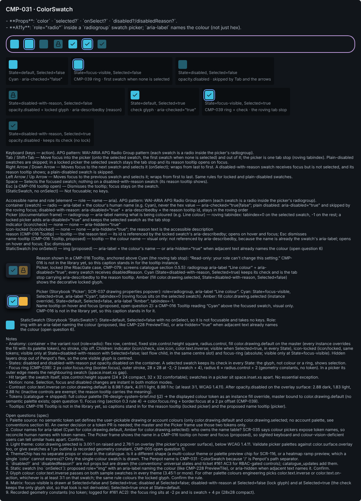

**Keyboard** (WAI-ARIA APG Radio Group pattern (each swatch is a radio inside the picker's radiogroup)):

| Keys                         | Action                                                                                                                                                                                                                                                                                           |
| ---------------------------- | ------------------------------------------------------------------------------------------------------------------------------------------------------------------------------------------------------------------------------------------------------------------------------------------------ |
| Tab / Shift+Tab              | Move focus into the picker (onto the selected swatch, the first swatch when none is selected) and out of it; the picker is one tab stop (roving tabindex). Plain-disabled swatches are skipped; in a locked picker the selected swatch stays the tab stop and its reason tooltip opens on focus. |
| Right Arrow / Down Arrow     | Moves focus to the next swatch and selects it (onSelect); wraps from last to first. A disabled-with-reason swatch receives focus but is not selected, and its reason tooltip shows; a plain-disabled swatch is skipped.                                                                          |
| Left Arrow / Up Arrow        | Moves focus to the previous swatch and selects it; wraps from first to last. Same rules for locked and plain-disabled swatches.                                                                                                                                                                  |
| Space                        | Selects the focused swatch; nothing on a disabled-with-reason swatch (its reason tooltip shows).                                                                                                                                                                                                 |
| Esc (a CMP-016 tooltip open) | Dismisses the tooltip; focus stays on the swatch.                                                                                                                                                                                                                                                |
| (StaticSwatch, no onSelect)  | Not focusable; no keys.                                                                                                                                                                                                                                                                          |

**Accessible name and role:**

| Element                                  | Role           | Name                                                                  | ARIA                                                                                                                                                                                                               |
| ---------------------------------------- | -------------- | --------------------------------------------------------------------- | ------------------------------------------------------------------------------------------------------------------------------------------------------------------------------------------------------------------ |
| container (swatch)                       | radio          | aria-label = the colour's human name (e.g. Cyan), never the hex value | aria-checked="true\|false"; plain disabled: aria-disabled="true" and skipped by the roving focus; disabled-with-reason: aria-disabled="true" + aria-describedby = the reason tooltip id, stays in the roving order |
| Picker (documentation frame)             | radiogroup     | aria-label naming what is being coloured (e.g. Line colour)           | roving tabindex: tabindex=0 on the selected swatch, -1 on the rest; a locked picker adds aria-disabled="true" and keeps the selected swatch as the tab stop                                                        |
| indicator (icon/check)                   | none           | none                                                                  | aria-hidden="true"                                                                                                                                                                                                 |
| icon-locked (icon/locked)                | none           | none                                                                  | aria-hidden="true"; the reason text is the accessible description                                                                                                                                                  |
| reason (CMP-016 Tooltip)                 | tooltip        | the reason text                                                       | its id is referenced by the locked swatch's aria-describedby; opens on hover and focus; Esc dismisses                                                                                                              |
| name-tooltip (CMP-016 Tooltip, proposed) | tooltip        | the colour name                                                       | visual only: not referenced by aria-describedby, because the name is already the swatch's aria-label; opens on hover and focus; Esc dismisses                                                                      |
| StaticSwatch (no onSelect)               | img (proposed) | aria-label = the colour's name                                        | or aria-hidden="true" when adjacent text already names the colour (open question 6)                                                                                                                                |

**Token mapping** (catalogue name → shipped semantic token):

| Catalogue                                          | Shipped                                                                                        | Note                                                                                                                                                                           |
| -------------------------------------------------- | ---------------------------------------------------------------------------------------------- | ------------------------------------------------------------------------------------------------------------------------------------------------------------------------------ |
| full colour palette (16-design-system-brief.md §2) | the displayed colour token as an instance fill override; master bound to color.drawing.default | No semantic token set defines a user-pickable palette (only color.drawing.default and color.drawing.selected; no account palette, see conventions section 9). Open question 1. |
| focus-ring (section 0.3 rule 4)                    | color.focus.ring                                                                               | 2 px ring (border.focus) at a 2 px offset, radius.control, per CMP-039.                                                                                                        |

**Hit target:** The swatch is the target: size.control.height by size.control.height (24x24 compact, 32x32 comfortable). Swatches in a picker sit space.inset.xs apart. No essential exception.  
**Motion:** None. Selection, focus and disabled changes are instant in both modes.

**Deviations recorded by the build:**

- Focus-ring radius: the spec anatomy binds the ring to radius.control. I followed the state rule of conventions §3 (target radius + 2) and set a raw radius of 6 (radius.control 4 + 2) so the ring stays concentric, as CMP-002 does. Confirm which rule wins.
- Geometry constants with no token: the focus ring is 28x28 at -2,-2 (swatch + 4) with an outer stroke and radius 6; the 1.5 px glyph strokes come from the icon/check and icon/locked components; the description, keyboard, a11y, notes and open-questions texts, the matrix and the variant container are fixed at 960 px wide; the reason, picker and static captions are fixed at 720 px.
- Binding size.icon did not resize the icon instances (they stayed 24x24, as in CMP-004 and CMP-012). I resized all 14 glyphs in the 7 masters to 16x16 and bound size.icon again; every copy now reads 16x16 at 4,4.
- Hidden glyph layers: Penpot's flex skips hidden layers and had left the hidden indicator and icon-locked at page 0,0. I moved them to the centre slot (4,4) in each master so their bounds stay inside the swatch. The visible glyph is centred by flex at 4,4.
- Reason row: CMP-016 Tooltip is not in the library (checked at the start, before the docs call and at the end). The 'reason' row holds the locked Picker frame (picker-locked: Cyan State=disabled-with-reason Selected=true, and Amber State=disabled-with-reason Selected=false) plus a caption carrying the spec's reason text, 'Read-only: your role can't change this setting.', instead of a tooltip instance anchored above Cyan. The proposed name tooltip ('Cyan') in the Picker frame is also a caption. I used the spec's reason text, not the task's example.
- Content beyond the six listed items, all taken from the spec anatomy or needed for review: a 'picker-story' row (the spec's Picker documentation frame on color.surface.overlay with radius.card, elevation.popover, gap space.inset.xs and padding space.inset.sm), a 'static' row (StaticSwatch), a 'notes' caption (anatomy, states, ring, hit target, motion, contrast, tokenMap) and an 'open-questions' caption. Each matrix cell has a second caption line ('note', color.text.tertiary) under the Axis=value caption.
- The Amber swatches are instances whose root fill is overridden by binding color.drawing.selected; the masters stay on color.drawing.default, as the spec says.
- The variant container keeps Penpot's built-in variant-set stroke (#bb97d8), which is not token-bound, the same as every other D02 variant set.
- Relayout: I ran cv.relayout's toggle but skipped shapes inside component instances (15 boards), because toggling sizing on copies records sizing overrides (CMP-012 finding). It is otherwise the same as cv.relayout(section).

**Open questions for the owner:**

- Palette source: no semantic token set defines the user-pickable drawing or account colours (only color.drawing.default and color.drawing.selected; no account palette, see conventions section 9). An owner decision or a token PR is needed; the master and the Picker frame use those two tokens only.
- Colour names for aria-label (Cyan for color.drawing.default, Amber for color.drawing.selected): who owns the name table? SCR-035 says colour pickers expose token names, so reconcile human names with token names. The Picker frame now shows the name in a CMP-016 tooltip on hover and focus (proposed), so sighted keyboard and colour-vision-deficient users can tell similar hues apart. Confirm.
- Light theme: color.drawing.selected is 3.00:1 on raised and 2.76:1 on overlay (the picker's popover surface), below WCAG 1.4.11. Validate picker palettes against color.surface.overlay too, or give swatches a 1 px outline (a recorded geometry constant, CMP-005 open question 1).
- ThemeChip has no separate props or visual in the catalogue. Is it a different shape (a multi-colour theme or palette preview chip for SCR-116, or a heatmap ramp preview, which a single `color` cannot express)? Only the single-colour swatch is drawn. The Penpot name is CMP-031 · ColorSwatch because '/' is Penpot's path separator.
- `disabled?` and `disabledReason?` are not props but are drawn (the conventions' universal states and ticket #161 AC3 for RBAC-gated controls); catalogue_updates add them.
- Static swatch (no `onSelect`): proposed role="img" with an aria-label naming the colour (like CMP-228 PreviewTile), or aria-hidden when adjacent text names it. Confirm.
- Glyph colour: color.text.inverse passes on both sample swatches in every theme (3.45:1 or more). For other palette colours engineering picks color.text.inverse or color.text.on-action, whichever is at least 3:1 on that swatch; the same rule colours the locked glyph. Confirm the rule.
- Matrix: focus-visible is drawn at Selected=false (Tab lands on the first swatch when none is selected) and at Selected=true (roving focus sits on the selected swatch); disabled at Selected=false; disabled-with-reason at Selected=false (lock glyph) and at Selected=true, because the check keeps the swatch's only glyph slot, so that look is not derivable; Selected=true once at State=default.
- Recorded geometry constants (no token; logged for #161 AC2): the focus ring sits at -2 px and is swatch + 4 px (28x28 compact).
- CMP-016 Tooltip is not built. When it lands, replace the reason caption (locked picker) and the name-tooltip caption (picker) with CMP-016 instances anchored above the Cyan swatch.
- Focus-ring radius: the spec says radius.control (token); conventions §3 say radius.control + 2 (raw 6, drawn). Confirm.
- In the Picker frames the 2 px ring at a 2 px offset meets the neighbouring swatch exactly, because the spec gap is space.inset.xs (4 px). Accept, or widen the gap?

### CMP-039 · FocusRing (spec only)

**Catalogue (verbatim):**

- **Props**: n/a (mixin/class).
- **A11y**: guarantees ≥3:1 contrast ring, 2px offset, `:focus-visible` only (not `:focus`) to avoid mouse-click ring flash.

**Drawn:** spec only (catalogue: utility, non-visual export), so no variant set and no matrix; the section holds the two reference frames RingOnButton and RingOnCustomSurrogate. **Rework in progress:** the build record below is the first build's, which stopped before the RingOnCustomSurrogate chart; the export shows the chart (grid, candles, surrogate ring) drawn by the rework, which is still being finished and verified.

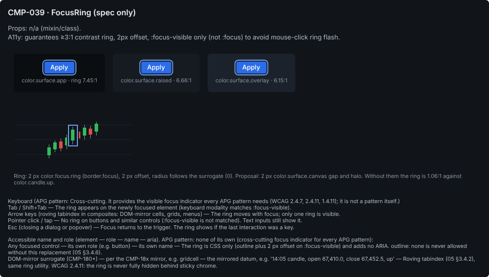

**Keyboard** (Cross-cutting. It provides the visible focus indicator every APG pattern needs (WCAG 2.4.7, 2.4.11, 1.4.11); it is not a pattern itself.):

| Keys                                                                       | Action                                                                                              |
| -------------------------------------------------------------------------- | --------------------------------------------------------------------------------------------------- |
| Tab / Shift+Tab                                                            | The ring appears on the newly focused element (keyboard modality matches :focus-visible).           |
| Arrow keys (roving tabindex in composites: DOM-mirror cells, grids, menus) | The ring moves with focus; only one ring is visible.                                                |
| Pointer click / tap                                                        | No ring on buttons and similar controls (:focus-visible is not matched). Text inputs still show it. |
| Esc (closing a dialog or popover)                                          | Focus returns to the trigger. The ring shows if the last interaction was a key.                     |

**Accessible name and role:**

| Element                         | Role                                  | Name                                                                       | ARIA                                                                                                                                                     |
| ------------------------------- | ------------------------------------- | -------------------------------------------------------------------------- | -------------------------------------------------------------------------------------------------------------------------------------------------------- |
| Any focused control             | its own role (e.g. button)            | its own name                                                               | The ring is CSS only (outline plus 2 px offset on :focus-visible) and adds no ARIA. outline: none is never allowed without this replacement (05 §3.4.6). |
| DOM-mirror surrogate (CMP-180+) | per the CMP-18x mirror, e.g. gridcell | the mirrored datum, e.g. '14:05 candle, open 67,410.0, close 67,452.5, up' | Roving tabindex (05 §3.4.2), same ring utility. WCAG 2.4.11: the ring is never fully hidden behind sticky chrome.                                        |

**Token mapping** (catalogue name → shipped semantic token):

| Catalogue                                  | Shipped                                      | Note                                                                                                                                  |
| ------------------------------------------ | -------------------------------------------- | ------------------------------------------------------------------------------------------------------------------------------------- |
| color.focus.ring                           | color.focus.ring                             | Exists. At least 4.72:1 on all seven surface tiers in dark and hc, and 4.81:1 in light (verify_tokens.py proves the four main tiers). |
| focus-ring token, 2px offset (§0.3 rule 4) | color.focus.ring + border.focus (2 px width) | No token exists for the 2 px offset; it is a geometry constant (open question).                                                       |

**Hit target:** n/a. The ring is painted outside the element (outline plus offset) and never changes its size or hit area.  
**Motion:** None. The ring appears and disappears instantly in both modes (no fade), so focus is never delayed; motion-safe equals motion-reduce.

**Deviations recorded by the build:**

- NOT DRAWN (reason for status partial): the RingOnCustomSurrogate 'chart' board and its children (the three grid lines, nine candles, the 'surrogate (DOM-mirror node)' rect, 'surrogate-focus-ring' and the 'proposal/halo' group). The frozen spec makes the chart conditional on a documentation-frame exception to conventions section 5 being recorded first ('without one the builder stops at this board and reports'). conventions.md has no such exception, and conventions section 5 allows absolute shapes only for the focus ring and overlay anchors. The RingOnCustomSurrogate frame (id 17279edf-22b9-80e9-8008-d186fd233ac6) is built with only its caption; the chart goes in as its first child once the exception is recorded.
- Spec-only component: no variant container, no matrix board and no reason row. Axes and draw are empty per the spec's build note, and there is no disabled-with-reason state. The section holds the two reference frames instead.
- Ring geometry constants with no token (inherited from the CMP-001 focus-visible main's focus-ring layer, not redrawn here): the 2 px offset (rect at -2,-2 sized target+4: 65x28 around the 61x24 button) and the concentric radius 6 = radius.control 4 + 2 px. The stroke is token-bound (color.focus.ring, border.focus, outer, no fill).
- The 'cell' anatomy part is named 'cell (color.surface.app)', 'cell (color.surface.raised)' and 'cell (color.surface.overlay)' so the three cells are distinguishable. All three are flex column, centred, padding X/Y space.inset.lg, gap space.stack.sm, radius radius.card, fill = that surface token.
- Both reference frames are tagged cvd02 kind 'ref-frame' (not 'part'), so a build check can tell them apart from component boards. Names: 'CMP-039 · FocusRing — ref frame (RingOnButton)' and 'CMP-039 · FocusRing — ref frame (RingOnCustomSurrogate)'.
- Each target-button is an instance of CMP-001 · Button {Variant=primary, Size=md, State=focus-visible}, with its label text overridden from the main's 'Save' to 'Apply' (a text override only). The ring's leftright/topbottom constraints stretched it with the label (verified: ring 65x28 on a 61x24 button).
- The surrogate caption is hug (auto-width, one line of about 995 px) as the anatomy says. That makes the RingOnCustomSurrogate frame 1019 px wide and the section 1051 px, wider than the 960 px text column.
- The description is kept verbatim from description_verbatim, including the markdown ** and backticks. This matches the CMP-037 section; the CMP-001 builder had stripped them.

**Open questions for the owner:**

- proposal/halo stroke width: conventions name the primitive border.focus only for the focus ring's width, so the halo's 2 px strokes are drawn unbound. Should the orchestrator extend that recorded exception to the halo (then bind border.focus)? If the owner approves the halo itself, it needs a semantic token or a recorded exception before it reaches code.
- Thick ring: Settings → Accessibility 'Increase focus-ring thickness' writes data-focus-ring="thick" (apps/web a11y-preferences), but no thickness is defined anywhere: not in tokens, theme.css or the catalogue. Proposal: thick = 4 px. That needs a token, because no 4 px border primitive exists (border.thick = border.focus = 2). Not drawn until decided.
- Canvas surrogates: over chart data ink the ring has almost no luminance contrast: 1.06:1 against color.candle.up and color.heatmap.bid.3, 1.51:1 against color.candle.down (dark); 1.25:1 and 1.30:1 in light. Where neighbouring marks touch the ring at dense zoom, WCAG 1.4.11 fails. Proposal (drawn as the toggleable proposal/halo group): back surrogate rings with a 2 px color.surface.canvas gap and halo. The ring stays identical; only a backing is added for canvas surrogates. Needs owner OK, because it amends CMP-039's 'identical ring' contract.
- The 2 px offset and the derived concentric radius (+2 px) have no token (see the CMP-018 geometry-constants question).

## 9. Design QA checklist (brief §12)

Completed for the 11 components of this batch. Open items say why and who closes them.

**Tokens & visual**

- [ ] Uses only published Tier-2/Tier-3 tokens — zero hardcoded hex/px values. **Open:** every colour, spacing,
      size, radius, type and opacity value is bound to a published semantic token, and no component holds a hex
      value; the raw px values left are the geometry constants in §5.1 and the named primitives in §5.2, recorded
      rather than hidden. Ticked when the owner accepts them (§6 B1) or tokens replace them.
- [ ] Verified in all three themes at both density modes. **Open:** structurally guaranteed (every paint is a
      semantic token that all three themes resolve, heights bind the two density-owned tokens, auto-layout
      everywhere) and the contrast figures cover all three themes, but the exports are dark/compact only and the
      mode-switch walk-through (§2 step 1) is not recorded yet.
- [ ] Passes the automated contrast-matrix check for every colour pair it introduces or touches. **Open** until #3896
      lands (the five label-on-fill pairs, §6 A1), with three more pairs flagged in `E05-D02-a11y-audit.md` §4: light
      `color.drawing.selected` on overlay (§6 A5), light `color.status.success.strong` as a glyph (§6 A6) and the ring
      over chart data ink (§6 D11).
- [ ] CVD simulation reviewed for any new colour-carrying state. **Open:** not simulated in this pre-review; the
      formal CVD review is E05-D04's. Structurally no batch-1 state depends on hue (audit §5).

**Behaviour & states**

- [ ] Every documented State has a corresponding Penpot variant (and Storybook story). **Open for CMP-006 only:**
      its rework draws the missing State=disabled-with-reason but is not verified yet (§5.3). The other ten draw every
      catalogued Variant × State plus the universal focus-visible, disabled and disabled-with-reason states; the
      Storybook stories are E05-S01/S02's.
- [ ] Disabled states use the disabled-with-reason pattern (CMP-079), never a bare disabled control. **Open for
      CMP-006 only** (rework not verified yet). CMP-001, 002, 003, 004, 005, 010 and 031 draw it (dimmed, `locked`
      glyph, reason); CMP-002, 003, 004, 010 and 031 show the reason as a caption until the CMP-016 Tooltip is placed.
- [x] Loading/empty/error states are explicitly designed. CMP-001's loading state (width lock; buy and sell keep
      their label) and CMP-014 itself; no batch-1 entry lists an empty or error state.

**Accessibility**

- [ ] Keyboard-interaction table completed and matches an implemented, tested keyboard path. **Tables complete** for
      all 11 (APG pattern named; CMP-014 and CMP-019 record "not focusable"). **Open** for "implemented, tested",
      which is E05-S01/S02's Definition of Done.
- [x] Accessible-name/role table completed: all 11 (§8; summary in the audit §2).
- [x] Canvas/WebGL-adjacent strategy specified: CMP-039 specifies the DOM-mirror surrogate ring (05 §6.1) and the
      halo proposal (§6 D11); its reference illustration is still being finished (§5.3).
- [x] Motion-safe/motion-reduce pair specified for any animated property: CMP-004 (knob slide and track fade, or
      instant) and CMP-014 (rotation, or an opacity pulse; both stop after 5 s, §6 D9). Everything else changes
      instantly in both modes.
- [x] Hit targets meet the minimum or log an essential exception: every control is at least 24×24 px compact and
      32 px comfortable (`size.control.height`), with no exception. 32 px is the comfortable value E05-D07 validated
      (brief §3), which supersedes this item's older "40-44px".
- [ ] Accessibility role has signed off (§13). **Open:** this PR carries the pre-review (`E05-D02-a11y-audit.md`);
      the formal sign-off is E05-D04's.

**Trading-specific safety**

- [ ] Any component touching order placement, position modification or rule arming states its confirm-gate variant.
      **Open for CMP-004:** the critical toggle's standard/typed proposal waits for §6 D3. CMP-001's danger variant
      always opens the CMP-044 ConfirmDialog (keyboard path in its table); which CMP-044 variant a given action uses
      is the consuming screen's choice.
- [x] Heuristic/estimated values are chip-tagged: not applicable, no batch-1 component shows an estimated value.
- [x] Demo/Live context is unambiguous wherever a trading action can fire: not applicable at atom level; atoms carry
      no environment state, and the screens and the order ticket (CMP-107) own the env context.

**Consistency**

- [x] Reuses an existing CMP-* rather than a near-duplicate: no new ID; the batch draws catalogued entries only.
- [ ] Storybook stories match the full Variants × States matrix. **Not applicable to this design PR:** the stories are
      E05-S01/S02's, and the Penpot matrices are the enumeration they copy.
- [x] Composes only published-library components: CMP-014 in CMP-001, `icon/{name}` in every component, CMP-001 in
      CMP-039's frame and CMP-016 in the reason rows are instances with overrides; nothing is detached.

## 10. Approval

The owner approves by merging this spec PR and/or commenting `approved` on #161 (C-10.1; the coordinator reviews
under the owner's delegation). Engineering stories E05-S01..S04 move to Ready only after all four batches are
approved. The accessibility pre-review is `E05-D02-a11y-audit.md`; the formal accessibility and CVD sign-off is
E05-D04's.
