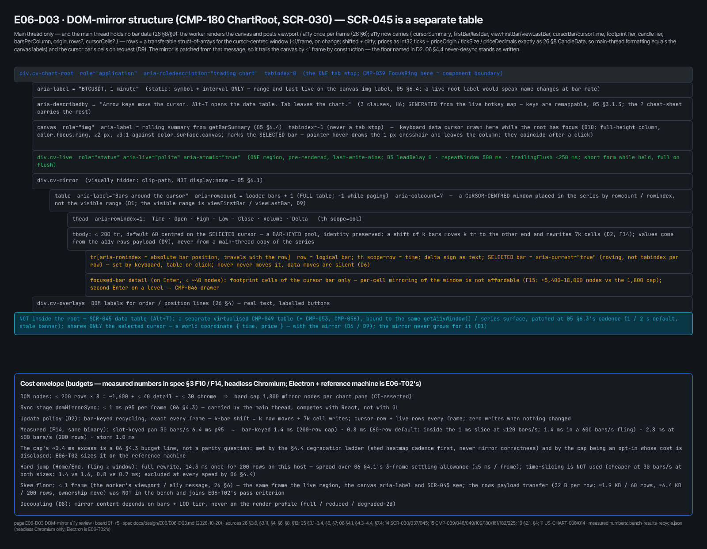
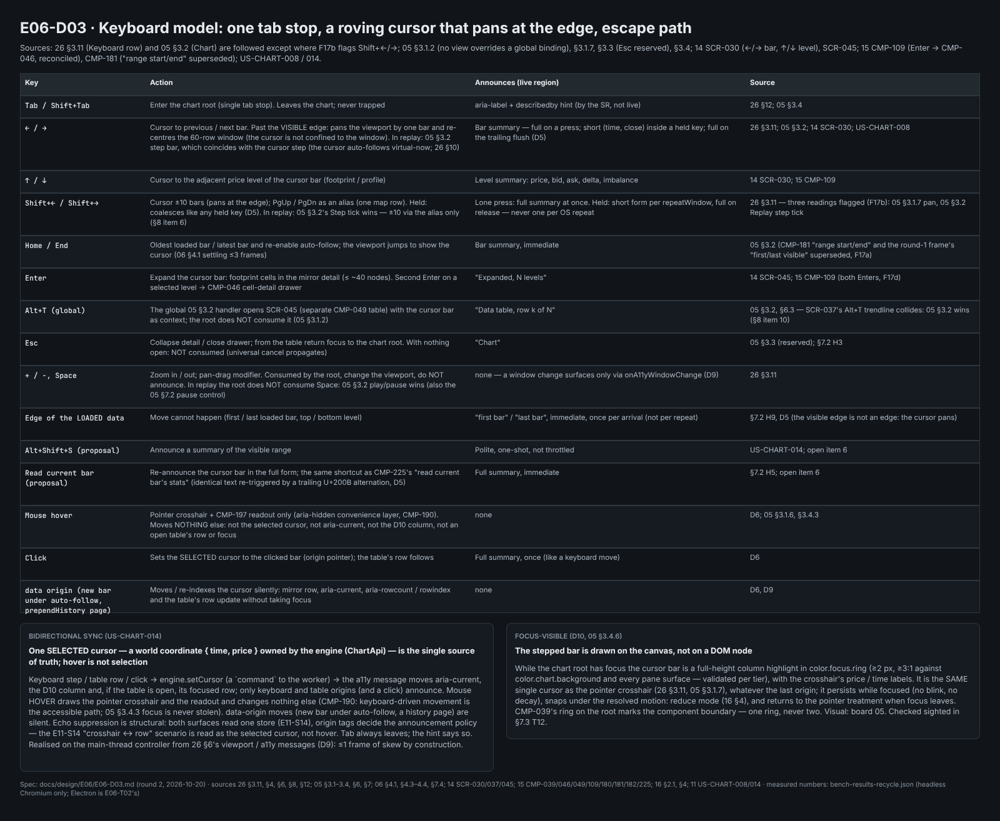
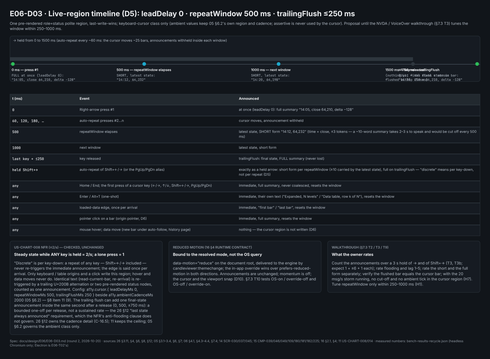
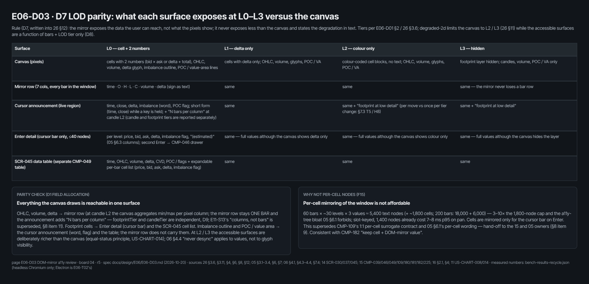

# E06-D03 — A11y design review: cost and shape of the engine DOM-mirror layer

**Ticket:** E06-D03 (#216) · **Epic:** E06 · **Status:** MERGED — design PR #3912 squash-merged 2026-10-21 (`41578ba65`); In Test until the owner signs off per the `docs/design/README.md` approval rule. This follow-up folds the boards-round approval's carries (comment 6313597198): the five boards are redrawn from script r6 on the self-hosted Penpot page `E06-D03 DOM-mirror a11y review` (page id `c6a732c2-01af-80be-8008-c987362e27fe`) — script r6 of 2026-10-21, redrawn and re-exported 2026-10-22 — board 05's L2 row as per-level colour cells, board 01's root row in `color.text.primary`, the callouts above the panes, SCR ids in the layer names, the boards spread on the page (§0, §8 item 7, §10, §11). The 2026-10-20 revisions fold the three rounds of the independent design review (13 + 9 + 5 findings; round 3 APPROVE) and the orchestrator's Fable lens on PR #3912 (12 + 4 + 8 items; its round 2 is APPROVE pending frames, with item 5 retracted; its boards round, on the drawn boards, asked for text fixes and a board-script r5, both folded), all in §11. Done in this PR: plan-doc edits (26 §12), the benchmark and its bar-keyed re-measurement, axe-core run, heuristic evaluation, screen-reader session protocol and owner walkthrough checklist, and the five Penpot boards (first drawn 2026-10-20 by the orchestrator's Penpot batch builder from this ticket's board script r4, redrawn 2026-10-21 from script r5 and 2026-10-22 from script r6 (of 2026-10-21) on the self-hosted Penpot, exported and embedded in §0). Not done, not claimed: Electron / reference-machine measurement (E06-T02), the NVDA + VoiceOver session itself (owner, §7.3).

## 0. Artefacts

Penpot (self-hosted): page **`E06-D03 DOM-mirror a11y review`**, page id `c6a732c2-01af-80be-8008-c987362e27fe`.

**Penpot state (orchestrator review, item 6; boards round):** the five boards were first drawn 2026-10-20 by the orchestrator's Penpot batch builder from this ticket's board script (r4) and exported with `docs/design/_tools/penpot_export.py`; the empty duplicate page was deleted. The boards-round lens (§11) asked for layout and prose fixes on boards 01, 02, 03 and 05: they are in script r5, from which the five boards were redrawn 2026-10-21 on the self-hosted Penpot; the boards-round approval's carries are in script r6 (every footer reads "page E06-D03 DOM-mirror a11y review · board 0n · r6"; r6 also carries the exact Inter font lookup, so the redrawn page is re-fonted), from which the five boards were redrawn 2026-10-22 on the self-hosted Penpot (the page named above, same page id; the r6 layer names carry the SCR id) and re-exported; the r6 board ids are in the table and the list below, and the PNGs embedded below are those exports. The boards' text form is §4 (D1 table, D10), §5 and §6.

| File                                                                 | Shows                                                                                                                                                                                                                                                                                                                                                                                                                                                                                               | State                                                                                                                                                                       |
| -------------------------------------------------------------------- | --------------------------------------------------------------------------------------------------------------------------------------------------------------------------------------------------------------------------------------------------------------------------------------------------------------------------------------------------------------------------------------------------------------------------------------------------------------------------------------------------- | --------------------------------------------------------------------------------------------------------------------------------------------------------------------------- |
| `img/E06-D03-mirror-structure.png`                                   | Mirror DOM tree, roles, node budget                                                                                                                                                                                                                                                                                                                                                                                                                                                                 | Drawn 2026-10-22 from the r6 script on the self-hosted Penpot (board id `a0462c44-6c6f-8015-8008-d3b055de6d26`); embedded below.                                            |
| `img/E06-D03-keyboard-model.png`                                     | Keyboard model, announcement per key, bidirectional sync rule                                                                                                                                                                                                                                                                                                                                                                                                                                       | Drawn 2026-10-22 from the r6 script on the self-hosted Penpot (board id `a0462c44-6c6f-8015-8008-d3b0f50e6718`); embedded below.                                            |
| `img/E06-D03-live-region-timeline.png`                               | Same content as the §5 text table                                                                                                                                                                                                                                                                                                                                                                                                                                                                   | Drawn 2026-10-22 from the r6 script on the self-hosted Penpot (board id `a0462c44-6c6f-8015-8008-d3b164ad9ede`); embedded below.                                            |
| `img/E06-D03-d7-lod-parity.png`                                      | D7 field allocation per surface × L0–L3 (the D1 table and D7)                                                                                                                                                                                                                                                                                                                                                                                                                                       | Drawn 2026-10-22 from the r6 script on the self-hosted Penpot (board id `a0462c44-6c6f-8015-8008-d3b1c772f363`; added on review F-13); embedded below.                      |
| `img/E06-D03-keyboard-cursor.png`                                    | D10: the chart at L0 and L2 with the focused column in `color.focus.ring` beside the pointer-only crosshair, plus the narrow-candle case (candle L1, `barSpacing` 2 px: the band behind the series), in dark, light and high contrast, the CMP-039 ring at the chart boundary; the L0 row at 1:1 (26 §3.6: cell + two numbers, ≥ 12 px cell text height) with per-level bid × ask text in the bar columns and a 2× inset of the 2 px core and its 1 px halos crossing a body and its cell text (r5) | Drawn 2026-10-22 from the r6 script on the self-hosted Penpot (board id `a0462c44-6c6f-8015-8008-d3b21d20c63f`; added on review N-04; narrow case on R-03); embedded below. |
| `E06-D03-bench/mirror-bench.html`, `run-bench.mjs`                   | Throwaway microbenchmark: hidden table, per-frame sync; slot-keyed `naive`/`diff` strategies (2026-10-14) and the bar-keyed `recycle` pool (2026-10-20, `?set=recycle`)                                                                                                                                                                                                                                                                                                                             | Run 2026-10-14 (§3 F10–F11) and 2026-10-20 (§3 F14)                                                                                                                         |
| `E06-D03-bench/bench-results-main.json`, `bench-results-sliced.json` | Raw 2026-10-14 output (HeadlessChrome 156)                                                                                                                                                                                                                                                                                                                                                                                                                                                          | Attached                                                                                                                                                                    |
| `E06-D03-bench/bench-results-recycle.json`                           | Raw 2026-10-20 output: recycling matrix with its same-binary slot-keyed controls (Chrome for Testing 155 headless shell)                                                                                                                                                                                                                                                                                                                                                                            | Attached                                                                                                                                                                    |
| `E06-D03-bench/bench-results-recycle-60r.json`                       | Raw 2026-10-20 output, second invocation (`?set=recycle60`): the default 60-row window under 120 and 600 bars/s pans, the storm and the hard jump                                                                                                                                                                                                                                                                                                                                                   | Attached                                                                                                                                                                    |
| `E06-D03-bench/bench-results-recycle-jumpfixed.json`                 | Raw 2026-10-20 output, third invocation (`?set=jumpfixed`): the Home/End-class hard jump with `table-layout: fixed`, 200 and 60 rows (orchestrator review, item 8)                                                                                                                                                                                                                                                                                                                                  | Attached                                                                                                                                                                    |
| `E06-D03-bench/mirror-structure-fixture.html`                        | Static realisation of the D4/D6 structure (roles, names, live region, table semantics; absolute `aria-rowcount`/`aria-rowindex` since round 2) for axe-core                                                                                                                                                                                                                                                                                                                                         | Added 2026-10-20                                                                                                                                                            |
| `E06-D03-bench/run-axe.mjs`, `axe-results.json`                      | axe-core runner (headless Chromium, local files, no network) and its raw result for both pages                                                                                                                                                                                                                                                                                                                                                                                                      | Run 2026-10-20, re-run after the round-2 fixture change (§7.1)                                                                                                              |

1. `E06-D03 / 01 mirror-structure (SCR-030)` (board id `a0462c44-6c6f-8015-8008-d3b055de6d26`):

   

2. `E06-D03 / 02 keyboard-model (SCR-030)` (board id `a0462c44-6c6f-8015-8008-d3b0f50e6718`):

   

3. `E06-D03 / 03 live-region-timeline (SCR-030)` (board id `a0462c44-6c6f-8015-8008-d3b164ad9ede`):

   

4. `E06-D03 / 04 d7-lod-parity (SCR-030 / 045)` (board id `a0462c44-6c6f-8015-8008-d3b1c772f363`):

   

5. `E06-D03 / 05 keyboard-cursor (SCR-030)` (board id `a0462c44-6c6f-8015-8008-d3b21d20c63f`):

   

Plan docs edited by this ticket (this PR): `docs/plan/26-chart-engine-design.md` §12 — cadence (D5), structure and update policy (D1/D2/D4), keyboard model and cursor (D6/D10), LOD/render-profile parity (D7/D8). `11-user-stories.md` US-CHART-008 and `05-accessibility-standard.md` §6.2 were checked and left unchanged (§5, §8 item 5).

## 1. Purpose and scope

Decide the cost and shape of the DOM-mirror layer: nodes, update rate, screen-reader (SR) behaviour, structure, roles, live-region policy, keyboard model, the focus-visible treatment of the focused bar, and the engine-side contract that E06-T02 and E11 (M8) consume. Out of scope: the production layer, hi-fi SCR-045, per-cell footprint surrogates beyond affordability (ticket "Out of scope"; the affordability result is F15).

## 2. Method (honest)

- **Desk research** of the cited plan docs.
- **Measured microbenchmark, not the ticket's prototype scene.** The E06-K04 findings (`docs/plan/spikes/E06-K04.md`, "Honest limits") state no browser/Electron/GPU exists in the environment; there is no mirror stub in the K04 prototype. A standalone throwaway page builds a hidden table (200 or 60 rows × 7 columns), patches it per `requestAnimationFrame`, and forces style/layout (`offsetHeight`) inside the measured span. 2026-10-14 run: headless Chromium 156 shell on WSL2 Linux, 16 cores, software rendering, no worker/GL running concurrently; 20 s per run, 3 reps, 100k synthetic bars; scenarios static, pan at 30 bars/s, update storm at 20 msg/s (06 §7.4: median of the three p95s).
- **Re-measurement with bar-keyed recycling (2026-10-20, review F-01).** Same page, dataset, method and scenarios, plus the `recycle` strategy the D4 structure implies ("pooled, identity preserved", row = logical bar): a shift of k bars moves k `<tr>` nodes and rewrites 7k cells and their absolute `aria-rowindex`; unmoved rows are diff-scanned so live updates land; a shift ≥ the window rewrites every row in place. Added scenarios: pans at 120 and 600 bars/s, a `table-layout: fixed` variant, storm, and a Home/End-class hard jump once per second — three invocations: the 200-row matrix with its controls (`?set=recycle`), the default 60-row window under the same fast pans, storm and jump (`?set=recycle60`), and the hard jump with `table-layout: fixed` at both sizes (`?set=jumpfixed`, orchestrator review item 8). **Host disclosure (item 9):** the 2026-10-14 run reported 16 logical cores (`navigator.hardwareConcurrency`), the 2026-10-20 runs 28 — the WSL2 VM's CPU allocation changed between the dates; the bench is single-threaded and every before/after pair in F14 lies within the 2026-10-20 set, but cross-date comparisons (F10/F11 vs F14) are indicative only. **Not measured:** the worker→main transfer of the row payload (D9) — the page synthesises `bars[]` on the main thread, so F14 includes number→string formatting but not the `postMessage` receive; E06-T02 measures it end to end (§8 item 1). Binary: Chrome for Testing 155.0.8059.12 headless shell (Playwright build 1247 — the axe run's binary; the 2026-10-14 binary is no longer on this host), so the slot-keyed controls were **re-run on the new binary** and every before/after comparison in F14 is same-binary.
- **axe-core run (done, §7.1)** against the benchmark page and a static fixture of the D4/D6 structure, in headless Chromium on this host; re-run after the fixture's round-2 change.
- **Heuristic evaluation (done, §7.2)** of D4–D6 against Nielsen's heuristics and the trading-specific rules in `05-accessibility-standard.md` (§2 POUR table, §3.1, §3.4, §6, §7). Every finding is labelled `(heuristic)`; no participants, timings or quotes exist.
- **Not done, and not claimed:** Electron and the other two runtimes (ADR-0011: Chromium, Electron, Tauri/WebView2), the reference machine, measurement alongside a rendering worker, the NVDA/VoiceOver walkthrough. No SR testing was done by anyone; §7.3 is the protocol for the owner to run. Cadence results in §5 are a design proposal, not validated. See §8.

## 3. Findings

| #   | Finding                                                                                                                                                                                                                                                                                                                                                                                                                                                                                                                                                                                                                                                                                                                                                                                                                                                                                                                                                                                                                                                                                                                                                                                                                                                                                                                                                                                                                                                                                                                                                                                                                                                                                                                                                                                                                                                                                                                                                                       | Source                                                                                                      |
| --- | ----------------------------------------------------------------------------------------------------------------------------------------------------------------------------------------------------------------------------------------------------------------------------------------------------------------------------------------------------------------------------------------------------------------------------------------------------------------------------------------------------------------------------------------------------------------------------------------------------------------------------------------------------------------------------------------------------------------------------------------------------------------------------------------------------------------------------------------------------------------------------------------------------------------------------------------------------------------------------------------------------------------------------------------------------------------------------------------------------------------------------------------------------------------------------------------------------------------------------------------------------------------------------------------------------------------------------------------------------------------------------------------------------------------------------------------------------------------------------------------------------------------------------------------------------------------------------------------------------------------------------------------------------------------------------------------------------------------------------------------------------------------------------------------------------------------------------------------------------------------------------------------------------------------------------------------------------------------------------- | ----------------------------------------------------------------------------------------------------------- |
| F1  | Mirror sync budget is ≤1 ms/frame, windowed so cost does not scale with bar count. Desyncing from the rendered view is never acceptable.                                                                                                                                                                                                                                                                                                                                                                                                                                                                                                                                                                                                                                                                                                                                                                                                                                                                                                                                                                                                                                                                                                                                                                                                                                                                                                                                                                                                                                                                                                                                                                                                                                                                                                                                                                                                                                      | `06-performance-and-load-standard.md` §4.3 row "DOM-mirror", §4.4 "Never acceptable"                        |
| F2  | Mirror is a hidden `<table>` of the visible window, cap 200 rows; live region throttled to 1 per 250 ms with last state always announced; `role="application"` wrapper.                                                                                                                                                                                                                                                                                                                                                                                                                                                                                                                                                                                                                                                                                                                                                                                                                                                                                                                                                                                                                                                                                                                                                                                                                                                                                                                                                                                                                                                                                                                                                                                                                                                                                                                                                                                                       | `26-chart-engine-design.md` §12 (wording before this PR)                                                    |
| F3  | Hidden via `clip-path`/off-screen, not `display:none`; windowed; engine must expose a "visible window + focused unit" query surface.                                                                                                                                                                                                                                                                                                                                                                                                                                                                                                                                                                                                                                                                                                                                                                                                                                                                                                                                                                                                                                                                                                                                                                                                                                                                                                                                                                                                                                                                                                                                                                                                                                                                                                                                                                                                                                          | `05-accessibility-standard.md` §6.1                                                                         |
| F4  | Ambient live region default 1 update/2 s per field, latest value not queue; assertive reserved for discrete events; regions pre-rendered, text swapped.                                                                                                                                                                                                                                                                                                                                                                                                                                                                                                                                                                                                                                                                                                                                                                                                                                                                                                                                                                                                                                                                                                                                                                                                                                                                                                                                                                                                                                                                                                                                                                                                                                                                                                                                                                                                                       | `05` §6.2                                                                                                   |
| F5  | US-CHART-008 NFR: announcements ≤2/s. 26 §12 allowed up to 4/s (1 per 250 ms). **These conflicted** (resolved by this PR, §5). US-CHART-014 NFR: table keeps ≥55 fps; table is equal status.                                                                                                                                                                                                                                                                                                                                                                                                                                                                                                                                                                                                                                                                                                                                                                                                                                                                                                                                                                                                                                                                                                                                                                                                                                                                                                                                                                                                                                                                                                                                                                                                                                                                                                                                                                                  | `11-user-stories.md` US-CHART-008, US-CHART-014                                                             |
| F6  | The two-document cadence conflict was also a three-way one: 05 §6.2 ambient default is 1/2 s, 11 is ≤2/s, 26 was 1/250 ms. Keyboard cursor moves are user-driven, ambient ticks are not — two classes, two cadences.                                                                                                                                                                                                                                                                                                                                                                                                                                                                                                                                                                                                                                                                                                                                                                                                                                                                                                                                                                                                                                                                                                                                                                                                                                                                                                                                                                                                                                                                                                                                                                                                                                                                                                                                                          | `05` §6.2, `11`, `26` §12                                                                                   |
| F7  | LOD tiers: L0 cell+2 numbers, L1 delta only, L2 colour only, L3 hidden; `degraded-2d` limits footprint to L2/L3. CMP-182 already states "hide text but keep cell + DOM-mirror value".                                                                                                                                                                                                                                                                                                                                                                                                                                                                                                                                                                                                                                                                                                                                                                                                                                                                                                                                                                                                                                                                                                                                                                                                                                                                                                                                                                                                                                                                                                                                                                                                                                                                                                                                                                                         | `E06-D01.md` §2; `26` §3.6, §3.7 (fallback), §11; `15-component-catalogue.md` CMP-182                       |
| F8  | CMP-180 specifies canvas `role="img"` and aria-label, whereas 26 §12 specifies a `role="application"` wrapper. Both can hold: application on the wrapper, img on the canvas inside (05 §6.4).                                                                                                                                                                                                                                                                                                                                                                                                                                                                                                                                                                                                                                                                                                                                                                                                                                                                                                                                                                                                                                                                                                                                                                                                                                                                                                                                                                                                                                                                                                                                                                                                                                                                                                                                                                                 | `15` CMP-180 A11y; `26` §12; `05` §6.4                                                                      |
| F9  | Mirror content inherits the chart's data classification.                                                                                                                                                                                                                                                                                                                                                                                                                                                                                                                                                                                                                                                                                                                                                                                                                                                                                                                                                                                                                                                                                                                                                                                                                                                                                                                                                                                                                                                                                                                                                                                                                                                                                                                                                                                                                                                                                                                      | ticket Security notes                                                                                       |
| F10 | Measured 2026-10-14, 200 rows slot-keyed naive/diff: static p95 0.8/0.3 ms (within 1 ms). **Continuous pan at 30 bars/s: p95 7.1 ms (naive), 8.5 ms (diff patch)**, max ~35 ms, i.e. 7-8× the 1 ms allocation. Storm (20 msg/s): p95 1.5 ms naive, 1.1 ms diff.                                                                                                                                                                                                                                                                                                                                                                                                                                                                                                                                                                                                                                                                                                                                                                                                                                                                                                                                                                                                                                                                                                                                                                                                                                                                                                                                                                                                                                                                                                                                                                                                                                                                                                               | `E06-D03-bench/bench-results-main.json`                                                                     |
| F11 | Mitigations measured 2026-10-14 (pan, 30 bars/s, p95 median of 3, slot-keyed): 4 Hz coalescing + cursor row 4.0 ms; 60 rows 2.3 ms; time-slicing 200 rows over 8 frames + cursor row **2.1 ms**; over 16 frames 1.7 ms; 60 rows time-sliced over 8 frames **0.8 ms**.                                                                                                                                                                                                                                                                                                                                                                                                                                                                                                                                                                                                                                                                                                                                                                                                                                                                                                                                                                                                                                                                                                                                                                                                                                                                                                                                                                                                                                                                                                                                                                                                                                                                                                         | `bench-results-main.json`, `bench-results-sliced.json`                                                      |
| F12 | axe-core 4.13.0: the D4/D6 structure fixture has **0 violations, 0 incomplete** (31 rules passed, incl. `aria-allowed-attr`, `aria-allowed-role`, `aria-roles`, `nested-interactive`, `role-img-alt`, `scope-attr-valid`, `tabindex`, `th-has-data-cells`, `td-headers-attr`, `empty-table-header`, `region`). The benchmark page has 5 violations, all page chrome of the throwaway page (no `<title>`, `lang`, `<main>`, `<h1>`), none on the table. Unchanged by the round-2 fixture change (§7.1).                                                                                                                                                                                                                                                                                                                                                                                                                                                                                                                                                                                                                                                                                                                                                                                                                                                                                                                                                                                                                                                                                                                                                                                                                                                                                                                                                                                                                                                                        | `E06-D03-bench/axe-results.json`, §7.1                                                                      |
| F13 | The ticket names "CMP-032 VisuallyHidden-class utility"; in the catalogue CMP-032 is Rating/Confidence Dots and the canvas-surrogate focus-ring utility is **CMP-039 FocusRing**. No `VisuallyHidden` component exists in `15`; the hiding technique is a rule (05 §6.1), not a component. This spec cites CMP-039.                                                                                                                                                                                                                                                                                                                                                                                                                                                                                                                                                                                                                                                                                                                                                                                                                                                                                                                                                                                                                                                                                                                                                                                                                                                                                                                                                                                                                                                                                                                                                                                                                                                           | `15-component-catalogue.md` CMP-032, CMP-039                                                                |
| F14 | **Re-measured 2026-10-20 with bar-keyed recycling (same binary for every pair).** Slot-keyed controls on Chrome for Testing 155: 200 rows diff static 0.3 ms, 200 rows diff pan 30 bars/s **6.4 ms**, 60 rows diff pan 2.6 ms, time-sliced 200/60 rows 1.6/0.7 ms. Bar-keyed pool: 200 rows pan 30 bars/s **1.4 ms p95** (max 9.0 ms; 1.3 ms without the per-frame diff scan), 60 rows 0.8 ms, 200 rows at 120 bars/s 1.8 ms and at 600 bars/s (10 bars/frame) 2.8 ms (max 8.4 ms); `table-layout: fixed` 1.3/2.0 ms at 30/600 bars/s; static 0.3 ms; storm 1.0 ms; a Home/End-class hard jump (full rewrite of 200 rows) costs **14.3 ms once** (p95 of the run 0.3 ms; with `table-layout: fixed` 30.2 ms for 200 rows and 5.4 ms for 60 — `bench-results-recycle-jumpfixed.json`: **fixed layout does not reduce the one-off** — `max` is a single worst sample of the 60 jumps per set — and the 3-frame spread of D2 bounds it, so fixed layout is recommended for pans only). Recycling makes a 30 bars/s pan **4.6× cheaper** than the slot-keyed diff on the same binary and is **cheaper than time-slicing at 30 bars/s at both sizes while exact every frame** (1.4 vs 1.6 ms at 200 rows; 0.8 vs 0.7 ms at 60 rows, equal within noise; the sliced variant was not re-run at 120/600 bars/s, where recycling's cost grows with k and slicing's does not), and time-slicing is excluded at every speed by the never-desync rule (06 §4.4), so it is not used. The **default 60-row window holds the 1 ms allocation with same-frame parity at 30 and 120 bars/s** (0.8 / 0.9 ms; storm 0.5 ms; hard jump 2.7 ms once — `bench-results-recycle-60r.json`) and measures 1.4 ms during a 10 bars-per-frame fling (600 bars/s); the **200-row cap does not hold it** (1.4 ms at 30 bars/s, 2.8 ms at 600 bars/s on this host). The per-frame diff scan of unmoved rows costs 0.1 ms (1.4 vs 1.3). The 7–8 ms of F10 was the cost of slot-keyed rows, not of the mirror. | `E06-D03-bench/bench-results-recycle.json`, `bench-results-recycle-60r.json`; `mirror-bench.html` `recycle` |
| F15 | **Per-cell mirroring is not affordable (the ticket's affordability question).** The visible window at the default 60 bars × ~30 price levels × 3 values (bid, ask, delta) is ≈5,400 text nodes plus ≈1,800 cell nodes (200 bars: 18,000 + 6,000) — 3–10× D1's 1,800-node hard cap and the "a11y-tree bloat" 05 §6.1 forbids; slot-keyed, 1,400 text nodes already cost 7–8 ms p95 on pan (F10), so 5,400 extrapolate to several times that; bar-keyed, a one-bar shift at cell granularity moves ~30 nodes and writes ~90 cells instead of 1 and 7, and the node count alone breaks the cap. Conclusion: cells are mirrored **only for the cursor bar, on `Enter`** (≤40 nodes, D7). This supersedes CMP-109's A11y contract ("every cell is mirrored … `tabindex`-able … DOM-mirror node generated 1:1 per visible cell", `Enter` → CMP-046) and 05 §6.1's "element per logical unit (bar, cell, row)" wording for cells (§8 item 9).                                                                                                                                                                                                                                                                                                                                                                                                                                                                                                                                                                                                                                                                                                                                                                                                                                                                                                                                                                                                                                        | `15` CMP-109 A11y + API sketch; `05` §6.1; F10, F14; ticket Out of scope                                    |
| F16 | **The worker protocol implies ≥1 frame of mirror skew by construction.** 26 §6 posts `viewport` (≤1/frame) and `a11y { cursorSummary }` from the worker after it renders; the main-thread mirror, the live region and the canvas `aria-label` can only be patched from the last message. That one frame is the floor for any reading of 06 §4.4 and is stated in D2/D9. 26 §8 `ChartEvents.crosshair { barIndex }` is the pointer-side cursor event.                                                                                                                                                                                                                                                                                                                                                                                                                                                                                                                                                                                                                                                                                                                                                                                                                                                                                                                                                                                                                                                                                                                                                                                                                                                                                                                                                                                                                                                                                                                          | `26` §6 worker→main table, §8                                                                               |
| F17 | **Keyboard-map contradictions surfaced by D6.** (a) Home/End: 05 §3.2 = oldest loaded bar / latest bar (resume live); CMP-181 says "range start/end"; the round-1 frame said first/last visible bar; 05 §3.1.2 forbids a view silently overriding a global binding, so 05 §3.2 wins (D6). (b) ±10 bars — three readings of `Shift+←/→`: 26 §3.11 binds it to 10 bars; 05 §3.1.7 says `Shift+arrows` pans the viewport; and 05 §3.2's Replay row binds it to "Step tick" on the same chart root (26 §3.11 gives step-tick to `Alt+←/→`) — pre-existing, two of the three in the global map; D6 adopts 26 §3.11 outside replay, lets 05 §3.2 win in replay (step tick; ±10 only via the `PgUp`/`PgDn` alias) and flags all three (§8 item 6). The same Replay row also binds `Space` (play/pause — vs 26 §3.11's pan-drag modifier) and `←/→` (step bar — vs the cursor step) on the chart root, where 26 §10 has the app handle them: D6 applies the same rule to all three keys (replay: `Space` not consumed by the root; `←/→` step bar and cursor step coincide) and hands all three to the hotkey-map owner (§8 item 6). (c) `Alt+T`: SCR-037 binds `Alt+T` to the trendline tool (and `Alt+H/F/R/M`), while 05 §3.2 makes `Alt+T` the global data-table toggle and gives drawing tools `Alt+1..4` — pre-existing; 05 §3.2 wins per §3.1.2 and 05 §3.3's bind-time detection would block the SCR-037 binding (§8 item 10). (d) `Enter`: CMP-109 opens the CMP-046 drawer; D6 expands the cursor bar in the mirror — reconciled in D6 (first `Enter` expands, second opens the drawer).                                                                                                                                                                                                                                                                                                                                                                                    | `05` §3.1.2, §3.1.7, §3.2, §3.3; `26` §3.11; `14` SCR-037; `15` CMP-109, CMP-181                            |

Caveat on F10/F11: the 2026-10-14 pan cost was dominated by forced layout on 1,400 changed text nodes because those strategies key rows by **slot** (row r always shows bar first + r), so every row changes on every shift. F14 measures the bar-keyed alternative on the same page. The absolute numbers remain indicative only (§2): one runtime, software rendering, no worker running.

## 4. Decisions

**D1 Window and nodes.** Cap stays 200 rows (26 §12) as the _maximum_; the default window is **60 rows centred on the selected cursor**, configurable up to the cap (Settings → Accessibility); it does **not** change when the data table opens. **One rule for the window (orchestrator review, item 4):** the mirror is a **cursor-centred window of bar rows, placed in the full loaded series by `aria-rowcount`/`aria-rowindex`** — it is not the visible range (05 §6.1 says "visible bar range": a bar-level deviation handed to the 05 owner, §8 item 9); the visible range is a different quantity, exposed separately (D9 `viewFirstBar`/`viewLastBar` from the §6 `viewport` message) and used by the canvas `aria-label` ("N bars visible") and by SCR-045's default page. **SCR-045 is a separate component**: a Panel built from CMP-049 Table + CMP-053 Pagination + CMP-056 ColumnPicker, virtualised over 100k rows with its own budget (`14`: ≤8 ms scripting per scroll frame), bound to the same `getA11yWindow()`/series surface and patched at 05 §6.3's cadence (default 1 update/2 s, stale banner); mirror and table share **only the selected cursor** (D6/D9), never DOM. Rows are a bar-keyed pool with identity preserved (D2, F14). Hard cap 1,800 mirror nodes per chart pane (200 × 8 = ~1,600, + ~40 detail + ~30 chrome), CI-asserted. Recorded in 26 §12. _(F1, F2, F10, F11, F14; review F-02)_

Field allocation per surface (what each exposes; this is how D7's "never less than the canvas" is checked — the canvas draws OHLC, volume, delta, footprint cells, imbalance outline, POC/value area, and every one of those is reachable below; POC and imbalance, which the mirror row does not carry, live in the announcement and the `Enter` detail):

| Surface                                     | Fields                                                                                                                                                                                                                    | Cadence / trigger                                                       |
| ------------------------------------------- | ------------------------------------------------------------------------------------------------------------------------------------------------------------------------------------------------------------------------- | ----------------------------------------------------------------------- |
| Mirror row (hidden table, 7 columns)        | time (row header), open, high, low, close, volume, delta (sign as text)                                                                                                                                                   | bar-keyed recycling on shift; cursor row and live rows every frame (D2) |
| Cursor announcement (live region)           | time, close, delta, imbalance (word), POC flag when the bar holds the visible-range POC, degradation phrase at footprint L2/L3 and "N bars per column" at candle L2 (D7); short form (time, close) inside a held key (D5) | D5 cadence                                                              |
| `Enter` detail (cursor bar only, ≤40 nodes) | per level: price, bid, ask, delta, imbalance flag, "(estimated)" — 05 §6.3's footprint-table columns; the estimated marker is CMP-227 (the literal word in the accessible name)                                           | on `Enter`; refreshed with the cursor row                               |
| SCR-045 data table                          | time, OHLC, volume, delta, CVD, POC/flags, expandable per-bar cell list (price, bid, ask, delta, imbalance flag) — US-CHART-014                                                                                           | 05 §6.3 cadence (default 1/2 s), stale banner                           |
| Canvas `aria-label` (05 §6.4)               | symbol, interval, visible bar count, last close, delta                                                                                                                                                                    | from `getBarSummary`, throttled with the window                         |

**D2 Update policy (re-decided on F14; review F-01).** Rows are **bar-keyed** (a `<tr>` pool, identity preserved, row = logical bar): a shift of k bars moves k rows to the other end and rewrites 7k cells plus their absolute `aria-rowindex`; the cursor row and rows receiving live data are patched every frame; untouched rows cost nothing (the per-frame diff scan that lets live updates land without dirty tracking costs 0.1 ms and is kept). Measured p95 on pan (F14): **0.8 ms for the default 60-row window at 30 bars/s** (0.9 ms at 120 bars/s; 1.4 ms during a 600 bars/s fling), **1.4 ms for the 200-row cap** (1.3 ms with `table-layout: fixed`; 2.8 ms, 2.0 ms fixed, at 600 bars/s). **The mirror is exact every frame at every size — same-frame parity with the canvas — bounded only by the one-frame skew the worker protocol implies** (F16: the mirror is patched from the `viewport`/`a11y` message the worker posts after rendering, the same message the live region, the canvas `aria-label` and SCR-045 consume; this review names that frame explicitly and treats it as the floor, not as a desync). **06 §4.4 stays as written**: the round-1 proposal to read "never desync" as "eventually consistent within 8 frames" is **withdrawn**, and the owner decision it asked for is closed (§8 item 4). What the data moves is the **budget line, not the parity rule**: the default window meets 06 §4.3's 1 ms slice at every pan speed a user sustains (≤120 bars/s); a momentum fling at 10 bars per frame and the 200-row cap at 30 bars/s each exceed it by ~0.4 ms on this software-rendered host — a §4.3 allocation question, met as 06 §4.4 prescribes (shed update frequency elsewhere, heatmap cadence first; never mirror correctness) and by the cap being an explicit opt-in (Settings → Accessibility) whose cost is disclosed; E06-T02 confirms on the reference machine and, if the cap still exceeds 1 ms there, lowers it to the measured 1 ms size (≈100 rows by interpolation between 0.8 ms at 60 and 1.4 ms at 200). **Time-slicing over ≤8 frames (F11) is dropped, not kept as a fallback**: recycling measured cheaper than slicing at 30 bars/s at both sizes while exact, and slicing is excluded at every speed by the never-desync rule (it would desync the mirror for up to 8 frames while a fling moves the view 80 bars), so the review's suggested "fallback for shifts above N bars per frame" would trade exactness for nothing the data or 06 §4.4 supports. A Home/End-class hard jump (or a fling of ≥ window bars) rewrites the whole window: a one-off of up to 14.3 ms for 200 rows (2.7 ms for 60) in one frame on this host, which E11 spreads over 06 §4.1's 3-frame settling allowance (≤5 ms per frame) in a fixed order — **frame 1 lands the cursor row, its `aria-current` and the live-region text, frames 2–3 the rest of the window** (orchestrator review, item 8; with `table-layout: fixed` the one-off measured 30.2 ms for 200 rows and 5.4 ms for 60 — fixed layout does not reduce the one-off; the 3-frame spread bounds it, F14) — the only case where the mirror trails the canvas by more than the worker frame, and by no more than the allowance 06 §4.1 grants the canvas itself for the same jump. `table-layout: fixed` on the hidden table is recommended to E11 M8 (1.3/2.0 ms vs 1.4/2.8 ms). Written into 26 §12 (this PR). _(F1, F10, F11, F14, F16)_

**D3 Budget status.** 1 ms p95 is **met for static, storm and — with bar-keyed recycling at the default 60-row window — pan** in headless Chromium (F10, F14); at the 200-row cap the pan measures 1.4 ms (1.3 ms with fixed layout), over the slice by ~0.4 ms while exact every frame (D2); the slot-keyed 200-row pan of F10 (8.5 ms) was the cost of the wrong structure, not of the mirror. Production verdict is deferred to E06-T02 on real Electron + reference machine, with the worker rendering (pass criterion: p95 ≤1 ms on pan at the default window with D1+D2, **including the receive and decode of the D9 `a11y` rows payload**, which the bench did not transfer; the cap is sized from that run; §8 item 1). _(F10, F11, F14)_

**D4 Structure and roles.** As `E06-D03-mirror-structure.png` (§0) and `E06-D03-bench/mirror-structure-fixture.html`: wrapper `role="application"` + `aria-roledescription="trading chart"` + static `aria-label` = **symbol and interval only** ("BTCUSDT, 1 minute" — a root label that carried the range or the last price would be stale if static or produce name-change speech at bar rate if live; orchestrator review, item 7) + `aria-describedby` hint **generated from the live hotkey map** (05 §3.1.3: keys are remappable; default rendering "Arrow keys move the cursor. Alt+T opens the data table. Tab leaves the chart."); range and last live on the canvas `role="img"` label (05 §6.4), rolling and throttled with the window; canvas `role="img"`, `tabindex="-1"`, not a tab stop; ONE pre-rendered `role="status" aria-live="polite" aria-atomic="true"` region; hidden table labelled "Bars around the cursor" (not "Visible bars" — D1), `th scope="col"` headers, the time cell as row header (`th scope="row"`, 05 §6.3 pattern), focused bar marked `aria-current="true"`; one tab stop for the whole chart (roving cursor, not `tabindex` per row). **Windowed-table semantics (WAI-ARIA 1.2; review F-06):** `aria-rowcount` = loaded bar count + 1 (the header row), or `-1` while paging; `aria-rowindex` = the bar's absolute position (header = 1, bar i = i + 2), so the SR says "row 2,912 of 4,321", not "row 31 of 61", and the index travels with the recycled row at zero cost on shift (F14). Focus-visible: the CMP-039 FocusRing on the root marks the component boundary; the focused bar itself is shown on the canvas by the keyboard data cursor (D10). The combination is axe-clean (F12). _(F2, F3, F4, F8, F12, F13)_

**D5 Live-region policy.** Keyboard-cursor announcements: 1 region, last-write-wins, with **three named parameters used identically here, in §5 and in 26 §12** (review F-07): **`leadDelay` = 0 ms** — the first press of a key announces at once; **`repeatWindow` = 500 ms** — while the key auto-repeats, at most one announcement per window, carrying the latest state; **`trailingFlush` ≤ 250 ms** — the final state is announced within 250 ms of the last key event and is never lost. Steady state while a key is held is 2/s (US-CHART-008's NFR); a lone press is one announcement. **Two text forms:** announcements inside a held key use the **short form** — time and close, ≤3 tokens ("14:12, 64,232") — because a ~10-word summary takes 2–3 s to speak at default rate and a new polite update every 500 ms would cut off its first words; the trailing flush, `Home`/`End` and the first press of a cursor key use the **full summary** (26 §12's example: time, close, delta, imbalance, plus D7's degradation phrase); `Enter` and `Alt+T` announce their own text ("Expanded, N levels", "Data table, row k of N" — D6, H12) and the edge its edge text. **"Discrete" means per key-down, not per auto-repeat** (review N-01): the first press of any key announces at once (`leadDelay` 0, full form) and resets the window; auto-repeat of **any** key — `←/→`, `↑/↓`, `Shift+←/→` and the `PgUp`/`PgDn` alias alike — coalesces under `repeatWindow` in the short form (the ±10 step is carried by the latest state) and `trailingFlush` gives the full summary on release, so a lone `Shift+→` announces at once and a held `Shift+→` announces 2/s exactly like a held `→`. `Home`/`End`, `Alt+T` and `Enter` are one-shot (nothing to coalesce). The loaded-data edge is announced **once per arrival**, not per repeat while the key is held there. Ambient market values (bid/ask, mark, PnL) keep 05 §6.2's cadence in their own region; the cursor region never carries ambient ticks. **Only `keyboard` and `table` origins and a pointer click write the cursor region** — pointer hover and `data` moves never do (D6). **Re-announcing identical text** (the "read current bar" key, H5; re-arrival at the same bar — orchestrator review, item 11): an `aria-atomic` region does not re-announce unchanged text, so a re-trigger alternates a trailing zero-width space (U+200B) on the status text — or swaps between two pre-rendered status nodes — so AT sees a change; it counts as one announcement under the cadence. Assertive is reserved per 05 §6.2 and is never used by the chart cursor. **Reduced motion** binds to the **resolved motion mode of the 16 §4 runtime contract** (E05-T02, `packages/ui/src/theme/`: `data-motion="reduce"` on the document root, delivered to the engine by the `candleviewer:themechange` event's `detail.motion`; 16 §7 owns the motion-safe/reduce pairs), which overrides `prefers-reduced-motion` in both directions (review F-09): announcements are unchanged, momentum is off, the cursor and the viewport snap (26 §12, 05 §7). **Recorded in 26 §12 (this PR)**; proposal until SR-validated (§7.3 T3 rates both forms). _(F4, F5, F6)_

**D6 Keyboard model.** Sources: **26 §3.11 (Keyboard row) and 05 §3.2 (Chart category)**, which D6 follows except where flagged in F17b; CMP-181's "Home/End jump to range start/end" and the round-1 frame's "first/last visible bar" are superseded (F17a). Keys the chart root consumes: `←/→` one bar; `↑/↓` one price level of the cursor bar (footprint/profile; level summary announced); **`Shift+←/→` ten bars** (26 §3.11), with `PgUp`/`PgDn` as an alias (one hotkey-map row for the chart's ±10 action, so the jump stays reachable in replay) — a held `Shift+←/→` coalesces like any held key (D5); **`Home`/`End` = oldest loaded bar / latest bar and re-enable auto-follow** (05 §3.2), the viewport jumping to show the cursor inside 06 §4.1's 3-frame settling allowance; `Enter` expands the cursor bar's cells into the mirror detail (≤40 nodes; "Expanded, N levels"), a second `Enter` on a selected level opens the CMP-046 cell-detail drawer (CMP-109's `Enter`, F17d), `Esc` collapses or closes; **`+`/`-` zoom and `Space` pan-drag modifier (26 §3.11) are consumed by the root, change the viewport and do not announce** (a window change surfaces only through `onA11yWindowChange`, D9); `Esc` with nothing to collapse is **not consumed** (universal cancel propagates, 05 §3.3; §7.2 H3); the root consumes no other key (letters such as `F`/`H`/`P`/`R` reach the app's global handlers). The global `Alt+T` handler (05 §3.2) opens SCR-045 with the chart's cursor bar as context; the root does not consume it (05 §3.1.2, review N-06). **In replay mode** (SCR-030's replay state — 05 §3.2's Replay row lands on the chart root, where 26 §10 has the app handle `←/→` step-bar and `Alt+←/→` step-tick while the chart has focus) the global map wins per §3.1.2 on all three Replay-row keys: `Space` = play/pause — the root does **not** consume it (it is also the pause control 05 §7.2 requires for auto-moving content), so the pan-drag modifier is unavailable in replay (pointer drag still pans); `←/→` = step bar, which **coincides with the cursor step** — a step is a real data event (26 §10) that moves virtual-now by one bar, and the cursor auto-follows virtual-now in replay, so each step lands the cursor on the new latest bar and announces it like any cursor move (held = coalesced, D5), while `Home`, `PgUp`/`PgDn` and `End` (back to virtual-now, 05 §3.2) move the cursor over history while paused; `Shift+←/→` = step tick and ±10 is via the `PgUp`/`PgDn` alias only — unless the hotkey-map owner re-homes step-tick to 26 §3.11's `Alt+←/→` (§8 item 6, review R-01). **The cursor is not confined to the visible window:** a step past the visible edge pans the viewport by one bar (ten for `Shift`) and re-centres the D1 window on the cursor, so a keyboard-only trader is never slower than a mouse user at the edge (TradingView's `←/→` scroll the chart by a bar and `Ctrl`/`Cmd+←/→` further — keyboard navigation is never confined to the visible range); a move that cannot happen fires only at the **ends of the loaded data** (and at the top/bottom level) and announces the edge ("first bar", "last bar") immediately and once per arrival — not per repeat while the key is held there (§7.2 H9, D5). Application-role escape path: Tab always leaves; stated in the hint. **Selection vs hover (orchestrator review, item 2):** the engine owns one **selected cursor** (a world coordinate `{ time, price }`, D9) and every surface reads it; **only `keyboard` and `table` origins announce and move AT state**. The **pointer is hover**: moving the mouse draws the pointer crosshair and the CMP-197 readout — an `aria-hidden` convenience layer; keyboard-driven movement is the accessible path (CMP-190, 05 §3.1.6) — and changes nothing else: not the D10 column, not the mirror's `aria-current`, not an open table's focused row or DOM focus (05 §3.4.3: focus is never stolen). A **click** sets the selected cursor to the clicked bar (origin `pointer`), announced once like a keyboard move, and the table row follows. **`data` origin moves are silent**: a new bar opening under auto-follow or a `prependHistory` page moves or re-indexes the cursor without writing the live region; the mirror row, `aria-current`, `aria-rowcount`/`aria-rowindex` and the table's focused row update without taking focus. Origin tags make echo suppression structural (E11-S14: both surfaces read one store); the E11-S14 "crosshair ↔ row" sync scenario is read as the **selected cursor** — a click or a keyboard step at bar 250 moves the table's row; hover does not (US-CHART-014 "Sync"). A "read current bar" key is proposed (§7.2 H5, shared with CMP-225). Focus-visible treatment of the stepped bar: D10. _(F2, F5, F8, F17; review F-03)_

**D7 Mirror under LOD.** Rule: **the mirror exposes the data the user can reach, not what the pixels show, but it must never expose less than the canvas and must state the degradation in text.** Concretely: every footprint tier (L0–L3) and every candle tier keeps **one row per bar** (OHLCV, delta) in the mirror; cell values are available **only for the cursor bar via `Enter`** at every tier (not as 1,000s of nodes — F15), and at footprint L2/L3 the cursor announcement states "footprint at low detail" so the user knows the mirror is richer than the canvas. **At candle L2** (26 §3.6: min/max aggregation, one column per pixel) **the row stays one bar and the announcement adds "N bars per column"**; the footprint and candle tiers are independent and reported separately (`footprintTier`/`candleTier`, D9). The D1 field-allocation table is the parity check per surface. This makes the mirror deliberately _more informative_ than the canvas at L2/L3 (equal-status principle, 11 US-CHART-014), with the "never desync" rule of 06 §4.4 applying to values, not to glyph visibility. Consistent with CMP-182 "keep cell + DOM-mirror value"; supersedes CMP-109's per-cell surrogate contract (F15, §8 item 9). **Written into 26 §12 (this PR).** Whether the degradation is stated on every move or once per tier change is a walkthrough question (§7.2 H8). _(F1, F7, F15)_

**D8 degraded-2d.** Mirror content and behaviour are a function of bars + LOD tier only, never of `RenderProfile`; a contract test runs the same mirror snapshot under full/reduced/degraded-2d. **Written into 26 §12 (this PR).** _(F7, ticket AC4)_

**D9 Engine contract (consumed by E06-T02, E11 M8; CMP-180 ChartApi).**

```ts
interface A11yWindow {
  firstBar: number; // the mirror window = the cursor-centred window (D1), absolute positions in the loaded series
  lastBar: number;
  viewFirstBar: number; // the visible range (from the §6 `viewport` message), exposed separately (D1)
  viewLastBar: number;
  cursorBar: number; // derived at message time from the selected cursor's world coordinate
  cursorTime: number; // the selected cursor itself (survives prependHistory, resize, zoom — E11-S13)
  footprintTier: "L0" | "L1" | "L2" | "L3"; // 26 §3.6 footprint tiers (D7 degradation phrase at L2/L3)
  candleTier: "L0" | "L1" | "L2"; // 26 §3.6 candle tiers; at L2 the announcement adds "N bars per column" (D7)
  barsPerColumn: number; // 1 unless candleTier is L2
}
// Transferable struct-of-arrays for the mirror window: ≤1 per frame, posted only when the window's content changed.
// `shifted` = k rows moved this frame (D2); |shifted| ≥ count means a full rewrite; `dirty` = row offsets whose values changed.
interface A11yRows {
  firstBar: number;
  count: number;
  shifted: number;
  dirty: Uint16Array;
  time: Float64Array; // µs epoch, as 26 §8 `CandleData`
  open: Int32Array; // prices in ticks from `priceOrigin`, exactly as 26 §8 `CandleData` — never re-quantised floats
  high: Int32Array;
  low: Int32Array;
  close: Int32Array;
  volume: Float32Array;
  delta: Float32Array;
  priceOrigin: number;
  tickSize: number;
  priceDecimals: number; // so main-thread formatting equals the canvas labels (E11-S14's parity test)
}
interface A11yCells {
  barIndex: number;
  price: Int32Array; // ticks from `priceOrigin`, as 26 §8 `FootprintData.cellPriceLevel`
  bid: Float32Array;
  ask: Float32Array;
  delta: Float32Array;
  imbalance: Uint8Array;
  estimated: Uint8Array;
  priceOrigin: number;
  tickSize: number;
  priceDecimals: number;
}
type CursorOrigin = "pointer" | "keyboard" | "table" | "data"; // pointer = click only; hover never reaches the a11y layer
interface ChartApi {
  // additions
  getA11yWindow(): A11yWindow; // served from the controller's cache of the last `a11y` message
  onA11yWindowChange(
    cb: (w: A11yWindow, rows: A11yRows | null, origin: CursorOrigin) => void,
  ): () => void; // once per message, ≤1/frame
  setCursor(
    target: { barIndex: number } | { time: number },
    origin: "keyboard" | "table" | "pointer",
  ): void; // main→worker `command`
  requestCursorCells(barIndex: number): Promise<A11yCells>; // `command` → next `a11y { cursorCells }` (the Enter detail, D6/D7)
  getBarSummary(barIndex: number, form: "full" | "short"): string; // the ONE text source; defined for bars inside the cached window
  getDomMirrorRoot(): HTMLElement; // already in CMP-180
}
```

**Realisation across the worker boundary (26 §6; review F-08; orchestrator review item 1).** The engine renders in a worker and **the main thread holds no bar data**: the series lives in the render worker's DataModel (26 §8 `setData`/`prependHistory` transfer the buffers; 26 §9 moves decoded typed arrays shared worker → render worker without a copy), so the mirror rows, the storm patches, the `Enter` detail and `getBarSummary` need a main-thread source. The §6 `a11y` message therefore carries, besides the window indices, a **transferable row payload** `rows` (struct-of-arrays for the cursor-centred window, ≤1 per frame, posted only when the window's content changed, with `shifted`/`dirty` so the controller applies D2's k-row move and dirty patches without diffing) and, on request (`command: a11yCells`), `cursorCells` for the `Enter` detail. Prices travel as **Int32 ticks with `priceOrigin`/`tickSize`, exactly as 26 §8 `CandleData`/`FootprintData`, plus `priceDecimals`**, so the main thread formats the same digits the canvas labels show (E11-S14's parity test) and never re-quantises floats. Size: 32 B per row (one Float64 time, four Int32 prices, two Float32 volumes) → 60 rows ≈ 1.9 KB, 200 rows ≈ 6.4 KB per changed frame — an ArrayBuffer transfer is an ownership move, not a copy. The message names stay 26 §6's (`a11y` worker→main, `command` main→worker); this PR proposes extending `a11y` from `{ cursorSummary }` to `{ cursorSummary, firstBar, lastBar, viewFirstBar, viewLastBar, cursorBar, cursorTime, footprintTier, candleTier, barsPerColumn, origin, rows?, cursorCells? }`; `onA11yWindowChange` fires once per such message. The getters are synchronous only because they read the controller's cache of the last `viewport`/`a11y` messages; `getBarSummary` is defined for bars inside the cached window (the live region only ever announces the selected cursor, which is always inside it). **The bench did not transfer**: `mirror-bench.html` synthesises `bars[]` on the main thread, so F14 includes number→string formatting but not the `postMessage` receive — the E06-T02 pass criterion (§8 item 1) includes it. The mirror, the live region and the canvas `aria-label` therefore trail the canvas by at most one frame by construction (F16, D2). `getBarSummary` is the single text source for the live region (full and short form, D5) and for the canvas `aria-label` (05 §6.4), so the two can never disagree. Mirror sync is a named Performance.measure stage `domMirrorSync` (exists in the E06-D02 harness JSON, `docs/design/E06/E06-D02.md` perStageMs). Mirror values carry the chart's data classification (F9). _(F1, F9, F16)_

**D10 Keyboard data cursor — the focused bar's focus-visible treatment (review F-04).** The focused bar has no DOM element of its own (D4), so its focus-visible treatment is drawn on the canvas: **while the chart root has focus, the cursor bar is marked in the foreground layer (26 §3.1 scene graph; §4 row "Crosshair + labels") by a full-height column highlight ≥2 px wide in the `color.focus.ring` token** (≥3:1 against `color.surface.canvas` — the chart data-ink background, 16 §2.1/§11 — and every surface tier, validated per tier by the theme validator: `tools/contrast/pairs.mjs` registers `color.focus.ring` on five of the seven surface tokens (`app`, `canvas`, `raised`, `overlay`, `sunken`; `hover` and `selected` are not registered — E11 M8 adds them if the cursor can sit on those); CMP-180's catalogue name `color.chart.background` is not defined in any token set, §8 item 8), with the crosshair's price and time labels. **Adjacent colours (05 §3.4.6 asks for ≥3:1 against adjacent colours, not only the background; computed from the token JSON for the D10 frame):** the ring token clears the pane (7.1:1 dark and high-contrast — high-contrast inherits dark's canvas and candle tokens, 16 §4; `semantic-hc` has nine overrides — the buy/sell defaults (→ `.hc`), four text tokens, `border.default`, `focus.ring`, `action.primary.default` — and no canvas or candle token — 6.3:1 light) but not the candle bodies it crosses (dark: 1.1:1 vs `color.candle.up`, 1.5:1 vs `color.candle.down`; light: 1.3:1 / 1.3:1), so the 2 px core carries a 1 px halo in the pane background on both sides — the double-ring technique — which keeps ≥3:1 at every edge (7.5:1 / 4.7:1 dark, 5.0:1 / 4.8:1 light between halo and candle) — these are `pairs.mjs`'s registered `color.candle.up`/`.down` on `color.surface.canvas` pairs, since the halo is the pane colour; ring-vs-candle is deliberately **not** a registered pair because the halo, not the ring, is the adjacent colour. **Narrow bars (candle L1 at `barSpacing` 1.5–3 px, L2 below — 26 §3.6; review R-03):** when the bar is narrower than the core plus its two halos (4 px), the highlight is drawn instead as a full-height **band behind the series** — width ≥ bar width + 2 px, `color.focus.ring`, with the 1 px pane-colour halo at its outer edges — so the body of the focused bar stays visible on top; the band's edges keep ≥2 px / ≥3:1 against the pane (at L2's one-column-per-pixel strip the band is 3 px around the focused column). The column marks the **selected** bar (keyboard, table or click — D6); **pointer hover draws the 1 px pointer crosshair at the pointer (26 §3.11 "follows pointer, snaps to bar centre") and leaves the column where it is**, so both are visible while the mouse moves; a click moves the selection, and the column, to the clicked bar and the two coincide. When focus leaves the root the column is removed and the crosshair keeps its pointer treatment. **Forced colours** (Windows High Contrast, `forced-colors: active` — orchestrator review, item 10): the UA does not recolour canvas pixels, so the engine resolves the system colours by a DOM probe (`getComputedStyle` of a hidden element styled `color: Highlight; background: Canvas`) on `candleviewer:themechange` and on the `forced-colors` media change, and draws the core in `Highlight` with a `Canvas` halo (the CMP-039 ring on the root follows the UA); verified in E11-Q05's NVDA + Windows High Contrast pass (§8 item 12). It persists while the root has focus (no blink, no decay — never colour-only, the column is also the `aria-current` row and the announced bar); under the resolved `motion: reduce` mode (16 §4) it snaps, otherwise it may ease ≤ `motion.duration.fast`. The CMP-039 FocusRing on the root marks the component boundary — one ring, never two. Visual: the D10 frame (`img/E06-D03-keyboard-cursor.png`, §0 — L0, L2 and the narrow-candle band, three themes, beside the pointer-only crosshair). Sighted-keyboard check: §7.3 T12, §7.4. _(F17; 05 §3.4.6)_

## 5. Live-region throttling timeline (text form of `img/E06-D03-live-region-timeline.png`, §0)

| t (ms)          | Event                                                                        | Announced                                                                                                                                                |
| --------------- | ---------------------------------------------------------------------------- | -------------------------------------------------------------------------------------------------------------------------------------------------------- |
| 0               | Right-arrow press #1                                                         | at once (`leadDelay` 0): full summary "14:05, close 64,210, delta −128"                                                                                  |
| 60, 120, 180, … | auto-repeat presses #2…n                                                     | cursor moves, announcement withheld                                                                                                                      |
| 500             | `repeatWindow` elapses                                                       | latest state, **short form** "14:12, 64,232"                                                                                                             |
| 1000            | next window                                                                  | latest state, short form "14:20, 64,198"                                                                                                                 |
| last key + ≤250 | key released                                                                 | `trailingFlush`: final state, full summary "14:30, close 64,176, delta +57" (in the frame the key is released at 1500 ms and the flush lands by 1750 ms) |
| held Shift+→    | auto-repeat of Shift+←/→ (or the PgUp/PgDn alias)                            | exactly as a held arrow: short form per `repeatWindow` (±10 carried by the latest state), full summary on `trailingFlush`                                |
| any             | Home / End; the first press of a cursor key (←/→, ↑/↓, Shift+←/→, PgUp/PgDn) | immediate, full summary, resets the window                                                                                                               |
| any             | Enter / Alt+T (one-shot)                                                     | immediate, their own text ("Expanded, N levels" / "Data table, row k of N"), resets the window                                                           |
| any             | loaded-data edge, once per arrival                                           | immediate, "first bar" / "last bar", resets the window                                                                                                   |
| any             | pointer click on a bar (origin `pointer`, D6)                                | immediate, full summary, resets the window                                                                                                               |
| any             | mouse hover; `data` move (new bar under auto-follow, history page)           | nothing — the cursor region is not written (D6)                                                                                                          |

**US-CHART-008 NFR (≤2/s) checked against D5 — consistent, left unchanged.** The steady state while **any** key is held — `←/→`, `↑/↓`, `Shift+←/→` or the `PgUp`/`PgDn` alias — is exactly 2/s, because "discrete" is defined per key-down (D5): a repeat never re-triggers the immediate announcement; a lone press is one announcement; the edge is one announcement per arrival. The trailing flush can add one final-state announcement inside the same second after a release (a key released just after a window boundary gives announcements at 0, 500 and ≤750 ms): that is the 26 §12 "last state always announced" requirement, a bounded one-off per release, not a sustained rate, which is what the NFR's anti-flooding clause governs. The cadence detail is owned by 26 §12 (C-16.5); 11 keeps the ceiling only. 05 §6.2 is untouched: it governs the ambient class, which D5 keeps separate.

## 6. Acceptance criteria and DoD → evidence

| Scenario                           | Evidence                                                                                                                                                                                                                                                                                                                                                                                                                                                                    |
| ---------------------------------- | --------------------------------------------------------------------------------------------------------------------------------------------------------------------------------------------------------------------------------------------------------------------------------------------------------------------------------------------------------------------------------------------------------------------------------------------------------------------------- |
| 1 ms budget validated with numbers | F10, F11, **F14**, D2, D3, `E06-D03-bench/`. **Partial:** headless Chromium on Linux, not Electron on the reference machine; with bar-keyed recycling the pan at the default 60-row window is within the allocation in this runtime (F14: 0.8 ms p95), exact every frame; the 200-row cap measures 1.4 ms and is an opt-in whose cost is disclosed, sized by E06-T02 (D2); time-slicing is dropped — cheaper at 30 bars/s, excluded at every speed by 06 §4.4 (F11 vs F14). |
| Cadence usable                     | D5 and §5, 26 §12 (this PR). **Not done:** SR user confirmation; decision recorded as a proposal with `leadDelay` 0 / `repeatWindow` 500 ms / `trailingFlush` ≤250 ms and a short held-key form; heuristic review §7.2 (H1, H5, H8); protocol §7.3, checklist §7.4. Final-state guarantee is by construction (trailing flush).                                                                                                                                              |
| Mirror behaviour under LOD defined | D7, F7, F15 and the D1 field-allocation table, written into 26 §12; consistent with 06 §4.4 as written (D2).                                                                                                                                                                                                                                                                                                                                                                |
| Survives degraded-2d               | D8 written into 26 §12; the contract test is E11's. No runtime exists here to demonstrate it.                                                                                                                                                                                                                                                                                                                                                                               |

| DoD item                                                                          | State                                                                                                                                                                                                                                                                  |
| --------------------------------------------------------------------------------- | ---------------------------------------------------------------------------------------------------------------------------------------------------------------------------------------------------------------------------------------------------------------------- |
| Measured mirror-sync costs (3 scenarios × 3 runtimes) vs 1 ms                     | **Partial**: 3 scenarios (+ jump and fast pans) × 1 runtime (headless Chromium, §2), slot-keyed and bar-keyed. Electron/WebView2 and the reference machine: E06-T02.                                                                                                   |
| Announcement cadence decision; 26 §12 and US-CHART-008 NFR updated if they change | **Done**: D5; 26 §12 edited; US-CHART-008 checked, consistent, unchanged (§5).                                                                                                                                                                                         |
| LOD/mirror parity rule written into 26 §12                                        | **Done**: D7 + D8 (this PR); field allocation per surface in D1.                                                                                                                                                                                                       |
| SCR-045 structural shape + CMP-180 focus contract drafted and linked              | **Done**: D1 (SCR-045 separated from the mirror, shared selected cursor, D9), D4, D6, D9, D10; `E06-D03-keyboard-model.png`, `E06-D03-mirror-structure.png` (script r6 of 2026-10-21, redrawn and re-exported 2026-10-22 on the self-hosted Penpot, §0), fixture page. |
| Screen-reader walkthrough findings logged; axe-core run attached                  | **Partial**: axe attached (§7.1, `axe-results.json`); SR session not run — protocol (§7.3) and owner checklist (§7.4) replace it per the agent-delivery adaptations; heuristic findings in §7.2.                                                                       |
| Accessibility specialist sign-off; design sign-off                                | **Pending**: owner approval of this PR (adaptations: owner `approved` comment or merge).                                                                                                                                                                               |
| Feeds into E06-T02 as a report section                                            | **Hand-off** (§9): D3, D9, bench + axe artefacts.                                                                                                                                                                                                                      |

## 7. A11y evidence

Hidden via clip-path not `display:none` (05 §6.1); focus ring uses CMP-039 FocusRing for the chart root and the on-canvas keyboard data cursor marks the focused bar (D10; `15`; F13 corrects the ticket's CMP-032 reference); never colour-only (05 §4; delta sign is text, imbalance is a word, the cursor column is also the announced and `aria-current` bar); table is equal status (US-CHART-014); reduced motion per the 16 §4 runtime contract and 05 §7.

### 7.1 axe-core run (done 2026-10-20; re-run after the round-2 and the orchestrator-lens fixture changes)

Tooling: axe-core 4.13.0 via `@axe-core/playwright` 4.13.0 and `playwright-core` 1.64.0 from the workspace's installed packages; browser Chrome for Testing 155.0.8059.12 (Playwright headless shell build 1247, launched by explicit `executablePath`), WSL2 Linux, software rendering; local `file://` pages only, no network. Options: `resultTypes: ["violations", "incomplete"]` (full node detail for those; passes keep one node each). Runner: `E06-D03-bench/run-axe.mjs`; raw output: `E06-D03-bench/axe-results.json`.

| Page                                                                                                                                                               | Violations                                                                                                                         | Incomplete | Passes / inapplicable | Attributable to the mirror design?                                                                                                                                                                                                                                                                                                                                                                                                                                                                                                                                         |
| ------------------------------------------------------------------------------------------------------------------------------------------------------------------ | ---------------------------------------------------------------------------------------------------------------------------------- | ---------- | --------------------- | -------------------------------------------------------------------------------------------------------------------------------------------------------------------------------------------------------------------------------------------------------------------------------------------------------------------------------------------------------------------------------------------------------------------------------------------------------------------------------------------------------------------------------------------------------------------------- |
| `mirror-bench.html` (200-row table after one static run)                                                                                                           | 5: `document-title` (serious), `html-has-lang` (serious), `landmark-one-main`, `page-has-heading-one`, `region` ×2 (best-practice) | 0          | 12 / 73               | **No.** All five are page chrome of the throwaway benchmark page (no `<title>`, `lang`, `<main>`, `<h1>`). The second `region` node is the hidden mirror container sitting outside any landmark; with a `<main>` (fixture) it passes. Every table/ARIA rule that applied passed: `aria-allowed-attr`, `aria-valid-attr`, `aria-valid-attr-value`, `empty-table-header`, `table-duplicate-name`, `td-headers-attr`, `th-has-data-cells`.                                                                                                                                    |
| `mirror-structure-fixture.html` (D4/D6 structure, 60 rows, absolute `aria-rowcount`/`aria-rowindex`, root label symbol + interval, table "Bars around the cursor") | **0**                                                                                                                              | **0**      | 31 / 58               | n/a — clean. Passing rules cover the decided combination: `role="application"` + `aria-roledescription` + `aria-describedby` (`aria-allowed-attr`, `aria-allowed-role`, `aria-roles`, `aria-required-attr`), `tabindex` on the root, canvas `role="img"` (`role-img-alt`), `nested-interactive`, `scope-attr-valid`, `th-has-data-cells`, `td-headers-attr`, `empty-table-header`, `table-duplicate-name`, `region`, landmarks, headings, `color-contrast`. `aria-rowcount="4321"` / absolute `aria-rowindex` pass `aria-valid-attr-value` (F-06 changed no rule outcome). |

Result against the ticket's bar ("no violations attributable to the mirror design"): **met**. Limits: axe does not evaluate live-region cadence, `role="application"` usability, the on-canvas cursor (D10) or focus behaviour over time — those are §7.3's. The fixture is static markup, not the production layer; axe 4.13 has no `aria-roledescription`-specific rule, so that attribute is covered only by `aria-allowed-attr`.

### 7.2 Heuristic evaluation of D4–D6 (heuristic; no participants)

Frame: Nielsen's ten heuristics plus the trading-specific rules in `05-accessibility-standard.md` — §2 POUR table (never colour-only, canvas has a text/DOM equivalent, live updates without flooding, keyboard-only operability, consistent hotkey layer, plain-language errors, parallel accessible representation), §3.1 (keyboard rules), §3.4 (dense-layout focus rules), §6 (canvas strategy), §7 (reduced motion). Severity is Nielsen's 0–4 scale (0 not a problem, 1 cosmetic, 2 minor, 3 major, 4 catastrophic). Every row is `(heuristic)`: an evaluator's reading of the written design, not an observation of a user.

| #   | Heuristic                                                  | Finding (heuristic)                                                                                                                                                                                                                                                                                                                                                                                                                                                                                                                                                                                                  | Sev. | Proposed action / check                                                                                                                                                                                                                                                                              |
| --- | ---------------------------------------------------------- | -------------------------------------------------------------------------------------------------------------------------------------------------------------------------------------------------------------------------------------------------------------------------------------------------------------------------------------------------------------------------------------------------------------------------------------------------------------------------------------------------------------------------------------------------------------------------------------------------------------------- | ---- | ---------------------------------------------------------------------------------------------------------------------------------------------------------------------------------------------------------------------------------------------------------------------------------------------------- |
| H1  | Visibility of system status; 05 §2 Perceivable             | During the 500 ms `repeatWindow` a held key moves the cursor up to ~15 bars with no SR feedback; the first and the trailing announcement bound the silence to ≤500 ms, which is inside normal response expectation, but the window must not grow beyond ~1 s. Interruption matters too: a full summary every 500 ms would be cut off, hence D5's short form inside a held key.                                                                                                                                                                                                                                       | 1    | Keep; tune the window only within 250–1000 ms (§7.3 T3); T3 rates the short and the full form.                                                                                                                                                                                                       |
| H2  | Match between system and the real world                    | The summary string leads with the bar time ("14:32, close …"). When stepping bar by bar the time is the least informative field; traders scan close/delta/imbalance.                                                                                                                                                                                                                                                                                                                                                                                                                                                 | 2    | Walkthrough: ask whether value-first order ("close 64,210, delta −128, 14:32") reads better; make field order a Settings → Accessibility option if yes.                                                                                                                                              |
| H3  | User control and freedom; 05 §3.3 `Esc` reserved           | D6 maps `Esc` to "collapse detail / return from table". If nothing is open, an application-role root that swallows `Esc` breaks the universal cancel.                                                                                                                                                                                                                                                                                                                                                                                                                                                                | 2    | **Adopted in D6**: `Esc` with nothing to collapse is not consumed.                                                                                                                                                                                                                                   |
| H4  | Consistency and standards; 05 §3.4.1 landmarks             | `role="application"` disables SR browse-mode keys inside the root (NVDA quick-nav letters, VoiceOver rotor shortcuts). The hint names Tab as the exit, but NVDA users also expect NVDA+Space to toggle modes and VoiceOver users expect VO+Shift+↓/↑ to interact/stop interacting. The design must not fight those. `aria-roledescription="trading chart"` also replaces the spoken word "application", which is the user's cue that quick-nav keys are off (review F-12).                                                                                                                                           | 1    | Walkthrough §7.3 T1 records whether the SR's mode-switch cue (sound / "focus mode") still fires with the roledescription; T8 confirms mode switching works and that the root is reachable from the landmark list (the chart panel is a `region` per 05 §3.4.1, the application root sits inside it). |
| H5  | Flexibility and efficiency; recognition over recall        | No key re-reads the current cursor bar. Live updates to the in-progress bar patch the mirror row silently (D2/D5), so a SR user cannot re-hear the current state without moving the cursor away and back. CMP-225 already specifies a "read current bar's stats" shortcut.                                                                                                                                                                                                                                                                                                                                           | 3    | Propose the chart root binds the same "read current bar" shortcut as CMP-225 (one hotkey-map entry, 05 §3.2); announce immediately as a discrete event, with the D5 re-trigger for identical text (trailing U+200B alternation). Added to §8 item 6.                                                 |
| H6  | Aesthetic and minimalist design (hint length)              | The describedby hint is read on every focus entry; a long hint (all of D6) is fatiguing. The structure frame's three-clause hint is right; the `?` cheat-sheet (05 §3.4.9) carries the rest.                                                                                                                                                                                                                                                                                                                                                                                                                         | 1    | **Adopted in D4**: hint fixed to "Arrow keys move the cursor. Alt+T opens the data table. Tab leaves the chart." (the fixture matches since round 2).                                                                                                                                                |
| H7  | Error prevention; 05 §3.4.3 focus never stolen             | Alt+T moves focus to the table row of the cursor bar — user-initiated, allowed. A storm update never writes to the cursor region (D5), so it cannot interrupt a cursor announcement; a cursor-row live update is silent.                                                                                                                                                                                                                                                                                                                                                                                             | 0    | Walkthrough §7.3 T9 confirms no interruption in practice.                                                                                                                                                                                                                                            |
| H8  | Aesthetic and minimalist design (announcement text)        | D7 appends "footprint at low detail" to the cursor announcement at L2/L3. Repeated on every bar step this is noise; the user needs it once when entering a degraded tier and when expanding (`Enter`).                                                                                                                                                                                                                                                                                                                                                                                                               | 2    | Walkthrough §7.3 T5: stated per move vs once per tier change; 26 §12 wording covers both readings.                                                                                                                                                                                                   |
| H9  | Help users recognise, diagnose and recover                 | D6 did not define what happens when a move cannot happen (cursor at the first/last loaded bar, top/bottom level): silence reads as a broken key.                                                                                                                                                                                                                                                                                                                                                                                                                                                                     | 2    | **Adopted in D6**: edge announced immediately ("first bar"/"last bar"), once per arrival (not per repeat), never coalesced; the visible edge is not an edge (the cursor pans).                                                                                                                       |
| H10 | 05 §3.4.2 roving tabindex vs D4 single tab stop            | D4 uses one tab stop plus `aria-current` on the row and relies on the live region for cursor feedback, instead of the APG grid pattern 05 §3.4.2 prescribes for the footprint cell grid. **The named alternative (review F-12): a `role="grid"` mirror with `aria-activedescendant` on the root moved at D5's cadence** — the WAI-ARIA APG-sanctioned way to receive arrow keys without the application role's browse-mode loss (NVDA/JAWS switch to focus mode on `grid` too). An uncoalesced activedescendant change at auto-repeat rate would flood exactly as D5 prevents; if used it must move at D5's cadence. | 3    | Walkthrough §7.3 T2/T3/T8 decide: live region only (D4 as written) vs live region + coalesced `aria-activedescendant` on a `grid` mirror. Not changed here; the fixture realises D4 as written.                                                                                                      |
| H11 | 05 §2 Perceivable, §4 never colour-only; §7 reduced motion | Delta sign as text, imbalance as a word, degradation stated in words; the on-canvas cursor is paired with `aria-current` and the announcement (D10); reduced motion leaves announcements unchanged and removes momentum.                                                                                                                                                                                                                                                                                                                                                                                             | 0    | None (positive).                                                                                                                                                                                                                                                                                     |
| H12 | Consistency: SCR-045 ↔ cursor                              | Alt+T announces "Data table, row k of N" and Esc returns "Chart"; the table's focused row follows the selected cursor (keyboard, table or click — never hover) and vice versa with origin tags (US-CHART-014 Sync; D6); the table is a separate CMP-049 component (D1), so the mirror never grows for it. Consistent with 05 §6.3's "patched in place" rule.                                                                                                                                                                                                                                                         | 0    | None (positive); 05 §6.3's stale banner applies when the cursor bar leaves the table's window.                                                                                                                                                                                                       |

### 7.3 Screen-reader session protocol (05 §8.2 adaptation, for the owner to run)

Precondition: a build with the mirror and the D5 cadence (E06-T02's instrumented stub or E11 M8's first build). No such build exists today; only T1 can be dry-run now against `mirror-structure-fixture.html` (names and roles, no keyboard handling). Nothing below has been run; record only what is observed.

1. **Combos** (05 §8.1): NVDA 2024.x on Windows 11 with the Electron production build (row 1) or Chromium (row 3, fast gate); VoiceOver on macOS 14 with the Electron build (row 4). Default verbosity, fresh profile, default hotkey map, dark theme, keyboard only. T12 is run sighted, without a screen reader.
2. **Data**: synthetic recorded fixture at 1 m with footprint, ≥300 bars loaded, LOD at L0 at the start zoom; a 20 msg/s update storm available (recorder replay).
3. **Tasks** — log per task: pass/fail, the verbatim announcement(s), count of announcements, a 1–5 rating for each of _flooding_ (1 = none) and _lag_ (1 = none), and anything that needed sight.
   - T1 Tab into the chart. Expect: root label (symbol, interval, range, last) then the hint. Note what the SR calls the element (roledescription "trading chart") **and whether the SR's mode-switch cue (sound / "focus mode" / "application") still fires** (H4, review F-12).
   - T2 One → press. Expect exactly one announcement, at once (`leadDelay` 0), full bar summary.
   - T3 Hold → for 3 s, then release. Expect the first announcement immediately (full form), then ≤1 per 500 ms in the **short form** (time, close), then one final **full** announcement ≤250 ms after release whose bar equals the cursor bar (verify with the readout). Count them. Rate flooding and lag; rate the short and the full form separately for comprehension. Repeat holding ←.
   - T3b Hold Shift+→ for 3 s, then release. Expect the same shape as T3 — first full announcement at once, then ≤1 short announcement per 500 ms carrying 10-bar steps, then one final full announcement ≤250 ms after release whose bar equals the cursor bar — never one announcement per OS repeat. Then hold → at the last loaded bar for 2 s: expect "last bar" once, not per repeat.
   - T4 Home, End. Expect immediate full announcements, no coalescing with a preceding hold; Home lands on the oldest loaded bar and End on the latest bar with auto-follow back on (05 §3.2); the viewport jumps to show the cursor.
   - T5 Enter on a bar at L0, then zoom out to L2 and repeat. Expect cell detail at L0; at L2 the announcement states "footprint at low detail" and Enter still reads cell values. Note whether the degradation phrase repeats on every step (H8). A second Enter on a level opens the cell-detail drawer; Esc closes it and returns to the detail.
   - T6 Alt+T. Expect "Data table, row k of N" with focus on the cursor bar's row; move two rows in the table, Esc. Expect "Chart" and the cursor on the row you left (sync both ways).
   - T7 Tab from the root. Expect focus leaves the chart; Shift+Tab returns to it; no trap.
   - T8 Mode switching inside the root: NVDA+Space (NVDA), VO+Shift+↓/↑ (VoiceOver). Expect the chart's own keys to work in focus/interaction mode and the SR's own navigation to resume on exit (H4). If T2/T3 show the live region alone loses the cursor, compare against the H10 alternative (`grid` + coalesced `aria-activedescendant`).
   - T9 With the storm running and the cursor on the live bar, repeat T2 and T3. Expect no cut-off announcements and no ambient ticks in the cursor region (H7).
   - T10 Reduced motion, both directions of the 16 §4 override: (a) OS setting on, in-app override `off`; (b) OS setting off, in-app override `on` (`Ctrl+Shift+M`). Repeat T3 in each. Expect identical announcements in both; momentum off and the cursor snapping in (b) only.
   - T11 Force `degraded-2d` (WebGL disabled); repeat T1, T2, T6. Expect identical names, table and announcements (D8).
   - T12 **Sighted keyboard (no SR):** Tab into the chart, press → five times, hold → for 2 s, Shift+→, Home, End, then step past the visible edge. Expect the stepped bar visibly marked on the canvas at every step (D10: full-height column in the focus-ring colour, ≥2 px, clearly distinct from the un-focused pointer crosshair — compare against the D10 frame `img/E06-D03-keyboard-cursor.png`, §0, at L0 and L2 in the active theme), the mark persisting while the chart has focus, the viewport panning to follow the cursor at the edge, and only the CMP-039 ring at the chart boundary — no second ring. Zoom out until candles are ≤3 px (candle L1/L2): the highlight becomes the band behind the series and the focused bar's body stays visible. Under reduced motion the mark snaps.
   - T13 **Hover vs selection (mouse + SR):** with the table open and the cursor on bar k, move the mouse across the chart without clicking. Expect no announcement, the table's focused row and the D10 column unmoved, the pointer crosshair and readout following the mouse. Click bar m. Expect one full announcement, the column and the table's row on m.
   - T14 **`data` origin:** with auto-follow on and the storm running, wait for a new bar to open. Expect the cursor on the new bar with no cursor announcement, the mirror's `aria-current` moved, the table's row following without taking focus. Scroll to the oldest bar so a history page loads. Expect `aria-rowcount` to grow and `aria-rowindex` to re-index, the cursor still on the same bar (time), nothing announced.
4. **Pass criteria**: every task completes keyboard + SR only (T12: keyboard only; T13: mouse + SR; otherwise P0 per 05 §8.2 item 5); the final state is always announced (T3, T9); the owner rates flooding ≤2 and lag ≤2 on T3 and understands both forms; the window stays within 250–1000 ms after tuning; T11 is identical to the full profile; T12 passes at the default zoom and at 200 % browser zoom.
5. **Output**: a dated findings log appended to this spec (§8 item 2), the chosen window value, and the H2/H8/H10 decisions.

### 7.4 Owner walkthrough checklist (to post on #216)

- [ ] Tab reaches the chart root once; the SR speaks symbol, interval, range, last, then the 3-clause hint; note whether the SR's focus-mode cue still fires.
- [ ] One arrow press = one announcement, at once.
- [ ] Holding an arrow for 3 s: first announcement immediate, then about one short announcement (time, close) per 500 ms, one final full announcement after release that matches the cursor bar; rate flooding and lag 1–5; say whether the short form is enough while scrubbing.
- [ ] Home / End / Enter / Alt+T and a lone Shift+arrow announce immediately, even right after a hold; Home = oldest loaded bar, End = latest bar with auto-follow back on.
- [ ] Holding Shift+→ for 3 s behaves like a held arrow: about one short announcement per 500 ms (10-bar steps), one full announcement on release — never one per repeat; held at the last loaded bar, "last bar" is said once.
- [ ] Stepping past the visible edge pans the chart instead of stopping; "first bar"/"last bar" is said only at the ends of the loaded data.
- [ ] At L2 (zoomed out), Enter still reads footprint cell values and the degradation is said in words; note if it repeats too often; a second Enter opens the cell drawer.
- [ ] Alt+T opens the table on the cursor bar's row; Esc returns to the chart with the cursor where the table left it.
- [ ] Esc with nothing open does not get swallowed by the chart.
- [ ] NVDA+Space / VO interaction toggles behave; the chart keys work in focus mode; Tab always leaves.
- [ ] With the 20 msg/s storm running, cursor announcements are not cut off and no ambient prices leak into them.
- [ ] Reduced motion via the OS and via the in-app override, each way round: same announcements; no momentum only when the resolved mode is reduce.
- [ ] WebGL disabled (`degraded-2d`): same names, table and announcements.
- [ ] Sighted, keyboard only: the stepped bar is visibly marked on the canvas at every step (focus-ring colour, ≥2 px, persistent), only one ring at the chart boundary; zoomed out to ≤3 px candles the band sits behind the series and the focused bar's body stays visible; the mark snaps under reduced motion.
- [ ] Mouse hover announces nothing and moves neither the table row nor the canvas column; a click selects the bar and announces it once.
- [ ] A new bar under auto-follow and a history page load are silent; `aria-rowcount` grows and the cursor stays on its bar.
- [ ] Decide: value-first announcement order (H2)? `grid` + `aria-activedescendant` at D5 cadence (H10)? A "read current bar" key (H5)?

## 8. Open items and validation plan (for the owner)

1. **Run the same benchmark in Electron on the reference machine, with the worker rendering** (E06-T02). Pass criterion: p95 ≤1 ms on pan at the default 60-row window with D1+D2 (bar-keyed recycling), **measured end to end including the receive and decode of the D9 `a11y` rows payload** (the bench synthesised the data on the main thread and did not transfer it); the 200-row cap is sized from that run (lowered to the measured 1 ms size if it exceeds the slice there). Time-slicing stays dropped (F14; 06 §4.4). Open.
2. **NVDA + VoiceOver walkthrough** per §7.3 against D5 with a real build: held-key arrowing in both forms, flooding and lag, tune the 500 ms window; the mode-switch cue; decide H2, H8, H10. Not performed; protocol and checklist ready.
3. **axe-core** run on the prototype page. **Done** (§7.1, re-run after round 2); re-run on the production layer in E11 M8 (CI `a11y` gate).
4. Owner decision on D2's "eventually consistent within 8 frames" reading of the never-desync rule. **Withdrawn**: on F14, 06 §4.4 stays as written (the mirror is exact every frame, bounded only by the inherent one-frame worker skew named in D2); no owner decision is needed unless item 1 fails.
5. Reconcile 26 §12 (1/250 ms), US-CHART-008 (≤2/s) and 05 §6.2 per D5. **Done for 26 §12 (this PR)**; US-CHART-008 checked, consistent under the sustained-rate reading, left unchanged (§5); 05 §6.2 unchanged (ambient class).
6. Hotkey-map entries (05 §3.2): the visible-range summary key, the "read current bar" key shared with CMP-225 (H5), and the `PgUp`/`PgDn` alias of the chart's ±10-bar action (needed in replay, below). **For the hotkey-map owner — the Replay row on the chart root (F17b, review R-01):** three readings of `Shift+←/→` — 05 §3.1.7 "pans the viewport"; 26 §3.11 "10 bars" (D6 adopts it outside replay — the cursor pans the viewport at the edge anyway, so these two converge); 05 §3.2 Replay "Step tick" (26 §3.11 gives step-tick to `Alt+←/→`) — plus `Space` (05 §3.2 play/pause vs 26 §3.11 pan-drag modifier) and `←/→` (05 §3.2 step bar vs the cursor step). D6's default: in replay the global map wins per 05 §3.1.2 on all three keys — `Space` is not consumed by the root, `←/→` step bar and cursor step coincide (the cursor auto-follows virtual-now), `Shift+←/→` steps a tick and ±10 is via `PgUp`/`PgDn`; the owner may instead re-home step-tick to `Alt+←/→`, which frees `Shift+←/→` for ±10 everywhere. Open; no new issue filed (plan-first rule), carried to E11 M8's hotkey work.
7. **Penpot frames** — first drawn 2026-10-20 from the r4 script of #3912 (the empty duplicate page is deleted), redrawn 2026-10-21 from script r5 (the boards-round fixes, §11) and again 2026-10-22 from script r6 (of 2026-10-21) (the boards-round approval's carries: board 05's L2 row as per-level colour cell blocks, board 01's root row in `color.text.primary` with the action colour on its stroke, the callouts above the panes clear of the pointer crosshair, SCR ids in the layer names, the five boards spread on the page) on the self-hosted Penpot page `E06-D03 DOM-mirror a11y review` (page id `c6a732c2-01af-80be-8008-c987362e27fe`), exported and embedded in §0: (a) timeline frame PNG (§5 is the text form); (b) **D7 LOD-parity frame** (the D1 field-allocation table × L0–L3; review F-13); (c) structure frame rebuild: cost-envelope line → bar-keyed recycling, exact every frame, one-frame worker skew (D2); `aria-rowcount=N` → full-table semantics (D4); root label symbol + interval, hint from the live hotkey map, table "Bars around the cursor" (D4); the `a11y` rows payload (D9); SCR-045 drawn as a separate table (D1); the keyboard data cursor (D10); (d) keyboard-model frame rebuild: Home/End per 05 §3.2, `Shift+←/→` ±10 (held = coalesced; replay = step tick), `←/→` (replay = step bar, coinciding with the cursor step), edge auto-pan, `+`/`-` and `Space` as root-consumed (`Space` not in replay: play/pause wins), `Alt+T` as the global handler, pointer hover vs click (D6), the F17 sources, the two clipped source cells; (e) hint text in the structure frame already matches H6; (f) **D10 keyboard-cursor frame** (review N-04, R-03): the chart at L0 and L2 with the focused column in `color.focus.ring` beside the pointer-only crosshair, and the narrow-candle case (candle L1, `barSpacing` 2 px: the band behind the series), in dark, light and high contrast, the CMP-039 ring at the chart boundary — the visual T12 compares against.
8. Catalogue nit (F13): the ticket's "CMP-032 VisuallyHidden-class utility" should read CMP-039 FocusRing; no `VisuallyHidden` component exists. For the catalogue owner at the next 15 touch; not edited here (not this ticket's doc). The 18 matrix also lists CMP-032 under US-CHART-014 (plausibly the confidence dots of the detector drawer) — check intent before the 15 edit. **Also for the 15 and 16 owners (review R-02):** CMP-180's Tokens line names `color.chart.background` and `color.chart.grid`, which no token set defines; the chart pane is `color.surface.canvas` (16 §2.1/§11, `tools/contrast/pairs.mjs`) — either register the catalogue names as aliases or rename CMP-180's line, so E11 M8 binds a real token (D10 uses `color.surface.canvas`).
9. **For the 15 and 05 owners (review F-05):** amend CMP-109's A11y/API sketch (per-cell `tabindex`-able mirror nodes generated 1:1 per visible cell, `Enter` → CMP-046) and 05 §6.1's "element per logical unit (bar, cell, row)" wording to the cursor-bar-detail model decided here (D1/D4/D7, F15): bar rows mirrored, cells only for the cursor bar on `Enter`, second `Enter` → CMP-046; and CMP-181's "Home/End jump to range start/end" to 05 §3.2's meaning (F17a). Not edited here (not this ticket's docs); the H10 grid-pattern question is decided in the walkthrough and may add `aria-activedescendant` to the same amendment. **Bar-level deviations from 05 §6.1 (orchestrator review, item 4):** the mirror is a cursor-centred window placed by `aria-rowcount`/`aria-rowindex`, not the "visible bar range"; one tab stop and a hidden table instead of per-unit aligned surrogates — both to be reflected in the same §6.1 amendment.
10. **For the 14 owner (review F-10):** SCR-037's letter scheme (`Alt+T` trendline, `Alt+H`, `Alt+F`, `Alt+R`, `Alt+M`) collides with 05 §3.2 (global `Alt+T` = data-table toggle; drawing tools `Alt+1..4`); 05 §3.2 wins per §3.1.2 and 05 §3.3's bind-time detection would block the SCR-037 binding. Not edited here.
11. **For E11-S13 and E11-S14 (orchestrator review, item 3) — nine AC/design conflicts with this spec, and the spec's answer to each:** (1) **node cap** — S13 "under 500 nodes" / `a11y.mirrorNodeCap` 500 vs D1: the default 60-row window is ≈550 nodes and the 200-row opt-in cap is 1,800 (CI-asserted); S13's AC and default follow D1. (2) **per-unit surrogates** — S13 "one `tabindex`-able element per logical unit, aligned over the canvas" vs D4: one tab stop, a `clip-path`-hidden table, cells only for the cursor bar (F15); D4 wins (05 §6.1 amended, item 9). (3) **columns at LOD ≥ L1** — S13 "the mirror mirrors columns, not bars ('12 bars aggregated')" vs D7: bar rows at every tier, the aggregation stated in the announcement; S13's desync AC is satisfied on values and tier, not on glyphs. (4) **API names** — S13 `getVisibleWindow()`/`getFocusedUnit()` vs D9 `getA11yWindow()` (mirror window + `viewFirstBar`/`viewLastBar`), `setCursor`, `getBarSummary`, `onA11yWindowChange`; D9's names, which 26 §12 now cites. (5) **cursor coordinates** — S13 world coordinates `{ time, price }` vs D9's `barIndex`: S13 is right and D9 adopts it — the selected cursor is stored as `{ time, price }` and `cursorBar` is derived at message time, so `prependHistory`, resize and zoom never lose it (`aria-rowindex` re-indexes on a page load, D6 `data` origin). (6) **`PageUp`/`PageDown` "page"** vs D6: the alias of the ±10-bar action (26 §3.11); a viewport-width page is a hotkey-map decision (item 6). (7) **"CMP-004 FocusRing"** — CMP-004 is Toggle; the utility is CMP-039 FocusRing (F13). (8) **`role="alert"` for LOD step-down** vs D7/H8: an LOD change is stated in the polite cursor announcement (per move vs once per tier, walkthrough), never an alert; context lost/restored and data stale stay alerts (05 §6.2). (9) **`a11y.announceCadenceMs` (one cadence, 2000)** vs D5: two groups — `a11y.ambientCadenceMs` 2000 (05 §6.2) and `a11y.cursor.{ leadDelayMs: 0, repeatWindowMs: 500, trailingFlushMs: 250 }`. S14 is consistent except for its "crosshair ↔ row" wording, read as the selected cursor (D6). Not edited here (ticket JSON is owned by the backlog tools); E11-S13/S14's authors rebase their ACs on this spec before pickup.
12. **For E11-Q05 (orchestrator review, item 10):** verify the D10 cursor under Windows High Contrast (`forced-colors: active`): the system-colour probe resolves `Highlight`/`Canvas`, the canvas-drawn core and halo follow them, and the CMP-039 ring follows the UA.

## 9. Hand-offs

E06-T02: D3, D9 (incl. the rows-payload transfer in the pass criterion), the benchmark (three sets) and the axe artefacts (report section "a11y cost"); E11 M8 — **E11-S13** (layers 1, 2, 4) and **E11-S14** (SCR-045): D1, D2, D4–D10, §7.3 protocol, H5/H10 decisions, item 6 and the nine conflicts in item 11; E11-Q05: item 12; SCR-045 hi-fi design: D1 field allocation, D6 sync rule, H12; CMP-180 owner: D4, D9, D10; 15 catalogue owner: items 8 and 9; 05 owner: item 9; 14 owner: item 10; hotkey-map owner: item 6.

## 10. Summary for #216 (≤10 lines)

1. Mirror cost measured (headless Chromium only): static/storm within 1 ms; a slot-keyed 200-row pan is 7–8× over, but with the bar-keyed row recycling the structure implies the default 60-row window pans at 0.8 ms p95, exact every frame (0.9 ms at 120 bars/s; 200-row cap 1.4 ms; a 600 bars/s fling 1.4 ms for 60 rows, 2.8 ms for 200) — within the 1 ms allocation at the default for sustained pans, over it by ~0.4 ms at the cap and during a 10 bars-per-frame fling. Electron + reference machine stays with E06-T02.
2. 06 §4.4 "never desync" stays as written: the mirror is exact every frame at every size, bounded only by the one-frame skew of the worker's `viewport`/`a11y` messages; the cap's extra cost is a 06 §4.3 budget question met by the §4.4 degradation ladder and an opt-in cap, never by desyncing; time-slicing is dropped (cheaper at 30 bars/s, excluded at every speed by §4.4). The round-1 request for an owner reading of §4.4 is withdrawn.
3. Cadence decided (D5) and written into 26 §12: one polite region, last-write-wins, `leadDelay` 0, `repeatWindow` 500 ms, `trailingFlush` ≤250 ms; short form while a key is held, full form on release and on discrete jumps. US-CHART-008's ≤2/s is consistent and unchanged.
4. Keyboard model aligned with 26 §3.11 and 05 §3.2: Home/End = oldest loaded / latest bar, `Shift+←/→` ±10 (coalesced like any held key; step tick in replay per 05 §3.2), the cursor pans the viewport past the visible edge, `+`/`-`/`Space` are root-consumed and silent, `Alt+T` stays the global handler; in replay the Replay row wins on `Space`, `←/→` and `Shift+←/→`; only keyboard, table and a click move the selected cursor — hover is a readout, `data` moves are silent; the focused bar is drawn on the canvas as a focus-ring-coloured column (D10).
5. SCR-045 is a separate CMP-049 table sharing only the selected cursor (a world coordinate, D9) with the mirror; a field-allocation table states what the mirror row, the announcement, Enter and the table each expose (D1/D7). Per-cell mirroring is not affordable (F15): cells only for the cursor bar.
6. LOD/mirror parity (D7) and render-profile independence (D8) written into 26 §12; D9 realised on the main-thread controller from 26 §6's messages: `a11y` extended with a transferable row payload (the main thread holds no bar data), `cursorCells` on request, a world-coordinate cursor; the transfer joins E06-T02's pass criterion.
7. axe-core 4.13: the D4 structure fixture has 0 violations (absolute `aria-rowcount`/`aria-rowindex`); the bench page's 5 are page chrome. Artefacts in `E06-D03-bench/`.
8. No screen-reader session was run: §7.3 is the protocol (T1–T12, incl. a sighted-keyboard task), §7.4 the owner checklist, §7.2 the heuristic review.
9. Penpot: the five frames were drawn from the r4 script 2026-10-20, redrawn from script r5 and then r6 (the boards-round fixes and the approval's carries, §11) on the self-hosted Penpot page `E06-D03 DOM-mirror a11y review` (page id `c6a732c2-01af-80be-8008-c987362e27fe`) — script r6 of 2026-10-21, redrawn and re-exported 2026-10-22 (§0); the empty duplicate page is deleted.
10. Hand-offs: E11-S13/S14's nine AC conflicts answered (§8 item 11); CMP-109/05 §6.1 per-cell and visible-range wording, CMP-181 Home/End, CMP-180's unrealised tokens (15/05/16 owners); SCR-037's Alt+T collision (14 owner); the Replay row (hotkey-map owner); forced colours (E11-Q05); CMP-032 → CMP-039 nit.

## 11. Review log

Round 1 — independent design-review lens, 2026-10-20, REQUEST_CHANGES (5 Major, 5 Minor, 3 Nit), all folded; the F-01 dispute (time-slicing as a fallback) was accepted in round 2:

| Id   | Severity | Folded as                                                                                                                                                                                                                                                                                                                                                                                                                                                                                                                                                                                                                             |
| ---- | -------- | ------------------------------------------------------------------------------------------------------------------------------------------------------------------------------------------------------------------------------------------------------------------------------------------------------------------------------------------------------------------------------------------------------------------------------------------------------------------------------------------------------------------------------------------------------------------------------------------------------------------------------------- |
| F-01 | Major    | Bar-keyed recycling added to the bench and measured with same-binary controls (F14, `bench-results-recycle*.json`); D2 re-decided: 06 §4.4 kept as written, one-frame worker skew stated, the default window inside the 1 ms slice, the 200-row cap's excess treated as a §4.3 budget line (opt-in, sized by E06-T02). The fix's "time-slicing as the documented fallback" is **not** adopted: recycling measured cheaper at 30 bars/s at both sizes (1.4 vs 1.6 ms, 0.8 vs 0.7 ms) while exact, and slicing is excluded at every speed by 06 §4.4, so it is dropped (accepted by the lens in round 2); 26 §12 rewritten accordingly. |
| F-02 | Major    | SCR-045 separated from the mirror in D1 and 26 §12 (grow-when-table-open clause deleted); field-allocation table added (D1), used by D7.                                                                                                                                                                                                                                                                                                                                                                                                                                                                                              |
| F-03 | Major    | D6 re-sourced to 26 §3.11 and 05 §3.2: Home/End, `Shift+←/→` ±10, cursor pans past the visible edge, edge announcements at loaded-data ends only, `+`/`-`/`Space` root-consumed; F17 records the contradictions; §8 item 6 flags Shift+arrows.                                                                                                                                                                                                                                                                                                                                                                                        |
| F-04 | Major    | D10 added (on-canvas keyboard data cursor: `color.focus.ring`, ≥2 px, ≥3:1, same cursor as the crosshair, snaps under reduce); §7.3 T12 and a §7.4 checkbox.                                                                                                                                                                                                                                                                                                                                                                                                                                                                          |
| F-05 | Major    | F15 states the per-cell affordability result; D7 names the CMP-109 / 05 §6.1 supersession; D6 reconciles the two `Enter`s; §8 item 9 hands off to the 15 and 05 owners.                                                                                                                                                                                                                                                                                                                                                                                                                                                               |
| F-06 | Minor    | D4, the fixture and the bench `recycle` strategy use full-table `aria-rowcount` and absolute `aria-rowindex`; axe re-run (§7.1).                                                                                                                                                                                                                                                                                                                                                                                                                                                                                                      |
| F-07 | Minor    | D5 names `leadDelay` / `repeatWindow` / `trailingFlush`, used identically in §5 and 26 §12; short held-key form added; T3 rates both forms.                                                                                                                                                                                                                                                                                                                                                                                                                                                                                           |
| F-08 | Minor    | D9 realised across the worker boundary from 26 §6's `viewport`/`a11y` messages; `a11y` extension proposed; `setCursor` as a `command`; `getBarSummary` the single text source; F16.                                                                                                                                                                                                                                                                                                                                                                                                                                                   |
| F-09 | Minor    | D5 and T10 bind reduced motion to the 16 §4 runtime contract (`data-motion`, `candleviewer:themechange`), tested both ways.                                                                                                                                                                                                                                                                                                                                                                                                                                                                                                           |
| F-10 | Minor    | F17c and §8 item 10: SCR-037's `Alt+T` collision handed to the 14 owner (05 §3.2 wins).                                                                                                                                                                                                                                                                                                                                                                                                                                                                                                                                               |
| F-11 | Nit      | PR body Deviations names the branch slug change and the r2 re-cut.                                                                                                                                                                                                                                                                                                                                                                                                                                                                                                                                                                    |
| F-12 | Nit      | H10/T8 name the APG `grid` + `aria-activedescendant` alternative; T1 records the mode-switch cue with the roledescription.                                                                                                                                                                                                                                                                                                                                                                                                                                                                                                            |
| F-13 | Nit      | D7 LOD-parity frame added to §0 and §8 item 7 (BLOCKED-PENPOT) alongside the structure-frame wording fixes.                                                                                                                                                                                                                                                                                                                                                                                                                                                                                                                           |

Round 2 — the same lens at the round-1 fold (`844f5a4e`), REQUEST_CHANGES (1 Major, 3 Minor, 5 Nit), all introduced by the fold, all folded:

| Id   | Severity | Folded as                                                                                                                                                                                                                                                                                                                                                  |
| ---- | -------- | ---------------------------------------------------------------------------------------------------------------------------------------------------------------------------------------------------------------------------------------------------------------------------------------------------------------------------------------------------------- |
| N-01 | Major    | "Discrete" defined per key-down, not per auto-repeat: auto-repeat of any key (incl. `Shift+←/→` and the `PgUp`/`PgDn` alias) coalesces under `repeatWindow` in the short form, `trailingFlush` gives the full summary, the loaded-data edge is announced once per arrival (D5, D6, §5 table and NFR paragraph, H9, 26 §12); T3b and a §7.4 checkbox added. |
| N-02 | Minor    | 26 §12's Motion bullet re-bound to the resolved motion mode of the 16 §4 runtime contract (`candleviewer:themechange` `detail.motion`, override wins both ways).                                                                                                                                                                                           |
| N-03 | Minor    | F17b and §8 item 6 name the third reading (05 §3.2 Replay "Step tick" vs 26 §3.11 `Alt+←/→`); D6 states the replay behaviour (05 §3.2 wins; ±10 via the `PgUp`/`PgDn` alias) and "which D6 follows" is softened.                                                                                                                                           |
| N-04 | Minor    | D10 keyboard-cursor frame added to §0 and §8 item 7 (BLOCKED-PENPOT), quoted in D10 and T12.                                                                                                                                                                                                                                                               |
| N-05 | Nit      | D10 cites 26 §3.1's foreground layer and the §4 "Crosshair + labels" row.                                                                                                                                                                                                                                                                                  |
| N-06 | Nit      | `Alt+T` moved out of the root-consumed list: the global handler opens SCR-045 with the cursor bar as context (D6).                                                                                                                                                                                                                                         |
| N-07 | Nit      | PR-draft fold-table line references recomputed against the new head.                                                                                                                                                                                                                                                                                       |
| N-08 | Nit      | "Dominated" narrowed to the measurement: cheaper at 30 bars/s at both sizes, excluded at every speed by 06 §4.4 (F14, D2, §6, §8, §10, §11, 26 §12).                                                                                                                                                                                                       |
| N-09 | Nit      | Precedent softened to the confirmed level (TradingView `←/→` scroll by a bar, `Ctrl`/`Cmd` further); Sierra Chart dropped.                                                                                                                                                                                                                                 |

Round 3 — the same lens at the round-2 fold (`ec705565`), **APPROVE** (3 Minor, 2 Nit as final touches), all folded:

| Id   | Severity | Folded as                                                                                                                                                                                                                                                                                                          |
| ---- | -------- | ------------------------------------------------------------------------------------------------------------------------------------------------------------------------------------------------------------------------------------------------------------------------------------------------------------------ |
| R-01 | Minor    | D6's replay clause now covers all three Replay-row keys (05 §3.2 lands on the chart root, 26 §10): `Space` not consumed by the root (play/pause wins), `←/→` step bar coincides with the cursor step (auto-follow of virtual-now), `Shift+←/→` step tick; F17b, §8 item 6 and item 7(d) list all three.            |
| R-02 | Minor    | D10 names `color.surface.canvas` (the registered pane token; `pairs.mjs` covers ring-vs-pane and halo-vs-candle, ring-vs-candle deliberately unregistered); high-contrast inheritance of dark's canvas/candle tokens stated; CMP-180's unrealised `color.chart.background` handed to the 15/16 owners (§8 item 8). |
| R-03 | Minor    | Narrow-bar rule in D10 (band ≥ bar width + 2 px behind the series when the bar is narrower than core + halos; edges ≥2 px / ≥3:1 against the pane); the case added to the D10 frame (§0, §8 item 7(f)), T12 and §7.4.                                                                                              |
| R-04 | Nit      | §5 "any" row split so `Enter`/`Alt+T` keep their own texts (D5 aligned); mirrored in 26 §12.                                                                                                                                                                                                                       |
| R-05 | Nit      | Status line lists the D10 frame among the pending frames.                                                                                                                                                                                                                                                          |

Orchestrator's Fable lens on PR #3912 (`d98a20eb`), REQUEST_CHANGES (6 Major, 5 Minor, 1 Nit), all folded; item 5 disputed with evidence:

| Item | Severity | Folded as                                                                                                                                                                                                                                                                                                                                                                                                                                                                                                                                                                                                                                                         |
| ---- | -------- | ----------------------------------------------------------------------------------------------------------------------------------------------------------------------------------------------------------------------------------------------------------------------------------------------------------------------------------------------------------------------------------------------------------------------------------------------------------------------------------------------------------------------------------------------------------------------------------------------------------------------------------------------------------------- |
| 1    | Major    | D9: the main thread holds no bar data (26 §8/§9), so the §6 `a11y` message gains a transferable struct-of-arrays row payload (≤1/frame, `shifted`/`dirty`) and `cursorCells` on request; `getBarSummary` scoped to the cached window; the transfer joins E06-T02's pass criterion (D3, §8 item 1); 26 §12 carries it; §2 discloses that the bench did not transfer.                                                                                                                                                                                                                                                                                               |
| 2    | Major    | Selection vs hover: one selected cursor; only `keyboard`/`table` origins (and a click) announce; hover is a readout (CMP-190/197) that moves nothing; `data` moves are silent (D5, D6, D9, D10, H12, 26 §12); T13/T14 and two §7.4 boxes; the E11-S14 sync scenario read as the selected cursor.                                                                                                                                                                                                                                                                                                                                                                  |
| 3    | Major    | §8 item 11 lists the nine E11-S13/S14 conflicts with the spec's answer to each; §9 names both tickets; S13's world-coordinate cursor adopted into D9.                                                                                                                                                                                                                                                                                                                                                                                                                                                                                                             |
| 4    | Major    | One window rule in D1 and 26 §12: a cursor-centred window (default 60, cap 200) placed by `aria-rowcount`/`aria-rowindex`; `firstBar`/`lastBar` = mirror window, `viewFirstBar`/`viewLastBar` = visible range (D9); table relabelled "Bars around the cursor" (D4, fixture); 05 §6.1 bar-level deviations added to §8 item 9.                                                                                                                                                                                                                                                                                                                                     |
| 5    | Major    | **Disputed with evidence, citation widened.** On `origin/main` (`63d62455`) 16 §4 lines 135–136 carry the runtime contract (`data-motion`, the in-app override winning over `prefers-reduced-motion` in both directions, E05-T02) and the `candleviewer:themechange` event with `detail.motion`; the shipped runtime matches (`packages/ui/src/theme/store.ts` `THEME_CHANGE_EVENT = "candleviewer:themechange"`, `prepaint.ts` writes `data-motion`, `theme.css` keys on `:root[data-motion="reduce"]`; `data-reduced-motion` is the retired legacy attribute, 16 §4/#3139). The Motion bullet and D5 now cite 16 §4 (E05-T02) and 16 §7; no 16 gap to hand off. |
| 6    | Major    | §0, status line, §8 item 7, §10: both pages hold no shapes; the committed PNGs are round-1 exports; the orchestrator's batch builder draws the five frames from the script posted on #3912 after #3802/#3008/#3905 and deletes the duplicate page; no claim that frames exist remains.                                                                                                                                                                                                                                                                                                                                                                            |
| 7    | Minor    | Root `aria-label` = symbol + interval; range/last on the `img` label; hint generated from the live hotkey map (D4, fixture, board 01).                                                                                                                                                                                                                                                                                                                                                                                                                                                                                                                            |
| 8    | Minor    | Hard jump: frame 1 lands the cursor row, `aria-current` and the live text (D2); jump re-measured with `table-layout: fixed` at both sizes (`bench-results-recycle-jumpfixed.json`, F14).                                                                                                                                                                                                                                                                                                                                                                                                                                                                          |
| 9    | Minor    | §2 discloses the 16 → 28 logical-core change between the 2026-10-14 and 2026-10-20 runs.                                                                                                                                                                                                                                                                                                                                                                                                                                                                                                                                                                          |
| 10   | Minor    | D10 forced-colours behaviour (system-colour probe, `Highlight` core / `Canvas` halo), handed to E11-Q05 (§8 item 12).                                                                                                                                                                                                                                                                                                                                                                                                                                                                                                                                             |
| 11   | Minor    | D5 and H5: identical-text re-trigger (trailing U+200B alternation or two status nodes).                                                                                                                                                                                                                                                                                                                                                                                                                                                                                                                                                                           |
| 12   | Nit      | CMP-227 named in the D1 field table and the PR traceability; "five of the seven surface tokens" and the nine `semantic-hc` overrides stated (D10).                                                                                                                                                                                                                                                                                                                                                                                                                                                                                                                |

Orchestrator's Fable lens, round 2 (`dc9bdf80`), **APPROVE pending frames** — item 5 of round 1 retracted (the 16 §4 citation stands); four text touches folded (the frames are the batch builder's):

| Item | Severity | Folded as                                                                                                                                                                                                                                                                                 |
| ---- | -------- | ----------------------------------------------------------------------------------------------------------------------------------------------------------------------------------------------------------------------------------------------------------------------------------------- |
| 1    | Minor    | Candle decimation answered in the decision text, not only in §8 item 11(3): at candle L2 the row stays one bar and the announcement adds "N bars per column" (D7, D1 row, 26 §12); `lodTier` split into `footprintTier`/`candleTier` (+ `barsPerColumn`) in D9 and the `a11y` field list. |
| 2    | Nit      | F14/D2: "fixed layout does not reduce the one-off; the 3-frame spread bounds it" — the single noisy `max` is no longer over-read.                                                                                                                                                         |
| 3    | Nit      | §5 gained the two rows the timeline frame is drawn from: pointer click (immediate, full summary, resets the window) and hover / `data` move (nothing).                                                                                                                                    |
| 4    | Nit      | `A11yRows`/`A11yCells` carry prices as Int32 ticks with `priceOrigin`/`tickSize` (26 §8 `CandleData`/`FootprintData`) plus `priceDecimals`, so main-thread formatting matches the canvas labels (E11-S14 parity); payload size restated (32 B/row).                                       |

Orchestrator's Fable lens, boards round (`45bd0d41`, on the drawn boards), REQUEST_CHANGES (4 Major, 1 Major hygiene, 2 Minor, 1 Nit) — the text items folded here, the board items in script r5, from which the builder redraws boards 01, 02, 03 and 05: (1) Major — r5: board 03's 1500 ms label sits above the axis and the ≤1750 ms label below it, right-aligned; board 05's two frame callouts sit in separate corners (pointer top-left, keyboard cursor top-right); boards 01/02 estimate mono text at its wrapped height, so tree rows and key cells are sized to it, and board 02's data-origin row is split in two (D6). (2) Major — r5 prose on boards 01, 02 and 05: the column marks the selected bar; pointer hover draws the 1 px crosshair and leaves the column; the two coincide after a click (D6/D10). (3) Major — r5: board 02's focus-visible block names `color.surface.canvas` (R-02), not `color.chart.background`. (4) Major — r5: board 05's L0 row is drawn at 1:1 (26 §3.6: ≥ 12 px cell text height; five bars, ten levels, per-level bid × ask text) with a 2× inset of the core and its halos crossing a body and its cell text (§0). (5) Major, hygiene — the status line, §0, D4, the §5 heading, the §6 DoD row, §8 item 7 and §10 state the drawn boards; no "no frames / to be rebuilt / pending frame / stale round-1" phrase remains; the PR body likewise, its two stale embeds removed. (6) Minor — board 01's SCR-045 row, the §6 DoD row and §10 item 5 say "selected cursor (world coordinate, D9)", not "cursor index"; every footer reads "page E06-D03 DOM-mirror a11y review · board 0n · r5". (7) Minor — 26 §12 Focusable-chart bullet: the root `aria-label` names symbol and interval; range and last live on the canvas `img` label (D4). (8) Nit — board 03's trailingFlush sample is distinct ("14:30, close 64,176, delta +57"; §5 carries it and the 1000 ms sample); board 01 says "1 minute" (D4); the PR body's LOC figure recomputed; a candle-tier strip on board 04 is not added in this round (board 04 changes only in its footer; D7 and the D1 row already report the tiers separately); the PR leaves draft until the r5 boards land (the orchestrator's step).

Orchestrator's Fable lens, boards round 2 (`ce80b811`, on the r5 exports), APPROVE (3 Minor, 4 Nit; record on #3912, comment 6313597198) — the carries are folded in this follow-up: (1) Minor — the status line, the §6 DoD row, §8 item 7 and §10 item 9 state the redrawn boards and their dates. (2) Minor — script r6 draws board 05's L2 row as per-level colour cell blocks (26 §3.6), not candles. (3) Minor — the five boards are spread on the page (x = (n − 1) × 1800; position only). (4) Nit — board 01's root row text is `color.text.primary` on `color.surface.hover` (12.2:1), the action colour on the stroke. (5) Nit — board 05's callouts sit above each pane, clear of the pointer crosshair. (6) Nit — layer names carry the SCR id (`E06-D03 / 01 mirror-structure (SCR-030)`). (7) Nit — the boards comment states the `refresh-stale` count (0 by construction: literal fills, no token bindings) and the constants note. Self-hosted Penpot pages are referenced by page name and page id only (design-lane rule, 2026-10-21).
