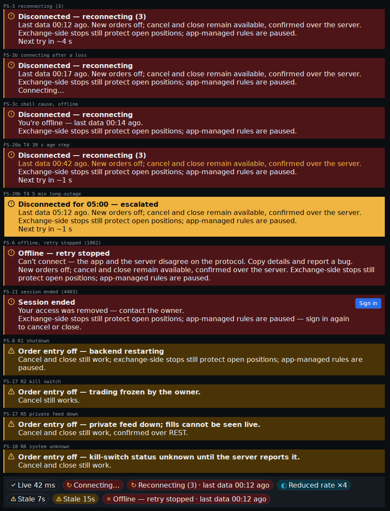
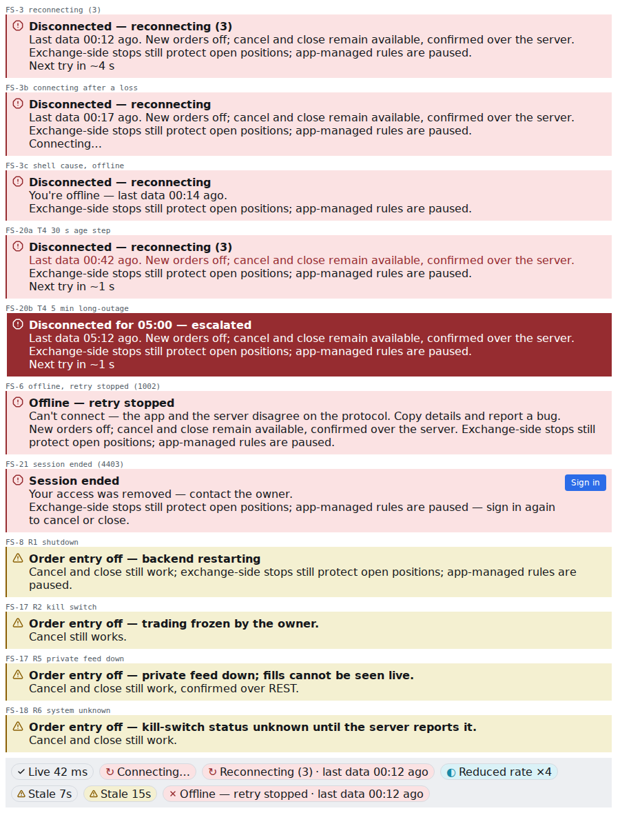
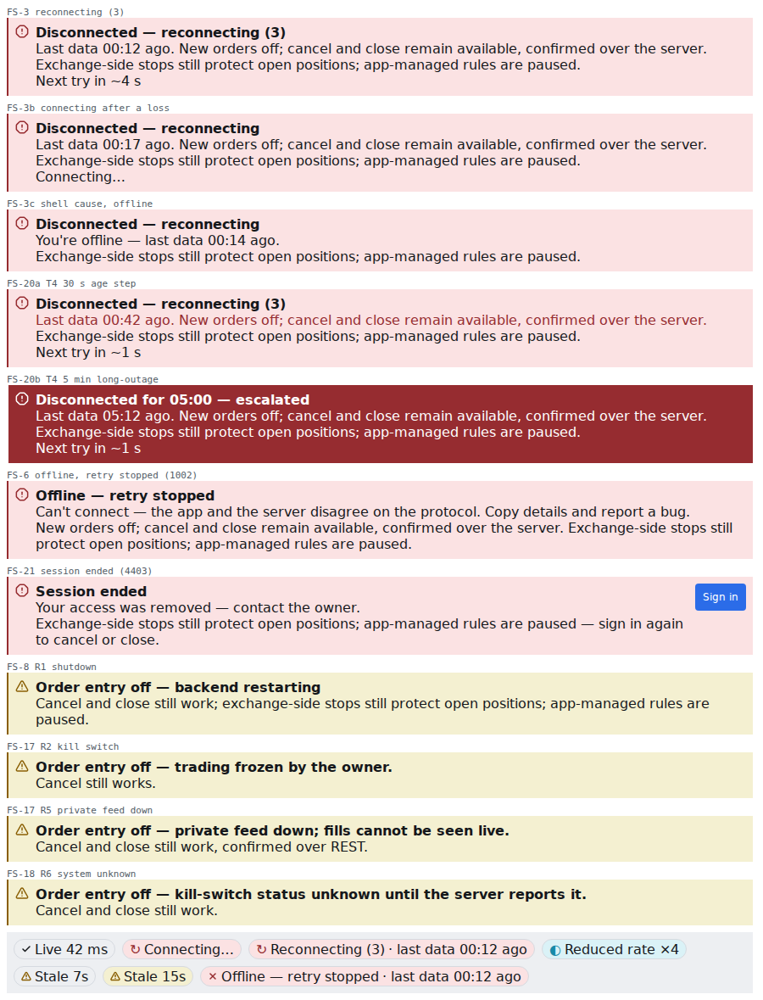
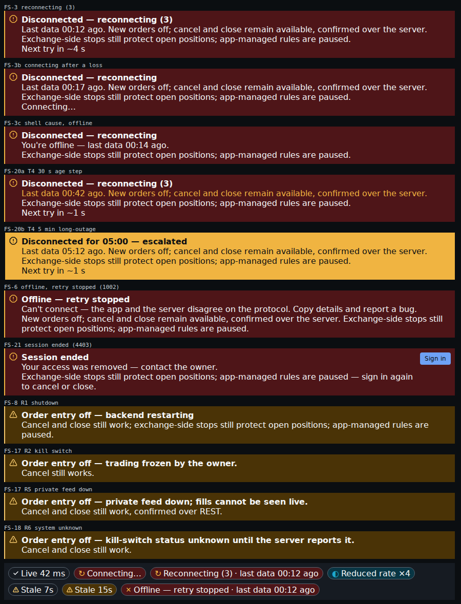
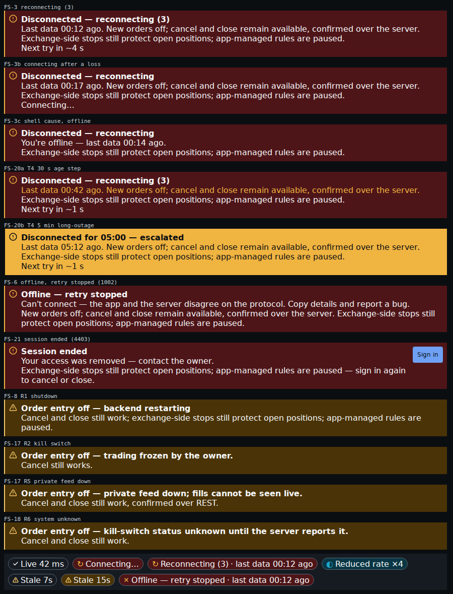
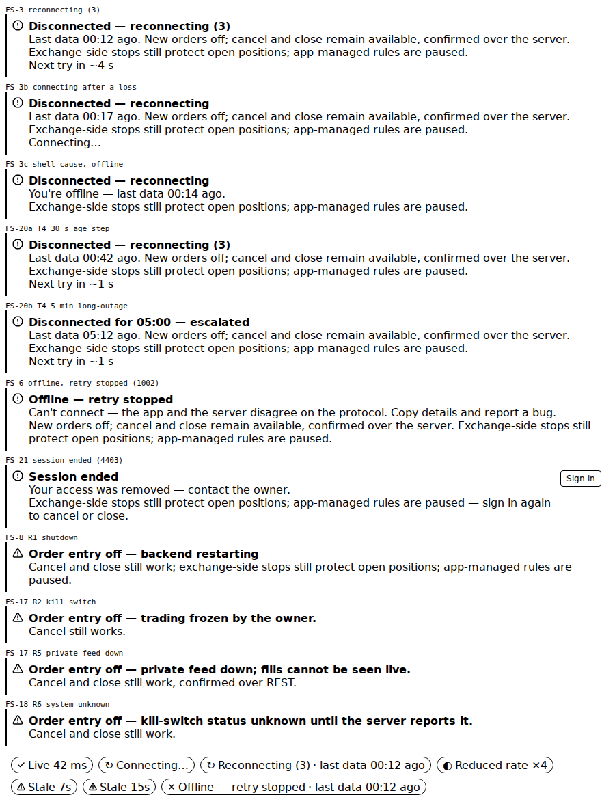

# E08-D14 — Design QA of the implemented E08 market-data surfaces (SCR-041, SCR-100, SCR-101, SCR-102, SCR-103, SCR-104, SCR-147, SCR-151, SCR-152)

**Ticket:** E08-D14 (#277) · **Epic:** E08 Market data · **Kind:** design QA of the built E08 band against its signed-off design, text first, one PR · **Status:** the pass, its forced-state matrix, its register, the tool and the rendered SCR-152 captures in one PR. Sign-off is the orchestrator's design approval plus this record; nothing here claims the owner's `approved`. The owner-run legs are named in §15 and are not claimed.

**Ruling status: PROPOSED, applied.** The fifteen questions of the BQ list (BQ-01..BQ-15) are each run on their proposed default; none is ruled yet. §R lists them; a ruling that differs re-runs the rows it names.

**Scope** (T Scope): the seven-step pass of E09-D11 §16 (`E09D11`:515–526) over the E08 surfaces that are built (SCR-102, SCR-041, SCR-152 and the E08 components of `packages/ui`); the forced-state matrix (§3); one "not implemented" row for each surface that is not built (§3.2); the defect register, each row classified, prioritised and routed to an open owner (§12, §14). No code, catalogue or plan file is changed.

**Start.** The one `blocked_by` parent, E08-D13 (#181), is closed with its pack merged. In practice the ticket needs the E08 front-end stories merged: E08-S09 (#4703) is closed and built SCR-102 and SCR-041; SCR-152's region and chip were built by E10-S04 (#306, closed) and E10-S01 (#304, open). E08-S08 (#4702), E08-S10 (#4704), E08-S11 (#4705), E08-S12 (#5207) and E08-D10 (#178) are open: their surfaces are §3.2's rows.

**Inputs pinned.** Base `origin/main` 3b15ecda9675bace3326a2b5aa7f97efa1af5f4e. Every `KEY`:line cite below was read at the base with `git show` and is pinned to its words in `docs/design/_tools/e08_d14_ruled_pins.txt` (the tool's cite gate).

**Key.** `NN`:line = `docs/plan/NN-*.md`. `D05`, `D06`, `D08`, `D09`, `D11`, `D12`, `D13`:line = `docs/design/E08/E08-Dnn.md`; `E17D2` = `docs/design/E17/E17-D02.md`; `E09D11` = `docs/design/E09/E09-D11.md`. Built code (under `apps/web/src/`): `SS` = `features/symbol-search/SymbolSearch.tsx`, `QS` = `…/QuickSwitcher.tsx`, `CPY` = `…/copy.ts`, `SDECK` = `…/searchDeck.tsx`, `SVIEW` = `…/searchView.ts`, `SSESS` = `…/searchSession.ts`, `LAYOUT` = `features/app-shell/ShellLayout.tsx`, `REGION` = `features/app-shell/ConnectionRegion.tsx`, `RSLOT` = `…/ConnectionRegionSlot.tsx`, `CHIP` = `…/ConnectionStatus.tsx`, `CSLOT` = `…/ConnectionStatusSlot.tsx`, `RVIEW` = `lib/ws/state/connectionRegion.ts`. Components (under `packages/ui/src/components/`): `SSI` = `SymbolSearchInput.tsx`, `EMPTY` = `EmptyState.tsx`, `DLGCSS` = `dialog.css`, `POPCSS` = `popover.css`, `WLCSS` = `watchlistrow.css`, `FLCSS` = `fuzzylist.css`, `SSCSS` = `symbolsearch.css`. Suites: `SST`, `QST` = `apps/web/test/features/symbol-search/{SymbolSearch,QuickSwitcher}.test.tsx`, `REGT` = `apps/web/test/features/app-shell/connection-region.test.tsx`; `A11YS` = `apps/web/e2e/a11y/screens.ts`. `T` = the ticket text (#277): `T Scope`, `T AC1`..`AC5`, `T Tech`, `T Test`, `T Sec`, `T a11y`, `T Perf`, `T Obs`, `T DoD`. Ids: `RN` run, `FS` forced state, `NI` not implemented, `ST` state, `TK` token, `CN` contrast, `CP` copy, `CM` composition, `IX` interaction, `AN` announcement, `MO` motion, `AX` axe, `T2` gated control, `SC` security check, `DF` defect, `DR` delta, `RT` routing, `IS` issue (listed), `OR` owner-run leg.

**Numbers.** Every count and measured value (the literal scan, the contrast ratios, the deck diff, the state counts, the baselines cited, the register's tallies) is computed by `docs/design/_tools/e08_d14_designqa_audit.py` and re-derived under `--check`; each carries an `audit` marker. The run counts of §1.1 are the run record's.

## Acceptance-criteria trace (#277)

| Ticket item                                                                        | Where                    | Status                                                                                                                                 |
| ---------------------------------------------------------------------------------- | ------------------------ | -------------------------------------------------------------------------------------------------------------------------------------- |
| AC1 — every D13 state induced and compared, or recorded with reason and follow-up  | §3, §4                   | done for the built surfaces (ST rows); the six unbuilt surfaces are NI rows with their owners; the non-inducible recipes route to #282 |
| AC2 — a value not resolving to a token is a defect naming the token                | §5.1, DF-15, DF-28       | done by source scan; the rendered values of SCR-152 read in RN-3                                                                       |
| AC3 — upstream killed: a cell keeping its live styling is p0                       | FS-1, DF-1               | the watchlist is not built (NI-1); on the global chip the frozen feed keeps "Live": DF-1, Blocking, priority/p0                        |
| AC4 — reduced motion with the dark theme, explicitly                               | §9, RN-3                 | done: SCR-152 rendered under reduced motion in dark (byte-identical to the default); SCR-102 / SCR-041 by source                       |
| AC5 — sign-off when p0 / p1 are closed and the rest filed                          | §16                      | not met: DF-1 (p0) and eight p1 rows are open with their owners; sign-off pending                                                      |
| T DoD — every surface in both themes, all densities, keyboard-only, reduced motion | §4, §8, §9, §10, RN rows | the built three; the six unbuilt carried as NI rows                                                                                    |
| T DoD — VR baselines for the confidence states                                     | RN-4, DF-25              | the E08 component stories have them (cited); SCR-152 has no story, so none (DF-25); none regenerated here                              |
| T Sec — no role sees Owner-only content; no raw payload rendered                   | §10.3                    | by source: pass; the role pass in the running app is owner-run (OR-3)                                                                  |

## R. The questions BQ-01..BQ-15 (the proposed defaults, applied)

| BQ    | Topic                           | Default taken                                                                                                                                                         | Status           |
| ----- | ------------------------------- | --------------------------------------------------------------------------------------------------------------------------------------------------------------------- | ---------------- |
| BQ-01 | surfaces not built              | run now on what is built; one NI row per unbuilt surface with its owner, its state count and its D12 §10.1b cells as "pending build"                                  | applied; unruled |
| BQ-02 | close or keep open              | one PR that ends the ticket; the pending surfaces carried as delta rows on their build stories (§13); the owner decides a re-run                                      | applied; unruled |
| BQ-03 | the baseline on conflict        | D13's source ladder; D12's rows over a parent where they differ; a conflict cites its C-row, never re-decided                                                         | applied; unruled |
| BQ-04 | how the built surfaces are seen | source, the merged suites, the component stories; a rendered harness for SCR-152; layout-bound and live legs owner-run; the unreachable SCR-102 / SCR-041 a Major row | applied; unruled |
| BQ-05 | the evidence form               | text first; PNGs only for states actually rendered (SCR-152, §11); VR baselines cited by story, not copied; none regenerated                                          | applied; unruled |
| BQ-06 | the forced-state matrix         | one table of recipes (§3.1) plus the state walk (§4); a recipe that cannot be induced names its reason and goes to #282                                               | applied; unruled |
| BQ-07 | test ids                        | a missing D13 handle is one Minor row per built surface; scripting uses role and name                                                                                 | applied; unruled |
| BQ-08 | themes, densities, motion       | three themes × two densities for what renders; 125 % and reduced motion by source where it does not; forced colours on SCR-102 / SCR-041 by source                    | applied; unruled |
| BQ-09 | roles and security copy         | by source and D13 §6; the never-rendered list scanned in the built copy; a hit would be p0 to the security lane by id and clause only                                 | applied; unruled |
| BQ-10 | record location and format      | this file in E09-D11's shape, with its tool and pins; E09-D11 §16's procedure cited, not rewritten                                                                    | applied; unruled |
| BQ-11 | severity and priority           | Blocking = priority/p0, Major = p1, Minor = p2, Info = none; "closed within the epic" is a condition carried on the owners                                            | applied; unruled |
| BQ-12 | routing under the filing freeze | no new issue; comments on open owners (§14.1); a Blocking row listed as an IS row, not filed; closed originating tickets stay closed                                  | applied; unruled |
| BQ-13 | axe and live regions            | the e2e axe set read from `A11YS`; the suites' axe and the stories' axe cited; the flood check by source; the speaking leg owner-run                                  | applied; unruled |
| BQ-14 | reviewers and sign-off          | a design and accessibility text lens on the PR; sign-off the orchestrator's design approval; the owner checklist at most ten items                                    | applied; unruled |
| BQ-15 | branch, labels, title           | `design/e08-design-qa`; the ticket's labels; commit scope `ingestion`; the closing line per BQ-02                                                                     | applied; unruled |

## 1. Method and evidence (BQ-04, BQ-05)

- **Observed by:** `source` (the built code and the component CSS at the base), `suite` (an assertion of a merged suite, re-run in RN-1), `story` (a `packages/ui` story, re-run in RN-2), `render` (this pass's harness, RN-3) and `owner-run` (needs the running app, a live session, a speaking screen reader or a measured budget; §15). Nothing in this pass reaches an exchange, a testnet or any external host (C-13.5): every value is a fixture or a constant.
- **Severity** (BQ-11): **Blocking** (priority/p0) — a frozen value shown as live, a safety string changed, a focus-map regression, a task not completable by keyboard; **Major** (p1) — an unreached state or control of a built surface, a `05` or WCAG 2.2 AA clause that fails while the task completes; **Minor** (p2) — wording, a near-miss value, a missing handle, a token literal; **Info** (none) — a note.
- **Class:** **implementation defect** (code must change), **accepted divergence** (none proposed here), **specification gap** (no merged text decides, or two merged texts disagree). A row that restates a D12 F-row cites it as known.
- **Owner and target:** the owner cell names the spec the build departs from and its area, never an agent; the target is an open owner (§14.1), `register` (no open build owner: the lane that next touches the file takes it from this register) or `issue (listed)` (a Blocking row, §14.2).

### 1.1 The runs (the run record's counts)

| RN   | Run                                                                                                                                                                                                                                  | Result                                                                                                                                                                                                                                                                                                                                                           |
| ---- | ------------------------------------------------------------------------------------------------------------------------------------------------------------------------------------------------------------------------------------ | ---------------------------------------------------------------------------------------------------------------------------------------------------------------------------------------------------------------------------------------------------------------------------------------------------------------------------------------------------------------- |
| RN-1 | the web package's unit runner (jsdom) over the eight symbol-search suites, the two app-shell connection suites and the region view-model suite                                                                                       | 11 files, 361 tests, all passed; the four component suites run axe (serious and critical; colour contrast off in jsdom, `SST`:234)                                                                                                                                                                                                                               |
| RN-2 | the `packages/ui` story runner (headless Chromium, each story's play function then axe at serious and critical) over the eight E08 component story files                                                                             | 8 files, 97 passed, 1 skipped (the `perf`-tagged story, skipped by the runner's own rule); the token CSS was built first, as the runner needs                                                                                                                                                                                                                    |
| RN-3 | a scratch harness, not committed: the built `ConnectionRegion` over eleven views from the built view model and `ConnectionStatus` in seven states, bundled with the published token and component CSS, rendered in headless Chromium | three themes × two densities, plus reduced motion (dark, compact) and forced colours; axe (every rule, colour contrast on) scoped to the region and the chip: 0 serious or critical; one moderate `landmark-unique`, the harness's eleven regions on one page. Computed: left border 2 px, `min-height` 0, `transition` 0 s, `animation` none, chip height 24 px |
| RN-4 | the VR baselines of the E08 component stories, cited by name, not copied or regenerated                                                                                                                                              | 582 <!-- audit:vr.e08=582 --> baseline PNGs (six cells per story) for CMP ConfidenceDots, EmptyState, FreshnessMarker, FuzzyList, SymbolPicker, SymbolSearchInput, WatchlistGroupTabs, WatchlistRow                                                                                                                                                              |

RN-3's fonts are the host's, not the VR fonts, so its captures are evidence of state and colour, never a baseline. The reduced-motion capture is byte-identical to the dark compact one, so it is not committed.

## 2. The pass (E09-D11 §16's seven steps; BQ-10)

| Step          | Compared                                                      | Observed by           | Result                                                                                                                                                                       |
| ------------- | ------------------------------------------------------------- | --------------------- | ---------------------------------------------------------------------------------------------------------------------------------------------------------------------------- |
| 1 Token diff  | every style value of the built files against the token JSON   | source; render (RN-3) | 18 <!-- audit:tk.files=18 --> files, 30 <!-- audit:tk.refs=30 --> references, 0 <!-- audit:tk.unresolved=0 --> unresolved, 6 <!-- audit:tk.literals=6 --> literal hits (§5)  |
| 2 State walk  | D13 §5.4's rows for SCR-102 (SCR-041 shares them) and SCR-152 | source, suite, render | 37 <!-- audit:st=37 --> rows walked (§4); six surfaces not built (§3.2)                                                                                                      |
| 3 Copy diff   | D13's deck (`E08-D13-copy.json`) against the built strings    | source, suite         | D05 deck 27 <!-- audit:deck.d05.held=27 --> of 34 <!-- audit:deck.d05=34 --> held; E17-D02 deck 29 <!-- audit:deck.e17d2.held=29 --> of 93 <!-- audit:deck.e17d2=93 --> (§6) |
| 4 Composition | `14`'s Components lines against the built imports             | source, story         | §7                                                                                                                                                                           |
| 5 Focus walk  | D12's FM, KB and PP rows and its SR and BG rows               | source, suite, render | §8                                                                                                                                                                           |
| 6 Motion      | D13 §7.5's rows and D11's reduced-motion rule                 | source, render        | 0 <!-- audit:mo.hits=0 --> transitions in the built feature files (§9)                                                                                                       |
| 7 Axe         | the e2e axe set, the suites' axe, the stories' axe, RN-3      | suite, story, render  | no E08 surface in the e2e set (§10.1)                                                                                                                                        |

## 3. The forced-state matrix (BQ-06; AC1)

### 3.1 The induction recipes (T Scope's seven, plus the composition rules of T Tech)

Each recipe is written for reuse by QA (E08-Q05, #282). "Reached by" says how this pass reached it; a recipe this pass could not run names why.

| FS    | Recipe                                        | Induce                                                                                                               | Surfaces and states                                                                | Reached by                                                                                     | Result                                                              |
| ----- | --------------------------------------------- | -------------------------------------------------------------------------------------------------------------------- | ---------------------------------------------------------------------------------- | ---------------------------------------------------------------------------------------------- | ------------------------------------------------------------------- |
| FS-1  | kill the upstream WS                          | the e2e WS harness sends a `system` `exchange_state` with the public feed down; the shell store takes it             | SCR-152 row 13 (chip "Stale — exchange feed down"), the CMP-092 row; SCR-100 cells | source (`CSLOT`:10–19); the CMP-092 row is another surface                                     | the chip keeps "Live": DF-1 (p0); the watchlist is not built (NI-1) |
| FS-2  | inject a sequence gap into a recorded fixture | replay the recorded order-book gap fixture of 2026-10-05 (ETHUSDT) through the WS harness                            | SCR-152 row 9 (panel-only), SCR-103 / SCR-100 panels                               | other surface: no built panel shows it                                                         | recorded; the panels are NI rows                                    |
| FS-3  | force a `10018` rate-limit response           | the recorded `rate_limited_10018` account fixture; for SCR-102 the 429 `exchange_rate_limited` answer to the refresh | SCR-147's rate rows; SCR-102 Refresh answered                                      | suite (`SST`:1210)                                                                             | SCR-102's line held (CP rows); SCR-147 not built (NI-5)             |
| FS-4  | skew the clock beyond 500 ms                  | no recorded clock-drift fixture exists at the base                                                                   | SCR-152 R4; SCR-103's clock alarm                                                  | not inducible: no fixture and no client source for the drift reason                            | R4 not built (DF-19); the fixture is a follow-up for #282           |
| FS-5  | empty the instrument cache                    | answer the instrument list with 503 (the server still loading), then a network error                                 | SCR-102 / SCR-041 Loading and Load failed                                          | suite (`SST`:458; `QST`:488, :501)                                                             | reached (ST-3, ST-4)                                                |
| FS-6  | exceed the 200-symbol cap                     | a watchlist of 200 fixture symbols, then "+ Add symbol"                                                              | SCR-100 T2 `watchlist.cap_full`; SCR-103's "live unavailable"                      | not inducible: SCR-100 and SCR-103 are not built                                               | NI-1, NI-3                                                          |
| FS-7  | delist a fixture symbol                       | the recorded instrument list after a change (LUNAUSDT closed), a Recent of that symbol                               | SCR-102 / SCR-041 status rule and delisted Recent; SCR-100 delisted row            | suite (`SDECK`:97–116; `SVIEW`:78–83); story (WatchlistRow `delisted`)                         | reached (ST-11, T2-4)                                               |
| FS-8  | estimated + stale                             | a scanner row with an estimated input whose topic goes stale                                                         | SCR-104                                                                            | not inducible: not built                                                                       | NI-4                                                                |
| FS-9  | delisted + stale                              | the FS-7 symbol in a stale panel                                                                                     | SCR-100 row, SCR-102 Recent                                                        | story (WatchlistRow `delisted`; FuzzyList `delisted-item`): delisted outranks, no stale marker | holds at component level; the panel is NI-1                         |
| FS-10 | reconnecting + backfilling                    | drop the WS during a history backfill                                                                                | SCR-152 region over SCR-151's backfill                                             | not inducible: SCR-151 has no hi-fi or build                                                   | NI-6                                                                |

### 3.2 The surfaces not implemented (BQ-01)

Each row is one surface with no build at the base. Its D13 §5.4 states, its forced-state list (D13 §5.7, `D13`:454) and its D12 §10.1b cells (`D12`:451) are carried as "pending build"; the walk re-runs when its story merges (§13).

| NI   | Screen  | Surface                                       | D13 states                      | Forced-state list           | D12 §10.1b cells                      | Owner                              |
| ---- | ------- | --------------------------------------------- | ------------------------------- | --------------------------- | ------------------------------------- | ---------------------------------- |
| NI-1 | SCR-100 | Watchlist panel                               | 26 <!-- audit:ni.scr-100=26 --> | each §5.4 trigger (D13-G-7) | pending build; F-01 known             | E08-S08 #4702 (in progress, no PR) |
| NI-2 | SCR-101 | Watchlist manager                             | 10 <!-- audit:ni.scr-101=10 --> | each §5.4 trigger (D13-G-7) | pending build                         | E08-S08 #4702                      |
| NI-3 | SCR-103 | Symbol info drawer                            | 23 <!-- audit:ni.scr-103=23 --> | `D06`:752–761               | pending build                         | E08-S10 #4704                      |
| NI-4 | SCR-104 | Scanner                                       | 8 <!-- audit:ni.scr-104=8 -->   | `D08`:418                   | pending build; F-02, F-05, F-06 known | E08-S11 #4705                      |
| NI-5 | SCR-147 | Exchange connectivity and rate limits (admin) | 20 <!-- audit:ni.scr-147=20 --> | `D09`:255–284               | out of scope to D09 in D12            | E08-S12 #5207                      |
| NI-6 | SCR-151 | Empty and backfill variants                   | 5 <!-- audit:ni.scr-151=5 -->   | each §5.4 trigger (D13-G-7) | out of scope to D10 in D12            | E08-D10 #178 (no hi-fi yet)        |

At the component level the parts of NI-1 and NI-2 exist in `packages/ui` with stories and VR baselines (RN-2, RN-4): WatchlistRow's stale, disconnected, not-live and delisted rows, WatchlistGroupTabs, ConfidenceDots and FreshnessMarker. D12's F-01 is met there: a disconnected row takes `color.text.primary` at `opacity.muted` on `color.surface.sunken` (`WLCSS`:140–146), CN-10.

## 4. The state walk (AC1; D13 §5.4)

The SCR-102 rows are SCR-041's too (D13 §5.2); the SCR-041 column gives its status where it differs. "Induce" names the fixture or harness step; "reached" cites the built code and the suite that drives it. 13 <!-- audit:st.scr-102=13 --> SCR-102 rows and 24 <!-- audit:st.scr-152=24 --> SCR-152 rows: reached 15 <!-- audit:st.reached=15 --> · reached in part 7 <!-- audit:st.reached-in-part=7 --> · not built 8 <!-- audit:st.not-built=8 --> · other surface 7 <!-- audit:st.other-surface=7 --> · owner-run 0 <!-- audit:st.owner-run=0 -->. Every SCR-102 / SCR-041 state is reached only through the suites: neither surface can be opened in the running app (DF-2).

| ST    | Screen  | D13 test id                 | State                                       | Induce                                       | SCR-041                       | Status          | Evidence                                  | Finding    |
| ----- | ------- | --------------------------- | ------------------------------------------- | -------------------------------------------- | ----------------------------- | --------------- | ----------------------------------------- | ---------- |
| ST-1  | SCR-102 | `SCR-102/idle`              | Idle                                        | empty query; Recent from the session         | reached                       | reached         | `SVIEW`:142–151; `SST`:204                | —          |
| ST-2  | SCR-102 | `SCR-102/results`           | Results                                     | type `btc` over the recorded list            | reached                       | reached         | `SVIEW`:129–136; `SSI`:109                | —          |
| ST-3  | SCR-102 | `SCR-102/loading`           | Loading                                     | FS-5 (503)                                   | reached (one line)            | reached         | `SVIEW`:120–125; `SST`:458                | —          |
| ST-4  | SCR-102 | `SCR-102/load-failed`       | Load failed                                 | FS-5 (network error, or 503s for 60 s)       | reached (title and Retry now) | reached         | `SS`:515–548; `QST`:501                   | DF-13      |
| ST-5  | SCR-102 | `SCR-102/refresh-answered`  | Refresh answered                            | the Owner presses Refresh; 202, 429          | n/a (no Refresh)              | reached         | `SS`:243–261; `SST`:1210                  | —          |
| ST-6  | SCR-102 | `SCR-102/refresh-failed`    | Refresh failed                              | a failed refresh job while a list is held    | not built                     | not built       | `SS`:80–83                                | DF-3       |
| ST-7  | SCR-102 | `SCR-102/stale`             | Stale                                       | the list's `stale_since` set                 | not built (DF-9)              | reached         | `SS`:345–376                              | DF-9       |
| ST-8  | SCR-102 | `SCR-102/refreshing`        | Refreshing                                  | a re-read running over 1 s                   | rows held; no line (DF-9)     | reached         | `SS`:382–386                              | DF-9       |
| ST-9  | SCR-102 | `SCR-102/checking-a-symbol` | Checking a symbol                           | type `xyzzy`, wait the 300 ms rest           | reached                       | reached         | `SDECK`:118–126                           | —          |
| ST-10 | SCR-102 | `SCR-102/no-matches`        | No matches                                  | the check answers 404                        | reached                       | reached         | `SDECK`:127–142                           | —          |
| ST-11 | SCR-102 | `SCR-102/status-rule`       | Status rule                                 | FS-7 (LUNAUSDT)                              | reached                       | reached         | `SDECK`:97–116                            | —          |
| ST-12 | SCR-102 | `SCR-102/disconnected`      | Disconnected                                | the shell's connection offline               | resume clause only (DF-9)     | reached in part | `SS`:340–344; `SST`:1027                  | DF-4, DF-9 |
| ST-13 | SCR-102 | `SCR-102/armed-target`      | Armed target                                | a target pane armed                          | reached                       | reached in part | `SSI`:238–242; `CPY`:62                   | DF-8       |
| ST-14 | SCR-152 | `SCR-152/1`                 | connecting before the first `auth_ok`       | start the session; hold `auth_ok`            | n/a                           | reached         | `CSLOT`:10–19; `CHIP`:50                  | —          |
| ST-15 | SCR-152 | `SCR-152/2`                 | connected                                   | the session live                             | n/a                           | reached         | `CHIP`:42; `RVIEW`:134–136                | —          |
| ST-16 | SCR-152 | `SCR-152/3`                 | reconnecting                                | close the socket after live (FS-1's harness) | n/a                           | reached in part | `RVIEW`:175–181; RN-3                     | DF-16      |
| ST-17 | SCR-152 | `SCR-152/4`                 | degraded:lagging                            | `connection_quality` lagging                 | n/a                           | reached         | `CSLOT`:10–19 (no treatment by design)    | —          |
| ST-18 | SCR-152 | `SCR-152/5`                 | degraded:saturated                          | `connection_quality` saturated               | n/a                           | not built       | `CSLOT`:10–19                             | DF-1       |
| ST-19 | SCR-152 | `SCR-152/6`                 | offline — retry stopped                     | a fatal close 1002 after live                | n/a                           | reached in part | `RVIEW`:149–158; RN-3                     | DF-16      |
| ST-20 | SCR-152 | `SCR-152/7`                 | offline — a shell cause on the login screen | the shell offline before any session         | n/a                           | other surface   | `RVIEW`:140–142 (SCR-001's alert)         | —          |
| ST-21 | SCR-152 | `SCR-152/8`                 | shutdown_pending                            | a `shutdown_notice`                          | n/a                           | reached in part | `RVIEW`:66–72; RN-3                       | DF-20      |
| ST-22 | SCR-152 | `SCR-152/9`                 | topic_resyncing                             | FS-2                                         | n/a                           | other surface   | panel-only by design (`E17D2`:92)         | —          |
| ST-23 | SCR-152 | `SCR-152/10`                | topic_stale, T1 ≤ age < T2                  | hold a public topic past T1                  | n/a                           | not built       | `CSLOT`:10–19                             | DF-1       |
| ST-24 | SCR-152 | `SCR-152/11`                | topic_stale ≥ T2                            | hold it past T2                              | n/a                           | not built       | `CSLOT`:10–19                             | DF-1       |
| ST-25 | SCR-152 | `SCR-152/12`                | stale (server)                              | a `snap` with `meta.stale`                   | n/a                           | not built       | `CHIP`:78–87                              | DF-1       |
| ST-26 | SCR-152 | `SCR-152/13`                | stale — upstream feed down                  | FS-1                                         | n/a                           | not built       | `CSLOT`:10–19                             | DF-1       |
| ST-27 | SCR-152 | `SCR-152/14`                | book rebuilt                                | an incident `snap` on a book                 | n/a                           | other surface   | a book-level reassurance (`E17D2`:97)     | —          |
| ST-28 | SCR-152 | `SCR-152/15`                | topic_revoked / permission change           | a `revoked` frame                            | n/a                           | other surface   | the chip untouched by design (`E17D2`:98) | —          |
| ST-29 | SCR-152 | `SCR-152/16`                | recovered / reconciling                     | reconnect after an outage                    | n/a                           | not built       | `REGION`:57–58                            | DF-17      |
| ST-30 | SCR-152 | `SCR-152/17`                | Read-only reason                            | kill switch engaged; private feed down       | n/a                           | reached in part | `RVIEW`:118–125; RN-3                     | DF-19      |
| ST-31 | SCR-152 | `SCR-152/18`                | system unknown                              | the `system` stream not live                 | n/a                           | reached         | `RVIEW`:122–124; RN-3                     | —          |
| ST-32 | SCR-152 | `SCR-152/19`                | flapping                                    | three transport changes inside 5 s           | n/a                           | not built       | `RVIEW`:12–17                             | DF-18      |
| ST-33 | SCR-152 | `SCR-152/20`                | long-outage / the T4 steps                  | hold Disconnected 10 s, 30 s, 5 min          | n/a                           | reached in part | `RVIEW`:147, :159–164; `REGT`:182; RN-3   | DF-23      |
| ST-34 | SCR-152 | `SCR-152/21`                | session ended — no retry                    | a 4403 close after live                      | n/a                           | reached         | `RVIEW`:150–153; RN-3                     | DF-21      |
| ST-35 | SCR-152 | `SCR-152/22`                | backend-health conditions                   | a `health` frame with a blocking component   | n/a                           | other surface   | CMP-092's rows (`E17D2`:105)              | —          |
| ST-36 | SCR-152 | `SCR-152/23`                | err by errorMapping class                   | an `err` frame                               | n/a                           | other surface   | not a transport state (`E17D2`:106)       | —          |
| ST-37 | SCR-152 | `SCR-152/24`                | upstream private reconnect                  | `exchange_state` private feed reconnecting   | n/a                           | other surface   | CMP-092, then R5 (`RVIEW`:121)            | —          |

## 5. Step 1 — token fidelity and contrast (AC2)

### 5.1 The literal scan and the adoption check

The tool reads the ten built `.ts` / `.tsx` files of §Key and the eight E08 component stylesheets of `packages/ui` (18 <!-- audit:tk.files=18 --> files): 30 <!-- audit:tk.refs=30 --> `var(--…)` references in the built files, each resolved against the token names (0 <!-- audit:tk.unresolved=0 --> unresolved; a typography reference resolves to its composite token), and every style literal (a `px` length, a hex or functional colour, `transparent`, a numeric weight) outside comments and outside `forced-colors` blocks: 6 <!-- audit:tk.literals=6 --> hits. A `* 1px` that turns a unitless border token into a length is the token, not a literal. The built files write no hex colour. The E08-D04 adoption check: no surface styles a confidence state with a local colour; every state colour is a `color.data-confidence.*` or `color.status.*` token.

| TK   | Value                 | Where                                                             | Equals                                            | Expected                             | Finding |
| ---- | --------------------- | ----------------------------------------------------------------- | ------------------------------------------------- | ------------------------------------ | ------- |
| TK-1 | `560px`, `32px`       | `QS`:113                                                          | the D05 widths (`D05`:121); no token              | a size token for the switcher width  | DF-15   |
| TK-2 | `fontWeight: 600`     | `REGION`:82                                                       | a weight, not the type token's                    | the title's `type.ui.*` weight token | DF-28   |
| TK-3 | `transparent` (three) | `fuzzylist.css`:22; `symbolpicker.css`:25; `watchlistrow.css`:145 | the absence of a fill, or the `opacity.muted` mix | none: no colour value                | —       |

### 5.2 Contrast of the built pairs (the tool's values; text 4.5:1, non-text 3:1)

| CN    | Foreground                              | Background                    | Dark                                    | Light                                    | HC                                    | Bar      | Where                                | Finding |
| ----- | --------------------------------------- | ----------------------------- | --------------------------------------- | ---------------------------------------- | ------------------------------------- | -------- | ------------------------------------ | ------- |
| CN-1  | `color.text.primary`                    | `color.status.danger.subtle`  | 12.06:1 <!-- audit:cn1.dark=12.06:1 --> | 14.64:1 <!-- audit:cn1.light=14.64:1 --> | 13.66:1 <!-- audit:cn1.hc=13.66:1 --> | text     | `REGION`:18, :38                     | —       |
| CN-2  | `color.text.inverse`                    | `color.status.danger.strong`  | 10.42:1 <!-- audit:cn2.dark=10.42:1 --> | 7.78:1 <!-- audit:cn2.light=7.78:1 -->   | 10.42:1 <!-- audit:cn2.hc=10.42:1 --> | text     | `REGION`:29–33                       | —       |
| CN-3  | `color.text.primary`                    | `color.status.warning.subtle` | 9.86:1 <!-- audit:cn3.dark=9.86:1 -->   | 15.62:1 <!-- audit:cn3.light=15.62:1 --> | 11.16:1 <!-- audit:cn3.hc=11.16:1 --> | text     | `REGION`:36–39                       | —       |
| CN-4  | `color.status.danger.strong`            | `color.status.danger.subtle`  | 7.83:1 <!-- audit:cn4.dark=7.83:1 -->   | 6.33:1 <!-- audit:cn4.light=6.33:1 -->   | 7.83:1 <!-- audit:cn4.hc=7.83:1 -->   | text     | `REGION`:70 (the 30 s age line)      | —       |
| CN-5  | `color.status.warning.strong`           | `color.status.warning.subtle` | 7.56:1 <!-- audit:cn5.dark=7.56:1 -->   | 4.90:1 <!-- audit:cn5.light=4.90:1 -->   | 7.56:1 <!-- audit:cn5.hc=7.56:1 -->   | non-text | the read-only glyph and edge         | —       |
| CN-6  | `color.text.primary`                    | `color.surface.raised`        | 14.35:1 <!-- audit:cn6.dark=14.35:1 --> | 15.62:1 <!-- audit:cn6.light=15.62:1 --> | 16.25:1 <!-- audit:cn6.hc=16.25:1 --> | text     | `CHIP`:30, :69                       | —       |
| CN-7  | `color.status.info.default`             | `color.status.info.subtle`    | 4.64:1 <!-- audit:cn7.dark=4.64:1 -->   | 3.44:1 <!-- audit:cn7.light=3.44:1 -->   | 4.64:1 <!-- audit:cn7.hc=4.64:1 -->   | non-text | `CHIP`:31 (the Delayed glyph)        | —       |
| CN-8  | `color.text.secondary`                  | `color.surface.overlay`       | 8.14:1 <!-- audit:cn8.dark=8.14:1 -->   | 8.26:1 <!-- audit:cn8.light=8.26:1 -->   | 13.27:1 <!-- audit:cn8.hc=13.27:1 --> | text     | `SDECK`:36 (SCR-102's caption lines) | —       |
| CN-9  | `color.status.warning.strong`           | `color.surface.overlay`       | 10.17:1 <!-- audit:cn9.dark=10.17:1 --> | 4.51:1 <!-- audit:cn9.light=4.51:1 -->   | 10.17:1 <!-- audit:cn9.hc=10.17:1 --> | non-text | `SS`:347 (the stale ⚠)               | —       |
| CN-10 | `color.text.primary` at `opacity.muted` | `color.surface.sunken`        | 8.39:1 <!-- audit:cn10.dark=8.39:1 -->  | 5.65:1 <!-- audit:cn10.light=5.65:1 -->  | 9.40:1 <!-- audit:cn10.hc=9.40:1 -->  | text     | `WLCSS`:140–146 (F-01's fallback)    | —       |

Below the bar: none <!-- audit:cn.below=none -->. RN-3's axe pass, colour contrast on, agrees in the rendered region and chip in all three themes. In dark and high contrast `color.status.danger.strong` resolves to an amber, so the long-outage fill and the Disconnected edge are amber, not red; the state is carried by the words and the glyph (`REGION`:23–27), as `05` asks.

## 6. Step 3 — copy fidelity

The tool lifts D13's deck and, per built surface, every string, template and JSX text run of its files (comments out): a deck string is held when a built literal is it, with a fill standing for each of its example values (a number, a time, a symbol, a quoted query, a pane name, a `<…>` or `{…}` placeholder); a string of 20 or more characters may also stand inside a longer literal. SCR-102 / SCR-041 take the D05 section (27 <!-- audit:deck.d05.held=27 --> held, 7 <!-- audit:deck.d05.missed=7 --> not); SCR-152 takes E17-D02 §10's A (chip), B (region), E and F (close sentences), G (Details) and R (read-only) sections (29 <!-- audit:deck.e17d2.held=29 --> held, 64 <!-- audit:deck.e17d2.missed=64 --> not). Its C, D, I and J sections belong to the panels, SCR-001, the toasts and the ticket. Every key not held is in exactly one CP row; none is a frozen security-bearing string (D13 §6.2).

| CP    | Keys                                                                                                                                                                                                                               | Screen           | Built                                                                                                                     | Finding                                                                                  |
| ----- | ---------------------------------------------------------------------------------------------------------------------------------------------------------------------------------------------------------------------------------- | ---------------- | ------------------------------------------------------------------------------------------------------------------------- | ---------------------------------------------------------------------------------------- |
| CP-1  | `d05.idle.2`                                                                                                                                                                                                                       | SCR-102          | no Favourites group                                                                                                       | no divergence: D-9's fallback renders no Favourites group until a store lands (`D05`:50) |
| CP-2  | `d05.results.1`, `d05.load-failed.7`, `d05.load-failed.8`                                                                                                                                                                          | SCR-102          | composed: the count (`SSI`:109), the `rbac.owner_only` key with its verb (`SS`:231), "Ref" and the instance (`EMPTY`:186) | no divergence: each renders the deck's words through a fill                              |
| CP-3  | `d05.load-failed.1`                                                                                                                                                                                                                | SCR-102          | the deck's "alert" is a role: CMP-026 `error` with `live="assertive"` (`EMPTY`:85)                                        | no divergence: a role, not a string                                                      |
| CP-4  | `d05.refresh-failed.1`                                                                                                                                                                                                             | SCR-102          | not built                                                                                                                 | DF-3                                                                                     |
| CP-5  | `d05.armed-target.1`                                                                                                                                                                                                               | SCR-102, SCR-041 | "Changes Chart 1 · BTCUSDT 1m ARMED", the pill with no separator (`SSI`:238–242)                                          | DF-8                                                                                     |
| CP-6  | `e17d2.A.5`, `e17d2.A.6`, `e17d2.R.18`                                                                                                                                                                                             | SCR-152          | the chip never shows a stale-server or feed-down word (`CHIP`:39–55)                                                      | DF-1                                                                                     |
| CP-7  | `e17d2.A.8`, `e17d2.A.12`, `e17d2.A.13`, `e17d2.A.14`, `e17d2.A.15`                                                                                                                                                                | SCR-152          | no details popover or tooltip; the name reads "Stale 7s" (`CHIP`:78–87, :99)                                              | DF-24                                                                                    |
| CP-8  | `e17d2.B.2`, `e17d2.B.8`, `e17d2.B.9`, `e17d2.B.10`, `e17d2.B.22`                                                                                                                                                                  | SCR-152          | composed from the age and the shell cause (`RVIEW`:43, :46–50, :170, :174)                                                | no divergence: each renders the deck's words through a fill (RN-3)                       |
| CP-9  | `e17d2.B.11`                                                                                                                                                                                                                       | SCR-152          | B1b's L2 is the stops sentence alone (`RVIEW`:165–171)                                                                    | DF-22                                                                                    |
| CP-10 | `e17d2.B.5`, `e17d2.B.6`, `e17d2.B.12`, `e17d2.B.13`, `e17d2.B.14`, `e17d2.G.1`, `e17d2.G.2`, `e17d2.G.3`, `e17d2.G.4`, `e17d2.G.5`, `e17d2.G.6`, `e17d2.G.7`                                                                      | SCR-152          | no Retry now, no Details, no retrying line (`REGION`:57–61, :94–98)                                                       | DF-16                                                                                    |
| CP-11 | `e17d2.B.15`                                                                                                                                                                                                                       | SCR-152          | no flapping title                                                                                                         | DF-18                                                                                    |
| CP-12 | `e17d2.B.24`, `e17d2.B.25`, `e17d2.B.26`                                                                                                                                                                                           | SCR-152          | no recovered region                                                                                                       | DF-17                                                                                    |
| CP-13 | `e17d2.B.27`                                                                                                                                                                                                                       | SCR-152          | not drawn                                                                                                                 | no divergence: B8 is "not drawn" by E17-D02's own text (`E17D2`:227)                     |
| CP-14 | `e17d2.B.21`, `e17d2.E.1`, `e17d2.E.2`, `e17d2.E.3`, `e17d2.E.4`, `e17d2.E.5`, `e17d2.E.7`, `e17d2.E.8`, `e17d2.E.9`, `e17d2.E.10`, `e17d2.E.11`, `e17d2.E.12`, `e17d2.E.14`, `e17d2.E.15`, `e17d2.E.16`, `e17d2.F.2`, `e17d2.F.4` | SCR-152          | the close-reason sentences of a retrying close, and "Continue", are not rendered (`RVIEW`:163–181)                        | DF-21                                                                                    |
| CP-15 | `e17d2.E.13`, `e17d2.E.17`, `e17d2.F.6`, `e17d2.F.7`, `e17d2.F.9`                                                                                                                                                                  | SCR-152          | quoted fragments in the parent: a negated example, a rule, a placeholder (`E17D2`:233, :235)                              | no divergence: not strings to render                                                     |
| CP-16 | `e17d2.F.1`                                                                                                                                                                                                                        | SCR-152          | no banner on a user close                                                                                                 | no divergence: "user-initiated: no banner" (`E17D2`:235)                                 |
| CP-17 | `e17d2.R.1`, `e17d2.R.2`, `e17d2.R.3`                                                                                                                                                                                              | SCR-152          | R1 without its release and "Back in ~N s.", R2 without its time (`RVIEW`:66–74)                                           | DF-20                                                                                    |
| CP-18 | `e17d2.R.5`, `e17d2.R.7`, `e17d2.R.8`, `e17d2.R.13`, `e17d2.R.14`                                                                                                                                                                  | SCR-152          | R3, R4 and R7 not built (`RVIEW`:15–16)                                                                                   | DF-19                                                                                    |
| CP-19 | `e17d2.R.15`, `e17d2.R.17`                                                                                                                                                                                                         | SCR-152          | rendered by CMP-092's rows, not the region                                                                                | no divergence: R8 and the sub-reason are CMP-092's by E17-D02's routing (`E17D2`:239)    |

Built strings with no deck key: SCR-041's title "Change symbol and interval" and its struck-value sentence (`QS`:82–85), the region's PROPOSED R1, R2 and unknown-fatal lines and its no-age L1 (`RVIEW`:57–61, :173); each is marked PROPOSED in code and goes to the deck's owner with the RT rows. SR-01's spoken text (`RVIEW`:190–196) matches E17-D02's row 1 (`E17D2`:253), the text of record for SCR-152 under D13's ladder; D12's SR-01 quotes it without its last sentence (`D12`:288), a known difference, not a defect.

## 7. Step 4 — composition (T AC2's adoption check; `14` Components)

| CM   | Screen  | `14` lists | Built with                                                                                                                                                                                                                           | Finding      |
| ---- | ------- | ---------- | ------------------------------------------------------------------------------------------------------------------------------------------------------------------------------------------------------------------------------------ | ------------ |
| CM-1 | SCR-102 | `14`:2323  | CMP-043 Dialog, CMP-160, CMP-213 (inside CMP-160), CMP-026, CMP-041 Menu, CMP-002 IconButton, CMP-079 (the stale footer), CMP-019; the loading line is a Spinner, not CMP-038, so the surface keeps one polite region (`SS`:456–463) | DF-13        |
| CM-2 | SCR-041 | `14`:1041  | CMP-017 Popover (not in the list), CMP-160, CMP-213, CMP-219; CMP-220 is a slot; no CMP-079 (no Record)                                                                                                                              | DF-5, DF-14  |
| CM-3 | SCR-152 | `14`:3084  | CMP-076 and CMP-077 local to `apps/web` with no story; the region builds its own box and countdown line though CMP-028 and CMP-035 are published; CMP-078 and CMP-079 belong to the panels and the ticket                            | DF-25, DF-26 |

## 8. Step 5 — interaction, the screen-reader script and live regions

### 8.1 Focus, keys and pointer parity (D12 §3, §4)

| IX    | D12 rows                                  | Surface          | Status                                                                                        | Evidence                | Finding      |
| ----- | ----------------------------------------- | ---------------- | --------------------------------------------------------------------------------------------- | ----------------------- | ------------ |
| IX-1  | FM-01, FM-02 (`D12`:229–230)              | SCR-102          | pass: focus to the input, back to the trigger, then the panel, then `main`                    | `SS`:173–183; `SST`:204 | —            |
| IX-2  | FM-03, FM-04 (`D12`:231–232)              | SCR-102          | pass: a refresh moves nothing; the menu returns to the input                                  | `SDECK`:185–194         | —            |
| IX-3  | FM-05, FM-06 (`D12`:233–234)              | SCR-041          | pass: the commit returns to the trigger; `Tab` out closes it                                  | `QST`:301               | —            |
| IX-4  | KB-01 (`D12`:168)                         | SCR-102, SCR-041 | `/` opens SCR-102 once a pane is bound; the chart-focused SCR-041 branch is the chart owner's | `SS`:128–132            | DF-2         |
| IX-5  | KB-09, KB-10 (`D12`:176–177)              | SCR-041          | unreached: the interval strip is a slot                                                       | `QS`:72–73, :320        | DF-14        |
| IX-6  | FM-22 (`D12`:250)                         | SCR-152          | pass: the region never takes focus; Sign in is a `Tab` stop                                   | `REGT`:329              | —            |
| IX-7  | FM-23, FM-24, PP-10 (`D12`:251–252, :215) | SCR-152          | unreached: no Details, no Retry now, no recovered region                                      | `REGION`:94–98          | DF-16, DF-17 |
| IX-8  | F-04, forced colours (`D12`:525)          | SCR-102, SCR-041 | built: the active row as `Highlight`, the ARMED pill in `CanvasText`                          | `FLCSS`:133; `SSCSS`:60 | —            |
| IX-9  | forced colours                            | SCR-152          | pass in RN-3: the words, the glyphs and the edge carry every state                            | RN-3                    | —            |
| IX-10 | target sizes (24 px)                      | SCR-152 chip     | pass: 24 px in RN-3                                                                           | `CHIP`:64–65            | —            |

The speaking leg, 125 % zoom and the 200 % reflow of SCR-102 / SCR-041 in the running app are owner-run (OR-2, OR-4).

### 8.2 Announcements and their budget (D12 §6, §7)

| AN   | D12 rows                            | Surface          | Status                                                                                                                                                                                 | Evidence                       | Finding |
| ---- | ----------------------------------- | ---------------- | -------------------------------------------------------------------------------------------------------------------------------------------------------------------------------------- | ------------------------------ | ------- |
| AN-1 | SR-01 (`D12`:288)                   | SCR-152          | built once per episode, assertive, through the shell announcer, not the CMP-028 callout E17-D02 names                                                                                  | `RVIEW`:190–196; `RSLOT`:53–69 | DF-29   |
| AN-2 | SR-02, BG-10 (`D12`:289, :357)      | SCR-152          | not built                                                                                                                                                                              | `RVIEW`:12–17                  | DF-18   |
| AN-3 | SR-03 (`D12`:290)                   | SCR-152          | not built                                                                                                                                                                              | `REGION`:57–58                 | DF-17   |
| AN-4 | SR-06                               | SCR-152          | pass: the countdown and ages are `aria-live="off"`; the slot re-renders at 1 Hz only while a clock shows                                                                               | `REGION`:88–92; `RSLOT`:71–76  | —       |
| AN-5 | SR-07 (`D12`:294)                   | SCR-152          | unreached: no Details                                                                                                                                                                  | `REGION`:94–98                 | DF-16   |
| AN-6 | SR-10..SR-17                        | SCR-102, SCR-041 | pass by the suites: the count after the rest, no matches and the status rule once per settled query, the load failure once, the commit in the shell region, a T2 press says its reason | `SST`:458; `QST`:618           | —       |
| AN-7 | SR-12 (`D12`:299)                   | SCR-102, SCR-041 | in part: the option's name carries no recording word                                                                                                                                   | `SVIEW`:48–54                  | DF-5    |
| AN-8 | SR-19 (`D12`:306)                   | SCR-102          | not said: the footer line is drawn only                                                                                                                                                | `SS`:223–225, :340–344         | DF-4    |
| AN-9 | BG-07, BG-08, BG-09 (`D12`:354–356) | all built        | pass by source: one region per surface, once per entry, keyed on the reason, never per tick                                                                                            | `RSLOT`:53–69; `SDECK`:201–210 | —       |

## 9. Step 6 — motion and reduced motion (AC4)

| MO   | D13 §7.5                                              | Built                                                                                                                                                      | Status                                                                  | Finding |
| ---- | ----------------------------------------------------- | ---------------------------------------------------------------------------------------------------------------------------------------------------------- | ----------------------------------------------------------------------- | ------- |
| MO-1 | SCR-102 fades over `motion.duration.fast` (`D13`:716) | the card cuts in; the scrim fades in over `motion.duration.normal`; the card fades out over the fast recipe (`DLGCSS`:31, :154)                            | differs                                                                 | DF-7    |
| MO-2 | SCR-041 opens instantly (`D13`:717)                   | the entry is instant; the exit takes the published CMP-017 fade over `fast` (`POPCSS`:67–75)                                                               | entry holds; the exit is the published component's, an Info note in §16 | —       |
| MO-3 | SCR-152 flips at 0 ms                                 | `transition` 0 s and `animation` none on the region and the chip (RN-3)                                                                                    | pass                                                                    | —       |
| MO-4 | reduced motion                                        | the Dialog and the Popover drop their recipes under reduce (`DLGCSS`:170; `POPCSS`:83–84); SCR-152 has no motion; RN-3's reduced capture is byte-identical | pass                                                                    | —       |

The tool counts 0 <!-- audit:mo.hits=0 --> transitions, animations or keyframes in the built feature files: all motion is the published components'.

## 10. Step 7 — axe, themes, densities, roles, security and events

### 10.1 Axe coverage (BQ-13)

| AX   | Run                                                       | Surfaces                                                                    | Result                                                |
| ---- | --------------------------------------------------------- | --------------------------------------------------------------------------- | ----------------------------------------------------- |
| AX-1 | the e2e axe set (`A11YS`:20)                              | R-001, R-901, R-902, R-903 <!-- audit:ax.ids=R-001, R-901, R-902, R-903 --> | no E08 surface: DF-30                                 |
| AX-2 | the suites' axe in jsdom, colour contrast off (`SST`:234) | SCR-102, SCR-041, SCR-152                                                   | green (RN-1)                                          |
| AX-3 | the stories' axe in Chromium                              | the eight E08 components                                                    | green at serious and critical (RN-2)                  |
| AX-4 | RN-3's axe, colour contrast on                            | SCR-152 region and chip                                                     | 0 serious or critical in three themes × two densities |

### 10.2 Themes, densities and gated controls

Every colour of the built surfaces is a token reference (§5.1), so the three themes follow the theme store; RN-3 shows SCR-152 in all three and both densities (§11). The region and the chip take no density-aware value: the region's padding is `space.inset.sm` and the chip is one compact pill (`CHIP`:84–87), so the two densities render alike. SCR-102 reads the density for its visible rows (`SS`:155–158); its width is DF-6.

| T2   | D13 §6.3                       | Control                                          | Built                                                          | Finding |
| ---- | ------------------------------ | ------------------------------------------------ | -------------------------------------------------------------- | ------- |
| T2-1 | T2-03 (`D13`:539)              | Check again for 60 s after a check               | pass: `aria-disabled`, described, a press says the reason once | —       |
| T2-2 | T2-04 (`D13`:540)              | Refresh from Bybit for a non-owner, stale footer | pass: CMP-079 around CMP-001, the reason beside it (`SS`:363)  | —       |
| T2-3 | T2-04 (`D13`:540)              | Refresh from Bybit for a non-owner, Load failed  | CMP-001's own gate and lock, with no CMP-079 (`SS`:256–261)    | DF-13   |
| T2-4 | T2-05 (`D13`:541)              | a delisted Recent                                | pass: reached, never chosen, says why (`SVIEW`:78–83)          | —       |
| T2-5 | T2-01, T2-06 (`D13`:537, :542) | Record this symbol…                              | not built                                                      | DF-5    |
| T2-6 | T2-02 (`D13`:538)              | Add to watchlist… for a Viewer                   | not built: SCR-102's menu has no such item (`SS`:286–318)      | DF-31   |
| T2-7 | T2-18 (`D13`:554)              | the blocked ladder                               | other surface: the ticket and the ladder                       | —       |

### 10.3 Security-bearing checks (T Sec; BQ-09)

| SC   | Check                                                               | Status                                                                                                                                                                    | Evidence             |
| ---- | ------------------------------------------------------------------- | ------------------------------------------------------------------------------------------------------------------------------------------------------------------------- | -------------------- |
| SC-1 | the SCR-152 Details payload Owner-only (SD-01, `D13`:526)           | vacuous: no Details exists for any role (DF-16); re-check when it lands                                                                                                   | `REGION`:94–98       |
| SC-2 | no raw exchange body, endpoint, key fragment or account id rendered | pass (source): the region drops the server's prose (`RVIEW`:67); SCR-102 names answers by status and code only; the one "Ref" is the problem's instance the deck asks for | `SS`:47; `EMPTY`:186 |
| SC-3 | analytics carry ids and counts, never the query                     | pass (suite)                                                                                                                                                              | `SST`:1084           |
| SC-4 | a Manager or Viewer sees no Owner-only control or admin link        | pass (source): Refresh is T2, as D13 §6.1 asks; no admin link in the built surfaces; the running-app pass by role is owner-run (OR-3)                                     | `SS`:230             |

No security-class finding: no row is routed to the security lane.

### 10.4 Events (T Obs)

The suites assert `symbol.searched` (length, never the query), `symbol.search_result_opened` and `empty_state_shown` (`SST`:1084); the dev-tool spot check in the running app is owner-run (OR-5). For the epic retro (T Obs), the register splits into state-related rows (DF-1..DF-5, DF-9, DF-14, DF-16..DF-19, DF-21, DF-23, DF-31: fourteen), token rows (DF-6, DF-15, DF-27, DF-28: four) and copy, component, handle, motion and coverage rows (the other thirteen).

## 11. The rendered SCR-152 states (RN-3; BQ-05)

One capture per theme and density, each holding the eleven region views and the seven chip states, top to bottom: reconnecting (3); connecting after a loss; a shell cause; the T4 30 s step; the 5 min long-outage; offline after a 1002; session ended (4403); R1, R2, R5 and R6; then the chips. Every value is a fixture; the fonts are the host's. 7 <!-- audit:img=7 --> images.

## 12. The defect register (BQ-11, BQ-12)

31 <!-- audit:df=31 --> findings: 1 <!-- audit:df.blocking=1 --> Blocking, 8 <!-- audit:df.major=8 --> Major, 22 <!-- audit:df.minor=22 --> Minor, 0 <!-- audit:df.info=0 --> Info; 27 <!-- audit:df.defect=27 --> implementation defects, 0 <!-- audit:df.accepted=0 --> accepted divergences, 4 <!-- audit:df.gap=4 --> specification gaps. Every difference in §3–§10 is one of these rows or an explicit "no divergence" with its reason. No code is changed in this PR; p0 and p1 rows are closed by their owners, and the ticket's AC5 sign-off waits on them.

| DF    | Class                 | Severity | Clause                  | Owner                             | Target          | Priority    | Sentence · source                                                                                                                                                                                                                                                                       | Reason                                                                 |
| ----- | --------------------- | -------- | ----------------------- | --------------------------------- | --------------- | ----------- | --------------------------------------------------------------------------------------------------------------------------------------------------------------------------------------------------------------------------------------------------------------------------------------- | ---------------------------------------------------------------------- |
| DF-1  | implementation defect | Blocking | T AC3; `E17D2`:96       | `E17-D02 · area/backend-platform` | #304; #408      | priority/p0 | the chip's container maps the transport alone (`CSLOT`:10–19): Delayed, Stale 7s, Stale 15s, Stale (server) and Stale — exchange feed down never render in the app, though CMP-076 draws three of them (`CHIP`:39–55; RN-3); with the upstream feed killed the chip keeps "Live" (FS-1) | a frozen feed shown with the live word (AC3, read for the global chip) |
| DF-2  | implementation defect | Major    | T AC1                   | `E08-D05 · area/ingestion`        | #451            | priority/p1 | SCR-102 and SCR-041 cannot be opened in the running app: the host renders nothing until a workspace registers an opener (`SS`:133), `setSymbolOpener` has no caller in the app source (`SSESS`:222–224) and SCR-041 has no importer; every state is seen through the suites (`SST`:204) | built surfaces unreachable in the product                              |
| DF-3  | implementation defect | Major    | T AC1; `D05`:172        | `E08-D05 · area/ingestion`        | #5111           | priority/p1 | SCR-102's Refresh failed state is not built: with no job poll the 202 notice ends after 60 s and no failure is read (`SS`:80–83)                                                                                                                                                        | an unreached state of a built screen                                   |
| DF-4  | implementation defect | Major    | `05` 4.1.3; SR-19       | `E08-D05 · area/ingestion`        | register        | priority/p1 | SCR-102's Disconnected footer is drawn but never said: the surface's region carries the deck's or the view's sentence only (`SS`:223–225, :340–344; `D12`:306)                                                                                                                          | a bound announcement absent                                            |
| DF-5  | implementation defect | Major    | T AC1; `D05`:221        | `E08-D05 · area/ingestion`        | #566            | priority/p1 | the not-recorded disclosure, the recording chips and Record this symbol… are not built on SCR-102 or SCR-041 (`D05`:221–233; `QS`:6); SR-12's recording word is absent                                                                                                                  | unreached controls and states of built screens                         |
| DF-6  | implementation defect | Minor    | `D05`:121               | `E08-D05 · area/ingestion`        | register        | priority/p2 | SCR-102 opens in CMP-043's default width, 35 rem (`SS`:410; `DLGCSS`:46), not D05's 720 px                                                                                                                                                                                              | —                                                                      |
| DF-7  | implementation defect | Minor    | `D05`:344               | `E08-D05 · area/ingestion`        | register        | priority/p2 | SCR-102's card cuts in and its scrim fades in over `motion.duration.normal` (MO-1; `DLGCSS`:31), where D05 asks a fade in and out over `motion.duration.fast`                                                                                                                           | —                                                                      |
| DF-8  | implementation defect | Minor    | `D05`:179               | `E08-D05 · area/ingestion`        | register        | priority/p2 | the armed chip reads "… 1m ARMED", the deck "… 1m · ARMED" (CP-5; `SSI`:238–242)                                                                                                                                                                                                        | —                                                                      |
| DF-9  | specification gap     | Minor    | `D05`:258               | `E08-D05 · area/ingestion`        | register        | priority/p2 | D05 gives SCR-041 §6.2's states "compact" and names loading, failed, no-match and the status rule; it does not say whether the stale, refreshing and Disconnected footers apply, and the build draws none of them (`QS`:229–262)                                                        | —                                                                      |
| DF-10 | implementation defect | Minor    | `D13`:284               | `E08-D13 · area/ingestion`        | #282            | priority/p2 | SCR-102 sets none of D13's PROPOSED handles, no `data-cmp` and no `data-state` (`SS`:410–418; `D13`:290)                                                                                                                                                                                | —                                                                      |
| DF-11 | implementation defect | Minor    | `D13`:284               | `E08-D13 · area/ingestion`        | #282            | priority/p2 | SCR-041 sets none of D13's PROPOSED handles (`QS`:374–387)                                                                                                                                                                                                                              | —                                                                      |
| DF-12 | implementation defect | Minor    | `D13`:284               | `E08-D13 · area/ingestion`        | #282            | priority/p2 | SCR-152's `data-state` carries the region's own state names, not D13's row ids, and it sets no `data-cmp` (`REGION`:72–75)                                                                                                                                                              | —                                                                      |
| DF-13 | implementation defect | Minor    | G-T2.1d; `D13`:540      | `E08-D05 · area/ingestion`        | register        | priority/p2 | Load failed's Refresh from Bybit is gated through CMP-001's own T2 for a non-owner, not wrapped in CMP-079 as the stale footer's is (T2-3; `SS`:256–261, :363)                                                                                                                          | —                                                                      |
| DF-14 | implementation defect | Minor    | `D12`:176–177           | `E08-D05 · area/ingestion`        | #451            | priority/p2 | SCR-041's interval strip is a slot the chart owner fills; KB-09, KB-10 and SR-18 are unreached (IX-5; `QS`:72–73, :320)                                                                                                                                                                 | —                                                                      |
| DF-15 | specification gap     | Minor    | AC2; `D05`:121          | `E08-D05 · area/ingestion`        | #2701           | priority/p2 | SCR-041's width is written `560px` and `32px` (TK-1; `QS`:113); D05 gives pixels and no size token exists for them                                                                                                                                                                      | —                                                                      |
| DF-16 | implementation defect | Major    | PP-10; FM-23; SD-01     | `E17-D02 · area/backend-platform` | register        | priority/p1 | the region renders no Retry now and no Details though its view carries both (`RVIEW`:96; `REGION`:57–61, :94–98): PP-10, FM-23, SR-07 and SD-01's two bound instances are unreachable, and the fatal line's "Copy details" names a control that is not there                            | unreached controls of a built region                                   |
| DF-17 | implementation defect | Major    | T AC1; `E17D2`:99       | `E17-D02 · area/backend-platform` | register; #1028 | priority/p1 | the recovered region ("Reconnected", the while-you-were-offline line, Dismiss), SR-03 and FM-24 are not built (`REGION`:57–58)                                                                                                                                                          | an unreached state and its announcement                                |
| DF-18 | implementation defect | Major    | BG-10; `E17D2`:102      | `E17-D02 · area/backend-platform` | register        | priority/p1 | flapping is not built: no "Connection unstable — reconnecting" latch and no polite collapse (`RVIEW`:12–17; `D12`:357)                                                                                                                                                                  | an unreached state and its announcement                                |
| DF-19 | implementation defect | Major    | T AC1; `E17D2`:100      | `E17-D02 · area/backend-platform` | register        | priority/p1 | the read-only reasons R3 lockout, R4 clock drift and R7 view-as are not built; R1, R2, R5 and R6 are (`RVIEW`:15–16, :118–125; `E17D2`:239)                                                                                                                                             | unreached safety states of a built region                              |
| DF-20 | implementation defect | Minor    | `E17D2`:239             | `E17-D02 · area/backend-platform` | register        | priority/p2 | R1 drops its release and "Back in ~N s.", R2 its time, PROPOSED in code as the state keeps no notice time (CP-17; `RVIEW`:66–74)                                                                                                                                                        | —                                                                      |
| DF-21 | implementation defect | Minor    | `E17D2`:233, :235       | `E17-D02 · area/backend-platform` | register        | priority/p2 | the close sentences of a retrying close (busy, restarting, went quiet, server error, too many windows) and "Continue" are not rendered: L1 is the generic Disconnected line and the client keeps no close reason (CP-14; `RVIEW`:163–181)                                               | —                                                                      |
| DF-22 | specification gap     | Minor    | `E17D2`:227             | `E17-D02 · area/backend-platform` | register        | priority/p2 | B1b's L2 is built as the stops sentence alone, the code reading §6 as blocking cancel and close under a shell cause, where §10 B1b keeps "cancel and close remain available" (CP-9; `RVIEW`:165–171)                                                                                    | —                                                                      |
| DF-23 | implementation defect | Minor    | `E17D2`:103             | `E17-D02 · area/backend-platform` | register        | priority/p2 | T4's 10 s notification is computed and never sent (`RVIEW`:147; `RSLOT`:45–78), and the long-outage outlined pill is not built (`REGION`:57–59)                                                                                                                                         | —                                                                      |
| DF-24 | implementation defect | Minor    | `E17D2`:225             | `E17-D02 · area/backend-platform` | #304            | priority/p2 | the chip has no details popover or tooltip, one density, and its accessible name reads "Stale 7s" where the deck's reads "Stale 7 seconds" (CP-7; `CHIP`:78–87, :99)                                                                                                                    | —                                                                      |
| DF-25 | implementation defect | Minor    | `D13`:242               | `E17-D02 · area/backend-platform` | #304; #408      | priority/p2 | CMP-076 and CMP-077 live in `apps/web` with no story (`CHIP`:75; `REGION`:44–46), so no VR baseline protects SCR-152's states (RN-4)                                                                                                                                                    | —                                                                      |
| DF-26 | implementation defect | Minor    | AC2 adoption; `14`:3084 | `E17-D02 · area/backend-platform` | register        | priority/p2 | the region builds its own box and countdown line though CMP-028 Callout and CMP-035 Countdown are published (CM-3; `REGION`:11–20, :88–92)                                                                                                                                              | —                                                                      |
| DF-27 | specification gap     | Minor    | AC2                     | `E17-D02 · area/backend-platform` | #2701           | priority/p2 | the region's 4 px left edge and 96 px minimum height have no token; the build takes `border.thick` (2 px) and no minimum (`REGION`:16, :62–64; RN-3)                                                                                                                                    | —                                                                      |
| DF-28 | implementation defect | Minor    | AC2                     | `E17-D02 · area/backend-platform` | register        | priority/p2 | the region's body lines take `color.text.primary`, not `color.text.secondary`, and its title weight is the literal 600 (TK-2; `REGION`:18, :82)                                                                                                                                         | —                                                                      |
| DF-29 | implementation defect | Minor    | `E17D2`:253             | `E17-D02 · area/backend-platform` | register        | priority/p2 | rows 1 and 14 are written through the shell announcer, not the CMP-028 callout E17-D02 names as their host; once per episode and assertive hold (AN-1; `RSLOT`:53–69)                                                                                                                   | —                                                                      |
| DF-30 | implementation defect | Minor    | `D13`:727               | `E08-D13 · area/ingestion`        | #282            | priority/p2 | no E08 surface is in the e2e axe set (AX-1; `A11YS`:20); SCR-102, SCR-041 and SCR-152 are scanned only in jsdom with contrast off and in this pass's harness                                                                                                                            | —                                                                      |
| DF-31 | implementation defect | Minor    | `D13`:538               | `E08-D05 · area/ingestion`        | #4702           | priority/p2 | SCR-102's action menu has no "Add to watchlist…" (T2-6; `SS`:286–318); it waits on the watchlist                                                                                                                                                                                        | —                                                                      |

## 13. Delta rows (read again at each merge; BQ-02)

| DR   | When                               | What re-runs                                                                                  |
| ---- | ---------------------------------- | --------------------------------------------------------------------------------------------- |
| DR-1 | #451 merges                        | SCR-102 and SCR-041 in the running app: ST-1..ST-13 by keys and the speaking leg; DF-2, DF-14 |
| DR-2 | #4702 merges                       | NI-1, NI-2 walked; AC3 run on the watchlist (FS-1); FS-6, FS-9; DF-31                         |
| DR-3 | #4704 merges                       | NI-3 with `D06`:752–761's list                                                                |
| DR-4 | #4705 merges                       | NI-4 with `D08`:418's register; FS-8                                                          |
| DR-5 | #5207 merges                       | NI-5 with `D09`:255–284's S-rows; FS-3's 10018 leg                                            |
| DR-6 | #178 lands its hi-fi, then a build | NI-6; FS-10                                                                                   |
| DR-7 | #5111 merges                       | ST-6 (DF-3)                                                                                   |
| DR-8 | #566 merges                        | DF-5, AN-7, T2-5                                                                              |

## 14. Routing (BQ-12; no new issue is filed by this PR)

### 14.1 Comments to post at merge

| RT    | On    | Rows                                                 | Line                                                                                          |
| ----- | ----- | ---------------------------------------------------- | --------------------------------------------------------------------------------------------- |
| RT-1  | #304  | DF-1, DF-24, DF-25                                   | the chip's container and story; DF-1 is p0                                                    |
| RT-2  | #408  | DF-1, DF-16..DF-29; ST-14..ST-37                     | the SCR-152 rows of this pass, as input to the connection-chrome design QA                    |
| RT-3  | #451  | DF-2, DF-14, DR-1                                    | the opener and the strip; the re-walk when it merges                                          |
| RT-4  | #5111 | DF-3, DR-7                                           | the Refresh failed state needs the job poll                                                   |
| RT-5  | #566  | DF-5, DR-8                                           | the recording disclosure on SCR-102 and SCR-041                                               |
| RT-6  | #282  | DF-10, DF-11, DF-12, DF-30; FS-1..FS-10; the OR rows | the forced-state recipes for reuse, the missing handles, the axe set, the clock-drift fixture |
| RT-7  | #2701 | DF-15, DF-27                                         | two size tokens for the owner's design-system decisions                                       |
| RT-8  | #1028 | DF-17                                                | the while-you-were-offline line of the recovered region                                       |
| RT-9  | #4702 | NI-1, NI-2, DF-31, DR-2                              | the watchlist's pending walk, AC3 on its cells, the menu item                                 |
| RT-10 | #4704 | NI-3, DR-3                                           | the drawer's pending walk                                                                     |
| RT-11 | #4705 | NI-4, DR-4                                           | the scanner's pending walk                                                                    |
| RT-12 | #5207 | NI-5, DR-5                                           | the admin surface's pending walk                                                              |
| RT-13 | #178  | NI-6, DR-6                                           | the empty and backfill variants' pending walk                                                 |

Rows routed to `register` have no open build owner: the lane that next touches the file takes them from this register (SCR-102's: the E08 frontend lane; SCR-152's: the E10 / E17 shell lane, with RT-2 as the pointer).

### 14.2 Issues, listed and not filed (Blocking rows; id, class and clause only)

| IS   | Row  | Class                 | Clause            | Owner                             |
| ---- | ---- | --------------------- | ----------------- | --------------------------------- |
| IS-1 | DF-1 | implementation defect | T AC3; `E17D2`:96 | `E17-D02 · area/backend-platform` |

## 15. Owner-run legs and the walkthrough (BQ-04, BQ-14)

| OR   | Leg                                  | Steps for the owner                                                                                                     |
| ---- | ------------------------------------ | ----------------------------------------------------------------------------------------------------------------------- |
| OR-1 | the forced states in the running app | on the seeded local stack with the WS harness, run FS-1, FS-2 and the SCR-152 rows; SCR-102 / SCR-041 after #451 (DR-1) |
| OR-2 | the speaking screen-reader leg       | run D12 §13's script for SCR-152 and SCR-102 / SCR-041; watch a flapping feed for continuous speech                     |
| OR-3 | the role pass                        | sign in as Manager and as Viewer; confirm Refresh is T2 and no Owner-only control or admin link is present              |
| OR-4 | 125 % zoom and the 200 % reflow      | on SCR-102, SCR-041 and SCR-152 in both densities; note clipping and target sizes                                       |
| OR-5 | the events in the dev tooling        | open SCR-102, search, open a result; confirm the three events and their payloads                                        |
| OR-6 | the budgets                          | SCR-102's open and search response; the 200-row and mass-stale budgets wait on #4702                                    |

**The owner checklist** (posted on #277 at merge; ten items at most):

1. Read DF-1 (p0) and decide whether the global chip is AC3's subject.
2. Read the eight p1 rows and their targets.
3. Confirm the six NI rows and their owners.
4. Run OR-1 for SCR-152 with the WS harness.
5. Run OR-2 with one screen reader.
6. Run OR-3 as Manager and Viewer.
7. Look at the seven SCR-152 captures (§11).
8. Confirm the routing lines (§14.1).
9. Decide whether a re-run follows the pending builds (BQ-02).
10. Record approval on #277.

## 16. Definition of Done and deviations

- [x] The seven steps executed with recorded evidence (§2): source, the merged suites and stories (RN-1, RN-2) and the SCR-152 harness (RN-3).
- [x] The forced-state matrix written for reuse and executed where built (§3.1, §4); the non-inducible recipes named with their reason.
- [x] The register complete: every row classified, prioritised, owned and routed (§12, §14).
- [ ] The six unbuilt surfaces reviewed: pending their builds (NI rows, §13).
- [ ] VR baselines for SCR-152's states: none, as no story exists (DF-25); not regenerated here.
- [ ] p0 and p1 rows closed by their owners (AC5): open.
- [ ] The orchestrator's design approval and the owner's checklist (§15): pending.

**Deviations.** The ticket asks for a pass over nine built surfaces in the running app; three are built and two of them cannot be opened in the app (DF-2), so SCR-102 and SCR-041 are walked through their suites and SCR-152 through a rendered harness of its built components, not the running shell. The harness and its scripts are scratch and not committed; its captures are evidence, not baselines. The ticket's brief names backend commands and paths (ruff, mypy, pytest over `services/api`); this design-QA record touches no backend file. MO-2's exit fade on SCR-041 is the published CMP-017's and D05 predates it: an Info note, not a register row.
