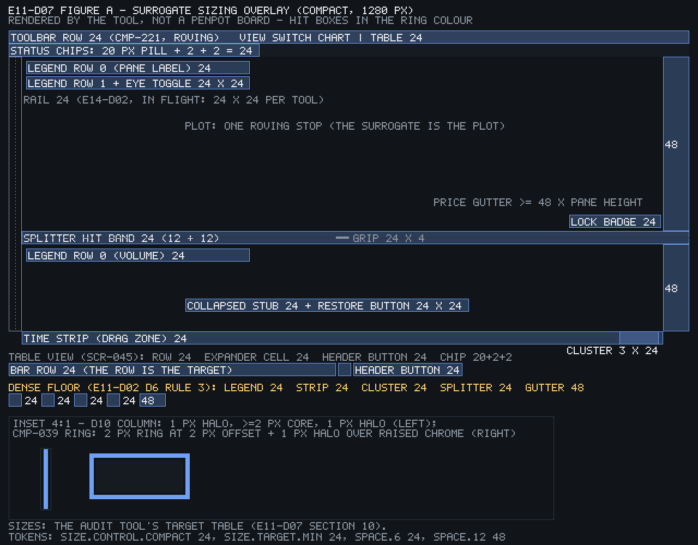
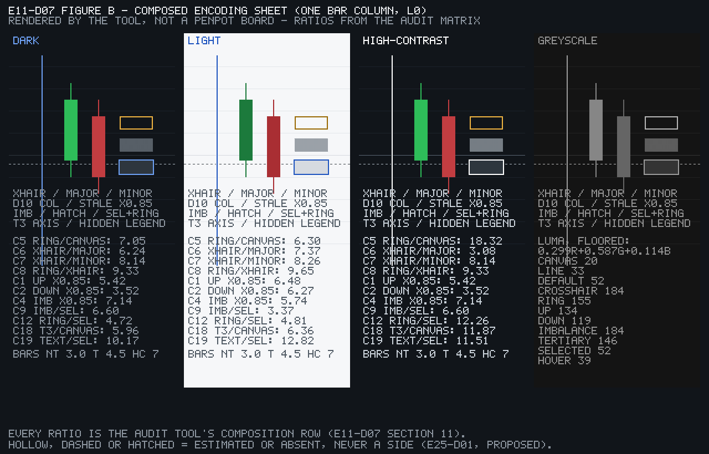

# E11-D07 — Accessibility design review of the chart engine's canvas strategy

**Ticket:** E11-D07 (#330) · **Epic:** E11 · **Status:** Draft — owner approval pending; every judgement below is PROPOSED until the owner's `approved` on #330, except the items marked RULED (the orchestrator's rulings of 2026-10-20 18:30Z — `Alt+T` a pure toggle, the table's refresh an explicit `Shift+R` control, the SCR-047 CTA Owner-only; E11-D02 LD-1…LD-3 of 2026-10-20; the [LANE-52] rulings of 2026-10-22 20:29Z on Q1–Q12 below). **Kind:** a review, not a design — it judges five merged specs and one merged precedent against `05-accessibility-standard.md`, decides the one question they handed it (the chart root's role, §2), finds the collisions no single spec could see (§7, §9, §11) and routes every needed change as a finding to its owner; it redesigns nothing and edits no other ticket's file. **Blocked by:** E11-D04 (#329), merged `5dce4dd2ff95acf553f4a442ce12c514d77417b4` (#3929). **Sign-offs:** the accessibility-specialist and chart-engine-lead sign-offs the ticket names are the orchestrator's approval under comment 6284192190 plus the QA record (RULED, Q7); the owner's walkthrough (§17) is recorded as pending. Sprint 05. Labels `type/design`, `area/chart-engine`, `priority/p0`, `design`, `a11y`.

**Key.** `05` = `docs/plan/05-accessibility-standard.md`; `06`, `11`, `14`, `15`, `26` = the plan documents of those numbers; "D02 D7" = E11-D02's decision 7; "E06-D03 D4" = that review's decision 4; "shipped" = on `main` at the base; "measured" = computed by `docs/design/_tools/e11_d07_a11y_review_audit.py` at the base (every number so marked is re-derived by `--check`); `(heuristic)` = an evaluator's reading of a written design, never an observation of a user or a screen reader; "routed" = answered by a named task of E11-Q05's charter, never claimed here. Verdicts: `compliant` · `at risk` · `non-compliant` · `out of scope — E19` / `— E21` · `not yet decidable — routed to E11-Q05`. Severities: Blocking (a `05` §6 clause non-compliant with no compliant path in the merged designs; a gesture without a keyboard equivalent; a canvas value without a table row) · Major (an at-risk clause with no interim path in the merged designs; a same-context or always-live key collision; a channel with two meanings on one surface; a G-T2 miss in a merged design) · Minor (wording, cadence, order; an at-risk clause whose interim path the merged designs already give — the finding says "interim") · Info (recorded for a consumer's charter — E11-Q05, E06-T02, the E11-D09 pack). The tool asserts the scale: every at-risk clause carries a Major finding or findings naming their interim path; a Blocking finding exists whenever a clause is non-compliant or a gesture has no keyboard equivalent; every F row names exactly one owner and one target (R11), and a withdrawn row keeps its id and its text so nothing is renumbered. Id families: `F-NN` findings, `A-NN` plan-text amendments, `C-NN` contradictions, `G-NN` gaps, `Q-NN` open questions, `H-NN` heuristic findings, `ST`/`PG`/`TG`/`DS`/`PR`/`T2` the stop, gesture, target, desync, parity and gated-control rows, `R-Tn` the review-only protocol tasks, `HO-NN` the hand-offs.

**Method.** A desk review, clause by clause, of E11-D02…D06 and E06-D03 against `05` §3, §4, §5, §6 and §7, with `06` §4.3–§4.4, `11` US-CHART-008/014, `14` SCR-030/045 and `15` CMP-180 as the binding neighbours. Every verdict carries `file:line` evidence read at the base; every number is the tool's; every evaluative sentence is `(heuristic)`. Nothing was run on a screen reader: what a design _specifies_ a region to announce is quoted from the spec, what assistive technology _does_ with it is E11-Q05's, and §17 names the task that will show it. The ticket's "walkthrough with the accessibility specialist, the chart-engine lead and the designer of record present" is the owner's `approved` plus the ≤10-item walkthrough of §17; its "prototype walkthrough with a screen reader" is the protocol index of §17 — nothing below pretends to have run.

**Inputs pinned (base `c3063dce8ccb2d333339df88e166ec995bbbef3b`; every merge commit below is an ancestor of the base, checked with `git merge-base --is-ancestor`).** E11-D01 `9803432e36c8f0441ed2dbedbf417c6bf4255d9f` (#3828) · E11-D02 `d05966f7a669a1f3f1f9b646f837f85c8490608e` (#3921) · E11-D03 `97262572986f99a7560214ebb624940c7f00195e` (#3930) · E11-D04 `5dce4dd2ff95acf553f4a442ce12c514d77417b4` (#3929) · E11-D05 `c24f45bd04c4012fe08d466b1cd89e7fdb676087` (#4101) + its CVD run `8c2d29282a98944f7a0a99a9cfd680e546382bda` (#4166) · E11-D06 `16661c7bd64fd14328c493215eed5211d0e89f82` (#3957) · E06-D03 `41578ba65bb3e1e938ff5ad2975bd3dd091e9854` (#3912) · E08-D11 `5867d450cc40d2e605379b0e4c3891b0c71079b0` · E12-D02 `de8b7242f0749498da089e5f30246bf91a7d01a4` · E09-D09 `baccf724a1fa3ad66f9333e440a7f5e8668b6eff` · E25-D01 `c0674eb95a59903b09388468f8bf2e382bab1161` (#3974; the pattern-vocabulary rule's home, C-24). Open branches read by head: E14-D02 #4159 at `a12cb2ac08ec7f5a30a089fe80ce066dd8f29f3c` (AD-1's chords and gestures, §9.3's SCR-045 entry — cited "if #4159 merges as is"); E17-D03 #4082 at `9f2f445407e62b5dfa260e806d587988667d037d` (read, not used — no composed heatmap stop enters §11). Plan lines: `05` §3.1 :30–36, §3.2 :42–79, §3.3 :83–88, §3.4 :94–103, §4 :107–119, §5 :125–131, §6 :135–196, §7 :204–209, §8.1 :217–224; `06` §4.1 :61–62, §4.3 :80, §4.4 :94; `11` :1035, :1155; `14` SCR-030 :653–728, SCR-045 :996–1015, SCR-049 :1072, SCR-117 :2266–2272; `15` CMP-039 :399–407, CMP-109 :1170, CMP-180 :2081–2115, CMP-188 :2221, CMP-190 :2247, CMP-199 :2380; `26` §3.11 :265–281, §6 :326–348, §12 :638–649. Shipped: `apps/web/src/keymap/keymap.json` 71 commands <!-- audit:shipped_commands=71 --> / 98 atomic bindings <!-- audit:shipped_bindings=98 -->, `reserved-keys.json` 35 expanded entries <!-- audit:reserved_entries=35 -->, `05` §3.2 36 rows <!-- audit:hot_05_rows=36 -->, the screen-reader fixture `docs/design/_tools/e11_d07_sr_reserved_keys.json` 230 rows <!-- audit:sr_rows=230 --> (NVDA 91 <!-- audit:sr_nvda=91 -->, JAWS 108 <!-- audit:sr_jaws=108 -->, VoiceOver 31 <!-- audit:sr_voiceover=31 -->; 11 cited vendor sources <!-- audit:sr_sources=11 -->), `tools/contrast/pairs.mjs`, `packages/ui/tokens/*`, `apps/web/src/features/a11y-preferences/model.ts`, `packages/chart-engine/src/core/flags.ts`.

**Deviations (recorded, not hidden).** The deliverable lives at `docs/design/E11/E11-D07.md` + `docs/design/_tools/e11_d07_*` (RULED Q1), not in `docs/plan/` as the ticket's Branch line says — a review memo there would be a plan document with no owner (C-16.5); A-16 proposes the one cross-reference line in `05` §12. The branch is `design/e11-d07-canvas-a11y-review` (RULED Q3), the lane form, not the ticket's `design/chart-engine-a11y-review`. The ticket's generic engineering brief (repo paths `packages/chart-engine/src/**`, `pnpm` gates, "Closes #", `@CandleViewer/chart-engine` reviewers, the GL / allocation "Do NOT" rules) has no target in a docs diff and is not honoured (R12). Penpot, not Figma; the two boards are BLOCKED-PENPOT (§0). The two figures that are not boards are PNGs rendered by the tool. No handoff file: a review changes no component contract (`16` §11.4; `02` :101) — contract deltas are F rows routed to E11-D09. No plan document is edited (RULED Q10): every `05` / `14` / `15` / `26` change is an A row. The audit tool imports two helper files (`e11_d07_figures.py`, the stdlib PNG renderer the Q2 ruling made necessary) — one more file than the brief planned.

## 0. Artefacts and boards

Penpot (self-hosted): page **`E11-D07 Canvas a11y review`** — BLOCKED-PENPOT: the page is created by name on the first run of the board script; its id is pinned here afterwards; **no board exists yet and no export is claimed**. The two Penpot boards (RULED Q2 — two, not four) and the two tool-rendered figures:

| #   | Artefact                                    | Kind                                         | Shows                                                                                                                                                                                                                                                                                                                                                                                                                                              | Export (pending for boards)                                                |
| --- | ------------------------------------------- | -------------------------------------------- | -------------------------------------------------------------------------------------------------------------------------------------------------------------------------------------------------------------------------------------------------------------------------------------------------------------------------------------------------------------------------------------------------------------------------------------------------- | -------------------------------------------------------------------------- |
| 01  | `focus-order-map`                           | Penpot board (BLOCKED-PENPOT)                | the chart region at 1280 × 800 compact with two panes and the table view beside it: every focus stop of §9 numbered in order, the `Ctrl+\` exit, the `Esc` returns as arrows, the `Alt+T` round-trip, the two root-role candidates as callouts with the §2 stamp, the keys inside each stop as a side table, the SCR-049 `Ctrl+Alt+1..9` entry                                                                                                     | `docs/design/E11/img/E11-D07-01-focus-order-map.png`                       |
| 04  | `verdict-and-routing`                       | Penpot board (BLOCKED-PENPOT)                | the clause × verdict grid of §3–§6 (a word in every cell, never colour alone), the findings table of §15 by severity, owner and target with counts, the ≤10-line summary of §20, the Q1–Q12 rulings with their stamps                                                                                                                                                                                                                              | `docs/design/E11/img/E11-D07-04-verdict-and-routing.png`                   |
| A   | `E11-D07-figA-surrogate-sizing-overlay.png` | **rendered by the tool, not a Penpot board** | the compact chassis at 1280 px with every interactive surrogate drawn as a translucent hit box and its size from §10 (splitter band 24 + grip 24 × 4, time strip 24, price gutter ≥48 × pane, cluster segments 24, legend rows and eye toggles 24, chips 20 + 2 + 2 = 24, the table's row / expander / header 24, the E14 rail dashed "in flight"), the dense-floor strip (D02 D6 rule 3) and a 4 : 1 inset of the D10 column and the CMP-039 ring | committed: `docs/design/E11/img/E11-D07-figA-surrogate-sizing-overlay.png` |
| B   | `E11-D07-figB-composed-encoding-sheet.png`  | **rendered by the tool, not a Penpot board** | one bar column at L0 with the encodings stacked — gridlines, the 4 / 4 crosshair, the D10 column with its halos, a live and a stale (× 0.85) candle, the imbalance outline, the estimated hatch, a selected row with the ring — in dark, light and high-contrast with the §11 composite ratios printed, plus a greyscale strip (luma 0.299 / 0.587 / 0.114, floored) with the luma of every stacked token                                          | committed: `docs/design/E11/img/E11-D07-figB-composed-encoding-sheet.png`  |

Board rules once drawn: content margins ≥24 px, every label through the shared pill-label rule, no token binding and no component instance (the export guard refuses both), every number on a board equal to the tool's `--json` (the local check-nums script asserts it), a footer `page E11-D07 Canvas a11y review · board 0n · rN` (rN = the board script's VERSION; r3 after the T2 self-check), and nested frames named `SCR-030/<state>` / `SCR-045/<state>` where a screen state is shown — on board 01 `SCR-030/populated` wraps the chart region and `SCR-045/populated` the table view, D04's footer drawn under the PROPOSED default of §9.5 T2-07 — no Export CSV control, a small annotation "Export CSV — hidden by plan until it ships (F-25)" (a deferred capability is an absence, not T2). The page is referenced by name and page id only — never by host, team, file id or workspace link.

## 1. Purpose, scope, method and locked inputs

### 1.1 What this review fixes

Five things no single spec could: (1) a verdict for every `05` §6.1–§6.4 clause and the ticket's extra clauses (43 ids <!-- audit:clauses_expected=43 -->), with evidence, an owner and a target (§3–§6); (2) the chart root's role (§2); (3) the complete E11 key map checked against the shipped registry, `05` §3.2, the reserved list and three published screen-reader key lists, with a proposed resolution for every conflict (§7); (4) the pointer-gesture, focus-order and target-size audits (§8–§10); (5) the composed contrast / colour-independence and reduced-motion re-checks across the set (§11–§12). Scope and out-of-scope follow the ticket: the built product is E11-Q05's, order-flow surfaces E18 / E19 / E21's, base components E05's, the mirror itself E11-S13's.

### 1.2 Already decided (cited, never re-decided)

| Item                                                                                                                                                   | Source                                                                                                                                       | What it fixes here                                                                 |
| ------------------------------------------------------------------------------------------------------------------------------------------------------ | -------------------------------------------------------------------------------------------------------------------------------------------- | ---------------------------------------------------------------------------------- |
| The cursor model: arrows move a data cursor, the view follows at the edge; `Shift` ×10; `Home` / `End`; `Esc` returns to the cursor; the plot one stop | E11-D01 D4 `docs/design/research/e11-chart-navigation-research.md:37`                                                                        | the plot-stop rows of §7 and §9; the `05` §3.1 item 7 / §3.2 amendments A-01, A-03 |
| The cursor-centred mirror window (60 default / 200 cap), bar-keyed rows, `role="application"` wrapper, the D5 cadence, the D6 keys, D7 / D8 / D9 / D10 | E06-D03 D1–D10 `docs/design/E06/E06-D03.md:87–176`; `26` §12 :642–645                                                                        | the §3 verdicts and the desync table; the §2 default                               |
| `Alt+T` a pure toggle; refresh = `Shift+R`; the SCR-047 CTA Owner-only                                                                                 | orchestrator 2026-10-20 18:30Z; D04 :143, :272                                                                                               | the `6.3a` / `6.3g` verdicts; A-11                                                 |
| `PageUp` / `PageDown` = the ±10-bar alias                                                                                                              | E06-D03 D6; D02 §7.3 :322 (LD-2)                                                                                                             | no new viewport-page chord (R15, G-16)                                             |
| The equal-status view switch (`Chart │ Table` radiogroup, manual activation, never-overflow, every panel)                                              | D04 D1 :139–143                                                                                                                              | the `US-CHART-014 NFR` verdict and the §5.2 entry-point check                      |
| The encoding registry; "hollow, dashed or hatched = estimated or absent, never a side or direction" PROPOSED in E25-D01 §9.5 only                      | D05 §7 :307–357; E25-D01 §9.5 `docs/design/E25/E25-D01.md:334` (merged `c0674eb95a59903b09388468f8bf2e382bab1161`, #3974; C-24 points at it) | the §11 channel-reuse table                                                        |
| The `16` §4 runtime contract (`data-motion`), `RenderFlags`, the SCR-117 preference model                                                              | `16:138`; `packages/chart-engine/src/core/flags.ts:3–8`; `model.ts:8–17`                                                                     | the `6.2c` and `7.x` verdicts                                                      |
| `26` §12 as amended by E06-D03                                                                                                                         | `26:642–645`                                                                                                                                 | cited as it stands; not re-derived                                                 |

### 1.3 The twelve questions (RULED 2026-10-22 20:29Z, main-orchestrator, [LANE-52])

| Q   | Ruling                                                                                                                                                                                                                                                                |
| --- | --------------------------------------------------------------------------------------------------------------------------------------------------------------------------------------------------------------------------------------------------------------------- |
| Q1  | RULED — `docs/design/E11/E11-D07.md` + `docs/design/_tools/e11_d07_a11y_review_audit.py`; the ticket's `docs/plan/` wording is a deviation; A-16 adds one line to `05` §12                                                                                            |
| Q2  | RULED — two Penpot boards (01 focus-order map, 04 verdict-and-routing grid); the surrogate-sizing overlay and the composed-encoding sheet are tool-rendered PNGs committed under `docs/design/E11/img/`, labelled as such                                             |
| Q3  | RULED — branch `design/e11-d07-canvas-a11y-review`                                                                                                                                                                                                                    |
| Q4  | RULED — the generic design DoD lines are answered item by item in §16 (N/A where a review designs nothing)                                                                                                                                                            |
| Q5  | RULED — severities Blocking / Major / Minor / Info; routing = rows in this document only (filing freeze); the consumer comments on the target tickets are posted at this PR's merge, under the orchestrator's approval                                                |
| Q6  | RULED — a Blocking or Major finding on a merged design is a PROPOSED amendment row addressed to that spec's owner, folded in its next revision; S13 / S14 build the finding's version meanwhile; no hold on the owner's approval of D02–D06                           |
| Q7  | RULED — the two sign-offs = the orchestrator's approval under comment 6284192190 + the QA record; the owner's walkthrough recorded as pending; that approval is S13 / S14's Ready gate                                                                                |
| Q8  | RULED — `role="application"` wrapper + `aria-roledescription="trading chart"` + the hidden `<table>` mirror with one roving plot stop (E06-D03 D4; `26` §12), PROPOSED until E11-Q05's pass confirms; the H10 grid model is the swap path with its deciding test (§2) |
| Q9  | RULED — the three vendor reserved-key lists are pinned as a cited JSON fixture under `docs/design/_tools/` and the tool reads it; "`Alt+T` clear in all four" reads VERIFIED from the fixture (§7.4)                                                                  |
| Q10 | RULED — no plan-document edit; A rows for the owner's docs PR                                                                                                                                                                                                         |
| Q11 | RULED — the tool imports the upstream `PAIRS` and re-measures the union, then adds D07's composition rows; exit 1 only on a D07 row under its bar                                                                                                                     |
| Q12 | RULED — every D06 §7 row plus §9.1–§9.4 reviewed per element; the `05` §3.2 Accessibility rows absent from the registry are a finding for E10-S02 (G-05)                                                                                                              |

Lesser defaults taken without asking (PROPOSED): D03 O-11 — a dialog's submit-time errors stay `role="alert"` once per submit (§4.2, A-09); the page name `E11-D07 Canvas a11y review`; the tool prints every number this document quotes and `--check` re-derives them; the protocol is one index over existing tasks plus the review-only ones (§17), never a duplicate protocol.

### 1.4 What the upstream specs handed here, and where each is answered

| Handed by                                  | Question                                                                                                                                            | Answer                                                                                        |
| ------------------------------------------ | --------------------------------------------------------------------------------------------------------------------------------------------------- | --------------------------------------------------------------------------------------------- |
| E11-D01 :285 (Q4-e), :367                  | the chart root's role after session S3                                                                                                              | §2 (S3 was never run — O1 :420; the review decides on the merged evidence and names the test) |
| E11-D01 :285 (Q4-f), :284 (Q4-g), :367     | the chord collisions (`Alt+T`, `Alt+1..4`, `Alt+←/→`, replay `Shift+←/→`, `?`) and the high / low chord                                             | §7.3 (every one with a resolution); G-18 and F-21 for the high / low chord                    |
| E11-D01 :286 (Q4-i), :281 (Q4-a)           | the focus model and the order-safety rule (`Esc` returns to the cursor)                                                                             | §9 (ST rows), §9.4                                                                            |
| E11-D01 :403 (Q4-h)                        | the screen-reader matrix contradiction; "CMP-004 FocusRing" vs CMP-039                                                                              | C-03, C-02                                                                                    |
| E11-D02 :654, :846 (N-5)                   | the root role; the N-pane Tab order                                                                                                                 | §2; §9.2                                                                                      |
| E11-D02 A-15 :808                          | the viewport-page chord                                                                                                                             | G-16: no new chord (R15)                                                                      |
| E11-D03 :484 (N-4 / O-11), :914            | the politeness of submit-time errors; the `Alt+G` shadow declaration                                                                                | §4.2 (accepted: `role="alert"` once per submit), A-09; F-22                                   |
| E11-D04 :1011, G-4 :942                    | the §21.2 protocol, the §21.3 walkthrough, the §21.1 findings, O-3's registry check; `Alt+T` unregistered                                           | §17 (indexed, not duplicated); §7.3; G-01                                                     |
| E11-D05 Q8 :862, §9.1 :438, :878           | the root role; the surrogate ring contract in the layer review                                                                                      | §2; `3.4.6` and §11 rows C5, C12–C17                                                          |
| E11-D06 :639 (D7, G-6, C-11, §11.3)        | the announcement-at-start rule for jumps; the keyboard-help wording; one label for the three override entry points; §11.3 as the reduce walkthrough | §4.1 (routing table), §12.3, §12.4, §17                                                       |
| E06-D03 §8 items 6, 9, 10, 11, 12 :301–307 | the hotkey-map entries; the `05` §6.1 / CMP-109 wording; SCR-037's letters; the nine S13 / S14 conflicts; forced colours                            | G-09, A-08 / A-19, §7.3 (E14-D02 AD-1 chose letters), §3 (the conflicts stand), R-T5          |

## 2. The chart root's role (RULED Q8; PROPOSED until E11-Q05 confirms)

**Decision.** The chart root is a `role="application"` wrapper with `aria-roledescription="trading chart"` and a static `aria-label` of symbol and interval, over a `clip-path`-hidden `<table>` mirror with **one roving plot stop** and `aria-current` on the cursor bar's row — E06-D03 D4 as merged (`docs/design/E06/E06-D03.md:103`) and as written into `26` §12 (`docs/plan/26-chart-engine-design.md:642`, `:644`). The canvas inside keeps `role="img"` with the rolling label (`05` §6.4 :195; `15` CMP-180 :2087). S13 builds this.

**Evidence for.** (1) D4 is merged and mirrored in the engine design; a review that reverses a merged decision on no new evidence is a redesign, not a review (§1). (2) The grid model's precondition — browse mode swallowing the arrow keys — is exactly what E11-D01 Q4-e made conditional on session S3 (`e11-chart-navigation-research.md:285`: "`application` only if session S3 shows browse mode swallowing arrows"), and S3 was never run (O1 `:420`); on paper both models receive arrows only in focus / interaction mode, so the paper evidence cannot separate them. (3) The fixture of §7.4 shows why the question is real: NVDA, JAWS and VoiceOver each bind every unmodified letter and digit in browse / Quick Nav mode (91 / 108 / 31 rows), so a root that does **not** force focus mode leaves `F`, `H`, `P`, `1..9`, `B`, `R` and `Shift+R` to the screen reader (F-15) — an `application` root is the standard way to say "these keys are the app's" (E06-D03 H4 :239). (4) axe-core is clean on the D4 structure (E06-D03 F12 :76).

**Evidence against (why PROPOSED, not DECIDED).** `role="application"` disables the screen reader's browse-mode navigation inside the root — quick-nav letters, the rotor's shortcuts — and replaces the spoken word "application" with the roledescription, which is the user's cue that quick-nav keys are off (E06-D03 H4; `(heuristic)`). A single tab stop with `aria-current` relies on the live region alone for cursor feedback; `05` §3.4 item 2 prescribes the APG grid pattern for composite widgets (`05:95`), and E06-D03 H10 (`:245`) names that alternative. The two readings are settled only by a real AT run.

**The swap path.** The H10 model: the mirror as `role="grid"` with the root's `aria-activedescendant` moved at the D5 cadence (never per auto-repeat — an uncoalesced change at repeat rate floods exactly as D5 prevents), NVDA / JAWS expected to switch to focus mode on `grid` as on `application` (E06-D03 H10 `:245`, H4 `:239` — `(heuristic)`: the fixture lists the mode toggles, not the automatic switch; R-T6 shows it), the canvas `img` label unchanged. Everything else in this review holds under either model: the field allocation (E06-D03 D1), the cadence (D5), the key table (D6), the mirror under LOD and profiles (D7 / D8), the engine contract (D9), the cursor column (D10), the table (D04), the focus order (§9 — only the plot stop's internal semantics change). The swap costs S13 the root attributes and the row-id plumbing, not a redesign.

**The deciding test (E11-Q05; nothing run here).** E06-D03 §7.3 T2 / T3 (`:257–258`) — one press and a 3 s hold must produce exactly one, then ≤1 per 500 ms, then one final announcement — and **T8** (`:264`): "if T2 / T3 show the live region alone loses the cursor, compare against the H10 alternative"; plus T1's mode-switch cue (`:256`) and R-T6 of §17 (the same three tasks under both roots). The grid model is adopted if, and only if, T2 / T3 fail under `application` and pass under `grid` with the same cadence.

**The catalogue sentence (A-18, for the `15` owner).** `15` CMP-180 A11y :2087 "the root wrapper's role (`application` per E06-D03 D4 vs `img` + an APG-grid mirror per E11-D01 Q4-e) is **open — E11-D07's call**" → "the root wrapper is `role="application"` + `aria-roledescription="trading chart"` with a static symbol-and-interval label (E06-D03 D4; E11-D07 §2, PROPOSED until E11-Q05's T2 / T3 / T8 confirm; the swap path is the H10 `grid` + coalesced `aria-activedescendant` model)". The same sentence closes E11-D05 Q8 (`docs/design/E11/E11-D05.md:862`), `E11-D05-handoff.md:13` / `:207` and E11-D02 §12 :654's "open, E11-D07's call" (by reference — those files are not edited here, Q6).

## 3. Layer 1 — the DOM mirror (`05` §6.1)

`05` §6.1 has four bullets at the base (`:139–142`, counted by the tool: 4 <!-- audit:bullets_6_1=4 -->); the review splits them into eight clauses. Every §6.1 / §6.4 verdict is a verdict on the **design**: the engine on `main` has no mirror, no query surface, no `aria-label` and no live region (`git grep -i -E 'aria|mirror|a11y|accessib|visibleWindow|focusedUnit|role='` over `packages/chart-engine/src` finds only `core/flags.ts:1` and `core/handle.ts:30` — the E47-S07 render flags), so "not yet built — E11-S13" stands in every evidence cell.

### 3.1 Verdicts

| Clause | Requirement (quoted from `05`)                                                                                                                                        | Where the design meets it (file:line)                                                                                                                                                                                                                                                                                   | Verdict   | Evidence / tool row                                                                                                                                                                                                                                                      | Finding    | Owner                                        | Target         |
| ------ | --------------------------------------------------------------------------------------------------------------------------------------------------------------------- | ----------------------------------------------------------------------------------------------------------------------------------------------------------------------------------------------------------------------------------------------------------------------------------------------------------------------- | --------- | ------------------------------------------------------------------------------------------------------------------------------------------------------------------------------------------------------------------------------------------------------------------------ | ---------- | -------------------------------------------- | -------------- |
| `6.1a` | "visually-hidden (`clip-path`/off-screen positioned, not `display:none`) DOM structure" (`:139`)                                                                      | E06-D03 §8 item 11 (2) `:306` "a `clip-path`-hidden table"; `26` §12 `:644` "a visually hidden `<table>`"; D04 §4.2 `:158` keeps the pane stack `visibility: hidden` + `inert`, "never `display: none`", when the table opens                                                                                           | at risk   | the technique is named only in E06-D03's conflict note, not in D4's decision sentence (`:103`), not in `26` §12 and not in CMP-180 (`15:2087`) — S13 could build either hiding; not yet built — E11-S13                                                                  | F-02       | hpe-worker-1 (E06-D03 / `26` owner via A-22) | E11-S13 #520   |
| `6.1b` | "mirrors the currently-relevant data: visible bar range (OHLCV), focused footprint cell's values, focused heatmap cell's price/size, focused DOM ladder row" (`:139`) | E06-D03 D1 `:87` (a cursor-centred window of bar rows placed by `aria-rowcount` / `aria-rowindex`; the visible range exposed separately by `viewFirstBar` / `viewLastBar`), the field table `:93–97`; the cursor bar's cells on `Enter` (D6 `:107`, D7 `:109`); heatmap / DOM rows are E21's                            | compliant | the bar-level deviation ("cursor-centred window", not "visible bar range") is E06-D03's, handed to the `05` owner (`:304`); A-08 carries it; the heatmap and DOM-ladder parts are `out of scope — E21` (`6.3d`)                                                          | A-08       | `05` owner (#2701)                           | docs PR        |
| `6.1c` | "a `tabindex`-able, ARIA-labelled DOM element per logical unit (bar, cell, row) sits invisibly aligned over/behind the canvas region it represents" (`:140`)          | E06-D03 D4 `:103` (one tab stop, `aria-current` on the row) and F15 `:79` (per-cell mirroring is ≈5,400 text + ≈1,800 cell nodes at 60 bars — unaffordable; cells only for the cursor bar on `Enter`); `26` §12 `:645` "never as per-cell nodes"                                                                        | compliant | compliant with the model E06-D03 merged; the literal `05` wording is the thing to amend (E06-D03 §8 item 9 `:304`) — A-08 "element per logical unit" → the cursor-bar-detail model; CMP-109's A11y line (`15:1170` "every cell is mirrored") is the same amendment, A-19 | A-08, A-19 | `05` / `15` owners (#2701)                   | docs PR        |
| `6.1d` | "sized to match the visual target for pointer users using it too" (`:140`)                                                                                            | D02 §12 `:652` "surrogates are sized to the visual targets … these are the a11y target sizes too"; the plot's one stop is the plot; the axis / splitter / legend / chip surrogates carry the §10 sizes; the cursor bar's focus-visible mark is the canvas-drawn D10 column (E06-D03 D10 `:176`; D05 §9.1 `:438`)        | compliant | §10 TG rows (27 <!-- audit:target_rows=27 -->, 0 below 24 <!-- audit:targets_below_24=0 -->); under D4 the mirror has no per-unit surrogate to size — the only canvas-adjacent focusables are the D02 §12 surrogates and the table's rows                                | —          | —                                            | —              |
| `6.1e` | "windowed/virtualized (only currently-visible/currently-focusable items are materialized in the DOM — not all 100k bars)" (`:141`)                                    | E06-D03 D1 `:87` (60 rows default, 200 cap, Settings → Accessibility); `26` §12 `:644`; D04 §6.3 `:260` (CMP-049 virtualised, bar-keyed pool)                                                                                                                                                                           | compliant | §13: 550 nodes <!-- audit:nodes_default=550 --> at 60 rows, 1,800 <!-- audit:nodes_cap=1800 --> at the cap (9 per row <!-- audit:nodes_per_row=9 -->, E06-D03 §8 item 11 (1) `:306`)                                                                                     | —          | —                                            | —              |
| `6.1f` | "keep it in sync with WebGL's own LOD/culling, per the performance standard" (`:141`)                                                                                 | E06-D03 D7 `:109` — one row per bar at every footprint and candle tier, the degradation stated in text, "the never-desync rule applies to values, not to glyph visibility"; `26` §12 `:645`; `footprintTier` / `candleTier` in D9 `:123–125`                                                                            | compliant | values and tiers stay in sync; glyph visibility deliberately does not (the mirror is never less than the canvas) — the reading S13's conflict (3) adopted (`:306`); C-19 records the wording gap and A-08 amends `:141`                                                  | C-19, A-08 | `05` owner (#2701)                           | docs PR        |
| `6.1g` | "the rendering engine's public API must expose a 'current visible window + current focused unit' query surface" (`:142`)                                              | E06-D03 D9 `:113–171` — `A11yWindow { firstBar, lastBar, viewFirstBar, viewLastBar, cursorBar, cursorTime, footprintTier, candleTier, barsPerColumn }`, `getA11yWindow()`, `onA11yWindowChange()`, `requestCursorCells()`, `getBarSummary()`; `26` §12 `:644` cites it; `26` §6 `viewport` / `a11y` messages `:346–347` | compliant | the surface exists as a contract; `26` §8's `Chart` interface does not yet carry the D9 members (G-12, A-22) — E11-D05 G14 records the same gap for other members; not yet built — E11-S13                                                                               | G-12       | `26` owner (#2701) / E11-S13                 | docs PR / #520 |
| `6.1h` | "keep the DOM mirror and the WebGL draw calls frame-synchronized" (`:142`); `06` §4.4 "never … desyncing the DOM-mirror accessibility layer" (`:94`)                  | E06-D03 D2 `:99` (bar-keyed rows patched every frame, "same-frame parity with the canvas … bounded only by the one-frame skew the worker protocol implies", F16 `:80`); `26` §12 `:644`; §3.2 below                                                                                                                     | compliant | the desync table (8 paths <!-- audit:desync_paths=8 -->) names a mechanism for every path; the one-frame worker skew is the floor E06-D03 §8 item 4 kept (`:299`); the runtime counter is G-10                                                                           | G-10       | E11-S13 #520                                 | #520           |

### 3.2 The desync paths (ticket Technical notes; `06` §4.4 :94)

Structural or nothing: each row names the mechanism that prevents divergence, the test or counter that proves it, and the verdict. "Unlikely" appears nowhere.

| Id   | Path                                                        | What could diverge                                                                      | The mechanism that prevents it (spec, line)                                                                                                                                                                                                                                                                                               | Test / counter                                                                                                                        | Verdict   |
| ---- | ----------------------------------------------------------- | --------------------------------------------------------------------------------------- | ----------------------------------------------------------------------------------------------------------------------------------------------------------------------------------------------------------------------------------------------------------------------------------------------------------------------------------------- | ------------------------------------------------------------------------------------------------------------------------------------- | --------- |
| DS01 | LOD step-down (footprint L0→L3, candle L0→L2)               | the canvas hides text or merges bars while the mirror keeps bar rows                    | mirror content is a function of bar data and the two tiers only (`26:645`); one row per bar at every tier, the degradation in the announcement, the tiers reported separately (`footprintTier` / `candleTier`, E06-D03 D7 `:109`, D9 `:123`)                                                                                              | CMP-180 "DOM-mirror parity (the mirror's rows equal the fixture's bars at every LOD tier)" (`15:2115`); D8's contract test (`26:645`) | compliant |
| DS02 | mid-pan (bar-keyed shift)                                   | rows show a stale window while the viewport moves                                       | rows are a bar-keyed pool; a shift of k bars moves k rows and rewrites 7k cells, every frame (E06-D03 D2 `:99`; `26:644`); time-slicing excluded "at every speed by the never-desync rule" (`26:644`)                                                                                                                                     | E06-D03 F14 (0.8 ms p95 default / 1.4 ms cap); E11-S13's property test (ticket) and the G-10 counter                                  | compliant |
| DS03 | live update (cursor and live rows)                          | the cursor row shows an old close                                                       | the cursor row and rows receiving live data are patched every frame (D2 `:99`); the table is a different surface, patched at 1 / 2 s with its caption stating the cadence (D04 §6.3 `:261`: "updates every 2 s") — disclosed, not a desync                                                                                                | E06-D03 T9 `:265` (storm); D04 §21.2 T6 `:845` (silent patching)                                                                      | compliant |
| DS04 | hard jump (`Home` / `End`, go-to-date)                      | the window is rewritten over several frames                                             | the rewrite completes "within the §4.1 settling allowance (≤3 frames)" (`26:644`); `06` §4.1 `:62` carries exactly that allowance for "a hard jump like `Home`/`End`" — **verified at the base** (the brief's premise that `06` lacks it does not hold; no C-row); both surfaces settle on the same frames                                | E06-D03 F14's one-off 14.3 ms rewrite `:78`; E06-D03 T4 `:260`                                                                        | compliant |
| DS05 | `RenderProfile` change (`full` → `reduced` → `degraded-2d`) | the 2D fallback draws fewer things than the mirror exposes                              | mirror content and behaviour are "never of the `RenderProfile`" (E06-D03 D8 `:111`; `26:645`); "one mirror snapshot must hold under full, reduced and degraded-2d, verified by a contract test"                                                                                                                                           | the D8 contract test (`26:645`); E06-D03 T11 `:267`; D04 §21.2 T11 `:850`                                                             | compliant |
| DS06 | history prepend / `data`-origin move                        | `aria-rowindex` and the cursor drift when a page lands or a bar opens                   | `aria-rowcount` grows and `aria-rowindex` re-indexes with the row (E06-D03 D4 `:103`); the cursor is keyed by `cursorTime`, which "survives prependHistory" (D9 `:122`); a `data` move re-indexes silently and keeps the focused bar (D04 §6.3 `:262`; D5 `:105` "`data` moves never write the cursor region")                            | E06-D03 T14 `:270`; D04 §21.2 T6 `:845`                                                                                               | compliant |
| DS07 | the worker's one-frame skew                                 | the mirror, the live region, the canvas label and the table lag the pixels by one frame | the floor, not a desync: all four consume the same `viewport` / `a11y` message the worker posts after rendering (E06-D03 F16 `:80`, D2 `:99`; `26` §6 `:346–347`), so they never disagree with each other; `06` §4.4 "stays as written" (E06-D03 §8 item 4 `:299`)                                                                        | the D9 message is the single source (`getBarSummary()` "the ONE text source", `:169`)                                                 | compliant |
| DS08 | the table open (pane stack hidden, render loop suspended)   | the table shows bars the hidden canvas has moved past, or the reverse                   | the pane stack is `visibility: hidden` + `inert` and the host suspends the render loop while the table is open (D04 §4.2 `:158`; G-11 `suspend()` / `resume()`, D04 A-8 `:993`); on return the cursor is set with origin `table` and the D10 column lands on it (`:167`); a stale table is the banner, not a silent drift (D04 D7 `:270`) | D04 §21.2 T10 `:849` (the banner), T1 (`:840`)                                                                                        | compliant |

### 3.3 Node count, per-frame cost and the surrogate-sizing argument (ticket Performance notes)

- **Nodes.** E06-D03 D1's two totals (≈550 at 60 rows, 1,800 at 200 — `:306`) reproduce as 9 nodes per row <!-- audit:nodes_per_row=9 --> plus 10 fixed <!-- audit:nodes_fixed=10 --> (the formula the tool prints; the per-row breakdown is E06-D03's): 550 at the default window, 1,800 at the opt-in cap, against the ticket's cap of 500 <!-- audit:cap_ticket=500 -->. E06-D03 §8 item 11 (1) already answers S13's "under 500 nodes": S13's AC and default follow D1 (`:306`). A surrogate per footprint cell would be ≈5,400 text + ≈1,800 cell nodes at 60 bars (F15 `:79`) — the case the ticket's Performance note names, closed by F15.
- **Per-frame cost.** `06` §4.3's slice is 1 ms <!-- audit:slice_ms=1.00 --> (`:80`); E06-D03 F14 measured 0.8 ms <!-- audit:mirror_p95_default_ms=0.80 --> p95 at the 60-row default and 1.4 ms <!-- audit:mirror_p95_cap_ms=1.40 --> at the 200-row cap (`:78`; cited, not re-measured). The cap exceeds the slice by 0.4 ms; E06-D03 D3 `:101` defers the production verdict to E06-T02 on the reference machine with the worker rendering — F-09 (Info) routes it there; the `06 §4.3` row of §6.5 is `at risk` for the cap only.
- **Surrogate sizing.** Under D4 there is no per-unit surrogate: the plot is one stop sized to the plot, its focus-visible mark is the D10 column (≥2 px core + 1 px halos, canvas-drawn), the CMP-039 ring sits once at the chart boundary (D05 §9.1 `:438`), and the canvas-adjacent focusables that **are** surrogates — axis gutters, splitter, legend rows, chips, the lock badge, the table's rows — carry the §10 sizes (figure A). `6.1d` is compliant for that reason, not because per-cell surrogates were sized.

## 4. Layer 2 — live regions (`05` §6.2)

`05` §6.2 has two bullets at the base (`:146–150`, counted: 2 <!-- audit:bullets_6_2=2 -->); the review splits them into four clauses.

### 4.1 Verdicts

| Clause | Requirement (quoted from `05`)                                                                                                                                                         | Where the design meets it (file:line)                                                                                                                                                                                                                                                                  | Verdict   | Evidence / tool row                                                                                                                                                                                                                                                                                                                                                                | Finding    | Owner                                | Target                     |
| ------ | -------------------------------------------------------------------------------------------------------------------------------------------------------------------------------------- | ------------------------------------------------------------------------------------------------------------------------------------------------------------------------------------------------------------------------------------------------------------------------------------------------------ | --------- | ---------------------------------------------------------------------------------------------------------------------------------------------------------------------------------------------------------------------------------------------------------------------------------------------------------------------------------------------------------------------------------- | ---------- | ------------------------------------ | -------------------------- |
| `6.2a` | "`aria-live="polite"` region for ambient updates … default 1 update / 2s per field, user-configurable in Settings → Accessibility … the _latest_ value" (`:147`)                       | D02 §10 `:424` (the mark / last / spread readout: polite, latest value only, 1 per 2 s per field, "user-configurable in Settings → Accessibility"); `26` §12 `:643` "Ambient market values keep the §6.2 cadence"; D04 §6.3 `:261` (the same control for the table's patch cadence); CMP-180 `15:2087` | at risk   | the region, the cadence and latest-value are specified; the **control** the three specs point at does not exist in SCR-117's shipped model (`model.ts:8–17`: `announce_prices: off / significant / always`, `verbosity` — no cadence field) and no merged design draws it (SCR-117's hi-fi is E47-D05); 20 Hz × 2 s = 40 ticks <!-- audit:ticks_per_window=40 --> per announcement | F-05       | E47 (E47-D05, SCR-117)               | E47-D05                    |
| `6.2b` | "`aria-live="assertive"` (or `role="alert"`) reserved for discrete, low-frequency, high-importance events only … never throttled/coalesced — each is announced once, in full" (`:148`) | D04 §17.3 `:534` — the SCR-048 card "is the only `role="alert"` (assertive, once per episode)"; `14` SCR-048 `:1054`; D03 §12.3 `:483` — submit-time errors `role="alert"` once per submit; E08-D11 §5 `:162` — the connection banner's alert never takes focus (the chassis inherits it)              | compliant | the routing table below; D03 O-11 accepted (§4.2) and recorded as A-09 so `05`'s list stops reading as complete; the stale banner and the restoring strip are **polite** by design but CMP-028's `warning` tone is `role="alert"` today — D04 C-16 / A-11 (CR-D04-10), cited as C-21                                                                                               | A-09, C-21 | `05` owner (#2701); D05 owner        | docs PR; E11-D05 CR-D04-10 |
| `6.2c` | "a user-facing 'Announcements' settings panel lets the user choose which event classes go to which live-region politeness level, and a master 'reduce announcements' toggle" (`:149`)  | D02 §10 `:424` depends on it ("silenced by the master 'reduce announcements' toggle"); `14` SCR-117 `:2269` names "announcement throttling"; the shipped model (`model.ts:8–17`, `shouldAnnounce()` `:87–95`) has `announce_prices` + `verbosity` — no per-class routing, no master toggle             | at risk   | no merged design and no shipped model carries the panel; `announce_prices: "off"` is the nearest shipped thing and S13 can bind the readout region's silence to it as an interim; C-17 (`14` SCR-117 vs the shipped model)                                                                                                                                                         | F-04, C-17 | E47 (E47-D07 routing, E47-D05 panel) | E47-D07 / E47-D05          |
| `6.2d` | "live regions are pre-rendered empty containers on page load … only their _text content_ is swapped, never the whole node destroyed/recreated" (`:150`)                                | E06-D03 D4 `:103` "ONE pre-rendered `role="status" aria-live="polite" aria-atomic="true"` region"; `26` §12 `:643` "one pre-rendered `aria-live="polite"` region"; CMP-180 `15:2087` "the two pre-rendered live regions"; D04 §17.3 `:534` one `role="status"` region, "writes once per user action"   | compliant | the write primitive (`textContent`, never `innerHTML`) is **not named** by any design — §14 routes it (F-03)                                                                                                                                                                                                                                                                       | F-03       | E11-X01 / E11-S13                    | E11-X01 threat model; #520 |

### 4.2 The politeness routing table (composed across the set)

| Event class                                                                    | Source spec                                    | Region                                              | Politeness                   | Cadence / trigger                                                                         | Throttled?             | `05` class                                       |
| ------------------------------------------------------------------------------ | ---------------------------------------------- | --------------------------------------------------- | ---------------------------- | ----------------------------------------------------------------------------------------- | ---------------------- | ------------------------------------------------ |
| cursor move (`keyboard`, `table`, a click)                                     | E06-D03 D5 `:105`; `26:643`; CMP-190 `15:2247` | the chart's cursor region (`role="status"`, atomic) | polite                       | `leadDelay` 0 ms · `repeatWindow` 500 ms · `trailingFlush` ≤250 ms; short form while held | coalesced while held   | user-driven, not ambient (E06-D03 F6 `:70`)      |
| ambient mark / last / spread                                                   | D02 §10 `:424`                                 | the readout region                                  | polite                       | 1 per 2 s per field, latest value                                                         | yes                    | §6.2 ambient (`:147`)                            |
| legend cursor values, last-price and mark pills                                | D02 `:424` (2), (5)                            | none                                                | not announced                | —                                                                                         | —                      | mirrors the cursor summary                       |
| countdown, replay clock                                                        | D02 `:424` (3); D11 `:118`                     | `aria-live="off"`                                   | off                          | 1 Hz text swap                                                                            | —                      | not an announcement                              |
| chip entry / exit (stale, reduced rate, aggregation, paused, LOD)              | D02 `:417`, `:424` (4); E12-D02 `14:704`       | the chart's polite region                           | polite, once each way        | on state change; "the ratio silent"                                                       | discrete               | ambient class, discrete                          |
| axis state ("Price scale locked" / "auto"), splitter, legend toggles           | CMP-188 `15:2221`; D02 §8 `:359`, §7.5 `:345`  | the chart's polite region                           | polite, ≤2/s, once per key   | per key, not per frame                                                                    | per-key                | user-driven                                      |
| go-to-date landing; menu state changes                                         | D03 §7.5 `:360`; §12.3 `:485`                  | the chart's polite region                           | polite                       | one combined announcement ("Jumped to … Following paused.")                               | latest-state, ≤2/s     | user-driven                                      |
| table status (sort, filter count, copy, expand, page, banner, refresh, follow) | D04 §17.3 `:534`                               | the table's `role="status"` region                  | polite, once per user action | never per data tick; the caption's live numbers are text                                  | per-action             | user-driven                                      |
| the stale banner's appearance                                                  | D04 D7 `:275`                                  | the table's status region                           | polite, once                 | on appearance; never re-announced while the chart keeps moving                            | once                   | polite (E17-D01 §7 Stale < T2); C-21 for CMP-028 |
| SCR-048 error card                                                             | D04 §17.3 `:534`; `14:1054`                    | `role="alert"`                                      | assertive, once per episode  | on failure                                                                                | never                  | §6.2 assertive (`:148`)                          |
| SCR-044 submit-time errors (before-history, after-latest, …)                   | D03 §12.3 `:483`                               | CMP-027 `role="alert"`                              | assertive, once per submit   | per submit, never per keystroke                                                           | never                  | discrete, user-initiated — accepted (A-09)       |
| SCR-044 format / no-data warnings                                              | D03 §12.3 `:483`                               | `role="status"`                                     | polite                       | per submit                                                                                | —                      | polite                                           |
| SCR-046 diagnostics values                                                     | D02 §9 `:383`; `14` SCR-046 `:1023`            | `role="region"` "with polite 2 Hz updates"          | polite                       | 2 Hz                                                                                      | sampled, not throttled | **above** the §6.2 ambient default (F-07)        |
| connection banner (disconnected / reconnected)                                 | E08-D11 §5 `:162`                              | `role="alert"`, 0 ms, never takes focus             | assertive                    | on transport state                                                                        | never                  | §6.2 assertive (`:148`)                          |
| cache-loading / rebuilding / backfill / LOD (E12 rows)                         | E12-D02 via `14:696–704`                       | the chart's polite region                           | polite                       | past 600 ms; at start and completion; once per page; once per entry / exit                | discrete               | ambient class, discrete                          |
| the "read current bar" re-trigger                                              | E06-D03 D5 `:105` (H5)                         | the cursor region (zero-width-space alternation)    | polite                       | on the key — **no key is assigned** (G-09)                                                | —                      | user-driven                                      |

**Cadence reconciliation.** The three documents agree at the base: `26` §12 `:643`, E06-D03 D5 `:105` and CMP-190 `15:2247` all carry `leadDelay` 0 / `repeatWindow` 500 ms / `trailingFlush` ≤250 ms; a held key steadies at 2/s <!-- audit:cursor_per_s=2 -->, which is US-CHART-008's NFR (`11:1035`); the ambient default is 1 per 2 s in `05:147`, D02 `:424`, D04 `:261` and CMP-180 `15:2087`. **The 20 Hz argument** (ticket Performance notes): the ambient region announces the latest value once per 2 s window, so a 20 Hz tick rate puts 40 ticks <!-- audit:ticks_per_window=40 --> behind each announcement — the tick rate changes nothing about announcement count; the cursor region is written only by `keyboard` / `table` origins and clicks, never by ticks (D5 `:105`). **D03 O-11** (submit-time politeness): accepted as D03 proposes — a submit is discrete and user-initiated, inside `05` §6.2's assertive reading `(heuristic)`; A-09 adds "a dialog's submit-time error" to `:148`'s examples.

## 5. Layer 3 — the data-table alternative (`05` §6.3)

`05` §6.3 has six bullets at the base (`:154–191`, counted: 6 <!-- audit:bullets_6_3=6 -->) plus three column tables; the review splits them into nine clauses. The profile and DOM-ladder tables are E19's and E21's reuse of D04's shell (D04 §27 `:1016`).

### 5.1 Verdicts

| Clause | Requirement (quoted from `05`)                                                                                                                                                                                                                                                             | Where the design meets it (file:line)                                                                                                                                                                                                                                                                                                        | Verdict            | Evidence / tool row                                                                                                                                                                                                                                                                                                                                    | Finding       | Owner                                      | Target        |
| ------ | ------------------------------------------------------------------------------------------------------------------------------------------------------------------------------------------------------------------------------------------------------------------------------------------ | -------------------------------------------------------------------------------------------------------------------------------------------------------------------------------------------------------------------------------------------------------------------------------------------------------------------------------------------- | ------------------ | ------------------------------------------------------------------------------------------------------------------------------------------------------------------------------------------------------------------------------------------------------------------------------------------------------------------------------------------------------ | ------------- | ------------------------------------------ | ------------- |
| `6.3a` | "'View as table' toggle (`Alt+T`, §3.2) that renders the same data as a real, semantic `<table>` with `<th scope="col/row">`, sortable columns, and standard table screen-reader navigation (Ctrl+Alt+arrows in NVDA/JAWS table mode)" (`:154`)                                            | D04 D1 `:139–143` (the `Chart │ Table` radiogroup; `Alt+T` the global toggle), §17 `:501` (`<caption>`, `<thead>`, `<th scope="col">`, the time cell `<th scope="row">`, `aria-rowcount` / `aria-rowindex`), §8.1 `:281` (sortable headers)                                                                                                  | at risk            | the table-mode chord `Ctrl+Alt+←/→` is the **shipped Workspace binding** `workspace.panel_prev / next` (`validWhen: always`, `keymap.json`) and VoiceOver's `VO+←/→` — the fixture's 4 table-mode rows <!-- audit:conflicts_sr_table=4 --> and 2 VO chords <!-- audit:conflicts_sr_chord=2 --> hit it (§7.3); `Alt+T` is unregistered (D04 G-4 `:942`) | F-01, G-01    | keymap owner (E10-S02 / E49-T04) + E11-S14 | E10-S02; #521 |
| `6.3b` | the footprint table's column set: Price, Bid vol, Ask vol, Delta, Imbalance flag, Estimated badge (`:156–165`)                                                                                                                                                                             | D04 §6.1 `:241–248`: price (row header, default descending), bid, ask, delta (signed text), imbalance (word + bar), (estimated) (CMP-227 chip, filter-only)                                                                                                                                                                                  | compliant          | the tool compares the two name lists as text: 6 vs 6, names in `05` with no D04 twin: none                                                                                                                                                                                                                                                             | —             | —                                          | —             |
| `6.3c` | the profile table (Price, Volume, Delta, % of POC, Value area) (`:167–175`)                                                                                                                                                                                                                | E19's reuse of D04's shell (D04 §27 `:1016`); the VAH / POC / VAL caption fields are D04 §14 row 11 `:426`                                                                                                                                                                                                                                   | out of scope — E19 | recorded for the audit charter (Info)                                                                                                                                                                                                                                                                                                                  | —             | E19                                        | E19's review  |
| `6.3d` | the DOM-ladder table (Price, Bid size, Ask size, Cumulative depth, My orders) (`:177–185`)                                                                                                                                                                                                 | E21's reuse of D04's shell (`:1016`); D04 §14 row 25 `:440`                                                                                                                                                                                                                                                                                  | out of scope — E21 | recorded for the audit charter (Info)                                                                                                                                                                                                                                                                                                                  | —             | E21                                        | E21's review  |
| `6.3e` | "sorts ascending, then descending, then back to the surface's natural default order (tri-state), announced via `aria-sort` … resets to default when the underlying bar/level focus changes" (`:187`)                                                                                       | D04 §8.1 `:281–284` (tri-state, `aria-sort`, the sort-status chip, "Sorted by delta, descending" announced); `:283` the bar table "does not reset on a cursor move" (E11-D01 Q5-d: the `05` reset would fire on every crosshair step under the sync); the level table resets (§6.1 `:250`)                                                   | compliant          | compliant with the Q5-d scope; `05:187`'s reset wording is amended by A-10 ("the level table only") — D04 C-7 `:922`, A-7 `:992`                                                                                                                                                                                                                       | A-10          | `05` owner (#2701)                         | docs PR       |
| `6.3f` | "a toolbar above the table (standard combobox/checkbox controls, keyboard-operable) for the filter-only columns … filters narrow rows shown, never remove columns, and the active-filter state is announced via a live region ('Showing 6 of 40 rows, filtered by: Bid-stacked')" (`:188`) | D04 §8.2 `:289–292` (CMP-055 FilterBar, Add filter menu, "Showing 6 of 40 rows, filtered by: Bid-stacked" verbatim, filters narrow rows only, the count updates silently under live data)                                                                                                                                                    | compliant          | the wording matches `05` to the letter; the silent live-count update follows `05` §6.2 (`:290`)                                                                                                                                                                                                                                                        | —             | —                                          | —             |
| `6.3g` | "reads from the same windowed data-window query surface as the DOM mirror … row values are patched in place (cell text content updated, row identity/DOM node preserved) … 'Data is for bar/level X, no longer in view — press Alt+T to refresh to current' banner" (`:189`)               | D04 §6.3 `:260–261` (the `A11yRows` payload + series store, bar-keyed rows, patched at 1 / 2 s, never destroyed); D7 `:270–275` (condition, placement, the ruled copy "press Shift+R or Refresh to current", the Refresh control, the polite once announcement)                                                                              | compliant          | compliant with the **ruled** text (2026-10-20 18:30Z); `05:189`'s "press Alt+T to refresh" is amended by A-11 (D04 A-7 `:992`); C-05 records the ticket's own copy of the superseded sentence                                                                                                                                                          | A-11, C-05    | `05` owner (#2701)                         | docs PR       |
| `6.3h` | "exposes the **same data fidelity** as the visual cell so a screen-reader/keyboard-only user is not second-class" (`:190`)                                                                                                                                                                 | D04 §14 `:412–443` (26 rows: every canvas value → its table element; "What the table has that the canvas does not: the `<caption>` summary, the full-precision digits, a sortable / filterable view")                                                                                                                                        | compliant          | §5.2 re-walks the inventory against `14` SCR-030 at the base: 26 rows still true, 6 E12-D02 states added, 0 canvas values without a table row                                                                                                                                                                                                          | F-08 (labels) | E12-D07 (owner); E11-S14 builds D04's slot | E12-D07; #521 |
| `6.3i` | "windowed/paginated … 'load more rows' is a standard, keyboard-operable, focus-preserving control" (`:191`)                                                                                                                                                                                | D04 §6.3 `:263` (`Ctrl+Home` at the loaded edge raises one history page, "Loading older bars" once per page); §10 / E12-D02 `14:697` (the band row "Loading older bars…" with Retry); C-5 `:920` (CMP-053 as the "Older" control); §17.2 `:530` (a focused row keeps DOM focus when it leaves the window; after a page the cursor row stays) | compliant          | keyboard-operable (`Ctrl+Home`, the band's Retry, the "Older" control) and focus-preserving (`:530`); the band row's own focus treatment follows D11                                                                                                                                                                                                   | —             | —                                          | —             |

### 5.2 Equal status, re-walked against the inventory (R13; SCR-045 `14:998`, `:1009`, `:1015`; US-CHART-014 `11:1155`)

**The entry point.** D04 D1 `:139–143` against SCR-045's checklist `14:1015` ("reachable from the chart panel header, not hidden in settings — equal status verified"): a CMP-003 segmented control `Chart │ Table` in the CMP-221 toolbar, immediately right of the chart-type control, same height / type / weight / padding as its neighbours, in the never-overflow set, on every chart panel including SCR-049 cells and floating windows, a Viewer sees it too; `Alt+T` toggles it from anywhere in the panel. **Verdict: compliant** — the control is in the header at equal weight; its height token `size.control.height` (`:140`) is a density-resolved semantic alias — `semantic-dark.tokens.json:390` binds `{size.control.compact}` 24 and `themes.json:23` lists it under `density.resolves`, so the comfortable mode reads `size.control.comfortable` 32 (TG24; the lens round 1 withdrew r1's F-19 / G-13, which had read the token as absent because the tool resolved primitives only).

**The inventory.** D04 §14's 26 rows re-walked at the base against `14` SCR-030 `:682–703` (the E12-D02 state rows `:694–706` were added after D04 wrote §14) and D02 §2 / §10 / D16. Every row is still true; the E12-D02 states are checked explicitly below. A canvas **value** with no table row would be Blocking (ticket line 53); none was found — the two gaps are **labels**, routed as F-08 (Major, E12-D07 owns the per-bar-mode words; D04 fixed the caption slot).

| Id   | Canvas value / state (SCR-030, D02)                                                               | Table equivalent (D04)                                                                                                                              | D04 §14 row | Still true at the base?                     | Verdict                                      |
| ---- | ------------------------------------------------------------------------------------------------- | --------------------------------------------------------------------------------------------------------------------------------------------------- | ----------- | ------------------------------------------- | -------------------------------------------- |
| PR01 | bar time                                                                                          | `time` row header, full date-time in the name, date in the caption                                                                                  | 1           | yes                                         | covered                                      |
| PR02 | open / high / low / close                                                                         | the four columns at tick precision                                                                                                                  | 2           | yes                                         | covered                                      |
| PR03 | candle direction                                                                                  | derivable; `change` extended column, signed text                                                                                                    | 3           | yes                                         | covered                                      |
| PR04 | volume                                                                                            | `volume`                                                                                                                                            | 4           | yes                                         | covered                                      |
| PR05 | bar delta                                                                                         | `delta`, signed                                                                                                                                     | 5           | yes                                         | covered                                      |
| PR06 | CVD                                                                                               | `CVD` (auto ≥708 px; caption)                                                                                                                       | 6           | yes                                         | covered                                      |
| PR07 | footprint cells (price, bid, ask, delta)                                                          | the expandable level sub-table                                                                                                                      | 7           | yes                                         | covered                                      |
| PR08 | imbalance outline                                                                                 | `imbalance` word + bar; `flags`                                                                                                                     | 8           | yes                                         | covered                                      |
| PR09 | `(estimated)` hatch                                                                               | CMP-227 chip; `Est.` in `state` / `flags`                                                                                                           | 9           | yes                                         | covered                                      |
| PR10 | bar POC / visible-range POC                                                                       | `POC` column; `POC` in `flags`                                                                                                                      | 10          | yes                                         | covered                                      |
| PR11 | profile overlay VAH / POC / VAL                                                                   | caption fields                                                                                                                                      | 11          | yes                                         | covered (E19's level table reuses the shell) |
| PR12 | forming bar (pill, countdown; the non-time bar's activity progress "Vol 37 / 50 BTC", `14:699`)   | `forming` in `state`; countdown kept in the status row; the activity progress is covered by `volume` + the caption's threshold (E11-D04 §6.2)       | 12          | yes                                         | covered                                      |
| PR13 | aggregation chip                                                                                  | caption clause; `bars per row`; rows stay source bars                                                                                               | 13          | yes (E11-D01 O6 pending)                    | covered                                      |
| PR14 | reduced detail / LOD badge                                                                        | nothing to mirror; caption "chart at reduced detail"                                                                                                | 14          | yes                                         | covered                                      |
| PR15 | session / day boundary                                                                            | dashed rule above the day's first row; caption date; band row                                                                                       | 15          | yes                                         | covered                                      |
| PR16 | maintenance window                                                                                | band row "Maintenance window … — no trading"                                                                                                        | 16          | yes                                         | covered                                      |
| PR17 | feed state (stale dim + chip, disconnected scrim, reduced rate)                                   | the status row kept; caption "values as of hh:mm:ss"                                                                                                | 17          | yes                                         | covered                                      |
| PR18 | loading band / before-history edge                                                                | D11 band rows with the same words                                                                                                                   | 18          | yes                                         | covered                                      |
| PR19 | crosshair / keyboard cursor and readout                                                           | the focused row (`aria-current`)                                                                                                                    | 19          | yes                                         | covered                                      |
| PR20 | go-to-date marker                                                                                 | the focused row lands on the target                                                                                                                 | 20          | yes                                         | covered                                      |
| PR21 | env badge, mark / last / spread, replay chip and clock                                            | the status row kept                                                                                                                                 | 21          | yes                                         | covered                                      |
| PR22 | indicator lines and legend values                                                                 | one extended column per visible instance (E13-S01)                                                                                                  | 22          | yes                                         | covered                                      |
| PR23 | order / position lines, SL / TP                                                                   | not series data; `fill` flag proposed to E31 (G-9)                                                                                                  | 23          | yes                                         | out of scope (E31)                           |
| PR24 | drawings                                                                                          | not data; no row                                                                                                                                    | 24          | yes                                         | excluded by definition                       |
| PR25 | heatmap columns, bubbles                                                                          | the DOM-ladder table (E21) and the tape (E22)                                                                                                       | 25          | yes                                         | out of scope (E21 / E22)                     |
| PR26 | Deep Stats strip rows                                                                             | one extended column per CMP-225 descriptor (E22)                                                                                                    | 26          | yes                                         | covered                                      |
| PR27 | E12 cache-loading (held series, pending pill, "Loading 5m, showing 1m until it arrives") `14:696` | the toolbar pill is kept (D2); the held series is the same store; the table reloads with the chart (`:171`) — **no caption names the held setting** | —           | new since D04 §14                           | **label gap** → F-08                         |
| PR28 | E12 progressive-backfill `14:697`                                                                 | "SCR-045's band row above its first row reads the same (E11-D04 §10)"                                                                               | 18          | yes                                         | covered                                      |
| PR29 | E12 rebuilding `14:701`                                                                           | "SCR-045 caption names both" (the target and the held setting)                                                                                      | —           | new; stated by E12-D02                      | covered                                      |
| PR30 | E12 closed-bar "Closed, corrected" `14:700`                                                       | "SCR-045 state 'Closed' or 'Closed, corrected'"                                                                                                     | 12          | new; stated by E12-D02                      | covered                                      |
| PR31 | E12 partial-history variants and coverage-gap `14:702–703`                                        | "SCR-045 separator row"; the data cursor names the variant                                                                                          | 15, 18      | new; stated by E12-D02                      | covered                                      |
| PR32 | E12 non-time axis ("Bar order · not time"; "bar 3 of 5 opened 10:22:11.412") E12-D02 `:267`       | the `time` header is the open time; the position wording and the "not time" caption are **E12-D07's column sets** (D04 §27 `:1013`, O-11)           | —           | new; the slot is D04's, the words E12-D07's | **label gap** → F-08                         |

Rows re-checked: 32 <!-- audit:parity_rows=32 -->; canvas values without a table row: 0; label gaps: 2 (PR27, PR32). The replay future-dim region holds no bars (`26` §10), so it has no table equivalent to miss; the lock badge, the paused pill and the remote crosshair are view properties, not data (PR rows not needed).

## 6. Layer 4 — canvas semantics (`05` §6.4) and the ticket's extra clauses

`05` §6.4 has two bullets at the base (`:195–196`, counted: 2 <!-- audit:bullets_6_4=2 -->).

### 6.1 Verdicts (§6.4)

| Clause | Requirement (quoted from `05`)                                                                                                                                                                   | Where the design meets it (file:line)                                                                                                                                                                                                                                                                                                                             | Verdict   | Evidence / tool row                                                                                                                                                                                                                                                                                                                              | Finding | Owner                      | Target  |
| ------ | ------------------------------------------------------------------------------------------------------------------------------------------------------------------------------------------------ | ----------------------------------------------------------------------------------------------------------------------------------------------------------------------------------------------------------------------------------------------------------------------------------------------------------------------------------------------------------------- | --------- | ------------------------------------------------------------------------------------------------------------------------------------------------------------------------------------------------------------------------------------------------------------------------------------------------------------------------------------------------ | ------- | -------------------------- | ------- |
| `6.4a` | "The `<canvas>` element itself carries `role="img"` with a dynamic `aria-label` summarizing current state (e.g. 'BTCUSDT 1m chart, 480 bars visible, last close 63,201.5, delta +120')" (`:195`) | `26` §12 `:642` (the canvas `role="img"` label: the visible range and the last price, rolling and throttled with the window); E06-D03 D1 `:97` (symbol, interval, visible bar count, last close, delta; from `getBarSummary`); `15` CMP-180 `:2087` (symbol, interval, last, change); `14` SCR-030 `:684` ("BTCUSDT 1 minute, last 64 011, up 0.4 %, delta +200") | compliant | the role and the dynamic label are specified by all four texts; **the field sets differ** (`05`: bars visible + last close + delta; E06-D03 D1: + visible bar count; `15`: last + change; `14`: last + change % + delta) — C-16; A-14 / A-18 adopt E06-D03 D1's set, which is the merged one and the one `26` §12 cites; not yet built — E11-S13 | C-16    | `14` / `15` owners (#2701) | docs PR |
| `6.4b` | "Chart engine unit tests include a check that the canvas's `aria-label` is present and updates on data change" (`:196`)                                                                          | `15` CMP-180 Tests `:2115` "axe (root label, mirror root, live regions) … DOM-mirror parity"; `26` §14 `:686` "axe-core on the chart wrapper; screen-reader announcement assertions on the live region"                                                                                                                                                           | compliant | compliant as specified; `26` §14 names the live-region assertion but not the label-update check in words — A-23 adds the sentence; not yet built — E11-S13                                                                                                                                                                                       | A-23    | `26` owner (#2701)         | docs PR |

### 6.2 The ticket's extra clauses (§3.1, §3.4, §4, §5, §7, the two NFRs, `06` §4.3–§4.4)

| Clause             | Requirement (quoted)                                                                                                                                                                                         | Where the design meets it (file:line)                                                                                                                                                                                                                                                                                                                                            | Verdict                               | Evidence / tool row                                                                                                                                                                                                                                                                                                                  | Finding    | Owner                                  | Target  |
| ------------------ | ------------------------------------------------------------------------------------------------------------------------------------------------------------------------------------------------------------ | -------------------------------------------------------------------------------------------------------------------------------------------------------------------------------------------------------------------------------------------------------------------------------------------------------------------------------------------------------------------------------- | ------------------------------------- | ------------------------------------------------------------------------------------------------------------------------------------------------------------------------------------------------------------------------------------------------------------------------------------------------------------------------------------ | ---------- | -------------------------------------- | ------- |
| `3.1.6`            | "No functionality may depend on hover-only or drag-only interaction" (`05:35`)                                                                                                                               | D02 §12 `:652`; D03 §12 `:451`; D04 §17.1 `:526`; the gesture audit §8                                                                                                                                                                                                                                                                                                           | compliant                             | 28 gestures <!-- audit:gestures=28 -->, 0 without a keyboard equivalent <!-- audit:gestures_blocking=0 -->, 1 partial <!-- audit:gestures_partial=1 --> (the fling — a reduce equivalence, §8)                                                                                                                                       | —          | —                                      | —       |
| `3.1.7`            | "arrow keys move crosshair by one bar/one tick, `Shift+arrows` pans the viewport, `+`/`-` zoom, `Home`/`End` jump to oldest/latest bar" (`05:36`)                                                            | E11-D01 D4 `:37`; E06-D03 D6 `:107` (`Shift` = ten bars, the viewport follows at the edge; `+`/`-` zoom; `Home`/`End`); `26` §12 `:643`                                                                                                                                                                                                                                          | compliant                             | the cursor model meets the clause's intent; "`Shift+arrows` pans the viewport" is superseded by the ×10 step (E11-D01 Q4-b `:282`; E06-D03 F17 `:81`) — C-06, A-01; the stale "§5" pointer → §6.1 (A-01)                                                                                                                             | C-06, A-01 | `05` owner (#2701)                     | docs PR |
| `3.4.2`            | "Roving tabindex within composite widgets … only one cell/row is in the natural Tab order … per WAI-ARIA APG grid/treegrid pattern" (`05:95`)                                                                | the toolbar (CMP-221 `15:2591`), the status chips (D02 `:654`), the legend (D02 §7.5 `:345`), the cluster (`:291`), the grid (D04 §17 `:501` "a grid composite (one stop)") are roving stops; the plot is **one stop with `aria-current`**, not an APG grid (E06-D03 D4 `:103`; H10 `:245`)                                                                                      | not yet decidable — routed to E11-Q05 | every composite but the plot follows the APG pattern; whether the plot needs the grid pattern is the §2 question — decided by E06-D03 T2 / T3 / T8 under E11-Q05 (R-T6); S13 builds §2's default meanwhile                                                                                                                           | Q-01       | E11-S13 #520 (build); E11-Q05 (decide) | E11-Q05 |
| `3.4.3`            | "Focus is never silently stolen: a live price update, a new fill notification, or an incoming WS push must NOT move keyboard focus" (`05:96`)                                                                | D03 §7.5 `:357` (`Esc` / Cancel never move the chart or the cursor; focus returns to the invoking control); D04 §4.2 `:164–171` (every focus move is user-initiated; the removed-row and symbol-change moves keep focus inside the table); D04 C-12 `:927` (SCR-048 announces, never moves focus); E12-D02 D-11 `:35`; E08-D11 §5 `:162`; D5 `:105` (`data` moves write nothing) | compliant                             | §9.4: 0 data-driven focus moves found across the five specs; the only moves triggered by data keep focus on the nearest row inside the same composite (D04 `:170`) — a preservation, not a move                                                                                                                                      | —          | —                                      | —       |
| `3.4.6`            | "focus ring uses a ≥2px outline with ≥3:1 contrast against adjacent colours … consistent across the dark theme and high-contrast theme" (`05:99`)                                                            | D05 §9.1 `:438` (2 px `color.focus.ring` at 2 px offset with a 1 px pane-colour halo; the D10 double ring; one ring at the chart boundary); D04 §17.4 `:541` (≥4.72 on every row surface)                                                                                                                                                                                        | compliant                             | §11 rows C5 7.05 / 6.30 / 18.32 <!-- audit:C5_dark=7.05 --> on the canvas, C12 4.72 <!-- audit:C12_dark=4.72 --> on a selected row, C17 4.57 <!-- audit:C17_dark=4.57 --> on the banner — the lowest ring composite in dark — all ≥3; forced colours → R-T5                                                                          | —          | —                                      | —       |
| `3.4.7`            | "all clickable controls … are ≥24×24 CSS px OR have ≥24px spacing to the next target, OR fall under the 'inline'/'essential' exception" (`05:100`)                                                           | D02 `:233` (dense never below 24), `:652`; D03 `:451`; D04 `:540`; §10                                                                                                                                                                                                                                                                                                           | compliant                             | 27 TG rows <!-- audit:target_rows=27 -->, 0 below 24 <!-- audit:targets_below_24=0 -->, 6 typed numbers <!-- audit:targets_typed=6 -->, 0 token names that do not exist <!-- audit:targets_no_token=0 --> (the view switch's `size.control.height` resolves 24 / 32 by density, TG24); no essential exception is claimed by any spec | —          | —                                      | —       |
| `3.4.8`            | "every drag interaction … has a non-drag alternative: click-to-select then arrow-key nudge, or a keyboard-accessible '...' menu" (`05:101`)                                                                  | D02 §12 `:656–670` (every drag has the table below); D04 `:526` (selection drag → `Shift+↑/↓`; column reorder → `Alt+↑/↓`); §8                                                                                                                                                                                                                                                   | compliant                             | §8 PG rows: every drag row has a keyed twin of equal capability except the fling (reduce equivalence)                                                                                                                                                                                                                                | —          | —                                      | —       |
| `4.1`              | the shape + text + colour triad for buy / sell, bid / ask, status, demo / live (`05:109–116`)                                                                                                                | D02 §10 `:403` (every state has a text or shape carrier); D04 §14 `:418` (the table never colours rows by direction; the signed number carries it); D05 §7 `:309` (a pattern never carries a side); D02 D7 (▲ / ▼ on the pill)                                                                                                                                                   | compliant                             | §11.3: 21 channel rows <!-- audit:channel_rows=21 -->, 1 channel with several meanings on one surface <!-- audit:channel_multi=1 --> (dash 4 / 4 — F-06, each meaning has a text or pill carrier)                                                                                                                                    | F-06       | hpe-worker-1 (D05 owner)               | E11-T04 |
| `4.3`              | "Imbalance/delta sign … via `+`/`-` prefix and/or explicit up/down glyph in addition to red/green cell shading; imbalance-flagged cells get a distinct border/pattern" (`05:118`)                            | D05 §7 `:318` (`pattern.outline.imbalance`), `:319` (`glyph.notch.delta` at L2); D04 §6.1 `:246–247` (delta signed as text; imbalance word + 3 px bar); `26` §12 `:646`                                                                                                                                                                                                          | compliant                             | §11 C9–C11: the imbalance bar on selected / hovered / sub-table surfaces 6.60 / 7.93 / 10.42 <!-- audit:C9_dark=6.60 --> in dark, 3.37 <!-- audit:C9_light=3.37 --> at its lowest (light, selected row) — above 3                                                                                                                    | —          | —                                      | —       |
| `5.2`              | "non-text/UI component contrast … focus rings, icon-only controls, chart axis lines/gridlines that carry meaning … ≥3:1" (`05:126`)                                                                          | D02 §11.1, D03 §14, D04 §18, D05 §10.1, D06 §6.9 — the five matrices                                                                                                                                                                                                                                                                                                             | compliant                             | the union re-measured: 372 rows <!-- audit:union_rows=372 -->, 305 gated <!-- audit:union_gated=305 -->, 0 under their bar <!-- audit:union_under=0 --> (one D05 row exempted by design: `color.heatmap.zero`, no data); 21 D07 composition rows <!-- audit:composition_rows=21 -->, 0 FAIL <!-- audit:composition_fail=0 -->        | —          | —                                      | —       |
| `5.4`              | "candle body/wick colours, footprint cell background+text pairs, heatmap gradient stops, and profile-histogram bars must each independently meet 3:1 against the chart background at every point" (`05:128`) | D02 §11.1 `:410` (post-dim data-ink ≥3.55); the stale state's × 0.85 uniform; D05 §5 ramps                                                                                                                                                                                                                                                                                       | compliant                             | §11 C1–C4: the dimmed candle down is the lowest data-ink composite at 3.52 <!-- audit:C2_dark=3.52 --> (dark / hc), 6.27 light; the dimmed wick 4.40 <!-- audit:C3_dark=4.40 -->; the dimmed imbalance outline 7.14 <!-- audit:C4_dark=7.14 -->                                                                                      | —          | —                                      | —       |
| `5.7`              | "usable with 200% browser/OS zoom or the in-app text-scale control (`Ctrl+=`/`Ctrl+-`) without loss of content/functionality" (`05:131`)                                                                     | D02 §6 rule 6 (the text-scale axis; the 24 px floors unscaled); D03 `:404–405` (SCR-031 columns stack at 200 %; SCR-044 stays 420 px wide, the quick jumps wrap one per row); D04 §17.4 `:538–539` (the primary set fits a maximised panel at 1280 px; stacked reflow at 320 px); `26` §12 `:649`                                                                                | compliant                             | each dialog, drawer and fixed-height region names its reflow (the D03 and D04 lines cited); `Ctrl+=` / `Ctrl+-` themselves are unregistered (G-05)                                                                                                                                                                                   | G-05       | E10-S02                                | E10-S02 |
| `7.1`              | "respects OS-level `prefers-reduced-motion: reduce` by default" (`05:204`)                                                                                                                                   | D06 §9.1 `:370` (one resolved value: the `16` §4 `data-motion` / `detail.motion`; the in-app `system / on / off` override wins in both directions)                                                                                                                                                                                                                               | compliant                             | §12: 47 D06 §7 rows <!-- audit:motion_rows=47 -->, 0 exceptions <!-- audit:motion_exceptions=0 -->; the override's three entry points <!-- audit:override_entry_points=3 --> write one store (D06 C-11 `:561`)                                                                                                                       | —          | —                                      | —       |
| `7.2`              | the fades, pops, pulses and slides "replaced with instant state changes or a single low-amplitude cross-fade"; auto-pan keeps a pause control (`05:206–207`)                                                 | D06 §7 (every reduce variant ∈ {cut, instant, static, off, same}); §9.2 `:376` (the keyboard path = the reduce path); E06-D03 D6 `:107` (`Space` = replay play / pause is the pause control, not consumed by the root)                                                                                                                                                           | compliant                             | §12.1: the reduce-variant classes same 33 / instant 9 / cut 2 / static 1 / off 1 / n-a 1; no information-carrying motion is removed without its signal (0 exceptions)                                                                                                                                                                | —          | —                                      | —       |
| `7.3`              | "No content flashes more than 3 times per second" (`05:208`)                                                                                                                                                 | D06 §9.3 `:380–391` (the last-price pill ≤2/s; the shimmer 0.83 Hz; nothing else above 1 change / s)                                                                                                                                                                                                                                                                             | compliant                             | the highest rate the tool finds in §9.3's table is 2.5/s <!-- audit:flash_max_per_s=2.5 --> (the shimmer's "if `slow` were the period" case) — below 3                                                                                                                                                                               | —          | —                                      | —       |
| `7.4`              | "Reduced-motion is a design-system token/mode, not a per-component ad hoc CSS override" (`05:209`)                                                                                                           | D06 §9.1 `:372` (`RenderFlags` mapping fixed: `reducedMotion` ⇒ `{ animate, inertia, flashOnTick, heatmapFade } = false`; DOM rows follow `data-motion` CSS); `flags.ts:3–8`                                                                                                                                                                                                     | compliant                             | one source, two carriers (GL flags, CSS); D03 §12.4 and D04 §17.5 defaults agree with D06 (§12.4)                                                                                                                                                                                                                                    | —          | —                                      | —       |
| `US-CHART-008 NFR` | "live-region announcements throttled to ≤2/s to avoid screen-reader flooding" (`11:1035`)                                                                                                                    | E06-D03 D5 `:105` (`repeatWindow` 500 ms ⇒ 2/s while held; a lone press once); `26:643`                                                                                                                                                                                                                                                                                          | compliant                             | 1000 / 500 = 2 <!-- audit:cursor_per_s=2 -->; E06-D03 §8 item 5 reconciled the three documents (`:300`)                                                                                                                                                                                                                              | —          | —                                      | —       |
| `US-CHART-014 NFR` | "this view is treated as an equal-status alternative, not a degraded fallback" (`11:1155`)                                                                                                                   | D04 D1 `:139–144` (a radiogroup of two equal views in the header); §14 `:443`                                                                                                                                                                                                                                                                                                    | compliant                             | §5.2: the entry point in the header at equal weight; 32 parity rows <!-- audit:parity_rows=32 --> with 0 missing values                                                                                                                                                                                                              | —          | —                                      | —       |
| `06 §4.3`          | "DOM-mirror (a11y layer) sync ≤1ms … Windowed/virtualized so cost doesn't scale with total bar count" (`06:80`)                                                                                              | E06-D03 D3 `:101` (1 ms p95 met at the default window: 0.8 ms; 1.4 ms at the 200-row cap); `26:644`                                                                                                                                                                                                                                                                              | at risk                               | met at the default, exceeded by 0.4 ms at the opt-in cap <!-- audit:mirror_p95_cap_ms=1.40 -->; the production verdict is E06-T02's on the reference machine (E06-D03 §8 item 1 `:296`)                                                                                                                                              | F-09       | E06-T02                                | E06-T02 |
| `06 §4.4`          | "Never acceptable: … desyncing the DOM-mirror accessibility layer from what's visually rendered" (`06:94`)                                                                                                   | §3.2 (8 paths <!-- audit:desync_paths=8 -->, a mechanism for each); E06-D03 §8 item 4 `:299`                                                                                                                                                                                                                                                                                     | compliant                             | structurally prevented on every path; the one-frame worker skew is the stated floor; the runtime counter `engine.a11y.desync_detected` is named only by the tickets (G-10)                                                                                                                                                           | G-10       | E11-S13 #520                           | #520    |

## 7. Keyboard vocabulary and the key-map conflict check (R4)

### 7.1 The complete E11 key map (one row per stop or chord group; the tool holds 134 atomic design bindings <!-- audit:design_bindings=134 --> typed from the specs with their source line)

| Stop / context                                            | Keys                                                                                                                                                                                                                           | Source                                                               | Registered in `keymap.json`?                                                                                                                               | `05` §3.2 row?                                                                         |
| --------------------------------------------------------- | ------------------------------------------------------------------------------------------------------------------------------------------------------------------------------------------------------------------------------ | -------------------------------------------------------------------- | ---------------------------------------------------------------------------------------------------------------------------------------------------------- | -------------------------------------------------------------------------------------- |
| plot (the chart root's cursor)                            | `←/→` bar · `Shift+←/→` ×10 · `PageUp/PageDown` ±10 alias · `↑/↓` level · `Home/End` · `Enter` detail · `Esc` (not consumed when nothing is open) · `+/-` zoom · `Space` pan modifier                                          | E06-D03 D6 `:107`; D02 §7.3 `:322`; `26:279`                         | no — none of the chart's cursor keys is registered (37 specified-but-unregistered atomic keys <!-- audit:unregistered_design=37 --> across chart and grid) | Chart rows `:50–53` (`+/-`, `←/→` "pan", `End`, `Home`)                                |
| chart-wide chords                                         | `Alt+T` table · `Alt+G` (or `Ctrl+Shift+G`) go to date · `Ctrl+Shift+D` diagnostics · `Ctrl+\` leave the region · `Ctrl+Alt+1..9` sub-chart (SCR-049) · `F` / `Alt+F` / `1..9` / `Esc` / `Del` / `Ctrl+Z` / `Ctrl+Y` (shipped) | D04 `:143`; D03 `:367`; D02 `:383`, `:654`; `14:1072`; `keymap.json` | only the seven shipped Chart commands                                                                                                                      | `:57` `Alt+T`; `:46` `Ctrl+\`; `:54–56` `Alt+C`, `Alt+↑/↓`, `F`/`H`/`P` (unregistered) |
| price-axis stop and the lock badge                        | `↑/↓` 10 % · `Shift+↑/↓` 25 % · `PageUp/PageDown` 50 % · `Home` auto-fit · `Shift+F10` menu · `Esc` · `Tab` to the badge · badge `Enter`/`Space`                                                                               | D02 §7.1 `:253–261`                                                  | no                                                                                                                                                         | —                                                                                      |
| time-axis stop and the cluster                            | `←/→` 10 % · `Shift+←/→` one width · `+/-` ×1.1 (`Shift` ×1.25) · `Home` fit · `End` latest · `Ctrl+Home` reset spacing · `Shift+F10` · `Esc`; cluster `←/→`, `Enter`/`Space`                                                  | D02 §7.2 `:283–292`                                                  | no                                                                                                                                                         | —                                                                                      |
| legend stop                                               | `↑/↓` rows · `←/→` controls · `Space`/`Enter` toggle; `Enter` on "+N more" · `Esc`                                                                                                                                             | D02 §7.5 `:345`                                                      | no                                                                                                                                                         | —                                                                                      |
| status-chips stop                                         | `←/→` · `Enter` details · `Esc` (tooltip, then the last-focused plot)                                                                                                                                                          | D02 §12 `:667`                                                       | no                                                                                                                                                         | —                                                                                      |
| splitter and stub                                         | `↑/↓` 2 % · `Shift` 10 % · `Home` equal · `End` max · `Esc`; stub `Enter`/`Space`                                                                                                                                              | D02 §8 `:361–367`                                                    | no                                                                                                                                                         | —                                                                                      |
| SCR-046 overlay                                           | `Ctrl+Shift+D` toggle · `Esc` · copy `Enter`/`Space`                                                                                                                                                                           | D02 §9 `:383`, `:670`                                                | no                                                                                                                                                         | —                                                                                      |
| the data table (grid — its own context, C-18)             | `↑/↓` · `←/→` · `Home/End` (APG) · `Ctrl+Home/End` · `PageUp/PageDown` · `Enter` · `Space` · `Shift+↑/↓` · `Ctrl+A` · `Ctrl+C` · `Shift+F10` (the row menu's write items are T2, §9.5) · `Esc` · `Shift+R` · `Alt+T` · `Tab`   | D04 §17.1 `:507–524`                                                 | no (`chart.toggle_table`, `chart.table_refresh` are S13 / S14's to register, D04 `:1003`)                                                                  | `:57` `Alt+T`                                                                          |
| CMP-056 column picker                                     | `Alt+↑/↓` reorder                                                                                                                                                                                                              | D04 §5.3 `:221`                                                      | no                                                                                                                                                         | `:55` (`Alt+↑/↓` as "cycle timeframe" — a different action)                            |
| SCR-043 menus                                             | `↑/↓` · `Home/End` · letter typeahead · `Enter`/`Space` · `Esc` · `Tab`                                                                                                                                                        | D03 §12.1 `:457–465`                                                 | n/a (APG menu keys)                                                                                                                                        | —                                                                                      |
| SCR-044 dialog                                            | `Alt+G` open · `Tab` trap · `←/→` zone / day · `↑/↓` week · `PageUp/PageDown` month · `Enter` jump · `Space` · `Esc`                                                                                                           | D03 §12.2 `:471–478`                                                 | n/a (APG dialog keys); `Alt+G` unregistered                                                                                                                | —                                                                                      |
| E14-D02 AD-1 (in flight, cited by head)                   | `Alt+L` · `Alt+H` · `Alt+O` ((b) `Alt+F`) · `Alt+R` · `Alt+D` · `Ctrl+M`                                                                                                                                                       | E14-D02 `:62`                                                        | no (E14's)                                                                                                                                                 | `:58` `Alt+1..4` (dead; E14 chose letters)                                             |
| Replay (shipped; co-active with the chart root in replay) | `Space` · `←/→` · `Shift+←/→` · `Ctrl+←/→` · `R` · `B` · `[` / `]`                                                                                                                                                             | `keymap.json` Replay context                                         | yes                                                                                                                                                        | `:70–73`                                                                               |
| Global / Workspace (shipped; always co-active)            | `Ctrl+K` · `Ctrl+Shift+A` · `Ctrl+/` · `F11` · `Alt+1..9`; `Ctrl+1..9` · `Ctrl+S` · `Ctrl+Shift+S` · `Alt+drag` · `Ctrl+Alt+←/→`                                                                                               | `keymap.json`                                                        | yes                                                                                                                                                        | `:44–48` (`Shift+/` → shipped `Ctrl+/`; `Ctrl+\` → shipped `Ctrl+Alt+←/→`)             |

### 7.2 What the tool computed

Shipped 71 commands / 98 atomic bindings; `lint_keymap()` on the shipped file: 0 errors <!-- audit:lint_errors=0 -->. `05` §3.2: 36 rows; 11 of them not fully registered <!-- audit:unregistered_05=11 --> and 7 implemented under another key or on a reserved key <!-- audit:contradicted_05=7 --> (§7.3 K10). Design bindings 134. The screen-reader fixture: 230 rows. **Conflicts: 116 <!-- audit:conflicts_total=116 -->** in nine classes — cross-context 22 <!-- audit:conflicts_cross_context=22 -->, same-context 6 <!-- audit:conflicts_same_context=6 -->, disjoint-context reuse 10 <!-- audit:conflicts_reuse=10 -->, shadow of a Global binding 4 <!-- audit:conflicts_shadow_global=4 -->, reserved 2 <!-- audit:conflicts_reserved=2 -->, screen-reader table-mode chord 4 <!-- audit:conflicts_sr_table=4 -->, screen-reader modifier chord 2 <!-- audit:conflicts_sr_chord=2 -->, browse-mode single key 34 <!-- audit:conflicts_sr_browse=34 -->, VoiceOver Quick Nav arrow 32 <!-- audit:conflicts_sr_quicknav=32 -->. Every row ends with a resolution below; none says "decide later". The `Alt+<letter>` family holds 12 keys <!-- audit:alt_family=12 -->. The free set the resolutions draw from: 23 single-modifier letter combos <!-- audit:free_single=23 --> (e.g. `Ctrl+B`, `Ctrl+E`, `Alt+E`, `Alt+K`, `Alt+N`) and 16 `Ctrl+Shift` combos <!-- audit:free_double=16 --> bound nowhere, reserved nowhere and absent from the fixture.

### 7.3 The conflict list, each with its proposed resolution (PROPOSED to the named owner)

| Id  | Conflict (class · rows)                                                                                                                                                                                                                                                                                                                             | Resolution (PROPOSED)                                                                                                                                                                                                                                                                                                                                                                                                                                                                                                                                               | Owner → target                                    | Finding                     |
| --- | --------------------------------------------------------------------------------------------------------------------------------------------------------------------------------------------------------------------------------------------------------------------------------------------------------------------------------------------------- | ------------------------------------------------------------------------------------------------------------------------------------------------------------------------------------------------------------------------------------------------------------------------------------------------------------------------------------------------------------------------------------------------------------------------------------------------------------------------------------------------------------------------------------------------------------------- | ------------------------------------------------- | --------------------------- |
| K1  | **`Ctrl+Alt+←/→`** — the shipped Workspace `workspace.panel_prev / next` (`validWhen: always`) vs NVDA / JAWS table-mode cell navigation (sr-table · 4 <!-- audit:conflicts_sr_table=4 -->) and VoiceOver `VO+←/→` (sr-chord · 2 <!-- audit:conflicts_sr_chord=2 -->); `05:154` promises "Ctrl+Alt+arrows in NVDA/JAWS table mode" inside the table | re-home the panel cycle to `05` §3.2's own region key **`Ctrl+\`** (and `Ctrl+Shift+\` backwards) — frees the chord for the screen readers and closes C-12 at once; the alternative is `validWhen: "no grid or table has focus"` with a declared rationale; the owner picks the key, S14 ships the grid as its own focus context either way (`(heuristic)`: in focus mode a habitual table-navigation chord would otherwise switch panels and lose the table)                                                                                                       | keymap owner (E10-S02 / E49-T04) → E10-S02; S14   | **F-01**                    |
| K2  | the chart stops' `←/→`, `Shift+←/→`, `Space` and the grid's `←/→`, `Space` vs the shipped Replay `step_bar_*`, `step_tick_*`, `play_pause` while a replay session owns the chart (cross-context · 22 <!-- audit:conflicts_cross_context=22 -->)                                                                                                     | the plot: E06-D03 D6's replay rule stands (`Space` not consumed by the root; `←/→` step bar and cursor step coincide; `Shift+←/→` = step tick, ±10 via `PageUp/PageDown`) — register the chart's cursor commands with `shadows: [replay.*]` and that rationale; the axis / legend / chips / cluster stops are focus-scoped and win while focused (`05` §3.3 item 1(3)); **the grid in replay is unaddressed by D04** — PROPOSED: the grid (its own context, C-18) consumes `←/→` and `Space`; replay stepping from the table goes through the replay bar's own stop | E11-S13 #520 (+ keymap owner); E11-S14 #521 / E26 | F-23                        |
| K3  | `Esc` on every chart stop vs the shipped `chart.cancel_drawing` `Esc` (`validWhen: drawing in progress`) (same-context · 6 <!-- audit:conflicts_same_context=6 -->)                                                                                                                                                                                 | one `Esc` ladder, registered once: cancel an in-progress drawing (E14-D02 §4.4) → dismiss a menu, tooltip or detail → return from a stop to the plot cursor → propagate (E06-D03 H3 `:238`, D6 `:107` "not consumed"); S13 registers it as the chart's `Esc` command with the order in the rationale                                                                                                                                                                                                                                                                | E11-S13 #520                                      | F-23                        |
| K4  | disjoint-context reuse (reuse · 10 <!-- audit:conflicts_reuse=10 -->): `+/-` (chart zoom vs `dom.zoom_in/out`), `Alt+G` (D03 vs `rules.graph_mode`), `Alt+↑/↓` (`05:55` vs `rules.move_up/down`; CMP-056 reorder vs the same), `Ctrl+A` (grid select-all vs `rules.select_all`)                                                                     | not co-active, so no runtime collision; `keymap_lint` still requires reciprocal `shadows` with a rationale at registration (`scripts/keymap_lint.py:281–296`) — each registration carries them; `Alt+G` is conditional on O13 (K9), else `Ctrl+Shift+G` (free)                                                                                                                                                                                                                                                                                                      | E11-S13 #520 (+ keymap owner)                     | F-22, F-23                  |
| K5  | `05:58` `Alt+1..4` (drawing tools) vs the shipped Global `global.nav_rail` `Alt+1..9` (shadow-global · 4 <!-- audit:conflicts_shadow_global=4 -->)                                                                                                                                                                                                  | the `05` row is dead by `05` §3.3 item 1(1) — a Global binding wins; E14-D02 AD-1 already chose letters (`Alt+L/H/O/R/D`); A-05 amends `:58`; E06-D03 §8 item 10's SCR-037 collision is settled the same way                                                                                                                                                                                                                                                                                                                                                        | `05` owner (#2701)                                | C-08, A-05                  |
| K6  | `26` §3.11 `:279` `Alt+←/→` step tick vs the browser's history keys in `reserved-keys.json` (reserved · 2 <!-- audit:conflicts_reserved=2 -->)                                                                                                                                                                                                      | the chart never binds `Alt+arrows`; step tick is the shipped Replay `Shift+←/→` (E06-D03 §8 item 6); A-21 amends `26` §3.11's Keyboard row                                                                                                                                                                                                                                                                                                                                                                                                                          | `26` owner (#2701)                                | C-20, A-21                  |
| K7  | single letters and digits — shipped `F`, `1..9`, `B`, `R`, specified `H`, `P`, `Shift+R`, `-` — vs browse-mode / Quick Nav keys in NVDA, JAWS and VoiceOver (sr-browse · 34 <!-- audit:conflicts_sr_browse=34 -->)                                                                                                                                  | reachable once the reader is in focus / interaction mode — automatically if the root triggers it (E06-D03 H4 `:239` / H10 `:245`, `(heuristic)`), else by `NVDA+Space` / `Enter` / `VO+Shift+↓` (the fixture's mode-toggle rows); R-T2 decides which on the real AT; the root's `aria-describedby` hint (E06-D03 D4) must say so, and the `Ctrl+/` sheet shows the single-letter rows under "focus mode"                                                                                                                                                            | E11-S13 #520; E11-Q05                             | F-15                        |
| K8  | arrows and `Shift+arrows` on every stop vs VoiceOver's arrow-key Quick Nav (sr-quicknav · 32 <!-- audit:conflicts_sr_quicknav=32 -->)                                                                                                                                                                                                               | Quick Nav off, or interaction with the chart group (`VO+Shift+↓`), hands the arrows to the app — the same remedy as K7; recorded for R-T2; no key changes                                                                                                                                                                                                                                                                                                                                                                                                           | E11-Q05                                           | F-15                        |
| K9  | the `Alt+<letter>` family (12 keys <!-- audit:alt_family=12 -->: shipped `Alt+A/B/M/F/G`, specified `Alt+T/G/C`, E14's `Alt+L/H/O/R/D`) under E11-D01 O13 (the Electron application menu makes a bare `Alt` release focus the menu bar)                                                                                                             | **conditional, not failed**: the shell removes the menu (O13) or every `Alt` chord stays as designed with the hazard; D03's `Ctrl+Shift+G` fallback is free; the owner decides O13 (Q-04)                                                                                                                                                                                                                                                                                                                                                                           | owner (O13) → E11-D01 O13                         | Q-04                        |
| K10 | `05` §3.2 rows the registry implements under another key: `Ctrl+\` → `Ctrl+Alt+←/→`; `Shift+/` → `Ctrl+/`; `Delete`/`Backspace` → `Del`; `1..5` → `1..4`; `Ctrl+Shift+1` → `Ctrl+Shift+T`; `Ctrl+Delete` → `Ctrl+Shift+X`; and `Ctrl+Shift+N` on a reserved key                                                                                     | the shipped key wins where it shipped (`05` §3.1 item 2); A-02, A-13 amend `05:46`, `:48`; C-13, C-14, C-15 record the trading / DOM rows for the keymap owner (outside E11); `Ctrl+\` is K1's recommended new home                                                                                                                                                                                                                                                                                                                                                 | `05` owner (#2701); keymap owner                  | C-09, C-12–C-15, A-02, A-13 |
| K11 | specified, unregistered: `Alt+T` (D04 G-4), `Shift+R`, `Alt+G` / `Ctrl+Shift+G`, `Ctrl+\`, `Ctrl+Shift+D`, `Ctrl+Alt+1..9`, `Ctrl+Shift+M` / `H`, `Ctrl+=` / `-`, `Alt+C`, `H` / `P`, chart `+/-`, `Home` / `End`, `Space`, `PageUp/PageDown`, the grid's `Ctrl+Home/End`, `Ctrl+A`, `Ctrl+C`, `Shift+F10`, `Shift+↑/↓`                             | one G row each (G-01…G-08); S13 / S14 register the chart and grid commands with `visibleControl` and declared shadows; E10-S02 the Accessibility rows (Q12 RULED)                                                                                                                                                                                                                                                                                                                                                                                                   | E11-S13 / S14; E10-S02                            | G-01…G-08                   |
| K12 | SCR-049 `Ctrl+Alt+1..9` (`14:1072`): unregistered; the same `Ctrl+Alt` family as K1                                                                                                                                                                                                                                                                 | register it (G-07); if K1 re-homes the panel cycle, the family is the screen readers' table chord plus this one; no fixture row binds `Ctrl+Alt+<digit>` (VoiceOver's 31 rows carry no digit chord) — R-T2 confirms                                                                                                                                                                                                                                                                                                                                                 | E15 / SCR-049 owner; keymap owner                 | F-14, G-07                  |
| K13 | `Alt+T` — the ticket's "clear in all four"                                                                                                                                                                                                                                                                                                          | **VERIFIED from the fixture**: 0 rows bind `Alt+T` <!-- audit:alt_t_sr_rows=0 --> in NVDA, JAWS or VoiceOver; not in `reserved-keys.json`; not shipped (G-01) — clear in all four lists; the bare-`Alt` hazard of K9 applies; real-AT behaviour is R-T3                                                                                                                                                                                                                                                                                                             | E11-Q05                                           | F-11                        |
| K14 | the high / low chord E11-D01 Q4-g hands here: `Ctrl+↑/↓` is TradingView's zoom habit and JAWS browse's "prior / next paragraph" (fixture)                                                                                                                                                                                                           | PROPOSED **`Ctrl+Shift+↑/↓`** = move the cursor's price level to the bar's high / low — bound nowhere, reserved nowhere, no fixture row (the tool's free set before this proposal took it); `Ctrl+↑/↓` stays unbound; the divergence from TradingView is recorded for the owner (Q-03)                                                                                                                                                                                                                                                                              | E11-S13 #520; owner (Q-03)                        | F-21, G-18                  |
| K15 | browser defaults absent from `reserved-keys.json` that the designs touch: `Ctrl+A`, `Ctrl+C` (the grid), `Ctrl+Shift+D` (SCR-046), `Ctrl+=` / `Ctrl+-` (`05:77`), `Ctrl+Shift+G` (D03's fallback)                                                                                                                                                   | the registry owner verifies them in the Electron shell (no browser chrome: `Ctrl+Shift+D` bookmarks nothing there) and extends the list or declares overrides; A-07 names the file in `05` §3.3 item 4                                                                                                                                                                                                                                                                                                                                                              | keymap owner (E10-S02 / E49-T04)                  | F-20, A-07                  |

### 7.4 The screen-reader set (Q9 RULED) and its limits

The fixture `docs/design/_tools/e11_d07_sr_reserved_keys.json` was pinned by hpe-worker-1 on 2026-10-22 from public vendor documentation (11 sources <!-- audit:sr_sources=11 -->): NVDA 2026.2 (the Commands Quick Reference and the User Guide — 91 rows), JAWS (the Keystrokes reference PDF dated 2022-01-21, because the HTML keystroke pages answered 403 to the fetch tool, plus one training PDF — 108 rows), VoiceOver (the macOS 27 user-guide pages — 31 rows). Its normal form: `SRKEY` is the NVDA / JAWS key (never bindable by the app); the Windows key is `Win`; numpad and `Home` / `End` / `PageUp` / `PageDown` tokens are outside the repo normaliser on purpose (the tool canonicalises them locally). **Limits:** JAWS comes from the 2022 PDF, not the current pages; the VoiceOver source does not state the Quick Nav default; only 4 VoiceOver single-key rows (`b`, `B`, `1`, `!`) are listed. The fixture is a list of bindings, not a run: what a reader does with a key in a given mode is E11-Q05's (R-T2, R-T3). The earlier repo-cited keys — `Ctrl+Alt+arrows` (`05:154`), `NVDA+Space`, `VO+Shift+↓/↑` (E06-D03 `:264`), the browse-mode letter class (`:239`) — are all rows of the fixture.

## 8. The pointer-gesture audit (`05` §3.1 item 6, §3.4 item 8; SC 2.5.7)

Enumerated from the designs, not from memory: `26` §3.11 `:267–279`, D02 §12 `:656–670` and its §7.1 / §7.2 pointer paragraphs `:246`, `:278`, D03 §12.1 `:457`, D04 §17.1 `:526` + §5.3 `:221` + §8.3 `:296`, D06 §3 / §5.3, E14-D02 AD-1 `:62` (read-only), `14` SCR-030 `:681` and SCR-045 `:1008`. A gesture without a keyboard equivalent is Blocking; "partial" is Major unless the gap is a _reduce_ equivalence (D06 §9.2). Rows: 28 <!-- audit:gestures=28 -->; Blocking: 0 <!-- audit:gestures_blocking=0 -->; partial: 1 <!-- audit:gestures_partial=1 -->.

| Id   | Gesture                                                                                                                                                        | Surface             | Pointer form                                             | Keyboard equivalent (key, stop)                                                                         | Equal capability?                                                                                       | Focus treatment                                 | Announcement                                                   | Spec                                                  | Verdict                                            |
| ---- | -------------------------------------------------------------------------------------------------------------------------------------------------------------- | ------------------- | -------------------------------------------------------- | ------------------------------------------------------------------------------------------------------- | ------------------------------------------------------------------------------------------------------- | ----------------------------------------------- | -------------------------------------------------------------- | ----------------------------------------------------- | -------------------------------------------------- |
| PG01 | pan time                                                                                                                                                       | plot                | drag; `Shift+wheel` / horizontal wheel                   | `←/→` move the cursor, the view follows at the edge (plot); time-axis `←/→` 10 %, `Shift` one width     | yes — the cursor reaches every bar; the axis pans by width                                              | D10 column; ring in the strip                   | the cursor summary; "the range"                                | E11-D01 D4; D02 `:658`, `:661`                        | ok                                                 |
| PG02 | pan price (locked scale)                                                                                                                                       | plot                | vertical drag                                            | price-axis `PageUp/PageDown` shift the range 50 %                                                       | yes — repeated 50 % steps reach every range                                                             | ring in the gutter                              | the range                                                      | D02 `:256`                                            | ok                                                 |
| PG03 | momentum fling                                                                                                                                                 | plot                | release with velocity                                    | none, by design — the keyboard path is the reduce path (D06 §9.2 `:376`)                                | partial — a coast adds no reachable state: every bar it reaches, `←/→` and `Shift` reach                | —                                               | —                                                              | D06 §3, §9.2                                          | partial (reduce equivalence, not a capability gap) |
| PG04 | zoom time at the pointer                                                                                                                                       | plot                | wheel                                                    | `+/-` (plot: zoom about the cursor; time axis: × 1.1, `Shift` × 1.25)                                   | yes — the clamp bounds both                                                                             | ring in the strip                               | "12 pixels per bar"; "Zoom limit" once                         | `26:270`; D02 `:285`, `:661`                          | ok                                                 |
| PG05 | zoom price                                                                                                                                                     | price axis          | wheel over the gutter (the only price-zoom wheel, ruled) | `↑/↓` 10 %, `Shift+↑/↓` 25 % (price-axis stop)                                                          | yes                                                                                                     | ring in the gutter                              | "Price scale locked" once, then the range                      | E11-D01 D1 / O3; D02 `:254–255`                       | ok                                                 |
| PG06 | rescale price by drag                                                                                                                                          | price axis          | drag the gutter                                          | the same keys as PG05                                                                                   | yes                                                                                                     | ring in the gutter                              | as PG05                                                        | D02 `:246`                                            | ok                                                 |
| PG07 | reset the price scale                                                                                                                                          | price axis          | double-click                                             | `Home` on the axis; `Enter` / `Space` on the lock badge                                                 | yes                                                                                                     | ring on the badge                               | "Price scale: auto"                                            | D02 `:257`, `:261`, `:660`                            | ok                                                 |
| PG08 | compress / expand bar spacing                                                                                                                                  | time axis           | drag the strip; wheel                                    | `+/-` on the time axis                                                                                  | yes                                                                                                     | ring in the strip                               | "12 pixels per bar"                                            | D02 `:278`, `:285`                                    | ok                                                 |
| PG09 | reset bar spacing                                                                                                                                              | time axis           | double-click                                             | `Ctrl+Home` on the time axis                                                                            | yes                                                                                                     | —                                               | "Default spacing"                                              | D02 `:288`, `:662`                                    | ok                                                 |
| PG10 | auto-scale + latest bar                                                                                                                                        | plot                | double-click the plot                                    | `End` (plot or time axis): latest bar, follow resumes; `Home` on the price axis for auto-fit            | yes                                                                                                     | —                                               | "Following live"; "Price scale: auto"                          | `26:271`; D02 `:287`                                  | ok                                                 |
| PG11 | follow / fit / latest                                                                                                                                          | cluster             | click a segment                                          | cluster `←/→` then `Enter` / `Space`; `End` / `Home` on the time axis                                   | yes                                                                                                     | ring on the segment                             | the segment's name and state                                   | D02 `:291–292`, `:663`                                | ok                                                 |
| PG12 | pinch zoom                                                                                                                                                     | plot (touch)        | pinch; two-finger drag                                   | the PG04 and PG01 keys                                                                                  | yes                                                                                                     | —                                               | as PG04 / PG01                                                 | `26:272`                                              | ok                                                 |
| PG13 | move the crosshair / hover a bar                                                                                                                               | plot                | pointer move                                             | `←/→` bar, `Shift` ×10 (= `PageUp/PageDown`), `↑/↓` level, `Home/End`, `Enter` expand                   | yes — hover is a readout only; the keyboard cursor is the accessible path                               | D10 column + the chart ring                     | full summary on a press, short form while held, trailing flush | D02 `:658`; CMP-190 `15:2247`                         | ok                                                 |
| PG14 | hover a footprint cell (tooltip)                                                                                                                               | plot                | hover                                                    | `Enter` on the cursor bar: the level detail (≤40 nodes); `↑/↓` the level                                | yes — the detail carries price, bid, ask, delta, imbalance, estimated                                   | D10 column                                      | "Expanded, N levels"; the level summary                        | `26:274`; E06-D03 D6 `:107`                           | ok                                                 |
| PG15 | magnet snap                                                                                                                                                    | crosshair           | pointer near O / H / L / C                               | the readout's price = the cursor's level; the drawing magnet is E14's (`Ctrl+M`, in flight)             | yes (E11's crosshair magnet is an option, default off, E11-D01 D3)                                      | —                                               | the price pill's letter                                        | D02 D9 `:116`; D06 §5.3; E14 `:140`                   | ok (E14 part Info)                                 |
| PG16 | resize a pane                                                                                                                                                  | splitter            | drag the 24 px band                                      | `↑/↓` 2 %, `Shift` 10 %, `Home` equal, `End` max (splitter, `role="separator"`)                         | yes — 2 % steps reach every ratio the drag reaches; the minimum height collapses via the chevron (PG17) | ring around the grip + hairline in ring colour  | "Volume pane 22 percent" once per key                          | D02 `:355–365`, `:664`                                | ok                                                 |
| PG17 | collapse / restore a pane                                                                                                                                      | legend row 0, stub  | click the chevron / restore                              | `Enter` / `Space` on the chevron or the stub's restore button                                           | yes                                                                                                     | ring on the button                              | "Volume pane collapsed" / "restored"                           | D02 `:367`, `:665`                                    | ok                                                 |
| PG18 | toggle a series' visibility                                                                                                                                    | legend              | click the eye                                            | legend stop: `↑/↓` rows, `←/→` controls, `Space` / `Enter`; `Enter` on "+N more" opens the popover      | yes                                                                                                     | ring around the row / control                   | "EMA 20 hidden" / "shown"                                      | D02 `:345`, `:666`                                    | ok                                                 |
| PG19 | read a chip's detail                                                                                                                                           | status chips        | hover for the tooltip                                    | the chips stop: `←/→`, the description by `aria-describedby`, the tooltip on focus, `Enter` for details | yes                                                                                                     | ring around the chip                            | name + description on focus                                    | D02 `:667`                                            | ok                                                 |
| PG20 | open a scale menu                                                                                                                                              | axes                | right-click                                              | `Shift+F10` / Menu on the axis stop                                                                     | yes                                                                                                     | ring on the axis                                | the menu's name                                                | D03 `:457–458`; D02 `:668`                            | ok                                                 |
| PG21 | go to a date                                                                                                                                                   | time axis / toolbar | menu item click                                          | `Alt+G` (or `Ctrl+Shift+G`), the menu item, the toolbar entry; the dialog's keys                        | yes                                                                                                     | the dialog's trap; focus returns to the invoker | one combined landing announcement                              | D03 §7.5 `:356–360`, §12.2 `:471`                     | ok                                                 |
| PG22 | diagnostics overlay: open, pin, copy                                                                                                                           | SCR-046             | click                                                    | `Ctrl+Shift+D`; the overlay's own stops; `Enter` / `Space` on Copy                                      | yes                                                                                                     | ring on each control                            | "Diagnostics copied"                                           | D02 `:383`, `:670`                                    | ok                                                 |
| PG23 | select a table row / range                                                                                                                                     | grid                | click; drag a range; `Shift+click`                       | `Space` toggles; `Shift+↑/↓` extend; `Ctrl+A` all                                                       | yes                                                                                                     | the ring on the cursor row; `aria-selected`     | "Selected, 7 rows"                                             | D04 `:296`, `:515–517`, `:526`                        | ok                                                 |
| PG24 | expand a bar's cells                                                                                                                                           | grid                | double-click the row                                     | `Enter` on the row; `→` on the time cell                                                                | yes                                                                                                     | focus to the first level row                    | "Expanded, 38 levels"                                          | D04 `:508`, `:512`, `:526`                            | ok                                                 |
| PG25 | sort a column                                                                                                                                                  | grid header         | click the header button                                  | `Enter` / `Space` on the header button (tri-state)                                                      | yes                                                                                                     | ring on the header button                       | "Sorted by delta, descending"                                  | D04 `:281`, `:514`                                    | ok                                                 |
| PG26 | reorder columns                                                                                                                                                | column picker       | drag                                                     | `Alt+↑/↓` (CMP-056)                                                                                     | yes                                                                                                     | the picker's focus                              | the picker's                                                   | D04 `:221`, `:526`                                    | ok                                                 |
| PG27 | copy the selection                                                                                                                                             | grid                | — (no pointer form)                                      | `Ctrl+C` (the browser's; TSV)                                                                           | keyboard-only by design                                                                                 | —                                               | "Copied 12 rows, 8 columns as TSV"                             | D04 `:297`                                            | ok                                                 |
| PG28 | E14 drawing gestures (in flight): place, drag a handle, `Shift` angle constraint; a plain drag pans; no drawing on `Alt+click`, `Ctrl+drag`, a price-axis drag | plot                | click / drag                                             | `Alt+L/H/O/R/D` arm from anywhere; keyboard placement and anchor fields (E14-D02 Table 2); `Esc` ladder | E14's claim; Info here                                                                                  | E14's                                           | E14's                                                          | E14-D02 `:62`, `:150–155`, `:437–440` (head a12cb2ac) | Info (E14)                                         |

The chart-trading gestures (`Ctrl+drag` in the gutter = `chart.limit_at_price`, `Alt+click` = `chart.market_order`, armed) are E31's; their keyboard path is the order ticket (SCR-060) and E31's handle keys, and unarmed they are refused inline (D02 `:669`) — recorded, not reviewed here.

## 9. Focus order (R5; `05` §3.4 items 1–5)

### 9.1 The stop table (two panes; E11-D01 Q4-i as extended by D02 §12 `:654`, A-7 `:800`; D04 §4.2 `:160–171`, §17.2 `:530`; D03 §12.2 `:471–478`)

Stops: 21 <!-- audit:stops=21 -->. Every interactive surrogate is reachable; no stop traps (`Tab` always leaves — D02 `:654`); every return point is stated; no focus move is data-driven (§9.4).

| Id   | Stop                                                       | Role                                            | Name                                                    | Enter from                                                                 | Leave to (`Tab`)                                                           | Keys inside                                                                                                           | `Esc` goes to                                                                                                  | Spec                           |
| ---- | ---------------------------------------------------------- | ----------------------------------------------- | ------------------------------------------------------- | -------------------------------------------------------------------------- | -------------------------------------------------------------------------- | --------------------------------------------------------------------------------------------------------------------- | -------------------------------------------------------------------------------------------------------------- | ------------------------------ |
| ST01 | the chart region                                           | `region` (landmark)                             | the panel's name, with the environment (`05` §4 item 1) | `Ctrl+\` region cycle; the "Skip to chart" link; `Tab`                     | the next region (`Ctrl+\`), or `Tab` through the stops below               | —                                                                                                                     | —                                                                                                              | D02 `:654`; `05:94`, `:98`     |
| ST02 | toolbar (CMP-221)                                          | `toolbar`, roving                               | "Chart toolbar"                                         | ST01                                                                       | ST03                                                                       | `←/→` controls; the view switch's `←/→` move, `Space` / `Enter` check (manual)                                        | closes an open menu                                                                                            | `15:2591`; D04 `:139`          |
| ST03 | status chips (feed chip, aggregation chip)                 | one roving stop of disclosure buttons           | the chip's text + description                           | ST02                                                                       | ST04                                                                       | `←/→`; `Enter` details; tooltip on focus                                                                              | dismiss the tooltip, then the last-focused pane's plot cursor                                                  | D02 `:654`, `:667`             |
| ST04 | pane 1 legend (row 0 = pane-label controls)                | one roving stop                                 | "Price pane" + the rows                                 | ST03                                                                       | ST05                                                                       | `↑/↓` rows, `←/→` controls, `Space` / `Enter`                                                                         | pane 1's plot cursor                                                                                           | D02 `:345`, `:800`             |
| ST05 | pane 1 left gutter (when a secondary scale exists)         | `group`                                         | "Indicator axis, …"                                     | ST04                                                                       | ST06                                                                       | the §7.1 price-axis keys                                                                                              | pane 1's plot cursor                                                                                           | D02 `:800`; CMP-188 `15:2221`  |
| ST06 | pane 1 plot (the chart root's cursor)                      | the root (`application`, §2) — one roving stop  | "BTCUSDT, 1 minute" + the hint                          | ST05 (or ST04)                                                             | ST07                                                                       | the cursor keys (§7.1)                                                                                                | collapses the detail; not consumed when nothing is open                                                        | E06-D03 D4, D6                 |
| ST07 | pane 1 order-line handles (E31)                            | E31's                                           | E31's                                                   | ST06                                                                       | ST08                                                                       | E31's nudge keys                                                                                                      | pane 1's plot cursor (E11-D01 D4's order-safety rule)                                                          | D02 `:800`; E11-D01 `:281`     |
| ST08 | pane 1 right gutter (price axis)                           | `group`                                         | "Price axis, 63,900 to 64,300, linear, auto"            | ST07                                                                       | ST09 when locked, else ST10                                                | `↑/↓`, `Shift+↑/↓`, `PageUp/PageDown`, `Home`, `Shift+F10`                                                            | pane 1's plot cursor                                                                                           | D02 `:253–260`                 |
| ST09 | lock badge (when locked)                                   | `button`                                        | "Price scale locked"                                    | ST08                                                                       | ST10                                                                       | `Enter` / `Space` restore (focus returns to ST08)                                                                     | pane 1's plot cursor                                                                                           | D02 `:260–261`; D03 §5         |
| ST10 | splitter 1                                                 | `separator` (`aria-valuenow`, `aria-valuetext`) | "Price pane 60 percent, Volume pane 20 percent"         | ST09 / ST08                                                                | ST11                                                                       | `↑/↓` 2 %, `Shift` 10 %, `Home`, `End`                                                                                | the plot cursor of the pane above                                                                              | D02 `:357–365`                 |
| ST11 | pane 2 legend                                              | one roving stop                                 | "Volume pane" + the rows                                | ST10                                                                       | ST12                                                                       | as ST04                                                                                                               | pane 2's plot cursor                                                                                           | D02 `:800`                     |
| ST12 | pane 2 plot                                                | the same root cursor, pane 2 focused            | "Volume pane, 13:42 …" announced on entry               | ST11                                                                       | ST13                                                                       | the cursor keys                                                                                                       | not consumed when nothing is open                                                                              | D02 `:373`                     |
| ST13 | pane 2 right gutter                                        | `group`                                         | "Volume axis, …"                                        | ST12                                                                       | ST14                                                                       | as ST08                                                                                                               | pane 2's plot cursor                                                                                           | D02 `:800`                     |
| ST14 | collapsed stub's restore button (when a pane is collapsed) | `button`                                        | "Restore CVD pane"                                      | the splitter above it                                                      | the next stop                                                              | `Enter` / `Space`                                                                                                     | the plot cursor of the pane above                                                                              | D02 `:367`                     |
| ST15 | time strip (shared TimeAxis)                               | `group`                                         | "Time axis, 12:00 to 13:30, UTC"                        | the last pane's gutter                                                     | ST16                                                                       | `←/→`, `Shift+←/→`, `+/-`, `Home`, `End`, `Ctrl+Home`, `Shift+F10`                                                    | the last-focused pane's plot cursor                                                                            | D02 `:283–290`                 |
| ST16 | the cluster (`auto │ fit │ ›`)                             | three `button`s, one roving stop                | "Following live, button" / "Fit" / "Latest"             | ST15                                                                       | ST17 or out of the region                                                  | `←/→`, `Enter` / `Space`                                                                                              | the plot cursor                                                                                                | D02 `:291–292`, `:294`         |
| ST17 | the data table: filter toolbar (view = Table)              | `toolbar`                                       | "Table filters"                                         | the view switch (`Alt+T` / the `Table` segment); `Shift+Tab` from the grid | ST18                                                                       | the filter chips, Add filter, Columns                                                                                 | closes a menu                                                                                                  | D04 `:289`, `:523`             |
| ST18 | the grid (one stop; its own focus context)                 | `grid` composite (`<table>` semantics)          | the caption; "Data table, row k of N" on entry          | ST17; `Alt+T` from the plot lands on the cursor bar's time cell            | ST19 (the banner's Refresh / the card's Retry when shown, then the footer) | the §7.1 grid keys; `Shift+F10` / Menu opens the row menu with its T2 write items present (§9.5; E09-D09 §9.3 `:246`) | menu → selection → sub-table → **back to the chart's plot stop** (cursor on the table's bar, clamped if stale) | D04 `:164–168`, `:520`, `:530` |
| ST19 | the table footer (export bar, "Older")                     | `toolbar`                                       | "Table actions"                                         | ST18                                                                       | out of the region                                                          | `Enter` / `Space` on "Older"; Export CSV is hidden by plan until it ships — an absence, not T2 (§9.5 T2-07, F-25)     | —                                                                                                              | D04 `:299`, `:920`             |
| ST20 | SCR-043 menu / SCR-044 dialog (transient)                  | `menu` / `dialog` (modal, trapped)              | "Price scale menu" / the dialog title                   | `Shift+F10` on an axis; `Alt+G`; a menu item                               | `Tab` closes a menu and moves on; the dialog traps                         | the §7.1 menu / dialog keys                                                                                           | closes; focus returns to the opening stop / the invoking control                                               | D03 `:463–464`, `:477`         |
| ST21 | SCR-049 sub-chart cell (multi-chart grid)                  | `region` per cell                               | "Chart 2 of 4, group A"                                 | `Ctrl+Alt+1..9`; `Tab` across cells                                        | the next cell                                                              | ST02–ST16 inside the cell                                                                                             | —                                                                                                              | `14:1072`; D02 `:377`          |

### 9.2 N panes

The order is per pane in visual order (legend → left gutter when present → plot → handles → right gutter → lock badge → splitter → next pane), then the shared time strip and cluster — D02 `:654` counts "about 19 stops on a three-pane chart" <!-- audit:stops_three_panes_d02=19 -->; the table above has 21 stops for two panes **including** the table view's three stops, the transient menu / dialog and the SCR-049 cell, so the two counts reconcile (two panes ≈ 13 chart stops + 2 for the strip and cluster). Board 01 draws two panes; a third adds ST11–ST13 once more. `Ctrl+\` leaves from any stop (`05` §3.4 item 1 — unregistered, G-04 / K1). `(heuristic)`: 13–19 composite stops before the table is long for a `Tab`-only user but every stop is a composite with its own arrows, and the landmark cycle and the skip link bypass it (H-04).

### 9.3 The table round-trip

`Alt+T` from the plot with the cursor on bar k → the time cell of row k, scrolled into the middle third (D04 `:164`); from elsewhere in the panel → the same row, the cursor unchanged (`:165`); `Esc` with nothing open, or `Alt+T` → the plot stop with the cursor on the table's focused bar, origin `table`, so the D10 column and the mirror's `aria-current` land there (`:167`); from a stale table the cursor clamps to the nearest visible bar — the chart never pans back (`:168`). User-initiated every time (`05` §3.4 item 3 allows it, `:166`). The banner's Refresh and the card's Retry are reachable by `Tab` from the grid (`:530`).

### 9.4 Focus is never silently stolen (`05` §3.4 item 3 `:96`)

Every focus move the five specs specify, checked: `Alt+T` and the `Table` segment (user action — allowed); the go-to-date landing (focus returns to the invoking control, the cursor moves to the target — D03 `:357–359`); `Esc` / Cancel in SCR-044 (chart and cursor unchanged — `:357`); the table refresh `Shift+R` (user action — D04 `:273`); a chip's `Esc` (`:667`); E12-D02 D-11 (`:35` — never by a system event); SCR-048's `role="alert"` (announces, never moves focus — D04 C-12 `:927`); E08-D11's banner rule (`:162`); a removed cursor row (focus stays in the table on the nearest row by time — `:170`, a preservation); a symbol / interval change while the table is open (user action — `:171`); `data`-origin cursor moves (silent, no focus — E06-D03 D5 `:105`, D04 `:262`). **Data-driven focus moves found: 0.** The §2 role decision changes none of the above — only the plot stop's internal semantics.

### 9.5 Gated controls (G-T2 — E09-D09 §2.2 / §3.1 / §9.1 / §9.3; `14` §0.5 rule 5 `:85`; CMP-079 RbacGate, CMP-019 `lock`)

**The one T2 rule, as this review applies it** (E09-D09 §2.2 `:49`; §9.1 `:228`; §9.3 `:243`, `:245`, `:246`; §9.4 `:250`): the control keeps its native role and its full label; `aria-disabled="true"`, never the `disabled` attribute, so it stays in the Tab order and a menu item stays arrow-reachable; a CMP-019 `lock` glyph (`decorative=false`, "Not available") leads the label, both in `color.text.tertiary`; the control's enabled fill (buy / sell / primary) goes to `color.surface.raised` with a `color.border.default` hairline; the reason sits outside the control's box, under or beside it (2a inline — a menu item's second line; 2b tooltip echo only for icon-only controls and toolbar segments without room), in `color.text.secondary` on the host surface, and is never a target (`:49`; §9.4 `:250`); it is in the DOM at mount and linked by `aria-describedby`; never `color.text.disabled`, never `opacity.disabled`; `Enter` / `Space` / a bound hotkey change nothing and re-show the reason inline once, politely (`:243`); in the CMP-041 row menu `↑` / `↓` land on and leave a T2 item, whose second line is the reason (`:245`), and `Shift+F10` / Menu on a grid row opens the menu with its disabled items present (`:246`; E11-D04 D10); an arrow stages nothing only on a T2 radio (none here); the reason is one of §3.1's seven `rbac.*` keys (`:89–95`) with the §3.2 verb (`:101–116`) or a registered state key (E30-D02 §14, E17-D01 §7), never data; role legs are wrapped in CMP-079 RbacGate. Form validity is **not** T2 (§9.1 `:230`) and has its own lane-wide look — the control keeps its own fill and label at `opacity.disabled` with the reason as full-opacity text under it, never inside (E30-D02 D3 `:128`), no lock glyph, no CMP-079 — none of the controls below is one. A **deferred capability is an absence** (T2-07): neither a leg nor a state, so neither T2 nor the validity look. The view-as leg `rbac.view_as` "Read-only while viewing as {user}." (`:95`; §2.1 step 3(a) `:40`) comes first on every write, one notice per frame. Every E11 control a role, grant, environment, session or state could gate, checked — the lens round 1 found r1 had checked one control and asserted there were no others; the T2 self-check found SCR-044's two gated quick jumps missing (T2-08, T2-09):

| Id    | Control (spec line)                                                                                            | Gate class                                                                                                                                                                                                                                                                       | E09-D09 form                                                                                                                                                                                                                                                                                                                                                                                                                                                                                                                                                                                                                                                                                                                 | Role kept + `aria-disabled`                                                                                                                                                                                                                                                                  | Reason key + verb                                                                                                                                                                                                                                                                                                                                                                                       | View-as leg                                                                                                                                                                                                                                                                                                                                                                                    | Verdict                                                                                             |
| ----- | -------------------------------------------------------------------------------------------------------------- | -------------------------------------------------------------------------------------------------------------------------------------------------------------------------------------------------------------------------------------------------------------------------------- | ---------------------------------------------------------------------------------------------------------------------------------------------------------------------------------------------------------------------------------------------------------------------------------------------------------------------------------------------------------------------------------------------------------------------------------------------------------------------------------------------------------------------------------------------------------------------------------------------------------------------------------------------------------------------------------------------------------------------------- | -------------------------------------------------------------------------------------------------------------------------------------------------------------------------------------------------------------------------------------------------------------------------------------------- | ------------------------------------------------------------------------------------------------------------------------------------------------------------------------------------------------------------------------------------------------------------------------------------------------------------------------------------------------------------------------------------------------------- | ---------------------------------------------------------------------------------------------------------------------------------------------------------------------------------------------------------------------------------------------------------------------------------------------------------------------------------------------------------------------------------------------- | --------------------------------------------------------------------------------------------------- |
| T2-01 | row action "Create alert here" (D04 D10 `:123`, `:304`, `:310`)                                                | role / grant — `alerts:write` ∉ `permissions` (§2.1 step 3(b))                                                                                                                                                                                                                   | 2a: a CMP-041 menu item, the reason as its second line (§2.2; §9.3 `:245`)                                                                                                                                                                                                                                                                                                                                                                                                                                                                                                                                                                                                                                                   | D04 `:310`: "disabled with its reason (CMP-079), never hidden" — the item keeps `menuitem`; `aria-disabled` is CMP-079's contract, not written by D04                                                                                                                                        | `rbac.permission` "Your role can't {verb}." (`:89`) with §3.2 `alerts:write` → "change alerts" (`:112`); D04's "your role can't create alerts" narrows the verb without a §3.2 row (the table narrows only `recording:write`, `:108`) and writes label and reason on one line                                                                                                                           | D04 silent (`:304–310` name no view-as state); `22` refuses the write with `view_as_read_only`                                                                                                                                                                                                                                                                                                 | at risk → F-27 (the leg), F-28 (the verb and the form), A-24                                        |
| T2-02 | "Add note" (`:305`)                                                                                            | role / grant — `journal:write`                                                                                                                                                                                                                                                   | 2a second line                                                                                                                                                                                                                                                                                                                                                                                                                                                                                                                                                                                                                                                                                                               | as T2-01                                                                                                                                                                                                                                                                                     | `rbac.permission` → "Your role can't write in the journal." (`:113`; 37 characters); D04 `:794` writes "your role can't add notes" — a narrowing without a §3.2 row, lower-case, no full stop                                                                                                                                                                                                           | D04 silent                                                                                                                                                                                                                                                                                                                                                                                     | at risk → F-27, F-28                                                                                |
| T2-03 | "Replay from here" (`:307`)                                                                                    | role / grant — `replay:write`                                                                                                                                                                                                                                                    | 2a second line                                                                                                                                                                                                                                                                                                                                                                                                                                                                                                                                                                                                                                                                                                               | as T2-01                                                                                                                                                                                                                                                                                     | `rbac.permission` → "Your role can't control replay." (`:109`); D04 `:794` writes "your role can't start a replay" — the same narrowing                                                                                                                                                                                                                                                                 | D04 silent                                                                                                                                                                                                                                                                                                                                                                                     | at risk → F-27, F-28                                                                                |
| T2-04 | "Horizontal line at this price" (`:306`)                                                                       | role / grant — `workspaces:write` ∉ `permissions` (§2.1 step 3(b)): the item commits an E14 drawing through `createDrawing` / `batchUpsertDrawings` (`22` `:8735` / `:8749`, `:8778` / `:8803`), which the Viewer lacks (`22` `:1016–1029`)                                      | 2a: a CMP-041 menu item, the reason as its second line (as T2-01)                                                                                                                                                                                                                                                                                                                                                                                                                                                                                                                                                                                                                                                            | as T2-01                                                                                                                                                                                                                                                                                     | `rbac.permission` → "Your role can't save workspaces." (§3.2 `:114`) — the string E14-D02 binds at head a12cb2ac (`:144`, `:392`, `:477`; Q12 `:664`), if #4159 merges as is; D04 `:306` names no permission and its copy deck (`:794`) gives the item no reason                                                                                                                                        | `rbac.view_as` first — both operations are POSTs, refused `view_as_read_only` while viewing as (`22` `:281–283`); D04 silent                                                                                                                                                                                                                                                                   | at risk → F-27 (the two legs), F-28 (the second line)                                               |
| T2-05 | "Copy row as TSV" (`:308`); the view switch, the chart, the table, sort / filter / selection                   | every role (`:310`; reading is not gated, D04 `:142`)                                                                                                                                                                                                                            | T1 enabled                                                                                                                                                                                                                                                                                                                                                                                                                                                                                                                                                                                                                                                                                                                   | —                                                                                                                                                                                                                                                                                            | —                                                                                                                                                                                                                                                                                                                                                                                                       | reads answer as the target while viewing as (§3.1 `:95`)                                                                                                                                                                                                                                                                                                                                       | compliant                                                                                           |
| T2-06 | SCR-047 1a CTA "Record this symbol" (D04 D12 `:125`, `:347`, `:798`)                                           | role / grant — `recording:write`, Owner-only by the ruling of 2026-10-20 18:30Z                                                                                                                                                                                                  | sentence form (§2.2: an empty state whose sole CTA is gated — E09-D09 names E11-D04 D12 as the host): the reason sentence stands alone, no button — D04 draws no button for Manager / Viewer (T12 `:851`)                                                                                                                                                                                                                                                                                                                                                                                                                                                                                                                    | n/a — no control is rendered for the gated role                                                                                                                                                                                                                                              | `rbac.owner_only` "Only the owner can {verb}." (`:90`) with the CTA narrowing §3.2 registers (`:108`: `recording:write` → "start recording") ⇒ "Only the owner can start recording."; D04's "You can't start recording with your role — ask the owner to record BTCUSDT." (`:798`) is a screen-written string that names data (the symbol) and carries the ask line §3.1 reserves for SCR-154 / SCR-017 | `rbac.view_as` first (§2.1 step 3(a) `:40`; §3.1 `:95`): the CTA is a write — `POST /recording/symbols`, `addRecordedSymbol`, `recording:write` (`22` `:4643`, `:4651`; D04 `:342`) — so while viewing as the standalone sentence is "Read-only while viewing as {user}." (or the frame's one view-as notice carries it), never the target's "Only the owner can start recording."; D04 silent | structure compliant; the view-as leg and the copy at risk → F-27, F-28, C-25                        |
| T2-07 | the table footer's "Export CSV" (D04 `:87`, `:299`, `:490`, `:794`)                                            | **deferred capability** — E11-S14's deferral target (E11-D01 Q5-f): the same for every session at every moment of the build, so not a leg the session carries (§2.1 `:34`; step 3 `:40`) and not a state the client knows (step 4 `:41`); not form validity either (§9.1 `:230`) | **outside the T2 grammar** (§2.1 `:34`, `:41`; §2.2 `:49–50`; §9.1 `:230`): not T2, not T3 (admin destinations only, `:50`), not the sentence form (`:49`: an empty state's sole CTA or an admin-only destination — the footer sits in a populated table beside "Older") and not the validity look — an **absence**. PROPOSED default: **hidden by plan with a note** — no control in the footer until the export ships, D04's §12 text and the S14 hand-off saying so; T1 once it ships; never the lock, CMP-079, a state key or the T2-minus-lock look (a raised box with a tertiary label). `14` §0.5 rule 5's "never hidden" (`:85`) governs a control the session may not use; an unbuilt capability is no such control | n/a — no control is rendered until it ships; ST19 stays the footer's "Older" stop, so the stop count is unchanged                                                                                                                                                                            | none under the PROPOSED default; D04's own "Export arrives with E15" (`:299`, `:794`) is outside §3.1 — it names an internal epic id and has no full stop (F-25)                                                                                                                                                                                                                                        | n/a — an export is a local read                                                                                                                                                                                                                                                                                                                                                                | not T2 — an absence; D04's binding of `14` §0.5 rule 5 and CMP-079 to it (`:299`) is at risk → F-25 |
| T2-08 | SCR-044 quick jump "Last journal entry" for a viewer without the grant (D03 D14 `:85`, `:327`, `:332`, `:406`) | role / grant — `journal:read` ∉ `permissions` (§2.1 step 3(b)): D03 `:327` names the permission leg ("the session's `permissions` … lack `journal:read`"), not the scope leg, so no §3.1 gap for a symbol-wide read                                                              | 2a: the reason under the button, in its target line (D03 `:332`: "a disabled button keeps its slot and its reason occupies the target line")                                                                                                                                                                                                                                                                                                                                                                                                                                                                                                                                                                                 | D03 `:486`: `aria-disabled`, never `disabled`, Tab order kept, `aria-describedby` → the reason; no CMP-019 `lock` glyph is named; the label is `color.text.disabled` on `color.action.secondary.default` at 2.03 / 3.07 / 2.03:1, marked "exempt" (`:607`) — E09-D09 §2.2 forbids it (`:49`) | `rbac.permission` → "Your role can't see the journal." (`:89`; §3.2 `journal:read` → "see the journal", `:113`); D03's "Not available to your role — journal access was not granted" (`:406`, `:543`) is screen-written and names no §3.1 key                                                                                                                                                           | a read: answers as the target while viewing as (§3.1 `:95`)                                                                                                                                                                                                                                                                                                                                    | at risk → F-29                                                                                      |
| T2-09 | SCR-044 quick jumps "Last journal entry" / "Last alert" while Disconnected (D03 D18 `:89`, `:366`)             | state — Disconnected (§2.1 step 4 `:41` names it; E17-D01 owns the feed states)                                                                                                                                                                                                  | as T2-08: 2a, the reason in the target line                                                                                                                                                                                                                                                                                                                                                                                                                                                                                                                                                                                                                                                                                  | as T2-08; CMP-019 `lock` only — no CMP-079, since there is no role leg                                                                                                                                                                                                                       | E17-D01's key: D03's "Unavailable while disconnected" (`:366`, `:543`) is screen-written — PROPOSED as a state key with E17-D01 named as the vocabulary owner (§3.1 `:85`; §2.1 `:41`)                                                                                                                                                                                                                  | as T2-08                                                                                                                                                                                                                                                                                                                                                                                       | at risk → F-29                                                                                      |

Gated-control checks: 9 <!-- audit:t2_rows=9 -->; at risk: T2-01…T2-04 and T2-06 in D04's text (the view-as leg and the Horizontal line item's permission leg → F-27; the reason strings → F-28) and T2-08 / T2-09 in D03's (the quick-jump anatomy and its two reasons → F-29); T2-07 is an absence, not a gate (F-25). **Notices.** The table is a read surface, not a read-only panel: E09-D09 §2.2 `:49`'s one notice is for a whole panel read-only for the session (SCR-060 for a viewer), and `notice.panel_read_only` (`:263`) carries one sentence. For a Viewer each gated row item keeps its own 2a second line (T2-01…T2-04) — four verbs, which no single notice can carry. The one-notice, many-pointers form applies to view-as only: one reason for every write, hosted in D04's status row / caption slot (F-27 proposes it), with what the live indicators show while viewing as — the feed chip, the caption's cadence sentence, the stale banner and the sort / filter status stay as for the target (reads), and the four write items carry `rbac.view_as` first; the view-as sentence on D04's SCR-047 frames is likewise an F-27 consequence for the D04 owner (T2-06). **Naming** (gate item 6): every state row and frame that shows a gated control names T2 — board 01 draws no T2 control: its `SCR-045/populated` frame shows D04's footer under the PROPOSED default, no Export CSV control and the annotation "Export CSV — hidden by plan until it ships (F-25)" (T2-07); D04 boards 11–14 own the drawn table states and the row menu, so the T2 naming there is an F-27 / F-28 consequence for the D04 owner; D03's SCR-044 boards own the quick jumps (F-29); CMP-079 RbacGate and CMP-019 Icon `lock` are carried in §18, HO-02 and HO-19. The chart-trading gestures (`Ctrl+drag`, `Alt+click`, armed) are E31's: their arm, environment and role legs are E31's T2 rows, recorded here as out of scope.

## 10. Target sizes (`05` §3.4 item 7; `size.target.min` 24)

Every size below is re-derived by the tool from the token it binds in `packages/ui/tokens/primitives.tokens.json` (`size.control.compact` 24, `size.control.comfortable` 32, `size.target.min` 24, `size.row.compact` 24, `space.6` 24, `space.12` 48) or, for a semantic alias, from `semantic-dark.tokens.json` with the light / hc overrides layered and `themes.json`'s `density.resolves` list giving both density values (`size.control.height` → `size.control.compact` 24 / `size.control.comfortable` 32), or marked as a typed number with no token. Rows: 27 <!-- audit:target_rows=27 -->; below 24 without a stated exception: 0 <!-- audit:targets_below_24=0 -->; typed numbers: 6 <!-- audit:targets_typed=6 --> (the 56 px comfortable gutter minimum, the 32 px calendar cell and quick-jump button, the 44 px toggle width, the chip's computed 24, the D10 column's 2 px — none below 24 where a target); token names that do not exist: 0 <!-- audit:targets_no_token=0 --> (r1 read `size.control.height` as absent because the tool resolved primitives only — corrected by the lens round 1; F-19 / G-13 withdrawn). No spec claims an essential exception; figure A draws every hit box.

| Id   | Surface                                                   | Density               | w × h (token → px)                                                                                                                                             | ≥24? | Exception / alternative | Spec                      | Verdict |
| ---- | --------------------------------------------------------- | --------------------- | -------------------------------------------------------------------------------------------------------------------------------------------------------------- | ---- | ----------------------- | ------------------------- | ------- |
| TG01 | splitter hit band (12 + 12) with the 24 × 4 grip          | compact / dense       | full × `space.6` 24                                                                                                                                            | yes  | —                       | D02 `:94`, `:355`         | ok      |
| TG02 | splitter hit band with the 32 × 4 grip                    | comfortable           | full × `space.6` 24                                                                                                                                            | yes  | —                       | D02 `:94`                 | ok      |
| TG03 | time strip (drag zone)                                    | comfortable           | full × `size.control.comfortable` 32                                                                                                                           | yes  | —                       | D02 `:92`                 | ok      |
| TG04 | time strip (the 24 px floor in dense)                     | compact / dense       | full × `size.control.compact` 24                                                                                                                               | yes  | —                       | D02 `:92`, `:233`         | ok      |
| TG05 | price gutter (drag zone)                                  | comfortable           | typed 56 (widest label + 16, min 56) × pane                                                                                                                    | yes  | —                       | D02 `:91`, `:246`         | ok      |
| TG06 | price gutter                                              | compact / dense       | `space.12` 48 (widest label + 8, min 48) × pane                                                                                                                | yes  | —                       | D02 `:91`, `:246`         | ok      |
| TG07 | cluster segment                                           | comfortable           | `size.control.comfortable` 32 × 32                                                                                                                             | yes  | —                       | D02 `:93`                 | ok      |
| TG08 | cluster segment                                           | compact / dense       | `size.control.compact` 24 × 24                                                                                                                                 | yes  | —                       | D02 `:93`, `:233`         | ok      |
| TG09 | legend row, eye toggle, chevron, menu button              | comfortable           | `size.control.comfortable` 32 × 32                                                                                                                             | yes  | —                       | D02 `:87`, `:339`         | ok      |
| TG10 | legend row / eye toggle                                   | compact / dense       | `size.control.compact` 24 × 24                                                                                                                                 | yes  | —                       | D02 `:87`, `:233`, `:345` | ok      |
| TG11 | status chip button (20 px pill + 2 + 2 invisible padding) | compact / dense       | pill × typed 24 (20 + 2 + 2)                                                                                                                                   | yes  | —                       | D02 `:652` (HPE-R2-5)     | ok      |
| TG12 | status chip button                                        | comfortable           | pill × `space.6` 24                                                                                                                                            | yes  | —                       | D02 `:86`                 | ok      |
| TG13 | collapsed stub + restore button                           | comfortable           | full × `size.control.comfortable` 32; button 24 × 24                                                                                                           | yes  | —                       | D02 `:95`, `:367`         | ok      |
| TG14 | collapsed stub + restore button                           | compact / dense       | full × `size.control.compact` 24                                                                                                                               | yes  | —                       | D02 `:95`, `:367`         | ok      |
| TG15 | lock badge hit box                                        | every density         | pill × `size.target.min` 24                                                                                                                                    | yes  | —                       | D03 `:451`                | ok      |
| TG16 | SCR-043 menu row                                          | comfortable           | full × `size.control.comfortable` 32                                                                                                                           | yes  | —                       | D03 `:451`                | ok      |
| TG17 | SCR-043 menu row                                          | compact               | full × `size.control.compact` 24                                                                                                                               | yes  | —                       | D03 `:451`                | ok      |
| TG18 | SCR-044 close button                                      | every density         | `size.control.compact` 24 × 24                                                                                                                                 | yes  | —                       | D03 `:451`                | ok      |
| TG19 | SCR-044 calendar day cell                                 | every density         | typed 32 × 32 (no token named)                                                                                                                                 | yes  | —                       | D03 `:451`                | ok      |
| TG20 | SCR-044 quick-jump button                                 | every density         | full × typed 32                                                                                                                                                | yes  | —                       | D03 `:451`                | ok      |
| TG21 | SCR-031 toggle                                            | every density         | typed 44 × `size.control.compact` 24                                                                                                                           | yes  | —                       | D03 `:451`                | ok      |
| TG22 | table row (bar / level) — the row is the target           | compact               | full × `size.row.compact` 24                                                                                                                                   | yes  | —                       | D04 `:540`                | ok      |
| TG23 | table expander cell, header button, chip, Kbd, segment    | compact               | `size.target.min` 24 × 24                                                                                                                                      | yes  | —                       | D04 `:540`                | ok      |
| TG24 | view switch segment (`Chart │ Table`)                     | compact / comfortable | pill × `size.control.height` → `size.control.compact` 24 / `size.control.comfortable` 32 (density-resolved: `semantic-dark.tokens.json:390`, `themes.json:23`) | yes  | —                       | D04 `:140`                | ok      |
| TG25 | E14 drawing-rail tool button (in flight)                  | compact / dense       | `size.control.compact` 24 × 24                                                                                                                                 | yes  | —                       | E14-D02 `:132`            | Info    |
| TG26 | E14 drawing-rail tool button (in flight)                  | comfortable           | `size.control.comfortable` 32 × 32                                                                                                                             | yes  | —                       | E14-D02 `:132`            | Info    |
| TG27 | D10 cursor column — not a target, a focus-visible mark    | every density         | typed ≥2 px core + 1 px halos × pane                                                                                                                           | n/a  | informational           | E06-D03 `:176`            | ok      |

## 11. Composed contrast and colour-independence (R7; `05` §4, §5)

### 11.1 The union, re-measured

The tool imports the five upstream pair lists and re-measures them through the same `contrast_ratio()` over dark / light / high-contrast (bars text 4.5, non-text 3, hc-text 7 in high-contrast only; compared unrounded as `tools/contrast/generate.mjs` does): 372 rows <!-- audit:union_rows=372 --> (D02 95, D03 72, D04 95, D05 82, D06 28), 305 gated <!-- audit:union_gated=305 -->, **0 under their bar** <!-- audit:union_under=0 -->; D05's `color.heatmap.zero` row (1.00:1, "no data; exempted by design") is reported, not gated. No upstream FAIL appeared at the base, so no upstream finding on the measured pairs. One upstream exemption is wrong for two of its cases: D03's "quick jump disabled label — exempt" row (`:607`, `color.text.disabled` on `color.action.secondary.default`, 2.03 / 3.07 / 2.03:1) also covers the two T2 quick-jump cases of §9.5 T2-08 / T2-09, where E09-D09 §2.2 `:49` forbids `color.text.disabled` — the exemption does not hold for them (F-29); the union keeps the row as D03 marks it (reported, not gated), so the 0 stands for the measured pairs.

### 11.2 The composition rows (what no single spec measured)

Composite colours where a layer is translucent or multiplied: the stale dim is the data-ink × 0.85 channel multiply D02 §10 `:410` states (a uniform, no scrim); the D10 core sits on its 1 px pane-colour halo; the ring lands on every surface the five specs put it on. Rows: 21 <!-- audit:composition_rows=21 --> (20 gated + C8b reported); **FAIL: 0** <!-- audit:composition_fail=0 -->. Figure B draws the stack.

| Id  | Composition                                                                 | fg · bg                                                     | Role     | dark                                | light                                | hc                                           | Verdict                                                                                                                                         |
| --- | --------------------------------------------------------------------------- | ----------------------------------------------------------- | -------- | ----------------------------------- | ------------------------------------ | -------------------------------------------- | ----------------------------------------------------------------------------------------------------------------------------------------------- |
| C1  | stale candle up × 0.85 on the canvas                                        | dim85(`color.candle.up`) · `color.surface.canvas`           | non-text | 5.42 <!-- audit:C1_dark=5.42 -->    | 6.48 <!-- audit:C1_light=6.48 -->    | 5.42 <!-- audit:C1_high_contrast=5.42 -->    | PASS                                                                                                                                            |
| C2  | stale candle down × 0.85 on the canvas (the lowest data-ink)                | dim85(`color.candle.down`) · `color.surface.canvas`         | non-text | 3.52 <!-- audit:C2_dark=3.52 -->    | 6.27 <!-- audit:C2_light=6.27 -->    | 3.52 <!-- audit:C2_high_contrast=3.52 -->    | PASS                                                                                                                                            |
| C3  | stale wick × 0.85 on the canvas                                             | dim85(`color.candle.wick`) · `color.surface.canvas`         | non-text | 4.40 <!-- audit:C3_dark=4.40 -->    | 7.91 <!-- audit:C3_light=7.91 -->    | 4.40 <!-- audit:C3_high_contrast=4.40 -->    | PASS                                                                                                                                            |
| C4  | stale imbalance outline × 0.85 on the canvas                                | dim85(`color.footprint.imbalance`) · `color.surface.canvas` | non-text | 7.14 <!-- audit:C4_dark=7.14 -->    | 5.74 <!-- audit:C4_light=5.74 -->    | 7.14 <!-- audit:C4_high_contrast=7.14 -->    | PASS                                                                                                                                            |
| C5  | D10 cursor core on its 1 px halo                                            | `color.focus.ring` · `color.surface.canvas`                 | non-text | 7.05 <!-- audit:C5_dark=7.05 -->    | 6.30 <!-- audit:C5_light=6.30 -->    | 18.32 <!-- audit:C5_high_contrast=18.32 -->  | PASS                                                                                                                                            |
| C6  | crosshair on a major gridline                                               | `color.crosshair` · `color.border.default`                  | non-text | 6.24 <!-- audit:C6_dark=6.24 -->    | 7.37 <!-- audit:C6_light=7.37 -->    | 3.08 <!-- audit:C6_high_contrast=3.08 -->    | PASS (D02 D3's 3.08 reproduced)                                                                                                                 |
| C7  | crosshair on a minor gridline                                               | `color.crosshair` · `color.grid.line`                       | non-text | 8.14 <!-- audit:C7_dark=8.14 -->    | 8.26 <!-- audit:C7_light=8.26 -->    | 8.14 <!-- audit:C7_high_contrast=8.14 -->    | PASS                                                                                                                                            |
| C8  | horizontal crosshair against the D10 halo that interrupts it                | `color.crosshair` · `color.surface.canvas`                  | non-text | 9.33 <!-- audit:C8_dark=9.33 -->    | 9.65 <!-- audit:C8_light=9.65 -->    | 9.33 <!-- audit:C8_high_contrast=9.33 -->    | PASS                                                                                                                                            |
| C8b | ring core against the crosshair at the crossing, no halo                    | `color.focus.ring` · `color.crosshair`                      | reported | 1.32 <!-- audit:C8b_dark=1.32 -->   | 1.53 <!-- audit:C8b_light=1.53 -->   | 1.96 <!-- audit:C8b_high_contrast=1.96 -->   | reported — a 2 px point intersection separated by C8's halo (D02 D3 `:110` "the keyboard cursor column keeps its halo"); not a stack, not gated |
| C9  | imbalance bar on a selected row                                             | `color.footprint.imbalance` · `color.surface.selected`      | non-text | 6.60 <!-- audit:C9_dark=6.60 -->    | 3.37 <!-- audit:C9_light=3.37 -->    | 6.60 <!-- audit:C9_high_contrast=6.60 -->    | PASS                                                                                                                                            |
| C10 | imbalance bar on a hovered row                                              | `color.footprint.imbalance` · `color.surface.hover`         | non-text | 7.93 <!-- audit:C10_dark=7.93 -->   | 3.78 <!-- audit:C10_light=3.78 -->   | 7.93 <!-- audit:C10_high_contrast=7.93 -->   | PASS                                                                                                                                            |
| C11 | imbalance bar on the sub-table surface                                      | `color.footprint.imbalance` · `color.surface.app`           | non-text | 10.42 <!-- audit:C11_dark=10.42 --> | 4.73 <!-- audit:C11_light=4.73 -->   | 10.42 <!-- audit:C11_high_contrast=10.42 --> | PASS                                                                                                                                            |
| C12 | focus ring on a selected row                                                | `color.focus.ring` · `color.surface.selected`               | non-text | 4.72 <!-- audit:C12_dark=4.72 -->   | 4.81 <!-- audit:C12_light=4.81 -->   | 12.26 <!-- audit:C12_high_contrast=12.26 --> | PASS (D04's "≥4.72" reproduced)                                                                                                                 |
| C13 | focus ring on a hovered row                                                 | `color.focus.ring` · `color.surface.hover`                  | non-text | 5.66 <!-- audit:C13_dark=5.66 -->   | 5.39 <!-- audit:C13_light=5.39 -->   | 14.72 <!-- audit:C13_high_contrast=14.72 --> | PASS                                                                                                                                            |
| C14 | focus ring on the sub-table surface                                         | `color.focus.ring` · `color.surface.app`                    | non-text | 7.45 <!-- audit:C14_dark=7.45 -->   | 6.75 <!-- audit:C14_light=6.75 -->   | 19.35 <!-- audit:C14_high_contrast=19.35 --> | PASS                                                                                                                                            |
| C15 | focus ring on raised chrome (chips, badge, stub)                            | `color.focus.ring` · `color.surface.raised`                 | non-text | 6.66 <!-- audit:C15_dark=6.66 -->   | 5.86 <!-- audit:C15_light=5.86 -->   | 17.30 <!-- audit:C15_high_contrast=17.30 --> | PASS (D05 §9.1's 6.66 reproduced)                                                                                                               |
| C16 | focus ring on the legend popover                                            | `color.focus.ring` · `color.surface.overlay`                | non-text | 6.15 <!-- audit:C16_dark=6.15 -->   | 5.39 <!-- audit:C16_light=5.39 -->   | 15.99 <!-- audit:C16_high_contrast=15.99 --> | PASS                                                                                                                                            |
| C17 | focus ring on the stale banner's Refresh button (the lowest ring)           | `color.focus.ring` · `color.status.warning.subtle`          | non-text | 4.57 <!-- audit:C17_dark=4.57 -->   | 5.86 <!-- audit:C17_light=5.86 -->   | 11.88 <!-- audit:C17_high_contrast=11.88 --> | PASS                                                                                                                                            |
| C18 | `color.text.tertiary` axis label / hidden legend label / grip on the canvas | `color.text.tertiary` · `color.surface.canvas`              | text     | 5.96 <!-- audit:C18_dark=5.96 -->   | 6.36 <!-- audit:C18_light=6.36 -->   | 11.87 <!-- audit:C18_high_contrast=11.87 --> | PASS                                                                                                                                            |
| C19 | primary text on a selected row                                              | `color.text.primary` · `color.surface.selected`             | text     | 10.17 <!-- audit:C19_dark=10.17 --> | 12.82 <!-- audit:C19_light=12.82 --> | 11.51 <!-- audit:C19_high_contrast=11.51 --> | PASS                                                                                                                                            |
| C20 | secondary text on a selected row                                            | `color.text.secondary` · `color.surface.selected`           | text     | 6.24 <!-- audit:C20_dark=6.24 -->   | 7.37 <!-- audit:C20_light=7.37 -->   | 10.17 <!-- audit:C20_high_contrast=10.17 --> | PASS                                                                                                                                            |

**CVD rows for the new composed pairs** (Brettel / Viénot via `docs/research/_tools/cvd_simulate.py`, ΔE76, JND 5.0; 4 rows <!-- audit:cvd_rows=4 -->, 0 below the JND <!-- audit:cvd_below_jnd=0 -->): the stale candle up vs the stale candle down under deuteranopia is the closest pair at ΔE 7.2 in dark and high-contrast (14.0 light) — above the JND with a 2.2 margin; the side is carried by the ▲ / ▼ glyph and the signed delta regardless (`05` §4 item 1; D02 D7, D10) — H-06 `(heuristic)`; the imbalance bar vs the selected fill ≥68.5; the ring vs the banner fill ≥82.1; the ring vs the crosshair ≥25.3 (high-contrast). **Greyscale** (figure B's strip; luma 0.299 / 0.587 / 0.114, floored, from `cvd_sim.py`'s coefficients applied in plain arithmetic because that script needs numpy and PIL, which the reference host lacks): canvas 20 <!-- audit:luma_color_surface_canvas=20 -->, minor gridline 33, major 52, crosshair 184 <!-- audit:luma_color_crosshair=184 -->, ring 155 <!-- audit:luma_color_focus_ring=155 -->, candle up 134 <!-- audit:luma_color_candle_up=134 -->, candle down 119 <!-- audit:luma_color_candle_down=119 -->, imbalance 184, `text.tertiary` 146, selected 52, hover 39 — in greyscale the crosshair and the imbalance outline share a luma (184) and the candle up / down differ by 15 steps: the pattern channel (dash vs outline) and the glyphs separate them, never the hue alone (`05` §4).

### 11.3 Channel reuse (D05 §7's registry + the token-meaning pairs the five specs bind)

21 rows <!-- audit:channel_rows=21 -->; channels with more than one meaning on one surface: 1 <!-- audit:channel_multi=1 -->.

| Channel                                             | Meanings on one surface                                                                | Surface                      | Reading                                                                                                                                                                                                                                                                                                                                                                                                                                                               | Finding  |
| --------------------------------------------------- | -------------------------------------------------------------------------------------- | ---------------------------- | --------------------------------------------------------------------------------------------------------------------------------------------------------------------------------------------------------------------------------------------------------------------------------------------------------------------------------------------------------------------------------------------------------------------------------------------------------------------- | -------- |
| dash 4 / 4 (`dash.4-4`)                             | the crosshair, the session / day boundary, the remote crosshair, the coverage-gap edge | plot                         | **four meanings on one surface** (D05 §7.2 `:336`) — each is reinforced: the crosshair by `color.crosshair` and its pills, the remote one by `opacity.muted` and a neutral pill, the boundary by a date tag, the gap edge by the hatched band and its label (`14:703`); the rule "a reused channel with two meanings on one surface is Major" applies — D05 §7.2 should state the disambiguation explicitly and R-T4 checks the boundary vs the gap edge in greyscale | **F-06** |
| hatch 45° at 2 px pitch (`pattern.hatch.estimated`) | estimated value                                                                        | footprint cell               | one meaning; the 6 px pitch hatches (`hatch.gap`, `hatch.absent`) differ by pitch and live on other surfaces (D05 §7.1 C9 open) — Info                                                                                                                                                                                                                                                                                                                                | —        |
| outline                                             | imbalance (cell); pressed-segment reinforcement (chrome); the double focus ring        | three surfaces               | one meaning per surface; the ring's geometry (2 px + halo) is distinct — Info                                                                                                                                                                                                                                                                                                                                                                                         | —        |
| glyph notch / ▲ ▼                                   | delta sign at L2 (cell); bar direction (pill, tooltip)                                 | two surfaces                 | distinct glyphs, one meaning each — Info                                                                                                                                                                                                                                                                                                                                                                                                                              | —        |
| `color.text.tertiary`                               | axis label; hidden legend label; splitter grip; boundary line                          | axis, legend, splitter, plot | one colour, four roles on four surfaces, each carried by position, shape or the word "hidden" (D02 `:343`) — Info                                                                                                                                                                                                                                                                                                                                                     | —        |
| `color.surface.selected`                            | pressed segment (chrome); selected row (table)                                         | two surfaces                 | both reinforced (check glyph; `aria-selected` + ✓) — Info                                                                                                                                                                                                                                                                                                                                                                                                             | —        |
| `color.status.warning.*`                            | closing countdown; stale banner; paused pill; corner badge                             | four surfaces                | one hue, four states, each with words — Info                                                                                                                                                                                                                                                                                                                                                                                                                          | —        |

The pattern-vocabulary rule ("hollow, dashed or hatched = estimated or absent, never a side or direction") is PROPOSED only in E25-D01 §9.5 (`docs/design/E25/E25-D01.md:334`, merged `c0674eb95a59903b09388468f8bf2e382bab1161`, #3974 — an ancestor of the base); this review carries C-24's pointer at it and does not re-propose it; D05 §7 `:309` already binds E11's patterns to it (the lens fold corrected r1's pointer, which named C-19 — the LOD / culling row).

## 12. Reduced motion (R8; `05` §7 `:204–209`)

### 12.1 Per element

The tool parses D06 §7's table at the base: 47 rows <!-- audit:motion_rows=47 --> (D06's "Coverage: 47 rows" reproduced); every reduce variant classifies into the allowed set — same 33, instant 9, cut 2, static 1, off 1 (the coast), n/a 1 (the mode switch itself) — and **no information-carrying motion is removed without its signal**: exceptions 0 <!-- audit:motion_exceptions=0 -->. The two cuts (row 5 reset-class jumps, row 6 the far jump) keep where-you-are in the axis labels, the `Paused at` / `Live` words and one announcement each (D06 §11.3 step 2); the stale dim (row 18) is set to 0.85 at once with the chip in the same frame; the shimmer (row 31) goes static with the "Loading 5 000 bars…" text; the coast (row 2) is off — it carries nothing (§8 PG03).

### 12.2 The safety rows, confirmed in both modes

D06 §8 `:359–362`: the environment badge never transitions (row 35), the replay frame and chip never transition (row 36), the crosshair position never eases (row 8; the D10 column and the remote crosshair follow), money-moving overlays never animate (PROPOSED to E14 / E31) — each is one frame in both motion modes, under every degradation rung and in every theme; `05` §7-compatible invariants, not reduce variants.

### 12.3 Flash and vestibular

§9.3 `:380–391`: the highest rate the tool finds is 2.5/s <!-- audit:flash_max_per_s=2.5 --> (the shimmer's conservative "if `slow` were the period" case; the designed period gives 0.83 Hz), the last-price pill ≤2/s by the bar's direction — all below `05` §7 item 3's 3/s. §9.4 `:395–405`: 7 motions <!-- audit:vestibular_rows=7 -->, every "under reduce" cell ∈ {off, cut, instant, static}; no parallax, no scaling. D06 G-6's keyboard-help wording ("inertia is off under reduce") lives in S13's hotkey hint — G-17 records it beside the hint text of E06-D03 D4.

### 12.4 One source; D03 / D04 defaults vs D06

The override has three entry points — `05` §3.2 `Ctrl+Shift+M`, Settings → Appearance → Reduce Motion, the SCR-117 preference — writing one `16` §4 store (D06 C-11 `:561`; `reduced_motion: system / on / off` in `model.ts:9`); entry points: 3 <!-- audit:override_entry_points=3 -->. `Ctrl+Shift+M` itself is unregistered (G-05). The `RenderFlags` mapping is fixed once (D06 §9.1 `:372`). D03 §12.4 `:492–500` (menu fade → instant, dialog → instant, landing cut beyond 3 widths, scale change instant) and D04 §17.5 `:545` (expand / collapse → instant, scroll-into-view → instant, shimmer → static, no sort or view-switch animation in either mode) agree with D06 §7 rows 5, 33, 39–41, 44 — no C row. The table-owned motions (expand / collapse, scroll-into-view, the table skeleton) are not rows of D06 §7; D04 §17.5 is their home today — G-17 asks D06 and D04 to name one home.

## 13. Performance intersections (ticket Performance notes; `06` §4.3; `14` SCR-045 Performance)

| Intersection                           | The design's number                                                                                                                       | The budget                                                                                         | Reading                                                                                                                                                                                       |
| -------------------------------------- | ----------------------------------------------------------------------------------------------------------------------------------------- | -------------------------------------------------------------------------------------------------- | --------------------------------------------------------------------------------------------------------------------------------------------------------------------------------------------- |
| mirror node count                      | 550 <!-- audit:nodes_default=550 --> at the 60-row default, 1,800 <!-- audit:nodes_cap=1800 --> at the 200-row cap (9 per row + 10 fixed) | the ticket's 500 <!-- audit:cap_ticket=500 -->                                                     | S13's AC and default follow E06-D03 D1 (`:306`); the 500 is superseded by the merged review; the cap is opt-in with its cost disclosed                                                        |
| per-frame mirror slice                 | 0.8 ms p95 default / 1.4 ms cap (E06-D03 F14 `:78`)                                                                                       | ≤1 ms <!-- audit:slice_ms=1.00 --> (`06:80`)                                                       | met at the default; the cap exceeds by 0.4 ms — F-09 → E06-T02 (`06 §4.3` at risk for the cap only)                                                                                           |
| announcement throttle vs the tick rate | ambient 1 per 2 s latest value; cursor ≤2/s while held                                                                                    | a 20 Hz tick rate                                                                                  | 40 ticks <!-- audit:ticks_per_window=40 --> per ambient window; the cursor region is never written by ticks — the tick rate does not reach the announcement count                             |
| the table's scroll and patch budgets   | virtualised, patched at 1 / 2 s (0.5 Hz <!-- audit:table_patch_hz=0.5 -->) (D04 `:261`)                                                   | ≤8 ms <!-- audit:table_scroll_ms=8 --> scripting per scroll frame (`14:1012`); ≥55 fps (`11:1155`) | consistent — the table's own cadence is disclosed in its caption; no "5 Hz / 4 ms" phrase exists in D04 at the base (the brief's wording did not reproduce; the numbers above are the texts') |
| surrogate density                      | no per-cell surrogates (E06-D03 F15 `:79`: ≈5,400 text + ≈1,800 cell nodes at 60 bars would break the cap)                                | the 1 ms slice                                                                                     | the case the ticket names is closed by F15                                                                                                                                                    |
| `engine.a11y.desync_detected`          | named by the tickets only (E11.json: E11-D07 Observability, E11-S13 "must remain 0 — an alerting condition", E11-Q05)                     | —                                                                                                  | no design or plan document names it — G-10 / F-24 → S13 adds it beside the D9 contract                                                                                                        |

## 14. Security (ticket Security notes; recorded, not handled)

| Design                        | Where it says the mirror / regions are written by text                                                     | Says `textContent`?           |
| ----------------------------- | ---------------------------------------------------------------------------------------------------------- | ----------------------------- |
| `05` §6.2 `:150`, §6.3 `:189` | "only their _text content_ is swapped"; "cell text content updated, row identity/DOM node preserved"       | yes (the standard)            |
| E06-D03 D2 `:99`, D4 `:103`   | "rewrites 7k cells"; the table's cells and the status text                                                 | no — the primitive is unnamed |
| `26` §12 `:644`               | "rows are a bar-keyed pool with identity preserved — a shift of k bars moves k rows and rewrites 7k cells" | no                            |
| D04 §6.3 `:261`               | "Values patch in place … never destroyed"                                                                  | no                            |

No design names the write primitive. **F-03 (Info)**: E11-X01's threat model records that the mirror is where engine values become DOM and that S13 / S14 write `textContent` (never `innerHTML`); no `docs/security/threat-models/E11-*.md` exists at the base (G-15), so the row is a hand-off, not a citation. No other security verdict.

## 15. Findings (F 29 — 28 live + 1 withdrawn · A 24 · C 25 · G 19, 1 withdrawn · Q 6 · H 6)

### 15.1 F — findings (most severe first; 29 rows <!-- audit:f_rows=29 -->, 28 live <!-- audit:f_live=28 -->: 0 Blocking <!-- audit:f_blocking=0 -->, 6 Major <!-- audit:f_major=6 -->, 15 Minor <!-- audit:f_minor=15 -->, 7 Info <!-- audit:f_info=7 -->; 1 withdrawn <!-- audit:f_withdrawn=1 --> — F-19, kept with its id so nothing is renumbered; one owner and one target per row, asserted by the tool)

| Id   | Class        | Severity              | Clause           | What must change                                                                                                                                                                                                                                                                                                                                                                                                                                                                                                                                                                                                                                                                                                                                                                                                                                                                                                                                                                                             | Owner                            | Target                  | Evidence                                                                                                                 |
| ---- | ------------ | --------------------- | ---------------- | ------------------------------------------------------------------------------------------------------------------------------------------------------------------------------------------------------------------------------------------------------------------------------------------------------------------------------------------------------------------------------------------------------------------------------------------------------------------------------------------------------------------------------------------------------------------------------------------------------------------------------------------------------------------------------------------------------------------------------------------------------------------------------------------------------------------------------------------------------------------------------------------------------------------------------------------------------------------------------------------------------------ | -------------------------------- | ----------------------- | ------------------------------------------------------------------------------------------------------------------------ |
| F-01 | keymap       | Major                 | `6.3a`           | `Ctrl+Alt+←/→` (`workspace.panel_prev / next`, always live) collides with NVDA / JAWS table-mode navigation and VoiceOver's `VO+←/→`; re-home the panel cycle to `Ctrl+\` (+ `Ctrl+Shift+\`) or scope `validWhen` to "no grid or table has focus" — the owner picks; S14 ships the grid as its own focus context either way (HO-02)                                                                                                                                                                                                                                                                                                                                                                                                                                                                                                                                                                                                                                                                          | keymap owner (E10-S02 / E49-T04) | E10-S02                 | §7.3 K1; `keymap.json`; fixture table rows                                                                               |
| F-04 | live-region  | Major                 | `6.2c`           | no Announcements panel (per event class) and no master "reduce announcements" toggle exist in SCR-117's shipped model or any merged design; D02 §10 depends on the toggle — design them (the per-class routing is E47-D07's, HO-08); S13 binds the readout's silence to `announce_prices: "off"` meanwhile                                                                                                                                                                                                                                                                                                                                                                                                                                                                                                                                                                                                                                                                                                   | E47 (the SCR-117 owner)          | E47-D05                 | §4.1; `model.ts:8–17`; D02 `:424`; `14:2269`                                                                             |
| F-06 | encoding     | Major                 | `4.1`            | `dash.4-4` carries four meanings on the plot (crosshair, session boundary, remote crosshair, gap edge); D05 §7.2 states the disambiguation rule (colour + pill / tag / band) explicitly and the greyscale check of the boundary vs the gap edge runs in E11-Q05 (R-T4)                                                                                                                                                                                                                                                                                                                                                                                                                                                                                                                                                                                                                                                                                                                                       | hpe-worker-1 (D05 owner)         | E11-T04 (`patterns.ts`) | §11.3; D05 `:336`                                                                                                        |
| F-08 | table        | Major                 | `6.3h`           | two E12-D02 states have no explicit table words: cache-loading's held setting (`14:696`) and the non-time axis's ordering caption and bar-position wording (E12-D02 `:267`); E12-D07 writes them into D04's caption slot; S14 builds the slot (HO-02)                                                                                                                                                                                                                                                                                                                                                                                                                                                                                                                                                                                                                                                                                                                                                        | E12-D07                          | E12-D07                 | §5.2 PR27, PR32                                                                                                          |
| F-27 | table        | Major                 | `14` §0.5 rule 5 | the four write items of the row menu (Create alert here, Add note, Horizontal line at this price, Replay from here) and the SCR-047 1a CTA (D04 D12 `:125`, `:342`, `:798`) have no view-as leg in D04: `rbac.view_as` "Read-only while viewing as {user}." comes first on every write (E09-D09 §2.1 step 3(a), §3.1), one notice per frame — PROPOSED in D04's status-row / caption slot with every gated item's `aria-describedby` pointing at it, and as the standalone sentence on the SCR-047 frames; Horizontal line at this price (D04 `:306`) has no permission leg either: bind `workspaces:write` (`22` `:8749`), the item's second line E14-D02's "Your role can't save workspaces."; the read surfaces (the view switch, the table, sort / filter / selection, Copy row, the feed chip, the caption, the banner) answer as the target                                                                                                                                                            | hpe-worker-1 (D04 owner)         | E11-S14 #521            | §9.5 T2-01…T2-04, T2-06; D04 `:304–310`, `:342`; `22` `:4651`, `:8749`; E14-D02 `:392`; E09-D09 `:40`, `:95`             |
| F-29 | table        | Major                 | `14` §0.5 rule 5 | the two T2 quick-jump cases of SCR-044 (T2-08 a viewer without `journal:read`, T2-09 Disconnected) draw their label in `color.text.disabled` on `color.action.secondary.default` (D03 `:607`: 2.03 / 3.07 / 2.03:1, "exempt"), name no lock glyph and write their own reasons: use `color.text.tertiary` with a CMP-019 `lock` glyph (`decorative=false`, "Not available") leading the full label, the reason in `color.text.secondary` in the target line, CMP-079 RbacGate on the role leg (T2-08 only); replace "Not available to your role — journal access was not granted" with `rbac.permission` "Your role can't see the journal." and "Unavailable while disconnected" with E17-D01's key (PROPOSED; E17-D01 the owner); the empty, before-history, "Loading…" (busy, E09-D09 §9.1 `:231`) and "Unavailable — try again" (an outcome) cases are not T2 and keep D03's anatomy — do not convert them, nor the Logarithmic ≤ 0 rule, "Already auto-scaled" or the never-recorded "Go to date…" item   | hpe-worker-1 (D03 owner)         | E11-D03 follow-up       | §9.5 T2-08, T2-09; §11.1; D03 `:85`, `:89`, `:332`, `:366`, `:406`, `:486`, `:543`, `:607`; E09-D09 `:41`, `:49`, `:113` |
| F-02 | mirror       | Minor                 | `6.1a`           | the hiding technique (`clip-path` / off-screen, never `display:none`) is named only in E06-D03 §8 item 11 (2); S13 builds it (interim: E06-D03's `clip-path` hiding, the model `26` §12 already implies); A-22 writes it into `26` §12 (HO-09)                                                                                                                                                                                                                                                                                                                                                                                                                                                                                                                                                                                                                                                                                                                                                               | E11-S13 #520                     | #520                    | §3.1; E06-D03 `:306`; `26:644`                                                                                           |
| F-05 | live-region  | Minor                 | `6.2a`           | the "user-configurable in Settings → Accessibility" cadence control the three specs point at does not exist in the shipped model; E47-D05 draws it (a cadence, not the `announce_prices` tri-state; interim: the 1 per 2 s default, not user-configurable)                                                                                                                                                                                                                                                                                                                                                                                                                                                                                                                                                                                                                                                                                                                                                   | E47 (E47-D05)                    | E47-D05                 | §4.1; `model.ts:14`                                                                                                      |
| F-07 | live-region  | Minor                 | `6.2a`           | SCR-046's values update "politely" at 2 Hz (D02 §9 `:383`; `14:1023`) — above the §6.2 ambient default; make the values text with an on-demand read, or throttle the region to the ambient cadence                                                                                                                                                                                                                                                                                                                                                                                                                                                                                                                                                                                                                                                                                                                                                                                                           | E11-T07 (E06-D02 owner)          | E11-T07                 | §4.2 routing table                                                                                                       |
| F-10 | focus        | Minor                 | `3.4.2`          | `Ctrl+\` — the `05` §3.4 item 1 region cycle and D02's "leaves the chart from any stop" — is unregistered; the shipped cycle is `Ctrl+Alt+←/→` (K1); register the region cycle under one key                                                                                                                                                                                                                                                                                                                                                                                                                                                                                                                                                                                                                                                                                                                                                                                                                 | keymap owner                     | E10-S02                 | §7.3 K1, K10; `05:46`, `:94`; D02 `:654`                                                                                 |
| F-12 | motion       | Minor                 | `7.2`            | the table-owned motions (expand / collapse, scroll-into-view, the table skeleton) are not rows of D06 §7; D06 and D04 name one home (D04 §17.5 today)                                                                                                                                                                                                                                                                                                                                                                                                                                                                                                                                                                                                                                                                                                                                                                                                                                                        | hpe-worker-1 (D06 owner)         | E11-D06 follow-up       | §12.4; D04 `:545`                                                                                                        |
| F-13 | canvas-label | Minor                 | `6.4a`           | three field sets for the canvas `img` label (`14:684`, `15:2087`, E06-D03 D1 `:97`); S13 builds E06-D03 D1's (symbol, interval, visible bar count, last close, delta); A-14 / A-18 carry the `14` / `15` text (HO-09)                                                                                                                                                                                                                                                                                                                                                                                                                                                                                                                                                                                                                                                                                                                                                                                        | E11-S13 #520                     | #520                    | §6.1 C-16                                                                                                                |
| F-15 | keymap       | Minor                 | `6.3a`           | single letters and digits (`F`, `1..9`, `B`, `R`, `H`, `P`, `Shift+R`, `-`) and the arrow keys are the screen readers' browse / Quick Nav keys; they reach the app only in focus / interaction mode — the root's hint and the `Ctrl+/` sheet say so; R-T2 verifies (HO-03)                                                                                                                                                                                                                                                                                                                                                                                                                                                                                                                                                                                                                                                                                                                                   | E11-S13 #520                     | #520                    | §7.3 K7, K8; the fixture                                                                                                 |
| F-16 | table        | Minor                 | `6.3a`           | the grid in replay is unaddressed by D04: the grid (its own focus context) consumes `←/→` and `Space`; replay stepping from the table goes through the replay bar's own stop (E26's; nothing asked of E26 beyond awareness)                                                                                                                                                                                                                                                                                                                                                                                                                                                                                                                                                                                                                                                                                                                                                                                  | hpe-worker-1 (D04 owner)         | E11-S14 #521            | §7.3 K2                                                                                                                  |
| F-17 | live-region  | Minor                 | `6.2b`           | the stale banner and the restoring strip are polite by design but CMP-028's `warning` tone is `role="alert"` today (D04 C-16); CR-D04-10's `live: "polite"` lands, or the two ship with `role="status"` as D04 A-11 records                                                                                                                                                                                                                                                                                                                                                                                                                                                                                                                                                                                                                                                                                                                                                                                  | hpe-worker-1 (D05 owner)         | E11-D05 CR-D04-10       | §4.2; D04 `:534`, `:996`                                                                                                 |
| F-19 | target       | withdrawn (was Minor) | `3.4.7`          | **withdrawn — the token exists:** `size.control.height` is a density-resolved semantic alias (`semantic-dark.tokens.json:390` → `{size.control.compact}`; `themes.json:23`), so the view switch's height is 24 compact / 32 comfortable (TG24); r1's tool resolved primitives only (lens round 1 F-1); kept with its id so nothing is renumbered                                                                                                                                                                                                                                                                                                                                                                                                                                                                                                                                                                                                                                                             | —                                | —                       | §10 TG24; D04 `:140`; `semantic-dark.tokens.json:390`; `themes.json:23`                                                  |
| F-21 | keymap       | Minor                 | `3.1.7`          | the bar high / low chord E11-D01 Q4-g hands here: PROPOSED `Ctrl+Shift+↑/↓` (cursor level to the bar's high / low); `Ctrl+↑/↓` stays unbound (TradingView's zoom; JAWS browse paragraph keys); the owner decides the divergence (Q-03)                                                                                                                                                                                                                                                                                                                                                                                                                                                                                                                                                                                                                                                                                                                                                                       | E11-S13 #520                     | #520                    | §7.3 K14; E11-D01 `:284`                                                                                                 |
| F-22 | keymap       | Minor                 | `3.1.6`          | `chart.go_to_date` = `Alt+G` needs the reciprocal `shadows` declaration with `rules.graph_mode` at registration; conditional on O13, else `Ctrl+Shift+G` (free)                                                                                                                                                                                                                                                                                                                                                                                                                                                                                                                                                                                                                                                                                                                                                                                                                                              | E11-S13 #520                     | #520                    | §7.3 K4, K9; D03 `:367`; `keymap_lint.py:281–296`                                                                        |
| F-23 | keymap       | Minor                 | `3.1.7`          | the chart's cursor commands are registered with `shadows: [replay.*]` and E06-D03 D6's replay rationale; `+/-`, `Alt+↑/↓`, `Ctrl+A` carry reciprocal shadows with their disjoint-context twins; the `Esc` ladder is registered once with its order (the keymap owner's registration rules: HO-07)                                                                                                                                                                                                                                                                                                                                                                                                                                                                                                                                                                                                                                                                                                            | E11-S13 #520                     | #520                    | §7.3 K2, K3, K4                                                                                                          |
| F-25 | table        | Minor                 | `6.3i`           | the footer's Export CSV is a **deferred capability** — the same for every session, so neither a leg nor a state: outside E09-D09's grammar (§2.1 `:34`, `:41`; §2.2 `:49–50`; §9.1 `:230`), and not form validity. D04 `:299` binds `14` §0.5 rule 5 ("a control the session may not use") and CMP-079 RbacGate to it with the string "Export arrives with E15" — drop both and render the deferred export as an **absence**: PROPOSED default **hidden by plan with a note** (no control in the footer until the export ships; D04's §12 text and the S14 hand-off say so), T1 once it ships; never the lock, CMP-079, a state key or the T2-minus-lock look (a raised box with a tertiary label). Rule 5's "never hidden" governs a control the session may not use, not an unbuilt one, and E09-D09 T3 (`:50`) governs admin routes, so the absence breaks neither. "Export arrives with E15" (`:299`, `:794`) names an internal epic id and has no full stop; it goes with the control                   | hpe-worker-1 (D04 owner)         | E11-S14 #521            | §9.5 T2-07; D04 `:87`, `:299`, `:490`, `:794`; E09-D09 `:34`, `:41`, `:49–50`, `:85`, `:230`; `14` `:85`                 |
| F-28 | table        | Minor                 | `14` §0.5 rule 5 | D04's T2 reason strings deviate from E09-D09 §3.1: "Create alert here — your role can't create alerts" narrows `alerts:write`'s verb without a §3.2 row and puts the reason on the label's line, not the menu item's second line; "your role can't add notes" and "your role can't start a replay" (`:794`) narrow `journal:write` and `replay:write` the same way, lower-case and without a full stop; the SCR-047 explanatory sentence "You can't start recording with your role — ask the owner to record BTCUSDT." is screen-written, names the symbol and carries the ask line §3.1 reserves for SCR-154 / SCR-017 — use `rbac.permission` "Your role can't change alerts." (or the narrowing A-24 registers), "Your role can't write in the journal.", "Your role can't control replay." and — for the Horizontal line item — "Your role can't save workspaces." (§3.2 `:114`; E14-D02 `:144`) as second lines, and `rbac.owner_only` "Only the owner can start recording." as the standalone sentence | hpe-worker-1 (D04 owner)         | E11-S14 #521            | §9.5 T2-01…T2-04, T2-06; D04 `:306`, `:310`, `:794`, `:798`; E09-D09 `:85`, `:89–90`, `:108`, `:112`, `:114`; C-25       |
| F-26 | live-region  | Minor                 | `6.2a`           | no key re-reads the current bar (E06-D03 H5, §8 item 6) and no key requests US-CHART-014's "Summary announcement" of the visible range; S13 assigns both from the free set (§7.2)                                                                                                                                                                                                                                                                                                                                                                                                                                                                                                                                                                                                                                                                                                                                                                                                                            | E11-S13 #520                     | #520                    | §4.2 (last row); E06-D03 `:240`, `:301`; `11:1147`                                                                       |
| F-03 | security     | Info                  | `6.2d`           | no design names the write primitive; E11-X01's threat model records `textContent`, never `innerHTML`, for the mirror, the regions and the table                                                                                                                                                                                                                                                                                                                                                                                                                                                                                                                                                                                                                                                                                                                                                                                                                                                              | E11-X01                          | E11-X01 threat model    | §14                                                                                                                      |
| F-09 | perf         | Info                  | `06 §4.3`        | the 200-row cap measures 1.4 ms p95 against the 1 ms slice; E06-T02 sizes the cap on the reference machine with the worker rendering (interim: the 60-row default meets the slice; the cap is opt-in)                                                                                                                                                                                                                                                                                                                                                                                                                                                                                                                                                                                                                                                                                                                                                                                                        | E06-T02                          | E06-T02                 | §13; E06-D03 `:78`, `:101`, `:296`                                                                                       |
| F-11 | keymap       | Info                  | `6.3a`           | "`Alt+T` clear in all four" is VERIFIED from the fixture (0 rows) and the reserved list; the bare-`Alt` hazard (O13) remains; R-T3 confirms on the real AT                                                                                                                                                                                                                                                                                                                                                                                                                                                                                                                                                                                                                                                                                                                                                                                                                                                   | E11-Q05                          | E11-Q05                 | §7.3 K13                                                                                                                 |
| F-14 | keymap       | Info                  | `3.4.2`          | SCR-049's `Ctrl+Alt+1..9` is unregistered and shares the `Ctrl+Alt` family with K1; register it (the registration: HO-07); no fixture row binds a `Ctrl+Alt+<digit>`                                                                                                                                                                                                                                                                                                                                                                                                                                                                                                                                                                                                                                                                                                                                                                                                                                         | E15 (the SCR-049 owner)          | E15                     | §7.3 K12; `14:1072`                                                                                                      |
| F-18 | gesture      | Info                  | `3.1.6`          | the momentum fling has no keyboard twin by design — a reduce equivalence (D06 §9.2), not a capability gap; recorded so the audit charter does not re-open it                                                                                                                                                                                                                                                                                                                                                                                                                                                                                                                                                                                                                                                                                                                                                                                                                                                 | hpe-worker-1 (D06 owner)         | E11-D09 #331 (record)   | §8 PG03                                                                                                                  |
| F-20 | keymap       | Info                  | `3.1.6`          | browser defaults the designs touch and `reserved-keys.json` omits (`Ctrl+A`, `Ctrl+C`, `Ctrl+Shift+D`, `Ctrl+=` / `-`, `Ctrl+Shift+G`): the registry owner verifies them in the Electron shell                                                                                                                                                                                                                                                                                                                                                                                                                                                                                                                                                                                                                                                                                                                                                                                                               | keymap owner                     | E10-S02                 | §7.3 K15                                                                                                                 |
| F-24 | mirror       | Info                  | `06 §4.4`        | `engine.a11y.desync_detected` exists in the tickets only; S13 names it beside the D9 contract and E11-T07's snapshot                                                                                                                                                                                                                                                                                                                                                                                                                                                                                                                                                                                                                                                                                                                                                                                                                                                                                         | E11-S13 #520                     | #520                    | §13; E11.json                                                                                                            |

### 15.2 A — plan-text amendments (for the owner's docs PR via #2701; the target sentence and the replacement)

| Id   | File · section · line                 | Current text                                                                                                                                        | Replacement (PROPOSED)                                                                                                                                                                                                                                                                                                         |
| ---- | ------------------------------------- | --------------------------------------------------------------------------------------------------------------------------------------------------- | ------------------------------------------------------------------------------------------------------------------------------------------------------------------------------------------------------------------------------------------------------------------------------------------------------------------------------ |
| A-01 | `05` §3.1 item 7 :36                  | "arrow keys move crosshair by one bar/one tick, `Shift+arrows` pans the viewport … pattern in §5"                                                   | "arrow keys move the data cursor by one bar / one price level and the view follows at the edge; `Shift+arrows` move it ten; `+`/`-` zoom; `Home`/`End` jump to the oldest loaded / latest bar … pattern in §6.1"                                                                                                               |
| A-02 | `05` §3.2 :48                         | "Toggle keyboard-hotkey cheat-sheet overlay — `Shift+/` (i.e. `?`)"                                                                                 | "— `Ctrl+/` (shipped: `global.cheatsheet`; `?` where the platform allows)"                                                                                                                                                                                                                                                     |
| A-03 | `05` §3.2 :51                         | "Pan left / right — `←` / `→` … Also moves crosshair by 1 bar when crosshair mode active"                                                           | "Move the data cursor one bar — `←` / `→`; the view follows at the edge (E11-D01 D4)"                                                                                                                                                                                                                                          |
| A-04 | `05` §3.2 :57                         | "Toggle data-table alternative view (§5.4)"                                                                                                         | "Toggle data-table alternative view (§6.3) — the `Chart │ Table` view switch and `Alt+T`"                                                                                                                                                                                                                                      |
| A-05 | `05` §3.2 :58                         | "Trendline / horizontal line / rectangle / Fibonacci — `Alt+1..4`"                                                                                  | "the drawing chords are E14-D02 AD-1's letters (`Alt+1..9` is the Global rail; §3.3 item 1(1))"                                                                                                                                                                                                                                |
| A-06 | `05` §3.2 :77–79                      | the three Accessibility rows                                                                                                                        | keep, with "(registration: E10-S02)" — or drop until registered (G-05)                                                                                                                                                                                                                                                         |
| A-07 | `05` §3.3 item 4 :86                  | "OS/Electron-reserved combos are blocklisted (e.g. …)"                                                                                              | "… blocklisted — the list is `apps/web/src/keymap/reserved-keys.json`; browser defaults the list omits are verified by the registry owner"                                                                                                                                                                                     |
| A-08 | `05` §6.1 :139–141                    | "visible bar range"; "a `tabindex`-able, ARIA-labelled DOM element per logical unit (bar, cell, row)"; "§4"; "in sync with WebGL's own LOD/culling" | "a cursor-centred window of bar rows placed by `aria-rowcount` / `aria-rowindex`, the visible range exposed separately"; "one roving stop over a hidden `<table>` of bar rows, the cursor bar's cells on `Enter` (E06-D03 D1 / D4 / F15)"; "§3.4"; "in sync on values and tier; the mirror never exposes less than the canvas" |
| A-09 | `05` §6.2 :148                        | the assertive list                                                                                                                                  | add "a dialog's submit-time error (once per submit)"                                                                                                                                                                                                                                                                           |
| A-10 | `05` §6.3 :187                        | "resets to default when the underlying bar/level focus changes"                                                                                     | "the level table resets when the bar changes; the bar table's sort never resets on a cursor move (E11-D01 Q5-d)"                                                                                                                                                                                                               |
| A-11 | `05` §6.3 :189                        | "press Alt+T to refresh to current"                                                                                                                 | "press Shift+R or Refresh to current" (RULED 2026-10-20 18:30Z)                                                                                                                                                                                                                                                                |
| A-12 | `05` §6.3 :154                        | "(Ctrl+Alt+arrows in NVDA/JAWS table mode)"                                                                                                         | "… table mode — the app never binds `Ctrl+Alt+arrows`" (conditional on K1's re-home)                                                                                                                                                                                                                                           |
| A-13 | `05` §3.2 :46                         | "Toggle sidebar / panel focus cycle — `Ctrl+\`"                                                                                                     | keep `Ctrl+\` as the region cycle and record the shipped `Ctrl+Alt+←/→` until K1 re-homes it                                                                                                                                                                                                                                   |
| A-14 | `14` SCR-030 A11y :684                | "canvas has `role="img"` with a rolling summary label ('BTCUSDT 1 minute, last 64 011, up 0.4 %, delta +200') … (`Alt+T`, SCR-045)"                 | "the root is `role="application"` (E11-D07 §2, PROPOSED); the canvas `role="img"` label carries symbol, interval, visible bar count, last close, delta (E06-D03 D1); … the `Chart │ Table` view switch and `Alt+T`"                                                                                                            |
| A-15 | `14` SCR-045 Interactions :1008       | "arrow keys move, `Enter` expands a bar's cells, `Ctrl+C` copies the selection as TSV"                                                              | add `Space` / `Shift+↑/↓` selection, `Ctrl+A`, `Shift+F10`, `Esc`, `Shift+R` refresh, `Ctrl+Home` / `Ctrl+End` (extends E11-D04 A-1)                                                                                                                                                                                           |
| A-16 | `05` §12 :332                         | the cross-reference list                                                                                                                            | add "`docs/design/E11/E11-D07.md` — the accessibility design review of the chart engine's canvas strategy (verdicts per §6 clause, the key-map check, the composed matrix)"                                                                                                                                                    |
| A-17 | `14` SCR-117 :2266, :2269, :2272      | "announce price updates (off / significant / always)"; "announcement throttling"; "streaming-announcement throttle control drawn"                   | add "the Announcements panel (event class → politeness), the master 'reduce announcements' toggle and the ambient cadence control (`05` §6.2)"                                                                                                                                                                                 |
| A-18 | `15` CMP-180 A11y :2087               | "the root wrapper's role (…) is **open — E11-D07's call**"                                                                                          | the §2 sentence                                                                                                                                                                                                                                                                                                                |
| A-19 | `15` CMP-109 A11y :1170               | "every cell is mirrored by an off-screen DOM node … `tabindex`-able … arrow keys move focus cell-to-cell"                                           | "bar rows are mirrored; the cursor bar's cells are exposed on `Enter` (≤40 nodes), a second `Enter` opens CMP-046 (E06-D03 D1 / D4 / F15)"                                                                                                                                                                                     |
| A-20 | `14` SCR-049 A11y :1072               | "`Ctrl+Alt+1..9` focuses a sub-chart"                                                                                                               | "… (registered as `multichart.focus_cell`; the `Ctrl+Alt` family is otherwise the screen readers' table chord)"                                                                                                                                                                                                                |
| A-21 | `26` §3.11 Keyboard row :279          | "`Alt+←/→` step tick in replay"                                                                                                                     | "`Shift+←/→` step tick in replay (the shipped Replay binding; `Alt+←/→` is the browser's)"; the wheel rows per E11-D01 O12                                                                                                                                                                                                     |
| A-22 | `26` §12 :642, :644; §8               | "the visible range and the last price live on the canvas `role="img"` label"; "a visually hidden `<table>`"                                         | the E06-D03 D1 field set; "a `clip-path` / off-screen hidden `<table>`, never `display:none`"; `26` §8 gains the D9 members (`getA11yWindow`, `onA11yWindowChange`, `requestCursorCells`, `getBarSummary`)                                                                                                                     |
| A-23 | `26` §14 Accessibility row :686       | "axe-core on the chart wrapper; screen-reader announcement assertions on the live region"                                                           | add "the canvas `aria-label` is present and updates on data change (`05` §6.4)"                                                                                                                                                                                                                                                |
| A-24 | E09-D09 §3.2 verb table :112 (alerts) | "`alerts:write` → "change alerts""                                                                                                                  | add "(a row action may narrow it to "create alerts" — E11-D04 D10)", as `:108` does for `recording:write` → "start recording"                                                                                                                                                                                                  |

### 15.3 C — contradictions (between sources, the ticket's own included)

| Id   | Where the texts differ                                                                                                                                                                                                                                                                             | This review's reading                                                                                                                                                                       |
| ---- | -------------------------------------------------------------------------------------------------------------------------------------------------------------------------------------------------------------------------------------------------------------------------------------------------- | ------------------------------------------------------------------------------------------------------------------------------------------------------------------------------------------- |
| C-01 | the ticket's "Target-size review (§4)" and `05` §6.1's "§4" (`:140`) vs target size = `05` §3.4 item 7 (`:100`); `05` §4 is colour-independence (`:105`)                                                                                                                                           | §3.4 item 7; A-08 fixes the stale pointer                                                                                                                                                   |
| C-02 | the ticket's "CMP-004" (CMP-004 is Toggle, `15:78`) vs the surrogate ring = CMP-039 FocusRing (`15:399`; D05 §9.1 C1)                                                                                                                                                                              | CMP-039 everywhere                                                                                                                                                                          |
| C-03 | the ticket's "NVDA + Chrome and VoiceOver + Safari as primary" vs `05` §8.1 (the shipped surface is the Electron shell only, `:219–224`; E11-D01 Q4-h `:403`)                                                                                                                                      | `05` §8.1's matrix; E11-Q05 audits NVDA + Electron (P0) and VoiceOver + Electron (P1)                                                                                                       |
| C-04 | the ticket's "E11-S13 starts in Sprint 07 and E11-S14 in Sprint 08" vs `E11.json` (both Sprint 09; E11-D01 O1 `:420`)                                                                                                                                                                              | Sprint 09; this review is Sprint 05 either way                                                                                                                                              |
| C-05 | the ticket's and `05:189`'s "press Alt+T to refresh to current" vs the ruling of 2026-10-20 18:30Z (`Alt+T` a pure toggle; `Shift+R` refreshes — D04 D7)                                                                                                                                           | the ruled text; A-11                                                                                                                                                                        |
| C-06 | `05:36` "`Shift+arrows` pans the viewport" vs the ×10 cursor step (E11-D01 Q4-b; E06-D03 D6)                                                                                                                                                                                                       | the cursor model; A-01                                                                                                                                                                      |
| C-07 | `05:51` "Pan left / right `←`/`→`" vs the cursor model                                                                                                                                                                                                                                             | the cursor model; A-03                                                                                                                                                                      |
| C-08 | `05:58` `Alt+1..4` drawing vs the shipped Global `Alt+1..9`                                                                                                                                                                                                                                        | the Global binding wins (`05` §3.3 item 1(1)); A-05                                                                                                                                         |
| C-09 | `05:48` `Shift+/` vs the shipped `Ctrl+/` (`global.cheatsheet`)                                                                                                                                                                                                                                    | the shipped key; A-02                                                                                                                                                                       |
| C-10 | `05:140` "element per logical unit (bar, cell, row)" vs the cursor-bar-detail model (E06-D03 D1 / D4 / F15)                                                                                                                                                                                        | the merged model; A-08, A-19                                                                                                                                                                |
| C-11 | `05:187` the sort reset "when the underlying bar/level focus changes" vs D04 D8 "does not reset on a cursor move" (`:283`)                                                                                                                                                                         | the Q5-d scope; A-10                                                                                                                                                                        |
| C-12 | `05:46` `Ctrl+\` region cycle vs the shipped `workspace.panel_prev / next` `Ctrl+Alt+←/→`                                                                                                                                                                                                          | K1 / F-01: re-home to `Ctrl+\`; A-13                                                                                                                                                        |
| C-13 | `05:61` size presets `1..5` vs the shipped `ticket.qty_preset` `1..4`                                                                                                                                                                                                                              | the shipped key (outside E11); for the keymap owner                                                                                                                                         |
| C-14 | `05:59` "`Delete`/`Backspace`" vs the shipped `chart.delete_drawing` `Del`                                                                                                                                                                                                                         | the shipped key; `Backspace` unbound                                                                                                                                                        |
| C-15 | `05:65` `Ctrl+Shift+1` (1-click toggle) vs the shipped `Ctrl+Shift+T` (arm); `05:69` `Ctrl+Delete` vs `Ctrl+Shift+X`; `05:74` `Ctrl+Shift+N` on a reserved key                                                                                                                                     | the shipped keys (outside E11); for the keymap owner                                                                                                                                        |
| C-16 | the canvas `img` label's fields: `05:195` vs E06-D03 D1 `:97` vs `15:2087` vs `14:684`                                                                                                                                                                                                             | E06-D03 D1's set; A-14, A-18, A-22                                                                                                                                                          |
| C-17 | `14` SCR-117 "announcement throttling" (`:2269`) vs the shipped model's `announce_prices` tri-state + `verbosity` (`model.ts:14–15`)                                                                                                                                                               | neither is the §6.2 panel; F-04, A-17                                                                                                                                                       |
| C-18 | `26:270` "`Shift+wheel` horizontal pan; `Ctrl+wheel` zoom price" vs `14:681` "`Shift+wheel` = zoom price" vs the shipped `chart.zoom_price` `Shift+wheel` vs the ruling that the plain wheel over the price axis is the only price-zoom wheel (E11-D01 O3)                                         | the ruling; E11-D01 O12 owns the `26` / `14` text; A-21 carries the pointer                                                                                                                 |
| C-19 | `05:141` "in sync with WebGL's own LOD/culling" vs `26:645` "exposes the data the user can reach, not what the pixels show … never less than the canvas"                                                                                                                                           | values and tiers in sync, glyphs not; A-08                                                                                                                                                  |
| C-20 | `26:279` `Alt+←/→` step tick vs `reserved-keys.json` (the browser's history keys)                                                                                                                                                                                                                  | never bound; A-21                                                                                                                                                                           |
| C-21 | `15` CMP-028 `warning` = `role="alert"` vs the polite class of the stale banner and the restoring strip (D04 C-16, A-11)                                                                                                                                                                           | polite; F-17                                                                                                                                                                                |
| C-22 | the ticket's Branch line "findings document committed to `docs/plan/`" vs `docs/design/README.md:78` and C-16.5                                                                                                                                                                                    | `docs/design/E11/` (RULED Q1); A-16 adds the `05` §12 pointer                                                                                                                               |
| C-23 | `26:644` "within the §4.1 settling allowance (≤3 frames)" — the brief suspected `06` §4.1 carries no such allowance                                                                                                                                                                                | **verified at the base: `06` §4.1 :62 carries "a documented 'settling' allowance of up to 3 frames for a hard jump like `Home`/`End`"** — no contradiction; recorded so it is not re-raised |
| C-24 | the pattern-vocabulary rule "hollow, dashed or hatched = estimated or absent, never a side or direction" is PROPOSED only in E25-D01 §9.5 (`docs/design/E25/E25-D01.md:334`, merged `c0674eb95a59903b09388468f8bf2e382bab1161`, #3974) as a `16` §6 rule; D05 §7 `:309` binds E11's patterns to it | a pointer, not a proposal: this review re-proposes nothing (orchestrator ruling of 2026-10-21, [LANE-32]); r1 named C-19 as the pointer in error — corrected at the lens fold               |
| C-25 | `14` §0.5 rule 3 `:83` ("an explanatory read-only message otherwise"; wording under review via E16-D01 §4) and D04 `:798`'s sentence vs E09-D09 §2.2's sentence form + §3.1 (the reason sentence from the vocabulary stands alone: no data, no ask line)                                           | E09-D09's: `14` rule 5 `:85` names its §3 as the fixed vocabulary; F-28                                                                                                                     |

### 15.4 G — gaps (specified but unregistered, unbuilt or unowned)

| Id   | Gap                                                                                                                                                                                                                                         | Owner → target                             |
| ---- | ------------------------------------------------------------------------------------------------------------------------------------------------------------------------------------------------------------------------------------------- | ------------------------------------------ |
| G-01 | `chart.toggle_table` (`Alt+T`) is not in `keymap.json` (D04 G-4)                                                                                                                                                                            | E11-S13 / S14 → #520, #521                 |
| G-02 | `chart.table_refresh` (`Shift+R`, grid context) unregistered                                                                                                                                                                                | E11-S14 → #521                             |
| G-03 | `chart.go_to_date` (`Alt+G` / `Ctrl+Shift+G`) unregistered                                                                                                                                                                                  | E11-S13 / S15 → #520                       |
| G-04 | `Ctrl+\` (region cycle) unregistered; the shipped cycle is `Ctrl+Alt+←/→`                                                                                                                                                                   | keymap owner → E10-S02                     |
| G-05 | `05` §3.2's Accessibility rows `Ctrl+=` / `Ctrl+-`, `Ctrl+Shift+M`, `Ctrl+Shift+H` unregistered (Q12 RULED: a finding for E10-S02)                                                                                                          | E10-S02 (E47 for the semantics)            |
| G-06 | `05` §3.2's Chart rows `Alt+C`, `Alt+↑/↓`, `H` / `P`, `+`/`-`, `Home` / `End`, `Space` unregistered; `Alt+C`, `Alt+↑/↓`, `H` / `P` are bound by no E11 design either                                                                        | E11-S13 → #520; `05` owner (A-06)          |
| G-07 | SCR-049's `Ctrl+Alt+1..9` unregistered                                                                                                                                                                                                      | E15 / SCR-049 owner; keymap owner          |
| G-08 | `Ctrl+Shift+D` (SCR-046) and the grid's `Ctrl+Home` / `Ctrl+End`, `Ctrl+A`, `Ctrl+C`, `Shift+F10`, `Shift+↑/↓`, `PageUp/PageDown` are specified, unregistered (37 atomic keys <!-- audit:unregistered_design=37 --> incl. G-01…G-07's)      | E11-S13 / S14 → #520, #521                 |
| G-09 | no key re-reads the current bar (E06-D03 H5) and none requests the visible-range summary (US-CHART-014)                                                                                                                                     | E11-S13 → #520 (F-26)                      |
| G-10 | `engine.a11y.desync_detected` is named by no design or plan document                                                                                                                                                                        | E11-S13 → #520 (F-24)                      |
| G-11 | ADR-0002 carries no accessibility text (a grep for `accessib`, `a11y`, `mirror` and `aria`: 0 hits); the constraint lives in `26` §12 and `05` §6 only                                                                                      | ADR owner (#2701) — a one-line pointer     |
| G-12 | `26` §8's `Chart` interface lacks the E06-D03 D9 members                                                                                                                                                                                    | `26` owner → docs PR (A-22)                |
| G-13 | **withdrawn — the token exists:** `size.control.height` (D04 `:140`) is a density-resolved semantic alias (`semantic-dark.tokens.json:390`; `themes.json:23`); kept with its id (lens round 1 F-1)                                          | —                                          |
| G-14 | SCR-117's Announcements panel, master toggle and cadence control exist in no design or model                                                                                                                                                | E47 → E47-D05 / E47-D07 (F-04, F-05)       |
| G-15 | no `docs/security/threat-models/E11-*.md` at the base                                                                                                                                                                                       | E11-X01                                    |
| G-16 | the viewport-page chord (D02 A-15) — **settled**: no new chord; `PageUp/PageDown` stay the ±10 alias; the visible-range page is the cursor's edge pan, `Shift` ×10, `Home` / `End` and the time axis's `←/→` 10 % / `Shift` one width (R15) | E11-S13 → #520 (record)                    |
| G-17 | the table-owned motions have no row in D06 §7; D06 G-6's keyboard-help wording lives in S13's hint                                                                                                                                          | D06 / D04 owners → E11-D06 follow-up; #520 |
| G-18 | the bar high / low chord (E11-D01 Q4-g) — PROPOSED `Ctrl+Shift+↑/↓`                                                                                                                                                                         | E11-S13 → #520 (F-21)                      |
| G-19 | the `Esc` ladder is specified in three documents (E06-D03 D6 / H3, E14-D02 §4.4, D04 `:520`) and registered nowhere                                                                                                                         | E11-S13 → #520 (F-23)                      |

### 15.5 Q — open questions (owner and date on every row)

| Id   | Question                                                                                                                         | Owner                    | By                                |
| ---- | -------------------------------------------------------------------------------------------------------------------------------- | ------------------------ | --------------------------------- |
| Q-01 | the chart root's role: `application` + one stop (default) or the H10 grid — decided by E06-D03 T2 / T3 / T8 under E11-Q05 (R-T6) | E11-Q05 (the run); owner | E11-Q05, Sprint 09                |
| Q-02 | the panel cycle's new home (`Ctrl+\`) or the `validWhen` scope for `Ctrl+Alt+←/→` (K1)                                           | keymap owner             | before E10-S02 starts             |
| Q-03 | the high / low chord `Ctrl+Shift+↑/↓` vs the owner's TradingView habit (`Ctrl+↑/↓` = zoom)                                       | owner                    | before E11-S13 starts (Sprint 09) |
| Q-04 | E11-D01 O13 — the shell's application menu and the `Alt+<letter>` family (12 keys)                                               | owner                    | E11-D01 O13                       |
| Q-05 | the 200-row cap vs the 1 ms slice on the reference machine                                                                       | E06-T02                  | E06-T02's run                     |
| Q-06 | are SCR-046's values a live region at 2 Hz or text with an on-demand read (F-07)                                                 | E11-T07 owner            | before E11-T07 starts             |

### 15.6 H — heuristic findings `(heuristic)`

| Id   | Heuristic (Nielsen / `05`)              | Finding `(heuristic)`                                                                                                                                                                                      | Action                        |
| ---- | --------------------------------------- | ---------------------------------------------------------------------------------------------------------------------------------------------------------------------------------------------------------- | ----------------------------- |
| H-01 | consistency; `05` §3.4.1                | `(heuristic)` an `application` root turns off the readers' browse keys; the roledescription replaces the spoken cue; the hint must carry the mode fact (E06-D03 H4)                                        | F-15; R-T6                    |
| H-02 | match between system and the real world | `(heuristic)` the table's grid semantics and the chart's cursor region are two voices; D04 keeps the cursor region silent while the grid speaks (`:534`) — right, and R-T1 checks the hand-over at `Alt+T` | R-T1                          |
| H-03 | aesthetic and minimalist design         | `(heuristic)` "footprint at low detail" on every step at L2 / L3 is noise after the first (E06-D03 H8) — once on entering the tier and on `Enter`                                                          | E06-D03 T5 (indexed)          |
| H-04 | flexibility and efficiency              | `(heuristic)` 13–19 composite stops before the table is long for `Tab` alone; the landmark cycle, the skip link and `Alt+T` bypass it                                                                      | none; R-T1 counts the presses |
| H-05 | error prevention                        | `(heuristic)` a stale banner spoken assertively (CMP-028 today) would interrupt the row the user is reading; polite is right                                                                               | F-17                          |
| H-06 | `05` §4 never colour alone              | `(heuristic)` under the stale dim the buy / sell pair keeps ΔE 7.2 under deuteranopia — a thin margin the ▲ / ▼ glyph and the signed delta cover                                                           | none; recorded                |

## 16. Acceptance criteria and the Definition of Done, item by item

| Item (ticket)                                                                                                                              | Status         | Evidence                                                                                                                                                                                                                                                                                                                                                            |
| ------------------------------------------------------------------------------------------------------------------------------------------ | -------------- | ------------------------------------------------------------------------------------------------------------------------------------------------------------------------------------------------------------------------------------------------------------------------------------------------------------------------------------------------------------------- |
| AC1 every §6.1–§6.4 clause has a verdict with evidence; every non-compliant and at-risk item has an owner + target                         | done           | §3–§6: 43 clauses <!-- audit:clauses_found=43 --> — 35 compliant <!-- audit:verdict_compliant=35 -->, 5 at risk <!-- audit:verdict_at_risk=5 -->, 0 non-compliant <!-- audit:verdict_non_compliant=0 -->, 2 out of scope, 1 routed <!-- audit:verdict_not_yet_decidable_routed_to_e11_q05=1 -->; the tool checks every row's vocabulary, evidence, owner and target |
| AC2 equal status verified against the canvas inventory; the entry point in the header at equal weight                                      | done           | §5.2: 32 parity rows, 0 values missing, 2 label gaps (F-08); the view switch verified against `14:1015`                                                                                                                                                                                                                                                             |
| AC3 no pointer-only function; a gesture without an equivalent is Blocking                                                                  | done           | §8: 28 gestures, 0 Blocking, 1 partial (a reduce equivalence)                                                                                                                                                                                                                                                                                                       |
| AC4 the key map checked against the global table, screen-reader reserved keys and browser defaults; every conflict settled before sign-off | done           | §7: 116 conflicts in nine classes, a PROPOSED resolution on every row; `lint_keymap` 0; the fixture of three vendor lists                                                                                                                                                                                                                                           |
| AC5 Done by the end of Sprint 05; findings reflected in S13 / S14 before they start                                                        | routed         | S13 / S14 are Sprint 09 (C-04); the hand-offs of §19 post at this PR's merge (RULED Q5)                                                                                                                                                                                                                                                                             |
| Technical notes: the desync question answered structurally                                                                                 | done           | §3.2: 8 paths, a mechanism each                                                                                                                                                                                                                                                                                                                                     |
| Technical notes: NVDA / JAWS / VO / browser collisions incl. `Alt+T`                                                                       | done           | §7.3 K1, K7, K8, K13                                                                                                                                                                                                                                                                                                                                                |
| Security notes: `textContent` confirmed                                                                                                    | routed         | §14: not named by any design → F-03 to E11-X01                                                                                                                                                                                                                                                                                                                      |
| Performance notes: 500 nodes, ≤1 ms, the 20 Hz throttle                                                                                    | done           | §13                                                                                                                                                                                                                                                                                                                                                                 |
| Observability: `engine.a11y.desync_detected`                                                                                               | routed         | G-10 / F-24                                                                                                                                                                                                                                                                                                                                                         |
| DoD: artefacts complete in Figma                                                                                                           | open           | Penpot, two boards BLOCKED-PENPOT (§0); the two figures committed                                                                                                                                                                                                                                                                                                   |
| DoD: every state enumerated                                                                                                                | N/A (a review) | the states are D02 §10 / D03 §10 / D04 §15 / D06 §7's — reviewed, not drawn                                                                                                                                                                                                                                                                                         |
| DoD: built only from `15` / `16`; new component filed against E11-D05                                                                      | N/A (a review) | designs nothing; component deltas are F rows (F-17, F-25, F-27, F-28, F-29)                                                                                                                                                                                                                                                                                         |
| DoD: all three themes; contrast measured                                                                                                   | done           | §11: the union over dark / light / high-contrast (372 rows) + 21 composition rows                                                                                                                                                                                                                                                                                   |
| DoD: nothing by colour alone                                                                                                               | done           | §11.3                                                                                                                                                                                                                                                                                                                                                               |
| DoD: keyboard path for every interaction                                                                                                   | done           | §8                                                                                                                                                                                                                                                                                                                                                                  |
| DoD: redlines / motion in durations                                                                                                        | N/A (a review) | D06's                                                                                                                                                                                                                                                                                                                                                               |
| DoD: screen-catalogue checklist per SCR ticked                                                                                             | heuristic-only | the a11y items only: SCR-030 "keyboard crosshair spec", "data-table alternative parity", "imbalance encoding is not colour-only" (`14:688`, `:691`); SCR-045 all five (`:1015`); SCR-043 / 044 / 046 / 047 / 048 / 049 the a11y lines verified — every other item "other: D0N"                                                                                      |
| DoD: CDO + accessibility specialist; accessibility specialist + chart-engine lead                                                          | open           | the orchestrator's approval under 6284192190 + the QA record (RULED Q7); owner walkthrough pending                                                                                                                                                                                                                                                                  |
| DoD: Done ≥2 sprints before the consuming story                                                                                            | done           | Sprint 05 vs Sprint 09                                                                                                                                                                                                                                                                                                                                              |
| DoD: handed via E11-D09's pack                                                                                                             | routed         | HO-05: the pack lifts §15–§19 by reference                                                                                                                                                                                                                                                                                                                          |
| DoD: every §6 clause verdict; gesture table complete; key map conflict-free; blocking findings settled; two sign-offs                      | done / open    | §3–§8; 0 Blocking; sign-offs as above                                                                                                                                                                                                                                                                                                                               |

## 17. Protocol index and owner walkthrough (R10; nothing below has been run)

### 17.1 The index — one task per review question, pointing at the task that already exists

| Review question                                              | Existing task                                          | Review-only task                                                                                                                                                                                                 |
| ------------------------------------------------------------ | ------------------------------------------------------ | ---------------------------------------------------------------------------------------------------------------------------------------------------------------------------------------------------------------- |
| the root's role, the cadence, the hold                       | E06-D03 §7.3 T1, T2, T3, T3b, T8 (`:256–264`)          | R-T6 the same three tasks under both roots                                                                                                                                                                       |
| `Home` / `End`, `Enter`, the degraded tiers                  | E06-D03 T4, T5 (`:260–261`)                            | —                                                                                                                                                                                                                |
| the table round-trip and sync                                | E06-D03 T6 (`:262`); D04 §21.2 T1, T3, T4 (`:840–843`) | R-T1 focus order across two and three panes incl. the round-trip and the stale clamp                                                                                                                             |
| no trap, mode switching                                      | E06-D03 T7, T8                                         | R-T2 the key map under browse vs focus mode (NVDA / JAWS) and Quick Nav vs interaction (VoiceOver): `F`, `H`, `P`, `1..9`, `Shift+R`, the arrows; `Ctrl+Alt+←/→` inside the grid; `VO+←/→` vs the Workspace pair |
| the storm, `data` origin, hover vs selection                 | E06-D03 T9, T13, T14; D04 T6                           | —                                                                                                                                                                                                                |
| sort, filter, copy, the row menu, the banner, the error card | D04 T5, T7, T8, T9, T10, T11, T12 (`:844–851`)         | —                                                                                                                                                                                                                |
| 200 %, density, text scale, 400 %, CVD, the picker           | D04 Z1–Z6 (`:856–861`)                                 | R-T4 the composed D10 column + crosshair + gridline legibility at 200 % and in greyscale; the session boundary vs the gap edge (F-06)                                                                            |
| reduced motion per element, flash, vestibular                | D06 §11.3 steps 1–14 (`:461–474`); E06-D03 T10         | —                                                                                                                                                                                                                |
| the `Alt+T` four-way claim                                   | —                                                      | R-T3 `Alt+T` in browse and focus mode under NVDA, JAWS and VoiceOver, with the application menu present and removed (O13)                                                                                        |
| forced colours                                               | E06-D03 §8 item 12 (`:307`)                            | R-T5 `forced-colors: active` for the D10 column, the ring, the imbalance bar, the stale dim                                                                                                                      |
| landmarks and the task script                                | `05` §8.2 items 2–3 (`:229–236`)                       | —                                                                                                                                                                                                                |

Review-only tasks: 6 <!-- audit:rt_tasks=6 -->.

| Id   | Task (E11-Q05; keyboard + screen reader; log pass / fail and what needed sight — never run here)                                                                                                                                                                                                                               |
| ---- | ------------------------------------------------------------------------------------------------------------------------------------------------------------------------------------------------------------------------------------------------------------------------------------------------------------------------------ |
| R-T1 | Tab from the toolbar through every stop of §9.1 on a two-pane, then a three-pane chart; count the presses; `Alt+T` from the plot, two rows, `Esc`; pan the chart away, `Alt+T` back: expect the clamp sentence and the cursor inside the visible range                                                                         |
| R-T2 | with the root focused in browse mode press `F`, `H`, `P`, `3`, `Shift+R`, `←`: expect the reader's quick-nav behaviour; switch to focus / interaction mode and repeat: expect the app's bindings; in the grid press `Ctrl+Alt+→`: record whether the panel switches (K1) or the cell moves; on macOS press `VO+→` in the chart |
| R-T3 | press `Alt+T` in browse mode, then in focus mode, under each reader, with the Electron application menu present and with it removed: expect the view switch every time and no menu-bar focus                                                                                                                                   |
| R-T4 | at 200 % zoom, dark then high-contrast, with the stale dim active: read the cursor bar's time pill against the D10 column, the crosshair against a major gridline, a session boundary beside a coverage-gap edge; repeat with the display in greyscale                                                                         |
| R-T5 | Windows High Contrast on: expect the D10 core and halo in the system colours, the CMP-039 ring from the UA, the imbalance bar and the stale dim still distinguishable                                                                                                                                                          |
| R-T6 | E06-D03 T2, T3 and T8 under the `application` root; if T2 / T3 fail, rebuild the mirror as the H10 grid with coalesced `aria-activedescendant` and repeat — the pass decides §2                                                                                                                                                |

### 17.2 Owner walkthrough (≤10 items, self-administered; posted on #330 by hpe-worker-1 after the review)

1. §2: read the decision and the swap path — is the deciding test the one you would accept? — [ ]
2. §3.2: for each desync path, is the mechanism one you would call structural? — [ ]
3. §5.2: do the two label gaps (PR27, PR32) belong to E12-D07, as routed? — [ ]
4. §7.3 K1: `Ctrl+\` as the panel cycle's new home, or the `validWhen` scope? — [ ]
5. §7.3 K14: `Ctrl+Shift+↑/↓` for the bar's high / low — or keep the TradingView habit? (Q-03) — [ ]
6. §7.3 K9: the `Alt` family under O13 — remove the application menu? (Q-04) — [ ]
7. §11.3: the `dash.4-4` finding (F-06) — Major as the rule says, or Minor given the text carriers? — [ ]
8. §12: any reduce variant you would not accept? — [ ]
9. §15.1: the four Majors and their owners — agree the routing before the merge comment goes out? — [ ]
10. §16: the two sign-offs read as the orchestrator's approval + QA (RULED Q7) — confirm, or name a further gate. — [ ]

## 18. Traceability (clause → screen · component · story · Constitution)

| Clause group        | SCR                                                        | CMP                                                                                                                                    | US                         | Constitution                     |
| ------------------- | ---------------------------------------------------------- | -------------------------------------------------------------------------------------------------------------------------------------- | -------------------------- | -------------------------------- |
| `6.1a`–`6.1h`       | SCR-030 `:684`                                             | CMP-180 `:2087`, CMP-109 `:1170`, CMP-039 `:407`                                                                                       | US-CHART-008, US-CHART-014 | C-14.1, C-2.16                   |
| `6.2a`–`6.2d`       | SCR-030, SCR-046 `:1023`, SCR-048 `:1054`, SCR-117 `:2269` | CMP-180, CMP-190 `:2247`, CMP-028                                                                                                      | US-CHART-008 `:1035`       | C-14.1                           |
| `6.3a`–`6.3i`       | SCR-045 `:998–1015`, SCR-030 `:681`                        | CMP-049, CMP-053, CMP-056, CMP-227, CMP-041, CMP-079 RbacGate, CMP-019 `lock`                                                          | US-CHART-014 `:1138–1157`  | C-14.1, C-12.4 (read-only roles) |
| `6.4a`–`6.4b`       | SCR-030 `:684`                                             | CMP-180 `:2087`, `:2115`                                                                                                               | US-CHART-014               | C-14.1                           |
| `3.1.6`–`3.4.8`     | SCR-030, SCR-043 `:981`, SCR-044 `:991`, SCR-049 `:1072`   | CMP-188 `:2221`, CMP-189, CMP-199 `:2380`, CMP-221 `:2591`, CMP-079 RbacGate and CMP-019 `lock` (SCR-044's quick jumps, T2-08 / T2-09) | US-SET-002                 | C-14.1                           |
| `4.1`, `4.3`, `5.x` | SCR-030 `:688`                                             | CMP-109, CMP-039, the D05 slots                                                                                                        | US-FP-001                  | C-14.1                           |
| `7.1`–`7.4`         | SCR-030, SCR-117 `:2266`                                   | CMP-180 (RenderFlags), CMP-226                                                                                                         | —                          | C-14.1, C-14.2                   |
| `06 §4.3`–`§4.4`    | SCR-030 `:685`, SCR-045 `:1012`                            | CMP-180 `:2115`                                                                                                                        | US-CHART-014 NFR           | C-14.2                           |

## 19. Hand-offs (comments only, posted at this PR's merge under the orchestrator's approval — RULED Q5; nothing filed under the freeze)

| Id    | To                                                                                                                    | Consumes                                                                                                                                                                                                                                                                                                                                                                                       |
| ----- | --------------------------------------------------------------------------------------------------------------------- | ---------------------------------------------------------------------------------------------------------------------------------------------------------------------------------------------------------------------------------------------------------------------------------------------------------------------------------------------------------------------------------------------- |
| HO-01 | E11-S13 #520                                                                                                          | §2 (the role and its swap path); §3 (F-02, F-24, G-10, G-12); §7 (F-15, F-21, F-22, F-23, F-26; G-01, G-03, G-06, G-08, G-09, G-18, G-19); §9 (the stop table); the hint text (F-15, G-17); E06-D03 D1's label set (F-13)                                                                                                                                                                      |
| HO-02 | E11-S14 #521                                                                                                          | §5 (the nine verdicts; the equal-status re-walk; F-08's slot; F-16; F-25; G-02); §9.5 (the T2 table: F-27 the view-as leg and the one-notice host, F-28 the reason strings; CMP-079 RbacGate and CMP-019 `lock` on the row menu's write items, T2-01…T2-04; the footer's Export CSV an absence, F-25); §7.3 K1 (F-01: the grid as its own focus context either way); the stale banner as ruled |
| HO-03 | E11-Q05                                                                                                               | §17 (the protocol index, R-T1…R-T6); Q-01; the fixture's limits (§7.4); E06-D03 item 12 forced colours; F-11, F-15                                                                                                                                                                                                                                                                             |
| HO-04 | E11-X01                                                                                                               | §14 (F-03); G-15                                                                                                                                                                                                                                                                                                                                                                               |
| HO-05 | E11-D09 #331                                                                                                          | §15–§19 lifted by reference into the pack; F-18 recorded                                                                                                                                                                                                                                                                                                                                       |
| HO-06 | E11-D08 #515                                                                                                          | §11 (the composition rows) and §10 (the target table) as its QA checklist on the built surfaces                                                                                                                                                                                                                                                                                                |
| HO-07 | keymap owner — E10-S02 (`31-sprint-plan.md:824`) / E49-T04 (the shipped file's comment); the orchestrator names which | §7.3 (every conflict and resolution; K1 / F-01, F-10, F-20, Q-02); G-04, G-05, G-07                                                                                                                                                                                                                                                                                                            |
| HO-08 | E47 (E47-D05 SCR-117 hi-fi; E47-D07 live-region design)                                                               | F-04 (the panel; the per-class routing is E47-D07's), F-05, G-14, A-17                                                                                                                                                                                                                                                                                                                         |
| HO-09 | the `05` / `14` / `15` / `26` owners via #2701 (one docs-PR request)                                                  | A-01…A-23; G-11 (ADR-0002); C-01, C-05–C-12, C-16, C-19, C-20, C-22                                                                                                                                                                                                                                                                                                                            |
| HO-10 | E14-D02 #4159 (awareness only)                                                                                        | AD-1's rows were read at head `a12cb2ac08ec7f5a30a089fe80ce066dd8f29f3c` (§7.1, §8 PG28, §10 TG25–26); nothing is asked beyond awareness; `Alt+F` (b) would collide with `chart.footprint_mode`                                                                                                                                                                                                |
| HO-11 | E15 / the SCR-049 owner                                                                                               | F-14, G-07, A-20                                                                                                                                                                                                                                                                                                                                                                               |
| HO-12 | E19 / E21                                                                                                             | `6.3c` / `6.3d` are theirs (Info); D04's shell                                                                                                                                                                                                                                                                                                                                                 |
| HO-13 | E12-D07 #242                                                                                                          | F-08 (the cache-loading and non-time captions in D04's slot)                                                                                                                                                                                                                                                                                                                                   |
| HO-14 | E06-T02                                                                                                               | F-09, Q-05 (the 200-row cap on the reference machine)                                                                                                                                                                                                                                                                                                                                          |
| HO-15 | E11-T07 (the diagnostics overlay)                                                                                     | F-07, Q-06                                                                                                                                                                                                                                                                                                                                                                                     |
| HO-16 | E11-D05 follow-up (hpe-worker-1)                                                                                      | F-06 (the `dash.4-4` disambiguation rule), F-17 (CR-D04-10); the §2 sentence for Q8 and the handoff file (by reference, Q6)                                                                                                                                                                                                                                                                    |
| HO-17 | E11-D06 follow-up (hpe-worker-1)                                                                                      | F-12, G-17                                                                                                                                                                                                                                                                                                                                                                                     |
| HO-18 | the E09-D09 owner (the RBAC permission-denied pattern)                                                                | A-24 (the row-action narrowing of `alerts:write`); C-25; F-27 / F-28 for awareness                                                                                                                                                                                                                                                                                                             |
| HO-19 | E11-D03 follow-up (hpe-worker-1)                                                                                      | F-29 (§9.5 T2-08 / T2-09: the quick-jump label colour, the lock glyph, CMP-079 on the role leg, the two reasons — E17-D01 named as the owner of the Disconnected key); the §11.1 note on the "exempt" row; E11-S15 #448 builds the dialog (D03 `:912`) and reads it from there                                                                                                                 |

Hand-offs: 19 <!-- audit:handoffs=19 -->.

## 20. Summary for #330 (≤10 lines)

1. 43 clauses reviewed: 35 compliant, 5 at risk (`6.1a` the hiding technique unnamed; `6.2a` / `6.2c` the SCR-117 controls that do not exist; `6.3a` the `Ctrl+Alt+←/→` collision; `06 §4.3` the 200-row cap), 0 non-compliant, 2 out of scope (E19 / E21), 1 routed to E11-Q05 (the plot's roving-tabindex model = the root's role).
2. The chart root is `role="application"` + one roving plot stop over the hidden `<table>` (E06-D03 D4; RULED Q8, PROPOSED until E06-D03 T2 / T3 / T8 under E11-Q05); the H10 grid model is the swap path.
3. Eight desync paths, a structural mechanism for each; the one-frame worker skew is the stated floor; `06` §4.1's 3-frame allowance verified at the base.
4. Equal status verified: 32 parity rows, 0 canvas values without a table row, 2 label gaps (E12-D07); the view switch in the header at equal weight (its height token resolves 24 / 32 by density).
5. 28 gestures, 0 Blocking, 1 partial (the fling — a reduce equivalence).
6. The key map: 134 design bindings against 98 shipped, 36 `05` rows, 27 reserved entries (35 after `Ctrl+1..9` expands) and a 230-row screen-reader fixture — 116 conflicts in nine classes, every one with a proposed resolution; `Alt+T` verified clear in all four lists; the one Major is the shipped `Ctrl+Alt+←/→` panel cycle vs the readers' table chord (re-home to `Ctrl+\`).
7. 21 stops across two panes and the table, 0 data-driven focus moves; 27 targets, 0 below 24 px; 9 gated-control checks (§9.5), four fixes routed — D04's view-as leg and the Horizontal line item's permission leg (F-27), D04's reason strings (F-28), D03's quick-jump anatomy and reasons (F-29); the footer's Export CSV is an absence, not T2 (F-25).
8. 372 upstream pairs re-measured, 0 under their bar; 21 composition rows, 0 FAIL; one channel with four meanings on one surface (`dash.4-4`, F-06).
9. 47 motion rows, 0 reduce exceptions; flash ≤2.5/s; one override store.
10. Findings: 29 F (28 live: 0 Blocking · 6 Major · 15 Minor · 7 Info; 1 withdrawn), 24 A, 25 C, 19 G (1 withdrawn), 6 Q, 6 H; 19 hand-offs; the protocol index and the owner walkthrough are ready to run — nothing was run.

## 21. Review log

- 2026-10-23 — the pre-PR design-review lens round 1 (Fable, for hpe-worker-1) at `7cd165a3cab630f80876beabd020cc4dd7aec0c4`: REQUEST_CHANGES — 0 Blocker, 3 Major, 7 Minor, 3 Nit; every item folded in this revision (F-1 the `size.control.height` token, F-2 one owner and one target per F row, F-3 the §9.5 T2 table, F-4 the AT-behaviour sentences, F-5 the Key's scale, F-6 the G-11 pipes, F-7 the figure labels, F-8 the draft's deviations, F-9 the K14 source line, F-10 the board footer and state frames, F-11 the K-row markers, F-12 PR12, F-13 the reserved-entry count); the cross-spec pointer (C-24) and a wrong A-id in `6.1a` were corrected in the same pass. The record's issuecomment id follows once the PR opens.
- 2026-10-23 — hpe-worker-1's T2 self-check (Opus, read-only; record T2-precheck-4228) at `d0e60cab237878af284fa49cfd07eabeef5778be`: FIX — 4 Major, 3 Minor, 1 Nit; every item folded in this revision under the orchestrator's [LANE-55] ruling that a deferred capability is an absence (T2-07 / F-25 rewritten: hidden by plan with a note, T1 once it ships, never the lock, CMP-079 or a state key; the SCR-044 quick jumps added as T2-08 / T2-09 with F-29 and HO-19 to the D03 owner; T2-04's `workspaces:write` leg and T2-06's view-as leg into F-27 / F-28; the one T2 rule's fill and arrow wording; the Notices paragraph; the D04 `:794` evidence). The record is credited by name until the PR carries its comment id.
