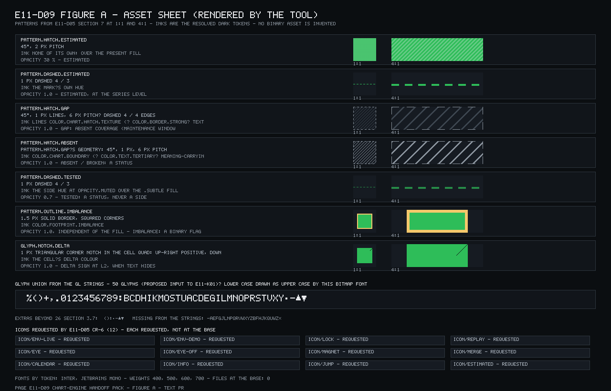

# E11-D09 — Chart-engine design hand-off pack and engineering walkthrough protocol

**Ticket:** E11-D09 (#331) · Task · Sprint 05 · labels `type/design`, `area/chart-engine`, `priority/p0`, `design`, `handoff` · parent E11 · **Status: Draft — owner approval pending; Q1–Q14 are RULED as the defaults built (the orchestrator's comment 6364610269 on #331, 2026-10-23, under the design delegation C-10.1 v1.1.0 — riders on Q2, Q6, Q7, Q10, Q12, Q13 and Q14, §1.4); everything else marked PROPOSED stays PROPOSED (B-4's magnet rule, the K-row resolutions, the `color.chart.*` aliases, the glyph union, C-13, C-14).** Branch `design/chart-engine-handoff` (the claim's name; Q2). Blocked by E11-D05 (merged `c24f45bd04c4012fe08d466b1cd89e7fdb676087`, #4101) and E11-D06 (merged `16661c7bd64fd14328c493215eed5211d0e89f82`, #3957) — both merged, so the pack assembles them as decided.

**RULED items carried as binding:** the orchestrator's ruling of 2026-10-20 18:30Z (`Alt+T` a pure toggle; the table's refresh an explicit `Shift+R` control; the SCR-047 CTA Owner-only); E11-D02 LD-1…LD-3 (`PageUp` / `PageDown` = the ±10-bar alias); [LANE-52] Q1–Q12 for E11-D07; [LANE-55] (the validity look; a deferred capability is an absence); the [T2-GATE] standing gate (§8.1); [LANE-56] riders 1–7 (text-first and defaults-first; the label asked for with the LOC; E11-D07 cited at #4228's head until it landed — it has, so the pack cites its merge commit; the walkthrough as a protocol plus an agent-run dry run, nothing claimed; the open-question log driven to zero by routing; assets enumerated and routed, no binary invented; at most eight boards); the orchestrator's Q1–Q14 rulings (#331 comment 6364610269, 2026-10-23: all fourteen RULED as the defaults built, with riders on Q2, Q6, Q7, Q10, Q12, Q13 and Q14 — stamped in §1.4, §13.1 and §14.3).

**Key.** `NN` in a citation is a line number at the input's pinned commit (`E11-D02 :145` = `docs/design/E11/E11-D02.md` line 145 at `d05966f7…`); "D02 D7" is a decision id of that spec; **decided** = fixed by a merged spec or a ruling and cited; **PROPOSED** = this pack's own default (the magnet rule B-4, the glyph union as E11-K01's input, the K-row resolutions, C-13 / C-14) with its evidence and the owner who rules; **RULED** = decided by the orchestrator under the design delegation and cited by its comment id — Q1–Q14 carry "RULED (6364610269)" wherever they are stamped (§1.4, §13.1, §14.3); **shipped** = on `main` at the base (`apps/web/src/keymap/*`, `packages/ui/tokens/*`, `packages/chart-engine/src/core/flags.ts`); **measured** = computed by `docs/design/_tools/e11_d09_handoff_audit.py` through the upstream tools' own functions, never re-measured by hand; **routed** = handed to a named owner and target; `(heuristic)` marks a judgement with no run behind it. Id families: `R-NN` redline rows, `B-1…B-6` behaviour rules, `K-NNN` key-map rows (E11-D07's `K1…K15` are its conflict rows and are cited as such), `M-N` motion rows (= E11-D06 §7's numbers), `T-NN` token-mapping rows, `S-NNN` state-matrix rows, `X-NN` asset rows, `W-T1…W-T6` walkthrough tasks, `P-NN` performance rows, `H-NN` hand-offs, `A-N` plan-text amendments, `C-N` contradictions, `G-N` gaps, `Q1…Q14` the pack's questions. **E11-D07 is cited at its merge commit** `de9a67609f887a82405abf45ef3286c963842d15` (#4228, merged 2026-10-23 07:49Z — after this branch's base, which predates it): the pack was written against #4228's head `fa3767363e3398910ca22144beb207e4fd646252`, and the merged `E11-D07.md` and its three tool files are byte-identical to that head (`git diff` between the two is empty), so every E11-D07 line number below holds at the merge commit. **The audit tool imports E11-D07's tool**, so this pack's `--check` gate holds on a checkout whose `main` contains `de9a676…`; at the writing base `b8ccf5a3…` it reports the tool absent and exits 1 by design; the PR is rebased onto `main` `0d9aba93…`, which contains it, so `--check` exits 0 at the PR base (Q6; §15).

**Method.** A desk assembly of six merged specs — E11-D01 (`9803432e36c8f0441ed2dbedbf417c6bf4255d9f`), E11-D02 (`d05966f7a669a1f3f1f9b646f837f85c8490608e`), E11-D03 (`97262572986f99a7560214ebb624940c7f00195e`), E11-D04 (`5dce4dd2ff95acf553f4a442ce12c514d77417b4`), E11-D05 (`c24f45bd04c4012fe08d466b1cd89e7fdb676087`), E11-D06 (`16661c7bd64fd14328c493215eed5211d0e89f82`) — and E11-D07 (`de9a67609f887a82405abf45ef3286c963842d15`, #4228, merged after the base) into one document an engineer builds from without a conversation (ticket Context). The pack **decides nothing already decided**: every redline value, behaviour rule, key, announcement, motion row, token slot, state treatment and asset row carries its source as `file:line`; it writes **one PROPOSED rule** where no spec decided (B-4, the crosshair magnet's candidate set and tie-break; the radius is a gap) and marks it so; it **computes every number** with the tool (an `audit:NAME=VALUE` HTML comment beside each quoted number, re-derived by `--check`); and it **routes every open item** to an owner and a target (§13). It redesigns nothing, edits no spec, and invents no token, CMP, SCR, key binding, rule id or number — a field no contract carries is a G-row. Nothing was run by the writer; the ticket's recorded session is answered by a written protocol, an agent-run dry run and owner items (§12; rider 4). Design PRs never edit `22` / `23` / `24`, code or token JSON.

**Scope** (ticket Scope / Deliverables): redlines for every E11 surface at three densities with tokens, not hex (§2); the six behaviour rules as algorithms (§3); the complete key map with announcements as reviewed in E11-D07 (§4); the E11-D06 motion table (§5); the token mapping (§6); the surface × state × theme matrix (§7); the accessibility contract carried (§8); the asset export as an enumeration (§9); the frame-budget flags (§10); the walkthrough as a protocol plus a dry run (§12); the open-question log at zero unowned rows (§13). **Out of scope:** the designs themselves (D02–D06), ongoing design support, other epics' chart surfaces (ticket Out of scope); the drawing magnet and rail (E14-D02, merged `d15000496c80e058b9c1963e6fff73d3cf67b3cc`), the indicator palette (E13-D03, `f437dc6b4d75e69a3fd2484d6b9422785e5d6d25`), the bar-mode states' design (E12-D02, `de8b7242f0749498da089e5f30246bf91a7d01a4` — its SCR-030 rows are credited in §7), the multi-chart grid beyond its cell chrome (E15 / SCR-049), the profile and DOM-ladder tables (E19 / E21).

**Inputs pinned** (every grep in this pack was made at these): base `main` `b8ccf5a38c5f29249460e3c785b8fb01010c130e`; the six merge commits above; E06-D03 `41578ba65bb3e1e938ff5ad2975bd3dd091e9854` (D5 the live-region cadence `:105`, D6 the keyboard model `:107`, D9 the engine contract `:113–175`); E09-D09 `baccf724a1fa3ad66f9333e440a7f5e8668b6eff` (§2.2 `:46`, §3.1 `:83`, §3.2 `:99`, §9.1 `:224`, §9.3 `:238`); E30-D02 `f798a64e65d15d13f2f816c9b5564e0d148ba2ae` (D3 the validity look `:128`); E17-D01 `da7b0f8a9270d900282ce69cfdb385ae6e999fa9` (the feed-state vocabulary); E12-D02 `de8b7242…`; E14-D02 `d15000496…` (`:62`, `:65`, `:132`); E25-D01 `c0674eb95a59903b09388468f8bf2e382bab1161` (the pattern-vocabulary rule, its §9.5 — cited, never re-proposed); E11-D07 at its merge commit `de9a67609f887a82405abf45ef3286c963842d15` (#4228; byte-identical to the head `fa3767363…` the pack was written against) as the Key says. Shipped: `apps/web/src/keymap/keymap.json` — 71 commands <!-- audit:shipped_commands=71 --> / 98 atomic bindings <!-- audit:shipped_bindings=98 --> (Chart 10); `reserved-keys.json` — 35 entries after `Ctrl+1..9` expands <!-- audit:reserved_total=35 -->; `packages/ui/tokens/{primitives,semantic-dark,semantic-light,semantic-hc}.tokens.json` + `themes.json` — **no `color.chart.*` token exists at the base** (E11-D05 CR-1 pending; §6); no font file and no icon file under `packages/ui` (§9); the engine is a scaffold (`packages/chart-engine/src/index.ts`, `core/flags.ts`) and no chart feature exists in `apps/web/src/features` — "not yet built" wherever a column would claim otherwise. Plan documents as read (`13`, `14`, `15` and `22` line numbers re-pinned by content to `main` `a61f42db46333579cb5af963ad2f5ed3421113ca`, the boards PR's base; the others are unchanged between the two commits): `05` §3.2 `:38–80`, §6 `:133–200`, §7 `:202–209`; `14` SCR-030 `:666–743` (States `:695`, the E12-D02 rows `:706–`), SCR-045 `:1025–1044`; `15` §7 `:2058–2060` (the heading and the intro sentence), the nine chart entries' Tokens fields (`:2069`, `:2203`, `:2216`, `:2229`, `:2323`, `:2336`, `:2349`, `:2362`, `:2621`, `:2644`); `16` §2.2 `:79–87`, §4 `:134–146`, §11.4 `:483–569`; `26` §3.6 `:201–215`, §3.7 `:216–230`, §5 `:316–325`, §16 O2 `:749`; `06` §4.3 `:69–82`, §4.4 `:86–94`.

**Deviations (recorded, not hidden).** (1) The deliverable lives in `docs/design/E11/` (+ `docs/design/_tools/`), not `docs/plan/` as the ticket's Branch line says — every merged E11 design deliverable lives there (`docs/design/README.md:78–82`); `docs/plan/` receives two pointer lines in `14` only (Q1, Q4). (2) The branch `design/chart-engine-handoff` lacks C-4.4's `<epic-key>`; it is the claim's name and is renamed only if `pr-metadata` refuses it (Q2; E11-D05 §16 recorded the same for its ticket). (3) The ticket's generic engineering brief (`packages/chart-engine/src/**`, the `pnpm` gates, `Closes #`, `@CandleViewer/chart-engine` reviewers, the GL / allocation "Do NOT" rules) is inapplicable to a design ticket and is not pretended to be honoured: the PR carries `Refs #331` + a `Partial:` line, two independent agent reviews (C-10.1) and the owner's approval (`docs/design/README.md:34–60`). (4) Penpot, not Figma; the three boards are PENDING under text-first and land in a second PR (§0). (5) No session took place and no recording exists; §12 is a protocol, a dry-run form and owner items (rider 4). (6) The hand-off file `E11-D09-handoff.md` is a screen-level set of the `16` §11.4 tables with a leading `Surface` column and no checklist block — the pack introduces no component contract; E11-D05's nine blocks stand (Q3). (7) The motion table is E11-D06 §7 verbatim, emitted by the tool and gated against drift (Q5). (8) The key map imports E11-D07's bindings; #4228 merged (`de9a676…`) after this branch's base, so the PR was rebased onto `main` `0d9aba93…`, which contains it, before opening; `--check` exits 0 there (Q6). (9) B-4 is PROPOSED (Q13). (10) No hex value appears anywhere in this pack or the hand-off file (Q14, stricter than AC 5). (11) The ticket's "P1 High" cell disagrees with its `priority/p0` label (C-1); "CMP-004 FocusRing" is CMP-039 (C-4); the design-ahead sentence cannot hold for the consuming sprints (C-5); the `16` §2.2 font files are not at the base (C-9).

## 0. Artefacts and boards

Penpot (self-hosted): page **`E11-D09 Chart-engine handoff pack`** · id `3f513961-9d95-80ea-8008-d5e17515f891` — created by name on the board script's first run (2026-10-23); the three boards are drawn from the board script r2 and exported in the boards commit (as built: the list after the table). Three boards <!-- audit:boards=3 --> (one light twin <!-- audit:light_twins=1 -->, within rider 7's eight) and one tool-rendered figure <!-- audit:figures=1 --> (the E11-D07 precedent, `e11_d07_figures.py`):

| #   | Artefact                       | Kind                                         | Shows                                                                                                                                                                                                                                                                                                                                                                                                                            | Export                                                                 |
| --- | ------------------------------ | -------------------------------------------- | -------------------------------------------------------------------------------------------------------------------------------------------------------------------------------------------------------------------------------------------------------------------------------------------------------------------------------------------------------------------------------------------------------------------------------- | ---------------------------------------------------------------------- |
| 01  | `redline-chassis-compact`      | Penpot board (PENDING)                       | the compact chassis at 1280 × 800 (E11-D02 §2's map `:53–70`: two panes and a collapsed stub, the time strip and cluster, the legend, a tooltip, the last-price and crosshair pills, the status row with the env badge, feed chip and aggregation chip) with a redline callout per element — the token name and px of §2's table, never a hex — and a side card with the comfortable / dense values of the same elements as text | `docs/design/E11/img/E11-D09-01-redline-chassis-compact.png` — PENDING |
| 02  | `redline-chassis-light`        | Penpot board (PENDING; the one light twin)   | the light twin of 01 with the same callouts, the light theme's resolved fills and the light ratios of the chassis rows as text (from the tool)                                                                                                                                                                                                                                                                                   | `docs/design/E11/img/E11-D09-02-redline-chassis-light.png` — PENDING   |
| 03  | `tooltip-priority-stack`       | Penpot board (PENDING)                       | E11-D02 §7.3 `:320` as geometry: the anchor at four positions (centre; the right edge → rule (1); the bottom edge → rule (2); over the last-price band → rule (4), the band ±(pill height / 2 + 4 px) drawn; a short pane → rules (5)–(6)), the 8 px plot margins, the seven-level z-order stack as a labelled column, and the price-axis pill rules of `:205–207` as a side inset                                               | `docs/design/E11/img/E11-D09-03-tooltip-priority-stack.png` — PENDING  |
| A   | `E11-D09-figA-asset-sheet.png` | **rendered by the tool, not a Penpot board** | the seven E11-D05 §7 patterns as swatches at 1:1 and 4:1 with their geometry text, the glyph-set union of §9.3 (50 glyphs; lower case drawn as upper case by the bitmap font, as the sheet says), the twelve icon names of E11-D05 CR-6 each marked "requested — not at the base", the fonts by token; every colour a resolved dark token, every number a count of the tool; reproducible (two renders, one sha256)              | committed: `docs/design/E11/img/E11-D09-figA-asset-sheet.png`          |

Boards as drawn (2026-10-23 from board script r2, sha256 `3f99e27d0cf4b86fb4a831caf61529e0a5439ffbed4dfe949cf26ae8b57e71f8`; every board exported at 1:1):

- `01 redline-chassis-compact` — board id `3f513961-9d95-80ea-8008-d5e175925191` — `docs/design/E11/img/E11-D09-01-redline-chassis-compact.png` (2080 × 1845)
- `02 redline-chassis-light` — board id `3f513961-9d95-80ea-8008-d5e19120d486` — `docs/design/E11/img/E11-D09-02-redline-chassis-light.png` (2080 × 1529)
- `03 tooltip-priority-stack` — board id `3f513961-9d95-80ea-8008-d5e1a91a2fe6` — `docs/design/E11/img/E11-D09-03-tooltip-priority-stack.png` (2080 × 1123)

**Why three boards and no more** (rider 7): a pack is tables; a board earns its place only where geometry or stacking is the evidence — a redline callout sheet shows spacing in place as a table cannot, and the tooltip's flip and z-order are stacking. The key map, the motion table, the token mapping, the state matrix and the behaviour rules are tables in this file. The 74 `E11-D0N-*.png` already in `img/` (E11-D01 9, E11-D02 16, E11-D03 12, E11-D04 14, E11-D05 16, E11-D06 7) are cited by path and never redrawn. **Board rules once drawn:** content margins ≥ 24 px; every label through the shared pill-label rule; no token binding and no component instance (the export guard refuses both); every number on a board equal to the tool's `--json` (the local check-nums script asserts it); a footer `page E11-D09 Chart-engine handoff pack · board 0n · rN`; the page referenced by name and page id only — never by host, team, file id or workspace link (`docs/design/README.md:43–46`); no T2 control is drawn on these boards (the T2 surfaces are E11-D03's and E11-D04's boards, §8.1).

## 1. Purpose, scope, method and locked inputs

### 1.1 What this pack fixes

Nothing new. It fixes **where** every value an E11 story needs is, so that an engineer assigned to E11-S06 with no prior involvement builds the axes from this file and the hand-off file alone (ticket AC 1): the redline numbers per density (§2), the six behaviour rules as algorithms (§3), the key map with announcements (§4), the motion rows (§5), the slot for every colour (§6), the treatment for every state in every theme (§7), the accessibility contract (§8), the assets that exist and where the rest come from (§9), the frame-budget flags (§10). Where the upstream specs left a value to engineering it is a **G-row** here, never a number (§14).

### 1.2 Method (honest)

Every claim below was read at the pinned inputs (header) and is cited by `file:line`. The numbers are the tool's: `python3 -I docs/design/_tools/e11_d09_handoff_audit.py` parses E11-D02 §2 and §6, re-derives E11-D02 §4.2's, §5.4's and §7.5's worked cases from the rules, imports E11-D07's 134 bindings and the five upstream contrast tools, parses E11-D06 §7 and the six open-question logs, resolves every slot of §6 through the token loader, and compares this file's tables with those derivations under `--check` — §2.1, §2.2, §6.1, §7.1 and §13.1 cell for cell, 0 differing cells <!-- audit:pack_table_diff=0 --> (§15). No session took place; no screen reader, browser or build was run; the only exercise this pack schedules is the agent dry run of §12.3, which hpe-worker-1 launches after the text round and logs as such.

### 1.3 Already decided (cited, never re-decided)

| Input                                 | Merge / head                                                                               | What it fixes here                                                                                                                                                                                                                                                                        |
| ------------------------------------- | ------------------------------------------------------------------------------------------ | ----------------------------------------------------------------------------------------------------------------------------------------------------------------------------------------------------------------------------------------------------------------------------------------- |
| E11-D01 (#239 / #3828)                | `9803432e36c8f0441ed2dbedbf417c6bf4255d9f`                                                 | D3 the readout magnet `off` by default, separate from the drawing magnet (`:36`, `:354`; Q3 `:228–254`); D4 the cursor model (`:37`); the prioritised implications handed to this pack (`:81`); O4 the footprint readout unit, O13 the `Alt` menu hazard (`:413–434`)                     |
| E11-D02 (#308 / #3921)                | `d05966f7a669a1f3f1f9b646f837f85c8490608e`                                                 | the redline source (§2 `:73–100`, §6 `:214–218`), gridlines D1–D3 (`:129–162`), decimation D4–D5 (`:163–209`), the components D7–D13 (`:238–350`), the multi-pane chrome D14 (`:351–380`), the states D16 (`:401–425`), the keyboard D18 (`:650–672`), the perf register D19 (`:674–695`) |
| E11-D03 (#309 / #3930)                | `97262572986f99a7560214ebb624940c7f00195e`                                                 | the menus, the badge, the Scales tab and the go-to-date dialog (`:95–368`), their states (`:395–409`), keys (`:449–501`), CG-1…CG-6 (`:852–862`), A-1…A-8 (`:893–905`)                                                                                                                    |
| E11-D04 (#329 / #3929)                | `5dce4dd2ff95acf553f4a442ce12c514d77417b4`                                                 | the table's anatomy and 200 % rule (`:67–107`, `:194–218`), row actions D10 (`:301–314`), states D11 (`:315–331`), the state inventory (`:445–460`), keys D16 (`:499–546`), the session protocol form (`:834–866`), A-1…A-11 (`:984–997`)                                                 |
| E11-D05 (#310 / #4101; CVD run #4166) | `c24f45bd04c4012fe08d466b1cd89e7fdb676087` (`8c2d29282a98944f7a0a99a9cfd680e546382bda`)    | the slot table §4.1 / §4.1b (`:73–104`), the density scale §6 (`:281–306`), the pattern registry §7 (`:307–357`), CR-1…CR-9 (`:776–789`), the open questions §14 (`:851–868`); `E11-D05-handoff.md` (335 lines) — the hand-off form this pack's second file extends                       |
| E11-D06 (#311 / #3957)                | `16661c7bd64fd14328c493215eed5211d0e89f82`                                                 | the crosshair timings and the magnet snap D9–D11 (`:178–204`), the chassis state motion D12–D19 (`:205–296`), §7 the motion table (`:297–354`), §8 safety, §9.1 one source, §10 the shedding order (`:407–428`), §11 the feel protocol (`:429–503`), §13.4 (`:577–593`)                   |
| E11-D07 (#330 / #4228)                | `de9a67609f887a82405abf45ef3286c963842d15` (merged; byte-identical to head `fa3767363…`)   | the key map §7.1 (`:307–326`) and conflicts §7.3 (`:331–350`), the stop table §9.1 (`:394–421`), the T2 rows §9.5 (`:434–451`), the target table §10 (`:452–485`), the composition rows §11 (`:486–537`), F / A / C / G / Q / H (`:578–721`), HO-01…HO-20 (`:804–829`)                    |
| E06-D03 (#216 / #3912)                | `41578ba65bb3e1e938ff5ad2975bd3dd091e9854`                                                 | D4 the root structure (`:103`), D5 the live-region cadence (`:105`), D6 the keyboard model (`:107`), D9 the engine contract (`:113–175`)                                                                                                                                                  |
| E09-D09 (+ catalogue edits)           | `baccf724a1fa3ad66f9333e440a7f5e8668b6eff` (`2f01564958868412c7236378d13113db91957788`)    | the T2 treatment §2.2 (`:46`), the reason keys §3.1 (`:83`) and verbs §3.2 (`:99`), `aria-disabled` §9.1 (`:224`), the keys on a T2 control §9.3 (`:238`) — the standing gate's text (§8.1)                                                                                               |
| E30-D02                               | `f798a64e65d15d13f2f816c9b5564e0d148ba2ae`                                                 | D3 the validity look (`:128`): a control disabled by form validity keeps its own fill and label at `opacity.disabled`, the reason full-opacity under it — never T2                                                                                                                        |
| E14-D02 (#247 / #4159)                | `d15000496c80e058b9c1963e6fff73d3cf67b3cc`                                                 | the drawing magnet (12 CSS px, `Ctrl+M` — `:62`, `:65`) and the rail (`:132`) — the second of the "two magnets" (B-4); out of scope otherwise                                                                                                                                             |
| E25-D01 (#3974)                       | `c0674eb95a59903b09388468f8bf2e382bab1161`                                                 | §9.5 the pattern-vocabulary rule "hollow, dashed or hatched = estimated or absent, never a side or direction" — PROPOSED there for `16` §6; cited by §9 here, never re-proposed (C-row of the cross-spec ruling)                                                                          |
| the orchestrator's rulings on record  | 2026-10-20 18:30Z; LD-1…LD-3; [LANE-52]; [LANE-55]; [T2-GATE] 2026-10-22 21:38Z; [LANE-56] | as the header lists them                                                                                                                                                                                                                                                                  |

### 1.4 The pack's questions and the defaults built (all fourteen RULED as the defaults — the orchestrator's comment 6364610269 on #331, 2026-10-23; the riders in the last column)

| Q   | Question (short)                             | Default built here                                                                                                                                                                                                                       | Ruling (comment 6364610269)                                                                                                                                                                                                                                                                     |
| --- | -------------------------------------------- | ---------------------------------------------------------------------------------------------------------------------------------------------------------------------------------------------------------------------------------------- | ----------------------------------------------------------------------------------------------------------------------------------------------------------------------------------------------------------------------------------------------------------------------------------------------- |
| Q1  | the deliverable path                         | `docs/design/E11/E11-D09.md` + `E11-D09-handoff.md` + `docs/design/_tools/e11_d09_handoff_audit.py` (+ `e11_d09_figures.py`); `docs/plan/` gets two pointer lines in `14`; the `13` flows and the `15` pointer are A-rows                | RULED (6364610269) as built                                                                                                                                                                                                                                                                     |
| Q2  | the branch name (recorded; no ruling needed) | `design/chart-engine-handoff` kept; one deviation line; renamed only if `pr-metadata` refuses it                                                                                                                                         | RULED (6364610269) — keep the branch with one deviation line; rename only if `pr-metadata` refuses it (it has not on #4279)                                                                                                                                                                     |
| Q3  | the hand-off file's form                     | (b-lite) `E11-D09-handoff.md`: the `16` §11.4 Tables 1–5, Density and Essential exceptions once each with a leading `Surface` column for the nine chart screens; no checklist block; §A / §B by reference                                | RULED (6364610269) as built                                                                                                                                                                                                                                                                     |
| Q4  | the `14` / `15` edit set                     | two content-only pointer lines in `14` (SCR-030, SCR-045); no `15` edit (A-2 proposes the §7 intro sentence)                                                                                                                             | RULED (6364610269) as built                                                                                                                                                                                                                                                                     |
| Q5  | the motion table                             | E11-D06 §7 verbatim, emitted by the tool from a parse at the base, gated against drift; §11 by reference (W-row)                                                                                                                         | RULED (6364610269) as built                                                                                                                                                                                                                                                                     |
| Q6  | the key map's source                         | the tool imports `e11_d07_a11y_review_audit.DESIGN_BINDINGS` (134 atomic bindings) and joins the announcement literal; #4228 merged (`de9a676…`) — the PR is rebased onto `main` `0d9aba93…`, which contains it; `--check` exits 0 there | RULED (6364610269) — import `DESIGN_BINDINGS` from `main` (E11-D07 merged `de9a6760`, #4228), never a literal copy; `--check` exits 0 at the base (the PR base `0d9aba93…`); the K-row resolutions stay PROPOSED to their owners (§4.2)                                                         |
| Q7  | the engineering walkthrough's form           | (a) a session protocol in E11-D04 §21.2's form, (b) an agent-run buildability dry run (Sonnet; the pack + the hand-off file + E11-S06's text only), (c) the owner walkthrough ≤ 10 items; the DoD's recording → none exists              | RULED (6364610269) — (a) + (b) + (c); the dry run is a fold input, not a gate: its NOT FOUND rows become G-rows with owners (G-17); nothing is claimed as a session; the DoD's recording line is answered honestly — none exists (C-6)                                                          |
| Q8  | the boards                                   | three boards + figure A (§0)                                                                                                                                                                                                             | RULED (6364610269) as built                                                                                                                                                                                                                                                                     |
| Q9  | the asset export's scope                     | enumerate what exists and route the rest; no binary asset exported or invented (§9)                                                                                                                                                      | RULED (6364610269) as built                                                                                                                                                                                                                                                                     |
| Q10 | "open-question log at zero"                  | zero rows without an owner and a target; routed = closed; an owner decision stays the owner's and points at #2701 (§13)                                                                                                                  | RULED (6364610269) — routed = closed only with owner and target both named; the tool asserts `oq_unowned = 0` and that every upstream row appears once (§13)                                                                                                                                    |
| Q11 | the sibling boundaries                       | as §1.5 and §17 draw them: the pack cites and routes, never re-does                                                                                                                                                                      | RULED (6364610269) as built                                                                                                                                                                                                                                                                     |
| Q12 | the `13` flows and D03's CG-1…6              | A-rows and G-rows addressed to #2701; no `13` or `22` edit                                                                                                                                                                               | RULED (6364610269) — A-rows (the five `13` flows) and G-rows (CG-1…6) addressed to #2701; no `13` / `22` edit in this PR                                                                                                                                                                        |
| Q13 | the crosshair magnet's undecided parts       | B-4 PROPOSED: candidates = the cursor bar's O / H / L / C; nearest by px within the radius; tie → O > H > L > C; order lines and drawings never readout targets; the radius a G-row to E11-S07 #388                                      | RULED (6364610269) as the form — B-4 is built as the PROPOSED rule (candidates = the cursor bar's O / H / L / C; nearest by px distance within the radius; tie → O > H > L > C; E31 lines and E14 drawings never read-out targets); E11-S07 #388 owns the radius (G-1); nothing in B-4 is RULED |
| Q14 | "no hex anywhere"                            | no hex value anywhere in this pack or the hand-off file; the tool's hex gate is 0 (§6)                                                                                                                                                   | RULED (6364610269) — the strict form: no hex anywhere in the pack or the hand-off file; the tool's hex gate is 0; a gap becomes a CR row for D05's CR table owner, never an invented token (§6.2)                                                                                               |

### 1.5 What the upstream specs handed here, and where each is answered

| Handed by                                  | What                                                                                                                   | Answered                                                                          |
| ------------------------------------------ | ---------------------------------------------------------------------------------------------------------------------- | --------------------------------------------------------------------------------- |
| E11-D01 `:81`                              | the prioritised-implications board as the pack's input                                                                 | §16 (traceability: every B / K / T row names its story); D3 / D4 in §3 B-4 and §4 |
| E11-D02 §21 `:846`, A-11 `:804`            | the walkthrough, the heuristics, board 16's three flows for the `13` amendment                                         | §12.2 (index), §11 A-1 (the five flows)                                           |
| E11-D03 §24 `:920`, A-7 `:903`, `:856–861` | §16 heuristics, §17 protocol, the go-to-date flow, CG-1…6 to the `22` docs-PR owner                                    | §12.2, §11 A-1, §14 G-3…G-8                                                       |
| E11-D04 §27 `:1011`, A-9 `:994` / `:1020`  | §21.2 protocol, §21.3 walkthrough, §21.1 findings, §14 parity inventory, the data-table flow                           | §12.1 (the form), §12.2, §11 A-1, §8.2 (parity by reference)                      |
| E11-D05 §15 `:876`                         | the token mapping, the pattern / hatch definitions, the density numbers, the story list, the harness table, the OQ log | §6, §9.1, §2.2, §16, §13                                                          |
| E11-D06 §16 `:646`                         | §7 and §11 verbatim; D1–D24; A-1…A-17; the open questions                                                              | §5 (§7 verbatim; §11 by reference in §12.2), §13                                  |
| E11-D07 HO-05 `:812`                       | §15–§19 lifted by reference; F-18 recorded                                                                             | §8.7 (F-rows by id), §13 (Q-rows), §17; F-18 in §8.7                              |
| E06-D03 D9 `:113`                          | the engine contract S13 builds — the bar for "written so it can be built"                                              | §16 (the stories); nothing restated                                               |

## 2. Redlines

One table for every E11 surface group (chassis chrome, axes, crosshair / tooltip, legend, multi-pane, chrome rows, menus, dialog, tab, table, empty / error), 70 rows <!-- audit:redline_rows=70 -->: the first 17 <!-- audit:redline_parsed=17 --> are E11-D02 §2's dimensions table parsed by the tool at the base (`:84–100`), the rest are typed from E11-D02 §4.1 / §7 / §8 / §10, E11-D03 §3.1 / §6.1 / §7.1 / §12, E11-D04 §2 / §11 / §12 and E11-D07 §9.5 with their lines; R-34's title type is parsed too (E11-D02 §7.3's title line `:308` with §2 `:98`'s value types), as are §2.2's ten columns. Seven radius cells (R-24, R-25, R-27, R-28, R-40, R-49, R-50) name a radius the cited layout line does not state: each Source cell names the line that does (E11-D05 §10.2 `:705` for the axis pills) or says `inferred` with its analogy (the chip rule `:422`, CMP-197's `radius.card` `:704`, a segmented control's `radius.control`). Values are **CSS px at text scale 1** (E11-D02 §6 rule 6 for the 112 / 125 / 150 % scales; the device-pixel rules of §4.4 `:159–162` apply to every hairline: `max(1, floor(dpr))` device px, dashes scaled alike). A cell names a **token** where one exists and a **px value** where the spec typed one; a typed value with no token is drift to record, never a hex to type: `size.control.height` (E11-D02 §2's ASCII `:55–56` and E11-D04 `:103`) is a density-resolved semantic alias of `size.control.compact` / `size.control.comfortable` (`semantic-dark.tokens.json`; E11-D07 F-19 withdrawn `:600`); `opacity.grid.minor` / `.major` are change requests, not tokens (E11-D02 CR-1 `:639`; E11-D05 CR-2 `:781`). Every token the parsed rows name resolves through the loader: 10 names <!-- audit:redline_tokens_resolved=10 --> (`size.control.comfortable` 32, `size.control.compact` 24, `space.1` 4, `space.2` 8, `space.inset.md` 12, `space.inset.sm` 8, `space.inset.xs` 4, `type.num.base` 13, `type.num.sm` 11, `type.num.xs` 10); 12 parsed rows <!-- audit:redline_typed_only=12 --> carry typed px only (the drawing rail 32 / 24 / 24; chip 24 / 20 / 20; legend row 32 / 24 / 24; the gutter formula; the strip 32 / 24 / 24; the cluster 32 / 24; the splitter band and grip; the stub; the minimum pane height; the corner-badge inset; the pill heights 20 / 17 / 16; the watermark 48 / 48 / 40) — each is E11-D02's number and each is drift the DS owner may later name (E11-D05 §6 derives them from the density scale, `:289`). **Light ratios of the chassis rows board 02 prints** (through E11-D02's own `col()`, light theme on `color.surface.canvas` unless named): axis labels 6.36 <!-- audit:light_axis=6.36 -->, the major grid 1.31 <!-- audit:light_grid_major=1.31 -->, the minor grid 1.17 <!-- audit:light_grid_minor=1.17 -->, the crosshair 9.65 <!-- audit:light_crosshair=9.65 -->, pill text on `color.surface.raised` 15.62 <!-- audit:light_pill_text=15.62 -->, inverse text on the crosshair fill 10.35 <!-- audit:light_pill_inverse=10.35 -->, the focus ring 6.30 <!-- audit:light_ring=6.30 -->, the replay frame 5.60 <!-- audit:light_replay=5.60 -->.

### 2.1 The redline table

| Id   | Group                   | Element                                                                        | comfortable                                                                          | compact                                                             | dense                            | Token(s)                                                                                                                                                       | Type token                                                                                                                               | Radius           | Opacity                        | GL / DOM               | Source                                                                                                                                |
| ---- | ----------------------- | ------------------------------------------------------------------------------ | ------------------------------------------------------------------------------------ | ------------------------------------------------------------------- | -------------------------------- | -------------------------------------------------------------------------------------------------------------------------------------------------------------- | ---------------------------------------------------------------------------------------------------------------------------------------- | ---------------- | ------------------------------ | ---------------------- | ------------------------------------------------------------------------------------------------------------------------------------- |
| R-01 | chassis chrome (D02 §2) | Toolbar row, status row (DOM)                                                  | `size.control.comfortable` 32                                                        | `size.control.compact` 24                                           | 24 (DOM chrome is compact)       | `size.control.comfortable`, `size.control.compact`                                                                                                             | —                                                                                                                                        | —                | —                              | DOM                    | E11-D02 §2 :84                                                                                                                        |
| R-02 | chassis chrome (D02 §2) | Drawing rail width (CMP-223, DOM)                                              | 32                                                                                   | 24                                                                  | 24                               | — (typed px; see the drift note)                                                                                                                               | —                                                                                                                                        | —                | —                              | DOM                    | E11-D02 §2 :85                                                                                                                        |
| R-03 | chassis chrome (D02 §2) | Chip / badge / pill height                                                     | 24                                                                                   | 20                                                                  | 20                               | — (typed px; see the drift note)                                                                                                                               | —                                                                                                                                        | —                | —                              | DOM                    | E11-D02 §2 :86                                                                                                                        |
| R-04 | chassis chrome (D02 §2) | Legend row (DOM, interactive toggle)                                           | 32                                                                                   | 24                                                                  | 24 (target floor)                | — (typed px; see the drift note)                                                                                                                               | —                                                                                                                                        | —                | —                              | DOM                    | E11-D02 §2 :87                                                                                                                        |
| R-05 | chassis chrome (D02 §2) | Legend inset from the pane corner                                              | `space.inset.md` 12                                                                  | `space.inset.sm` 8                                                  | `space.inset.xs` 4               | `space.inset.md`, `space.inset.sm`, `space.inset.xs`                                                                                                           | —                                                                                                                                        | —                | —                              | DOM                    | E11-D02 §2 :88                                                                                                                        |
| R-06 | chassis chrome (D02 §2) | Axis label type                                                                | `type.num.base` 13 px                                                                | `type.num.sm` 11 px                                                 | `type.num.xs` 10 px              | `type.num.base`, `type.num.sm`, `type.num.xs`                                                                                                                  | `type.num.base`, `type.num.sm`, `type.num.xs`                                                                                            | —                | —                              | GL                     | E11-D02 §2 :89                                                                                                                        |
| R-07 | chassis chrome (D02 §2) | Price-gutter padding (each side)                                               | `space.2` 8                                                                          | `space.1` 4                                                         | `space.1` 4                      | `space.1`, `space.2`                                                                                                                                           | —                                                                                                                                        | —                | —                              | GL                     | E11-D02 §2 :90                                                                                                                        |
| R-08 | chassis chrome (D02 §2) | Price-gutter width (per gutter; a left gutter is measured from its own labels) | widest label + 16, min 56                                                            | widest label + 8, min 48                                            | widest label + 8, min 48         | — (typed px; see the drift note)                                                                                                                               | —                                                                                                                                        | —                | —                              | GL (layout)            | E11-D02 §2 :91                                                                                                                        |
| R-09 | chassis chrome (D02 §2) | Time-strip height (also the drag zone)                                         | 32                                                                                   | 24                                                                  | 24 (target floor)                | — (typed px; see the drift note)                                                                                                                               | —                                                                                                                                        | —                | —                              | GL                     | E11-D02 §2 :92                                                                                                                        |
| R-10 | chassis chrome (D02 §2) | Cluster segment                                                                | 32 × 32                                                                              | 24 × 24                                                             | 24 × 24                          | — (typed px; see the drift note)                                                                                                                               | —                                                                                                                                        | —                | —                              | DOM                    | E11-D02 §2 :93                                                                                                                        |
| R-11 | chassis chrome (D02 §2) | Splitter hit band / grip                                                       | 24 / 32 × 4                                                                          | 24 / 24 × 4                                                         | 24 / 24 × 4                      | — (typed px; see the drift note)                                                                                                                               | —                                                                                                                                        | —                | —                              | DOM band / GL hairline | E11-D02 §2 :94                                                                                                                        |
| R-12 | chassis chrome (D02 §2) | Collapsed stub                                                                 | 32                                                                                   | 24                                                                  | 24                               | — (typed px; see the drift note)                                                                                                                               | —                                                                                                                                        | —                | —                              | DOM                    | E11-D02 §2 :95                                                                                                                        |
| R-13 | chassis chrome (D02 §2) | Minimum pane height (E11-S09)                                                  | max(48, 3 × 16)                                                                      | max(48, 3 × 13) = 48                                                | 48                               | — (typed px; see the drift note)                                                                                                                               | —                                                                                                                                        | —                | —                              | layout                 | E11-D02 §2 :96                                                                                                                        |
| R-14 | chassis chrome (D02 §2) | Corner-badge slot inset                                                        | 12                                                                                   | 8                                                                   | 4                                | — (typed px; see the drift note)                                                                                                                               | —                                                                                                                                        | —                | —                              | DOM                    | E11-D02 §2 :97                                                                                                                        |
| R-15 | chassis chrome (D02 §2) | Tooltip padding / value type                                                   | `space.inset.md` / `type.num.base`                                                   | `space.inset.sm` / `type.num.sm`                                    | `space.inset.xs` / `type.num.xs` | `space.inset.md`, `space.inset.sm`, `space.inset.xs`, `type.num.base`, `type.num.sm`, `type.num.xs`                                                            | `type.num.base`, `type.num.sm`, `type.num.xs`                                                                                            | —                | —                              | DOM                    | E11-D02 §2 :98                                                                                                                        |
| R-16 | chassis chrome (D02 §2) | Crosshair / last-price pill height                                             | 20                                                                                   | 17                                                                  | 16                               | — (typed px; see the drift note)                                                                                                                               | —                                                                                                                                        | —                | —                              | GL                     | E11-D02 §2 :99                                                                                                                        |
| R-17 | chassis chrome (D02 §2) | Watermark                                                                      | 48 px semibold, hidden below 160 px pane                                             | 48 px, hidden below 120 px pane                                     | 40 px, hidden below 120 px pane  | — (typed px; see the drift note)                                                                                                                               | —                                                                                                                                        | —                | —                              | GL                     | E11-D02 §2 :100                                                                                                                       |
| R-18 | axes                    | Gridline, minor tier                                                           | 1 px solid, device-snapped                                                           | same                                                                | same                             | `color.chart.grid.minor` (= `color.grid.line`); `opacity.grid.minor` 1.0 / 1.0 / 0.0 (hc off, CR)                                                              | —                                                                                                                                        | —                | 1.0 (hc 0.0)                   | GL                     | E11-D02 §4.1 :137                                                                                                                     |
| R-19 | axes                    | Gridline, major tier                                                           | 1 px solid                                                                           | same                                                                | same                             | `color.chart.grid.major` (= `color.border.default`)                                                                                                            | —                                                                                                                                        | —                | 1.0                            | GL                     | E11-D02 §4.1 :138                                                                                                                     |
| R-20 | axes                    | Boundary line (session / day, week, month)                                     | 1 px dashed 4 / 4, full height                                                       | same                                                                | same                             | `color.chart.boundary` (= `color.text.tertiary`)                                                                                                               | —                                                                                                                                        | —                | 1.0                            | GL                     | E11-D02 §4.1 :139                                                                                                                     |
| R-21 | axes                    | Maintenance band                                                               | edges 1 px dashed 4 / 4; 45° hatch 1 px lines, 6 px pitch; label when ≥ 48 px wide   | same                                                                | same                             | edges `color.chart.boundary`; texture `color.chart.hatch.texture` (= `color.border.strong`)                                                                    | `type.num.*` label                                                                                                                       | —                | 1.0                            | GL                     | E11-D02 §4.1 :140; E11-D05 §7 :315                                                                                                    |
| R-22 | axes                    | Hairline rule (axis / strip / splitter)                                        | 1 px                                                                                 | same                                                                | same                             | `color.chart.rule` (= `color.border.default`)                                                                                                                  | —                                                                                                                                        | —                | 1.0                            | GL                     | E11-D02 §7.1 :244, §7.2 :267, §8 :355                                                                                                 |
| R-23 | axes                    | Mode tag (log / % / inv) and zone tag (UTC hh:mm:ss)                           | caption + digits `type.num.base`                                                     | `type.num.sm`                                                       | `type.num.xs`                    | `color.chart.axis` (= `color.text.tertiary`)                                                                                                                   | `type.ui.caption` / `type.num.*`                                                                                                         | —                | 1.0                            | GL                     | E11-D02 §7.1 :244, §7.2 :267                                                                                                          |
| R-24 | axes                    | Last-price pill                                                                | h 20; ▲ / ▼ glyph; 4 px nub; 1 px dashed line                                        | h 17                                                                | h 16                             | fill `color.candle.up` / `color.candle.down`; text `color.chart.pill.text.inverse`                                                                             | `type.num.*`                                                                                                                             | `radius.xs`      | 1.0                            | GL                     | E11-D02 §7.1 :244; §2 :99; radius E11-D05 §10.2 :705 (axis pills)                                                                     |
| R-25 | axes                    | Mark / index pill                                                              | h 20; prefix `M` / `I`; line 1 px dashed 2 / 6                                       | h 17                                                                | h 16                             | `color.chart.pill.bg` + `color.chart.pill.border` + `color.chart.pill.text.default`; line `color.chart.boundary`                                               | `type.num.*`                                                                                                                             | `radius.xs`      | 1.0                            | GL                     | E11-D02 §7.1 :244; radius E11-D05 §10.2 :705 (axis pills)                                                                             |
| R-26 | axes                    | Lock badge (button)                                                            | pill h 24; 24 px hit box                                                             | h 20 (+2 / +2 invisible padding)                                    | same                             | `color.surface.raised` + `color.border.strong` + `color.text.primary`; lock glyph                                                                              | `type.ui.caption`                                                                                                                        | `radius.badge`   | 1.0                            | DOM                    | E11-D02 §7.1 :244; E11-D03 §5 :193                                                                                                    |
| R-27 | axes                    | Cluster segment fill and pressed `auto`                                        | fill + 1 px border; pressed: selected fill + strong border + check glyph             | same                                                                | same                             | `color.surface.raised` + `color.border.default`; pressed `color.surface.selected` + `color.border.strong` + `color.text.primary`                               | `type.ui.caption`                                                                                                                        | `radius.control` | 1.0                            | DOM                    | E11-D02 §7.2 :267; radius inferred — a segmented control's (:267), `15` CMP-003 :75 at the PR base                                    |
| R-28 | axes                    | Paused pill (`auto` off state)                                                 | h 24                                                                                 | h 20                                                                | h 20                             | `color.status.warning.subtle` + `color.text.primary`; pause glyph `color.status.warning.strong`                                                                | `type.ui.caption` / `type.num.sm`                                                                                                        | `radius.badge`   | 1.0                            | DOM                    | E11-D02 §7.2 :267; radius inferred — the chip rule §10 :422                                                                           |
| R-29 | axes                    | Cluster exclusion zone / tag zone                                              | 8 px left of the cluster; 8 px right of the zone tag                                 | same                                                                | same                             | —                                                                                                                                                              | —                                                                                                                                        | —                | —                              | GL (layout)            | E11-D02 §5.1 :171–172                                                                                                                 |
| R-30 | crosshair               | Crosshair lines                                                                | 1 px dashed 4 / 4, device-snapped; `max(1, floor(dpr))` device px                    | same                                                                | same                             | `color.chart.crosshair` (= `color.crosshair`)                                                                                                                  | —                                                                                                                                        | —                | 1.0 (remote `opacity.muted`)   | GL                     | E11-D02 §7.3 :298; §4.4 :161                                                                                                          |
| R-31 | crosshair               | Crosshair axis pills                                                           | h 20; 4 px horizontal padding                                                        | h 17                                                                | h 16                             | fill `color.chart.crosshair`; text `color.chart.pill.text.inverse`                                                                                             | `type.num.*`                                                                                                                             | `radius.xs`      | 1.0                            | GL                     | E11-D02 §7.3 :300                                                                                                                     |
| R-32 | crosshair               | Magnet affordance (snap active)                                                | OHLC letter + 12 px magnet glyph at the pill's left edge                             | same                                                                | same                             | as the pill                                                                                                                                                    | `type.num.*`                                                                                                                             | —                | —                              | GL                     | E11-D02 §7.3 :302                                                                                                                     |
| R-33 | crosshair               | Keyboard cursor column (D10)                                                   | ≥ 2 px core + 1 px halos                                                             | same                                                                | same                             | `color.chart.focus.ring` (= `color.focus.ring`); halo `color.chart.pane.bg.default`                                                                            | —                                                                                                                                        | —                | 1.0                            | GL                     | E06-D03 D10 :176; E11-D05 §4.1b :101                                                                                                  |
| R-34 | tooltip                 | Tooltip box (CMP-197)                                                          | padding `space.inset.md`; width 200–260 px, ≤ 40 % of the pane                       | `space.inset.sm`                                                    | `space.inset.xs`                 | `color.surface.overlay` + 1 px `color.border.default`; `elevation.popover`                                                                                     | title `type.ui.caption` (comfortable `type.ui.label` — §7.3 :308); values `type.num.base` / `.sm` / `.xs` (§2 :98)                       | `radius.card`    | 1.0                            | DOM                    | E11-D02 §7.3 :304–318                                                                                                                 |
| R-35 | tooltip                 | Tooltip anchor offsets and margins                                             | 16 px right and 16 px below the anchor; 8 px plot margins; band ±(pill h / 2 + 4 px) | same                                                                | same                             | —                                                                                                                                                              | —                                                                                                                                        | —                | —                              | DOM (layout)           | E11-D02 §7.3 :320                                                                                                                     |
| R-36 | tooltip                 | Tooltip swatch and rows                                                        | 8 px shape swatch; overflow after 12 rows as text                                    | same                                                                | same                             | label `color.text.secondary`; value `color.text.primary`                                                                                                       | `type.num.*`                                                                                                                             | —                | 1.0                            | DOM                    | E11-D02 §7.3 :310–313                                                                                                                 |
| R-37 | legend                  | Legend block                                                                   | max width 40 % of the pane; row 0 = pane label row                                   | same                                                                | same                             | `color.text.primary`; hidden row `color.text.tertiary`; focus bar `color.action.primary.default` 2 px                                                          | `type.ui.body` / `type.ui.label` / `type.ui.caption` (comfortable / compact / dense — §6 :216–218; §7.5 :339 writes the compact default) | —                | 1.0                            | DOM                    | E11-D02 §7.5 :339, :343; §8 :373; §6 :216–218                                                                                         |
| R-38 | legend                  | Legend controls (chevron, menu, eye toggle)                                    | 32 × 32                                                                              | 24 × 24                                                             | 24 × 24 (floor)                  | `color.focus.ring` ring 2 px, 2 px offset                                                                                                                      | —                                                                                                                                        | —                | 1.0                            | DOM                    | E11-D02 §7.5 :339; §6 rule 3 :233                                                                                                     |
| R-39 | legend                  | Swatch and label truncation                                                    | 8 × 8 shape swatch; labels ellipsise at 18 characters                                | same                                                                | same                             | the series' token (shape, never colour alone)                                                                                                                  | `type.ui.body` / `type.ui.label` / `type.ui.caption` (comfortable / compact / dense — §6 :216–218)                                       | —                | 1.0                            | DOM                    | E11-D02 §7.5 :339, :341; §6 :216–218                                                                                                  |
| R-40 | legend                  | "+N more" popover                                                              | max height 60 % of the pane; scrollable                                              | same                                                                | same                             | `color.surface.overlay` + `elevation.popover`                                                                                                                  | the legend row's — `type.ui.body` / `type.ui.label` / `type.ui.caption` (the same row component, :341; §6 :216–218)                      | `radius.card`    | 1.0                            | DOM                    | E11-D02 §7.5 :341; radius inferred — CMP-197's (E11-D05 §10.2 :704), the popover sharing its overlay + `elevation.popover` set (:703) |
| R-41 | panes                   | Splitter hairline and grip                                                     | 1 px hairline; grip 32 × 4                                                           | grip 24 × 4                                                         | grip 24 × 4                      | hairline `color.chart.rule`; grip `color.text.tertiary` → hover `color.text.secondary` → drag `color.focus.ring`; hover hairline `color.border.strong`         | —                                                                                                                                        | `radius.pill`    | 1.0                            | GL hairline / DOM grip | E11-D02 §8 :355                                                                                                                       |
| R-42 | panes                   | Splitter focus ring                                                            | 28 × 8 around the grip; hairline in the ring colour full width                       | same                                                                | same                             | `color.focus.ring`                                                                                                                                             | —                                                                                                                                        | —                | 1.0                            | DOM                    | E11-D02 §8 :355                                                                                                                       |
| R-43 | panes                   | Pane focus bar                                                                 | 2 px at the label row's left edge                                                    | same                                                                | same                             | `color.action.primary.default`                                                                                                                                 | —                                                                                                                                        | —                | 1.0                            | DOM                    | E11-D02 §8 :373                                                                                                                       |
| R-44 | panes                   | Chart focus ring (CMP-039)                                                     | 2 px, 2 px offset, 1 px pane-colour halo on canvas-adjacent surrogates               | same                                                                | same                             | `color.focus.ring`; halo `color.surface.canvas`                                                                                                                | —                                                                                                                                        | —                | 1.0                            | DOM                    | E11-D02 §7 :240; E11-D05 §9.1 :436                                                                                                    |
| R-45 | panes                   | Replay frame                                                                   | 4 px inside the pane-stack boundary                                                  | same                                                                | same                             | `color.chart.replay.border` (PROPOSED name; CR-3)                                                                                                              | —                                                                                                                                        | —                | 1.0                            | GL                     | E11-D02 §10 :414; E11-D05 §10.4 :782                                                                                                  |
| R-46 | panes                   | Disconnected scrim and strip                                                   | scrim over the pane stack; centred strip                                             | same                                                                | same                             | `color.surface.app` at `opacity.scrim`; strip `color.surface.raised` + `color.text.primary`                                                                    | `type.ui.body`                                                                                                                           | —                | `opacity.scrim` 0.6            | DOM                    | E11-D02 §10 :413                                                                                                                      |
| R-47 | chrome                  | Status-row chips                                                               | h 24; 8 px horizontal padding; 8 px gap                                              | h 20 (+2 / +2 invisible padding → 24 px hit box)                    | h 20                             | `color.surface.raised` + `color.border.default` + `color.text.primary` (feed chips canvas-filled)                                                              | `type.ui.caption` / `type.num.sm`                                                                                                        | `radius.badge`   | 1.0                            | DOM                    | E11-D02 §10 :422; §12 :652                                                                                                            |
| R-48 | chrome                  | Env badge (CMP-075)                                                            | text DEMO medium / LIVE bold; 2 px border; LIVE 2 px rule under the row              | same                                                                | same                             | `color.text.primary`; `color.env.demo` / `color.env.live`                                                                                                      | `type.ui.caption`                                                                                                                        | `radius.badge`   | 1.0                            | DOM                    | E11-D02 §10 :415                                                                                                                      |
| R-49 | chrome                  | Countdown (CMP-226)                                                            | label caption + digits                                                               | same                                                                | same                             | `color.text.secondary`; warn `color.status.warning.subtle` + `color.text.primary` + glyph `color.status.warning.strong`; closed `color.text.tertiary`          | `type.ui.caption` / `type.num.sm`; warn `font.weight.medium`                                                                             | `radius.badge`   | 1.0                            | DOM                    | E11-D02 §7.4 :330–332; radius: the status-row chip rule §10 :422 (the countdown is in the chip order)                                 |
| R-50 | chrome                  | Corner badge (reduced detail)                                                  | inset 12                                                                             | inset 8                                                             | inset 4                          | `color.surface.raised` + `color.text.primary`; glyph `color.status.warning.strong`                                                                             | `type.ui.caption`                                                                                                                        | `radius.badge`   | 1.0                            | DOM                    | E11-D02 §10 :416; §2 :97; radius inferred — the chip rule §10 :422                                                                    |
| R-51 | chrome                  | Loading band (older bars)                                                      | band left of the oldest bar                                                          | same                                                                | same                             | `color.surface.hover` + `color.text.secondary`                                                                                                                 | `type.ui.body`                                                                                                                           | —                | 1.0                            | DOM                    | E11-D02 §7.2 :273                                                                                                                     |
| R-52 | menus                   | SCR-043 menu rows                                                              | row 32; padding `space.inset.sm`; min width 280, max 360                             | row 24                                                              | row 24                           | `color.surface.overlay` + 1 px `color.border.default`; `elevation.popover`; hover `color.surface.hover`; heading `color.text.tertiary`                         | `type.ui.caption` heading                                                                                                                | `radius.card`    | 1.0                            | DOM                    | E11-D03 §3.1 :121                                                                                                                     |
| R-53 | menus                   | D4 inline reason (disabled Logarithmic)                                        | second line inside the item                                                          | same                                                                | same                             | `color.text.secondary` reason; label `color.text.disabled` (exempt — not T2: a data state)                                                                     | `type.ui.caption`                                                                                                                        | —                | 1.0                            | DOM                    | E11-D03 §3.1 :103; E11-D07 F-29 :590                                                                                                  |
| R-54 | dialog                  | SCR-044 dialog (CMP-043 sm)                                                    | 420 px wide; day cells 32 × 32; quick-jump buttons 32 high; close 24                 | same                                                                | same                             | `color.surface.overlay`; `elevation.dialog`; labels `color.text.secondary`; hint `color.text.tertiary`                                                         | `type.ui.body` / `type.ui.caption`; mono inputs                                                                                          | `radius.dialog`  | 1.0                            | DOM                    | E11-D03 §7.1 :287–305; §12 :451                                                                                                       |
| R-55 | dialog                  | SCR-044 error block (CMP-027)                                                  | —                                                                                    | —                                                                   | —                                | `color.text.primary` on `color.status.danger.subtle`; glyph `color.status.danger.strong`; Jump `color.text.on-action` on `color.action.primary.default`        | `type.ui.body`                                                                                                                           | `radius.card`    | 1.0                            | DOM                    | E11-D03 §7.1 :301–304                                                                                                                 |
| R-56 | dialog                  | T2 quick jump (viewer without `journal:read`; Disconnected)                    | full label + lock glyph; reason in the target line                                   | same                                                                | same                             | `color.text.tertiary` label + glyph; `color.text.secondary` reason; `color.surface.raised` fill + `color.border.default` hairline                              | `type.ui.label`                                                                                                                          | `radius.control` | 1.0 — never `opacity.disabled` | DOM                    | E11-D07 §9.5 T2-08 :447, T2-09 :448; E09-D09 §2.2 :46                                                                                 |
| R-57 | tab                     | SCR-031 Scales tab (CMP-043 lg)                                                | rows `size.row.height`; two columns, stacking below 720 px                           | compact when the app is compact                                     | —                                | `color.surface.overlay`; `elevation.dialog`; helper `color.text.tertiary`                                                                                      | `type.ui.caption` helper                                                                                                                 | `radius.dialog`  | 1.0                            | DOM                    | E11-D03 §6.1 :209–245                                                                                                                 |
| R-58 | tab                     | Toggle / segmented targets                                                     | toggles 24 × 44; segments ≥ 24 × 56                                                  | same                                                                | same                             | —                                                                                                                                                              | —                                                                                                                                        | `radius.control` | 1.0                            | DOM                    | E11-D03 §12 :451                                                                                                                      |
| R-59 | tab                     | CMP-228 PreviewTile                                                            | —                                                                                    | —                                                                   | —                                | `color.surface.sunken`                                                                                                                                         | —                                                                                                                                        | `radius.md`      | 1.0                            | DOM                    | `15` CMP-228 :2644                                                                                                                    |
| R-60 | table                   | Row height (bar, level, header)                                                | `size.row.comfortable` 32                                                            | `size.row.compact` 24                                               | —                                | zebra `color.surface.canvas` / `color.surface.raised`; header + hover `color.surface.hover`; selected `color.surface.selected`; dividers `color.border.subtle` | —                                                                                                                                        | —                | 1.0                            | DOM                    | E11-D04 §2 :97, §20 :804                                                                                                              |
| R-61 | table                   | Cell padding / panel inset                                                     | `space.3` 12 / 12                                                                    | `space.2` 8 / 8                                                     | —                                | —                                                                                                                                                              | —                                                                                                                                        | —                | —                              | DOM                    | E11-D04 §2 :98                                                                                                                        |
| R-62 | table                   | Numeric and label type                                                         | `type.num.base` 13; `type.ui.body` 13                                                | `type.num.sm` 11; `type.ui.caption` 11 / `type.ui.label` 12         | —                                | `color.text.primary`; `color.text.secondary`; day rule `color.text.tertiary`                                                                                   | `font.family.mono` tabular                                                                                                               | —                | 1.0                            | DOM                    | E11-D04 §2 :99–100                                                                                                                    |
| R-63 | table                   | Expander / action buttons; chips and Kbd                                       | 32 × 32; chip 24                                                                     | 24 × 24 (`size.target.min`); chip 20 (+2 / +2 → 24 hit box)         | —                                | chips `color.surface.raised` + `color.border.default`                                                                                                          | `type.ui.caption`                                                                                                                        | `radius.badge`   | 1.0                            | DOM                    | E11-D04 §2 :101–102                                                                                                                   |
| R-64 | table                   | View switch segment (CMP-003)                                                  | `size.control.comfortable` 32                                                        | `size.control.compact` 24 (`size.control.height`, density-resolved) | —                                | pressed `color.surface.selected` + `color.border.strong`                                                                                                       | `type.ui.caption`                                                                                                                        | `radius.control` | 1.0                            | DOM                    | E11-D04 §2 :103; E11-D07 TG24 :481                                                                                                    |
| R-65 | table                   | Banner (stale / loading) and sub-table                                         | banner 40; sub-table 10 visible rows                                                 | banner 32 (two lines at 200 %); 12 rows                             | —                                | banner `color.status.warning.subtle` / `.strong`; sub-table `color.surface.app`                                                                                | `type.ui.body`                                                                                                                           | —                | 1.0                            | DOM                    | E11-D04 §2 :104–105                                                                                                                   |
| R-66 | table                   | T2 row-menu item (write items for a role without the grant)                    | full label + lock glyph; reason as the item's second line                            | same                                                                | —                                | `color.text.tertiary` label + glyph; `color.text.secondary` reason; `color.surface.raised` fill + `color.border.default` hairline (CMP-079)                    | `type.ui.label`                                                                                                                          | —                | 1.0 — never `opacity.disabled` | DOM                    | E11-D07 §9.5 T2-01…T2-04 :440–443; E09-D09 §2.2 :46                                                                                   |
| R-67 | table                   | Export CSV (deferred capability)                                               | absent — hidden by plan with a note until it ships                                   | same                                                                | —                                | —                                                                                                                                                              | —                                                                                                                                        | —                | —                              | DOM                    | E11-D07 §9.5 T2-07 :446; F-25 :588                                                                                                    |
| R-68 | empty-error             | SCR-047 block (CMP-026)                                                        | centred in the pane-stack region; no `<canvas>` mounted                              | same                                                                | —                                | `color.surface.canvas`; heading `type.ui.heading-sm`; cause `color.text.secondary`; timestamp `font.family.mono` `color.text.primary`                          | `type.ui.heading-sm` / `type.ui.body`                                                                                                    | —                | 1.0                            | DOM                    | E11-D04 §11.1 :336                                                                                                                    |
| R-69 | empty-error             | SCR-047 1a CTA for Manager / Viewer                                            | the reason sentence alone, no button (sentence form)                                 | same                                                                | —                                | `color.text.secondary`                                                                                                                                         | `type.ui.body`                                                                                                                           | —                | 1.0                            | DOM                    | E11-D07 §9.5 T2-06 :445; E09-D09 §2.2 :46                                                                                             |
| R-70 | empty-error             | SCR-048 card (CMP-027)                                                         | 4 px left rule; alert glyph; code chip                                               | same                                                                | —                                | `color.surface.raised`; rule + glyph `color.status.danger.strong`; chip `color.surface.sunken` mono                                                            | `type.ui.heading-sm` / `type.ui.body`                                                                                                    | `radius.card`    | 1.0                            | DOM                    | E11-D04 §12.1 :360                                                                                                                    |

### 2.2 The density record every redline obeys (E11-D02 D6 `:214–218`, cited whole in E11-D05 §6 `:283–289`; emitted by the tool and gated cell for cell)

| Mode        | `cellPadPx` | `fontSizeClass` → cell text | `axisFontSizeClass` → axis, pills, tags | Axis / legend / readout type                             | `lodBias`                                              | `G` time / price | Spacing step   | Legend row | Source                           |
| ----------- | ----------- | --------------------------- | --------------------------------------- | -------------------------------------------------------- | ------------------------------------------------------ | ---------------- | -------------- | ---------- | -------------------------------- |
| comfortable | 4           | 1 → `type.num.sm` 11 px     | 2 → `type.num.base` 13 px               | `type.num.base` 13 px / `type.ui.body` / `type.num.base` | +1 (L0 13 px, L1 11 px, L2 7 px; hysteresis unchanged) | 96 / 48          | `space.3` (12) | 32         | E11-D02 §6 :216; E11-D05 §6 :287 |
| compact     | 2           | 0 → `type.num.xs` 10 px     | 1 → `type.num.sm` 11 px                 | `type.num.sm` 11 px / `type.ui.label` / `type.num.sm`    | 0 (`LOD_PROFILE_M0` as frozen: 12 / 10 / 6 px)         | 80 / 40          | `space.2` (8)  | 24         | E11-D02 §6 :217; E11-D05 §6 :288 |
| dense       | 1           | 0 → `type.num.xs` 10 px     | 0 → `type.num.xs` 10 px                 | `type.num.xs` 10 px / `type.ui.caption` / `type.num.xs`  | 0 — never negative                                     | 64 / 32          | `space.1` (4)  | 24 (floor) | E11-D02 §6 :218; E11-D05 §6 :289 |

The table is E11-D02's record cell for cell (bold stripped from `lodBias`) with E11-D05 §6's two class columns (`:287–289`), parsed by the tool, never typed. The **Axis / legend / readout type** column is E11-D02's: the legend's and the readout's type is `type.ui.body` / `type.ui.label` / `type.ui.caption` for comfortable / compact / dense, so a dense legend label is `type.ui.caption` (`:218`); §7.5 `:339` writes the pane label in `type.ui.label`, the compact (trading-default) value, not a per-density rule, and R-37, R-39, R-40, T-29 and the hand-off Density table carry the triple. The six rules the record obeys (E11-D02 §6 `:231–236`; E11-D05 §6 `:289`): (1) one object, one call — `chart.setDensity(mode)` returns the whole record, no API sets one member; (2) `lodBias` is a height offset in px, not a level and not a multiplier; (3) **dense never shrinks a target below 24 px** (`05` §3.4 item 7) — the legend row, the time strip, the cluster segments and the splitter band stay at 24; (4) two UI values, three chart values — `data-density` stays `compact | comfortable` and `dense` is a per-panel override in SCR-031 Appearance (ruled O-B, E11-D05 §6 `:79`); (5) the three change together on screen; (6) text scale composes — engine text px = class px × `--cv-text-scale`, gutters re-measured, `G` and the LOD height floors scale with the factor, the 24 px floors stay in CSS px; E11-T04 adds `setTextScale(factor)` (E11-D02 A-13 `:806`). **How a DOM piece learns the chart is dense:** from CMP-180's `density` prop, never from `data-density` — its rows, targets and type stay compact's, its insets take the third value (E11-D05 §6.1 `:303`).

## 3. Behaviour rules

Six rules <!-- audit:behaviour_rules=6 -->, each an algorithm an engineer implements directly: inputs · the rule as numbered steps · what never changes · a worked example cited from the deciding spec (never new) · the story that builds it · source · status. Five are **decided**; one, B-4, is **PROPOSED** <!-- audit:proposed_rules=1 --> where no spec decided. No rule says "see frame". The tool re-derives 11 worked cases <!-- audit:worked_cases=11 --> from the rules (E11-D02 §4.2's three instruments and the dense variant, §5.4's six px-per-bar rows, §7.5's 600 px legend case) and finds 0 disagreements <!-- audit:worked_disagreements=0 --> with the specs' numbers; a disagreement would be a C-row, never a silent fix. It also evaluates E11-D02's two price-step selectors — §5.1 `:170` (the smallest ladder step whose on-screen spacing is ≥ `G`) and §5.2 `:176` (ideal = range ÷ ⌊paneHeight ÷ `G`⌋, the first ladder value ≥ ideal) — on five cases <!-- audit:selector_cases=5 -->: the four §4.2 cases agree under both and one case with a non-integer paneHeight ÷ `G` diverges <!-- audit:selector_divergent=1 --> (C-13; B-1 step 2 follows §5.1 until the E11-D02 owner rules). The ticket's own `timeAxisLabels` sketch (its Technical notes: "drop order when crowded: minor, then hour, then day"; "always keep: session boundaries, day boundaries") is **superseded** by B-1 — E11-D02 §5.3 keeps the day boundary last and "never all", thinned by the calendar ladder (C-3).

### B-1 Axis label decimation (decided — E11-D02 §5 `:163–209`; E11-S06 #387 builds it)

**Inputs:** the visible range, the plot width / pane height in CSS px, the density mode (`G`), the text-scale factor, the instrument `tickSize`, the bar interval, the boundary setting (US-CHART-009), the cluster's and the zone tag's edges.

1. **Two gaps** (`:167–172`). The **collision gap** is hard at every density: no two retained labels closer than **1.5 × label height** edge to edge; a label whose box would overlap a placed label is dropped whatever its priority. The **density gap `G`** is soft and picks the ladder step: the step is the **smallest** whose on-screen spacing is ≥ `G`, with `G` = 96 / 80 / 64 px centre to centre on the time axis and 48 / 40 / 32 px on the price axis for comfortable / compact / dense. `G` scales with the density mode and with `--cv-text-scale`, never with zoom.
2. **Price ladder** (`:176`): `{1, 2, 5} × 10^n × tickSize` in tick units (at tick 0.5: 0.5, 1, 2.5, 5, 10, 25, 50 …; the 2.5 multiplier is excluded because 1.25 is not a whole number of ticks). The step is picked by step 1's rule — the smallest ladder value `s` with `s × paneHeight ÷ range ≥ G`, i.e. the first ladder value ≥ range × `G` ÷ paneHeight. E11-D02 §5.2 `:176` also writes "ideal step = range ÷ ⌊paneHeight ÷ `G`⌋; pick the first ladder value ≥ ideal", which is not the same selector: the floor picks the next coarser rung whenever paneHeight ÷ `G` is not an integer and the rounding crosses a rung (range 810 at tick 0.5, pane 1,300 px, `G` 40: §5.1 → 25 at 40.1 px spacing, §5.2 → 50; the tool prints it beside the four §4.2 cases, which agree under both) — **C-13**: the §5.1 rule governs here and §5.2 is read as its unfloored shorthand, PROPOSED until the E11-D02 owner rules; E11-S06 #387 builds the §5.1 form. Labels at the tick's precision, thousands separated, right-aligned.
3. **Time ladder** (`:177`), 23 steps <!-- audit:time_ladder_steps=23 -->: `1 s, 2 s, 5 s, 10 s, 15 s, 30 s, 1 m, 2 m, 5 m, 10 m, 15 m, 30 m, 1 h, 2 h, 3 h, 6 h, 12 h, 1 d, 2 d, 1 w, 1 M, 3 M, 1 y`; sub-minute steps exist only for intervals below one minute. Pick the smallest step whose spacing (step ÷ bar interval × px per bar) is ≥ `G`. Non-time bar types are E12-D06's.
4. **Priorities and drop order** (`:181–186`): P0 year > month > week (Monday 00:00) > day / session boundary — the date replaces the time (`14 Oct`, `Oct`, `2027`); P1 session anchors that are not day boundaries (`08:00`); P2 hour marks in a sub-hour view, 00:00 / 12:00 in a multi-hour view; P3 ladder-step marks. **Drop order P3 → P2 → P1 → P0**; P0 is dropped last and **never all**: colliding P0 labels thin by the calendar ladder (every 2nd day → weeks → months → years), the higher tier surviving; at least one date label is always visible — if no boundary is in view, the leftmost retained label carries the date (`14 Oct 13:30`).
5. **Exclusion zones** (`:171–172`): the strip's label area ends 8 px left of the cluster's left edge (the Paused pill included) and begins 8 px right of the zone tag's right edge; a candidate crossing either edge is dropped like a collision, **except a P0 date label, which shifts** (left at the cluster, right at the tag) until it clears; one routine for both edges.
6. **Gridlines follow the labels** (`:188`): minor lines at every retained P3 / P2 label; major lines at P2 labels in a P3 view and at P0 day labels in an hour view; boundary lines at every P0 / P1 position whether or not its label survived.

**What never changes:** a label's priority never changes with zoom, so the retained set is a monotone subset as the user zooms out and nothing blinks while panning (`:188`; E11-S06 AC "a stable subset as the user pans"); placement is greedy by priority then by time, stable across frames. **Worked (E11-D02 §5.4 `:194–199`, 1 m bars, plot 1200 px, compact `G` 80 px — re-derived by the tool):** 50 px/bar → 2 m (100 px), 12 labels; 12 px → 10 m (120 px), `13:00` a major; 3 px → 30 m (90 px), 13 labels; 0.5 px → 3 h (90 px), two dates as boundaries; 0.05 px → 2 d (144 px), P0 thinned to every 2nd day; 200 px → 1 m (200 px), every bar labelled. Density variants at 3 px/bar: dense (`G` 64) keeps 30 m; comfortable (`G` 96) steps up to 1 h (`:201`).

### B-2 Gridline major / minor vs tick size (decided — E11-D02 §4.1 `:133–143`, §4.2 `:145–153`, §5.3 `:188`; E11-S06 builds it)

**Inputs:** `tickSize`, the label step `s_L` from B-1, the scale mode, the theme.

1. **Tiers** (`:137–141`): **minor** at every retained label step — `color.chart.grid.minor` (= `color.grid.line`), 1 px solid, device-snapped, decorative; **major** at decimal-round prices (step 2) and, on the time axis, the next calendar tier above the label step — `color.chart.grid.major` (= `color.border.default`), 1 px solid, decorative; **boundary** at session / day, week and month boundaries — `color.chart.boundary` (= `color.text.tertiary`), 1 px dashed 4 / 4, full height, meaning-carrying (≥ 3:1 holds: 5.96 / 6.36 / 11.87); a **maintenance band** with dashed edges in the same ink and a 45° hatch of `color.chart.hatch.texture` (`pattern.hatch.gap`, §9.1). In high-contrast the minor grid is **off** (ruled O-D; CR-1's `opacity.grid.minor` 0.0 or the alias line, E11-D05 Q2).
2. **The major step `s_M`** (`:149`) is the smallest decimal-round price value — `10^k` or `5 × 10^k`, `k` any integer — that is **≥ 2 × s_L and an integer multiple of s_L**. Majors therefore always coincide with a label and land on a number a trader calls round.
3. **Consequence** (`:150`): majors fall every 2nd label when `s_L` leads with a 5 (50 → 100, 25 → 50, 0.5 → 1) and every 5th when it leads with a 1 or a 2 (2 → 10, 0.2 → 1, 20 → 100, 1 → 5).
4. **Log and percent** (`:152`): log scale — majors at decades, minors at the 2× and 5× intermediates that clear the collision gap; percent scale — majors at multiples of 1 %, 5 %, 10 % by the same rule over the percent ladder `0.1 / 0.2 / 0.5 / 1 / 2 / 5 / 10`.
5. **Coincidence with the crosshair** (`:157`): gridlines are solid, the crosshair dashed 4 / 4, and the crosshair clears every tier by ≥ 3.08:1 (hc major, measured); a crosshair on a boundary line offsets its dash phase by 4 px.

**Never** (`:153`): "every nth pixel", "every nth label" without the round-number test, or a major line with no label. **Worked (E11-D02 §4.2 `:151`, pane 600 px, compact `G` 40 — re-derived):** BTCUSDT tick 0.5, 63,900–64,300 → `s_L` 50 (9 labels, 75 px), `s_M` 100 (every 2nd); ETHUSDT tick 0.01, 3,240.00–3,260.00 → `s_L` 2 (11 labels), `s_M` 10 (every 5th); SOLUSDT tick 0.001, 150.200–152.600 → `s_L` 0.2 (13 labels), `s_M` 1.0 (every 5th); dense (`G` 32) BTCUSDT → `s_L` 25 (17 labels, 38 px), `s_M` 50 (every 2nd).

### B-3 Tooltip collision / flip and the never-obscure-last-price order (decided — E11-D02 §7.3 `:320`, §5.5 `:205–207`, §5.1 `:170`; E11-S07 #388 builds it)

**Inputs:** the crosshair intersection (the anchor), the plot rectangle, the pane height, the last-price line's y and the pill height per density (20 / 17 / 16), the legend's rectangle.

1. **Default placement:** 16 px right of and 16 px below the anchor, so the pointer never covers the box; width 200–260 px (compact), ≤ 40 % of the pane width.
2. **Rules, in order** (`:320`): (1) if the box's right edge would pass the plot's right edge − 8 px, flip to the left of the anchor; (2) if its bottom would pass the plot's bottom − 8 px, flip above; (3) the box is clamped inside the **plot** — never over the gutters, never clipped; (4) if the box intersects the **last-price band** — the last-price line ±(pill height / 2 + 4 px) across the full plot width — shift it vertically by the minimal distance that clears the band, toward the side with more room; (5) if the pane is shorter than the box + 32 px, dock the box to the pane's top-right corner instead of clipping; (6) in docked mode the box yields to the legend by sitting right of it.
3. **The priority stack, top first** (`:320`): **last-price line and pill** (never covered by anything) > crosshair axis pills > order / position line labels (E31) > tooltip > legend > corner badge > watermark.
4. **The axis pills** (`:205–207`): the last-price pill is pinned at the last close and suppresses any tick label within one label height of it; the crosshair pill is drawn over tick labels but nudged vertically by the minimal amount plus a 2 px gap when it would overlap the last-price pill — the crosshair line stays at its true price; the same rule holds on the time axis between the crosshair time pill and a boundary date label (the label yields, the line does not); the crosshair time pill flips to the left of its anchor when it would enter the cluster exclusion zone (`:170`) and never sits under the cluster. The mark pill sits below the last-price pill in the stack and is nudged clear by 2 px (`:244`).
5. **Cadence:** pointer-driven updates per frame; the DOM box repositioned at most once per frame (`26` §3.11); the crosshair lines and pills are hidden during a drag or wheel burst and return per E11-D06 §5.2 (`:189`).

**Never changes:** the last-price pill moves for nothing; the crosshair line stays at the true price when its pill is nudged. **Worked (E11-D02 §7.3 `:304–318`):** the tooltip's row order O / H / L / C ▲, Vol / Δ, indicator rows, the footprint row, "+3 more · Alt+T" after 12 rows; values never coloured by direction.

### B-4 Crosshair magnet snap targets and precedence (PROPOSED in part — Q13, RULED as this form by comment 6364610269: built as the PROPOSED rule, nothing in it RULED; E11-S07 #388 builds it and owns the radius)

**Decided parts (cited):** the readout magnet is `off` by default, an explicit option announced on change ("Crosshair magnet: weak") and **separate from the drawing magnet** (E11-D01 D3 `:36`, `:354`; E11-D02 §7.3 `:302`); the vertical line always snaps to the bar centre (`:298`); with `weak` or `strong` on and a snap active the horizontal line jumps to the snapped price **in the same frame**, with no interpolation, and the pill gains the OHLC letter and a 12 px magnet glyph (`:302`; E11-D06 §5.3 `:197`); `weak` releases on leaving the radius in the same frame with a 2 px release hysteresis (E11-D06 `:199`, PROPOSED there); the readout tooltip labels the snapped field the same way; the magnet is identical in both motion modes; a linked chart applies no magnet remotely (E11-D01 Q3-c `:253`).

**PROPOSED here (the parts no spec decided — the evidence is the tooltip's reading order and D3's separation):**

1. **Candidates** = the cursor bar's **O, H, L, C only** — one bar, fixed by the vertical snap; never a neighbour's values.
2. **Selection** = the candidate nearest the pointer's price by **|Δpx|**; in `weak` only within the radius, in `strong` always (unbounded).
3. **Tie-break** = the tooltip's reading order **O > H > L > C** (E11-D02 §7.3 `:308–309` lists them in that order): the letter the pill shows is the first of the tied fields.
4. **Never readout targets:** E31 order / position lines and E14 drawings (D3's two-magnet separation; E14-D02 `:65` owns the drawing magnet at 12 CSS px).

**The radius is a G-row, not a number:** E11-S07's scope writes `weak` = nearest OHLC **within 8 px** (an engineering number, `E11.json`), E11-D01 Q3-b proposed 12 px for both magnets pending E14-D01 #204 (`:234`), E11-D06 O-7 leaves it to the owner (`:583`) — G-1 routes it to E11-S07 #388 with the owner. **Never changes:** the vertical bar-centre snap; the same-frame rule. **Worked (E11-D06 §5.3 `:197`, its board 04):** `64,011.0` free → `H 64,120.0` snapped to the high → `64,013.5` after the release.

### B-5 Legend overflow with many indicators (decided — E11-D02 §7.5 `:341–345`; E11-S09 #446 and E13 build it)

**Inputs:** the pane height, the legend row height per density (32 / 24 / 24), the series count.

1. **Visible rows** ≤ ⌊0.3 × pane height ÷ row height⌋ with a **minimum of 3**; the remainder collapses into one **"+N more"** button row.
2. The button opens a popover (`color.surface.overlay`, `elevation.popover`, max height 60 % of the pane, scrollable, the same row component) anchored under the legend — a focus-managed roving group; `Esc` closes it and returns focus to the "+N more" button; "N more series" is announced on opening — E11-D02 §12 `:666` writes "7 more series" where its own §7.5 case gives "+6 more" (C-15).
3. Collapsing the legend (the pane-label row's chevron) hides the series rows and shows a one-line summary `6 series · 2 hidden`.
4. Labels ellipsise at **18 characters** with the full name in the accessible name and tooltip; a hidden row stays in place with the eye-off icon, the label in `color.text.tertiary`, value `—` and the word "hidden" in its name (`:343`).

**Never changes:** the legend never truncates silently; the row 0 pane-label controls stay reachable. **Worked (`:341`):** a 600 px compact pane → ⌊180 ÷ 24⌋ = 7 series rows; the price series plus 12 indicators (13 rows) → 7 shown and **"+6 more"**. The 30 % threshold is the owner's O-H (§13).

### B-6 Pane splitter minimums and collapse thresholds (decided — E11-D02 §2 `:96`, §8 `:355–367`; E11-D06 §6.4 `:234–239`; E11-S09 #446 builds it)

**Inputs:** the pane stack height, each pane's ratio (normalised to 1), the axis label height per density as E11-D02 §2 `:96` writes it — 16 comfortable, 13 compact (R-13 parses `max(48, 3 × 16)` / `max(48, 3 × 13) = 48`; dense writes the floor 48 outright) <!-- audit:min_pane_label_heights=16/13 -->, the density mode.

1. **Minimum pane height** = `max(48 px, 3 × axis label height)` — 48 at every density at text scale 1 (`:96`; under §6 rule 6 the label height scales with the text, so the formula grows with it while the 48 px floor stays); a pane dragged below it **collapses** to a stub of **24 px (32 comfortable)** on `color.surface.raised` with the pane label, the word **"collapsed"** in `color.text.secondary` and a restore button (24 × 24, name "Restore Volume pane"); its gutter is empty and its legend hidden; the splitter above it stays operable (`:367`).
2. **Splitter geometry:** a 1 px hairline across the full width, a centred grip 24 × 4 (32 × 4 comfortable) `radius.pill`, a **24 px hit band** (12 px each side) that captures only the pointer-down that starts a drag — hover, the crosshair and the readout pass through it (`:355`).
3. **Keys** (`:361–365`): `↑ / ↓` move the boundary by **2 %** of the stack height, `Shift+↑ / ↓` by **10 %**, `Home` = equal ratios, `End` = the pane above at its maximum (the others at their minimum), `Esc` = the plot cursor of the pane above; one announcement per key, never per frame ("Volume pane 22 percent").
4. **Restore** gives the pane its last ratio or the minimum, whichever is larger; collapse / restore is also on the pane-label row's chevron (`Enter` / `Space`; "Volume pane collapsed" / "restored").
5. **Motion** (E11-D06 §6.4 `:236`): collapse / restore and the splitter's `Home` / `End` animate the pane heights over `motion.duration.normal`, `motion.easing.standard` — the only LAYOUT animation in the chassis — as a translate + clip: the growing panes are laid out at their final geometry on the first frame and revealed by a clip edge, the ladders computed once; **instant under reduce**; shed first under load (D23). A drag follows the pointer with no easing (`:234`).

**Never changes:** dragging never changes the time strip or the gutters; the 24 px band and the 24 px stub hold in dense (D6 rule 3). **Worked (`:355–367`):** three panes 60 / 20 / 20 → `aria-valuetext` "Price pane 60 percent, Volume pane 20 percent"; `End` → "Price pane 84 percent".

### 3.1 Deterministic at any zoom — the AC 2 table

| Rule | Deterministic at any zoom? | How                                                                                                                                           |
| ---- | -------------------------- | --------------------------------------------------------------------------------------------------------------------------------------------- |
| B-1  | yes                        | a closed ladder, a soft gap `G` and a hard collision gap; a fixed priority order; greedy stable placement — the same inputs give the same set |
| B-2  | yes                        | a formula on `s_L`: the smallest round multiple ≥ 2 × `s_L`; the tiers' tokens fixed                                                          |
| B-3  | yes                        | six ordered rules on rectangles plus a fixed seven-level stack; one placement per frame                                                       |
| B-4  | yes (PROPOSED parts)       | one bar's four candidates, nearest by px, a fixed tie order, a radius the story owns                                                          |
| B-5  | yes                        | a floor formula on the pane height and the row height; the row count never depends on content                                                 |
| B-6  | yes                        | a minimum formula on the label height; fixed step sizes; one 200 ms layout animation with a fixed reduce variant                              |

## 4. The complete key map

134 rows <!-- audit:keymap_rows=134 --> — E11-D07's 134 atomic design bindings (123 literals <!-- audit:design_literals=123 --> with the `1..9` / `1..4` ranges expanded; `e11_d07_a11y_review_audit.py` `DESIGN_BINDINGS`, imported by this pack's tool), each with the **announcement** the ticket asks for, taken verbatim from the owning spec's table with its line where one exists; where a spec names no announcement the cell says so (`none (silent by design — <line>)`, `none specified — <what the AT reads>`) and where a chord is PROPOSED or a spec simply omits it the cell reads `not stated` and the row is a G-row (G-10; 4 rows <!-- audit:announcement_gaps=4 -->: the PROPOSED `Ctrl+Shift+↑/↓` chord, CMP-056's `Alt+↑/↓` reorder). The tool asserts `keymap: 134 / 134 rows, 0 missing <!-- audit:keymap_missing=0 -->, 0 extra <!-- audit:keymap_extra=0 -->` against `DESIGN_BINDINGS` (count, keys, context / stop) — AC 3's machine check. **Registered in `keymap.json`?** is read from the shipped file (71 commands): 37 keys <!-- audit:unregistered=37 --> are specified but unregistered (E11-D07 §7.2 `:329`, G-01…G-08 `:680–687`; their owner is E11-S13 #520 / E11-S14 #521 for the chart and grid commands and E10-S02 for the `05` §3.2 Accessibility rows, with the registry's own owner named by the shipped file's comment as E49-T04 and by `docs/plan/31-sprint-plan.md:824` as E10-S02 — the orchestrator names which, E11-D07 HO-07 `:814`); every APG / focus-scoped key is marked as such (`05` §3.3 item 1(3)); the chart's `Esc` rows name the shipped `chart.cancel_drawing` that holds the key (the K3 ladder). **The K-row resolutions of E11-D07 §7.3 are applied as PROPOSED** (15 rows <!-- audit:k_rows=15 -->, §4.2): a row touched by one names it in its K-rows column and keeps the old key in the action or status text — nothing is renamed here. The `Alt+<letter>` family (12 keys <!-- audit:alt_family=12 -->) stays **conditional on E11-D01 O13** (the Electron application menu makes a bare `Alt` release focus the menu bar): the shell removes the menu or every `Alt` chord stays as designed with the hazard; `Alt+G` has the free fallback `Ctrl+Shift+G` (E11-D07 K9 `:343`, Q-04). **Gated keys:** `Shift+F10` / Menu on a grid row opens the row menu with its T2 write items present — they keep `menuitem`, `aria-disabled`, the lock glyph and their reason as the second line, and `Enter` / `Space` on one changes nothing and re-shows the reason once, politely (§8.1; E09-D09 §9.3 `:238`; E11-D07 §9.5 `:436`); the SCR-044 quick jumps a role or the feed gates are T2 the same way (T2-08 / T2-09). The chart-trading gestures (`Ctrl+drag`, `Alt+click`, armed) are E31's and are not rows here (E11-D02 §7.1 `:245`; E11-D07 §9.5 `:450`).

### 4.1 The complete key map (134 rows; announcement · registered · K-rows · status · source)

| Id    | Key            | Context / stop     | Action                                                     | Announcement (verbatim where the spec has one)                                                                                                                                                                                                                                                      | Announcement source                             | Registered in `keymap.json`?                                             | E11-D07 K-rows | Status                                              | Source       |
| ----- | -------------- | ------------------ | ---------------------------------------------------------- | --------------------------------------------------------------------------------------------------------------------------------------------------------------------------------------------------------------------------------------------------------------------------------------------------- | ----------------------------------------------- | ------------------------------------------------------------------------ | -------------- | --------------------------------------------------- | ------------ |
| K-001 | `←`            | Chart / plot       | cursor one bar back                                        | the landing bar's full summary on a lone press; the short form (time, close) while held; "first bar" / "last bar" once at an edge                                                                                                                                                                   | E06-D03 D5 :105                                 | n/a — APG / focus-scoped key, not a registry entry (`05` §3.3 item 1(3)) | K2, K8         | decided                                             | E06-D03 :107 |
| K-002 | `→`            | Chart / plot       | cursor one bar forward                                     | the landing bar's full summary on a lone press; the short form (time, close) while held; "first bar" / "last bar" once at an edge                                                                                                                                                                   | E06-D03 D5 :105                                 | n/a — APG / focus-scoped key, not a registry entry (`05` §3.3 item 1(3)) | K2, K8         | decided                                             | E06-D03 :107 |
| K-003 | `Shift+←`      | Chart / plot       | cursor ten bars back                                       | as `←` (ten bars; a held key coalesces in the short form)                                                                                                                                                                                                                                           | E06-D03 D5 :105, D6 :107                        | n/a — APG / focus-scoped key, not a registry entry (`05` §3.3 item 1(3)) | K2, K8         | decided                                             | E06-D03 :107 |
| K-004 | `Shift+→`      | Chart / plot       | cursor ten bars forward                                    | as `→` (ten bars; a held key coalesces in the short form)                                                                                                                                                                                                                                           | E06-D03 D5 :105, D6 :107                        | n/a — APG / focus-scoped key, not a registry entry (`05` §3.3 item 1(3)) | K2, K8         | decided                                             | E06-D03 :107 |
| K-005 | `PageUp`       | Chart / plot       | the ten-bar alias (replay-safe)                            | as `Shift+←` (the ±10 alias; one hotkey-map row)                                                                                                                                                                                                                                                    | E06-D03 D6 :107; E11-D02 §7.3 :322              | no — unregistered (G-08)                                                 | K11            | decided; registration pending (G-08)                | E11-D02 :322 |
| K-006 | `PageDown`     | Chart / plot       | the ten-bar alias (replay-safe)                            | as `Shift+→` (the ±10 alias; one hotkey-map row)                                                                                                                                                                                                                                                    | E06-D03 D6 :107; E11-D02 §7.3 :322              | no — unregistered (G-08)                                                 | K11            | decided; registration pending (G-08)                | E11-D02 :322 |
| K-007 | `↑`            | Chart / plot       | cursor one price level up                                  | the level summary of the cursor bar's price level (footprint / profile)                                                                                                                                                                                                                             | E06-D03 D6 :107                                 | n/a — APG / focus-scoped key, not a registry entry (`05` §3.3 item 1(3)) | K8             | decided                                             | E06-D03 :107 |
| K-008 | `↓`            | Chart / plot       | cursor one price level down                                | the level summary of the cursor bar's price level (footprint / profile)                                                                                                                                                                                                                             | E06-D03 D6 :107                                 | n/a — APG / focus-scoped key, not a registry entry (`05` §3.3 item 1(3)) | K8             | decided                                             | E06-D03 :107 |
| K-009 | `Home`         | Chart / plot       | oldest loaded bar                                          | the full summary at the oldest loaded bar; "first bar" once                                                                                                                                                                                                                                         | E06-D03 D5 :105, D6 :107                        | no — unregistered (G-06)                                                 | K11            | decided; registration pending (G-06)                | E06-D03 :107 |
| K-010 | `End`          | Chart / plot       | latest bar, resume follow                                  | the full summary at the latest bar; "last bar" once; follow resumes                                                                                                                                                                                                                                 | E06-D03 D5 :105, D6 :107                        | no — unregistered (G-06)                                                 | K11            | decided; registration pending (G-06)                | E06-D03 :107 |
| K-011 | `Enter`        | Chart / plot       | expand the cursor bar's cells in the mirror                | "Expanded, N levels"                                                                                                                                                                                                                                                                                | E06-D03 D6 :107                                 | n/a — APG / focus-scoped key, not a registry entry (`05` §3.3 item 1(3)) | —              | decided                                             | E06-D03 :107 |
| K-012 | `Esc`          | Chart / plot       | collapse the detail; not consumed when nothing is open     | none — collapses the detail; not consumed when nothing is open (silent by design)                                                                                                                                                                                                                   | E06-D03 D6 :107                                 | shipped `chart.cancel_drawing` holds the key (K3 ladder)                 | K3             | decided                                             | E06-D03 :107 |
| K-013 | `+`            | Chart / plot       | zoom in (viewport, no announcement)                        | none (silent by design — a viewport change surfaces only through `onA11yWindowChange`)                                                                                                                                                                                                              | E06-D03 D6 :107; `26` §3.11 :279                | n/a — APG / focus-scoped key, not a registry entry (`05` §3.3 item 1(3)) | K4             | decided                                             | `26` :279    |
| K-014 | `-`            | Chart / plot       | zoom out (viewport, no announcement)                       | none (silent by design — a viewport change surfaces only through `onA11yWindowChange`)                                                                                                                                                                                                              | E06-D03 D6 :107; `26` §3.11 :279                | n/a — APG / focus-scoped key, not a registry entry (`05` §3.3 item 1(3)) | K4, K7         | decided                                             | `26` :279    |
| K-015 | `Space`        | Chart / plot       | pan-drag modifier (not consumed in replay)                 | none (silent by design — a pan-drag modifier; not consumed in replay)                                                                                                                                                                                                                               | E06-D03 D6 :107; `26` §3.11 :279                | n/a — APG / focus-scoped key, not a registry entry (`05` §3.3 item 1(3)) | K2             | decided                                             | `26` :279    |
| K-016 | `Alt+←`        | Chart / plot       | step tick in replay (26's row)                             | n/a — the chart never binds `Alt+arrows`; step tick is Replay `Shift+←/→` (K6, A-21)                                                                                                                                                                                                                | E11-D07 §7.3 K6 :340                            | no — never bound (K6; A-21)                                              | K6, K11        | superseded (K6 — A-21 PROPOSED to the `26` owner)   | `26` :279    |
| K-017 | `Alt+→`        | Chart / plot       | step tick in replay (26's row)                             | n/a — the chart never binds `Alt+arrows`; step tick is Replay `Shift+←/→` (K6, A-21)                                                                                                                                                                                                                | E11-D07 §7.3 K6 :340                            | no — never bound (K6; A-21)                                              | K6, K11        | superseded (K6 — A-21 PROPOSED to the `26` owner)   | `26` :279    |
| K-018 | `Ctrl+Shift+↑` | Chart / plot       | PROPOSED here (K14): cursor level to the bar's high (Q4-g) | not stated — PROPOSED chord (K14); the `↑/↓` level form would apply if adopted (G-row)                                                                                                                                                                                                              | E11-D07 §7.3 K14 :348                           | no — unregistered (G-18)                                                 | K14, K11       | PROPOSED (K14; owner Q-03)                          | E11-D01 :284 |
| K-019 | `Ctrl+Shift+↓` | Chart / plot       | PROPOSED here (K14): cursor level to the bar's low (Q4-g)  | not stated — PROPOSED chord (K14); the `↑/↓` level form would apply if adopted (G-row)                                                                                                                                                                                                              | E11-D07 §7.3 K14 :348                           | no — unregistered (G-18)                                                 | K14, K11       | PROPOSED (K14; owner Q-03)                          | E11-D01 :284 |
| K-020 | `Alt+T`        | Chart / *          | toggle Chart / Table (global handler)                      | "Data table, row k of N" (the table opens; from the grid "Chart" + the clamp sentence from a stale table)                                                                                                                                                                                           | E06-D03 D5 :105; E11-D04 §17.1 :522             | no — unregistered (G-01)                                                 | K9, K13, K11   | decided; registration pending (G-01)                | E11-D04 :143 |
| K-021 | `Alt+G`        | Chart / *          | go to date (conditional on E11-D01 O13)                    | none by the chart — the dialog's name (AT); initial focus the Date input                                                                                                                                                                                                                            | E11-D03 §12.2 :471                              | n/a — APG / focus-scoped key, not a registry entry (`05` §3.3 item 1(3)) | K4, K9         | decided                                             | E11-D03 :367 |
| K-022 | `Ctrl+Shift+G` | Chart / *          | go to date (the O13 fallback)                              | none by the chart — the dialog's name (AT); initial focus the Date input (the O13 fallback)                                                                                                                                                                                                         | E11-D03 §12.2 :471                              | no — unregistered (G-03)                                                 | K15, K11       | decided; registration pending (G-03)                | E11-D03 :367 |
| K-023 | `Ctrl+Shift+D` | Chart / *          | SCR-046 diagnostics overlay                                | none by the chart — the overlay's region (`role="region"`, polite 2 Hz values; F-07 routes the cadence)                                                                                                                                                                                             | E11-D02 §9 :383                                 | no — unregistered (G-08)                                                 | K15, K11       | decided; registration pending (G-08)                | E11-D02 :383 |
| K-024 | `Ctrl+\`       | Chart / *          | leave the chart region (05 region cycle)                   | none by the chart — the next region's name (AT)                                                                                                                                                                                                                                                     | E11-D02 §12 :654                                | no — unregistered (G-04)                                                 | K1, K11        | decided; registration pending (G-04)                | E11-D02 :654 |
| K-025 | `Ctrl+Alt+1`   | Chart / *          | SCR-049: focus sub-chart n                                 | "Chart 2 of 4, group A" (the cell's name)                                                                                                                                                                                                                                                           | E11-D02 §8 :377; E11-D07 §9.1 ST21 :420         | no — unregistered (G-07)                                                 | K12, K11       | decided; registration pending (G-07)                | `14` :1102   |
| K-026 | `Ctrl+Alt+2`   | Chart / *          | SCR-049: focus sub-chart n                                 | "Chart 2 of 4, group A" (the cell's name)                                                                                                                                                                                                                                                           | E11-D02 §8 :377; E11-D07 §9.1 ST21 :420         | no — unregistered (G-07)                                                 | K12, K11       | decided; registration pending (G-07)                | `14` :1102   |
| K-027 | `Ctrl+Alt+3`   | Chart / *          | SCR-049: focus sub-chart n                                 | "Chart 2 of 4, group A" (the cell's name)                                                                                                                                                                                                                                                           | E11-D02 §8 :377; E11-D07 §9.1 ST21 :420         | no — unregistered (G-07)                                                 | K12, K11       | decided; registration pending (G-07)                | `14` :1102   |
| K-028 | `Ctrl+Alt+4`   | Chart / *          | SCR-049: focus sub-chart n                                 | "Chart 2 of 4, group A" (the cell's name)                                                                                                                                                                                                                                                           | E11-D02 §8 :377; E11-D07 §9.1 ST21 :420         | no — unregistered (G-07)                                                 | K12, K11       | decided; registration pending (G-07)                | `14` :1102   |
| K-029 | `Ctrl+Alt+5`   | Chart / *          | SCR-049: focus sub-chart n                                 | "Chart 2 of 4, group A" (the cell's name)                                                                                                                                                                                                                                                           | E11-D02 §8 :377; E11-D07 §9.1 ST21 :420         | no — unregistered (G-07)                                                 | K12, K11       | decided; registration pending (G-07)                | `14` :1102   |
| K-030 | `Ctrl+Alt+6`   | Chart / *          | SCR-049: focus sub-chart n                                 | "Chart 2 of 4, group A" (the cell's name)                                                                                                                                                                                                                                                           | E11-D02 §8 :377; E11-D07 §9.1 ST21 :420         | no — unregistered (G-07)                                                 | K12, K11       | decided; registration pending (G-07)                | `14` :1102   |
| K-031 | `Ctrl+Alt+7`   | Chart / *          | SCR-049: focus sub-chart n                                 | "Chart 2 of 4, group A" (the cell's name)                                                                                                                                                                                                                                                           | E11-D02 §8 :377; E11-D07 §9.1 ST21 :420         | no — unregistered (G-07)                                                 | K12, K11       | decided; registration pending (G-07)                | `14` :1102   |
| K-032 | `Ctrl+Alt+8`   | Chart / *          | SCR-049: focus sub-chart n                                 | "Chart 2 of 4, group A" (the cell's name)                                                                                                                                                                                                                                                           | E11-D02 §8 :377; E11-D07 §9.1 ST21 :420         | no — unregistered (G-07)                                                 | K12, K11       | decided; registration pending (G-07)                | `14` :1102   |
| K-033 | `Ctrl+Alt+9`   | Chart / *          | SCR-049: focus sub-chart n                                 | "Chart 2 of 4, group A" (the cell's name)                                                                                                                                                                                                                                                           | E11-D02 §8 :377; E11-D07 §9.1 ST21 :420         | no — unregistered (G-07)                                                 | K12, K11       | decided; registration pending (G-07)                | `14` :1102   |
| K-034 | `Alt+C`        | Chart / *          | cycle chart type (05 row, unregistered)                    | n/a — a `05` row bound by no E11 design (G-06)                                                                                                                                                                                                                                                      | E11-D07 §15.4 G-06 :685                         | no — unregistered (G-06)                                                 | K9, K11        | a `05` row — unregistered or dead (K5 / K10 / G-06) | `05` :54     |
| K-035 | `Alt+↑`        | Chart / *          | cycle timeframe (05 row, unregistered)                     | n/a — a `05` row bound by no E11 design (G-06); CMP-056 reorder is the Picker context                                                                                                                                                                                                               | E11-D07 §15.4 G-06 :685                         | n/a — APG / focus-scoped key, not a registry entry (`05` §3.3 item 1(3)) | K4             | a `05` row — unregistered or dead (K5 / K10 / G-06) | `05` :55     |
| K-036 | `Alt+↓`        | Chart / *          | cycle timeframe (05 row, unregistered)                     | n/a — a `05` row bound by no E11 design (G-06); CMP-056 reorder is the Picker context                                                                                                                                                                                                               | E11-D07 §15.4 G-06 :685                         | n/a — APG / focus-scoped key, not a registry entry (`05` §3.3 item 1(3)) | K4             | a `05` row — unregistered or dead (K5 / K10 / G-06) | `05` :55     |
| K-037 | `H`            | Chart / *          | toggle heatmap overlay (05 row, unregistered)              | n/a — a `05` row bound by no E11 design (G-06)                                                                                                                                                                                                                                                      | E11-D07 §15.4 G-06 :685                         | no — unregistered (G-06)                                                 | K7, K11        | a `05` row — unregistered or dead (K5 / K10 / G-06) | `05` :56     |
| K-038 | `P`            | Chart / *          | toggle profile overlay (05 row, unregistered)              | n/a — a `05` row bound by no E11 design (G-06)                                                                                                                                                                                                                                                      | E11-D07 §15.4 G-06 :685                         | no — unregistered (G-06)                                                 | K7, K11        | a `05` row — unregistered or dead (K5 / K10 / G-06) | `05` :56     |
| K-039 | `Alt+1`        | Chart / *          | drawing tools (05 row; dead under Global Alt+1..9)         | n/a — dead under Global `Alt+1..9`; E14-D02 AD-1 chose letters (K5, A-05)                                                                                                                                                                                                                           | E11-D07 §7.3 K5 :339                            | n/a — APG / focus-scoped key, not a registry entry (`05` §3.3 item 1(3)) | K5             | a `05` row — unregistered or dead (K5 / K10 / G-06) | `05` :58     |
| K-040 | `Alt+2`        | Chart / *          | drawing tools (05 row; dead under Global Alt+1..9)         | n/a — dead under Global `Alt+1..9`; E14-D02 AD-1 chose letters (K5, A-05)                                                                                                                                                                                                                           | E11-D07 §7.3 K5 :339                            | n/a — APG / focus-scoped key, not a registry entry (`05` §3.3 item 1(3)) | K5             | a `05` row — unregistered or dead (K5 / K10 / G-06) | `05` :58     |
| K-041 | `Alt+3`        | Chart / *          | drawing tools (05 row; dead under Global Alt+1..9)         | n/a — dead under Global `Alt+1..9`; E14-D02 AD-1 chose letters (K5, A-05)                                                                                                                                                                                                                           | E11-D07 §7.3 K5 :339                            | n/a — APG / focus-scoped key, not a registry entry (`05` §3.3 item 1(3)) | K5             | a `05` row — unregistered or dead (K5 / K10 / G-06) | `05` :58     |
| K-042 | `Alt+4`        | Chart / *          | drawing tools (05 row; dead under Global Alt+1..9)         | n/a — dead under Global `Alt+1..9`; E14-D02 AD-1 chose letters (K5, A-05)                                                                                                                                                                                                                           | E11-D07 §7.3 K5 :339                            | n/a — APG / focus-scoped key, not a registry entry (`05` §3.3 item 1(3)) | K5             | a `05` row — unregistered or dead (K5 / K10 / G-06) | `05` :58     |
| K-043 | `Backspace`    | Chart / *          | delete selected drawing (05 row; shipped is Del)           | n/a — the shipped key is `Del` (`chart.delete_drawing`; K10)                                                                                                                                                                                                                                        | E11-D07 §7.3 K10 :344                           | no — the shipped key is `Del` (K10)                                      | K10, K11       | a `05` row — unregistered or dead (K5 / K10 / G-06) | `05` :59     |
| K-044 | `↑`            | Chart / price-axis | compress the scale 10 %                                    | first engagement "Price scale locked", then the range only: "63,920 to 64,280"                                                                                                                                                                                                                      | E11-D02 §7.1 :254                               | n/a — APG / focus-scoped key, not a registry entry (`05` §3.3 item 1(3)) | K8             | decided                                             | E11-D02 :254 |
| K-045 | `↓`            | Chart / price-axis | expand the scale 10 %                                      | first engagement "Price scale locked", then the range only: "63,920 to 64,280"                                                                                                                                                                                                                      | E11-D02 §7.1 :254                               | n/a — APG / focus-scoped key, not a registry entry (`05` §3.3 item 1(3)) | K8             | decided                                             | E11-D02 :254 |
| K-046 | `Shift+↑`      | Chart / price-axis | compress 25 %                                              | as `↑` (the 25 % step)                                                                                                                                                                                                                                                                              | E11-D02 §7.1 :255                               | n/a — APG / focus-scoped key, not a registry entry (`05` §3.3 item 1(3)) | K8             | decided                                             | E11-D02 :255 |
| K-047 | `Shift+↓`      | Chart / price-axis | expand 25 %                                                | as `↓` (the 25 % step)                                                                                                                                                                                                                                                                              | E11-D02 §7.1 :255                               | n/a — APG / focus-scoped key, not a registry entry (`05` §3.3 item 1(3)) | K8             | decided                                             | E11-D02 :255 |
| K-048 | `PageUp`       | Chart / price-axis | shift the range up 50 %                                    | the range                                                                                                                                                                                                                                                                                           | E11-D02 §7.1 :256                               | n/a — APG / focus-scoped key, not a registry entry (`05` §3.3 item 1(3)) | —              | decided                                             | E11-D02 :256 |
| K-049 | `PageDown`     | Chart / price-axis | shift the range down 50 %                                  | the range                                                                                                                                                                                                                                                                                           | E11-D02 §7.1 :256                               | n/a — APG / focus-scoped key, not a registry entry (`05` §3.3 item 1(3)) | —              | decided                                             | E11-D02 :256 |
| K-050 | `Home`         | Chart / price-axis | auto-fit (restore autoscale)                               | "Price scale: auto"                                                                                                                                                                                                                                                                                 | E11-D02 §7.1 :257                               | n/a — APG / focus-scoped key, not a registry entry (`05` §3.3 item 1(3)) | —              | decided                                             | E11-D02 :257 |
| K-051 | `Shift+F10`    | Chart / price-axis | SCR-043 price-scale menu                                   | the menu's own ("Price scale menu", by the AT)                                                                                                                                                                                                                                                      | E11-D02 §7.1 :258; E11-D03 §12.1 :458           | n/a — APG / focus-scoped key, not a registry entry (`05` §3.3 item 1(3)) | —              | decided                                             | E11-D02 :258 |
| K-052 | `Esc`          | Chart / price-axis | back to the plot cursor                                    | the cursor's full summary                                                                                                                                                                                                                                                                           | E11-D02 §7.1 :259                               | shipped `chart.cancel_drawing` holds the key (K3 ladder)                 | K3             | decided                                             | E11-D02 :259 |
| K-053 | `Enter`        | Chart / lock-badge | restore autoscale                                          | "Price scale: auto"                                                                                                                                                                                                                                                                                 | E11-D02 §7.1 :261                               | n/a — APG / focus-scoped key, not a registry entry (`05` §3.3 item 1(3)) | —              | decided                                             | E11-D02 :261 |
| K-054 | `Space`        | Chart / lock-badge | restore autoscale                                          | "Price scale: auto"                                                                                                                                                                                                                                                                                 | E11-D02 §7.1 :261                               | n/a — APG / focus-scoped key, not a registry entry (`05` §3.3 item 1(3)) | K2             | decided                                             | E11-D02 :261 |
| K-055 | `←`            | Chart / time-axis  | pan 10 % of the width                                      | the new visible range "07:40 to 13:57"; "Paused at 13:47" once on pausing                                                                                                                                                                                                                           | E11-D02 §7.2 :284                               | n/a — APG / focus-scoped key, not a registry entry (`05` §3.3 item 1(3)) | K2, K8         | decided                                             | E11-D02 :283 |
| K-056 | `→`            | Chart / time-axis  | pan 10 % of the width                                      | the new visible range "07:40 to 13:57"; "Paused at 13:47" once on pausing                                                                                                                                                                                                                           | E11-D02 §7.2 :284                               | n/a — APG / focus-scoped key, not a registry entry (`05` §3.3 item 1(3)) | K2, K8         | decided                                             | E11-D02 :283 |
| K-057 | `Shift+←`      | Chart / time-axis  | pan one width                                              | as `←` (one full width)                                                                                                                                                                                                                                                                             | E11-D02 §7.2 :284                               | n/a — APG / focus-scoped key, not a registry entry (`05` §3.3 item 1(3)) | K2, K8         | decided                                             | E11-D02 :283 |
| K-058 | `Shift+→`      | Chart / time-axis  | pan one width                                              | as `→` (one full width)                                                                                                                                                                                                                                                                             | E11-D02 §7.2 :284                               | n/a — APG / focus-scoped key, not a registry entry (`05` §3.3 item 1(3)) | K2, K8         | decided                                             | E11-D02 :283 |
| K-059 | `+`            | Chart / time-axis  | bar spacing x1.1                                           | "12 pixels per bar"; "Zoom limit" once at a bound                                                                                                                                                                                                                                                   | E11-D02 §7.2 :285                               | n/a — APG / focus-scoped key, not a registry entry (`05` §3.3 item 1(3)) | K4             | decided                                             | E11-D02 :285 |
| K-060 | `-`            | Chart / time-axis  | bar spacing /1.1                                           | "12 pixels per bar"; "Zoom limit" once at a bound                                                                                                                                                                                                                                                   | E11-D02 §7.2 :285                               | n/a — APG / focus-scoped key, not a registry entry (`05` §3.3 item 1(3)) | K4, K7         | decided                                             | E11-D02 :285 |
| K-061 | `Home`         | Chart / time-axis  | fit every loaded bar                                       | "Fitted 5,000 bars"                                                                                                                                                                                                                                                                                 | E11-D02 §7.2 :286                               | n/a — APG / focus-scoped key, not a registry entry (`05` §3.3 item 1(3)) | —              | decided                                             | E11-D02 :286 |
| K-062 | `End`          | Chart / time-axis  | latest bar, follow resumes                                 | "Following live"                                                                                                                                                                                                                                                                                    | E11-D02 §7.2 :287                               | n/a — APG / focus-scoped key, not a registry entry (`05` §3.3 item 1(3)) | —              | decided                                             | E11-D02 :287 |
| K-063 | `Ctrl+Home`    | Chart / time-axis  | reset bar spacing                                          | "Default spacing"                                                                                                                                                                                                                                                                                   | E11-D02 §7.2 :288                               | n/a — APG / focus-scoped key, not a registry entry (`05` §3.3 item 1(3)) | —              | decided                                             | E11-D02 :288 |
| K-064 | `Shift+F10`    | Chart / time-axis  | SCR-043 time-scale menu                                    | the menu's ("Time scale menu", by the AT)                                                                                                                                                                                                                                                           | E11-D02 §7.2 :289; E11-D03 §12.1 :458           | n/a — APG / focus-scoped key, not a registry entry (`05` §3.3 item 1(3)) | —              | decided                                             | E11-D02 :289 |
| K-065 | `Esc`          | Chart / time-axis  | back to the plot cursor                                    | the cursor's summary                                                                                                                                                                                                                                                                                | E11-D02 §7.2 :290                               | shipped `chart.cancel_drawing` holds the key (K3 ladder)                 | K3             | decided                                             | E11-D02 :290 |
| K-066 | `←`            | Chart / cluster    | previous segment                                           | the segment's name ("Following live, button" / "Paused at 13:47 — resume live, button" / "Fit, button" / "Latest, button")                                                                                                                                                                          | E11-D02 §7.2 :291                               | n/a — APG / focus-scoped key, not a registry entry (`05` §3.3 item 1(3)) | K2, K8         | decided                                             | E11-D02 :291 |
| K-067 | `→`            | Chart / cluster    | next segment                                               | the segment's name ("Following live, button" / "Paused at 13:47 — resume live, button" / "Fit, button" / "Latest, button")                                                                                                                                                                          | E11-D02 §7.2 :291                               | n/a — APG / focus-scoped key, not a registry entry (`05` §3.3 item 1(3)) | K2, K8         | decided                                             | E11-D02 :291 |
| K-068 | `Enter`        | Chart / cluster    | activate the segment                                       | "Following live" / "Paused at 13:47" / "Fitted 5,000 bars" / "Latest bar"                                                                                                                                                                                                                           | E11-D02 §7.2 :292                               | n/a — APG / focus-scoped key, not a registry entry (`05` §3.3 item 1(3)) | —              | decided                                             | E11-D02 :292 |
| K-069 | `Space`        | Chart / cluster    | activate the segment                                       | "Following live" / "Paused at 13:47" / "Fitted 5,000 bars" / "Latest bar"                                                                                                                                                                                                                           | E11-D02 §7.2 :292                               | n/a — APG / focus-scoped key, not a registry entry (`05` §3.3 item 1(3)) | K2             | decided                                             | E11-D02 :292 |
| K-070 | `↑`            | Chart / legend     | previous row                                               | none specified — the row's name (AT: "EMA 20, 64,003.2, hidden")                                                                                                                                                                                                                                    | E11-D02 §7.5 :345; E11-D05-handoff Table 3 :110 | n/a — APG / focus-scoped key, not a registry entry (`05` §3.3 item 1(3)) | K8             | decided                                             | E11-D02 :345 |
| K-071 | `↓`            | Chart / legend     | next row                                                   | none specified — the row's name (AT: "EMA 20, 64,003.2, hidden")                                                                                                                                                                                                                                    | E11-D02 §7.5 :345; E11-D05-handoff Table 3 :110 | n/a — APG / focus-scoped key, not a registry entry (`05` §3.3 item 1(3)) | K8             | decided                                             | E11-D02 :345 |
| K-072 | `←`            | Chart / legend     | previous control in the row                                | none specified — the control's name (AT: "EMA 20 visible", stable)                                                                                                                                                                                                                                  | E11-D02 §7.5 :345                               | n/a — APG / focus-scoped key, not a registry entry (`05` §3.3 item 1(3)) | K2, K8         | decided                                             | E11-D02 :345 |
| K-073 | `→`            | Chart / legend     | next control in the row                                    | none specified — the control's name (AT: "EMA 20 visible", stable)                                                                                                                                                                                                                                  | E11-D02 §7.5 :345                               | n/a — APG / focus-scoped key, not a registry entry (`05` §3.3 item 1(3)) | K2, K8         | decided                                             | E11-D02 :345 |
| K-074 | `Space`        | Chart / legend     | toggle visibility                                          | "EMA 20 hidden" / "EMA 20 shown" (polite)                                                                                                                                                                                                                                                           | E11-D02 §7.5 :345                               | n/a — APG / focus-scoped key, not a registry entry (`05` §3.3 item 1(3)) | K2             | decided                                             | E11-D02 :345 |
| K-075 | `Enter`        | Chart / legend     | toggle visibility / open +N more                           | "EMA 20 hidden" / "EMA 20 shown"; "N more series" on opening the popover — §12 :666 writes "7 more series" where §7.5 :341's case gives "+6 more" (C-15)                                                                                                                                            | E11-D02 §7.5 :345; §12 :666                     | n/a — APG / focus-scoped key, not a registry entry (`05` §3.3 item 1(3)) | —              | decided                                             | E11-D02 :345 |
| K-076 | `Esc`          | Chart / legend     | back to the plot                                           | none — back to the plot (the cursor's summary on landing)                                                                                                                                                                                                                                           | E11-D02 §7.5 :345                               | shipped `chart.cancel_drawing` holds the key (K3 ladder)                 | K3             | decided                                             | E11-D02 :345 |
| K-077 | `←`            | Chart / chips      | previous chip                                              | name + description on focus (the chip's text and its `aria-describedby`)                                                                                                                                                                                                                            | E11-D02 §12 :667                                | n/a — APG / focus-scoped key, not a registry entry (`05` §3.3 item 1(3)) | K2, K8         | decided                                             | E11-D02 :667 |
| K-078 | `→`            | Chart / chips      | next chip                                                  | name + description on focus (the chip's text and its `aria-describedby`)                                                                                                                                                                                                                            | E11-D02 §12 :667                                | n/a — APG / focus-scoped key, not a registry entry (`05` §3.3 item 1(3)) | K2, K8         | decided                                             | E11-D02 :667 |
| K-079 | `Enter`        | Chart / chips      | open the chip's details                                    | none by the chart — the chip's details open (SCR-153 / the aggregation popover)                                                                                                                                                                                                                     | E11-D02 §12 :667                                | n/a — APG / focus-scoped key, not a registry entry (`05` §3.3 item 1(3)) | —              | decided                                             | E11-D02 :667 |
| K-080 | `Esc`          | Chart / chips      | dismiss the tooltip, then the last-focused plot            | none — dismisses the tooltip, then moves to the last-focused pane's plot cursor                                                                                                                                                                                                                     | E11-D02 §12 :667                                | shipped `chart.cancel_drawing` holds the key (K3 ladder)                 | K3             | decided                                             | E11-D02 :667 |
| K-081 | `↑`            | Chart / splitter   | boundary up 2 %                                            | "Volume pane 22 percent" (once per key, not per frame)                                                                                                                                                                                                                                              | E11-D02 §8 :361                                 | n/a — APG / focus-scoped key, not a registry entry (`05` §3.3 item 1(3)) | K8             | decided                                             | E11-D02 :361 |
| K-082 | `↓`            | Chart / splitter   | boundary down 2 %                                          | "Volume pane 22 percent" (once per key, not per frame)                                                                                                                                                                                                                                              | E11-D02 §8 :361                                 | n/a — APG / focus-scoped key, not a registry entry (`05` §3.3 item 1(3)) | K8             | decided                                             | E11-D02 :361 |
| K-083 | `Shift+↑`      | Chart / splitter   | boundary up 10 %                                           | the same ("Volume pane 22 percent")                                                                                                                                                                                                                                                                 | E11-D02 §8 :362                                 | n/a — APG / focus-scoped key, not a registry entry (`05` §3.3 item 1(3)) | K8             | decided                                             | E11-D02 :362 |
| K-084 | `Shift+↓`      | Chart / splitter   | boundary down 10 %                                         | the same ("Volume pane 22 percent")                                                                                                                                                                                                                                                                 | E11-D02 §8 :362                                 | n/a — APG / focus-scoped key, not a registry entry (`05` §3.3 item 1(3)) | K8             | decided                                             | E11-D02 :362 |
| K-085 | `Home`         | Chart / splitter   | equal ratios                                               | "Panes equal"                                                                                                                                                                                                                                                                                       | E11-D02 §8 :363                                 | n/a — APG / focus-scoped key, not a registry entry (`05` §3.3 item 1(3)) | —              | decided                                             | E11-D02 :363 |
| K-086 | `End`          | Chart / splitter   | pane above at maximum                                      | "Price pane 84 percent"                                                                                                                                                                                                                                                                             | E11-D02 §8 :364                                 | n/a — APG / focus-scoped key, not a registry entry (`05` §3.3 item 1(3)) | —              | decided                                             | E11-D02 :364 |
| K-087 | `Esc`          | Chart / splitter   | plot cursor of the pane above                              | the cursor's summary                                                                                                                                                                                                                                                                                | E11-D02 §8 :365                                 | shipped `chart.cancel_drawing` holds the key (K3 ladder)                 | K3             | decided                                             | E11-D02 :365 |
| K-088 | `Enter`        | Chart / stub       | restore / collapse the pane                                | "Volume pane collapsed" / "restored"                                                                                                                                                                                                                                                                | E11-D02 §8 :367                                 | n/a — APG / focus-scoped key, not a registry entry (`05` §3.3 item 1(3)) | —              | decided                                             | E11-D02 :367 |
| K-089 | `Space`        | Chart / stub       | restore / collapse the pane                                | "Volume pane collapsed" / "restored"                                                                                                                                                                                                                                                                | E11-D02 §8 :367                                 | n/a — APG / focus-scoped key, not a registry entry (`05` §3.3 item 1(3)) | K2             | decided                                             | E11-D02 :367 |
| K-090 | `Esc`          | Overlay / *        | close the overlay                                          | none specified — the overlay closes; focus returns to the chart                                                                                                                                                                                                                                     | E11-D02 §9 :383                                 | n/a — APG / focus-scoped key, not a registry entry (`05` §3.3 item 1(3)) | —              | decided                                             | E11-D02 :383 |
| K-091 | `Enter`        | Overlay / copy     | copy diagnostics                                           | "Diagnostics copied"                                                                                                                                                                                                                                                                                | E11-D02 §9 :385; §12 :670                       | n/a — APG / focus-scoped key, not a registry entry (`05` §3.3 item 1(3)) | —              | decided                                             | E11-D02 :670 |
| K-092 | `Space`        | Overlay / copy     | copy diagnostics                                           | "Diagnostics copied"                                                                                                                                                                                                                                                                                | E11-D02 §9 :385; §12 :670                       | n/a — APG / focus-scoped key, not a registry entry (`05` §3.3 item 1(3)) | —              | decided                                             | E11-D02 :670 |
| K-093 | `↑`            | Grid / *           | previous row (cursor origin table)                         | the row: "13:58, open 64,010.0 … delta +118"                                                                                                                                                                                                                                                        | E11-D04 §17.1 :507                              | n/a — APG / focus-scoped key, not a registry entry (`05` §3.3 item 1(3)) | K8             | decided                                             | E11-D04 :507 |
| K-094 | `↓`            | Grid / *           | next row                                                   | the row: "13:58, open 64,010.0 … delta +118"                                                                                                                                                                                                                                                        | E11-D04 §17.1 :507                              | n/a — APG / focus-scoped key, not a registry entry (`05` §3.3 item 1(3)) | K8             | decided                                             | E11-D04 :507 |
| K-095 | `←`            | Grid / *           | previous cell / collapse                                   | the cell                                                                                                                                                                                                                                                                                            | E11-D04 §17.1 :508                              | n/a — APG / focus-scoped key, not a registry entry (`05` §3.3 item 1(3)) | K2, K8         | decided                                             | E11-D04 :508 |
| K-096 | `→`            | Grid / *           | next cell / expand                                         | the cell                                                                                                                                                                                                                                                                                            | E11-D04 §17.1 :508                              | n/a — APG / focus-scoped key, not a registry entry (`05` §3.3 item 1(3)) | K2, K8         | decided                                             | E11-D04 :508 |
| K-097 | `Home`         | Grid / *           | first cell of the row (APG)                                | the cell                                                                                                                                                                                                                                                                                            | E11-D04 §17.1 :509                              | no — unregistered (G-06)                                                 | K11            | decided; registration pending (G-06)                | E11-D04 :509 |
| K-098 | `End`          | Grid / *           | last cell of the row (APG)                                 | the cell                                                                                                                                                                                                                                                                                            | E11-D04 §17.1 :509                              | no — unregistered (G-06)                                                 | K11            | decided; registration pending (G-06)                | E11-D04 :509 |
| K-099 | `Ctrl+Home`    | Grid / *           | first row; raises a history page at the edge               | the row; "Loading older bars" once per page                                                                                                                                                                                                                                                         | E11-D04 §17.1 :510                              | no — unregistered (G-08)                                                 | K11            | decided; registration pending (G-08)                | E11-D04 :510 |
| K-100 | `Ctrl+End`     | Grid / *           | last row; resumes follow-live                              | the row; "Following live" once                                                                                                                                                                                                                                                                      | E11-D04 §17.1 :510                              | no — unregistered (G-08)                                                 | K11            | decided; registration pending (G-08)                | E11-D04 :510 |
| K-101 | `PageUp`       | Grid / *           | one visible page of rows                                   | the row                                                                                                                                                                                                                                                                                             | E11-D04 §17.1 :511                              | no — unregistered (G-08)                                                 | K11            | decided; registration pending (G-08)                | E11-D04 :511 |
| K-102 | `PageDown`     | Grid / *           | one visible page of rows                                   | the row                                                                                                                                                                                                                                                                                             | E11-D04 §17.1 :511                              | no — unregistered (G-08)                                                 | K11            | decided; registration pending (G-08)                | E11-D04 :511 |
| K-103 | `Enter`        | Grid / *           | expand the sub-table / open the drawer / cycle a sort      | "Expanded, 38 levels" (a bar row) / the drawer's title (a level row) / "Sorted by delta, descending" (a header)                                                                                                                                                                                     | E11-D04 §17.1 :512–514                          | n/a — APG / focus-scoped key, not a registry entry (`05` §3.3 item 1(3)) | —              | decided                                             | E11-D04 :512 |
| K-104 | `Space`        | Grid / *           | toggle selection / cycle a sort on a header                | "Selected, 3 rows" / "Deselected" (a row); the sort text on a header                                                                                                                                                                                                                                | E11-D04 §17.1 :515                              | n/a — APG / focus-scoped key, not a registry entry (`05` §3.3 item 1(3)) | K2             | decided                                             | E11-D04 :515 |
| K-105 | `Shift+↑`      | Grid / *           | extend the selection                                       | "Selected, 7 rows"                                                                                                                                                                                                                                                                                  | E11-D04 §17.1 :516                              | no — unregistered (G-08)                                                 | K8, K11        | decided; registration pending (G-08)                | E11-D04 :516 |
| K-106 | `Shift+↓`      | Grid / *           | extend the selection                                       | "Selected, 7 rows"                                                                                                                                                                                                                                                                                  | E11-D04 §17.1 :516                              | no — unregistered (G-08)                                                 | K8, K11        | decided; registration pending (G-08)                | E11-D04 :516 |
| K-107 | `Ctrl+A`       | Grid / *           | select all loaded rows                                     | "Selected 4,321 rows"                                                                                                                                                                                                                                                                               | E11-D04 §17.1 :517                              | n/a — APG / focus-scoped key, not a registry entry (`05` §3.3 item 1(3)) | K4, K15        | decided                                             | E11-D04 :517 |
| K-108 | `Ctrl+C`       | Grid / *           | copy as TSV (the browser's)                                | "Copied 12 rows, 8 columns as TSV"                                                                                                                                                                                                                                                                  | E11-D04 §17.1 :518                              | no — unregistered (G-08)                                                 | K15, K11       | decided; registration pending (G-08)                | E11-D04 :518 |
| K-109 | `Shift+F10`    | Grid / *           | row-action menu                                            | the menu (its T2 write items present with their reasons)                                                                                                                                                                                                                                            | E11-D04 §17.1 :519; E11-D07 §9.5 :436           | no — unregistered (G-08)                                                 | K11            | decided; registration pending (G-08)                | E11-D04 :519 |
| K-110 | `Esc`          | Grid / *           | menu > selection > sub-table > back to the chart           | "Chart" + the bar summary on the last step                                                                                                                                                                                                                                                          | E11-D04 §17.1 :520                              | n/a — APG / focus-scoped key, not a registry entry (`05` §3.3 item 1(3)) | —              | decided                                             | E11-D04 :520 |
| K-111 | `Shift+R`      | Grid / *           | refresh to current                                         | "Refreshed to current: row k of N"; a no-op "Already current"                                                                                                                                                                                                                                       | E11-D04 §17.1 :521                              | no — unregistered (G-02)                                                 | K7, K11        | decided; registration pending (G-02)                | E11-D04 :521 |
| K-112 | `Alt+T`        | Grid / *           | return to the chart (pure toggle)                          | "Chart" (+ the clamp sentence from a stale table)                                                                                                                                                                                                                                                   | E11-D04 §17.1 :522                              | no — unregistered (G-01)                                                 | K9, K13, K11   | decided; registration pending (G-01)                | E11-D04 :522 |
| K-113 | `Alt+↑`        | Picker / *         | CMP-056 column reorder                                     | not stated — CMP-056's reorder names no announcement (G-row to the D04 owner / E11-S14)                                                                                                                                                                                                             | E11-D04 §5.3 :221                               | n/a — APG / focus-scoped key, not a registry entry (`05` §3.3 item 1(3)) | K4             | decided                                             | E11-D04 :221 |
| K-114 | `Alt+↓`        | Picker / *         | CMP-056 column reorder                                     | not stated — CMP-056's reorder names no announcement (G-row to the D04 owner / E11-S14)                                                                                                                                                                                                             | E11-D04 §5.3 :221                               | n/a — APG / focus-scoped key, not a registry entry (`05` §3.3 item 1(3)) | K4             | decided                                             | E11-D04 :221 |
| K-115 | `↑`            | Menu / *           | previous item                                              | item name, state ("checked" / "not checked"), description or reason (AT)                                                                                                                                                                                                                            | E11-D03 §12.1 :459                              | n/a — APG / focus-scoped key, not a registry entry (`05` §3.3 item 1(3)) | K8             | decided                                             | E11-D03 :459 |
| K-116 | `↓`            | Menu / *           | next item                                                  | item name, state ("checked" / "not checked"), description or reason (AT)                                                                                                                                                                                                                            | E11-D03 §12.1 :459                              | n/a — APG / focus-scoped key, not a registry entry (`05` §3.3 item 1(3)) | K8             | decided                                             | E11-D03 :459 |
| K-117 | `Home`         | Menu / *           | first item                                                 | none (silent by design — "—")                                                                                                                                                                                                                                                                       | E11-D03 §12.1 :460                              | n/a — APG / focus-scoped key, not a registry entry (`05` §3.3 item 1(3)) | —              | decided                                             | E11-D03 :460 |
| K-118 | `End`          | Menu / *           | last item                                                  | none (silent by design — "—")                                                                                                                                                                                                                                                                       | E11-D03 §12.1 :460                              | n/a — APG / focus-scoped key, not a registry entry (`05` §3.3 item 1(3)) | —              | decided                                             | E11-D03 :460 |
| K-119 | `Enter`        | Menu / *           | activate                                                   | the state change in the "Price scale: …" grammar; nothing for a data-state disabled item (E11-D03 §3.5); on a T2 item (T2-01…T2-04) nothing changes and the reason is re-shown as its second line, announced once, politely (§8.1; E09-D09 §9.3 :238)                                               | E11-D03 §12.1 :462                              | n/a — APG / focus-scoped key, not a registry entry (`05` §3.3 item 1(3)) | —              | decided                                             | E11-D03 :462 |
| K-120 | `Space`        | Menu / *           | activate                                                   | the state change in the "Price scale: …" grammar; nothing for a data-state disabled item (E11-D03 §3.5); on a T2 item (T2-01…T2-04) nothing changes and the reason is re-shown as its second line, announced once, politely (§8.1; E09-D09 §9.3 :238)                                               | E11-D03 §12.1 :462                              | n/a — APG / focus-scoped key, not a registry entry (`05` §3.3 item 1(3)) | —              | decided                                             | E11-D03 :462 |
| K-121 | `Esc`          | Menu / *           | close; focus returns to the opening stop                   | none (silent by design — "—"); focus returns to the opening stop                                                                                                                                                                                                                                    | E11-D03 §12.1 :463                              | n/a — APG / focus-scoped key, not a registry entry (`05` §3.3 item 1(3)) | —              | decided                                             | E11-D03 :463 |
| K-122 | `Tab`          | Menu / *           | close and move to the next stop                            | the next stop's name                                                                                                                                                                                                                                                                                | E11-D03 §12.1 :464                              | n/a — APG / focus-scoped key, not a registry entry (`05` §3.3 item 1(3)) | —              | decided                                             | E11-D03 :464 |
| K-123 | `Tab`          | Dialog / *         | trapped cycle                                              | none specified — the focused field's name (AT) inside the trap                                                                                                                                                                                                                                      | E11-D03 §12.2 :472                              | n/a — APG / focus-scoped key, not a registry entry (`05` §3.3 item 1(3)) | —              | decided                                             | E11-D03 :472 |
| K-124 | `Enter`        | Dialog / *         | Jump (in an input)                                         | one polite announcement: "Jumped to 15 Sep 13:42 UTC — close 64,210, delta −128. Following paused." (a gap landing: "No data at 02:12 — landed on 02:15, close …"); on a T2 quick jump (T2-08 / T2-09) nothing jumps and the reason is re-shown in its target line, announced once, politely (§8.1) | E11-D03 §7.5 :360                               | n/a — APG / focus-scoped key, not a registry entry (`05` §3.3 item 1(3)) | —              | decided                                             | E11-D03 :475 |
| K-125 | `Space`        | Dialog / *         | toggle a segment / press a button                          | none specified — a segment toggles / a button presses (AT reads the state); on a T2 quick jump (T2-08 / T2-09) nothing presses and the reason is re-shown in its target line, announced once, politely (§8.1)                                                                                       | E11-D03 §12.2 :476                              | n/a — APG / focus-scoped key, not a registry entry (`05` §3.3 item 1(3)) | —              | decided                                             | E11-D03 :476 |
| K-126 | `Esc`          | Dialog / *         | close the calendar, then the dialog                        | none — chart and cursor unchanged; the live region says nothing                                                                                                                                                                                                                                     | E11-D03 §7.5 :356; §12.2 :477                   | n/a — APG / focus-scoped key, not a registry entry (`05` §3.3 item 1(3)) | —              | decided                                             | E11-D03 :477 |
| K-127 | `PageUp`       | Dialog / *         | calendar: by month                                         | none specified — the calendar moves by month (AT reads the day)                                                                                                                                                                                                                                     | E11-D03 §12.2 :474                              | n/a — APG / focus-scoped key, not a registry entry (`05` §3.3 item 1(3)) | —              | decided                                             | E11-D03 :474 |
| K-128 | `PageDown`     | Dialog / *         | calendar: by month                                         | none specified — the calendar moves by month (AT reads the day)                                                                                                                                                                                                                                     | E11-D03 §12.2 :474                              | n/a — APG / focus-scoped key, not a registry entry (`05` §3.3 item 1(3)) | —              | decided                                             | E11-D03 :474 |
| K-129 | `Alt+L`        | Chart / *          | E14: trendline (merged after the base)                     | E14-D02's (its key table; not restated here)                                                                                                                                                                                                                                                        | E14-D02 :62                                     | E14-D02's (merged; not an E11 registration)                              | K9             | decided — E14-D02 (merged)                          | E14-D02 :62  |
| K-130 | `Alt+H`        | Chart / *          | E14: horizontal line (merged after the base)               | E14-D02's (its key table; not restated here)                                                                                                                                                                                                                                                        | E14-D02 :62                                     | E14-D02's (merged; not an E11 registration)                              | K9             | decided — E14-D02 (merged)                          | E14-D02 :62  |
| K-131 | `Alt+O`        | Chart / *          | E14: Fibonacci (merged after the base; (b) Alt+F)          | E14-D02's (its key table; not restated here)                                                                                                                                                                                                                                                        | E14-D02 :62                                     | E14-D02's (merged; not an E11 registration)                              | K9             | decided — E14-D02 (merged)                          | E14-D02 :62  |
| K-132 | `Alt+R`        | Chart / *          | E14: rectangle (merged after the base)                     | E14-D02's (its key table; not restated here)                                                                                                                                                                                                                                                        | E14-D02 :62                                     | E14-D02's (merged; not an E11 registration)                              | K9             | decided — E14-D02 (merged)                          | E14-D02 :62  |
| K-133 | `Alt+D`        | Chart / *          | E14: measure (merged after the base)                       | E14-D02's (its key table; not restated here)                                                                                                                                                                                                                                                        | E14-D02 :62                                     | E14-D02's (merged; not an E11 registration)                              | K9             | decided — E14-D02 (merged)                          | E14-D02 :62  |
| K-134 | `Ctrl+M`       | Chart / *          | E14: magnet toggle (merged after the base)                 | E14-D02's ("Crosshair magnet: …" is the readout magnet's — E11-D02 :302 — not this toggle's)                                                                                                                                                                                                        | E14-D02 :62, :65                                | E14-D02's (merged; not an E11 registration)                              | —              | decided — E14-D02 (merged)                          | E14-D02 :62  |

### 4.2 The conflict resolutions applied as PROPOSED (E11-D07 §7.3 `:331–350`; owners as E11-D07 names them)

| Id  | The conflict's key(s)                                                                                                             | Resolution (PROPOSED by E11-D07, applied here unchanged)                                                                                                       | Owner → target                                      | E11-D07 line |
| --- | --------------------------------------------------------------------------------------------------------------------------------- | -------------------------------------------------------------------------------------------------------------------------------------------------------------- | --------------------------------------------------- | ------------ |
| K1  | `Ctrl+Alt+←/→` (the shipped Workspace panel cycle) vs the screen readers' table chord                                             | re-home the panel cycle to `Ctrl+\` (and `Ctrl+Shift+\`), or scope `validWhen` to "no grid or table has focus"; the owner picks                                | keymap owner (E10-S02 / E49-T04) → E10-S02; E11-S14 | :335         |
| K2  | plot and grid `←/→`, `Shift+←/→`, `Space` vs the shipped Replay keys                                                              | register the chart's cursor commands with `shadows: [replay.*]` and E06-D03 D6's rationale; the grid consumes `←/→` and `Space` in replay                      | E11-S13 #520; E11-S14 #521 / E26                    | :336         |
| K3  | `Esc` on every chart stop vs `chart.cancel_drawing`                                                                               | one `Esc` ladder registered once: cancel a drawing → dismiss a menu, tooltip or detail → return to the plot cursor → propagate                                 | E11-S13 #520                                        | :337         |
| K4  | `+/-`, `Alt+G`, `Alt+↑/↓`, `Ctrl+A` (disjoint-context reuse)                                                                      | reciprocal `shadows` with a rationale at registration; `Alt+G` conditional on O13, else `Ctrl+Shift+G`                                                         | E11-S13 #520 (+ keymap owner)                       | :338         |
| K5  | `Alt+1..4` (`05` §3.2's drawing row)                                                                                              | dead under Global `Alt+1..9`; E14-D02 AD-1 chose letters; E11-D07 A-05 amends `05:58`                                                                          | `05` owner (#2701)                                  | :339         |
| K6  | `Alt+←/→` step tick (`26` §3.11 `:279`)                                                                                           | the chart never binds `Alt+arrows`; step tick is the shipped Replay `Shift+←/→`; E11-D07 A-21 amends `26` §3.11                                                | `26` owner (#2701)                                  | :340         |
| K7  | single letters and digits vs browse-mode keys                                                                                     | reachable in focus / interaction mode; the root's hint and the `Ctrl+/` sheet say so; R-T2 verifies on the real AT                                             | E11-S13 #520; E11-Q05                               | :341         |
| K8  | arrows and `Shift+arrows` vs VoiceOver Quick Nav                                                                                  | Quick Nav off or interaction with the chart group; no key changes; R-T2                                                                                        | E11-Q05                                             | :342         |
| K9  | the `Alt+<letter>` family (12 keys) under E11-D01 O13                                                                             | conditional, not failed: the shell removes the menu or every `Alt` chord stays as designed with the hazard; `Ctrl+Shift+G` is free                             | owner (O13) → E11-D01 O13                           | :343         |
| K10 | `05` §3.2 rows the registry implements under another key (`Backspace` → `Del`, `Ctrl+\` → `Ctrl+Alt+←/→`, `Shift+/` → `Ctrl+/` …) | the shipped key wins where it shipped; E11-D07 A-02 / A-13 amend `05`                                                                                          | `05` owner (#2701); keymap owner                    | :344         |
| K11 | the specified-but-unregistered keys                                                                                               | one G row each (E11-D07 G-01…G-08); S13 / S14 register with `visibleControl` and declared shadows; E10-S02 the Accessibility rows                              | E11-S13 / S14; E10-S02                              | :345         |
| K12 | SCR-049 `Ctrl+Alt+1..9`                                                                                                           | register it (G-07); the `Ctrl+Alt` family is then the readers' table chord plus this one; R-T2 confirms                                                        | E15 / the SCR-049 owner; keymap owner               | :346         |
| K13 | `Alt+T`                                                                                                                           | VERIFIED clear in all four lists (0 fixture rows, not reserved, not shipped — G-01); the bare-`Alt` hazard of K9 applies; R-T3 confirms on the real AT         | E11-Q05                                             | :347         |
| K14 | the bar high / low chord (E11-D01 Q4-g)                                                                                           | PROPOSED `Ctrl+Shift+↑/↓` = cursor level to the bar's high / low; `Ctrl+↑/↓` stays unbound; the owner decides the divergence from the TradingView habit (Q-03) | E11-S13 #520; owner (Q-03)                          | :348         |
| K15 | browser defaults absent from `reserved-keys.json` (`Ctrl+A`, `Ctrl+C`, `Ctrl+Shift+D`, `Ctrl+=` / `-`, `Ctrl+Shift+G`)            | the registry owner verifies them in the Electron shell; E11-D07 A-07 names the file in `05` §3.3 item 4                                                        | keymap owner (E10-S02 / E49-T04)                    | :349         |

### 4.3 What the stories register

E11-S13 #520 registers the chart's cursor and chord commands (`←/→`, `Shift+←/→` with the `PageUp` / `PageDown` alias, `↑/↓`, `Home` / `End`, `Enter`, the `Esc` ladder, `+/-`, `Space`, `chart.toggle_table` `Alt+T`, `chart.go_to_date` `Alt+G` / `Ctrl+Shift+G`, `Ctrl+Shift+D`) with `visibleControl` and the declared shadows (E11-D07 G-01, G-03, G-06, G-08, G-09, G-18, G-19 `:680–698`); E11-S14 #521 the grid's (`Ctrl+Home` / `Ctrl+End`, `Ctrl+A`, `Ctrl+C`, `Shift+F10`, `Shift+↑/↓`, `PageUp` / `PageDown`, `chart.table_refresh` `Shift+R`, `Alt+T` from the grid — G-02, G-08); E15 / the SCR-049 owner `Ctrl+Alt+1..9` (G-07); E10-S02 `Ctrl+\`, `Ctrl+=` / `Ctrl+-`, `Ctrl+Shift+M`, `Ctrl+Shift+H` (G-04, G-05); the axis, legend, chips, cluster, splitter, stub, menu and dialog keys are focus-scoped APG keys and are not registry entries (`05` §3.3 item 1(3)). The `05` §3.2 rows `Alt+C`, `Alt+↑/↓`, `H` / `P` are bound by no E11 design and stay a `05` owner's question (E11-D07 G-06, A-06). **No new key is assigned here**: E06-D03 H5's "re-read the current bar" and US-CHART-014's "summary announcement" keys are E11-S13's to pick from E11-D07's free set (G-09 `:688`, F-26 `:605`).

## 5. The motion table

E11-D06 §7 **verbatim** — 47 rows <!-- audit:motion_rows=47 --> (`:303–350`), emitted by the tool from a parse of E11-D06 at the base and compared cell by cell on every `--check` (`motion_diff: 0` <!-- audit:motion_diff=0 -->): E11-D06 is the owner, this table a mirror that cannot drift silently (Q5). Columns as E11-D06 has them: `#` (the row id this pack cites as M-N), element, trigger, property, duration (a token, or a number where no token applies), easing (a token), the reduced-motion variant, whether the motion carries information. Durations and easings are PROPOSED by E11-D06 pending its §11 feel run (O-1); "0 ms" means applied in the frame its trigger arrives (`26` §3.11); "same" means no animation to remove in either mode. **Coverage** (E11-D06 `:353`, recounted by the tool from the duration cells): **10 rows animate under motion-safe** <!-- audit:motion_animate=10 --> — five GL rows governed by the engine's `animate` flag (5, 10, 18, 19, 28), four DOM rows governed by `data-motion` CSS (12, 31, 39, 40) and the coast (2) governed by `inertia` — and every one states a designed reduce variant; the four that carry information (5, 18, 19, 28) name the non-animated carrier; 34 rows have no motion in either mode; the two safety rows (35, 36) hold in both.

**The safety rows** (E11-D06 §8 `:355–364`; in both motion modes, under every degradation rung, in every theme): (1) the environment badge never transitions (row 35) — DEMO ↔ LIVE changes word, weight, glyph shape, border token and the LIVE rule in one frame; (2) the replay frame and chip never transition (row 36) — the 4 px frame and the `REPLAY hh:mm:ss` chip appear in one frame, the virtual-now line steps with the tick; (3) the crosshair position never eases or interpolates (row 8; §5.1) — only its appearance (0 ms), disappearance (`motion.duration.fast`, position frozen) and the magnet snap (0 ms) carry timings; (4) money-moving overlays never animate (PROPOSED for E14 / E31) — order lines, position markers, fills, PnL labels and SL / TP lines appear, move and disappear in one frame. **One source of truth** (§9.1 `:368–372`): the engine never asks the browser; it consumes the `16` §4 runtime contract's resolved `data-motion` = `safe | reduce` (the in-app override `system | on | off` wins over `prefers-reduced-motion` both ways); `theme.reducedMotion = true` ⇒ `RenderFlags { animate: false, inertia: false, flashOnTick: false, heatmapFade: false }` (`packages/chart-engine/src/core/flags.ts`, shipped); nothing switches a flag on under reduce; `flashOnTick` governs nothing on the chart (row 37). **The keyboard path and the reduce path coincide** (§9.2 `:374–376`): every keyboard step is one frame in both modes; only the jump (row 5) differs and cuts under reduce. **§11, the owner's feel protocol T1–T11 and the reduced-motion script** (`:429–503`), is not restated — §12.2 indexes it.

### 5.1 The motion table (E11-D06 §7, verbatim by tool)

| #   | Element                                                                                                                                                                                                                 | Trigger                                                                                                                                                                                                                                                                 | Property                                                                                                                                                                         | Duration                                                                                                                 | Easing                                                                | Reduced-motion variant                                                                                                                   | Carries information?                                                                                                              |
| --- | ----------------------------------------------------------------------------------------------------------------------------------------------------------------------------------------------------------------------- | ----------------------------------------------------------------------------------------------------------------------------------------------------------------------------------------------------------------------------------------------------------------------- | -------------------------------------------------------------------------------------------------------------------------------------------------------------------------------- | ------------------------------------------------------------------------------------------------------------------------ | --------------------------------------------------------------------- | ---------------------------------------------------------------------------------------------------------------------------------------- | --------------------------------------------------------------------------------------------------------------------------------- |
| 1   | Plot pan (pointer / pen / `Space`+drag / two-finger drag)                                                                                                                                                               | pointer move while captured                                                                                                                                                                                                                                             | viewport time range (price too under a locked scale — `26` §3.11's "unlocked")                                                                                                   | 0 ms per input frame                                                                                                     | none                                                                  | same (input, not animation)                                                                                                              | input — the chart is where the pointer put it                                                                                     |
| 2   | **Momentum coast**                                                                                                                                                                                                      | pointer / touch release with `\|v₀\| ≥ 0.3 px/ms` after ≤ 100 ms of stillness                                                                                                                                                                                           | viewport offset, bar-index space — time only (the vertical velocity is zeroed at release); under auto-scale the price range refits per frame, under a locked range it is held    | until `\|v\| < 0.02 px/ms` (469–719 ms for 1–8 px/ms); τ 120 ms; `\|v₀\| ≤ 15 px/ms` (1.5 W)                             | exponential decay `e^{−t/τ}` (physical model, not a token)            | **off** — the pan stops exactly where pointer-up left it; stated in the chart's keyboard-help text (E11-S04)                             | no (feel); the rest position is deterministic in both modes                                                                       |
| 3   | Wheel zoom at the cursor; pinch at the centroid; axis wheels; `Shift+wheel` / `deltaX` pan                                                                                                                              | wheel / pinch, accumulated per frame                                                                                                                                                                                                                                    | `barSpacing` / price scale / offset                                                                                                                                              | 0 ms per input frame, no smoothing                                                                                       | none                                                                  | same                                                                                                                                     | input                                                                                                                             |
| 4   | Keyboard steps: strip `←/→` 10 % (`Shift` one width), `+/−` × 1.1 (`Shift` × 1.25), gutter `↑/↓` 10 % (`Shift` 25 %), `PageUp/PageDown`, splitter `↑/↓` 2 % / 10 %                                                      | key-down and auto-repeat                                                                                                                                                                                                                                                | viewport / scale / layout                                                                                                                                                        | 1 frame                                                                                                                  | none                                                                  | same — the keyboard step path **is** the reduce path (#311 a11y note)                                                                    | input; announced per key (E11-D02 §12)                                                                                            |
| 5   | **Reset-class jump within the cut rule** (plot double-click, `End` / `›`, `fit` / `Home`, `Ctrl+Home`, price auto-fit via double-click / `Home` / lock badge, go-to-date ≤ 3 W, keyboard `Home` / `End`, a synced jump) | the action; D6 passes (≤ 3 W, ratio ≤ 4, overlapping price — locked range only; skipped under auto-scale, §4.3)                                                                                                                                                         | viewport: pan (bar-index space), zoom (`log barSpacing` about the latest bar under follow, else the centre), price range (refit per frame under auto-scale)                      | `motion.duration.normal` (≤ 1 W or pure scale); `motion.duration.slow` (1–3 W)                                           | `motion.easing.standard`                                              | **cut** (1 frame); the time-axis labels, the `Paused at hh:mm` / `Live` word, the go-to-date marker and the announcement carry the where | **yes** — direction and distance; carrier under reduce: labels, cluster word, marker, announcement (fired at start in both modes) |
| 6   | Jump beyond the cut rule (e.g. a 30,000-bar go-to-date = 150 W; `fit` 200 → 5,000 bars = ratio 25)                                                                                                                      | the action; D6 fails                                                                                                                                                                                                                                                    | viewport                                                                                                                                                                         | `motion.duration.instant` (cut)                                                                                          | none                                                                  | same                                                                                                                                     | the cue is dropped by design; labels and announcement orient                                                                      |
| 7   | Follow-live shift                                                                                                                                                                                                       | a new bar opens while following (mid-coast: applied in the same frame as the coast's step; during an `End` transition: the target is re-aimed by one bar, §4.3)                                                                                                         | viewport right offset by one bar                                                                                                                                                 | 1 frame                                                                                                                  | none                                                                  | same                                                                                                                                     | no (the countdown and the new bar carry it)                                                                                       |
| 8   | **Crosshair position** (pointer, keyboard cursor, remote)                                                                                                                                                               | pointer move / cursor key / sync frame                                                                                                                                                                                                                                  | x / y of the lines and the GL pills                                                                                                                                              | 0 ms — placed from the frame's latest sample, never interpolated                                                         | none                                                                  | same                                                                                                                                     | **yes — correctness** (#311 AC 3)                                                                                                 |
| 9   | Crosshair appear                                                                                                                                                                                                        | pointer enters the plot; after a drag, the frame the chart rests — pointer-up with no coast, else the coast's end (the coast keeps it hidden, §3.1); a wheel burst's end = 150 ms after the last wheel event; or the next `pointermove`, whichever first (PROPOSED, T9) | opacity                                                                                                                                                                          | 0 ms                                                                                                                     | none                                                                  | same                                                                                                                                     | yes — the instrument is needed at once                                                                                            |
| 10  | Crosshair disappear                                                                                                                                                                                                     | pointer leaves the plot (no keyboard cursor placed)                                                                                                                                                                                                                     | opacity 1 → 0, position frozen                                                                                                                                                   | `motion.duration.fast`                                                                                                   | `motion.easing.standard`                                              | hide at 0 ms                                                                                                                             | no                                                                                                                                |
| 11  | Crosshair hide on navigation                                                                                                                                                                                            | a drag or a wheel burst starts (hidden through the coast that continues the drag and through a D7 transition in flight, §3.1)                                                                                                                                           | opacity                                                                                                                                                                          | 0 ms                                                                                                                     | none                                                                  | same                                                                                                                                     | no                                                                                                                                |
| 12  | CMP-197 tooltip                                                                                                                                                                                                         | crosshair appears / disappears / moves                                                                                                                                                                                                                                  | opacity (show / hide); position (move, DOM, ≤ 1 per frame)                                                                                                                       | `motion.duration.fast` show and hide; 0 ms move                                                                          | `motion.easing.standard`                                              | show / hide at 0 ms                                                                                                                      | no — the values live in the mirror, the legend and the announcement                                                               |
| 13  | **Magnet snap / release** (`weak` within the radius, `strong` always)                                                                                                                                                   | pointer enters / leaves the snap radius (2 px release hysteresis)                                                                                                                                                                                                       | horizontal line y; the pill's OHLC letter and magnet glyph                                                                                                                       | 0 ms, same frame                                                                                                         | none                                                                  | same                                                                                                                                     | yes — the snapped field, named by the letter in the pill, the tooltip and the announcement in both modes                          |
| 14  | Keyboard cursor column (E06-D03 D10)                                                                                                                                                                                    | cursor key, table row, click                                                                                                                                                                                                                                            | column x (+ band behind narrow bars)                                                                                                                                             | 0 ms, same frame as the readout and the announcement                                                                     | none                                                                  | same (E06-D03's "may ease" declined, D11)                                                                                                | yes — the selected bar                                                                                                            |
| 15  | **CMP-226 countdown tick**                                                                                                                                                                                              | each second                                                                                                                                                                                                                                                             | the digits                                                                                                                                                                       | 0 ms text swap at 1 Hz                                                                                                   | none                                                                  | same                                                                                                                                     | yes — text                                                                                                                        |
| 16  | **CMP-226 warn flip**                                                                                                                                                                                                   | 10 s to close (`warnBelowMs` 10 000)                                                                                                                                                                                                                                    | word **closing** + `font.weight.medium` + `warning.subtle` pill + `warning.strong` glyph                                                                                         | 0 ms, one change                                                                                                         | none                                                                  | **identical** — the word and the weight are the variant (#311 AC 5)                                                                      | yes — the word                                                                                                                    |
| 17  | CMP-226 closed → next bar                                                                                                                                                                                               | 0 s; the next bar opens                                                                                                                                                                                                                                                 | text                                                                                                                                                                             | 0 ms                                                                                                                     | none                                                                  | same                                                                                                                                     | yes — text                                                                                                                        |
| 18  | **Stale entry**                                                                                                                                                                                                         | ticker age > T1 (5 s; derived topics inherit)                                                                                                                                                                                                                           | data-ink uniform 1.00 → 0.85; chip `Stale 5s · last hh:mm:ss`                                                                                                                    | chip 0 ms; dim `motion.duration.normal`                                                                                  | `motion.easing.standard`                                              | chip 0 ms; dim set to 0.85 at 0 ms — the **static dimmed treatment** (≥ 3.55:1 data-ink in every theme) plus the chip (#311 AC 5)        | yes — the chip's word, age and last-good time; the dim reinforces                                                                 |
| 19  | Stale recovery                                                                                                                                                                                                          | fresh frames after the exit debounce                                                                                                                                                                                                                                    | uniform 0.85 → 1.00; chip removed                                                                                                                                                | chip 0 ms; dim `motion.duration.normal`                                                                                  | `motion.easing.standard`                                              | uniform restored at 0 ms                                                                                                                 | yes — the chip's absence; the cluster's `Live`                                                                                    |
| 20  | Stale ≥ T2 escalation                                                                                                                                                                                                   | age ≥ 15 s                                                                                                                                                                                                                                                              | chip text and treatment (E17-D01 D16)                                                                                                                                            | 0 ms                                                                                                                     | none                                                                  | same                                                                                                                                     | yes — the sentence                                                                                                                |
| 21  | Disconnected scrim and strip                                                                                                                                                                                            | transport down (E17-D01 rank 1)                                                                                                                                                                                                                                         | DOM scrim at `opacity.scrim`; the strip                                                                                                                                          | 0 ms (E11-D02 §10)                                                                                                       | none                                                                  | same                                                                                                                                     | yes — the sentence with the age                                                                                                   |
| 22  | **LOD step-down / step-up** (candle L0–L2, footprint L0–L3)                                                                                                                                                             | spacing crosses the asymmetric band (12 → 10.2 px, 10 → 8.5 px, and back at 12 / 10) or the load ladder                                                                                                                                                                 | the rendering level                                                                                                                                                              | 1 frame, no crossfade                                                                                                    | none                                                                  | same                                                                                                                                     | the step itself no; the level is disclosed by rows 23–24 (text)                                                                   |
| 23  | Aggregation chip (`Zoomed out · 1 column = N bars`)                                                                                                                                                                     | more than one bar per column after `lodBias` and step-down                                                                                                                                                                                                              | appear / disappear; the ratio text                                                                                                                                               | 0 ms; ratio updated in place ≤ 1 per frame                                                                               | none                                                                  | same                                                                                                                                     | yes — the words and the ratio; announced once on entry and exit                                                                   |
| 24  | Reduced-detail corner badge                                                                                                                                                                                             | a `06` §4.4 rung change or the L2 floor                                                                                                                                                                                                                                 | appear / change / disappear                                                                                                                                                      | 0 ms                                                                                                                     | none                                                                  | same                                                                                                                                     | yes — the sentence                                                                                                                |
| 25  | Splitter drag                                                                                                                                                                                                           | pointer move on the grip                                                                                                                                                                                                                                                | pane boundary (LAYOUT)                                                                                                                                                           | 0 ms per input frame                                                                                                     | none                                                                  | same                                                                                                                                     | input                                                                                                                             |
| 26  | Splitter rest / hover / drag / focus                                                                                                                                                                                    | pointer or focus                                                                                                                                                                                                                                                        | grip and hairline colour                                                                                                                                                         | 0 ms                                                                                                                     | none                                                                  | same                                                                                                                                     | yes — the state                                                                                                                   |
| 27  | Splitter keyboard step                                                                                                                                                                                                  | `↑/↓` 2 %, `Shift` 10 %                                                                                                                                                                                                                                                 | boundary                                                                                                                                                                         | 1 frame                                                                                                                  | none                                                                  | same                                                                                                                                     | yes — announced per key                                                                                                           |
| 28  | **Pane collapse / restore; splitter `Home` (equal) / `End` (max)**                                                                                                                                                      | below the minimum height; chevron; restore button; the keys                                                                                                                                                                                                             | pane heights (LAYOUT) as translate + clip: the panes drawn at their final geometry and revealed by clip; ladders computed once                                                   | `motion.duration.normal`                                                                                                 | `motion.easing.standard`                                              | **instant**; the stub's word "collapsed", the restore button's name and the announcement carry which pane went where                     | yes — which pane; carrier under reduce: the word, the button, the announcement                                                    |
| 29  | **Context-loss strip**: appear; attempt count; "next try in N s"; swap to the SCR-048 card at the third failure                                                                                                         | `webglcontextlost`; the backoff timer (1, 2, 4 s; then 8 s capped at 30 s)                                                                                                                                                                                              | strip presence; text                                                                                                                                                             | 0 ms; 1 Hz text swaps; no spinner, pulse or slide                                                                        | none                                                                  | same — there is no animation in either mode (E11-D04 §12.2), stated as the variant                                                       | yes — the words "restoring", the attempt count, the next-try time; `role="status"` once                                           |
| 30  | Chart redraw after context restore                                                                                                                                                                                      | `webglcontextrestored` / a successful retry                                                                                                                                                                                                                             | the whole frame                                                                                                                                                                  | 0 ms **cut** (never a fade-in)                                                                                           | none                                                                  | same                                                                                                                                     | yes — "Chart restored" (polite, once)                                                                                             |
| 31  | Loading skeleton shimmer                                                                                                                                                                                                | bootstrap fetch in flight — the first paint of a pane, when there is no series to hold; never a switch (rows 46–47)                                                                                                                                                     | gradient sweep `surface.raised` ↔ `surface.hover` (1.17:1)                                                                                                                       | period 1,200 ms (0.83 Hz); **stops at 5 s**, then static with the text counting ≤ 1 Hz                                   | linear sweep (CSS)                                                    | static two-tone from the first frame; the text counts ≤ 1 Hz after 5 s                                                                   | no — "Loading 5 000 bars… 7 s" carries it                                                                                         |
| 32  | Loading band "Loading older bars…"; the page landing                                                                                                                                                                    | a page in flight at the loaded edge; the page arrives                                                                                                                                                                                                                   | the band; `prependHistory` keeps the on-screen bars in place                                                                                                                     | 0 ms; the landing moves nothing                                                                                          | none                                                                  | same                                                                                                                                     | yes — the text                                                                                                                    |
| 33  | Go-to-date marker and pill                                                                                                                                                                                              | a landing; the next navigation input                                                                                                                                                                                                                                    | appear / disappear                                                                                                                                                               | 0 ms (on the transition's first frame)                                                                                   | none                                                                  | same                                                                                                                                     | yes — the marker and the pill's time                                                                                              |
| 34  | Cluster `auto` ↔ `Paused at hh:mm`; `fit` / `›` press; lock badge; Paused pill                                                                                                                                          | state change / press                                                                                                                                                                                                                                                    | segment fill, word, badge presence                                                                                                                                               | 0 ms                                                                                                                     | none                                                                  | same                                                                                                                                     | yes — the word                                                                                                                    |
| 35  | **Environment badge DEMO ↔ LIVE (CMP-075)**                                                                                                                                                                             | the env switch flow                                                                                                                                                                                                                                                     | word, weight, glyph shape, 2 px border, the LIVE rule                                                                                                                            | 0 ms — no cross-fade, no intermediate opacity, no slide                                                                  | none                                                                  | **identical — instant in both modes** (#311 security note)                                                                               | **yes — safety**                                                                                                                  |
| 36  | **Replay frame + chip; replay clock; virtual-now line; future dim**                                                                                                                                                     | a replay session owns the chart; each tick                                                                                                                                                                                                                              | 4 px frame + chip (enter / exit); clock text; line x; the quad                                                                                                                   | 0 ms enter / exit; clock 1 Hz text; line per tick; quad static                                                           | none                                                                  | **identical — instant in both modes**                                                                                                    | **yes — safety**                                                                                                                  |
| 37  | Last-price pill and line colour                                                                                                                                                                                         | the bar's direction changes (≤ 2/s hold, ORCH-1)                                                                                                                                                                                                                        | fill / line colour, the ▲/▼ glyph                                                                                                                                                | 0 ms flip; **no flash** (`16` §7's value flash and `flashOnTick` not applied)                                            | none                                                                  | same                                                                                                                                     | yes — the glyph and the colour (never colour alone)                                                                               |
| 38  | Legend eye toggle (series shown / hidden)                                                                                                                                                                               | `Space` / `Enter` / click on the row                                                                                                                                                                                                                                    | series visibility                                                                                                                                                                | 0 ms redraw                                                                                                              | none                                                                  | same                                                                                                                                     | yes — eye-off icon, `text.tertiary` label, the word "hidden"                                                                      |
| 39  | Legend "+N more" popover; status-chip tooltips (hover after 300 ms, focus at once); SCR-043 menus                                                                                                                       | open / close                                                                                                                                                                                                                                                            | opacity                                                                                                                                                                          | `motion.duration.fast`                                                                                                   | `motion.easing.standard`                                              | 0 ms                                                                                                                                     | no (content, not state) — inherited recipes, E05 / E10 / E11-D03                                                                  |
| 40  | SCR-044 go-to-date dialog (CMP-043)                                                                                                                                                                                     | open / close                                                                                                                                                                                                                                                            | scale + opacity                                                                                                                                                                  | `motion.duration.normal`                                                                                                 | `motion.easing.standard`                                              | 0 ms                                                                                                                                     | no — inherited recipe (`16` §7, E11-D03 §12.4)                                                                                    |
| 41  | Data-table view switch (`Alt+T`, SCR-045)                                                                                                                                                                               | the view switch                                                                                                                                                                                                                                                         | the view; the host suspends the render loop                                                                                                                                      | 0 ms in both modes (E11-D04 D2 / §17.5); a coast in flight is cancelled                                                  | none                                                                  | same                                                                                                                                     | yes — the view; announced by E11-D04                                                                                              |
| 42  | Theme / density / text-scale switch; window resize                                                                                                                                                                      | `candleviewer:themechange`; `setDensity`; `resize`                                                                                                                                                                                                                      | LUT + uniforms; layout                                                                                                                                                           | 1 frame (theme upload < 1 ms); no cross-fade                                                                             | none                                                                  | same                                                                                                                                     | n/a                                                                                                                               |
| 43  | Motion-mode switch `safe` ↔ `reduce` mid-flight                                                                                                                                                                         | `detail.motion` changes (OS or `Ctrl+Shift+M` / Settings)                                                                                                                                                                                                               | every row above                                                                                                                                                                  | applies at the next frame: a coast stops where it is, a transition jumps to its target, a fade completes                 | —                                                                     | —                                                                                                                                        | the mode is announced by the shell, not the chart                                                                                 |
| 44  | Price-axis keyboard rescale; bar-spacing preset; scale mode / invert / lock change                                                                                                                                      | the key / menu / dialog                                                                                                                                                                                                                                                 | scale uniforms; the mode tag                                                                                                                                                     | 1 frame (E11-D03 §8; D11)                                                                                                | none                                                                  | same                                                                                                                                     | yes — the mode tag in text, the announcement                                                                                      |
| 45  | Sync-group propagation (range, crosshair, a leader's coast or jump)                                                                                                                                                     | a `sync` frame                                                                                                                                                                                                                                                          | member viewports and remote crosshair                                                                                                                                            | same frame, ≤ 1 per frame; members never integrate their own coast or transition                                         | none                                                                  | same                                                                                                                                     | n/a                                                                                                                               |
| 46  | **Interval switch** (`1..9` presets, CMP-220 IntervalPicker, SCR-030; the bar spacing and the right offset are preserved)                                                                                               | the new interval's bars replace the series (`26` §6 `data` op `replace`; §9's hold)                                                                                                                                                                                     | the series; the countdown and the watermark `symbol · interval` (E11-D02 D13) texts; under auto-scale the price range (refit on the first new frame — one frame with time, §4.2) | **0 ms cut** on the first new frame; the previous series **held** until then, labelled as the previous setting (RULED)   | none — never a cross-fade (two series blended are false candles, D14) | **identical** — a cut has nothing to remove; the interval segment flips at 0 ms (D15)                                                    | yes — the watermark and the segment name the interval; the countdown restarts for the new bar length                              |
| 47  | **Symbol switch** (CMP-219 SymbolPicker, the watchlist drag; spacing and right offset preserved as in row 46)                                                                                                           | the new symbol's bars replace the series (as row 46)                                                                                                                                                                                                                    | as row 46, plus the legend values, the last-price pill, the crosshair re-resolved on that frame (row 8) and the per-symbol overlays (§8 rule 4)                                  | **0 ms cut** on the first new frame; the previous series held and labelled until then; never the row-31 skeleton (RULED) | none — never a cross-fade                                             | **identical**                                                                                                                            | yes — the watermark, the legend and SCR-030's `role="img"` summary name the symbol                                                |

## 6. Token mapping

Every visual element → its design-system slot, so implementation is a lookup (ticket Scope). 70 rows <!-- audit:token_rows=70 -->, grouped GL (engine) then DOM: 45 rows <!-- audit:token_resolved=45 --> bind **tokens that exist at the base** and resolve in dark / light / high-contrast through the loader; 15 rows <!-- audit:token_proposed=15 --> bind a **PROPOSED `color.chart.*` alias** — one of E11-D05 §4.1 / §4.1b's 18 aliases <!-- audit:token_aliases=18 --> (`:77–101`), each named with the primitive it aliases, none of which exists in `packages/ui/tokens` at the base (E11-D05 CR-1 → E11-T04's first `feat(design-system)` PR, `16` §11.3 Runbook B); 7 rows <!-- audit:token_gap=7 --> carry a **gap** — a `CR:` name or a metric no colour token can carry — each already filed as a change request (§6.2); 3 rows <!-- audit:token_other=3 --> bind a registry id or a metric (no token by design — T-27's density record among them: it travels as an `EngineTheme.metrics` scalar and its token home is PROPOSED, E11-D05 Q7). The nine `15` chart entries' Tokens fields (`:2069`, `:2203`, `:2216`, `:2229`, `:2323`, `:2336`, `:2349`, `:2362`, `:2621`, `:2644`) name 62 tokens <!-- audit:catalogue_tokens=62 --> (E11-D05's rule: backticked, dotted; the wildcards and two fragments excluded with their reason by the tool); **0 are absent** from this mapping <!-- audit:catalogue_absent=0 -->. **Consumer** names how the slot reaches a pixel (E11-D05 §4.4 `:128–133`): an engine colour travels as a `theme-uniforms.json` uniform through E11-T04's `ThemeIngest.ts` — only names under an engine prefix (`color.chart.*`, `color.candle.*`, …) reach the engine, which is why the DOM-token chrome the engine draws needed §4.1b's aliases; a non-colour (`opacity.grid.*`, the density record, `lodBias`, `axisFontSizeClass`, the text-scale factor) travels as an `EngineTheme.metrics` scalar, never through the colour export; a DOM colour is a CSS custom property. **Measured role** is the contrast bar the pair was measured under (text 4.5:1, non-text 3:1, hc text 7:1, decorative or surface not gated) — the ratios themselves are in the upstream matrices §8.4 cites. **No hex value appears anywhere in this pack or in the hand-off file** (Q14, stricter than AC 5): the tool prints resolved values in its report and fails on a hex in either file — `hex in spec/handoff: 0 / 0` <!-- audit:hex_spec=0 --> <!-- audit:hex_handoff=0 -->; a reader who needs a value resolves the token.

### 6.1 The mapping (T-01…T-70)

| Id   | Element                                                                       | Surface  | Slot(s)                                                                                                                                                                                                                                                                                                                 | Status                        | Resolves dark / light / hc? | Consumer                                | Measured role     | Source                                              |
| ---- | ----------------------------------------------------------------------------- | -------- | ----------------------------------------------------------------------------------------------------------------------------------------------------------------------------------------------------------------------------------------------------------------------------------------------------------------------- | ----------------------------- | --------------------------- | --------------------------------------- | ----------------- | --------------------------------------------------- |
| T-01 | pane background (every pane, gutters, strip)                                  | GL       | `color.chart.pane.bg.default` (= `color.surface.canvas`)                                                                                                                                                                                                                                                                | PROPOSED alias → primitive    | yes                         | `theme-uniforms.json` uniform (E11-T04) | surface           | E11-D05 §4.1 :82; E11-D02 §7.6 :349                 |
| T-02 | focused pane background (identical by design)                                 | GL       | `color.chart.pane.bg.focused` (= `color.surface.canvas`)                                                                                                                                                                                                                                                                | PROPOSED alias → primitive    | yes                         | uniform                                 | surface           | E11-D05 §4.1 :83                                    |
| T-03 | minor gridline                                                                | GL       | `color.chart.grid.minor` (= `color.grid.line`); `opacity.grid.minor` 1.0 / 1.0 / 0.0                                                                                                                                                                                                                                    | gap → change request          | partly                      | uniform + `EngineTheme.metrics`         | decorative        | E11-D05 §4.1 :79; E11-D02 §4.1 :137                 |
| T-04 | major gridline                                                                | GL       | `color.chart.grid.major` (= `color.border.default`); `opacity.grid.major`                                                                                                                                                                                                                                               | gap → change request          | partly                      | uniform + metric                        | decorative        | E11-D05 §4.1 :78; E11-D02 §4.1 :138                 |
| T-05 | boundary lines, band edges, mark line, grip ink, `pattern.hatch.absent`       | GL       | `color.chart.boundary` (= `color.text.tertiary`)                                                                                                                                                                                                                                                                        | PROPOSED alias → primitive    | yes                         | uniform                                 | non-text          | E11-D05 §4.1b :92                                   |
| T-06 | hatch texture (`pattern.hatch.gap`)                                           | GL       | `color.chart.hatch.texture` (= `color.border.strong`); `pattern.hatch.gap` (registry id)                                                                                                                                                                                                                                | PROPOSED alias → primitive    | yes                         | uniform; `patterns.ts`                  | decorative        | E11-D05 §4.1b :94; §7 :315                          |
| T-07 | axis tick labels, mode tag, zone tag                                          | GL       | `color.chart.axis` (= `color.text.tertiary`)                                                                                                                                                                                                                                                                            | PROPOSED alias → primitive    | yes                         | uniform                                 | text              | E11-D05 §4.1 :77; E11-D02 §7.1 :244                 |
| T-08 | axis rule, strip rule, splitter hairline                                      | GL       | `color.chart.rule` (= `color.border.default`)                                                                                                                                                                                                                                                                           | PROPOSED alias → primitive    | yes                         | uniform                                 | decorative        | E11-D05 §4.1b :93                                   |
| T-09 | crosshair lines                                                               | GL       | `color.chart.crosshair` (= `color.crosshair`)                                                                                                                                                                                                                                                                           | PROPOSED alias → primitive    | yes                         | uniform                                 | non-text          | E11-D05 §4.1 :80; E11-D02 §7.3 :298                 |
| T-10 | remote crosshair (linked chart)                                               | GL       | `color.chart.crosshair` at `opacity.muted`                                                                                                                                                                                                                                                                              | PROPOSED alias → primitive    | yes                         | uniform + metric                        | non-text          | E11-D02 §7.2 :275                                   |
| T-11 | watermark                                                                     | GL       | `color.chart.watermark` (= `color.border.default`); `font.family.ui`; `font.weight.semibold`                                                                                                                                                                                                                            | PROPOSED alias → primitive    | yes                         | uniform; the SDF atlas                  | decorative        | E11-D05 §4.1 :81; E11-D02 §7.6 :349                 |
| T-12 | replay frame and virtual-now line                                             | GL       | `color.chart.replay.border` (PROPOSED name, CR-3; hue O-A)                                                                                                                                                                                                                                                              | PROPOSED alias → primitive    | yes                         | uniform                                 | non-text          | E11-D05 §4.1 :84; E11-D02 §10 :414                  |
| T-13 | neutral GL pills (mark `M`, index `I`, remote time pill)                      | GL       | `color.chart.pill.bg` + `color.chart.pill.border` + `color.chart.pill.text.default`                                                                                                                                                                                                                                     | PROPOSED alias → primitive    | yes                         | uniform                                 | text on a surface | E11-D05 §4.1b :95–97                                |
| T-14 | crosshair pills and the last-price pill text                                  | GL       | `color.chart.pill.text.inverse` (= `color.text.inverse`); `radius.xs`; 4 px padding                                                                                                                                                                                                                                     | PROPOSED alias → primitive    | yes                         | uniform                                 | text              | E11-D05 §4.1b :98; §10.2 :705 (`radius.xs`)         |
| T-15 | go-to-date marker line and pill                                               | GL       | `color.chart.marker.goto` (= `color.action.primary.default`); text `color.chart.pill.text.on-marker`                                                                                                                                                                                                                    | PROPOSED alias → primitive    | yes                         | uniform                                 | non-text / text   | E11-D05 §4.1b :99–100                               |
| T-16 | keyboard cursor column (D10) and its halo                                     | GL       | `color.chart.focus.ring` (= `color.focus.ring`); halo `color.chart.pane.bg.default`                                                                                                                                                                                                                                     | PROPOSED alias → primitive    | yes                         | uniform                                 | non-text          | E11-D05 §4.1b :101; E06-D03 D10 :176                |
| T-17 | last-price pill fill and price line, bar up                                   | GL       | `color.candle.up`                                                                                                                                                                                                                                                                                                       | token                         | yes                         | uniform                                 | non-text          | E11-D02 §7.1 :244; E11-D05 §4.2 :109                |
| T-18 | last-price pill fill and price line, bar down                                 | GL       | `color.candle.down`                                                                                                                                                                                                                                                                                                     | token                         | yes                         | uniform                                 | non-text          | E11-D02 §7.1 :244; E11-D05 §4.2 :110                |
| T-19 | series neutral (wick, doji, forming outline, gap edges, zero line)            | GL       | `color.candle.wick`                                                                                                                                                                                                                                                                                                     | token                         | yes                         | uniform                                 | non-text          | E11-D05 §4.2 :111                                   |
| T-20 | CVD-safe up / down (the directional remap)                                    | GL       | `color.cvd.buy` / `color.cvd.sell`                                                                                                                                                                                                                                                                                      | token                         | yes                         | uniform (`CVD_SOURCE`)                  | non-text          | E11-D05 §4.2 :112                                   |
| T-21 | delta ramp ends                                                               | GL       | `color.sell.default` / `color.buy.default`                                                                                                                                                                                                                                                                              | token                         | yes                         | LUT (`ColorLut.ts`)                     | non-text          | E11-D05 §4.2 :113                                   |
| T-22 | delta ramp first visible stops                                                | GL       | `color.heatmap.ask.1` / `color.heatmap.bid.1` (registered, exempted — CR-9)                                                                                                                                                                                                                                             | token                         | yes                         | LUT                                     | non-text          | E11-D05 §4.2 :114                                   |
| T-23 | stale dim (data-ink × 0.85)                                                   | GL       | no token — the colour uniforms / LUTs multiplied at state entry                                                                                                                                                                                                                                                         | no token (a metric or a rule) | —                           | uniform upload                          | —                 | E11-D02 §10 :410, §13 :683; E11-D06 D13 :221        |
| T-24 | replay future dim quad                                                        | GL       | `color.surface.app` at `opacity.scrim`                                                                                                                                                                                                                                                                                  | token                         | yes                         | one blended quad                        | —                 | E11-D02 §7.2 :276, §13 :684                         |
| T-25 | maintenance window, coverage gap                                              | GL       | `pattern.hatch.gap` (registry id, D05 CR-4); inks per the two rows above                                                                                                                                                                                                                                                | registry id                   | yes                         | `patterns.ts`                           | encoding          | E11-D05 §7 :315; E11-D02 §7.2 :272                  |
| T-26 | estimated data (cells, series), imbalance outline, delta notch                | GL       | `pattern.hatch.estimated`, `pattern.dashed.estimated`, `pattern.outline.imbalance`, `glyph.notch.delta`; `color.footprint.imbalance`                                                                                                                                                                                    | token                         | yes                         | `patterns.ts`                           | encoding          | E11-D05 §7 :313–319                                 |
| T-27 | density record (`cellPadPx`, `fontSizeClass`, `axisFontSizeClass`, `lodBias`) | GL       | an `EngineTheme.metrics` scalar — its token home `density.chart.<mode>` is PROPOSED (D05 Q7 :297) and no token binds the record at the base; the class → `type.num.xs` / `type.num.sm` / `type.num.base`                                                                                                                | no token (a metric or a rule) | yes                         | metrics                                 | —                 | E11-D05 §6 :283–287, §6.1 :297; E11-D02 §6 :214–218 |
| T-28 | toolbar row, status row, collapsed stub fill                                  | DOM      | `color.surface.raised`                                                                                                                                                                                                                                                                                                  | token                         | yes                         | CSS custom property                     | surface           | E11-D02 §7.6 :349, §8 :367                          |
| T-29 | legend label, focused pane label, readout values                              | DOM      | `color.text.primary`; `type.ui.body` / `type.ui.label` / `type.ui.caption` (comfortable / compact / dense); `type.num.*` values                                                                                                                                                                                         | token                         | yes                         | CSS                                     | text              | E11-D02 §6 :216–218; §7.5 :339                      |
| T-30 | legend value label, loading text                                              | DOM      | `color.text.secondary`                                                                                                                                                                                                                                                                                                  | token                         | yes                         | CSS                                     | text              | E11-D02 §7.2 :273, §7.5 :339                        |
| T-31 | hidden legend row, unfocused pane label                                       | DOM      | `color.text.tertiary` (never `color.text.disabled`)                                                                                                                                                                                                                                                                     | token                         | yes                         | CSS                                     | text              | E11-D02 §7.5 :343, §8 :373                          |
| T-32 | pane focus bar                                                                | DOM      | `color.action.primary.default` (2 px)                                                                                                                                                                                                                                                                                   | token                         | yes                         | CSS                                     | non-text          | E11-D02 §8 :373                                     |
| T-33 | focus ring on surrogates (CMP-039)                                            | DOM      | `color.focus.ring` (2 px, 2 px offset); halo `color.surface.canvas`                                                                                                                                                                                                                                                     | token                         | yes                         | CSS                                     | non-text          | E11-D02 §7 :240; E11-D05 §9.1 :436                  |
| T-34 | tooltip box                                                                   | DOM      | `color.surface.overlay` + `color.border.default`; `radius.card`; `elevation.popover`                                                                                                                                                                                                                                    | token                         | yes                         | CSS                                     | surface           | E11-D02 §7.3 :304–307; `15` CMP-197 :2336           |
| T-35 | tooltip title, labels and values                                              | DOM      | `color.text.secondary` (title, labels); `color.text.primary` (values); title `type.ui.caption` (`type.ui.label` at comfortable); `type.num.*`; `space.inset.xs` / `space.inset.sm` / `space.inset.md` per density                                                                                                       | token                         | yes                         | CSS                                     | text              | E11-D02 §7.3 :308–309                               |
| T-36 | coloured indicator values (E13)                                               | DOM      | `CR:color.text.buy` / `CR:color.text.sell` — until minted, values stay `color.text.primary`                                                                                                                                                                                                                             | gap → change request          | partly                      | CSS                                     | text              | E11-D02 §11.4 CR-5 :643; E11-D05 §4.3 :119          |
| T-37 | chips and badges (text on a neutral pill)                                     | DOM      | `color.text.primary` on `color.surface.raised`; `color.border.default`; `radius.badge`; `type.ui.caption` / `type.num.sm`                                                                                                                                                                                               | token                         | yes                         | CSS                                     | text              | E11-D02 §10 :422                                    |
| T-38 | stale chip                                                                    | DOM      | `color.data-confidence.stale.surface` / `.stale.text` / `.stale.indicator`                                                                                                                                                                                                                                              | token                         | yes                         | CSS                                     | text / non-text   | E11-D02 §10 :410                                    |
| T-39 | feed chips (reduced rate, reconnecting, offline)                              | DOM      | canvas-filled pill `color.surface.canvas` + `color.border.default`; dots `color.status.info.strong`, `color.data-confidence.reconnecting.indicator`, `color.data-confidence.disconnected.indicator`                                                                                                                     | token                         | yes                         | CSS                                     | non-text          | E11-D02 §10 :411, :413                              |
| T-40 | disconnected scrim and strip                                                  | DOM      | `color.surface.app` at `opacity.scrim`; strip `color.surface.raised` + `color.text.primary` + `color.data-confidence.disconnected.indicator`                                                                                                                                                                            | token                         | yes                         | CSS                                     | text / surface    | E11-D02 §10 :413                                    |
| T-41 | REPLAY chip                                                                   | DOM      | `color.text.primary` on `color.surface.raised`; 2 px border `color.chart.replay.border`                                                                                                                                                                                                                                 | PROPOSED alias → primitive    | yes                         | CSS                                     | text              | E11-D02 §10 :414                                    |
| T-42 | env badge (CMP-075)                                                           | DOM      | `color.text.primary`; border `color.env.demo` / `color.env.live`; LIVE rule `color.env.live`; `font.weight.medium` / `font.weight.bold`                                                                                                                                                                                 | token                         | yes                         | CSS                                     | text / non-text   | E11-D02 §10 :415                                    |
| T-43 | corner badge (reduced detail)                                                 | DOM      | `color.surface.raised` + `color.text.primary`; glyph `color.status.warning.strong`                                                                                                                                                                                                                                      | token                         | yes                         | CSS                                     | text / non-text   | E11-D02 §10 :416                                    |
| T-44 | aggregation chip                                                              | DOM      | `color.surface.raised` + `color.border.default` + `color.text.primary`                                                                                                                                                                                                                                                  | token                         | yes                         | CSS                                     | text              | E11-D02 §10 :417                                    |
| T-45 | cluster segments; pressed `auto` (Live)                                       | DOM      | `color.surface.raised` + `color.border.default`; pressed `color.surface.selected` + `color.border.strong` + `color.text.primary`                                                                                                                                                                                        | token                         | yes                         | CSS                                     | text / non-text   | E11-D02 §7.2 :267                                   |
| T-46 | Paused pill (`auto` off)                                                      | DOM      | `color.status.warning.subtle` + `color.text.primary`; glyph `color.status.warning.strong`                                                                                                                                                                                                                               | token                         | yes                         | CSS                                     | text / non-text   | E11-D02 §7.2 :267                                   |
| T-47 | loading band; skeleton blocks                                                 | DOM      | `color.surface.hover` + `color.text.secondary`                                                                                                                                                                                                                                                                          | token                         | yes                         | CSS                                     | text / surface    | E11-D02 §7.2 :273, §10 :407                         |
| T-48 | countdown (CMP-226) normal / warn / closed                                    | DOM      | `color.text.secondary`; warn `color.status.warning.subtle` + `color.text.primary` + `color.status.warning.strong` + `font.weight.medium`; closed `color.text.tertiary`; `type.ui.caption` / `type.num.sm`; `font.family.mono`                                                                                           | token                         | yes                         | CSS                                     | text / non-text   | E11-D02 §7.4 :330–332; `15` CMP-226 :2621           |
| T-49 | lock badge (button)                                                           | DOM      | `color.surface.raised` + `color.border.strong` + `color.text.primary`                                                                                                                                                                                                                                                   | token                         | yes                         | CSS                                     | text              | E11-D02 §7.1 :244; E11-D03 §5 :193                  |
| T-50 | splitter grip rest / hover / drag; hairline hover                             | DOM / GL | `color.text.tertiary` → `color.text.secondary` → `color.focus.ring`; hairline `color.border.strong` on hover; `radius.pill`                                                                                                                                                                                             | token                         | yes                         | CSS; uniform                            | non-text          | E11-D02 §8 :355                                     |
| T-51 | collapsed stub text and restore button                                        | DOM      | `color.surface.raised` + `color.text.secondary`                                                                                                                                                                                                                                                                         | token                         | yes                         | CSS                                     | text              | E11-D02 §8 :367                                     |
| T-52 | SCR-043 menus (CMP-041)                                                       | DOM      | `color.surface.overlay` + `color.border.default`; `elevation.popover`; `radius.card`; heading `color.text.tertiary`; hover / focused row `color.surface.hover`                                                                                                                                                          | token                         | yes                         | CSS                                     | text / surface    | E11-D03 §3.1 :97–119                                |
| T-53 | D4 disabled Logarithmic item (a data state, not T2)                           | DOM      | reason `color.text.secondary`; label `color.text.disabled` (exempt — D03 :103)                                                                                                                                                                                                                                          | token                         | yes                         | CSS                                     | text              | E11-D03 §3.1 :103; E11-D07 F-29 :590                |
| T-54 | SCR-044 dialog (CMP-043 sm)                                                   | DOM      | `color.surface.overlay`; `elevation.dialog`; `radius.dialog`; labels `color.text.secondary`; hint `color.text.tertiary`; mono inputs `font.family.mono`                                                                                                                                                                 | token                         | yes                         | CSS                                     | text / surface    | E11-D03 §7.1 :287–305                               |
| T-55 | SCR-044 error block and primary action                                        | DOM      | `color.text.primary` on `color.status.danger.subtle`; glyph `color.status.danger.strong` (light candidate `CR:color.status.danger.strong`); Jump `color.text.on-action` on `color.action.primary.default`                                                                                                               | gap → change request          | partly                      | CSS                                     | text / non-text   | E11-D03 §7.1 :301–304; §14.2 :670                   |
| T-56 | SCR-044 T2 quick jumps (T2-08, T2-09)                                         | DOM      | label + lock glyph `color.text.tertiary`; reason `color.text.secondary`; fill `color.surface.raised` + `color.border.default` hairline — never `color.text.disabled`, never `opacity.disabled`                                                                                                                          | token                         | yes                         | CSS                                     | text              | E11-D07 §9.5 :447–448; E09-D09 §2.2 :46             |
| T-57 | SCR-031 Scales tab (CMP-043 lg)                                               | DOM      | `color.surface.overlay`; `elevation.dialog`; `radius.dialog`; helper `color.text.tertiary`; toggles `CR:color.border.field` (D03-CR-5)                                                                                                                                                                                  | gap → change request          | partly                      | CSS                                     | text / surface    | E11-D03 §6.1 :209–245; §14.2 :663                   |
| T-58 | CMP-228 PreviewTile                                                           | DOM      | `color.surface.sunken`; `radius.md`                                                                                                                                                                                                                                                                                     | token                         | yes                         | CSS                                     | surface           | `15` CMP-228 :2644                                  |
| T-59 | table body, rows, header, selection                                           | DOM      | `color.surface.canvas` (odd rows) / `color.surface.raised` (even) / `color.surface.hover` (header, hover) / `color.surface.selected` (selected) / `color.surface.app` (sub-table) / `color.surface.sunken` (code chip); `color.border.subtle` dividers                                                                  | token                         | yes                         | CSS                                     | surface           | E11-D04 §20 :804                                    |
| T-60 | table text                                                                    | DOM      | `color.text.primary`; `color.text.secondary`; `color.text.tertiary` (the day rule); `color.text.link`; `color.text.on-action`; `type.num.sm` / `type.num.base`; `type.ui.caption` / `type.ui.label` / `type.ui.body` / `type.ui.heading-sm`; `font.family.mono`; `CR:font.feature.tabularNums`                          | gap → change request          | partly                      | CSS                                     | text              | E11-D04 §20 :805–806                                |
| T-61 | table chips, Kbd, segment, buttons                                            | DOM      | `color.surface.raised`; `color.border.default`; `radius.control`; `radius.badge`; `size.control.height` (density-resolved: `size.control.compact` / `size.control.comfortable`); `size.target.min`; `size.row.compact` / `size.row.comfortable`; `space.1` / `space.2` / `space.3`; `space.inset.sm` / `space.inset.md` | token                         | yes                         | CSS                                     | text / non-text   | E11-D04 §20 :807; E11-D07 F-19 :600                 |
| T-62 | stale banner, restoring strip                                                 | DOM      | `color.status.warning.subtle` / `color.status.warning.strong`; `motion.duration.fast` fade                                                                                                                                                                                                                              | token                         | yes                         | CSS                                     | text / non-text   | E11-D04 §20 :804, :808                              |
| T-63 | SCR-048 card                                                                  | DOM      | `color.surface.raised`; rule + glyph `color.status.danger.strong`; code chip `color.surface.sunken`; `radius.card`                                                                                                                                                                                                      | token                         | yes                         | CSS                                     | text / non-text   | E11-D04 §12.1 :360                                  |
| T-64 | `(estimated)` chip (CMP-227)                                                  | DOM      | `color.status.info.subtle` / `color.status.info.strong`                                                                                                                                                                                                                                                                 | token                         | yes                         | CSS                                     | text / non-text   | E11-D04 §20 :804                                    |
| T-65 | imbalance flag bar                                                            | DOM      | `color.footprint.imbalance`                                                                                                                                                                                                                                                                                             | token                         | yes                         | CSS                                     | non-text          | E11-D04 §20 :804                                    |
| T-66 | T2 row-menu write items (CMP-079 + CMP-019 `lock`)                            | DOM      | label + lock glyph `color.text.tertiary`; reason `color.text.secondary`; fill `color.surface.raised` + `color.border.default` hairline — never `color.text.disabled`, never `opacity.disabled`                                                                                                                          | token                         | yes                         | CSS                                     | text              | E11-D07 §9.5 :440–443; E09-D09 §2.2 :46             |
| T-67 | SCR-047 block (CMP-026)                                                       | DOM      | `color.surface.canvas`; heading `type.ui.heading-sm`; cause `color.text.secondary`; timestamp `font.family.mono` `color.text.primary`; link `color.text.link`                                                                                                                                                           | token                         | yes                         | CSS                                     | text              | E11-D04 §11.1 :336                                  |
| T-68 | loading spinner inside CMP-038 (reduce pair)                                  | DOM      | `CR:motion.spin` (named by `15` CMP-014, not minted)                                                                                                                                                                                                                                                                    | gap → change request          | —                           | CSS                                     | —                 | E11-D04 §17.5 :545, §20 :808                        |
| T-69 | dialog, menu, tooltip, chip and popover motion                                | DOM      | `motion.duration.fast` / `motion.duration.normal`; `motion.easing.standard`; `motion.duration.instant`                                                                                                                                                                                                                  | token                         | yes                         | CSS                                     | —                 | E11-D06 §7 rows 12, 39, 40; E11-D03 §12.4 :490–491  |
| T-70 | validity-disabled control (not T2 — the lane's validity look)                 | DOM      | own fill and label at `opacity.disabled`; reason full-opacity `color.text.secondary` under it                                                                                                                                                                                                                           | token                         | yes                         | CSS                                     | text              | E30-D02 D3 :128; [LANE-55] 2026-10-23 02:13Z        |

### 6.2 Gaps already filed as change requests (no new CR arises from the mapping)

| Gap (as the mapping names it)                                | Filed as                                          | Owner / route (as filed)                                        | This pack's position                                                                                       |
| ------------------------------------------------------------ | ------------------------------------------------- | --------------------------------------------------------------- | ---------------------------------------------------------------------------------------------------------- |
| `opacity.grid.minor` 1.0 / 1.0 / 0.0, `opacity.grid.major`   | E11-D02 CR-1 `:639`; E11-D05 CR-2 `:781`          | E11-T04 token PR; owner with O-D (ruled: hc minor grid off)     | delivered as `EngineTheme.metrics` or the one `semantic-hc` alias line — the token PR decides (E11-D05 Q2) |
| `CR:color.text.buy` / `CR:color.text.sell` (coloured values) | E11-D02 CR-5 `:643`; E11-D05 §4.3 `:119`          | E11-T04 token PR (DOM tokens, not engine)                       | until minted, tooltip and table values stay `color.text.primary` (E11-D02 §7.3 `:318`)                     |
| `CR:color.border.field` (toggle track)                       | E11-D03 D03-CR-5 (`:432`; §14.2 `:663`)           | E11-D05 CR-7's catalogue row; the first implementation ticket   | the Scales tab's toggles bind it once it exists                                                            |
| `CR:color.status.danger.strong` (the light candidate)        | E11-D04 CR-D04-14 (§18 measured)                  | E11-D05 CR-7; E05                                               | the error glyph's light value; dark and hc use the existing token                                          |
| `CR:font.feature.tabularNums`                                | E11-D04 CR-D04-11 (`:806`; `16` §2.2 planned)     | E05 (CMP-020 NumericText)                                       | tabular numerals on every `font.family.mono` surface                                                       |
| `CR:motion.spin` (the one spinner's reduce pair)             | E11-D04 CR-D04-12 (`:808`; `15` CMP-014 names it) | E05                                                             | CMP-038's spinner only; the chassis has no other spinner (E11-D06 §6.5)                                    |
| `font.mono` and the other `15` naming drift                  | E11-D05 CR-8 `:787`                               | the `15` owner (a docs chore); E12-D09 consumes the fixed lines | the pack binds `font.family.mono`; the nine chart entries are already fixed (E11-D05 edited `15`)          |

**Drift recorded, not fixed:** `size.control.height` (E11-D02 §2's ASCII and E11-D04 `:103`) is a density-resolved semantic alias and resolves — E11-D07 F-19 / G-13 withdrawn (`:600`, `:692`); `color.text.muted`, `color.status.warn`, `elevation.3`, `color.chart.background`, `color.chart.grid` (E11-D02 A-2 `:795`; E11-D05 CR-8) are the `15` owner's; E11-D02 CR-4's `color.replay.border` is renamed `color.chart.replay.border` so it reaches the engine export (E11-D05 CR-3 `:782`; the hue stays O-A). **Not mapped on purpose:** `color.candle.*` as text, `color.status.*.default` as text, `color.env.*` fills (rejected pairs, E11-D02 §11.1, E11-D04 §20 `:809`); the ten CVD-safe heatmap stops (`color.cvd.heatmap.*`) have no engine route today — E11-D05 G16 routes them.

## 7. State matrix

Every surface × every state × every theme (ticket Scope). Surfaces and states come only from the upstream inventories — E11-D02 §10 `:407–420` (the fourteen chassis states), `14` SCR-030 States `:695` (its nine words, mapped to E11-D02's rows; "empty history" and "symbol delisted/paused" are SCR-047 reasons and get their own rows), `14` SCR-030's E12-D02 bar-series rows `:699–709` (credited as E12-D02's, never restated beyond their `14` words), E11-D03 §10 `:401–408` (eight surfaces × empty / loading / error / populated / edge density), E11-D04 §15 `:451–459` (nine surfaces × the same five, the edge-density column being its fifth state; `:449` is the table's header row) with E11-D04 §10's table states `:321–330`, E11-D06 §6's six chassis state-motion rows `:207–248`, SCR-046's four states (E11-D02 §9 `:383`, E06-D02's) and SCR-049's cell chrome (E11-D02 §8 `:377`, `14` :1107). Themes dark / light / high-contrast. **A cell is one of three forms:** the treatment in ≤ 12 words with its line (or the drawn frame's PNG path); a **pointer** to the row that carries it — `as S-NNN` when the treatment is that row's, `see S-NNN` for the surface's own edge-density row, `as the dark cell` on an edge-density row's own edge column; or **`n/a`** — bare only where the cited source row says so (E11-D03 §10 and E11-D04 §15 write `n/a` / `none` for that state, and the Source column cites the row), otherwise with its reason. A `—` is a placeholder, not a treatment, and the tool counts it as empty. The **edge-density** column is E11-D04 §15's fifth state; the **non-colour carrier** column names the text or shape that carries the state (`05` §4). 22 surfaces <!-- audit:matrix_surfaces=22 -->, 129 rows <!-- audit:matrix_states=129 -->, 774 cells <!-- audit:matrix_cells=774 --> — 563 treatments <!-- audit:matrix_treatments=563 -->, 58 pointers <!-- audit:matrix_pointers=58 -->, 153 `n/a` <!-- audit:matrix_na=153 --> — and **0 empty** <!-- audit:matrix_empty=0 --> (the ticket's completeness check; a blank, `-` or `—` cell counts as empty); the tool asserts every source state appears for its surface and that the hand-off file's Table 1 reconciles with this table (`handoff_t1_diff: 0` <!-- audit:handoff_t1_diff=0 -->). **T2 rows:** 5 rows <!-- audit:matrix_t2=5 --> name a gate and carry 7 <!-- audit:matrix_t2_ids=7 --> of E11-D07 §9.5's nine ids (the tool counts `T2-0N` ids, never the substring `T2`, and counts the 8 rows <!-- audit:matrix_not_t2=8 --> that say "not T2" apart): every role-, grant-, environment-, session- or state-gated control is E09-D09's T2 as §8.1 states it once — the row menu's four write items for a role without the grant (S-121, T2-01…T2-04), the SCR-047 1a CTA's sentence form for Manager / Viewer on the SCR-047 pane (S-108, T2-06) and in the chassis's empty-history state (S-015, T2-06 — the CTA "Record this symbol" is the Owner's alone: `recording:write` is Owner-only by the 2026-10-20 ruling, although `22` `x-permissions` still lists it for `manager` — `:1044` at the commit C-14 pins), the SCR-044 quick jumps for a viewer without `journal:read` (S-059, T2-08) and while Disconnected (S-066, T2-09); T2-05 is E11-D07's "every role" row (reading is not gated) and T2-07 the Export CSV absence, so neither is a matrix gate; the view-as leg comes first on every write (`rbac.view_as`, one notice per frame — on the table in D04's status-row / caption slot, E11-D07 F-27, every write item's `aria-describedby` on it). **SCR-031 Save** for a session without `workspaces:write` (and its "As new default" segment without `settings:write`) is T2 by E09-D09 §2.1 step 3(b), and E11-D03 is silent on it: the pack converts nothing and records it as **C-14** (PROPOSED to the E11-D03 owner), pointed at from S-052 and the hand-off file's Table 3. **Not T2, on purpose** (the eight rows S-034, S-036, S-041, S-051, S-054, S-055, S-085, S-114 and these cells): the Logarithmic ≤ 0 item (E11-D03's D4 — a data state, not E09-D09's D4), "Already auto-scaled", "No indicator scales on this pane", the never-recorded "Go to date…" item (E11-D07 F-29 converts neither), the empty quick jumps ("No journal entries …"), "Checking…" / "Loading…" (busy), "Unavailable — try again" (an outcome), "History starts here" (an outcome), the stepper's out-of-range state (CMP-007's invalid state — an enabled field the user edits, neither T2 nor the validity look, which is for a control the form disables; E11-D03 `:404`, `15` `:113`, E30-D02 D3 `:128`), and the footer's Export CSV — a deferred capability drawn as an **absence** (E11-D07 T2-07 / F-25 `:446`, `:588`; [LANE-55]). Light and high-contrast cells read "same" where the tokens are the same names and only their resolutions differ (E11-D02 §11.2 `:532–588`, E11-D03 §14.2 `:642–670`, E11-D04 §18.2 `:653–689`); the frames that draw a theme are named where one exists.

### 7.1 The matrix (S-001…S-129)

| Id    | Surface                              | State                                       | dark                                                                                                                                                                                                                                                                                                        | light                                                          | high-contrast                                                  | Edge density                                                                                         | Non-colour carrier                                               | Frame                                                                                                                                               | Source                                                       |
| ----- | ------------------------------------ | ------------------------------------------- | ----------------------------------------------------------------------------------------------------------------------------------------------------------------------------------------------------------------------------------------------------------------------------------------------------------- | -------------------------------------------------------------- | -------------------------------------------------------------- | ---------------------------------------------------------------------------------------------------- | ---------------------------------------------------------------- | --------------------------------------------------------------------------------------------------------------------------------------------------- | ------------------------------------------------------------ |
| S-001 | SCR-030 chassis                      | loading                                     | skeleton grid, label blocks `color.surface.hover`, "Loading 5 000 bars…" `color.text.secondary`, shimmer `motion.duration.slow`                                                                                                                                                                             | same tokens, light resolutions (§11.2 :532)                    | same; shimmer static under reduce                              | the count in the sentence; no layout change                                                          | the sentence with the count                                      | E11-D02-09-feed-states.png                                                                                                                          | E11-D02 §10 :407                                             |
| S-002 | SCR-030 chassis                      | loading older bars                          | `color.surface.hover` band left of the oldest bar, "Loading older bars…"                                                                                                                                                                                                                                    | same tokens                                                    | same                                                           | band keeps its width at every density                                                                | the sentence                                                     | E11-D02-09-feed-states.png                                                                                                                          | E11-D02 §10 :408                                             |
| S-003 | SCR-030 chassis                      | streaming                                   | no chip; countdown live; last-price pill live; cluster `auto` pressed reading Live                                                                                                                                                                                                                          | same                                                           | same                                                           | no state-specific change; §2.2's triples apply (E11-D02 §6 :214–218)                                 | "Live" on the cluster                                            | E11-D02-01-chassis-anatomy.png                                                                                                                      | E11-D02 §10 :409                                             |
| S-004 | SCR-030 chassis                      | stale                                       | data-ink uniforms × 0.85; chip "Stale 7s · last 13:42:05" (`color.data-confidence.stale.*`)                                                                                                                                                                                                                 | same; post-dim data-ink ≥ 3.55:1 measured (§11.1 :430)         | same                                                           | chip never wraps; readout truncates first (:422)                                                     | the chip text with the age (≤ 1 Hz)                              | E11-D02-09-feed-states.png                                                                                                                          | E11-D02 §10 :410                                             |
| S-005 | SCR-030 chassis                      | delayed (reduced rate)                      | chip "Reduced rate ×4": canvas-filled pill, `color.status.info.strong` dot; corner tag "1 s refresh"                                                                                                                                                                                                        | same (dot 4.71:1 light, :411)                                  | same                                                           | chips side by side, never stacked                                                                    | the words                                                        | E11-D02-09-feed-states.png                                                                                                                          | E11-D02 §10 :411                                             |
| S-006 | SCR-030 chassis                      | resyncing (book-level)                      | chart price unaffected; heatmap columns hatched (E21)                                                                                                                                                                                                                                                       | same                                                           | same                                                           | n/a — the chart is unaffected; E21 draws the columns (:412)                                          | "(estimated)" on hatched columns                                 | text-only — E11-D02 :412 (E21 draws the columns)                                                                                                    | E11-D02 §10 :412                                             |
| S-007 | SCR-030 chassis                      | disconnected                                | frozen frame; scrim `color.surface.app` at `opacity.scrim`; strip "Disconnected — last data 00:12"; chip Reconnecting (3) / Offline                                                                                                                                                                         | same; frozen chart below 3:1 by design (O-K)                   | same                                                           | the strip stays one line; the countdown reads `—`                                                    | the sentence with the age; the chip text                         | E11-D02-09-feed-states.png                                                                                                                          | E11-D02 §10 :413                                             |
| S-008 | SCR-030 chassis                      | replay                                      | 4 px `color.chart.replay.border` frame; chip "REPLAY 14:32:05"; virtual-now line; future dim; watermark ` · replay`                                                                                                                                                                                         | `palette.purple.600` frame (5.60:1)                            | same as dark                                                   | the chip's clock at 1 Hz, never per tick                                                             | the word REPLAY + the clock; the marker                          | E11-D02-10-env-replay-states.png                                                                                                                    | E11-D02 §10 :414                                             |
| S-009 | SCR-030 chassis                      | demo / live badge                           | DEMO medium / LIVE bold, 2 px `color.env.*` border, env glyph; LIVE 2 px rule                                                                                                                                                                                                                               | same (border ≥ 3:1 everywhere)                                 | same                                                           | text, not a stop; never wraps                                                                        | the word, the glyph shape, the rule                              | E11-D02-10-env-replay-states.png                                                                                                                    | E11-D02 §10 :415                                             |
| S-010 | SCR-030 chassis                      | low-GPU / reduced detail                    | corner badge "Reduced detail — footprint text hidden" on `color.surface.raised`, glyph `color.status.warning.strong`                                                                                                                                                                                        | same (glyph 4.11:1 light)                                      | same                                                           | inset 12 / 8 / 4 per density (:96)                                                                   | the sentence                                                     | E11-D02-15-diagnostics-overlay.png                                                                                                                  | E11-D02 §10 :416                                             |
| S-011 | SCR-030 chassis                      | aggregated (LOD chip)                       | chip "Zoomed out · 1 column = 12 bars", neutral pill, merge glyph; disclosure on focus                                                                                                                                                                                                                      | same                                                           | same                                                           | ratio live; the chip never wraps                                                                     | the words and the ratio                                          | E11-D02-09-feed-states.png                                                                                                                          | E11-D02 §10 :417                                             |
| S-012 | SCR-030 chassis                      | paused (follow off)                         | the cluster's `auto` segment becomes the "Paused at 13:47" warning pill                                                                                                                                                                                                                                     | same (text 15.62:1 light)                                      | same                                                           | the cluster widens leftwards; the exclusion zone follows                                             | the words and the time                                           | E11-D02-05-time-axis.png                                                                                                                            | E11-D02 §10 :418                                             |
| S-013 | SCR-030 chassis                      | scale locked                                | the lock badge "Price scale locked" at the gutter's bottom (badge states E11-D03 §5)                                                                                                                                                                                                                        | same                                                           | same                                                           | the pill overhangs the plot edge in compact / dense (D03 :403)                                       | "Price scale locked"                                             | E11-D02-04-price-axis.png; E11-D03-04-lock-badge-states.png                                                                                         | E11-D02 §10 :419                                             |
| S-014 | SCR-030 chassis                      | empty / error                               | toolbar and status rows kept; CMP-029 placeholder, no GL context; SCR-047 / SCR-048 content (E11-D04)                                                                                                                                                                                                       | same                                                           | same                                                           | see S-112 / S-117 (SCR-047's and SCR-048's edge-density rows)                                        | E11-D04's words                                                  | E11-D04-08-empty-reasons-dark.png; E11-D04-10-error-engine.png                                                                                      | E11-D02 §10 :420                                             |
| S-015 | SCR-030 chassis                      | empty history (SCR-047 1a / 1b; T2-06)      | heading + cause + the `14` §0.5 rule 3 stem; CTA "Record this symbol" for the Owner only (`recording:write`, Owner-only by the 2026-10-20 ruling); Manager / Viewer: the T2-06 sentence form, `rbac.owner_only` "Only the owner can start recording." (`rbac.view_as` first while viewing as) — T2 per §8.1 | same                                                           | same                                                           | long symbol names wrap at 200 %                                                                      | the heading and the timestamp                                    | E11-D04-08-empty-reasons-dark.png (F-27 / F-28 re-draw the sentence)                                                                                | `14` :695; E11-D04 §11.2 :338, :347; E11-D07 §9.5 T2-06 :445 |
| S-016 | SCR-030 chassis                      | symbol delisted / paused (SCR-047 3)        | heading "instrument not trading" + cause; live-data sentence only where true                                                                                                                                                                                                                                | same                                                           | same                                                           | long `status_reason` wraps at 200 %                                                                  | the heading                                                      | E11-D04-08-empty-reasons-dark.png                                                                                                                   | `14` :695; E11-D04 §11.2 :338                                |
| S-017 | SCR-030 bar series (E12-D02)         | cache-loading                               | previous frame held; pending mark on the toolbar target; strip line after 600 ms                                                                                                                                                                                                                            | same                                                           | same                                                           | a fresh panel shows CMP-029 (static under reduce)                                                    | the pill's pending mark; the strip text                          | E12-D02 §7 boards (E12's)                                                                                                                           | `14` :710                                                    |
| S-018 | SCR-030 bar series (E12-D02)         | progressive-backfill                        | E11-D02's loading band left of the oldest loaded bar                                                                                                                                                                                                                                                        | same                                                           | same                                                           | as S-002 (the band keeps its width at every density)                                                 | "Loading older bars…"                                            | E11-D02-09-feed-states.png                                                                                                                          | `14` :711                                                    |
| S-019 | SCR-030 bar series (E12-D02)         | streaming                                   | baseline: live bars, no chrome; stale / disconnected per E11-D02 §10                                                                                                                                                                                                                                        | same                                                           | same                                                           | as S-003                                                                                             | the status-row chip when degraded                                | E11-D02-01-chassis-anatomy.png                                                                                                                      | `14` :712                                                    |
| S-020 | SCR-030 bar series (E12-D02)         | forming-bar                                 | a distinct non-colour treatment on the last bar (E12-D06's form); CMP-226 countdown                                                                                                                                                                                                                         | same                                                           | same                                                           | activity progress in its slot on non-time bars                                                       | the countdown; the treatment's shape                             | E12-D02 §7 boards (E12's)                                                                                                                           | `14` :713                                                    |
| S-021 | SCR-030 bar series (E12-D02)         | closed-bar                                  | solid baseline treatment; an amended bar carries a "corrected" marker                                                                                                                                                                                                                                       | same                                                           | same                                                           | n/a — no density note in `14` :714; E12-D06 owns the marker's form                                   | the "corrected" marker                                           | E12-D02 §7 boards (E12's)                                                                                                                           | `14` :714                                                    |
| S-022 | SCR-030 bar series (E12-D02)         | rebuilding                                  | previous series stays drawn; strip phases: text + static glyph from 600 ms, progress bar with `Cancel` after 2 s                                                                                                                                                                                            | same                                                           | same                                                           | n/a — no density note in `14` :715; the strip is E12-D02's                                           | the strip text and the pending pill                              | E12-D02 §7 boards (E12's)                                                                                                                           | `14` :715                                                    |
| S-023 | SCR-030 bar series (E12-D02)         | partial-history                             | dashed full-height boundary with a text tag (recording start / built range / lookback)                                                                                                                                                                                                                      | same                                                           | same                                                           | non-time: E11-D02's loading band                                                                     | the tag's words                                                  | E12-D02 §7 boards (E12's)                                                                                                                           | `14` :716                                                    |
| S-024 | SCR-030 bar series (E12-D02)         | coverage-gap                                | hatched, labelled band over the gap's time slots (`pattern.hatch.gap`), or the labelled seam                                                                                                                                                                                                                | same                                                           | same                                                           | a column spanning a seam still shows it                                                              | the label                                                        | E11-D02-05-time-axis.png                                                                                                                            | `14` :717; E11-D05 §7 :315                                   |
| S-025 | SCR-030 bar series (E12-D02)         | LOD-aggregated                              | E11-D02's status-row chip, persistent while active, never a toast; L1 keeps hairline wicks                                                                                                                                                                                                                  | same                                                           | same                                                           | as S-011 (ratio live; the chip never wraps)                                                          | the chip's words and ratio                                       | E11-D02-09-feed-states.png                                                                                                                          | `14` :718                                                    |
| S-026 | SCR-030 bar series (E12-D02)         | empty                                       | SCR-047 replaces the pane stack, no GL context; toolbar, status row and strip stay usable                                                                                                                                                                                                                   | same                                                           | same                                                           | see S-112 (SCR-047's edge-density row)                                                               | SCR-047's heading                                                | E11-D04-08-empty-reasons-dark.png                                                                                                                   | `14` :719                                                    |
| S-027 | SCR-030 bar series (E12-D02)         | error                                       | SCR-048 replaces the pane stack; toolbar, status row and strip stay usable                                                                                                                                                                                                                                  | same                                                           | same                                                           | see S-117 (SCR-048's edge-density row)                                                               | SCR-048's heading                                                | E11-D04-10-error-engine.png                                                                                                                         | `14` :720                                                    |
| S-028 | SCR-030 chassis motion (E11-D06 §6)  | countdown warn / closed (D12)               | the word "closing" + weight; the flip is instant in both modes                                                                                                                                                                                                                                              | same                                                           | same                                                           | the chip 24 / 20 / 20 and never wraps (E11-D02 §10 :422)                                             | the word                                                         | E11-D06-05-countdown-stale-strips.png                                                                                                               | E11-D06 §6.1 :207; M-32                                      |
| S-029 | SCR-030 chassis motion (E11-D06 §6)  | stale dimming (D13)                         | data-ink ramp 1.00 → 0.85 over `motion.duration.normal`; chip at 0 ms                                                                                                                                                                                                                                       | same                                                           | same                                                           | as S-004 (the chip never wraps; the readout truncates first)                                         | the chip                                                         | E11-D06-05-countdown-stale-strips.png                                                                                                               | E11-D06 §6.2 :219; M-18 / M-19                               |
| S-030 | SCR-030 chassis motion (E11-D06 §6)  | LOD step and the aggregation chip (D14)     | one-frame step, no crossfade; chip at 0 ms                                                                                                                                                                                                                                                                  | same                                                           | same                                                           | as S-011 (the chip never wraps)                                                                      | the chip's words                                                 | E11-D06-06-lod-collapse-strips.png                                                                                                                  | E11-D06 §6.3 :230; M-22                                      |
| S-031 | SCR-030 chassis motion (E11-D06 §6)  | splitter drag, collapse, restore (D17, D18) | grip follows the pointer; collapse / restore as translate + clip over `motion.duration.normal`                                                                                                                                                                                                              | same                                                           | same                                                           | the stub row 32 / 24 / 24 by density (E11-D02 §8 :367)                                               | the stub's word "collapsed"                                      | E11-D06-06-lod-collapse-strips.png                                                                                                                  | E11-D06 §6.4 :234–236; M-28                                  |
| S-032 | SCR-030 chassis motion (E11-D06 §6)  | context-loss recovery (D19)                 | last frame held; CMP-028 strip at 0 ms, text swaps, no spinner; restore is a cut                                                                                                                                                                                                                            | same                                                           | same                                                           | see S-117 (the strip inherits SCR-048's edge-density row)                                            | the strip's text and attempt count                               | E11-D06-07-context-loss-safety-strips.png                                                                                                           | E11-D06 §6.5 :240; M-33                                      |
| S-033 | SCR-030 chassis motion (E11-D06 §6)  | loading skeleton (D16)                      | 1,200 ms shimmer, stops at 5 s; static two-tone under reduce                                                                                                                                                                                                                                                | same                                                           | same                                                           | as S-001 (the count in the sentence; no layout change)                                               | the text counting ≤ 1 Hz                                         | E11-D06-05-countdown-stale-strips.png                                                                                                               | E11-D06 §6.7 :248; M-31                                      |
| S-034 | SCR-043 price-scale menu             | empty                                       | n/a (fixed items); "Merge indicator scales" and "Reset scale" disabled with inline reasons (data states, not T2)                                                                                                                                                                                            | same                                                           | same                                                           | see S-038 (this surface's edge-density row)                                                          | the reason lines                                                 | E11-D03-01-price-scale-menu.png                                                                                                                     | E11-D03 §10 :401                                             |
| S-035 | SCR-043 price-scale menu             | loading                                     | none (synchronous)                                                                                                                                                                                                                                                                                          | n/a                                                            | n/a                                                            | n/a                                                                                                  | n/a                                                              | text-only — E11-D03 :401                                                                                                                            | E11-D03 §10 :401                                             |
| S-036 | SCR-043 price-scale menu             | error                                       | the disabled Logarithmic item with its inline E11-D03 D4 reason (a data state, not T2); after a D5 fallback the one-shot announcement                                                                                                                                                                       | same                                                           | same                                                           | the reason line always visible                                                                       | the reason sentence                                              | E11-D03-01-price-scale-menu.png                                                                                                                     | E11-D03 §10 :401                                             |
| S-037 | SCR-043 price-scale menu             | populated                                   | Linear ✓ · Lock ☑ · Invert ☐ · Merge ☐ · Scale price only ☐ · Reset · Move scale · Scale settings…; focused / hover rows                                                                                                                                                                                    | board 02                                                       | board 02                                                       | comfortable rows 32 with the Lock description; compact / dense 24, descriptions on focus; min 280 px | glyph shapes ◉ / ○ and ☑ / ☐                                     | E11-D03-02-price-scale-menu-themes.png                                                                                                              | E11-D03 §10 :401                                             |
| S-038 | SCR-043 price-scale menu             | edge density                                | rows 24 at compact / dense; the menu never narrower than 280 px                                                                                                                                                                                                                                             | same                                                           | same                                                           | the reason line always visible                                                                       | as S-037 (the populated row's glyph shapes)                      | E11-D03-01-price-scale-menu.png                                                                                                                     | E11-D03 §10 :401                                             |
| S-039 | SCR-043 time-scale menu              | empty                                       | no preset checked when the spacing matches none (`aria-checked="false"`)                                                                                                                                                                                                                                    | same                                                           | same                                                           | see S-043                                                                                            | the unchecked radios                                             | E11-D03-03-time-scale-menu.png                                                                                                                      | E11-D03 §10 :402                                             |
| S-040 | SCR-043 time-scale menu              | loading                                     | none                                                                                                                                                                                                                                                                                                        | n/a                                                            | n/a                                                            | n/a                                                                                                  | n/a                                                              | text-only — E11-D03 :402                                                                                                                            | E11-D03 §10 :402                                             |
| S-041 | SCR-043 time-scale menu              | error                                       | "Go to date…" disabled with the inline reason (never recorded / no symbol; a data state, not T2 — E11-D07 F-29)                                                                                                                                                                                             | same                                                           | same                                                           | see S-043                                                                                            | the reason sentence                                              | E11-D03-03-time-scale-menu.png                                                                                                                      | E11-D03 §10 :402                                             |
| S-042 | SCR-043 time-scale menu              | populated                                   | Standard ✓ · dividers ☑ · maintenance ☑ · UTC ✓                                                                                                                                                                                                                                                             | board 02 / 03                                                  | board 02 / 03                                                  | the Local item's IANA name ellipsises after 24 characters                                            | glyph shapes                                                     | E11-D03-03-time-scale-menu.png                                                                                                                      | E11-D03 §10 :402                                             |
| S-043 | SCR-043 time-scale menu              | edge density                                | as the price-scale menu                                                                                                                                                                                                                                                                                     | same                                                           | same                                                           | 24 px rows; full name in the accessible name                                                         | as S-042 (the populated row's glyph shapes)                      | E11-D03-03-time-scale-menu.png                                                                                                                      | E11-D03 §10 :402                                             |
| S-044 | Scale-lock badge                     | empty                                       | absent while auto                                                                                                                                                                                                                                                                                           | n/a                                                            | n/a                                                            | n/a                                                                                                  | n/a                                                              | text-only — E11-D03 :403                                                                                                                            | E11-D03 §10 :403                                             |
| S-045 | Scale-lock badge                     | loading                                     | none                                                                                                                                                                                                                                                                                                        | n/a                                                            | n/a                                                            | n/a                                                                                                  | n/a                                                              | text-only — E11-D03 :403                                                                                                                            | E11-D03 §10 :403                                             |
| S-046 | Scale-lock badge                     | error                                       | n/a                                                                                                                                                                                                                                                                                                         | n/a                                                            | n/a                                                            | n/a                                                                                                  | n/a                                                              | text-only — E11-D03 :403                                                                                                                            | E11-D03 §10 :403                                             |
| S-047 | Scale-lock badge                     | populated                                   | resting / hover / focus / active (§5)                                                                                                                                                                                                                                                                       | board 04                                                       | board 04                                                       | the pill extends over the plot edge in compact and dense gutters                                     | the words "Price scale locked" + lock glyph                      | E11-D03-04-lock-badge-states.png                                                                                                                    | E11-D03 §10 :403                                             |
| S-048 | Scale-lock badge                     | edge density                                | never truncated, never icon-only                                                                                                                                                                                                                                                                            | same                                                           | same                                                           | ≤ 16 px terminal overhang (D03 §24)                                                                  | the words                                                        | E11-D03-04-lock-badge-states.png                                                                                                                    | E11-D03 §10 :403                                             |
| S-049 | SCR-031 Scales tab                   | empty                                       | preview "Preview unavailable — no bars loaded" with every field enabled                                                                                                                                                                                                                                     | same                                                           | same                                                           | see S-053                                                                                            | the sentence                                                     | E11-D03-06-scales-tab-states.png                                                                                                                    | E11-D03 §10 :404                                             |
| S-050 | SCR-031 Scales tab                   | loading                                     | none in the tab (live apply); the dialog's open is `motion.duration.normal`, instant under reduce                                                                                                                                                                                                           | same                                                           | same                                                           | see S-053                                                                                            | n/a — nothing is shown in the tab (E11-D03 §10 :404)             | text-only — E11-D03 :404                                                                                                                            | E11-D03 §10 :404                                             |
| S-051 | SCR-031 Scales tab                   | error                                       | preview "Preview unavailable — chart error; settings still apply"; Logarithmic disabled with the E11-D03 D4 reason (a data state, not T2); a stepper out of range shows CMP-007's invalid state (red border + icon + "Enter 0 to 25"; the field stays enabled — neither T2 nor the validity look)           | same                                                           | same                                                           | see S-053                                                                                            | the sentences; the field's error text                            | E11-D03-06-scales-tab-states.png                                                                                                                    | E11-D03 §10 :404; `15` :113                                  |
| S-052 | SCR-031 Scales tab                   | populated                                   | every field at its value; the preview live; "Apply to: This panel"; Save T2 for a session without `workspaces:write` — C-14 (PROPOSED)                                                                                                                                                                      | board 06                                                       | board 06                                                       | comfortable default; compact rows 24; columns side by side above 720 px                              | the state words beside toggles                                   | E11-D03-05-scales-tab.png                                                                                                                           | E11-D03 §10 :404; E11-D03 §6.3 :272 (C-14)                   |
| S-053 | SCR-031 Scales tab                   | edge density                                | at 200 % the columns stack and the preview goes below the fields                                                                                                                                                                                                                                            | same                                                           | same                                                           | compact when the app is compact                                                                      | as S-052 (the state words beside toggles)                        | E11-D03-06-scales-tab-states.png                                                                                                                    | E11-D03 §10 :404                                             |
| S-054 | SCR-044 go-to-date                   | empty                                       | fields prefilled with the cursor's bar; quick jumps "No journal entries for BTCUSDT yet" / "No alerts have fired" / "No confirmed swing" (outcomes, not T2)                                                                                                                                                 | same                                                           | same                                                           | see S-058                                                                                            | the sentences                                                    | E11-D03-07-go-to-date-default.png                                                                                                                   | E11-D03 §10 :405                                             |
| S-055 | SCR-044 go-to-date                   | loading                                     | "Checking…" on Jump (≤ 2 s, busy — not T2); quick-jump target lines "Loading…"                                                                                                                                                                                                                              | same                                                           | same                                                           | see S-058                                                                                            | the words                                                        | E11-D03-07-go-to-date-default.png                                                                                                                   | E11-D03 §10 :405                                             |
| S-056 | SCR-044 go-to-date                   | error                                       | before recorded history · invalid format · after the latest bar · after the replay clock · needs paging while disconnected · couldn't check · couldn't load · never recorded; warning: no recorded data at the target                                                                                       | board 10                                                       | board 10                                                       | see S-058                                                                                            | the CMP-027 sentence; `aria-invalid` + `aria-describedby`        | E11-D03-08-go-to-date-errors.png                                                                                                                    | E11-D03 §10 :405                                             |
| S-057 | SCR-044 go-to-date                   | populated                                   | fields + twin-zone line + hint; five quick jumps with targets; Jump enabled                                                                                                                                                                                                                                 | board 10                                                       | board 10                                                       | 420 px at every density                                                                              | the resolved target under each button                            | E11-D03-07-go-to-date-default.png; E11-D03-10-go-to-date-themes.png                                                                                 | E11-D03 §10 :405                                             |
| S-058 | SCR-044 go-to-date                   | edge density                                | at 200 % the quick jumps wrap one per row and keep their reason lines; never taller than the viewport − 32 px                                                                                                                                                                                               | same                                                           | same                                                           | scrolls inside (the footer row at 200 %: not stated — G-19)                                          | as S-057 (the resolved target under each button)                 | E11-D03-11-keyboard-and-landing.png                                                                                                                 | E11-D03 §10 :405                                             |
| S-059 | SCR-044 RBAC variants                | empty                                       | viewer without `journal:read`: "Last journal entry" is T2 (T2-08) — `color.text.tertiary` label + `lock`, reason `rbac.permission` "Your role can't see the journal." under it, CMP-079                                                                                                                     | same                                                           | same                                                           | same slot, same layout                                                                               | the lock glyph and the reason sentence                           | E11-D03-09-go-to-date-rbac-feed.png (D03's anatomy; F-29 re-draws it)                                                                               | E11-D03 §10 :406; E11-D07 §9.5 T2-08 :447                    |
| S-060 | SCR-044 RBAC variants                | loading                                     | n/a — no such state (the variant is a permission leg)                                                                                                                                                                                                                                                       | n/a                                                            | n/a                                                            | n/a                                                                                                  | n/a                                                              | text-only — E11-D03 :406                                                                                                                            | E11-D03 §10 :406                                             |
| S-061 | SCR-044 RBAC variants                | error                                       | n/a — no such state                                                                                                                                                                                                                                                                                         | n/a                                                            | n/a                                                            | n/a                                                                                                  | n/a                                                              | text-only — E11-D03 :406                                                                                                                            | E11-D03 §10 :406                                             |
| S-062 | SCR-044 RBAC variants                | populated                                   | owner / manager: all five enabled; viewing as: reads answer as the target (no view-as leg on a read)                                                                                                                                                                                                        | same                                                           | same                                                           | see S-058 (the dialog's edge-density row)                                                            | as S-057 (the resolved target under each button)                 | E11-D03-09-go-to-date-rbac-feed.png                                                                                                                 | E11-D03 §10 :406; E09-D09 §3.1 :83                           |
| S-063 | SCR-044 RBAC variants                | edge density                                | n/a — as the dialog's                                                                                                                                                                                                                                                                                       | n/a                                                            | n/a                                                            | n/a                                                                                                  | n/a                                                              | text-only — E11-D03 :406                                                                                                                            | E11-D03 §10 :406                                             |
| S-064 | SCR-044 feed variants                | empty                                       | n/a                                                                                                                                                                                                                                                                                                         | n/a                                                            | n/a                                                            | n/a                                                                                                  | n/a                                                              | text-only — E11-D03 :407                                                                                                                            | E11-D03 §10 :407                                             |
| S-065 | SCR-044 feed variants                | loading                                     | n/a                                                                                                                                                                                                                                                                                                         | n/a                                                            | n/a                                                            | n/a                                                                                                  | n/a                                                              | text-only — E11-D03 :407                                                                                                                            | E11-D03 §10 :407                                             |
| S-066 | SCR-044 feed variants                | error                                       | Disconnected: paging refused; "Last journal entry" / "Last alert" are T2 (T2-09, a state leg — `lock` only, no CMP-079; reason PROPOSED as an E17-D01 state key)                                                                                                                                            | same                                                           | same                                                           | see S-058 (the dialog's edge-density row)                                                            | the lock glyph and the reason                                    | E11-D03-09-go-to-date-rbac-feed.png (F-29 re-draws it)                                                                                              | E11-D03 §10 :407; E11-D07 §9.5 T2-09 :448                    |
| S-067 | SCR-044 feed variants                | populated                                   | Stale / Delayed: the header repeats the feed chip verbatim; everything enabled                                                                                                                                                                                                                              | same                                                           | same                                                           | see S-058 (the dialog's edge-density row)                                                            | the chip text                                                    | E11-D03-09-go-to-date-rbac-feed.png                                                                                                                 | E11-D03 §10 :407                                             |
| S-068 | SCR-044 feed variants                | edge density                                | n/a                                                                                                                                                                                                                                                                                                         | n/a                                                            | n/a                                                            | n/a                                                                                                  | n/a                                                              | text-only — E11-D03 :407                                                                                                                            | E11-D03 §10 :407                                             |
| S-069 | Chart after a jump                   | empty                                       | n/a                                                                                                                                                                                                                                                                                                         | n/a                                                            | n/a                                                            | n/a                                                                                                  | n/a                                                              | text-only — E11-D03 :408                                                                                                                            | E11-D03 §10 :408                                             |
| S-070 | Chart after a jump                   | loading                                     | the E11-D02 loading band around the target while E11-S15 pages (≤ 800 ms)                                                                                                                                                                                                                                   | same                                                           | same                                                           | as S-002 (the band keeps its width at every density)                                                 | "Loading older bars…"                                            | E11-D03-11-keyboard-and-landing.png                                                                                                                 | E11-D03 §10 :408                                             |
| S-071 | Chart after a jump                   | error                                       | the dialog re-opens with the server's error; the chart has not moved                                                                                                                                                                                                                                        | same                                                           | same                                                           | see S-058 (the dialog re-opens; the chart has not moved)                                             | the error sentence                                               | E11-D03-08-go-to-date-errors.png                                                                                                                    | E11-D03 §10 :408                                             |
| S-072 | Chart after a jump                   | populated                                   | target centred, dashed `color.chart.marker.goto` marker + pill, cursor column on the target, "Paused at 15 Sep 13:42"                                                                                                                                                                                       | same                                                           | `palette.blue.300` marker (7.05:1)                             | at 0.5 px/bar the marker is still 1 px dashed over the column                                        | the marker's pill; the announcement                              | E11-D03-11-keyboard-and-landing.png                                                                                                                 | E11-D03 §10 :408                                             |
| S-073 | Chart after a jump                   | edge density                                | at 200 px/bar the marker sits at the bar's centre                                                                                                                                                                                                                                                           | same                                                           | same                                                           | as the dark cell (this row is the surface's edge-density state)                                      | as S-072 (the marker's pill)                                     | E11-D03-11-keyboard-and-landing.png                                                                                                                 | E11-D03 §10 :408                                             |
| S-074 | view switch (CMP-221 slot)           | empty                                       | n/a (always present)                                                                                                                                                                                                                                                                                        | n/a                                                            | n/a                                                            | n/a                                                                                                  | n/a                                                              | text-only — E11-D04 :451                                                                                                                            | E11-D04 §15 :451                                             |
| S-075 | view switch (CMP-221 slot)           | loading                                     | n/a                                                                                                                                                                                                                                                                                                         | n/a                                                            | n/a                                                            | n/a                                                                                                  | n/a                                                              | text-only — E11-D04 :451                                                                                                                            | E11-D04 §15 :451                                             |
| S-076 | view switch (CMP-221 slot)           | error                                       | still operable on SCR-048                                                                                                                                                                                                                                                                                   | same                                                           | same                                                           | see S-078                                                                                            | the pressed segment's check glyph                                | E11-D04-01-entry-point.png; E11-D04-10-error-engine.png                                                                                             | E11-D04 §15 :451                                             |
| S-077 | view switch (CMP-221 slot)           | populated                                   | Chart pressed / Table pressed (`color.surface.selected` + `color.border.strong`)                                                                                                                                                                                                                            | E11-D04-03-table-light.png                                     | E11-D04-04-table-hc.png                                        | the minimum-viewport toolbar with the never-overflow set                                             | the glyph + text label; `aria-checked`                           | E11-D04-01-entry-point.png                                                                                                                          | E11-D04 §15 :451                                             |
| S-078 | view switch (CMP-221 slot)           | edge density                                | the never-overflow set at 640 CSS px                                                                                                                                                                                                                                                                        | same                                                           | same                                                           | `size.control.height` 24 / 32 by density                                                             | as S-077 (the glyph + text label; `aria-checked`)                | E11-D04-05-table-200-zoom.png                                                                                                                       | E11-D04 §15 :451                                             |
| S-079 | SCR-045 bar table                    | empty                                       | the SCR-047 block in the shell; caption "0 bars loaded"                                                                                                                                                                                                                                                     | same                                                           | same                                                           | see S-083                                                                                            | the heading                                                      | E11-D04-07-table-states.png                                                                                                                         | E11-D04 §15 :452; §10 :322                                   |
| S-080 | SCR-045 bar table                    | loading                                     | header row kept; twelve CMP-015 row skeletons `color.surface.hover`; caption "Loading 5,000 bars…"; `aria-busy`; 10 s → SCR-048                                                                                                                                                                             | same                                                           | same                                                           | skeletons static under reduce                                                                        | the caption's sentence                                           | E11-D04-07-table-states.png                                                                                                                         | E11-D04 §15 :452; §10 :321                                   |
| S-081 | SCR-045 bar table                    | error                                       | the SCR-048 card in the shell, header row kept                                                                                                                                                                                                                                                              | same                                                           | same                                                           | see S-083                                                                                            | the card's heading                                               | E11-D04-07-table-states.png                                                                                                                         | E11-D04 §15 :452                                             |
| S-082 | SCR-045 bar table                    | populated                                   | caption, header, zebra (`color.surface.canvas` / `.raised`), focused row ring, selected row `color.surface.selected` + ✓, forming row                                                                                                                                                                       | E11-D04-03-table-light.png (F-25 — the same)                   | E11-D04-04-table-hc.png (F-25 — the same)                      | 100k rows virtualised; 200 % at 640 CSS px; stacked reflow at 320; comfortable → compact step        | ✓ glyph; `aria-current`; `aria-selected`                         | E11-D04-02-table-dark.png (F-25 removes the footer's Export CSV and its "Export arrives with E15" reason — an absence, R-67)                        | E11-D04 §15 :452; E11-D07 §9.5 T2-07 :446                    |
| S-083 | SCR-045 bar table                    | edge density                                | 100k rows virtualised (≤ 60 in the DOM); 200 % at 640 CSS px; stacked reflow at 320 CSS px with the F11 hint                                                                                                                                                                                                | same                                                           | same                                                           | the fit ladder of §5.2                                                                               | the hint sentence                                                | E11-D04-05-table-200-zoom.png                                                                                                                       | E11-D04 §15 :452; §10 :329                                   |
| S-084 | SCR-045 bar table                    | filtered to zero                            | CMP-026 `filtered-empty`: "No rows match: …" + Clear filters; header row kept                                                                                                                                                                                                                               | same                                                           | same                                                           | see S-083                                                                                            | the sentence                                                     | E11-D04-06-sort-filter-copy.png                                                                                                                     | E11-D04 §10 :324                                             |
| S-085 | SCR-045 bar table                    | before recorded history                     | static band row with the `14` §0.5 rule 3 stem + Show coverage; Older disabled "History starts here" (an outcome, not T2)                                                                                                                                                                                   | same                                                           | same                                                           | see S-083                                                                                            | the stem sentence                                                | E11-D04-07-table-states.png                                                                                                                         | E11-D04 §10 :326                                             |
| S-086 | SCR-045 bar table                    | new bars while not following                | the "3 new bars ↓" pill above the footer (`Ctrl+End`); rows append silently                                                                                                                                                                                                                                 | same                                                           | same                                                           | see S-083                                                                                            | the pill's words                                                 | E11-D04-07-table-states.png                                                                                                                         | E11-D04 §10 :327                                             |
| S-087 | SCR-045 bar table                    | stale context                               | the banner "Data is for bar 13:42, no longer in view — press Shift+R or Refresh to current"                                                                                                                                                                                                                 | same                                                           | same                                                           | two lines at 200 %                                                                                   | the banner sentence                                              | E11-D04-07-table-states.png                                                                                                                         | E11-D04 §10 :328; §7 :272                                    |
| S-088 | level sub-table                      | empty                                       | "No footprint for this bar" row                                                                                                                                                                                                                                                                             | same                                                           | same                                                           | see S-092                                                                                            | the sentence                                                     | E11-D04-02-table-dark.png                                                                                                                           | E11-D04 §15 :453                                             |
| S-089 | level sub-table                      | loading                                     | "Loading levels…" one row, bounded at 2 s → "Levels unavailable — retry" (an outcome)                                                                                                                                                                                                                       | same                                                           | same                                                           | see S-092                                                                                            | the words                                                        | E11-D04-07-table-states.png                                                                                                                         | E11-D04 §15 :453                                             |
| S-090 | level sub-table                      | error                                       | inherits the card                                                                                                                                                                                                                                                                                           | same                                                           | same                                                           | see S-092                                                                                            | the card                                                         | E11-D04-07-table-states.png                                                                                                                         | E11-D04 §15 :453                                             |
| S-091 | level sub-table                      | populated                                   | 12 rows on `color.surface.app` then inner scroll; `pattern.outline.imbalance` flag as text "Bid-stacked" / "Ask-stacked"                                                                                                                                                                                    | E11-D04-03-table-light.png                                     | E11-D04-04-table-hc.png                                        | 300 levels                                                                                           | the state words                                                  | E11-D04-02-table-dark.png                                                                                                                           | E11-D04 §15 :453                                             |
| S-092 | level sub-table                      | edge density                                | 300 levels; the sub-table scrolls after 12 rows                                                                                                                                                                                                                                                             | same                                                           | same                                                           | as the dark cell (this row is the surface's edge-density state)                                      | as S-091 (the state words)                                       | E11-D04-07-table-states.png                                                                                                                         | E11-D04 §15 :453                                             |
| S-093 | filter toolbar and chips             | empty                                       | no chips                                                                                                                                                                                                                                                                                                    | same                                                           | same                                                           | see S-097                                                                                            | n/a — an absence (no chips), nothing to carry (E11-D04 §15 :454) | E11-D04-06-sort-filter-copy.png                                                                                                                     | E11-D04 §15 :454                                             |
| S-094 | filter toolbar and chips             | loading                                     | n/a                                                                                                                                                                                                                                                                                                         | n/a                                                            | n/a                                                            | n/a                                                                                                  | n/a                                                              | text-only — E11-D04 :454                                                                                                                            | E11-D04 §15 :454                                             |
| S-095 | filter toolbar and chips             | error                                       | n/a                                                                                                                                                                                                                                                                                                         | n/a                                                            | n/a                                                            | n/a                                                                                                  | n/a                                                              | text-only — E11-D04 :454                                                                                                                            | E11-D04 §15 :454                                             |
| S-096 | filter toolbar and chips             | populated                                   | chips, "Showing n of m", the sort-status chip "not in time order"                                                                                                                                                                                                                                           | E11-D04-03-table-light.png strip                               | E11-D04-04-table-hc.png strip                                  | long filter list at 200 %                                                                            | the words                                                        | E11-D04-06-sort-filter-copy.png                                                                                                                     | E11-D04 §15 :454                                             |
| S-097 | filter toolbar and chips             | edge density                                | the long filter list wraps at 200 %                                                                                                                                                                                                                                                                         | same                                                           | same                                                           | as the dark cell (this row is the surface's edge-density state)                                      | as S-096 (the words)                                             | E11-D04-05-table-200-zoom.png                                                                                                                       | E11-D04 §15 :454                                             |
| S-098 | stale banner                         | empty                                       | n/a                                                                                                                                                                                                                                                                                                         | n/a                                                            | n/a                                                            | n/a                                                                                                  | n/a                                                              | text-only — E11-D04 :455                                                                                                                            | E11-D04 §15 :455                                             |
| S-099 | stale banner                         | loading                                     | n/a                                                                                                                                                                                                                                                                                                         | n/a                                                            | n/a                                                            | n/a                                                                                                  | n/a                                                              | text-only — E11-D04 :455                                                                                                                            | E11-D04 §15 :455                                             |
| S-100 | stale banner                         | error                                       | n/a                                                                                                                                                                                                                                                                                                         | n/a                                                            | n/a                                                            | n/a                                                                                                  | n/a                                                              | text-only — E11-D04 :455                                                                                                                            | E11-D04 §15 :455                                             |
| S-101 | stale banner                         | populated                                   | shown: `color.status.warning.subtle` + `.strong`, the sentence + Refresh to current (`role="status"`, A-11)                                                                                                                                                                                                 | E11-D04-07-table-states.png strip                              | E11-D04-07-table-states.png strip                              | two lines at 200 %                                                                                   | the sentence                                                     | E11-D04-07-table-states.png                                                                                                                         | E11-D04 §15 :455                                             |
| S-102 | stale banner                         | edge density                                | two lines at 200 %                                                                                                                                                                                                                                                                                          | same                                                           | same                                                           | as the dark cell (this row is the surface's edge-density state)                                      | as S-101 (the sentence)                                          | E11-D04-05-table-200-zoom.png                                                                                                                       | E11-D04 §15 :455                                             |
| S-103 | loading-older / before-history bands | empty                                       | the before-history band (the `14` §0.5 rule 3 stem)                                                                                                                                                                                                                                                         | same                                                           | same                                                           | n/a — as S-107 (E11-D04 §15 :456: no edge-density state)                                             | the stem sentence                                                | E11-D04-07-table-states.png                                                                                                                         | E11-D04 §15 :456                                             |
| S-104 | loading-older / before-history bands | loading                                     | "Loading older bars…" band + the Older control (CMP-053 cursor mode)                                                                                                                                                                                                                                        | same                                                           | same                                                           | n/a — as S-107 (E11-D04 §15 :456: no edge-density state)                                             | the words                                                        | E11-D04-07-table-states.png                                                                                                                         | E11-D04 §15 :456                                             |
| S-105 | loading-older / before-history bands | error                                       | a failed page → the card                                                                                                                                                                                                                                                                                    | same                                                           | same                                                           | n/a — as S-107 (E11-D04 §15 :456: no edge-density state)                                             | the card                                                         | E11-D04-07-table-states.png                                                                                                                         | E11-D04 §15 :456                                             |
| S-106 | loading-older / before-history bands | populated                                   | n/a                                                                                                                                                                                                                                                                                                         | n/a                                                            | n/a                                                            | n/a                                                                                                  | n/a                                                              | text-only — E11-D04 :456                                                                                                                            | E11-D04 §15 :456                                             |
| S-107 | loading-older / before-history bands | edge density                                | n/a                                                                                                                                                                                                                                                                                                         | n/a                                                            | n/a                                                            | n/a                                                                                                  | n/a                                                              | text-only — E11-D04 :456                                                                                                                            | E11-D04 §15 :456                                             |
| S-108 | SCR-047 pane                         | empty                                       | reasons 1a / 1b / 2 / 3 × CTA (owner, `recording:write`) / explanatory sentence (sentence-form T2, T2-06); in situ                                                                                                                                                                                          | E11-D04-09-empty-reasons-light-hc.png (F-27 / F-28 — the same) | E11-D04-09-empty-reasons-light-hc.png (F-27 / F-28 — the same) | long symbol names and long `status_reason` at 200 %                                                  | the heading, the cause, the timestamp                            | E11-D04-08-empty-reasons-dark.png (F-27 / F-28 re-draw the sentence: `rbac.owner_only` "Only the owner can start recording.", `rbac.view_as` first) | E11-D04 §15 :457; E11-D07 §9.5 T2-06 :445                    |
| S-109 | SCR-047 pane                         | loading                                     | n/a (the fetch's loading is the chart's skeleton)                                                                                                                                                                                                                                                           | n/a                                                            | n/a                                                            | n/a                                                                                                  | n/a                                                              | text-only — E11-D04 :457                                                                                                                            | E11-D04 §15 :457                                             |
| S-110 | SCR-047 pane                         | error                                       | a timed-out fetch → SCR-048                                                                                                                                                                                                                                                                                 | same                                                           | same                                                           | see S-117 (SCR-048's edge-density row)                                                               | the card                                                         | E11-D04-10-error-engine.png                                                                                                                         | E11-D04 §15 :457                                             |
| S-111 | SCR-047 pane                         | populated                                   | n/a                                                                                                                                                                                                                                                                                                         | n/a                                                            | n/a                                                            | n/a                                                                                                  | n/a                                                              | text-only — E11-D04 :457                                                                                                                            | E11-D04 §15 :457                                             |
| S-112 | SCR-047 pane                         | edge density                                | long symbol names and long `status_reason` wrap at 200 %                                                                                                                                                                                                                                                    | same                                                           | same                                                           | as the dark cell (this row is the surface's edge-density state)                                      | as S-108 (the heading, the cause, the timestamp)                 | E11-D04-08-empty-reasons-dark.png                                                                                                                   | E11-D04 §15 :457                                             |
| S-113 | SCR-048 card and strip               | empty                                       | n/a                                                                                                                                                                                                                                                                                                         | n/a                                                            | n/a                                                            | n/a                                                                                                  | n/a                                                              | text-only — E11-D04 :458                                                                                                                            | E11-D04 §15 :458                                             |
| S-114 | SCR-048 card and strip               | loading                                     | the restoring strip with attempts "Graphics context lost — restoring… attempt 1 of 3" (busy, not T2)                                                                                                                                                                                                        | same                                                           | same                                                           | see S-117                                                                                            | the attempt count                                                | E11-D04-10-error-engine.png                                                                                                                         | E11-D04 §15 :458                                             |
| S-115 | SCR-048 card and strip               | error                                       | engine / data feed / backend headings; the deferred variant while Disconnected; in situ                                                                                                                                                                                                                     | E11-D04-12-errors-light-hc.png                                 | E11-D04-12-errors-light-hc.png                                 | a long correlation id wraps, never truncates                                                         | the heading, body, code and ref line                             | E11-D04-10-error-engine.png; E11-D04-11-error-feed-backend.png                                                                                      | E11-D04 §15 :458                                             |
| S-116 | SCR-048 card and strip               | populated                                   | n/a                                                                                                                                                                                                                                                                                                         | n/a                                                            | n/a                                                            | n/a                                                                                                  | n/a                                                              | text-only — E11-D04 :458                                                                                                                            | E11-D04 §15 :458                                             |
| S-117 | SCR-048 card and strip               | edge density                                | a long correlation id wraps, never truncates                                                                                                                                                                                                                                                                | same                                                           | same                                                           | as the dark cell (this row is the surface's edge-density state)                                      | as S-115 (the heading, body, code and ref line)                  | E11-D04-12-errors-light-hc.png                                                                                                                      | E11-D04 §15 :458                                             |
| S-118 | row-action menu                      | empty                                       | no registered flow → no item                                                                                                                                                                                                                                                                                | same                                                           | same                                                           | see S-122                                                                                            | n/a — an absence (no item), nothing to carry (E11-D04 §15 :459)  | E11-D04-06-sort-filter-copy.png                                                                                                                     | E11-D04 §15 :459                                             |
| S-119 | row-action menu                      | loading                                     | n/a                                                                                                                                                                                                                                                                                                         | n/a                                                            | n/a                                                            | n/a                                                                                                  | n/a                                                              | text-only — E11-D04 :459                                                                                                                            | E11-D04 §15 :459                                             |
| S-120 | row-action menu                      | error                                       | n/a                                                                                                                                                                                                                                                                                                         | n/a                                                            | n/a                                                            | n/a                                                                                                  | n/a                                                              | text-only — E11-D04 :459                                                                                                                            | E11-D04 §15 :459                                             |
| S-121 | row-action menu                      | populated                                   | five items; the write items T2 for a role without the grant (T2-01…T2-04: `lock`, full label `color.text.tertiary`, `rbac.permission` second line, CMP-079); view-as leg first — one `rbac.view_as` notice in the status-row / caption slot (F-27), every write item's `aria-describedby` on it             | E11-D04-06-sort-filter-copy.png strip                          | E11-D04-06-sort-filter-copy.png strip                          | 200 % menu height                                                                                    | the lock glyph and the reason line                               | E11-D04-06-sort-filter-copy.png (F-27 / F-28 re-draw the T2 items)                                                                                  | E11-D04 §15 :459; E11-D07 §9.5 :440–443                      |
| S-122 | row-action menu                      | edge density                                | 200 % menu height scrolls                                                                                                                                                                                                                                                                                   | same                                                           | same                                                           | as the dark cell (this row is the surface's edge-density state)                                      | as S-121 (the lock glyph and the reason line)                    | E11-D04-05-table-200-zoom.png                                                                                                                       | E11-D04 §15 :459                                             |
| S-123 | SCR-046 diagnostics overlay          | hidden                                      | enabled from SCR-118; `Ctrl+Shift+D` opens (E06-D02 §2.1)                                                                                                                                                                                                                                                   | n/a — nothing drawn                                            | n/a — nothing drawn                                            | n/a — nothing drawn while hidden                                                                     | n/a — nothing drawn while hidden                                 | text-only — E11-D02 :383                                                                                                                            | E11-D02 §9 :383                                              |
| S-124 | SCR-046 diagnostics overlay          | shown                                       | CMP-069 shell top-right over the active chart panel; CMP-036 rows; CMP-024 sparklines at 2 Hz                                                                                                                                                                                                               | same                                                           | same                                                           | ≤ 0.5 ms per frame                                                                                   | the row labels and values                                        | E11-D02-15-diagnostics-overlay.png                                                                                                                  | E11-D02 §9 :383                                              |
| S-125 | SCR-046 diagnostics overlay          | pinned                                      | the pin keeps the overlay open across panel focus changes                                                                                                                                                                                                                                                   | same                                                           | same                                                           | as S-124 (the shell is E06-D02's; ≤ 0.5 ms per frame)                                                | the pin's pressed state                                          | E11-D02-15-diagnostics-overlay.png                                                                                                                  | E11-D02 §9 :383                                              |
| S-126 | SCR-046 diagnostics overlay          | threshold-breach                            | the "above budget" chip: `color.text.primary` on `color.status.danger.subtle` + `color.status.danger.strong` icon (A-6 corrects E06-D02's pair)                                                                                                                                                             | same                                                           | same                                                           | n/a — no density variant in E11-D02 §9 :383 (E06-D02's overlay)                                      | the words "above budget"                                         | E11-D02-15-diagnostics-overlay.png                                                                                                                  | E11-D02 §9 :383; §19 A-6 :799                                |
| S-127 | SCR-049 grid cell                    | populated                                   | the cell header's sync-group tag: `color.text.primary` chip on `color.surface.raised` with a 2 px border in the group's colour, the letter as text                                                                                                                                                          | same                                                           | same                                                           | 1×2 … 3×3 and custom grids (E15's)                                                                   | the letter                                                       | E11-D02-08-multi-pane-chrome.png                                                                                                                    | E11-D02 §8 :377; `14` :1107                                  |
| S-128 | SCR-049 grid cell                    | focused cell                                | the focused cell gets the chart ring; "Chart 2 of 4, group A"                                                                                                                                                                                                                                               | same                                                           | same                                                           | n/a — no density variant in E11-D02 §8 :377 (the ring is CMP-039's)                                  | the ring; the name                                               | E11-D02-08-multi-pane-chrome.png                                                                                                                    | E11-D02 §8 :377                                              |
| S-129 | SCR-049 grid cell                    | degraded (GPU budget)                       | E15's: the explicit reduce-quality prompt when the grid exceeds the GPU budget                                                                                                                                                                                                                              | same                                                           | same                                                           | n/a — E15's prompt (`14` :1107); no chassis treatment                                                | the prompt's words                                               | text-only — `14` :1107 (E15's)                                                                                                                      | `14` :1107                                                   |

## 8. The accessibility contract, carried

Carried, not re-reviewed (ticket Accessibility notes): the review is E11-D07's (#4228) and the measurements are the five upstream matrices'. Each item below is a sub-table or a pointer to the table that already holds it, so an engineer sees what was decided and never re-decides it.

### 8.1 The one T2 rule (the [T2-GATE] standing gate; E09-D09 §2.2 `:46`, §3.1 `:83`, §9.1 `:224`, §9.3 `:238`; CMP-079 RbacGate `15:771`, CMP-019 Icon `lock` `15:215`)

Every role-, grant-, environment-, session- or registered-state-gated control on an E11 surface is E09-D09's **T2 — disabled with a visible reason**: the control keeps its native role and its **full label**; `aria-disabled="true"`, **never the `disabled` attribute**, so it stays in the Tab order and a menu item stays arrow-reachable; a CMP-019 `lock` glyph (`decorative=false`, name "Not available") leads the label, both in `color.text.tertiary`; the enabled fill goes to `color.surface.raised` with a `color.border.default` hairline; the reason sits under or beside the control (2a inline — a menu item's second line, a quick jump's target line; 2b tooltip echo only for icon-only controls and toolbar segments without room), in `color.text.secondary`, **in the DOM at mount** and linked by `aria-describedby`; **never `color.text.disabled`, never `opacity.disabled`** on the label, glyph or reason; `Enter`, `Space`, a bound hotkey or an arrow on a T2 radio **change nothing and re-show the reason inline once, politely**; the reason is one of E09-D09 §3.1's seven `rbac.*` keys with the §3.2 verb, or a key of a registered state vocabulary (E30-D02 §14; E17-D01 §7 for the feed states) — a screen never writes its own string and a reason never names data; role legs are wrapped in **CMP-079 RbacGate**; a whole panel read-only for the session carries one panel-header notice every gated control's `aria-describedby` points at. **The view-as leg comes first** on every write control: `rbac.view_as` "Read-only while viewing as {user}.", one notice per frame; reads answer as the target; live validation and status indicators (the feed chip, the caption's cadence sentence, the stale banner, the sort / filter status) show the target's state while viewing as. **Not T2:** form validity on a control the form disables (E30-D02 D3's look — own fill and label at `opacity.disabled`, the reason full-opacity under it, no lock, no CMP-079, no key; an invalid field the user must edit is CMP-007's invalid state, enabled — neither T2 nor the validity look), a deferred capability (an absence — hidden by plan with a note, T1 once it ships), busy / connecting / status displays (loading or status states), a completed state (an outcome). Over-conversion is a Major. The nine controls E11-D07 checked (§9.5 `:440–448`, 9 rows <!-- audit:d07_t2_rows=9 -->) are carried by id; their fixes are F-27 / F-28 (the D04 owner → E11-S14 #521) and F-29 (the D03 owner → the E11-D03 follow-up); §7 names T2 in every row that shows one of them; the hand-off file's Table 3 carries CMP-079 and CMP-019 `lock` for SCR-044 and SCR-045. **Unrecorded upstream:** SCR-031 Save writes the workspace document (E11-D03 §6.3 `:272`) and, under "As new default", `PATCH /me/preferences`; `22` gates them with `workspaces:write` and `settings:write`, which the Viewer lacks — T2 by E09-D09 §2.1 step 3(b) for such a session, which neither E11-D03 nor E11-D07 §9.5 says. The pack converts nothing: C-14 records it with the PROPOSED anatomy for the E11-D03 owner, and S-052 and Table 3 point at it. **Latent upstream (for the E11-D07 owner):** T2-08 / S-059 gate "Last journal entry" for a viewer without `journal:read`, but `22` `x-permissions` at the re-pinned `main` grants `viewer` `journal:read` (`:1075`), so no shipped role trips that leg today — the anatomy stands for a future role or a revoked grant; nothing here converts.

| T2 row | Control                                                                      | Gate class                                          | Form                                                          | Reason key (E09-D09 §3.1 / §3.2)                                                                            | View-as leg                                              | Verdict in E11-D07                                           |
| ------ | ---------------------------------------------------------------------------- | --------------------------------------------------- | ------------------------------------------------------------- | ----------------------------------------------------------------------------------------------------------- | -------------------------------------------------------- | ------------------------------------------------------------ |
| T2-01  | row action "Create alert here" (E11-D04 D10 `:304`)                          | grant — `alerts:write`                              | 2a, the menu item's second line                               | `rbac.permission` "Your role can't change alerts." (or the narrowing A-24 registers)                        | `rbac.view_as` first (a POST)                            | at risk → F-27, F-28                                         |
| T2-02  | "Add note" (`:305`)                                                          | grant — `journal:write`                             | 2a                                                            | `rbac.permission` "Your role can't write in the journal."                                                   | first                                                    | at risk → F-27, F-28                                         |
| T2-03  | "Replay from here" (`:307`)                                                  | grant — `replay:write`                              | 2a                                                            | `rbac.permission` "Your role can't control replay."                                                         | first                                                    | at risk → F-27, F-28                                         |
| T2-04  | "Horizontal line at this price" (`:306`)                                     | grant — `workspaces:write` (E14-D02 `:146`, `:407`) | 2a                                                            | `rbac.permission` "Your role can't save workspaces."                                                        | first (both operations are POSTs)                        | at risk → F-27, F-28                                         |
| T2-05  | "Copy row as TSV"; the view switch, the table, sort / filter / selection     | every role — reads                                  | T1 enabled                                                    | —                                                                                                           | reads answer as the target                               | compliant                                                    |
| T2-06  | SCR-047 1a CTA "Record this symbol" (E11-D04 D12 `:347`)                     | grant — `recording:write`, Owner-only (ruled)       | sentence form (no button)                                     | `rbac.owner_only` "Only the owner can start recording."                                                     | first: "Read-only while viewing as {user}." stands alone | structure compliant; copy and leg → F-27, F-28, C-25         |
| T2-07  | the footer's Export CSV (E11-D04 `:299`)                                     | **deferred capability** — not a leg, not a state    | **an absence** (hidden by plan with a note; T1 once it ships) | none                                                                                                        | n/a (a local read)                                       | not T2 → F-25 (Major, an over-conversion in a merged design) |
| T2-08  | SCR-044 "Last journal entry" for a viewer without the grant (E11-D03 `:327`) | grant — `journal:read`                              | 2a, the reason in the target line                             | `rbac.permission` "Your role can't see the journal."                                                        | a read: answers as the target                            | at risk → F-29                                               |
| T2-09  | SCR-044 "Last journal entry" / "Last alert" while Disconnected (`:366`)      | registered state — Disconnected (E17-D01 §7)        | 2a; `lock` only, no CMP-079                                   | E17-D01's key — PROPOSED, E17-D01 the vocabulary owner ("Unavailable while disconnected" is screen-written) | as T2-08                                                 | at risk → F-29                                               |

### 8.2 Announcements (ticket item 1)

The key map (§4) carries the announcement per binding, verbatim from E11-D02 §7.1 / §7.2 / §7.5 / §8 / §12, E11-D03 §12.1 / §7.5, E11-D04 §17.1 and E06-D03 D5 / D6; the four gaps are G-10. **The cadence** (E06-D03 D5 `:105`): `leadDelay` 0 — the first press announces at once in the full form; `repeatWindow` 500 ms — a held key coalesces to one announcement per window in the short form (time and close); `trailingFlush` ≤ 250 ms — the final state is announced and never lost; the loaded edge says "first bar" / "last bar" once. **The ambient live-region policy** (E11-D02 §10 `:424`): the mark / last / spread readout is one polite region at ≤ 1 update per 2 s per field (the master "reduce announcements" toggle it depends on does not exist yet — E11-D07 F-04 → E47-D05 / E47-D07); the legend's cursor values are not announced; the countdown and the strip clock are `aria-live="off"`; chips announce their own entry and exit, never their ticking age; the pills are not announced. **The table's one voice** (E11-D04 §17.3 `:534`): one `role="status"` region for sort, filter counts, copy, expand, page loads, the banner, refresh and follow-live, once per user action; the SCR-048 card is the only `role="alert"`; the stale banner and the restoring strip ship with `role="status"` (E11-D04 A-11; F-17 → CR-D04-10); SCR-044's submit errors are `role="alert"` once per submit (E11-D03 §12.3 `:482`; accepted by E11-D07 `:78`).

### 8.3 Focus treatment and order per surface (ticket item 2)

E11-D07 §9.1's stop table — 21 stops <!-- audit:d07_stops=21 --> ST01…ST21 (`:400–420`) over two panes and the table view, no trap, every return point stated, 0 data-driven focus moves (§9.4 `:432`) — is the focus order; it is **not restated**. Per surface: the chart region's order toolbar → status chips → per pane legend → left gutter (when a secondary scale exists) → plot → overlay handles → right gutter → lock badge (while locked) → splitter → … → time axis → cluster → the diagnostics overlay when open (E11-D02 §12 `:654`; about 19 stops on a three-pane chart); `Esc` from any axis, handle, badge, legend row or splitter returns to the plot cursor of its pane, from a chip to the last-focused pane's plot cursor (`:654`); the table is one grid stop in the region's Tab order where the pane stack was, with `Alt+T` landing on the cursor bar's time cell and `Esc` / `Alt+T` returning to the plot stop with the cursor on the table's bar, clamped from a stale table (E11-D04 §17.2 `:530`; E11-D07 §9.3 `:428`); the SCR-044 dialog traps Enter-in → Date → Open calendar → Time → five quick jumps → Cancel → Jump and returns focus to the invoking control on `Esc` and on Jump (E11-D03 §7.5 `:356–357`, §12.2 `:471–478`); the SCR-031 Scales tab traps tabs → fields → Apply to → Reset Scales… → Cancel → Save (`:472–478`; Save for a session without `workspaces:write` is C-14 — a PROPOSED T2, the trap order unchanged). **Focus treatment:** the CMP-039 ring — 2 px `color.focus.ring`, 2 px offset, a 1 px pane-colour halo on canvas-adjacent surrogates, `:focus-visible` only (E11-D02 §7 `:240`; E11-D05 §9.1 `:436`); one ring, never two — at the chart boundary for the plot stop with the D10 cursor column in the focused pane, inside the gutter or strip for an axis, around the grip for the splitter, around the row or control for the legend and chips (E11-D02 §8 `:373–376`); the focused pane's label row carries a 2 px `color.action.primary.default` bar. **The chart root** is `role="application"` + `aria-roledescription="trading chart"` with a static symbol-and-interval label over a `clip-path`-hidden `<table>` mirror and one roving plot stop (E06-D03 D4 `:103`; E11-D07 §2 `:84–96` — RULED Q8, PROPOSED until E11-Q05's T2 / T3 / T8; the swap path is the H10 `grid` model).

### 8.4 Target sizes, the surrogate rule and contrast (ticket items 3–4)

**Targets:** E11-D07 §10's table — 27 rows <!-- audit:d07_targets=27 --> TG01…TG27 (`:458–484`), 0 below 24 px without a stated exception, 6 typed numbers, 0 missing tokens — is carried by reference; `size.target.min` 24 is the floor; dense never shrinks a target below it (E11-D02 D6 rule 3 `:233`); every chip that is a button gets 2 px of invisible padding above and below its 20 px pill (E11-D02 §12 `:652`); the price gutter is ≥ 48 px wide, the splitter band 24, the time strip 24, the cluster segments 24, the legend toggles 24 (`:652`). **The surrogate rule** (`05` §6.1 `:137–142`; ticket item 3): the canvas control surrogate is sized to match the visual target it stands for, so the a11y target sizes above are the visual sizes — E11-D07 figure A draws every hit box. **Contrast per token pair per theme** (ticket item 4): five matrices, 372 rows <!-- audit:contrast_rows=372 --> × 3 themes, **gated FAIL 0** <!-- audit:contrast_fail=0 --> — re-measured by this pack's tool through each upstream tool's own `col()` and the shared `contrast_ratio()`: E11-D02 §11.1 `:430–531` 95 rows <!-- audit:d02_pairs=95 -->; E11-D03 §14.1 `:561–641` 72 rows <!-- audit:d03_pairs=72 -->; E11-D04 §18.1 `:553–652` 95 rows <!-- audit:d04_pairs=95 -->; E11-D05 §10.1 `:473–563` 82 rows <!-- audit:d05_pairs=82 --> (45 registered, 17 PROPOSED); E11-D06 §6.9 `:262–296` 28 rows <!-- audit:d06_pairs=28 -->; plus E11-D07 §11.2's 21 composition rows (`:492–521`; the stale dim as the × 0.85 channel multiply, the D10 core over its halo, the ring over every surface) — 0 FAIL. The rejected pairs the specs designed around stay in those matrices with the adopted pair beside each (the countdown's amber as text, coloured tooltip numbers, `color.text.disabled` as a T2 label, the environment hue as a fill). Nothing is re-measured by hand here and no ratio is copied as a row.

### 8.5 The non-colour encodings and their registered patterns (ticket item 5)

E11-D05 §7's registry (`:311–321`; §9.1 here) is the record: seven patterns, each with its meaning and the rule that a pattern marks estimated, absent or a status and **never a side or direction** (E25-D01 §9.5, PROPOSED there for `16` §6 — cited, never re-proposed); the DOM-mirror word per pattern (" (estimated)", "exchange maintenance", "broken", "tested", "Bid-stacked" / "Ask-stacked", the signed delta). Every state of §7 names its text or shape carrier. **Channel reuse** (E11-D07 §11.3 `:522–537`): `dash.4-4` carries four meanings on the plot (the crosshair, the session boundary, the remote crosshair, the gap edge) — F-06 (Major) asks E11-D05 §7.2 to state the disambiguation rule (colour + pill / tag / band) and E11-Q05 R-T4 to run the greyscale check of the boundary against the gap edge; the engineer draws them as E11-D02 does (the crosshair in `color.chart.crosshair`, the boundary in `color.chart.boundary`, the remote line at `opacity.muted` with a neutral pill, the gap edges on a hatched band) and changes nothing until F-06 lands.

### 8.6 The reduced-motion variant per element (ticket item 6)

§5's "Reduced-motion variant" column, row by row (E11-D06 §7); the one source (§9.1) and the `RenderFlags` mapping are in §5's preamble; E11-D07 §12 confirms 0 reduce exceptions and the flash audit ≤ 2.5/s (`:538–555`).

### 8.7 E11-D07's findings and their resolutions (ticket item 7)

32 F rows <!-- audit:d07_f_rows=32 --> (`:584–615`): 31 live <!-- audit:d07_f_live=31 --> — 0 Blocking, 7 Major, 17 Minor, 7 Info — and 1 withdrawn (F-19, kept with its id); one owner and one target per row, as E11-D07's tool asserts. The table below is parsed from E11-D07 by this pack's tool (id · class · severity · clause · owner · target · the row's own line in §15.1 `:584–615`, never the clause table where an id is first mentioned) so an engineer sees what was considered and decided; the resolutions themselves are E11-D07's text at those lines and are not restated. The seven Majors an E11 story builds against: F-01 the shipped `Ctrl+Alt+←/→` panel cycle vs the readers' table chord (keymap owner → E10-S02); F-04 no Announcements panel or master toggle in SCR-117 (E47 → E47-D05); F-06 `dash.4-4` with four meanings (the D05 owner → E11-T04 `patterns.ts`); F-08 two E12-D02 states without table words (E12-D07); F-25 Export CSV drawn as a T2 control in E11-D04 — an absence instead (the D04 owner → E11-S14 #521); F-27 the view-as leg and the Horizontal line item's permission leg (→ E11-S14 #521); F-29 the SCR-044 quick jumps' T2 anatomy and reasons (→ the E11-D03 follow-up). F-18 (the momentum fling has no keyboard twin by design — a reduce equivalence, not a gap) is recorded here as E11-D07 HO-05 asks (`:812`). G 19 <!-- audit:d07_g_rows=19 --> (`:680–698`, G-13 withdrawn) and Q 6 <!-- audit:d07_q_rows=6 --> (`:704–709`) are carried into §13 and §14 by id; HO-01…HO-20 (`:808–827`, 20 hand-offs <!-- audit:d07_handoffs=20 -->) are the review's own.

| Id   | Class        | Severity              | Clause           | Owner                            | Target                  | E11-D07 line |
| ---- | ------------ | --------------------- | ---------------- | -------------------------------- | ----------------------- | ------------ |
| F-01 | keymap       | Major                 | `6.3a`           | keymap owner (E10-S02 / E49-T04) | E10-S02                 | :584         |
| F-04 | live-region  | Major                 | `6.2c`           | E47 (the SCR-117 owner)          | E47-D05                 | :585         |
| F-06 | encoding     | Major                 | `4.1`            | hpe-worker-1 (D05 owner)         | E11-T04 (`patterns.ts`) | :586         |
| F-08 | table        | Major                 | `6.3h`           | E12-D07                          | E12-D07                 | :587         |
| F-25 | table        | Major                 | `6.3i`           | hpe-worker-1 (D04 owner)         | E11-S14 #521            | :588         |
| F-27 | table        | Major                 | `14` §0.5 rule 5 | hpe-worker-1 (D04 owner)         | E11-S14 #521            | :589         |
| F-29 | table        | Major                 | `14` §0.5 rule 5 | hpe-worker-1 (D03 owner)         | E11-D03 follow-up       | :590         |
| F-02 | mirror       | Minor                 | `6.1a`           | E11-S13 #520                     | #520                    | :591         |
| F-05 | live-region  | Minor                 | `6.2a`           | E47 (E47-D05)                    | E47-D05                 | :592         |
| F-07 | live-region  | Minor                 | `6.2a`           | E11-T07 (E06-D02 owner)          | E11-T07                 | :593         |
| F-10 | focus        | Minor                 | `3.4.2`          | keymap owner                     | E10-S02                 | :594         |
| F-12 | motion       | Minor                 | `7.2`            | hpe-worker-1 (D06 owner)         | E11-D06 follow-up       | :595         |
| F-13 | canvas-label | Minor                 | `6.4a`           | E11-S13 #520                     | #520                    | :596         |
| F-15 | keymap       | Minor                 | `6.3a`           | E11-S13 #520                     | #520                    | :597         |
| F-16 | table        | Minor                 | `6.3a`           | hpe-worker-1 (D04 owner)         | E11-S14 #521            | :598         |
| F-17 | live-region  | Minor                 | `6.2b`           | hpe-worker-1 (D05 owner)         | E11-D05 CR-D04-10       | :599         |
| F-19 | target       | withdrawn (was Minor) | `3.4.7`          | —                                | —                       | :600         |
| F-21 | keymap       | Minor                 | `3.1.7`          | E11-S13 #520                     | #520                    | :601         |
| F-22 | keymap       | Minor                 | `3.1.6`          | E11-S13 #520                     | #520                    | :602         |
| F-23 | keymap       | Minor                 | `3.1.7`          | E11-S13 #520                     | #520                    | :603         |
| F-28 | table        | Minor                 | `14` §0.5 rule 5 | hpe-worker-1 (D04 owner)         | E11-S14 #521            | :604         |
| F-26 | live-region  | Minor                 | `6.2a`           | E11-S13 #520                     | #520                    | :605         |
| F-30 | table        | Minor                 | `3.4.6a`         | hpe-worker-1 (D04 owner)         | E11-S14 #521            | :606         |
| F-31 | tooltip      | Minor                 | SC 1.4.13        | hpe-worker-1 (D02 owner)         | E11-D02 follow-up       | :607         |
| F-32 | label        | Minor                 | SC 2.5.3         | hpe-worker-1 (D02 owner)         | E11-D02 follow-up       | :608         |
| F-03 | security     | Info                  | `6.2d`           | E11-X01                          | E11-X01 threat model    | :609         |
| F-09 | perf         | Info                  | `06 §4.3`        | E06-T02                          | E06-T02                 | :610         |
| F-11 | keymap       | Info                  | `6.3a`           | E11-Q05                          | E11-Q05                 | :611         |
| F-14 | keymap       | Info                  | `3.4.2`          | E15 (the SCR-049 owner)          | E15                     | :612         |
| F-18 | gesture      | Info                  | `3.1.6`          | hpe-worker-1 (D06 owner)         | E11-D09 #331 (record)   | :613         |
| F-20 | keymap       | Info                  | `3.1.6`          | keymap owner                     | E10-S02                 | :614         |
| F-24 | mirror       | Info                  | `06 §4.4`        | E11-S13 #520                     | #520                    | :615         |

### 8.8 200 % zoom, the in-app text scale and forced colours per surface (the recurring Minors)

| Surface                           | 200 % and the text scale at 1280 × 800                                                                                                                                                                                                                                                                                                      | Forced colours                                                                                                                                                                                          | Source                                                         |
| --------------------------------- | ------------------------------------------------------------------------------------------------------------------------------------------------------------------------------------------------------------------------------------------------------------------------------------------------------------------------------------------- | ------------------------------------------------------------------------------------------------------------------------------------------------------------------------------------------------------- | -------------------------------------------------------------- |
| SCR-030 chassis (GL + DOM chrome) | the engine's text px = class px × `--cv-text-scale` (compact axis labels 11 → 13.75 at 125 %); gutters re-measured; `G` and the LOD floors scale with the factor; the 24 px targets stay in CSS px; chips never wrap, the readout truncates first; the DOM chrome follows `rem`                                                             | the D10 column and the CMP-039 ring take the system colours; the imbalance bar and the stale dim stay distinguishable — the test is E11-Q05's R-T5 (E06-D03 §8 item 12); no spec draws the frame (G-18) | E11-D02 §6 rule 6 `:236`; §10 `:422`; E11-D07 R-T5 `:775`      |
| SCR-043 menus                     | rows 24 / 32; min width 280 px; the reason line wraps inside the item, never truncates                                                                                                                                                                                                                                                      | menu items keep their system border; the checked glyph is a shape                                                                                                                                       | E11-D03 §3.1 `:119`; §10 `:401`                                |
| SCR-031 Scales tab                | the two columns stack below 720 px of dialog width; at 200 % the preview goes below the fields; the body scrolls; the footer stays one row                                                                                                                                                                                                  | toggles keep their state word beside them                                                                                                                                                               | E11-D03 §6.1 `:245`; §10 `:404`                                |
| SCR-044 go-to-date                | 420 px wide at every density; at 200 % the quick jumps wrap one per row and keep their reason lines; never taller than the viewport − 32 px (scrolls inside); the error block wraps; the footer row (Cancel → Jump — the trap's last two stops, E11-D03 §12.2 `:472`) has no stated behaviour at 200 % or the text scale — G-19             | the T2 quick jumps keep the lock glyph and the reason text (GrayText + CanvasText)                                                                                                                      | E11-D03 §10 `:405`                                             |
| SCR-045 table                     | the primary eight columns need 633 CSS px: they fit a maximised panel at 200 % on the 1280 px viewport; comfortable steps to compact metrics below 783 px; below 633 px the rows reflow to the stacked layout with the F11 hint; at 320 CSS px (400 %) the stacked layout keeps every cell and key; no horizontal scroll of the primary set | the ✓ glyph, `aria-selected` and the ring carry selection and focus; the imbalance flag is a bar + the word                                                                                             | E11-D04 §5.2 `:194–218`; §17.4 `:536–542`; E11-D07 F-30 `:606` |
| SCR-047 / SCR-048                 | long symbol names, `status_reason` and the correlation id wrap, never truncate; the card's actions stay reachable                                                                                                                                                                                                                           | the 4 px rule and the glyph are shapes; the heading carries the kind                                                                                                                                    | E11-D04 §15 `:455–456`                                         |
| SCR-045 level drawer (CMP-046)    | not stated — E11-D04 opens the CMP-046 cell-detail drawer from a level row (§17.1 `:513`) and names no reflow at 200 % or the text scale — G-19 (the E11-D04 owner → E11-S14 #521)                                                                                                                                                          | not stated — G-19                                                                                                                                                                                       | E11-D04 §17.1 `:513`                                           |
| SCR-046 diagnostics overlay       | not stated — E06-D02's shell (CMP-069, top-right over the active chart panel, ≤ 0.5 ms per frame) names no reflow at 200 % or the text scale — G-19 (E06-D02's owner → E11-T07)                                                                                                                                                             | threshold rows pair the tone with a word ("below budget" / "above budget"), so the carrier is text                                                                                                      | E11-D02 §9 `:383–385`                                          |

## 9. Assets

The ticket asks for "any icons, the pattern / hatch definitions, and the font subset E11-K01 needs for the SDF atlas". **What exists at the base is enumerated; what does not is routed to its owner; no binary asset is exported or invented** (rider 6; Q9).

### 9.1 Patterns and hatches (E11-D05 §7 `:311–321`, parsed by the tool: 7 rows <!-- audit:patterns=7 -->)

| Id                          | Geometry                                                                             | Ink                                                                                                                              | Opacity                      | Meaning                                                               | Consumers                                                                                              | E11-D05 line |
| --------------------------- | ------------------------------------------------------------------------------------ | -------------------------------------------------------------------------------------------------------------------------------- | ---------------------------- | --------------------------------------------------------------------- | ------------------------------------------------------------------------------------------------------ | ------------ |
| `pattern.hatch.estimated`   | 45°, 2 px pitch                                                                      | none of its own: over the present fill                                                                                           | 30 %                         | estimated                                                             | CMP-109 / CMP-182 cells; heatmap columns in resync (E17-D01 draws them at 40 %, C-row); CMP-227 marker | :313         |
| `pattern.dashed.estimated`  | 1 px dashed 4 / 3                                                                    | the mark's own hue                                                                                                               | 1.0                          | estimated, at the series level                                        | estimated series lines; the CMP-227 marker outline; a regime line at low confidence                    | :314         |
| `pattern.hatch.gap`         | 45°, 1 px lines, 6 px pitch; dashed 4 / 4 edges                                      | lines color.chart.hatch.texture (= color.border.strong; texture, decorative); edges color.chart.boundary (= color.text.tertiary) | 1.0                          | gap: absent coverage (maintenance window; 26 section 10 coverage gap) | CMP-189 maintenance band; replay coverage gaps (E26); recorder gaps (E16)                              | :94          |
| `pattern.hatch.absent`      | pattern.hatch.gap's geometry: 45°, 1 px, 6 px pitch                                  | color.chart.boundary (= color.text.tertiary; meaning-carrying)                                                                   | 1.0                          | absent / broken: a status                                             | CMP-132 broken zone                                                                                    | :316         |
| `pattern.dashed.tested`     | 1 px dashed 4 / 3                                                                    | the side hue at opacity.muted over the .subtle fill                                                                              | 0.7                          | tested: a status, never a side                                        | CMP-132 tested zone                                                                                    | :317         |
| `pattern.outline.imbalance` | 1.5 px solid border, squared corners                                                 | color.footprint.imbalance                                                                                                        | 1.0, independent of the fill | imbalance: a binary flag                                              | CMP-109 / CMP-182 cells (26 section 4 cell outline variants)                                           | :318         |
| `glyph.notch.delta`         | 1 px triangular corner notch in the cell quad: up-right positive, down-left negative | the cell's delta colour                                                                                                          | 1.0                          | delta sign at L2, when text hides                                     | CMP-109 / CMP-182 at L2                                                                                | :319         |

Geometry is in CSS px, device-snapped per E11-D02 §4.4 (`max(1, floor(dpr))` hairlines; dashes scaled alike). **The three gap geometries** (E11-D05 §7.1 `:324–329`): E06-D01 §3's 45° / 2 px pitch / 30 % is `pattern.hatch.estimated`; E11-D02 D8's 45° / 1 px / 6 px pitch with dashed 4 / 4 edges is `pattern.hatch.gap` (the maintenance window and `26` §10's coverage gap; `pattern.hatch.absent` reuses it with `color.chart.boundary` ink); E12-D06 D8's third geometry is PROPOSED to adopt `pattern.hatch.gap` (E11-D05 Q10 → E12-D09). **The dash vocabulary** (E11-D05 §7.2 `:334–341`): `dash.4-4` (crosshair, boundary, remote crosshair, gap edges), `dash.2-6` (the mark line), `dash.2-2` (the forming-bar ring), `dash.4-3` (estimated / tested), `dash.3-3` (E12-D06's gap edges, PROPOSED to become `dash.4-4`) — PROPOSED ids for E11-T04's dash-pattern index. **`encodings.json` rows** (E11-D05 §7.3 `:346–348`): `estimated`, `gap`, `reduced-detail` and `glyph` on `delta-sign`'s footprint-cells channels — PROPOSED, routed to the first implementation ticket (CR-5; `tools/` CODEOWNERS). **The rule every row obeys:** a pattern marks estimated, absent or a status — never a side or direction (E25-D01 §9.5, PROPOSED there; `16` §6 rules 1 and 5; `26` §5 rules 3–4). Figure A draws the seven at 1:1 and 4:1 from these numbers.

### 9.2 Fonts

| Family         | Token              | Weights (tokens)                                                                                                                                               | Where used                                                                                         | Files at the base                                                                                                                                                                                              |
| -------------- | ------------------ | -------------------------------------------------------------------------------------------------------------------------------------------------------------- | -------------------------------------------------------------------------------------------------- | -------------------------------------------------------------------------------------------------------------------------------------------------------------------------------------------------------------- |
| Inter          | `font.family.ui`   | `font.weight.regular` 400 · `.medium` 500 · `.semibold` 600 · `.bold` 700 (2 families <!-- audit:font_families=2 -->, 4 weights <!-- audit:font_weights=4 -->) | DOM chrome (`type.ui.*`); the watermark in GL (48 / 40 px semibold — the one UI-family GL surface) | **none** <!-- audit:font_files=0 --> — `16` §2.2 `:83` says "Files shipped (`packages/ui/src/fonts/` …)" but the directory and the `.woff2` files are absent at the base (C-9; routed to the `16` owner / E05) |
| JetBrains Mono | `font.family.mono` | the same four                                                                                                                                                  | every price, time, axis label and pill in GL (`type.num.*`); every number in the DOM chrome        | none at the base (C-9)                                                                                                                                                                                         |

The engine's text is scaled from **one 24 px SDF size class** (`26` §3.7 `:220`; §16 O2 `:749`), so no per-density font file exists: the three classes (`type.num.xs` 10, `type.num.sm` 11, `type.num.base` 13) are scale factors, and the 125 / 150 % text scale multiplies them (E11-D02 §6 rule 6). Penpot's team fonts are the same families as static TTFs (`docs/design/README.md:25–32`).

### 9.3 The glyph set the GL text surfaces need (PROPOSED input to E11-K01)

The strings the engine draws, per surface, as the specs write them (never guessed); the tool computes their character union — **50 glyphs** <!-- audit:glyphs=50 --> — and compares it with `26` §3.7's frozen set (`:220`: digits, `.`, `,`, `-`, `+`, `%`, `×`, `K`, `M`, `B`, `A`–`Z`, `a`–`z` — 68 distinct characters <!-- audit:glyph_set_26=68 -->, `K`, `M` and `B` counted once): **8 extras** <!-- audit:glyph_extras=8 --> the strings need and the set lacks (the space, `(`, `)`, `:`, `·`, the en dash of the maintenance label, `▲`, `▼`) and 26 characters <!-- audit:glyph_missing=26 --> of the set no listed string uses (letters the labels may still need: a free-text pane label or symbol name uses any letter). E06-K03 already froze "the E06-D01 §3 set plus space and parentheses (73 glyphs)" for the atlas (`26` §16 O2 `:749`); this table is the design-side enumeration E11-K01's scope asks for ("from real product surfaces, not guesses") — **E11-K01 decides the set and the size; E11-S11 builds the atlas** (H-13, H-08). The `▲` / `▼` of the last-price pill is a glyph or a drawn nub — E11-D02 §17 item 4 (`:747`) leaves it open; both are listed. Figure A prints the union.

| Surface                        | Example strings (GL text)                                                            | Source                                                                     |
| ------------------------------ | ------------------------------------------------------------------------------------ | -------------------------------------------------------------------------- |
| price tick labels (CMP-188)    | `64,050.0` · `3,240.00` · `150.200` · `63,900`                                       | E11-D02 §5.2 :176; §4.2 :151                                               |
| time labels (CMP-189)          | `13:30` · `08:00` · `14 Oct` · `Oct` · `2027` · `14 Oct 13:30` · `29 Sep` · `01 Oct` | E11-D02 §5.3 :183–186; §5.4 :194–199                                       |
| zone tag with the live clock   | `UTC 13:47:05` · `UTC+2 15:47:05`                                                    | E11-D02 §7.2 :267                                                          |
| price-axis mode tag            | `log` · `%` · `inv` · `log inv` · `idx (E11-D03 A-3, PROPOSED)`                      | E11-D02 §7.1 :244; E11-D03 §3.3 :139                                       |
| last-price pill                | `▲64,011.0` · `▼64,011.0`                                                            | E11-D02 §7.1 :244 (the ▲ / ▼ nub-vs-glyph question is D02 §17 item 4 :747) |
| mark and index pills           | `M 64,012.5` · `I 64,012.0`                                                          | E11-D02 §7.1 :244                                                          |
| crosshair price and time pills | `H 64,120.0` · `13:42` · `14 Oct 13:42`                                              | E11-D02 §7.3 :300, :302                                                    |
| watermark                      | `BTCUSDT · 1m` · `BTCUSDT · 1m · replay`                                             | E11-D02 §7.6 :349                                                          |
| maintenance band label         | `01:55 – 02:25 maintenance`                                                          | E11-D02 §7.2 :272                                                          |
| go-to-date pill (GL, A-9)      | `15 Sep 13:42`                                                                       | E11-D02 §7.2 :274; E11-D03 §7.5 :357                                       |
| E11-K01's named extras         | `(estimated)` · `1.2K` · `1.2M` · `1.2B`                                             | E11.json E11-K01 Scope; `26` §3.7 :220                                     |

### 9.4 Icons (12 requested <!-- audit:icons_requested=12 -->; 0 files at the base <!-- audit:icon_files=0 -->)

| Icon name        | Requested by                             | Used by (chassis)                                                                                                                                                                                     | Exists at the base? | Route                                                                       |
| ---------------- | ---------------------------------------- | ----------------------------------------------------------------------------------------------------------------------------------------------------------------------------------------------------- | ------------------- | --------------------------------------------------------------------------- |
| `icon/env-live`  | E11-D02 CR-7 `:645`; E11-D05 CR-6 `:785` | the LIVE badge (filled dot in a ring)                                                                                                                                                                 | no                  | the DS CODEOWNER's icon PR (E05-D02's icon batch), one batch for all twelve |
| `icon/env-demo`  | E11-D02 CR-7; E11-D05 CR-6               | the DEMO badge (outline dot)                                                                                                                                                                          | no                  | as above                                                                    |
| `icon/lock`      | E11-D02 CR-7; E11-D05 CR-6               | the lock badge (glyph decorative, `aria-hidden` — the badge is named by its label "Price scale locked", E11-D02 `:244`); every T2 control (CMP-019 `lock`, `decorative=false`, "Not available", §8.1) | no                  | as above                                                                    |
| `icon/replay`    | E11-D02 CR-7; E11-D05 CR-6               | the REPLAY chip                                                                                                                                                                                       | no                  | as above                                                                    |
| `icon/eye`       | E11-D02 CR-7; E11-D05 CR-6               | the legend's eye toggle (shown)                                                                                                                                                                       | no                  | as above                                                                    |
| `icon/eye-off`   | E11-D02 CR-7; E11-D05 CR-6               | the legend's eye toggle (hidden)                                                                                                                                                                      | no                  | as above                                                                    |
| `icon/magnet`    | E11-D02 CR-7; E11-D05 CR-6               | the crosshair pill's 12 px magnet glyph (B-4)                                                                                                                                                         | no                  | as above                                                                    |
| `icon/merge`     | E11-D02 CR-7; E11-D05 CR-6               | the aggregation chip                                                                                                                                                                                  | no                  | as above                                                                    |
| `icon/calendar`  | E11-D03 D03-CR-6; E11-D05 CR-6           | SCR-044's "Open calendar" button                                                                                                                                                                      | no                  | as above                                                                    |
| `icon/info`      | E11-D03 D03-CR-6; E11-D05 CR-6           | the D4 inline reason's ⓘ                                                                                                                                                                              | no                  | as above                                                                    |
| `icon/jump`      | E11-D03 D03-CR-6; E11-D05 CR-6           | the go-to-date entry                                                                                                                                                                                  | no                  | as above                                                                    |
| `icon/estimated` | E25-D05 CR-3; E11-D05 CR-6               | the CMP-227 `(estimated)` chip                                                                                                                                                                        | no                  | as above                                                                    |

All twelve are 16 px, 1.5 px stroke (`16` §5 `:149`); `packages/ui` holds no icon file at the base (the tool checks `*.svg` under it) — the names are the contract, the files are the DS owner's (G-12).

### 9.5 Routing summary

| Asset                       | Exists?                                                    | Route                                                                                 |
| --------------------------- | ---------------------------------------------------------- | ------------------------------------------------------------------------------------- |
| pattern / hatch definitions | yes — geometry rows (§9.1); `encodings.json` rows PROPOSED | E11-T04 `patterns.ts`; `tools/` CODEOWNERS via the first implementation ticket (CR-5) |
| fonts by token and weight   | yes — tokens; **no files** at the base                     | the `16` owner / E05 (C-9, A-3); E11-K01 reads the family from `16` §2.2              |
| the glyph set               | enumerated here (50 glyphs, PROPOSED input)                | E11-K01 decides; E11-S11 builds (`26` §16 O2 — A-4 points O2 at this table)           |
| the SDF atlas               | no — E11-K01's output                                      | E11-K01 / E11-S11                                                                     |
| icons                       | names only (12); no files                                  | the DS CODEOWNER's icon PR (E11-D05 CR-6)                                             |
| `color.chart.*` tokens      | no — PROPOSED aliases                                      | E11-T04's token PR (E11-D05 CR-1)                                                     |

## 10. Performance flags

The design decisions with frame-budget consequences and the cheaper rung for each (ticket Performance notes). Budgets: `26` §4 (≤ 18 draw calls per pane, ≤ 40 for three panes; ≤ 6 text draw calls per pane), `06` §4.3 `:69–82` (input ≤ 1 ms, overlay / drawings ≤ 1 ms, DOM-mirror sync ≤ 1 ms), `06` §4.4 `:86–94` (the ladder: heatmap cadence first, footprint text second, coalesced redraws third, background panes last; never below 30 fps, never a desynced mirror). Sources: E11-D02 §13 `:674–695` (the register and the tally), E11-D06 §10 `:407–428` (the motion register and the shedding order). **Nothing is measured here** — E11-T08's golden harness and the bench measure; the owner's E06-T01 run is O-F.

| Id   | Element / decision                                                                                            | Cost class                                                                        | Budget line                                 | Cheaper rung                                                                 | Source                             |
| ---- | ------------------------------------------------------------------------------------------------------------- | --------------------------------------------------------------------------------- | ------------------------------------------- | ---------------------------------------------------------------------------- | ---------------------------------- |
| P-01 | gridlines: ≤ 16 price + ≤ 20 time + ≤ 3 boundary + ≤ 1 band per pane                                          | instance (2 instanced draws, unchanged)                                           | `26` §4 grid / sessions row                 | none needed — `G` bounds the count                                           | E11-D02 §13 :678                   |
| P-02 | axis labels ≈ 300 glyphs + mode tag + watermark                                                               | draw: one SDF draw (the axis / legend batch)                                      | `26` §3.7 ≤ 6 text draws; 2,500-cell budget | none needed                                                                  | E11-D02 §13 :678                   |
| P-03 | the GL pills (crosshair, last-price, mark)                                                                    | free (SDF text in the axis batch, +0 draws)                                       | `26` §3.7                                   | `degraded-2d`: Canvas 2D text on the same canvas                             | E11-D02 §7.3 :300                  |
| P-04 | crosshair 2 lines + the D10 column's 3 instances                                                              | draw (1)                                                                          | `26` §4 crosshair row                       | none needed                                                                  | E11-D02 §13 :678                   |
| P-05 | the draw-call tally: 18 nominal, 20 worst (replay quad + maintenance hatch) per pane; 36 / 38 for three panes | pass budget                                                                       | `26` §4 ≤ 18 / ≤ 40                         | rung 2+: both blended draws fall back to edges only (−2)                     | E11-D02 §13 :678                   |
| P-06 | text draw calls per pane: cells 1 + axis / watermark 1 + drawing labels 1                                     | draw (3 of 6)                                                                     | `26` §3.7 ≤ 6                               | none needed                                                                  | E11-D02 §13 :678                   |
| P-07 | stale 15 % dim                                                                                                | free — the data-ink colour uniforms × 0.85 at state entry (0 passes)              | `26` §5 rule 1 (the theme-switch path)      | none needed                                                                  | E11-D02 §13 :683                   |
| P-08 | replay future dim (right of virtual-now)                                                                      | draw (+1 blended quad)                                                            | the per-pane ceiling                        | rung 2+: the hatched gap edges only                                          | E11-D02 §13 :684                   |
| P-09 | disconnected scrim                                                                                            | free — DOM compositor layer                                                       | 0 GL                                        | none                                                                         | E11-D02 §13 :685                   |
| P-10 | tooltip / popover shadow `elevation.popover`                                                                  | free — DOM box-shadow (compositor)                                                | 0 GL                                        | `degraded-2d`: border only                                                   | E11-D02 §13 :686                   |
| P-11 | focus ring + halo (chart, cursor column)                                                                      | instance (+3 line instances, 0 passes)                                            | the foreground batch                        | none                                                                         | E11-D02 §13 :687                   |
| P-12 | skeleton shimmer                                                                                              | free — DOM CSS gradient on the compositor; ≤ 5 s                                  | 0 GL                                        | static two-tone (reduce; also the ladder's instrument before data)           | E11-D02 §13 :688; E11-D06 §10 :422 |
| P-13 | watermark                                                                                                     | free — an SDF glyph run in the axis batch                                         | 0 extra draws                               | hidden below 120 px pane height anyway                                       | E11-D02 §13 :689                   |
| P-14 | pane focus bar, grip, hairlines                                                                               | negligible — line instances / DOM                                                 | —                                           | none                                                                         | E11-D02 §13 :690                   |
| P-15 | maintenance hatch                                                                                             | draw (+1 while a window is in view; a dash-pattern LUT line set)                  | the per-pane ceiling                        | rung 2+: edges only                                                          | E11-D02 §13 :691                   |
| P-16 | a keyboard rescale / an axis drag                                                                             | free — a uniform change (TRANSFORM-dirty only)                                    | `26` §3.1                                   | none needed                                                                  | E11-D02 §13 :693                   |
| P-17 | the legend's cursor values; the countdown; the diagnostics overlay                                            | DOM ≤ 1 per frame; 1 Hz; ≤ 0.5 ms at 2 Hz                                         | `06` §4.3 DOM-mirror ≤ 1 ms                 | none                                                                         | E11-D02 §13 :693                   |
| P-18 | momentum coast                                                                                                | free — the viewport integrates `dt`, TRANSFORM-dirty; no buffer upload            | `06` §4.3 data-window ≤ 2 ms                | **never shed** — a shed coast would move the rest position                   | E11-D06 §10 :411                   |
| P-19 | programmatic transition (reset-class jump)                                                                    | free per frame; one LAYOUT re-ladder on the final frame                           | as above                                    | rung 0 step 2 → cut                                                          | E11-D06 §10 :412                   |
| P-20 | auto-scale refit during a coast or a transition                                                               | the visible-window min / max scan per frame (inside the ≤ 2 ms stage)             | `06` §4.3                                   | never separately — the pan's own cost; the cut ends it                       | E11-D06 §10 :413                   |
| P-21 | crosshair fade                                                                                                | free — one alpha uniform on the foreground batch for 6 frames                     | —                                           | rung 0 step 3 → instant                                                      | E11-D06 §10 :414                   |
| P-22 | tooltip fade / popover / menu / dialog                                                                        | free — DOM compositor                                                             | 0 GL                                        | rung 0 step 3 → instant                                                      | E11-D06 §10 :415                   |
| P-23 | stale dim ramp                                                                                                | free — one uniform upload per frame for 12 frames                                 | —                                           | rung 0 step 4 → instant                                                      | E11-D06 §10 :416                   |
| P-24 | collapse / restore                                                                                            | pass: one LAYOUT re-measure on the first frame + one clip rect per pane per frame | `26` §3.1                                   | rung 0 step 1 → instant (shed first)                                         | E11-D06 §10 :417                   |
| P-25 | LOD step                                                                                                      | one `DATA`-class rebuild of the visible window at the step                        | `26` §3.6                                   | it **is** the ladder's instrument (no crossfade — rejected: +1 blended pass) | E11-D06 §10 :419–420               |
| P-26 | rejected effects: LOD crossfade, theme cross-fade, context-restore fade-in, pane focus / hover fills          | would add a blended pass or a false state                                         | —                                           | never specified (D14, D20, D19, E11-D02 D13)                                 | E11-D06 §10 :420–423               |

**The shedding order** (E11-D06 §10 `:425`, PROPOSED as `06` §4.4 "rung 0" — E11-D06 A-10): when the budget is at risk the engine sheds cosmetic motion before any data cadence — (1) collapse / restore → instant; (2) programmatic transitions → cut; (3) the crosshair and tooltip fades → instant; (4) the stale dim ramp → instant; momentum is never shed. **No blur or backdrop-filter exists anywhere in the chassis** (E11-D02 §13 `:680`). The B1 benchmark scenario to add in E11-S06 / S09: three panes, 12 legend rows, one indicator batch per pane, bubbles on, the stale dim and the replay quad active, asserting 18 / 36 nominal and 20 / 38 worst and the 3-of-6 text-call count (E11-D02 §13 `:693`).

## 11. Amendments for the owner (plan documents are not edited by this PR, except the two `14` lines of Q4)

Routed to the docs-PR owner via the owner queue #2701 as **one docs-PR request** at the merge (the filing freeze: comments, nothing filed). E11-D07's A-01…A-24 (`:621–644`) are **not repeated** — they are cited by id and ride in the same request. Each row quotes the target and writes the replacement out. 6 rows <!-- audit:a_rows=6 -->.

| Id  | Document and place                                                                                           | Target                                                                                                                                                                            | Replacement / insertion (text for the owner's docs PR)                                                                                                                                                                                                                                                                                                                                                                                                                                                                                                                                                                                                                                                                                                                                                                                                                                                                                                                                                                                                                                                                                                                                                                                                                                                                                                                                                                                                                                                                                                                                                                                                                                                                                                                                                                                                                                                                                                                                                                                                                                                                                                                                                                                                                                                                                                                                                                                                                                                                                                                                                                                               | Owner / route                                                    |
| --- | ------------------------------------------------------------------------------------------------------------ | --------------------------------------------------------------------------------------------------------------------------------------------------------------------------------- | ---------------------------------------------------------------------------------------------------------------------------------------------------------------------------------------------------------------------------------------------------------------------------------------------------------------------------------------------------------------------------------------------------------------------------------------------------------------------------------------------------------------------------------------------------------------------------------------------------------------------------------------------------------------------------------------------------------------------------------------------------------------------------------------------------------------------------------------------------------------------------------------------------------------------------------------------------------------------------------------------------------------------------------------------------------------------------------------------------------------------------------------------------------------------------------------------------------------------------------------------------------------------------------------------------------------------------------------------------------------------------------------------------------------------------------------------------------------------------------------------------------------------------------------------------------------------------------------------------------------------------------------------------------------------------------------------------------------------------------------------------------------------------------------------------------------------------------------------------------------------------------------------------------------------------------------------------------------------------------------------------------------------------------------------------------------------------------------------------------------------------------------------------------------------------------------------------------------------------------------------------------------------------------------------------------------------------------------------------------------------------------------------------------------------------------------------------------------------------------------------------------------------------------------------------------------------------------------------------------------------------------------------------- | ---------------------------------------------------------------- |
| A-1 | `docs/plan/13-user-flows.md`, a new section "Chart navigation" after §22 F-BAR (`:729`, E12-D02's precedent) | no flow exists for pan / zoom, scale control, the crosshair / data cursor, go-to-date or the data table (E11-D01 O7; E11-D02 A-11 `:804`; E11-D03 A-7 `:903`; E11-D04 A-9 `:994`) | "**Chart navigation (E11-D02 / D03 / D04).** _F-NAV-1 pan and zoom:_ wheel over the plot = zoom time at the cursor; the plain wheel over an axis scales that axis; `Shift+wheel` / `deltaX` = pan; drag = pan, with momentum on release (off under reduce); the live edge keeps the right offset under follow and `End` / `›` restores it; older bars page in behind the loading band with no jump; a target outside the loaded range pages rather than errors; failure: the loaded edge says "first bar" / "last bar" once — frames `docs/design/E11/img/E11-D02-16-chassis-flows.png`. _F-NAV-2 scale control:_ an axis drag, the price-zoom wheel or `↑/↓` on the price axis engages the lock and shows the "Price scale locked" badge; restore by double-click, the badge, `Home`, `Ctrl+Home` or the SCR-043 menu ("Price scale: auto"); the lock is per scale, never shared through a sync group; branch: the `auto` segment pauses follow ("Paused at hh:mm") when the latest bar leaves the screen — frames as above. _F-NAV-3 crosshair and data cursor:_ the pointer and the keyboard move one cursor (last input wins); `←/→` bar, `Shift` ×10 (= `PageUp/PageDown`), `↑/↓` level, `Home/End`, `Enter` expands the bar in the mirror; the readout follows; a linked chart draws a dashed remote line only, suppressed while that chart has its own cursor; failure: the magnet (`off` by default) snaps to the nearest OHLC within its radius when on — frames as above. _F-NAV-4 go-to-date:_ `Alt+G` (or `Ctrl+Shift+G`) / the time-scale menu → enter a date and time in the panel's zone or pick a quick jump → pre-flight (recorded history, coverage, the replay clock) → the target lands centred with the marker and the cursor on it, follow pauses ("Jumped to 15 Sep 13:42 UTC — … Following paused."); failures: before recorded history, invalid format, after the latest bar, after the replay clock, needs paging while disconnected, couldn't check / load — each a text error inside the dialog; `End` returns — frames `docs/design/E11/img/E11-D03-12-flow-copy-contrast.png`. _F-NAV-5 the data table:_ `Alt+T` or the Table segment opens SCR-045 in place on the cursor bar's row ("Data table, row k of N"); arrows, `Ctrl+Home/End`, `Enter` (levels), sort, filter, select and copy; the chart panning away raises the stale banner (`Shift+R` or Refresh to current); `Esc` / `Alt+T` returns to the plot on the table's bar, clamped if stale; no bars → SCR-047; a failed fetch → SCR-048 — frames `docs/design/E11/img/E11-D04-14-data-table-flow.png` (its Mermaid at E11-D04 `:1044–1062` is additional)." | the `13` owner via #2701 (one docs-PR request)                   |
| A-2 | `docs/plan/15-component-catalogue.md` §7 intro (`:2058–2060`)                                                | the chart-primitive section has no pointer to the hand-off pack                                                                                                                   | append one sentence: "Redlines per density, the behaviour rules (decimation, gridlines, tooltip flip, magnet, legend overflow, splitters), the complete key map with announcements, the motion table, the token mapping and the state matrix for CMP-180 / 188 / 189 / 190 / 196 / 197 / 198 / 199 / 226 / 228 are assembled in `docs/design/E11/E11-D09.md` (E11-D09; its hand-off tables in `E11-D09-handoff.md`)."                                                                                                                                                                                                                                                                                                                                                                                                                                                                                                                                                                                                                                                                                                                                                                                                                                                                                                                                                                                                                                                                                                                                                                                                                                                                                                                                                                                                                                                                                                                                                                                                                                                                                                                                                                                                                                                                                                                                                                                                                                                                                                                                                                                                                                | the `15` owner via #2701                                         |
| A-3 | `docs/plan/16-design-system-brief.md` §2.2 (`:83`)                                                           | "**Files shipped** (`packages/ui/src/fonts/`, self-hosted, no CDN …): `InterVariable.woff2`, …" — no such directory or file exists at the base (C-9)                              | "**Files to be shipped** by E05's font task under `packages/ui/src/fonts/` (self-hosted, no CDN): `InterVariable.woff2`, `InterVariable-Italic.woff2`, `JetBrainsMono[wght].woff2`, `JetBrainsMono-Italic[wght].woff2` — absent at the base of E11-D09 (2026-10-23); until they land the design-side font contract is the token names of §2.2 and the Penpot team fonts." (E11-K01 is `blocked_by` E05-T01…T07, so the atlas waits for the files either way.)                                                                                                                                                                                                                                                                                                                                                                                                                                                                                                                                                                                                                                                                                                                                                                                                                                                                                                                                                                                                                                                                                                                                                                                                                                                                                                                                                                                                                                                                                                                                                                                                                                                                                                                                                                                                                                                                                                                                                                                                                                                                                                                                                                                        | the `16` owner / E05 via #2701                                   |
| A-4 | `docs/plan/26-chart-engine-design.md` §16 O2 (`:749`)                                                        | "Closed by E06-K03 … glyph set frozen by E06-D01 §3 plus space and parentheses (73 glyphs)"                                                                                       | append: "Design-side enumeration of the GL strings per surface: `docs/design/E11/E11-D09.md` §9.3 (50 glyphs in the listed strings; `·`, `:`, the en dash, `▲` and `▼` beyond the §3.7 set) — the PROPOSED input E11-K01's scope asks for; E11-K01 decides the final set and size, E11-S11 builds."                                                                                                                                                                                                                                                                                                                                                                                                                                                                                                                                                                                                                                                                                                                                                                                                                                                                                                                                                                                                                                                                                                                                                                                                                                                                                                                                                                                                                                                                                                                                                                                                                                                                                                                                                                                                                                                                                                                                                                                                                                                                                                                                                                                                                                                                                                                                                  | the `26` owner via #2701; E11-K01                                |
| A-5 | `docs/plan/14-screens-catalogue.md` SCR-030 (after the E12-D02 block) and SCR-045 (after its checklist)      | — (this PR adds the two pointer lines content-only; Q4 is RULED (6364610269) as built, so the lines stay in the PR and this row records their text for the `14` owner)            | "- **Handoff pack (E11-D09):** [E11-D09.md](../design/E11/E11-D09.md) — redlines, behaviour rules, key map, motion table, token mapping, state matrix, assets; hand-off tables in [E11-D09-handoff.md](../design/E11/E11-D09-handoff.md); Penpot page `E11-D09 Chart-engine handoff pack` (boards pending in a second PR); owner approval pending."                                                                                                                                                                                                                                                                                                                                                                                                                                                                                                                                                                                                                                                                                                                                                                                                                                                                                                                                                                                                                                                                                                                                                                                                                                                                                                                                                                                                                                                                                                                                                                                                                                                                                                                                                                                                                                                                                                                                                                                                                                                                                                                                                                                                                                                                                                  | this PR (Q4, RULED); the `14` owner via #2701 for any later edit |
| A-6 | `docs/plan/backlog/E11.json`, the E11-D09 body (the GitHub issue mirrors it)                                 | "Priority \| P1 High" vs the `priority/p0` label; "Figma" (three places); "CMP-004" (FocusRing is CMP-039); the Branch line's "committed to `docs/plan/`"; the recording line     | by its owner through Python + `validate.py`, never by hand: priority cell `P0`; "Penpot (`docs/design/README.md`)" for Figma; "CMP-039 FocusRing" for CMP-004; "pack in `docs/design/E11/`" for the Branch line; the walkthrough protocol and the dry-run log for the recording line (C-1…C-6)                                                                                                                                                                                                                                                                                                                                                                                                                                                                                                                                                                                                                                                                                                                                                                                                                                                                                                                                                                                                                                                                                                                                                                                                                                                                                                                                                                                                                                                                                                                                                                                                                                                                                                                                                                                                                                                                                                                                                                                                                                                                                                                                                                                                                                                                                                                                                       | the backlog owner via #2701                                      |

## 12. Engineering walkthrough

The ticket asks for a recorded walkthrough with the chart-engine lead and the S04..S14 engineers, a buildability exercise and questions answered on the spot. Under the agent-delivery adaptations (owner decision 2026-09-25; rider 4) **no session took place, nobody took part, no recording exists and none is claimed**: the walkthrough is (a) a written session protocol in E11-D04 §21.2's form for the owner and the story agents to run later, (b) an **agent-run buildability dry run** hpe-worker-1 launches after the text round and logs here as an agent exercise, and (c) the owner walkthrough of ≤ 10 items. The ticket's recording (its Observability note and DoD) is answered by (a) and (b) and by the open-question log of §13, stated as such.

### 12.1 Session protocol (for the owner and the implementing engineers to run later; nothing below has been run)

**Preconditions:** this pack and `E11-D09-handoff.md` at their merge commit; the stories' issue texts (E11-S04 #385, S06 #387, S07 #388, S09 #446, S13 #520, S14 #521; E11-T04); no build is needed — the exercise is reading and listing. **Roles under the adaptations:** the chart-engine lead = the owner; the implementing engineers = the story agents; a facilitator records only what is observed. **Rule:** a task passes when every value the task needs is found in the pack with a section pointer; a value found only in an upstream spec is a **gap** (the pack must carry or cite it); a value found nowhere is a **G-row**; every result goes into a dated log line below — "not run" until then. 6 tasks <!-- audit:walkthrough_tasks=6 -->.

| Id   | Task                                                                                                                                                                                                                                                                                                                                            | For                 | What counts as a gap                                                                                       | Log     |
| ---- | ----------------------------------------------------------------------------------------------------------------------------------------------------------------------------------------------------------------------------------------------------------------------------------------------------------------------------------------------- | ------------------- | ---------------------------------------------------------------------------------------------------------- | ------- |
| W-T1 | build the price and time axes from the pack alone (AC 1): list every value needed — gutter widths and padding, the type class per density, the tick-label colour slot, the ladders, `G`, the collision gap, the drop order, the exclusion zones, the device-pixel rule, the axis keys and announcements — with the pack section that holds each | E11-S06 #387        | a value that needed E11-D02 open; a key or announcement not in §4; a slot not in §6                        | not run |
| W-T2 | implement the plot stop's keys and announcements: the cursor keys, the ±10 alias, `Enter` / `Esc`, the cadence, the edge texts, the `Esc` ladder, the replay shadows                                                                                                                                                                            | E11-S04 / S07 / S13 | a key whose announcement reads "not stated" and is not a G-row; a K-row resolution the pack does not carry | not run |
| W-T3 | map every chassis colour to a slot without opening a spec: the gridline tiers, the pills, the boundary, the hatch, the chips, the badges, the scrim                                                                                                                                                                                             | E11-T04             | an element with no T-row; a T-row whose slot does not resolve; a value only a hex could give               | not run |
| W-T4 | draw SCR-045's states from the state matrix: loading, empty, populated, filtered to zero, loading older bars, before recorded history, stale context, error, edge density, the T2 row-menu items, the absent Export CSV                                                                                                                         | E11-S14 #521        | a state in E11-D04 §10 / §15 with no S-row; a T2 cell with no reason key; a cell that needs E11-D04 open   | not run |
| W-T5 | implement the splitter and legend rules: the minimum pane height, the stub, the 2 % / 10 % steps, `Home` / `End`, the collapse motion and its reduce variant; the legend's visible-row formula, "+N more", the hidden row                                                                                                                       | E11-S09 #446        | a number only E11-D02 §8 / §7.5 gives; a motion row only E11-D06 gives                                     | not run |
| W-T6 | implement the tooltip flip at the pane edge and the pill stack: rules (1)–(6), the band, the seven-level stack, the nudge rules, the cluster zone flip                                                                                                                                                                                          | E11-S07 #388        | a rule only E11-D02 §7.3 gives; a case board 03 would show that §3 B-3 does not state                      | not run |

**Pass criteria:** every task lists its values with pointers and names 0 gaps; a gap found is a fold into the pack before sign-off (ticket Test plan "Buildability check … with any gap found fixed before sign-off"). **What is recorded:** the date, who ran it (the owner or a story agent, by role), the task, the list, the gaps — never a quote, a timing or a rating that was not observed.

### 12.2 Protocol index (nothing is duplicated; each existing protocol is pointed at)

| Protocol                                                       | Where              | Covers                                                                                                                                                                                    | Status                         |
| -------------------------------------------------------------- | ------------------ | ----------------------------------------------------------------------------------------------------------------------------------------------------------------------------------------- | ------------------------------ |
| E11-D02 §17 owner walkthrough checklist                        | E11-D02 `:742–759` | the chassis decisions D1–D20 as owner items (posted on #308)                                                                                                                              | the owner's; pending           |
| E11-D03 §17.1 session protocol                                 | E11-D03 `:780–787` | the menus, the badge, the Scales tab and the dialog with a screen reader (`05` §8.2 adaptation)                                                                                           | not run                        |
| E11-D04 §21.2 session protocol (the form this pack uses)       | E11-D04 `:834–866` | T1–T12 screen-reader review, Z1–Z6 zoom review, the copy review, the colour-vision check of the table, the empty and error states                                                         | not run                        |
| E11-D06 §11 feel-validation protocol and reduced-motion script | E11-D06 `:429–503` | T1–T11 (τ, the cut thresholds, the duration pair, the easing, the crosshair timings, the collapse) and the §11.3 reduce script; the recording sheet                                       | not run (O-1; the owner's run) |
| E11-D07 §17 protocol index and R-T1…R-T6                       | E11-D07 `:749–776` | the root's role (R-T6), browse vs focus mode (R-T2), `Alt+T` under three readers (R-T3), 200 % and greyscale (R-T4), forced colours (R-T5), the two- and three-pane Tab round-trip (R-T1) | not run (E11-Q05's)            |
| E06-D03 §7.3 T1–T14                                            | E06-D03 `:256–270` | the cadence, the hold, `Home` / `End`, the degraded tiers, the table round-trip, the storm                                                                                                | not run (E11-Q05's)            |
| this pack §12.1 W-T1…W-T6                                      | above              | buildability from the pack alone                                                                                                                                                          | not run                        |

### 12.3 Dry run (an agent exercise, not an engineer session)

**Launch form** (hpe-worker-1 runs it after this PR's text round; one separate agent, **Sonnet** per the model policy's default tier): the agent receives **only** `docs/design/E11/E11-D09.md`, `docs/design/E11/E11-D09-handoff.md` and E11-S06 #387's issue text — no other E11 spec, no repository access — and is asked to list every value it needs to build the price and time axes (spacing, tokens, type, the decimation rule, the gridline rule, the keyboard behaviour and announcements) with the pack section where it found each or **NOT FOUND**. **What comes back:** the needs list; every NOT FOUND becomes a G-row with an owner and is folded into the pack in the fold commit that follows the run — a fold input, not a gate (Q7, RULED by comment 6364610269); the log line below records model, date, needs listed, found, NOT FOUND and the G-ids. It is labelled an agent exercise; it is never called a session, a participant or a recording. 0 log rows at this revision <!-- audit:dryrun_rows=0 -->.

| Date (UTC) | Model | Needs listed | Found | NOT FOUND → G-ids | Run by |
| ---------- | ----- | ------------ | ----- | ----------------- | ------ |

### 12.4 Owner walkthrough (≤ 10 items, self-administered; posted on #331 by hpe-worker-1 after the writer — an owner item, not a gate)

| #   | Item                                                                                                                                                                                                                                                                                   | Answer |
| --- | -------------------------------------------------------------------------------------------------------------------------------------------------------------------------------------------------------------------------------------------------------------------------------------- | ------ |
| 1   | §1.4: the fourteen defaults (Q1–Q14), RULED by the orchestrator (comment 6364610269) — any you would rule differently before the boards PR?                                                                                                                                            | [ ]    |
| 2   | §3 B-4: the magnet's candidate set (one bar's O / H / L / C), the tie order O > H > L > C and "order lines and drawings are never readout targets" — accept as PROPOSED, or route the whole rule to E11-S07?                                                                           | [ ]    |
| 3   | §3 B-4 and §14 G-1: the weak radius — E11-S07's 8 px, E11-D01's 12 px, or one number for both magnets? (E11-D06 O-7)                                                                                                                                                                   | [ ]    |
| 4   | §4.2: the K-row resolutions ride as PROPOSED — is `Ctrl+\` as the panel cycle's new home (K1) and `Ctrl+Shift+↑/↓` for high / low (K14) what you want S13 to register?                                                                                                                 | [ ]    |
| 5   | §4: the keymap registry's owner — E10-S02 (the sprint plan) or E49-T04 (the shipped file's comment)? (E11-D07 HO-07)                                                                                                                                                                   | [ ]    |
| 6   | §6: the `color.chart.*` aliases land in E11-T04's first token PR with CR-1…CR-5 — confirm the route and the replay hue (O-A: purple or teal)                                                                                                                                           | [ ]    |
| 7   | §7: the five T2 rows S-015, S-059, S-066, S-108, S-121 (the row menu's write items, the SCR-047 CTA sentence form on the pane and in the chassis's empty-history state, the SCR-044 quick jumps), C-14 (SCR-031 Save, PROPOSED) and the Export CSV absence — any you read differently? | [ ]    |
| 8   | §9.3: the glyph union as E11-K01's PROPOSED input and `▲` / `▼` as glyphs — or the nub drawn as geometry (E11-D02 §17 item 4)?                                                                                                                                                         | [ ]    |
| 9   | §12.3: the dry run as an agent exercise whose NOT FOUND rows fold into the pack — sufficient in place of the recorded session, or do you want to run W-T1 yourself?                                                                                                                    | [ ]    |
| 10  | §13: 54 routed rows — 35 of them yours; which do you rule now and which move to #2701?                                                                                                                                                                                                 | [ ]    |

## 13. Open-question log

One log, driven to zero by routing (rider 5; Q10): the union of the six upstream logs — E11-D02 §20 (11 rows, `:811–826`), E11-D03 §21 (11, `:863–878`), E11-D04 §24 (12, `:953–969`), E11-D05 §14 (13, `:851–868`), E11-D06 §13.4 (12, `:577–593`), E11-D07 §15.5 (6, `:704–709`; E11-D07 merged, #4228) — 65 source rows <!-- audit:oq_source_rows=65 -->, every one present once (the tool parses the six logs and asserts it: `source-log rows missing: 0` <!-- audit:oq_source_missing=0 -->), plus this pack's fourteen questions. **79 rows** <!-- audit:oq_total=79 -->: **25 answered** <!-- audit:oq_answered=25 --> (where — `file:line`; the four Penpot-boards rows are done, the five ruled rows (O-B, O-D and E11-D04's O-3, O-7, O-8) cite their ruling, D05 Q8 and D03 O-11 are answered by E11-D07, D05 Q1 is answered as ruled, and thirteen of this pack's fourteen questions cite the orchestrator's ruling — #331 comment 6364610269, 2026-10-23) and **54 routed** <!-- audit:oq_routed=54 --> (owner · target · by); **0 unowned** <!-- audit:oq_unowned=0 --> — a routed row needs an owner **and** a target, an answered row a place. The pack never answers an owner's question itself: an owner decision stays the owner's and points at #2701 or the ticket where it is pending (35 rows name the owner; Q13 names E11-S07 #388 for the radius, its form RULED; the rest name a story, a token PR, E11-Q05, the keymap owner or a reviewer). "Zero" = zero rows without an owner and a target (ticket AC 4: "every question is either answered in the pack or has a named owner and a due date before the consuming sprint starts" — the `By` column carries the date or the sprint).

### 13.1 The log

| From          | Id   | Question (short)                                                                | Status   | Answered where / owner                                                                                                                                                                                                          | Target                                                         | By                                                                          |
| ------------- | ---- | ------------------------------------------------------------------------------- | -------- | ------------------------------------------------------------------------------------------------------------------------------------------------------------------------------------------------------------------------------- | -------------------------------------------------------------- | --------------------------------------------------------------------------- |
| E11-D02 §20   | O-A  | replay hue: purple or teal                                                      | routed   | owner                                                                                                                                                                                                                           | #2701 (E11-D05 Q3 keeps purple as the default)                 | next walkthrough (#331 owner item 6); before E11-T04's token PR (Sprint 06) |
| E11-D02 §20   | O-B  | `dense` as a per-panel override                                                 | answered | E11-D05 §6 :79 (ruled 2026-10-21 20:27Z)                                                                                                                                                                                        | —                                                              | —                                                                           |
| E11-D02 §20   | O-C  | `symbol` / `interval` / `env` in the diagnostics snapshot                       | routed   | owner                                                                                                                                                                                                                           | E11-T07 (A-6 / A-10 of E11-D02)                                | before E11-T07 starts (Sprint 09)                                           |
| E11-D02 §20   | O-D  | high-contrast minor grid off                                                    | answered | E11-D05 §6 :79 (ruled 2026-10-21 20:27Z)                                                                                                                                                                                        | —                                                              | —                                                                           |
| E11-D02 §20   | O-E  | the pressed `auto` word; a `›` word; a second countdown home                    | routed   | owner via E11-D03 (its O-8)                                                                                                                                                                                                     | E11-D03 follow-up; #2701                                       | 2026-10-29                                                                  |
| E11-D02 §20   | O-F  | the E06-T01 run on the reference machine                                        | routed   | owner                                                                                                                                                                                                                           | #2701 (E06-T01 / T02 / T03)                                    | run before 2026-10-29                                                       |
| E11-D02 §20   | O-G  | the footprint readout unit (E11-D01 O4)                                         | routed   | owner (product)                                                                                                                                                                                                                 | E11-D01 O4; E11-S07 #388 (pill rounds to the tick until ruled) | before E11-S07 starts (Sprint 06)                                           |
| E11-D02 §20   | O-H  | legend overflow threshold 30 % / min 3                                          | routed   | owner                                                                                                                                                                                                                           | #2701; E13                                                     | 2026-10-29                                                                  |
| E11-D02 §20   | O-I  | Penpot boards                                                                   | answered | E11-D02 §20 :819 (done 2026-10-21; sixteen boards r4)                                                                                                                                                                           | —                                                              | —                                                                           |
| E11-D02 §20   | O-J  | mark pill on, index pill opt-in                                                 | routed   | owner via E11-D03 (its O-8)                                                                                                                                                                                                     | E11-D03 §6.1 :239 defaults; E11-S07 #388                       | 2026-10-29                                                                  |
| E11-D02 §20   | O-K  | the disconnected scrim below 3:1 by design                                      | routed   | owner                                                                                                                                                                                                                           | E17-D02 #325                                                   | 2026-10-29                                                                  |
| E11-D03 §21   | O-1  | "Last swing" parameters                                                         | routed   | owner (product); E13-T02 for the kernel                                                                                                                                                                                         | E13-T02; `22` docs-PR request (CG-1)                           | 2026-10-29                                                                  |
| E11-D03 §21   | O-2  | "Last journal entry" lands on `opened_at` or `closed_at`                        | routed   | owner                                                                                                                                                                                                                           | E11-S15 #448                                                   | 2026-10-29                                                                  |
| E11-D03 §21   | O-3  | the go-to-date chord under O13                                                  | routed   | owner (E11-D01 O13)                                                                                                                                                                                                             | E11-D07 Q-04; E11-S13 #520                                     | before E11-S13 starts (Sprint 09)                                           |
| E11-D03 §21   | O-4  | "Lock scale" vs "Auto-scale"                                                    | routed   | owner                                                                                                                                                                                                                           | E11-D03 follow-up                                              | 2026-10-29                                                                  |
| E11-D03 §21   | O-5  | the default bar spacing and right offset (CG-6)                                 | routed   | E11-S04 #385 for the owner                                                                                                                                                                                                      | E11-S04 #385                                                   | 2026-10-29                                                                  |
| E11-D03 §21   | O-6  | quick jumps act immediately or fill the fields                                  | routed   | owner, in the walkthrough                                                                                                                                                                                                       | #331 owner walkthrough item 7                                  | after this PR's text round                                                  |
| E11-D03 §21   | O-7  | "As new default" scope                                                          | routed   | owner                                                                                                                                                                                                                           | E11-D03 follow-up; E15                                         | 2026-10-29                                                                  |
| E11-D03 §21   | O-8  | E11-D02's O-E / O-J routed here                                                 | routed   | owner                                                                                                                                                                                                                           | E11-D03 follow-up                                              | 2026-10-29                                                                  |
| E11-D03 §21   | O-9  | Penpot boards                                                                   | answered | E11-D03 §21 :871 (closed 2026-10-21)                                                                                                                                                                                            | —                                                              | —                                                                           |
| E11-D03 §21   | O-10 | the before-history stem across surfaces                                         | routed   | owner; E16-D05 (#373) for the final wording                                                                                                                                                                                     | E16-D05 #373                                                   | 2026-10-29                                                                  |
| E11-D03 §21   | O-11 | submit-time error politeness                                                    | answered | E11-D07 §1.4 :78 — `role="alert"` once per submit accepted (E11-D07 merged, #4228)                                                                                                                                              | —                                                              | —                                                                           |
| E11-D04 §24   | O-1  | default opening in place vs a split                                             | routed   | owner                                                                                                                                                                                                                           | E11-S14 #521                                                   | 2026-10-29                                                                  |
| E11-D04 §24   | O-2  | CVD rejoin, the comfortable → compact step, the `state` column                  | routed   | owner                                                                                                                                                                                                                           | E11-S14 #521; CMP-056 (CR-D04-8)                               | 2026-10-29                                                                  |
| E11-D04 §24   | O-3  | `Alt+T` a pure toggle                                                           | answered | E11-D04 §24 :959 (ruled 2026-10-20 18:30Z)                                                                                                                                                                                      | —                                                              | —                                                                           |
| E11-D04 §24   | O-4  | the 10,000-row TSV cap                                                          | routed   | owner                                                                                                                                                                                                                           | E11-S14 #521                                                   | 2026-11-05                                                                  |
| E11-D04 §24   | O-5  | one expanded bar at a time                                                      | routed   | owner, with E18                                                                                                                                                                                                                 | E11-S14 #521; E18                                              | 2026-11-05                                                                  |
| E11-D04 §24   | O-6  | a table in its own panel: persistence and an opt-in crosshair-follow            | routed   | E15 owner; E06-D03's owner for the opt-in                                                                                                                                                                                       | E15; E11-S14 #521                                              | 2026-11-12                                                                  |
| E11-D04 §24   | O-7  | the before-history stem                                                         | answered | E11-D04 §24 :963 (ruled 2026-10-20 18:30Z; E16-D05 finalises the wording)                                                                                                                                                       | —                                                              | —                                                                           |
| E11-D04 §24   | O-8  | the SCR-047 CTA Owner-only                                                      | answered | E11-D04 §24 :964 (ruled 2026-10-20 18:30Z)                                                                                                                                                                                      | —                                                              | —                                                                           |
| E11-D04 §24   | O-9  | automatic retries stop after five attempts                                      | routed   | owner                                                                                                                                                                                                                           | E11-S01 / S14                                                  | 2026-11-05                                                                  |
| E11-D04 §24   | O-10 | Penpot boards                                                                   | answered | E11-D04 §24 :966 (done 2026-10-21)                                                                                                                                                                                              | —                                                              | —                                                                           |
| E11-D04 §24   | O-11 | E12-D07's per-bar-mode variants of the shell                                    | routed   | E12-D07's author with hpe-worker-1                                                                                                                                                                                              | E12-D07 #242                                                   | 2026-10-29                                                                  |
| E11-D04 §24   | O-12 | the two wait bounds (10 s bootstrap, 2 s levels)                                | routed   | owner                                                                                                                                                                                                                           | E11-S01; E11-S14 #521                                          | 2026-11-05                                                                  |
| E11-D05 §14   | Q1   | ruling 1 — the `15` / `16` edit set                                             | answered | E11-D05 §14 :853 (as ruled; the owner may reverse at approval)                                                                                                                                                                  | —                                                              | —                                                                           |
| E11-D05 §14   | Q2   | the hc minor grid: opacity metric or the alias line                             | routed   | E11-T04 token PR; owner                                                                                                                                                                                                         | first E11-T04 PR                                               | Sprint 06                                                                   |
| E11-D05 §14   | Q3   | the replay token's name and hue                                                 | routed   | owner (O-A); devsecops if the prefix route                                                                                                                                                                                      | first E11-T04 PR                                               | Sprint 06                                                                   |
| E11-D05 §14   | Q4   | decorative chrome below 3:1: exemptions or a `decorative` class                 | routed   | a11y reviewer; devsecops                                                                                                                                                                                                        | first E11-T04 PR                                               | Sprint 06                                                                   |
| E11-D05 §14   | Q5   | the delta ramp's range and symmetry                                             | routed   | E05 / E47 owner; E18-D01                                                                                                                                                                                                        | before `ColorLut.ts` (Sprint 06)                               | Sprint 06                                                                   |
| E11-D05 §14   | Q6   | named `color.chart.ramp.delta.*` aliases                                        | routed   | token PR                                                                                                                                                                                                                        | first E11-T04 PR (default: no)                                 | Sprint 06                                                                   |
| E11-D05 §14   | Q7   | the density record's home                                                       | routed   | token PR; chart-engine CODEOWNER                                                                                                                                                                                                | first E11-T04 PR                                               | Sprint 06                                                                   |
| E11-D05 §14   | Q8   | the chart root's role                                                           | answered | E11-D07 §2 :84 — `application` + one roving stop, PROPOSED until E11-Q05 (E11-D07 merged, #4228)                                                                                                                                | —                                                              | —                                                                           |
| E11-D05 §14   | Q9   | the harness owner and home                                                      | routed   | owner; the E11 lane                                                                                                                                                                                                             | E11-S06 #387                                                   | before E11-S06 starts (Sprint 06)                                           |
| E11-D05 §14   | Q10  | E12-D06 D8's gap band adopts `pattern.hatch.gap`                                | routed   | E12-D09                                                                                                                                                                                                                         | E12-D09's spec                                                 | 2026-10-29                                                                  |
| E11-D05 §14   | Q11  | O-F: the E06 spike run                                                          | routed   | owner                                                                                                                                                                                                                           | #2701                                                          | run by 2026-10-29                                                           |
| E11-D05 §14   | Q12  | one spelling "(estimated)" vs "Est."                                            | routed   | owner (`25` owner)                                                                                                                                                                                                              | E25-D01 Q4                                                     | 2026-10-29                                                                  |
| E11-D05 §14   | Q13  | high-contrast chrome louder (`color.border.default` hc override)                | routed   | owner, beside O-D                                                                                                                                                                                                               | first E11-T04 PR                                               | Sprint 06                                                                   |
| E11-D06 §13.4 | O-1  | τ, floors, cut thresholds, duration pair, easing — the feel run; the pin waiver | routed   | owner                                                                                                                                                                                                                           | #2701 (the run; §11 protocol)                                  | before E11-S04 starts (Sprint 06)                                           |
| E11-D06 §13.4 | O-2  | the interactive surface for the run                                             | routed   | owner                                                                                                                                                                                                                           | E11-D01 O2a harness or E11-S04's first build                   | Sprint 06                                                                   |
| E11-D06 §13.4 | O-3  | the pan cut threshold 3 W or 2 W                                                | routed   | owner                                                                                                                                                                                                                           | the run (T5)                                                   | Sprint 06                                                                   |
| E11-D06 §13.4 | O-4  | `standard` or `decelerate` for jumps                                            | routed   | owner                                                                                                                                                                                                                           | the run (T7)                                                   | Sprint 06                                                                   |
| E11-D06 §13.4 | O-5  | collapse / restore animated or instant                                          | routed   | owner                                                                                                                                                                                                                           | the run; E11-S09 #446                                          | Sprint 06                                                                   |
| E11-D06 §13.4 | O-6  | crosshair leave fade; the coast's return                                        | routed   | owner                                                                                                                                                                                                                           | the run (T9); E11-S07 #388                                     | Sprint 06                                                                   |
| E11-D06 §13.4 | O-7  | weak-magnet radius 8 px or 12 px                                                | routed   | owner; E11-S07 #388 (this pack's B-4 records S07's 8 px as a G-row)                                                                                                                                                             | E11-S07 #388; E14-D01 #204                                     | before E11-S07 starts (Sprint 06)                                           |
| E11-D06 §13.4 | O-8  | `flashOnTick` default                                                           | routed   | owner; the `flags.ts` owner (E47-S07)                                                                                                                                                                                           | E47-S07                                                        | Sprint 06                                                                   |
| E11-D06 §13.4 | O-9  | Penpot boards                                                                   | answered | E11-D06 §13.4 :587 (done; seven boards)                                                                                                                                                                                         | —                                                              | —                                                                           |
| E11-D06 §13.4 | O-10 | one target per surface: the 16.6 ms p95 gate                                    | routed   | owner                                                                                                                                                                                                                           | #2701 (A-4)                                                    | Sprint 06                                                                   |
| E11-D06 §13.4 | O-11 | auto-scale during a coast                                                       | routed   | owner                                                                                                                                                                                                                           | the run (T11); E11-S04 #385                                    | Sprint 06                                                                   |
| E11-D06 §13.4 | O-12 | coast by input type                                                             | routed   | owner                                                                                                                                                                                                                           | the run; E11-S04 #385; E47 (A-17)                              | Sprint 06                                                                   |
| E11-D07 §15.5 | Q-01 | the chart root's role under E11-Q05                                             | routed   | E11-Q05 (the run); owner                                                                                                                                                                                                        | E11-Q05                                                        | Sprint 09                                                                   |
| E11-D07 §15.5 | Q-02 | the panel cycle's new home (K1)                                                 | routed   | keymap owner                                                                                                                                                                                                                    | E10-S02                                                        | before E10-S02 starts                                                       |
| E11-D07 §15.5 | Q-03 | the high / low chord vs the TradingView habit                                   | routed   | owner                                                                                                                                                                                                                           | E11-S13 #520                                                   | before E11-S13 starts (Sprint 09)                                           |
| E11-D07 §15.5 | Q-04 | E11-D01 O13 — the `Alt+<letter>` family                                         | routed   | owner                                                                                                                                                                                                                           | E11-D01 O13                                                    | before E11-S13 starts (Sprint 09)                                           |
| E11-D07 §15.5 | Q-05 | the 200-row cap vs the 1 ms slice                                               | routed   | E06-T02                                                                                                                                                                                                                         | E06-T02's run                                                  | 2026-10-29                                                                  |
| E11-D07 §15.5 | Q-06 | SCR-046's values: a live region or on-demand text                               | routed   | E11-T07 owner                                                                                                                                                                                                                   | E11-T07                                                        | before E11-T07 starts (Sprint 09)                                           |
| this pack     | Q1   | the deliverable path (`docs/design/E11/`)                                       | answered | RULED as the default built — the orchestrator's comment 6364610269 on #331 (2026-10-23; the design delegation C-10.1 v1.1.0)                                                                                                    | —                                                              | —                                                                           |
| this pack     | Q2   | the branch name (recorded)                                                      | answered | RULED (6364610269): `design/chart-engine-handoff` kept with one deviation line; renamed only if `pr-metadata` refuses it (it has not on #4279)                                                                                  | —                                                              | —                                                                           |
| this pack     | Q3   | the hand-off file's form (b-lite)                                               | answered | RULED (6364610269) as the default built                                                                                                                                                                                         | —                                                              | —                                                                           |
| this pack     | Q4   | the `14` / `15` edit set (two `14` lines)                                       | answered | RULED (6364610269) as the default built                                                                                                                                                                                         | —                                                              | —                                                                           |
| this pack     | Q5   | the motion table verbatim by tool                                               | answered | RULED (6364610269) as the default built                                                                                                                                                                                         | —                                                              | —                                                                           |
| this pack     | Q6   | the key map's source: the E11-D07 import                                        | answered | RULED (6364610269): `DESIGN_BINDINGS` imported from `main` (#4228 merged `de9a676…`), never a literal copy; `--check` exits 0 at the base (the PR base `0d9aba93…`); the K-row resolutions stay PROPOSED to their owners (§4.2) | —                                                              | —                                                                           |
| this pack     | Q7   | the walkthrough's form: protocol + agent dry run + owner items                  | answered | RULED (6364610269): (a) + (b) + (c); the dry run is a fold input, not a gate — its NOT FOUND rows become G-rows with owners (G-17); nothing is claimed as a session; no recording exists (C-6)                                  | —                                                              | —                                                                           |
| this pack     | Q8   | three boards + figure A                                                         | answered | RULED (6364610269) as the default built; the boards PR draws them                                                                                                                                                               | —                                                              | —                                                                           |
| this pack     | Q9   | assets: enumerate and route                                                     | answered | RULED (6364610269) as the default built                                                                                                                                                                                         | —                                                              | —                                                                           |
| this pack     | Q10  | routed = closed for the open-question log                                       | answered | RULED (6364610269): routed = closed only with owner and target both named; the tool asserts `oq_unowned = 0` and every upstream row present once                                                                                | —                                                              | —                                                                           |
| this pack     | Q11  | the sibling boundaries                                                          | answered | RULED (6364610269) as the default built                                                                                                                                                                                         | —                                                              | —                                                                           |
| this pack     | Q12  | `13` flows and CG-1…6 as A- / G-rows                                            | answered | RULED (6364610269): A-1 and G-3…G-8 addressed to #2701; no `13` / `22` edit in this PR                                                                                                                                          | —                                                              | —                                                                           |
| this pack     | Q13  | the magnet rule (B-4) PROPOSED                                                  | routed   | E11-S07 #388 (the radius, G-1); the form RULED by comment 6364610269 — B-4 built as the PROPOSED rule, nothing in it RULED                                                                                                      | E11-S07 #388; the lane thread                                  | before E11-S07 starts (Sprint 06)                                           |
| this pack     | Q14  | no hex anywhere                                                                 | answered | RULED (6364610269): the strict form — no hex anywhere in the pack or the hand-off file; the tool's hex gate is 0; a gap becomes a CR row for D05's CR table owner, never an invented token                                      | —                                                              | —                                                                           |

## 14. Contradictions, gaps and the pack's questions

### 14.1 Contradictions (C — each with the resolution this pack takes; none resolved silently) — 15 rows <!-- audit:c_rows=15 -->

| Id   | Contradiction                                                                                                                                                                                                                                                                                                                                                                                                                                                                                                           | Resolution taken here                                                                                                                                                                                                                                                                                                                                                                                                                                                                                                                                                                                                                                          | Owner / route                                                                                   |
| ---- | ----------------------------------------------------------------------------------------------------------------------------------------------------------------------------------------------------------------------------------------------------------------------------------------------------------------------------------------------------------------------------------------------------------------------------------------------------------------------------------------------------------------------- | -------------------------------------------------------------------------------------------------------------------------------------------------------------------------------------------------------------------------------------------------------------------------------------------------------------------------------------------------------------------------------------------------------------------------------------------------------------------------------------------------------------------------------------------------------------------------------------------------------------------------------------------------------------- | ----------------------------------------------------------------------------------------------- |
| C-1  | the issue table says "Priority \| P1 High"; the label set and the backlog say `priority/p0`                                                                                                                                                                                                                                                                                                                                                                                                                             | the label wins (`E11.json`); recorded, not edited                                                                                                                                                                                                                                                                                                                                                                                                                                                                                                                                                                                                              | the backlog owner (A-6)                                                                         |
| C-2  | "Figma" (the DoD, the Branch line, the brief) vs the adaptations' Penpot                                                                                                                                                                                                                                                                                                                                                                                                                                                | Penpot; the page by name + id                                                                                                                                                                                                                                                                                                                                                                                                                                                                                                                                                                                                                                  | the backlog owner (A-6)                                                                         |
| C-3  | the ticket's `timeAxisLabels` sketch ("drop order when crowded: minor, then hour, then day"; "always keep: session boundaries, day boundaries") vs E11-D02 §5.3 (`:181–186`: P3 → P2 → P1 → P0, P0 never all, thinned by the calendar ladder)                                                                                                                                                                                                                                                                           | the decided rule (B-1); the sketch is superseded and named as such                                                                                                                                                                                                                                                                                                                                                                                                                                                                                                                                                                                             | — (recorded)                                                                                    |
| C-4  | "CMP-004 FocusRing" (the ticket's References and brief) — CMP-004 is Toggle (`15:78`); the chart ring is CMP-039 FocusRing (`15:399`; E11-D05 §9.1 `:436`)                                                                                                                                                                                                                                                                                                                                                              | CMP-039 everywhere in this pack                                                                                                                                                                                                                                                                                                                                                                                                                                                                                                                                                                                                                                | the backlog owner (A-6); E11-D05 C1 / E11-D07 C-02 already carry it                             |
| C-5  | "Status Done at least 2 sprints before the consuming engineering story starts" vs the calendar: E11-S11 is Sprint 05 (this ticket's), S04–S08 Sprint 06, S12 Sprint 07, S09 / S10 / S15 Sprint 08, S13 / S14 Sprint 09 (`E11.json`)                                                                                                                                                                                                                                                                                     | cannot hold; recorded; no story is `blocked_by` E11-D09, so nothing is held                                                                                                                                                                                                                                                                                                                                                                                                                                                                                                                                                                                    | the owner (the sprint plan)                                                                     |
| C-6  | the ticket's recording line (Observability; DoD) vs the adaptations (no sessions, never fabricated)                                                                                                                                                                                                                                                                                                                                                                                                                     | no recording exists or is claimed; §12.1 + §12.3 + §13 stand in                                                                                                                                                                                                                                                                                                                                                                                                                                                                                                                                                                                                | — (rider 4)                                                                                     |
| C-7  | the design-ahead rule's home: the ticket cites `00-planning-brief.md`, which describes the 15-person org (`:27`); the rule's current homes are `16` §13 (`:631–657`) and C-11.1 (`CONSTITUTION.md:703`)                                                                                                                                                                                                                                                                                                                 | the current homes are cited                                                                                                                                                                                                                                                                                                                                                                                                                                                                                                                                                                                                                                    | the backlog owner (A-6)                                                                         |
| C-8  | the generic engineering brief (repo paths, `pnpm` gates, `Closes #`, `@CandleViewer/chart-engine` reviewers, GL / allocation rules) vs a design ticket                                                                                                                                                                                                                                                                                                                                                                  | inapplicable; recorded in the header's deviations and the PR                                                                                                                                                                                                                                                                                                                                                                                                                                                                                                                                                                                                   | — (R12)                                                                                         |
| C-9  | `16` §2.2 `:83` "Files shipped (`packages/ui/src/fonts/` …)" vs the base: no such directory, no `.woff2` / `.ttf` under `packages/ui`                                                                                                                                                                                                                                                                                                                                                                                   | "to be shipped" (A-3); the atlas waits for E05 either way (E11-K01 `blocked_by`)                                                                                                                                                                                                                                                                                                                                                                                                                                                                                                                                                                               | the `16` owner / E05 via #2701                                                                  |
| C-10 | two magnet radii: E11-S07's weak = 8 px vs E14-D02's drawing magnet 12 px (`:65`) and E11-D01 Q3-b's "12 px for both"                                                                                                                                                                                                                                                                                                                                                                                                   | not a contradiction once D3's two-magnet separation holds; the readout radius stays a G-row (G-1) and the drawing radius is E14-D02's                                                                                                                                                                                                                                                                                                                                                                                                                                                                                                                          | E11-S07 #388; the owner (E11-D06 O-7)                                                           |
| C-11 | the `15` naming drift (`font.mono`, `color.text.muted`, `color.status.warn`, `elevation.3`, `color.chart.background`, `color.chart.grid`)                                                                                                                                                                                                                                                                                                                                                                               | by reference to E11-D05 CR-8 (`:787`); the nine chart entries are already fixed                                                                                                                                                                                                                                                                                                                                                                                                                                                                                                                                                                                | the `15` owner                                                                                  |
| C-12 | E11-D07's `DESIGN_TABLE` cites E11-D02 `:283` for the time-axis `←/→` row; at the base that row is `:284` (`:282` is the table header, `:283` the rule line) — the other time-axis rows (`:285–292`) agree                                                                                                                                                                                                                                                                                                              | the pack's announcement column cites `:284`; E11-D07's row is left as it is (a one-line citation drift, no content difference)                                                                                                                                                                                                                                                                                                                                                                                                                                                                                                                                 | the E11-D07 owner (hpe-worker-1), at a later fold                                               |
| C-13 | E11-D02's two price-step selectors are not equivalent at the margin: §5.1 `:170` "the smallest step whose on-screen spacing is ≥ `G`" vs §5.2 `:176` "ideal step = range ÷ ⌊paneHeight ÷ `G`⌋; pick the first ladder value ≥ ideal" — the floor picks the next coarser rung whenever paneHeight ÷ `G` is not an integer and the rounding crosses a rung (range 810 at tick 0.5, pane 1,300 px, `G` 40: 25 vs 50; the tool prints it, §3); E11-D02's four §4.2 cases agree under both                                    | B-1 step 2 follows §5.1 (the spacing rule), with §5.2 read as its unfloored shorthand range × `G` ÷ paneHeight; PROPOSED until ruled                                                                                                                                                                                                                                                                                                                                                                                                                                                                                                                           | the E11-D02 owner (hpe-worker-1) via the E11-D02 follow-up; E11-S06 #387 (builds the §5.1 form) |
| C-14 | SCR-031 Save: E11-D03 §6.3 `:272` has Save write the workspace document and, under "As new default", `PATCH /me/preferences`; `22` at `main` `a61f42db46333579cb5af963ad2f5ed3421113ca` gates those writes with `x-rbac` `workspaces:write` (`:8426`, `:8670`) and `settings:write` (`:11542`), and the Viewer's `x-permissions` list holds neither (`:1064–1077`) — by E09-D09 §2.1 step 3(b) (`:40`) Save is T2 for such a session; E11-D03 and E11-D07 §9.5 say nothing, so the gap would reach the build unrecorded | E11-D03 is left unconverted; the pack records the gap and points at it from S-052 and the hand-off file's Table 3. **PROPOSED, for the D03 owner:** Save is T2 per §8.1 — `rbac.view_as` first, then `rbac.permission` "Your role can't save workspaces." (`workspaces:write`, E09-D09 §3.2 `:114`), CMP-079 RbacGate and the CMP-019 `lock` leading the full label "Save"; the "As new default" segment is a T2 radio for a session without `settings:write` (`rbac.permission` "Your role can't change settings.", §3.2 `:115`): an arrow lands on it, stages nothing and re-shows the reason once; live apply stays enabled (view state, nothing persisted) | the E11-D03 owner (hpe-worker-1) via the E11-D03 follow-up; E11-S05 #386 (the SCR-031 story)    |
| C-15 | the legend popover's opening announcement: E11-D02 §12 `:666` writes "7 more series", while its §7.5 worked case `:341` (13 series, 7 shown) gives "+6 more"; the hand-off Table 3 and `E11-D05-handoff.md:216` carry "6 more series"                                                                                                                                                                                                                                                                                   | the announcement is "N more series" with N = the collapsed count (6 in the §7.5 case); B-5 step 2 and K-075 say so and keep the `:666` literal quoted; nothing upstream is edited                                                                                                                                                                                                                                                                                                                                                                                                                                                                              | the E11-D02 owner (hpe-worker-1) via the E11-D02 follow-up; E11-S09 #446                        |

### 14.2 Gaps (G — none invented; each with its owner and target) — 19 rows <!-- audit:g_rows=19 -->

| Id   | Gap                                                                                                                                                                                                                                                                                                                                                                                                                                            | Owner → target                                                                                                              |
| ---- | ---------------------------------------------------------------------------------------------------------------------------------------------------------------------------------------------------------------------------------------------------------------------------------------------------------------------------------------------------------------------------------------------------------------------------------------------- | --------------------------------------------------------------------------------------------------------------------------- |
| G-1  | the readout magnet's **weak radius**: no design fixed it (E11-S07 writes 8 px; E11-D01 Q3-b proposed 12 px pending E14-D01 #204; E11-D06 O-7 leaves it to the owner); B-4 records S07's number as S07's, not as a design value                                                                                                                                                                                                                 | E11-S07 #388 with the owner (E11-D06 O-7)                                                                                   |
| G-2  | `viewport.lod` in the worker protocol — the LOD level the mirror and the chip need, carried by no `26` §6 message (E11-D05 G2)                                                                                                                                                                                                                                                                                                                 | the `26` owner via #2701; E11-S12 #418                                                                                      |
| G-3  | CG-1 "Last swing": `22` `MetricCode` lacks `swing_high` / `swing_low` and no response carries a pivot's time (E11-D03 `:856`) — interim: computed client-side over the loaded bars                                                                                                                                                                                                                                                             | E13-T02 (the kernel) + the `22` docs-PR request on #2701                                                                    |
| G-4  | CG-2 a display-timezone preference (E11-D03 `:857`). Research PRs never edit `22`. Contract-first, the schema change lands in its own small PR, opened by the first implementation ticket that needs the field; the names here are PROPOSED (orchestrator ruling, 2026-10-21). (shared: XG-SETTINGS — `22` `Settings` has no block for the per-user keys the specs propose)                                                                    | the `22` docs-PR request on #2701 with E15; E11-S15 #448 interim: UTC or the browser's zone per panel                       |
| G-5  | CG-3 "As new default" for every Scales field — `Settings.chart` carries `price_scale_mode` and `bar_close_countdown` only (E11-D03 `:858`); the same shared sentence and XG-SETTINGS row as G-4 apply                                                                                                                                                                                                                                          | the `22` docs-PR request on #2701 with E15 and E11-S05 #386                                                                 |
| G-6  | CG-4 the "no recorded data at the target" pre-flight beyond 90 days — `GET /market/data-coverage` is capped until `from` / `to` are added (E11-D03 `:859`)                                                                                                                                                                                                                                                                                     | E16-T04 (#2216); the `22` request                                                                                           |
| G-7  | CG-5 "Last journal entry" / "Last alert" as one bounded read each — no stated item order on `/journal/trades`, no `symbol` filter or order on `/alerts/deliveries` (E11-D03 `:860`)                                                                                                                                                                                                                                                            | the `22` docs-PR request on #2701 with the journal (E34) and alerts (E35) API tickets; E11-S15 #448 interim                 |
| G-8  | CG-6 the engine's default bar spacing and right offset as numbers — `26` §3.5 gives the clamp, no default (E11-D03 `:861`; O-5)                                                                                                                                                                                                                                                                                                                | E11-S04 #385 for the owner                                                                                                  |
| G-9  | the 37 specified-but-unregistered keys (§4; E11-D07 G-01…G-08 `:680–687`) — none is in `keymap.json` at the base                                                                                                                                                                                                                                                                                                                               | E11-S13 #520 / E11-S14 #521; E10-S02 for the Accessibility rows; the keymap owner the orchestrator names (HO-07)            |
| G-10 | four bindings whose announcement no spec states: the PROPOSED `Ctrl+Shift+↑/↓` chord (K14 — the `↑/↓` level form would apply) and CMP-056's `Alt+↑/↓` reorder (E11-D04 §5.3 `:221`)                                                                                                                                                                                                                                                            | E11-S13 #520 (with E11-D07 Q-03); the E11-D04 owner / E11-S14 #521                                                          |
| G-11 | font files absent at the base (`16` §2.2 `:83`; C-9)                                                                                                                                                                                                                                                                                                                                                                                           | E05 / the `16` owner (A-3)                                                                                                  |
| G-12 | icon files absent at the base — the twelve `icon/*` names of E11-D05 CR-6 are a contract without files                                                                                                                                                                                                                                                                                                                                         | the DS CODEOWNER's icon PR (E05-D02's batch)                                                                                |
| G-13 | the SDF atlas and the final glyph set — §9.3 is the PROPOSED input, not the decision                                                                                                                                                                                                                                                                                                                                                           | E11-K01 (decides); E11-S11 (builds)                                                                                         |
| G-14 | no `color.chart.*` token exists at the base — the 18 aliases of §6 are PROPOSED until E11-T04's first token PR lands (E11-D05 CR-1)                                                                                                                                                                                                                                                                                                            | E11-T04                                                                                                                     |
| G-15 | issue numbers the repo does not carry for E11-S08, S10, S11, K01, T04, X01, Q05, T07 — this pack cites their keys; hpe-worker-1 adds the numbers in one GitHub pass at claim                                                                                                                                                                                                                                                                   | hpe-worker-1 (the claim comment)                                                                                            |
| G-16 | no chart-navigation flow in `13` (E11-D01 O7) — A-1 carries the five flows as amendment text                                                                                                                                                                                                                                                                                                                                                   | the `13` owner via #2701                                                                                                    |
| G-17 | the dry run has not been run — its NOT FOUND rows are G-rows to add; the log table of §12.3 is empty at this revision                                                                                                                                                                                                                                                                                                                          | hpe-worker-1 (after the text round)                                                                                         |
| G-18 | no spec draws the `forced-colors: active` rendering of the D10 column, the CMP-039 ring and the stale dim — E06-D03 §8 item 12 and E11-D07 R-T5 test it, nothing names it                                                                                                                                                                                                                                                                      | the E11-D02 / E11-D06 follow-ups (hpe-worker-1); E11-Q05 (R-T5)                                                             |
| G-19 | three fixed-height regions have no stated reflow at 200 % or the in-app text scale (`05` §5 item 7): the SCR-044 footer row (Cancel → Jump — E11-D03 `:405` states only "scrolls inside"), the SCR-045 level drawer (CMP-046 — E11-D04 §17.1 `:513` names it, nothing on zoom) and the SCR-046 diagnostics overlay (E06-D02's shell — E11-D02 §9 `:383` carries the frame budget only); §8.8 marks each "not stated" rather than inventing one | the E11-D03 owner (hpe-worker-1) → E11-S15 #448; the E11-D04 owner (hpe-worker-1) → E11-S14 #521; E06-D02's owner → E11-T07 |

### 14.3 The pack's own questions (Q — the defaults built; all fourteen RULED as the defaults by the orchestrator's comment 6364610269 on #331, 2026-10-23, with riders on Q2, Q6, Q7, Q10, Q12, Q13 and Q14) — 14 rows, 14 RULED <!-- audit:q_ruled=14 -->

| Id  | Question                  | Default built                                                                                                                                                                                      | Owner → target                                              |
| --- | ------------------------- | -------------------------------------------------------------------------------------------------------------------------------------------------------------------------------------------------- | ----------------------------------------------------------- |
| Q1  | the deliverable path      | RULED (6364610269): `docs/design/E11/` + `_tools`; two `14` lines                                                                                                                                  | main-orchestrator — ruled 2026-10-23                        |
| Q2  | the branch name           | RULED (6364610269): `design/chart-engine-handoff` kept with one deviation line; renamed only if `pr-metadata` refuses it (it has not on #4279)                                                     | main-orchestrator — ruled; `pr-metadata` at push            |
| Q3  | the hand-off file's form  | RULED (6364610269): (b-lite) Surface tables, no checklist block                                                                                                                                    | main-orchestrator — ruled                                   |
| Q4  | the `14` / `15` edit set  | RULED (6364610269): two `14` lines; no `15` edit (A-2)                                                                                                                                             | main-orchestrator — ruled                                   |
| Q5  | the motion table          | RULED (6364610269): verbatim by tool, drift-gated                                                                                                                                                  | main-orchestrator — ruled                                   |
| Q6  | the key map's source      | RULED (6364610269): the E11-D07 import from `main` (#4228 merged `de9a676…`), never a literal copy; `--check` 0 at the PR base `0d9aba93…`; the K-row resolutions stay PROPOSED to their owners    | main-orchestrator — ruled; the K-rows: their owners (§4.2)  |
| Q7  | the walkthrough's form    | RULED (6364610269): protocol + agent dry run + owner items; the dry run a fold input, not a gate — its NOT FOUND rows become G-rows with owners; nothing claimed as a session; no recording exists | main-orchestrator — ruled; the dry run: hpe-worker-1 (G-17) |
| Q8  | the boards                | RULED (6364610269): three + figure A                                                                                                                                                               | main-orchestrator — ruled; the boards PR                    |
| Q9  | the asset export's scope  | RULED (6364610269): enumerate and route; no binary                                                                                                                                                 | main-orchestrator — ruled                                   |
| Q10 | "zero" open questions     | RULED (6364610269): routed = closed only with owner and target both named; the tool asserts `oq_unowned = 0` and every upstream row present once                                                   | main-orchestrator — ruled                                   |
| Q11 | the sibling boundaries    | RULED (6364610269): §1.5 / §17 as drawn                                                                                                                                                            | main-orchestrator — ruled                                   |
| Q12 | the `13` flows and CG-1…6 | RULED (6364610269): A-1 and G-3…G-8 to #2701; no `13` / `22` edit in this PR                                                                                                                       | main-orchestrator — ruled; #2701 at the merge               |
| Q13 | the magnet rule           | RULED (6364610269) as the form: B-4 built as the PROPOSED rule, nothing in it RULED; the radius a G-row (G-1)                                                                                      | main-orchestrator — ruled; E11-S07 #388 owns the radius     |
| Q14 | "no hex anywhere"         | RULED (6364610269): the strict form — no hex anywhere; the tool's gate is 0; gaps become CR rows for D05's CR table owner, never invented tokens                                                   | main-orchestrator — ruled                                   |

## 15. Acceptance criteria and the Definition of Done, item by item

| Item (ticket)                                                                                                   | Status                     | Evidence                                                                                                                                                                                                                                 |
| --------------------------------------------------------------------------------------------------------------- | -------------------------- | ---------------------------------------------------------------------------------------------------------------------------------------------------------------------------------------------------------------------------------------- |
| AC 1 an engineer builds the axes from the pack alone; verified during the walkthrough                           | done (text) / routed (run) | §2 (70 redline rows), §3 B-1 / B-2, §4 (the axis stops' keys and announcements), §6 (the axis slots); the check is W-T1 (§12.1, not run) and the agent dry run (§12.3, launched after the text round; its NOT FOUND rows fold as G-rows) |
| AC 2 decimation, gridline selection, tooltip collision and magnet snapping as deterministic rules, never frames | done                       | §3 B-1…B-4 as numbered algorithms; §3.1's determinism table; 0 worked-case disagreements; E11-D02's two price-step selectors evaluated on five cases, one divergent (C-13 — §5.1 governs); B-4's open parts PROPOSED and named           |
| AC 3 the key map complete and equal to E11-D07's, every key with context, action and announcement               | done                       | §4: `keymap: 134 / 134 rows, 0 missing, 0 extra` by the tool; an announcement or a stated absence per row; 4 gaps as G-10                                                                                                                |
| AC 4 open questions answered or owned with a date before the consuming sprint                                   | done                       | §13: 79 rows, 25 answered, 54 routed with owner · target · by, 0 unowned; 65 source rows all present                                                                                                                                     |
| AC 5 tokens as names; no hex as an implementation instruction                                                   | done (stricter)            | §6: every element → a slot (45 tokens, 15 PROPOSED aliases, 7 filed gaps, 3 registry / metric); no hex anywhere in the pack or the hand-off file (`hex 0 / 0`)                                                                           |
| Test plan: completeness over the surface × state × theme matrix                                                 | done                       | §7: 22 surfaces, 129 rows, 774 cells — 563 treatments, 58 pointers, 153 `n/a` — 0 empty (a `—` counts as empty); every source state present; the hand-off Table 1 reconciles                                                             |
| Test plan: buildability check                                                                                   | routed                     | §12.1 W-T1…W-T6 (not run); §12.3 the dry run (after the text round)                                                                                                                                                                      |
| Test plan: token check (no hex)                                                                                 | done                       | the tool's hex gate: 0 / 0                                                                                                                                                                                                               |
| Test plan: key-map check (= E11-D07's)                                                                          | done                       | `134 / 134, 0 missing, 0 extra` (the tool imports E11-D07's bindings; `--check` holds on a `main` containing #4228's merge `de9a676…` — the PR base `0d9aba93…`; at the writing base `b8ccf5a3…` it exits 1 by design)                   |
| Test plan: open-question log at zero                                                                            | done                       | `oq_unowned: 0`                                                                                                                                                                                                                          |
| Security notes: no credentials; screenshots only from synthetic data                                            | done                       | no credential, no account screenshot, no board image in the text PR; figure A is rendered from tokens and counts                                                                                                                         |
| Accessibility notes items 1–7                                                                                   | done (carried)             | §8.1–§8.8: announcements (§4), focus order (E11-D07 §9.1 by reference), targets and the surrogate rule (§8.4), contrast per pair per theme (372 rows, FAIL 0), encodings (§9.1), reduce variants (§5), E11-D07's findings by id (§8.7)   |
| Performance notes: frame-budget flags with the cheaper rung                                                     | done                       | §10 P-01…P-26; nothing measured                                                                                                                                                                                                          |
| Observability: the recording and the log; the pack linked from every consuming story                            | routed                     | no recording exists (C-6); the open-question log is §13 and is posted on #331 after approval; the consumer comments are posted at the merge by hpe-worker-1 (the filing freeze), one per story (§17)                                     |
| DoD: artefacts complete in Figma, named and linked                                                              | open                       | Penpot: three boards PENDING in the second PR (§0); figure A committed                                                                                                                                                                   |
| DoD: every state enumerated per `14` conventions incl. the edge-density case                                    | done                       | §7 (empty, loading, error, populated, edge density per surface; the chassis states per E11-D02 §10)                                                                                                                                      |
| DoD: built only from `15` components and `16` tokens; new components filed against E11-D05                      | done                       | no new component or token; the PROPOSED aliases are E11-D05's CR-1; the gaps are filed CRs (§6.2)                                                                                                                                        |
| DoD: all three themes                                                                                           | done                       | §7's dark / light / high-contrast columns; §6's three-theme resolution                                                                                                                                                                   |
| DoD: contrast measured and recorded for every pair                                                              | done (carried)             | §8.4: 372 rows re-measured by import, FAIL 0; E11-D07's 21 composition rows                                                                                                                                                              |
| DoD: nothing by colour alone                                                                                    | done                       | §7's carrier column; §9.1's registry; §8.5                                                                                                                                                                                               |
| DoD: keyboard path for every interaction                                                                        | done (carried)             | §4 (134 rows); E11-D02 §12's gesture table by reference; E11-D07 §8's 28 gestures, 0 Blocking                                                                                                                                            |
| DoD: redlines / specs sufficient without verbal clarification; motion in durations, easings and reduce variants | done                       | §2, §3, §5 (47 rows), §6                                                                                                                                                                                                                 |
| DoD: screen-catalogue checklist per SCR ticked in a comment                                                     | N/A (an assembly)          | ticked by E11-D02 §15 (SCR-030, SCR-046), E11-D03 §22 (SCR-043, SCR-044, SCR-031 Scales), E11-D04 §25 (SCR-045, SCR-047, SCR-048); SCR-049's items are E15's; this pack ticks nothing new                                                |
| DoD: reviewed and signed off by the CDO and the accessibility specialist                                        | open                       | owner approval pending (the adaptations); two independent agent reviews (C-10.1)                                                                                                                                                         |
| DoD: Done ≥ 2 sprints before the consuming story                                                                | N/A (cannot hold)          | C-5; no story is `blocked_by` E11-D09                                                                                                                                                                                                    |
| DoD: handed via the pack; open questions closed, not carried                                                    | done                       | this file; §13                                                                                                                                                                                                                           |
| DoD: redlines, behaviour rules, key map, motion table, token mapping and state matrix all present               | done                       | §2–§7                                                                                                                                                                                                                                    |
| DoD: the walkthrough with the lead and the engineers, with its recording                                        | routed                     | §12 (protocol, dry run, owner items); no session took place, none claimed                                                                                                                                                                |
| DoD: buildability exercise performed with gaps fixed                                                            | routed                     | §12.3 after the text round; its NOT FOUND rows fold as G-rows in the fold commit that follows                                                                                                                                            |
| DoD: open-question log at zero or every question owned with a date                                              | done                       | §13                                                                                                                                                                                                                                      |
| DoD: pack linked from every consuming engineering story (S04..S15)                                              | routed                     | §17's comments at the merge (filing freeze); the two `14` pointer lines                                                                                                                                                                  |

## 16. Traceability

| Rows                               | SCR                                   | CMP                                                            | US                               | Story / consumer                                 | C / G rows            |
| ---------------------------------- | ------------------------------------- | -------------------------------------------------------------- | -------------------------------- | ------------------------------------------------ | --------------------- |
| R-01…R-17 (chassis)                | SCR-030                               | CMP-180, 188, 189, 199, 221, 223, 226, 075                     | US-CHART-001, 006, 008           | E11-S06, S07, S09, S12; E11-T04                  | C-11; G-14            |
| R-18…R-70 (surfaces)               | SCR-030, 031, 043, 044, 045, 047, 048 | CMP-188, 189, 190, 197, 198, 199, 226, 041, 043, 049, 079, 019 | US-CHART-006, 007, 008, 010, 014 | E11-S05, S06, S07, S09, S14, S15                 | C-9, C-11; G-11, G-12 |
| B-1, B-2                           | SCR-030                               | CMP-188, 189                                                   | US-CHART-008; E11-S06 AC         | E11-S06 #387                                     | C-3, C-13             |
| B-3                                | SCR-030                               | CMP-190, 197, 188                                              | US-CHART-008                     | E11-S07 #388; E31 (the stack's rank)             | —                     |
| B-4                                | SCR-030                               | CMP-190                                                        | US-CHART-006                     | E11-S07 #388                                     | C-10; G-1             |
| B-5                                | SCR-030                               | CMP-199, 224                                                   | US-CHART-013                     | E11-S09 #446; E13-S01                            | —                     |
| B-6                                | SCR-030                               | CMP-180 (pane stack)                                           | US-CHART-013; E11-S09 AC         | E11-S09 #446                                     | —                     |
| K-001…K-134                        | SCR-030, 043, 044, 045, 046, 049      | CMP-180, 188, 189, 190, 199, 041, 043, 049, 056, 079, 019      | US-CHART-008, 014                | E11-S13 #520, S14 #521, S15 #448; E10-S02; E15   | G-9, G-10             |
| M-1…M-47                           | SCR-030, 031, 043, 044, 045           | every chassis CMP                                              | US-CHART-006, 008                | E11-S04 #385, S07, S09, S12, S14; E11-T04        | —                     |
| T-01…T-70                          | all nine                              | the nine chart entries + CMP-041, 043, 049, 079, 019           | —                                | E11-T04 (the lookup); E11-D08 #515 (conformance) | C-11; G-14            |
| S-001…S-129                        | all nine                              | as the surface                                                 | US-CHART-014 (the table)         | E11-S06, S07, S09, S14, S15; E11-D08 #515        | C-14; G-19            |
| X (patterns, fonts, glyphs, icons) | SCR-030, 045                          | CMP-109, 182, 189, 227, 019                                    | —                                | E11-K01, S11; E11-T04; E05 / the DS owner        | C-9; G-11, G-12, G-13 |
| P-01…P-26                          | SCR-030, 046                          | CMP-180, 190, 197, 199, 226                                    | —                                | E11-S06, S09, S12; E11-T08; E11-T07              | —                     |

## 17. Hand-offs (comments only, posted at the merge by hpe-worker-1 under the filing freeze; one comment each, the row quoted)

24 rows <!-- audit:handoffs=24 -->.

| Id   | To                                                                                                   | Consumes                                                                                                                                                                                                                                                     |
| ---- | ---------------------------------------------------------------------------------------------------- | ------------------------------------------------------------------------------------------------------------------------------------------------------------------------------------------------------------------------------------------------------------ |
| H-01 | E11-S04 #385 (pan / zoom, momentum, keyboard)                                                        | §3 B-1's `G` and zones as inputs; §4 K-013…K-017 (`+/-`, `Space`, the K6 `Alt+arrows` supersession); §5 M-1…M-7; §10 P-18…P-20; G-8 (the default spacing and right offset)                                                                                   |
| H-02 | E11-S05 #386 (scales, lock)                                                                          | §2 R-rows for the gutter and the lock badge; §3 B-2 step 4 (log / percent ladders); §4 the price-axis stop rows and the lock badge; §7 the Scales tab and badge rows; G-5; C-14 (SCR-031 Save, a PROPOSED T2)                                                |
| H-03 | E11-S06 #387 (axes)                                                                                  | §2 R-01…R-17 and the axis group; §3 B-1, B-2 whole; §4 the price-axis and time-axis stop rows with announcements; §6 T-03…T-11; §9.3 the strings the axes draw; C-13 (B-1's step selector: §5.1 governs until the E11-D02 owner rules); W-T1 and the dry run |
| H-04 | E11-S07 #388 (crosshair, readout, countdown)                                                         | §3 B-3 whole, **B-4 (PROPOSED; the radius G-1 is yours with the owner)**; §4 the plot stop rows and the cadence; §5 M-8…M-14, M-32; §6 T-09, T-14, T-16; §10 P-03, P-21                                                                                      |
| H-05 | E11-S08 (picking)                                                                                    | §2 the hit-band and target rows (the splitter band captures only the pointer-down that starts a drag; chips' 24 px hit boxes); §8.4 the target table by reference                                                                                            |
| H-06 | E11-S09 #446 (panes, sync)                                                                           | §3 B-5, B-6 whole; §4 the legend, splitter and stub rows; §5 M-28; §7 the pane and legend states; §10 P-24; E11-D01 Q3-c's remote-crosshair rules (§3 B-4's decided parts)                                                                                   |
| H-07 | E11-S10 (DPI / resize)                                                                               | §2's device-pixel rule (E11-D02 §4.4 by reference: `max(1, floor(dpr))`, the one-frame re-snap, the gutter re-measure); the text-scale composition (§2.2 rule 6)                                                                                             |
| H-08 | E11-S11 (SDF atlas)                                                                                  | §9.2 the fonts by token; §9.3 the glyph union as E11-K01's PROPOSED input; one 24 px size class (`26` §3.7)                                                                                                                                                  |
| H-09 | E11-S12 #418 (LOD)                                                                                   | §2.2 the density record (`lodBias`, the classes); §7 the aggregated and reduced-detail rows; §5 M-22; §10 P-25 and the shedding order; G-2                                                                                                                   |
| H-10 | E11-S13 #520 (key map, focus, mirror)                                                                | §4 whole (the 134 rows, the K-rows as PROPOSED, G-9, G-10); §8.1 the T2 rule; §8.2 the cadence and the ambient policy; §8.3 the stop table by reference; E11-D07's F-02, F-13, F-15, F-21…F-24, F-26 by id                                                   |
| H-11 | E11-S14 #521 (the data table)                                                                        | §2 the table group; §4 the grid rows; §7 the SCR-045 / 047 / 048 rows incl. the T2 rows S-015 / S-108 / S-121 and the Export CSV absence; §8.1 T2-01…T2-07 and F-25 / F-27 / F-28 by id; §8.8 the 200 % row; W-T4                                            |
| H-12 | E11-S15 #448 (paging, go-to-date)                                                                    | §4 the dialog rows; §7 the SCR-044 rows incl. T2-08 / T2-09; §8.3 the dialog's trap and return; G-4, G-6, G-7                                                                                                                                                |
| H-13 | E11-K01 (the atlas spike)                                                                            | §9.3 the glyph union (PROPOSED input; 50 glyphs; the two-way diff against `26` §3.7); §9.2; A-4                                                                                                                                                              |
| H-14 | E11-T04 (tokens, density, theme)                                                                     | §6 whole (the lookup; the 18 aliases and CR-1…CR-5 by reference; the metrics path); §2.2 the density record; §5's one-source mapping onto `RenderFlags`; G-14; the "no hard-coded colours" check is yours (ticket Technical notes)                           |
| H-15 | E11-T07 (diagnostics)                                                                                | §7 the SCR-046 rows; §10 P-17; E11-D07 F-07 / Q-06 by id                                                                                                                                                                                                     |
| H-16 | E11-T08 (golden harness)                                                                             | §10 (the B1 scenario's assertions: 18 / 36 nominal, 20 / 38 worst, 3-of-6 text calls); §2.2 the three densities × three themes                                                                                                                               |
| H-17 | E11-D08 #515 (design QA on the built surfaces)                                                       | §7 the matrix and §2 the redlines as its checklist; §6 for token conformance; §5 row by row; E11-D07 HO-06's composition rows and target table by reference                                                                                                  |
| H-18 | E11-Q05 (a11y audit)                                                                                 | §8 whole by reference; §12.2 the protocol index (R-T1…R-T6, E06-D03 T1–T14); G-18 (forced colours)                                                                                                                                                           |
| H-19 | E11-X01 (threat model)                                                                               | nothing new: the pack carries no credential and no account data; E11-D07 F-03 / G-15 by id                                                                                                                                                                   |
| H-20 | the `13` / `14` / `15` / `16` / `26` owners via #2701                                                | §11 A-1…A-6 as one docs-PR request, with E11-D07's A-01…A-24 by id and the `22` request of G-3…G-8 (CG-1…CG-6)                                                                                                                                               |
| H-21 | E05 / the DS CODEOWNER                                                                               | §9.4 the twelve icons (one batch, E11-D05 CR-6); §9.2 the font files (C-9, A-3); §6.2 the filed CRs                                                                                                                                                          |
| H-22 | the keymap owner (E10-S02 per `31:824` / E49-T04 per the shipped file; the orchestrator names which) | §4.2 K1, K10, K11, K15 and G-9 (the 37 unregistered keys; `Ctrl+\` as the recommended new home; the Accessibility rows)                                                                                                                                      |
| H-23 | the main-orchestrator                                                                                | §1.4 / §14.3 Q1–Q14 — RULED (comment 6364610269, the riders stamped); the `large-pr-approved` label — applied with the LOC in the PR body (rider 2); the text-first merge (#4228 is on `main` as `de9a676…`; rebased)                                        |
| H-24 | the owner                                                                                            | §12.4's ten items (posted on #331); §13's 35 owner rows; the design-ahead C-5; O-A / O-F / O-H / O-K and E11-D06 O-1…O-7 as #2701 items                                                                                                                      |

## 18. Summary for #331 (≤ 10 lines)

1. One pack, one hand-off file, one tool: 70 redline rows at three densities with tokens and no hex; six behaviour rules as algorithms — five decided, one (the magnet's candidate set and tie-break) PROPOSED with its radius a gap for E11-S07.
2. The key map is E11-D07's 134 atomic bindings with an announcement per row (four stated gaps), the 15 conflict resolutions applied as PROPOSED and the 37 unregistered keys owned; the tool asserts 134 / 134 against the import.
3. E11-D06's 47 motion rows verbatim by tool, drift-gated; 10 animate under motion-safe and every one has a reduce variant.
4. 70 token rows: 45 existing tokens, 15 PROPOSED `color.chart.*` aliases (none exists yet — E11-T04's token PR), 7 gaps already filed as CRs, 3 registry / metric rows; the nine `15` entries' 62 tokens all mapped; no hex anywhere.
5. 129 state rows over 22 surfaces, 774 cells — 563 treatments, 58 pointers, 153 `n/a` — and 0 empty (no `—` placeholder); 5 rows name T2 under the one T2 rule (7 of E11-D07's nine ids) and 8 say not T2; the Export CSV an absence; SCR-031 Save recorded as C-14, converted nowhere.
6. The accessibility contract carried: 21 stops, 27 targets, 372 contrast rows at FAIL 0 (by import), seven patterns, E11-D07's 32 findings by id.
7. Assets enumerated and routed — 7 patterns, 2 fonts / 4 weights (no files at the base), a 50-glyph union as E11-K01's input, 12 icons requested — no binary invented; figure A tool-rendered.
8. The walkthrough is a protocol (W-T1…W-T6, not run), an agent dry run (to be launched, logged as such) and ten owner items; nothing is claimed.
9. The open-question log: 79 rows, 25 answered, 54 routed, 0 unowned; 6 A-rows, 15 C-rows, 19 G-rows for the owners; Q1–Q14 RULED (comment 6364610269).
10. Boards: three PENDING on page `E11-D09 Chart-engine handoff pack` in a second PR; the text PR carries `Refs #331` and a `Partial:` line and sits on `main` `0d9aba93…`, which contains #4228's merge `de9a676…`, so its gate runs there.

## 19. Review log

- **Pre-PR design-review lens round 1** (Fable, for hpe-worker-1; no issuecomment id yet — credited as such): REQUEST_CHANGES at `5bb222b1382fbf064b3fd5e9f98b5437f4ba0107` — 0 Blocker, 2 Major, 3 Minor, 1 Nit. Folded in the next commit: F-1 the figure-A embed in the PR body; F-2 every `—` placeholder in §7.1 replaced by a treatment, a pointer or `n/a`, and the tool now counts a `—` as empty (185 such cells at the lens's head, 0 after; the E11-D04 §10 / §15 row citations were also two lines early and are corrected); F-3 the T2 count by `T2-0N` id (4 rows, 7 ids; the 5 not-T2 rows apart); F-4 §8.7 cites each F-id's §15.1 row line; F-5 C-13 (E11-D02's two price-step selectors) with a fifth case in the tool, §5.1 governing in B-1; F-6 the gate line reported as it prints. The fold table is posted with the PR.
- **The standing T2 gate pre-check and the orchestrator's Q1–Q14 rulings** (hpe-worker-1's pre-check, Opus, read-only, at `c5e77a815edcc80dd016ded5f4498de21df3ab15` — FIX: 3 Major, 5 Minor, 4 Nit over 36 gated rows; the rulings: #331 comment 6364610269, 2026-10-23). Folded in the next commit after re-verification against E09-D09, E11-D03, E11-D04 and E11-D07 at their merge commits and `22` at the PR base: S-015 names T2-06 and the Owner-only CTA (matrix_t2 4 → 5); SCR-031 Save recorded as C-14, converting nothing (c_rows 13 → 14); the out-of-range stepper is CMP-007's invalid state, not the validity look (S-051, Table 3); the T2 key cells K-119 / K-120 / K-125 and Table 2; the one `rbac.view_as` notice and its pointers (S-121, Table 3); the S-108 / S-082 re-draw notes; the 200 % gaps as G-19 (g_rows 18 → 19 — the SCR-044 footer, the SCR-045 drawer and the SCR-046 overlay are not stated upstream, so they are routed, not written); the SCR-044 quick-jump row of Table 3; the not-T2 marks on S-036 / S-041 / S-051 (matrix_not_t2 5 → 8); both bans on T-56 / T-66; the two uses of `icon/lock`; CMP-019 in §16's K-row. Q1–Q14 stamped "RULED (6364610269)" in the header, §1.4, §13.1 (thirteen answered; Q13 routed to E11-S07 #388 for the radius) and §14.3, with the riders on Q2, Q6, Q7, Q10, Q12, Q13 and Q14; B-4 stays PROPOSED. The board script stays r2: no board draws SCR-047, SCR-031 or a T2 cell.
- **The orchestrator's text round 1** (Opus lens, read-only; #4279 issuecomment 6369560310): REQUEST_CHANGES at `6eb012c151ab7bd5a9fe37697aa2ae99456aed35` — 0 Blocker, 1 Major, 7 Minor, 7 Nit. Folded in the next commit: M1 the three typed values that disagreed with E11-D02 — R-34's tooltip title is `type.ui.caption` (`type.ui.label` at comfortable, `:308`), now parsed; §2.2 carries E11-D02 `:216–218`'s legend type per density (dense `type.ui.caption`) and is emitted by the tool and gated cell for cell; B-6's label heights are `:96`'s 16 / 13, parsed through R-13; R-37, R-39, R-40, T-29 and T-35 follow. The Minors: the citations re-pinned by content (B-1, B-2, B-5, B-6, R-29, R-50, R-52, R-60…R-65, T-14, T-59…T-62, T-64, T-65, T-68, §6.2, §9.3); the seven radius cells cite the line that states the radius or say `inferred`; `--check` gates §2.1, §2.2, §6.1, §7.1 and §13.1 cell for cell and runs the empty-cell and unowned gates on the pack's own rows; the body's moved-citation list re-derived; figure A draws `;`, `'`, `=` and `→` and wraps instead of slicing (a new sha256); "7 more series" vs "6 more series" recorded as C-15 (c_rows 14 → 15); the four `By` cells. The Nits: T-27 reclassified as a metric (token_resolved 46 → 45, token_other 2 → 3); K-124 carries K-125's T2 quick-jump exception; the five ruled rows named; the commits named for "the base"; the stale tense; T2-08's latent leg noted in §8.1 for the E11-D07 owner. The board script stays r2: no board draws a changed string.
