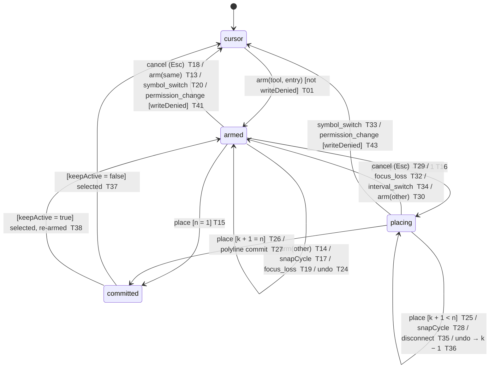

# E14-D02 — Drawing toolbar, canvas interaction model and object tree: greyscale wireframes for SCR-037, SCR-036 (drawings branch) and the SCR-045 keyboard entry

**Ticket:** E14-D02 (#247) · **Epic:** E14 · **Status:** Draft — the wireframe spec text (desk design; hpe-worker-1, 2026-10-22); owner approval pending per `docs/design/README.md`; **every decision not already binding is PROPOSED**; the Penpot boards are not drawn yet (**BLOCKED-PENPOT**, §0 — no board exists and no export is claimed). **Method:** desk wireframes under the Agent-delivery adaptations (owner decision 2026-09-25): no participant, no screen-reader run, no engineering dry run; the state machine, the registry, the hotkeys and the contrast pairs are checked mechanically by `docs/design/_tools/e14_d02_interaction_audit.py` (§4, §2, §10, §15); the "first-click test" becomes Probe G of E14-D01's protocol (§16.2) and the "dry run" the owner walkthrough (§16.3). **Scope / out of scope:** the ticket's, verbatim (the rail, the creation machine, selection and edit, the properties popover, the drawings branch, the keyboard path; not colour, type, icons, elevation or motion — E14-D03..D06, D09; not the tree's shell or its indicator rows — E13; not CMP-192 or alert lines — though §5.7 draws a drawing selection over an order line; not template management beyond "Save as default" — E14-D04).

**`blocked_by` E14-D01 (#204): merged** as PR #4047, squash `b0669716e132e85f516b94e676b68640c075c416` on `main` (memo `docs/design/research/e14-drawing-mental-models.md`, protocol `docs/design/research/e14-d01-session-protocol.md`); #204 is Done per the orchestrator. **Inputs pinned at the base `290d29f0ac6c57daf304ad43b372240b98c4959d`:** the memo's AD-1..AD-12, AM-1..AM-16 and OQ-1..OQ-14 with their defaults (approved by exception on #204; §1); E13-D02 D20–D26 (`docs/design/E13/E13-D02.md`, the tree shell); E11-D02 §2 / D9 / D16 / D18 (`docs/design/E11/E11-D02.md`, the chassis); E11-D04 D10 / §17 (`docs/design/E11/E11-D04.md`, the SCR-045 entry); E06-D03 D5 / D6 / D10 (the cursor cadence, origins and column); E17-D01 (the feed states); `22` `DrawingTool` (25 values with their point counts), `DrawingStyle`, `DrawingInput`, `DrawingGeometry`; `21` §3.8.3 (`layout_id` is the only scope; `interval_scope` unexposed); `apps/web/src/keymap/keymap.json` (`chart.limit_at_price` `Ctrl+drag`, `chart.market_order` `Alt+click`, `chart.cancel_drawing` `Esc` "drawing in progress", `chart.delete_drawing` `Del`, `chart.undo` / `chart.redo` `Ctrl+Z` / `Ctrl+Y`, `chart.footprint_mode` `Alt+F`, `ticket.snap_mid` `Alt+M`, `global.nav_rail` `Alt+1..9`; no drawing-tool key is registered); `packages/ui/tokens` (the five neutral tokens of §15; `color.drawing.default` / `.selected` exist in dark and light with no high-contrast override); `docs/design/E09/E09-D09.md` §2.1 / §2.2 / §2.3 / §3.1 / §3.2 / §3.3 / §9.1 / §9.3 / §10 (the T2 rule, its form, its reason keys and the `notice.panel_read_only` form; what §9.1 leaves outside the grammar — form validity — and what §3.3 leaves enabled — the three-strike state; the standing G-T2 gate; unchanged between the base and `main`) and E30-D02 §14 / D16 (the state vocabulary that owns the position tool's reasons, and the validity form its stop gate takes). **Key.** `NN` = `docs/plan/NN-*.md`; "AD-n / AM-n / OQ-n / Fn" = the E14-D01 memo; "E13-D02 Dn", "E11-D02 Dn", "E11-D04 Dn", "E06-D03 Dn" = those specs on `main`; `Tnn` = a row of the transition table (§4.3); every evaluative statement is `(heuristic)`.

**Orchestrator rulings (RULED — main-orchestrator, [LANE-46] 2026-10-22; binding; §17.4 records them as Q1–Q6):** **Q1** the spec is this file, `docs/design/E14/E14-D02.md` (the ticket's `docs/design/specs/e14-drawing-interaction-model.md` path is a Deviation, §18); no hand-off file — the keyboard and name / role tables for CMP-223 and CMP-191 are inline (§3.4, §5.8, §7.3). **Q2** the frames show E14-D01 AD-1's interim keys (OQ-1 option (a)); every Kbd hint is stamped "interim (OQ-1a) — registered by E14-S10"; #204 carries no owner override. **Q3** `14` gets two pointer lines only (SCR-037, SCR-036); `15` is not edited. **Q4** clone has no gesture; multi-select is the tree (E13-D02 D22) plus the explicit "Select area" rail mode — **the plot has no modifier-drag and no modifier-click selection because `Ctrl+drag` and `Alt+click` are trading gestures when chart trading is armed** (§5.5; repeated on board 07). **Q5** the brush is the one essential exception (`05` §3.4 item 7 — the exception → compensating control → reviewer form that `16` §11.4's log adopts; the exception itself is WCAG 2.1.1's path-dependent-input clause and 2.5.1's essential clause, §17.5); its compensating control is the polyline tool placed point by point. **Q6** the rail draws SCR-037's 19 tools plus `callout` and `polyline`; pitchfork, brush, `gann_fan`, `price_range` and `date_range` sit in the overflow marked "deferred — API value, no story; unscheduled" and carry **no hotkey and no story, sprint or user-story reference anywhere**; the emoji marker is a G-row (no `DrawingTool` value).

## Acceptance-criteria trace (issue #247)

Status key as in E13-D02 and E14-D01: **done** = delivered as worded; **heuristic-only** = delivered by the adaptation, pending the owner run; **open** = needs an owner decision or a run; **at risk** = a dated DoD item that the calendar has passed.

| Ticket AC / note / DoD item                                                                                                    | Where                                         | Status                                                                                                                                                      |
| ------------------------------------------------------------------------------------------------------------------------------ | --------------------------------------------- | ----------------------------------------------------------------------------------------------------------------------------------------------------------- |
| AC 1: every SCR-037 tool has a rail entry, an arming shortcut and a creation sequence; deferrals marked with the sprint        | §2 (34 rows; the tool's inventory diff), §4.4 | done — 5 chords (AD-1) + `Ctrl+M`; 15 tools arm from the rail / palette, bindable in SCR-113; deferrals "unscheduled" because no sprint exists to name (Q6) |
| AC 2: a horizontal line and a trendline by documented keys; every step has focus, announcement and escape                      | §9.1, §9.2, §9.4                              | done (written); the walkthrough is not run — open                                                                                                           |
| AC 3: `Esc` with one anchor discards the geometry, the tool returns per E14-D01; nothing persists; focus / symbol / interval   | §4.3 T29, T32–T34; §4.5                       | done (PROPOSED semantics, §4.5)                                                                                                                             |
| AC 4: the 500-object frame shows virtualisation, grouping, bulk selection, delete-all confirm; the chart at that density       | §8.4, §11; boards 10, 14                      | done (text); boards BLOCKED-PENPOT                                                                                                                          |
| AC 5: every collision with SCR-030's gestures listed with its resolution, reviewed by the Architect and chart-trading owner    | §10 (27 rows)                                 | done (register); review = the owner's `approved` on #247 — open                                                                                             |
| Technical notes: the machine is normative, frames illustrate; anchors (timestamp, price); SCR-030 meanings kept                | §4, §2 (every row), §10                       | done                                                                                                                                                        |
| Test plan: inventory diff · dry run · keyboard walkthrough · collision audit · 5-participant first-click test                  | the tool §2 / §4 / §10; §16.2 Probe G; §16.3  | diff and collision audit done (mechanised); dry run and walkthrough written, not run                                                                        |
| Security notes: plain-text note (truncate / expand, sanitised on write and render, no links); position tool as a pre-fill      | §7.2 slots, §13.1                             | done                                                                                                                                                        |
| Accessibility notes: focus order and accessible names per frame; vertical `role="toolbar"`; mode-change text; tree equivalence | §3.4, §5.8, §7.3, §8.5, §9, §12, §14          | done (text); no SR run — heuristic-only                                                                                                                     |
| Performance notes: separate drawings layer; a drag never re-renders price / footprint; full-scene re-renders flagged           | §13.2 (the measure ribbon case)               | done                                                                                                                                                        |
| Observability: where each event fires, plus E14-D01's events                                                                   | §4.3 "emits" column, §14                      | done                                                                                                                                                        |
| DoD 1: wireframe set complete                                                                                                  | §0 (fourteen boards planned)                  | open — BLOCKED-PENPOT                                                                                                                                       |
| DoD 2: the normative state diagram and the gesture-collision resolutions merged                                                | §4.2, §4.3, §10                               | done (this file; path per Q1)                                                                                                                               |
| DoD 3: dry run with two engineers and one QA/SDET; no undefined transitions                                                    | the tool: 44 pairs, 0 missing; §16.3          | mechanised half done; the human half = the owner walkthrough — heuristic-only                                                                               |
| DoD 4: keyboard-only walkthrough passed                                                                                        | §9                                            | written, not run — open                                                                                                                                     |
| DoD 5: tool-inventory diff clean or deferrals marked                                                                           | §2.1                                          | done                                                                                                                                                        |
| DoD 6: Architect review of engine implications recorded                                                                        | §13.2, §17.2 C10 / C11                        | owner `approved` pending — open                                                                                                                             |
| DoD 7: CDO sign-off ≥2 sprints before the Sprint 06 FE stories                                                                 | owner `approved` on #247                      | **at risk**: Sprint 03 has passed; `16` §13.4's spike gate binds CMP-191's band                                                                             |

## 0. Artefacts and boards (BLOCKED-PENPOT)

Penpot page **`E14-D02 Drawing interaction wireframes`** on the self-hosted instance (page id: pinned after the first build; the page is referenced by name and id only — no hostname, team, file or workspace id appears in this spec, the PR or the script). **No board is drawn and no export is claimed**; hpe-worker-1 draws the fourteen boards below from the board script in a later boards commit (one board per call, relayout, dedupe, export under the THEME-WINDOW guard: every shape paints a literal greyscale value, no token binding, no component instance). Frame sizes follow E13-D02 §0: the two screens (SCR-030 with the rail; SCR-036 with the drawings branch) at **1280×800 and 2560×1440**, the other states as specimens at 1280; density compact (24 px rail) with the comfortable pair (32 px) where a board says so. Every board with a PROPOSED decision carries the stamp; every Kbd hint carries "interim (OQ-1a) — registered by E14-S10", and every board whose strings show a chord repeats it as a "Keys:" line above its footer; every board also carries a compact strip above the footer — "Focus order:" (the stops the board touches), "Names:" (control → accessible name, lifted from §3.4, §5.8 and §7.3) and the §13.2 layer line — so each frame meets the ticket's Accessibility note on its own.

| #   | Board (`E14-D02 / nn slug`)    | Shows                                                                                                                                                                                                                                                                                                                                                                                                                                                                  | Export file (planned)                      |
| --- | ------------------------------ | ---------------------------------------------------------------------------------------------------------------------------------------------------------------------------------------------------------------------------------------------------------------------------------------------------------------------------------------------------------------------------------------------------------------------------------------------------------------------- | ------------------------------------------ |
| 01  | `01 rail-chassis-1280`         | SCR-030 at 1280×800 with the CMP-223 rail in E11-D02's slot: every group and separator, the magnet menu closed, keep-active off, lock-all / hide-all / delete-all apart, no armed chip; the inventory with keys and marks                                                                                                                                                                                                                                              | `E14-D02-01-rail-chassis-1280.png`         |
| 02  | `02 rail-chassis-2560`         | The same default at 2560×1440 with two chart panels (1560 and 992 px wide; the second rail collapsed into `[Draw]`) and the drawer docked showing the Drawings group                                                                                                                                                                                                                                                                                                   | `E14-D02-02-rail-chassis-2560.png`         |
| 03  | `03 rail-states-overflow`      | Specimens: tool-active, hover, focus-visible, T2 for the Viewer (the lock badge; the rail's one reason node per leg, echoed once by CMP-016; a T2 press — nothing arms, the echo re-shown, announced once), magnet off / weak / strong as three rail fragments, keep-active on with the armed chip, all-locked, all-hidden, the overflow at a 600 px pane, `[Draw]`, the 32 px pair                                                                                    | `E14-D02-03-rail-states-overflow.png`      |
| 04  | `04 creation-state-machine`    | The normative diagram (§4.2) and the transition table's rows (§4.3); the `Esc` ladder; the interrupt rows; the per-anchor-count branches 1 / 2 / 3 / n                                                                                                                                                                                                                                                                                                                 | `E14-D02-04-creation-state-machine.png`    |
| 05  | `05 creation-frames-trendline` | Six frames keyed to T01, T16, T28, T26, T37 and T29 / T18 / T05: armed, first anchor with the snap marker, the rubber line, second anchor, committed + selected, `Esc` at each state                                                                                                                                                                                                                                                                                   | `E14-D02-05-creation-frames-trendline.png` |
| 06  | `06 creation-outliers`         | The parallel channel (three clicks, the third sets the width, the preview between clicks), the anchored VWAP (one click on a bar, the 1σ / 2σ / 3σ bands, the "approximate" badge + hatch), the one-anchor cases, the measure ribbon with Pin                                                                                                                                                                                                                          | `E14-D02-06-creation-outliers.png`         |
| 07  | `07 selection-edit-states`     | Hover, selected (24 / 10 · 16 / 8 annotated), multi-select (Select area + the tree, with the Q4 annotation), locked, hidden, unsaved, conflict; drag with "64,000 → 64,120 · Undo", resize, nudge, delete; the order line underneath; the Viewer (selectable for inspection, no handles, every edit refused — T2)                                                                                                                                                      | `E14-D02-07-selection-edit-states.png`     |
| 08  | `08 properties-popover`        | The shared frame with its `DrawingStyle` bindings, the anchor fields, the alert row (an availability marker), the five slots, mixed values, locked read-only, the six states; Send to ticket in three states (no protective stop — the host's validity form, `aria-disabled` + E30-D02's stop key, no lock · over the cap — T2 with the lock · T1); the Viewer popover (one `notice.panel_read_only` notice under the title, T2 fields and buttons, Send to ticket T1) | `E14-D02-08-properties-popover.png`        |
| 09  | `09 object-tree-drawings`      | SCR-036 at 1280 with ~20 drawing rows: row anatomy, type sub-groups, the "this pane only" marker, eye / lock / menu, the row menu open, selection coupling both ways, the branch empty state; the Viewer branch (one notice, T2 eye / lock controls, the row menu with its T2 second lines, the sentence-form empty state)                                                                                                                                             | `E14-D02-09-object-tree-drawings.png`      |
| 10  | `10 object-tree-500`           | The 500-object case: the virtualised list ("item 312 of 500"), group collapse, the filter box, the bulk bar, the delete-all confirm, the chart at 500 drawings beside "500 drawings hidden"; the Viewer's bulk bar (T2)                                                                                                                                                                                                                                                | `E14-D02-10-object-tree-500.png`           |
| 11  | `11 keyboard-path-hline`       | The no-mouse horizontal line frame by frame (§9.1) and the SCR-045 entry (§9.3), with the row action in T2 form (its second line) for a session without `workspaces:write`                                                                                                                                                                                                                                                                                             | `E14-D02-11-keyboard-path-hline.png`       |
| 12  | `12 keyboard-path-trendline`   | Two anchors by keyboard, the surrogates roving set ("item 3 of 12"), a handle nudge, the locked refusal, undo focus, focus after delete (§9.2)                                                                                                                                                                                                                                                                                                                         | `E14-D02-12-keyboard-path-trendline.png`   |
| 13  | `13 gesture-collisions`        | The register (§10): every SCR-030 gesture and drawing key with its resolution and owner; the lint lines; the E31 route                                                                                                                                                                                                                                                                                                                                                 | `E14-D02-13-gesture-collisions.png`        |
| 14  | `14 states-events-a11y`        | The §11 states strip (16 states — the Viewer, view-as, zoom 200 % and forced-colors among them), the §14 event map, the §13 layer card, the §12 vocabulary excerpt (with the T2-press row), the focus-order summary (E11-D02 D18 with the handles stop), the §15 contrast table                                                                                                                                                                                        | `E14-D02-14-states-events-a11y.png`        |

Companion artefact in this PR: `docs/design/_tools/e14_d02_interaction_audit.py` (stdlib; imports `contrast_check.contrast_ratio()`, the `verify_tokens.py` loader and `keymap_lint.lint_keymap`; exit 0 at this head; `--json` feeds the local check of the board script). Plan documents touched: **two pointer lines in `14`**, one under SCR-037 and one under SCR-036 (Q3); nothing else — every other amendment is a row of §17 for its owner.

## 1. Locked inputs (built on, not re-decided)

| Input                                                                                                                                                                                                                                                                                                                                                                                                                                                                                                                                                                                                                                                                                                                                                                                                                 | Source                               | What it fixes here                                                                  |
| --------------------------------------------------------------------------------------------------------------------------------------------------------------------------------------------------------------------------------------------------------------------------------------------------------------------------------------------------------------------------------------------------------------------------------------------------------------------------------------------------------------------------------------------------------------------------------------------------------------------------------------------------------------------------------------------------------------------------------------------------------------------------------------------------------------------- | ------------------------------------ | ----------------------------------------------------------------------------------- |
| No function depends on hover or drag alone; anchors are (time, price); notes are plain text at every boundary; the position tool never places an order (send-to-ticket → SCR-060 pre-filled, native SL C-2.6, server-side sizing C-2.12); RBAC server-side (C-12.4, threat model DR38); sync never crosses symbols; `Esc` is reserved                                                                                                                                                                                                                                                                                                                                                                                                                                                                                 | E14-D01 "Locked"                     | §5, §7.2, §13.1                                                                     |
| Keys `Alt+L` trendline, `Alt+H` horizontal line, `Alt+O` Fibonacci, `Alt+R` rectangle, `Alt+D` measure, `Ctrl+M` magnet (bare `M` if macOS Minimize keeps `Cmd+M`); no drawing gesture on `Alt+click`, `Ctrl+drag`, a price-axis drag or an armed modifier-click; a plain drag over empty plot pans; anchored VWAP and hide-all have no default key; redo `Ctrl+Y` (AM-12)                                                                                                                                                                                                                                                                                                                                                                                                                                            | AD-1; Q2 (a)                         | §2 key column, §10                                                                  |
| Arming never places an anchor; after a commit the tool reverts to the cursor unless "keep tool active" is on; the rail and an on-chart text chip state the armed tool and the keep-active state                                                                                                                                                                                                                                                                                                                                                                                                                                                                                                                                                                                                                       | AD-2                                 | §3.2, T37 / T38                                                                     |
| The `Esc` ladder: pending anchors → the armed tool → the selection, one level per press, each announced; `chart.cancel_drawing`'s condition widens (AM-2)                                                                                                                                                                                                                                                                                                                                                                                                                                                                                                                                                                                                                                                             | AD-3                                 | §4.4                                                                                |
| One chart-level drawing magnet: off / weak (12 CSS px, default) / strong; `Ctrl+M` toggles off ↔ the last on-mode; no per-drawing magnet (AM-4; `DrawingStyle` has no field); separate from the crosshair magnet (E11-D02 D9)                                                                                                                                                                                                                                                                                                                                                                                                                                                                                                                                                                                         | AD-4                                 | §6                                                                                  |
| The snap target shows as a marker shape + value text ("High 65,400") before commit, announced politely; nudges never snap; keyboard placement has a snap-cycle key through the cursor bar's O / H / L / C (never `Alt+↑/↓`); the forming bar's values say "so far"                                                                                                                                                                                                                                                                                                                                                                                                                                                                                                                                                    | AD-5                                 | §6, §9                                                                              |
| Handles only on the selected or keyboard-focused drawing; pointer target ≥24×24 CSS px whatever the glyph; the glyph under one L0 row (12 px); a handle wins over its own line, never over an order, SL/TP or position line                                                                                                                                                                                                                                                                                                                                                                                                                                                                                                                                                                                           | AD-6, AM-10                          | §5.2, §5.7                                                                          |
| Every drag has a single-pointer path without dragging: click-click placement (AM-15) and anchor time / price fields in the popover                                                                                                                                                                                                                                                                                                                                                                                                                                                                                                                                                                                                                                                                                    | AD-7                                 | §4.4, §7.1                                                                          |
| A press moves a drawing only past a travel threshold, never where an order / SL/TP / position line is within its pick tolerance; "64,000 → 64,120 · Undo" during and after; `Esc` mid-drag restores; one `Ctrl+Z` restores it in every synced pane; an undo after a server delete re-creates under a new id                                                                                                                                                                                                                                                                                                                                                                                                                                                                                                           | AD-8                                 | §5.3                                                                                |
| Keyboard creation per anchor count: one-anchor tools commit on the first `Enter`, n-anchor tools on the n-th (AM-3); arming moves focus to the plot stop; the start is the data cursor, else the last close; a nudge or anchor edit on a locked drawing is refused and announced ("Locked")                                                                                                                                                                                                                                                                                                                                                                                                                                                                                                                           | AD-9                                 | §4, §9                                                                              |
| New drawings are shared by every pane showing the symbol; a sync-off pane marks its drawings "this pane only" in text and icon, on the canvas and in the tree; turning sync on offers an explicit copy; storage of pane-local is AM-11 / AM-16's question                                                                                                                                                                                                                                                                                                                                                                                                                                                                                                                                                             | AD-10                                | §8.2, G2                                                                            |
| Position tool: entry → stop → target; risk in USDT first; size, R:R, reward without hover, naming the sizing account and environment; "— set a target" after two anchors; send-to-ticket disabled with its reason until a protective stop, a target and the cap hold; stop and target snap to the tick only                                                                                                                                                                                                                                                                                                                                                                                                                                                                                                           | AD-11                                | §4.4, §7.2 (the stop and target gates in the host's validity form, the cap gate T2) |
| Delete-all sits apart, behind a confirm naming the count and symbol, keeps locked drawings, one undo step; hide-all is a per-pane view state stated in text ("200 drawings hidden"); lock-all is persisted protection stated in text                                                                                                                                                                                                                                                                                                                                                                                                                                                                                                                                                                                  | AD-12                                | §3.3, §8.4                                                                          |
| OQ defaults: no `drawing.*` sink yet, names fixed (§14); plain text, a URL stays inert; `interval_scope` unexposed — no interval control; the Viewer is read-only (T2, E09-D09 §2.2; CMP-079 RbacGate with the CMP-019 `lock` glyph, §3.4); clone + multi-select in R1 with no modifier-drag; OHLC-only snap candidates; the measure tool is transient until pinned                                                                                                                                                                                                                                                                                                                                                                                                                                                   | OQ-6, 7, 9, 10, 11, 12, 13, 14       | §7.1, §3.3, §5.4, §6, §4.4                                                          |
| The tree shell: the docked non-modal drawer, 320 / 360 px, 240 narrow mode, the four groups; the row anatomy (chevron, grip, 8×8 swatch, label, lock glyph; eye / lock / menu as three named buttons; the menu incl. Duplicate, Reveal on chart, Move up / down, Remove; `F2`; `Del` + toast "… removed. Undo" 10 s); the hybrid multi-select and the bulk bar (CMP-243); "No drawings"; the key map; Reveal on chart via `setCursor(…, "table")`                                                                                                                                                                                                                                                                                                                                                                     | E13-D02 D20, D21, D22, D23, D25, D26 | §8 adopts all of it and changes nothing of the shell                                |
| The rail slot: a `color.surface.raised` column at the left edge of the pane stack, 32 / 24 / 24 px per density, spanning the pane stack, collapsible into the toolbar's `[Draw]` overflow below 1280 px panel width or when hidden; chips 24 / 20 / 20; the Tab order toolbar → status chips → per pane legend → left gutter → plot (one roving stop) → overlay handles (one roving set) → right gutter → lock badge → splitter → time axis → cluster                                                                                                                                                                                                                                                                                                                                                                 | E11-D02 §2, D16, D18                 | §3.1, §9.4                                                                          |
| The SCR-045 row action "Horizontal line at this price" from the 24 px `⋯`, `Shift+F10` or Menu; level rows get it with the level price; the `Esc` ladder inside the grid; `Alt+T` a pure toggle; focus restoration                                                                                                                                                                                                                                                                                                                                                                                                                                                                                                                                                                                                    | E11-D04 D10, §17.1, §17.2            | §9.3                                                                                |
| The cursor cadence (`leadDelay` 0, `repeatWindow` 500 ms, `trailingFlush` ≤250 ms, the short form while held), the origins `keyboard` / `table` / `pointer` (hover never moves the selection), the cursor column in `color.focus.ring` ≥2 px                                                                                                                                                                                                                                                                                                                                                                                                                                                                                                                                                                          | E06-D03 D5, D6, D10                  | §9, §12                                                                             |
| `DrawingTool`: exactly 1 anchor `horizontal_line`, `vertical_line`, `text`, `anchored_vwap`; 2 for `trendline`, `ray`, `extended_line`, `rectangle`, `ellipse`, `fib_retracement`, `fib_timezone`, `gann_fan`, `arrow`, `callout`, `measure`, `price_range`, `date_range`; 3 for `parallel_channel`, `triangle`, `fib_extension`, `pitchfork`, `long_position`, `short_position`; 2..500 `brush`; 2..100 `polyline`; `text` required for `text` / `callout`; `levels` fib-only (≤24); `bands` VWAP-only {1, 2, 3}; `extend_left` / `extend_right` on every tool; a horizontal ray = `horizontal_line` + `extend_right`; `DrawingStyle` = `colour`, `fill_colour`, `fill_opacity`, `width` 1..8, `dash` solid / dashed / dotted, `font_size` 8..48; `label` 1..120 and `text` 1..1,000 code points, sanitised on write | `22` (grep-verified at the base)     | §2, §4.4, §7.1                                                                      |

## 2. The tool registry (D1)

### 2.1 The inventory diff (AC 1, DoD 5)

Three inventories disagree (E14-D01 F18) and the tool reconciles them row by row: **SCR-037's Type line lists 19 tools and 4 controls**, **`22` `DrawingTool` (= `21` `dr_tool`) has 25 values**, **`26` §3.10 lists 15**. Every one of the 25 API values has a row below; **20 API values are on the rail (19 with an R1 story; polyline's home is PROPOSED, Q5), including `callout` and `polyline` (Q6)**, **5 are deferred in the overflow** (pitchfork, brush, `gann_fan`, `price_range`, `date_range` — `26` §3.10's v1 list names price range and brush, C20), and the **emoji marker** — on SCR-037, with no API value — is the sixth deferral and contract gap G1. Six API values are not on SCR-037's Type line: `parallel_channel` (US-DRAW-003 and E14-S03 own it, the ticket's scope lists it — C4), `callout` (E14-S06's title names it), `polyline` (Q5), `gann_fan`, `price_range`, `date_range`. Three SCR-037 names have no story: pitchfork, brush, emoji marker. Anchor-count classes from `22`: **4 one-anchor, 13 two-anchor, 6 three-anchor, 2 unbounded** tools. The rail's **cursor group** holds cursor, crosshair (a cursor style, not a drawing; E11-D02 D9 owns the crosshair) and the PROPOSED **Select area** mode (Q4); every tool without a key is armed from the rail or the command palette (bindable in SCR-113); the **object controls** are magnet, keep tool active (AM-5), lock-all, hide-all and, apart, delete-all. A deferred row carries only the label "deferred — API value, no story; unscheduled" (Q6 rider): no key, no story, no sprint.

### 2.2 The registry (34 rows; the key column is OQ-1 (a), interim — registered by E14-S10; the Fibonacci cell also carries scheme (b)'s key, so a flip to (b) changes two cells: it and §10 row 15)

| id               | SCR-037 name                               | `DrawingTool`      | anchors | rail group       | arming key (interim)   | story                    | R1 / deferred                                       |
| ---------------- | ------------------------------------------ | ------------------ | ------- | ---------------- | ---------------------- | ------------------------ | --------------------------------------------------- |
| cursor           | cursor                                     | —                  | —       | cursor           | `Esc` ladder           | —                        | R1 (not a drawing)                                  |
| crosshair        | crosshair                                  | —                  | —       | cursor           | rail                   | —                        | R1 (cursor style; E11-D02 D9)                       |
| select_area      | —                                          | —                  | —       | cursor           | rail / palette         | E14-S10                  | R1 PROPOSED (Q4)                                    |
| trendline        | trendline                                  | `trendline`        | 2       | lines            | `Alt+L`                | E14-S02                  | R1                                                  |
| ray              | ray                                        | `ray`              | 2       | lines            | rail / palette         | E14-S02                  | R1                                                  |
| extended_line    | extended line                              | `extended_line`    | 2       | lines            | rail / palette         | E14-S02                  | R1                                                  |
| horizontal_line  | horizontal line/level                      | `horizontal_line`  | 1       | lines            | `Alt+H`                | E14-S01                  | R1                                                  |
| vertical_line    | vertical line                              | `vertical_line`    | 1       | lines            | rail / palette         | E14-S01                  | R1                                                  |
| rectangle        | rectangle                                  | `rectangle`        | 2       | shapes           | `Alt+R`                | E14-S03                  | R1                                                  |
| ellipse          | ellipse                                    | `ellipse`          | 2       | shapes           | rail / palette         | E14-S03                  | R1                                                  |
| triangle         | triangle                                   | `triangle`         | 3       | shapes           | rail / palette         | E14-S03                  | R1                                                  |
| parallel_channel | —                                          | `parallel_channel` | 3       | shapes           | rail / palette         | E14-S03                  | R1                                                  |
| fib_retracement  | Fibonacci retracement/extension/time zones | `fib_retracement`  | 2       | fibonacci        | `Alt+O` ((b): `Alt+F`) | E14-S04                  | R1                                                  |
| fib_extension    | Fibonacci retracement/extension/time zones | `fib_extension`    | 3       | fibonacci        | rail / palette         | E14-S04                  | R1                                                  |
| fib_timezone     | Fibonacci retracement/extension/time zones | `fib_timezone`     | 2       | fibonacci        | rail / palette         | E14-S04                  | R1                                                  |
| anchored_vwap    | anchored VWAP                              | `anchored_vwap`    | 1       | analysis         | rail / palette         | E14-S05                  | R1                                                  |
| measure          | measure                                    | `measure`          | 2       | analysis         | `Alt+D`                | E14-S06                  | R1 (transient until pinned)                         |
| long_position    | long/short position tool                   | `long_position`    | 3       | analysis         | rail / palette         | E14-S07                  | R1                                                  |
| short_position   | long/short position tool                   | `short_position`   | 3       | analysis         | rail / palette         | E14-S07                  | R1                                                  |
| text             | text note                                  | `text`             | 1       | annotation       | rail / palette         | E14-S06                  | R1                                                  |
| callout          | —                                          | `callout`          | 2       | annotation       | rail / palette         | E14-S06                  | R1                                                  |
| arrow            | arrow                                      | `arrow`            | 2       | annotation       | rail / palette         | E14-S06                  | R1                                                  |
| polyline         | —                                          | `polyline`         | 2..100  | annotation       | rail / palette         | none (PROPOSED: E14-S06) | R1 PROPOSED (Q5)                                    |
| brush            | brush                                      | `brush`            | 2..500  | overflow         | —                      | —                        | deferred — API value, no story; unscheduled         |
| pitchfork        | pitchfork                                  | `pitchfork`        | 3       | overflow         | —                      | —                        | deferred — API value, no story; unscheduled         |
| gann_fan         | —                                          | `gann_fan`         | 2       | overflow         | —                      | —                        | deferred — API value, no story; unscheduled         |
| price_range      | —                                          | `price_range`      | 2       | overflow         | —                      | —                        | deferred — API value, no story; unscheduled         |
| date_range       | —                                          | `date_range`       | 2       | overflow         | —                      | —                        | deferred — API value, no story; unscheduled         |
| emoji_marker     | emoji marker                               | —                  | —       | overflow         | —                      | —                        | deferred — no `DrawingTool` value; unscheduled (G1) |
| magnet           | magnet toggle                              | —                  | —       | controls         | `Ctrl+M`               | E14-S02                  | R1                                                  |
| keep_active      | —                                          | —                  | —       | controls         | rail                   | E14-S10                  | R1 (AM-5)                                           |
| lock_all         | lock-all                                   | —                  | —       | controls         | rail                   | E14-S08                  | R1                                                  |
| hide_all         | hide-all                                   | —                  | —       | controls         | rail                   | E14-S08                  | R1                                                  |
| delete_all       | delete-all                                 | —                  | —       | controls (apart) | rail                   | E14-S10                  | R1                                                  |

The creation sequence per row is §4.4 (one machine, parameterised by the anchor count); the audit tool fails if a name appears in `14`, `21`, `22` or `26` §3.10 without a row here, or if a row's anchor count disagrees with `22`.

## 3. The rail — CMP-223 (D2, D3, D4)

### 3.1 Anatomy per density

The rail is E11-D02 §2's slot: a `color.surface.raised` column at the left edge of the pane stack, **32 / 24 / 24 px** wide per density (comfortable / compact / dense), spanning the pane stack's height, inside the chart panel's `role="region"`. One **24×24 button per tool** in compact (32×32 comfortable; `size.target.min` 24 is the floor, `05` §3.4 item 7), a 16 px glyph placeholder (a letter or a simple shape in greyscale; icons are E14-D03's), the buttons abutting, the separators between groups drawn as 6 px blocks (2 px, a 1 px `color.border.default` rule, 3 px) — one after each group and one after the overflow button — and `space.1` (4 px) padding at the column's top and bottom; each button's tooltip (CMP-016, hover **and** focus) names the tool and its Kbd hint (CMP-022) or "rail / palette". Group order (E14-D03's section order): **cursor** (cursor · crosshair · Select area) → **lines** → **shapes** → **Fibonacci** → **analysis** (anchored VWAP · measure · long position · short position) → **annotation** (text note · callout · arrow · polyline) → **object controls** (magnet mode menu · keep tool active · lock-all · hide-all) → a 12 px gap → **delete-all** alone at the bottom (AD-12). **Overflow (D2, PROPOSED):** the overflow button `⋯` ("More tools", `aria-haspopup="menu"`, CMP-041) is always present at the end of the tool groups and **always holds the six deferred entries** in a labelled last section — each an `aria-disabled` CMP-041 item (`disabledReason?`, E11-D03 D03-CR-1) with the text tag "deferred — API value, no story; unscheduled" (the emoji marker: "no `DrawingTool` value") as its second line: an **availability marker**, not a T2 permission or policy gate (E09-D09 §9.1 — not a permission boundary, outside the grammar), so no lock glyph and no CMP-079; never hidden (Q6), with no key and no story. For a session without `workspaces:write`, or under view-as, the R1 tools that the collapse has moved into the overflow are T2 menu items — the reason as the item's second line, E09-D09 §2.2 rendering 2a (§3.4). The full rail needs **758 px** in compact — the audit tool's rail model (its geometry section): 4 + 24 × 23 tool buttons + 24 (the overflow button) + 6 × 7 separator blocks + 4 × 24 controls + the 12 px gap + 24 (delete-all) + 4; when the pane stack is shorter, whole groups collapse into the overflow **from the bottom up** — annotation first, then analysis, then Fibonacci — so at a **1280×800** panel (a **728 px** pane stack) the annotation group is already in the overflow (five groups, **656 px** drawn), and at a **600 px** pane stack the rail shows cursor, lines, shapes and Fibonacci (four groups, **554 px**); the object controls and delete-all never collapse; the full rail shows from 758 px of pane stack (2560×1440). The three heights are computed by the tool, drawn by the board script from the same formula and compared by its local check — never asserted. Below **1280 px panel width**, or when the user hides the rail, the whole rail collapses into CMP-221's `[Draw]` overflow (E11-D02 §2), which widens the plot by the rail's width; the armed-tool chip (§3.2) stays visible in either case so an armed tool is never an invisible mode (AD-2).

### 3.2 The armed-tool chip and keep tool active (D3, D4)

The chip is a 20 px (24 comfortable) `color.surface.raised` pill with a 1 px `color.border.strong` outline, the tool's glyph and the text **"Trendline"** or **"Trendline · keep active"**, placed in **the status row's chip slot after the aggregation chip** (E11-D02 D16's chip order: env badge · feed chip · aggregation chip · **armed-tool chip** · readout) — PROPOSED (Q9; the corner-badge slot was rejected because it is the LOD / degraded badge's home and bottom-left is covered by the drawer's narrow mode `(heuristic)`). It is text + glyph, never highlight or colour alone; it disappears in the cursor state; it is exposed, never hidden — `role="status"` with `aria-live="off"`, so it is readable on demand and never re-announced (the §12 announcements carry the change, the rail button's `aria-pressed` the state), and the plot stop and the handles stop reference it by `aria-describedby` while a tool is armed, so a screen-reader user who leaves the chart (T19 keeps the tool armed) and returns can re-query the mode from the plot stop without travelling back to the rail (AD-2). **Keep tool active** is a rail toggle (`aria-pressed`, "Keep tool active"; off by default, OQ-3) persisted with the chart preferences (PROPOSED Settings key `drawing.keep_active`, G6); when on, a commit re-arms the same tool (T38) and the chip reads "· keep active"; it changes nothing about the `Esc` ladder (§4.4).

### 3.3 The magnet mode menu, lock-all, hide-all, delete-all

**Magnet** is a CMP-041 menu button (24×24) whose label reads the current mode in text: "Magnet: weak" (default, 12 CSS px), "Magnet: off", "Magnet: strong"; the menu lists Off · Weak (12 px) · Strong as radio items; `Ctrl+M` toggles off ↔ the last on-mode (AD-4) and announces "Magnet: off" / "Magnet: weak"; the crosshair magnet of E11-D02 D9 is a different control in SCR-031's crosshair section and is never merged with this one (§6). **Lock-all** and **hide-all** are toggles (`aria-pressed`); lock-all is persisted protection ("All drawings locked" in the tooltip and the tree header); hide-all is a per-pane view state whose button label becomes **"200 drawings hidden"** so a hidden set never reads as empty (AD-12; the count is the pane's). **Delete-all** sits apart (12 px gap, the last control) and opens the CMP-043 confirm of §8.4.

### 3.4 Rail states and the CMP-223 contract (Table 2 / Table 3, `16` §11.4 shape, for E14-D08 to lift)

States drawn on board 03: default · **tool-active** (`aria-pressed="true"`, a 2 px inset bar on the button's left edge plus the chip — shape + text) · hover · **focus-visible** (the `focus-ring` stand-in, 2 px, 2 px offset; §15) · **T2 for the Viewer** (the rule below: the lock badge, one reason node per leg echoed by CMP-016, a T2 press re-showing the echo — Q12 asks whether drawings get their own verb) · magnet off / weak / strong (three rail fragments; the mode in the button's name, §3.3) · keep-active on · all-locked · all-hidden · overflow open · collapsed into `[Draw]`. Props the frames imply beyond CMP-223's catalogue entry (C14): `keepActive` · `onToggleKeepActive` · `selectAreaMode` · `onToggleSelectArea` · `hiddenCount` · `onMagnetModeChange` · `onDeleteAll` · `disabledReason` (per control, CMP-079 RbacGate; the CMP-019 `lock` badge).

**The T2 rule (E09-D09 §2.2; stated once here and cited from every gated row of this spec).** Every role-, grant-, environment-, session- or state-gated control in this spec is E09-D09's **T2**: the control keeps its native role and its full label; `aria-disabled="true"`, never the `disabled` attribute, so it stays focusable — in the Tab order — and a menu item stays arrow-reachable; a CMP-019 `lock` glyph (`decorative=false`, name "Not available") leads a text label or badges an icon-only rail button; `aria-describedby` points at its reason node, which is in the DOM at mount — rendering **2a** (inline: under or beside the control; a menu item carries it as its second line, CMP-041 `disabledReason?`) by default, rendering **2b** (the node visually hidden and echoed by CMP-016 on hover **and** focus; the badge is the visible marker) only for the icon-only rail buttons; the reason is a registered key — E09-D09 §3.1 (`rbac.*`, the verb from §3.2) or a registered state vocabulary (E30-D02 §14) — never a string written for this screen and never data (no symbol, count, amount or user name); one reason node per read-only panel, every gated control pointing at it (E09-D09 §2.2 "one notice, many pointers"; §9.2); `Enter` / `Space` / a bound hotkey / an arrow on a T2 radio stage nothing — no arm, no menu, no confirm, no request — and re-show the reason inline at the point of action with one polite announcement (E09-D09 §9.3; Table 2's T2 row); a T2 press emits nothing (§14). Role legs are wrapped in CMP-079 RbacGate; the server refuses the write regardless (C-12.4, DR38). **Availability markers are not T2:** the deferred overflow entries (§3.1), the alert toggle (§7.1) and Apply template (§8.3) are held back by neither a permission nor a state, which E09-D09 §9.1 places outside the grammar — they stay `aria-disabled`, never hidden, with their text as the description and no lock glyph. **Form validity is not T2 either** (E09-D09 §9.1): the position tool's missing protective stop and missing target keep `aria-disabled` and a visible reason in E30-D02 D16's form — focusable and pressable, no lock glyph, no CMP-079, never called T2 (§7.2); only its cap gate, a §2.1 step-4 state, is T2. **The user-set locked state is outside the grammar too** ("Locked.", "Unlock to edit" — §5.1, §7.2): the user's own protection, marked by the drawing's lock glyph at its first anchor and refused with "Locked.", never with T2's anatomy. **The T2 form (E09-D09 §2.2):** the full label and the glyph in `color.text.tertiary`; the CMP-019 `lock` glyph ("Not available") in the same colour, leading a text label or sitting as a badge at the top-right of an icon-only rail button (2b); the reason in `color.text.secondary` — inline (2a), or for the rail the visually hidden node echoed by CMP-016 (2b); the enabled fill becomes `color.surface.raised` with a `color.border.default` hairline; never `color.text.disabled`, never `opacity.disabled`. On these greyscale boards the T2 label and glyph paint `text.tertiary` #8B949E and the reason `text.secondary` #B1BAC4 — never `text.primary`, the lightest grey (§15). **The reasons on the rail, by the operation each control calls (E09-D09 §2.1 step 3, §2.3), checked in the server's order:** (a) a view-as context (`GET /auth/session/view-as`) → `rbac.view_as` **"Read-only while viewing as {user}."** on every write — the drawing writes (`/drawings*`) and the `PATCH /settings` controls alike: magnet mode, keep tool active and `Ctrl+M` — before the permission leg (`22` View-as session: every state-changing request answers `403 view_as_read_only`); (b) the drawing tools, lock-all and delete-all (`/drawings*`, `workspaces:write`) → `rbac.permission` **"Your role can't save workspaces."** (the §3.2 verb; a Viewer lacks `workspaces:write`, `22` `x-permissions`); keep tool active and magnet mode (the PROPOSED G6 keys through `PATCH /settings`, `settings:write`) → `rbac.permission` **"Your role can't change settings."** (a Viewer lacks `settings:write` as well; a Manager holds both); cursor, crosshair, Select area, the overflow button and hide-all call no write and stay T1 (E09-D09 §2.1 step 5) — hide-all is a per-pane view state (AD-12; persisted in a layout it would become a `workspaces:write`). **One node per reason (E09-D09 §2.2, §9.2):** the rail has one visually hidden reason node per applicable leg, in the DOM at mount, referenced by every T2 rail button's `aria-describedby` and echoed by CMP-016 on hover and focus; each button keeps its lock badge as the visible marker and each sentence exists once. The popover (§7.1) and the drawings branch (§8.2) carry one inline notice each in E09-D09 §10's `notice.panel_read_only` form — **"Read-only — your role can't save workspaces."** for the permission leg; under view-as the notice carries the `rbac.view_as` sentence itself, "Read-only while viewing as {user}.", which already opens with the panel form's "Read-only" `(heuristic — the form composes an rbac sentence under a "Read-only —" lead, so applying it to this key would double the word)`; the handles set (§5.1) its own hidden node. The guard `writeDenied` (§4.1) is these legs, named after what the session carries and never after a role (E09-D09 §2.1).

| Key (Table 2)                                                                                          | Action                                                                                                                                                                                                                                                                                                                                                                                                | Focus after                                                                                             | Global conflict? (`05` §3.2 / §3.3; the tool's lint)                     |
| ------------------------------------------------------------------------------------------------------ | ----------------------------------------------------------------------------------------------------------------------------------------------------------------------------------------------------------------------------------------------------------------------------------------------------------------------------------------------------------------------------------------------------- | ------------------------------------------------------------------------------------------------------- | ------------------------------------------------------------------------ |
| `Tab` / `Shift+Tab`                                                                                    | enter / leave the rail (one roving stop, `05` §3.4 item 2)                                                                                                                                                                                                                                                                                                                                            | the focused tool button; the previous stop is the status chips, the next the first pane's legend (§9.4) | none                                                                     |
| `↑` / `↓`, `Home` / `End`                                                                              | move the roving focus along the rail (vertical toolbar, APG)                                                                                                                                                                                                                                                                                                                                          | the button                                                                                              | none (inside the stop)                                                   |
| `Enter` / `Space` on a tool                                                                            | arm (T01) — focus moves to the plot stop (AD-9); on the armed tool: disarm (T13); T1 only — a T2 button takes the T2 row                                                                                                                                                                                                                                                                              | the plot stop / the button                                                                              | none                                                                     |
| `Enter` / `Space` on magnet, keep-active, lock-all, hide-all, delete-all                               | open the mode menu / toggle / open the confirm (T1 only; a T2 control takes the T2 row: no menu, no confirm)                                                                                                                                                                                                                                                                                          | the menu's current item / the button / the dialog                                                       | none                                                                     |
| `Enter` / `Space` / a bound hotkey (`Alt+L` `Alt+H` `Alt+O` `Alt+R` `Alt+D`, `Ctrl+M`) on a T2 control | nothing changes: no arm, no menu, no confirm, no request, no event (T02); the reason is re-shown by the CMP-016 echo at the control and announced once, politely (E09-D09 §2.2, §9.3)                                                                                                                                                                                                                 | unchanged                                                                                               | none                                                                     |
| `Enter` / `Space` / `↓` on More tools                                                                  | open the overflow (CMP-041); `↑` / `↓` land on every item, the `aria-disabled` deferred ones included (never skipped); `Enter` on an R1 item arms it (T01) — for a session without `workspaces:write`, or under view-as, the item is T2: nothing arms, the menu stays open and its second line is announced once; `Enter` on a deferred item changes nothing and announces its tag once; `Esc` closes | the first item; after a pick the plot stop; after `Esc`, More tools                                     | none                                                                     |
| inside the magnet menu                                                                                 | `↑` / `↓` over the three `menuitemradio` items; `Enter` / `Space` selects and closes; `Esc` closes without a change                                                                                                                                                                                                                                                                                   | the magnet button                                                                                       | none                                                                     |
| `Alt+L` `Alt+H` `Alt+O` `Alt+R` `Alt+D` (Chart context)                                                | arm the tool from anywhere in the chart region (T01); on a T2 session the T2 row                                                                                                                                                                                                                                                                                                                      | the plot stop                                                                                           | interim (OQ-1a) — registered by E14-S10; lint 0 errors under scheme (a)  |
| `Ctrl+M`                                                                                               | magnet off ↔ last on-mode (T1; T2 under view-as or without `settings:write`: the T2 row)                                                                                                                                                                                                                                                                                                              | unchanged                                                                                               | interim; `Cmd+M` is macOS Minimize → bare `M` fallback (owner check; G5) |
| `Esc`                                                                                                  | the ladder (§4.4); on the rail with nothing armed: not consumed                                                                                                                                                                                                                                                                                                                                       | unchanged                                                                                               | reserved (`05` §3.3 item 3)                                              |
| `Shift+F10` / Menu on a tool button                                                                    | the tool's context menu (Keep tool active · Set as default · Remap… → SCR-113)                                                                                                                                                                                                                                                                                                                        | the menu                                                                                                | OS gesture                                                               |

| Element (Table 3)                      | Role                                     | Accessible name (source)                                                               | States / properties                                                                                                                                                                                                                        |
| -------------------------------------- | ---------------------------------------- | -------------------------------------------------------------------------------------- | ------------------------------------------------------------------------------------------------------------------------------------------------------------------------------------------------------------------------------------------ |
| the rail                               | `toolbar`, `aria-orientation="vertical"` | "Drawing tools"                                                                        | roving `tabindex`                                                                                                                                                                                                                          |
| a tool button                          | `button`                                 | the tool name ("Trendline") — the hint is the tooltip, not the name                    | `aria-pressed` for the armed tool; T2 (E09-D09 §2.2): `aria-disabled` + `aria-describedby` → the rail's one reason node for its leg, the lock badge, the CMP-016 echo                                                                      |
| a group separator                      | `separator`                              | —                                                                                      | —                                                                                                                                                                                                                                          |
| Select area                            | `button`                                 | "Select area"                                                                          | `aria-pressed` while the mode is on; T1 for every session (no write)                                                                                                                                                                       |
| magnet mode                            | `button`, `aria-haspopup="menu"`         | "Magnet: weak"                                                                         | the mode in the name; the menu's items `menuitemradio`; T2 (E09-D09 §2.2) under view-as or without `settings:write`: the menu does not open                                                                                                |
| keep tool active / lock-all / hide-all | `button`                                 | "Keep tool active" / "Lock all drawings" / "Hide all drawings" → "200 drawings hidden" | `aria-pressed`; T2 (E09-D09 §2.2) for keep tool active (`settings:write`) and lock-all (`workspaces:write`) under view-as or when the leg is missing; hide-all stays T1                                                                    |
| delete-all                             | `button`                                 | "Delete all drawings…"                                                                 | opens `alertdialog`; `aria-describedby` "destructive action"; T2 (E09-D09 §2.2) under view-as or without `workspaces:write`: `Enter` opens nothing                                                                                         |
| the overflow                           | `button`, `aria-haspopup="menu"`         | "More tools"                                                                           | deferred items `aria-disabled` (CMP-041 `disabledReason?`), their tag as the second line — an availability marker, not T2; R1 items inside it T2 for a session under view-as or without `workspaces:write` (the reason as the second line) |
| the armed-tool chip                    | `status`, `aria-live="off"`              | its text: "Trendline" / "Trendline · keep active"                                      | referenced by `aria-describedby` from the plot stop and the handles stop while a tool is armed; absent in the cursor state; the change is announced (§12)                                                                                  |

## 4. The creation state machine (normative; D5, D6)

### 4.1 States, events, guards

One machine, instantiated per tool and parameterised by the tool's anchor count **n** from `22` `DrawingTool` (R1 of the brief; the ticket's Technical notes make the diagram normative and the frames its illustration). **States:** `cursor` (no tool armed; a selection may exist) → `armed(tool)` → `placing(tool, k)` for 1 ≤ k < n → `committed` (transient: the new drawing exists and is **selected** — `26` §3.10's "adjust" phase is the selected state of §5, not a pre-commit state) → `cursor`, or `armed(tool)` when keep tool active is on (AD-2). **Events:** `arm(tool, entry)` with entry ∈ rail · hotkey · palette · table_row; `place` (a click, or `Enter` on the plot stop); `snapCycle` (`Ctrl+↑` / `Ctrl+↓`, §6); `cancel` (`Esc`); the six interrupts `focus_loss` · `symbol_switch` · `interval_switch` · `tool_switch` · `disconnect` · `permission_change` (the `23` §9.5 frame; E09-D09 §4.1); `undo` (`Ctrl+Z`). **Guards:** `keepActive`, `writeDenied` (E09-D09 §2.1 step 3, the legs in the server's order — (a) a view-as context → `rbac.view_as` "Read-only while viewing as {user}."; (b) `workspaces:write` ∉ `permissions` → `rbac.permission` "Your role can't save workspaces." — named after what the session carries, never after a role; §3.4), `magnetMode` (off / weak / strong — decides whether a place snaps), `n` and `k`; `locked` belongs to §5 (editing), not to creation. The table below is **total**: the audit tool asserts that every (state, event) pair is a transition, an alias or an explicit ignore — **4 states × 11 events = 44 pairs, 44 rows, 32 transitions (2 aliases), 13 ignores, 0 missing**. That is the mechanised half of DoD 3; the owner walkthrough (§16.3) is the human half, not claimed.

### 4.2 Diagram



### 4.3 The transition table (every pair; boards 04–06 and 11–12 cite these ids)

| id  | state     | event [guard]                                                                   | next                             | what the canvas · rail · chip show                                                                                            | announcement (polite, §12)                                                                        | emits (§14)                                                                            |
| --- | --------- | ------------------------------------------------------------------------------- | -------------------------------- | ----------------------------------------------------------------------------------------------------------------------------- | ------------------------------------------------------------------------------------------------- | -------------------------------------------------------------------------------------- |
| T01 | cursor    | arm(tool, entry) [writeDenied = false]                                          | armed(tool)                      | crosshair with the tool glyph; the button `aria-pressed`; chip "Trendline"; focus → the plot stop (AD-9)                      | long form on a session's first arm, short after (§12)                                             | `drawing.tool_selected{tool, entry_method}`                                            |
| T02 | cursor    | arm [writeDenied = true]                                                        | cursor                           | nothing arms: T2 (E09-D09 §2.2) — the reason re-shown at the button by the CMP-016 echo (§3.4; E09-D09 §9.3)                  | the reason, once (polite)                                                                         | — (a T2 press emits nothing)                                                           |
| T03 | cursor    | place                                                                           | cursor                           | ignored — no tool armed: `Enter` on the plot stop is E06-D03 D6's expand; a click sets the cursor (origin `pointer`)          | —                                                                                                 | —                                                                                      |
| T04 | cursor    | snapCycle                                                                       | cursor                           | ignored — valid only while an anchor is pending (`validWhen`)                                                                 | —                                                                                                 | —                                                                                      |
| T05 | cursor    | cancel (`Esc`) [selection exists]                                               | cursor                           | the selection clears; handles gone (the ladder's third level)                                                                 | "Selection cleared."                                                                              | —                                                                                      |
| T06 | cursor    | cancel [no selection]                                                           | cursor                           | ignored — not consumed; `Esc` propagates (E06-D03 D6)                                                                         | —                                                                                                 | —                                                                                      |
| T07 | cursor    | focus_loss                                                                      | cursor                           | ignored — nothing pending; the selection stays                                                                                | —                                                                                                 | —                                                                                      |
| T08 | cursor    | symbol_switch                                                                   | cursor                           | the selection clears (the drawing set changes); the rail is unchanged                                                         | — (the symbol change announces itself)                                                            | —                                                                                      |
| T09 | cursor    | interval_switch                                                                 | cursor                           | ignored — anchors are chart-space; the selection stays                                                                        | —                                                                                                 | —                                                                                      |
| T10 | cursor    | tool_switch                                                                     | = T01 / T02                      | a tool switch from the cursor is an arm                                                                                       | as T01                                                                                            | as T01                                                                                 |
| T11 | cursor    | disconnect                                                                      | cursor                           | ignored — drawings stay visible and pickable; the feed chip carries the state (E11-D02 D16)                                   | —                                                                                                 | —                                                                                      |
| T12 | cursor    | undo (`Ctrl+Z`) [stack not empty]                                               | cursor                           | the top command reverts in every synced pane (AD-8); focus per AD-9 (§9.5); an empty stack does nothing                       | "Undone: moved trendline."                                                                        | `drawing.undone{op}`                                                                   |
| T13 | armed     | arm(same tool)                                                                  | cursor                           | the pressed button releases; the crosshair reverts; chip gone (PROPOSED, Q13)                                                 | "Trendline tool off."                                                                             | `drawing.tool_selected{tool: cursor, entry_method}`                                    |
| T14 | armed     | arm(other tool)                                                                 | armed(other)                     | the other button pressed; the chip renamed                                                                                    | "Rectangle tool on."                                                                              | `drawing.tool_selected`                                                                |
| T15 | armed     | place [n = 1]                                                                   | committed                        | the anchor at the cursor — the snapped value when the magnet has a candidate within 12 px (§6)                                | (T37 / T38)                                                                                       | `drawing.created{tool, entry_method}`; `drawing.snap_applied{ohlc_field}` when snapped |
| T16 | armed     | place [n ≥ 2]                                                                   | placing(tool, 1)                 | anchor 1 marked (the §5.2 glyph); the rubber band follows the cursor; auto-follow paused (memo §13)                           | "Anchor 1 of 2 at 13:40, 64,012.5."                                                               | `drawing.snap_applied` when snapped                                                    |
| T17 | armed     | snapCycle (`Ctrl+↑` / `Ctrl+↓`)                                                 | armed                            | the cursor's price steps to the cursor bar's next O / H / L / C by price; the snap marker + value text shows                  | "High 65,400." / "High 65,400 so far." on the forming bar                                         | —                                                                                      |
| T18 | armed     | cancel (`Esc`)                                                                  | cursor                           | disarmed; the button releases; chip gone (AM-2 widens `chart.cancel_drawing`)                                                 | "Trendline tool off."                                                                             | `drawing.cancelled{tool, anchors_placed: 0, cause: esc}`                               |
| T19 | armed     | focus_loss                                                                      | armed                            | the tool and its keep-active state stay; nothing is pending                                                                   | on return: "Trendline tool on."                                                                   | —                                                                                      |
| T20 | armed     | symbol_switch                                                                   | cursor                           | disarmed — an armed tool across symbols is the invisible mode AD-2 forbids                                                    | "Trendline tool off — symbol changed."                                                            | `drawing.cancelled{anchors_placed: 0, cause: symbol_switch}`                           |
| T21 | armed     | interval_switch                                                                 | armed                            | ignored — nothing pending; same symbol                                                                                        | —                                                                                                 | —                                                                                      |
| T22 | armed     | tool_switch                                                                     | = T14                            | —                                                                                                                             | as T14                                                                                            | as T14                                                                                 |
| T23 | armed     | disconnect                                                                      | armed                            | ignored — placement continues on last-good bars (memo §7)                                                                     | —                                                                                                 | —                                                                                      |
| T24 | armed     | undo [stack not empty]                                                          | armed                            | as T12; the tool stays armed (PROPOSED)                                                                                       | "Undone: …"                                                                                       | `drawing.undone{op}`                                                                   |
| T25 | placing   | place [k + 1 < n]                                                               | placing(k + 1)                   | anchor k + 1 marked; the preview between anchors (the channel's width preview after anchor 2)                                 | "Anchor 2 of 3 at 13:52, 64,180.0."                                                               | `drawing.snap_applied` when snapped                                                    |
| T26 | placing   | place [k + 1 = n]                                                               | committed                        | the drawing persists once it has its tool's anchor count (AM-3)                                                               | (T37 / T38)                                                                                       | `drawing.created`                                                                      |
| T27 | placing   | place [polyline: `Shift+Enter`, or `Enter` on the previous point, or point 100] | committed                        | the polyline closes at k points (≥2) — PROPOSED                                                                               | (T37 / T38)                                                                                       | `drawing.created`                                                                      |
| T28 | placing   | snapCycle                                                                       | placing(k)                       | the pending anchor steps through O / H / L / C; marker + value text                                                           | "High 65,400."                                                                                    | —                                                                                      |
| T29 | placing   | cancel (`Esc`)                                                                  | armed(tool)                      | pending anchors discarded, nothing persisted; the tool stays armed whatever keep-active says (AD-3 level 1)                   | "Placement cancelled. Trendline tool still on."                                                   | `drawing.cancelled{tool, anchors_placed: k, cause: esc}`                               |
| T30 | placing   | arm(other) / tool_switch                                                        | armed(other)                     | anchors discarded; the other button pressed                                                                                   | "Placement cancelled. Rectangle tool on."                                                         | `drawing.cancelled{cause: tool_switch}`; `drawing.tool_selected`                       |
| T31 | placing   | arm(same)                                                                       | placing(k)                       | ignored — the armed tool's button is already pressed; no accidental discard (PROPOSED)                                        | —                                                                                                 | —                                                                                      |
| T32 | placing   | focus_loss                                                                      | armed(tool)                      | anchors discarded; the tool stays armed — a stray later click must not finish a half-drawn object (F10)                       | on return: "Trendline tool on — placement cancelled."                                             | `drawing.cancelled{cause: focus_loss}`                                                 |
| T33 | placing   | symbol_switch                                                                   | cursor                           | anchors discarded and the tool disarmed                                                                                       | "Trendline tool off — symbol changed." (once)                                                     | `drawing.cancelled{cause: symbol_switch}`                                              |
| T34 | placing   | interval_switch                                                                 | armed(tool)                      | anchors discarded (the bar grid under the cursor changed); the tool stays armed                                               | "Placement cancelled — interval changed. Trendline tool still on."                                | `drawing.cancelled{cause: interval_switch}`                                            |
| T35 | placing   | disconnect                                                                      | placing(k)                       | placement continues on last-good bars; a later commit queues as "changes not saved" (E14-T02; §11)                            | the feed chip's own                                                                               | —                                                                                      |
| T36 | placing   | undo (`Ctrl+Z`)                                                                 | placing(k − 1); armed when k = 1 | the last pending anchor drops; no server command (memo §6 step 7) — PROPOSED                                                  | "Anchor 2 removed."                                                                               | —                                                                                      |
| T37 | committed | (on entry) [keepActive = false]                                                 | cursor                           | the new drawing selected, handles shown, focus on its surrogate (§9.4); the rail shows the cursor pressed; chip gone          | "Horizontal line at 64,210.5 created on all BTCUSDT panes. Selected."                             | (`drawing.created` fired on the place)                                                 |
| T38 | committed | (on entry) [keepActive = true]                                                  | armed(tool)                      | the new drawing selected; the tool stays pressed; chip "Horizontal line · keep active"                                        | "… created on all BTCUSDT panes. Selected. Horizontal line tool still on."                        | —                                                                                      |
| T39 | committed | any event                                                                       | (transient)                      | ignored — T37 / T38 resolve before any input is read                                                                          | —                                                                                                 | —                                                                                      |
| T40 | cursor    | permission_change                                                               | cursor                           | ignored — nothing pending; every gated control re-renders where it stands (E09-D09 §4.1); the selection (a read) stays        | — (E09-D09 §4.4 row 1 is the one announcement)                                                    | —                                                                                      |
| T41 | armed     | permission_change [writeDenied now true]                                        | cursor                           | disarmed where it stands: the button re-rendered T2, the crosshair reverts, chip gone; focus does not move (`05` §3.4 item 3) | "Your access changed. Trendline is now off: {reason}" — `role="alert"`, once (E09-D09 §4.4 row 2) | `drawing.cancelled{anchors_placed: 0, cause: permission_change}`                       |
| T42 | armed     | permission_change [writeDenied still false]                                     | armed                            | ignored — the tool stays armed; the controls re-render                                                                        | —                                                                                                 | —                                                                                      |
| T43 | placing   | permission_change [writeDenied now true]                                        | cursor                           | pending anchors discarded, nothing persisted; the tool disarmed and its button re-rendered T2; focus stays on the plot stop   | as T41, once                                                                                      | `drawing.cancelled{anchors_placed: k, cause: permission_change}`                       |
| T44 | placing   | permission_change [writeDenied still false]                                     | placing(k)                       | ignored — placement continues                                                                                                 | —                                                                                                 | —                                                                                      |

### 4.4 The anchor-count rule, the `Esc` ladder and the two outliers

**Per anchor count (AD-9, AM-3):** one-anchor tools (`horizontal_line`, `vertical_line`, `text`, `anchored_vwap`) run T01 → T15 → T37 / T38: one click or one `Enter` commits; two-anchor tools T01 → T16 → T26; three-anchor tools T01 → T16 → T25 → T26; `polyline` T01 → T16 → T25… → T27; `brush` is pointer-up-commits and deferred (Q5, Q6). Click-click placement everywhere (AD-7, AM-15): no creation needs a drag. **`Shift` on a placing click constrains a line's angle (`26` §3.10) only while chart trading is disarmed:** while it is armed the drawing layer ignores `Shift` on a click — `Shift+click` on the plot is a limit order in `13` §6 / `17` §7 (§10 rows 6–7, C15) and AD-1 lets no drawing gesture use a modifier-click on the plot while armed — and the angle comes from the anchor fields (§7.1) or keyboard placement (§9). **The `Esc` ladder (AD-3):** `placing` → `armed` (T29, "Placement cancelled. Trendline tool still on.") → `cursor` (T18, "Trendline tool off.") → the selection cleared (T05, "Selection cleared.") → not consumed (T06). Keep tool active changes nothing about it. The two shape-of-interaction outliers of the ticket: **Outlier 1 — the parallel channel (US-DRAW-003, AM-15):** three click-click points: the first two draw the base line with a live rubber band, the third sets the channel width (the preview shows the parallel edge following the cursor after anchor 2); `Shift` on the second click constrains the base angle under the disarmed-only rule above. **Outlier 2 — the anchored VWAP (US-DRAW-005):** one click on a bar — the anchor is the bar's time, the price is irrelevant and the cursor's price is ignored (T15); the 1σ / 2σ / 3σ bands come from the popover (`bands`); when the anchor precedes recorded tick history the drawing carries the text badge **"approximate"** plus the estimated hatch (CMP-227's vocabulary, `14` §0.5 item 2; the pattern rule "hollow, dashed or hatched = estimated or absent, never a side or direction" is E25-D01's PROPOSED `16` §6 rule — C22 points at it, nothing here re-proposes it). The horizontal line (the row's close or the cursor's price) and the text note (its anchor placed, then the popover's text field focused with "pasted as plain text" — §7.2) are the other one-anchor cases. **The measure tool (OQ-14):** T01 → T16 → T26 draws a transient ribbon on the drawings layer (§13.2) with a **Pin** affordance; unpinned it is out of the tree, sync, the 200-drawing count and undo; pinned it becomes an ordinary drawing (`measure`). **Auto-follow is paused while an anchor is pending** (memo §13; WCAG 2.2.2) and resumes on commit or cancel; `End` while placing moves the pending anchor to the latest bar and leaves auto-follow paused until then (PROPOSED, Q14).

### 4.5 Interrupt semantics (AC 3; PROPOSED, testable)

1. **Focus loss** (the chart region loses focus to another panel, or the window blurs): pending anchors are discarded, nothing persists, **the tool stays armed with its keep-active state**, announced on return (T19 / T32). Mid-drag: the geometry restores (AD-8); nothing commits.
2. **Symbol switch:** pending anchors discarded **and the tool disarmed** (T20 / T33) — the drawing set changes; announced once.
3. **Interval switch:** pending anchors discarded, the tool stays armed (T34) — same symbol, a new bar grid under the cursor.
4. **Tool switch:** pending anchors discarded, the new tool armed (T30).
5. **Disconnect / stale:** placement continues on last-good bars (T23 / T35); a commit queues as "changes not saved" (§11); the feed chip's own announcement is the only one.
6. **Permission change** (`permission_change`, `23` §9.5; E09-D09 §4.1): when the frame leaves `writeDenied` true, pending anchors are discarded, nothing persists, the tool is disarmed and its button re-rendered T2 where it stands (T41 / T43); announced once with `role="alert"` — "Your access changed. Trendline is now off: {reason}", E09-D09 §4.4 row 2's fill with the button's accessible name — the one assertive announcement in this spec; focus does not move (`05` §3.4 item 3); a frame that leaves `writeDenied` false changes nothing (T40 / T42 / T44). A write already in flight is the server's (E09-D09 §4.2; §7.2).

Each discard emits `drawing.cancelled{tool, anchors_placed, cause}` (memo §11; `cause` gains `permission_change`); an existing selection is untouched by every interrupt except the symbol switch (T08).

## 5. Selection and edit model (D7–D10)

### 5.1 Pick order and the object states

Picking takes the top `zIndex`, then proximity (`26` §3.9), **the trading layer first**: an order, SL/TP or position line within its pick tolerance wins the press over any drawing (AD-6, AD-8; E31 and E14-T04 own the order). A **locked** drawing is pickable for inspection (US-DRAW-008: "remain visible and selectable"); a **hidden** one is never picked — its tree row is the only way to it (E14-T04). States of a generic object, drawn on board 07: **hover** (outline emphasis, no handles; `aria-hidden` like every hover readout) · **selected** (the §5.2 handles, the popover affordance, the row revealed in the tree) · **multi-select** (one group outline, no per-object handles, a count chip "7 selected") · **locked** (a lock glyph at the first anchor; drag and nudge refused "Locked", AD-9) · **hidden** (not drawn; the row only) · **unsaved** ("changes not saved" marker at the first anchor, text + glyph, E14-T02) · **conflict** ("changed elsewhere" marker; re-applying the local version is one undoable command). **Viewer and view-as (T2, E09-D09 §2.2 — §3.4's rule):** for edits every drawing behaves as the locked state does — selectable for inspection (a read, T1), the lock glyph at the first anchor, no handles drawn; drag, resize, nudge and delete are refused and the reason ("Your role can't save workspaces." / "Read-only while viewing as {user}.") is announced once in place of "Locked." (E09-D09 §9.3); the surrogates stay in the Tab order and **enabled** — selection and inspection are reads (E09-D09 §2.1 step 5), so the surrogate itself carries no `aria-disabled`; the handles set's `aria-describedby` adds the pane's one visually hidden reason node (the rail's pattern) and only the edit keys take §5.8's T2 row — `Enter` still opens the read-only popover (§7.1) and `Space` still toggles the selection.

### 5.2 Handles: three numbers (D7)

Every selection frame carries them: **pointer target 24×24 CSS px** (AD-6 / AM-10 — the WCAG 2.5.8 target, not the glyph), **pick tolerance 10 px pointer / 16 px touch** (`26` §3.9), **glyph 8 px** (PROPOSED, Q8: under the 12 px L0 footprint row; two-tone — a 1 px `color.border.strong`-class ring around a `color.text.primary`-class dot in greyscale, so it reads over any data ink; the hue is E14-D03 / D08's). The audit tool's arithmetic (memo F9): a 24 px glyph would cover **2.00 / 2.40 / 4.00** rows at the 12 / 10 / 6 px cells; the 8 px glyph covers **0.67 / 0.80 / 1.33**; the 10 px tolerance **0.83 / 1.00 / 1.67**. Handles appear only on the selected or keyboard-focused drawing; a handle wins over its own line; where a handle's target overlaps an order line's tolerance **no handle is drawn** (§5.7).

### 5.3 Drag, resize, nudge, delete, undo (D10)

**Drag:** a press within tolerance moves the drawing only past a small travel threshold (AD-8; E14-T04 sets it); the readout **"64,000 → 64,120 · Undo"** shows during and after; `Esc` mid-drag restores the pre-drag geometry; the release is one command in every synced pane. **Resize:** a handle drag (`Shift` while dragging constrains the angle only while chart trading is disarmed — §10 row 7), or — keyboard — a focused handle's arrows: `↑` / `↓` one tick of price, `←` / `→` one bar of time, `Shift` ×10 (US-DRAW-001's nudge rule reused; PROPOSED — lint-clean because the keys live inside the handles stop, never in the Chart context); a locked drawing refuses with "Locked". **Nudge** (a whole drawing): the same keys on the drawing's surrogate (the first handle with the whole-object name, §5.8). **Delete:** `Del` (registered) or `Backspace` (a second Chart command E14-S10 registers — G10: `scripts/keymap_lint.py` does not know the key name yet), the popover's Delete, the row's Remove; one undo step; the toast "Trendline removed. Undo" (E13-D02 D21's 10 s pattern). **Undo / redo:** `Ctrl+Z` / `Ctrl+Y` restore every property of every operation (US-DRAW-008 as amended by AM-12), one entry per drag, nudge burst or bulk action; an undo after the server delete re-creates under a new id (memo §4) — nothing in the UI depends on id stability.

### 5.4 Clone (D9)

**Clone has no gesture.** It is the popover's **Clone** (PROPOSED label), the tree row menu's **Duplicate** (E13-D02 D21, verbatim), the context menu and the command palette (E14-S08's command); the clone lands **one tick above the source** (PROPOSED, Q10), selected and focused, announced "Cloned. Selected." TradingView's `Ctrl`-drag clone is kept out (AD-1).

### 5.5 Multi-select and the Select area mode (D9; the Q4 rider)

Multi-select is **the tree** (E13-D02 D22: `Ctrl+click` / `Ctrl+Space` toggle, `Shift+↑/↓` extend, `Shift+Space` range, `Ctrl+A` the group, the row menu's Select / Deselect) **plus the explicit Select area rail mode** (PROPOSED, Q4): a toggle in the cursor group; while it is on, a plain drag on the plot draws the marquee instead of panning, the pointer-up selects every drawing whose geometry intersects it, and the mode reverts to the cursor; `Esc` leaves the mode without selecting. **The plot has no modifier-drag and no modifier-click selection because `Ctrl+drag` and `Alt+click` are trading gestures when chart trading is armed** (`chart.limit_at_price`, `chart.market_order`; AD-1): a later designer must not "fix" this by adding `Ctrl+drag` marquee or `Ctrl+click` toggle on the canvas — the tree is the keyboard and pointer path for a precise multi-select, and the marquee is an explicit mode, never a chord. `Ctrl+click` / `Shift+click` on the plot never select, armed or not (the rider; the three texts `13` §6, `17` §7 and the keymap disagree about what they mean for trading — E31 reconciles, C15). Group move / delete / lock / hide act through one command (E14-T04); a mixed-type selection shows the popover's common fields with an indeterminate "Mixed" marker (E14-S10).

### 5.6 Nudge and time keys (D10)

Arrows mean one thing per focus stop (F12): on the **plot stop** they move the data cursor (E06-D03 D6); while a tool is **armed or placing** they move the pending anchor (§9); on the **handles stop** they nudge the focused handle or drawing (§5.3) — moving between surrogates there is `PageUp` / `PageDown`, never an arrow (§9.4). No arrow ever edits a stale selection from the plot stop; focus must be on a surrogate for a nudge.

### 5.7 The order line underneath (ticket Out of scope; AD-6, AD-8)

Board 07's last frame: a trendline crossing an SL line (CMP-192). Where the trendline's handle target overlaps the SL line's pick tolerance **no drawing handle is drawn**; a press there goes to CMP-192 (the trading layer wins; the SL drag is E31's); the trendline stays selectable from the tree and editable through its anchor fields (§7.1) and its other handle; the from → to readout never appears for a press that the trading layer took. `26` §3.1's layer order lists overlays before drawings while E31-S01 puts the trading layer above drawings — one C-row to the chart-engine owner (C10); this spec draws E31-S01's order.

### 5.8 CMP-191 contract rows (Table 2 / Table 3 shape, for E14-D08)

| Key (Table 2)                                                                                 | Action (on the handles stop)                                                                                                                                                                                                                              | Focus after                                    | Global conflict?                                                                                            |
| --------------------------------------------------------------------------------------------- | --------------------------------------------------------------------------------------------------------------------------------------------------------------------------------------------------------------------------------------------------------- | ---------------------------------------------- | ----------------------------------------------------------------------------------------------------------- |
| `Tab` / `Shift+Tab`                                                                           | enter / leave the handles stop (one roving set after the plot stop, E11-D02 D18)                                                                                                                                                                          | the drawing's first surrogate                  | none                                                                                                        |
| `↑` / `↓`, `←` / `→`, `Shift` ×10                                                             | move the focused handle one tick / one bar (whole drawing on the object surrogate)                                                                                                                                                                        | unchanged; "64,012.5 → 64,013.0" coalesced     | none (inside the stop); never on the plot stop                                                              |
| `PageUp` / `PageDown`, `Home` / `End`                                                         | previous / next surrogate, first / last of the set (time then price order; PROPOSED — one roving stop, the arrows nudge)                                                                                                                                  | that surrogate                                 | none (inside the stop); on the plot stop `PageUp` / `PageDown` are E06-D03 D6's ±10-bar alias (E11-D02 D18) |
| `Enter`                                                                                       | open the properties popover (§7)                                                                                                                                                                                                                          | the popover's first field                      | none                                                                                                        |
| `Space`                                                                                       | toggle the drawing's selection (multi-select by keyboard on the canvas, PROPOSED)                                                                                                                                                                         | unchanged                                      | none (inside the stop)                                                                                      |
| `Del` / `Backspace`                                                                           | delete (one undo); `Backspace` PROPOSED (G10)                                                                                                                                                                                                             | the next surrogate by time, else the plot stop | `chart.delete_drawing` registered; `Backspace` unregistered                                                 |
| `Esc`                                                                                         | clear the selection and return to the plot stop (the ladder's last level)                                                                                                                                                                                 | the plot stop                                  | reserved                                                                                                    |
| `↑` / `↓` / `←` / `→`, `Shift` ×10, `Del` / `Backspace` on a surrogate of a T2 session (§5.1) | nothing changes: no nudge, no delete, no request; the reason announced once (E09-D09 §9.3) — `Enter` still opens the read-only popover (§7.1) and `Space` still toggles the selection (reads, T1)                                                         | unchanged                                      | none                                                                                                        |
| `Shift+F10` / Menu                                                                            | the drawing's context menu (Clone · Lock · Hide · Properties · Delete); T2 session: Clone · Lock · Hide · Delete present, `aria-disabled`, the reason as each item's second line (E09-D09 §9.3 `Shift+F10` row; CMP-041 `disabledReason?`), Properties T1 | the menu                                       | OS gesture                                                                                                  |

| Element (Table 3)     | Role                     | Accessible name (source)                                                                                                     | States / properties                                                                                                                                                                                                                                                                                                                                                         |
| --------------------- | ------------------------ | ---------------------------------------------------------------------------------------------------------------------------- | --------------------------------------------------------------------------------------------------------------------------------------------------------------------------------------------------------------------------------------------------------------------------------------------------------------------------------------------------------------------------- |
| the handles set       | `group`                  | "Drawings on BTCUSDT 1m, 12 items"                                                                                           | roving `tabindex`; `aria-setsize` / `aria-posinset` per surrogate; `aria-describedby` → "Page Up / Page Down move between items. Arrows nudge." (exposed on focus, E11-D02 D18's pattern)                                                                                                                                                                                   |
| an object surrogate   | `button`                 | "Trendline 13:40 → 14:05, item 3 of 12" (type + anchors + label; "locked", "hidden", "this pane only", "not saved" appended) | `aria-pressed` for selected; locked: "locked" in the name, the edit keys refused "Locked." (the surrogate stays enabled — `Enter` opens the popover; outside the T2 grammar, §3.4); T2 session (§5.1): enabled — `Enter` and `Space` are reads — with `aria-describedby` → the pane's reason node; the edit keys (arrows, `Shift` ×10, `Del` / `Backspace`) take the T2 row |
| an anchor surrogate   | `button`                 | "Trendline, anchor 1 of 2, 13:40 64,012.5"                                                                                   | `aria-describedby` → the snap text while a snap candidate shows                                                                                                                                                                                                                                                                                                             |
| the from → to readout | `status` (shared region) | "Moved 64,000 to 64,120. Undo available."                                                                                    | polite, coalesced (E06-D03 D5)                                                                                                                                                                                                                                                                                                                                              |

## 6. The magnet (D11; AD-4, AD-5)

Three chart-level modes — **off / weak (12 CSS px, default) / strong** — in the rail's mode menu (§3.3), persisted with the chart preferences (PROPOSED key `drawing.magnet_mode`, G6). With the magnet on, a pointer or pending anchor within 12 px of the cursor bar's (or a neighbour's) O / H / L / C shows the **snap marker** (a 10 px ring with the value text "High 65,400" beside it; shape + text, never colour alone) **before commit**, announced politely at E06-D03 D5's cadence; `strong` always snaps to the nearest OHLC value; `weak` snaps only inside the radius. **Nudges never snap.** **Keyboard placement has the snap-cycle key `Ctrl+↑` / `Ctrl+↓`** (PROPOSED, Q7): it steps the pending anchor through the cursor bar's O / H / L / C ordered by price, in every magnet mode (an explicit snap), announced "High 65,400." — on the forming bar "High 65,400 so far."; it is unregistered, not in `05` §3.2, not one modifier from a trading chord, and the tool's lint runs it clean under scheme (a). The position tool's stop and target snap to the tick only (AD-11). Snap candidates are OHLC-only in R1 (OQ-13). The crosshair magnet (E11-D02 D9: off by default, the price pill's OHLC letter, SCR-031's crosshair section, no temporary-toggle key) is a different control: this spec never merges the two.

## 7. The properties popover (D12; R8)

### 7.1 The shared frame

A **non-modal** CMP-017 (`modal: false`, so the handles and the chart stay reachable; `Esc` closes it and returns focus to the selected drawing's surrogate; click-outside with the `pointerdown` guard), **280 / 320 px** wide per density (PROPOSED, Q11), placed beside the selection, flipped to stay inside the pane, never over the price gutter and **never over the focused handle** (memo §7). Fields, top to bottom, each with its contract binding: colour swatch (CMP-031, the token palette — greyscale placeholders here → `DrawingStyle.colour`) · width (CMP-008, 1–8 → `width`) · style (solid / dashed / dotted → `dash`) · extend left / extend right (two toggles → `extend_left` / `extend_right`) · lock (→ `locked`) · visibility (→ `visible`) · **anchors** (one time + price field pair per anchor, AD-7's 2.5.7 "equivalent"; `Enter` applies, tick-rounded, refused "Locked" on a locked drawing) · **"Alert when price crosses"** — a toggle `aria-disabled` with the text **"Coming in a later release."** as its description: an **availability marker**, not T2 (E09-D09 §9.1; the release is E40's, §17.6), never hidden (`alert_id` is not exposed) · **Save as default** (the affordance only; templates are E14-D04) · **Clone** · **Delete**. Two controls are **forbidden**: a per-drawing magnet (AM-4; `DrawingStyle` has no field) and an interval-visibility control (OQ-10; `interval_scope` unexposed). **Viewer and view-as (T2, E09-D09 §2.2 — §3.4's rule):** the popover opens read-only with **one inline notice under the title** in E09-D09 §10's `notice.panel_read_only` form — **"Read-only — your role can't save workspaces."**, or under view-as the `rbac.view_as` sentence "Read-only while viewing as {user}." (§3.4) — and every field, the anchor fields and Save as default · Clone · Delete are T2 (the lock glyph, `aria-disabled`, `aria-describedby` → that one notice: one notice, many pointers); `Enter` in a field applies nothing and re-shows the notice, announced once (E09-D09 §9.3). **Send to ticket is the exception: it calls no operation** (E09-D09 §2.3 — a control's required permission is the `x-rbac` block of the operation it calls, and a pre-fill calls none), so it stays **T1 for a Viewer and under view-as** and opens SCR-060 pre-filled, where the ticket's own gates apply (its Viewer notice, its view-as notice; E30-D02); its own validity and cap gates (§7.2) still hold.

### 7.2 Extension slots and states

**Fibonacci** (`fib_retracement` / `fib_extension` / `fib_timezone`): the level list — add / remove / reorder, ≤24 (`levels`), the 0.886 case as a plain row (E14-D04 styles it). **Anchored VWAP:** three toggles 1σ / 2σ / 3σ (`bands`) and the "approximate" badge when it applies. **Position tool** (`long_position` / `short_position`): the read-out in AD-11's order — **Risk 120.00 USDT** first, then Size 0.012 BTC, R:R 2.4, Reward 288.00 USDT, the line "Sized for Main · DEMO" naming the account and environment (C-2.11), "— set a target" after two anchors, and **Send to ticket**, gated until a protective stop, a target and the cap hold (AD-11) in **two forms, with E30-D02 §14 keys, never data**: **the missing protective stop and the missing target are form validity** — E09-D09 §9.1 places form validity outside the T2 grammar, and E30-D02 D16, the owner of `v.sl.required`, renders this very gate as validity (the stop field and the error summary; the submit `aria-disabled`, focusable and pressable; a press shows the summary) — so the button takes **the host's validity form: `aria-disabled`, no lock glyph, no CMP-079, never called T2**, `aria-describedby` → the read-out's stop line, which carries E30-D02's stop key — `v.sl.required` **"This account requires a stop-loss on every order."** only when no stop is set (E30-D02 A-5 proposes "Every order requires a stop-loss."), `v.sl.side.long` / `v.sl.side.short` **"Stop-loss must be below entry for a long." / "Stop-loss must be above entry for a short."** for a stop on the wrong side of the entry — or → the read-out's "— set a target" line for the missing target (no reason key of its own); a press in this form applies nothing and re-shows the stop or target line, announced once (E30-D02 D16's pattern; E17-D01 D13: one anatomy for every "no"); **over the cap the button is T2** (a §2.1 step-4 state: the lock glyph, `aria-disabled`, E09-D09 §2.2's anatomy) with a data-free cap key, **PROPOSED `v.risk.cap` "Risk exceeds your profile cap."** (E30-D02 §14's owner registers it, §17.6; E30-D02's cap strings `rejected.class.*` and `refusal.cap_breached` carry the amount, so none fits a reason) — the amounts stay in the read-out (Risk 120.00 USDT; the cap on the limit line), never in the reason; a T2 press stages nothing, re-shows the reason and announces it once (E09-D09 §9.3), and emits nothing (§14); the handed-over fields (entry, stop, target, size) are listed under the button and the ticket's own validation and arming still run (SCR-060; never an order path; DR16 — the size is an estimate from server-validated strings); for a Viewer and under view-as the button stays T1 — it calls no operation (§7.1). **Text note** (`text` / `callout`): a textarea with the counter "412 / 1,000", the label field "0 / 120", the cue **"pasted as plain text"** on paste, a URL kept as inert text, and, on the canvas, truncation with an expand affordance and a full-text tooltip (US-DRAW-006). **Measure:** units price / % / bars / time (`26` §3.10) and the **Pin** button (OQ-14). **Multi-select:** the common fields with the indeterminate marker "Mixed"; anchors hidden. **Locked:** every field read-only with the reason "Unlock to edit". **Six states** (board 08): default · edited-unsaved ("changes not saved") · invalid value (the bound named: "Width 1–8") · saving · save failed — transport only ("Couldn't save — Retry"; after a `403` the write is refused at the point of action with **no Retry**: `forbidden` / `view_as_read_only` / `view_as_expired` (E09-D09 §2.1 step 2's codes) → **"Not sent — your access changed. {reason}"** (E09-D09 §4.2, `inflight.not_sent`; the `{reason}` fill is §4.2's sentence for the code — none of this spec's), after which the control re-renders from the fresh session — E09-D09 §2.2 T4: T2 with the missing leg's reason, or T1 when the fresh session still carries the leg (an expired view-as context returns the viewer's own session); `session_read_only` → "Not sent — read-only after three wrong codes." (E09-D09 §3.3, `inflight.read_only`) and **the control stays T1**: E09-D09 §3.3 disables nothing for the three-strike state until CG-2 lands — the banner shows and the next press is refused again; §2.3's sticky refusal belongs to `account_scope_denied` alone, which no drawing or settings write meets (neither targets an account; `21` §3.8.3)) · read-only because locked.

### 7.3 Contract rows for the popover's composition (Table 2 / Table 3)

| Key (Table 2)                                                                                                                            | Action                                                                                                                                               | Focus after                                       | Global conflict?          |
| ---------------------------------------------------------------------------------------------------------------------------------------- | ---------------------------------------------------------------------------------------------------------------------------------------------------- | ------------------------------------------------- | ------------------------- |
| `Enter` (from a surrogate)                                                                                                               | open the popover                                                                                                                                     | the first field (colour)                          | none                      |
| `Tab` / `Shift+Tab`                                                                                                                      | through the fields in reading order; past the last field focus leaves the popover                                                                    | the next field / the surrogate                    | none (non-modal: no trap) |
| `Enter` in an anchor field                                                                                                               | apply the value (tick-rounded)                                                                                                                       | unchanged                                         | none                      |
| `Esc`                                                                                                                                    | close; nothing applied that was not applied                                                                                                          | the drawing's surrogate                           | reserved                  |
| `Enter` / `Space` on Send to ticket (T1)                                                                                                 | opens SCR-060 pre-filled (entry, stop, target, size; never an order)                                                                                 | into SCR-060 (its own opening focus, E30-D02 §13) | none                      |
| `Enter` / `Space` on a T2 control (Send to ticket over the cap; every field and button but Send to ticket for a Viewer or under view-as) | nothing changes: no request, no event; the reason re-shown inline and announced once (E09-D09 §9.3)                                                  | unchanged                                         | none                      |
| `Enter` / `Space` on Send to ticket in the validity form (no protective stop, or no target)                                              | applies nothing; the read-out's stop line or its "— set a target" line is re-shown and announced once (E30-D02 D16's pattern; E09-D09 §9.1 — not T2) | unchanged                                         | none                      |

| Element (Table 3) | Role                             | Accessible name                      | States / properties                                                                                                                                                                                                                                                                                                                                                                                                                                                 |
| ----------------- | -------------------------------- | ------------------------------------ | ------------------------------------------------------------------------------------------------------------------------------------------------------------------------------------------------------------------------------------------------------------------------------------------------------------------------------------------------------------------------------------------------------------------------------------------------------------------- |
| the popover       | `dialog` (`aria-modal="false"`)  | "Trendline properties"               | `aria-describedby` → the unsaved / failed status line; Viewer / view-as: one `notice.panel_read_only` notice under the title describes every T2 field and button (Send to ticket stays T1)                                                                                                                                                                                                                                                                          |
| colour swatches   | `radiogroup` / `radio` (CMP-031) | the token name, never the hex        | `aria-checked`                                                                                                                                                                                                                                                                                                                                                                                                                                                      |
| alert toggle      | `switch`                         | "Alert when price crosses"           | `aria-disabled` + `aria-describedby` → "Coming in a later release." (an availability marker, not T2)                                                                                                                                                                                                                                                                                                                                                                |
| Send to ticket    | `button`                         | "Send to ticket"                     | no protective stop or no target: the host's validity form (E09-D09 §9.1; E30-D02 D16) — `aria-disabled` + `aria-describedby` → the read-out's stop line (`v.sl.required`, `v.sl.side.long` / `.short`) or its target line, no lock glyph; over the cap: T2 (E09-D09 §2.2) — `aria-disabled` + `aria-describedby` → PROPOSED `v.risk.cap`, the lock glyph; T1 once the plan is complete, and T1 for a Viewer and under view-as (it calls no operation, E09-D09 §2.3) |
| text content      | `textbox` (multiline)            | "Note text, 412 of 1,000 characters" | the counter is text, `aria-live="off"`                                                                                                                                                                                                                                                                                                                                                                                                                              |

## 8. The object tree — the drawings branch (D13; R6)

### 8.1 What the branch adopts, unchanged

E13-D02's shell: the drawer (D20 — docked at the chart panel's right edge under the header "Objects on BTCUSDT 1m", with the four groups Overlays · Sub-panes · Drawings · Alerts; the chart reflows by its width, so no stop is obscured), the row anatomy and the three named controls (D21), the hybrid multi-select and the bulk-action bar (D22, proposed CMP-243), the one-line empty group row "No drawings" (D23), the key map (D25 — `Space` visibility, `Ctrl+Space` select, `Enter` opens the drawing's properties popover, `Del`, `F2` rename = the `label`, `Alt+↑/↓` z-order, `Shift+F10`, `Ctrl+Z`, `Esc` clears then closes), and Reveal on chart through `ChartApi.setCursor(…, "table")` (D26). AM-9 is settled by D25. Nothing of the shell changes in this PR; what the branch needs beyond it is a hand-off row to E13's owner (G9).

### 8.2 What the branch fills in (PROPOSED)

The row's swatch is the tool's glyph placeholder; the label is **type + anchor + label**: "Horizontal line 64,120.5", "Trendline 13:40 → 14:05", "Callout 14:05 64,120", "Text 'FOMC' 14:30 64,200" (memo §5; never "Trendline #3", C6); the lock glyph; the **"this pane only" marker** — a text tag plus a pane glyph in the row and the words in the accessible name (AD-10); "not saved" / "changed elsewhere" tags from §5.1; the eye / lock / menu buttons; the menu: Properties · Clone · Reveal on chart · Lock / Unlock · Hide / Show · Move up / Move down (z-order) · Remove. **Grouping by tool family as collapsible sub-groups inside "Drawings (N)"** — Lines (7) · Shapes (3) · Fibonacci (2) · Analysis (4) · Annotations (4) — the shell already nests sub-pane rows one level (D20). **Selection coupling both ways:** a canvas selection reveals and focuses the row; a row selection highlights the object; Reveal on chart moves the cursor (origin `table`). **Viewer and view-as (T2, E09-D09 §2.2 — §3.4's rule):** **one inline notice under the "Drawings (N)" row** in E09-D09 §10's `notice.panel_read_only` form — "Read-only — your role can't save workspaces." / under view-as "Read-only while viewing as {user}." (§3.4) — describes every gated control in the branch (one notice, many pointers). The eye and lock buttons are T2 (`visible` and `locked` are written, `22` `DrawingInput`); the menu button stays T1 and its menu opens with Properties and Reveal on chart T1 and Clone · Lock / Unlock · Hide / Show · Move up / Move down · Remove `aria-disabled` with the reason as each item's second line (CMP-041 `disabledReason?`, E11-D03 D03-CR-1); `F2`, `Del`, `Space` and `Alt+↑/↓` change nothing and announce the reason once (E09-D09 §9.3); `Enter` opens the read-only popover (§7.1).

### 8.3 The 500-object case (US-DRAW-008 NFR; AC 4)

The branch is **virtualised at ≥500 items** with `aria-setsize` / `aria-posinset` and the position in the name ("Horizontal line 64,120.5, item 312 of 500"); sub-groups collapse; the filter box appears above 20 items (D20); the bulk bar reads **"7 selected · Hide · Show · Lock · Unlock · Delete · Apply template"** — the last `aria-disabled` with **"Templates come in a later release."** as its description, an availability marker, not T2 (E09-D09 §9.1; templates are E14-D04's, §17.6); for a Viewer or under view-as Hide · Show · Lock · Unlock · Delete are T2 (E09-D09 §2.2), described by the branch notice (§8.2). Beside it the chart frame at 500 drawings (drawings are never decimated, memo F9) and the hide-all state **"500 drawings hidden"** (the rail button, the tree header and the status chip say it in text).

### 8.4 Delete-all and the empty state (AD-12)

Delete-all is the rail's control and the branch header's menu item (both T2 for a Viewer or under view-as, E09-D09 §2.2: `Enter` opens no confirm, §3.4); its CMP-043 `alertdialog` reads **"Delete 497 drawings on BTCUSDT? 3 locked drawings stay. One undo."** with Cancel (initial focus) and **Delete 497**; locked drawings are kept; the whole action is one undo step above the 200-operation batch cap (`22` `/drawings/batch`; E14-T02 chunks it). The branch empty state is D23's "No drawings" row plus, when the Drawings group is expanded on an empty symbol, the line **"No drawings on BTCUSDT — pick a tool on the rail"** (PROPOSED); for a Viewer or under view-as the line takes E09-D09 §2.2's **sentence form** — **"No drawings on BTCUSDT."** plus the reason sentence, never "pick a tool on the rail" towards a T2 rail (E11-D04 D12's pattern: a sentence, no dead button). Hand-off rows to E13's owner: virtualisation (the shell has no `aria-setsize` contract), the type sub-groups, the marker column (G9).

### 8.5 Accessibility of the branch

The tree stays the normative accessible equivalent of the canvas **objects** (SCR-036 A11y; E13-D02 D26): every canvas action here has a tree-side twin — arm/create (the rail or the palette; the tree creates nothing), select (`Ctrl+Space`), move (the popover's anchor fields from `Enter`), clone (Duplicate), lock / hide (the buttons), delete (`Del` / Remove), z-order (`Alt+↑/↓`), reveal (Reveal on chart). A canvas-only action without a tree-side twin is a blocking defect at review (ticket A11y note); none is known.

## 9. The keyboard-creation path (D14; R7; AC 2)

Fixed inputs: E14-D01 §6's nine steps; arming moves focus to the plot stop (AD-9); the pending anchor sits on E06-D03 D10's keyboard cursor column; `←/→` move a bar, `↑/↓` a tick (`Shift` ×10 — US-DRAW-001's nudge rule reused for placement); `Ctrl+↑/↓` is the snap-cycle (§6); `Enter` places / commits; `Esc` per the ladder; announcements are polite, in the chart's `role="status"` region (`05` §6.2), **long form on a session's first arm, short form after**; the start position is the data cursor, else the last close.

### 9.1 A horizontal line without a mouse (board 11)

| Step | Focus target                            | Key                                     | What changes on the canvas                                                               | Announcement (polite)                                                                                          | Escape                                                                           |
| ---- | --------------------------------------- | --------------------------------------- | ---------------------------------------------------------------------------------------- | -------------------------------------------------------------------------------------------------------------- | -------------------------------------------------------------------------------- |
| 0    | the rail (one roving stop)              | `Tab` (or `Ctrl+\` to the chart region) | the focus ring on "Horizontal line"                                                      | native: "Horizontal line, toggle button, not pressed"                                                          | `Tab` onwards                                                                    |
| 1    | the plot stop (focus moves there, T01)  | `Enter` on the button, or `Alt+H`       | the button pressed; chip "Horizontal line"; the cursor column marked                     | "Horizontal line tool on. Enter places it at the cursor. Escape cancels." (first) / "Horizontal line tool on." | `Esc` → T18 "Horizontal line tool off."                                          |
| 2    | the plot stop                           | —                                       | the pending level at the data cursor's price, else the last close                        | the price: "64,012.5"                                                                                          | as step 1                                                                        |
| 3    | the plot stop                           | `↑` / `↓`, `Shift` ×10                  | the pending level moves one tick / ten                                                   | "64,013.0" … coalesced (D5: short form while held, full value on release)                                      | as step 1                                                                        |
| 4    | the plot stop                           | `Ctrl+↑` / `Ctrl+↓`                     | the level jumps to the cursor bar's next O / H / L / C; the snap marker + "High 65,400"  | "High 65,400." / "High 65,400 so far."                                                                         | as step 1                                                                        |
| 5    | the plot stop                           | `Enter` (T15 → T37)                     | the line persists on every BTCUSDT pane; selected; handles                               | "Horizontal line at 64,210.5 created on all BTCUSDT panes. Selected."                                          | —                                                                                |
| 6    | the new line's surrogate (handles stop) | —                                       | the rail shows the cursor (or the tool, keep-active: "still on", T38)                    | (part of step 5's sentence)                                                                                    | `Esc` → T05 "Selection cleared." → the plot stop                                 |
| 7    | the surrogate                           | `Ctrl+Z`                                | the line is removed in every pane (T12)                                                  | "Undone: horizontal line created."                                                                             | `Ctrl+Y` restores and focuses it                                                 |
| 8    | the surrogate                           | `↑` / `↓`                               | the line nudges one tick; "64,210.5 → 64,211.0 · Undo"                                   | "64,211.0" coalesced; "Locked" on a locked line                                                                | `Esc` restores nothing (a nudge is committed per key; `Ctrl+Z` undoes the burst) |
| 9    | — (live chart)                          | —                                       | auto-follow paused from step 1 to step 5; a new bar never moves focus (`05` §3.4 item 3) | "Auto-follow paused while placing." once                                                                       | —                                                                                |

### 9.2 A trendline without a mouse (board 12)

| Step | Focus target                                                                                                            | Key                           | What changes on the canvas                                                       | Announcement (polite)                                                                                                         | Escape                                                      |
| ---- | ----------------------------------------------------------------------------------------------------------------------- | ----------------------------- | -------------------------------------------------------------------------------- | ----------------------------------------------------------------------------------------------------------------------------- | ----------------------------------------------------------- |
| 1    | the plot stop                                                                                                           | `Alt+L`                       | chip "Trendline"; the cursor column marked                                       | "Trendline tool on." (long form on the session's first arm)                                                                   | `Esc` → "Trendline tool off."                               |
| 2    | the plot stop                                                                                                           | `←` / `→`, `↑` / `↓`          | the pending anchor moves by bar and tick                                         | "13:40, 64,012.5" coalesced                                                                                                   | as 1                                                        |
| 3    | the plot stop                                                                                                           | `Ctrl+↓`                      | the anchor snaps to the bar's low; marker + "Low 63,980"                         | "Low 63,980."                                                                                                                 | as 1                                                        |
| 4    | the plot stop                                                                                                           | `Enter` (T16)                 | anchor 1 placed; the rubber line follows the cursor column                       | "Anchor 1 of 2 at 13:40, 63,980."                                                                                             | `Esc` → T29 "Placement cancelled. Trendline tool still on." |
| 5    | the plot stop                                                                                                           | `Shift+→` ×3, `↑` …           | the second anchor 30 bars right, ticks up                                        | "14:10, 64,180.0" coalesced                                                                                                   | as 4                                                        |
| 6    | the plot stop                                                                                                           | `Ctrl+Z` (T36)                | anchor 1 drops; back to armed                                                    | "Anchor 1 removed."                                                                                                           | —                                                           |
| 7    | the plot stop                                                                                                           | `Enter`, move, `Enter` (T26)  | both anchors placed; the trendline persists; selected                            | "Trendline created on all BTCUSDT panes. Selected." (7 words; the anchors are in the surrogate's name, §5.8)                  | —                                                           |
| 8    | the new trendline's object surrogate (the handles stop; focus is already there after T26 → T37, §9.1 step 6 — no `Tab`) | `PageDown` ×2 (`PageUp` back) | the roving set: object surrogate → anchor 1 → anchor 2 ("item 3 of 12")          | "Trendline 13:40 → 14:10, item 3 of 12" / "Trendline, anchor 1 of 2, 13:40 63,980" / "Trendline, anchor 2 of 2, 14:10 64,180" | `Esc` → "Selection cleared."                                |
| 9    | anchor 2's surrogate                                                                                                    | `↑` ×2                        | the anchor nudges two ticks; "64,180.0 → 64,181.0 · Undo"                        | "64,181.0"                                                                                                                    | `Ctrl+Z` undoes the burst                                   |
| 10   | the object surrogate                                                                                                    | `↑` on a locked trendline     | nothing moves                                                                    | "Locked."                                                                                                                     | —                                                           |
| 11   | the object surrogate                                                                                                    | `Del`                         | the trendline is removed; focus → the next surrogate by time, else the plot stop | "Trendline removed. Undo available."                                                                                          | `Ctrl+Z` → restored and focused                             |
| 12   | the plot stop                                                                                                           | `Alt+L` with keep tool active | after each commit the tool stays armed (T38); chip "Trendline · keep active"     | "… Selected. Trendline tool still on."                                                                                        | `Esc` ×2: cancel the placement, then disarm                 |

### 9.3 The SCR-045 entry (E11-D04 D10, §17.2; AM-6)

In the data table, `Shift+F10` / Menu / the row's `⋯` opens the row-action menu; **"Horizontal line at this price"** (hint `Alt+H` — the AD-1 key; E11-D04's "Alt+2 then Enter" is C9) arms the horizontal line with **the row's close** (a level row: the level price) as the pending anchor, **focus moves to the plot stop with the cursor on that bar** (origin `table`, E06-D03 D6), the announcement reads "Horizontal line tool on at 64,010.0. Enter places it. Escape returns to the table.", `Enter` commits (T15 → T37) and **`Esc` returns focus to the table's row** (E11-D04 §17.2); a session without `workspaces:write`, or under view-as, sees the item T2 (E09-D09 §2.2): present, `aria-disabled`, reached by `↑` / `↓`, its reason as the second line (CMP-041 `disabledReason?`, E11-D03 D03-CR-1) — `Enter` on it arms nothing, the menu stays open and the second line is announced once (E09-D09 §9.3). Five steps on board 11: open the menu → choose the item → the armed chart with the row's price → `Enter` → back in the table with the row focused.

### 9.4 The surrogates and the Tab order

The drawings' surrogates are E11-D02 D18's **"overlay handles" stop**: one roving set per pane after the plot stop, ordered by time then price, each announced "item X of Y" (`aria-setsize` / `aria-posinset`); inside it `PageUp` / `PageDown` move between surrogates (PROPOSED: the arrows are the nudge of `05` §3.1 item 6 / §3.4 item 8 and CMP-192's "arrow keys" reprice, so they cannot also rove; `PageUp` / `PageDown` are registered in no keymap context and absent from `05` §3.2, and on the plot stop they are E06-D03 D6's ±10-bar alias, E11-D02 D18 — one meaning per stop, §5.6, a documented APG deviation like E11-D01's plot alias; `Ctrl+←/→` is `replay.jump_back` / `replay.jump_fwd` and `Ctrl+↑/↓` the snap-cycle one stop earlier, so neither roves), the arrows nudge the focused surrogate (§5.3), `Home` / `End` to the ends, `Enter` opens the popover, `Tab` leaves to the right gutter — one roving stop, never a `Tab` per surrogate (`05` §3.4 item 2; CMP-192's `15` text "`Tab` cycles order lines" predates D18's one-stop order, so E31 and E14-D08 align the shared stop's roving key). Order inside one chart region: toolbar → status chips → **the rail** (its own roving stop; collapsed into `[Draw]` it is inside the toolbar stop) → legend → left gutter → **plot (the data cursor)** → **drawings' handles** → right gutter → lock badge → splitter → time axis → cluster (PROPOSED; E11-D02 D18 names the handles slot, E11-S13 (#520) routes the order). The rail stop follows the status chips rather than the toolbar because the status row sits above the pane stack and the rail is a column inside it (E11-D02 §2): the Tab sequence then follows the reading order (WCAG 2.4.3; `05` §2's "predictable focus order"), and the plot stop and the handles stop carry the armed chip's text by `aria-describedby` (§3.2). **Focus after a delete or an undo that removes a drawing:** the next surrogate by time, else the plot stop; an undo that restores one focuses it (memo §6).

### 9.5 The `05` §10 template, filled for "create a drawing without a mouse"

```gherkin
Feature: SCR-037 drawing creation — accessibility acceptance criteria
  Scenario: Keyboard-only operation
    Given the user has not used a pointing device
    When the user creates a horizontal line and a trendline using only the keyboard (§9.1, §9.2)
    Then every control involved is reachable via Tab / arrow-key navigation (the rail, the plot stop, the handles stop, the popover)
    And every drag (place, move, resize) has the documented non-drag equivalent (click-click, arrows on a surrogate, anchor fields)
    And focus is never moved by a background data update (auto-follow paused while an anchor is pending; a new bar never moves focus)
    And a visible focus indicator meeting ≥3:1 contrast is present at every step (the ring stand-in, §15; the D10 cursor column)
  Scenario: Screen-reader operation
    Given the user is using NVDA with the keyboard (05 §8.1 row 3)
    When the user arms a tool, places anchors, commits, cancels and nudges
    Then the armed tool, each anchor, the snap value, the commit, each Esc level and the locked refusal are announced per §12
    And live data is announced per 05 §6.2 — polite, coalesced at E06-D03 D5's cadence, never per tick
    And the object tree (SCR-036) lists every drawing with type, anchor and label as the canvas objects' equivalent
  Scenario: Colour-independence
    When a tool is armed, a snap candidate shows, a drawing is selected, locked, hidden, unsaved or pane-local
    Then the state is also conveyed by text and shape (the chip, the marker text, the handles, the glyphs and tags), never colour alone
  Scenario: Contrast
    Then every greyscale text pair of the boards is ≥4.5:1 (§15); hue is E14-D03 / D08's with their own matrix
  Scenario: Reduced motion
    Then nothing here animates by design (state flips are instant, E11-D06 D15); motion is E14-D09's
  Scenario: Automated gates
    Then axe-core reports zero new serious / critical violations and the keyboard-only E2E for §9.1 passes (E14-Q03, E14-Q07)
```

Screen reader spot test: none run (deferred to E14-D10's script and E14-Q07; stated per `05` §10). Documented essential exception: the brush (§17.5), compensating control the polyline.

## 10. The gesture-collision register (D15; AC 5)

Rows 1–10 are E14-D01 §2.2 adopted row by row; 11–27 are the key collisions. "Review" = the owner's `approved` on #247 (Architect and chart-trading design owner, adaptations) — open. The audit tool's lint lines (the PROPOSED Chart commands added in memory; the keymap file is never written): **SCR-037's own set → 2 errors (`Alt+F` conflicts with `chart.footprint_mode`; `Alt+M` is an undeclared reuse of `ticket.snap_mid`), 3 with the data table registered on `Alt+T`; scheme (a) + the snap-cycle keys + the data table → 0; scheme (b) (`Alt+F` Fibonacci, footprint mode on `Alt+P`) → 0** — reproduced, not asserted.

| #   | Gesture / key                                          | Meaning today (source)                                                                         | Drawing use                                                   | Resolution                                                                                                                                                                                                                                                                                                              | Owner            |
| --- | ------------------------------------------------------ | ---------------------------------------------------------------------------------------------- | ------------------------------------------------------------- | ----------------------------------------------------------------------------------------------------------------------------------------------------------------------------------------------------------------------------------------------------------------------------------------------------------------------- | ---------------- |
| 1   | plain drag on the plot                                 | pan (`26` §3.11)                                                                               | move / resize                                                 | the press decides: within a drawing's tolerance and past the threshold → move; else pan (AD-8)                                                                                                                                                                                                                          | E14-T04          |
| 2   | press over a drawing and an order line                 | order / SL/TP / position line drag (SCR-040; CMP-192)                                          | move / resize                                                 | the trading layer wins; no drawing handle where they overlap; the tree and anchor fields keep the drawing reachable                                                                                                                                                                                                     | E31, E14-T04     |
| 3   | plain drag over empty plot                             | pan                                                                                            | marquee (E14-T04)                                             | pan wins; the marquee needs the explicit Select area mode (§5.5)                                                                                                                                                                                                                                                        | E14-S10          |
| 4   | `Ctrl+drag`                                            | limit order at price, arm-gated (`chart.limit_at_price`)                                       | TradingView clone / marquee                                   | never a drawing gesture, armed or not (AD-1)                                                                                                                                                                                                                                                                            | —                |
| 5   | `Alt+click`                                            | market order, arm-gated (`chart.market_order`)                                                 | none                                                          | never a drawing modifier                                                                                                                                                                                                                                                                                                | —                |
| 6   | `Ctrl+click` / `Shift+click` on the plot               | market / limit in `13` §6 and `17` §7 (lines 185–186, 215; 387–388) vs the keymap              | multi-select (E14-T04)                                        | never a plot selection, armed or not (the Q4 rider); multi-select = the tree and Select area; E31 reconciles what the clicks mean for trading (C15)                                                                                                                                                                     | E31              |
| 7   | `Shift` while dragging a handle, or on a placing click | angle constraint (`26` §3.10); `Shift+click` on the plot is a limit order in `13` §6 / `17` §7 | angle constraint                                              | kept while chart trading is disarmed; while armed a click ignores `Shift` (the angle comes from the anchor fields or keyboard placement) and a `Shift` press on a handle goes to E31 (C15) — never a modifier-click drawing gesture (AD-1); on a drag `Shift` joins after the plain press (the memo's "while dragging") | E31              |
| 8   | `Space` + drag; `Space` in replay                      | pan modifier (`26` §3.11); play / pause (E06-D03 D6)                                           | none                                                          | kept; no drawing key uses `Space` on the plot                                                                                                                                                                                                                                                                           | —                |
| 9   | double-click on the plot                               | auto-fit / reset (`26` §3.11; E11-D01 D1: not within an object's tolerance)                    | open the popover                                              | a drawing within its pick tolerance wins; otherwise the reset                                                                                                                                                                                                                                                           | E11-D01, E14-S10 |
| 10  | right-click on a cell                                  | the cell menu (SCR-030)                                                                        | the drawing's context menu                                    | a drawing within its pick tolerance wins (PROPOSED), else the cell menu                                                                                                                                                                                                                                                 | E14-S10, E18-D01 |
| 11  | `Esc`                                                  | `chart.cancel_drawing` "drawing in progress"; `26` §3.11 "cancel / clear selection"            | the ladder                                                    | AD-3; `validWhen` widened to "or a tool armed" (AM-2)                                                                                                                                                                                                                                                                   | E14-S10, `26`    |
| 12  | `Del` / `Backspace`                                    | `chart.delete_drawing` `Del` (destructive); `05` §3.2 adds `Backspace`                         | delete                                                        | `Del` kept; `Backspace` a second Chart command — the lint lacks the key name (G10)                                                                                                                                                                                                                                      | E14-S10, lint    |
| 13  | `Ctrl+Z` / `Ctrl+Y`                                    | undo / redo (registered)                                                                       | undo / redo                                                   | kept; US-DRAW-008's `Ctrl+Shift+Z` → AM-12 (C12)                                                                                                                                                                                                                                                                        | `11`             |
| 14  | `Alt+T`                                                | the data table (`05` §3.2; SCR-045)                                                            | SCR-037's trendline                                           | trendline → `Alt+L` (AM-1); `Alt+T` stays the escape hatch                                                                                                                                                                                                                                                              | `14`             |
| 15  | `Alt+F`                                                | `chart.footprint_mode`                                                                         | SCR-037's Fibonacci                                           | Fibonacci → `Alt+O` (OQ-1 (a)); option (b) moves footprint mode to `Alt+P` — both lint clean                                                                                                                                                                                                                            | owner (Q2)       |
| 16  | `Alt+M`                                                | `ticket.snap_mid` (Ticket context)                                                             | SCR-037's measure                                             | measure → `Alt+D`                                                                                                                                                                                                                                                                                                       | `14`             |
| 17  | `Alt+1..4`                                             | `05` §3.2's drawing row — shadows `global.nav_rail` `Alt+1..9`                                 | arm tools                                                     | not used; AD-1's letters (C8)                                                                                                                                                                                                                                                                                           | `05`             |
| 18  | `Alt+↑` / `Alt+↓`                                      | `05` §3.2 timeframe cycle (unregistered); Rules reorder; the tree's z-order                    | AD-5 forbids it for the snap-cycle                            | snap-cycle = `Ctrl+↑/↓` (Q7)                                                                                                                                                                                                                                                                                            | —                |
| 19  | `Ctrl+↑` / `Ctrl+↓`                                    | unregistered; not in `05` §3.2; not one modifier from a trading chord                          | snap-cycle                                                    | PROPOSED, lint clean, `validWhen: anchor pending`                                                                                                                                                                                                                                                                       | E14-S10          |
| 20  | `Ctrl+M` → `Cmd+M` on macOS                            | Window › Minimize (the default Electron menu)                                                  | magnet toggle                                                 | bare `M` fallback if Minimize wins; `reserved-keys.json` lacks `Cmd+M` (G5)                                                                                                                                                                                                                                             | E11-D07, owner   |
| 21  | `Alt+D`                                                | the browser address bar (Chromium / Edge / Firefox)                                            | measure                                                       | `reservedOverride.rationale` like `Ctrl+L`'s; the web build intercepts only with the chart focused (owner check)                                                                                                                                                                                                        | E14-S10, owner   |
| 22  | `Alt+L`                                                | SCR-082's node-list panel (Rules route; E37 unregistered)                                      | trendline                                                     | a declared shadow both ways once registered (contexts never co-active)                                                                                                                                                                                                                                                  | E37, E14-S10     |
| 23  | `Enter` on the plot stop                               | expand the cursor bar's cells (E06-D03 D6)                                                     | place                                                         | place only while armed / placing; otherwise expand (T03)                                                                                                                                                                                                                                                                | —                |
| 24  | arrows, `PageUp` / `PageDown` on the plot              | the data cursor ±1 / ±10 bars (E06-D03 D6; E11-D02 D18); replay step                           | the pending anchor; a handle nudge; roving between surrogates | one meaning per stop (§5.6): cursor on the plot stop, anchor while armed / placing, nudge on the handles stop — where `PageUp` / `PageDown` move between surrogates (§9.4)                                                                                                                                              | —                |
| 25  | `Home` / `End` while placing                           | oldest / latest bar and re-enable auto-follow (`05` §3.2)                                      | move the pending anchor                                       | the anchor moves; auto-follow stays paused until commit / cancel (Q14)                                                                                                                                                                                                                                                  | E14-S10          |
| 26  | `Ctrl+Shift+T`, `Ctrl+Shift+F`, `Ctrl+Enter`           | arm one-click, flatten all, submit (trading chords)                                            | —                                                             | no drawing chord sits one modifier from them (AD-1 rules out `Alt+Shift` variants and `Shift+F`)                                                                                                                                                                                                                        | —                |
| 27  | wheel / `Shift+wheel` / `Ctrl+wheel`                   | zoom time / pan / zoom price (`26` §3.11)                                                      | none                                                          | kept; a wheel during placement scrolls the chart under the pending anchor, which stays chart-anchored                                                                                                                                                                                                                   | —                |

## 11. States (memo §7, adopted; board 14)

| State                              | What the frames show for drawings                                                                                                                                                                                                                                                                                                                                                                                                                                                                                                          | Source                                                            |
| ---------------------------------- | ------------------------------------------------------------------------------------------------------------------------------------------------------------------------------------------------------------------------------------------------------------------------------------------------------------------------------------------------------------------------------------------------------------------------------------------------------------------------------------------------------------------------------------------ | ----------------------------------------------------------------- |
| loading                            | "Loading drawings" in the chart status; the rail armable; no surrogates yet                                                                                                                                                                                                                                                                                                                                                                                                                                                                | E14-T02                                                           |
| empty                              | "No drawings on BTCUSDT — pick a tool on the rail" in the tree branch; the canvas unchanged                                                                                                                                                                                                                                                                                                                                                                                                                                                | SCR-036 checklist                                                 |
| error / unsaved                    | the "changes not saved" chip (polite) and the drawing's tag in text + glyph; the popover's save-failed state with Retry (transport only; a `403` shows the refusal at the point of action and no Retry — `forbidden` / `view_as_read_only` / `view_as_expired` "Not sent — your access changed. {reason}", `session_read_only` "Not sent — read-only after three wrong codes." with the control left T1, §7.2)                                                                                                                             | E14-T02; E14-S01                                                  |
| conflict (409, server wins)        | the drawing tagged "changed elsewhere", told once politely; re-applying the local version is one undoable command                                                                                                                                                                                                                                                                                                                                                                                                                          | E14-T02                                                           |
| disconnected / stale               | drawings visible and pickable; snaps on last-good bars; the forming bar's values say "so far"; a commit queues as unsaved                                                                                                                                                                                                                                                                                                                                                                                                                  | E17-D01; E11-D02 D16                                              |
| degraded (`degraded-2d`; L2 / L3)  | drawings still draw and pick; at L2 a handle covers colour-only cells, at L3 none (the 8 px glyph: 1.33 rows at the 6 px floor)                                                                                                                                                                                                                                                                                                                                                                                                            | `26` §3.6, §11                                                    |
| replay                             | drawings stay editable under the replay border; the position tool names the environment regardless                                                                                                                                                                                                                                                                                                                                                                                                                                         | E11-D02 D16                                                       |
| demo vs live                       | drawings are environment-agnostic; the position tool's line "Sized for Main · DEMO" (C-2.11)                                                                                                                                                                                                                                                                                                                                                                                                                                               | `21` §3.8.3                                                       |
| anchored VWAP, approximate         | the text badge "approximate" + the estimated hatch; live updates are not undo steps; the tree names it by its anchor                                                                                                                                                                                                                                                                                                                                                                                                                       | US-DRAW-005                                                       |
| reduced motion / high contrast     | static emphasis for snap, selection and undo; no `color.drawing.*` hc override exists (G4)                                                                                                                                                                                                                                                                                                                                                                                                                                                 | E14-D09; tokens                                                   |
| keyboard-only / screen reader      | §9; the tree complete (§8.5)                                                                                                                                                                                                                                                                                                                                                                                                                                                                                                               | CMP-191; SCR-036                                                  |
| Viewer                             | the rail, the handles, the popover and the tree branch: every write T2 (E09-D09 §2.2) — "Your role can't save workspaces." (`workspaces:write`), "Your role can't change settings." (keep tool active, magnet) — one `notice.panel_read_only` notice per panel ("Read-only — your role can't save workspaces.", §3.4); selection, the read-only popover, Send to ticket (it calls no operation) and Reveal on chart stay T1; the server refuses writes regardless (DR38)                                                                   | C-12.4; E09-D09 §2.2, §3.1                                        |
| view-as                            | every write T2 with "Read-only while viewing as {user}." — the drawing writes and the settings controls (magnet mode, keep tool active, `Ctrl+M`) alike — checked before the permission leg; reads answer as the target, so the target's own T2 reasons appear unchanged; nothing arms, so no armed chip shows, while the selection, the position read-out, the snap values and the tree stay readable as the target sees them                                                                                                             | E09-D09 §2.1 step 3(a), §3.1 `rbac.view_as`; `22` View-as session |
| zoom 200 % / the in-app text scale | the rail collapses into `[Draw]` once the panel is under 1280 CSS px (§3.1) and the armed-tool chip stays; targets, handles and the 12 px magnet radius stay in CSS px; the drawer takes its 240 px narrow mode (E13-D02 D20); the popover flips to stay inside the pane and scrolls its fields past 90 vh; the canvas is 1.4.10's two-dimensional exception, the tree and popover reflow; the px unit follows E13-D02 §11.7's device-px reading (A-16)                                                                                    | WCAG 1.4.4, 1.4.10; `05` §5 item 7; E13-D02 §11.7                 |
| forced-colors                      | rail buttons, the chip, tags, popover fields and tree rows keep a system-colour border; pressed, selected and focus map to Highlight; T2 is carried by the lock glyph and the reason in CanvasText with the label in GrayText (PROPOSED; the fill change vanishes, so text + glyph carry the state, E09-D09 §2.2); the WebGL drawings and handles do not follow forced-colors, so the engine reads `(forced-colors: active)` and swaps to a high-contrast drawing palette (G4, E14-D08 — the rendering is handed to the hi-fi spec, §17.6) | E09-D09 §2.2; G4; E14-D08                                         |
| multi-monitor / display scale      | radius, targets and glyphs in CSS px                                                                                                                                                                                                                                                                                                                                                                                                                                                                                                       | WCAG 2.5.8                                                        |

At **200 drawings** (SCR-037's performance density) the chart frame shows the full set with no handles (nothing selected) and the tree's sub-groups collapsed; at **500** (US-DRAW-008's NFR) the frame shows the hide-all escape hatch beside it: the rail button and the chip "500 drawings hidden", the tree rows kept.

## 12. Announcement vocabulary (D16; PROPOSED — E14-D10 finalises; every string ≤10 words ≈ 2–3 s, E06-D03 D5)

| Event                        | String                                                                                                                                                   | Politeness / region                                            | D5 check                    |
| ---------------------------- | -------------------------------------------------------------------------------------------------------------------------------------------------------- | -------------------------------------------------------------- | --------------------------- |
| armed, first time in session | "Horizontal line tool on. Enter places it at the cursor. Escape cancels."                                                                                | polite, chart status region                                    | 3 sentences, each ≤10 words |
| armed, after                 | "Horizontal line tool on."                                                                                                                               | polite                                                         | 4 words                     |
| disarmed (T13 / T18)         | "Horizontal line tool off."                                                                                                                              | polite                                                         | 4                           |
| anchor placed                | "Anchor 1 of 2 at 13:40, 64,012.5."                                                                                                                      | polite                                                         | 8 tokens                    |
| snap candidate / snap-cycle  | "High 65,400." / "High 65,400 so far."                                                                                                                   | polite, coalesced at D5's cadence                              | 2–4                         |
| commit                       | "Horizontal line at 64,210.5 created on all BTCUSDT panes. Selected."                                                                                    | polite                                                         | 10                          |
| commit, pane-local           | "… created on this pane only. Selected."                                                                                                                 | polite                                                         | ≤10                         |
| commit, keep active          | "… Selected. Horizontal line tool still on."                                                                                                             | polite                                                         | +5                          |
| cancel, level 1 (T29)        | "Placement cancelled. Trendline tool still on."                                                                                                          | polite                                                         | 6                           |
| cancel, level 3 (T05)        | "Selection cleared."                                                                                                                                     | polite                                                         | 2                           |
| interrupt (T20 / T32–T34)    | "Trendline tool off — symbol changed." / "Trendline tool on — placement cancelled." / "Placement cancelled — interval changed. Trendline tool still on." | polite, once                                                   | ≤10                         |
| move / nudge                 | "Moved 64,000 to 64,120. Undo available."                                                                                                                | polite, coalesced; the readout text is the same string         | 7                           |
| locked refusal               | "Locked."                                                                                                                                                | polite                                                         | 1                           |
| delete                       | "Trendline removed. Undo available."                                                                                                                     | polite                                                         | 4                           |
| undo / redo                  | "Undone: moved trendline." / "Redone: moved trendline."                                                                                                  | polite                                                         | 3                           |
| hide-all / lock-all          | "200 drawings hidden." / "All drawings locked."                                                                                                          | polite                                                         | 3                           |
| delete-all confirmed         | "497 drawings deleted. 3 locked drawings kept. Undo available."                                                                                          | polite                                                         | 10                          |
| unsaved / conflict           | "Changes not saved." / "Trendline changed elsewhere."                                                                                                    | polite, once per episode                                       | 3                           |
| magnet / keep active toggled | "Magnet: weak." / "Keep tool active on."                                                                                                                 | polite                                                         | 2–4                         |
| T2 press                     | "Your role can't save workspaces." / "Your role can't change settings." / "Read-only while viewing as {user}."                                           | polite, once per press (E09-D09 §9.3)                          | 5 / 5 / 5                   |
| access changed (T41 / T43)   | "Your access changed. Trendline is now off: {reason}"                                                                                                    | `role="alert"`, once; focus does not move (E09-D09 §4.4 row 2) | 7 + the reason              |

Counters (the note's "412 / 1,000"), ages and the countdown are `aria-live="off"`; nothing here is assertive except the access-changed row — E09-D09 §4.4 row 2's `role="alert"`, once (`05` §6.2 keeps assertive for order and connection events). A **"Drawing" class** in the Announcements panel (`05` §6.2) lets the step announcements be muted without losing commit, cancel and save-failure messages — a PROPOSED row for `05`'s owner; E40 / E47 own the panel (G7).

## 13. Security and performance (R9, R11)

### 13.1 The two secure surfaces (ticket Security notes)

**The text note** (`text`, `callout`; US-DRAW-006): plain text at every boundary — sanitised on write (`22` `DrawingGeometry`: control and bidi characters stripped, the 1,000-code-point `text` and 120-code-point `label` caps) and on render (threat model DR6 the DOM, DR7 the accessible name built from a text node, DR8 the SDF layer treating text as data with the glyph count clipped); no link auto-activation (a pasted URL stays inert text, OQ-7); the frames show the counter, "pasted as plain text", truncation with an expand affordance and the full-text tooltip. **The position tool** (`long_position`, `short_position`; US-DRAW-007): a **pre-fill** — "Send to ticket" opens SCR-060 with entry, stop, target and the estimated size; the ticket's own validation and arming run, any order carries a native stop-loss (C-2.6), sizing and caps are the server's (C-2.12, C-12.5; DR16: the size is computed from server-validated price strings and shown as an estimate); the frame names the sizing account and environment (C-2.11) and keeps Send to ticket gated until a protective stop, a target and the cap hold (AD-11) — the stop and target gates in the host's validity form, the cap gate T2 with its registered reason (§7.2). Events carry ids and counts only, never `label` or `text` (DR26). The Viewer's writes are T2 with their reason (E09-D09 §2.2; §3.4) while the server refuses the write regardless (DR38, C-12.4).

### 13.2 The layer card (every board — the strip's "Layer:" line, the full card on boards 10 and 14; SCR-037 Performance; `26` §3.1, §13 B8)

Drawings render on `26` §3.1's `drawings` layer above the series; the trading layer (order / SL/TP / position lines) sits above drawings per E31-S01 — `26` §3.1's current order (overlays before drawings) is C10. A drag, a nudge or an in-progress rubber band dirties the drawings layer only — **never price or footprint** (B8: 200 drawings, drag one ≤12 ms, pick ≤1 ms); the snap marker is drawn in the same frame as the pointer move (memo §13); the **measure ribbon is drawn on the drawings layer as a bounded box between its two anchors — never a full-width band behind the candles**, which would force the full-scene re-render the ticket's Performance note forbids (flagged and redesigned here, not accepted); the 500-drawing canvas is drawn without decimation (memo F9) and the hide-all escape hatch stands beside it (§11). Engine implications beyond `26` §3.10 for the Architect review (memo §13, OQ-9): the chart-level three-mode magnet with a radius, tick-only snapping for the position tool, the OHLC snap-cycle, keep-tool-active re-arming, the `Esc` ladder, handle targets decoupled from glyphs, a drag travel threshold, order lines ahead of drawings in picking, auto-follow paused while an anchor is pending.

## 14. Observability (ticket Observability; memo §11; OQ-6 — no sink until one is specified)

| Event (canonical name, memo §11)                 | Fires at                                                                                                                            | Payload (ids and counts only; DR26)                        |
| ------------------------------------------------ | ----------------------------------------------------------------------------------------------------------------------------------- | ---------------------------------------------------------- |
| `drawing.tool_selected{tool, entry_method}`      | T01, T13, T14, T30; entry_method ∈ rail · hotkey · palette · table_row                                                              | the tool id, the entry                                     |
| `drawing.created{tool, entry_method}`            | T15, T26, T27 (the place that completes the anchor count)                                                                           | entry_method adds keyboard_flow                            |
| `drawing.edited{op}`                             | a drag release, a nudge burst's end, an anchor-field apply, a popover field                                                         | op ∈ move · resize · style · lock · visibility · label     |
| `drawing.deleted`                                | `Del` / `Backspace` / Remove / the popover's Delete (SCR-036's `drawing.removed` → C6)                                              | count 1                                                    |
| `drawing.cloned_to_synced_charts`                | a Clone / Duplicate landing on every synced pane                                                                                    | the pane count                                             |
| `drawing.cancelled{tool, anchors_placed, cause}` | T18, T20, T29, T30, T32–T34, T41, T43; cause ∈ esc · tool_switch · focus_loss · symbol_switch · interval_switch · permission_change | anchors_placed as an integer                               |
| `drawing.magnet_mode_changed{from, to, source}`  | the mode menu, `Ctrl+M`                                                                                                             | source ∈ menu · hotkey                                     |
| `drawing.snap_applied{ohlc_field}`               | a place that took a snap candidate (T15, T16, T25, T26)                                                                             | ohlc_field ∈ open · high · low · close                     |
| `drawing.keep_active_toggled{on}`                | the rail toggle                                                                                                                     | boolean                                                    |
| `drawing.undone{op}`                             | T12, T24 (never T36: a pending anchor is no command)                                                                                | op from the command list; a bucketed time since the op     |
| `drawing.bulk_action{action, count_bucket}`      | the bulk bar, lock-all, hide-all, delete-all                                                                                        | action ∈ hide · show · lock · unlock · delete · delete_all |
| `drawing.sync_toggled{enabled}`                  | the pane's sync toggle (SCR-023; E14-S09)                                                                                           | boolean                                                    |
| `drawing.position_tool_blocked_by_cap`           | the read-out entering the over-cap state                                                                                            | count only, never amounts                                  |
| `drawing.position_tool_sent_to_ticket`           | Send to ticket pressed (T1 only; a T2 press emits nothing, E09-D09 §2.2)                                                            | count only                                                 |

SCR-030's `chart.drawing_created` is superseded by `drawing.created` (C5). The firing points are a column of §4.3 for the machine and this map for the tree and the popover.

## 15. Greyscale contrast (measured; the tool's section 4)

The boards paint the dark theme's neutral token values, unbound (R10). Ratios by `contrast_check.contrast_ratio()` over `packages/ui/tokens` at the base — E14-D01's table reproduced to the hundredth; dark gated for text (≥4.5:1), light and high-contrast reported:

| Foreground       | on `surface.canvas` | on `surface.raised` | on `surface.sunken` | light / hc (canvas) | Use on the boards                                                                           |
| ---------------- | ------------------- | ------------------- | ------------------- | ------------------- | ------------------------------------------------------------------------------------------- |
| `text.primary`   | 15.20               | 14.35               | 17.42               | 16.78 / 17.21       | titles, cell text, chip and tag words, the focus-ring stand-in                              |
| `text.secondary` | 9.33                | 8.81                | 10.69               | 9.65 / 15.20        | labels, subtitles, body; T2 reasons (E09-D09 §2.2)                                          |
| `text.tertiary`  | 5.96                | 5.62                | 6.83                | 6.36 / 11.87        | footnotes, the Source line, the footer; T2 labels, glyphs and the lock badge (E09-D09 §2.2) |
| `border.default` | 1.50                | 1.41                | 1.71                | 1.31 / 3.03         | card and row outlines (structure only)                                                      |
| `border.strong`  | 1.91                | 1.80                | 2.19                | 1.57 / 1.91         | chip, key, handle-ring and marker outlines, always with text                                |

**15 pairs, 9 gated, 0 failing.** The two border pairs are under 3:1, so no meaning on a board rests on an outline alone: every handle ring, snap marker, chip and tag carries its meaning in text or in a filled shape (`text.primary` dots and bars). The hue — `color.drawing.default` / `.selected`, the handle and marker colours, the position tool's long / short and risk / reward encodings — is **E14-D03 / E14-D08's**, with their own matrix (`tools/contrast/pairs.mjs` registers the two drawing tokens on `surface.canvas` only) and the missing high-contrast override of `color.drawing.*` (G4).

## 16. Heuristic evaluation, protocol extension, owner walkthrough

### 16.1 Heuristic evaluation (heuristic; no participants)

| Heuristic                         | Finding `(heuristic)`                                                                                                       | Resolution in this spec                |
| --------------------------------- | --------------------------------------------------------------------------------------------------------------------------- | -------------------------------------- |
| H1 visibility of system status    | an armed tool is invisible to a screen reader and easy to miss on a dense chart                                             | the chip + `aria-pressed` + §12 (AD-2) |
| H3 user control and freedom       | one `Esc` that both discards and disarms, or does nothing when nothing is pending, strands the user                         | the ladder (§4.4)                      |
| H4 consistency                    | three key schemes (SCR-037, `05` §3.2, CMP-223) and six arrow meanings                                                      | AD-1 keys; one meaning per stop (§5.6) |
| H5 error prevention               | a mis-drag silently moves a level; a stray click after focus loss finishes a half drawing; delete-all removes locked levels | AD-8; T32; AD-12                       |
| H7 flexibility and efficiency     | a swing high 60 USDT away is 60 `Shift+↑` presses                                                                           | the snap-cycle key (§6)                |
| H9 recover from errors            | which of two lines moved, and from where, is not shown                                                                      | "64,000 → 64,120 · Undo" (§5.3)        |
| `05` §3.1 item 6 / §3.4 item 8    | the channel's third drag and the Fibonacci drag are drag-only; a keyboard nudge alone is not the 2.5.7 alternative          | click-click + anchor fields (AD-7)     |
| `05` §4 colour independence       | long / short, risk / reward, selected / default must not rest on hue                                                        | words + glyphs; greyscale boards       |
| `05` §6.2 live regions            | step announcements at auto-repeat rate would flood                                                                          | D5's cadence; the "Drawing" class (G7) |
| `16` §3 rule 2 / `05` §3.4 item 7 | a 24 px visible handle covers 2–4 footprint rows                                                                            | target / glyph decoupled (§5.2)        |

### 16.2 Probe G — first click on the rail grouping (appended to E14-D01's protocol as text; the protocol file is not edited — a hand-off row to its owner)

Stimulus: board 01 (the rail with its groups, no labels visible, the tooltips hidden). Task, verbatim: "Point at where you would click to start (1) a trendline, (2) a horizontal level, (3) a Fibonacci retracement, (4) a long position plan, (5) a text note." Record (exactly): per task the first click's group and button, whether it was the intended one, the time to the first click from the recording, and the verbatim expectation of what "Select area" and the magnet button do. Prediction (pre-registered): five of five first clicks land in the intended group for tasks 1–3; task 4 splits between analysis and shapes; task 5 lands on the overflow when the pane is short. Flip rule: two of three participants missing a group on the same task moves that tool to the group they chose (E14-D03 re-orders); two of three reading "Select area" as a drawing tool renames it (E14-D03). Recording sheet: the protocol §7 sheet with a "Probe G" block of five rows (task · group clicked · intended? · seconds · verbatim).

### 16.3 Owner walkthrough (≤10 items; self-administered on #247)

1. Press `Alt+L`, `Alt+H`, `Alt+O`, `Alt+R`, `Alt+D` and `Ctrl+M` in the Electron build on Windows 11 and macOS: did each reach the app, and did `Alt+D` reach the chart or the address bar in the web build?
2. Walk the `Esc` ladder from a half-drawn trendline: three presses, three announcements, nothing persisted.
3. Arm with keep tool active on, commit, confirm the chip reads "· keep active" and `Esc` still needs two presses.
4. Press `Ctrl+↑` / `Ctrl+↓` while placing: does the snap-cycle order (by price) read right against your habit?
5. Draw the channel with three clicks: is the third click's width preview what you expect?
6. Read the delete-all copy aloud: "Delete 497 drawings on BTCUSDT? 3 locked drawings stay. One undo." — clear or not?
7. Find the pane-local marker on a sync-off pane in the tree and on the canvas without being told where it is.
8. Open the Viewer frame: is "Your role can't save workspaces." an acceptable reason on a drawing rail (Q12)?
9. Place a polyline point by point with `Enter`: is it an acceptable keyboard twin for the deferred brush?
10. Open the popover beside a selection near the price gutter: does its placement ever cover the focused handle?

## 17. Traceability, contradictions, gaps, open questions, hand-offs

### 17.1 Decision → source (grep-verified at the base)

| Decision                   | US / SCR / CMP / rule                                                                                                                                                                                                                                                                                                                                                                |
| -------------------------- | ------------------------------------------------------------------------------------------------------------------------------------------------------------------------------------------------------------------------------------------------------------------------------------------------------------------------------------------------------------------------------------ |
| D1 registry                | SCR-037 Type line; `22` `DrawingTool`; `21` §3.8.3; `26` §3.10; US-DRAW-001..007; C-6.3 (readers tolerate unknown values)                                                                                                                                                                                                                                                            |
| D2–D4 rail, chip, controls | CMP-223, CMP-221, CMP-041 (`disabledReason?`, E11-D03 D03-CR-1), CMP-079 RbacGate, CMP-019 Icon `lock` (E09-D09 §8, DS-4), CMP-016 (the 2b echo), CMP-022; E11-D02 §2 / D16; `14` §0.5 items 5 and 6; E09-D09 §2.2; AD-2, AD-4, AD-12                                                                                                                                                |
| D5–D6 machine, interrupts  | `26` §3.10 (two-phase), §3.11 (`Esc`); CMP-191 A11y; US-DRAW-002 "Keyboard creation"; AD-3, AD-9; AM-2, AM-3; C-2.20 (the machine is UI state, never a hot path)                                                                                                                                                                                                                     |
| D7–D8 handles, order line  | US-DRAW-001 NFR (AM-10); `26` §3.9; `16` §3 rule 2; CMP-192; CMP-079 RbacGate, CMP-019 Icon `lock` (the handles stop for a T2 session, §5.1 / §5.8); E09-D09 §2.2; AD-6, AD-8; WCAG 2.5.8                                                                                                                                                                                            |
| D9 clone, Select area      | US-DRAW-008; E13-D02 D21 / D22; keymap `chart.limit_at_price` / `chart.market_order`; AD-1; OQ-12                                                                                                                                                                                                                                                                                    |
| D10 nudge keys             | US-DRAW-001 NFR; `05` §3.1 item 6; E06-D03 D6; CMP-079 RbacGate, CMP-019 Icon `lock` (the edit keys on a T2 session, §5.8); E09-D09 §2.2, §9.3                                                                                                                                                                                                                                       |
| D11 magnet                 | US-DRAW-002 "Magnet snap"; US-CHART-008; E11-D02 D9; AD-4, AD-5; OQ-13                                                                                                                                                                                                                                                                                                               |
| D12 popover                | SCR-037 wireframe (AM-4); CMP-017, CMP-008, CMP-010, CMP-031, CMP-043; CMP-079 RbacGate, CMP-019 Icon `lock` (the Viewer popover; the lock on Send to ticket over the cap only — a state gate without CMP-079; its stop and target gates are validity, no lock); E09-D09 §2.2, §9.1; E30-D02 §14, D16; `22` `DrawingStyle` / `DrawingInput`; US-DRAW-004, 005, 006, 007; AD-7, AD-11 |
| D13 tree branch            | SCR-036; US-DRAW-006 "Screen reader", US-DRAW-008 "Object tree", US-DRAW-009 "Sync off"; E13-D02 D20–D26; CMP-079 RbacGate, CMP-019 Icon `lock`, CMP-041 `disabledReason?` (the Viewer's row controls and menu items; the bulk bar); E09-D09 §2.2; AD-10, AD-12                                                                                                                      |
| D14 keyboard path          | CMP-191; SCR-045; E11-D04 D10 / §17; E11-D02 D18; E06-D03 D5 / D6 / D10; CMP-041 `disabledReason?`, CMP-079 RbacGate, CMP-019 Icon `lock` (the SCR-045 item); E09-D09 §2.2, §9.3; `05` §3.1, §3.4, §6.2, §10; C-14.1                                                                                                                                                                 |
| D15 collisions             | SCR-030 Interactions; `26` §3.11; keymap; `05` §3.2 / §3.3; E14-D01 §2.2                                                                                                                                                                                                                                                                                                             |
| D16 vocabulary             | `05` §6.2; E06-D03 D5; CMP-223 A11y "announced on change"                                                                                                                                                                                                                                                                                                                            |

### 17.2 Contradictions (each with its resolution and owner; none edited here)

| #   | Document · clause                                               | Contradiction                                                                                                                                                                     | Resolution (owner)                                                                                                                                   |
| --- | --------------------------------------------------------------- | --------------------------------------------------------------------------------------------------------------------------------------------------------------------------------- | ---------------------------------------------------------------------------------------------------------------------------------------------------- |
| C1  | `14` SCR-037 Interactions                                       | `Alt+T` / `Alt+F` / `Alt+M` collide (the lint's 2 / 3 errors); the line lacks the `**Interactions/hotkeys:**` marker                                                              | AD-1 keys + the marker — AM-1, accepted on #204 → the owner's docs-PR (`14`)                                                                         |
| C2  | `14` SCR-037 Validation                                         | "≥2 anchors" vs four one-anchor tools                                                                                                                                             | "a drawing persists once it has its tool's anchor count" — AM-3 (`14`)                                                                               |
| C3  | `14` SCR-037 wireframe                                          | a per-drawing "snap to OHLC (magnet)" checkbox the API cannot store                                                                                                               | removed; the chart-level magnet — AM-4 (`14`)                                                                                                        |
| C4  | `14` SCR-037 Type line                                          | lacks "parallel channel" (US-DRAW-003, E14-S03, the ticket's scope), keep tool active (AM-5) and Select area; no States line                                                      | AM-5 / AM-8's edit adds them (`14`)                                                                                                                  |
| C5  | `14` SCR-030 Analytics and hotkeys                              | `chart.drawing_created`; "`Esc` cancels an in-progress drawing" only                                                                                                              | `drawing.created`; the ladder — AM-2 (`14`)                                                                                                          |
| C6  | `14` SCR-036                                                    | `drawing.removed`; "Trendline #3"                                                                                                                                                 | `drawing.deleted`; type + anchor + label (`14`)                                                                                                      |
| C7  | `14` SCR-045 Interactions                                       | no "Horizontal line at this price" row action                                                                                                                                     | AM-6 (`14`; E11-D04 D10 already draws it)                                                                                                            |
| C8  | `05` §3.2 Drawing rows                                          | `Alt+1..4` shadows the Global `Alt+1..9` rail; `Delete`/`Backspace` spelled as one key                                                                                            | AD-1's letters; `Del` + a second command (`05`)                                                                                                      |
| C9  | E11-D04 D10 / §19 copy deck                                     | the hint "Alt+2 then Enter"                                                                                                                                                       | "Alt+H" (E11-D04's owner)                                                                                                                            |
| C10 | `26` §3.1 layer order                                           | overlays (order lines) before drawings vs E31-S01's trading layer above drawings                                                                                                  | E31-S01's order; one edit (chart-engine owner, E31)                                                                                                  |
| C11 | `26` §3.10 model, §3.11 `Esc` row                               | per-drawing `magnetMode`, a `paneId` storage cannot hold; `Esc` "cancel / clear selection" in one step                                                                            | AM-16; the ladder (`26` owner; E14-S09 with E15 for `paneId`)                                                                                        |
| C12 | `11` US-DRAW-008                                                | redo `Ctrl+Shift+Z`; undo for a delete only                                                                                                                                       | `Ctrl+Y`; undo every operation — AM-12 (`11`)                                                                                                        |
| C13 | `15` CMP-191                                                    | the two-`Enter` flow; `tool` with five values; focus unstated after arming                                                                                                        | per anchor count (AD-9); 25 values; focus → the plot stop (E14-D08)                                                                                  |
| C14 | `15` CMP-223                                                    | "a documented single-key shortcut"; no keep-active, Select area or hidden count                                                                                                   | AD-1 chords in the Kbd; the props of §3.4 — AM-5 (E14-D08)                                                                                           |
| C15 | `13` §6 lines 185–186, 215; `17` §7 lines 387–388 vs the keymap | `Ctrl+Click` / `Shift+Click` market / limit vs `Alt+click` market, `Ctrl+drag` limit                                                                                              | E31 reconciles (the clicks, and `Shift` on a handle press while chart trading is armed — §10 row 7); no plot modifier-click selects meanwhile (§5.5) |
| C16 | the ticket's selection-model line                               | "handles ≥24 px … 10 px grab / 16 px touch" mixes the target, the tolerance and the glyph                                                                                         | target 24 / tolerance 10 · 16 / glyph 8 (AM-10's wording)                                                                                            |
| C17 | the ticket's Agent execution brief                              | web repo paths, `pnpm` commands, the PR title form, "Closes #", Figma, roles, participants                                                                                        | recorded as Deviations (§18); none applicable to a design ticket                                                                                     |
| C18 | `11` US-DRAW-003, US-DRAW-004                                   | "the third drag", "drag from swing low"                                                                                                                                           | click-click placement — AM-15 (`11`)                                                                                                                 |
| C19 | E14-S10 "Cancel an in-progress drawing"                         | one `Esc` discards and disarms unless keep tool active is on                                                                                                                      | the tool stays armed until a second `Esc` — AM-2 (E14-S10's JSON, ticket procedure)                                                                  |
| C20 | `26` §3.10 "Tools in v1"                                        | the v1 list names price range and a brush/freehand; E14 has no story for either and Q6 defers both to the overflow                                                                | `26`'s owner with the E14 epic: the v1 list or the backlog moves — not this spec (`26`)                                                              |
| C21 | E14-D01 memo §7, the WCAG row                                   | cites 2.1.4 (Character Key Shortcuts) for the brush's path gesture; the gesture falls under 2.1.1 Keyboard with 2.5.1 Pointer Gestures                                            | §17.5 cites 2.1.1 and 2.5.1; one cell in the memo (E14-D01's owner, docs-PR)                                                                         |
| C22 | `16` §6 pattern vocabulary                                      | the anchored VWAP's "approximate" hatch (§4.4, §11) relies on "hollow, dashed or hatched = estimated or absent, never a side or direction", PROPOSED in E25-D01 §9.5 (#3974) only | pointer, not re-proposed: this spec adds no pattern and its hatch marks an estimate (`16`'s owner via E25-D01)                                       |

### 17.3 Contract gaps (owner; the shared sentence where `22` is touched — "Research PRs never edit `22`. Contract-first, the schema change lands in its own small PR, opened by the first implementation ticket that needs the field; the names here are PROPOSED (orchestrator ruling, 2026-10-21).")

| #   | Gap                                                                                                                                                    | Owner / route                                                                    |
| --- | ------------------------------------------------------------------------------------------------------------------------------------------------------ | -------------------------------------------------------------------------------- |
| G1  | no `DrawingTool` value for SCR-037's emoji marker                                                                                                      | the first ticket that needs it (none exists); shared sentence — never in this PR |
| G2  | `paneId` in `26` §3.10 vs `layout_id`-only storage in `21` §3.8.3 / `22` `DrawingInput` (AM-11, AM-16)                                                 | E14-S09 with E15-D01; shared sentence                                            |
| G3  | `interval_scope` stored, not exposed (OQ-10)                                                                                                           | out of R1; E14-S10's popover would carry it; shared sentence                     |
| G4  | no high-contrast override for `color.drawing.default` / `.selected`                                                                                    | E14-D08 (tokens; `semantic-hc.tokens.json`)                                      |
| G5  | `reserved-keys.json` lacks `Alt+D` (address bar) and `Cmd+M` (Minimize)                                                                                | E11-D07 (#330)                                                                   |
| G6  | no per-user `22` `Settings` key for keep tool active and the magnet mode — PROPOSED `drawing.keep_active`, `drawing.magnet_mode` (shared: XG-SETTINGS) | shared sentence; E14-S10                                                         |
| G7  | no "Drawing" announcements class in `05` §6.2's panel                                                                                                  | `05`'s owner; E40 / E47 own the panel                                            |
| G8  | no registered drawing chord (`chart.draw_*`, `chart.magnet_toggle`, `chart.snap_cycle_*`)                                                              | E14-S10 registers them (keymap.json; declared shadows for `Alt+L` ↔ E37)         |
| G9  | the tree shell has no virtualisation contract, type sub-groups or marker column                                                                        | E13's owner (E13-D02 §20 amendments)                                             |
| G10 | `scripts/keymap_lint.py` recognises no `Backspace` key name (KEY_ALIASES / NAMED_KEYS)                                                                 | the lint's owner (E49-T04) before E14-S10 registers the second delete command    |
| G11 | the bulk-action bar CMP-243 is proposed (E13-D02 G-4), not catalogued                                                                                  | `15`'s owner / E05                                                               |

### 17.4 Open questions (Q1–Q6 RULED; the rest PROPOSED defaults for the owner)

| #   | Question                                     | Status / default taken                                                                                                                                                                                                                  |
| --- | -------------------------------------------- | --------------------------------------------------------------------------------------------------------------------------------------------------------------------------------------------------------------------------------------- |
| Q1  | the spec path and a hand-off file            | RULED: `docs/design/E14/E14-D02.md`; no hand-off file; tables inline (main-orchestrator, [LANE-46] 2026-10-22)                                                                                                                          |
| Q2  | the hotkey scheme the frames show            | RULED: OQ-1 (a), AD-1 as written; every hint "interim (OQ-1a) — registered by E14-S10"                                                                                                                                                  |
| Q3  | the `14` edit set, no `15`                   | RULED: two pointer lines (SCR-037, SCR-036)                                                                                                                                                                                             |
| Q4  | clone and multi-select gestures              | RULED: no clone gesture; the tree + Select area; the rider sentence of §5.5                                                                                                                                                             |
| Q5  | the brush's keyboard path                    | RULED: the one essential exception; the polyline is the compensating control                                                                                                                                                            |
| Q6  | deferred and API-only tools                  | RULED: 19 + callout + polyline on the rail; five in the overflow "deferred — API value, no story; unscheduled"; the emoji marker G1                                                                                                     |
| Q7  | the snap-cycle key                           | PROPOSED `Ctrl+↑` / `Ctrl+↓` (lint clean; never `Alt+↑/↓`)                                                                                                                                                                              |
| Q8  | the handle glyph size                        | PROPOSED 8 px two-tone under the 12 px L0 row                                                                                                                                                                                           |
| Q9  | the armed chip's home                        | PROPOSED the status row's chip slot after the aggregation chip                                                                                                                                                                          |
| Q10 | the clone offset                             | PROPOSED one tick above the source                                                                                                                                                                                                      |
| Q11 | the popover width                            | PROPOSED 280 / 320 px                                                                                                                                                                                                                   |
| Q12 | the Viewer's reason string on a drawing rail | PROPOSED the `workspaces:write` verb "save workspaces" for the drawing tools, lock-all and delete-all (E09-D09 §3.2; keep tool active and magnet take `settings:write`'s "change settings"); a drawings-specific verb is E09-D09's call |
| Q13 | activating the armed tool's button again     | PROPOSED disarms (T13); while placing it is ignored (T31)                                                                                                                                                                               |
| Q14 | `Home` / `End` while an anchor is pending    | PROPOSED the anchor moves; auto-follow stays paused until commit or cancel                                                                                                                                                              |

### 17.5 Essential-exceptions log (`16` §11.4)

The log's form — exception → compensating control → reviewer — is `16` §11.4's, which cites `05` §3.4 item 7 for it; item 7 itself is the target-size clause (WCAG 2.5.8) and item 8 the dragging alternatives (2.5.7). The brush's exception is to WCAG 2.1.1 (path-dependent input) and 2.5.1 (an essential path gesture), logged here in that form.

| Exception                                                  | Compensating control                                      | Reviewer                 | Date       |
| ---------------------------------------------------------- | --------------------------------------------------------- | ------------------------ | ---------- |
| the brush is a path gesture (WCAG 2.1.1, 2.5.1) — deferred | the polyline tool placed point by point with `Enter` (Q5) | owner `approved` pending | 2026-10-22 |

### 17.6 Hand-offs

| To                              | What                                                                                                                                                                                                       |
| ------------------------------- | ---------------------------------------------------------------------------------------------------------------------------------------------------------------------------------------------------------- |
| E14-D03 (#317)                  | the rail hi-fi and icons; the group order of §3.1; the chip; Probe G's flip rules                                                                                                                          |
| E14-D04 (#318)                  | the popover hi-fi, the six states, templates and Save as default                                                                                                                                           |
| E14-D05 (#349)                  | Fibonacci levels, VWAP bands and the "approximate" badge, the measure ribbon and Pin                                                                                                                       |
| E14-D06 (#350)                  | the position tool hi-fi and send-to-ticket; the read-out order of §7.2                                                                                                                                     |
| E14-D07 (#351)                  | the branch hi-fi and the sync markers; the sub-groups                                                                                                                                                      |
| E14-D08 (#352)                  | CMP-191 / CMP-223 entries from §3.4, §5.8; the tokens; the hc override (G4); the forced-colors rendering of §11 (the T2 carriers, the engine's palette swap)                                               |
| E14-D09 (#353)                  | motion: creation, selection, snap feedback, undo (nothing animates here)                                                                                                                                   |
| E14-D10 (#354)                  | the screen-reader script and the final vocabulary (§12)                                                                                                                                                    |
| E14-D12 (#355)                  | the handoff pack: the Table 2 / 3 blocks, the event names (§14)                                                                                                                                            |
| E14-K01 (#356)                  | the keyboard-path prototype of §9                                                                                                                                                                          |
| E14-S10 (#432)                  | register the chords (G8), `chart.cancel_drawing`'s condition, `Backspace`, the Select area command, keep tool active                                                                                       |
| E14-T02 (#400) / E14-T04 (#359) | the machine (§4), the travel threshold, the pick order, the command list, unsaved / conflict tags                                                                                                          |
| E13's owner                     | the branch rows (G9)                                                                                                                                                                                       |
| E11-D04's owner                 | the hint "Alt+H" (C9)                                                                                                                                                                                      |
| E11-S13 (#520)                  | the rail's Tab stop after the status chips and before the first pane's legend (§9.4); the chip's `aria-describedby` wiring (§3.2)                                                                          |
| E31                             | the modifier-click reconciliation (C15), including `Shift` on a handle press while chart trading is armed (§10 row 7); the trading layer above drawings (C10); the shared handles stop's roving key (§9.4) |
| E15-D01 / E14-S09               | pane-local storage (G2)                                                                                                                                                                                    |
| E40 / E47                       | the alert toggle's release; the "Drawing" announcements class (G7)                                                                                                                                         |
| E05 / `15`'s owner              | CMP-243 (G11)                                                                                                                                                                                              |
| E30-D02 §14's owner             | register a data-free cap reason key for Send to ticket — PROPOSED `v.risk.cap` "Risk exceeds your profile cap." (the amount moves to the read-out, §7.2; E09-D09 §3.1: a reason never names data)          |

## 18. Deviations (recorded, not hidden)

1. The spec path: `docs/design/E14/E14-D02.md` for the ticket's `docs/design/specs/e14-drawing-interaction-model.md` (Q1; the lane rule of `docs/design/README.md`; no `docs/design/specs/` directory exists). 2. No hand-off file (Q1; the ticket carries no `handoff` label; E14-D08 and E14-D12 do). 3. The Agent execution brief's repo paths (`apps/web/src/routes/**` …), commands (`pnpm --filter @candleviewer/web test` …), PR title form and "Closes #" are the generic web template; this PR touches `docs/design/E14/`, `docs/design/_tools/` and two `14` lines, and uses `Refs` + `Partial`. 4. Penpot, not Figma; the page is named after the ticket; the boards are pending (BLOCKED-PENPOT). 5. Architect / CDO roles → the owner's `approved`; participants → heuristic evaluation + Probe G + the owner walkthrough. 6. `14`: two pointer lines only; no `15` edit (Q3); the accepted amendments AM-1..AM-16 stay the owner's docs-PR. 7. The chords are unregistered — PROPOSED until E14-S10. 8. The brush exception with the polyline (Q5). 9. Deferrals without a sprint (Q6). 10. No edit to `22`–`24`, `26`, `11`, `05`, the tokens, `tools/`, the keymap or the research files.

## 19. Summary for #247 (≤10 lines)

1. One creation machine for every tool, parameterised by `22`'s anchor count: 4 states × 11 events = 44 pairs, 44 rows, 0 missing (the tool proves it); the `Esc` ladder and six interrupt rules — a permission change among them — are written and testable.
2. The registry reconciles SCR-037's 19 tools, the API's 25 values and `26`'s 15: 20 API values on the rail (19 with an R1 story), 6 deferred ("deferred — API value, no story; unscheduled"; the emoji marker is G1), `parallel_channel` missing from SCR-037's line (C4).
3. Keys: AD-1 interim (OQ-1a), every hint stamped; the lint reproduces SCR-037's 2 / 3 errors and scheme (a) / (b) at 0; the snap-cycle is `Ctrl+↑/↓`.
4. Selection: target 24 / tolerance 10 · 16 / glyph 8; the trading layer wins the press and no handle is drawn over an order line; clone has no gesture; Select area is an explicit mode because `Ctrl+drag` and `Alt+click` are trading gestures when chart trading is armed; `Shift` constrains an angle only while it is disarmed. Every role-, session- or state-gated control is E09-D09's T2 (one rule, §3.4): the Viewer and view-as legs on the rail, the handles, the popover and the branch, and the position tool's cap gate with a PROPOSED E30-D02 §14 key; its stop and target gates are form validity in E30-D02 D16's form (E09-D09 §9.1), not T2.
5. The popover is non-modal with anchor fields and no magnet or interval control; the tree branch adopts E13-D02's shell and adds sub-groups, the pane-local marker, virtualisation at 500 and the delete-all copy.
6. Two keyboard walks (10 and 12 steps) with focus, announcement and escape per step; the SCR-045 entry from E11-D04's row action; the `05` §10 template filled.
7. 27 collision rows, 22 contradictions, 11 gaps, 14 questions (6 RULED), 20 hand-offs; the greyscale matrix reproduces E14-D01's numbers (15 pairs, 0 failing).
8. Boards: fourteen planned, BLOCKED-PENPOT; no export is claimed. Owner approval pending; DoD 7 is at risk (Sprint 03 has passed).
