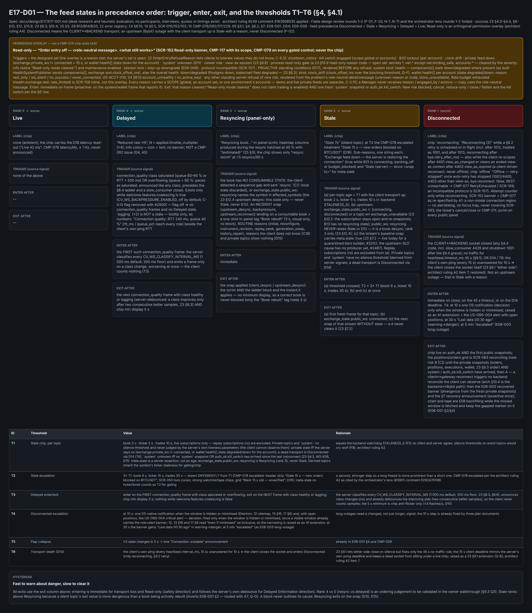
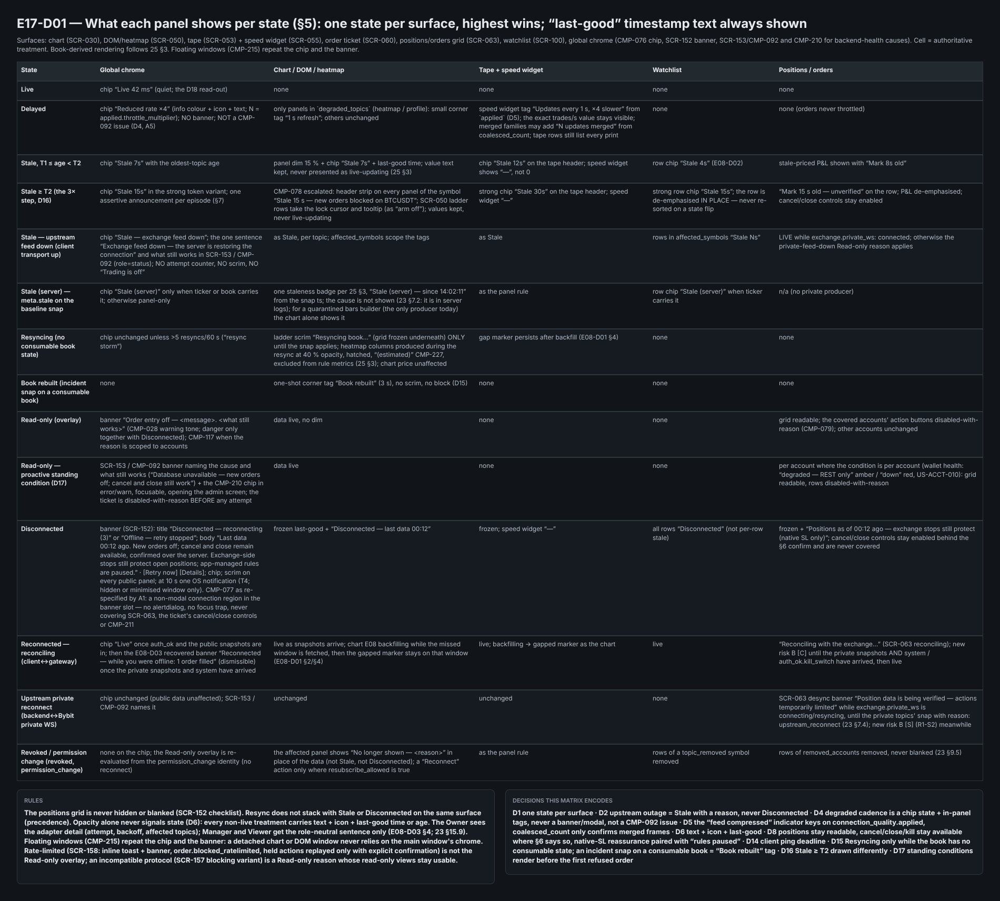
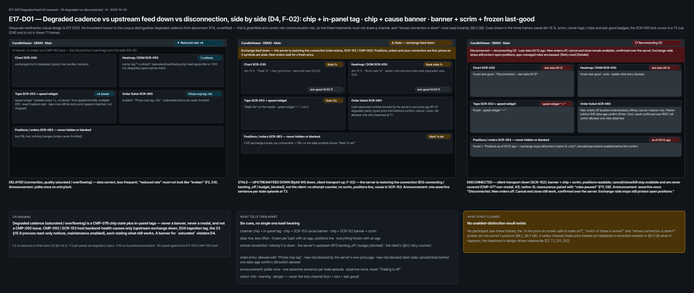
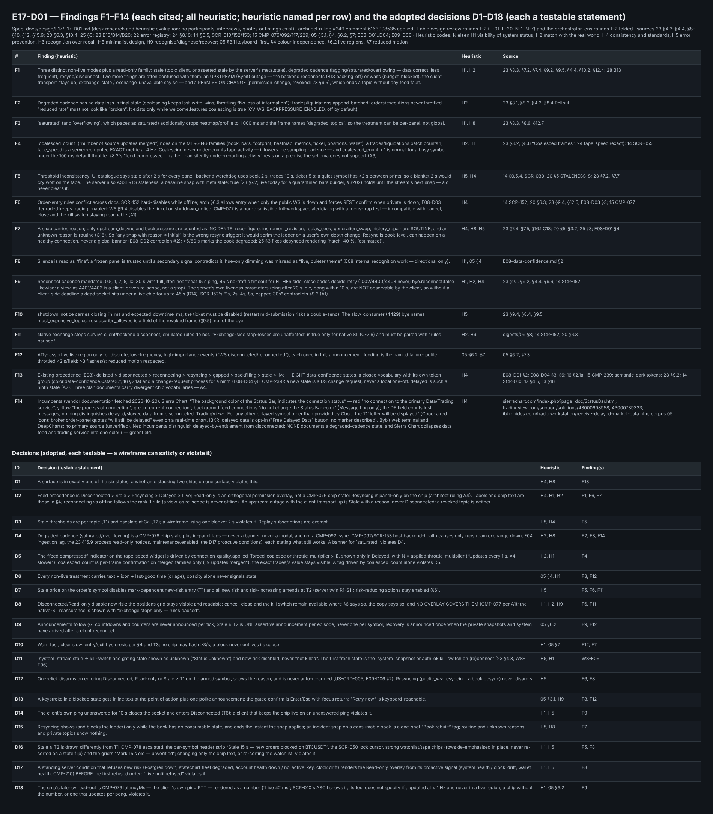
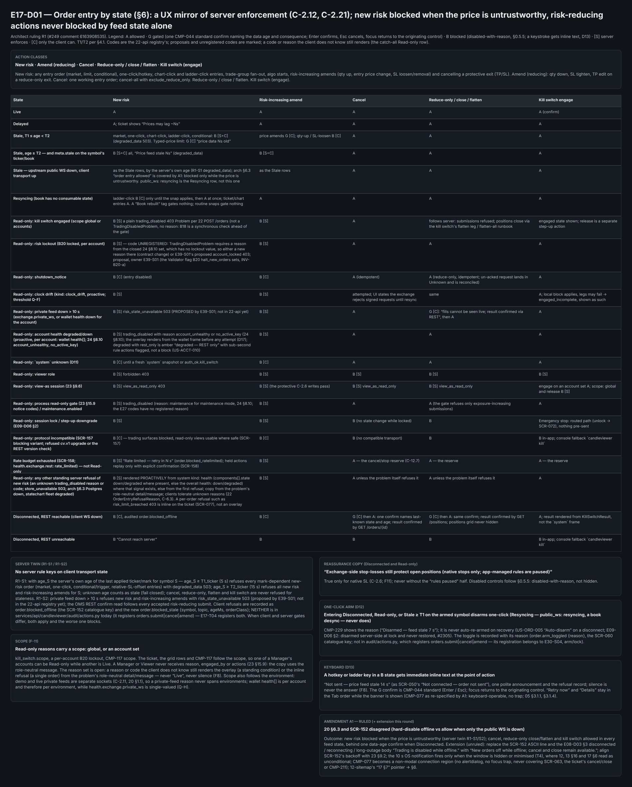
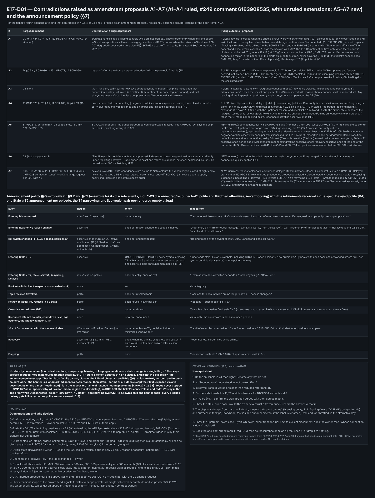
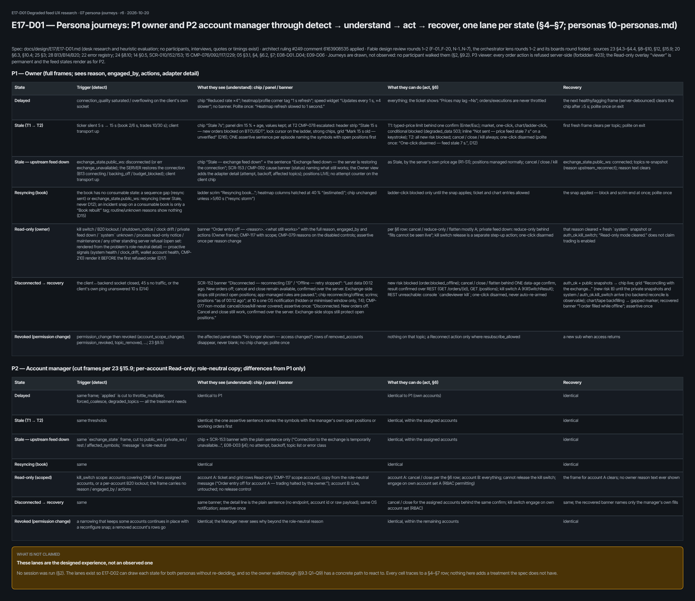

**Ticket:** E17-D01 (#249) · **Epic:** E17 · **Status:** In Review — spec complete (Fable design-review rounds 1–2 and the orchestrator's Fable lens rounds 1–2 folded, 2026-10-20); the seven Penpot boards are built and exported (§0.1; script r5, built by the orchestrator's batch builder on 2026-10-20); the lens's boards round is folded in script r6 and in this text (2026-10-20)

# E17-D01 — UX research: how a trader must experience a degraded or dropped feed

## 0. Artefacts

Penpot page: **E17-D01 Degraded feed UX research** —
https://design.penpot.app/#/workspace?team-id=b564c72c-f31f-81ec-8008-b109a9175d0b&file-id=b564c72c-f31f-81ec-8008-b112c6fdc116&page-id=c6a732c2-01af-80be-8008-c9874fe646ec

(A second, empty page with the same name, id `c1ff2298-b5c7-80ce-8008-c9875005f118`, was created by another agent and is not used.)

PNG inventory: see §0.1 (seven boards, one PNG each, board ids recorded).

### 0.1 PNG inventory and the page's actual contents

1. `E17-D01 / 01 state-timeline` (board id `0a41e3a8-e6a6-807a-8008-d210a60d6cf3`):

   

2. `E17-D01 / 02 state-matrix` (board id `0a41e3a8-e6a6-807a-8008-d211098950c0`):

   

3. `E17-D01 / 03 degraded-vs-disconnected` (board id `0a41e3a8-e6a6-807a-8008-d2119ff04d64`):

   

4. `E17-D01 / 04 findings-and-decisions` (board id `0a41e3a8-e6a6-807a-8008-d211ed2fac17`):

   

5. `E17-D01 / 05 order-entry-gating` (board id `0a41e3a8-e6a6-807a-8008-d213301d0b9f`):

   

6. `E17-D01 / 06 amendments-and-announcements` (board id `0a41e3a8-e6a6-807a-8008-d213c262da09`):

   

7. `E17-D01 / 07 persona-journeys` (board id `0a41e3a8-e6a6-807a-8008-d2143379826a`):

   

**What the page holds** (built by the orchestrator's batch builder on 2026-10-20; PR #3905 commit `5e4e463c`): the seven boards listed above and nothing else of ours — each named `E17-D01 / 0N <board>` (Penpot normalises `a/b` to `a / b`) and stamped `hpe1ver` r5 — built from the local build script `e17-d01-board.js` (posted on the PR, run on the builder's bridge one board per `execute_code` call, then the relayout and dedupe passes) and exported one PNG per board at full resolution (1:1) with `docs/design/_tools/penpot_export.py` to `docs/design/E17/img/E17-D01-<nn>-<board>.png`; the board ids above are the exported shapes. Before the build the builder removed the page's superseded content — the r1 `E17-D01 / 01 state-timeline` frame, the 100 px `state-matrix` stub, the board named `tmp` and the two stray unprefixed rectangles (five removals; the `tmp` board and the rectangles were not this ticket's and were removed by the builder, not by the script, whose idempotent clear touches only ticket-prefixed frames). Fills are the dark theme's semantic tokens (`packages/ui/tokens/semantic-dark.tokens.json`; the token name is recorded in each shape's plugin data); no per-pair contrast table is recorded here — the contrast and CVD pass for the drawn components is E17-D02's (§11). Script r6 folds the lens's boards round (#3905 at `5e4e463c`): the clipped text on boards 03, 05 and 07, the HYSTERESIS card (rank 3 vs 4; Resyncing in the safety direction), an eyebrow with page, board, revision and date on every board, the two-lane time strip on board 01, "~Ns" on boards 03 and 07, and board 03's cues drawn in the three workspace frames (panel dim 15 %, scrim, corner tags / chips and last-good badges — the SCR-050 lock cursor is a T2 cue (D16) and is described in the caption, not drawn, since the frames are at T1); the builder's r6 run replaces the PNGs above in place under the same names.

## 1. Purpose and scope

Fix the **vocabulary, thresholds, per-panel treatment, order-entry gating, announcement policy and the surface
each state lives on** for the feed states, so that E17-D02 (SCR-152 connection-state components, #325) can
wireframe them without re-deciding. Out of scope, per ticket: any visual design (greyscale wireframes begin in
E17-D02), the recorder "history starts at" state (E16) and the ingestion-lag half of CMP-092 (E04).

The safety framing is `CONSTITUTION` C-2.12 (server-side authority; UI renders server truth) and C-2.21 (statecharts
record, synchronous code enforces): **the UI treatment informs the trader, the server/OMS enforces**. Every
order-entry gate below is a UX mirror of a synchronous server check, never the only control. The stale-UI-mirror
threat is `docs/security/threat-models/E17-ws-gateway.md` WS-E06 and AC-26: the client treats a stale or
disconnected `system` stream as _unknown_, not as "not killed". **A trader must never be misled about whether they
can act**: every non-live treatment states what still works, and a standing server condition shows **before** the
first refused order, never only after it (D17).

## 2. Method (honest statement)

**Desk research and heuristic evaluation (heuristic).** No sessions were run and **no participants, interviews,
quotes, timings or usability results exist** for this ticket. The ticket's three moderated sessions, probes and
screen-reader session are converted (owner decision 2026-09-25, ticket "Agent-delivery adaptations") into: the
heuristic evaluation below, a written session protocol (§9.2) and an owner walkthrough checklist (§9.3).
Sources: `docs/plan/23-ws-protocol.md` (§4, §7.2, §7.4, §8, §9, §10, §11, §15.4, §15.9), `20-architecture.md` (§1.1, §6.3, §10.4),
`25-market-data-trust-contract.md` §3, `28-statechart-catalogue.md` B13/B14/B20, `22-api-openapi.yaml` (error registry, view-as, `POST /orders`),
`24-internal-schemas.md` §8.10, `14-screens-catalogue.md`, `15-component-catalogue.md` (incl. CMP-077, CMP-215, CMP-239), `16-design-system-brief.md` §2.1a,
`11-user-stories.md`, `12-sitemap.md`, `13-user-flows.md` §16, `17-ux-diagrams.md` §4.5/§6, `05-accessibility-standard.md`, `10-personas.md`,
`docs/security/threat-models/E17-ws-gateway.md`, the merged E08 specs (`docs/design/E08/E08-D01..D04.md`,
`docs/research/findings/E08-data-confidence.md`), E09-D06, and the research corpus. **Heuristic codes** used in §3 and §8: Nielsen H1
visibility of system status, H2 match with the real world, H4 consistency and standards, H5 error prevention, H6 recognition over
recall, H8 minimalist design, H9 recognise/diagnose/recover; the trading-specific rules of `05` §3.1 (keyboard-first), §4 (colour
independence), §6.2 (live regions), §7 (reduced motion). **Competitor scan:** the corpus (`docs/research/01–09`) says almost nothing
about how incumbents show feed health; on 2026-10-20 the vendor documentation of Sierra Chart, TradingView and IBKR was fetched and
quoted (URLs in F14); the Bybit web terminal and DeepCharts rows remain _(unverified)_ and claim nothing. Personas: P1 owner, P2
account manager, P3 viewer (`10-personas.md`).

## 3. Findings (each cited; all heuristic)

| #   | Finding                                                                                                                                                                                                                                                                                                                                                                                                                                                                                                                                                                                                                                                                                                                                                                                                                                                                                                                                                                                                                                                                                                                                                                                                                                                                                                                                                                                                                                                                                                                      | Heuristic   | Source                                                                                                                                                                                                                                                                                                                                                                                                                                      |
| --- | ---------------------------------------------------------------------------------------------------------------------------------------------------------------------------------------------------------------------------------------------------------------------------------------------------------------------------------------------------------------------------------------------------------------------------------------------------------------------------------------------------------------------------------------------------------------------------------------------------------------------------------------------------------------------------------------------------------------------------------------------------------------------------------------------------------------------------------------------------------------------------------------------------------------------------------------------------------------------------------------------------------------------------------------------------------------------------------------------------------------------------------------------------------------------------------------------------------------------------------------------------------------------------------------------------------------------------------------------------------------------------------------------------------------------------------------------------------------------------------------------------------------------------- | ----------- | ------------------------------------------------------------------------------------------------------------------------------------------------------------------------------------------------------------------------------------------------------------------------------------------------------------------------------------------------------------------------------------------------------------------------------------------- |
| F1  | The protocol has **three distinct non-live modes plus a read-only family**: stale (topic silent, or asserted stale by the server's `meta.stale`), degraded cadence (`connection_quality` `lagging`/`saturated`/`overflowing`, data correct but less frequent), resync/disconnect. Two more things are often confused with them: an **upstream** (Bybit) outage — the backend reconnects (B13 `backing_off`, or waits in `budget_blocked`), the client transport stays up, `exchange_state`/`exchange_unavailable` say so and the subscription re-snapshots — and a **permission change** (`permission_change`, `revoked`, 23 §9.5), which ends a topic without any feed fault.                                                                                                                                                                                                                                                                                                                                                                                                                                                                                                                                                                                                                                                                                                                                                                                                                                               | H1, H2      | `23-ws-protocol.md` §8.3, §7.2, §7.4, §9.2, §9.5, §4.4, §10.2, §12.4; `28` B13; ticket Context                                                                                                                                                                                                                                                                                                                                              |
| F2  | Degraded cadence has **no data loss in final state** (coalescing keeps last-write-wins state; throttling "No loss of information"), but `trades`/`liquidations` are append-batched, `orders`/`executions` are never throttled. So "reduced rate" is honest and must **not** look like "broken". It exists only while `welcome.features.coalescing` is `true` (`CV_WS_BACKPRESSURE_ENABLED`, off by default).                                                                                                                                                                                                                                                                                                                                                                                                                                                                                                                                                                                                                                                                                                                                                                                                                                                                                                                                                                                                                                                                                                                 | H2          | `23-ws-protocol.md` §8.1, §8.2, §4.2 (`features.coalescing`), §8.4 Rollout                                                                                                                                                                                                                                                                                                                                                                  |
| F3  | `saturated` (and `overflowing`, which paces as `saturated`) additionally drops `heatmap`/`profile` to 1 000 ms and the frame names `degraded_topics`, so the treatment can be **per-panel, not global**.                                                                                                                                                                                                                                                                                                                                                                                                                                                                                                                                                                                                                                                                                                                                                                                                                                                                                                                                                                                                                                                                                                                                                                                                                                                                                                                     | H1, H8      | `23-ws-protocol.md` §8.3 (`applied.degraded_topics`), §8.6, §12.7                                                                                                                                                                                                                                                                                                                                                                           |
| F4  | `coalesced_count` ("number of source updates merged") rides on the **merging** families (book, bars, footprint, heatmap, metrics, ticker, positions, wallet); a `trades`/`liquidations` batch counts 1, and `tape_speed` is a **server-computed exact metric** at 4 Hz. So coalescing never under-counts tape activity — it lowers the sampling cadence — and `coalesced_count > 1` is the normal state of a busy symbol under the 100 ms default throttle. §8.2's "feed compressed indicator … rather than silently under-reporting activity" rests on a premise the schema does not support (A6).                                                                                                                                                                                                                                                                                                                                                                                                                                                                                                                                                                                                                                                                                                                                                                                                                                                                                                                          | H2, H1      | `23-ws-protocol.md` §8.2 last paragraph, §8.6 "Coalesced frames"; `24-internal-schemas.md` (`tape_speed`, class exact); `14` SCR-055                                                                                                                                                                                                                                                                                                        |
| F5  | **Threshold inconsistency.** The UI catalogue says stale after 2 s for every panel; the backend watchdog uses book 2 s, trades 10 s, ticker 5 s; `degraded_data` is "upstream stale beyond SLO". A quiet symbol legitimately has >2 s between prints, so a blanket 2 s would cry wolf on the tape. The server also **asserts** staleness: a baseline `snap` with `meta.stale: true` (23 §7.2; live today for a quarantined `bars` builder, #3202; the upstream-SLO cause has no producer yet, #2487) holds until the stream's next `snap` — a `d` never clears it.                                                                                                                                                                                                                                                                                                                                                                                                                                                                                                                                                                                                                                                                                                                                                                                                                                                                                                                                                           | H5, H4      | `14-screens-catalogue.md` §0.5.4 and SCR-030 States; `20-architecture.md` §5 (`STALENESS_S`); `23` §7.2, §7.7                                                                                                                                                                                                                                                                                                                               |
| F6  | **Order-entry rules conflict across docs.** SCR-152 says trading controls hard-disabled while offline; arch §6.3 says order entry is _allowed_ when only the public WS is down (positions still need managing), and "allowed but forces REST confirm" when private WS is down; the E08-D03 `degraded` variant keeps trading enabled; WS §9.4 disables the ticket on `shutdown_notice`; kill-switch frame disables every order-entry affordance on the frame alone. CMP-077 is a non-dismissible full-workspace `alertdialog` with a focus-trap test — incompatible with cancel, close and the kill switch staying reachable (A1).                                                                                                                                                                                                                                                                                                                                                                                                                                                                                                                                                                                                                                                                                                                                                                                                                                                                                            | H4          | `14-screens-catalogue.md` SCR-152; `20-architecture.md` §6.3; `23-ws-protocol.md` §9.4, §12.5; E08-D03 §3; `15` CMP-077                                                                                                                                                                                                                                                                                                                     |
| F7  | A `snap` carries `reason`; only `upstream_desync` and `backpressure` are counted as **incidents**; `reconfigure`, `instrument_revision`, `replay_seek`, `generation_swap`, `history_repair` are **routine**, and a client treats an unknown reason as routine (C18). So "any `snap` with `reason` ≠ `initial`" is the wrong resync trigger: it would scrim the ladder on a user's own depth change. Resync is **book-level**, can happen on a healthy connection, and must not be a global banner (E08-D02 correction #2); a burst (>5/60 s) marks the book `degraded`; `25` §3 fixes how desynced book data renders (hatch, 40 % opacity, `(estimated)`).                                                                                                                                                                                                                                                                                                                                                                                                                                                                                                                                                                                                                                                                                                                                                                                                                                                                   | H4, H8, H5  | `23-ws-protocol.md` §7.4, §7.5, §16.1 C18; `20-architecture.md` §5 (`book/resync.py`), §3.2; `25-market-data-trust-contract.md` §3; E08-D01 §4                                                                                                                                                                                                                                                                                              |
| F8  | Silence is read as "fine": desk evidence from E08's internal recognition work says a frozen panel is trusted until a secondary signal contradicts it, and hue-only dimming was misread as "live, quieter theme". That research was itself a reduced internal sample (directional only) — treated here as a heuristic input, not proof.                                                                                                                                                                                                                                                                                                                                                                                                                                                                                                                                                                                                                                                                                                                                                                                                                                                                                                                                                                                                                                                                                                                                                                                       | H1, 05 §4   | `docs/research/findings/E08-data-confidence.md` §2 findings 1–3 and its validity limitation                                                                                                                                                                                                                                                                                                                                                 |
| F9  | Reconnect cadence is mandated: 0.5 s, 1, 2, 5, 10, 30 s with full jitter; heartbeat 15 s client ping, 45 s no-traffic timeout for **either side**; close codes decide whether to retry (`1002/4400/4403` never; `bye.reconnect: false` likewise; a view-as `4401`/`4403` is a client-driven re-scope, not a stop). The server's own liveness parameters (a `ping` after 20 s idle, `pong` within 10 s) are **not observable by the client**, so without a client-side deadline a dead socket sits under a `live` chip for up to 45 s (D14). A countdown is only honest for the _scheduled_ attempt, and with jitter it is approximate. SCR-152's "1s, 2s, 4s, 8s, capped 30s" contradicts §9.2 (A1).                                                                                                                                                                                                                                                                                                                                                                                                                                                                                                                                                                                                                                                                                                                                                                                                                         | H1, H2, H4  | `23-ws-protocol.md` §9.1, §9.2, §4.4, §9.6; `14` SCR-152 Performance                                                                                                                                                                                                                                                                                                                                                                        |
| F10 | `shutdown_notice` carries `closing_in_ms` and `expected_downtime_ms`; the ticket must be disabled because a restart mid-submission risks a double-send. The `slow_consumer` (`4429`) `bye` names `most_expensive_topics`; `resubscribe_allowed` is a field of the `revoked` frame (§9.5), not of the `bye`.                                                                                                                                                                                                                                                                                                                                                                                                                                                                                                                                                                                                                                                                                                                                                                                                                                                                                                                                                                                                                                                                                                                                                                                                                  | H5          | `23-ws-protocol.md` §9.4, §8.4, §9.5                                                                                                                                                                                                                                                                                                                                                                                                        |
| F11 | Native exchange stops survive client/backend disconnect; emulated rules do not (they "can silently fail on stale snapshot"). The reassurance "exchange-side stop-losses are unaffected" is true **only** for native SL (C-2.6) and must be paired with "rules paused".                                                                                                                                                                                                                                                                                                                                                                                                                                                                                                                                                                                                                                                                                                                                                                                                                                                                                                                                                                                                                                                                                                                                                                                                                                                       | H2, H9      | `docs/research/digests/09-execution-risk-tools.digest.md` §8; `14-screens-catalogue.md` SCR-152; `20-architecture.md` §6.3                                                                                                                                                                                                                                                                                                                  |
| F12 | A11y standard: assertive live region only for discrete, low-frequency, high-importance events (explicitly "WS disconnected/reconnected"), each announced once in full; announcement flooding is the named failure; polite regions throttled ≥2 s/field; **≤3 flashes/s**, reduced-motion respected.                                                                                                                                                                                                                                                                                                                                                                                                                                                                                                                                                                                                                                                                                                                                                                                                                                                                                                                                                                                                                                                                                                                                                                                                                          | 05 §6.2, §7 | `05-accessibility-standard.md` §6.2, §7.3                                                                                                                                                                                                                                                                                                                                                                                                   |
| F13 | Existing precedence (E08): `delisted > disconnected > reconnecting > resyncing > gapped > backfilling > stale > live` — **eight** data-confidence states, a closed vocabulary with its own token group (`color.data-confidence.<state>.*`, 16 §2.1a) and a change-request process for a ninth (E08-D04 §6, CMP-239): a new state is a DS change request, never a local one-off. `delayed` is such a ninth state (A7). Three plan documents carry divergent chip vocabularies (`live/reconnecting/degraded/offline`; `live/lagging/reconnecting/offline`; an amber one-missed-heartbeat state) — A4.                                                                                                                                                                                                                                                                                                                                                                                                                                                                                                                                                                                                                                                                                                                                                                                                                                                                                                                          | H4          | E08-D01 §2; E08-D04 §3, §6; `16` §2.1a; `15` CMP-239; `packages/ui/tokens/semantic-dark.tokens.json`; `23` §9.2; `14` SCR-010; `17` §4.5; `13` §16                                                                                                                                                                                                                                                                                          |
| F14 | **Incumbents (vendor documentation fetched 2026-10-20).** Sierra Chart: "The background color of the Status Bar, indicates the connection status" — red "no connection to the primary Data/Trading service", yellow "the process of connecting", green "current connection"; background feed connections "do not change the Status Bar color" and show only in the Message Log; the `DF` field counts lost messages; nothing distinguishes delayed or slowed data from disconnected. TradingView: "For any other delayed symbol other than provided by Cboe, the 'D' letter will be displayed" (Cboe data: a red icon) — a licensing delay is marked as such; and with a connected broker "the data of quotes displayed in your order panel … will still be delayed" even on a real-time chart, i.e. freshness can differ per surface. IBKR: delayed data is **opt-in** — clients "have the option to receive delayed market data for contracts to which they do not currently hold market data subscriptions" via a "Free Delayed Data" button on the ticker row; the page describes no marker and no delay length. Bybit web terminal and DeepCharts: no primary source found; the corpus documents only a 15-min data-delay tier _(unverified)_. Net: incumbents distinguish delayed-by-entitlement from disconnected; **none documents a degraded-cadence (correct but slower) state**, and Sierra Chart's single colour collapses "data feed" and "trading service" into one — greenfield, with mis-communication risk. | H4          | https://www.sierrachart.com/index.php?page=doc/StatusBar.html; https://www.tradingview.com/support/solutions/43000698958-alerts-based-on-real-time-and-non-real-time-symbols/; https://www.tradingview.com/support/solutions/43000739323-how-does-the-source-of-real-time-data-affect-the-trading-experience/; https://www.ibkrguides.com/traderworkstation/receive-delayed-market-data.htm; `docs/research/05-deepcharts-deepdom-gamma.md` |

## 4. The six states, ranked

Six states = five feed states (ranked 1–5) plus the Read-only permission overlay. Severity rank 1 = worst. Precedence among states on the **same surface** keeps the E08 rule (one state per surface, highest wins). Labels are proposed plain-English labels; the Owner has not confirmed them (§9). **Architect ruling (#249 comment 6163908535, A4):** the chip carries five values (`live|delayed|stale|reconnecting|offline`). **Read-only is a permission overlay, not a CMP-076 chip state** (rendered by SCR-010 chrome, CMP-117 and the SCR-152 Read-only banner; it always displays alongside the feed state). **Resyncing is panel-only on the chip**: it is per-book, and the chip shows only the detail "resync storm" at >5 resyncs/60 s. Feed precedence: Disconnected > Stale > Resyncing > Delayed > Live; Read-only is orthogonal. **Disconnected means the client↔backend transport**; an upstream (Bybit) outage with the client transport up is Stale with a reason, never Disconnected (F1, §5, §6). A permission change (`revoked`) is neither: the topic ends and its panel says so (§5).

| Rank    | State                                                                                                                                     | Label (chip)                                                                                                                                                                                                                                                                                                                                                                                                                                                                                                                                                                                                                                                                              | Trigger (source signal)                                                                                                                                                                                                                                                                                                                                                                                                                                                                                                                                                                                                                                                                                                                                                                                                                                                                                                                                                                                                                                                                                                                                                                                                                                                                                                                                                                                                                                                                                                                                                                                                                                                                                                                                                                                                                                                                                             | Enter after                                                                                                                                                                                                                           | Exit after                                                                                                                                                                                                                                                                                                                                                                                                                                                                                                                                                                                                                                                                             |
| ------- | ----------------------------------------------------------------------------------------------------------------------------------------- | ----------------------------------------------------------------------------------------------------------------------------------------------------------------------------------------------------------------------------------------------------------------------------------------------------------------------------------------------------------------------------------------------------------------------------------------------------------------------------------------------------------------------------------------------------------------------------------------------------------------------------------------------------------------------------------------- | ------------------------------------------------------------------------------------------------------------------------------------------------------------------------------------------------------------------------------------------------------------------------------------------------------------------------------------------------------------------------------------------------------------------------------------------------------------------------------------------------------------------------------------------------------------------------------------------------------------------------------------------------------------------------------------------------------------------------------------------------------------------------------------------------------------------------------------------------------------------------------------------------------------------------------------------------------------------------------------------------------------------------------------------------------------------------------------------------------------------------------------------------------------------------------------------------------------------------------------------------------------------------------------------------------------------------------------------------------------------------------------------------------------------------------------------------------------------------------------------------------------------------------------------------------------------------------------------------------------------------------------------------------------------------------------------------------------------------------------------------------------------------------------------------------------------------------------------------------------------------------------------------------------------- | ------------------------------------------------------------------------------------------------------------------------------------------------------------------------------------------------------------------------------------- | -------------------------------------------------------------------------------------------------------------------------------------------------------------------------------------------------------------------------------------------------------------------------------------------------------------------------------------------------------------------------------------------------------------------------------------------------------------------------------------------------------------------------------------------------------------------------------------------------------------------------------------------------------------------------------------- |
| 1       | **Disconnected**                                                                                                                          | chip `reconnecting` "Reconnecting (3)" while a §9.2 retry is scheduled or in flight (incl. after `1012`, treated as `1001`, and after `1013`, reconnecting after `bye.retry_after_ms`) — also while the client re-scopes after `4401` `view_as_changed` or clears an ended view-as context after `4403` `view_as_expired` (23 §9.6: a client-driven reconnect, never `offline`); chip `offline` "Offline — retry stopped" once auto-retry has stopped (`1002`/`4400`, `4403` other than view-as, `bye.reconnect: false`, REST unreachable → CMP-077 RetryExhausted / SCR-159; an incompatible protocol is SCR-157's blocking dialog). The attempt counter shows only while `reconnecting` | the **client↔backend** socket closed (any §4.4 code, incl. `slow_consumer` 4429 and `shutdown` 1001 after the §9.4 grace); no traffic for `heartbeat.timeout_ms` 45 s (§9.1); **or D14: the client's own `ping` (every `heartbeat.interval_ms` 15 s) unanswered for 10 s ⇒ the client closes the socket itself** (23 §9.1 "either side"; architect ruling A2 item 7, restored — the round-1 fold had dropped it). Not an upstream outage (rank 2)                                                                                                                                                                                                                                                                                                                                                                                                                                                                                                                                                                                                                                                                                                                                                                                                                                                                                                                                                                                                                                                                                                                                                                                                                                                                                                                                                                                                                                                                   | immediate on close, on the 45 s timeout, or on the D14 deadline                                                                                                                                                                       | chip → `live` on `auth_ok` **and** the first public snapshots; the positions/orders grid is SCR-063 `reconciling` (new risk **B [C]**) until the private snapshots (`orders`, `positions`, `executions`, `wallet`, in the 23 §9.3 order) **and** `system`/`auth_ok.kill_switch` have arrived, then A — a client↔gateway reconnect triggers no backend reconcile the client can observe (arch §10.4 is the backend↔Bybit path); then the E08-D03 `recovered` banner (divergence computed from the fresh private snapshots) and the §7 recovery announcement; chart and tape are E08 `backfilling` while the missed window is fetched and keep the `gapped` marker on it (E08-D01 §2/§4) |
| overlay | **Read-only** (permission overlay, not a CMP-076 chip state; ranks above Stale in effect because it blocks action regardless of data age) | "Order entry off — <role-neutral message>. <what still works>" (SCR-152 Read-only banner, CMP-117 with its `scope`, CMP-079 on every gated control; never the chip)                                                                                                                                                                                                                                                                                                                                                                                                                                                                                                                       | the designed set below (the overlay is a reason slot, and the server's set is open: 22 `OrderEntryRefusalReason` tells clients to tolerate values they do not know, C-6.3): `shutdown_notice`; kill switch engaged (`scope` global or accounts); B20 lockout (per account); clock drift; private feed down (`exchange.private_ws != connected` > 10 s, or `wallet` `health[].state` `down` for the account); `system` unknown (D11); viewer role; view-as session (23 §9.6); the process read-only gate (a 23 §15.9 read-only `reason` code — open set: `secrets.*`, `net.*` except `net.binding_safe`, `accounts.*` — cleared by the `severity: info` notice "Read-only mode cleared.", which does not claim trading is enabled) and `maintenance.enabled`; session lock / step-up downgrade (E09-D06); protocol incompatible (SCR-157); **proactive standing conditions (D17), rendered before any refusal**: `system` `kind: health` — `components[].state` `down`/`degraded` where present (as built, `HealthSystemPublisher` sends the `GET /admin/health` `components[]`, `exchange` and `clock_offset_ms`; `health_wiring.py`), else the overall `health: down`/`degraded` (Postgres down, statechart fleet degraded — 20 §6.3), `kind: clock_drift` (`clock_offset_ms` over the blocking threshold, Q-F), `wallet` `health[]` per account (`state` `degraded`/`down`, `reason` `rest_only`/`ws_silent`/`no_success`/`never_connected`; US-ACCT-010; 24 §8.10 `account_unhealthy`/`no_active_key`); any other standing server refusal of new risk, rendered from the problem's role-neutral `detail`/`message` (an unknown `reason` or code; `store_unavailable`). Rate budget exhausted (`health.exchange.rest: rate_limited`) is SCR-158 inline, not this overlay. Every reason carries a scope (global, an account set, or one environment's accounts — demo and live private feeds are separate, C-2.11) | immediate on frame (proactive signals: on the `system`/`wallet` frame that reports the condition)                                                                                                                                     | that reason cleared (the §15.9 clear notice "Read-only mode cleared." does not claim trading is enabled — another reason may still hold) **and** one fresh `system` snapshot or `auth_ok.kill_switch`                                                                                                                                                                                                                                                                                                                                                                                                                                                                                  |
| 2       | **Stale**                                                                                                                                 | "Stale 7s" (oldest topic); at T2 the CMP-078 `escalated` treatment "Stale 15 s — new orders blocked on BTCUSDT" (§5). Sub-reasons, one string each, used everywhere: **"Exchange feed down — the server is restoring the connection"** (true while B13 is `connecting`, `backing_off` or `budget_blocked`) and **"Stale (server) — since <snap ts>"** for `meta.stale`                                                                                                                                                                                                                                                                                                                    | (a) per-topic age > T1 with the client transport up; (b) upstream: `exchange_state.public_ws ∈ {connecting, disconnected}` or a topic `err` `exchange_unavailable` (23 §10.2: the subscription stays open and re-snapshots; B13 `connecting`/`backing_off`/`budget_blocked` — B13 has no `resyncing` state); **`public_ws: resyncing` never raises Stale or D12** — it is a book desync, rank 3 only (23 §12.4); (c) the stream's baseline `snap` carries `meta.stale: true` (23 §7.2: the backend's upstream for the topic is behind its SLO, or the `bars` builder is quarantined — live today for quarantined `bars`, #3202; the SLO cause has no producer yet, #2487). Replay subscriptions (envelope `rs`, 23 §11) are excluded from (a): their `ts` is recorded time                                                                                                                                                                                                                                                                                                                                                                                                                                                                                                                                                                                                                                                                                                                                                                                                                                                                                                                                                                                                                                                                                                                                          | (a) threshold crossed; (b) and (c) at once                                                                                                                                                                                            | (a) first fresh frame for that topic; (b) `exchange_state.public_ws: connected`; (c) the next `snap` of that stream **without** `stale` — a `d` never clears it (23 §7.2)                                                                                                                                                                                                                                                                                                                                                                                                                                                                                                              |
| 3       | **Resyncing** (panel-only; chip shows only "resync storm" at >5/60 s)                                                                     | "Resyncing book…" (in-panel scrim; heatmap per 25 §3)                                                                                                                                                                                                                                                                                                                                                                                                                                                                                                                                                                                                                                     | the book has **no consumable state**: the client detected a sequence gap and sent `resync` (C2: local state discarded), or `exchange_state.public_ws: resyncing` names the symbol in `affected_symbols` (the 23 §12.4 upstream desync: it raises this state only — never Stale, never D12). An **incident** `snap` (`upstream_desync`, `backpressure`, `upstream_reconnect`) that lands on a consumable book is a one-shot in-panel tag "Book rebuilt" (3 s, visual only, no block). **Routine** reasons (`initial`, `reconfigure`, `instrument_revision`, `replay_seek`, `generation_swap`, `history_repair`), reasons the client does not know (C18) and private topics show nothing                                                                                                                                                                                                                                                                                                                                                                                                                                                                                                                                                                                                                                                                                                                                                                                                                                                                                                                                                                                                                                                                                                                                                                                                                              | immediate                                                                                                                                                                                                                             | the `snap` applied (`client_resync` / `upstream_desync`): the scrim **and the ladder block end the instant it applies** — no minimum display, so a correct book is never blocked (only the "Book rebuilt" tag carries a 3 s hold)                                                                                                                                                                                                                                                                                                                                                                                                                                                      |
| 4       | **Delayed**                                                                                                                               | "Reduced rate ×N", N = `applied.throttle_multiplier` (×4)                                                                                                                                                                                                                                                                                                                                                                                                                                                                                                                                                                                                                                 | `connection_quality` `class` `saturated` (queue 60–90 % or RTT > 500 ms) **or `overflowing`** (queue > 90 %: paces as `saturated`, is announced like any class, and precedes the §8.4 ladder and a `slow_consumer` close). Exists only while `welcome.features.coalescing` is `true` (`CV_WS_BACKPRESSURE_ENABLED`, off by default; C-4.13 flag removed with #2900) — flag off ⇒ no `connection_quality` frames and no Delayed state                                                                                                                                                                                                                                                                                                                                                                                                                                                                                                                                                                                                                                                                                                                                                                                                                                                                                                                                                                                                                                                                                                                                                                                                                                                                                                                                                                                                                                                                                | the **first** such `connection_quality` frame: the server classifies every `CV_WS_CLASSIFY_INTERVAL_MS` (1 000 ms default, 500 ms floor) and emits a frame only on a class change, worsening at once — the client counts nothing (T3) | the next `connection_quality` frame with class `healthy` or `lagging` (server-debounced: a class improves only after two consecutive better samples, 23 §8.3) **and** chip min display 5 s                                                                                                                                                                                                                                                                                                                                                                                                                                                                                             |
| 5       | **Live**                                                                                                                                  | none (ambient); the chip carries the D18 latency read-out ("Live 42 ms": CMP-076 `latencyMs`, ≤ 1 Hz, never announced)                                                                                                                                                                                                                                                                                                                                                                                                                                                                                                                                                                    | none of the above                                                                                                                                                                                                                                                                                                                                                                                                                                                                                                                                                                                                                                                                                                                                                                                                                                                                                                                                                                                                                                                                                                                                                                                                                                                                                                                                                                                                                                                                                                                                                                                                                                                                                                                                                                                                                                                                                                   | —                                                                                                                                                                                                                                     | —                                                                                                                                                                                                                                                                                                                                                                                                                                                                                                                                                                                                                                                                                      |

`lagging` (queue 25–60 % / RTT 150–500 ms, ×2) is **not** a state: no chip, no tag, no announcement; it is shown only
in the connection chip tooltip, **as numbers**: "Connection quality: RTT 240 ms, queue 40 %" from
`connection_quality.rtt_ms`/`queue_pct` (both reach Manager and Viewer, 23 §15.9) beside the client's own `ping` RTT.
Rationale: F2 (no loss) + F8 (false alarms teach the trader to ignore chips). `overflowing` shows the Delayed chip with
the tooltip detail "Queue > 90 % — reduce panes" (23 §8.4 step 3; the `slow_consumer` `bye` names
`most_expensive_topics`). **Read-only ranks above Stale** because it blocks action regardless of data age; **Stale ranks
above Resyncing** because a silent topic's last value is more dangerous than a book being actively rebuilt — this
inverts E08-D01 §2's `resyncing > … > stale` and is routed with A7 (Q-G). Rank 3 vs 4 (resync vs delayed) is an
ordering judgement to be validated in the owner walkthrough (§9.3 Q3).

### 4.1 Thresholds (T1–T6)

| ID  | Threshold                                               | Value                                                                                                                                                                                                                                                                                                                                                                                                                                                                                                                                                                                                                                                                                                                                                                                                                                                                                                                                                                                                                                                                           | Rationale                                                                                                                                                                                                                                                                                                           |
| --- | ------------------------------------------------------- | ------------------------------------------------------------------------------------------------------------------------------------------------------------------------------------------------------------------------------------------------------------------------------------------------------------------------------------------------------------------------------------------------------------------------------------------------------------------------------------------------------------------------------------------------------------------------------------------------------------------------------------------------------------------------------------------------------------------------------------------------------------------------------------------------------------------------------------------------------------------------------------------------------------------------------------------------------------------------------------------------------------------------------------------------------------------------------- | ------------------------------------------------------------------------------------------------------------------------------------------------------------------------------------------------------------------------------------------------------------------------------------------------------------------- |
| T1  | Stale chip, per topic                                   | book **2 s**, ticker **5 s**, trades **10 s** (T2 at 3×: book 6 s, ticker 15 s, trades 30 s), live subscriptions only — replay subscriptions (`rs`) are excluded; the replay screen's own clock state applies (E16). Private topics and `system` have **no silence threshold** (they emit on change; silence is normal) and are never judged by the server's own liveness parameters, which the client cannot observe: private topics are stale iff the server says so (`exchange.private_ws != connected`, or `wallet` `health[].state` `degraded`/`down` for the account); a dead transport is Disconnected via D14 (T6). `system` is _unknown_ iff no `system` snapshot **or `auth_ok.kill_switch`** has arrived since the last (re)connect (23 §4.3, WS-E06, D11). `meta.stale` is a server assertion, not an age (§4 row 2); `exchange_state.public_ws: resyncing` is Resyncing (rank 3), never Stale. Derived topics (bars, footprint, heatmap, profile, metrics, liquidations) inherit the symbol's ticker staleness for gating/chip; their own silence is in-panel only | equals backend watchdog `STALENESS_S` (F5), so client and server agree; silence thresholds on event topics would cry wolf (F8). Architect ruling A2 (#249 comment 6163908535)                                                                                                                                       |
| T2  | Stale escalation ("Stale — do not trade on this price") | 3× T1: book 6 s, ticker 15 s, trades 30 s — drawn **differently** from T1 (CMP-078 `escalated`, §5 "Stale ≥ T2" row), not only a changed chip text; `meta.stale` on `ticker`/`book` counts as T2 for gating                                                                                                                                                                                                                                                                                                                                                                                                                                                                                                                                                                                                                                                                                                                                                                                                                                                                     | second, stronger step so a long freeze is more prominent than a short one; CMP-078 `escalated` per the architect ruling A2 as cited by the orchestrator's lens (#3905 comment 6292476108)                                                                                                                           |
| T3  | Delayed enter/exit                                      | enter on the **first** `connection_quality` frame with class `saturated` or `overflowing`; exit on the **next** frame with class `healthy` or `lagging`; chip min display **5 s**; nothing while `welcome.features.coalescing` is `false`                                                                                                                                                                                                                                                                                                                                                                                                                                                                                                                                                                                                                                                                                                                                                                                                                                       | the server classifies every `CV_WS_CLASSIFY_INTERVAL_MS` (1 000 ms default, 500 ms floor; 23 §8.3, §8.6), announces class changes only and already debounces the improving side (two consecutive better samples), so the client never counts samples; the 5 s minimum is chip anti-flicker only (≤3 flashes/s, D10) |
| T4  | Disconnected escalation                                 | at **10 s**: one OS-native notification when the window is hidden or minimised (Electron; `12-sitemap.md` notifications, `13` §16, `17` §6) and, with open positions, the US-OBS-004 critical alert — decision: fired only when the window is hidden or minimised, since a visible window already carries the `role="alert"` banner; `12`, `13` §16 and `17` §6 read "even if minimised" as inclusive, so the narrowing is raised as an A1 extension; at 30 s the banner gains "Last data 00:30 ago" in warning→danger; at 5 min "escalated" (as E08-D03 `long-outage`)                                                                                                                                                                                                                                                                                                                                                                                                                                                                                                         | long outages need a changed, not just longer, signal; the 10 s step is already fixed by three plan documents                                                                                                                                                                                                        |
| T5  | Flap collapse                                           | ≥3 state changes in 5 s → one "Connection unstable" announcement                                                                                                                                                                                                                                                                                                                                                                                                                                                                                                                                                                                                                                                                                                                                                                                                                                                                                                                                                                                                                | already in E08-D01 §4 and CMP-028                                                                                                                                                                                                                                                                                   |
| T6  | Transport death (D14)                                   | the client's own `ping` (every `heartbeat.interval_ms`, 15 s) unanswered for **10 s** ⇒ the client closes the socket and enters Disconnected (chip `reconnecting`, §9.2 retry)                                                                                                                                                                                                                                                                                                                                                                                                                                                                                                                                                                                                                                                                                                                                                                                                                                                                                                  | 23 §9.1 lets either side close on silence but fixes only the 45 s no-traffic rule; the 10 s client deadline mirrors the server's own `pong` deadline and keeps a dead socket from sitting under a `live` chip; raised as a 23 §9.1 extension (Q-B); architect ruling A2 item 7                                      |

Hysteresis: all exits use the _exit_ column of §4; entering is immediate for transport loss, Read-only and Resyncing
(safety direction) and follows the server's own debounce for Delayed (information direction). Principle: **fast to
warn about danger, slow to clear it** — except that a block never outlives its cause (Resyncing exits on the `snap`).

## 5. What each panel shows

Surfaces: chart (SCR-030), DOM/heatmap (SCR-050), tape (SCR-053), tape-speed widget (SCR-055), order ticket (SCR-060),
positions/orders grid (SCR-063), watchlist (SCR-100), global chrome (CMP-076 chip, SCR-152 banner, SCR-153/CMP-092 and
CMP-210 for backend-health causes). Cell = authoritative treatment. "Last-good" = timestamp text always shown (F5, §0.5.4).
Book-derived rendering follows `25-market-data-trust-contract.md` §3 (stale values are never presented as
live-updating; desynced heatmap columns render hatched at 40 % with `(estimated)`).

| State                                                        | Global chrome                                                                                                                                                                                                                                                                                                                                                                                                                                                                                                                                                                  | Chart / DOM / heatmap                                                                                                                                                                                                                             | Tape + speed widget                                                                                                                                                                                              | Watchlist                                                                                            | Positions / orders                                                                                                                                                                                                                                                |
| ------------------------------------------------------------ | ------------------------------------------------------------------------------------------------------------------------------------------------------------------------------------------------------------------------------------------------------------------------------------------------------------------------------------------------------------------------------------------------------------------------------------------------------------------------------------------------------------------------------------------------------------------------------ | ------------------------------------------------------------------------------------------------------------------------------------------------------------------------------------------------------------------------------------------------- | ---------------------------------------------------------------------------------------------------------------------------------------------------------------------------------------------------------------- | ---------------------------------------------------------------------------------------------------- | ----------------------------------------------------------------------------------------------------------------------------------------------------------------------------------------------------------------------------------------------------------------- |
| Live                                                         | chip "Live 42 ms" (quiet; the D18 read-out)                                                                                                                                                                                                                                                                                                                                                                                                                                                                                                                                    | none                                                                                                                                                                                                                                              | none                                                                                                                                                                                                             | none                                                                                                 | none                                                                                                                                                                                                                                                              |
| Delayed                                                      | chip "Reduced rate ×4" (info colour + icon + text; N = `applied.throttle_multiplier`); **no banner; not a CMP-092 issue** (D4, A5)                                                                                                                                                                                                                                                                                                                                                                                                                                             | only panels in `degraded_topics` (heatmap/profile): small corner tag "1 s refresh"; others unchanged                                                                                                                                              | speed widget tag "Updates every 1 s, ×4 slower" from `applied` (D5); the exact trades/s value stays visible; merged families may add "N updates merged" from `coalesced_count`; tape rows still list every print | none                                                                                                 | none (orders never throttled)                                                                                                                                                                                                                                     |
| Stale, T1 ≤ age < T2                                         | chip "Stale 7s" with oldest-topic age                                                                                                                                                                                                                                                                                                                                                                                                                                                                                                                                          | panel dim 15 % + chip "Stale 7s" + last-good time; value text kept, never presented as live-updating (25 §3)                                                                                                                                      | chip "Stale 12s" on tape header; speed widget shows "—" not 0                                                                                                                                                    | row chip "Stale 4s" (E08-D02)                                                                        | stale-priced P&L shown with "Mark 8s old"                                                                                                                                                                                                                         |
| **Stale ≥ T2** (the 3× step)                                 | chip "Stale 15s" in the strong token variant; one assertive announcement per episode (§7)                                                                                                                                                                                                                                                                                                                                                                                                                                                                                      | CMP-078 `escalated`: header strip on every panel of the symbol "Stale 15 s — new orders blocked on BTCUSDT"; SCR-050 ladder rows take the **lock cursor** and tooltip (as "arm off"); values kept, never live-updating                            | strong chip "Stale 30s" on the tape header; speed widget "—"                                                                                                                                                     | strong row chip "Stale 15s"; the row is de-emphasised **in place** — never re-sorted on a state flip | "Mark 15 s old — unverified" on the row; P&L de-emphasised; cancel/close controls stay enabled                                                                                                                                                                    |
| Stale — upstream feed down (client transport up)             | chip "Stale — exchange feed down"; the one sentence "Exchange feed down — the server is restoring the connection" and what still works in SCR-153/CMP-092 (`role="status"`); **no attempt counter, no scrim, no "Trading is off"**                                                                                                                                                                                                                                                                                                                                             | as Stale, per topic; `affected_symbols` scope the tags                                                                                                                                                                                            | as Stale                                                                                                                                                                                                         | rows in `affected_symbols` "Stale Ns"                                                                | **live** while `exchange.private_ws: connected`; otherwise the private-feed-down Read-only reason applies                                                                                                                                                         |
| Stale (server) — `meta.stale` on the baseline `snap`         | chip "Stale (server)" only when `ticker` or `book` carries it; otherwise panel-only                                                                                                                                                                                                                                                                                                                                                                                                                                                                                            | one staleness badge per 25 §3, "Stale (server) — since 14:02:11" from the `snap` `ts`; the cause is not shown (23 §7.2: it is in server logs); for a quarantined `bars` builder (the only producer today) the chart alone shows it                | as the panel rule                                                                                                                                                                                                | row chip "Stale (server)" when `ticker` carries it                                                   | n/a (no private producer)                                                                                                                                                                                                                                         |
| Resyncing (no consumable book state)                         | chip unchanged unless >5 resyncs/60 s                                                                                                                                                                                                                                                                                                                                                                                                                                                                                                                                          | ladder scrim "Resyncing book…" (grid frozen underneath) **only until the `snap` applies**; heatmap columns produced during the resync at 40 % opacity, hatched, `(estimated)` CMP-227, excluded from rule metrics (25 §3); chart price unaffected | gap marker persists after backfill (E08-D01 §4)                                                                                                                                                                  | none                                                                                                 | none                                                                                                                                                                                                                                                              |
| Book rebuilt (incident `snap` on a consumable book)          | none                                                                                                                                                                                                                                                                                                                                                                                                                                                                                                                                                                           | one-shot corner tag "Book rebuilt" (3 s), no scrim, no block                                                                                                                                                                                      | none                                                                                                                                                                                                             | none                                                                                                 | none                                                                                                                                                                                                                                                              |
| Read-only                                                    | banner "Order entry off — <message>. <what still works>" (CMP-028 warning tone; danger only together with Disconnected); CMP-117 when the reason is scoped to accounts                                                                                                                                                                                                                                                                                                                                                                                                         | data live, no dim                                                                                                                                                                                                                                 | none                                                                                                                                                                                                             | none                                                                                                 | grid readable; the covered accounts' action buttons disabled-with-reason (CMP-079); other accounts unchanged                                                                                                                                                      |
| Read-only — proactive standing condition (D17)               | SCR-153/CMP-092 banner naming the cause and what still works ("Database unavailable — new orders off; cancel and close still work") plus the CMP-210 chip in `error`/`warn`, focusable, opening the admin screen; the ticket is disabled-with-reason **before any attempt**                                                                                                                                                                                                                                                                                                    | data live                                                                                                                                                                                                                                         | none                                                                                                                                                                                                             | none                                                                                                 | per account where the condition is per account (`wallet` health "degraded — REST only" amber / "down" red, US-ACCT-010): grid readable, rows disabled-with-reason                                                                                                 |
| Disconnected                                                 | banner (SCR-152): title "Disconnected — reconnecting (3)" or "Offline — retry stopped"; body "Last data 00:12 ago. New orders off; cancel and close remain available, confirmed over the server. Exchange-side stops still protect open positions; app-managed rules are paused." Actions [Retry now] [Details]; chip; scrim on every public panel; at 10 s one OS notification (T4). CMP-077 as re-specified by A1: a non-modal connection region in the banner slot — no `alertdialog`, no focus trap, never covering SCR-063, the ticket's cancel/close controls or CMP-211 | frozen last-good + "Disconnected — last data 00:12"                                                                                                                                                                                               | frozen; speed widget "—"                                                                                                                                                                                         | all rows "Disconnected" (not per-row stale)                                                          | frozen + "Positions as of 00:12 ago — exchange stops still protect (native SL only)"; cancel/close controls stay enabled behind the §6 confirm and are never covered                                                                                              |
| Reconnected — reconciling (client↔gateway)                   | chip "Live" once `auth_ok` and the public snapshots are in; then the E08-D03 `recovered` banner "Reconnected — while you were offline: 1 order filled" (dismissible) once the private snapshots and `system` have arrived                                                                                                                                                                                                                                                                                                                                                      | live as snapshots arrive; chart E08 `backfilling` while the missed window is fetched, then the `gapped` marker stays on that window (E08-D01 §2/§4)                                                                                               | live; `backfilling` → `gapped` marker as the chart                                                                                                                                                               | live                                                                                                 | "Reconciling with the exchange…" (SCR-063 `reconciling`); new risk **B [C]** until the private snapshots **and** `system`/`auth_ok.kill_switch` have arrived, then live                                                                                           |
| Upstream private reconnect (backend↔Bybit private WS)        | chip unchanged (public data unaffected); SCR-153/CMP-092 names it                                                                                                                                                                                                                                                                                                                                                                                                                                                                                                              | unchanged                                                                                                                                                                                                                                         | unchanged                                                                                                                                                                                                        | none                                                                                                 | SCR-063 desync banner "Position data is being verified — actions temporarily limited" while `exchange.private_ws` is `connecting`/`resyncing`, until the private topics' `snap` with `reason: upstream_reconnect` (23 §7.4); new risk **B [S]** (R1-S2) meanwhile |
| Revoked / permission change (`revoked`, `permission_change`) | none on the chip; the Read-only overlay is re-evaluated from the `permission_change` identity (no reconnect)                                                                                                                                                                                                                                                                                                                                                                                                                                                                   | the affected panel shows "No longer shown — <reason>" in place of the data (not Stale, not Disconnected); a "Reconnect" action only where `resubscribe_allowed` is true                                                                           | as the panel rule                                                                                                                                                                                                | rows of a `topic_removed` symbol removed                                                             | rows of `removed_accounts` removed, never blanked (23 §9.5)                                                                                                                                                                                                       |

The positions grid is **never hidden or blanked** (SCR-152 checklist). Resync does not stack with Stale/Disconnected
on the same surface (precedence). The Owner sees the adapter detail (attempt, backoff, affected topics); Manager and
Viewer get the role-neutral sentence only (E08-D03 §4; 23 §15.9). **Floating windows** (CMP-215) repeat the chip and the
banner: a detached chart or DOM window never relies on the main window's chrome. **Rate-limited** (SCR-158: inline toast on
the ticket + banner, `order.blocked_ratelimited`, held actions replayed only with explicit confirmation) is not the Read-only
overlay. **Incompatible protocol** (SCR-157 blocking variant) is a Read-only reason whose read-only views stay usable.

## 6. Order entry by state

Architect ruling R1 (#249 comment 6163908535). UX mirror of server enforcement (C-2.12/C-2.21): every gate has a server twin wherever the server can observe the condition; the client enforces only its own transport state and displayed-data age (UX gate with audit record). New risk is blocked whenever the price the trader would act on is untrustworthy; risk-reducing actions are never blocked by feed state alone.

**Action classes.** _New risk_: any entry order (market, limit, conditional), one-click/hotkey, chart-click and ladder-click entries, trade-group fan-out, algo starts, **risk-increasing amends** (qty up, entry price change, SL loosen/removal) and **cancelling a protective exit** (TP/SL). _Amend (reducing)_: qty down, SL tighten, TP edit on a reduce-only exit (treated as risk-reducing). _Cancel_: one working entry order; cancel-all with `exclude_reduce_only`. _Reduce-only / close / flatten_. _Kill switch (engage)_.

Legend: **A** allowed; **G** gated (one CMP-044 `standard` confirm naming the data age and consequence; Enter confirms, Esc cancels, focus returns to the originating control); **B** blocked (disabled-with-reason, §0.5.5; a keystroke gets inline text, D13). **[S]** server enforces; **[C]** only the client can. T1/T2 per §4.1. Codes are the `22-api-openapi.yaml` registry's; proposals and unregistered codes are marked; a code or `reason` the client does not know still renders (the catch-all Read-only row).

| State                                                                                                                                                                                  | New risk                                                                                                                                                                                                                                                                                                                                                                                                                                                           | Risk-increasing amend                                | Cancel                                                                                               | Reduce-only / close / flatten                                                                                | Kill switch engage                                                          |
| -------------------------------------------------------------------------------------------------------------------------------------------------------------------------------------- | ------------------------------------------------------------------------------------------------------------------------------------------------------------------------------------------------------------------------------------------------------------------------------------------------------------------------------------------------------------------------------------------------------------------------------------------------------------------ | ---------------------------------------------------- | ---------------------------------------------------------------------------------------------------- | ------------------------------------------------------------------------------------------------------------ | --------------------------------------------------------------------------- |
| Live                                                                                                                                                                                   | A                                                                                                                                                                                                                                                                                                                                                                                                                                                                  | A                                                    | A                                                                                                    | A                                                                                                            | A (confirm)                                                                 |
| Delayed                                                                                                                                                                                | A; ticket shows "Prices may lag ~Ns"                                                                                                                                                                                                                                                                                                                                                                                                                               | A                                                    | A                                                                                                    | A                                                                                                            | A                                                                           |
| Stale, T1 ≤ age < T2                                                                                                                                                                   | market, one-click, chart-click, ladder-click, conditional: **B [S+C]** (`degraded_data` 503). Typed-price limit: **G [C]** "price data Ns old"                                                                                                                                                                                                                                                                                                                     | price amends **G [C]**; qty-up / SL-loosen **B [C]** | A                                                                                                    | A                                                                                                            | A                                                                           |
| Stale, age ≥ T2 — and `meta.stale` on the symbol's `ticker`/`book`                                                                                                                     | **B [S+C]** all, "Price feed stale Ns" (`degraded_data`)                                                                                                                                                                                                                                                                                                                                                                                                           | **B [S+C]**                                          | A                                                                                                    | A                                                                                                            | A                                                                           |
| Stale — upstream public WS down, client transport up                                                                                                                                   | as the Stale rows, by the server's own age (R1-S1 `degraded_data`); arch §6.3 "order entry allowed" is covered by A1: blocked only while the price is untrustworthy. `public_ws: resyncing` is the Resyncing row, not this one                                                                                                                                                                                                                                     | as the Stale rows                                    | A                                                                                                    | A                                                                                                            | A                                                                           |
| Resyncing (book has no consumable state)                                                                                                                                               | ladder-click **B [C]** only until the `snap` applies, then A at once; ticket/chart entries A. A "Book rebuilt" tag gates nothing; routine snaps gate nothing                                                                                                                                                                                                                                                                                                       | A                                                    | A                                                                                                    | A                                                                                                            | A                                                                           |
| Read-only: kill switch engaged (`scope` global or accounts)                                                                                                                            | **B [S]** a plain `trading_disabled` 403 Problem per 22 `POST /orders` (not a `TradingDisabledProblem`, no `reason`: B18 is a synchronous check ahead of the gate)                                                                                                                                                                                                                                                                                                 | **B [S]**                                            | A                                                                                                    | follows server: submissions refused; positions close via the kill switch's flatten leg / flatten-all runbook | engaged state shown; release is a separate step-up action                   |
| Read-only: risk lockout (B20 `locked`, per account)                                                                                                                                    | **B [S]** — code unregistered: `TradingDisabledProblem` requires a `reason` from the closed 24 §8.10 set, which has no lockout value, so either a new `reason` there (contract change) or E39-S01's proposed `account_locked` 403; proposal, owner E39-S01 (the Validator flag B20 `halt_new_orders` sets, INV-B20-a)                                                                                                                                              | **B [S]**                                            | A                                                                                                    | A                                                                                                            | A                                                                           |
| Read-only: `shutdown_notice`                                                                                                                                                           | **B [C]** (entry disabled)                                                                                                                                                                                                                                                                                                                                                                                                                                         | **B [C]**                                            | A (idempotent)                                                                                       | A (reduce-only, idempotent; un-acked request lands in `Unknown` and is reconciled)                           | A                                                                           |
| Read-only: clock drift (`kind: clock_drift`, proactive; threshold Q-F)                                                                                                                 | **B [S]**                                                                                                                                                                                                                                                                                                                                                                                                                                                          | **B [S]**                                            | attempted; UI states exchange rejects signed requests until resync                                   | same                                                                                                         | A; local block applies, legs may fail → `engaged_incomplete`, shown as such |
| Read-only: private feed down > 10 s (`exchange.private_ws`, or `wallet` health `down` for the account)                                                                                 | **B [S]** `risk_state_unavailable` 503 (proposed by E39-S01; not in 22-api yet)                                                                                                                                                                                                                                                                                                                                                                                    | **B [S]**                                            | A                                                                                                    | **G [C]**: "fills cannot be seen live; result confirmed via REST", then A                                    | A                                                                           |
| Read-only: account health `degraded`/`down` (proactive, per account: `wallet` `health[]`; 24 §8.10 `account_unhealthy`, `no_active_key`)                                               | **B [S]** `trading_disabled` with `reason` `account_unhealthy` or `no_active_key` (24 §8.10); the overlay renders from the `wallet` frame before any attempt (D17); `degraded` with `rest_only` is amber "degraded — REST only" with sub-second rule actions flagged, not a block (US-ACCT-010)                                                                                                                                                                    | **B [S]**                                            | A                                                                                                    | A                                                                                                            | A                                                                           |
| Read-only: `system` unknown (D11)                                                                                                                                                      | **B [C]** until a fresh `system` snapshot or `auth_ok.kill_switch`                                                                                                                                                                                                                                                                                                                                                                                                 | **B [C]**                                            | A                                                                                                    | A                                                                                                            | A                                                                           |
| Read-only: viewer role                                                                                                                                                                 | **B [S]** `forbidden` 403                                                                                                                                                                                                                                                                                                                                                                                                                                          | **B [S]**                                            | **B [S]**                                                                                            | **B [S]**                                                                                                    | **B [S]**                                                                   |
| Read-only: view-as session (23 §9.6)                                                                                                                                                   | **B [S]** `view_as_read_only` 403                                                                                                                                                                                                                                                                                                                                                                                                                                  | **B [S]** (the protective C-2.6 writes pass)         | **B [S]** `view_as_read_only`                                                                        | **B [S]** `view_as_read_only`                                                                                | engage on an account set **A**; `scope: global` and release **B [S]**       |
| Read-only: process read-only gate (23 §15.9 `notice` codes) / `maintenance.enabled`                                                                                                    | **B [S]** `trading_disabled` (`reason: maintenance` for maintenance mode, 24 §8.10; the E27 codes have no registered `reason`)                                                                                                                                                                                                                                                                                                                                     | **B [S]**                                            | A                                                                                                    | A (the gate refuses only exposure-increasing submissions)                                                    | A                                                                           |
| Read-only: session lock / step-up downgrade (E09-D06 §2)                                                                                                                               | **B [S]**                                                                                                                                                                                                                                                                                                                                                                                                                                                          | **B [S]**                                            | **B** (no state change while locked)                                                                 | **B**                                                                                                        | Emergency stop: routed path (unlock → SCR-072), nothing pre-sent            |
| Read-only: protocol incompatible (SCR-157 blocking variant; refused `cv.v1` upgrade or the REST version check)                                                                         | **B [C]** — trading surfaces blocked, read-only views usable where safe (SCR-157)                                                                                                                                                                                                                                                                                                                                                                                  | **B [C]**                                            | **B** (no compatible transport)                                                                      | **B**                                                                                                        | B in-app; console fallback `candleviewer kill`                              |
| Rate budget exhausted (SCR-158; `health.exchange.rest: rate_limited`) — not Read-only                                                                                                  | **B [S]** "Rate limited — retry in N s" (`order.blocked_ratelimited`); held actions replay only with explicit confirmation (SCR-158)                                                                                                                                                                                                                                                                                                                               | **B [S]**                                            | A — the cancel/stop reserve (C-12.7)                                                                 | A — the reserve                                                                                              | A — the reserve                                                             |
| Read-only: any other standing server refusal of new risk (an unknown `trading_disabled` `reason` or code; `store_unavailable` 503; arch §6.3 Postgres down, statechart fleet degraded) | **B [S]** rendered **proactively** from `system` `kind: health` (`components[].state` `down`/`degraded` where present, else the overall `health: down`/`degraded`) where that signal exists, else from the first refusal; copy from the problem's role-neutral `detail`/`message`; clients tolerate unknown reasons (22 `OrderEntryRefusalReason`, C-6.3). A per-order refusal such as `risk_limit_breached` 403 is inline on the ticket (SCR-077), not an overlay | **B [S]**                                            | A unless the problem itself refuses it                                                               | A unless the problem itself refuses it                                                                       | A                                                                           |
| Disconnected, REST reachable (client WS down)                                                                                                                                          | **B [C]**, audited `order.blocked_offline`                                                                                                                                                                                                                                                                                                                                                                                                                         | **B [C]**                                            | **G [C]** then A: one confirm names last-known state and age; result confirmed by `GET /orders/{id}` | **G [C]** then A: same confirm; result confirmed by `GET /positions`; positions grid never hidden            | **A**; result rendered from `KillSwitchResult`, not the `system` frame      |
| Disconnected, REST unreachable                                                                                                                                                         | B "Cannot reach server"                                                                                                                                                                                                                                                                                                                                                                                                                                            | B                                                    | B                                                                                                    | B                                                                                                            | B in-app; console fallback `candleviewer kill`                              |

**Server twin (R1-S1/S2).** _R1-S1:_ with `age_S` the server's own age of the last applied ticker/mark for symbol S: `age_S ≥ T1_ticker` (5 s) refuses every mark-dependent new-risk order (market, one-click, conditional/trigger, relative-SL-offset entries) with `degraded_data` 503; `age_S ≥ T2_ticker` (15 s) refuses all new risk and risk-increasing amends for S; unknown age counts as stale (fail closed); cancel, reduce-only, flatten and kill switch are never refused for staleness. _R1-S2:_ private feed down > 10 s refuses new risk and risk-increasing amends with `risk_state_unavailable` 503 (proposed by E39-S01; not in the 22-api registry yet); the OMS REST confirm read follows every accepted risk-reducing submit. No server rule keys on client transport state. Client refusals are recorded as `order.blocked_offline` (the SCR-152 catalogue key) and the new `order.blocked_stale {symbol, topic, ageMs, orderClass}`; **neither is in `services/api/candleviewer/audit/actions.py` today** (it registers `orders.submit|cancel|amend`) — E17-T04 registers both. When client and server gates differ, both apply and the worse one blocks.

**Scope.** Read-only reasons carry a scope (global, an account set — `kill_switch.scope`, a per-account B20 lockout, CMP-117 `scope` — or one environment's accounts: the demo and live private feeds are separate sockets, C-2.11 and 20 §1.1, so a private-feed reason never spans environments; `wallet` `health[]` is per account and therefore per environment, while `health.exchange.private_ws` is single-valued — Q-H). The ticket, the grid rows and CMP-117 follow the scope, so one of a Manager's accounts can be Read-only while another is Live. A Manager or Viewer never receives `reason`, `engaged_by` or `actions` (23 §15.9): the copy uses the role-neutral `message`. The reason set is open: a `reason` or code the client does not know still renders the overlay (a standing condition) or the inline refusal (a single order) from the problem's role-neutral `detail`/`message` — never "Live", never silence (F8).

**One-click arm (D12).** Entering Disconnected, Read-only, or Stale ≥ T1 on the armed symbol disarms one-click (Resyncing — `public_ws: resyncing`, a book desync — never does); CMP-229 shows the reason ("Disarmed — feed stale 7 s"); it is never auto-re-armed on recovery (US-ORD-005 "Auto-disarm" on a disconnect; E09-D06 §2: disarmed server-side at lock and never restored, #2305). The toggle is recorded with its reason (`order.arm_toggled {reason}`, the SCR-060 catalogue key; not in `audit/actions.py`, which registers `orders.submit|cancel|amend` — its registration belongs to E30-S04, arm/lock).

**Keyboard (D13).** A hotkey (`Ctrl+Enter`, `B`/`S`, `1..5`) or ladder key (`Enter`) in a B state gives immediate inline text at the point of action ("Not sent — price feed stale 14 s", as SCR-050's "Not connected — order not sent"), one polite announcement and the refusal record; silence is never the answer (F8). The G confirm is CMP-044 `standard` (Enter / Esc); focus returns to the originating control. "Retry now" and "Details" stay in the Tab order while the banner is shown (CMP-077 as re-specified by A1: keyboard-operable, no trap; 05 §3.1.1, §3.1.4).

Reassurance copy in Disconnected and Read-only: "Exchange-side stop-losses still protect open positions (native stops only; app-managed rules are paused)". Disabled controls follow §0.5.5: disabled-with-reason, not hidden.

## 7. Announcement policy

Follows `05-accessibility-standard.md` §6.2 and §7.3 — assertive for the discrete events it lists (including "WS disconnected/reconnected"), polite and throttled otherwise, never flooding — with the refinements recorded in this document and raised where they vary another document: Delayed is polite (D4's rationale), Stale ≥ T2 is one announcement per episode, the OS notification is narrowed (T4). One live-region pair pre-rendered empty at load.

| Event                                                                              | Region                                                                                                                           | When                                                                                                                                         | Text pattern                                                                                                                                                                                                       |
| ---------------------------------------------------------------------------------- | -------------------------------------------------------------------------------------------------------------------------------- | -------------------------------------------------------------------------------------------------------------------------------------------- | ------------------------------------------------------------------------------------------------------------------------------------------------------------------------------------------------------------------ |
| Entering Disconnected                                                              | `role="alert"` (assertive)                                                                                                       | once on entry                                                                                                                                | "Disconnected. New orders off. Cancel and close still work, confirmed over the server. Exchange-side stops still protect open positions."                                                                          |
| Entering Read-only / reason change                                                 | assertive                                                                                                                        | once per reason change; the scope is named; proactive conditions announce when the `system`/`wallet` frame reports them                      | "Order entry off — {role-neutral message}. {what still works, from the §6 row}." e.g. "Order entry off for account Main — risk lockout until 23:59 UTC. Cancel and close still work."                              |
| Kill switch engaged / FREEZE applied, risk lockout                                 | assertive once **plus** an OS-native notification (17 §6 "Position risk": in-app toast + OS notification, Critical, not mutable) | once per engage/lockout                                                                                                                      | "Trading frozen by the owner at 14:02 UTC. Cancel and close still work."                                                                                                                                           |
| Entering Stale ≥ T2                                                                | assertive                                                                                                                        | **once per stale episode**: every symbol crossing T2 within one 5 s window is one sentence; at most one assertive stale announcement per 5 s | "Price feeds stale 15 s on 4 symbols, including BTCUSDT (open position). New orders off." Symbols with open positions or working orders are named first; per-symbol detail is visual (chips) or one polite summary |
| Entering Stale < T2, Stale (server), Resyncing, Delayed                            | `role="status"` (polite)                                                                                                         | once on entry, once on exit                                                                                                                  | "Heatmap refresh slowed to 1 second." / "Book resyncing." / "Book live."                                                                                                                                           |
| Book rebuilt (incident `snap` on a consumable book)                                | none                                                                                                                             | —                                                                                                                                            | visual tag only                                                                                                                                                                                                    |
| Topic revoked (`revoked`)                                                          | polite                                                                                                                           | once per revoked topic                                                                                                                       | "Positions for account Main are no longer shown — access changed."                                                                                                                                                 |
| Hotkey or ladder key refused in a B state                                          | polite                                                                                                                           | each refusal, never per tick                                                                                                                 | "Not sent — price feed stale 14 s."                                                                                                                                                                                |
| One-click auto-disarm (D12)                                                        | polite                                                                                                                           | once per disarm                                                                                                                              | "One-click disarmed — feed stale 7 s." (it removes risk, so assertive is not warranted; CMP-229: auto-disarm announces when it fires)                                                                              |
| Reconnect attempt counter, countdown ticks, age counters, the latency number (D18) | none                                                                                                                             | never re-announced                                                                                                                           | visual only; the countdown is not announced per tick                                                                                                                                                               |
| 10 s of Disconnected with the window hidden                                        | OS-native notification (Electron); no live region                                                                                | once per episode (T4; decision: hidden or minimised window only)                                                                             | "CandleViewer disconnected for 10 s — 2 open positions." (US-OBS-004 critical alert when positions are open)                                                                                                       |
| Recovery                                                                           | assertive (05 §6.2 lists "WS … reconnected")                                                                                     | once, when the private snapshots and `system`/`auth_ok.kill_switch` have arrived after a client reconnect                                    | "Reconnected. 1 order filled while offline."                                                                                                                                                                       |
| Flapping                                                                           | polite                                                                                                                           | once                                                                                                                                         | "Connection unstable." (CMP-028 collapses attempts within 5 s)                                                                                                                                                     |

Rules: no state is conveyed by colour alone (icon + text + colour); no pulsing, blinking or looping animation
(state change is a single flip; ≤3 flashes/s, `prefers-reduced-motion` honoured; motion detail owned by E08-D11).
Stale-age text updates at ≤1 Hz visually and is not in a live region. No announcement ever says "Trading is off"
while cancel, close or the kill switch remain available (§6).

## 8. Decisions (adopted, each testable)

| ID  | Decision (testable statement)                                                                                                                                                                                                                                                                                                                                                                                                                                                      | Heuristic   | Finding(s)  |
| --- | ---------------------------------------------------------------------------------------------------------------------------------------------------------------------------------------------------------------------------------------------------------------------------------------------------------------------------------------------------------------------------------------------------------------------------------------------------------------------------------- | ----------- | ----------- |
| D1  | A surface is in exactly one of the six states; a wireframe stacking two chips on one surface violates this.                                                                                                                                                                                                                                                                                                                                                                        | H4, H8      | F13         |
| D2  | Feed precedence is Disconnected > Stale > Resyncing > Delayed > Live; **Read-only is an orthogonal permission overlay, not a CMP-076 chip state**, and **Resyncing is panel-only on the chip** (architect ruling A4). Labels and chip text are those in §4; `reconnecting` vs `offline` follows the rank-1 rule (a view-as re-scope is never `offline`). An upstream outage with the client transport up is Stale with a reason, never Disconnected; a `revoked` topic is neither. | H4, H1, H2  | F1, F6, F7  |
| D3  | Stale thresholds are per topic (T1) and escalate at 3× (T2); a wireframe using one blanket 2 s violates it. Replay subscriptions are exempt.                                                                                                                                                                                                                                                                                                                                       | H5, H4      | F5          |
| D4  | **Degraded cadence (`saturated`/`overflowing`) is a CMP-076 chip state plus in-panel tags — never a banner, never a modal, and not a CMP-092 issue.** CMP-092/SCR-153 host backend-health causes only (upstream exchange down, E04 ingestion lag, the 23 §15.9 process read-only notices, `maintenance.enabled`, the D17 proactive conditions), each stating what still works. A banner for `saturated` violates D4.                                                               | H2, H8      | F2, F3, F14 |
| D5  | The "feed compressed" indicator on the tape-speed widget is driven by `connection_quality.applied` (`forced_coalesce` or `throttle_multiplier > 1`), shown only in Delayed, with N = `applied.throttle_multiplier` ("Updates every 1 s, ×4 slower"); `coalesced_count` is per-frame confirmation on merged families only ("N updates merged"); the exact trades/s value stays visible. A tag driven by `coalesced_count` alone violates D5.                                        | H2, H1      | F4          |
| D6  | Every non-live treatment carries text + icon + last-good time (or age); opacity alone never signals state.                                                                                                                                                                                                                                                                                                                                                                         | 05 §4, H1   | F8, F12     |
| D7  | Stale price on the order's symbol disables mark-dependent new-risk entry (T1) and all new risk and risk-increasing amends at T2 (server twin R1-S1); risk-reducing actions stay enabled (§6).                                                                                                                                                                                                                                                                                      | H5          | F5, F6, F11 |
| D8  | Disconnected/Read-only disable new risk; the positions grid stays visible and readable; cancel, close and the kill switch remain available where §6 says so, the copy says so, and **no overlay covers them** (CMP-077 per A1); the native-SL reassurance is shown with "exchange stops only — rules paused".                                                                                                                                                                      | H1, H2, H9  | F6, F11     |
| D9  | Announcements follow §7; countdowns and counters are never announced per tick; Stale ≥ T2 is **one assertive announcement per episode**, never one per symbol; recovery is announced once when the private snapshots and `system` have arrived after a client reconnect.                                                                                                                                                                                                           | 05 §6.2     | F9, F12     |
| D10 | Warn fast, clear slow: entry/exit hysteresis per §4 and T3; no chip may flash >3/s; a block never outlives its cause.                                                                                                                                                                                                                                                                                                                                                              | H1, 05 §7   | F12, F7     |
| D11 | `system` stream stale ⇒ kill-switch and gating state shown as **unknown** ("Status unknown") and new risk disabled; never "not killed". The first fresh state is the `system` snapshot or `auth_ok.kill_switch` on (re)connect (23 §4.3, WS-E06).                                                                                                                                                                                                                                  | H5, H1      | WS-E06      |
| D12 | One-click disarms on entering Disconnected, Read-only or Stale ≥ T1 on the armed symbol, shows the reason, and is never auto-re-armed; Resyncing (`public_ws: resyncing`, a book desync) never disarms.                                                                                                                                                                                                                                                                            | H5          | F6, F8      |
| D13 | A keystroke in a blocked state gets inline text at the point of action plus one polite announcement; the gated confirm is Enter/Esc with focus return; "Retry now" is keyboard-reachable.                                                                                                                                                                                                                                                                                          | 05 §3.1, H9 | F8, F12     |
| D14 | The client's own `ping` unanswered for 10 s closes the socket and enters Disconnected (T6); a wireframe or client that keeps the chip `live` on an unanswered ping violates it.                                                                                                                                                                                                                                                                                                    | H1, H5      | F9          |
| D15 | Resyncing shows (and blocks the ladder) only while the book has no consumable state, and ends the instant the `snap` applies; an incident `snap` on a consumable book is a one-shot "Book rebuilt" tag; routine and unknown reasons and private topics show nothing.                                                                                                                                                                                                               | H5, H8      | F7          |
| D16 | Stale ≥ T2 is drawn differently from T1: CMP-078 `escalated`, the per-symbol header strip "Stale 15 s — new orders blocked on BTCUSDT", the SCR-050 lock cursor, strong watchlist/tape chips (rows de-emphasised in place, never re-sorted on a state flip) and the grid's "Mark 15 s old — unverified"; a wireframe that changes only the chip text, or re-sorts the watchlist, violates it.                                                                                      | H1, H5      | F5, F8      |
| D17 | A standing server condition that refuses new risk (Postgres down, statechart fleet degraded, account health `down`/`no_active_key`, clock drift) renders the Read-only overlay from its proactive signal (`system` `health`/`clock_drift`, `wallet` health, CMP-210) **before** the first refused order; "Live until refused" violates it.                                                                                                                                         | H1, H5      | F8          |
| D18 | The chip's latency read-out is CMP-076 `latencyMs` — the client's own `ping` RTT — rendered as a number ("Live 42 ms"; SCR-010's ASCII shows it, its text does not specify it), updated at ≤ 1 Hz and never in a live region; a chip without the number, or one that updates per `pong`, violates it.                                                                                                                                                                              | H1, 05 §6.2 | F9          |

## 9. Amendment proposals, open items, validation plan

### 9.1 Amendment proposals (raised, not silently designed around)

- **A1 → `20-architecture.md` §6.3 + `14-screens-catalogue.md` SCR-152 (+ `15` CMP-077, `12-sitemap.md`):** **ruled — see architect ruling on #249 (comment 6163908535).** Outcome: new risk blocked when the price is untrustworthy (server twin R1-S1/S2); cancel, reduce-only close/flatten and kill switch allowed in every feed state, behind one data-age confirm when Disconnected (§6). **Extensions (unruled):** replace the SCR-152 ASCII line and the E08-D03 §3 `disconnected`/`reconnecting`/`disconnected-long-outage` body "Trading is disabled while offline." with "New orders off while offline; cancel and close remain available."; align SCR-152's backoff "1s, 2s, 4s, 8s, capped 30s" with 23 §9.2 (0.5/1/2/5/10/30 s); the 10 s OS notification fires only when the window is hidden or minimised (T4), where `12`, `13` §16 and `17` §6 read as unconditional; **CMP-077 ReconnectOverlay** is re-specified as a non-modal connection region in the SCR-152 banner slot — no `role="alertdialog"`, no focus trap, never covering SCR-063, the ticket's cancel/close controls or CMP-211, keyboard-operable "Retry now"/"Details", `RetryExhausted` = the `offline` chip state (its current "non-dismissible full-workspace overlay" contradicts the ruled matrix and SCR-152's own checklist "the overlay never hides the positions grid entirely"); `12-sitemap.md`'s pointer "notification taxonomy in `17-ux-diagrams.md` §7" → §6 (17 §7 is the hotkey map).
- **A2 → `14-screens-catalogue.md` §0.5.4 / SCR-030:** **ruled — see architect ruling on #249 (comment 6163908535).** Outcome: accepted with modification: per-topic T1/T2 book 2/6 s, ticker 5/15 s, trades 10/30 s; private and `system` derived, not silence-based (§4.1); the 3× step gets CMP-078 `escalated` (T2, D16) and the client-side `ping` deadline (item 7, D14/T6). Original proposal: replace "after 2 s without an expected update" with the per-topic T1 table (F5). **Extension (unruled):** CMP-078's "after 2s" and SCR-050's "Book stale 3 s" example take the T1 table; CMP-078 gains the `escalated` state.
- **A3 → `23-ws-protocol.md` §10.3:** **ruled — see architect ruling on #249 (comment 6163908535).** Outcome: `saturated` gets its own "Degraded cadence (notice)" row (chip Delayed, in-panel tag, no banner/modal); `slow_consumer` closes the socket and presents as Disconnected with reason, then reconnects with a reduced set. Any reading of the ruled in-panel tag as "driven by `coalesced_count`" is **superseded by D5** (and A6): the tag keys on `connection_quality.applied`. Original proposal: the "Transient, self-healing" row says `degraded_data` → badge + chip, no modal; add that `connection_quality: saturated` is a distinct fifth treatment (in-panel tag, no banner), and that `slow_consumer` is Capacity-class but presents as Disconnected with a reason.
- **A4 → `15-component-catalogue.md` CMP-076:** **ruled — see architect ruling on #249 (comment 6163908535).** Outcome: five chip states (`live|delayed|stale|reconnecting|offline`); Read-only is a permission overlay and Resyncing is panel-only (§4). Original proposal: props `connected|reconnecting|degraded|offline` cannot express six states; E17-D02 to extend. **Extension (unruled):** converge the other chip vocabularies on the five values: 23 §9.2's chip line (`live/reconnecting/degraded/offline`), SCR-010 States ("degraded (backend healthy, exchange WS down)" → Stale with the upstream reason) and its checklist ("live/lagging/reconnecting/offline"), 17 §4.5 and 13 §16 (the amber one-missed-heartbeat state becomes the `lagging` tooltip or is removed); CMP-076's A11y row ("state changes to `degraded`/`offline` announce via `role=\"alert\"` once") takes the §7 mapping: `delayed` polite, `reconnecting`/`offline` assertive once.
- **A5 → E17-D02 (#325) and E17-T04 scope lines, `15` CMP-092, `14` SCR-153 (new; unruled):** E17-D02's brief puts "the transport-sourced `connection_quality` issue" into CMP-092; D4 says the chip and the in-panel tags carry it. Proposal: `connection_quality` is a CMP-076 state (A4), not a CMP-092 issue; CMP-092/SCR-153 carry the backend-health causes (upstream exchange down — §5 row "Stale — upstream feed down"; E04 ingestion lag; the 23 §15.9 process read-only notices and `maintenance.enabled`; the D17 proactive conditions), each stating what still works. Also the announcement lines: the #325 brief ("CMP-076 announces `degraded`/`offline` assertively once per transition") and the E17-T04 brief ("assertive once per `degraded`/`offline` transition, polite for stale and for `connection_quality`") invert §7 (under A4 `degraded` is `delayed`); both take the §7 table: `delayed` polite once on entry/exit, Stale ≥ T2 assertive once per episode, Disconnected (`reconnecting`/`offline`) assertive once, recovery assertive once when the private snapshots are in. Routing: this spec records it; the owner decides on #249 and the #325 and E17-T04 scope lines are amended before E17-D02's wireframes (§9.4).
- **A6 → `23-ws-protocol.md` §8.2 last paragraph (new; unruled):** reword "The UI uses this to drive the 'feed compressed' indicator on the tape-speed widget rather than silently under-reporting activity" to the ruled treatment: `coalesced_count` confirms merged frames; the indicator keys on `connection_quality.applied` (D5, F4).
- **A7 → `docs/design/E08/E08-D01.md` §2, `16-design-system-brief.md` §2.1a, `15` CMP-239 (+ E08-D04 §3/§5, CMP-028 connection tones) (new; unruled; a DS change request per E08-D04 §6):** `delayed` is a **ninth data-confidence state** and may not be a local one-off bound to "info colour": request the token alias group `color.data-confidence.delayed.{text,indicator,surface}` → `color.status.info.*`, a CMP-239 `Delayed` story and an E08-D04 §3 row ("Reduced rate ×N", polite live-region behaviour). **Merged precedence proposed:** `delisted > disconnected > reconnecting > stale > resyncing > gapped > backfilling > delayed > live` — it places `gapped`, `backfilling` and `delisted`, which this spec's §4 never ordered, and it **inverts** E08-D01 §2's `resyncing > … > stale` for the §4 reason (a silent topic's last value is more dangerous than a book being rebuilt); the Architect decides the stale/resyncing order (Q-G). A11y: CMP-239's row bubbles `reconnecting` to CMP-028's `role="status"` tone while §7 announces the **entry** into Disconnected assertively once (05 §6.2 "WS disconnected") and never re-announces attempts — the entry is CMP-028's `connection-disconnected` alert fired once; the `connection-reconnecting` tone carries no re-announcement. Not edited here; routed.

### 9.2 Not done (cannot be done by an agent)

Moderated sessions with the Owner and up to two managers, the screen-reader session, the "which is worse?" and
"is this price safe?" probes, the order-randomised stimulus ordering and any verbatim safety-misread record.
**No result is claimed.** Protocol for the owner: 40 min, scripted harness replaying frames from `23` §12.3, §12.4,
§12.7 and §9.4 against fixtures (no real account data, ADR-0015); six states shown in a different order to each
participant; probes as in the ticket; one session with a screen reader.

### 9.3 Owner walkthrough checklist (post on issue)

1. Do the six labels in §4 read right? Rename any that do not.
2. Is "Reduced rate" understood as _not broken_ (D4)?
3. Is resync (rank 3) worse or milder than reduced rate (rank 4)?
4. Do the stale thresholds T1/T2 match tolerance for BTCUSDT and a thin alt?
5. ~~Accept A1~~ ruled (§9.1); confirm the walkthrough agrees with the ruled §6 matrix.
6. Show the stale-price case: would the owner ever trust a frozen price? Record the answer verbatim.
7. The chip key `delayed` (A4) borrows the industry meaning "delayed quotes" (licensing delay, F14: TradingView's "D", IBKR's delayed mode), and the value surfaces in tooltips, Storybook, test ids and announcements. The label avoids the word; if the owner renames the label, `reduced` or `throttled` is the alternative key.
8. Show the upstream-down case (Bybit WS down, client transport up) next to a client disconnect: does the owner read "whose connection is down" unaided?
9. Does the one-shot "Book rebuilt" tag (D15) read as reassurance or as an alarm? Keep it, or drop it to nothing.

### 9.4 Open questions and routing

| #   | Question / item                                                                                                                                                                                                                                                                                                                                                                                                                                                        | Owner of the decision                                                            |
| --- | ---------------------------------------------------------------------------------------------------------------------------------------------------------------------------------------------------------------------------------------------------------------------------------------------------------------------------------------------------------------------------------------------------------------------------------------------------------------------- | -------------------------------------------------------------------------------- |
| Q-A | A5: `connection_quality` out of CMP-092; the #325 and E17-T04 announcement lines and CMP-076's A11y row take the §7 table; amend before E17-D02 wireframes                                                                                                                                                                                                                                                                                                             | owner on #249; E17-D02's and E17-T04's authors apply                             |
| Q-B | A6: 23 §8.2 wording; the D14/T6 client-side `ping` deadline as a 23 §9.1 extension; A1/A2/A4 extensions (SCR-152 strings and backoff, E08-D03 §3 strings, CMP-077 re-spec, CMP-078 `escalated`, SCR-050, SCR-010, 17 §4.5, 13 §16, the `12-sitemap.md` "17 §7" pointer)                                                                                                                                                                                                | Architect (docs PRs by their owners; not edited here)                            |
| Q-C | `order.blocked_offline`, `order.blocked_stale` (SCR-152 keys) and `order.arm_toggled` (SCR-060 key): register in `audit/actions.py` or keep as client analytics                                                                                                                                                                                                                                                                                                        | E17-T04 for the two `blocked_*` keys; E30-S04 (arm/lock) for `order.arm_toggled` |
| Q-D | `risk_state_unavailable` 503 for the private-feed-down twin (R1-S2) and the B20 lockout refusal code (a new 24 §8.10 `reason` or `account_locked` 403)                                                                                                                                                                                                                                                                                                                 | E39-S01 (contract-first)                                                         |
| Q-E | Q7 above: rename the `delayed` key if the label changes                                                                                                                                                                                                                                                                                                                                                                                                                | owner                                                                            |
| Q-F | Clock-drift thresholds conflict: US-MKT-009 raises a **warning** at offset > 500 ms; E08-D03 `clock-skew` **pauses order entry** at > 500 ms; arch §6.3 **blocks** at > recv_window ÷ 2; 23 §4.2's ±2 000 ms is the client↔server `clock_skew_ms` (a different quantity, a countdown-rendering warning). Proposal: warn at 500 ms (`kind: clock_drift`, CMP-210), block at recv_window ÷ 2 (the server gate, proactive overlay), keep the client-skew warning separate | Architect / owner                                                                |
| Q-G | A7 merged precedence: Stale above Resyncing (this spec) vs E08-D01 §2 (`resyncing > … > stale`)                                                                                                                                                                                                                                                                                                                                                                        | Architect, with the DS change request (E08-D04 §6)                               |
| Q-H | Environment scope of the private-feed signals: `health.exchange.private_ws` is single-valued while demo and live private WS are separate (C-2.11, 20 §1.1); per-environment `exchange`, or `wallet` `health[]` per account as the authoritative per-environment signal; and whether private topics receive a `snap` with `reason: upstream_reconnect` after an upstream private reconnect (23 §7.4 trigger table vs the OMS path in arch §10.4)                        | Architect / E17 and E27 contract owners; E17-T04 implements the client side      |

## 10. Acceptance criteria → evidence

| Gherkin scenario                                        | Evidence                                                                                                                                                                                                                                          |
| ------------------------------------------------------- | ------------------------------------------------------------------------------------------------------------------------------------------------------------------------------------------------------------------------------------------------- |
| Every transport state has an evidenced treatment        | §4 (label, prominence, rank) with §3 citations; frames `E17-D01 / 01 state-timeline`, `E17-D01 / 02 state-matrix`, `E17-D01 / 07 persona-journeys` (§0.1, exported)                                                                               |
| Degraded fidelity is distinguishable from disconnection | D4, D5, D15, §5 columns (Delayed vs Stale-upstream vs Resyncing vs Disconnected), `E17-D01 / 03 degraded-vs-disconnected` (§0.1, exported). **No unaided-distinction result exists** (no participants); stated as open item §9.2                  |
| A safety misread is caught                              | None observed (no sessions). Treatment is design-driven: D7, D11, D12, D14, D16, D17 raise stale and standing-condition prominence; no copy says "Trading is off" where action remains possible (§7); verbatim capture is in the §9.3 Q6 protocol |
| A finding contradicts the catalogue                     | §9.1 A1–A4 (ruled) with their extensions, A5–A7 (raised)                                                                                                                                                                                          |
| Done: ≥5 testable decisions                             | D1–D18 (§8)                                                                                                                                                                                                                                       |
| Done: ranking agreed with the Architect                 | Architect ruling applied (#249 comment 6163908535); owner approval pending (single human role per delivery adaptations)                                                                                                                           |

## 11. A11y notes

Stated in §7. Additionally: chips are text, so zoom and forced-colours work; the banner is a landmark-adjacent
`role="alert"` once then static; Stale/Resync scrims are `aria-hidden` except their text, exposed via
`aria-describedby` on the panel (E08-D03 §5); the `(estimated)` word is in the accessible name of hatched heatmap
columns (CMP-227, 25 §3); **focus is never trapped**: CMP-077 as re-specified by A1 is a non-modal region (no
`alertdialog`), so SCR-063, the ticket's cancel/close controls and CMP-211 stay in the Tab order while Disconnected,
as do "Retry now" and "Details"; every blocked hotkey gets inline text and one polite announcement (D13, 05 §3.1);
the T2 header strip is text and is read once with the one per-episode announcement; a `revoked` panel's placeholder
text is its accessible name; floating windows (CMP-215) own a chip and banner each; the OS notification at 10 s is in
addition to, never instead of, the in-app banner; all non-colour cues verified in E17-D02's contrast/CVD pass (not
done here).

## 12. Hand-offs

| To                                      | Consumes                                                                                                                                                                                                                                                                                                                                                                                                                                                                                                                                                                                                                                                                                                                                                                                                                                                                                                                                                                                                                                                                        |
| --------------------------------------- | ------------------------------------------------------------------------------------------------------------------------------------------------------------------------------------------------------------------------------------------------------------------------------------------------------------------------------------------------------------------------------------------------------------------------------------------------------------------------------------------------------------------------------------------------------------------------------------------------------------------------------------------------------------------------------------------------------------------------------------------------------------------------------------------------------------------------------------------------------------------------------------------------------------------------------------------------------------------------------------------------------------------------------------------------------------------------------- |
| E17-D02 (#325) SCR-152 components       | §4 states/labels, §4.1 thresholds, §5 matrix (incl. the Stale ≥ T2, Stale (server), Book rebuilt, proactive Read-only, reconciling, upstream-private-reconnect and revoked rows), §6 gating, §7 announcements, A1 (CMP-077 re-spec), A4, A5, A7. **Surface map:** CMP-076 chip = Live / Delayed / Stale / Reconnecting / Offline; in-panel (CMP-078 shade incl. `escalated`, scrims, corner tags, "Book rebuilt", "No longer shown") = per-panel Stale, Resyncing, Delayed `degraded_topics`, revoked; CMP-092 / SCR-153 + CMP-210 = upstream exchange down, ingestion lag, process read-only notices, maintenance, proactive standing conditions; SCR-152 banner (CMP-028 connection tones; CMP-077 non-modal) = Disconnected, `recovered`; CMP-117 = kill switch / lockout with scope; CMP-079 = disabled-with-reason on every gated control; CMP-229 = disarm reason; CMP-215 floating windows repeat chip + banner; unknown/other server refusals = the same Read-only slot. Announcement policy = §7 (replaces the brief's "assertive once per degraded/offline" line, A5) |
| E08-D11 motion spec                     | D10, §7 no-strobe rules                                                                                                                                                                                                                                                                                                                                                                                                                                                                                                                                                                                                                                                                                                                                                                                                                                                                                                                                                                                                                                                         |
| E17-T04 client (WS client)              | T1–T6 (T3 keyed on `connection_quality` frames; T6/D14 client `ping` deadline), the `reconnecting`/`offline` rule incl. view-as re-scope, `meta.stale` handling (held until the next `snap`), the D15 reason classes (incident vs routine, C18), replay exclusion, the `features.coalescing` gate, `revoked`/`permission_change` mapping, D11, D12, D13, D18, A3; announcement policy = §7 (A5); the unknown-reason rule; registration of `order.blocked_offline` / `order.blocked_stale` (§9.4 Q-C)                                                                                                                                                                                                                                                                                                                                                                                                                                                                                                                                                                            |
| E39-S01                                 | R1-S2 `risk_state_unavailable`; the B20 lockout refusal code (§9.4 Q-D)                                                                                                                                                                                                                                                                                                                                                                                                                                                                                                                                                                                                                                                                                                                                                                                                                                                                                                                                                                                                         |
| E30-S04 (arm/lock)                      | D12 disarm rule and the §7 disarm announcement; `order.arm_toggled` registration (§9.4 Q-C)                                                                                                                                                                                                                                                                                                                                                                                                                                                                                                                                                                                                                                                                                                                                                                                                                                                                                                                                                                                     |
| E08-D04 / DS token owners               | A7: the `delayed` data-confidence state, its token alias group, CMP-239 story, merged precedence (Q-G)                                                                                                                                                                                                                                                                                                                                                                                                                                                                                                                                                                                                                                                                                                                                                                                                                                                                                                                                                                          |
| E27 / E42 (account health, maintenance) | D17 proactive signals (`wallet` health, `system` `health`/`clock_drift`, maintenance), Q-F, Q-H                                                                                                                                                                                                                                                                                                                                                                                                                                                                                                                                                                                                                                                                                                                                                                                                                                                                                                                                                                                 |
| SCR-060 / SCR-063 designers             | §6 order-entry table; SCR-063 `reconciling` and desync rows (§5); SCR-157/SCR-158 rows                                                                                                                                                                                                                                                                                                                                                                                                                                                                                                                                                                                                                                                                                                                                                                                                                                                                                                                                                                                          |
| SCR-050 / SCR-053 / SCR-055 designers   | §5 per-panel treatment, D5, D15, D16 (lock cursor, strong chips), 25 §3 heatmap rule                                                                                                                                                                                                                                                                                                                                                                                                                                                                                                                                                                                                                                                                                                                                                                                                                                                                                                                                                                                            |
