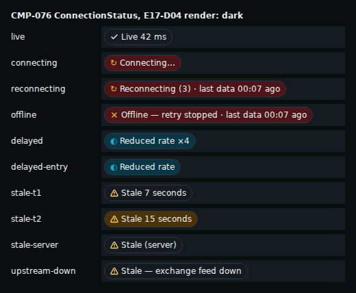
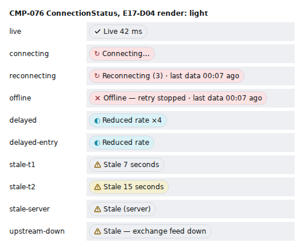
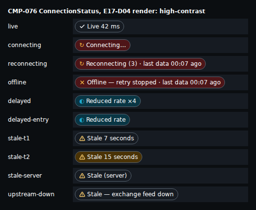
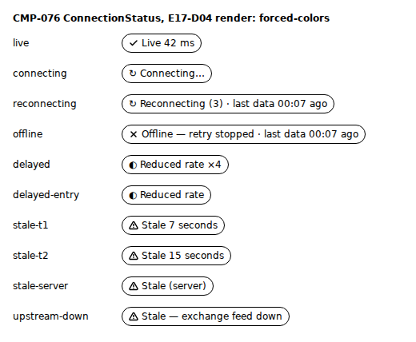
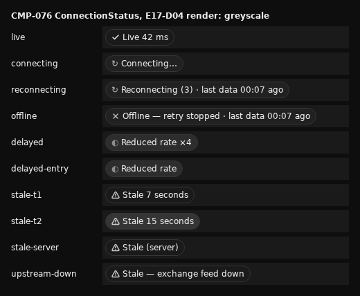

# E17-D04 — Design QA and accessibility review of the shipped connection-state chrome (SCR-152; CMP-076, CMP-077)

**Ticket:** E17-D04 (#408) · **Epic:** E17 Market-data WS protocol · **Kind:** design QA and accessibility review of the built connection chrome against E17-D02, text first, one PR · **Status:** pre-staged against #5420's pinned head; the PR carries `Refs #408` and `Partial:` while #5420 is unmerged, and flips to the closing keyword for this ticket once #5420 merges and every build cite is re-pinned to its merge commit (BQ-0, BQ-1). Sign-off is not claimed: the designer's and the accessibility specialist's sign-offs are the owner's approval, pending; the owner-run legs are §16's.

**Ruling status: defaults built; ruling pending (comment 6573202575).** The BQ list (BQ-0..BQ-16) is posted on #408 as comment 6573202575; this record is built on each question's default as posted, so the ruling flips §R's status column and changes nothing else unless a question is ruled otherwise.

**Scope** (T Scope; BQ-2): E17-D02 §2's state matrix walked against the build. Rows 5, 10, 11, 12, 13 and 16, the rows #5420 builds, are walked in full against its selector and chip (§4.1); every other row is one delta line on its E08-D14 state row (§4.2): it holds, #5420 changed it, or it is still an E08-D14 register row. The chip's tokens and contrast (§5), copy (§6), stories (§7), names and announcements (§8), motion (§9), axe, the T2 gate and the security check (§10), the captures (§11), the register (§12), the A rows for owner documents (§13), the delta rows (§14), routing (§15) and the owner-run legs (§16). No code, catalogue, plan or design document of another ticket is changed.

**Start.** The `blocked_by` pair: E17-D02 (#325) is open with its text merged, and its build leg for the chip is #5420 (approved, unmerged); E17-T04 (#413) is closed. Under the owner's pre-stage rule this record is drafted now against #5420's pinned head (BQ-0).

**Inputs pinned.** Base `origin/main` e5b286ed50d3a320d80b24df5030fb09dd405a4a: every plan and design cite (`05`, `14`, `15`, `23`, `D02`, `D02H`, `D14`, `E09D11`, `SDG`) is read there. #5420 is pinned at head 86f6a14c25e18e7b155d4de13062c70244b5ad5e; it has since been rebased to 590bb92e5, and every build file cited here is byte-identical at both heads. Every build cite (`CS`..`E2E`) is read at the pinned head. Each cited line is pinned to its words in `docs/design/_tools/e17_d04_ruled_pins.txt` (the tool's cite gate); when #5420 merges, the tool's `PIN` moves to its merge commit and the pins are rewritten by `--repin-ruled`.

**Key.** `NN`:line = `docs/plan/NN-*.md`. `D02` = `docs/design/E17/E17-D02.md`, `D02H` = `docs/design/E17/E17-D02-handoff.md`, `D14` = `docs/design/E08/E08-D14.md`, `E09D11` = `docs/design/E09/E09-D11.md`, `SDG` = `.claude/rules/32-design-specs.md`. Build (under `apps/web/src/`): `CS` = `features/app-shell/ConnectionStatus.tsx`, `SLOT` = `…/ConnectionStatusSlot.tsx`, `ANN` = `…/chipAnnouncer.ts`, `SEL` = `lib/ws/state/chipState.ts`, `RED` = `lib/ws/state/reducer.ts`, `TYP` = `lib/ws/state/types.ts`, `FC` = `lib/ws/worker/faultChannel.ts`, `WSC` = `lib/ws/client/createWsClient.ts`. Suites (under `apps/web/test/`): `SELT` = `lib/ws/chipState.test.ts`, `FCT` = `lib/ws/faultChannel.test.ts`, `ANNT` = `features/app-shell/connection-chip-announce.test.tsx`, `ANNU` = `features/app-shell/chipAnnouncer.test.ts`, `CST` = `features/app-shell/connection-status.test.tsx`, `ISOT` = `features/app-shell/status-bar-isolation.test.tsx`; `E2E` = `apps/web/e2e/shell/connection-chip.spec.ts`. Chrome around the chip (build keys too): `TB` = `features/app-shell/TopBar.tsx`, `APP` = `…/AppShell.tsx`, `MOT` = `…/motion.ts` (under `apps/web/src/`), and `FR` = `packages/ui/src/components/focusring.css`. `T` = the ticket text (#408): `T Scope`, `T AC1`..`AC5`, `T Tech`, `T Test`, `T Sec`, `T a11y`, `T Perf`, `T DoD`. Ids: `RN` run, `FS` forced state, `W` walked row, `DL` delta line, `CN` contrast, `CP` copy, `CM` composition, `IX` interaction, `AN` announcement, `MO` motion, `AX` axe, `T2` gated control, `SC` security check, `F` finding, `A` owner-document amendment, `DR` delta row, `RT` routing, `IS` issue (listed), `OR` owner-run leg. E08-D14's own register rows are written `D14` DF-n.

**Numbers.** Every count and measured value (the deck diff, the token references, the contrast ratios, the story counts, the walk and register tallies, the image count) is computed by `docs/design/_tools/e17_d04_audit.py` and re-derived under `--check`; each carries an `audit` marker. The run counts of §1.1 are the run record's.

## Acceptance-criteria trace (#408)

| Ticket item                                                                                | Where    | Status                                                                                                                                                                                                                                                                                                                                                                                                                                                                                    |
| ------------------------------------------------------------------------------------------ | -------- | ----------------------------------------------------------------------------------------------------------------------------------------------------------------------------------------------------------------------------------------------------------------------------------------------------------------------------------------------------------------------------------------------------------------------------------------------------------------------------------------- |
| AC1 — every matrix row pass, or a defect linked; none "not reachable"                      | §3, §4   | done at the pin: the six chip rows walked in full (W rows), the other eighteen one delta line each (DL rows); an unbuilt row reads "not built" with its register row linked (`D14` DF-16..DF-19, `D14`:350–353), never "not reachable"; "retry exhaustion" is no state: the client has no attempt cap, and RetryExhausted is the `offline` chip (`D02`:69)                                                                                                                                |
| AC2 — no chatter: each transition announced at most once; heartbeats never                 | §8.2     | done by source and the suites: `lagging` has no treatment (`D02`:87), so five healthy / lagging swings say nothing; every chip phase is said once on entry and once on exit (`ANNU`:92, `ANNT`:118); a transport change is told once (`FCT`:36); the speaking NVDA leg is owner-run (OR-2)                                                                                                                                                                                                |
| AC3 — the reconnect overlay traps focus; Retry now reachable; nothing implies current data | §8.1     | accepted divergence on the trap clause: the merged design makes CMP-077 a non-modal region with **no focus trap** and a no-trap test (`D02`:69; `15`:872, :875), and E04-D02-F15 was routed here (comment 6538888490); AC3 is read as "Retry now reachable and keyboard-operable, `Tab` leaves the region, nothing implies current data". Retry now is not built (`D14` DF-16, `D14`:350), so AC3 stays open on that row; the "nothing implies current data" leg passes on the chip (W-5) |
| AC4 — axe zero violations on SCR-152 and the chrome in every transport state               | §10.1    | done for the chip: RN-3 renders its ten states in three themes and greyscale with colour contrast on: 0 violations; the region's states were scanned by E08-D14 (`D14`:63) and are unchanged by #5420; the e2e scans in `E2E` run in #5420's CI                                                                                                                                                                                                                                           |
| AC5 — an open P1 blocks sign-off                                                           | §12, §17 | holds as the condition: E08-D14's p1 rows `D14` DF-16..DF-19 are open, and this record adds one p1 row, F-17 (the strong T2 variant carried by fill alone), so design QA is not signed off and the consuming stories stay out of Done; it adds no p0 row                                                                                                                                                                                                                                  |
| T Scope — compare against the redlines, tokens and copy                                    | §5, §6   | no redlines exist (`D02`:41, BLOCKED-PENPOT): compared against D02 §5's text (anatomy `D02`:148, tokens `D02`:154); `color.overlay.stale`, `color.surface.scrim` and `elevation.5` are not tokens (`D02`:382–384, CR-1..CR-3)                                                                                                                                                                                                                                                             |
| T Scope — every story named in the handoff exists and matches                              | §7       | absent: the handoff's stories are PENDING the boards (`D02H`:179), and CMP-076 / CMP-077 live in `apps/web` with no story (F-15)                                                                                                                                                                                                                                                                                                                                                          |
| T a11y — assertive once for `degraded` / `offline`, polite for stale                       | §8.2     | `offline` / Disconnected: assertive once per episode, CMP-077's row (`D02`:253), built through the shell announcer and walked by E08-D14 (`D14`:248), unchanged by #5420 (AN-7); `degraded`: an accepted divergence, read as AC3's trap clause is: the merged design makes Delayed polite (`D02`:257) and the build is polite (AN-3, AN-8); stale polite below T2 (AN-3)                                                                                                                  |
| T a11y — CMP-078's visible age text                                                        | §8.2     | not built: no shipped panel carries CMP-078 (F-8); its order-gate surface is SCR-050's (T2-3)                                                                                                                                                                                                                                                                                                                                                                                             |
| T a11y — greyscale distinguishability; 125 % and 200 % zoom reflow                         | §5, §8.1 | greyscale: every state but one keeps its own glyph and word; the strong T2 variant differs from T1 by fill alone (F-17, Major; CN-12, CN-14); reflow: the chip alone clips nothing at 640 and 320 CSS px, with WCAG 1.4.12 spacing or a doubled word (RN-4); the TopBar in the running app is owner-run (OR-3)                                                                                                                                                                            |
| T Scope — forced states driven by the fault channel and the chaos harness                  | §3       | the dev fault channel and the suites only: no toxiproxy leg and no network (BQ-16); the live-session leg is owner-run (OR-1)                                                                                                                                                                                                                                                                                                                                                              |
| T Sec — no diagnostic identifier rendered to a Viewer outside Copy details                 | §10.3    | pass by source: the chip's name and `title` carry words and a UTC time only (SC-1)                                                                                                                                                                                                                                                                                                                                                                                                        |
| T Perf — the 1 Hz chrome update does not re-render the workspace                           | §10.4    | pass by the suite (`ISOT`:80, :109); the React profiler trace is owner-run (OR-5)                                                                                                                                                                                                                                                                                                                                                                                                         |
| T DoD — NVDA and VoiceOver transcripts; zoom; P0 / P1 re-verified; sign-offs               | §16, §17 | owner-run (OR-2..OR-5); sign-off "not claimed"                                                                                                                                                                                                                                                                                                                                                                                                                                            |
| T DoD — `14` SCR-152 updated if the shipped behaviour diverged                             | §13      | A rows, never edited here (BQ-13): A-1..A-8; #5420 adds its own As-built lines to `14` and `15`                                                                                                                                                                                                                                                                                                                                                                                           |

## R. The questions BQ-0..BQ-16 (defaults built; ruling pending (comment 6573202575))

| BQ    | Topic                                   | Default built                                                                                                                                                                                                                                                                                                                 | Status                                          |
| ----- | --------------------------------------- | ----------------------------------------------------------------------------------------------------------------------------------------------------------------------------------------------------------------------------------------------------------------------------------------------------------------------------- | ----------------------------------------------- |
| BQ-0  | standing rules, in bulk                 | pre-staged against #5420's pinned head and re-pinned at its merge; `Refs` + `Partial:` until then; ten captures at most; the T2 standing gate; owner documents only as A rows; findings `(heuristic)` where judged; the brief's `apps/web` paths a Deviation                                                                  | default built; ruling pending                   |
| BQ-1  | done, and the closing line              | after #5420 merges and the pins are re-read, the PR body carries the closing keyword for this ticket (E08-D14's BQ-02 option a, `D14`:35); open rows ride on their owners; owner-run legs named; sign-off "not claimed"                                                                                                       | default built; ruling pending                   |
| BQ-2  | scope                                   | rows 5, 10–13 and 16 walked in full; every other row one delta line on its E08-D14 state row; unbuilt rows "not built" with their register row                                                                                                                                                                                | default built; ruling pending                   |
| BQ-3  | the stale word                          | the shipped "Stale 7 seconds" passes (SC 2.5.3 is the floor); an accepted-divergence row with an A row to D02 §10 A on #325; SCR-030's chips out of scope (E11)                                                                                                                                                               | default built; ruling pending                   |
| BQ-4  | row 11 against §3 on `meta.stale`       | the chip passes against §3, the more specific text; "counts as T2" read as E17-D01's gating meaning; a specification-gap row to #325, with the per-item ticker rule                                                                                                                                                           | default built; ruling pending                   |
| BQ-5  | row 5, Delayed                          | the word passes; #5420's Deviations 8 and 9 are Minor implementation rows; the ◐ / ↻ text glyphs an A row to `15` CMP-019; `overflowing` folded into `saturated` passes                                                                                                                                                       | default built; ruling pending                   |
| BQ-6  | row 16 after a reconnect                | pass on the exit rule; the T1 cap and the feed-down precedence a specification-gap A row to D02 §3 on #325; `recovered` stays `D14` DF-17 on #1028 and Scenario 4's announcement on #569                                                                                                                                      | default built; ruling pending                   |
| BQ-7  | announcements                           | AC2 by source and the suites, the NVDA leg owner-run; the owner shift and the dropped clauses specification-gap rows to #325; "New orders off." staying out is a pass (C-2.12); the watchlist hand-over (#5335) a delta row                                                                                                   | default built; ruling pending                   |
| BQ-8  | `D14` DF-24                             | its name leg recorded fixed at #5420; popover, tooltip, density, hover fill and type token one Minor row each to #302; the story to #302; "Stale (server)" without a time an Info row; the focused 1 Hz name an owner-run AT item                                                                                             | default built; ruling pending                   |
| BQ-9  | AC3's trap against the non-modal region | the merged design wins; AC3 read as reachable and operable Retry now; open on `D14` DF-16; the trap clause an accepted-divergence row in the AC trace                                                                                                                                                                         | default built; ruling pending                   |
| BQ-10 | redlines and the ticket's token names   | D02 §5's text as the baseline; fill / ink pairs computed by the tool in three themes; the ticket's names resolved by CR-1..CR-3; no Penpot comparison claimed                                                                                                                                                                 | default built; ruling pending                   |
| BQ-11 | evidence                                | source and the suites at the pin; a render harness (not committed) of the chip's states in three themes, forced colours, greyscale and reduced motion, axe with colour contrast on; captures under `docs/design/E17/img/`; the live legs owner-run                                                                            | default built; ruling pending                   |
| BQ-12 | severity, filing, routing               | E08-D14's ladder (`D14`:44) and filing freeze (`D14`:45): no new issue; merge-time comments on #325, #302, #1028, #569 and #32; `register` where no open owner exists; a Blocking row listed by id, class and clause only                                                                                                     | default built; ruling pending                   |
| BQ-13 | owner documents                         | no edit here; A rows for D02 §10 A, §2 rows 11 and 12, §3, §11 rows 4–5, `15` CMP-019 and `14` SCR-152's Performance and Analytics lines                                                                                                                                                                                      | default built; ruling pending                   |
| BQ-14 | security and the T2 gate                | the chip's name and `title` carry words and a UTC time only; the Details payload vacuous until `D14` DF-16 lands; the chip is no gated control: "no in-scope T2 control"                                                                                                                                                      | default built; ruling pending                   |
| BQ-15 | record, tool, branch                    | this file in E08-D14's shape with its tool and pins; no hand-off file; branch `design/e17-design-qa`; the ticket's labels. Built with the tool name `e17_d04_audit.py` and the commit scope `frontend-platform` (the area of the files under review), where the list names `e17_d04_designqa_audit.py` and `backend-platform` | built with the named deviations; ruling pending |
| BQ-16 | stories and the chaos harness           | the story check by name against the handoff and `15`; faults from the dev fault channel and the suites only (`quality`, `close`; `FC`:27)                                                                                                                                                                                     | default built; ruling pending                   |

## 1. Method and evidence (BQ-11, BQ-12)

- **Observed by:** `source` (the built code at the pin), `suite` (an assertion of a suite at the pin, re-run in RN-1), `render` (the harness, RN-3) and `owner-run` (needs the running app, a live session, a speaking screen reader, a zoomed browser or a profiler; §16). Nothing in this pass reaches an exchange, a testnet or any external host (C-13.5): every value is a fixture or a constant.
- **Severity** (BQ-12, E08-D14's ladder `D14`:44): **Blocking** (priority/p0) — a frozen value shown as live, a safety string changed, a task not completable by keyboard; **Major** (p1) — an unreached state or control of a built surface, a `05` or WCAG 2.2 AA clause that fails while the task completes; **Minor** (p2) — wording, a near-miss value, a deferred variant, a missing handle; **Info** (none) — a note.
- **Class:** **implementation defect** (code must change), **accepted divergence** (the build departs from the merged text and passes the floor; the text moves by its A row), **specification gap** (no merged text decides, or two merged texts disagree).
- **Owner and target:** the owner cell names the spec the build departs from and its area, never an agent; the target is an open owner (§15.1) or `register` (no open build owner: the E10 / E17 shell lane that next touches the file takes it from this register).
- **Heuristic:** a finding judged rather than measured is marked `(heuristic)` in its reason cell.

### 1.1 The runs (the run record's counts)

| RN   | Run                                                                                                                                                                                                                      | Result                                                                                                                                                                                                                                                                                                                                                                                      |
| ---- | ------------------------------------------------------------------------------------------------------------------------------------------------------------------------------------------------------------------------ | ------------------------------------------------------------------------------------------------------------------------------------------------------------------------------------------------------------------------------------------------------------------------------------------------------------------------------------------------------------------------------------------- |
| RN-1 | the web package's unit runner (jsdom) at the pin over the chip, selector, announcer, feed, isolation, region, overlay, presentation, client and fault-channel suites                                                     | 12 files, 356 tests, all passed; the feed suite runs axe at serious and critical with colour contrast off (jsdom)                                                                                                                                                                                                                                                                           |
| RN-2 | `E2E`'s two tests (the feed down and row 5's Delayed fill, axe with colour contrast on in Chromium)                                                                                                                      | cited from #5420's CI, not re-run here                                                                                                                                                                                                                                                                                                                                                      |
| RN-3 | a harness, not committed: the built `ConnectionStatus` at the pin in ten states with the props its container gives them (`SLOT`:49–79), bundled with the built token and component CSS and rendered in headless Chromium | dark, light, high contrast, forced colours (emulated) and greyscale (a CSS filter over dark); axe (every rule, colour contrast and `label-content-name-mismatch` on) scoped to the harness: 0 violations in four of the five; 4 incomplete, the two text glyphs' nodes (AX-1, AX-2). Computed: chip height 24 px in every state; width 100 px (Live 42 ms) to 305 px (Offline with its age) |
| RN-4 | RN-3's harness, dark, at a 640 and a 320 CSS px wide page (1280 px at 200 % and 400 %), then at 320 px with WCAG 1.4.12's text spacing, and with the word at 24 px (twice its 12 px, for the in-app text scale)          | no chip clips its text in any case (its scroll width never exceeds its client width, all ten states): at 320 px the two disconnected words with their age and the feed-down word wrap and grow (to 58 px tall; 74 px with the spacing; 114 px with the larger word); the page overflow at 320 px comes from the harness's fixed 120 px label column beside each chip, not from a chip       |

RN-3's fonts are the host's, not a baseline's: its captures are evidence of state, word and colour, never a baseline. Its reduced-motion run is not evidence of the app's path: the chip reads reduced motion from the app's theme store, which the harness does not set, so MO-2 rests on the suite.

## 2. The pass (E09-D11 §16's seven steps, `E09D11`:515–526)

| Step          | Compared                                                      | Observed by           | Result                                                                                                               |
| ------------- | ------------------------------------------------------------- | --------------------- | -------------------------------------------------------------------------------------------------------------------- |
| 1 Token diff  | the chip's style values and fill names against the token JSON | source; render        | 21 <!-- audit:tk.refs=21 --> references, 0 <!-- audit:tk.unresolved=0 --> unresolved; ten pairs in three themes (§5) |
| 2 State walk  | D02 §2's 24 rows                                              | source, suite, render | six walked in full, eighteen delta lines (§4)                                                                        |
| 3 Copy diff   | E08-D13's chip deck (`e17d2.A.*`) against the built strings   | source, render        | 8 <!-- audit:deck.a.held=8 --> of 15 <!-- audit:deck.a=15 --> held; 7 <!-- audit:deck.a.missed=7 --> listed (§6)     |
| 4 Composition | `14`'s Components line and `15`'s stories against the build   | source                | §7                                                                                                                   |
| 5 Focus walk  | D02 §5's keyboard and name rules; CMP-077's no-trap rule      | source, suite, render | §8.1                                                                                                                 |
| 6 Motion      | the chip's cross-fade and its reduced-motion path             | source, suite         | §9                                                                                                                   |
| 7 Axe         | RN-3, the suites' axe, `E2E`                                  | suite, render         | §10.1                                                                                                                |

## 3. The forced-state matrix (T Scope's list; BQ-16)

Each recipe names the dev fault channel's command (`FC`:27 lists the quality classes; the channel is absent from the production bundle) or the suite that drives the state, so the QA pass and the chaos suite can share them; the `23` §12 worked sessions (`23`:1747) are the scripts for the owner-run leg.

| FS    | T Scope state                         | Induce                                                                                                   | Rows   | Reached by                                 | Result                                                              |
| ----- | ------------------------------------- | -------------------------------------------------------------------------------------------------------- | ------ | ------------------------------------------ | ------------------------------------------------------------------- |
| FS-1  | stale topic                           | hold a public topic silent past its T1, then past 3 × T1 (`SEL`:10–12)                                   | 10, 11 | suite (`SELT`:248)                         | reached: W-2, W-3                                                   |
| FS-2  | `lagging`                             | `quality` `lagging` (`FCT`:50)                                                                           | 4      | suite (`SELT`:318)                         | reached: no chip change, no announcement                            |
| FS-3  | `saturated`                           | `quality` `saturated`                                                                                    | 5      | suite (`SELT`:311); `E2E`:62               | reached: W-1                                                        |
| FS-4  | `overflowing` / `slow_consumer` close | `quality` `overflowing` (folded into `saturated`, `RED`:54, :63; `TYP`:28–29); the close through `close` | 5, 3   | source; suite (`FCT`:36)                   | reached: the row-5 chip; the close is row 3                         |
| FS-5  | full disconnect and reconnect         | `close` with a retrying code, then the reconnect                                                         | 3, 16  | suite (`SELT`:361, :372)                   | reached: W-6                                                        |
| FS-6  | retry exhaustion                      | no state: the client has no attempt cap; a fatal `close` (1002, 4400) gives `offline` (`D02`:69)         | 6      | suite (`CST`:234 for the shell-cause side) | reached as `offline`; "retry exhaustion" itself is no row           |
| FS-7  | `shutdown_notice` countdown           | `shutdown` with `closingInMs` and `downtimeMs`                                                           | 8      | suite (`SELT`:318)                         | the chip follows the topic rule (DL-7); the region is `D14` DF-20's |
| FS-8  | per-topic `revoked`                   | `revoke` of a topic with a reason                                                                        | 15     | source                                     | the chip untouched by design (DL-10)                                |
| FS-9  | book resync                           | `drop` of a book topic                                                                                   | 9      | source                                     | panel-only by design (DL-8)                                         |
| FS-10 | upstream feed down                    | the e2e harness's `exchange_state` with the public feed down (`E2E`:24)                                  | 13     | suite (`SELT`:124, :145, :156)             | reached: W-5                                                        |
| FS-11 | stale (server)                        | `staleSnap` of a ticker or book topic: a snapshot body with `stale: true` (`WSC`:168–170)                | 12     | suite (`SELT`:201, :214)                   | reached: W-4                                                        |

## 4. The state walk (AC1; BQ-2)

### 4.1 The rows #5420 builds, walked in full

6 <!-- audit:w=6 --> rows. "Expected" is D02's chip cell and §3's rule; "Built" is the chip and selector at the pin.

| W   | D02 row | State                        | Expected                                                                                                                          | Induce | Built at the pin                                                                                                                                                                       | Status             | Evidence                                               | Finding        |
| --- | ------- | ---------------------------- | --------------------------------------------------------------------------------------------------------------------------------- | ------ | -------------------------------------------------------------------------------------------------------------------------------------------------------------------------------------- | ------------------ | ------------------------------------------------------ | -------------- |
| W-1 | row 5   | `degraded:saturated`         | "Reduced rate ×4", info fill, unless a public topic is stale (`D02`:88); nothing while `features.coalescing` is false (`D02`:126) | FS-3   | "Reduced rate ×N" on `status.info.subtle` with the ◐ text glyph; "Reduced rate" until the multiplier arrives; shown on `saturated` alone; held 5 s (T3); every Stale wins              | pass with findings | `CS`:37, :55–57; `SEL`:202–208; `SELT`:311, :334, :347 | F-4, F-5, F-6  |
| W-2 | row 10  | `topic_stale`, T1 ≤ age < T2 | "Stale 7s", the oldest topic (`D02`:93)                                                                                           | FS-1   | "Stale 7 seconds" on `surface.raised`, the ⚠ icon in `data-confidence.stale.indicator`; the oldest judged topic's age                                                                  | pass with findings | `CS`:38, :58–63; `SEL`:200–201; `SELT`:248             | F-1            |
| W-3 | row 11  | `topic_stale` ≥ T2           | "Stale 15s", strong (`status.warning.subtle`) (`D02`:94)                                                                          | FS-1   | "Stale 15 seconds" on `status.warning.subtle`, ⚠ in `status.warning.strong`; `meta.stale` does not make it strong, and a server-stale ticker or book hides a T2 age on another topic   | pass with findings | `CS`:39; `SEL`:173–182, :199; `SELT`:201, :208, :220   | F-1, F-2, F-17 |
| W-4 | row 12  | stale (server)               | "Stale (server)" only for `ticker` or `book` (`D02`:95, :123)                                                                     | FS-11  | "Stale (server)" for ticker and book; a server-stale `trades` topic is judged by its age; no time in the name                                                                          | pass with findings | `SEL`:199; `SLOT`:61–69; `SELT`:201, :214              | F-3, F-16      |
| W-5 | row 13  | stale — upstream feed down   | "Stale — exchange feed down"; no counter, no scrim (`D02`:96, :122)                                                               | FS-10  | "Stale — exchange feed down", never strong; beats every other topic rule and row 16's wait; held until each judged topic has a fresh frame; nothing reads Live while the feed is down  | pass with findings | `CS`:59; `SEL`:189–190; `SELT`:124, :145, :156, :168   | F-7, F-19      |
| W-6 | row 16  | recovered / reconciling      | the chip "Live" once `auth_ok` and the public snapshots are in (`D02`:99, :132)                                                   | FS-5   | "Reconnecting" with no counter while a public snapshot is owed, each topic for at most its T1 from the link's return, then its age; Live once fed; the `recovered` region is not built | pass with findings | `SEL`:191–198; `SELT`:361, :372, :402                  | F-7            |

### 4.2 The other eighteen rows, one delta line each

18 <!-- audit:dl=18 --> lines, each on E08-D14's state row for it (`D14`:133–156).

| DL    | D02 row | `D14` row | State                                   | Delta at the pin                                                                                       | Evidence                |
| ----- | ------- | --------- | --------------------------------------- | ------------------------------------------------------------------------------------------------------ | ----------------------- |
| DL-1  | row 1   | ST-14     | `connecting` before the first `auth_ok` | holds: "Connecting…", no counter                                                                       | `CS`:66; `D02`:84       |
| DL-2  | row 2   | ST-15     | connected                               | changed by #5420: Live is now the selector's last arm, after every topic rule                          | `SEL`:209; `D02`:85     |
| DL-3  | row 3   | ST-16     | reconnecting                            | still `D14` DF-16: the chip "Reconnecting (3)" holds; the region has no Retry now or Details           | `CS`:67; `D14`:350      |
| DL-4  | row 4   | ST-17     | `degraded:lagging`                      | holds: no treatment; the selector reads Live                                                           | `SELT`:318; `D02`:87    |
| DL-5  | row 6   | ST-19     | `offline` — retry stopped               | still `D14` DF-16: the chip "Offline — retry stopped" holds                                            | `CS`:69; `D14`:350      |
| DL-6  | row 7   | ST-20     | `offline` with a shell cause, login     | holds: another surface (SCR-001)                                                                       | `D02`:90                |
| DL-7  | row 8   | ST-21     | `shutdown_pending`                      | still `D14` DF-20: the chip follows the topic rule, as row 8 asks; the region's copy is DF-20's        | `D02`:91; `D14`:354     |
| DL-8  | row 9   | ST-22     | `topic_resyncing`                       | holds: panel-only                                                                                      | `D02`:92                |
| DL-9  | row 14  | ST-27     | book rebuilt                            | holds: a book-level reassurance                                                                        | `D02`:97                |
| DL-10 | row 15  | ST-28     | `topic_revoked`                         | holds: the chip untouched                                                                              | `D02`:98                |
| DL-11 | row 17  | ST-30     | Read-only reason                        | still `D14` DF-19: R3, R4 and R7 not built                                                             | `D02`:100; `D14`:353    |
| DL-12 | row 18  | ST-31     | `system` unknown                        | holds: the chip by the topic rule                                                                      | `D02`:101               |
| DL-13 | row 19  | ST-32     | flapping                                | still `D14` DF-18: no latch; the chip follows the transport, as row 19 asks                            | `D02`:102; `D14`:352    |
| DL-14 | row 20  | ST-33     | long-outage / the T4 steps              | still `D14` DF-23: the chip adds "· last data 00:07 ago" beside a disconnected word (PROPOSED in code) | `CS`:144–146; `D14`:357 |
| DL-15 | row 21  | ST-34     | session ended                           | still `D14` DF-21                                                                                      | `D02`:104; `D14`:355    |
| DL-16 | row 22  | ST-35     | backend-health conditions               | holds: CMP-092's rows                                                                                  | `D02`:105               |
| DL-17 | row 23  | ST-36     | `err` by class                          | holds: not a transport state                                                                           | `D02`:106               |
| DL-18 | row 24  | ST-37     | upstream private reconnect              | holds: the chip unchanged                                                                              | `D02`:107               |

`D14` DF-1 (p0, the chip's stale states never render, `D14`:335) is met at the pin by W-1..W-6. Retry exhaustion has no row of its own (FS-6).

## 5. Step 1 — tokens and contrast (BQ-10)

The chip binds every value it draws to a token: 21 <!-- audit:tk.refs=21 --> `var()` references and fill / ink names, 0 <!-- audit:tk.unresolved=0 --> unresolved; the hairline width is `border.hairline` times 1 px (`CS`:84). D02 §5's anatomy (`D02`:148) and token list (`D02`:154) are met except the deferred density, hover fill and type token (F-12..F-14). The ticket's `color.overlay.stale`, `color.surface.scrim` and `elevation.5` are not tokens; D02 resolves them (`D02`:382–384), and none is the chip's.

Contrast is computed by the tool from the token JSON (text 4.5:1, non-text 3:1; the hairline is decoration, `CS`:132–134):

| CN    | Pair (foreground on fill)                                                                   | Bar        | Dark                                    | Light                                    | High contrast                          | Finding |
| ----- | ------------------------------------------------------------------------------------------- | ---------- | --------------------------------------- | ---------------------------------------- | -------------------------------------- | ------- |
| CN-1  | `color.text.primary` on `color.surface.raised` (Live, Stale)                                | text       | 14.35:1 <!-- audit:cn1.dark=14.35:1 --> | 15.62:1 <!-- audit:cn1.light=15.62:1 --> | 16.25:1 <!-- audit:cn1.hc=16.25:1 -->  | —       |
| CN-2  | `color.data-confidence.live.indicator` on `surface.raised`                                  | non-text   | 14.35:1 <!-- audit:cn2.dark=14.35:1 --> | 15.62:1 <!-- audit:cn2.light=15.62:1 --> | 16.25:1 <!-- audit:cn2.hc=16.25:1 -->  | —       |
| CN-3  | `color.text.primary` on `color.status.info.subtle` (Delayed)                                | text       | 10.74:1 <!-- audit:cn3.dark=10.74:1 --> | 15.44:1 <!-- audit:cn3.light=15.44:1 --> | 12.16:1 <!-- audit:cn3.hc=12.16:1 -->  | —       |
| CN-4  | `color.status.info.default` (◐) on `status.info.subtle`                                     | non-text   | 4.64:1 <!-- audit:cn4.dark=4.64:1 -->   | 3.44:1 <!-- audit:cn4.light=3.44:1 -->   | 4.64:1 <!-- audit:cn4.hc=4.64:1 -->    | —       |
| CN-5  | `color.data-confidence.stale.indicator` on `surface.raised`                                 | non-text   | 11.00:1 <!-- audit:cn5.dark=11.00:1 --> | 4.90:1 <!-- audit:cn5.light=4.90:1 -->   | 11.00:1 <!-- audit:cn5.hc=11.00:1 -->  | —       |
| CN-6  | `color.text.primary` on `color.status.warning.subtle` (T2)                                  | text       | 9.86:1 <!-- audit:cn6.dark=9.86:1 -->   | 15.62:1 <!-- audit:cn6.light=15.62:1 --> | 11.16:1 <!-- audit:cn6.hc=11.16:1 -->  | —       |
| CN-7  | `color.status.warning.strong` on `status.warning.subtle`                                    | non-text   | 7.56:1 <!-- audit:cn7.dark=7.56:1 -->   | 4.90:1 <!-- audit:cn7.light=4.90:1 -->   | 7.56:1 <!-- audit:cn7.hc=7.56:1 -->    | —       |
| CN-8  | `color.text.primary` on `color.status.danger.subtle`                                        | text       | 12.06:1 <!-- audit:cn8.dark=12.06:1 --> | 14.64:1 <!-- audit:cn8.light=14.64:1 --> | 13.66:1 <!-- audit:cn8.hc=13.66:1 -->  | —       |
| CN-9  | `color.status.danger.strong` (↻, ✕) on `status.danger.subtle`                               | non-text   | 7.83:1 <!-- audit:cn9.dark=7.83:1 -->   | 6.33:1 <!-- audit:cn9.light=6.33:1 -->   | 7.83:1 <!-- audit:cn9.hc=7.83:1 -->    | —       |
| CN-10 | `color.border.default` hairline on `surface.raised`                                         | decorative | 1.41:1 <!-- audit:cn10.dark=1.41:1 -->  | 1.22:1 <!-- audit:cn10.light=1.22:1 -->  | 2.86:1 <!-- audit:cn10.hc=2.86:1 -->   | —       |
| CN-11 | `color.focus.ring` (CMP-039, 2 px outside the pill) on `surface.raised` (the TopBar)        | non-text   | 6.66:1 <!-- audit:cn11.dark=6.66:1 -->  | 5.86:1 <!-- audit:cn11.light=5.86:1 -->  | 17.30:1 <!-- audit:cn11.hc=17.30:1 --> | —       |
| CN-12 | `color.status.warning.subtle` (the T2 fill) on `surface.raised` (the T1 fill)               | non-text   | 1.46:1 <!-- audit:cn12.dark=1.46:1 -->  | 1.00:1 <!-- audit:cn12.light=1.00:1 -->  | 1.46:1 <!-- audit:cn12.hc=1.46:1 -->   | F-17    |
| CN-13 | `color.status.info.subtle` (the Delayed fill) on `surface.raised`                           | decorative | 1.34:1 <!-- audit:cn13.dark=1.34:1 -->  | 1.01:1 <!-- audit:cn13.light=1.01:1 -->  | 1.34:1 <!-- audit:cn13.hc=1.34:1 -->   | —       |
| CN-14 | `color.data-confidence.stale.indicator` (T1 ⚠) against `color.status.warning.strong` (T2 ⚠) | decorative | 1.00:1 <!-- audit:cn14.dark=1.00:1 -->  | 1.00:1 <!-- audit:cn14.light=1.00:1 -->  | 1.00:1 <!-- audit:cn14.hc=1.00:1 -->   | F-17    |

CN-1..CN-11 clear their bars in every theme; the tightest is CN-4 in light (3.44:1 against 3:1), the first pair to break if a theme drifts. CN-10's hairline is decoration: the word and the glyph identify the control, so SC 1.4.11 asks no 3:1 boundary (`CS`:132–134). The focus ring is a 2 px <!-- audit:ring.width=2 --> outline 2 px outside the pill (`FR`:9–14), so its neighbours on both sides are the TopBar's `surface.raised` (`APP`:56, :113), never a pill fill: CN-11 is its one pair. CN-13's Delayed fill is decoration, because ◐ and the word carry Delayed.

Every state but one has its own glyph and word (`CS`:30–42), so greyscale and forced colours keep them apart (RN-3, §11). The exception is the strong T2 variant: it keeps T1's ⚠, its word and its glyph ink (CN-14), and changes only its fill (`CS`:38–39), which differs from T1's by 1.46:1 in dark and high contrast and only by hue in light (CN-12). Under greyscale and forced colours, and in light for a reader who cannot tell the hue, "Stale 15 seconds" differs from "Stale 7 seconds" only by its number. That is fill alone for the one escalation that gates orders and speaks assertively, against `05` §4's colour, glyph and word (`05`:107, :115): F-17, Major.

## 6. Step 3 — copy (BQ-3)

The tool reads the chip deck (E08-D13's `e17d2.A.*`, D02 §10 A, `D02`:225) against the strings of `CS` and `SLOT`, numbers as fills: 8 <!-- audit:deck.a.held=8 --> of 15 <!-- audit:deck.a=15 --> held ("Live 42 ms", "Reduced rate ×4", "Stale (server)", "Stale — exchange feed down", "Reconnecting (3)", "Connecting…", "Offline — retry stopped", "last 13:42:05 UTC"); the 7 <!-- audit:deck.a.missed=7 --> deck keys not drawn as a chip string are below, two of them no divergence.

| CP   | Deck key                   | Deck                                                                         | Built                                                                          | Finding                                                                                                                                                        |
| ---- | -------------------------- | ---------------------------------------------------------------------------- | ------------------------------------------------------------------------------ | -------------------------------------------------------------------------------------------------------------------------------------------------------------- |
| CP-1 | `e17d2.A.3`, `e17d2.A.4`   | "Stale 7s" · "Stale 15s" (strong)                                            | "Stale 7 seconds" · "Stale 15 seconds"; "Stale 1 second" singular (`CS`:62–63) | F-1                                                                                                                                                            |
| CP-2 | `e17d2.A.8`                | "~4 s" (the next try, approximate)                                           | not on the chip: the next-try time is the region's countdown slot              | no divergence: D02 §5's chip props carry `nextAttemptAtMs` for the tooltip, which is F-11's; the region's countdown is E08-D14's walk                          |
| CP-3 | `e17d2.A.12`, `e17d2.A.13` | "Connection quality: RTT 240 ms, queue 40 %" · "Queue > 90 % — reduce panes" | not built: no tooltip and no popover (`CS`:126–131)                            | F-10, F-11                                                                                                                                                     |
| CP-4 | `e17d2.A.14`               | "resync storm — 6 rebuilds in the last minute" (PROPOSED)                    | not built: the tooltip line                                                    | F-11                                                                                                                                                           |
| CP-5 | `e17d2.A.15`               | "Connection: Stale 7 seconds, last data 13:42:05 UTC"                        | composed from three parts (`CS`:145–150); read whole in RN-3: the same words   | no divergence: the name is the deck's, word for word, and the drawn word is now a run of it (SC 2.5.3); `D14` DF-24's name leg is fixed at the pin (`D14`:358) |

The other built words with no deck string ("Reduced rate" without its factor, "· last data 00:07 ago" beside a disconnected word) are PROPOSED in code (`CS`:45–48, :144) and carried by F-4 and DL-14.

## 7. Step 4 — composition and stories (BQ-16)

| CM   | Expected                                                                                                                  | Built                                                                                                                                                  | Finding |
| ---- | ------------------------------------------------------------------------------------------------------------------------- | ------------------------------------------------------------------------------------------------------------------------------------------------------ | ------- |
| CM-1 | CMP-019 icons for the five glyphs (`15`:244; `D02`:148)                                                                   | ✓, ⚠ and ✕ are CMP-019 icons; ◐ and ↻ are text glyphs, `aria-hidden` (`CS`:30–42, :168)                                                                | F-6     |
| CM-2 | CMP-076's 13 <!-- audit:story.d02=13 --> stories in D02 §15 (`D02`:396), 13 <!-- audit:story.15=13 --> in `15` (`15`:861) | none: the chip lives in `apps/web`, with no story                                                                                                      | F-15    |
| CM-3 | CMP-077's stories (`15`:874)                                                                                              | none (`D14` DF-25, `D14`:359)                                                                                                                          | F-15    |
| CM-4 | the handoff's story check (`D02H`:179)                                                                                    | PENDING the boards (BLOCKED-PENPOT); checked by name against `15`; the handoff's ticked stories line compares the spec with its own table, not a build | F-15    |

## 8. Step 5 — interaction, names and announcements

### 8.1 Focus, keys and names (D02 §5; CMP-077)

| IX   | Rule                                                                                         | Status                                                                                                                                                                                                                                                                                                                               | Evidence                            | Finding    |
| ---- | -------------------------------------------------------------------------------------------- | ------------------------------------------------------------------------------------------------------------------------------------------------------------------------------------------------------------------------------------------------------------------------------------------------------------------------------------ | ----------------------------------- | ---------- |
| IX-1 | a native `<button>`, a `Tab` stop, the CMP-039 focus ring (`D02`:152)                        | pass: native button; the CMP-039 ring is a real outline 2 px outside the pill at 3:1 or more in every theme (CN-11), kept as Highlight under forced colours (`FR`:5, :22–27); the TopBar row sets no overflow, so nothing clips it (`TB`:36–43); the TopBar is never scrimmed (`APP`:68–69), so no modal layer covers it (SC 2.4.11) | `CS`:155–157; `CST`:257; `FR`:9–14  | —          |
| IX-2 | `Enter` / `Space` opens the details popover; `aria-haspopup="dialog"` (`D02`:152; `D02H`:13) | not built: the button has no action and no `aria-haspopup` (RN-3)                                                                                                                                                                                                                                                                    | `CS`:126–131                        | F-10       |
| IX-3 | the accessible name leads with the visible words (SC 2.5.3; `D02`:152)                       | pass in all ten states (RN-3; axe `label-content-name-mismatch` passes); the drawn age is a run of its name; the ◐ and ↻ text glyphs are `aria-hidden`, so the name is the `aria-label` alone                                                                                                                                        | `CS`:145–150, :168; `CST`:123, :143 | F-1        |
| IX-4 | the absolute UTC time on hover and focus (`D02`:146)                                         | in the name and the `title` where a last-good time is known; "Stale (server)", Live and Delayed carry none; the `title` shows on hover only, so a sighted keyboard user sees no time on focus until F-11's tooltip lands                                                                                                             | `CS`:147–159; `SLOT`:52             | F-11, F-16 |
| IX-5 | the 24 px target (`D02`:148)                                                                 | pass: 24 px tall and 100 to 305 px wide in every state (RN-3), so D02's 24 × ≥72 px holds; the pill is the target and grows with its text                                                                                                                                                                                            | `CS`:76–81                          | —          |
| IX-6 | CMP-077: `Tab` leaves the region, no focus trap (`15`:872, :875)                             | the merged design is met by the region E08-D14 walked; AC3's trap clause is the accepted divergence of the AC trace; Retry now is not built                                                                                                                                                                                          | `D14`:350                           | —          |
| IX-7 | the focused chip's name at 1 Hz                                                              | owner-run: a screen reader may speak a focused control's changed name; #5420 left it to the AT pass; the merged text does not decide it (F-20)                                                                                                                                                                                       | `SLOT`:113–118                      | F-20       |

The chip alone reflows (RN-4): at 320 CSS px, with WCAG 1.4.12's spacing or a doubled word, it wraps and grows and clips nothing; the TopBar row wraps rather than scrolls (`TB`:36–39). Zoom at 125 %, 200 % and 400 %, the in-app text scale and the spacing in the running TopBar are owner-run (OR-3): the widest chip in RN-3, "Offline — retry stopped · last data 00:07 ago", is 305 px at 100 % (`05`:131 is the floor).

### 8.2 Announcements (D02 §11; AC2)

| AN   | Rule                                                                                                           | Status                                                                                                                                                                         | Evidence                                 | Finding  |
| ---- | -------------------------------------------------------------------------------------------------------------- | ------------------------------------------------------------------------------------------------------------------------------------------------------------------------------ | ---------------------------------------- | -------- |
| AN-1 | CMP-076 owns no live region (`D02`:249)                                                                        | pass: the chip renders none; its container writes through the shell announcer                                                                                                  | `CS`:122–124; `SLOT`:89–91               | —        |
| AN-2 | row 4, entering Stale ≥ T2: assertive once per episode, from CMP-078 (`D02`:256)                               | built once per episode, assertive, from the chip's container; the sentence drops "(open position)" and "New orders off."                                                       | `ANN`:21–23, :29–36, :199; `ANNU`:73     | F-8, F-9 |
| AN-3 | row 5, entering Stale < T2, Stale (server), Delayed: polite once on entry and exit, from the panel (`D02`:257) | built once on entry and once on exit, polite, after 5 s of freshness; from the chip's container                                                                                | `ANN`:13, :183; `ANNU`:92, :134          | F-8      |
| AN-4 | no per-heartbeat or per-tick chatter; one announcement per transition (T AC2)                                  | pass by the suites: a flap inside 5 s is one episode; a ticker on a 6 s beat is one episode; Delayed once; the feed down once; a Disconnected episode ends it in silence       | `ANNT`:118, :144, :162, :183; `ANNU`:125 | —        |
| AN-5 | row 12, recovery: CMP-077's assertive "Reconnected. …" (`D02`:264)                                             | not the chip's: it says nothing of its own on recovery (Scenario 4 on #569); the `recovered` region is `D14` DF-17                                                             | `ANNT`:195; `D14`:351                    | —        |
| AN-6 | "New orders off." in row 4's sentence                                                                          | pass: no gate enforces it today, and the UI renders server truth (C-2.12); the clause returns with the gate                                                                    | `ANN`:21–23                              | F-9      |
| AN-7 | row 1, entering Disconnected or `offline`: CMP-077, assertive, once per episode (`D02`:253)                    | not the chip's: built once per episode, assertive, through the shell announcer, and walked by E08-D14 (its AN-1, `D14`:248; the host is `D14` DF-29); #5420 does not change it | `D14`:248; `SLOT`:89–91                  | —        |
| AN-8 | T a11y's "assertive once for `degraded`" against row 5's polite Delayed (`D02`:257)                            | accepted divergence, read as AC3's trap clause is: the merged design wins, and the build is polite (AN-3)                                                                      | `D02`:257; `ANN`:13, :183                | —        |

The speaking leg (NVDA and VoiceOver over the transition set) is owner-run (OR-2); the watchlist's own stale announcements hand over per DR-3.

## 9. Step 6 — motion and reduced motion

| MO   | Rule                                                                                          | Built                                                                                                                                                                                  | Status                                                  | Evidence                     |
| ---- | --------------------------------------------------------------------------------------------- | -------------------------------------------------------------------------------------------------------------------------------------------------------------------------------------- | ------------------------------------------------------- | ---------------------------- |
| MO-1 | one 200 ms opacity cross-fade per status change, on the motion tokens                         | the content fades in once per status change over `motion.duration.normal`; an age or latency change does not fade                                                                      | pass                                                    | `CS`:90–120                  |
| MO-2 | instant under reduced motion                                                                  | `transition: none`, drawn at once (the suite drives the app's reduce setting)                                                                                                          | pass                                                    | `CS`:114; `CST`:266          |
| MO-3 | no more than three flashes a second (`05`:218; SC 2.3.1)                                      | one fade per status change (MO-1); a Stale entry needs T1 of silence (`SEL`:10) and Delayed holds 5 s (`SEL`:13–14); the pill, 305 × 24 px at most, is far below SC 2.3.1's flash area | pass (heuristic)                                        | `SEL`:10, :13–14; `CS`:94–98 |
| MO-4 | the OS setting and the in-app override (`Ctrl+Shift+M`) both give the instant path (`05`:215) | the chip reads the theme runtime's resolved `motion`, which takes either                                                                                                               | pass by source; the OS leg in the running app is OR-3's | `MOT`:2–5, :11–14; `CST`:266 |

## 10. Step 7 — axe, the T2 gate, security and performance

### 10.1 Axe (AC4)

| AX   | Scan                                                                                            | Result                                                                                                                                                                                                                                                                                                                                                                                                                                                       |
| ---- | ----------------------------------------------------------------------------------------------- | ------------------------------------------------------------------------------------------------------------------------------------------------------------------------------------------------------------------------------------------------------------------------------------------------------------------------------------------------------------------------------------------------------------------------------------------------------------ |
| AX-1 | RN-3: ten chip states, dark, light, high contrast and greyscale; every rule, colour contrast on | 0 violations; `label-content-name-mismatch`, `button-name`, `aria-hidden-focus` and `nested-interactive` pass; 4 incomplete: the ◐ and ↻ glyph spans, "only non-text characters", which CN-4 and CN-9 measure                                                                                                                                                                                                                                                |
| AX-2 | RN-3 under emulated forced colours                                                              | the colour-contrast rule reads the author colours, not the forced system colours, and reports every text node: a harness artefact, not a finding; the capture shows system colours throughout (§11). The pill keeps its boundary there: its border is a real CSS border (`CS`:84), repainted in a system colour, while its `background` fill drops; the focus ring is a real outline repainted as Highlight (`FR`:5, :22–27); nothing relies on `box-shadow` |
| AX-3 | the suites (jsdom, colour contrast off) and `E2E` (Chromium, colour contrast on)                | RN-1 passed; `E2E`'s two scans cite the feed-down and Delayed fills (#5420's CI); the T1 and strong-T2 fills are RN-3's (CN-1, CN-6), the scan #5420 carried to #569                                                                                                                                                                                                                                                                                         |

### 10.2 The T2 standing gate (E09-D09 §2.1; `SDG`:17–19)

Applied to every control the chip and its region show or name:

| T2   | Control                                                        | Where                     | Verdict                                                                                       | Evidence      |
| ---- | -------------------------------------------------------------- | ------------------------- | --------------------------------------------------------------------------------------------- | ------------- |
| T2-1 | the chip (CMP-076)                                             | the TopBar                | not a gated control: a read-only status button that opens details; nothing it does is refused | `CS`:126–131  |
| T2-2 | Retry now and Details (CMP-077)                                | the region                | not built (`D14` DF-16); neither is gated by a permission, grant or state when it lands       | `D14`:350     |
| T2-3 | row 11's stale order gate (CMP-078 on SCR-050)                 | the ticket and the ladder | other surface, not built                                                                      | `D02`:94      |
| T2-4 | the ticket's submit gates `feed.disconnected`, `feed.shutdown` | the order ticket          | other surface: SCR-063's controls, specified there                                            | `D02`:86, :91 |

Outcome: no in-scope T2 control. G-T2.1a–G-T2.6 have nothing to bind in this pass.

### 10.3 Security (T Sec; BQ-14)

| SC   | Check                                                                                  | Status                                                                               | Evidence     |
| ---- | -------------------------------------------------------------------------------------- | ------------------------------------------------------------------------------------ | ------------ |
| SC-1 | no `request_id`, `connection_id`, `git_sha` or host name in the chip's name or `title` | pass by source and render: words, a relative age and a UTC time only                 | `CS`:145–159 |
| SC-2 | the Details payload stays inside the copy-details affordance                           | vacuous: no Details exists for any role (`D14`:298); re-check when `D14` DF-16 lands | `D14`:298    |

No security-class finding: no row is routed to the security lane.

### 10.4 Performance (T Perf)

The 1 Hz clock and the chip's new sources (topics, the feed fact, the link quality) re-render no shell, status bar or workspace (`ISOT`:80, :109); the clock runs only while the link is up or an age is drawn (`SLOT`:113–118). The React profiler trace in the running app is owner-run (OR-5).

## 11. The rendered chip states (RN-3; BQ-11)

One capture per rendering: ten chip states top to bottom (Live 42 ms; Connecting…; Reconnecting (3) with its age; Offline — retry stopped with its age; Reduced rate ×4; Reduced rate; Stale 7 seconds; Stale 15 seconds, strong; Stale (server); Stale — exchange feed down), each on `color.surface.raised`, with the props the container gives (`SLOT`:49–79). Every value is a fixture; the fonts are the host's. 5 <!-- audit:img=5 --> images. They are one state sheet in five renderings, evidence and not boards, so BQ-0's cap of a third on light and high-contrast twins (a board cap) does not bind them; the light and high-contrast captures stay because the light one shows CN-12's 1.00:1 strong fill. The greyscale and forced-colours captures show F-17: rows 7 and 8 differ by their number, plus a slightly darker fill in greyscale.

## 12. The findings register (BQ-12)

20 <!-- audit:f=20 --> findings: 0 <!-- audit:f.blocking=0 --> Blocking, 1 <!-- audit:f.major=1 --> Major, 18 <!-- audit:f.minor=18 --> Minor, 1 <!-- audit:f.info=1 --> Info; 9 <!-- audit:f.defect=9 --> implementation defects, 1 <!-- audit:f.accepted=1 --> accepted divergence, 10 <!-- audit:f.gap=10 --> specification gaps. The defect count includes F-16, an Info row: the build omits a time D02 asks for, but the server's flag has no client-side age to give. Every difference in §3–§10 is one of these rows or an explicit pass with its reason. No code changes in this PR; each row is closed by its target.

| F    | Class                 | Severity | Priority    | Surface                  | Criterion                                          | Owner                             | Target   | Evidence                                                                                                                                                                                                                                                                                                                                                                                                               | Reason                                                                                                                                                          |
| ---- | --------------------- | -------- | ----------- | ------------------------ | -------------------------------------------------- | --------------------------------- | -------- | ---------------------------------------------------------------------------------------------------------------------------------------------------------------------------------------------------------------------------------------------------------------------------------------------------------------------------------------------------------------------------------------------------------------------- | --------------------------------------------------------------------------------------------------------------------------------------------------------------- |
| F-1  | accepted divergence   | Minor    | priority/p2 | CMP-076 stale word       | `D02`:225; SC 2.5.3                                | `E17-D02 · area/backend-platform` | #325     | the chip draws "Stale 7 seconds" / "Stale 15 seconds" / "Stale 1 second" where §10 A draws "Stale 7s" / "Stale 15s" (`CS`:58–63; `D02`:93–94); the drawn word is now a run of the deck's name, which §10 A's is not (`CST`:143; RN-3)                                                                                                                                                                                  | the shipped word passes the floor; §10 A moves by A-1                                                                                                           |
| F-2  | specification gap     | Minor    | priority/p2 | CMP-076 row 11           | `D02`:94, :123                                     | `E17-D02 · area/backend-platform` | #325     | row 11 counts `meta.stale` on ticker or book as T2, §3 maps it to "Stale (server)", not strong; the chip follows §3 (`SEL`:199; `SELT`:201, :208). Because that rule comes before the age rule (`SEL`:199–201), a server-stale ticker or book also hides a T2 age on another topic (`SELT`:220): no strong fill, and no assertive T2 sentence, which keys off `strong` (`ANN`:178, :260)                               | two merged texts disagree; read as E17-D01's gating meaning                                                                                                     |
| F-3  | specification gap     | Minor    | priority/p2 | CMP-076 row 12           | `D02`:95; `23`:3303–3304                           | `E17-D02 · area/backend-platform` | #325     | the wire carries ticker staleness per item, and `meta.stale`'s definition says nothing of ticker (`23`:1133); the client reads a ticker frame whose every item is stale as no fresh frame (`WSC`:176–183, :286, :290), so the topic ages and reads Stale from T1, not "Stale (server)"                                                                                                                                 | row 12 names a field the ticker does not carry                                                                                                                  |
| F-4  | implementation defect | Minor    | priority/p2 | CMP-076 row 5            | `D02`:88, :126                                     | `E17-D02 · area/backend-platform` | register | Delayed enters as "Reduced rate" before the multiplier arrives (`CS`:55–57; RN-3 "delayed-entry"); D02 draws "Reduced rate ×N" only                                                                                                                                                                                                                                                                                    | —                                                                                                                                                               |
| F-5  | implementation defect | Minor    | priority/p2 | CMP-076 row 5            | `D02`:126                                          | `E17-D02 · area/backend-platform` | register | "nothing while `features.coalescing` is false" is not honoured: the client keeps no `welcome.features`, so Delayed shows on `saturated` alone (`SEL`:202–204)                                                                                                                                                                                                                                                          | —                                                                                                                                                               |
| F-6  | specification gap     | Minor    | priority/p2 | CMP-076 glyphs           | `15`:244; `D02`:148                                | `E17-D02 · area/backend-platform` | #325     | ◐ (Delayed) and ↻ (Reconnecting) are text glyphs because the CMP-019 registry has neither (`CS`:30–42); axe cannot measure them (AX-1)                                                                                                                                                                                                                                                                                 | the icon set lacks the two glyphs D02 draws                                                                                                                     |
| F-7  | specification gap     | Minor    | priority/p2 | CMP-076 row 16           | `D02`:99, :128, :132                               | `E17-D02 · area/backend-platform` | #325     | the build caps row 16's wait at each topic's T1 from the link's return and lets the feed down beat it (`SEL`:189–198; `SELT`:156, :372); §3 states neither                                                                                                                                                                                                                                                             | the merged text is silent on both                                                                                                                               |
| F-8  | specification gap     | Minor    | priority/p2 | SCR-152 announcements    | `D02`:249, :256–257                                | `E17-D02 · area/backend-platform` | #325     | §11 rows 4 and 5 are written by the chip's container through the shell announcer (`SLOT`:89–91; `ANN`:183, :199), not by CMP-078's panel `role="status"` or the workspace's assertive region: no shipped panel carries CMP-078 yet                                                                                                                                                                                     | the named host is not built; once a panel speaks for its topic, one of the two yields (DR-3)                                                                    |
| F-9  | specification gap     | Minor    | priority/p2 | SCR-152 row 4 sentence   | `D02`:256                                          | `E17-D02 · area/backend-platform` | #325     | the T2 sentence drops "(open position)" (the shell holds no positions) and "New orders off." (no gate enforces one) (`ANN`:21–23, :34–36; `ANNU`:73)                                                                                                                                                                                                                                                                   | the sentence names a fact and a gate the client does not have (heuristic)                                                                                       |
| F-10 | implementation defect | Minor    | priority/p2 | CMP-076 details popover  | `D02`:152; `D02H`:13                               | `E17-D02 · area/backend-platform` | #302     | no details popover, no `Enter` / `Space` action and no `aria-haspopup="dialog"` (`CS`:126–131; RN-3)                                                                                                                                                                                                                                                                                                                   | —                                                                                                                                                               |
| F-11 | implementation defect | Minor    | priority/p2 | CMP-076 tooltip          | `D02`:146, :225                                    | `E17-D02 · area/backend-platform` | #302     | no CMP-016 tooltip: the connection-quality, queue and resync-storm lines are not rendered (`CS`:126–129)                                                                                                                                                                                                                                                                                                               | also an a11y gap: the UTC time is in a hover-only `title`, so a sighted keyboard user sees none on focus (IX-4)                                                 |
| F-12 | implementation defect | Minor    | priority/p2 | CMP-076 density          | `D02`:148                                          | `E17-D02 · area/backend-platform` | #302     | one compact pill; no comfortable 24 px pill in the 32 px row (`CS`:136–138)                                                                                                                                                                                                                                                                                                                                            | —                                                                                                                                                               |
| F-13 | implementation defect | Minor    | priority/p2 | CMP-076 hover            | `D02`:150                                          | `E17-D02 · area/backend-platform` | #302     | no hover fill (`color.surface.hover`) (`CS`:136–137)                                                                                                                                                                                                                                                                                                                                                                   | —                                                                                                                                                               |
| F-14 | implementation defect | Minor    | priority/p2 | CMP-076 type             | `D02`:148, :154                                    | `E17-D02 · area/backend-platform` | #302     | the word inherits its font; `type.ui.caption` / `.label` is not bound (`CS`:86, :136–137)                                                                                                                                                                                                                                                                                                                              | —                                                                                                                                                               |
| F-15 | implementation defect | Minor    | priority/p2 | CMP-076, CMP-077 stories | `15`:861, :874; `D02`:396                          | `E17-D02 · area/backend-platform` | #302     | neither component has a story, so no visual baseline protects the chip's states (`D14`:359; CM-2, CM-3)                                                                                                                                                                                                                                                                                                                | —                                                                                                                                                               |
| F-16 | implementation defect | Info     | —           | CMP-076 "Stale (server)" | `D02`:146                                          | `E17-D02 · area/backend-platform` | register | "Stale (server)" carries no time in its name or `title`: the selector gives it no last-good time (`SEL`:183; `SLOT`:64; RN-3)                                                                                                                                                                                                                                                                                          | a note: the server's flag has no client-side age                                                                                                                |
| F-17 | specification gap     | Major    | priority/p1 | CMP-076 strong T2        | `05`:107, :115; SC 1.4.1; `D02`:94, :150; `SDG`:67 | `E17-D02 · area/backend-platform` | #325     | the strong variant keeps T1's ⚠, word and glyph ink (CN-14) and changes only its fill (`CS`:38–39), 1.46:1 against T1's in dark and high contrast and a hue alone in light (CN-12); under greyscale and forced colours (RN-3, §11) "Stale 15 seconds" differs from "Stale 7 seconds" only by its number; D02 draws strong as a fill (`D02`:94) and names hc and greyscale variants without their rendering (`D02`:150) | the escalation that gates orders and speaks assertively is carried by fill alone, against `05` §4; the reading is judged, the ratios are the tool's (heuristic) |
| F-18 | specification gap     | Minor    | priority/p2 | SCR-152 catalogue entry  | `14`:3100–3101; `23`:1473–1480, :1489              | `E17-D02 · area/backend-platform` | #325     | `14`'s Performance line names a 1 s–30 s doubling backoff and a gap-fill request, and its Analytics line four events with `gapFilled` (`14`:3100–3101); `23` §9.2's table is 500 ms, 1 s, 2 s, 5 s, 10 s, 30 s (`23`:1473–1480) and §9.3 has no resumption, every topic re-snapshotting (`23`:1489); that the build emits none of the four events is per comment 6299822683                                            | T DoD asks for `14` SCR-152 to match the shipped behaviour                                                                                                      |
| F-19 | specification gap     | Minor    | priority/p2 | CMP-076 row 13 source    | `D02`:96, :122; `23`:1666                          | `E17-D02 · area/backend-platform` | #32      | row 13 names `err exchange_unavailable` as a source; the gateway never sends it on the socket and the tab drops an `err` frame's `ch`, so the selector reads the `exchange_state` fact alone (`SEL`:189–190; #5420's Deviation 2)                                                                                                                                                                                      | a source the protocol does not deliver                                                                                                                          |
| F-20 | specification gap     | Minor    | priority/p2 | CMP-076 focused name     | `D02`:152, :262; SC 4.1.3                          | `E17-D02 · area/backend-platform` | #325     | the name carries the age, which the 1 Hz clock moves while the chip is focused (`CS`:150; `SLOT`:113–118), so a screen reader may re-read a focused control every second; D02 keeps ages out of every live region (`D02`:262) and says nothing of a focused name                                                                                                                                                       | recommend the age in the name on a coarser step, or the name held while focused; BQ-8's AT leg stays owner-run (OR-2) (heuristic)                               |

## 13. A rows (owner documents; BQ-13)

Nothing here edits `14`, `15`, D02 or `23`. Each A row is a merge-time comment to the owner, who amends the document in its own PR; 8 <!-- audit:a=8 --> rows.

| A   | Document           | Owner | Change asked                                                                                                                                                          | Rows      |
| --- | ------------------ | ----- | --------------------------------------------------------------------------------------------------------------------------------------------------------------------- | --------- |
| A-1 | `D02` §10 A        | #325  | the three PROPOSED strings "Stale 7 seconds", "Stale 15 seconds", "Stale 1 second" replace "Stale 7s" / "Stale 15s", and row 10 / row 11's chip cells follow          | F-1       |
| A-2 | `D02` §2 row 11    | #325  | say that `meta.stale` counts as T2 for gating only, and the chip reads "Stale (server)" (§3)                                                                          | F-2       |
| A-3 | `D02` §2 row 12    | #325  | the ticker's per-item `stale` (`23`:3303–3304) and how the chip reads an all-stale ticker frame                                                                       | F-3       |
| A-4 | `D02` §3           | #325  | row 16's wait capped at each topic's T1 from the link's return; the feed down before the wait; row 13's sources without `err exchange_unavailable` (with #32's C-row) | F-7, F-19 |
| A-5 | `D02` §11 rows 4–5 | #325  | the host of the chip's stale and Delayed announcements until CMP-078 ships; row 4's sentence without "(open position)" and "New orders off." while no gate exists     | F-8, F-9  |
| A-6 | `D02` §5           | #325  | a non-colour cue for the strong variant (a second glyph or a word, not the number alone), drawn in its forced-colours, greyscale, hc and light renderings             | F-17      |
| A-7 | `15` CMP-019       | #325  | the half-circle and refresh glyphs for the design-system lane, or D02 §5 picks registry glyphs                                                                        | F-6       |
| A-8 | `14` SCR-152       | #325  | the Performance and Analytics lines per comment 6299822683's proposed text (`14`:3100–3101)                                                                           | F-18      |

## 14. Delta rows (read again at each merge; BQ-1)

| DR   | When                      | What re-runs                                                                                                                             |
| ---- | ------------------------- | ---------------------------------------------------------------------------------------------------------------------------------------- |
| DR-1 | #5420 merges              | `PIN` moves to its merge commit; `--repin-ruled`; every build cite re-read; the PR body takes the closing keyword for this ticket (BQ-1) |
| DR-2 | `D14` DF-16 lands         | AC3 on Retry now (keyboard, `Tab` out); IX-6; SC-2's Details payload by role; T2-2                                                       |
| DR-3 | #5335 merges              | the watchlist's own stale announcements against AN-2 / AN-3: one of the two speakers yields per topic (F-8)                              |
| DR-4 | #302 lands the popover    | F-10..F-15; IX-2; the focused name at 1 Hz with the popover open                                                                         |
| DR-5 | `D14` DF-17 lands (#1028) | row 16's `recovered` region and AN-5                                                                                                     |

## 15. Routing (BQ-12; no new issue is filed by this PR)

### 15.1 Comments to post at merge

| RT   | On    | Rows                                           | Line                                                                                                       |
| ---- | ----- | ---------------------------------------------- | ---------------------------------------------------------------------------------------------------------- |
| RT-1 | #325  | F-1..F-3, F-6..F-9, F-17, F-18, F-20; A-1..A-8 | the copy, the specification gaps and the owner-document amendments of the shipped chip                     |
| RT-2 | #302  | F-10..F-15                                     | the rest of `D14` DF-24 (popover, tooltip, density, hover, type) and the stories (`D14` DF-25)             |
| RT-3 | #1028 | `D14` DF-17; DR-5                              | row 16's `recovered` region after the chip's Live                                                          |
| RT-4 | #569  | AN-5; AX-3                                     | Scenario 4's recovery announcement and the committed T1 / strong-T2 contrast scan; RN-3's numbers as input |
| RT-5 | #32   | F-19                                           | `err exchange_unavailable` as a row-13 source                                                              |
| RT-6 | #5335 | DR-3                                           | the stale-announcement hand-over between the watchlist and the chip                                        |

Rows routed to `register` (F-4, F-5, F-16) have no open build owner: the E10 / E17 shell lane that next touches the chip takes them from this register.

### 15.2 Issues, listed and not filed

No Blocking row: no IS row.

## 16. Owner-run legs and the walkthrough

| OR   | Leg                                  | Steps for the owner                                                                                                                                                                                                                                                                                                                                                                                                                                                                        |
| ---- | ------------------------------------ | ------------------------------------------------------------------------------------------------------------------------------------------------------------------------------------------------------------------------------------------------------------------------------------------------------------------------------------------------------------------------------------------------------------------------------------------------------------------------------------------ |
| OR-1 | the forced states in the running app | on the local stack with the dev fault channel, run FS-1..FS-11 and `23` §12's worked sessions (`23`:1747); watch the chip and the region                                                                                                                                                                                                                                                                                                                                                   |
| OR-2 | the speaking screen-reader leg       | NVDA in the Electron shell's production build first (`05`:229, the P0 surface), then VoiceOver, over FS-2 (five healthy / lagging swings in a minute), FS-1, FS-3, FS-10 and FS-5; transcript per transition; IX-7 and F-20 (the focused name at 1 Hz); whether the `title` is read as a second description after the name (IX-4)                                                                                                                                                          |
| OR-3 | zoom, text scale and spacing         | the TopBar at 1280 × 800 with the widest chip word ("Offline — retry stopped · last data …") at 125 %, 200 % and 400 % zoom, the in-app text scale (`Ctrl+=`) at its largest, and WCAG 1.4.12's text spacing (`05`:131): the LIVE / DEMO badge, the chip's name and Sign out stay in view, the last-data suffix is not clipped without an alternative, the 24 px target holds, a focused chip is not hidden (SC 2.4.11); reduced motion from the OS setting (MO-4); RN-4 is the chip alone |
| OR-4 | the role pass                        | as Viewer: the chip's name and `title` carry no identifier (SC-1)                                                                                                                                                                                                                                                                                                                                                                                                                          |
| OR-5 | the profiler trace                   | a React profiler trace over 60 s of a stale chip: only the chip and clock leaves re-render                                                                                                                                                                                                                                                                                                                                                                                                 |

**The owner checklist** (posted on #408 at merge; ten items at most):

1. Rule the BQ list (comment 6573202575), or confirm its defaults.
2. Read F-1 and decide the stale word with A-1 on #325.
3. Read the Major F-17 with A-6, and the specification gaps F-2, F-3, F-7, F-8, F-9, F-19, F-20 and their A rows.
4. Confirm the register rows F-4, F-5 and F-16 ride with the shell lane.
5. Confirm AC3's trap clause and T a11y's assertive Delayed (AN-8) as accepted divergences, AC3 open on `D14` DF-16.
6. Run OR-1 with the dev fault channel.
7. Run OR-2 with NVDA, then VoiceOver.
8. Run OR-3 and OR-5.
9. Look at the five captures (§11).
10. Record the designer's and the accessibility sign-offs on #408, or name what stays open.

## 17. Definition of Done and deviations

- [x] Every state-matrix row inspected, with evidence: six walked in full, eighteen by delta (§4); the forced-state recipes written for reuse (§3).
- [x] Axe on the chip in every state and theme: 0 violations (AX-1); the region's states E08-D14's.
- [ ] NVDA and VoiceOver transcripts: owner-run (OR-2).
- [x] Defects classified, prioritised and routed (§12, §15); one p1 row is added (F-17, a specification gap on #325), no p0 row.
- [ ] p0 and p1 rows closed and re-verified: E08-D14's `D14` DF-16..DF-19 and this record's F-17 stay open on their owners, so sign-off waits (AC5).
- [ ] Designer and accessibility sign-offs: owner approval pending.
- [x] `14` SCR-152's divergences named as A rows (A-8), not edited here.

**Deviations.** The ticket's brief names `apps/web` paths and pnpm commands; this ticket ships documentation only, so the build is read, not changed, and the suites were run at the pin (RN-1). The ticket asks for the running app; the chip is seen through its suites and a render harness of the built component (RN-3), and every leg that needs the running app, a live session, a speaking screen reader, a zoomed browser or a profiler is owner-run (§16). The harness and its scripts are not committed; its captures are evidence, not baselines. No Penpot comparison is claimed: D02's boards are BLOCKED-PENPOT.
