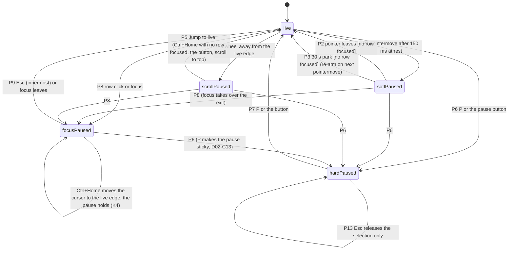

# E22-D02 — SCR-053 tape and big-trade bubble panel: greyscale wireframes with every state

**Ticket:** E22-D02 (#507) · **Epic:** E22 · **Task, P1, Sprint 08** · **Status:** Draft — owner approval pending (`docs/design/README.md` approval rule; the ticket's "reviewed by CDO + chart-engine lead + QA" is the owner's `approved` comment under the agent-delivery adaptations); every decision below that is not already binding is **PROPOSED**, and every value inherited from E22-D01 stays PROPOSED until the owner's sessions (memo header line 3) — said here once, not on every row. **Blocked by E22-D01 (#441), merged** to `main` as `b300e71aca70bc0b120f0365d8cccc3de1af50fc` (#3971); this spec builds on that merged memo and re-decides none of it. Penpot boards: **drawn in this boards PR** (§0) — page `E22-D02 Tape and bubble panel wireframes`, thirteen boards, exported to `docs/design/E22/img/`. The pre-PR design-review lens round 1 (REQUEST_CHANGES: 0 Blocker, 7 Major, 13 Minor, 5 Nit) is folded here — S22, P13 / P14, D02-C9–C15, D02-G7 and the amended rows cite it — and so is the standing T2 gate pre-check (FIX: 7 Major, 1 Minor, 4 Nit) — S23, the §2 notice slot, D28 (4) and the T1 openers cite it — and so is the orchestrator's text round 1 (REQUEST_CHANGES: 1 Major, 9 Minor, 3 Nit) — one pause model (§5, S3 / S6, K4 / K6, HO-4), D02-C16 / C17, §15's counts and the tool's `--check` cite it; the three fold tables are posted on the PR.

**Key.** `NN` = `docs/plan/NN-*.md`; "memo" = `docs/design/research/e22-tape-reading.md` on `main` (446 lines; `F n` its findings, `§4 row n` its defaults, `C n` / `G n` / `Q n` its contradictions, gaps and hypotheses — cited, never re-decided; its line numbers are at `b300e71a`); "E17-D01 D n" = `docs/design/E17/E17-D01.md`; "E11-D02 D n" = `docs/design/E11/E11-D02.md`; "E11-D06 D n" = `docs/design/E11/E11-D06.md`; "E06-D03 D n" = `docs/design/E06/E06-D03.md`; "E13-D02" = `docs/design/E13/E13-D02.md` (the greyscale convention this spec copies); "E08-D04" = `docs/design/E08/E08-D04.md`; "E08-D11" = `docs/design/E08/E08-D11.md` (the motion spec `14` SCR-053 already links); "E09-D09" = `docs/design/E09/E09-D09.md` (the T2 disabled-with-reason grammar); "E25-D01" = `docs/design/E25/E25-D01.md` on `main` (#3974, squash `c0674eb95a59903b09388468f8bf2e382bab1161`); "E25-D05" = `docs/design/E25/E25-D05.md` on `main` (#4056, squash `52f62f64577064a0cbd22ac80461d60307401dbe`); "E24-D01" = `docs/design/research/e24-deriv-reading.md` on `main` (#3985, squash `561717ed74f74e4d0081597ca3a9239b2f0bb11b`). **D1–D32 are this spec's decisions**; rows prefixed `S`, `P`, `K`, `CP`, `A15-`, `H-`, `HO-`, `D02-C`, `D02-G` are its tables (the audit tool counts them). Every evaluative statement is `(heuristic)`: no participant, session, timing or screen-reader run exists (§18). Numbers marked **tool** come from `docs/design/_tools/e22_d02_tape_wires_audit.py` at the base below; nothing on a board is typed.

**Inputs pinned.** Base `origin/main` **`6d2ff52f3360b764d2aafeb619688258fa1f89b6`** (2026-10-23; every `file:line` below is at this commit): `14` SCR-053 (lines 1171–1195), `15` CMP-011 / 049 / 055 / 056 / 112 / 195 / 197 / 199 / 227 / 239 / 079 / 019, `05`, `11` §12 BIG, `16` §3 / §6 / §11.4 / §12, `23` §3.4 / §5.4 / §6.1 / §14.2 (read only), `24` §2.10, `26` §3.6 / §3.9 / §12 / §13, `06` §4.3–4.4, `30` §6; the shipped engine `services/api/candleviewer/orderflow/{bigtrade.py,bigtrade_models.py,limits.py}` (constants quoted by the tool, §15); `packages/ui/tokens/*.tokens.json` (§14); `apps/web/src/keymap/keymap.json` (no Tape context, no `tape.*` row — every key hint here is PROPOSED, §11); the memo and its tool `docs/design/_tools/e22_d01_tape_stats.py`; E17-D01, E06-D03, E11-D02, E11-D06, E13-D02, E08-D04, E08-D11, E09-D09, E25-D01, E25-D05, E24-D01 all on `main`. **Not on `origin`:** E22-D03 / D04 / D05 / S01–S06 / T02 / K01 (consumers; cited as owners, never as sources); `docs/design/E22/` is created by this PR.

**Orchestrator rulings (RULED, main-orchestrator, [LANE-47] 2026-10-22):** BQ-1 no `15` edit — the amendments ride in §17 for E22-D03; BQ-2 no handoff file — Tables 2 / 3 inline (§11, §12); BQ-3 the APG-grid keyboard default with `Ctrl+Home` = Jump to live and `Alt+↑/↓` scoped to the open CMP-056 menu; BQ-4 the memo's control strip, the ticket's `scale [log|linear] min [10k] whale [100k]` strip recorded as superseded (rider (b): D02-C1, a C-row to the `14` owner — the two strips are never drawn together); BQ-5 "size tier" (first use on each board reads "size tier (of a print)"); BQ-6 DOM legend row + engine SDF labels (rider (a): the named bench scenario `bench/bubbles-sdf-labels` owed to E22-K01 — D02-G3). The lesser defaults of this spec stay PROPOSED and say so.

## Acceptance-criteria trace (E22-D02, issue #507)

Status key as E22-D01: **done** = delivered as worded; **heuristic-only** = delivered under the agent-delivery adaptations, pending the owner; **open** = needs the owner or a later ticket, not claimed; **routed** = another ticket's by the backlog.

| Ticket AC, note or DoD clause                                                                                                | Section          | Status         | Note                                                                                                                                                                       |
| ---------------------------------------------------------------------------------------------------------------------------- | ---------------- | -------------- | -------------------------------------------------------------------------------------------------------------------------------------------------------------------------- |
| Sc. 1 every catalogued state drawn; each frame names its copy string                                                         | §4, §13, §0      | done (text)    | 23 state rows, each with its verbatim string and board; the thirteen boards are drawn (§0)                                                                                 |
| Sc. 2 density resolved with evidence (matches the memo or a deviation is recorded)                                           | §2, §3           | done           | compact default (memo F6, §4 row 2); comfortable drawn as the pair with its own slot heights (D2); the per-density cell size is recorded against `16` §3 rule 1 as D02-C11 |
| Sc. 3 no colour-only meaning — every tier distinguishable by weight or glyph in greyscale                                    | §10, §14         | done (text)    | the frames are greyscale by construction; the §3.9 swatches are the tool's simulated values, no image exists                                                               |
| Scope: compact and comfortable tape; filter bar; column picker; control strip; overlay variant                               | §2, §6, §7, §8   | done (text)    | the strip is the memo's (BQ-4); the ticket's strip is D02-C1                                                                                                               |
| Scope: size-tier treatment by weight / glyph as well as colour (global AC 3)                                                 | §3, §10          | done           |                                                                                                                                                                            |
| Scope: clustering affordance — CMP-227 placement, the tooltip's count / window / tolerance                                   | §9               | done (text)    | panel-level chip (memo §4 row 10); G10 (no `trade_cluster` drawer section) cited, not filled                                                                               |
| Scope: keyboard map annotated — `P`, `Ctrl+F`, row focus, `Alt+↑/↓`                                                          | §11              | heuristic-only | every hint PROPOSED (no tape rows in `keymap.json`, memo C11; BQ-3)                                                                                                        |
| Technical note: ≤60 DOM rows, ring buffer 10 000, bubbles in the engine; no sticky per-second headers                        | §2, §15          | done           | dividers are in-list `presentation` rows counted inside the window; the ring buffer is a setting under `RING_BUFFER_MAX_PRINTS` 50 000 (memo C6)                           |
| Test plan: chart-engine lead on the legend (WebGL vs DOM); QA on testability                                                 | §8 card, §4      | heuristic-only | the engine / DOM boundary card (BQ-6) and the QA-testability column; the review is the owner's `approved`                                                                  |
| Security note: public market data only                                                                                       | header, §16      | done           | no account, balance, position or key on any frame; no order affordance (click-to-trade is E31's)                                                                           |
| A11y note: `role="log"` + `aria-live="off"`, opt-in whale announcements, focusable rows, ≥24 px                              | §11, §12         | done (text)    | measured targets in §11; the policy is E22-D04's                                                                                                                           |
| Performance note: ≥55 fps at 2 000 prints/s; the coalescing-factor indicator                                                 | §2, §15          | done (text)    | the readout "2 010 /s (1 s) · 33 /frame" (memo F7); nothing here is a new budget value                                                                                     |
| Observability: where `tape.filter_changed` / `tape.paused` / `tape.resumed` / `tape.print_clicked` fire                      | §5, §16          | done (text)    | field names PROPOSED (D02-G1)                                                                                                                                              |
| DoD: frames merged in Figma, linked from SCR-053                                                                             | §0, `14`         | open           | Figma → Penpot page `E22-D02 Tape and bubble panel wireframes` (page id in §0); drawn and exported in this boards PR; the one `14` pointer line is in this PR              |
| DoD: reviewed by CDO + chart-engine lead + QA                                                                                | —                | open           | the owner's `approved` comment (adaptations)                                                                                                                               |
| DoD: open questions from D01 answered or escalated                                                                           | §19 Q-rows       | done (text)    | Q1–Q15 each drawn here as the memo's default or escalated to its named owner                                                                                               |
| DoD: ready to be taken into D03                                                                                              | §17, §19 HO-rows | done (text)    | the `15` amendments table, the hi-fi pairs, the r_min call and the handoff list                                                                                            |
| Brief: repo paths `apps/web/src/…`, commands `pnpm --filter @candleviewer/web test` …, "Closes #", automated tests, coverage | §20              | routed         | the generic web template, inapplicable to a design ticket — recorded as deviations, not followed                                                                           |

## 0. The boards (Penpot) — drawn, this boards PR

Page **`E22-D02 Tape and bubble panel wireframes`** (page id `156d692e-06ae-8035-8008-dcf1b6c9e1eb`; referenced by name + id only). The **thirteen boards** below are drawn from one plugin script (committed as `docs/design/_tools/sheets/e22-d02/e22-d02-board.r10.js` — the single source, as #4921 committed E25-D02's; `FILE_ID` is a fail-closed placeholder the loader sets at load time, so no file id is committed) in this boards PR; **thirteen boards drawn, thirteen exports committed** (the register below). Exports go to `docs/design/E22/img/E22-D02-NN-slug.png`. Convention (E13-D02 §0 / §13, RULED): greyscale, **neutral tokens only, unbound on the boards** (the token name in each shape's plugin data, the hex resolved from `packages/ui/tokens` at the base), glyph placeholders for icons, every state carried by text + shape, the two composed screens at **1280×800 and 2560×1440** (boards 01 / 02 / 08), the other states once at 1280. Every board carrying a PROPOSED decision carries the stamp and the Q / BQ id; one meaning per outline weight with a legend line ("outlined = PROPOSED default"); the focus-ring stand-in (a 2 px `color.text.primary` outline, E13-D02 line 500) means **keyboard focus only** and appears on board 12 and the paused-row frame. Realistic content takes the memo's §3.1 example rows' times and prices with sizes rescaled so the drawn tiers hold at the majors' seed (D02-C9), extended to a full window (times descending from `14:02:11.331`, prices around 64,012, BTCUSDT sizes and notionals — synthetic, labelled; every row's tier computed from the threshold); the DEMO band is in the shell chrome only.

| #   | Board (`E22-D02 / NN slug`)   | Shows                                                                                                                                                                                                                                                                                                                                                                                                                                                                                                                                                                                                                                                                                                                                                                                                                                                                                                                                                          | Export                                       |
| --- | ----------------------------- | -------------------------------------------------------------------------------------------------------------------------------------------------------------------------------------------------------------------------------------------------------------------------------------------------------------------------------------------------------------------------------------------------------------------------------------------------------------------------------------------------------------------------------------------------------------------------------------------------------------------------------------------------------------------------------------------------------------------------------------------------------------------------------------------------------------------------------------------------------------------------------------------------------------------------------------------------------------- | -------------------------------------------- |
| 01  | `scr-053-panel-1280`          | SCR-053 docked right of SCR-030 (overlay on) in the 1280×800 shell: streaming, compact, the header, status and column-header rows, the log at its real row count (25 in a 604 px log), the collapsed control strip and its expanded three-row form as a callout; px callouts, neutral token names, the Tab stops numbered (§11: header · status row · chips · list · strip)                                                                                                                                                                                                                                                                                                                                                                                                                                                                                                                                                                                    | `E22-D02-01-scr-053-panel-1280.png`          |
| 02  | `scr-053-panel-2560`          | The same default at 2560×1440 (two chart panels, the tape at 480 px with 51 compact rows, SCR-050 and SCR-055 as labelled placeholders); the panel at its minimum width (332 px) and at a wide width (the Side column takes the slack); the comfortable pair (32 px rows at its own slot heights: 17 at 1280×800, 37 here; 403 px minimum)                                                                                                                                                                                                                                                                                                                                                                                                                                                                                                                                                                                                                     | `E22-D02-02-scr-053-panel-2560.png`          |
| 03  | `tape-rows-densities-tiers`   | Row anatomy at compact and comfortable with ch / px per column; tier 0 / 1 / 2 rows (weight, `●` / `◆`, the 2 px accent, the tier-2 band, the dimmed prefix and its exceptions — Q2); the `Cluster ×N` cell and the merged row without a count (C18); the "liq" tag; the compressed row; the 50 / 500 / 2 000 band as three 600 px crops (F5)                                                                                                                                                                                                                                                                                                                                                                                                                                                                                                                                                                                                                  | `E22-D02-03-tape-rows-densities-tiers.png`   |
| 04  | `pause-model-states`          | The §5 state diagram drawn as a diagram with its cross-edges (the soft and scroll pauses hand over to a focus pause; focus wins until `Esc` or blur), the P1–P14 table, and the frames keyed to P-rows at the panel's 400 px default width: soft paused (pointer at rest, 150 ms / 30 s annotated — Q3, Q13; no roving cursor), resumed with "— 412 prints while paused —", paused in a stale feed (two pills, P10), paused with the ring full (S22, "Paused — buffer full · 10 000 kept"); scroll-away with Jump to live (`Ctrl+Home`, BQ-3) and hard paused (`P`, `aria-pressed`) in the table; where `tape.paused` / `tape.resumed` fire                                                                                                                                                                                                                                                                                                                    | `E22-D02-04-pause-model-states.png`          |
| 05  | `feed-and-list-states`        | Stale T1 beside Paused (two pills); Stale ≥ T2 strong; Disconnected as a 400 px frame (frozen rows under the scrim, the SCR-152 strip, the header outside it with the pause button T2 — the lock badge on ⏸ and the CMP-016 echo — beside the hard-paused variant, ▶ pressed, T1); Delayed; Loading; Empty; Filtered-empty + Clear filter; Partial history (AC 7); Reconnect backfill before / after Load missed prints (a status-row button beside the `gapped` chip); Mode switch; the over-threshold strip with [Apply 34 723] [Keep 30 000] and `capped` (Q7); compressed rows (Q10) — each card's value line is its copy string                                                                                                                                                                                                                                                                                                                           | `E22-D02-05-feed-and-list-states.png`        |
| 06  | `filter-bar-column-picker`    | The `Ctrl+F` filter popover (min notional · side · aggregated vs raw), the chips row with removable chips and the Big only preset, the mode chip + CMP-227, CMP-056 open with availability by encoding and the `Alt+↑/↓` / menu reorder path, the layout-persistence note, the view-as read-only frame (the notice in its §2 slot directly under the header; T2 on every write — the strip's threshold / scale / Rows controls, the warning strip's Apply, the picker's items with Move up / Move down and Reset columns, the popover's Reconstructed rows toggle, the density pair; the Threshold… and Columns… openers T1; `Size tier 2` as plain derived text); the Viewer inset (S23 — the permission leg: the strip's writes and the popover toggle under "Read-only — your role can't change settings.", the picker's items, Reset columns and the density pair under "Read-only — your role can't save workspaces."); where `tape.filter_changed` fires | `E22-D02-06-filter-bar-column-picker.png`    |
| 07  | `threshold-strip-classes`     | The control strip in notional · percentile ("eff. 220k USDT" + "(estimated)", uncapped) · absolute-size modes, "Size tier 2 = 4× · 1M USDT" read-only, the class-seeds table, the strip in place and the over-threshold warning strip in place under the status row ("eff. 34.7k USDT · capped", Q7); Q6 / Q15 stamps; "E22-S02 owns the control"                                                                                                                                                                                                                                                                                                                                                                                                                                                                                                                                                                                                              | `E22-D02-07-threshold-strip-classes.png`     |
| 08  | `bubble-overlay-scr-030`      | The SCR-030 chassis (E11-D02 §2) with the overlay at 1280×800: buy discs / sell squares of equal area at 1× / 1.5× / 2× / 3× / 4× along the bars, the ▲ / ▼ inside from r ≥ 10 px, the "1.2M" label and the cap-outline fallback, a cluster bubble "×7", the two age steps, the legend row, the CMP-197 tooltip, the click → crosshair callout (Q5, Q11, Q14)                                                                                                                                                                                                                                                                                                                                                                                                                                                                                                                                                                                                  | `E22-D02-08-bubble-overlay-scr-030.png`      |
| 09  | `bubble-states-scale-switch`  | The scale switch (area-linear ▾ / log) and the legend text per law; fresh / aged / capped / clustered / stale (× 0.85) / disconnected (frozen) / overlay off; the engine / DOM boundary card (BQ-6); the LOD-shedding note (C13); the shape-floor pair at r 3 and r 5.3 px                                                                                                                                                                                                                                                                                                                                                                                                                                                                                                                                                                                                                                                                                     | `E22-D02-09-bubble-states-scale-switch.png`  |
| 10  | `greyscale-cvd-proof`         | AC 3: tier 0 / 1 / 2 rows and the bubble pair at r 3 / 5.3 / 10 / 24 px in the board's own greyscale ink, beside the §3.9 simulated swatches (normal / greyscale / deuteranopia hexes from the tool, "simulated — tool values, no image exists") and their ratios; the words-in-`color.text.primary` rule as the E22-D03 hand-off (Q4)                                                                                                                                                                                                                                                                                                                                                                                                                                                                                                                                                                                                                         | `E22-D02-10-greyscale-cvd-proof.png`         |
| 11  | `clustering-badge-tooltip`    | The panel-level CMP-227 chip beside the mode chip, its tooltip and `Enter` → SCR-058 (G10 noted), the row / bubble tooltip, the raw ↔ reconstructed switch with the seam divider, the badge absent in raw mode; "E22-S04 owns"                                                                                                                                                                                                                                                                                                                                                                                                                                                                                                                                                                                                                                                                                                                                 | `E22-D02-11-clustering-badge-tooltip.png`    |
| 12  | `keyboard-a11y-announcements` | The panel wireframe with the Tab stops (header · status row · chips · list · strip) and the roving cursor beside the a11y tree (memo §5 as amended by D29: one hidden `status` node, the chips plain text); the keyboard table (BQ-3, every hint PROPOSED); the name / role excerpt; the announcement policy with the E06-D03 D5 check; targets ≥24 px; the analytics firing map; the T2 anatomy of the gated controls (the view-as leg and the Viewer's permission leg)                                                                                                                                                                                                                                                                                                                                                                                                                                                                                       | `E22-D02-12-keyboard-a11y-announcements.png` |
| 13  | `copy-deck-states-matrix`     | The state × copy matrix with the QA-testability column, the measured greyscale pairs (tool), the C / G / Q / BQ counts, the `15` amendments summary and the hand-offs                                                                                                                                                                                                                                                                                                                                                                                                                                                                                                                                                                                                                                                                                                                                                                                          | `E22-D02-13-copy-deck-states-matrix.png`     |

| Board (`E22-D02 / NN slug`)      | Script revision | Board id                               | Export (W × H)                                             | Spec states / sections drawn                       |
| -------------------------------- | --------------- | -------------------------------------- | ---------------------------------------------------------- | -------------------------------------------------- |
| `01 scr-053-panel-1280`          | r9              | `0605c48b-7da1-80e2-8008-dd19ed8b32fe` | `E22-D02-01-scr-053-panel-1280.png` (1840 × 1769)          | S1 (§2, §4)                                        |
| `02 scr-053-panel-2560`          | r9              | `205eff1e-7f85-806e-8008-dd1c1e8bad29` | `E22-D02-02-scr-053-panel-2560.png` (2800 × 2412)          | S1 at 2560×1440 (§2)                               |
| `03 tape-rows-densities-tiers`   | r9              | `0605c48b-7da1-80e2-8008-dd1a37190030` | `E22-D02-03-tape-rows-densities-tiers.png` (1840 × 1635)   | S1, S19 (§3)                                       |
| `04 pause-model-states`          | r9              | `0605c48b-7da1-80e2-8008-dd1adfff34f7` | `E22-D02-04-pause-model-states.png` (1840 × 2811)          | S2, S3, S4, S5, S6, S22 (§5)                       |
| `05 feed-and-list-states`        | r9              | `205eff1e-7f85-806e-8008-dd1cefadba97` | `E22-D02-05-feed-and-list-states.png` (1840 × 2581)        | S7–S19 (§4)                                        |
| `06 filter-bar-column-picker`    | r9              | `205eff1e-7f85-806e-8008-dd1d657d768f` | `E22-D02-06-filter-bar-column-picker.png` (1840 × 2319)    | S20, S21, S23 (§6, §11.4)                          |
| `07 threshold-strip-classes`     | r9              | `205eff1e-7f85-806e-8008-e182b88c2cf7` | `E22-D02-07-threshold-strip-classes.png` (1840 × 1798)     | S18 (§7)                                           |
| `08 bubble-overlay-scr-030`      | r9              | `205eff1e-7f85-806e-8008-e182de59b9a3` | `E22-D02-08-bubble-overlay-scr-030.png` (1840 × 1292)      | the overlay on SCR-030 (§8)                        |
| `09 bubble-states-scale-switch`  | r8              | `0605c48b-7da1-80e2-8008-dd0ed95d2f82` | `E22-D02-09-bubble-states-scale-switch.png` (1840 × 1209)  | the bubble states (§8.4)                           |
| `10 greyscale-cvd-proof`         | r9              | `205eff1e-7f85-806e-8008-e18341d08722` | `E22-D02-10-greyscale-cvd-proof.png` (1840 × 1068)         | AC 3 (§10)                                         |
| `11 clustering-badge-tooltip`    | r9              | `205eff1e-7f85-806e-8008-e1835b9b245c` | `E22-D02-11-clustering-badge-tooltip.png` (1840 × 1168)    | S17 (§9)                                           |
| `12 keyboard-a11y-announcements` | r10             | `205eff1e-7f85-806e-8008-e186afcdafef` | `E22-D02-12-keyboard-a11y-announcements.png` (1840 × 3004) | K1–K15, the a11y tree, the announcements (§11–§12) |
| `13 copy-deck-states-matrix`     | r8              | `0605c48b-7da1-80e2-8008-dd0f5b4c310f` | `E22-D02-13-copy-deck-states-matrix.png` (1840 × 2581)     | S1–S23 as the matrix (§13, §15)                    |

Boards as drawn (2026-10-29, boards 07, 08, 10, 11 and 12 redrawn 2026-11-01; the page `E22-D02 Tape and bubble panel wireframes`, id `156d692e-06ae-8035-8008-dcf1b6c9e1eb`): board 12 from the board script r10 (sha256 `5a3c9d6f4ad8db456273c9cc38da73d0ab4f3eb795a54c29f8f3c12e33243822`; the pre-commit verbatim check's declared patch of r9: the §11 K4 "Global conflict?" cell drawn in the spec cell's hyphenated form, listbox-of-rows); boards 01, 02, 03, 04, 05, 06, 07, 08, 10 and 11 from r9 (sha256 `2e545d009fbbd45813e4bde0482f875b087ef125029028c7d3a80f577867b548`; the r8-draw QA's declared patch below); boards 09 and 13 from r8 (sha256 `876dacf7d5bc04bb6b2edb9ea650f7fcd9cd60f13b2532fac45e4f9ad887cfba`) — r9 and r10 change those two only by the footer's revision string, declared, so they are not redrawn. Every board exported at 1:1 (the register's W × H equal the PNG headers); the export guard read 0 token-bound shapes and 0 component instances on every board; the relayout converged with 0 overruns and 0 collisions over 3 950 texts. Before drawing, the script's dry-run self-checks assert the per-frame figures, the T2 / validity split, the glyph shapes, the chip bindings, the verbatim tables, no non-breaking-space overflow, no emoji-presentation character, containment (no shape's right edge leaves the rect it sits in) and the tape header gaps; the pre-commit checks compared every §4 state copy string with the texts on its board (30 of 30 drawn strings found; S20's "+N filtered" drawn instantiated as "+41 filtered"), the §11 key table (95 cells) and the §12 announcement table (60 cells) cell by cell, `check-nums` (268 figures, 117 terms, 1 139 board strings, 24 simulated swatches, all in the spec) and the audit tool's `--check` (every quoted constant unchanged).

**Revisions.** r7 → r8 is a declared patch after the boards QA, with no decision, table row, copy string or number changed: (A) multi-line notes wrap at spaces (no non-breaking spaces) and their wrapped height drives the layout — boards 04 / 05 / 06 / 07 / 09, plus board 02's crop labels, board 08's notes and board 10's swatch label; (B) the T2 lock is a drawn neutral-grey padlock shape, not an emoji, so the greyscale boards carry no colour — boards 05 / 06; (C) board 02's comfortable-crop elided count is computed (5, so 12 + 5 = 17 rows at 1280×800, matching the tool) and board 06's filter frame elided count is computed; board 13's hand-offs foot states the drawn state; board 08's `×7` badge sits inside the pane and the bubble notes carry a 1 px canvas halo. r8 → r9 is the r8-draw QA's declared patch, with no decision, table row, copy string or number changed: (A, Major) board 06's S21 / S23 strip is four rows — the locked Bubbles · scale control on its own row (r8 drew it after the derived text, 19 px past the 640 px frame) — and the More menu follows the strip's height; (B) every right-aligned tape header box is at least its label wide and ends at its column's right edge, so "Notional" no longer runs into "Side" on every board that draws a tape header (01–08, 10–12); (C) board 01's Tab callouts, board 04's edge heads and board 12's legend line sit inside their frames, asserted by the new containment and header-gap self-checks. r9 → r10 is the pre-commit verbatim check's declared patch: board 12's K4 "Global conflict?" cell reads listbox-of-rows as the spec cell does (r9 drew "listbox of rows"); nothing else changes.

**CVD.** The spec needs no CVD run for neutral-only boards; the lane ran `cvd_sim.py` on the exports anyway. The three CVD renders of board 10 (the only board with non-neutral fills) are committed beside it as `E22-D02-10-greyscale-cvd-proof-greyscale.png`, `-deuteranopia.png` and `-protanopia.png` (1840 × 1068 each), made with `docs/design/_tools/cvd_sim.py` as merged on `main` (greyscale, deuteranopia and protanopia; the tool simulates no tritanopia — §10 carries that side by shape) at the final head; the swatch tile's hue pairs keep their separation in every render and the tier rows and the bubble pair read by weight, glyph, edge mark and shape alone.

## 1. Locked inputs (built on, never re-decided) and the review carries

| Input                                       | Source                                                                                                               | What it fixes here                                                                                                                                                                                                                                                                                                                                                                                                                                                                                                                                                                                                                      |
| ------------------------------------------- | -------------------------------------------------------------------------------------------------------------------- | --------------------------------------------------------------------------------------------------------------------------------------------------------------------------------------------------------------------------------------------------------------------------------------------------------------------------------------------------------------------------------------------------------------------------------------------------------------------------------------------------------------------------------------------------------------------------------------------------------------------------------------- |
| The default configuration                   | memo §4 rows 1–10 (lines 253–262)                                                                                    | columns Time · Price · Size · Notional · Side + tier mark; compact; the soft / hard pause model; three size tiers; area-linear bubbles r 3 → 24 px with the above-cap label; notional seeds per class, tier 2 = 4×; the >20 % strip; the readout at ≤2 Hz; `role="log"` / `aria-live="off"`; reconstructed rows at 250 ms / 1 tick with the Big only preset                                                                                                                                                                                                                                                                             |
| The findings                                | memo F1–F25 (lines 68–92)                                                                                            | the column set is bounded by the wire (F1); one Side column (F2); the order and the mono numerics (F3); the dimmed `HH:MM:` prefix (F4); 25 / 18 rows per 600 px (F5); click or focus pauses first (F8); hover intent (F9); the paused divider (F10); the roving grid keys (F11); the tiers (F12); one threshold truth (F13); the law (F14); the legend's four facts (F15); disc / square of equal area (F16); the strip copy (F19); the effective threshold always visible (F20); opt-in announcements (F21); focus never stolen (F22); Paused and Stale are two chips (F23); nothing flashes (F24); ≤60 DOM rows and the ladder (F25) |
| The a11y tree, the states, the ladder       | memo §5 (268–273), §6 (279–292), §7 (300)                                                                            | the tree of §12; the state rows of §4; the rung-3 compressed row                                                                                                                                                                                                                                                                                                                                                                                                                                                                                                                                                                        |
| The hypotheses this spec draws              | memo §10.1 Q1–Q15; the #507 hand-off (comment 6318781465)                                                            | Q1, Q2, Q3, Q4, Q7, Q10, Q11, Q12, Q13, Q15 drawn as the memo's default and stamped; Q14 in wireframe grade for E22-D03; Q5 / Q6 / Q8 / Q9 depicted only as the default they imply (§19)                                                                                                                                                                                                                                                                                                                                                                                                                                                |
| The contradictions and gaps                 | memo §10.2 C1–C22, §10.3 G1–G11, §10.4                                                                               | inherited as rows in §19; none fixed here; the shared XG sentences on C3 / G4 / G5                                                                                                                                                                                                                                                                                                                                                                                                                                                                                                                                                      |
| Greyscale convention                        | E13-D02 §0 (lines 9–11), §13 (498–538), §14 (540–542)                                                                | neutral tokens unbound; the focus stand-in; no CVD run on greyscale; the two frame sizes                                                                                                                                                                                                                                                                                                                                                                                                                                                                                                                                                |
| Feed states                                 | E17-D01 T1 / T2 (123–124), §5 (145–147, 154), §7 (209–227), D1 / D6 / D9 / D13 / D16                                 | trades T1 10 s / T2 30 s; the tape column 'chip "Stale 12s" on tape header; speed widget shows "—" not 0'; one feed state per surface; counters never per tick; rows de-emphasised in place; a keystroke in a blocked state gets inline text + one polite announcement                                                                                                                                                                                                                                                                                                                                                                  |
| Chassis, tooltip, states, motion            | E11-D02 §2 (51–78), D10 (117), D16 (123), D18 (125), D19 (126), §10 (401–422); E11-D06 D13 (89), D15 (91), D22 (98)  | the legend block, the status row and the corner-badge slot the overlay reuses; flip-not-clip; stale = data-ink × 0.85 + chip; disconnected = frozen + scrim; chips are flips; the bubbles call is counted in the pane budget                                                                                                                                                                                                                                                                                                                                                                                                            |
| Cursor announcements                        | E06-D03 D4 (103), D5 (105), D10 (176)                                                                                | one region, last-write-wins; "a ~10-word summary takes 2–3 s"; the cursor column the overlay's keyboard path reuses                                                                                                                                                                                                                                                                                                                                                                                                                                                                                                                     |
| Chip composition                            | E08-D04 §3 (37–51), §4 (53–58); `15` CMP-227 (2644), CMP-239 (2760)                                                  | "Stale 4s" / "Reconstructed after gap" / "Loading history…"; CMP-227 before CMP-239, ≥4 px, two names                                                                                                                                                                                                                                                                                                                                                                                                                                                                                                                                   |
| Motion on the tape's E08 states             | E08-D11 D26 (83), H12 (102), H18 / H19 (108–109), M12 (130), M29 (147), M32 / M34 (150–152)                          | the T1 dim as one container class, the `gapped` chip at 0 ms outliving the overlay, the `backfilling` inline note ≤1 Hz, the strong chip at T2 as a cut; motion otherwise E22-D04's                                                                                                                                                                                                                                                                                                                                                                                                                                                     |
| The T2 grammar                              | E09-D09 §2.2 (46–49), §3.1 (83–97), §3.2 (99–119), §9.1 (224–233), §9.3 (238–247); `15` CMP-079 (771), CMP-019 (215) | every state- or session-gated control on this panel (§11.4)                                                                                                                                                                                                                                                                                                                                                                                                                                                                                                                                                                             |
| The "(estimated)" word and the pattern rule | E25-D01 R4 (192), C15 (288), Q4 (317), Q14 (327), §9.5 (329–334); E25-D05 §4.1 (75–81), §4.3 (98–106), 131, 140, 147 | the full word "(estimated)" wherever drawn (E11-D05 ruling 4; "Est." only where E11-D04 already uses it); hollow / dashed / hatched = estimated or absent — the rule is E25-D01's, this spec points at it (D02-C7) and draws the side pair filled; the readout in the tape header (Q14 answers Q12); the `trade_cluster` display name "Trade cluster"                                                                                                                                                                                                                                                                                   |
| The liquidation boundary                    | memo §3.1 line 123; E24-D01 F17 (83), §4 (211)                                                                       | `is_liquidation` shown as a row tag, never a column; liquidations counted once via `liquidations.{symbol}`                                                                                                                                                                                                                                                                                                                                                                                                                                                                                                                              |

**Carries from the E22-D01 review rounds** (the boards lens on #3971, records on the lane; nothing re-fetched): Minor 2 — every tape drawn here is a real tape (a 5-cell header row; five texts per row at fixed column x's; the ▲ / ▼ in the Price cell; `●` / `◆` right after Size; the 2 px accent; the tier-2 band; 25 rows per 600 px panel from the tool); Minor 3 — the Paused chip and the feed chip are two pills, never merged; Minor 4 — one meaning per outline weight with a legend line; Minor 5 — every state and decision card leads with a 15–16 px value line; Nit 2 — type sizes on the primitive `font.size` scale (10 · 11 · 12 · 13 · 14 · 16 · 20 · 24, tool §14): captions 11, body 12 / 13, value lines 16, the tape's mono cells `type.num.sm` (11) compact / `type.num.base` (13) comfortable — PROPOSED, E22-D03 binds; Nit 3 — the glyph drawn inside every mark at r ≥ 10 px, alternatives in separate cells; Nit 4 — no dead canvas (the tape at its true row count); Nit 1 / r3 Nit 7 — the Source subtitle takes its revision from `VERSION`, §0 names no local path; the lens's "best-in-class" list (the tape at 50 / 500 / 2 000 as three real panels, the pause model as a state diagram, the bubbles on a chart snippet with the age steps and the legend, the a11y tree beside the panel wireframe with the Tab stop and roving cursor) is boards 03, 04, 08 / 09 and 12 here; r3 M1–M3 (the shape floor, the cap-outline gap, the APG keys) are drawn as the merged memo says.

## 2. Panel anatomy — SCR-053 at compact, 1280×800 (D1–D6)

The panel is a CMP-080 DockPanel docked right of SCR-030 (board 01; `14` SCR-053 Type line 1173: "two linked views"). Slots top to bottom, with the neutral token each surface would bind (E22-D03 binds hue); every px literal here is an input of the audit tool, which prints the row counts and the minimum width (§15 reports them):

| Slot (top → bottom)                   | Height (compact)                                                                                                                    | Content and the token it binds                                                                                                                                                                                                                                                                                                                                                                                                                                                                                                                                                                                                                                                                                                                                                                                                                                                                                                                                                                                                                                                                                                                                                                                                                                 |
| ------------------------------------- | ----------------------------------------------------------------------------------------------------------------------------------- | -------------------------------------------------------------------------------------------------------------------------------------------------------------------------------------------------------------------------------------------------------------------------------------------------------------------------------------------------------------------------------------------------------------------------------------------------------------------------------------------------------------------------------------------------------------------------------------------------------------------------------------------------------------------------------------------------------------------------------------------------------------------------------------------------------------------------------------------------------------------------------------------------------------------------------------------------------------------------------------------------------------------------------------------------------------------------------------------------------------------------------------------------------------------------------------------------------------------------------------------------------------- |
| **Header row** (`toolbar`)            | 32 px = `size.control.compact` 24 + `space.1` × 2                                                                                   | the title "Tape BTCUSDT" (`type.ui.label`, `color.text.primary`); then five 24 × 24 CMP-002 icon buttons with CMP-016 tooltips naming the key: "Filter prints (Ctrl+F)", "Threshold…", "Pause tape (P)" (`aria-pressed`), "Columns…", "More (Shift+F10)" (its menu, K9: Read tape summary · Reset columns · Density: Compact / Comfortable — the per-panel CMP-063 as a `menuitemradio` pair · Open settings); surface `color.surface.raised`, hairline `color.border.default` below                                                                                                                                                                                                                                                                                                                                                                                                                                                                                                                                                                                                                                                                                                                                                                           |
| **Panel notice** (S21 / S23 only)     | 24 px (comfortable 32) — the status-row heights                                                                                     | the one `rbac.view_as` / `notice.panel_read_only` node in `color.text.secondary` on `color.surface.raised`, directly under the header row (E09-D09 §2.2 "one notice, many pointers"; every gated control's `aria-describedby` points at it); the log gives up one row — 24 rows at 1280×800 (comfortable 16; tool); absent in every other state                                                                                                                                                                                                                                                                                                                                                                                                                                                                                                                                                                                                                                                                                                                                                                                                                                                                                                                |
| **Status row** (plain text + buttons) | 28 px = 20 px pills + `space.2` (comfortable 32 = + `space.3`)                                                                      | left: the feed-chip slot (CMP-239 words: "Stale 12s" / nothing while Live — E17-D01 D1), the Paused chip (CMP-011; its action **Jump to live** is a button beside it in a scroll pause, S3), the `gapped` chip with its **Load missed prints** button (S15), the `capped` chip; right: the readout **"2 010 /s (1 s) · 33 /frame"** — "+41 filtered" only while a display filter is on — the prints the panel's own filters hid in the readout's 1 s window, never `23` §14.2's `dropped` (memo F7; D02-C16) — (`type.num.sm`, `color.text.secondary`, `aria-live="off"`, ≤2 Hz). The chips and the readout are **plain text, not a live region** (D29: the panel's one `status` node is visually hidden and pre-rendered empty); the row's buttons (Jump to live, Load missed prints, the S18 strip's Apply / Keep) are one Tab stop (K1). Chips are 20 px pills with a 24 px hit box. The row's own ladder, run whenever its content exceeds its width (at the 400 px default a Paused chip triggers it): the readout drops "/frame", then the Paused chip takes its narrow form (D4, D02-C3) — the mock run of the board script showed the chips and the readout cannot share one 400 px row otherwise, so the presets and filters have their own row below |
| **Chips row** (`group`)               | 28 px per row = 20 px pills + `space.2` (comfortable 32); wraps, never truncates                                                    | CMP-055 `role="group"` "Active filters": the **Big only** preset chip (`aria-pressed`), the mode chip "Reconstructed 250 ms / 1 tick" + CMP-227 "(estimated)" (≥4 px apart), then the removable filter chips ("≥ 10 000 USDT ×", "Sell only ×"); present whenever a chip exists (the mode chip is default-on); wraps to a second 28 px row when the chips exceed the width (D4)                                                                                                                                                                                                                                                                                                                                                                                                                                                                                                                                                                                                                                                                                                                                                                                                                                                                                |
| **Column header row**                 | 20 px (a 16 px caption line + `space.1`; comfortable 24)                                                                            | the five column names in `type.num.sm` `color.text.tertiary` — Time · Price · Size · Notional · Side (taker) — plain `columnheader`s, **not sort buttons**: a tape is newest-first by construction (A15-4); hairline below                                                                                                                                                                                                                                                                                                                                                                                                                                                                                                                                                                                                                                                                                                                                                                                                                                                                                                                                                                                                                                     |
| **The log** (`log` → `grid`)          | the rest: **604 px at 1280×800 → 25 rows; 1 244 px at 2560×1440 → 51** (comfortable: 572 → 17; 1 212 → 37)                          | N rows at `size.row.compact` 24 px on `color.surface.raised`; the live-edge divider (1 px `color.border.strong` under the newest row, drawn only while paused); the in-list divider rows ("— 412 prints while paused —", the gap seam, the recording start, the clustering seam) are 24 px `presentation` rows **counted inside the ≤60-row DOM window** (ticket technical note: no sticky per-second headers, no unbounded DOM); overscan = 60 − visible rows − 2 dividers (tool: 33 compact / 41 comfortable at 1280×800; 7 / 21 at 2560×1440)                                                                                                                                                                                                                                                                                                                                                                                                                                                                                                                                                                                                                                                                                                               |
| **Control strip** (BQ-4)              | **collapsed by default: 24 px** (one summary line; comfortable 32); expanded 80 px = three 24 px rows + `space.2` (comfortable 108) | collapsed: the disclosure line "▸ Threshold 250k · area-linear · 250 ms (estimated)" (one line at the 332 px minimum — CP14) — the strip is a settings surface opened on demand and the log keeps the room; expanded — row A `Threshold · [notional ▾] · [250 000 USDT] · eff. 250k USDT` (+ the `(estimated)` / `capped` chips in their modes); row B `Size tier 2 = 4× · 1M USDT` (read-only derived text, never a control — G8) · `Bubbles · scale [area-linear ▾]`; row C `Rows · [reconstructed 250 ms / 1 tick ▾] (estimated)`; at 400 px the two-row form overflows the panel (the mock run showed it), so three rows it is; §7 has the three modes                                                                                                                                                                                                                                                                                                                                                                                                                                                                                                                                                                                                     |

**Dimensions (tool, `(heuristic)` 0.60 em mono advance).** Columns Time 12 ch · Price ≤9 · Size ≤6 · Notional ≤6 · Side 4 + the ▲ / ▼ glyph 1 + the tier mark 1 = 39 ch; at `type.num.sm` 11 px that is 258 px of text + 6 × `space.2` 8 px gaps + 2 × `space.3` 12 px inset + the 2 px accent = **332 px minimum width compact**; comfortable, with `space.3` 12 px gaps and 13 px cells, **403 px** (356 px if the `16` owner holds one cell size at both densities — D02-C11) — PROPOSED, printed by the tool, never asserted. The status row runs its own ladder first (above). Below the panel's minimum, in order: the Side **word** yields to the glyph (the word moves to the cell's accessible name and the row tooltip), the chips row wraps, the collapsible control strip stays collapsed, the header toolbar folds into "More". The panel is drawn at **400 px** wide at 1280×800 and **480 px** at 2560×1440 (board 02 also shows 332 px and a wide 640 px pass where the Side column takes the slack and nothing stretches). The shell: a 40 px top bar and a 24 px bottom status bar, so the panel is 736 px tall at 1280×800 and 1 376 px at 2560×1440 (board inputs; `16` §8's 1280×800 minimum viewport).

**The comfortable pair (D2).** `size.row.comfortable` 32 px rows, `type.num.base` 13 px cells, `space.3` 12 px gaps, and every slot at the comfortable step (header 44 = `size.control.comfortable` 32 + `space.3`; status and chips rows 32 = 20 px pills + `space.3`; column header 24; strip 32 collapsed / 108 expanded — tool): 18 rows per 600 px (the memo's reference panel), 17 in the 572 px log at 1280×800, 37 at 2560×1440; density changes spacing only (`16` §3 rule 1; CMP-063 per panel, reached from the More menu as a `menuitemradio` pair — K9); the per-density **cell size** (11 → 13 px) is the one pull against rule 1 and `15` §0.3 rule 2 and is recorded as D02-C11 for the `16` owner, not asserted. Compact is the default (memo F6, §4 row 2: the trading-surface default and exactly the WCAG 2.5.8 minimum).

**What never moves focus (D3).** New prints never move focus; a focused row keeps its print; the dividers are never focusable (memo F22; `05` §3.4 item 3). **The overlay's slots (D5).** On SCR-030 the overlay uses E11-D02 §2's slots only: the legend block gets one CMP-199 row (§8), the status row keeps the chart's chips, the corner-badge slot carries the LOD-shedding note; nothing paints over the plot except through the chassis (C-2.16). **Zoom and text scale (D6, `05` §5 item 7, `16` §3 rule 4).** At 200 % the panel keeps its slot order and its 24 CSS-px rows; because its minimum width doubles past the dock width, the collapse ladder above runs (word → glyph, "/frame", the narrow Paused chip, chips wrap, the strip stays collapsed, toolbar folds) and the dock gives the panel its minimum before the chart (`16` §8 docking rule 2); the log scrolls, nothing clips; the filter popover and the column-picker menu become full-height sheets with a sticky header and a scrolling body. **Forced colours (E22-D03 hand-off):** the 2 px accent and the tier-2 band are backgrounds and disappear under `forced-colors: active`; the tiers stay carried by the glyph, the weight and the word, the focus ring takes the system `Highlight`, and the outline-only marks (the cap outline) take `CanvasText` — stated here, drawn by E22-D03.

## 3. Row anatomy and columns (D7–D12)

The memo's §3.1 example rows set the shape (their times, prices and row form), but their notionals cannot hold under the 4× rule at any one threshold (54.4k unmarked and 134.4k a whale need T > 54.4k and 4T ≤ 134.4k — D02-C9), so the drawn rows carry sizes rescaled to the majors' seed and **every drawn row's tier is computed from the threshold** (250 000 / 1 000 000 USDT; the board script and the tool, never typed): `14:02:11.331 ▲ 64,012.5 4.00 ● 256.1k Buy` · `14:02:11.208 ▼ 64,012.0 18.75 ◆ 1.2M Sell` · `14:02:10.994 ▲ 64,012.5 0.12 7.7k Buy`, the tier glyph after Size as drawn (the memo's text puts the tier mark last — D02-C10). One row at compact (board 03), left to right at fixed column x's (memo F1–F4, §3.1): a **2 px accent** at the row's left edge on tiers 1–2 (`color.buy.default` / `color.sell.default` in hi-fi; `color.text.primary` in greyscale) · **Time** `HH:MM:SS.mmm` left-aligned, 12 ch, with the unchanged `HH:MM:` prefix in `color.text.tertiary` on tiers 0–1 (Q2, D7) and **not dimmed on a tier-2 band or on the selected row** (`color.text.tertiary` on `color.surface.selected` measures 3.98:1 dark — tool §14, rejected by design) · the **▲ / ▼ side glyph** (one cell, before Price) · **Price** right-aligned · **Size** right-aligned · the **tier glyph** `●` (tier 1) / `◆` (tier 2) immediately after Size on the baseline · **Notional** right-aligned ("54.4k", "134.4k", "1.2M") · **Side** the word Buy / Sell, left-aligned, header tooltip and accessible name "Side (taker): Buy" (memo F2) · the optional tags after the word: **"liq"** (D10) and **`×N`** (D9). Numerics are `font.family.mono` tabular figures (`15` §0.3 rule 6), Price · Size · Notional adjacent so one fixation reads price and size (memo F3); every word and numeric sits in `color.text.primary` on every tier — the hue rides on the glyphs, the accent and the fill only (memo §3.8 line 219; §10).

| Row element              | Tier 0 (normal)           | Tier 1 (big, ≥ threshold)                             | Tier 2 ('whale', ≥ 4× — a client-side multiple, G8)                                         | Carrier in greyscale      |
| ------------------------ | ------------------------- | ----------------------------------------------------- | ------------------------------------------------------------------------------------------- | ------------------------- |
| Size and Notional weight | `font.weight.regular` 400 | `font.weight.medium` 500                              | `font.weight.bold` 700                                                                      | weight                    |
| Tier glyph after Size    | none                      | `●`                                                   | `◆`                                                                                         | glyph shape               |
| Left accent              | none                      | 2 px, side hue (greyscale: `color.text.primary`)      | 2 px                                                                                        | a mark at the edge        |
| Row fill                 | `color.surface.raised`    | `color.surface.raised`                                | `color.buy.subtle` / `color.sell.subtle` (greyscale: `color.surface.hover`-class lightness) | a lighter band + the word |
| `HH:MM:` prefix          | `color.text.tertiary`     | `color.text.tertiary`                                 | `color.text.primary` (undimmed, memo F4)                                                    | —                         |
| Capped print             | —                         | stays tier 1 (`capped=True`); the header chip says so | —                                                                                           | the `capped` chip         |

**D8 the `Cluster ×N` cell.** When rows are reconstructed (`cluster_window_ms` 250 / `cluster_tolerance_ticks` 1 on the one shared subscription, memo §4 row 10) a merged row carries the server's cluster flag; **`×N` is shown only where the count is on the wire** (`cluster_size` on the structured `TradesBatch`, or kind 3 once E22-T02 lands C18 (a) or (c)); on kind 3 today (C18 (b)) the row shows the flag glyph `⧉` after the Side word and **no count** — the panel-level badge (§9) says rows are reconstructed, and the row tooltip names the count where the encoding carries it. Board 03 draws the merged row **with and without** `×N`. **D9** the tag order after the word: `×N` · `liq` · `blk`; the accessible name reads them as words ("cluster of 7", "liquidation", "block trade"). **D10 the "liq" tag** = `is_liquidation` (structured) / flag bit1 (kind 3): a 16 px text tag "liq" in `color.text.secondary`, never a column; liquidations are counted once via `liquidations.{symbol}` (SCR-054, E24-D01) — the tape sums nothing. **D11 optional columns** (CMP-056, §6): Block (`is_block_trade` / bit0 — a tag by default, a column when picked), Tick direction (structured feed only — on kind 3 the item is **not offered**, memo F1; `tick_direction` is NULL before E16, G6), Σ delta (a client sum of signed size, off). **D12 the rung-3 compressed row** (memo F25, §7 line 300; Q10): under the fallback ladder tier-0 prints of one frame collapse into one 24 px row **"27 small prints · Σ 1.9"** with a text badge **"compressed"** (CMP-011, `color.text.secondary`), the ring buffer intact; a pause expands it; tier 1–2 rows are never compressed.

**Per-row accessible name (the memo §5 line 269 template on the drawn row):** "Sell, 18.75 BTC at 64,012.0, 1.2M, whale, 14:02:11.208" — side first whatever the column order, the tier word ("big" / "whale") only on tiers 1–2, then the tags; the full `HH:MM:SS.mmm` is in the Time cell's name whatever the prefix dimming.

## 4. The state inventory — every frame named (D13)

One row per state; the copy string is verbatim (the copy deck §13 repeats none differently); **QA testability** says how a tester reproduces the state against the built panel (the fixture, the WS option or the simulated condition — never a claim that it was run); the six Gherkin states of the ticket come first. Controls disabled by a **state**, by the **session** (view-as, S21) or by a missing **permission** (S23) take E09-D09's T2 anatomy (§11.4) — the row names it; an opener that reaches reads (Threshold…, Columns…) stays T1 in every session. Announcements are once per episode in the panel's one `status` node — visually hidden, pre-rendered empty (D29; `05` §6.2 region hygiene; E17-D01 §7); the chips, their counts and the readout are plain text and never announced.

| Id  | State (trigger · source)                                                                                                                                                                                                                                                         | What the list shows                                                                                                                                                                                                | Chip / strip / divider (verbatim)                                                                                                                                                                                                                                                                                                                           | Readout                                                                | Controls                                                                                                                                                                                                                                                                                                                                                                                                                                                                                                                                                                                        | Announcement (once)                                                                                 | QA testability                                                                                                                                                                                                 | Board  |
| --- | -------------------------------------------------------------------------------------------------------------------------------------------------------------------------------------------------------------------------------------------------------------------------------- | ------------------------------------------------------------------------------------------------------------------------------------------------------------------------------------------------------------------ | ----------------------------------------------------------------------------------------------------------------------------------------------------------------------------------------------------------------------------------------------------------------------------------------------------------------------------------------------------------- | ---------------------------------------------------------------------- | ----------------------------------------------------------------------------------------------------------------------------------------------------------------------------------------------------------------------------------------------------------------------------------------------------------------------------------------------------------------------------------------------------------------------------------------------------------------------------------------------------------------------------------------------------------------------------------------------- | --------------------------------------------------------------------------------------------------- | -------------------------------------------------------------------------------------------------------------------------------------------------------------------------------------------------------------- | ------ |
| S1  | **Streaming** (Gherkin) · fresh frames within T1 (E17-D01)                                                                                                                                                                                                                       | rows enter in place at the top, newest first; no divider; tiers persistent (at 50 /s rows read as a flicker, at 500 /s only the tiers, at 2 000 /s the readout — memo F5)                                          | none (no feed chip means Live, E17-D01 D1)                                                                                                                                                                                                                                                                                                                  | "2 010 /s (1 s) · 33 /frame"                                           | all T1                                                                                                                                                                                                                                                                                                                                                                                                                                                                                                                                                                                          | none                                                                                                | replay `btcusdt-2026-09-01.jsonl.gz` at 50 / 500 / 2 000 prints/s through the harness (memo §7)                                                                                                                | 01–03  |
| S2  | **Soft paused** (Gherkin "paused") · `pointermove` over the list after ≥150 ms at rest (P1)                                                                                                                                                                                      | frozen; the live-edge divider under the newest row; buffered count ticks while prints arrive                                                                                                                       | "Paused — 412 prints buffered" (the status-row ladder, D1: the readout drops "/frame" first; the narrow form "Paused — 412 buffered" only when that is not enough)                                                                                                                                                                                          | live                                                                   | T1                                                                                                                                                                                                                                                                                                                                                                                                                                                                                                                                                                                              | none per tick                                                                                       | rest the pointer 150 ms then move 1 px; assert the chip and no row movement; leave → S5                                                                                                                        | 04     |
| S3  | **Scroll-away paused** · wheel / scroll away from the live edge (P4)                                                                                                                                                                                                             | frozen at the scrolled position; no park timer                                                                                                                                                                     | "Paused — 412 prints buffered · Jump to live"                                                                                                                                                                                                                                                                                                               | live                                                                   | T1; Jump to live = `Ctrl+Home` with no row focused (K4), the status row's **Jump to live** button (K1's stop) or scrolling back to the top (BQ-3); focusing a row here is P8 — `Ctrl+Home` then reaches the live edge and `Esc` or blur resumes (P9)                                                                                                                                                                                                                                                                                                                                            | none                                                                                                | wheel down 3 rows; wait 60 s; assert still paused; `Ctrl+Home` with focus on the status row (no row focused) → S5; again with a row focused: `Ctrl+Home` → the live edge, the chip stays; `Esc` → S5           | 04     |
| S4  | **Hard paused** · `P` or the pause button (P6)                                                                                                                                                                                                                                   | frozen; never auto-resumes; the roving grid is live                                                                                                                                                                | "Paused — 412 prints buffered"; the pause button `aria-pressed="true"`                                                                                                                                                                                                                                                                                      | live                                                                   | T1                                                                                                                                                                                                                                                                                                                                                                                                                                                                                                                                                                                              | none                                                                                                | press `P` with panel focus; park the pointer 60 s; assert no resume                                                                                                                                            | 04     |
| S5  | **Resumed** · leave / park / `P` / `Esc` / Jump to live (P2, P3, P5, P7, P9)                                                                                                                                                                                                     | the buffered prints inserted (never replayed) under a `presentation` divider row                                                                                                                                   | "— 412 prints while paused —"                                                                                                                                                                                                                                                                                                                               | live                                                                   | T1                                                                                                                                                                                                                                                                                                                                                                                                                                                                                                                                                                                              | "Resumed, 412 prints inserted" (polite)                                                             | from S2–S4; count the inserted rows = the chip's count                                                                                                                                                         | 04     |
| S6  | **Click-to-locate** · a row click or keyboard focus (P8 — from live or from a soft / scroll pause)                                                                                                                                                                               | pauses first (same frame), then selects the row (`color.surface.selected`, undimmed prefix); the crosshair jumps on synced charts; focus wins over the hover and park exits (the P2 / P3 guards)                   | the Paused chip                                                                                                                                                                                                                                                                                                                                             | live                                                                   | T1; `Enter` locates; `Esc` resumes as the innermost cancel (P9, from a soft or scroll entry too — the viewport returns to the live edge) — in a hard pause it releases the selection only (P13)                                                                                                                                                                                                                                                                                                                                                                                                 | none                                                                                                | click row 5 at 500 /s; assert the paused chip appears before the selection and the crosshair time equals the row's                                                                                             | 04     |
| S7  | **Delayed** · `connection_quality` saturated / overflowing (E17-D01 §5 line 145)                                                                                                                                                                                                 | every print still represented — a raw row each or a merged row with its count; no tape tag                                                                                                                         | none on the tape (the global chip reads "Reduced rate ×4")                                                                                                                                                                                                                                                                                                  | live                                                                   | T1                                                                                                                                                                                                                                                                                                                                                                                                                                                                                                                                                                                              | polite once on entry / exit, by the global chip                                                     | force `throttle_multiplier` 4 on the gateway fixture; assert no row is dropped                                                                                                                                 | 05     |
| S8  | **Stale T1** · trades age ≥ 10 s (E17-D01 T1 line 123)                                                                                                                                                                                                                           | rows kept, never re-sorted (E17-D01 D16); no new rows; the panel dims 15 % (E08-D11 D26, M32)                                                                                                                      | "Stale 12s" beside any Paused chip — two pills, never merged (memo F23)                                                                                                                                                                                                                                                                                     | "—"                                                                    | T1                                                                                                                                                                                                                                                                                                                                                                                                                                                                                                                                                                                              | polite once on entry / exit (E17-D01 §7 line 219)                                                   | stop the `trades` fixture for 12 s with the transport up                                                                                                                                                       | 05     |
| S9  | **Stale ≥ T2** · age ≥ 30 s (E17-D01 T2 line 124)                                                                                                                                                                                                                                | as S8; the strong chip; the per-symbol header strip is the chart's                                                                                                                                                 | "Stale 30s" (strong variant, E17-D01 D16; a cut, E08-D11 M34)                                                                                                                                                                                                                                                                                               | "—"                                                                    | T1                                                                                                                                                                                                                                                                                                                                                                                                                                                                                                                                                                                              | assertive once per episode (E17-D01 §7 line 218)                                                    | stop the fixture 30 s; assert one assertive announcement, not one per symbol                                                                                                                                   | 05     |
| S10 | **Disconnected** (Gherkin) · transport down (E17-D01 rank 1; E08-D11 H8)                                                                                                                                                                                                         | frozen last-good rows under the SCR-152 in-panel strip and `opacity.scrim` 0.6 (E08-D11 M11); last-good time shown                                                                                                 | "Disconnected — last data 00:12" (the SCR-152 strip); the feed chip slot "Offline"                                                                                                                                                                                                                                                                          | "—"                                                                    | the pause button **T2** while the tape is not hard-paused (state reason, §11.4): lock glyph + "Pause tape (P)" + "Nothing to pause while disconnected."; a hard pause set before the drop survives (P10) and the button stays T1 `aria-pressed="true"` — pressing it clears the hard pause so the tape streams at reconnect (PROPOSED); the header row sits outside the 0.6 scrim — the scrim never dims the T2 label, glyph or echo (E09-D09 §2.2)                                                                                                                                             | assertive once (E17-D01 §7 line 215)                                                                | drop the socket; assert the strip, the frozen rows, `aria-disabled` on the pause button, the reason node                                                                                                       | 05     |
| S11 | **Loading** · bootstrap before the `snap` (`23` §6.1 "Last 200 prints")                                                                                                                                                                                                          | no placeholder rows (a tape promises no row count); the header and the readout read the word                                                                                                                       | "Loading…"                                                                                                                                                                                                                                                                                                                                                  | "Loading…" — never "—" (memo §6 line 284; E25-D01 F8)                  | T1                                                                                                                                                                                                                                                                                                                                                                                                                                                                                                                                                                                              | none                                                                                                | delay the snapshot 3 s on the gateway fixture                                                                                                                                                                  | 05     |
| S12 | **Empty** (quiet symbol) · an empty snapshot while Live                                                                                                                                                                                                                          | no rows; the empty line                                                                                                                                                                                            | "No prints yet · last print 13:58:02" (the time when history knows one)                                                                                                                                                                                                                                                                                     | "0 /s · quiet" (E25-D01 F8)                                            | T1                                                                                                                                                                                                                                                                                                                                                                                                                                                                                                                                                                                              | none                                                                                                | subscribe a symbol fixture with no prints after `From`                                                                                                                                                         | 05     |
| S13 | **Filtered-empty** (Gherkin) · a display filter hides every buffered row                                                                                                                                                                                                         | CMP-026 `filtered-empty` in the log area; the store intact                                                                                                                                                         | "No prints above 10 000 USDT in the last 5 min" + the button **Clear filter** — "5 min" is the `14` example; N is the buffered store's span (minutes; seconds under one minute — 5 s at 2 000 /s with the 10 000-print default), US-BIG-006 sc. 3's "last N minutes"                                                                                        | live, "+N filtered" counts the rows the display filter hides (D02-C16) | T1                                                                                                                                                                                                                                                                                                                                                                                                                                                                                                                                                                                              | status once (E22-S05)                                                                               | set min notional 10 000 on the thin ETH fixture                                                                                                                                                                | 05     |
| S14 | **Partial history** (Gherkin, global AC 7) · scrolling past the recorded start                                                                                                                                                                                                   | rows above the seam; a `presentation` divider row at the seam; REST `/market/trades` serves older prints when it has them                                                                                          | "— No history before 13:58:02. Recording started then. —" (E16-D01 line 209 pattern; E16-D05 owns the final copy)                                                                                                                                                                                                                                           | live                                                                   | T1                                                                                                                                                                                                                                                                                                                                                                                                                                                                                                                                                                                              | none                                                                                                | start the recorder mid-fixture; scroll to the oldest row                                                                                                                                                       | 05     |
| S15 | **Reconnect backfill, before** · resubscribe reseeds the 200-print snapshot (`23` §9.3)                                                                                                                                                                                          | the seam divider (`presentation`, never focusable); the header `gapped` chip (E08-D11 H12 / M12, E08-D04 "Reconstructed after gap") with the **Load missed prints** button beside it in the status row (K1's stop) | "— gap 14:02:11.331 → 14:02:19.004 —"; chip "Reconstructed after gap" + button **Load missed prints**                                                                                                                                                                                                                                                       | live                                                                   | T1                                                                                                                                                                                                                                                                                                                                                                                                                                                                                                                                                                                              | "Reconnected — gap 14:02:11.331 to 14:02:19.004" (polite; the count is unknown until the REST load) | drop the socket 8 s on the `reconnect_publicTrade_ETHUSDT` fixture                                                                                                                                             | 05     |
| S16 | **Reconnect backfill, after** · the REST load returned                                                                                                                                                                                                                           | the missed prints inserted under the divider, deduped by `id` on the structured path (`22` `PublicTrade.id`) and by `ts_ms` + `price` + `size` + `side` on kind 3 (no id — G2)                                     | "— 1 240 prints while disconnected —"; the `gapped` chip stays (it outlives the overlay, E08-D11 H12)                                                                                                                                                                                                                                                       | live                                                                   | T1                                                                                                                                                                                                                                                                                                                                                                                                                                                                                                                                                                                              | "1 240 missed prints loaded" (polite, once)                                                         | after S15, press Load missed prints; count the inserted rows                                                                                                                                                   | 05     |
| S17 | **Mode switch** (raw ↔ reconstructed) · E22-S04's switch re-subscribes with the new `cluster_window_ms`                                                                                                                                                                          | the list mixed at the seam; a `presentation` divider; the badge flips with the option                                                                                                                              | "— clustering off from here —" / "— clustering on from here —"                                                                                                                                                                                                                                                                                              | live                                                                   | T1                                                                                                                                                                                                                                                                                                                                                                                                                                                                                                                                                                                              | none                                                                                                | flip the Rows control; assert the divider and the badge                                                                                                                                                        | 05, 11 |
| S18 | **Over-threshold warning** (Gherkin) · `flagged_fraction` > 0.20 over ≥20 samples (`BigTradeAdvisoryEvent`)                                                                                                                                                                      | tiers unchanged; flagged prints carry `capped=True` and stay tier 1                                                                                                                                                | the strip "Threshold flags 23.5 % of prints — raised to 34 723 USDT (the window's p80); prints between 30 000 and 34 723 are not flagged" [Apply 34 723] [Keep 30 000]; readout chip "eff. 34.7k USDT · capped"                                                                                                                                             | live                                                                   | T1; Apply / Keep are the strip's buttons (K1's status-row stop); Apply is a threshold write — T2 while viewing as (S21)                                                                                                                                                                                                                                                                                                                                                                                                                                                                         | "Threshold raised to 34 723 USDT — 23.5 % of prints were flagged" (polite, once per episode)        | set 30 000 USDT on the dense tape fixture (23.5 %, tool §15)                                                                                                                                                   | 05, 07 |
| S19 | **Compressed** (rung 3) · the `06` §4.4 ladder under load                                                                                                                                                                                                                        | tier-0 prints of a frame collapse into one row (D12); pause expands                                                                                                                                                | "27 small prints · Σ 1.9" + badge "compressed"                                                                                                                                                                                                                                                                                                              | live (rung 1: 2 → 1 Hz)                                                | T1                                                                                                                                                                                                                                                                                                                                                                                                                                                                                                                                                                                              | none                                                                                                | replay at 2 000 /s with the harness's rung forced                                                                                                                                                              | 03, 05 |
| S20 | **Big only preset on** · the chip pressed                                                                                                                                                                                                                                        | only rows carrying the server flag (tier ≥ 1, capped included) once E22-T02 lands; until then E22-S05's notional display filter at the user's value, stated as the fallback                                        | chip "Big only" `aria-pressed="true"`; "+N filtered" counts the prints the preset hides (D02-C16)                                                                                                                                                                                                                                                           | live                                                                   | T1                                                                                                                                                                                                                                                                                                                                                                                                                                                                                                                                                                                              | none                                                                                                | press the chip at 500 /s; assert every visible row carries `●` or `◆`                                                                                                                                          | 06     |
| S21 | **View-as read-only** · the session holds a view-as context (`22` `view_as_read_only`)                                                                                                                                                                                           | the tape streams and reads as the target (reads are unaffected)                                                                                                                                                    | one panel notice in the §2 notice slot, directly under the header row: "Read-only while viewing as {user}." (`rbac.view_as`, E09-D09 §3.1; the view-as leg comes first, §2.1 step 3 (a))                                                                                                                                                                    | live                                                                   | writes **T2** (§11.4 (2); CMP-079 `Denied(ViewAs)`): the threshold mode and value, the warning strip's **Apply**, the column picker's items, their Move up / Move down and the menu's **Reset columns**, the scale and Rows switches and the popover's **Reconstructed rows** toggle (the same `cluster_window_ms` setting), the density pair; the Threshold… and Columns… openers (they open the strip and the menu — reads), pause, the filter's min notional and side, Big only, Clear filter, Keep, Jump to live and Load missed prints stay T1                                             | none (the notice is static)                                                                         | open view-as on a manager fixture; assert `aria-disabled` + the lock glyph on every write and the one notice; `Size tier 2` is plain text                                                                      | 06     |
| S22 | **Paused, buffer full** · the ring fills while paused (the 10 000-print default: 5 s at 2 000 /s, 20 s at 500 /s, 200 s at 50 /s; 50 000: 25 / 100 / 1 000 s — tool)                                                                                                             | the visible window and its overscan are pinned; the oldest prints outside it are evicted and counted — the history below the window first, then the oldest buffered prints (PROPOSED policy for E22-S01; D02-G7)   | "Paused — buffer full · 10 000 kept"; on resume the divider "— 12 000 prints while paused · 2 000 not kept —" with **Load missed prints** (REST `/market/trades`, as S15)                                                                                                                                                                                   | live                                                                   | T1                                                                                                                                                                                                                                                                                                                                                                                                                                                                                                                                                                                              | none per tick; on resume "Resumed, 10 000 prints inserted, 2 000 not kept" (polite)                 | hard-pause 6 s at 2 000 /s on the dense tape; assert the chip flips at 10 000, the window never moves, the divider counts 12 000 / 2 000                                                                       | 04     |
| S23 | **Viewer — the permission leg** · the session lacks `settings:write` and `workspaces:write` (`22` x-permissions: a Viewer holds `settings:read` and `workspaces:read` only; a Manager holds both writes, so the chooser picks `rbac.permission` — E09-D09 §2.1 step 3 (b), §3.1) | the tape streams and reads unchanged — public market data, every read a `*:read` operation                                                                                                                         | two notices in E09-D09 §10's `notice.panel_read_only` form: "Read-only — your role can't change settings." in the §2 notice slot under the header (the strip's writes, Apply and the popover toggle point at it); "Read-only — your role can't save workspaces." as the first line of the CMP-056 menu and of the More menu (their gated items point at it) | live                                                                   | writes **T2** (§11.4 (4); CMP-079 `Denied(Permission)`, CMP-019 `lock`): the threshold mode and value, Apply, the scale and Rows switches and the popover's Reconstructed rows toggle → "Your role can't change settings." (`settings:write`: `updateSettings` / `setDetectorConfig`); every column item with its Move up / Move down, Reset columns and the density pair → "Your role can't save workspaces." (`workspaces:write`: the layout, D15 / D17); the same T1 set as S21 — the openers, pause, the display filters, Big only, Clear filter, Keep, Jump to live and Load missed prints | none (the notices are static)                                                                       | sign in as the Viewer fixture; assert `aria-disabled`, the lock glyph and the two notices (each gated control's `aria-describedby` → its surface's notice); pause, the display filters and Big only still work | 06     |

## 5. The pause model (D14)

Every paused state is **one list state** with different entries and exits (memo F9); resuming inserts the buffered prints under the divider (S5) — never a replay; the chip text, the `aria-pressed` state and the events differ per row. **A row focus wins over the hover and park exits:** P2 and P3 never fire while a row holds focus (memo F8 / F22; `05` §3.4 item 3) — a soft or scroll pause hands over to the focus pause (P8) and leaves through P9, so the list never resumes under a focused row. **A scroll pause with a focused row is a focus pause** (P8), so P13 covers the hard pause alone and a scroll pause ends only by P5 — `Ctrl+Home` with no row focused, the status-row button or scrolling back to the top — or hands over to P8; on a focused row `Ctrl+Home` moves the roving cursor to the newest row and the viewport to the live edge while the pause holds, and `Esc` or blur resumes (K4, P9; D02-C17). **Every pause here is a client-side freeze over the live `trades.{symbol}` subscription** — never `23` §5.4's `ctl` `paused: true`, whose resume re-snapshots and re-sends only the last 200 prints (`23` §6.1): the protocol pause would lose the buffered count (S2), the insertion (S5) and the ring (S22). The ring filling while paused is P14 (S22). `tape.paused` / `tape.resumed` carry a `cause` (names PROPOSED, D02-G1).

| Id  | From → to                                         | Event                                                                                               | Guard                                                                                                                                                                                                                                                                                                                                           | Chip text                                                                                                              | Announcement                                           | Emits                                                                                                                                                     |
| --- | ------------------------------------------------- | --------------------------------------------------------------------------------------------------- | ----------------------------------------------------------------------------------------------------------------------------------------------------------------------------------------------------------------------------------------------------------------------------------------------------------------------------------------------- | ---------------------------------------------------------------------------------------------------------------------- | ------------------------------------------------------ | --------------------------------------------------------------------------------------------------------------------------------------------------------- |
| P1  | live → soft paused                                | `pointermove` over the list                                                                         | the pointer has been at rest ≥150 ms over the list (hover intent, memo F9 — movement, never presence; a crossing never pauses)                                                                                                                                                                                                                  | "Paused — 412 prints buffered"                                                                                         | none                                                   | `tape.paused {cause: hover}`                                                                                                                              |
| P2  | soft paused → live                                | the pointer leaves the list                                                                         | not hard-paused **and no row holds focus** (focus wins until P9)                                                                                                                                                                                                                                                                                | removed; the resume divider "— 412 prints while paused —"                                                              | "Resumed, 412 prints inserted" polite                  | `tape.resumed {cause: leave, inserted: 412}`                                                                                                              |
| P3  | soft paused → live (parked)                       | 30 s without `pointermove`                                                                          | the hover entry only, **and no row holds focus**; afterwards the soft pause re-arms only on the next `pointermove` or re-entry — a still pointer never re-pauses the tape (no oscillation)                                                                                                                                                      | the same divider                                                                                                       | the same, once                                         | `tape.resumed {cause: park, inserted: N}`                                                                                                                 |
| P4  | live → scroll paused                              | wheel / scroll away from the live edge                                                              | a trader reading history is never jumped to live                                                                                                                                                                                                                                                                                                | "Paused — 412 prints buffered · Jump to live"                                                                          | none                                                   | `tape.paused {cause: scroll}`                                                                                                                             |
| P5  | scroll paused → live                              | Jump to live: `Ctrl+Home` with no row focused (K4), the chip's button, or scrolling back to the top | no park timer ever runs here; a row focused during a scroll pause makes it a focus pause (P8), which `Ctrl+Home` brings to the live edge without resuming (K4)                                                                                                                                                                                  | removed; the divider                                                                                                   | the same, once                                         | `tape.resumed {cause: jump, inserted: N}`                                                                                                                 |
| P6  | any → hard paused                                 | `P` with panel focus, or the pause button                                                           | from a focus pause `P` makes the pause sticky (memo §5: "`P` toggles the hard pause"; memo F8's "`P` resumes" is the other reading — D02-C13, E22-D04 owns the key); an open menu or a text field consumes `P` first (K7)                                                                                                                       | "Paused — 412 prints buffered"; the button `aria-pressed="true"`                                                       | none                                                   | `tape.paused {cause: key \| button}`                                                                                                                      |
| P7  | hard paused → live                                | `P` or the button                                                                                   | never auto-resumes; the park never touches it                                                                                                                                                                                                                                                                                                   | removed; the divider                                                                                                   | the same, once                                         | `tape.resumed {cause: key \| button, inserted: N}`                                                                                                        |
| P8  | live / soft paused / scroll paused → focus paused | a row click or keyboard focus on a row                                                              | pauses first, then selects (memo F8); from a soft or scroll pause the list stays frozen and the focus takes over the exit (P9)                                                                                                                                                                                                                  | "Paused — 412 prints buffered"                                                                                         | none                                                   | `tape.paused {cause: focus}` (from live); `tape.print_clicked {ts_ms, price, side, tier}` on a click or `Enter` (K5) only — never on keyboard focus alone |
| P9  | focus paused → live                               | `Esc` with a row focused and nothing more inner open, or focus leaves the list                      | the innermost-cancel rule (memo C16): a menu or popover closes first, the filter input clears first; these are the only exits of a focus pause whatever its entry — from a scroll pause too, and the viewport returns to the live edge (D02-C17); `Ctrl+Home` on a focused row moves the cursor and the viewport there and the pause holds (K4) | removed; the divider                                                                                                   | the same, once                                         | `tape.resumed {cause: esc \| blur, inserted: N}`                                                                                                          |
| P10 | paused + Stale / Disconnected                     | the feed state changes while paused                                                                 | the pause state survives the feed state; both chips show, never merged                                                                                                                                                                                                                                                                          | "Paused — …" beside "Stale 12s"; in Disconnected the pause button is T2 (§11.4) unless hard-paused (S10)               | the feed state's own (E17-D01 §7)                      | none                                                                                                                                                      |
| P11 | paused → paused                                   | prints arrive                                                                                       | —                                                                                                                                                                                                                                                                                                                                               | the count ticks as a text swap in a plain node — never in a live region (D29)                                          | none                                                   | none                                                                                                                                                      |
| P12 | resume insertion                                  | any resume                                                                                          | the buffered prints are inserted under the divider; the divider is `presentation`, never focusable (memo F22)                                                                                                                                                                                                                                   | —                                                                                                                      | one polite sentence (above)                            | —                                                                                                                                                         |
| P13 | hard paused + `Esc`                               | `Esc` with a row focused and nothing more inner open                                                | the selection is released (the crosshair stays); the hard pause continues and ends only by P7 — a scroll pause with a focused row is a focus pause (P8), so `Esc` there is P9; with nothing left to cancel the key is not swallowed (`05` §3.3 rule 3)                                                                                          | unchanged                                                                                                              | none                                                   | none                                                                                                                                                      |
| P14 | paused (any) → paused, buffer full                | the ring fills (S22)                                                                                | the visible window and its overscan are pinned; the oldest prints outside it are evicted and counted (D02-G7, E22-S01)                                                                                                                                                                                                                          | "Paused — buffer full · 10 000 kept"; on resume "— 12 000 prints while paused · 2 000 not kept —" + Load missed prints | "Resumed, 10 000 prints inserted, 2 000 not kept" once | `tape.resumed {…, inserted: 10 000, dropped: 2 000}` (`dropped` PROPOSED, D02-G1)                                                                         |

## 6. Filter bar and column picker (D15–D17)

**D15 the filter (board 06).** `Ctrl+F` (panel focus only; the catalogue's key, `14` line 1186; not in `reserved-keys.json`) or the header button opens a CMP-041-hosted popover with the catalogue's three filters (`14` line 1195): **min notional** (a numeric field in USDT with a unit suffix), **side** (a CMP-006 radio: Any · Buy · Sell) and **aggregated vs raw** (a CMP-004 toggle "Reconstructed rows" that drives E22-S04's `cluster_window_ms` — the one filter that re-subscribes; S17). Apply adds the chips; the popover's initial focus is the min-notional field, `Tab` walks field → radio → toggle → Apply → Cancel, `Enter` in the field applies, `Esc` clears the input first (memo C16) and then closes, and focus returns to the Filter button. The filter is a **display filter over the buffered store** (never the subscription, except the Reconstructed rows toggle — memo §6 line 286), so clearing restores the rows at once; the column set and order persist in the layout (US-BIG-006 sc. 2: an enabled column "appears and persists in my layout"). While viewing as (S21) or without `settings:write` (S23) the Reconstructed rows toggle is **T2** (§11.4) like the strip's Rows switch — both write the same `cluster_window_ms` setting (G4); min notional and side stay T1 (display filters), and so does the Filter button (it opens reads).

**D16 the chips row** (CMP-055, `role="group"` "Active filters"): one CMP-011 chip per active filter — "≥ 10 000 USDT", "Sell only" — each with a labelled CMP-002 remove button ("Remove filter ≥ 10 000 USDT", `Delete` / `Backspace` on the chip removes it, focus moves to the next chip or the group); the **Big only** preset chip is a pressed toggle (`aria-pressed`), not removable, = the server flag (S20); the mode chip "Reconstructed 250 ms / 1 tick" with CMP-227 "(estimated)" right after it (§9) is not removable either (the Rows control owns it). `tape.filter_changed {kind: size | side | aggregation, value}` fires on apply and on remove (`14` line 1192).

**D17 the column picker** (CMP-056 inside a CMP-041 menu, board 06): a checkbox list — Time ✓ · Price ✓ · Size ✓ · Notional ✓ · Side ✓ · Cluster ×N · Block · Tick direction · Σ delta — each item with a second line naming its **availability by encoding** ("on the binary feed" / "structured feed only"); an item the subscription's encoding cannot fill is **not offered** (memo F1): on kind 3 "Tick direction" and "Cluster ×N" are absent from the list and the menu footer reads "2 columns need the structured feed" (PROPOSED copy, D02-G1 names no key). Reorder: **`Alt+↑/↓` moves the focused item while the menu is open** (CMP-056's own chord, `15` line 561) — scoped to the open menu so the chart's `Alt+↑/↓` timeframe cycle (`05` §3.2 line 55) is never shadowed outside it (BQ-3, D02-C5) — plus a "Move up / Move down" pair in each item's submenu as the non-chord path (`05` §3.4 item 8); drag is additive. The set and order persist in the layout (US-BIG-006 sc. 2). **While viewing as** (S21) or without `workspaces:write` (S23) every item, each item's Move up / Move down and the panel menu's Reset columns are T2 (§11.4) through CMP-079 RbacGate: the checkbox keeps its role and `aria-checked`, `aria-disabled="true"`, a CMP-019 `lock` glyph leads the label, and every item's `aria-describedby` points at the one panel notice (S21) or at the menu's own notice line (S23); the Columns… opener itself stays T1 in every session — it opens a menu of reads. Move up is not offered on the first item, Move down not on the last, and Reset columns not while the set is the default (absent, like the encoding-unavailable items), so no own-state T2 arises; never the `disabled` attribute.

**Table 2 — Keyboard, CMP-055 and CMP-056 as used here** (the `16` §11.4 shape, line 533; E22-D05 lifts it):

| Key                                    | Action                             | Focus after                   | Global conflict?                                                                               | Notes                                                                                                                                                                |
| -------------------------------------- | ---------------------------------- | ----------------------------- | ---------------------------------------------------------------------------------------------- | -------------------------------------------------------------------------------------------------------------------------------------------------------------------- |
| `Tab` (chips row)                      | one stop; `←/→` move between chips | the first chip                | none                                                                                           | CMP-055; CMP-227 and the remove buttons are in the roving set                                                                                                        |
| `Delete` / `Backspace` (a filter chip) | remove the focused filter chip     | the next chip, else the group | the chart's delete-drawing key — a different focus context (`05` §3.2 line 59)                 | "Filter removed" is not announced; the row count change is visible (status once by E22-S05)                                                                          |
| `Enter` / `Space` on Columns…          | open CMP-056                       | the first item                | none                                                                                           | `aria-haspopup="menu"`; T1 in every session (it opens a menu of reads; its items are T2 while viewing as or without `workspaces:write`, §11.4)                       |
| `↑/↓`, `Space` (menu open)             | move; toggle a column              | stays                         | none                                                                                           | the item's second line is its availability text; type-ahead consumes printable keys (K7); on a T2 item (§11.4) `Space` changes nothing and the reason re-shows (K15) |
| `Alt+↑/↓` (menu open)                  | reorder the focused column         | stays on the moved item       | the chart's timeframe cycle (`05` line 55) is outside the menu — never shadowed (BQ-3, D02-C5) | polite "Notional moved up, 3 of 5"; Move up / Move down in the item's submenu is the non-chord path                                                                  |
| `Esc` (menu open)                      | close                              | the Columns… button           | reserved (`05` §3.3 rule 3)                                                                    | innermost cancel (K6)                                                                                                                                                |

**Table 3 — Accessible name / role** (the `16` §11.4 shape, line 539):

| Element              | Role               | Accessible name (source)                                                    | States / properties                                                                                                                                                                                                                 |
| -------------------- | ------------------ | --------------------------------------------------------------------------- | ----------------------------------------------------------------------------------------------------------------------------------------------------------------------------------------------------------------------------------- |
| chips row            | `group`            | "Active filters" (CMP-055 `aria-label`)                                     | one roving `tabindex`; wraps, never truncates                                                                                                                                                                                       |
| filter chip's remove | `button` (CMP-002) | "Remove filter ≥ 10 000 USDT" (the chip text)                               | —                                                                                                                                                                                                                                   |
| Big only preset      | `button`           | "Big only" (visible label)                                                  | `aria-pressed`; not removable; T1 in every session                                                                                                                                                                                  |
| mode chip + CMP-227  | text + `button`    | "Reconstructed 250 ms / 1 tick" · "Estimated, Trade cluster" (E25-D05 §4.3) | `aria-haspopup="dialog"`; visible iff `cluster_window_ms > 0`                                                                                                                                                                       |
| Columns…             | `button`           | "Columns…" (CMP-016 tooltip names the key)                                  | `aria-haspopup="menu"`; T1 in every session (opens the menu); its items are T2 (§11.4) while viewing as or without `workspaces:write` (`aria-disabled`, lock glyph, `aria-describedby` → the panel notice / the menu's notice line) |
| a column item        | `menuitemcheckbox` | the column name + its availability line                                     | `aria-checked`; absent when the encoding cannot fill it (memo F1); T2 (§11.4) while viewing as or without `workspaces:write`                                                                                                        |

## 7. The threshold control strip, the class seeds and the warning (D18–D20)

**D18 the strip (BQ-4, RULED).** Row A: `Threshold · [notional ▾] · [250 000 USDT] · eff. 250k USDT` — the mode select carries the engine's vocabulary **`absolute_size | notional | percentile`** (`bigtrade_models.py` `Mode`; memo F17, C3), the value field has the mode's unit as its suffix (base qty / USDT / `%`), and the effective readout **is always visible** (US-BIG-002 sc. 2; memo F20): notional mode "eff. 250k USDT"; percentile mode **"eff. 220k USDT" + CMP-227 "(estimated)"** (the dense tape's p99 / 1 h is 220 443 USDT — tool; the P² estimate, `BigTradeThresholdEvent.estimated`) which opens SCR-058's `big_trade` section — at 1.0 % flagged the cap (eligible above p80 only) does not engage, so no `capped`; in notional mode while the cap holds **the `capped` chip** joins the exact readout ("eff. 34.7k USDT · capped", the S18 case; `estimated` is `mode == "percentile"` in `bigtrade.py`, so a capped notional readout carries no "(estimated)"); it refreshes at most every 5 s of print time (`THRESHOLD_REFRESH_US` 5 000 000, quoted). Row B: read-only derived text **`Size tier 2 = 4× · 1M USDT`** — a client-side multiple of the one engine threshold (G8), recomputed from the effective value; never a control, so never T2 — then `Bubbles · scale [area-linear ▾]` (options area-linear · log; the legend text follows, §8). Row C: `Rows · [reconstructed 250 ms / 1 tick ▾] (estimated)` (raw on the switch; the badge disappears in raw mode, §9) — the three rows of §2. The ticket's `scale [log|linear] min [10k] whale [100k]` strip is **superseded and never drawn** (D02-C1 — rider (b)): the bubble floor is the class's big threshold, the cap its tier-2 threshold, linear is never a default (memo C5, C12). A threshold change is E22-S02's `bigtrade.*` per-symbol setting (G4, XG-SETTINGS) and **does not fire `tape.filter_changed`** (§16). The strip's writes are T2 (§11.4) while viewing as (S21) or without `settings:write` (S23); the Threshold… opener stays T1 in every session — it opens the strip, and the strip's readout, `Size tier 2` and CMP-227 → SCR-058 are reads; its value field's own validation (a value below 0, a percentile outside 0–100) is form validity, **not** T2 — no lock glyph, no CMP-079.

**D19 class seeds (board 07; memo §3.6; every value a PROPOSED placeholder until T6 — Q6, owner).** Majors (BTCUSDT, ETHUSDT): notional **250 000 USDT** = the shipped `BigTradeConfig.value` (quoted), tier 2 1 000 000; the bubble anchors are 250 000 / 375 000 / 500 000 / 750 000 / 1 000 000 USDT at 1× / 1.5× / 2× / 3× / 4×. Mid-caps (listed > 30 d): percentile p99 / 1 h until seeded → notional at the p99 rounded to a 1-2-5 step, **50 000 USDT** fallback (tier 2 200 000 at the fallback), tier 2 4×. New listings (< 24 h of prints): percentile over the available window (≥ `OVERFLAG_MIN_SAMPLES` 20 samples), re-seeded hourly, none until seeded — no absolute value is defensible before a day of prints, and one shipped 250 000 would flag nothing for hours on a mid-cap tape (memo §3.6); the worked newlist seed 1 732 → 2 000 USDT (tier 2 8 000) is synthetic, shape only. In `absolute_size` mode the value field reads base quantity ("4.000 BTC", a shape example) and is never a default. The size tier is a **trade-size** threshold, never a liquidation threshold (E24-D01 seeds those; memo §3.6 line 168); "size tier (of a print)" is said at first use on each board (BQ-5; Q15 kept for the owner).

**D20 the >20 % warning (S18; memo F19).** When `flagged_fraction` > `OVERFLAG_FRACTION` 0.20 over ≥ 20 samples the engine raises the effective threshold to max(user value, window p80 — `OVERFLAG_CAP_QUANTILE` 0.80) and keeps flagging above it with `capped=True` (`bigtrade.py` `_refresh`); the panel shows a CMP-028-class inline strip under the status row: **"Threshold flags 23.5 % of prints — raised to 34 723 USDT (the window's p80); prints between 30 000 and 34 723 are not flagged"** with **[Apply 34 723] [Keep 30 000]** in the status row's Tab stop (K1) — Apply makes `suggested_value` the user's value (a threshold write: T2 (§11.4) while viewing as or without `settings:write`, S21 / S23; the strip goes), Keep leaves the user's value and the cap keeps following the window (the strip collapses to the `capped` chip); one polite announcement per episode, never per 5 s refresh; in percentile mode the strip is silent at or below p80 (the engine treats it as the user's choice, `bigtrade.py` lines 106–108). The numbers are the tool's on the synthetic dense tape: 250 000 flags 0.77 %, 100 000 4.3 %, 30 000 23.5 % (strip; p80 = 34 723.37 → "34 723"), 10 000 57.5 % — shape only (memo §3.0).

**Table 2 — Keyboard, the threshold control and the warning strip** (`16` §11.4 shape):

| Key                             | Action                                                     | Focus after              | Global conflict?                  | Notes                                                                                                                                                 |
| ------------------------------- | ---------------------------------------------------------- | ------------------------ | --------------------------------- | ----------------------------------------------------------------------------------------------------------------------------------------------------- |
| `Enter` / `Space` on Threshold… | open the strip (or the panel scrolls to it)                | the mode select          | none                              | T1 in every session (it opens the strip; the strip's mode, value, scale and Rows controls are T2 while viewing as or without `settings:write`, §11.4) |
| `↑/↓`, `Enter` (mode select)    | choose `absolute_size` / `notional` / `percentile`         | stays                    | none                              | the legend text and the unit follow; T2 (§11.4) while viewing as / for a Viewer: ↑/↓ and Enter change nothing; the reason re-shows (K15)              |
| typing, `Enter` (value field)   | commit; `Esc` reverts the field (innermost cancel)         | stays                    | reserved `Esc` (`05` §3.3 rule 3) | a range error is form validity, not T2; T2 (§11.4) while viewing as / for a Viewer: typing and Enter change nothing; the reason re-shows (K15)        |
| `Tab` (eff. readout)            | reaches CMP-227 only; `Enter` opens SCR-058 at `big_trade` | the chip on close        | none                              | the readout and the `capped` chip are text                                                                                                            |
| `Tab` (status row, K1)          | [Apply 34 723] then [Keep 30 000]                          | the readout after either | none                              | Apply T2 (§11.4) while viewing as or for a Viewer; Keep T1                                                                                            |

**Table 3 — Accessible name / role:**

| Element                      | Role         | Accessible name (source)                                                     | States / properties                                                                                                |
| ---------------------------- | ------------ | ---------------------------------------------------------------------------- | ------------------------------------------------------------------------------------------------------------------ |
| Threshold…                   | `button`     | "Threshold… 250 000 USDT notional" (the value and unit in the name, memo §5) | `aria-haspopup`; T1 in every session (opens the strip; its writes are T2, §11.4)                                   |
| mode select                  | `combobox`   | "Threshold mode"                                                             | `aria-expanded`; T2 (§11.4) while viewing as or for a Viewer                                                       |
| value field                  | `spinbutton` | "Threshold value, USDT" (the unit follows the mode)                          | `aria-valuenow`; `aria-invalid` on a range error (not T2); T2 (§11.4) while viewing as or for a Viewer             |
| effective readout            | text         | "effective threshold 34.7k USDT"                                             | plain text, refreshed ≤ every 5 s                                                                                  |
| CMP-227                      | `button`     | "Estimated, Big trade" (E25-D05 §4.3)                                        | `aria-haspopup="dialog"`; percentile mode only                                                                     |
| `capped` chip                | text         | "capped"                                                                     | visible while the cap holds                                                                                        |
| warning strip                | `group`      | "Threshold advice" (PROPOSED)                                                | its sentence is written once into the hidden `status` node (D29); buttons "Apply 34 723 USDT" / "Keep 30 000 USDT" |
| `Size tier 2 = 4× · 1M USDT` | text         | —                                                                            | derived; never a control, never T2                                                                                 |

## 8. The bubble overlay on SCR-030 (D21–D24; board 08 / 09)

**D21 geometry (memo F14–F16, §3.5; tool §15).** The chassis around the overlay is E11-D02 §2's: its status row reads mark 64,012.5 · last 64,011.0 · spread 0.5 beside the DEMO and feed chips. Only qualifying prints are drawn (US-BIG-003): the floor is the class's big threshold, the cap its tier-2 threshold (4×). The default law is **area-linear** — `r = √(9 + 189 (k − 1))` px for the multiple `k` of the threshold: **3.0 / 10.2 / 14.1 / 19.7 / 24.0 px at 1× / 1.5× / 2× / 3× / 4×** (tool: MATCH with the memo's tool); between the anchors equal notional steps add equal area (594 px² per 250 000 USDT on majors). **Log** is the switch (3.0 / 9.1 / 13.5 / 19.6 / 24.0; the two laws differ by ≤ 1.1 px as drawn, memo F14); linear stays in the contract and is never a default (3.0 / 6.5 / 10.0 / 17.0 / 24.0 — its crowded bottom puts everything below 2× under 10 px). The five radii are the tool's. **Buy = a filled disc of radius r; sell = a filled square of equal area**, side r·√π = 1.772 r: **5.3 px at the floor, 17.7 px at r 10, 42.5 px at the cap**; the ▲ / ▼ glyph is drawn inside every mark at **r ≥ 10 px**; below ≈ r 5 px (side 8.9 px; 1.085× the threshold) the shape cannot carry the side, so the row, the tooltip and the DOM mirror do — raising r_min to 4–5 px is **E22-D03's call** (board 09 draws the pair at r 3 and r 5.3). On the synthetic dense tape 6.0 / 14.1 / 49.4 % of the flagged prints sit under r 4 / 5 / 10 px and 329 of its 200 000 prints (0.16 %) sit above the cap (tool; shape only). **Above the cap** every print renders 24 px alike and carries its **notional label** ("1.2M", "18.9M" — engine SDF text, Q14 in wireframe grade for E22-D03); where the LOD ladder hides labels a **2 px cap outline centred 3 px outside the mark's edge** (r + 3 px on the disc; 2 px of canvas between fill and outline) marks "≥ cap" — an outline on a filled mark, never a hollow mark (hollow is estimated's: E25-D01 §9.5, D02-C7). At 12 px/bar a 24 px radius covers 4 bars, so clustering is on for the shared subscription (C9).

**D22 the legend row (BQ-6, RULED: DOM).** One CMP-199 row in the pane's legend block: **"Big trades · area-linear · 250k → 3 px · 1M → 24 px · >1M labelled"** — the four facts in words (memo F15), the class's own numbers; under log the row reads "Big trades · log · 250k → 3 px · 1M → 24 px · >1M labelled"; while clustering is on the row gains **"(estimated)"** as CMP-227 `inline` (E25-D05 §4.1 line 75: the `marker` grade's visible word lives in the pane's legend row); its eye toggle hides the layer (S-overlay-off: the tape still flags). **D23 the cluster bubble**: one mark at the cluster's vwap and first-print time, radius from `total_notional`, with the **count badge "×7"** (engine SDF text; `26` §3.6 line 209); its CMP-197 tooltip (DOM, flip-not-clip, E11-D02 D10): "Cluster ×7 · 1.9M USDT · Sell · 7 prints within 250 ms / 1 tick · first print 14:02:11.208 · bar 14:02 · (estimated)" — the constituent count, the window, the tolerance and the first-print bar attribution (US-BIG-004 sc. 1 / 3). A single bubble's tooltip: "Big sell · 1.2M USDT · 64,012.0 · 14:02:11.208" — the drawn tape's tier-2 row (§3), so the bubble and the row are one print. **D24 alpha by age** is a static per-age uniform in bands (fresh / aged — two steps under reduced motion; greyscale: two lightness steps); appear is a 0 ms flip, identical under reduced motion (E11-D06 D15; memo F24); `BUBBLE_FLASH_MAX_HZ` 3 is the engine's cap and this design uses 0. Click → the crosshair jumps to the print (`26` §3.9's object index, "radius for bubbles"); `tape.print_clicked {source: "bubble"}` fires here too (PROPOSED field).

**Overlay states (board 09):** fresh · aged · capped (label or outline) · clustered (×N badge, the legend's word) · stale (the chart's data-ink × 0.85 with its chip, E11-D06 D13; no new bubbles) · disconnected (frozen with the chart) · overlay off (the eye toggle; the tape keeps its tiers) · LOD shedding (clusters, then decimation, with the corner badge "Smaller prints hidden at this zoom" — a display rung only: **shedding never changes which prints are big**, memo C13; the `26` §3.6 "keep ≤ 500" vs `VISIBLE_BUBBLES_MAX` 5 000 is `26`'s to reconcile).

**The engine / DOM boundary card (BQ-6; the chart-engine lead's review item → the owner).** GL (one instanced SDF-disc call, "radius by notional, alpha by age", `26` line 306; the glyph, the cap outline, the above-cap label and the count badge as SDF text in the same pane batch, `26` §3.7 — the **named bench scenario `bench/bubbles-sdf-labels`** (N visible bubbles with M labelled and the cluster badges on, against `06` §4.3's overlay slice and C-14.2's frame budget) is **owed to E22-K01** and the layer does not merge without it (rider (a), D02-G3)). DOM (the chassis's own slots, E11-D02 §2): the legend row, the CMP-197 tooltip, the sparse DOM-mirror markers ("Big sell, 42,000 USDT, 65,410, 14:32:01" — CMP-112 A11y `15` line 1234). Never: a threshold recompute on the client (memo F13, C4 — tiers come from the engine's `BigTradeEvent` once E22-T02 lands G1), a per-frame cluster (clusters are backend-side, US-BIG-004 NFR), or chrome painted over the plot outside the slots (C-2.16).

**Table 2 — Keyboard, CMP-112's marker and the legend row** (`16` §11.4 shape):

| Key                           | Action                                                                                            | Focus after | Global conflict?     | Notes                                          |
| ----------------------------- | ------------------------------------------------------------------------------------------------- | ----------- | -------------------- | ---------------------------------------------- |
| `←/→` on the chart's cursor   | the cursor announcement carries "big trade" when the bar holds one (E06-D03 D5, memo §5 line 271) | the plot    | the chart's own keys | no new binding                                 |
| `Enter` on a mirror node      | locate: the crosshair to the print; `tape.print_clicked {source: bubble}`                         | the plot    | none                 | the "overlay handles" stop of E11-D02 D18      |
| `↑/↓`, `Space` (legend block) | reach the Big trades row; toggle the layer                                                        | stays       | none                 | the tape keeps its tiers when the layer is off |

**Table 3 — Accessible name / role:**

| Element       | Role                          | Accessible name (source)                                                                                      | States / properties                                                                      |
| ------------- | ----------------------------- | ------------------------------------------------------------------------------------------------------------- | ---------------------------------------------------------------------------------------- |
| mirror marker | `button` (CMP-112 DOM mirror) | "Big sell, 42,000 USDT, 65,410, 14:32:01" (`15` CMP-112 A11y)                                                 | sparse: one node per big print; cluster "Cluster of 7, 1.9 million USDT, sell, 14:02:11" |
| legend row    | `row` (CMP-199)               | "Big trades · area-linear · 250k → 3 px · 1M → 24 px · >1M labelled" (+ "(estimated)" while clustering is on) | eye `button` `aria-pressed` "Big trades visible"                                         |
| tooltip       | `tooltip` (CMP-197)           | the constituent line (D23)                                                                                    | hover and focus; flip-not-clip (E11-D02 D10)                                             |

## 9. The clustering affordance (D25)

The panel-level **CMP-227 `inline` chip "(estimated)"** sits in the **chips row** (`group` "Active filters" — §2, D16, §12) immediately after the mode chip "Reconstructed 250 ms / 1 tick" (≥4 px apart, two accessible names — "Estimated, Trade cluster"; CMP-239 "Stale 12s" if both, never merged — E08-D04 §4), **visible iff `cluster_window_ms > 0`** (memo §4 row 10; E22-S04 owns the switch); in raw mode neither chip shows. Its CMP-016 tooltip (hover and focus, `Esc` dismisses): **"Prints at the same price and side within 250 ms / 1 tick are shown as one row. Enter opens Why estimated?"**; `Enter` / `Space` opens SCR-058 — **G10**: `DetectorMethodology.detector` has no `trade_cluster` member yet, so until E25-D01 G3 / the `22` owner land it the chip opens the drawer's `big_trade` section (PROPOSED; the display name "Trade cluster" is E25-D05's line 131). The row / bubble tooltip carries the constituent count where the encoding has it (§3 D8, §8 D23); the raw ↔ reconstructed switch draws the seam divider (S17). The word is the full **"(estimated)"** (E11-D05 ruling 4); "Est." appears nowhere on this panel.

## 10. Size tiers in greyscale (AC 3; D26; board 10)

The three tiers survive greyscale by four non-colour carriers each (table in §3): **weight** (400 / 500 / 700), the **glyph** (none / `●` / `◆`), the **2 px edge mark** (tiers 1–2) and the **band + the word** (tier 2 only: a lighter row band and the tier word in the accessible name); the bubble pair carries its side by **shape** (disc vs square of equal area) from ≈ r 5 px and by the ▲ / ▼ glyph from r ≥ 10 px, so at r 3 px only the row, the tooltip and the mirror carry it (memo F16). Board 10 draws tier 0 / 1 / 2 rows and the pair at r 3 / 5.3 / 10 / 24 px in the boards' own greyscale ink, beside the memo §3.9 **simulated swatches** (the only non-neutral fills on the boards) — the tool reproduces every hex and ratio with the Rec. 601 weights and the Machado 2009 matrix `cvd_sim.py` uses (`(tool)`; "simulated — tool values, no image exists"): `color.buy.default` #2EBD59 → greyscale #878787 → deuteranopia #9F905E; `color.sell.default` #E5484D → #787878 → #81744B; `color.buy.subtle` #0E3D1F → #2C2C2C → #332E20; `color.sell.subtle` #4E1518 → #262626 → #292517; the hues separate by only **1.59 / 1.23 / 1.46** (normal / greyscale / deuteranopia) and the fills by **1.18 / 1.08 / 1.13**, so the hue never carries the side alone; the glyph and accent keep ≥ 3.75:1 on the row and the bubbles ≥ 3.97:1 on the canvas in every rendering (memo lines 238–247, reproduced to the hundredth: the sell glyph on raised 4.42 / 3.94 / 3.75, the sell mark on canvas 4.68 / 4.17 / 3.97 — tool §D); on the tier-2 fills the sell glyph measures 3.71 / 3.43 / 3.31 on `sell.subtle` and the buy glyph 5.01 / 3.89 / 4.27 on `buy.subtle` — at or above the 3:1 non-text bar in every rendering (tool §D). **The hi-fi rule E22-D03 inherits (memo §3.8 line 219):** the side word and every numeric in `color.text.primary` on every tier; the hue on the ▲ / ▼ glyph, the `●` / `◆`, the accent and the tier-2 fill at the non-text bar; the dimmed prefix never on a filled row. Greyscale needs no CVD run (E13-D02 §14); the design lane runs `docs/design/_tools/cvd_sim.py` on the exports anyway, to confirm nothing reads by lightness alone.

## 11. Keyboard, focus, targets and the gated controls (D27–D28)

**D27 the keyboard map (BQ-3, RULED default; every hint PROPOSED — `apps/web/src/keymap/keymap.json` has no Tape context and no `tape.*` row, memo C11; E22-S01 / the E49 keymap owner register them).** Reaching the panel: `Ctrl+\` (`05` §3.2 line 46) or the shipped `Ctrl+Alt+←/→` cycle (`workspace.panel_prev` / `panel_next`). Focus order inside: header controls (Filter → Threshold → Pause → Columns → More) → **the status row** (one roving stop over its buttons: Jump to live while scroll-paused, Load missed prints while a gap is open, the S18 strip's Apply / Keep; the chips and the readout are plain text) → the chips row (one roving stop: `←/→` between chips; CMP-227 and the removable chips' buttons are reachable in it) → **one stop for the list** (entering pauses — memo F8; the roving cell) → the control strip (its controls in row order). Board 12 draws the five stops numbered and the roving cursor on a row.

| Id  | Key                                               | Where                                                                 | Action                                                                                                                                                                                                                                                                                                                                                                                              | Focus after                                     | Global conflict?                                                                                                                           | Registered?   |
| --- | ------------------------------------------------- | --------------------------------------------------------------------- | --------------------------------------------------------------------------------------------------------------------------------------------------------------------------------------------------------------------------------------------------------------------------------------------------------------------------------------------------------------------------------------------------- | ----------------------------------------------- | ------------------------------------------------------------------------------------------------------------------------------------------ | ------------- |
| K1  | `Tab` / `Shift+Tab`                               | panel                                                                 | header controls → status-row buttons (one stop) → chips (one stop) → list (one stop) → strip                                                                                                                                                                                                                                                                                                        | per §11                                         | none                                                                                                                                       | n/a           |
| K2  | `↑` / `↓`                                         | list (grid)                                                           | move the roving cursor between rows; new prints never move it (memo F22)                                                                                                                                                                                                                                                                                                                            | the row                                         | none in the panel context                                                                                                                  | PROPOSED      |
| K3  | `Home` / `End`                                    | list (grid)                                                           | first / last **cell of the row** (APG grid)                                                                                                                                                                                                                                                                                                                                                         | the cell                                        | the chart's `Home` / `End` are oldest / latest bar (`05` lines 52–53) — a different focus context (C22)                                    | PROPOSED      |
| K4  | `Ctrl+Home` / `Ctrl+End`                          | panel focus, outside a text field or an open menu (the grid included) | **Jump to live** — the viewport to the live edge: with no row focused it resumes a scroll-away pause (P5); on a focused row the roving cursor moves to the newest row and the focus pause holds (§5: the list never resumes under a focused row; `Esc` or blur resumes, P9; D02-C17) / `Ctrl+End` the oldest row                                                                                    | the newest / oldest row in the grid; else stays | none; the `listbox`-of-rows alternative would put Jump to live on `Home` (C22 — E22-D04 decides)                                           | PROPOSED      |
| K5  | `Enter`                                           | a focused row                                                         | locate on synced charts (`tape.print_clicked`)                                                                                                                                                                                                                                                                                                                                                      | stays                                           | none                                                                                                                                       | PROPOSED      |
| K6  | `Esc`                                             | anywhere in the panel                                                 | innermost cancel (memo C16), innermost first as D15 says: a filter input holding text clears → the open menu / popover closes → a focused row resumes (P9; in a hard pause the selection is released, P13) → nothing swallowed                                                                                                                                                                      | per step                                        | `Esc` reserved (`05` §3.3 rule 3) — never remapped, never swallowed                                                                        | reserved      |
| K7  | `P`                                               | panel focus, outside a text field or an open menu                     | hard pause / resume (P6 / P7); the open CMP-056 menu's type-ahead and the filter's field consume printable keys first (the innermost rule, as for `Esc`); in S10 while not hard-paused `P` changes nothing: the pause button's CMP-016 echo shows the reason in place for one dwell without moving focus, and the reason is written once into the `status` node (polite; E09-D09 §9.3, E17-D01 D13) | stays                                           | the chart's `P` = profile overlay (`05` line 56) — focus-context shadowing per `05` §3.3 rule 1(3); the remap UI shows both meanings (C11) | PROPOSED      |
| K8  | `Ctrl+F`                                          | panel focus                                                           | open the filter popover (D15)                                                                                                                                                                                                                                                                                                                                                                       | the min-notional field                          | not in `reserved-keys.json`; the browser's find is Electron-shadowed by the panel context (stated)                                         | PROPOSED      |
| K9  | `Shift+F10` / `Menu`                              | panel focus                                                           | the panel menu ("Read tape summary", "Reset columns", "Density: Compact / Comfortable" — CMP-063 as a `menuitemradio` pair, "Open settings")                                                                                                                                                                                                                                                        | the first item                                  | the lane's menu key (E11-D02 §7)                                                                                                           | PROPOSED      |
| K10 | `Alt+↑` / `Alt+↓`                                 | **inside the open CMP-056 menu**                                      | reorder the focused column (D17)                                                                                                                                                                                                                                                                                                                                                                    | the moved item                                  | the chart's timeframe cycle (`05` line 55) is outside the menu — never shadowed (BQ-3; D02-C5)                                             | PROPOSED      |
| K11 | `Space` / `Enter`                                 | a chip / the pause button                                             | toggle the preset, remove the filter, pause                                                                                                                                                                                                                                                                                                                                                         | stays                                           | `Space` is bound in the DOM and Replay contexts (`keymap.json`) — different focus contexts, as K7 / K10                                    | n/a           |
| K12 | `Delete` / `Backspace`                            | a filter chip                                                         | remove it (D16)                                                                                                                                                                                                                                                                                                                                                                                     | next chip, else the group                       | the chart's `Delete` / `Backspace` = delete the selected drawing (`05` §3.2 line 59) — a different focus context                           | PROPOSED      |
| K13 | `Enter` / `Space`                                 | CMP-227                                                               | open SCR-058 at the section; return to the chip on close                                                                                                                                                                                                                                                                                                                                            | the chip                                        | none (E25-D05 §4.3)                                                                                                                        | n/a           |
| K14 | `Ctrl+K`                                          | global                                                                | "Read tape summary" as a palette command (memo F21; no default key — Q9, E49)                                                                                                                                                                                                                                                                                                                       | the palette                                     | reserved (`05` §3.3 rule 3)                                                                                                                | the palette's |
| K15 | `Enter` / `Space` / any bound key on a T2 control | the gated controls (§11.4)                                            | nothing changes; the reason is re-shown inline at the point of action with one polite announcement (E09-D09 §9.3)                                                                                                                                                                                                                                                                                   | stays                                           | none                                                                                                                                       | n/a           |

**Targets (`05` §3.4 item 7; `16` §3 rule 2).** Every control ≥ 24 × 24 CSS px in compact: the five header icon buttons 24 × 24; chips are 20 px pills with a 24 px hit box by padding (`space.1` above and below) — CMP-227 and the chips' remove buttons included; the 24 px row is the row's own target (the whole row is the hit area, so the 16 px tags inside it are not targets); the strip's controls 24 px tall; the dividers are not targets. Comfortable: 32 px controls and rows. **No essential exception is claimed.** No drag exists anywhere on the panel (the column reorder's drag is additive to K10 and the submenu pair, `05` §3.4 item 8). **Focus ring:** the greyscale stand-in is a 2 px `color.text.primary` outline (15.20 / 14.35 on canvas / raised — tool §14); the real `color.focus.ring` is E22-D03's.

**D28 — §11.4 the gated controls (E09-D09 T2; one rule, cited from every row and frame that shows one).** Every control gated by a **state**, by the **session** (view-as) or by a missing **permission** keeps its native role and its full label, carries `aria-disabled="true"` — **never the `disabled` attribute** — so it stays in the Tab order and a menu item stays arrow-reachable (E09-D09 §9.1 rows 1–2); a CMP-019 `lock` glyph (`decorative=false`, name "Not available") leads the label in the same colour; the reason sentence sits under or beside it (rendering 2a; **2b tooltip echo** for the icon-only header buttons: the glyph badge on the icon is the visible marker, the description node is visually hidden and CMP-016 echoes it on hover and focus, never as the only copy), in the DOM at mount and linked by `aria-describedby`; hi-fi: the label `color.text.tertiary`, the reason `color.text.secondary`, the fill `color.surface.raised` with a `color.border.default` hairline — **never `color.text.disabled`, never `opacity.disabled`**; in these wireframes the label is the middle grey, never the lightest; the boards draw the glyph, the full label and the reason. Keys: K15 — a press changes nothing and re-shows the reason once, politely. Every view-as and permission leg is wrapped in **CMP-079 RbacGate** (`Denied(ViewAs)` / `Denied(Permission)`); a screen never writes its own reason string. **Openers stay T1:** the Threshold… and Columns… buttons open the strip and the menu — reads (the effective readout, `Size tier 2`, CMP-227 → SCR-058, the item list) — so they are T1 in every session and only their writes are T2 (E09-D09 §2.1 step 3 gates writes); a T2 opener would hide those reads and put the strip's own T2 controls out of reach. The cases on SCR-053: (1) **Disconnected — the pause button** (S10): a registered **state** key is needed — the feed-state vocabulary of E17-D01 §7 has none for "nothing to pause", so **`feed.disconnected_pause` "Nothing to pause while disconnected."** (36 characters, a capability, no data) is **PROPOSED** with E17-D01 §7 as the vocabulary owner (D02-G2); its `aria-describedby` points at the button's **own** reason node (rendering 2b: visually hidden under the icon-only button, echoed by CMP-016 on hover and focus) — the SCR-152 strip stays the feed notice, not the button's reason; the leg is resume-aware: a hard pause set before the drop keeps the button T1 as resume (S10). (2) **View-as — every write** (S21; the view-as leg comes first, E09-D09 §2.1 step 3): `rbac.view_as` "Read-only while viewing as {user}." as one panel notice under the header (one notice, many pointers — E09-D09 §2.2); the threshold control (mode, value), the warning strip's **Apply** (a threshold write), the column picker's persistence (every `menuitemcheckbox` T2, arrow-reachable, with its Move up / Move down and the menu's **Reset columns**), the scale and Rows switches, the popover's **Reconstructed rows** toggle (the same setting) and the per-panel density `menuitemradio` pair (an arrow on a T2 radio changes nothing) point at that node; `Size tier 2 = 4× · 1M USDT` is derived text, not a control, and is never converted; **pause / resume, the filter's min notional and side, the Big only preset, Clear filter, Keep, Jump to live and Load missed prints are T1 reads** and stay enabled; live validation and the status chips show the target user's state unchanged (reads answer as the target). (3) **Form validity is not T2**: the threshold field's own range message keeps `aria-invalid` and no lock glyph. (4) **Viewer — the permission leg** (S23; E09-D09 §2.1 step 3 (b); `22` `x-permissions`: a Viewer holds `settings:read` and `workspaces:read` only and a Manager holds both writes, so the chooser picks `rbac.permission`, never `rbac.owner_only`). The threshold mode and value, Apply, the scale and Rows switches and the popover's Reconstructed rows toggle persist through `updateSettings` (`PATCH /settings`) / `setDetectorConfig` (`PUT /detectors/config`), both `settings:write` → "Your role can't change settings."; every column item with its Move up / Move down, Reset columns and the density pair persist in the layout (D15 / D17; `updateWorkspace` / `updateLayout`, `workspaces:write`) → "Your role can't save workspaces." (the verbs from E09-D09 §3.2; the verb follows the operation's `x-rbac`, so a key that E22-S05 moves into `Settings` (XG-SETTINGS) takes "change settings" without a copy change). One notice per surface in E09-D09 §10's `notice.panel_read_only` form: "Read-only — your role can't change settings." in the §2 notice slot under the header, which the strip's writes, Apply and the popover toggle point at; "Read-only — your role can't save workspaces." as the first line of the CMP-056 menu and of the More menu, which their gated items point at. The T1 set is the view-as one (the openers, pause, the display filters, Big only, Clear filter, Keep, Jump to live, Load missed prints). When both legs apply the view-as leg comes first (one notice per frame). No `rbac.owner_only` / `rbac.account*` / `rbac.env` leg arises (`scope: self` operations, public market data, no order affordance); a Manager with a `read`-mode account sees the same tape (reads unaffected). Emits nothing: no audit, no analytics for a T2 press.

## 12. Names, roles and announcements (D29)

The a11y tree (memo §5 line 272, drawn on board 12 beside the panel): `region` "Tape BTCUSDT" → `toolbar` "Tape controls" (Filter `button` "Filter prints (Ctrl+F)" `aria-haspopup="dialog"`; Threshold `button` with the value and unit in its name; Pause `button` "Pause tape (P)" `aria-pressed`; Columns `button` `aria-haspopup="menu"`; More `button` `aria-haspopup="menu"`) → (S21 / S23 only) the **panel notice** — one plain text node directly under the header, the `aria-describedby` target of every gated control on the panel (E09-D09 §9.2) → the status row as **plain text** (the feed chip, the Paused / `gapped` / `capped` chips — their counts tick without a live region) with its `button`s (Jump to live, Load missed prints, the S18 strip's "Apply 34 723 USDT" / "Keep 30 000 USDT") and the readout (`aria-live="off"`, named "tape speed") → **one `status` node "Tape status"** — visually hidden, pre-rendered empty, polite, the panel's only live region (`05` §6.2 region hygiene; E17-D01 §7): the once-per-episode sentences of the table below are written into it and nothing else lives in it; no node sits under two parents (the memo §5 tree put the chips inside the `status` region — D02-C14) → `group` "Active filters" (the chips row: the Big only preset `button` `aria-pressed`, the mode chip + CMP-227 `button` "Estimated, Trade cluster", the removable filter chips) → `log` "Tape, newest first" (`aria-live="off"`) holding the CMP-049 **`grid`** (`row` → `gridcell` × 5 + the tag cells; the roving `tabindex`; `aria-rowcount` = the buffered count, `aria-rowindex` per row — virtualised, `15` CMP-049 line 497; divider rows `role="presentation"`, never focusable) → the strip (`group` "Threshold and bubbles"). The on-demand summary is a `menuitem` of the panel menu and a palette command. The overlay: CMP-112's sparse mirror markers under the chart's `role="application"` root (E06-D03 D4); the legend row as CMP-199.

| Event                                              | Region                   | Text (verbatim, §13)                                                                                                                                                 | Rate                                                       | D5 check (2–3 s per ~10 words)       |
| -------------------------------------------------- | ------------------------ | -------------------------------------------------------------------------------------------------------------------------------------------------------------------- | ---------------------------------------------------------- | ------------------------------------ |
| whale print (opt-in; off by default)               | `status` polite          | "3 whale sells in 5 s, largest 410k at 64,012.0"                                                                                                                     | ≤ 1 per 5 s, summarised (memo F21; the ambient budget)     | 10 words ≈ 2.5 s — fits one window   |
| on-demand summary                                  | `status` polite          | "Last 5 s: 212 prints, 61 % buy by notional, largest sell 134k at 64,012.0, 3 big"                                                                                   | on request only                                            | 16 words ≈ 4 s — on request, allowed |
| resume                                             | `status` polite          | "Resumed, 412 prints inserted"                                                                                                                                       | once per resume                                            | 4 words                              |
| resume with prints not kept (S22)                  | `status` polite          | "Resumed, 10 000 prints inserted, 2 000 not kept"                                                                                                                    | once per resume                                            | 8 words                              |
| Paused (any entry)                                 | none                     | the chip is visible; the list stops                                                                                                                                  | never (the chip's count ticks visually only)               | —                                    |
| Stale T1 enter / exit                              | `status` polite          | "Tape stale 12 seconds." / "Tape live."                                                                                                                              | once per episode (E17-D01 §7 line 219)                     | 4 words                              |
| Stale ≥ T2                                         | `alert` assertive        | the chart's sentence, once per episode (E17-D01 §7 line 218) — the tape adds nothing                                                                                 | once                                                       | —                                    |
| Disconnected / Reconnected                         | `alert` assertive        | SCR-152's sentences (E17-D01 §7 lines 215, 226); "Reconnected — gap 14:02:11.331 to 14:02:19.004" polite once, then "1 240 missed prints loaded" after the REST load | once                                                       | —                                    |
| over-threshold strip                               | `status` polite          | "Threshold raised to 34 723 USDT — 23.5 % of prints were flagged"                                                                                                    | once per episode, never per 5 s refresh                    | 11 words ≈ 2.8 s                     |
| filter applied / removed, Big only                 | `status` polite          | "Filter applied: 2 filters active" / "Big only on"                                                                                                                   | once per action (E22-S05)                                  | short                                |
| column reorder                                     | `status` polite          | "Notional moved up, 3 of 5"                                                                                                                                          | once per move                                              | short                                |
| T2 keystroke                                       | `status` polite          | the reason sentence                                                                                                                                                  | once per press                                             | ≤ 60 characters                      |
| the readout, the buffered count, every row arrival | none (`aria-live="off"`) | —                                                                                                                                                                    | never — counters are never announced per tick (E17-D01 D9) | —                                    |

E22-D04 owns the announcement policy (which events, the throttle, the whale template, where the opt-in lives) and E22-Q04 audits it; nothing here is assertive except the feed events E17-D01 §7 already makes assertive.

## 13. Copy deck (verbatim; every string the panel can show)

| Id   | Surface         | String                                                                                                                                                                                                                                                                                                                                                                                                                                                                                           | Source · flag                                                                                                     |
| ---- | --------------- | ------------------------------------------------------------------------------------------------------------------------------------------------------------------------------------------------------------------------------------------------------------------------------------------------------------------------------------------------------------------------------------------------------------------------------------------------------------------------------------------------ | ----------------------------------------------------------------------------------------------------------------- |
| CP1  | header          | "Tape BTCUSDT"                                                                                                                                                                                                                                                                                                                                                                                                                                                                                   | memo §5 line 272                                                                                                  |
| CP2  | header buttons  | "Filter prints (Ctrl+F)" · "Threshold…" · "Pause tape (P)" · "Columns…" · "More (Shift+F10)"                                                                                                                                                                                                                                                                                                                                                                                                     | D27; PROPOSED keys (BQ-3)                                                                                         |
| CP3  | readout         | "2 010 /s (1 s) · 33 /frame" · "2 010 /s (1 s) · 33 /frame · +41 filtered" (a filter on) · "2 010 /s (1 s)" (the status-row ladder) · "—" · "Loading…" · "0 /s · quiet"                                                                                                                                                                                                                                                                                                                          | memo line 125, §6 lines 281–285; E25-D01 F8 (82)                                                                  |
| CP4  | Paused chip     | "Paused — 412 prints buffered" · narrow "Paused — 412 buffered" · "Paused — 412 prints buffered · Jump to live" · "Paused — buffer full · 10 000 kept" (S22)                                                                                                                                                                                                                                                                                                                                     | `14` line 1187 (full) · memo line 125 (narrow) — one chip, two widths (D02-C3)                                    |
| CP5  | feed chips      | "Stale 12s" · "Stale 30s" (strong) · "Offline" · "Reconstructed after gap"                                                                                                                                                                                                                                                                                                                                                                                                                       | E17-D01 §5 line 146–147; E08-D04 §3                                                                               |
| CP6  | threshold chips | "eff. 250k USDT" · "eff. 220k USDT" (percentile p99) · "eff. 34.7k USDT" · "capped" · "(estimated)"                                                                                                                                                                                                                                                                                                                                                                                              | memo F20 (87), line 125                                                                                           |
| CP7  | preset / mode   | "Big only" · "Reconstructed 250 ms / 1 tick" · "Raw prints"                                                                                                                                                                                                                                                                                                                                                                                                                                      | memo §4 row 10                                                                                                    |
| CP8  | filter chips    | "≥ 10 000 USDT" · "Sell only" · "Buy only" · "Remove filter ≥ 10 000 USDT"                                                                                                                                                                                                                                                                                                                                                                                                                       | D16; PROPOSED                                                                                                     |
| CP9  | dividers        | "— 412 prints while paused —" · "— gap 14:02:11.331 → 14:02:19.004 —" · "— 1 240 prints while disconnected —" · "— No history before 13:58:02. Recording started then. —" · "— clustering off from here —" · "— clustering on from here —" · "— 12 000 prints while paused · 2 000 not kept —" (S22)                                                                                                                                                                                             | memo §6 lines 287–289; D02-G7; E16-D01 line 209 (E16-D05 owns the final copy)                                     |
| CP10 | actions         | "Load missed prints" · "Clear filter" · "Jump to live" · "Apply 34 723" · "Keep 30 000"                                                                                                                                                                                                                                                                                                                                                                                                          | memo §6 lines 286–288, F19 (86)                                                                                   |
| CP11 | empty states    | "No prints above 10 000 USDT in the last 5 min" · "No prints yet · last print 13:58:02" · "Loading…"                                                                                                                                                                                                                                                                                                                                                                                             | `14` line 1187 (the 5-minute example; N = the store's span, S13); memo §6 lines 284–286                           |
| CP12 | warning strip   | "Threshold flags 23.5 % of prints — raised to 34 723 USDT (the window's p80); prints between 30 000 and 34 723 are not flagged"                                                                                                                                                                                                                                                                                                                                                                  | memo F19 (86); tool §15                                                                                           |
| CP13 | strip labels    | "Threshold" · "notional" · "percentile" · "absolute_size" · "Size tier 2 = 4× · 1M USDT" · "Bubbles · scale" · "area-linear" · "log" · "Rows" · "reconstructed 250 ms / 1 tick" · "Threshold & bubbles"                                                                                                                                                                                                                                                                                          | memo F17, §3.5, §4 rows 5–6; BQ-4 (the ticket's `scale [log\|linear] min [10k] whale [100k]` superseded — D02-C1) |
| CP14 | strip summary   | "▸ Threshold 250k · area-linear · 250 ms (estimated)" (one line at the 332 px minimum)                                                                                                                                                                                                                                                                                                                                                                                                           | D18; PROPOSED                                                                                                     |
| CP15 | row tags        | "liq" · "blk" · "×7" · "⧉" (flag only) · "27 small prints · Σ 1.9" · "compressed"                                                                                                                                                                                                                                                                                                                                                                                                                | memo §3.1 line 123, C18, §7 line 300                                                                              |
| CP16 | column headers  | "Time" · "Price" · "Size" · "Notional" · "Side" (tooltip "Side (taker): Buy / Sell")                                                                                                                                                                                                                                                                                                                                                                                                             | memo F2 (69)                                                                                                      |
| CP17 | picker items    | "Cluster ×N — structured feed only" · "Tick direction — structured feed only" · "Block — on the binary feed" · "Σ delta — client sum" · "2 columns need the structured feed"                                                                                                                                                                                                                                                                                                                     | memo F1 (68), §3.1; PROPOSED                                                                                      |
| CP18 | CMP-227 tooltip | "Prints at the same price and side within 250 ms / 1 tick are shown as one row. Enter opens Why estimated?"                                                                                                                                                                                                                                                                                                                                                                                      | D25; PROPOSED                                                                                                     |
| CP19 | bubble tooltips | "Big sell · 1.2M USDT · 64,012.0 · 14:02:11.208" · "Cluster ×7 · 1.9M USDT · Sell · 7 prints within 250 ms / 1 tick · first print 14:02:11.208 · bar 14:02 · (estimated)"                                                                                                                                                                                                                                                                                                                        | D23; US-BIG-004 sc. 1 / 3; PROPOSED                                                                               |
| CP20 | legend row      | "Big trades · area-linear · 250k → 3 px · 1M → 24 px · >1M labelled" · log variant · "(estimated)" while clustering is on                                                                                                                                                                                                                                                                                                                                                                        | memo F15 (82); BQ-6                                                                                               |
| CP21 | above-cap label | "1.2M" · "18.9M"                                                                                                                                                                                                                                                                                                                                                                                                                                                                                 | memo F14 (81); Q14 → E22-D03                                                                                      |
| CP22 | corner badge    | "Smaller prints hidden at this zoom"                                                                                                                                                                                                                                                                                                                                                                                                                                                             | memo C13 (386); E22-S03's legend note; PROPOSED                                                                   |
| CP23 | announcements   | "3 whale sells in 5 s, largest 410k at 64,012.0" · "Last 5 s: 212 prints, 61 % buy by notional, largest sell 134k at 64,012.0, 3 big" · "Resumed, 412 prints inserted" · "Reconnected — gap 14:02:11.331 to 14:02:19.004" · "1 240 missed prints loaded" · "Resumed, 10 000 prints inserted, 2 000 not kept" · "Threshold raised to 34 723 USDT — 23.5 % of prints were flagged" · "Tape stale 12 seconds." · "Tape live." · "Notional moved up, 3 of 5"                                         | memo F21 (88), §6 lines 283, 288; E22-D04 owns the policy                                                         |
| CP24 | T2 reasons      | "Nothing to pause while disconnected." (`feed.disconnected_pause`, PROPOSED — E17-D01 §7 owner) · "Read-only while viewing as {user}." (`rbac.view_as`) · "Your role can't change settings." (`rbac.permission`, `settings:write` → "change settings") · "Your role can't save workspaces." (`rbac.permission`, `workspaces:write` → "save workspaces") · the notices "Read-only — your role can't change settings." · "Read-only — your role can't save workspaces." (`notice.panel_read_only`) | E09-D09 §3.1 (95), §3.2, §10; D28; D02-G2                                                                         |
| CP25 | menu            | "Read tape summary" · "Reset columns" · "Density: Compact / Comfortable" · "Open settings"                                                                                                                                                                                                                                                                                                                                                                                                       | memo F21; PROPOSED                                                                                                |
| CP26 | row names       | "Sell, 18.75 BTC at 64,012.0, 1.2M, whale, 14:02:11.208" (the memo §5 line 269 template on the drawn row — D02-C9) · "Big sell, 42,000 USDT, 65,410, 14:32:01" (mirror)                                                                                                                                                                                                                                                                                                                          | memo §5 lines 269, 271; `15` CMP-112 line 1234                                                                    |

Strings that differ from `14` SCR-053 and their owners: the ASCII's `bubbles: scale [log v] min [10k] whale [100k]` and column order (C12, C5, C7 — `14` owner; D02-C1); the checklist's "aggressor" (C7); "ring buffer of 10 000 prints" is a default under the 50 000 limit (C6); "thresholds applied client-side" (C4). None is edited here.

## 14. Greyscale contrast (measured) and the design-system requests (D30)

The wireframes bind **neutral tokens only** — `color.surface.{app,canvas,raised,overlay,sunken,hover,selected}`, `color.text.{primary,secondary,tertiary}`, `color.border.{default,strong}` — plus the focus-ring stand-in (E13-D02 §13). Measured by `docs/design/_tools/e22_d02_tape_wires_audit.py` over `packages/ui/tokens` at the base (the same `contrast_ratio()` as `contrast_check.py`, compared unrounded as `tools/contrast/generate.mjs` does): **40 pairs × 3 themes, gated FAIL count 0**; **E13-D02 §13's eleven dark values and the memo §3.8's five rows are reproduced to the hundredth (19 of 19 reproductions match; the tool's verdict column)** — `text.primary` / `secondary` / `tertiary` on canvas 15.20 / 9.33 / 5.96 (light 16.78 / 9.65 / 6.36; hc 17.21 / 15.20 / 11.87), on raised 14.35 / 8.81 / 5.62 (light 15.62 / 8.98 / 5.92; hc 16.25 / 14.35 / 11.21), `secondary` / `tertiary` on sunken 10.69 / 6.83 (light 7.37 / 4.86; hc 17.42 / 13.61), on hover 12.22 / 7.50 (`tertiary` 4.79; light 14.37 / 8.26 / 5.44; hc 13.83 / 12.22 / 9.54), on selected 10.17 / 6.24 (light 12.82 / 7.37 / 4.86; hc 11.51 / 10.17 / 7.94), on overlay 13.27 / 8.14 / 5.20 (light 14.37 / 8.26 / 5.44; hc 15.02 / 13.27 / 10.36); the focus stand-in 15.20 / 14.35 / 17.42 / 12.22 / 10.17 / 13.27 on the six surfaces in dark (light 16.78 / 15.62 / 12.82 / 14.37 / 12.82 / 14.37; hc 17.21 / 16.25 / 19.73 / 13.83 / 11.51 / 15.02; non-text); the decorative hairlines `border.default` on raised 1.41 / 1.22 / 2.86 and `border.strong` 1.80 / 1.46 / 1.80 and the tier-2 band edge 1.17 / 1.09 / 1.17 are reported, not gated (the glyph, the weight and the word carry the meaning). **One pair is rejected by design:** `color.text.tertiary` on `color.surface.selected` measures **3.98** in dark, so the dimmed prefix is undimmed on the selected row (D7). **Three compositions are reported, not gated (D02-C15):** the S10 frozen rows seen through `opacity.scrim` 0.6 of `color.surface.app` measure `text.primary` / `secondary` / `tertiary` 3.23 / 2.39 / 1.89 dark (light 2.43 / 2.00 / 1.77; hc 3.52 / 3.23 / 2.76) — below the text bar; E08-D11 M11 measured only the scrim label, so the composition is handed to E22-D03 (the scrim over the strip only, or the rows kept at or above 4.5:1). The hi-fi pairs E22-D03 inherits (memo §3.8, measured here as `D03:` rows, not gated): `text.primary` on raised 14.35 / 15.62 / 16.25; `text.tertiary` on raised 5.62 / 5.92 / 11.21; the Paused chip `text.primary` on `status.warning.subtle` 9.86 / 15.62 / 11.16; row text on `buy.subtle` / `sell.subtle` 10.21 / 12.06 (dark), 15.41 / 14.64 (light), 11.56 / 13.66 (hc); `tertiary` on `buy.subtle` 4.00 dark (the memo's F4 exception — undimmed there); the glyph + accent `buy.default` / `sell.default` on raised 7.03 / 4.42 (dark), the disc / square on canvas 7.45 / 4.68. Resolved dark hexes (tool): `canvas #11151A · raised #161B22 · overlay #1C222B · hover #22292F · selected #2E363E · sunken #000000 · text.primary #E8EAED · text.secondary #B1BAC4 · text.tertiary #8B949E · border.default #2E363E · border.strong #3D4650`.

**Design-system requests (for E22-D03 / the DS CODEOWNER; no hex invented, no token file edited):** the names the catalogue entries use that **do not exist** in `packages/ui/tokens` (tool §F, MISSING) — `size.bubble.scale` (CMP-112; memo G3 — with `sizeScale: "sqrt"` the area-linear law), `color.chip.*` (CMP-011), `font.mono` (CMP-049 — `font.family.mono` via `type.num.*` exists), `space.filterbar.*` (CMP-055); **no text-grade side token** — `color.text.buy` / `color.text.sell` are E11-D02 §11.4 CR-5's request (memo G7); the greyscale frames need none of them. **PROPOSED `tools/contrast/pairs.mjs` rows (routed to E22-S01 / E22-D03 — `tools/` is CODEOWNED, a design PR does not edit it):** `color.text.primary` on `color.buy.subtle` and on `color.sell.subtle` (TEXT), `color.text.tertiary` on `color.sell.subtle` (TEXT), `color.buy.default` / `color.sell.default` on `color.surface.raised` and on their own `.subtle` fills (NON_TEXT) — seven rows; `color.text.tertiary` on `app`, `buy.default` / `sell.default` on `canvas` are registered today (tool §G).

## 15. Performance and the DOM budget (D31)

Nothing here is a new budget value (`scripts/sot-registry.json` owns them). **Tape:** ≤ 60 DOM rows including the dividers (tool: 25 visible + 2 dividers + 33 overscan at 1280×800 compact; 51 + 2 + 7 at 2560×1440), N rows per rAF in one fragment write, the readout at ≤ 2 Hz (memo F7, E25-D01 F2); the fallback ladder as frames (board 05): rung 1 readout 2 → 1 Hz, rung 2 insertion every 2nd frame, rung 3 tier-0 rows compressed (D12), the ring buffer intact and pause expanding (memo §7 line 300). **Ring buffer:** the catalogue's 10 000 prints is a default **setting** with a memory estimate (US-BIG-006 NFR) under `RING_BUFFER_MAX_PRINTS` 50 000 / `RING_BUFFER_MAX_BYTES` 32 MiB (quoted; memo C6). **A paused tape fills its ring (S22, tool):** the 10 000-print default fills in 200 / 20 / 5 s at 50 / 500 / 2 000 prints/s (50 000: 1 000 / 100 / 25 s); the soft pause's 30 s park alone buffers 1 500 / 15 000 / 60 000 prints — above the default ring from 500 /s — so the pinned-window policy (D02-G7) is the common case at the ticket's 2 000 prints/s, not an edge. **Bubbles:** one instanced SDF-disc draw call, ≤ `VISIBLE_BUBBLES_MAX` 5 000 visible (quoted), the labels and badges in the pane's SDF text batch, redraw coalesced to every 2nd frame at rung 3 of `06` §4.4 (line 91); the **bench scenario `bench/bubbles-sdf-labels`** (D02-G3; the memo's F25 "5 000 bubbles + 2 000 prints/s" merges into it) is owed to E22-K01 and E22-S03 before the layer lands; `BUBBLE_FLASH_MAX_HZ` 3 is the cap and the design uses 0 (memo F24). The frames at 50 / 500 / 2 000 prints/s: 0.83 / 8.33 / 33.33 prints per 60 Hz frame, row dwell 500 / 50 / 12.5 ms compact and 360 / 36 / 9.0 ms comfortable — no density makes 500 /s or 2 000 /s row-readable — a row dwells 12.5 ms at 2 000 prints/s and the readable artefacts are the tiers, the clusters and the paused list (memo F5); tool MATCH with the memo's tool.

## 16. Observability (D32)

Analytics only, nothing audited (public market data): **`tape.filter_changed {kind: size | side | aggregation, value}`** fires on apply and on remove in the filter popover and on a chip's remove button (board 06); a threshold change fires nothing here — it is E22-S02's `bigtrade.*` setting (G4). **`tape.paused {cause: hover | scroll | key | button | focus}`** and **`tape.resumed {cause: leave | park | jump | key | button | esc | blur, inserted, dropped}`** fire on the P-row transitions (board 04; `dropped` counts the prints a full ring did not keep, S22). **`tape.print_clicked {ts_ms, price, side, tier, source: row | bubble}`** fires on a click or `Enter` on a row — never on keyboard focus alone (P8) — and on a bubble's mirror node (boards 04, 08). The field names are PROPOSED: the `tape.*` events have no schema or transport in `22` / `23` / `24` (memo G11; D02-G1). A T2 press emits nothing (E09-D09 §2.2).

## 17. `15` amendments (PROPOSED, for E22-D03 — BQ-1: no `15` edit in this PR)

| Id     | Entry              | Field           | Today's text (at the base)                                                                  | Proposed text                                                                                                                                                                                                                                                                                                                                                                                                                                                                                | Source                             |
| ------ | ------------------ | --------------- | ------------------------------------------------------------------------------------------- | -------------------------------------------------------------------------------------------------------------------------------------------------------------------------------------------------------------------------------------------------------------------------------------------------------------------------------------------------------------------------------------------------------------------------------------------------------------------------------------------- | ---------------------------------- |
| A15-1  | CMP-112            | Props           | `sizeScale: "linear"\|"log"` (line 1233)                                                    | `sizeScale: "sqrt"\|"log"\|"linear"` with `sqrt` = the area-linear law `r = √(r_min² + (r_max² − r_min²)(k − 1)/3)`, the default                                                                                                                                                                                                                                                                                                                                                             | memo F14, G3; D21                  |
| A15-2  | CMP-112            | Data contract   | "filtered client-side by a notional threshold" (line 1237)                                  | "driven by the engine's `BigTradeEvent` / `TradeClusterEvent` once E22-T02 echoes them on `trades.{symbol}`; never a client-side threshold"                                                                                                                                                                                                                                                                                                                                                  | memo C4, G1; §8 card               |
| A15-3  | CMP-112            | Tokens / shape  | `size.bubble.scale` (does not exist, line 1235); `shape: square` unused for side            | the two anchors as props (`rMinPx` 3, `rMaxPx` 24); buy = `circle`, sell = `square` of equal area; the cap outline and the `text` label modes named                                                                                                                                                                                                                                                                                                                                          | memo F16, G3; D21                  |
| A15-4  | CMP-049            | A11y (tape use) | "sortable headers are buttons with `aria-sort`" (line 498)                                  | add: "as a `role="log"`-hosted `grid` (SCR-053) headers are plain `columnheader`s and the rows are a roving APG grid; divider rows are `presentation`"                                                                                                                                                                                                                                                                                                                                       | memo F11, §5; D13, D27             |
| A15-5  | CMP-049            | Tokens          | `font.mono` (line 499; no such token)                                                       | `font.family.mono` via `type.num.sm` / `type.num.base`                                                                                                                                                                                                                                                                                                                                                                                                                                       | tool §F                            |
| A15-6  | CMP-056            | A11y            | "checkbox list inside CMP-041 Menu; reorder via `Alt+↑/↓`" (line 561)                       | add: "an item whose column the subscription's encoding cannot fill is not offered; each item names its availability; `Alt+↑/↓` is scoped to the open menu; when the layout write is gated (view-as, or a session without `workspaces:write`) every item, its Move up / Move down and Reset columns are E09-D09 T2 through CMP-079 RbacGate with a CMP-019 Icon `lock` (`decorative=false`, "Not available"): `aria-disabled`, arrow-reachable, `aria-describedby` → the panel / menu notice" | memo F1; D17, BQ-3; D28 (§11.4)    |
| A15-7  | CMP-055            | Props / tokens  | `filters: {id,label,onRemove}[]`; `space.filterbar.*` (lines 551–553; the token is missing) | add a non-removable **preset** chip kind (`aria-pressed`) for Big only; the token request                                                                                                                                                                                                                                                                                                                                                                                                    | D16; tool §F                       |
| A15-8  | CMP-011            | Variants        | `variant … "estimated"` deprecated alias (line 142–149)                                     | the tape's Paused / capped / compressed chips are `warning` / `neutral`; `color.chip.*` does not exist — the DS request                                                                                                                                                                                                                                                                                                                                                                      | E25-D05 (already in `15`); tool §F |
| A15-9  | CMP-227            | Props           | `detector` union lists `trade_cluster` as PROPOSED (line 2647)                              | no change; the tape's chip uses `trade_cluster` with the display name "Trade cluster" (E25-D05 line 131) once G10 lands                                                                                                                                                                                                                                                                                                                                                                      | D25                                |
| A15-10 | SCR-053 components | Components      | CMP-011, 049, 055, 056, 112, 227 (`14` line 1190)                                           | add CMP-002, CMP-016, CMP-019 Icon `lock`, CMP-026, CMP-028, CMP-041, CMP-063, CMP-079 RbacGate, CMP-197, CMP-199, CMP-239 — a `14` amendment for its owner, listed here for E22-D03 / D05                                                                                                                                                                                                                                                                                                   | §2, §6–§9, §11.4                   |

## 18. Heuristic evaluation and the owner walkthrough

All `(heuristic)`; the memo did the evaluation (F1–F25) and these rows add only what the frames introduce.

| Id  | Heuristic                             | Finding (heuristic)                                                                                                                                              | Severity | Resolved by  |
| --- | ------------------------------------- | ---------------------------------------------------------------------------------------------------------------------------------------------------------------- | -------- | ------------ |
| H-1 | Visibility of status (Nielsen 1)      | A readout wrapped under the chips below the minimum width could read as a second chip; the readout is right-aligned, mono and unboxed, and drops "/frame" first  | Minor    | D1, D4       |
| H-2 | Error prevention (Nielsen 5)          | Two chips reading "Paused — …" and "Stale 12s" side by side could be read as one state; they are two pills with a gap, the feed chip always first                | Minor    | D13 (S8)     |
| H-3 | Consistency (Nielsen 4; `05` §3.2)    | `P` and `Alt+↑/↓` mean something else on the chart; both are focus-context local, the remap UI must show both meanings, and `Alt+↑/↓` is scoped to the open menu | Minor    | D27, D02-C5  |
| H-4 | `05` §3.4 item 3 (focus never stolen) | A row that pauses on focus must not resume when the pointer merely passes; the park re-arm and the hover intent keep the two models apart                        | Major    | D14 (P1, P3) |
| H-5 | `05` §4 (never colour alone)          | The tier-2 band alone is a lightness cue; the `◆`, the bold weight and the word carry it, the forced-colors note names what survives                             | Major    | D6, D26      |
| H-6 | `05` §6.2 (live regions)              | The count on the Paused chip ticking in a live region would flood; it is text only, the resume sentence is the one announcement                                  | Major    | D29          |
| H-7 | E09-D09 T2 (`14` §0.5 rule 5)         | A plainly `disabled` pause button while Disconnected would drop out of the Tab order and lose its reason; T2 keeps it reachable with the reason                  | Major    | D28          |
| H-8 | Aesthetic / minimalist (Nielsen 8)    | The ticket's four-field strip would duplicate the threshold in two places (`min` and the threshold); the memo's strip has one value and a derived tier 2         | Minor    | D18, D02-C1  |

**Owner walkthrough (≤10 items; the design lane posts it on #507):** 1 the two densities side by side on board 03 — is compact the tape you would run? 2 the Paused chip beside the Stale chip (board 05) — two states, read as two? 3 the strip's [Apply 34 723] [Keep 30 000] (board 05 / 07) — advice, not an error? 4 the Big only preset (board 06) — the first thing you would press at 500 /s? 5 the compressed rows "27 small prints · Σ 1.9" (board 03 / 05) — compression, not loss? 6 the bubble pair at the floor, r 3 vs r 5.3 (board 09) — can you tell the sell? 7 the legend text under log (board 09) — still checkable? 8 the keyboard map (board 12) — `Ctrl+Home` as Jump to live, or `Home`? 9 the partial-history divider (board 05) — the right place for "No history before 13:58:02"? 10 the "(estimated)" chip's tooltip (board 11) — does "shown as one row" explain the badge? Then comment `approved` on #507, or leave rework notes citing D-, S-, P-, K-, CP- or BQ- ids.

## 19. Traceability, contradictions, gaps, open questions and hand-offs

**Traceability (grep-verified at the base).** D1–D6 → SCR-053 (`14` 1173–1195), US-BIG-001, US-BIG-006, CMP-049 / 055 / 056 / 080; D7–D12 → US-BIG-001 sc. 1, US-BIG-004, US-BIG-006, US-MKT-006, CMP-049, CMP-011; D13 → `14` SCR-053 States (1187), E17-D01 §5, E08-D04, E08-D11; D14 → US-BIG-001 sc. 3, `14` Interactions (1186); D15–D17 → US-BIG-006, CMP-055 / 056 / 041; D18–D20 → US-BIG-002 sc. 1–3, `24` §2.10, `bigtrade.py`; D21–D24 → US-BIG-003, US-BIG-004, `26` §3.6 / §3.9 / render table, CMP-112 / 195 / 197 / 199; D25 → US-BIG-004, global AC 6, CMP-227, SCR-058; D26 → global AC 3, `05` §4; D27–D28 → `05` §3.1–§3.4, `14` A11y (1188), E09-D09, CMP-079 / 019; D29 → `05` §6.2, E06-D03 D5, E17-D01 §7; D30 → `16` §2.1a, E13-D02 §13; D31 → `14` Performance (1189), `06` §4.3–4.4, `26` §13; D32 → `14` Analytics (1192). `18` rows 245–250 and 570 (SCR-053 "(hosted)") are unchanged by this spec.

**Contradictions — inherited from the memo (§10.2; each already carries its resolution and owner; none fixed here):**

| Id  | Short name (owner)                                                                                                                                                                                                                                                                                                                                                         |
| --- | -------------------------------------------------------------------------------------------------------------------------------------------------------------------------------------------------------------------------------------------------------------------------------------------------------------------------------------------------------------------------- |
| C1  | `role="log"` vs "live-region-throttled table" (`11` US-BIG-001 NFR; E22-D04)                                                                                                                                                                                                                                                                                               |
| C2  | the coalescing factor = prints per frame (US-BIG-001; E22-T02 / S01)                                                                                                                                                                                                                                                                                                       |
| C3  | the threshold vocabularies (shared: XG-DETECTORCONFIG — `22` `DetectorConfig` scope and fields; `22` owner via the first implementation ticket). Research PRs never edit `22`. Contract-first, the schema change lands in its own small PR, opened by the first implementation ticket that needs the field; the names here are PROPOSED (orchestrator ruling, 2026-10-21). |
| C4  | backend truth vs "client-side" (`14` Data, CMP-112; E22-T02)                                                                                                                                                                                                                                                                                                               |
| C5  | area-linear vs the ASCII's `[log v]` (`14` owner; D06 T5)                                                                                                                                                                                                                                                                                                                  |
| C6  | 10 000 vs `RING_BUFFER_MAX_PRINTS` 50 000 (`14` owner)                                                                                                                                                                                                                                                                                                                     |
| C7  | one Side column and the convention's order vs the ASCII / checklist "aggressor" (`14` owner)                                                                                                                                                                                                                                                                               |
| C8  | the golden is assembled (E22-T04)                                                                                                                                                                                                                                                                                                                                          |
| C9  | one subscription at 250 ms / 1 tick vs the shipped 0 (E22-S04)                                                                                                                                                                                                                                                                                                             |
| C10 | class seeds vs one shipped value (owner, T6)                                                                                                                                                                                                                                                                                                                               |
| C11 | `P` dual meaning (keymap owner; E22-D04)                                                                                                                                                                                                                                                                                                                                   |
| C12 | no `min [10k] whale [100k]` (`14` owner; E22-S02)                                                                                                                                                                                                                                                                                                                          |
| C13 | the LOD row's 500 vs 5 000 (`26` owner; E22-K01 / S03 / T03)                                                                                                                                                                                                                                                                                                               |
| C14 | `coalesced_count` never on trades (E22-T02 / S01)                                                                                                                                                                                                                                                                                                                          |
| C15 | side by shape above the floor (E22-D03 / S03)                                                                                                                                                                                                                                                                                                                              |
| C16 | one `Esc` rule (E22-D04)                                                                                                                                                                                                                                                                                                                                                   |
| C17 | the pulse is 0 (E22-D04)                                                                                                                                                                                                                                                                                                                                                   |
| C18 | the merged row's count on kind 3 — (a) / (b) / (c) (E22-T02)                                                                                                                                                                                                                                                                                                               |
| C19 | hollow is estimated's (E25-D01 §9.5)                                                                                                                                                                                                                                                                                                                                       |
| C20 | SR-9 (E40-T03 / E22-S06)                                                                                                                                                                                                                                                                                                                                                   |
| C21 | "size tiers" (BQ-5 ruled "size tier"; Q15 stays the owner's)                                                                                                                                                                                                                                                                                                               |
| C22 | `Home` / `End` vs `Ctrl+Home` (E22-D04)                                                                                                                                                                                                                                                                                                                                    |

**Contradictions this spec adds (resolution PROPOSED; owner named):**

| Id      | Where the texts differ                                                                                                                                                                                                                                                                                                                               | Resolution taken here · owner                                                                                                                                                                                                                                                                                                                                                                                                                                                                                                                                                                                                                                                                                                                                                                                                        |
| ------- | ---------------------------------------------------------------------------------------------------------------------------------------------------------------------------------------------------------------------------------------------------------------------------------------------------------------------------------------------------- | ------------------------------------------------------------------------------------------------------------------------------------------------------------------------------------------------------------------------------------------------------------------------------------------------------------------------------------------------------------------------------------------------------------------------------------------------------------------------------------------------------------------------------------------------------------------------------------------------------------------------------------------------------------------------------------------------------------------------------------------------------------------------------------------------------------------------------------ |
| D02-C1  | the ticket's control strip `scale [log\|linear] min [10k] whale [100k]` and the `14` ASCII (line 1181) vs the memo's strip (§4 rows 5–6; C5, C12)                                                                                                                                                                                                    | the memo's strip is drawn, the ticket's is superseded and never drawn beside it (BQ-4, RULED; rider (b)) · `14` owner (the ASCII), E22-S02 (the control)                                                                                                                                                                                                                                                                                                                                                                                                                                                                                                                                                                                                                                                                             |
| D02-C2  | the ticket's generic web brief (repo paths `apps/web/src/features/<feature>/`, `pnpm --filter @candleviewer/web test`, "Closes #", automated tests, coverage floors)                                                                                                                                                                                 | a design ticket: `docs/design/E22/` + `_tools` + one `14` line; `Refs` + `Partial`; recorded as deviations (§20) · the backlog owner                                                                                                                                                                                                                                                                                                                                                                                                                                                                                                                                                                                                                                                                                                 |
| D02-C3  | the Paused chip: `14` line 1187 "Paused — 412 prints buffered" vs the memo line 125 "Paused — 412 buffered"                                                                                                                                                                                                                                          | one chip, two widths — the full string at the panel's default width, the memo's below the minimum width (D4) · `14` owner                                                                                                                                                                                                                                                                                                                                                                                                                                                                                                                                                                                                                                                                                                            |
| D02-C4  | `16` §10 "one page per screen (`SCR-nnn <name>`)" vs the lane's convention of the ticket's own page (E13-D02, E22-D01)                                                                                                                                                                                                                               | the ticket's page `E22-D02 Tape and bubble panel wireframes` (adaptations: "a page named after this ticket") · `16` owner                                                                                                                                                                                                                                                                                                                                                                                                                                                                                                                                                                                                                                                                                                            |
| D02-C5  | the ticket's "`Alt+↑/↓` column reorder" and CMP-056's chord (`15` line 561) vs `05` §3.2's Chart "Cycle timeframe" `Alt+↑/↓` (line 55) and E13-D02 A-13's drift note against `keymap.json`                                                                                                                                                           | the chord is scoped to the open CMP-056 menu; outside it the chart's meaning stands (BQ-3) · the keymap owner / E22-D04                                                                                                                                                                                                                                                                                                                                                                                                                                                                                                                                                                                                                                                                                                              |
| D02-C6  | E08-D11 M12 / H12 (a header `gapped` chip "Reconstructed after gap" on SCR-053 at 0 ms, persistent) vs the memo §6 line 288 (an in-list seam divider with Load missed prints)                                                                                                                                                                        | both: the chip in the status row and the divider in the list (S15 / S16) — complementary, not competing · E08-D11 owns the motion, E22-S01 the seam                                                                                                                                                                                                                                                                                                                                                                                                                                                                                                                                                                                                                                                                                  |
| D02-C7  | CMP-112's `shape` carries the side by shape (sell `square`) while `16` §6 rules 1 / 5 and the sibling specs use hollow / dashed for estimated — the pattern rule "hollow, dashed or hatched = estimated or absent, never a side or direction"                                                                                                        | PROPOSED in **E25-D01 §9.5** (lines 329–334) only — this spec points at it and draws the pair filled (D21); the cap outline is an outline on a filled mark · E25-D01 / `16` owner                                                                                                                                                                                                                                                                                                                                                                                                                                                                                                                                                                                                                                                    |
| D02-C8  | CMP-049 "sortable headers are buttons with `aria-sort`" (`15` line 498) vs a newest-first tape that sorts nothing                                                                                                                                                                                                                                    | plain `columnheader`s on SCR-053 (A15-4) · `15` owner via E22-D03                                                                                                                                                                                                                                                                                                                                                                                                                                                                                                                                                                                                                                                                                                                                                                    |
| D02-C9  | the memo's §3.1 example rows (line 125) and the §5 row name (line 269): `54.4k` unmarked and `134.4k Sell ◆` cannot both hold under the memo's own 4× rule at any one threshold (T > 54.4k and 4T ≤ 134.4k), and both are tier 0 at the majors' seed                                                                                                 | the drawn rows keep the memo's times and prices with sizes rescaled (4.00 → 256.1k ●, 18.75 → 1.2M ◆) and every tier computed from the threshold; the row name and the bubble tooltip follow the drawn row · E22-D03 (the hi-fi rows); the memo's §10.4 list                                                                                                                                                                                                                                                                                                                                                                                                                                                                                                                                                                         |
| D02-C10 | memo F3 / F12 / §4 row 1 put the tier mark in the last column ("… Side · tier mark") vs the E22-D01 boards-round card and this spec's D7 (`●` / `◆` right after Size on the baseline)                                                                                                                                                                | drawn after Size — the mark reads with the number it qualifies and the word stays last; the memo's text order is the other reading · E22-D03 (Q1)                                                                                                                                                                                                                                                                                                                                                                                                                                                                                                                                                                                                                                                                                    |
| D02-C11 | `16` §3 rule 1 and `15` §0.3 rule 2 (density changes spacing only) vs the per-density tape cell size `type.num.sm` 11 / `type.num.base` 13 (D2; the brief's PROPOSED default)                                                                                                                                                                        | PROPOSED per density, E22-D03 binds; if the `16` owner holds rule 1 the cells stay 11 px at both densities and the comfortable minimum width is 356 px (the tool prints both) · `16` owner, E22-D03                                                                                                                                                                                                                                                                                                                                                                                                                                                                                                                                                                                                                                  |
| D02-C12 | E25-D05 line 131's `trade_cluster` methodology sentence ("Prints within 50 ms at one price and side are treated as one aggressor") vs the tape's shared subscription at 250 ms / 1 tick (memo §4 row 10; D25)                                                                                                                                        | the drawer section the chip opens must state the subscription's own window and tolerance, not a fixed 50 ms · E25-D05 (G10)                                                                                                                                                                                                                                                                                                                                                                                                                                                                                                                                                                                                                                                                                                          |
| D02-C13 | memo F8 ("`P` resumes" after a click-to-locate pause) vs memo §5 ("`P` toggles the hard pause from anywhere in the panel")                                                                                                                                                                                                                           | P6: from a focus pause `P` makes the pause sticky (a hard pause); `Esc` or blur resumes (P9) · E22-D04 (owns the key)                                                                                                                                                                                                                                                                                                                                                                                                                                                                                                                                                                                                                                                                                                                |
| D02-C14 | memo §5 line 272's tree (`status` holds "the Paused / Stale / capped chips and the strip, polite") vs `05` §6.2 (one update per 2 s per field; pre-rendered empty regions) and E17-D01 §7 (age counters never re-announced) — a ticking count or age inside `role="status"` is announced on every text swap                                          | the chips and the readout are plain text; one visually hidden `status` node, pre-rendered empty, carries the once-per-episode sentences (D29) · E22-D04 (specifies the tree), E22-Q04 (audits)                                                                                                                                                                                                                                                                                                                                                                                                                                                                                                                                                                                                                                       |
| D02-C15 | E08-D11 M11 / E11-D02 §10 line 413 (the Disconnected scrim: `color.surface.app` at `opacity.scrim` 0.6 over the frozen rows) vs the 4.5:1 text bar — the rows under the scrim measure 3.23 / 2.39 / 1.89 dark (tool §14; E08-D11 measured the scrim label only, 13.73)                                                                               | reported, not gated; the frozen rows are not meant to be read through the scrim, the strip is — E22-D03 decides the scrim over the strip only, or the rows kept at or above 4.5:1 · E08-D11 / E11-D02, E22-D03                                                                                                                                                                                                                                                                                                                                                                                                                                                                                                                                                                                                                       |
| D02-C16 | memo F7 ("+N filtered" from `TradesBatch.dropped`) and `23` §14.2 (`dropped` = prints the server's `min_size` filter removed since the previous frame) vs D15 / S13 (the panel's min-notional, side and Big only filters are display filters over the intact store — nothing on SCR-053 sets `min_size`, so `dropped` reads 0 while rows are hidden) | "+N filtered" counts the prints the panel's display filters hid in the readout's 1 s window, client-side and at the readout's ≤2 Hz (D1, S13 / S20, CP3); `dropped` is never shown until a filter sets `min_size` — E22-S05 decides whether the min-notional filter ever does · this spec; E22-S05, E22-T02                                                                                                                                                                                                                                                                                                                                                                                                                                                                                                                          |
| D02-C17 | memo F9 (line 76: `Ctrl+Home` "resumes at the newest row") and memo §5 line 270 (an APG-grid key) vs memo F22 (line 89: "the list is paused while a row has focus") and D14 (the list never resumes under a focused row) — pressed on a focused row the key cannot both resume and keep the row's print                                              | one reading: a scroll pause with a focused row is a focus pause (P8) whose only exits are `Esc` and blur (P9); on a focused row `Ctrl+Home` moves the roving cursor and the viewport to the live edge and the pause holds; with no row focused (the header, the status row, the chips) it is Jump to live (P5), so BQ-3 holds; P13 covers the hard pause alone. The other half of F9 — "and nothing else does" (a scroll-away pause never auto-resumes, "since a trader reading history must not be jumped to live") — is overridden for a focused row by P9 (`Esc` or blur returns the viewport to the live edge), and P4's guard "never jumped to live" is not narrowed to the list's automatic exits: recorded, not re-decided here; E22-D04 rules on both with the key (HO-2) · this spec (D14, K4); E22-D04 (owns the key, C22) |

**Contract gaps — inherited (memo §10.3; cited, never filled):**

| Id  | Gap (owner / route)                                                                                                                                                                                                                                                                                                                                           |
| --- | ------------------------------------------------------------------------------------------------------------------------------------------------------------------------------------------------------------------------------------------------------------------------------------------------------------------------------------------------------------- |
| G1  | no WS topic carries the big-trade events (E22-T02)                                                                                                                                                                                                                                                                                                            |
| G2  | kind 3 lacks `id`, `cluster_size`, `tick_direction` (E22-T02)                                                                                                                                                                                                                                                                                                 |
| G3  | CMP-112 `sizeScale` lacks `sqrt`; `size.bubble.scale` missing (E22-D03 / S03)                                                                                                                                                                                                                                                                                 |
| G4  | the per-symbol memory keys (E22-S02; shared: XG-SETTINGS — `22` `Settings` has no block for the per-user keys these specs propose). Research PRs never edit `22`. Contract-first, the schema change lands in its own small PR, opened by the first implementation ticket that needs the field; the names here are PROPOSED (orchestrator ruling, 2026-10-21). |
| G5  | no `MetricCode` for big trades (E22-T02; shared: XG-METRICCODE — `22` `MetricCode` lacks the codes these specs bind to). Research PRs never edit `22`. Contract-first, the schema change lands in its own small PR, opened by the first implementation ticket that needs the field; the names here are PROPOSED (orchestrator ruling, 2026-10-21).            |
| G6  | `tick_direction` NULL before E16 (E16; E22-S05 keeps the column off)                                                                                                                                                                                                                                                                                          |
| G7  | no text-grade side token, no tape text pair in `pairs.mjs` (E11-D02 CR-5; §14)                                                                                                                                                                                                                                                                                |
| G8  | no second threshold — tier 2 is a client-side 4× (E22-S02 / S03)                                                                                                                                                                                                                                                                                              |
| G9  | SCR-053 absent from `14` §12.3's "(estimated)" row (line 2957; E25-D01 §9.5 proposes the addition)                                                                                                                                                                                                                                                            |
| G10 | no `trade_cluster` in `DetectorMethodology` (`22` owner via E22-S04 / T02). Research PRs never edit `22`. Contract-first, the schema change lands in its own small PR, opened by the first implementation ticket that needs the field; the names here are PROPOSED (orchestrator ruling, 2026-10-21).                                                         |
| G11 | the `tape.*` events have no schema (E04 observability via E25-D01 G9; `22` / `24`). Research PRs never edit `22`. Contract-first, the schema change lands in its own small PR, opened by the first implementation ticket that needs the field; the names here are PROPOSED (orchestrator ruling, 2026-10-21).                                                 |

| Id     | Gap this spec adds                                                                                                                                                                                                                                  | Route (PROPOSED)                                                                                                                                                                                                                                                                                                     |
| ------ | --------------------------------------------------------------------------------------------------------------------------------------------------------------------------------------------------------------------------------------------------- | -------------------------------------------------------------------------------------------------------------------------------------------------------------------------------------------------------------------------------------------------------------------------------------------------------------------- |
| D02-G1 | the `tape.*` events (`14` line 1192) carry no payload: the `cause` / `kind` / `inserted` / `dropped` / `source` fields of §16 are names this spec needs and `22` / `23` / `24` do not define                                                        | extends G11: the analytics-event contract (`22` / `24` owner via E04). Research PRs never edit `22`. Contract-first, the schema change lands in its own small PR, opened by the first implementation ticket that needs the field; the names here are PROPOSED (orchestrator ruling, 2026-10-21)                      |
| D02-G2 | no registered **state** reason key covers the pause button in Disconnected (E17-D01 §7 names feed states, not "nothing to pause"; E30-D02 §14 owns `lockout` / `frozen`)                                                                            | `feed.disconnected_pause` "Nothing to pause while disconnected." PROPOSED; E17-D01 §7 is the vocabulary owner (E09-D09 §3.1: a screen never writes its own string)                                                                                                                                                   |
| D02-G3 | no bench scenario covers SDF text on the bubble layer (`26` §13 B1–B10 has no bubble row; the memo's F25 scenario has no labels)                                                                                                                    | **`bench/bubbles-sdf-labels`** — N visible bubbles (≤ 5 000) with M labelled above the cap and the cluster count badges on, gated against `06` §4.3's overlay slice and C-14.2's p95 frame budget — owed to **E22-K01**; the layer (E22-S03) does not merge without it (rider (a))                                   |
| D02-G4 | `apps/web/src/keymap/keymap.json` has no Tape context: K2–K12 are unregistered                                                                                                                                                                      | E22-S01 registers the Tape context; the E49 keymap owner arbitrates `P` and `Alt+↑/↓` (C11, D02-C5)                                                                                                                                                                                                                  |
| D02-G5 | the tape text pairs of §14 are not in `tools/contrast/pairs.mjs` (seven PROPOSED rows)                                                                                                                                                              | E22-S01 / E22-D03 register them when the tape tokens are bound (`tools/` is CODEOWNED)                                                                                                                                                                                                                               |
| D02-G6 | CMP-056's availability-by-encoding needs the subscription's encoding exposed to the UI (which path the panel is on)                                                                                                                                 | E22-S01 (the client knows its own subscription encoding; no contract change)                                                                                                                                                                                                                                         |
| D02-G7 | no policy exists for a paused tape whose ring fills (`14` Performance names the 10 000-print ring; memo C6 makes it a setting; US-BIG-001 sc. 3 counts the buffered prints) — at 2 000 prints/s the default ring fills in 5 s, before the 30 s park | S22 / P14 PROPOSED: pin the visible window and its overscan, evict the oldest prints outside it (history below the window first, then the oldest buffered prints), count them on the chip, the divider and `tape.resumed.dropped`; Load missed prints backfills from REST · E22-S01 (the policy), E22-D04 (the copy) |

**Open questions handed over (memo §10.1) — where each is drawn and who rules; every one stays PROPOSED:**

| Id  | Hypothesis                                                 | Drawn here                                                        | Owner / ruling                               |
| --- | ---------------------------------------------------------- | ----------------------------------------------------------------- | -------------------------------------------- |
| Q1  | Time · Price · Size · Notional · Side is the fastest order | boards 01–03, the default order                                   | owner (D06 T1)                               |
| Q2  | the dimmed `HH:MM:` prefix keeps time legible              | board 03 (D7; the tier-2 and selected-row exceptions)             | this spec (D02)                              |
| Q3  | a 30 s park auto-resume is noticed and not annoying        | board 04 (P3, the timer annotated)                                | owner (D06 T3)                               |
| Q4  | `●` / `◆` + weight + accent identify tiers in greyscale    | board 10 (the §3.9 swatches from the tool)                        | this spec (D02); D06 T4                      |
| Q5  | area-linear beats log                                      | boards 08–09 as the default, log as the switch                    | owner (D06 T5 flip rule)                     |
| Q6  | seeded notional per class                                  | board 07's class table                                            | owner (D06 T6)                               |
| Q7  | the strip reads as advice; [Apply] is the usual answer     | boards 05 and 07 (D20)                                            | this spec (D02); D06 T6                      |
| Q8  | ≤1 whale announcement per 5 s is tolerable                 | board 12 as the budget and the strings                            | owner; E22-D04 owns the policy               |
| Q9  | the summary needs no default key                           | board 12 (K14: palette + menu)                                    | E49 keymap owner                             |
| Q10 | compressed rows read as compression                        | boards 03 / 05 (D12)                                              | this spec (D02)                              |
| Q11 | one subscription at 250 ms / 1 tick                        | boards 06 / 11 as the default mode                                | owner; E22-S04                               |
| Q12 | the readout belongs in the tape header                     | boards 01–03 (the status row; E25-D01 Q14 answers yes, PROPOSED)  | owner                                        |
| Q13 | 150 ms hover intent + scroll-away with Jump to live        | board 04 (P1, P4, P5)                                             | this spec (D02); E22-D04                     |
| Q14 | the above-cap label ranks two capped bubbles               | boards 08–09 in wireframe grade ("1.2M", "18.9M")                 | E22-D03 (CMP-112 `text`); D06 T5             |
| Q15 | "size tier" or "size band"                                 | every board that names it ("size tier (of a print)" at first use) | owner (BQ-5 ruled "size tier" for this spec) |

| Id   | Orchestrator question              | Ruling (main-orchestrator, [LANE-47] 2026-10-22) and what the spec did                                                                                                                                                     |
| ---- | ---------------------------------- | -------------------------------------------------------------------------------------------------------------------------------------------------------------------------------------------------------------------------- |
| BQ-1 | the `15` edit set                  | no `15` edit; §17's ten amendment rows ride for E22-D03                                                                                                                                                                    |
| BQ-2 | a handoff file now                 | none; Tables 2 / 3 inline (§6, §7, §8, §11, §12) in the `16` §11.4 shape for E22-D03 / D05                                                                                                                                 |
| BQ-3 | the keyboard map                   | the APG grid: `Ctrl+Home` = Jump to live, `Ctrl+End` = oldest, `Home` / `End` cells; `Alt+↑/↓` only inside the open CMP-056 menu; every hint PROPOSED until registered                                                     |
| BQ-4 | the ticket's strip or the memo's   | the memo's strip (§7); the ticket's recorded as D02-C1 for the `14` owner (rider (b)); never both                                                                                                                          |
| BQ-5 | "size tier" or "size band"         | "size tier", written "size tier (of a print)" at first use on each board; Q15 stays the owner's                                                                                                                            |
| BQ-6 | the legend and the above-cap label | the legend is a DOM CMP-199 row; the per-bubble label and the cluster count are engine SDF text with the cap outline as the fallback; the bench scenario `bench/bubbles-sdf-labels` is owed to E22-K01 (rider (a), D02-G3) |

**Hand-offs:**

| Id    | To                                                                                      | Consumes                                                                                                                                                                                                                                                                                                                                                                                                                                                                                                                                                                                                                                                                                                     |
| ----- | --------------------------------------------------------------------------------------- | ------------------------------------------------------------------------------------------------------------------------------------------------------------------------------------------------------------------------------------------------------------------------------------------------------------------------------------------------------------------------------------------------------------------------------------------------------------------------------------------------------------------------------------------------------------------------------------------------------------------------------------------------------------------------------------------------------------ |
| HO-1  | E22-D03 (hi-fi, CMP-112 DS entry; blocked by this ticket)                               | hue / type / icons for every frame; §17's A15 rows; the r_min call (D21); the hi-fi pairs of §14 and the S10 scrim composition (D02-C15); the drawn rows and the tier-mark column (D02-C9 / C10); the per-density cell size (D02-C11); the forced-colors rendering (D6); the `size.bubble.scale` / `color.chip.*` / `font.mono` / `space.filterbar.*` requests                                                                                                                                                                                                                                                                                                                                               |
| HO-2  | E22-D04 (motion + a11y review)                                                          | §11 and §12 verbatim; the keys C11 / C16 / C22, D02-C5 and `P` from a focus pause (D02-C13); the one hidden `status` node (D02-C14); the S22 copy; the announcement policy and the whale template; the age-step bands; the `gapped` chip's timing from E08-D11; two carries from the round-1 fold confirm (recorded, not re-decided here): (a) D02-C17's open half — memo F9's "and nothing else does" vs P9's `Esc` / blur exit from a focused row, and whether P4's guard "never jumped to live" is narrowed to the list's automatic exits; (b) K4's "focus after: else stays" names no target once P5 removes the chip whose Jump to live button held focus (S3's step) — E22-D04 names where focus lands |
| HO-3  | E22-D05 (handoff pack)                                                                  | Tables 2 / 3 of §6–§8, §11, §12 by reference; the state matrix §4; the copy deck §13                                                                                                                                                                                                                                                                                                                                                                                                                                                                                                                                                                                                                         |
| HO-4  | E22-S01                                                                                 | the panel anatomy, the pause model (P-rows incl. P13 / P14 and the buffer-full policy D02-G7; the focus pause's one exit P9 and `Ctrl+Home` on a focused row, K4 / D02-C17; a client-side freeze over the live subscription — never `23` §5.4's `ctl` `paused`, whose resume re-snapshots only the last 200 prints), the status-row stop (K1), the readout and its ladder, the ≤60-row window, the Tape keymap context (D02-G4), the `pairs.mjs` rows (D02-G5), the encoding exposure (D02-G6), the T2 anatomy of the pause button, the view-as and Viewer legs (S21 / S23: `rbac.view_as`, `rbac.permission` with the §3.2 verbs, the §2 notice slot, CMP-079 / CMP-019)                                    |
| HO-5  | E22-S02                                                                                 | the strip, the class seeds, the `bigtrade.*` keys (G4), tier 2 = 4× (G8), the warning strip and its one announcement, the strip's T2 legs (view-as; `settings:write` for a Viewer — S23) with the Threshold… opener T1                                                                                                                                                                                                                                                                                                                                                                                                                                                                                       |
| HO-6  | E22-S03                                                                                 | the law and its anchors, the pair, the label / outline, the legend row, the LOD note; the bench gate D02-G3                                                                                                                                                                                                                                                                                                                                                                                                                                                                                                                                                                                                  |
| HO-7  | E22-S04                                                                                 | the panel-level badge, the Rows switch, the seam divider, the cluster tooltip (G10)                                                                                                                                                                                                                                                                                                                                                                                                                                                                                                                                                                                                                          |
| HO-8  | E22-S05                                                                                 | the filter popover, the chips, the Big only fallback, the column picker with availability by encoding, the memory estimate, the picker's T2 legs (view-as; `workspaces:write` for a Viewer — S23) and the menu's notice line                                                                                                                                                                                                                                                                                                                                                                                                                                                                                 |
| HO-9  | E22-T02                                                                                 | G1 / G2 / C18 (a / b / c), the effective-threshold echo                                                                                                                                                                                                                                                                                                                                                                                                                                                                                                                                                                                                                                                      |
| HO-10 | E22-K01                                                                                 | `bench/bubbles-sdf-labels` (D02-G3) and the ≤5 000-visible curve                                                                                                                                                                                                                                                                                                                                                                                                                                                                                                                                                                                                                                             |
| HO-11 | E22-D06                                                                                 | T1–T7 against the built panel: Q1–Q15 as drawn here                                                                                                                                                                                                                                                                                                                                                                                                                                                                                                                                                                                                                                                          |
| HO-12 | E25-D01 / E25-D05                                                                       | the pattern rule (D02-C7), the marker word in the legend row, the `14` §12.3 row (G9), the `trade_cluster` display name and its methodology sentence (D02-C12)                                                                                                                                                                                                                                                                                                                                                                                                                                                                                                                                               |
| HO-13 | E24-D01                                                                                 | the "liq" tag boundary (D10)                                                                                                                                                                                                                                                                                                                                                                                                                                                                                                                                                                                                                                                                                 |
| HO-14 | E40-D01 / E22-S06                                                                       | SR-9 (C20); the alert editor's big-trade condition is not drawn here                                                                                                                                                                                                                                                                                                                                                                                                                                                                                                                                                                                                                                         |
| HO-15 | the `14` / `15` / `11` / `16` / `26` owners, E08-D11 / E11-D02 and the E49 keymap owner | C1, C4–C7, C12–C13, D02-C1, D02-C3–C5, D02-C8, D02-C11 (`16`), D02-C15 (E08-D11 / E11-D02), A15-10; G9                                                                                                                                                                                                                                                                                                                                                                                                                                                                                                                                                                                                       |

## 20. Deviations (recorded, not hidden)

1. The ticket's `## Agent execution brief` is the generic web template: repo paths `apps/web/src/features/<feature>/`, commands `pnpm --filter @candleviewer/web test` / `build`, `pnpm lint`, `pnpm typecheck`, PR title "E22-D02: Wireframe SCR-053 …", "Closes #<issue>", "automated test" and "coverage floors" — none applies to a design-only diff (`docs/design/E22/` + `docs/design/_tools/` + one `14` line); the PR carries `Refs #507` + a `Partial:` line and a conventional title (D02-C2).
2. Figma → Penpot (adaptations); the boards are drawn and exported in this boards PR (§0).
3. "Reviewed by CDO + chart-engine lead + QA" → the owner's `approved` comment; the chart-engine review item is the §8 boundary card, the QA item is §4's testability column.
4. The ticket's control strip and the `14` ASCII are superseded by the memo (BQ-4; D02-C1; C5 / C7 / C12).
5. The Paused chip has two widths (D02-C3).
6. No `15` edit (BQ-1) and no handoff file (BQ-2); no edit to `11`, `05`, `16`, `20`–`24`, `26`, `28`, the tokens, `tools/`, the keymap or the memo — every needed change is a C- / G- / A15-row with one owner.
7. Every key hint is PROPOSED until registered (BQ-3, D02-G4).
8. `16` §10's "one page per screen" → the ticket's own page (D02-C4).
9. The audit tool imports `e22_d01_tape_stats.py` through the same loader as the token and contrast modules instead of spawning it: the repo's Ruff configuration selects bandit's `S603` for every `subprocess` call and the two Ruff configurations cannot both be satisfied without an unused-`noqa` warning; the numbers are the same functions the D01 tool's `--json` prints.
10. The audit tool is longer than the sibling E13 tool (it adds the tape and bubble geometry, the §3.9 reproduction, the quoted constants, the `pairs.mjs` scan and the string gates); the PR reports the true size.

## 21. Summary for #507 (≤10 lines)

1. SCR-053 is drawn as the memo decided it: Time · Price · Size · Notional · Side + tier mark, compact by default (25 rows in the 604 px log at 1280×800; the memo's 25 per 600 px), comfortable as the pair (17, at its own slot heights), 332 / 403 px minimum width (tool), the status row (plain text + its buttons, one Tab stop) and a wrapping chips row, the control strip collapsed by default, ≤60 DOM rows with the dividers inside the window.
2. Twenty-three states, each a named frame with its verbatim string, a QA-testability line and a board; the six Gherkin states first; the paused tape with a full ring (S22) is PROPOSED for E22-S01; the Viewer's permission leg (S23) follows `22`'s x-permissions.
3. The pause model is one list state with fourteen rows (P1–P14): hover intent 150 ms, the 30 s park, scroll-away with Jump to live on `Ctrl+Home`, hard `P`, click-or-focus-pauses-first with focus winning over the hover and park exits, `Esc` innermost, the full ring; `tape.paused` / `tape.resumed` carry a PROPOSED `cause`.
4. The strip is the memo's (BQ-4): one threshold in the engine's vocabulary, the effective value always visible ("(estimated)" / `capped`), tier 2 = 4× read-only, area-linear with log as the switch, reconstructed rows with the badge; the >20 % strip reads F19's sentence with [Apply 34 723] [Keep 30 000].
5. Bubbles: `r = √(9 + 189(k − 1))` px (3.0 / 10.2 / 14.1 / 19.7 / 24.0), buy disc / sell square of equal area (5.3 / 17.7 / 42.5 px), the ▲ / ▼ inside from r ≥ 10 px, the above-cap label or the r + 3 px outline, the DOM legend row "Big trades · area-linear · 250k → 3 px · 1M → 24 px · >1M labelled", engine SDF labels with `bench/bubbles-sdf-labels` owed to E22-K01 (BQ-6).
6. Every key hint is PROPOSED (no Tape context in the keymap): the APG grid, `Ctrl+Home` = Jump to live, `Alt+↑/↓` only inside the open column menu (BQ-3).
7. The gated controls follow E09-D09 T2: the pause button in Disconnected (a PROPOSED feed-state key; T1 as resume when hard-paused before the drop; the header outside the scrim), every write while viewing as (`rbac.view_as`, one notice in the §2 slot — the threshold, Apply, the picker and Reset columns, the scale / Rows controls, the Reconstructed rows toggle, the density pair) and the same writes for a Viewer (`rbac.permission`: "Your role can't change settings." / "Your role can't save workspaces.", one `notice.panel_read_only` notice per surface — S23); the Threshold… and Columns… openers stay T1 in every session; pause, the display filters, Big only, Clear filter, Keep and the status-row reads stay T1; `Size tier 2` is derived text, never converted; CMP-079 RbacGate and CMP-019 `lock` on every gated surface (A15-6, A15-10).
8. Greyscale: 40 pairs × 3 themes, FAIL 0; E13-D02's and the memo's numbers reproduced 19 / 19; the memo §3.9 swatches and the glyph minima (3.75 / 3.97) reproduced; one pair rejected by design (tertiary on selected, 3.98 dark); the S10 scrim composition reported for E22-D03 (D02-C15).
9. Inherited C1–C22 and G1–G11 cited; seventeen own C-rows and seven own G-rows; Q1–Q15 drawn or escalated; BQ-1..6 RULED as recorded; ten `15` amendments for E22-D03.
10. Boards: thirteen, drawn and exported in this boards PR; owner approval pending.
