# E26-D02 — Hi-fi: SCR-097 replay page (REPLAY chrome, transport, coverage scrubber, every state)

**Ticket:** E26-D02 (#509) · **Epic:** E26 · **Kind:** hi-fi, dark + light (high contrast by table, §12.2) · **Status:**
text pass; **boards: RULED (comment 6555545802)**: ten composite boards drawn and exported (§16, As built), with
their PNGs and the sheet kit, in the boards PR, which closes #509 (file `E26-D02 boards`, page
`E26-D02 SCR-097 Replay page`, §16). Owner approval pending: the owner's `approved` on #509 or
the merge of that PR replaces the CDO sign-off (agent-delivery adaptation). **In this PR:** this spec;
`E26-D02-handoff.md` (`16` §11.4 for CMP-170, 171 and 172 used in context; the notes for E26-D07); the SCR-097 entry of
`14` (six states added, the gap example in E11-D04's words, the T2 components, a hi-fi pointer). Review: rounds 1 and 2
and the T2 text round folded, then the boards round's text rulings (§20).

**Key.** `NN` = `docs/plan/NN-*.md`; "D01" = E26-D01's research memo `docs/research/ux/replay-study-sessions.md` (merged,
#4004) with its own ids (A, C, F, G, Q) and boards `docs/design/research/img/E26-D01-04…07`. **Built on, never
re-decided:** D01 (what it DECIDED is adopted; what it left PROPOSED is decided below with a reason, or routed), E11-D02
(chassis), E11-D04 (gap cause words), E17-D01 (feed states), E09-D09 (disabled reasons; the T2 anatomy, §5.3), all
merged. Merged since the first pass and re-pinned to their merge commits: E11-D06 chart motion (#3957, `16661c7b`),
E30-D02 order ticket (#3923, `f798a64e`), E25-D01 (#3974, `c0674eb9`), E12-D02 bar modes (#4039, `de8b7242`), E15-D01
docking research (#4079, `ed8a2224`). In flight, not merged, cited and not depended on: E08-D06 symbol info (#4072),
E05-D02 batch-1 atoms (#3914). The standing design gate ("the gate") is `.claude/rules/32-design-specs.md` (#4203,
`bfbbba2c`). Repo facts at `main` `ced9a352b2785715ebe8ec74b3fd66443ed7ee05`; shipped code is cited `file:line` and
wins where a document disagrees. **Today** means the shipped service and B12 at that commit: no replay REST router is
mounted (no `/replay/sessions` route under `services/api`), so `22`'s replay operations are the contract the service
answers. **Method:** heuristic evaluation under the agent-delivery adaptation (owner decision
2026-09-25): no participants, timings or quotes; every finding is `(heuristic)`. **Frame data:** synthetic only —
BTCUSDT, window 2026-09-13 13:00–15:00 UTC, a paper account labelled "Paper 1"; no real account identifier, key or
balance on any board (ticket Security notes).

## 1. Surface, routes, personas, entries

- **SCR-097** is the replay page: the terminal's dockable panels fed by the replay clock, plus a header strip and a
  transport bar. It renders at `/replay/:sessionId` (R-171, `12`; `apps/web/src/routes/manifest.ts:79`); `/replay`
  (R-170, `:78`) without a session is its configuring state with SCR-098 open (E26-D03 owns that modal).
- **Personas** (`10`): P1 Owner, P2 Manager (both control their own sessions, `22` `scope: self`), P3 Viewer
  (`replay:read` only, §2 D-26). P1 runs 2–3 monitors, so every carrier must survive a single-panel crop (D01 F2).
- **Entries:** the journal's "Open in replay" (SCR-094; pre-seeded at the trade's entry, `13` §15), SCR-098 directly,
  the chart's "Replay from here" (SCR-030 cell menu, SCR-045 row; D01 Q14), and resume (the expired state, §7).

## 2. Decisions

Each row is `(heuristic)`; the open owner calls are §18.

| ID   | Decision                                                                                                                                                                                                                                                                                                                                                                                                                                                                                                                                                                                                                                                                                                                                                                                                                                                                                                                                                                                                                                                                                                                                                                                                  | Evidence                                                                                        |
| ---- | --------------------------------------------------------------------------------------------------------------------------------------------------------------------------------------------------------------------------------------------------------------------------------------------------------------------------------------------------------------------------------------------------------------------------------------------------------------------------------------------------------------------------------------------------------------------------------------------------------------------------------------------------------------------------------------------------------------------------------------------------------------------------------------------------------------------------------------------------------------------------------------------------------------------------------------------------------------------------------------------------------------------------------------------------------------------------------------------------------------------------------------------------------------------------------------------------------- | ----------------------------------------------------------------------------------------------- |
| D-1  | **One chassis, two new strips.** The panel region is the terminal's dock (SCR-020/021); every panel keeps its own chassis (E11-D02 for charts) and order-flow panels render unchanged. The only net-new chrome is the **header strip** above the dock and the **transport bar** below it. The layout is the session's own (US-RPL-009), seeded from SCR-022's built-in "Replay" preset or from the opener (the journal seeds chart + DOM + tape). The wireframe's outer double rule is the page edge, not a page-level frame.                                                                                                                                                                                                                                                                                                                                                                                                                                                                                                                                                                                                                                                                             | ticket Context; `14` SCR-097, SCR-022; D01 A5                                                   |
| D-2  | **Candidate C, adopted.** E11-D02's 4 px `color.replay.border` frame (E11-D02 CR-4) and a REPLAY chip on **every** replaying panel: chart, DOM, tape, CVD, profile, ticket, positions, orders, fills. Never dashed, hollow or hatched (C15), never reduced (F2; E11-D06 D20). The chip reads `REPLAY 13 Sep 13:38:04`: the recorded date at **every** density (decides D01 Q2: the past date is the one cue no live screen can show, F4; it costs about 44 px). A narrow chip drops the time first, never the word or the date. The year is added when it is not the current UTC year.                                                                                                                                                                                                                                                                                                                                                                                                                                                                                                                                                                                                                    | D01 §3.4, A2, A3, F2–F4, C15; E11-D02 §10 D16                                                   |
| D-3  | **A chip shows the time of the data its panel shows**, never a target: during a seek every chip keeps its panel's last time until that panel's `replay_seek` snap lands; the target lives in the header strip and the state line. Departs from D01 §3.8's PROPOSED "the chip's clock shows the target": a chip ahead of its panel states a moment the panel does not show.                                                                                                                                                                                                                                                                                                                                                                                                                                                                                                                                                                                                                                                                                                                                                                                                                                | `23` §11 (one `snap` per topic); C-2.14                                                         |
| D-4  | **Environment beside replay (D01 A4, adopted):** every env badge on `/replay` (CMP-075 in each status row or panel header) and the CMP-074 band read the session's account context: `DEMO` with a paper account, `NO ACCOUNT` without one (band: `REPLAY · no account attached`); the workspace's environment never appears on `/replay`, except as the destination the leave confirm names (D-17, F6). Badge and chip never read as one thing: first position vs a tab fused to the frame at the right end, pill vs tab, different words and glyphs (`icon/env-*` vs `icon/replay`, E11-D02 CR-7), at least 8 px apart, hue reinforcing only. Conditional on D01 C3: any panel that renders a row's `environment` (D01 names fills and positions) waits until `23` §11 and `24` §1.2 adopt the paper account's environment.                                                                                                                                                                                                                                                                                                                                                                              | D01 A4, F5, C3, Q13; `14` §0.5 item 1; `24` §13.7                                               |
| D-5  | **Header strip** (the wireframe's header line): `REPLAY` with its glyph · symbol · `2026-09-13 13:38:04.210 UTC` · speed · the session kind (`SIMULATED FILLS · Paper 1` or `No account attached`) · a `Sessions` button (opens SCR-098's list, E26-D03). The timestamp is a fixed 27-character `type.num.md` field with tabular digits, so a per-frame readout never moves the layout; with the transform-only thumb (§6.2) and the 1 Hz clock text (D-19) the chrome adds no per-frame layout to `06` budget #2 (the 30 fps floor at 20× in a five-symbol layout), which E26-Q03's frame benchmark measures.                                                                                                                                                                                                                                                                                                                                                                                                                                                                                                                                                                                            | ticket Performance notes; `14` SCR-097 wireframe                                                |
| D-6  | **The transport keeps the wireframe's five glyphs:** `\|<<` restart (a `seek` to the window start, since `restart` is undefined, D01 C16), `<` step back (a seek, F33), `Play` / `Pause` (the one filled button, with its word), `>` step forward, `>>\|` **Leave replay**: the only control that changes context, so it carries its words, stands after a divider and opens the `R` confirm (F6). `>>\|` is also the common "to the end" glyph and `End` already seeks to the window's end, so board 17 draws an exit glyph beside it for comparison and the owner walkthrough asks what `>>\|` alone read as (§14.4). A `Bar` / `Tick` step-unit switch beside `<` `>` gives step-tick a pointer path (the checklist names it). Each control is its own Tab stop, not a roving toolbar, because the arrow keys are the step keys on this page (D-21).                                                                                                                                                                                                                                                                                                                                                   | `14` SCR-097 wireframe and checklist; CMP-170 `onJumpToRealtime`; D01 F6, F33, C16              |
| D-7  | **Speed picker:** D01's DECIDED presets `0.5 · 1 · 2 · 4 · 10 · 25 · 100` as one single-select row (the selected one `color.surface.selected` + `color.border.strong` + a check glyph, never the primary blue, which is `color.env.demo`'s hue: the pair E11-D02 §11.1 rejects, line 491) and `Custom…` (0.1–100, one decimal, the clamp stated); gated controls per §5.3. While paused a change is held and sent with the next `play` (B12 handles `SET_SPEED` only in `playing`); while playing it is `set_speed`. `Play` keeps `color.action.primary.default` (§11) on purpose: it is the page's one primary action and carries its word, while a selected state never takes that hue.                                                                                                                                                                                                                                                                                                                                                                                                                                                                                                                 | D01 §4, A1; `28` B12.3; `22` control example `{action: play, speed: 4}`                         |
| D-8  | **Speed honesty:** the readout is `4×` while the achieved rate is within 10 % of the request; below 90 % for two consecutive 1 s windows it reads `achieved 41× of 100×` in the warning treatment with one polite announcement, and returns after 3 s back at 90 % or more. Source: the engine's achieved speed (`replay/clock.py:347-359`) once the contract carries it (D01 G6, CC-3); until then the client derives it from the `ts` / `wt` pair every replay frame carries (`23` §11), and a window with no frame reads `achieved —` (a quiet market is not a slow engine). Until CC-3 the readout states that figure, which measures frame delivery, not the engine's lost-time ratio (`replay/pacing.py:74-109`): its window restarts at a `replay_seek` snap, a window that crosses a skipped gap is dropped (`pacing.py:58-62`) and a window needs two frames or more. `06` budget #15 lets the chart skip renders at extreme speeds, which E26-Q03 reads as fidelity that may degrade "but not silently": a skipped render is shown, and only its form is E26-D06's call (speed-dependent motion).                                                                                               | US-RPL-002 Performance; `14` SCR-097 checklist; D01 F8; E26-Q03                                 |
| D-9  | **Paper fills and speeds above 25× never coexist.** Paper fills exist only with the session's paper account (set at creation, SCR-098) and are on by default when it has one. Above 25× requested, `Paper fills` reads off, T2 with `replay.paper_above_25x` (§5.3), and the ticket is read-only with the same key. While a simulated order placed from this page works or a position its fills opened is open, the presets above 25×, a custom value above 25 and switching paper fills off are T2 with `replay.paper_working`, "Cancel or close simulated orders and positions first." (the page keeps a list of the ids its own submits returned, per session so a reload keeps it, until CC-17). The list is the page's view only: an order placed in another window or browser is not on it, so the server rule, asked as CC-13 (D01 G1, F7), is the real guard; the row's `paper_trading` is the switch's stored twin, absent from `22` (CC-18).                                                                                                                                                                                                                                                    | `14` SCR-097 Validation; D01 F7, A7                                                             |
| D-10 | **"Simulated" is structural (five carriers):** the header's `SIMULATED FILLS · Paper 1`; the ticket's header `SIMULATED · Paper 1` in place of the account selector and `Simulated` as the first word of its submit label, never dropped when the label shortens (E30-D02 D3); the arm pill `ARMED (REPLAY · DEMO)` (D01 G15; CMP-229, E30-D02 D15); a `SIM` text column on every `is_paper` row of the positions, orders and fills panels (`24` §1.2); SCR-099's heading (E26-D04). The paper account appears by its `label` only (`22` `Me.accounts[]`): never `exchange_uid` or `balance` (`22` `ExchangeAccount`); simulated equity appears only in those panels, tagged.                                                                                                                                                                                                                                                                                                                                                                                                                                                                                                                             | ticket Security notes; D01 §3.7, A7, F23, F34                                                   |
| D-11 | **The order-entry lock (D01 A8, adopted):** on `/replay` the ticket, the DOM ladder's click-trading, chart trading and the positions grid bind only to `session.paper_account_id` or to nothing: no account selector, trade-group target or fan-out; with paper fills off they are T2 with `replay.paper_off` (§5.3) for placing and adding risk, never hidden (`14` §0.5 item 5), while cancel and close stay on every row shown (C-2.6; the gate's R5); none can opt into real time (D-14). Entering and leaving `/replay` each disarm (`POST /settings/arm {armed: false}`) only with `orders:write` and outside view-as (§5.3), so a Viewer's visit sends nothing. **The private panels** (positions, orders, fills, wallet and equity) show only `is_paper: true` rows of `paper_account_id`: that account is a real demo account whose topics also carry its own demo rows, and an `is_paper: false` row is live demo state, never shown in a replay frame (D-15). Nothing on those payloads ties a row to a session (CC-17), so simulated rows of another session on the same account show too, under the line "Includes simulated rows from other sessions on Paper 1." (board 10).               | D01 A7, A8, F24, F27, G12, G15; C-2.11; `23` §11 (private topics); threat model G3, G4          |
| D-12 | **The track shows the worst of the selected streams** (decides D01 Q5; the session's streams need CC-14): a full-height solid bar = every selected stream recorded; a half-height bar = some recorded, some not; the gap hatch = none recorded (a recorder gap with its cause, or "not recorded"); no fill = coverage unknown before the report's horizon (D01 C10). Full > some > none reads as solid > half > hatched, and the hatch means "no data" here and in the chart's gap band alike (`26` §10 item 3; E12-D02 D-14; one meaning per encoding, `16` §6 item 8). Per-stream lanes stay in SCR-098. The history start is drawn first with its text, "Recorded from 13:04:12" (AC 3), and a visible coverage line is the text equivalent.                                                                                                                                                                                                                                                                                                                                                                                                                                                           | D01 §3.5, A9, F11, C10; `22` `DataCoverage`; `api/market_coverage.py:113-117`; E11-D02 CR-6     |
| D-13 | **Gaps:** recommend `stop` as an interactive session's gap policy (contract-first, D01 G7, CC-2). The clock stops at one stream's gap (`replay/clock.py:518-536`; `ReplayGap.stream`, `replay/models.py:135-149`), so the gap-encountered callout names what is missing, from the coverage report: "No data 13:52:10–13:55:40 UTC — recording was interrupted (connection lost)." when every selected stream is missing, else the stream first, "Order book not recorded 13:52:10–13:55:40 UTC — …" (a Partial span, §6.1); with `Skip gap`, `Stop here` and `Always skip gaps in this session` (D01 A10; their legs per §5.3, `Stop here` T1). `Skip gap` is a seek past the gap, so when trades were recorded inside it the callout adds "Skipping jumps to 13:55:40: the tape won't show the trades inside; the chart's bars include them." (`24` §13.7, seek step 4). Under today's shipped default `skip` (`replay/playback.py:142`) nothing stops: the same range and cause appear as a non-blocking "Skipped a gap" notice, and what other streams recorded inside arrives at once. Cause words are E11-D04's; an unknown reason reads "reason not known" (C-6.3).                                 | `14` SCR-097 States; D01 A10, F9, F13; E11-D04 §11                                              |
| D-14 | **Real-time panels (D01 A8, Q6, drawn as the default):** off by default; the option `Allow real-time panels` (the wireframe's "keep live panes", renamed for D01 F1) reveals a per-panel `Real-time` switch in the panel menu of read-only panels only (watchlist, a second-symbol chart, the tape), T2 with `replay.symbol_replaying` for a symbol that is replaying (§5.3). Such a panel has no frame or chip, a `REAL-TIME` word in its header (D01 Q3), its feed chip, and chart trading T2 with `replay.realtime_panel`.                                                                                                                                                                                                                                                                                                                                                                                                                                                                                                                                                                                                                                                                             | D01 A8, F1, F27, Q3, Q6, C7; US-RPL-005                                                         |
| D-15 | **A panel whose data replay does not play back says so** inside its frame and never falls back to live data: replay re-emits trades and the order book only (`replay/injector.py:76-78`; `24` §13.7) and `indicators.*` is live-only (`23` §11). Tickers (mark, funding), liquidations, open interest, klines and server indicators read "Not replayed yet — CandleViewer records this data but replay does not play it back yet." (`replay.not_replayed`, §5.3); the chart's status row shows `last` (from trades) and `mark —` with that reason.                                                                                                                                                                                                                                                                                                                                                                                                                                                                                                                                                                                                                                                        | `24` §13.7; `23` §11; `14` §0.5 item 3                                                          |
| D-16 | **Seeking is a client condition over B12 `buffering`:** from a `seek` until every subscribed topic's `replay_seek` snap has landed. Three rungs and the cancelled seek (§6.3); panels keep their last frame and change together; one seek per release; back-steps coalesce per 250 ms or on key-up; a further seek is held (busy, not T2: §5.3) and only the latest target is sent once the session is `paused` again (B12 handles only `CANCEL` in `buffering` and the service refuses the rest, `24` §13.7). No progress bar is drawn unless the server reports real progress (CC-9): elapsed time against a budget is not progress.                                                                                                                                                                                                                                                                                                                                                                                                                                                                                                                                                                    | AC 4; `23` §11; `28` B12.3, B12.4; D01 A11, F17, F18, F33                                       |
| D-17 | **Leaving keeps the session.** `R` or `>>\|` opens a CMP-044 confirm: "Leave replay and return to your LIVE workspace? This session stays paused at 13:38:04 and closes after 2 h without a control." (it names the workspace environment returned to, F6) with the option `Also end the session` (off; on: simulated orders cancelled and positions closed at the last replayed mark, D01 Q16, then SCR-099 when there were fills). `Leave replay` pauses, disarms and navigates; while viewing as it only navigates: no `pause`, no disarm, the confirm without its second sentence and `Also end the session` T2 (§5.3). `Stay` and `Esc` cancel (focus: §12.1).                                                                                                                                                                                                                                                                                                                                                                                                                                                                                                                                       | D01 F6, Q16; US-RPL-009; `14` SCR-097 `R`                                                       |
| D-18 | **End of range is not an exit** (D01 A16): `finished` freezes the last frame, keeps the chrome and reads "End of range — 15:00:00 UTC" with `Restart from 13:00`, `Extend window`, `Results` (SCR-099, when there were simulated fills) and `Leave replay` (their legs per §5.3, `Leave replay` T1); `Loop` waits for its contract (D01 G4).                                                                                                                                                                                                                                                                                                                                                                                                                                                                                                                                                                                                                                                                                                                                                                                                                                                              | D01 A16, C16, G4                                                                                |
| D-19 | **The accessible clock is a `role="timer"` region** named "Replay clock": its text (date and hh:mm:ss) changes at most once a second and it is `aria-live="off"`; a timer is a live-region role whose default is off, so the ticket's "labelled live region updated at most 1 Hz" holds without speaking every second. Play, pause, a step, a seek landing, a gap stop and the end of range are announced once each by the transport's status region (D01 F29). An opt-in cadence for hearing the clock is E26-D06's. D01 F29 read "the clock ≤1 Hz polite"; the departure (HF-8) is the owner's call (OQ-12).                                                                                                                                                                                                                                                                                                                                                                                                                                                                                                                                                                                            | ticket A11y and Performance notes; `05` §6.2; CMP-035; E11-D02 §10                              |
| D-20 | **Expiry is shown before it happens and stated after:** the client counts from its own last accepted control, a lower bound because another window's control only extends it, and from 10 min shows "Closes after 2 h without a control — 9:58 left. Play, step or seek keeps it open." (CMP-035; polite at 60 s and 10 s): only an accepted control counts (`sessions_service.py:710-712`; a refused one changes nothing), and a speed change held while paused sends nothing (D-7; CC-7). After `destroyed` the panels freeze under a scrim inside their frames with "Replay session closed — data as of 13:52:04" and `Resume at 13:52:04` (gated per §5.3): a new session over the same window, prepared at `from`, then a seek, so two buffering phases through `22` today (B12 `created` takes no `SEEK`) and one once create takes the cursor (CC-19), quota permitting. "Idle for 2 h" is stated only when the cause is known (CC-6).                                                                                                                                                                                                                                                             | `14` SCR-097 States; D01 A12, F19, F20; `sessions_service.py:710`                               |
| D-21 | **The replay key layer (D01 C14, adopted):** on `/replay` the step and jump keys act everywhere except inside a widget that uses the arrows itself (a text field, menu, grid or table, the speed picker and the step-unit switch, the order ticket); the scrub thumb uses them with the same meaning. Space is play/pause only when focus is on the page body, a panel region, the thumb or a non-interactive element; on any focused form control (button, checkbox, switch, radio, menu item, option, text field) the native activation wins. `Space` thereby takes the DOM's only key for "Re-centre and resume auto-follow" (`dom.recentre`, `:340`), and `C` ("Centre on mark", `dom.centre_mark`, `:331`) has no mark to centre on (D-15): on `/replay` "Centre on mark" is T2 (§5.3) with D-15's words and `C` is proposed for `dom.recentre` (§10, E49). `B` and `R` are the ticket's inside the ticket and the replay's elsewhere (the keymap's own shadows rule). `Esc` cancels a seek only with the transport or the thumb focused. In the chart plot the data cursor keeps `↑/↓`, `Home/End` and `PageUp/PageDown` (E06-D03 D6); one-bar inspection goes through the SCR-045 table (`Alt+T`). | D01 §3.2, C14, A13, A15; `keymap.json:331`, `:340`, `:373`, `:470`, `:730-839`; `05` §3.1, §3.3 |
| D-22 | **Step semantics** (no forward step reaches the clock today: CC-16): step-bar forward is `step` with `step_ms` up to the focused panel's next bar close (D01 C4, G3); on a non-time bar panel (E12-D02) it is T2 (§5.3) until `22` offers the engine's `step_bar` (`replay/clock.py:296-319`) and a per-panel bar spec; step-tick forward is `step_events: 1`, the next recorded event of any stream, usually a book update (`clock.py:265-276`), so it is not the inverse of step-tick back (a seek to the previous print) until CC-16's trades-only step; every backward step is a `seek` to the previous bar's close or to the previous print's time; `Ctrl+→` is `step_ms: 60000` and `Ctrl+←` a seek 60 s back. From `playing` a step pauses first: two calls, one announcement. **During `stepping`** B12 handles no event and the service refuses every control (409, `sessions_service.py:464-470`), so every control is held, busy, not T2 (§5.3): one forward step is in flight (E26-S03: one control call at a time), later presses coalesce as D-16's back-steps do and are sent once `paused`, and `Play` shows CMP-001's loading state (`aria-busy`), the state line reading "Stepping…".   | D01 F15, F33, G3, G14; `22` `ReplayControlRequest`; `28` B12.3                                  |
| D-23 | **Errors are mapped, never echoed:** `error` (a source failure, a failed step or seek, or the kill switch through the chart's root `KILL`) shows "Playback stopped at 13:52:04.120" and a mapped cause with `Seek to retry` (B12: `error` → `SEEK`, no guard; the service checks no kill switch, so it stays T1 while the kill switch is engaged, as `<`, `\|<<` and the thumb do; view-as and the hold gate it, §5.3) and `Leave replay`. The server's `error` is a sanitised token, an exception class name or `killed` (`statechart/bindings/b12_replay.py:46-48`, `161-177`): open-ended and not written for people, so it is never shown (threat model RP-I02). Until a closed code lands (CC-8), `killed` reads as the kill switch and any other token as §7.1's last row.                                                                                                                                                                                                                                                                                                                                                                                                                          | `28` B12.1 root `KILL`, B12.3; `22` `ReplaySession.error`; E26-D07 Security notes               |
| D-24 | **Disconnected inside the frame (D01 A17):** the SCR-152 strip sits inside each replay frame, "Disconnected — replay data as of 13:52:04"; the client sends `pause` over REST at once while REST answers, and on reconnect re-subscribes and seeks back to the last rendered cursor if the session moved on; while viewing as it sends neither (§5.3). Replay subscriptions never show the stale chip (E17-D01 D3).                                                                                                                                                                                                                                                                                                                                                                                                                                                                                                                                                                                                                                                                                                                                                                                       | D01 A17, G16; E17-D01 D3, T1                                                                    |
| D-25 | **Density and width:** compact (the trading default) and comfortable. The transport is three rows (controls · track · options) and folds to two (options into a `More` menu, the coverage line into the track labels) below 900 px of viewport height. At the 1280 × 800 minimum (`16` §8) the cluster, the presets and `Leave replay` stay; the state line, the readout and the custom field shorten first. D01 §3.4's reduced-chrome variant is this folded form, not a separate setting.                                                                                                                                                                                                                                                                                                                                                                                                                                                                                                                                                                                                                                                                                                               | D01 A5, F21; `16` §3, §8                                                                        |
| D-26 | **Roles:** Owner and Manager control their own sessions (`22` `scope: self`). A Viewer holds `replay:read` only and every replay operation is `scope: self` (`22` `x-permissions`, the `viewer` list; `04` lines 1132-1133), so it can hold no session (D01 C17): it reaches R-170 with SCR-098's `Start` T2 with E09-D09's closed `rbac.permission`, "Your role can't control replay." (`replay:write`'s verb, §3.2; E26-D03 places it); the page behind it takes the sentence form with the same reason in place of the transport and "Choose a window to replay", because the permission leg comes before any state (§5.3, §7); any R-171 is not found (§7). A read-only variant is drawn only if the owner grants Viewers sessions (a `22` change, contract-first; OQ-10).                                                                                                                                                                                                                                                                                                                                                                                                                            | `04` §7.2.1; `22` `x-permissions`; E09-D09 §3.1–3.2                                             |

## 3. Anatomy (board 01: playing, paper account, compact, dark)

```text
┌ TopBar · band position: DEMO (paper account) │ REPLAY · no account attached (none) ─────────────────────────────────┐
│ ⟲ REPLAY  BTCUSDT  2026-09-13 13:38:04.210 UTC  4×      SIMULATED FILLS · Paper 1                        [Sessions] │ header
├─────────────────────────────────────────────────────────────────────────────────────────────────────────────────────┤
│ ┏ chart BTCUSDT 1m ━━━━━━━━━━━━━━━━━━━━━━━━━━━━━━━━━━━━━━━━━━━━━━┓ ┏ DOM BTCUSDT 200 ━━━━━━━━━━━━━━━━━━━━━━━━━━━━━┓ │
│ ┃ [DEMO] last 64,011.0  mark —        [⟲ REPLAY 13 Sep 13:38:04] ┃ ┃ [DEMO]            [⟲ REPLAY 13 Sep 13:38:04] ┃ │
│ ┃ ▌▐ ▌▐▌ ▌ ▐▌       ┊░░░░ future dimmed ░░░░░░░░░░░░░░░░░░       ┃ ┃ recorded book, 200 levels                    ┃ │
│ ┃                   ┊ virtual now                                ┃ ┃                                              ┃ │
│ ┗━━━━━━━━━━━━━━━━━━━━━━━━━━━━━━━━━━━━━━━━━━━━━━━━━━━━━━━━━━━━━━━━┛ ┗━━━━━━━━━━━━━━━━━━━━━━━━━━━━━━━━━━━━━━━━━━━━━━┛ │
│ ┏ ticket ━━━━━━━━━━━━━━━━━━━━━━━━━━━━━━━━━━┓ ┏ tape ━━━━━━━━━━━━━━━━━━━━━━━━┓ ┌ watchlist · REAL-TIME ────────────┐ │
│ ┃ SIMULATED · Paper 1    [⟲ REPLAY 13 Sep] ┃ ┃ [⟲ REPLAY 13 Sep 13:38:04]   ┃ │ no frame: opted out, read-only    │ │
│ ┃ [Simulated  Buy / Long 0.250 BTC …]      ┃ ┃ recorded prints              ┃ │                                   │ │
│ ┗━━━━━━━━━━━━━━━━━━━━━━━━━━━━━━━━━━━━━━━━━━┛ ┗━━━━━━━━━━━━━━━━━━━━━━━━━━━━━━┛ └───────────────────────────────────┘ │
├─────────────────────────────────────────────────────────────────────────────────────────────────────────────────────┤
│ [|<<][<][▶ Play][>][Bar|Tick] │ Paused at 13:38:04 │ (0.5)(1)(2)(4✓)(10)(25)(100)[Custom…] 4×    [>>| Leave replay] │ controls
│ 13:00 ┊▲1━━━━━━━━━━━━●━━━━━━▲2━━━━━━▨▨▨▨▨▨▨━━━━━━━━━━━━━━━━━━━━━━━━━━━━▄▄▄▄▄▄▄▄▄▄▄┊ 15:00          [Go to 13:38:04] │ track
│      Recorded from 13:04:12           13:52 no data                   partial after 14:41                           │ labels
│ Coverage: 1 gap · partial after 14:41 [Details]   ☑ Paper fills · Paper 1   ☐ Allow real-time panels   Bookmarks 2  │ options
└─────────────────────────────────────────────────────────────────────────────────────────────────────────────────────┘
```

| Region                  | Content                                                                                                    | Height (compact / comfortable) | Catalogue wireframe element                     |
| ----------------------- | ---------------------------------------------------------------------------------------------------------- | ------------------------------ | ----------------------------------------------- |
| Header strip            | D-5                                                                                                        | 32 / 40                        | `REPLAY  BTCUSDT  <timestamp to ms>  speed 4x`  |
| Panel region            | the session's dock layout; frame + chip per replaying panel (§4); real-time and not-replayed panels (§9)   | the rest                       | "same dockable panels as the terminal"          |
| Transport: controls row | cluster (D-6) · state line · speed picker and readout (D-7, D-8) · `Leave replay`                          | 24 / 32 (hit 24 / 40)          | transport row and speed picker                  |
| Transport: track row    | start label · coverage track with markers and the thumb · end label · time field (`Go to` a typed time)    | 40 / 48 (labels inside)        | scrub track with its time axis                  |
| Transport: options row  | coverage line with `Details` · `Paper fills` · `Allow real-time panels` · `Bookmarks` · expiry text (D-20) | 24 / 32                        | `[x] paper fills [ ] keep live panes bookmarks` |

A condition that holds for the whole transport (viewing as, the hold, no session, an ended session) adds §5.3's
one-line notice above the controls row, in the folded form too (D-25).

Frame 01 (B1) draws this anatomy **playing**, as the heading says (the sketch's `Play` and "Paused at" are frame
06's), and **without the REAL-TIME watchlist**: the options row shows `Allow real-time panels` off, which D-14 makes
that panel's precondition; the REAL-TIME panel is drawn on frame 15 (B10).

Pop-out windows (`16` §8 rule 4): a replaying panel in another window keeps its frame and chip and the replay key layer
(D-21) acts there; that window's band position follows D-4. The transport, the state line and the gap callout stay in
the main window; a gap stop, an error or the expiry shows in the pop-out as a one-line strip inside the frame (E11-D02
§10's strip recipe) naming the state and its time.

## 4. The REPLAY chrome variant

| Carrier (strongest first, D01 §3.4) | Where                                                   | Treatment                                                                                                                                                     | Survives greyscale and a crop      |
| ----------------------------------- | ------------------------------------------------------- | ------------------------------------------------------------------------------------------------------------------------------------------------------------- | ---------------------------------- |
| The word `REPLAY`                   | header strip; every chip; every replaying panel's name  | `type.ui.heading-sm` in the header, `type.ui.caption` medium in chips; accessible name "Chart BTCUSDT 1 minute — DEMO, Paper 1 — replay of 13 September 2026" | yes                                |
| A **past date** beside the clock    | header (ISO, to the millisecond); every chip (`13 Sep`) | `type.num.md` / `type.num.sm`; D-2                                                                                                                            | yes; the strongest single cue (F4) |
| The dimmed future                   | charts only                                             | E11-D02 §7.2: dashed virtual-now line, the area to its right one `color.surface.app` quad at `opacity.scrim`                                                  | yes (luminance)                    |
| The frame's **width**               | every replaying panel                                   | 4 px inset, against 2 px focus rings and 2 px env-badge borders                                                                                               | yes                                |
| The `icon/replay` glyph             | header, chips                                           | 16 px, E11-D02 CR-7 (D01 G10)                                                                                                                                 | yes                                |
| The hue                             | frame, chip border                                      | `color.replay.border` (E11-D02 CR-4: `palette.purple.400` / `.600` / `.400`; D01 G9; O-A is the owner's, OQ-1)                                                | reinforcing only (D01 F3)          |

| Session kind (D-4)   | Env badge in every panel                                                                                                                | CMP-074 band                                                 | Header kind                                                 | Ticket                                               |
| -------------------- | --------------------------------------------------------------------------------------------------------------------------------------- | ------------------------------------------------------------ | ----------------------------------------------------------- | ---------------------------------------------------- |
| with a paper account | `DEMO` (outline-dot glyph, 2 px `color.env.demo` border)                                                                                | `DEMO`                                                       | `SIMULATED FILLS · Paper 1`, or `Paper 1 · paper fills off` | `SIMULATED · Paper 1`, armed per E30                 |
| with none            | `NO ACCOUNT` (no glyph, 2 px `color.text.tertiary` border; name "No account attached — replay of recorded data; nothing can be placed") | `REPLAY · no account attached`, text-first, no hue (D01 G13) | `No account attached`                                       | read-only: "No account is attached to this session." |

Entering and leaving the page flips the band, the badges, the frames and the chips in one frame, with no transition
(E11-D06 D15, D20).

## 5. Transport row and speed picker

### 5.1 Controls and the contract

Each control maps to a `POST /api/v1/replay/sessions/{replayId}/control` action (`22`) or to none, a B12 event (`28`
B12.3) and a rule for when it is unavailable: T2 in §5.3's form with §5.3's keys, or busy (§5.3).

| Control (key)                                   | Call (`22` action and payload)                                                                               | B12 event                        | Enabled in                                                               | Otherwise (visible reason)                                                                                                                                    |
| ----------------------------------------------- | ------------------------------------------------------------------------------------------------------------ | -------------------------------- | ------------------------------------------------------------------------ | ------------------------------------------------------------------------------------------------------------------------------------------------------------- |
| `Play` (`Space`)                                | `play` with `speed` = the picker's value                                                                     | `PLAY` (then `SET_SPEED`, CC-11) | `paused`                                                                 | preparing, stepping: busy, `aria-busy` (§5.3); seeking: `Cancel seek` (§6.3); `finished`: becomes `Restart`, T1 (D-18); `error`: T2, 2a, `replay.error`       |
| `Pause` (`Space`)                               | `pause`                                                                                                      | `PAUSE`                          | `playing`                                                                | while seeking it becomes `Cancel seek` (`pause` → `CANCEL`, CC-4)                                                                                             |
| `>` step forward (`→`, `Shift+→`)               | `step` with `step_ms` to the next bar close, or `step_events: 1` (D-22; reaches the clock only with CC-16)   | `STEP`                           | `paused`; from `playing` it pauses first                                 | T2, 2b (§5.3): `replay.step_bar_time` while a non-time bar panel has the focus, step unit Bar; `replay.end_of_range` at `finished`; `replay.error` at `error` |
| `<` step back (`←`, `Shift+←`)                  | `seek` with `to` = the previous bar's close or print (D-22)                                                  | `SEEK`                           | `paused`, `playing`, `finished`, `error`                                 | T2, 2b (§5.3): `replay.window_start` at the window start                                                                                                      |
| Jump 1 min (`Ctrl+→` / `Ctrl+←`)                | `step` `step_ms: 60000` / `seek` 60 s back                                                                   | `STEP` / `SEEK`                  | as the steps                                                             | as the steps                                                                                                                                                  |
| `\|<<` restart                                  | `seek` with `to` = `from` (not `restart`, D01 C16)                                                           | `SEEK`                           | `paused`, `playing`, `finished`, `error` (never `created` or `stepping`) | T2, 2b (§5.3): `replay.window_start` at the start                                                                                                             |
| Thumb release, typed time, `Home/End`           | `seek` with `to` (§6.2)                                                                                      | `SEEK`                           | as `<`                                                                   | as `<`                                                                                                                                                        |
| Speed preset, `Custom…` (`.` `,` proposed, §10) | playing: `set_speed`; paused: held for the next `play` (D-7)                                                 | `SET_SPEED`                      | any; held for the next `play` unless playing (D-7)                       | T2, 2a under the group (§5.3): `replay.paper_working` above 25× (D-9)                                                                                         |
| `Cancel seek` (`Esc`)                           | `pause` while the seek runs (CC-4)                                                                           | `CANCEL`                         | seeking                                                                  | —                                                                                                                                                             |
| `Skip gap`                                      | `seek` with `to` = the gap's end, then `play` if it was playing; the tape skips the prints inside (D-13)     | `SEEK`, `PLAY`                   | gap encountered                                                          | —                                                                                                                                                             |
| `Stop here`                                     | none: the session already stands paused at the gap's start; the callout closes                               | —                                | gap encountered                                                          | —                                                                                                                                                             |
| `Always skip gaps in this session`              | the session's `gap_policy` to `skip` (CC-2), then as `Skip gap`; not rendered until CC-2 (below)             | `SEEK`, `PLAY`                   | gap encountered                                                          | —                                                                                                                                                             |
| `>>\|` Leave replay (`R`)                       | confirm (D-17); `Also end the session`: `DELETE /replay/sessions/{replayId}`                                 | `PAUSE`; `DESTROY`               | always                                                                   | never T2 (navigation); viewing as: no `pause`, no disarm (D-17)                                                                                               |
| `Paper fills`                                   | none until CC-18: a client switch over the session's paper account (D-9); then the session's `paper_trading` | —                                | a paper account is attached                                              | T2, 2a (§5.3): `replay.no_account`; above 25× `replay.paper_above_25x`; off with own orders `replay.paper_working`                                            |

Every call above is a write: while viewing as, each of these controls is T2 on the transport's one `rbac.view_as`
notice, and during the hold `Play`, the steps, the seeks and the speed are T2 on `replay.degraded` (§5.3); once the
session is `destroyed`, the whole transport is T2 on one `replay.ended` notice (the step unit, `Paper fills` and
`Allow real-time panels` included), `Resume at …` and `Leave replay` T1. A Viewer holds no session (D-26). While
preparing, seeking or stepping the transport is busy, not gated (D-16, D-22, §5.3);
`created` offers only `Prepare` (§7). `ReplayControlRequest.action` is `play`, `pause`, `seek`, `step`, `set_speed` or
`restart` (`22`), so three controls have no call today: until CC-10 `Prepare` runs `Resume`'s recreate (D-20), quota
permitting (the revived session still counts, `sessions_service.py:743-754`); `Stop at gaps` and
`Always skip gaps in this session` are not rendered until CC-2 lands, like the bookmark controls (§6.2), and under
today's `skip` no gap stop shows (D-13).

### 5.2 Speed picker and the honesty readout

| State                       | Picker                                                                                | Readout and announcement                                                                                             |
| --------------------------- | ------------------------------------------------------------------------------------- | -------------------------------------------------------------------------------------------------------------------- |
| playing at the request      | the preset selected (fill, border, check, "selected" in its name)                     | `4×`; none                                                                                                           |
| paused, a new preset chosen | the new preset selected                                                               | `4× on Play`; none                                                                                                   |
| custom                      | `Custom… 7.5×` selected; invalid input reads "Speed is 0.1× to 100×."                 | `7.5×`; the clamp is said once: "Set to 100×, the highest speed."                                                    |
| playing below the request   | unchanged                                                                             | `▲ achieved 41× of 100×` (warning treatment, D-8); polite once: "Playback is slower than requested: 41 times of 100" |
| achieved unknown            | unchanged                                                                             | `achieved —` with "No data arrived in the last second." in its description                                           |
| above 25× with paper fills  | presets above 25 turn T2 while this page's simulated orders or positions exist (§5.3) | `Paper fills · off above 25×` in the options row (D-9)                                                               |

The reason for the 25× boundary (`14` SCR-097 Validation names it, not why): "Paper fills are off above 25× — at this
speed an order placed by hand lands too far from the moment you meant." (OQ-7).

### 5.3 Gated and busy controls: the T2 rule (stated once; every section with a gated control cites it)

E09-D09 §2.1–§2.2, §3.1–§3.2, §8 and §9.1–§9.3 own this anatomy and the gate (G-T2) checks it. A control is **T2,
disabled with a visible reason**, when the first leg that fires, in the server's order, is missing: **(3a)** the
session views as another user, and `22` refuses every write with `403 view_as_read_only` ("View-as session", lines
281-285; `api/view_as_guard.py`, merged after the pin, #4040): every `controlReplaySession` call of §5.1,
`createReplaySession` (`Resume`), `deleteReplaySession` (buffering `Cancel`, `Also end the session`),
`armOneClickTrading` (D-11) and the ticket's E30 writes, the C-2.6 carve-out excepted; **(3b)** the operation's
permission (`replay:write`, `22` lines 4880, 4949 and 4967; `orders:write` for the arm, line 8699); **(4)** a state of
the table below, the hold first. `23` §10.3 maps `view_as_read_only` the same way: the control stays disabled, with
the read-only reason.

- **Anatomy (G-T2.1a–b, G-T2.6):** CMP-079 RbacGate wraps the control; it keeps its role and its full label;
  `aria-disabled="true"`, never the `disabled` attribute, so it stays in the Tab order, a preset radio stays reachable
  by the arrows inside its group and a menu item stays arrow-reachable; the reason node is in the DOM at mount and
  linked by `aria-describedby`.
- **Rendering per control (G-T2.1c–d):** `|<<`, `<` and `>` are icon-only (CMP-002): **2b**, the CMP-019 `lock` as a
  badge on the icon, the description visually hidden and echoed by CMP-016 on hover and focus. `Play` and every worded
  control (`Skip gap`, `Restart from 13:00`, `Seek to retry`, `Resume at …`, buffering `Cancel`, `Cancel seek`,
  `Go to`, `Custom…`, `Paper fills`, `Also end the session`, a menu item): **2a**, the `lock` (`decorative=false`, name "Not
  available") leading the full label and the reason beside it, or as a menu item's second line. The presets keep one
  Tab stop (§12.1): a T2 preset keeps its radio, and its reason stands once under the group. The thumb takes `<`'s
  reason through its description. A Viewer on R-170 meets the **sentence form** (CMP-026 with `cta` omitted): the
  reason alone, no control.
- **Tokens (G-T2.2):** the label and the `lock` in `color.text.tertiary`, the reason in `color.text.secondary`; `Play`,
  the page's primary action, trades `color.action.primary.default` for `color.surface.raised` with a 1 px
  `color.border.default` hairline; a T2 preset that is selected drops the `color.surface.selected` fill and keeps its
  check and its `color.border.strong` edge (its tertiary label measures 3.98:1 on that fill in dark); never
  `color.text.disabled` and never `opacity.disabled` on the label, the glyph or the reason (§12.2).
- **One notice, many pointers (G-T2.5):** a condition that holds for the whole transport (viewing as, the hold, no
  session, an ended session) is one CMP-028 notice at the top of the transport region, `info` for viewing as, no
  session and an ended session, `warning` for the hold. Viewing as and no session announce once (`role="status"`)
  and the hold once (`role="alert"`); the ended-session notice has no live role, because the closed state's assertive
  announcement (§7) is the one announcement at expiry. Every gated control's `aria-describedby` points at it: the
  icon buttons carry the badge and echo it, the worded controls show the `lock` and the label with no second copy.
  The ticket and the private panels carry their own notice in E30-D02's banner slot (§8; routed in §19).
- **Keys (G-T2.3):** `Space`, `Enter`, the arrows on the thumb and in the presets, `Home` / `End`, `.` / `,`, `C` and
  every bound key on a T2 target change nothing and re-show the reason once, with one polite announcement; `.` and `,`
  stop at a T2 preset instead of skipping it.
- **Busy is not T2 (E09-D09 §9.1):** preparing, seeking and stepping are pending operations, not reasons. The control
  in flight shows CMP-001's loading state, the spinner in place of its label at the same width, its accessible name
  keeping the label and `aria-busy="true"` set (D-22); it keeps its focus, and a press is held as D-16 and D-22 say
  (`Play` while preparing or stepping; while seeking `Pause` is `Cancel seek`, §6.3); the state line names the wait
  ("Preparing …", "Seeking to …", "Stepping…"). They have no key.
- **Outside the grammar:** form validity (`Go to`, `Custom…`: §5.2, §6.2) keeps its own texts (E09-D09 §9.1); a quota
  refusal is T4 (§7); the openers (`Sessions`, `Details`, `Extend window`, `Choose a window`, `Results`), `Stop here`
  and `Leave replay` (navigation, D-17) are T1 in every leg; `Paper fills` (until CC-18) and `Allow real-time panels`
  send nothing, so the view-as leg passes them, but an ended session gates them with the whole transport
  (`replay.ended`); SCR-098's `Start` is E26-D03's.

| Key                       | String                                                                                                           | Condition (leg)                                                                          | Gated controls                                                                                                                                                                                     | Rendering                                   | Owner                         |
| ------------------------- | ---------------------------------------------------------------------------------------------------------------- | ---------------------------------------------------------------------------------------- | -------------------------------------------------------------------------------------------------------------------------------------------------------------------------------------------------- | ------------------------------------------- | ----------------------------- |
| `rbac.view_as`            | "Read-only while viewing as {user}."                                                                             | 3a: `GET /auth/session/view-as` reports a context                                        | every write above: §5.1's calls, `Resume`, buffering `Cancel`, `Also end the session`, the ticket's (§8)                                                                                           | the transport notice; E30-D02's banner slot | E09-D09 §3.1, registered      |
| `rbac.permission`         | "Your role can't control replay."                                                                                | 3b: `replay:write` ∉ `permissions` (a Viewer, D-26)                                      | R-170's transport and panels; SCR-098's `Start` (E26-D03)                                                                                                                                          | sentence form                               | E09-D09 §3.1–§3.2, registered |
| `replay.no_session`       | "Start a session first."                                                                                         | 4: R-170 with no session                                                                 | the transport (Owner, Manager)                                                                                                                                                                     | the transport notice                        | E26-D02, registered           |
| `replay.degraded`         | "On hold until an operator checks this session."                                                                 | 4: the machine topic's `degraded` (`23` line 907; `statechart_wiring.py:474-479`; CC-21) | `Play`, `>`, `<`, `\|<<`, the jumps, the thumb, `Go to`, `Home` / `End`, the presets, `Custom…`, `Skip gap`, `Restart from 13:00`, `Seek to retry`; `Prepare` once CC-10 gives it a `PREPARE` call | the transport notice                        | E26-D02, registered           |
| `replay.ended`            | "This session has ended."                                                                                        | 4: `destroyed` (session expired, §7)                                                     | the whole transport (the step unit, `Paper fills` and `Allow real-time panels` included); `Resume at …` (§7), the openers and `Leave replay` stay T1                                               | the transport notice, no live role          | E26-D02, registered           |
| `replay.end_of_range`     | "End of range — restart or extend the window."                                                                   | 4: `finished`                                                                            | `>`, `→`, `Shift+→`, `Ctrl+→`                                                                                                                                                                      | 2b                                          | E26-D02, registered           |
| `replay.error`            | "Retry the seek first."                                                                                          | 4: `error`, where B12 takes only `SEEK` and `DESTROY` (`28` B12.3)                       | `Play`, `>`, `→`, `Shift+→`, `Ctrl+→`                                                                                                                                                              | 2a (`Play`); 2b (`>`)                       | E26-D02, registered           |
| `replay.window_start`     | "This is the start of the window."                                                                               | 4: the position is the window's start                                                    | `<`, `\|<<`, `Ctrl+←`, `Home`, the thumb                                                                                                                                                           | 2b; the thumb's description                 | E26-D02, registered           |
| `replay.step_bar_time`    | "Step by bar needs a time interval on this panel — step by tick instead."                                        | 4: a non-time bar panel focused, the unit Bar                                            | `>`, `→`                                                                                                                                                                                           | 2b                                          | E26-D02, registered           |
| `replay.paper_working`    | "Cancel or close simulated orders and positions first."                                                          | 4: this page's simulated orders or positions (D-9)                                       | presets above 25×, `Custom…` above 25, `Paper fills` off                                                                                                                                           | 2a: one line under the presets; the switch  | E26-D02, registered           |
| `replay.paper_above_25x`  | "Paper fills are off above 25× — at this speed an order placed by hand lands too far from the moment you meant." | 4: the requested speed above 25× (D-9; OQ-7)                                             | `Paper fills`; the ticket, click-trading, chart trading                                                                                                                                            | 2a; E30-D02's banner slot                   | E26-D02, registered           |
| `replay.no_account`       | "No account is attached to this session."                                                                        | 4: no `paper_account_id`                                                                 | `Paper fills`; the ticket (§4)                                                                                                                                                                     | 2a; E30-D02's banner slot                   | E26-D02, registered           |
| `replay.paper_off`        | "Paper fills are off in this session."                                                                           | 4: paper fills off at 25× or below (D-11)                                                | the ticket, click-trading, chart trading, the grid's placing                                                                                                                                       | E30-D02's banner slot                       | E26-D02, registered           |
| `replay.realtime_panel`   | "Trading is off on a real-time panel."                                                                           | 4: a real-time panel (D-14)                                                              | its chart trading                                                                                                                                                                                  | 2a                                          | E26-D02, registered           |
| `replay.symbol_replaying` | "This symbol is replaying."                                                                                      | 4: the panel's symbol is the replaying one (D-14)                                        | the panel menu's `Real-time`                                                                                                                                                                       | menu second line                            | E26-D02, registered           |
| `replay.not_replayed`     | "Not replayed yet — CandleViewer records this data but replay does not play it back yet."                        | 4: the stream is not replayed (D-15)                                                     | "Centre on mark" (`C`); the not-replayed panels                                                                                                                                                    | menu second line; the panel's text          | E26-D02, registered           |
| `replay.no_paper_account` | "You have no demo account for paper fills."                                                                      | 4: `GET /me` lists no `demo` account (E26-D03)                                           | SCR-098's `Paper trading` switch (E26-D03 §6)                                                                                                                                                      | 2a                                          | E26-D02, registered           |

One string per condition: `<` and `|<<` share `replay.window_start`. E30-D02 renders the ticket's four in its banner
slot, in this anatomy (X-12). **Vocabulary owner (RULED BQ-7, comment 6555545802):** E26-D02 is the registered
vocabulary owner of the fourteen `replay.*` reason keys above, `replay.error` and `replay.ended` included, which are
no longer PROPOSED; E26-D03's `replay.no_paper_account` (SCR-098 only; its words are E26-D03's W-43) joins the table
under the same ownership. E09-D09 §3.1 gets its pointer row in its next amendment (§19); E26-D05 consumes the
strings, never re-words them.

## 6. Coverage scrubber (CMP-170 in context)

### 6.1 Coverage classes

Inputs: `GET /api/v1/market/data-coverage?symbol&stream=…` for the session's streams (`22` `DataCoverage`: per-stream
`intervals[]` and `gaps[]` with `reason`), read when the page opens a session and again on resume. The route serves the
last 90 days without saying so (`api/market_coverage.py:113-117`; its docstring, `:4-5`, still says the whole history;
#2216 adds `from` / `to`), so until CC-20 the horizon is taken as 90 days before `generated_at`; the session's own
`coverage_gaps`, which the service computes for a window of any age (`sessions_service.py:413-415`), need CC-20 too.

| Class                 | Rule at an instant, over the selected streams                                  | Track                                                        | Text (coverage line, `Details` list, `aria-valuetext`)                                                 |
| --------------------- | ------------------------------------------------------------------------------ | ------------------------------------------------------------ | ------------------------------------------------------------------------------------------------------ |
| Recorded (full)       | every stream is inside an interval and outside its gaps                        | full-height solid `color.neutral.default`                    | "recorded"                                                                                             |
| Partial (some)        | at least one stream recorded and at least one not                              | half-height solid `color.neutral.default` on the groove      | "partial — order book not recorded" (names the missing streams)                                        |
| No data: gap          | no stream recorded, inside a `gaps[]` row                                      | the gap hatch (§11): 45° strokes at 6 px pitch, dashed edges | "no data — recording was interrupted (connection lost)"; reasons per D-13; unknown: "reason not known" |
| No data: not recorded | no stream recorded, no gap row (before the first interval or between sessions) | the gap hatch; the history-start tick                        | "not recorded"; at the start: "Recorded from 13:04:12" (AC 3)                                          |
| Coverage unknown      | before the report's horizon (D01 C10)                                          | the bare groove: no fill, no edges                           | "coverage unknown before 24 Jul 2026" (90 days before a report of 22 Oct)                              |

Cause words, one per `gaps[].reason`: E11-D04 §11's (merged) "recording was interrupted (connection lost)" for
`ws_disconnect`, "(CandleViewer restarted)" for `backend_restart` (the recorder's `process_restart`,
`recorder/coverage.py:46-51`), "(exchange outage)" for `exchange_outage`, "older data was removed by the retention
policy" for `retention_purge`; for the three E11-D04 does not word, E08-D06 §4.3's proposals (in-flight), as written
there: "not recorded" (`never_recorded`), "rows dropped under write pressure" (`backpressure_drop`) and "order-book
sequence jump" (`seq_jump`); a missing or unknown reason reads "reason not known" (D01 F13; the route omits a cause it
cannot map). The history start is drawn first, so a window starting before it is visibly corrected; a window wholly
without coverage never reaches this page (`no_data_recorded`, 422, `sessions_service.py:416`).

### 6.2 Markers, playhead and drag-seek

- **Playhead = thumb:** a 16 / 20 px `color.text.primary` disc with a 2 px `color.surface.raised` halo (§12.2: the disc
  directly on the recorded fill measures below 3:1), moving by transform only; while playing it follows the cursor.
  Gated, it is T2 as `<` is (§5.3): a drag or a key moves nothing and re-shows the reason once.
- **Drag:** a time pill follows the pointer locally with the class under it ("13:52:30 · no data"); nothing is sent until
  release, and one `seek` is sent then. A release inside a no-data span lands at that span's end, a release before the
  history start lands on it, and the pill says so while dragging ("lands at 13:55:40, where recording resumes"); a
  partial span lands exactly. A click on the track seeks the same way; the typed `Go to` field is the drag's keyboard
  and pointer-free equivalent (`05` §3.4 item 8); it takes hh:mm:ss in UTC, with the date when the window spans two
  days, and `Esc` in it reverts the edit, never cancelling a seek. SCR-044 "Go to date" opened from a replaying chart
  seeks the session the same way, its quick jumps limited to the window, and a target outside it is refused with the
  window's bounds (US-RPL-007).
- **Bookmarks:** triangles above the track numbered by time, a `Bookmarks` menu listing "1 · 13:41:07 · label"; notes are
  plain text, never markup (threat model RP-T03), cut at 32 characters with the full text in the tooltip; markers closer
  than 24 px merge into "+N"; a bookmark over pruned data reads "unavailable — the data was removed by the retention
  policy" and offers to remove itself (US-RPL-008). `B`, `[` and `]` and the markers need the bookmark write contract
  (threat model G8, #2675; CC-15; E26-S06): until it lands they are not rendered, and the boards draw them only in B6's
  side inset stamped "needs CC-15 — not rendered until it lands", never on a playing frame (§16).

### 6.3 Seeking (the 1 s p95 / 2 s budget)

| Elapsed since the `seek` | Header strip and state line                                                                                                              | Panels and chips                          | Controls                                 |
| ------------------------ | ---------------------------------------------------------------------------------------------------------------------------------------- | ----------------------------------------- | ---------------------------------------- |
| under 0.1 s              | unchanged                                                                                                                                | last frame; chips unchanged (D-3)         | live                                     |
| 0.1–1 s                  | "Seeking to 13:52:04…"; the header adds `→ 13:52:04`                                                                                     | last frame; nothing animates              | `Pause` reads `Cancel seek`              |
| 1–2 s                    | "Rebuilding the order book from the nearest recorded snapshot · 1.4 s" (elapsed at 1 Hz)                                                 | last frame                                | `Cancel seek`                            |
| over 2 s                 | "Taking longer than the 2 s budget · 2.6 s — cancel to stay at 13:38:04" with a `Cancel` button on the line                              | last frame                                | `Cancel seek`                            |
| landed                   | the target replaces the old time; polite "At 13:52:04"; a seek made while playing resumes with one `play` ("At 13:52:04, playing at 4×") | all panels change together on their snaps | as `paused` (B12 `buffering` → `paused`) |
| cancelled                | "Seek cancelled — still at 13:38:04. Try again."; also when a held `CANCEL` replays on the next seek (`24` §13.7)                        | unchanged                                 | as `paused`                              |

Never a spinner alone, never a frozen transport, never staggered panels (`23` §11: one snap per topic); a seek is busy,
not gated (§5.3). The seek's anchor time is not in the contract, so the copy names the snapshot without a time.

## 7. States: the catalogue, `replay_state`, B12 and the client

The ticket says `replay_state` is `created|buffering|playing|paused|finished|error`; that is the API's `ReplayState`
(`22`). The Postgres `replay_state` has eight values, adding `stepping` and `destroyed` (`21` §1.2, line 141; §3.6.4),
exactly B12's states (`statechart/machines/B12.replay.machine.json`), and `machines.replay:{id}.state` publishes all
eight with the `error` and `terminal` tags (`23` §6.4). The frames map to the eight plus the client's conditions:

| State (catalogue unless marked) | B12 / `replay_state`                            | Signal the client reads                                                                                                        | What it shows (copy)                                                                                                         | Actions                                                                | Announced                                           |
| ------------------------------- | ----------------------------------------------- | ------------------------------------------------------------------------------------------------------------------------------ | ---------------------------------------------------------------------------------------------------------------------------- | ---------------------------------------------------------------------- | --------------------------------------------------- |
| configuring                     | no session                                      | `/replay` without an id (R-170)                                                                                                | header `REPLAY · no session`; panels "Choose a window to replay"; transport T2 on `replay.no_session` (§5.3); SCR-098 open   | SCR-098's                                                              | SCR-098's                                           |
| configuring, Viewer (added)     | no session                                      | R-170 without `replay:write` (D-26)                                                                                            | the sentence form `rbac.permission` "Your role can't control replay." for the transport and the panels; SCR-098 open         | SCR-098's (`Start` T2, E26-D03)                                        | SCR-098's                                           |
| revived (added)                 | `created` with a window and a cursor            | a session rebuilt after a backend restart without a snapshot keeps both (`sessions_service.py:572-592`, `600-617`; `24` §13.7) | "Session restarted — prepare to continue at 13:38:04"                                                                        | `Prepare` (no `22` action leaves `created`: CC-10), `Leave replay`     | polite once                                         |
| buffering                       | `buffering` after `PREPARE`                     | create response `state`; `progress_pct` once defined (CC-9)                                                                    | "Preparing 13:00–15:00 UTC · reading recorded data · 4 s"; from 10 s "· a day is usually ready within 10 s"                  | `Cancel` (= `DELETE`; the window kept in SCR-098)                      | on start; "Replay ready at 13:00:00"                |
| paused                          | `paused`; `stepping` (every control held, D-22) | control response; machine topic                                                                                                | "Paused at 13:38:04"; a step over 0.1 s shows "Stepping…"                                                                    | §5.1 (busy while stepping, §5.3)                                       | "Paused at 13:38:04"; "Stepped one bar to 13:39:00" |
| playing                         | `playing`                                       | control response; machine topic                                                                                                | "Playing at 4×"                                                                                                              | `Pause`, steps (pause first), seeks, speed                             | "Playing at 4 times"                                |
| seeking                         | `buffering` after `SEEK` (client)               | from the `seek` to the last `replay_seek` snap                                                                                 | §6.3                                                                                                                         | `Cancel seek`                                                          | §6.3                                                |
| gap encountered                 | `paused` after a stop at a gap                  | stop reason `gap` (CC-1); until then an unrequested pause at a known gap's start                                               | callout (D-13): what is missing, the range to the second in UTC, the cause, and what `Skip gap` leaves off the tape          | `Skip gap`, `Stop here`, `Always skip gaps in this session` (CC-2)     | assertive once                                      |
| gap skipped (added note)        | `playing`                                       | the cursor passes a known gap; `on_gap(stopped=False)` server-side                                                             | notice "Skipped a gap 13:52:10–13:55:40 UTC — recording was interrupted (connection lost)." · `Stop at gaps` (CC-2)          | `Stop at gaps` (CC-2)                                                  | polite once                                         |
| speed-limited (checklist)       | `playing` (`CONSUMER_SLOW` → `slow_clock`)      | D-8                                                                                                                            | §5.2                                                                                                                         | a lower preset; `Paper fills` T2 above 25× (§5.3)                      | polite once                                         |
| end of range                    | `finished`                                      | machine topic; `revoked` with `replay_session_ended` on each topic                                                             | "End of range — 15:00:00 UTC" (D-18); `>` T2 on `replay.end_of_range` (§5.3); `Play` becomes `Restart` (T1)                  | `Restart from 13:00`, `Extend window`, `Results`, `Leave replay`       | polite once                                         |
| paper-fill mode active          | any live state, a paper account, paper fills on | `paper_account_id` set                                                                                                         | the five carriers of D-10                                                                                                    | the ticket (E30); presets above 25× T2 with own orders (§5.3)          | E30's arm announcements                             |
| session expired                 | `destroyed` (reason `idle_reclaim`)             | machine topic `terminal`, `revoked`, or a 409 stating `destroyed` (CC-12, `sessions_service.py:452-457`); no destroy sent here | "Replay session closed — data as of 13:52:04." · "Sessions close after 2 h without a control." (when known, CC-6)            | `Resume at 13:52:04`, `Leave replay`; transport T2 on `replay.ended`   | assertive once; the notice has no live role         |
| error (added)                   | `error`                                         | machine topic tag `error`; `ReplaySession.error` (a code once CC-8 lands)                                                      | "Playback stopped at 13:52:04.120." + the cause of §7.1; `Play` and `>` T2 on `replay.error` (§5.3)                          | `Seek to retry` (still T1 under the kill switch, D-23), `Leave replay` | assertive once                                      |
| disconnected (added)            | any                                             | the socket is down (SCR-152)                                                                                                   | D-24                                                                                                                         | SCR-152's `Retry now`                                                  | SCR-152's                                           |
| viewing as (added)              | any                                             | `GET /auth/session/view-as` reports a context; `22` refuses every write (`view_as_read_only`, lines 281-285)                   | the transport's notice `rbac.view_as` (§5.3), every write T2 on it; the ticket's notice (§8); the state as it is             | `Leave replay` (navigation only, D-17), `Sessions`, `Details`          | polite once (the notice)                            |
| on hold (added)                 | any; the topic's `degraded` (CC-21)             | `degraded: true` on the machine topic (`23` line 907); the gateway refuses `PREPARE`, `PLAY`, `STEP`, `SEEK`, `SET_SPEED`      | the notice `replay.degraded` "On hold until an operator checks this session." (§5.3); the state line keeps the state         | `Pause`, `Cancel seek`, `Cancel`, `Leave replay`                       | assertive once                                      |
| refused: quota                  | unchanged                                       | 422 / 429 on restart, resume or extend (`sessions_service.py:752`; code proposed in threat model G8)                           | "You have reached your limit of open replay sessions. Close one to continue." (the number only once G8's refusal carries it) | `Sessions`                                                             | polite once                                         |
| not found (added)               | none                                            | 404 on open: an unknown id, another user's id or a typed link (`sessions_service.py:444`, `556-566`)                           | "Replay session not found.", with no window or cursor (none is known)                                                        | `Choose a window` (SCR-098), `Leave replay`                            | polite once                                         |

While `playing`, the header's milliseconds run on between frames as `ts + (now − wt) × speed` from the last frame
(`wt` the frame's wall-clock send time, `23` §11), so a stretch with no frames does not freeze them; the engine's own
clock is that position, capped at the next event (`replay/clock.py:343-345`, `578-585`; `replay/pacing.py:43-47`).
The next frame replaces the estimate and chips never run on (D-3). Every other stated time (paused, stopped, a gap
stop, an error, the end of range, expiry: "Paused at", "Playback stopped at") is the last rendered frame's `ts`
(D-3), never `cursor_ts`, a restore point written at most once a second (`24` §13.7, Session persistence).

A 409 on a control is expiry only when it states `destroyed` (CC-12: the repository's error holds the state,
`storage/repositories/replay_sessions.py:98-114`); any other 409 is a refused control, a race with another window among them
(`sessions_service.py:464-470`), and the page follows the machine topic's state. The revived state assumes SCR-098
always creates with `autostart: true` (`22` lines 4902, 16513: the default is false), so a session found in `created`
was revived; one created without it reads the same (CC-10).

### 7.1 Error causes (mapped, never the server's text; until CC-8 only the kill switch and the last row, D-23)

| Cause (shipped exception)                                                                                      | Copy after "Playback stopped at <time>."                                                                    | Action                                                                 |
| -------------------------------------------------------------------------------------------------------------- | ----------------------------------------------------------------------------------------------------------- | ---------------------------------------------------------------------- |
| off-grid price (`ReplayPriceOffGrid`, `replay/errors.py:67-79`)                                                | "A recorded price does not fit BTCUSDT's current tick size; the tick size changed after this was recorded." | choose a window before or after it                                     |
| storage read failed (`ReplaySourceUnavailable`, `:124-136`)                                                    | "The recorded data could not be read."                                                                      | `Seek to retry`                                                        |
| memory ceiling (`ReplayMemoryCeilingExceeded`, `:92-121`)                                                      | "This moment holds more data than one replay session can load."                                             | seek past it                                                           |
| archive edge (`ReplayTierStraddle`, `:152-168`), mixed tiers                                                   | "This window spans archived and recent data; one session reads one of them."                                | split the window at the archive edge (CC-8 carries the archived spans) |
| archive edge, book not archived (roll-off archives no book snapshots, `recorder/rolloff.py:42-47`; `24` §13.7) | "The order book of this window was not archived; replay trades only."                                       | a trades-only session (SCR-098; CC-8 says which case)                  |
| kill switch (B12 root `KILL`)                                                                                  | "The kill switch was engaged."                                                                              | `Seek to retry`, `Leave replay` (D-23)                                 |
| anything else                                                                                                  | "Something went wrong while reading the recorded data."                                                     | `Seek to retry`                                                        |

## 8. Paper fills, "simulated" and the account boundary

The isolation is server-side (D01 A6: paper fills go to the paper matcher; the OMS refusal of a replay-origin order is
#2669, threat model G2, filed and unbuilt). The design is its visible half and never its substitute (C-2.21):

- **Five carriers** (D-10), each text, each surviving greyscale; the `SIM` column is a column, not a badge, so a sorted
  or exported table keeps it.
- **No real identifiers:** the paper account is named by its `label`; ids, `exchange_uid`, keys and balances never
  appear on `/replay`, in an accessible name, a live region or analytics (threat model RP-I03, RP-I05).
- **The arm:** entering `/replay` drops the workspace arm (with `orders:write` and outside view-as, D-11); the replay
  arm reads `ARMED (REPLAY · DEMO)` and its three invalidations (TTL expiry, kill switch, risk-cap breach) return the
  pill to LOCKED with the reason (D01 G15); the step-up cost inside replay is D01 Q15 (OQ-9).
- **The 25× rule** (D-9) and **the fate of simulated positions** at `Also end the session` and at expiry (D01 Q16,
  OQ-5) are drawn on boards 10 and 12.
- **The panels' boundary** (D-11): only `is_paper: true` rows of the paper account; another session's simulated rows
  cannot be told apart until CC-17's session marker (threat model G3, G4, #2670, #2671), as board 10 states.
- **Gated writes** (§5.3): while viewing as, the ticket's, the DOM's click-trading, chart trading's and the positions
  grid's writes are T2 on one `rbac.view_as` notice in E30-D02's banner slot, the C-2.6 carve-out (`amendOrder`,
  `setPositionTpSl`) excepted; then E30-D02's own legs, then §5.3's states (`replay.no_account`,
  `replay.paper_above_25x`, `replay.paper_off`). With paper fills off or above 25×, cancel and close stay available on
  every `is_paper` row shown, another session's included (D-11; C-2.6).
- **Today every paper session is refused:** the grant port is unwired and fails closed (`sessions_service.py:407-410`;
  `app.py:583-594` passes no gate; `24` §13.7), so the paper states wait for E26-T05/E36's wiring.

## 9. Panels under replay

| Panel                                                      | Under replay                                                                                                                     | Text carrier                                                                                                            |
| ---------------------------------------------------------- | -------------------------------------------------------------------------------------------------------------------------------- | ----------------------------------------------------------------------------------------------------------------------- |
| chart (candles, footprint, profile, CVD from trades)       | replays; virtual-now line, future dimmed, the gap band of `26` §10 (E12-D02 D-14): the track's no-data hatch, one meaning (D-12) | frame, chip, watermark `· replay`                                                                                       |
| DOM ladder and heatmap                                     | replays from recorded snapshots and deltas; a book gap resets the book                                                           | frame, chip; "Order book not recorded 13:52:10–13:55:40" over the ladder (US-RPL-003); "Centre on mark" T2 (D-21, §5.3) |
| tape, big-trade bubbles                                    | replays                                                                                                                          | frame, chip                                                                                                             |
| ticket, positions, orders, fills                           | `is_paper` rows of the paper account only, or T2 (D-11, §5.3)                                                                    | frame, chip, `SIM`, `SIMULATED`                                                                                         |
| mark, funding, OI, liquidations, klines, server indicators | not replayed (D-15)                                                                                                              | frame, chip, "Not replayed yet — …"                                                                                     |
| a real-time panel (D-14)                                   | live data                                                                                                                        | no frame, no chip; `REAL-TIME` in its header; its chart trading T2 (§5.3)                                               |

## 10. Keyboard: the Replay group for the hotkey overlay

The ticket names SCR-030 for the overlay; the overlay is SCR-013 (CMP-094, `apps/web/src/keymap/Cheatsheet.tsx:5`),
whose groups include Replay, and the keys act on SCR-030 and the other panels. The ticket's keys match the keymap's
Replay rows (`apps/web/src/keymap/keymap.json:730-839`); the group shows each with where it applies:

| Key                   | Action                         | Where it applies on `/replay`                                                                          | Keymap                       | Change                                                                                                                                   |
| --------------------- | ------------------------------ | ------------------------------------------------------------------------------------------------------ | ---------------------------- | ---------------------------------------------------------------------------------------------------------------------------------------- |
| `Space`               | Play / pause                   | the page body, a panel region, the thumb or a non-interactive element (the rule below)                 | `replay.play_pause` (`:730`) | takes `dom.recentre`'s only key (`:340`): **proposed** `C` for it on `/replay`, where `dom.centre_mark` (`C`, `:331`) is T2 (D-21, §5.3) |
| `←` / `→`             | Step one bar back / forward    | everywhere but a text field, menu, grid or table, the speed picker, the step-unit switch or the ticket | `:746`, `:755`               | none                                                                                                                                     |
| `Shift+←` / `Shift+→` | Step one tick back / forward   | as `←` / `→`                                                                                           | `:764`, `:773`               | none                                                                                                                                     |
| `Ctrl+←` / `Ctrl+→`   | Jump one minute back / forward | as `←` / `→`                                                                                           | `:782`, `:791`               | none                                                                                                                                     |
| `R`                   | Leave replay (confirm)         | outside the ticket (inside it: Toggle reduce-only, `:470`)                                             | `replay.jump_live` (`:800`)  | label "Leave replay" (was "Jump to real time", `:801`; E49, §19)                                                                         |
| `B`                   | Set bookmark                   | outside the ticket (inside it: Set side Buy, `:373`)                                                   | `:815`                       | needs CC-15                                                                                                                              |
| `[` / `]`             | Previous / next bookmark       | everywhere but a text field                                                                            | `:830`, `:839`               | needs CC-15                                                                                                                              |
| `.` / `,`             | Next / previous speed preset   | everywhere but a text field                                                                            | none                         | **proposed** (D01 G2; Bookmap's pair, D01 [BM-2]); alternative chord `Ctrl+↑` / `Ctrl+↓`; it stops at a T2 preset (§5.3)                 |
| `Esc`                 | Cancel the seek                | the transport or the thumb focused, while seeking                                                      | none                         | **proposed** row `replay.cancel_seek`; elsewhere `Esc` keeps its meaning (`:428`)                                                        |

**`Space`:** Space is play/pause only when focus is on the page body, a panel region, the thumb or a non-interactive
element; on any focused form control (button, checkbox, switch, radio, menu item, option, text field) the native
activation wins.

**The scrub thumb** (D01 A15, the APG slider): `←/→` one bar, `Shift` one tick, `Ctrl` one minute, `↑/↓` as `→/←`,
`PageUp/PageDown` ten bars, `Home/End` the window's start and end, `Enter` in the time field; forward moves are
`step`s, backward moves, `Home/End` and a typed time are `seek`s; repeats coalesce per 250 ms or on key-up.

**On a T2 target** (§5.3) every key of this group, `Space` and `Enter` included, changes nothing and re-shows the reason
once, politely; `.` and `,` stop at a T2 preset rather than skip it.

## 11. Redlines

| Element              | Compact                                                                                              | Comfortable                                       | Tokens                                                                                                                                                                                                                                                                                                                                                                     |
| -------------------- | ---------------------------------------------------------------------------------------------------- | ------------------------------------------------- | -------------------------------------------------------------------------------------------------------------------------------------------------------------------------------------------------------------------------------------------------------------------------------------------------------------------------------------------------------------------------- |
| Header strip         | 32 high, inline padding 8, group gap 16                                                              | 40 high, padding 12                               | `color.surface.raised`, bottom rule 1 px `color.border.default`, `space.inset.sm` / `.md`, `space.4`                                                                                                                                                                                                                                                                       |
| Header type ramp     | `REPLAY` 14/600 · symbol 13/500 · timestamp 14/500 mono, 27 ch · speed 13 mono                       | same                                              | `type.ui.heading-sm`, `type.ui.body-strong`, `type.num.md`, `type.num.base`, `color.text.primary`; glyph `size.icon.md`                                                                                                                                                                                                                                                    |
| Panel frame and chip | frame 4 inset; chip 20 high, padding 8, 2 px border, fused to the frame                              | chip 24 high                                      | CR `color.replay.border`; chip `color.surface.raised`, `color.text.primary`, `type.ui.caption` + `type.num.sm`; `radius.badge` outside                                                                                                                                                                                                                                     |
| Transport bar        | padding 8; rows 24 · 40 · 24; row gap 4                                                              | padding 12; rows 32 · 48 · 32; row gap 8          | `color.surface.raised`, top rule 1 px `color.border.default`, `space.stack.xs` / `.sm`                                                                                                                                                                                                                                                                                     |
| Transport buttons    | 24 × 24, icon 16, gap 4; `Play` 64 × 24 with its word                                                | 32 × 32 with a 40 hit band, gap 8; `Play` 80 × 32 | CMP-002 / CMP-001; `size.control.*`, `radius.control`; `Play` `color.action.primary.default` + `color.text.on-action`; T2 (§5.3): `color.surface.raised` + 1 px `color.border.default`, label and `lock` `color.text.tertiary`, reason `color.text.secondary`                                                                                                              |
| Group dividers       | 1 × 16, 16 either side                                                                               | 1 × 20                                            | `color.border.default`, `space.4`                                                                                                                                                                                                                                                                                                                                          |
| Speed presets        | segments at least 32 × 24, `type.num.sm`; custom field 56 wide                                       | at least 40 × 32, `type.num.base`; custom 72      | selected: `color.surface.selected`, 1 px `color.border.strong`, check `size.icon.sm`; a T2 preset drops the fill (§5.3)                                                                                                                                                                                                                                                    |
| Readout, state line  | `type.num.sm` / `type.ui.body`                                                                       | `type.num.base` / `type.ui.body`                  | `color.text.secondary` / `color.text.primary`; warning: `color.status.warning.subtle`, `.strong` glyph                                                                                                                                                                                                                                                                     |
| Track                | bar 6, `radius.pill`; some = half height (3); hatch 45°, 2 px at 6 px pitch; edges 1 px dashed 4 / 4 | bar 8 (some 4)                                    | groove `color.surface.sunken`; full and half fills and the hatch `color.neutral.default`; edges `color.text.tertiary`. The hatch is E11-D02 CR-6's geometry with a 2 px `color.neutral.default` stroke, because CR-6's 1 px `color.border.strong` measures 1.80 / 1.46 / 1.80 on `color.surface.raised` (§12.2); this groove variant is E26-D05's to register with E11-D05 |
| Thumb, markers       | disc 16, halo 2, hit 24 × 24; markers 8 × 6, hit 24 × 24                                             | disc 20, hit 32 × 40                              | `color.text.primary`, halo `color.surface.raised`; markers `color.text.secondary`, ordinal `type.num.xs`                                                                                                                                                                                                                                                                   |
| Time labels          | `type.num.xs`, E11-D02 D4's ladder, ends pinned                                                      | `type.num.sm`                                     | `color.text.tertiary`                                                                                                                                                                                                                                                                                                                                                      |
| Focus ring           | 2 px, offset 2, every control; on the thumb outside the halo                                         | same                                              | `color.focus.ring`, `border.focus`; never removed (CMP-039)                                                                                                                                                                                                                                                                                                                |
| Callouts and strips  | CMP-028 warning or danger tone; strips per E11-D02 §10's disconnected recipe                         | same                                              | `color.text.primary` on `color.status.warning.subtle`; scrim `color.surface.app` at `opacity.scrim`                                                                                                                                                                                                                                                                        |

No hex and no new token is introduced: the frame is E11-D02's proposed `color.replay.border` and the coverage colours
are existing semantic tokens until E26-D05 decides coverage tokens and the groove hatch (handoff). Every target is at
least 24 × 24 in compact and the 40 px comfortable band of `16` §12; no essential exception is used.

## 12. Accessibility

### 12.1 Names, regions, announcements, focus

- **Regions:** the header strip is a region named "Replay session"; the transport is a region named "Replay transport",
  reached by `Ctrl+\` and a "Skip to transport" link (`05` §3.4 items 1, 5). Every replaying panel's name ends with
  "replay of 13 September 2026" (D-2); no session id, account id or path appears in any name, live region or value text
  (threat model RP-I03).
- **Clock:** D-19. **Status region:** one polite `role="status"` in the transport for discrete events; gap stops, expiry,
  errors and the hold use `role="alert"` once each (`05` §6.2), and §5.3's notices are announced once on entry. Focus
  is never moved by them (`05` §3.4 item 3). The ended-session notice has no live role: expiry is announced once, by
  the closed state's alert (§7).
- **Slider:** the thumb is `role="slider"` named "Replay position", `aria-valuemin` / `max` the window's start and end
  in epoch seconds, `aria-valuetext` "13:38:04 UTC, 13 September 2026 — recorded" (absolute time, date, class, fixed
  format). While playing with the thumb focused, the value text changes only on a user action or on pause, so a screen
  reader is not read the time every second (E26-D06 verifies with NVDA).
- **Coverage text equivalent:** the coverage line, the `Details` list (every segment with its range and cause) and the
  value text; the track is DOM, not canvas.
- **Focus order:** `Sessions` → panels (each a region) → transport: a callout's actions first when one shows (never
  focused on their own), `|<<`, `<`, `Play`, `>`, step unit, presets (one stop), `Custom…`, `Leave replay`, thumb,
  `Go to`, `Details`, `Paper fills`, `Allow real-time panels`, then `More` in the folded form only (D-25); a T2
  control keeps its place (§5.3). No `Bookmarks` stop until CC-15 (RULED BQ-9, comment 6555545802).
  **B1's 18 stops** (RULED BQ-14): `Sessions`, frame 01's four replaying panel regions (chart, DOM, ticket, tape) and
  the 13 transport stops `|<<` to `Allow real-time panels`; no bookmark (CC-15), gap-callout (CC-2) or `More` stop,
  and no REAL-TIME watchlist region (off on frame 01, §3).
- **Focus on open and return** (`05` §3.1 item 1, §3.4): R-171 opens with focus on the header strip's region, so
  `Space` plays at once (D-21); after `Prepare` or `Resume` focus stays on the control pressed, which becomes `Play`
  when the session is ready, never dropping to `body`. The leave confirm (CMP-044) opens with CMP-044's initial focus,
  and `Stay` or `Esc` returns focus to `Leave replay`, or to what held it when `R` was pressed; SCR-098 returns it to
  `Sessions`, `Extend window` or `Choose a window`; `Details`, `More` and `Bookmarks` return it to their trigger.
- **Text resize** (`05` §5 item 7): at 200 % zoom the 1280 × 800 frame is 640 × 400 CSS px, and the in-app text scale
  grows type alone. The transport takes D-25's two rows and wraps its controls row: the cluster, `Play` and
  `Leave replay` on the first line, the presets and the readout under them; the header strip keeps the 27-character
  timestamp whole and wraps after it, the speed, the kind and `Sessions` moving to a second line; the leave confirm
  scrolls its body with its buttons pinned; `Details` scrolls inside its popover; the pop-out strip wraps to two lines
  inside its frame. Nothing is cut and nothing overlaps.
- **Forced colours** (`forced-colors: active`): every colour-only carrier keeps a mark. The full and half fills draw in
  `CanvasText` (their heights differ), the hatch's strokes and dashed edges in `CanvasText` on a `Canvas` groove with a
  1 px `CanvasText` outline, the thumb a `CanvasText` disc in a 2 px `Canvas` halo, the selected preset `Highlight`
  with `HighlightText` and its check glyph, the frame and the chip border `CanvasText` (the 4 px width, the word and the
  date carry replay); a T2 control keeps its `lock` and its reason, so the state never rests on `GrayText` alone.
- **Motion:** every chrome change in this spec is instant (E11-D06 D15, D20); the motion specification and the
  speed-dependent rule are E26-D06's.

### 12.2 Contrast (computed)

WCAG 2.x ratios over `packages/ui/tokens` at `main` `2ea55a8c6` (re-measured for the boards; every row reproduced
except the two light glyph cells #5140 and #5161 moved; dark = primitives + semantic-dark; light and high contrast
layered on top), by `docs/design/_tools/contrast_check.py`'s `contrast_ratio()`, the method of E08-D06 §13; `CR` is
E11-D02 CR-4 resolved to its primitives. Colour-vision distances are D01 §3.4's table (not recomputed): the hue
collapses against the focus ring under deuteranopia (ΔE 2.2), which the 4 px width and the words carry.

| Pair (fg on bg; `color.` dropped)                                             | dark        | light       | hc            | Bar                                       |
| ----------------------------------------------------------------------------- | ----------- | ----------- | ------------- | ----------------------------------------- |
| `text.primary` on `surface.raised` (header, chips, transport)                 | 14.35       | 15.62       | 16.25         | 4.5                                       |
| `text.secondary` on `surface.raised` (readout, reasons, labels)               | 8.81        | 8.98        | 14.35         | 4.5                                       |
| `text.tertiary` on `surface.raised` (time labels, T2 label, `lock`)           | 5.62        | 5.92        | 11.21         | 4.5                                       |
| `text.primary` on `surface.selected` (selected preset)                        | 10.17       | 12.82       | 11.51         | 4.5                                       |
| `text.tertiary` on `surface.selected` (a selected preset that is T2)          | 3.98        | 4.86        | 7.94          | 4.5 — fails: a T2 preset drops it (§5.3)  |
| `text.on-action` on `action.primary.default` (`Play`)                         | 4.76        | 4.76        | 7.45          | 4.5                                       |
| `text.primary` on `status.warning.subtle` (honesty, gap, expiry)              | 9.86        | 15.62       | 11.16         | 4.5                                       |
| `text.primary` on `status.info.subtle` (§5.3's info notices)                  | 10.74       | 15.44       | 12.16         | 4.5                                       |
| `text.primary` on `surface.overlay` (menus, `Details`)                        | 13.27       | 14.37       | 15.02         | 4.5                                       |
| CR `replay.border` on `surface.canvas` (frame)                                | 6.73        | 5.60        | 6.73          | 3                                         |
| CR `replay.border` on `surface.raised` (chip border)                          | 6.36        | 5.21        | 6.36          | 3                                         |
| `env.demo` on `surface.raised` (DEMO border)                                  | 3.64        | 4.13        | 3.64          | 3                                         |
| `text.tertiary` on `surface.raised` (NO ACCOUNT border)                       | 5.62        | 5.92        | 11.21         | 3                                         |
| `text.tertiary` on `surface.sunken` (the hatch's dashed edges)                | 6.83        | 4.86        | 13.61         | 3                                         |
| `neutral.default` on `surface.raised` (full and half fills, hatch strokes)    | 5.62        | 5.92        | 5.62          | 3                                         |
| `neutral.default` on `surface.sunken` (fills and hatch strokes on the groove) | 6.83        | 4.86        | 6.83          | 3                                         |
| `border.strong` on `surface.raised` (CR-6's own stroke)                       | 1.80        | 1.46        | 1.80          | 3 — fails: hence the groove variant (§11) |
| `text.primary` on `neutral.default` (thumb directly on the fill)              | 2.55        | 2.64        | 2.89          | 3 — fails: hence the halo                 |
| `focus.ring` on `surface.raised` / `surface.canvas`                           | 6.66 / 7.05 | 5.86 / 6.30 | 17.30 / 18.32 | 3                                         |
| `status.warning.strong` on `status.warning.subtle` (glyph)                    | 7.56        | 4.90        | 7.56          | 3                                         |
| `status.info.strong` on `status.info.subtle` (§5.3's info glyph)              | 7.30        | 5.30        | 7.30          | 3                                         |
| `text.disabled` on `surface.raised`, rejected for T2 labels and reasons       | 2.86        | 3.74        | 2.86          | 4.5                                       |

Every chrome text pair meets 4.5:1 and every non-text indicator 3:1; high contrast holds text at 7:1 or more (`05` §5
item 6). T2 controls keep their label and `lock` in `color.text.tertiary` and their reason in `color.text.secondary`,
never the disabled tone or `opacity.disabled` (E08-D06 §13; E09-D09 §11 measures both below 4.5:1). The pairs are
registered in `tools/contrast/pairs.mjs` on `main` (#4122), which holds **both** glyph pairs, `status.warning.strong`
on `status.warning.subtle` and `status.info.strong` on `status.info.subtle`, to the stricter text bar (4.5;
`tools/contrast/pairs.mjs:226–233`); both clear it in all three themes (lowest: light warning, 4.90), so the glyphs'
3:1 bar here stands (RULED BQ-5 / BQ-6, comment 6555545802). The
`cvd_sim.py` renders (greyscale, deuteranopia, protanopia) of B2 and B6 come with the boards (§16).

## 13. Analytics annotations

Analytics only, never the trading audit stream (`14` SCR-097); no ids, prices, quantities, account labels or bookmark
text (threat model RP-I05). Each board names the events it shows.

| Event               | Fires when                                               | Payload                                                                                                                             | Boards     |
| ------------------- | -------------------------------------------------------- | ----------------------------------------------------------------------------------------------------------------------------------- | ---------- |
| `replay.started`    | a session first reaches `paused` after `PREPARE` (ready) | `entry` (journal · setup · chart · resume · restart · extend), `window_minutes`, `symbols`, `speed`, `paper` (bool)                 | 03, 04, 05 |
| `replay.seek`       | a seek lands, is cancelled or is refused                 | `kind` (drag · typed · back_step · jump · restart · skip_gap · bookmark · reconnect), `outcome`, `elapsed_ms`, `over_budget` (bool) | 07, 08, 11 |
| `replay.paper_fill` | a fill arrives for an order on D-9's own list (CC-17)    | `side`, `partial` (bool), `speed`                                                                                                   | 10         |

## 14. Heuristic evaluation, comparison, the two-second test, owner walkthrough

### 14.1 Heuristic evaluation of this design (heuristic; no participants)

D01's teardown (§2) and findings F1–F34 (§3.9) are reused, not redone. This pass checks the drawn design against
Nielsen's heuristics (D01 [NN-2]) and `05` §2–§4, §6–§7:

| ID    | Finding (heuristic)                                                                                                        | Heuristic     | Sev | Resolved by |
| ----- | -------------------------------------------------------------------------------------------------------------------------- | ------------- | --- | ----------- |
| HF-1  | A chip showing the seek target while its panel still shows the old book states a moment that is not on screen              | H1, C-2.14    | S3  | D-3         |
| HF-2  | Under the shipped `skip` default a gap is compressed with no stop, and other streams' events inside it arrive in one burst | H1, C-2.14    | S3  | D-13        |
| HF-3  | Panels whose stream replay does not re-emit would show nothing, or a live feed inside replay chrome                        | H1, H5        | S4  | D-15        |
| HF-4  | A speed raised above 25× with working simulated orders would fill them at a speed where fills are said to be off           | H5            | S4  | D-9         |
| HF-5  | `>>\|` reads as "skip to the window's end", not as leaving replay                                                          | H2, H4        | S3  | D-6, D-17   |
| HF-6  | A roving toolbar or radio group would take the arrow keys the page uses for stepping                                       | H4, `05` §3.3 | S2  | D-6, D-21   |
| HF-7  | A session playing for 2 h without a control is reclaimed while the trader watches (D01 F19)                                | H1, H5        | S3  | D-20, CC-7  |
| HF-8  | A polite clock region updated every second would speak continuously                                                        | `05` §6.2     | S3  | D-19        |
| HF-9  | A drag released inside a gap would land on a moment with no data and no explanation                                        | H1, H9        | S2  | §6.2        |
| HF-10 | Showing the server's `error` token (an exception class name) would put words not written for people on screen              | H9, RP-I02    | S2  | D-23        |
| HF-11 | A seek sent while one is running is refused by B12 (409), so a quick second drag would appear to do nothing                | H1            | S2  | D-16        |

### 14.2 Where SCR-097 is weaker than the incumbents (from D01 §2.1)

Every backward step is a seek with a book rebuild (no reverse buffer, D01 G14). The ceiling is 100×, against Sierra
Chart's free field up to 100000 and ATAS's advertised x1000 [SC-1, AT-2]. Only trades and the book replay today, so
funding, liquidations and server indicators are absent (D-15), where ATAS replays candles, ticks and DOM [AT-1]. There is
no loop (D01 G4) and no bookmark contract (CC-15). History is only as deep as CandleViewer's own recorder, where
TradingView serves stored depth per plan [TV-2]. The shipped service holds one symbol per session (CC-14), where
TradingView and Sierra Chart replay every chart of a layout [TV-1, SC-1]. Quantower, Jigsaw and exchange terminals were
not in D01's teardown, and nothing is claimed about them here.

### 14.3 The two-second test (AC 1: written, not run)

D01 §6.4's procedure as written there, applied to these boards: **stimuli** boards 04, 05 and 18 (B2, its light twin B3, B4) and their crops (one
chart panel, the DOM ladder at compact and at comfortable, the ticket), each in colour, in greyscale and in the
deuteranopia render of `docs/design/_tools/cvd_sim.py`, interleaved with the live control at random; **procedure** each
for 2 s, then a mask, "Live or replay? How sure, 1–5?", the direction of every misread logged, then "What told you?";
**pass** the ticket's five reviewers each identify every replay frame, crop and render correctly and call no live
frame replay; one replay-read-as-live miss fails the treatment. **Met by design:** the carriers are the word, the past
date, the 4 px width, the dimmed future and the glyph; hue is reinforcing only (§4, §12.2), so the greyscale renders
carry the same information. No reviewer has seen a frame; nothing is claimed.

### 14.4 Owner walkthrough checklist (to post on #509)

- [ ] Run §14.3 with five reviewers once the boards exist; record pass or miss per frame and crop, never an impression
- [ ] Walk start → play → scrub → hit a gap → bookmark → end of range → resume (ticket Test plan) on boards 02–13 (B5, B2, B6, B7, B9; the bookmark step on B6's CC-15 inset)
- [ ] Walk the keyboard path on B1: board 19's 18 stops over board 01's anatomy, the Replay key group, a key on a T2 target
- [ ] Decide OQ-1 to OQ-10 and OQ-12 (§18); confirm D-2's date on every chip and D-17's "leaving keeps the session"
- [ ] Before reading its words, say what `>>|` alone read as (D-6; the exit glyph beside it is drawn on B2's transport and B1)
- [ ] Find a replaying panel's carrier on a single-panel crop in greyscale; note what told it apart
- [ ] Read the expired state (board 12, on B7 and its light twin B8) and say whether the cause and the resume cost are clear
- [ ] Comment `approved` on #509, or leave rework notes citing D-, CC-, HF- or OQ- ids

## 15. Contract change requests and contradictions

### 15.1 Change requests (no field invented; contract first, C-6.1)

Carried from D01 and still open: G1 (server 25× rule), G3 (`step_bar`), G4 (loop), G5 (keepalive `touch`), G6 (achieved
rate), G7 (gap policy), G11 (`expires_at`, destroy reason), G13 (no-account state), G14 (reverse step), G15 (replay arm),
G16 (pause on last-subscriber loss). New here, owner E26-T05 with the `22` / `23` owners unless named:

| ID    | Change                                                                                                                                                                                                                                                                                                                                                                                                                                                  | Needed by                 |
| ----- | ------------------------------------------------------------------------------------------------------------------------------------------------------------------------------------------------------------------------------------------------------------------------------------------------------------------------------------------------------------------------------------------------------------------------------------------------------- | ------------------------- |
| CC-1  | A stop reason and the gap on the session: `ReplaySession.stop {reason, gap {from, to, stream, reason}}`, and `stop_reason` as a B12 `context_summary` key (`23` §6.4, §15.10)                                                                                                                                                                                                                                                                           | gap encountered           |
| CC-2  | `gap_policy` (`stop` · `skip`) on create and control, default `stop` for interactive sessions (D01 G7)                                                                                                                                                                                                                                                                                                                                                  | D-13                      |
| CC-3  | The achieved speed on `ReplaySession` and on the machine topic, from `PlaybackStats` (D01 G6)                                                                                                                                                                                                                                                                                                                                                           | D-8                       |
| CC-4  | Cancelling a running seek: `pause` during `buffering` maps to B12 `CANCEL`, or a `cancel` action; B12 accepts only `CANCEL` there (`28` B12.3)                                                                                                                                                                                                                                                                                                          | §6.3                      |
| CC-5  | `restart` defined as a seek to `from` or removed; a topic revoked at `to` may be re-subscribed after a `SEEK` out of `finished` (D01 C16)                                                                                                                                                                                                                                                                                                               | D-18                      |
| CC-6  | `ended_reason` (`client` · `idle_reclaim`) and a readable destroyed session (window, cursor, speed, streams) for resume (D01 G11)                                                                                                                                                                                                                                                                                                                       | D-20                      |
| CC-7  | A `touch` control, or a stated rule that a same-speed `set_speed` counts as activity (it does today, `sessions_service.py:710-713`, while playing only) (D01 G5)                                                                                                                                                                                                                                                                                        | D-20                      |
| CC-8  | `ReplaySession.error` as a closed code (`price_off_grid` · `source_unavailable` · `memory_ceiling` · `tier_straddle` · `killed` · `internal`) with the stop time, never free text; `tier_straddle` names its case (mixed tiers, or a book never archived) and carries the archived spans (`replay/errors.py:152-168`)                                                                                                                                   | D-23, §7.1                |
| CC-9  | `progress_pct` defined: preparation progress while `buffering`, null otherwise (no description today)                                                                                                                                                                                                                                                                                                                                                   | buffering, D-16           |
| CC-10 | `autostart` defined (prepare only; play stays explicit) and a way out of `created` without it (B12 `PREPARE` has no action)                                                                                                                                                                                                                                                                                                                             | configuring               |
| CC-11 | `play` with `speed`: the schema allows it, but the service's closed payload table gives `PLAY` none (`sessions_service.py:79-85`; B12's own event schemas are permissive, `statechart/bindings/b12_replay.py:217-237`); mapped to `PLAY` then `SET_SPEED`                                                                                                                                                                                               | D-7                       |
| CC-12 | What the API's six-value `ReplayState` returns during `stepping` and for a `destroyed` session (404 or a terminal state); 409 (an illegal control, or a destroyed session) among the control's responses (200, 403, 404, 422, 503 today, `22` lines 4980-4988), carrying the session's state; `enum_parity_db`'s `ReplayState` row corrected (`22` line 925, `passing`; Postgres has eight values and `tools/contracts/check_enum_parity.py` is absent) | §7, X-1                   |
| CC-13 | The 25× paper rule enforced server-side with a typed refusal (D01 G1, F7); owner E26-T05 with E26-S07                                                                                                                                                                                                                                                                                                                                                   | D-9                       |
| CC-14 | One meaning for symbols: `22` takes `symbols` (1–8), the shipped row and service one `symbol` (`21` §3.6.4; `ReplaySessionCreate.symbol`); and `streams` / `depth`, which the row does not store (`storage/repositories/replay_sessions.py:153-175`; `24` §13.7, Session run)                                                                                                                                                                           | header, D-5, D-12, resume |
| CC-15 | A bookmark write operation and its read side (the row has `bookmarks`, `22`'s `ReplaySession` none) (threat model G8, #2675); owner E26-T05 with E26-S06                                                                                                                                                                                                                                                                                                | §6.2, §10                 |
| CC-16 | `step` reaches the clock: the service's `STEP` takes no payload (`sessions_service.py:81-85`; an extra key is a 422, `:819-820`) and B12's `emit_one_step` is a no-op (`b12_replay.py:188-191`, `210-213`), so `22`'s `step_events` / `step_ms` never reach `replay/clock.py:265-294` (`runner.py:334-351`); with them `step_bar` (D01 G3) and a trades-only step; owner E26-T05 with E26-T03                                                           | D-22, §5.1                |
| CC-17 | A session marker on the private payloads (`orders`, `positions`, `executions`, `wallet` carry only `is_paper`, `23` lines 1647, 3424, 3527, 3593, 3647), so the page can tell its own simulated rows (threat model G3, G4, #2670, #2671); owner E26-S07 with E38                                                                                                                                                                                        | D-9, D-11, §13            |
| CC-18 | `paper_trading` in `22`'s create, session and control: the row stores it (`replay_sessions.py:141`, `:166`), the `Paper fills` switch's server twin beside CC-13; owner E26-T05 with E26-S07                                                                                                                                                                                                                                                            | D-9, §5.1                 |
| CC-19 | `cursor_ts` on create: the repository and service take it (`replay_sessions.py:138`; `sessions_service.py:404`), `CreateReplaySessionRequest` lacks it (`22` lines 16493-16513), so a resume costs two buffering phases                                                                                                                                                                                                                                 | D-20                      |
| CC-20 | `DataCoverage` states the window it covers (#2216; the route serves the last 90 days without saying so, `api/market_coverage.py:113-117`) and `ReplaySession` carries the session's `coverage_gaps` (computed at create for any age, from `trades` only: `app.py:553-561`, `sessions_service.py:413-415`; INV-B12-d; B12's `context_summary` is empty, `23` line 891), so per-stream classes (§6.1) still need the coverage report                      | §6.1, D-12                |
| CC-21 | `degraded` on `machines.replay:{id}.state` clears when an operator acknowledges the chain-trip latch (E42): as built the feed publishes `chain_trips > 0`, a count that never goes down (`23` line 907), so a session on hold stays on hold on the page; owner E17-T08 with E42 and the `23` owners                                                                                                                                                     | on hold (§7), §5.3        |

### 15.2 Contradictions (none resolved silently)

| ID   | Contradiction                                                                                                                                                                           | Resolution here                            | Owner                                        |
| ---- | --------------------------------------------------------------------------------------------------------------------------------------------------------------------------------------- | ------------------------------------------ | -------------------------------------------- |
| X-1  | The ticket calls the six API values the Postgres `replay_state`; Postgres has eight (`21` line 141)                                                                                     | §7 maps all eight                          | ticket text; `22` owners and E26-T05 (CC-12) |
| X-2  | The ticket and D01 name SCR-030 for the hotkey overlay; the overlay is SCR-013 (`Cheatsheet.tsx:5`)                                                                                     | §10 contributes to SCR-013                 | —                                            |
| X-3  | `14` SCR-097 gives `/replay`; `12` splits `/replay` (R-170, picker) and `/replay/:sessionId` (R-171)                                                                                    | §1 follows `12`                            | `14` owners                                  |
| X-4  | `22`'s create example asks for `tickers` and `liquidations`, which replay does not re-emit (`replay/injector.py:76-78`); such a session is refused before any source opens (`24` §13.7) | D-15                                       | E26-T05, `22` owners                         |
| X-5  | The `?speed=` deep link clamps to 0.5–100 (`12` R-171; `apps/web/src/routes/params.ts:108`) against the custom floor 0.1 (D01 §4)                                                       | the picker keeps 0.1; the link is `12`'s   | E26-T07, `12` owners                         |
| X-6  | `13` §15 labels simulated orders "REPLAY - not a real order"; SCR-097 says "simulated"                                                                                                  | one word, "Simulated" (D-10)               | `13` owners                                  |
| X-7  | The shipped clock defaults to `gap_policy` `skip` (`replay/playback.py:142`); the catalogue's gap state presumes a stop                                                                 | D-13, CC-2                                 | E26-T05                                      |
| X-8  | E11-D02 §10's chip reads `REPLAY 14:32:05` (time only)                                                                                                                                  | D-2 adds the date                          | E11 owners                                   |
| X-9  | `16` §3 sets comfortable controls at 32 px; `16` §12 asks 40–44 px comfortable targets                                                                                                  | 32 px controls in a 40 px hit band (§11)   | `16` owners                                  |
| X-10 | `15` CMP-171 "inherits CMP-009" (a select) and CMP-003 allows 2–6 options; the canonical list is seven presets shown at once                                                            | a seven-segment row; the base is E26-D05's | E26-D05                                      |
| X-11 | `04` §7.2.2 row 7 ("Use replay on recorded data", `replay:write`) gives the Viewer "✔(own)" (line 1178); `04` §7.2.1 (line 1133) and `22` `x-permissions` deny it                       | D-26 follows §7.2.1 and `22`               | `04` owners                                  |
| X-12 | E30-D02 D3 dims a disabled submit with `opacity.disabled`; E09-D09 §2.2 and §11 rule that out for a T2 control                                                                          | the replay ticket's T2 follows §5.3        | E30-D02 owners (§19)                         |

## 16. Boards (Penpot file `E26-D02 boards`, page `E26-D02 SCR-097 Replay page`; RULED)

**RULED (comment 6555545802, 2026-11-01 08:29Z).** The orchestrator took all fifteen ORCH-defaults of the boards list
(comment 6554973018) with precisions, folded here. **Every board is drawn** (2026-11-02; As built, after the
frame table): the boards, their PNGs and the kit land in the boards PR, which closes #509. Penpot file
`E26-D02 boards`, page `E26-D02 SCR-097 Replay page`, cited by name and page id only (`docs/design/README.md`, Files;
the page id `cb0c3916-2579-81a4-8008-e0e7ddc3711a`). The Penpot token sets are re-seeded from `packages/ui/tokens` at
`main` `2ea55a8c6` with `docs/design/_tools/penpot_token_sets.py` (`--check` first) before B1. The earlier board
scripts (r3, comment 6370323336; r4, comment 6373081605) predate the two boards-round folds and are superseded: the
boards are built fresh from this text, never from a script's word, colour or position.

**Deviation, RULED (the lever-4 board cap: main-orchestrator, 2026-10-24 03:11Z; BQ-1, comment 6555545802).** The cap,
recorded in `docs/design/README.md`: ≤ 10 boards per ticket in one PR (no split), light twins ≤ one third, every other
sheet listed as "not drawn — the text is binding; drawn on request" (precedent E27-D03 §0). The first plan's 23 boards
and 42 frames become **ten composite boards, two of them light twins**; each composite nests frames that keep the ids
01–23 of the frame table below, so every "board NN" in this spec, the hand-off and `14` still names its frame, and
B1–B10 name the composites. Every one of `14`'s fifteen SCR-097 states and the nine of AC 2 keep a nested frame; every
other light binding is by token (§11, §12.2), and high contrast is by table (§12.2). Frames 1920 × 1080 unless stated;
compact unless stated. Exports are `docs/design/E26/img/E26-D02-NN-<slug>-<theme>.png`, NN the composite's order, each
embedded in the boards PR body and here, none with `key`, `secret`, `token` or `crypt` in its slug
(`tools/ci/security_review_label.py` matches them in a path); B2 and B6 also get `docs/design/_tools/cvd_sim.py`'s
`-greyscale`, `-deuteranopia` and `-protanopia` renders (§12.2, §14.3).

| B   | Board                                | Nested frames (ids below)                                                                                                                                     | Theme | Export                                      | Status                                                                                                                                                                                                                        |
| --- | ------------------------------------ | ------------------------------------------------------------------------------------------------------------------------------------------------------------- | ----- | ------------------------------------------- | ----------------------------------------------------------------------------------------------------------------------------------------------------------------------------------------------------------------------------- |
| B1  | `E26-D02 / 01 anatomy-focus-order`   | 01 and 19, the keyboard board: board 19's 18 focus stops over frame 01's anatomy with §11's redlines, the Replay key group and one "key on a T2 target" inset | dark  | `E26-D02-01-anatomy-focus-order-dark.png`   | drawn: board id `2662f2e2-6e08-801c-8008-e19155f17e11`, `docs/design/E26/img/E26-D02-01-anatomy-focus-order-dark.png` (4240 × 1598), 2 frames, 982 shapes / 323 text nodes; dark gate PASS (own 6,476 px, other 38 px)        |
| B2  | `E26-D02 / 02 playing-paper`         | 04 (AC 1 stimulus)                                                                                                                                            | dark  | `E26-D02-02-playing-paper-dark.png`         | drawn: board id `2662f2e2-6e08-801c-8008-e19360f8f72e`, `docs/design/E26/img/E26-D02-02-playing-paper-dark.png` (2560 × 1278), 1 frame, 663 shapes / 172 text nodes; dark gate PASS (own 2,930 px, other 25 px)               |
| B3  | `E26-D02 / 03 playing-paper-light`   | 04, light twin of B2: the REPLAY frame and the DEMO badge are the light-critical pairs (§12.2)                                                                | light | `E26-D02-03-playing-paper-light.png`        | drawn: board id `2662f2e2-6e08-801c-8008-e194c37c14f3`, `docs/design/E26/img/E26-D02-03-playing-paper-light.png` (2560 × 1278), 1 frame, 664 shapes / 173 text nodes; light gate PASS (own 13,890 px, other 113 px)           |
| B4  | `E26-D02 / 04 ac1-control-set`       | 18 (the live terminal control) and 05 (no account)                                                                                                            | dark  | `E26-D02-04-ac1-control-set-dark.png`       | redrawn: board id `5c0a8a62-4339-80e1-8008-e20b973a23d3`, `docs/design/E26/img/E26-D02-04-ac1-control-set-dark.png` (4560 × 1278), 2 frames, 1,068 shapes / 298 text nodes; dark gate PASS (own 3,587 px, other 61 px)        |
| B5  | `E26-D02 / 05 pre-play-and-paused`   | 02 (with revived, not found and a Viewer's configuring), 03 and 06                                                                                            | dark  | `E26-D02-05-pre-play-and-paused-dark.png`   | redrawn: board id `5c0a8a62-4339-80e1-8008-e210d342e238`, `docs/design/E26/img/E26-D02-05-pre-play-and-paused-dark.png` (4560 × 2438), 3 frames, 1,188 shapes / 303 text nodes; dark gate PASS (own 5,920 px, other 41 px)    |
| B6  | `E26-D02 / 06 scrubber-and-seeking`  | 16 and 07 (AC 3, AC 4); the bookmark markers and menu in a side inset stamped "needs CC-15 — not rendered until it lands"                                     | dark  | `E26-D02-06-scrubber-and-seeking-dark.png`  | redrawn: board id `5c0a8a62-4339-80e1-8008-e216b31c191a`, `docs/design/E26/img/E26-D02-06-scrubber-and-seeking-dark.png` (4240 × 1398), 2 frames, 1,178 shapes / 261 text nodes; dark gate PASS (own 4,807 px, other 47 px)   |
| B7  | `E26-D02 / 07 stop-states`           | 08, 11, 12 and 13 (AC 2; the three terminal T2 keys `replay.end_of_range`, `replay.ended`, `replay.error`)                                                    | dark  | `E26-D02-07-stop-states-dark.png`           | redrawn: board id `5c0a8a62-4339-80e1-8008-e21d1633eea2`, `docs/design/E26/img/E26-D02-07-stop-states-dark.png` (4560 × 2438), 4 frames, 3,012 shapes / 690 text nodes; dark gate PASS (own 11,571 px, other 80 px)           |
| B8  | `E26-D02 / 08 stop-states-light`     | 08, 11, 12 and 13, light twin of B7: the two disabled looks and the warning glyph in light                                                                    | light | `E26-D02-08-stop-states-light.png`          | redrawn: board id `5c0a8a62-4339-80e1-8008-e22fb3cf7f8f`, `docs/design/E26/img/E26-D02-08-stop-states-light.png` (4560 × 2438), 4 frames, 3,013 shapes / 691 text nodes; light gate PASS (own 53,701 px, other 304 px)        |
| B9  | `E26-D02 / 09 paper-fills-and-speed` | 10 and 09 (the Security note)                                                                                                                                 | dark  | `E26-D02-09-paper-fills-and-speed-dark.png` | redrawn: board id `5c0a8a62-4339-80e1-8008-e243430afbcc`, `docs/design/E26/img/E26-D02-09-paper-fills-and-speed-dark.png` (4560 × 1398), 2 frames, 1,379 shapes / 347 text nodes; dark gate PASS (own 5,713 px, other 44 px)  |
| B10 | `E26-D02 / 10 panels-and-conditions` | 15 with insets 14, 22 and 23                                                                                                                                  | dark  | `E26-D02-10-panels-and-conditions-dark.png` | redrawn: board id `5c0a8a62-4339-80e1-8008-e250fd9f3fa3`, `docs/design/E26/img/E26-D02-10-panels-and-conditions-dark.png` (4560 × 2558), 4 frames, 2,998 shapes / 730 text nodes; dark gate PASS (own 10,509 px, other 76 px) |

**Not drawn — the text is binding; drawn on request:** 17 as a standalone matrix (its T2 2a and 2b, busy and
T2-preset looks are drawn in B5, B7, B9 and B10; the exit glyph beside `>>|` on B1 and B2); 20 (min viewport and
comfortable: D-25's text); 21 (the state-to-contract map: §7 and §5.1 are the table); every light twin but B3 and B8.

**On every drawn board:** the replay hue is E11-D02 CR-4's purple primitives (`palette.purple.400` / `.600` / `.400`)
as a named local token marked PROPOSED (OQ-1), never a new semantic token here, and AC 1 never rests on it (the chip's
words, the frame and the header strip, D-2); every T2 control shows the CMP-019 `lock`, the full label in
`color.text.tertiary`, the reason in `color.text.secondary` and the `color.surface.raised` fill with its
`color.border.default` hairline (§5.3); 2b badges sit only on the icon-only transport glyphs; a selected T2 preset
drops `color.surface.selected` and keeps its check and `color.border.strong` edge; the ended notice is drawn without
a live-role badge; busy `Play` is CMP-001 with the spinner at the label's width; each board's annotation names T2,
CMP-079 RbacGate and CMP-019 where a gated control appears; frame data is synthetic only.

**Readings the boards draw (stated here; the kit's other readings stay in each board's annotations):**

- frame 01 is §3's anatomy playing, without the REAL-TIME watchlist (§3); B1 counts 18 stops (§12.1);
- `Go to` is the track row's time field itself (§3), never a separate button;
- revived (02) draws no controls row, `created` offering only `Prepare`; not found draws its callout alone;
- a gated thumb takes `<`'s reason through its description, with no badge (§5.3: 2b badges only on the glyphs);
- frame 09's `Paper fills` switch reads "Paper fills · off above 25×" (§5.2, D-9); frame 10's reads
  "Paper fills · Paper 1";
- a state's other moments (seek rungs, the 12 s line, the causes, the quota refusal, the 9:58 warning, the hold
  variants, the pop-out strip) are drawn at full scale in "board marker · tray" boxes inside a frame, never as
  product UI.

**The frame ids.** A frame per catalogue state (nine) and per added state (error, disconnected, viewing as and on
hold; revived, not found and a Viewer's configuring are frame 02's variants), the four the checklist and AC 1 need
beyond them (speed-limited, panels under replay, the no-account stimulus, the live control), two components in
context, and four references; the `B` column names each frame's composite. **Frames and §7's states reconcile
(R4, RULED BQ-1):** configuring, its Viewer form, revived and not found → 02; buffering → 03; paused and
stepping → 06; playing → 04; seeking → 07; gap encountered and gap skipped → 08; speed-limited → 09; paper-fill
mode → 10; end of range and refused: quota → 11; session expired → 12; error → 13; disconnected → 14; viewing as
→ 22; on hold → 23. Every §7 row has a frame; the other frames are the checklist, AC 1, component and reference
frames named above.

| #   | Board                                                | B         | Shows                                                                                                                                                                                                                                                                                                                                                | For                          |
| --- | ---------------------------------------------------- | --------- | ---------------------------------------------------------------------------------------------------------------------------------------------------------------------------------------------------------------------------------------------------------------------------------------------------------------------------------------------------- | ---------------------------- |
| 01  | `SCR-097/anatomy-redlines` (1920 × 1400)             | B1        | §3 with §11's measures and tokens                                                                                                                                                                                                                                                                                                                    | redlines                     |
| 02  | `SCR-097/configuring`                                | B5        | R-170 under SCR-098 (outline, E26-D03), its transport T2; a Viewer's sentence form; revived `created` with `Prepare`; R-171 not found (a Viewer's too)                                                                                                                                                                                               | configuring                  |
| 03  | `SCR-097/buffering`                                  | B5        | preparation line at 4 s and at 12 s; `Cancel`; `Play` busy (`aria-busy`), not T2                                                                                                                                                                                                                                                                     | buffering                    |
| 04  | `SCR-097/playing-paper`                              | B2, B3    | playing 4×, paper fills on, ticket armed `ARMED (REPLAY · DEMO)`                                                                                                                                                                                                                                                                                     | playing; AC 1 stimulus       |
| 05  | `SCR-097/playing-no-account-from-live`               | B4        | `NO ACCOUNT`, band `REPLAY · no account attached`, read-only ticket (`replay.no_account`)                                                                                                                                                                                                                                                            | D-4; AC 1 stimulus           |
| 06  | `SCR-097/paused-stepped`                             | B5        | paused, step unit, "Stepped one bar"; step-bar T2 (2b) on a non-time panel; stepping: `Play` busy (`aria-busy`), the rest held                                                                                                                                                                                                                       | paused                       |
| 07  | `SCR-097/seeking` (1920 × 1200)                      | B6        | the drag pill and the four rungs; landed; cancelled                                                                                                                                                                                                                                                                                                  | seeking; AC 4                |
| 08  | `SCR-097/gap-encountered`                            | B7, B8    | the stop callout (no data; the book alone, with what `Skip gap` leaves off the tape), the chart's gap band, the track's hatch; the skipped notice; `Skip gap` (a seek) and `Stop here` drawn, `Always skip gaps in this session` and the notice's `Stop at gaps` omitted until CC-2; stamped "gap stop needs CC-1/CC-2; today the clock skips (X-7)" | gap encountered; AC 2        |
| 09  | `SCR-097/speed-limited`                              | B9        | `achieved 41× of 100×`; `Paper fills` T2 above 25× (2a, `replay.paper_above_25x`)                                                                                                                                                                                                                                                                    | checklist: speed limits      |
| 10  | `SCR-097/paper-fill-active` (1920 × 1200)            | B9        | the five carriers; `is_paper` rows only, the other-sessions line, cancel and close kept (D-11); presets above 25× T2 (own orders); the arm's invalidations                                                                                                                                                                                           | paper-fill mode; Security    |
| 11  | `SCR-097/end-of-range`                               | B7, B8    | the actions; `Play` as `Restart` (T1); `>` T2 on `replay.end_of_range` (2b); a refused restart (quota)                                                                                                                                                                                                                                               | end of range                 |
| 12  | `SCR-097/session-expired`                            | B7, B8    | the 9:58 warning; the closed state; `Resume`; the whole transport T2 on `replay.ended`                                                                                                                                                                                                                                                               | session expired              |
| 13  | `SCR-097/error`                                      | B7, B8    | a mapped cause; the book-not-archived cause; the kill-switch variant, `Seek to retry` kept (T1, D-23); `Play` and `>` T2 on `replay.error`                                                                                                                                                                                                           | error (added)                |
| 14  | `SCR-097/disconnected`                               | B10       | the SCR-152 strip inside the frames                                                                                                                                                                                                                                                                                                                  | disconnected (added)         |
| 15  | `SCR-097/panels-under-replay` (1920 × 1200)          | B10       | every order-flow panel replaying; not-replayed panels; a `REAL-TIME` panel, its chart trading T2; "Centre on mark" T2; a pop-out's strip (§3)                                                                                                                                                                                                        | checklist: order-flow panels |
| 16  | `CMP-170/coverage-scrubber-in-context` (1600 × 900)  | B6        | the five classes (full, half, hatch, bare groove), history start, horizon, bookmarks (side inset only, stamped "needs CC-15 — not rendered until it lands"), thumb rest/hover/focus/drag, value texts                                                                                                                                                | AC 3                         |
| 17  | `CMP-171/transport-and-speed-states` (1600 × 900)    | not drawn | §5.1's controls T2 (2b badges, `Play` 2a, T2 radios) and busy (`aria-busy`), with §5.3's keys; §5.2; an exit glyph beside `>>\|` (D-6); its looks are drawn in B5, B7, B9 and B10, the exit glyph on B1 and B2                                                                                                                                       | checklist: transport         |
| 18  | `SCR-097/live-terminal-control`                      | B4        | the same layout live in DEMO                                                                                                                                                                                                                                                                                                                         | AC 1 control                 |
| 19  | `SCR-097/focus-order-overlay` (1600 × 1200)          | B1        | the SCR-013 Replay group, the precedence and the `Space` rule, `C` on `/replay`, the focus order (18 stops over frame 01's anatomy, counted in §12.1; no gap-callout or bookmark stop until CC-2 / CC-15); a key on a T2 target                                                                                                                      | §10, §12.1                   |
| 20  | `SCR-097/min-viewport-and-comfortable` (2560 × 1100) | not drawn | 1280 × 800 folded; 1280 comfortable                                                                                                                                                                                                                                                                                                                  | D-25                         |
| 21  | `SCR-097/state-to-contract-map`                      | not drawn | §7 and §5.1 as one diagram, with §5.3's legs                                                                                                                                                                                                                                                                                                         | E26-D07                      |
| 22  | `SCR-097/viewing-as-read-only`                       | B10       | the transport's `rbac.view_as` notice, every write is T2 on it (2b badges, `Play` 2a, presets); the ticket's notice; the leave confirm, `Also end the session` T2                                                                                                                                                                                    | viewing as (added)           |
| 23  | `SCR-097/on-hold-degraded`                           | B10       | the hold notice `replay.degraded`; `Play`, the steps, the seeks, the thumb and the presets T2 on it; `Pause`, `Cancel seek` and `Leave replay` enabled                                                                                                                                                                                               | on hold (added)              |

**As built (2026-11-02).** The ten boards are drawn on page `E26-D02 SCR-097 Replay page` (page id
`cb0c3916-2579-81a4-8008-e0e7ddc3711a`) of the per-set file `E26-D02 boards`, from the sheet kit committed in
`docs/design/_tools/sheets/e26-d02/`, whose `BUILD.md` rebuilds the ten sheets from this checkout. Every board was
rendered under dark and exported at 1× with its theme active: B3 and B8 light, the other eight dark. Each board's id,
PNG, size, frames, node counts and theme gate are in its Status cell above. B4 to B10 were redrawn the same
day from the kit with the boards lens folded in (below); B1, B2 and B3 are the first render.

**Live check** (one round, no reload). Every root's node count equals its render's shapes + 1 (01 983 · 02 664 ·
03 665 · 04 1,069 · 05 1,189 · 06 1,179 · 07 3,013 · 08 3,014 · 09 1,380 · 10 2,999). The 25 frames read back at the
table's sizes and their sheet positions, clip on, each with its `state:` caption. Every text was checked against
every clipping ancestor (0.5 px tolerance) and every child against its frame: after the fixes, 0 clipped texts and 0
child spills, and the lint's text-overflow, outside-root, unmeasured and unbound counts are 0 on all ten boards. The
fixes, all folded into the kit so that a rebuild reproduces them: every root's h is the footer end + 80 px (the
one-line data statement measured 14 px: 01 1 598, 02–04 1 278, 05, 07 and 08 2 438, 06 and 09 1 398, 10 2 558); B1's
focus-order markers 02, 04 and 06 sit at x 0 in frame 01, not −2; B6's bookmark ordinals sit at y 0, not −2, and its
"landed and cancelled" tray is 192 px (its moment 131); B9's "the 25× reason" tray is 65 px (its moment 19); B10's
open DOM menu's "Centre on mark" first line is 19 px (the menu 93).

**Overlaps by design** (the lint's overlap count, not itemised): 01 23 · 05 5 · 06 5 · 07 9 · 08 9 · 10 10, the
others 0. The focus-order markers, the T2 lock badges, the "board marker · tray" boxes, the visually hidden boxes,
the drag pill, the open menu and the strips are drawn on top of what they annotate.

**Drawn deviation** (recorded, not fixed): on B7 and B8 frame 12 the DOM panel's scrim label crosses a dimmed book
row, legible. B6 frame 16's second visually hidden box (the coverage horizon) keeps its padding and border since the
redraw.

**Boards-lens fold (redraw, 2026-11-02).** The boards lens on the first render (REQUEST_CHANGES: 2 MAJOR, 5 MINOR) is
folded into the kit and B4 to B10 are redrawn from it, each deleted by name and rendered at its old position under
dark, then live-checked as above with no fix needed (0 clipped texts, 0 spills, lint 0, root h = footer end + 80):

- MAJOR 1, B9 frame 10: the D-11 other-sessions line sits under the Positions row, clear of the trays;
- MAJOR 2, B10 frame 23: the hold tray's `Pause` is T1, with no lock (`replay.degraded` gates the steps, the seeks
  and the presets);
- MINOR 3, B10 frame 22: the leave-confirm tray moves right, over the tape, instead of 40 px down (down would cover
  the transport's `rbac.view_as` notice), so the T2 submit stays in view;
- MINOR 4, B5, B7, B8 and B10: the T2 `Go to` keeps its time value at the T1 field's width, so the track and the
  thumb keep frame 04's geometry;
- MINOR 5, frames 03 and 11: an end thumb turns the track row's clip off instead of padding the track group, so
  the disc and its halo stay whole;
- MINOR 6: §7's session-expired row reads "… without a control." as in D-17 and D-20 (text only);
- MINOR 7, B4 frame 05: `Paper fills` alone, since no account is attached;
- B6 frame 16: the lower row is 16 px taller, so the second visually hidden box keeps its padding and border.

B6 changed, so its three CVD renders are redone. The overlap counts and the `color.replay.border` bindings are
unchanged by the redraw.

**The PROPOSED local token** (RULED BQ-10; OQ-1 the owner's). `color.replay.border` is no theme token. The file holds
one local set per theme, `E26-D02 local · dark`, `· light` and `· hc`, each active only in its theme and holding the
one row: CR-4's `{palette.purple.400}` for dark and hc, `{palette.purple.600}` for light. Every REPLAY frame and chip
binds it, read back live on each board (01 4 · 02 4 · 03 4 · 04 4 · 05 8 · 06 4 · 07 16 · 08 16 · 09 10 · 10 18
bindings); the kit's `local-tokens.json` holds the rows, and `tokens.with-local.json` is the validator's token file.

**CVD** (§12.2, §14.3): `docs/design/_tools/cvd_sim.py` on the B2 and B6 exports gives
`E26-D02-02-playing-paper-dark-greyscale.png`, `-deuteranopia.png` and `-protanopia.png` and
`E26-D02-06-scrubber-and-seeking-dark-greyscale.png`, `-deuteranopia.png` and `-protanopia.png` in
`docs/design/E26/img/`. Under all three, B2 keeps the REPLAY chip's word, glyph and date, DEMO,
`ARMED (REPLAY · DEMO)`, the Buy and Sell words and the Simulated submit; B6's five coverage classes (redrawn) keep their
words and their track shapes (full bar, thin line, hatched gap, hatched start, empty unknown), and hover, focus and
drag keep their text, ring and pill. Nothing rests on colour alone.

**The synthetic world** (frame data, never recorded data): BTCUSDT, window 2026-09-13 13:00–15:00 UTC, a paper
account labelled "Paper 1". One walk seeded 509 gives the prints, none before the history start 13:04:12 or inside
the gap 13:52:10–13:55:40, shifted so that the bar holding the playhead 13:38:04.210 closes at §3's 64,011.0; the
1-minute bars, the book and the tape derive from the prints. Tick 0.10 and qty step 0.001 come from the recorded
instrument fixture (ETHUSDT's 0.01 for the REAL-TIME panel's second-symbol chart, a kit choice); bookmark 2 at
14:20:00 is a kit choice. The other moments are this spec's own.

| B   | Export                                                                            |
| --- | --------------------------------------------------------------------------------- |
| B1  | 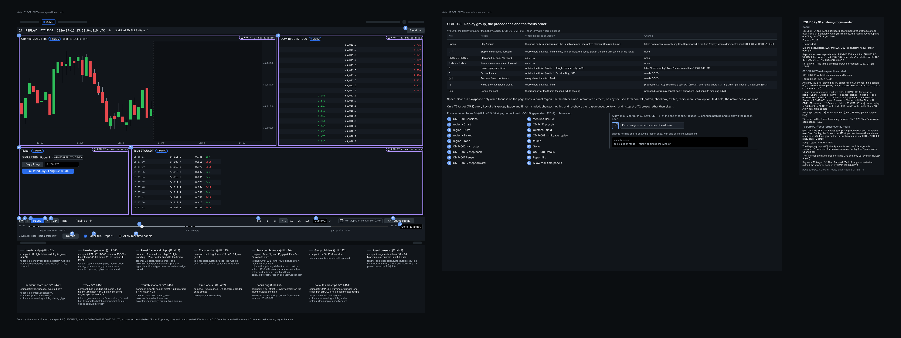  |
| B2  | 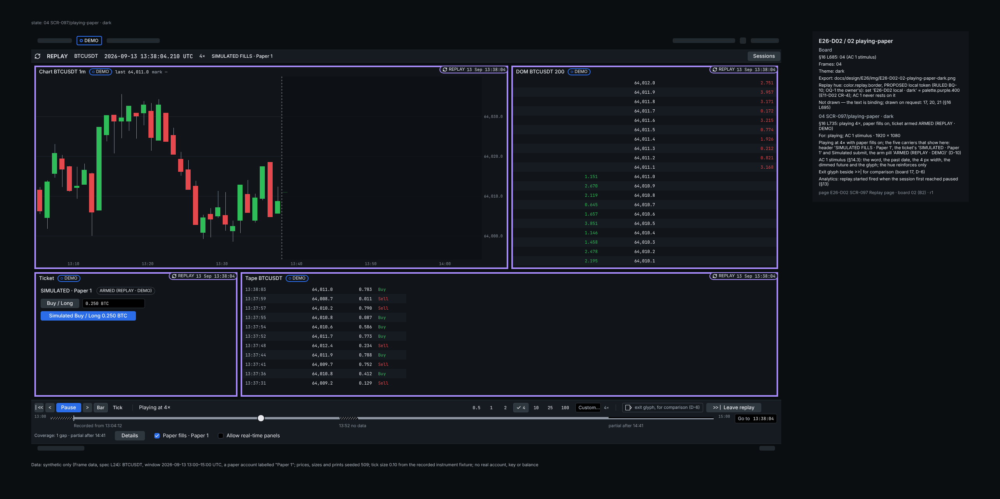       |
| B3  | 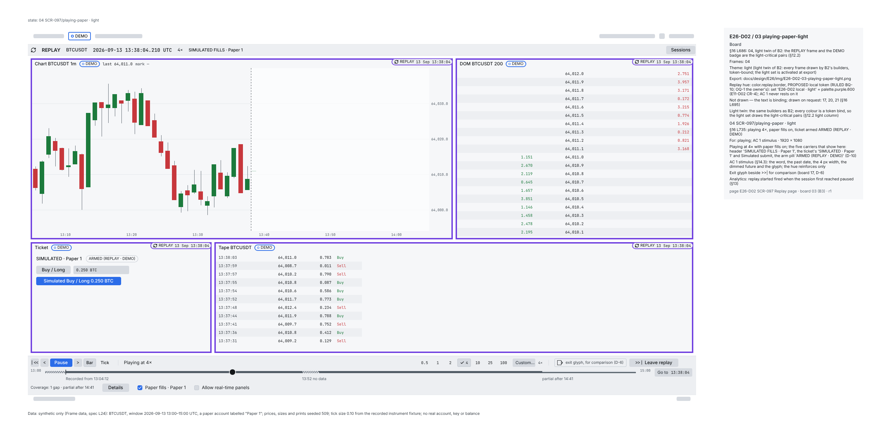     |
| B4  | 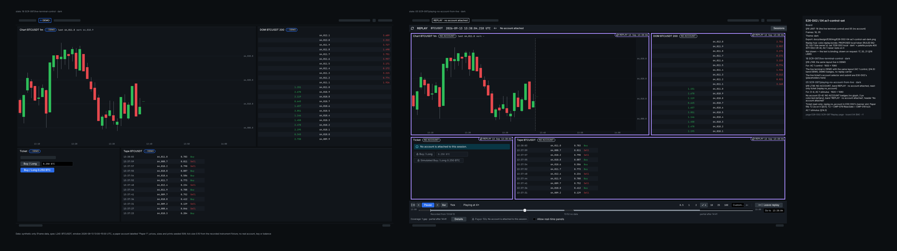         |
| B5  | 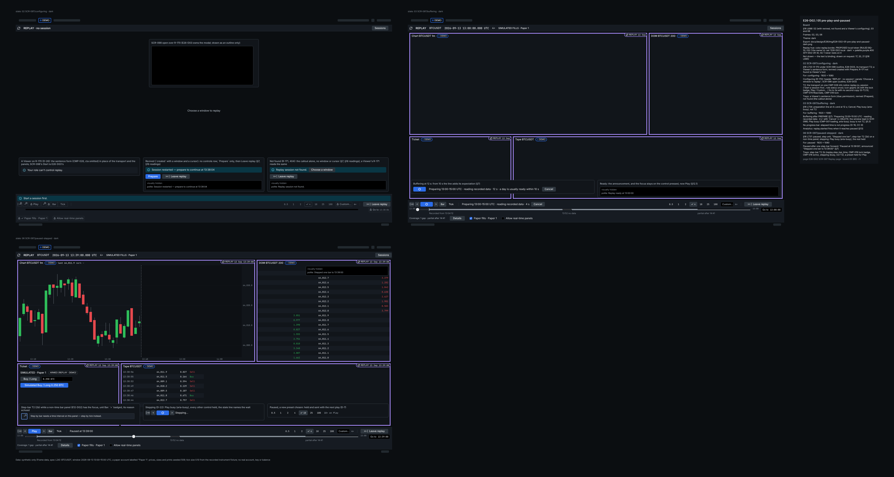      |
| B6  | 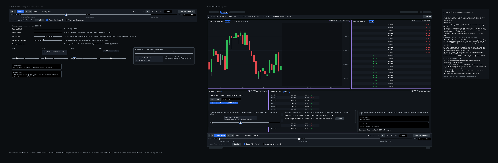    |
| B7  | 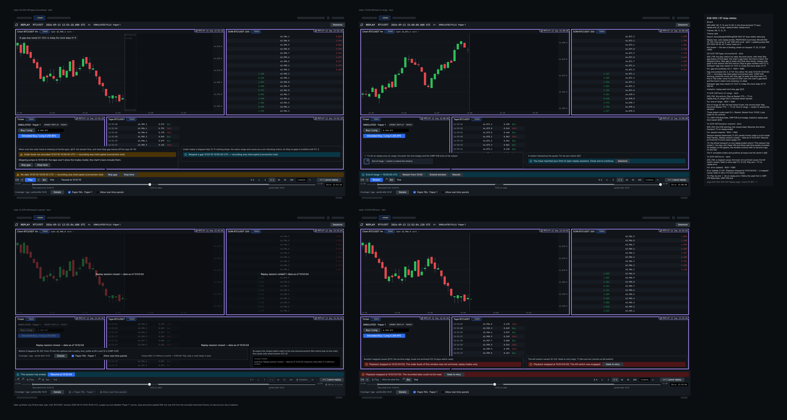                      |
| B8  | 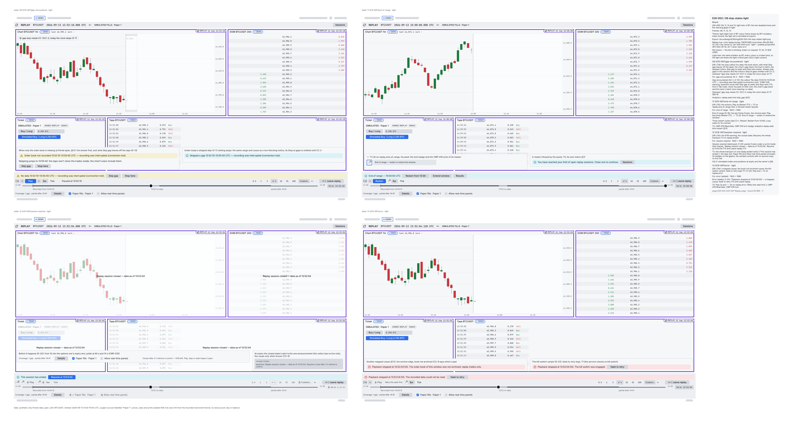                    |
| B9  | 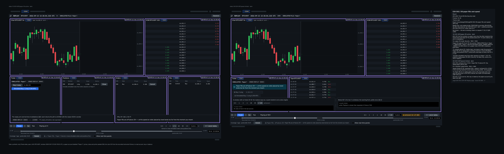  |
| B10 | 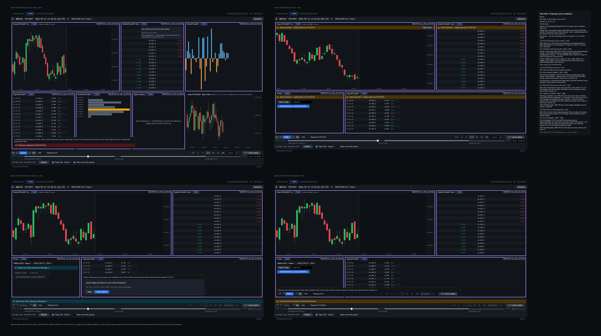 |
| B2  | 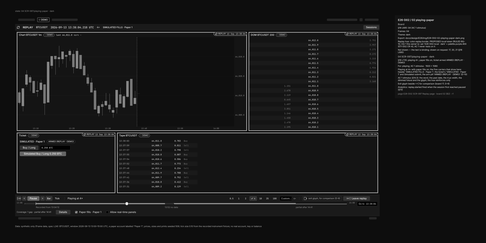                  |
| B2  | 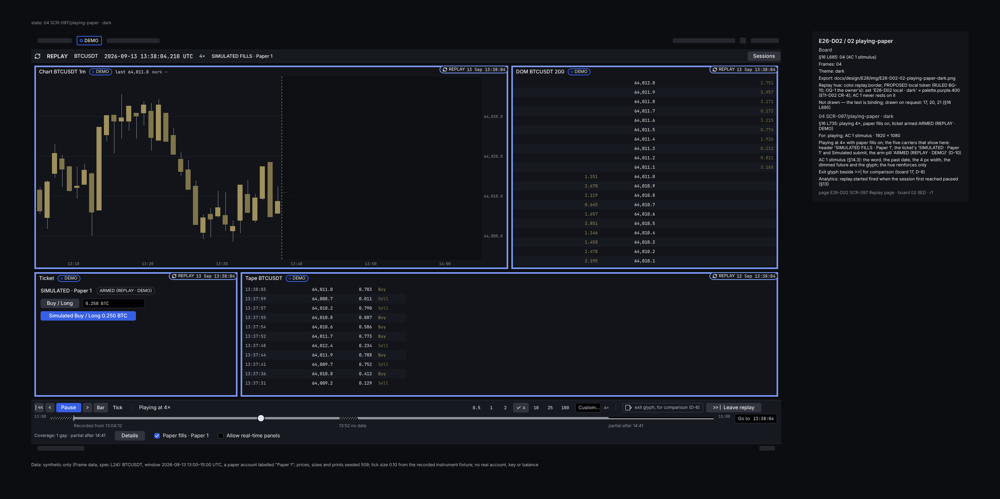            |
| B2  | 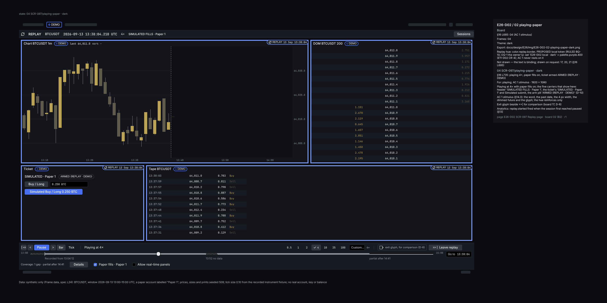                |
| B6  | 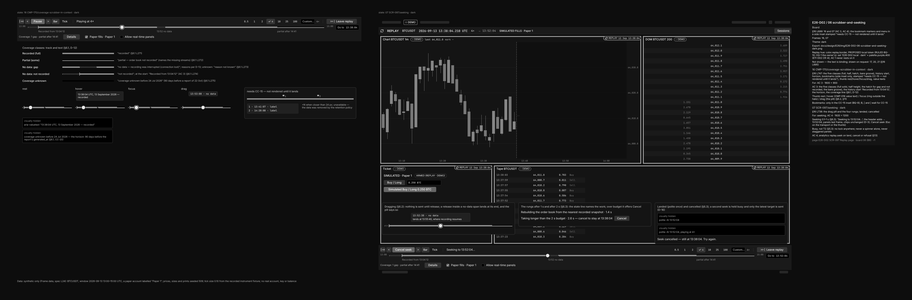           |
| B6  | 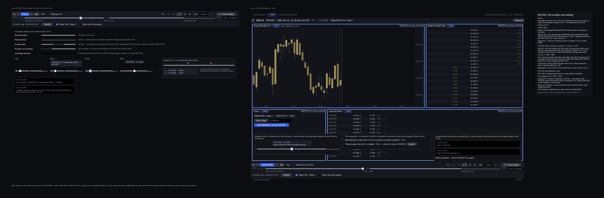     |
| B6  | 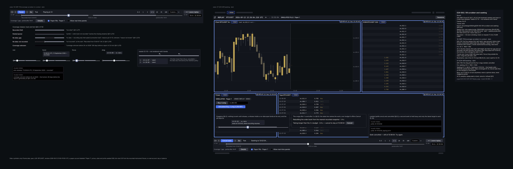         |

## 17. Definition of Done and traceability

| DoD item (ticket)                                                  | Status                                                                                                                                                                                                                                                                              |
| ------------------------------------------------------------------ | ----------------------------------------------------------------------------------------------------------------------------------------------------------------------------------------------------------------------------------------------------------------------------------- |
| Frames published, versioned, linked; redlines complete             | redlines §11 (text) and B1; frames drawn: ten composite boards, ids, PNGs and gates in §16 (RULED, comment 6555545802)                                                                                                                                                              |
| Every catalogue state has a frame; `14` updated if a state changed | mapping §7 and §16 (a nested frame per state); frames drawn (§16); `14` gains error, disconnected, revived, not found, viewing as and on hold, the gap example in E11-D04's words, the T2 components and a hi-fi pointer (this PR)                                                  |
| SCR-097 sign-off checklist satisfied with evidence                 | evidence: transport §5 (boards 04, 17: B2 + B1) · chrome §4 (04, 05, 18: B2, B3, B4; §14.3) · order-flow panels §9 (15: B10) · simulated §8 (10: B9) · history bounds §6.1 (16: B6) · buffering and seek §6.3, §7 (03, 07: B5, B6) · speed limits §5.2 (09: B9); ticked at approval |
| CDO sign-off                                                       | owner approval pending (adaptation)                                                                                                                                                                                                                                                 |
| Handoff notes for E26-D07                                          | `E26-D02-handoff.md` (this PR)                                                                                                                                                                                                                                                      |
| AC 1–4                                                             | AC 1 written and met by design, not run (§14.3); AC 2 by §7, §16 and D-13; AC 3 by D-12; AC 4 by D-16; frames drawn (§16)                                                                                                                                                           |

| Spec part               | Stories                          | Screens           | Components                       |
| ----------------------- | -------------------------------- | ----------------- | -------------------------------- |
| §3, §4 chrome, D-4      | US-RPL-005 (badge), US-PAPER-003 | SCR-097, 030, 075 | CMP-180, 074, 075, 028           |
| §5.1 transport          | US-RPL-002, 004                  | SCR-097           | CMP-170, 001, 002, 044, 079, 019 |
| §5.2 speed, §5.3 T2     | US-RPL-002, 004                  | SCR-097           | CMP-171, 003, 079, 019, 016, 026 |
| §6 scrubber, D-12, D-13 | US-RPL-001, 003, 008; US-REC-006 | SCR-097, 098      | CMP-170, 172, 026, 027, 028      |
| §7 states, D-20, D-24   | US-RPL-004, 009                  | SCR-097, 098, 152 | CMP-028, 035, 043, 079, 019      |
| §8 paper, D-9 to D-11   | US-RPL-006, US-PAPER-004         | SCR-097, 099, 060 | CMP-229, 116, 079, 019           |
| §9 panels, D-14, D-15   | US-RPL-003, 005, 007             | SCR-097, 044, 045 | CMP-180, 196, 079, 019           |
| §10 keys                | US-RPL-004, 008                  | SCR-013, 030      | CMP-094, 022                     |

## 18. Open questions (each routed, with a recommendation)

| ID    | Question                                                                                     | Recommendation                                                                                                                                                                   | Owner                     |
| ----- | -------------------------------------------------------------------------------------------- | -------------------------------------------------------------------------------------------------------------------------------------------------------------------------------- | ------------------------- |
| OQ-1  | The replay hue: purple (E11-D02 CR-4) or teal (O-A)? (D01 Q1)                                | purple: nothing depends on the hue, and CR-4 is already measured                                                                                                                 | owner                     |
| OQ-2  | The word on an opted-out panel (D01 Q3)                                                      | `REAL-TIME`; name "Real-time — not replay"                                                                                                                                       | owner, E17 vocabulary     |
| OQ-3  | Which read-only panels may go real-time; may the same symbol (D01 Q6)?                       | watchlist, a second-symbol chart, the tape; never a replaying symbol                                                                                                             | owner                     |
| OQ-4  | The no-account wording (D01 Q13)                                                             | `NO ACCOUNT` and `REPLAY · no account attached`                                                                                                                                  | owner, `15` owners        |
| OQ-5  | Simulated orders and positions at `Also end the session` and at expiry (D01 Q16)             | cancelled and closed at the last replayed mark, listed in SCR-099                                                                                                                | owner, E26-S02            |
| OQ-6  | The gap default: stop or skip (CC-2)?                                                        | stop for interactive sessions; rule simulation keeps skip                                                                                                                        | owner, E26-T05            |
| OQ-7  | The wording of the 25× reason (§5.2)                                                         | as drafted                                                                                                                                                                       | owner                     |
| OQ-8  | Does leaving keep the session (D-17)?                                                        | keep it; ending is one checkbox away                                                                                                                                             | owner                     |
| OQ-9  | Arming inside replay without a live step-up (D01 Q15)                                        | the demo-scoped arm request                                                                                                                                                      | owner, E30-S04 (#1088)    |
| OQ-10 | The Viewer variant of SCR-097 (D01 C17)                                                      | none today: a Viewer holds no session, so it meets R-170 with `Start` T2 and R-171 not found (D-26); draw the variant only if Viewers are granted sessions (a `22` change first) | owner, `14` / `22` owners |
| OQ-11 | Hearing the clock on a cadence, and the thresholds of D-8                                    | off by default; 90 % over two 1 s windows, 3 s to recover                                                                                                                        | E26-D06, E26-S03          |
| OQ-12 | The clock region: a `timer` (live, off by default, D-19) or D01 F29's polite region at 1 Hz? | the `timer`: discrete events are announced and the clock is read on demand, while a polite 1 Hz region speaks every second (HF-8)                                                | owner, E26-D06            |

## 19. Catalogue amendments

| Document and entry                                   | Amendment                                                                                                                                                                                                              | Status                  |
| ---------------------------------------------------- | ---------------------------------------------------------------------------------------------------------------------------------------------------------------------------------------------------------------------- | ----------------------- |
| `14` SCR-097 States                                  | adds error, disconnected, revived, not found, viewing as and on hold; the gap example in E11-D04's words ("recording was interrupted (connection lost)"); a hi-fi pointer to this spec                                 | in this PR              |
| `14` SCR-097 Interactions; keymap `replay.jump_live` | `R` "Leave replay (confirm)" for "jump to real time (exits replay after confirm)"; the label "Leave replay" (`keymap.json:800-802`) (D-17)                                                                             | proposed; the label E49 |
| `14` SCR-097 A11y                                    | "a labelled live region updated at most 1 Hz" is met by a `timer` role, live and off by default (D-19, OQ-12)                                                                                                          | proposed                |
| `14` SCR-097 Stories, Components                     | add US-RPL-006 and US-RPL-009 (§17); CMP-172 is used through SCR-098 in the configuring state and never rendered by SCR-097 (handoff)                                                                                  | proposed                |
| `14` SCR-097 Components (T2)                         | adds CMP-019 Icon (`lock`) and CMP-079 RbacGate (§5.3; the gate's G-T2.6)                                                                                                                                              | in this PR              |
| `14` SCR-097 Route                                   | `/replay` (R-170, configuring) and `/replay/:sessionId` (R-171) (X-3)                                                                                                                                                  | proposed                |
| `14` SCR-097 wireframe option                        | "keep live panes" → "Allow real-time panels" (D-14)                                                                                                                                                                    | proposed                |
| `14` SCR-013, `05` §3.2                              | the Replay rows of §10 with their scope, `Esc`, the proposed `.` / `,` and `C` for `dom.recentre` on `/replay`                                                                                                         | proposed, E49           |
| `15` CMP-170                                         | states Seeking, GapAhead, EndOfRange, SessionExpired; a coverage segments prop and the history start; the groove hatch, registered with E11-D05 (§11); T2: CMP-079, CMP-019 `lock` (§5.3)                              | E26-D05                 |
| `15` CMP-171                                         | an achieved-rate value and a T2 limit above 25× with its key (§5.3: CMP-079, CMP-019 `lock`, arrow-reachable radios); the seven-preset base (X-10)                                                                     | E26-D05                 |
| `15` CMP-074, CMP-075, CMP-229                       | the no-account state (D01 G13); the replay arm state (D01 G15)                                                                                                                                                         | `15` owners, E30        |
| E30-D02 (merged, `f798a64e`)                         | the replay ticket: `SIMULATED · Paper 1` for the account selector, `Simulated` as the submit's first word (D-10); §5.3's keys, the `rbac.view_as` notice in its banner slot (D-11, §8; X-12)                           | E30-D02 owners          |
| E09-D09 §3.1                                         | names §5.3's replay state vocabulary (the `replay.*` keys, registered to E26-D02 by ruling 6555545802, §5.3) beside E30-D02 §14 and E17-D01 §7; the pointer row lands in E09-D09's next amendment (the orchestrator's) | E09-D09 owners, E26     |
| E11-D02 §10                                          | the chip text gains the date (X-8)                                                                                                                                                                                     | E11 owners              |

## 20. Review record

### Review round 1 (2026-10-22, at `076db778f`)

Two lenses, both REQUEST_CHANGES: design (2 MAJOR, 7 MINOR, 6 NIT) and contract and data (2 MAJOR, 12 MINOR, 8 NIT).
Each overlap is folded once: the stepping hazard (design m-2 = contract m-1) and `C` / `dom.recentre` (design m-1 =
contract m-11). Every claim added was checked at the file and line it cites, at the base commit.

**Folded, design lens:** M-1, one meaning for the hatch ("no data"), a half-height "some" and the groove variant routed
to E26-D05 with E11-D05: D-12, §3, §6.1, §9, §11, §12.2, §16, §19, handoff (CMP-170 tokens, Table 1, the third
accessibility criterion, E26-D07 item 5) · M-2, the `Space` sentence: D-21, §10, handoff Table 2 and the CMP-171
keyboard line · m-1 (with contract m-11): D-21, §9, §10, §19 · m-2 (with contract m-1): D-22, §5.1, §7 · m-3: §6.1
quotes E08-D06 §4.3 · m-4: §19 moves the CMP-172 row to `14` Components · m-5: §19 and `14` States · m-6: D-19, OQ-12,
§19 · m-7: §3 · n-1: D-7 · n-2: D-6, §14.4, board 17 · n-3: §6.2, handoff Tables 2 and 3 · n-4: §14.3 · n-5: §19 · n-6:
handoff Table 3.

**Folded, contract and data lens:** M-1: CC-16, D-22, §5.1, handoff (CMP-170 data line) · M-2: D-9, D-11, §8, §9, §13,
CC-17, board 10 · m-1 (the revived row too): §5.1, §7, D-22 · m-2: D-20, §7 (409; not found), CC-12 · m-3: CC-12, X-1 ·
m-4: (a) CC-14 and the handoff's CMP-172 data line, now PENDING; (b) CC-18, D-9, §5.1; (c) CC-19, D-20; (d) §8 · m-5:
CC-20, §6.1 · m-6: D-13, §5.1, §7 · m-7: D-22, CC-16 · m-8: D-5 (budget #2), D-8 (#15) · m-9: D-26, §5.1, §16, OQ-10,
handoff Table 1 · m-10: D-8, §7 · m-11: with design m-1 · m-12: §7.1, CC-8 · n-1: D-23, HF-10 · n-2: CC-11 · n-3:
CC-15 · n-4: X-4 · n-5: §6.1 · n-6: §5.1 · n-7: D-23, §7 · n-8: §7.

**Recorded, with the reason:** contract m-8 names E26-S03's bench for budget #2, but E26-Q03's ticket builds that frame
benchmark, so D-5 cites E26-Q03. Design n-1: E11-D02 D8 does name the hue (its line 115); the measured, rejected pair is
§11.1 line 491, now the cite. CC-16's owners are E26-T05 with E26-T03, while the binding's comment names E26-T04/E36 for
`emit_one_step` (`b12_replay.py:188-191`). Where a lens offered two fixes: the half-height "some" (not a dotted fill);
`Skip gap` stays a seek, reworded (a one-gap skip would widen CC-2); `C` proposed for `dom.recentre` on `/replay`; resume
states its two phases and asks CC-19. Design M-1's "§14.3 AC-3 sentence" is read as the handoff's third accessibility
criterion (colour-independence), the sentence that named the patterns.

### Round 2 (both APPROVE at `1e35f9570`), carried items folded

Every claim added was checked at the file and line it cites, at this head. **Folded:** D1 (Viewer copy): D-26 · C1 (the
409 carries the state): CC-12, §7 · C2 (own-order list per session, CC-13 the guard): D-9, §13 · C3 (delivery rate): D-8
· C4 (`coverage_gaps` are `trades` only): CC-20 · C5 (`autostart`): §7 · C6 (the header runs on while playing): §7 · C7
(any panel showing a row's `environment`): D-4, the handoff, `14` States. **Also:** board 19 is now
`SCR-097/focus-order-overlay` (§16): a path holding `key` matches a name rule of `tools/ci/security_review_label.py`.

### Round 3: the T2 text round (orchestrator, REQUEST_CHANGES at `1c3ecc95b`), folded

Four Majors and eight Minors against the gate; M-4 was the PR body's (`Refs #509`, Partial), done there. Every claim
added was checked at the file and line it cites, at the pin; `22`'s view-as rule, the arm's permission, the latch and
`23` §6.4 and §10.3 read the same at the pin and at `main` `458e3fbd4`; the view-as guard merged after the pin (#4040).

**Folded:** M-1 (view-as): §5.3, §5.1, D-11, D-17, D-24, §7 (viewing as), §8, board 22 · M-2 (the T2 anatomy, the
keys and their owners, the hold): §5.3, §3, §5.1, §5.2, §6.2, §9, §10, §11, §12.1, §12.2, D-7, D-9, D-13 to D-15,
D-18, D-20, D-21, §7 (on hold), CC-21, X-12, boards 17 and 23, §17, §19, `14` Components, handoff Tables 1 to 3 · M-3
(busy, `Seek to retry`, the Viewer's leg): §5.3, D-16, D-22, D-23, D-26, §6.3, §7, §7.1, boards 02, 03, 06 and 13,
`14` States · m-1 to m-3 (R1 to R3): §12.1 · m-4: X-11 · m-5: the Key, §19 (E30-D02's replay ticket) · m-6: §5.1 ·
m-7: D-11, §8 · m-8: the Key · n-2: §7.

**Recorded, with the reason:** n-1 is the PR title, outside these files. The moved cites stay at the pin for the boards
rebase, except D-26's, now the named `22` `x-permissions` list. The repository's error class is lines 98-114 at the
pin and at `main`. §12.2's ratios are unchanged: the T2 label and the `lock` use the tertiary pair already measured.
The coordinator's text-first ruling (2026-10-23): every board stays PENDING (BLOCKED-PENPOT) until a later PR (§16).

### Boards round: the coordinator's text rulings (2026-10-23), folded

The open points left when the boards were prepared, each ruled on its stated default; (c) and (e) are the boards' own,
and the text gives (c) where it named the busy label. Every claim added was checked at the file and line it cites, at
the pin.

**Folded:** (a) the terminal states: at `finished` `Play` becomes `Restart` (T1); at `error` `Play` and `>` are T2 on
the PROPOSED `replay.error` (B12 takes only `SEEK` and `DESTROY` there, `28` B12.3); at `destroyed` the transport is T2
on one PROPOSED `replay.ended` notice, `Resume at …` and `Leave replay` T1: §3, §5.1, §5.3, §7, §16 (boards 11 to 13),
handoff Tables 1 and 3 and item 11 · (b) §12.2's two pairs, the info notices and a selected T2 preset (3.98:1 in
dark, so a T2 preset drops the selected fill), measured as §12.2's other rows were (`contrast_ratio()` over the same
token layers; re-measured at `2ea55a8c6` for the boards, below): §5.3, §11, §12.2, the
handoff's CMP-171 tokens · (c) busy `Play` as CMP-001 draws it: §5.3, handoff Table 3 · (d) board 08 draws neither
CC-2 gap control: §16, §7 (gap skipped).

### Boards round: the six accepted defaults (2026-10-23), folded

The coordinator accepted the six defaults the boards round left open; this fold writes them into the text, adds no
decision and moves no pin. Every claim added was checked at the file and line it cites, at this head.

**Folded:** (1) one announcement at expiry: the `replay.ended` notice has no live role, and the closed state's alert
is the only announcement: §5.3 (G-T2.5 and the key row's rendering), §7 (session expired), §12.1, handoff Tables 3
and 5 and item 11 · (2) the whole transport is T2 at `destroyed`, the step unit, `Paper fills` and `Allow real-time
panels` included: §5.1, §5.3 (the key row and the outside-the-grammar bullet), §16 (board 12), handoff Table 1 and
item 11 · (3) board 19's focus order stands at 18 stops, `Always skip gaps in this session` not being rendered until
CC-2: §12.1 and the handoff name no stop count and no gap-callout action, so no line changes · (4) §12.2 gains
`status.info.strong` on `status.info.subtle`, the info glyph on its notice fill (7.30 / 4.34 / 7.30 against 3),
measured as its other rows are: `contrast_ratio()` of `docs/design/_tools/contrast_check.py` over the dark, light
and high-contrast token layers (the byte-identity claim made here is struck: #5140 and #5161 later moved two light
cells, re-measured at `2ea55a8c6`, below) · (5) the three restart routes at `finished` (`Restart` in `Play`'s slot, `|<<` and the callout's
`Restart from 13:00`) are kept as they stand; `Shift+→`, which §5.1 and §10 bind to one tick forward, joins the gated
lists of `replay.end_of_range` and `replay.error` (§5.3) · (6) the handoff's contrast line: the
`tools/contrast/pairs.mjs` pairs are on `main` (#4122, `8ccfbae06`); only the `cvd_sim.py` renders come with the
boards.

### Boards leg: the ORCH-defaults built (2026-11-01), ruling pending (comment 6554973018)

The boards list posted on #509 (BQ-0 to BQ-14) has no ruling yet; this pass writes its ORCH-defaults into the text
so the boards can be built on them, and folds a differing ruling before any board is drawn. Every value comes from
the file and line it cites at `main` `2ea55a8c6`.

**Folded:** BQ-1, BQ-3, BQ-4 (ten composite boards, the frame ids kept, file, page and export names), BQ-2 (the old
board scripts superseded) and BQ-12 (the status lines): the header, §16, §17, handoff status and Penpot lines, `14`
SCR-097's hi-fi pointer · BQ-5 (re-measured with `contrast_ratio()` over the same token layers, every row reproduced;
light `status.warning.strong` on `status.warning.subtle` 4.11 → 4.90, light `status.info.strong` on
`status.info.subtle` 4.34 → 5.30; the T2-preset rule stands at 3.98): §12.2 and the two byte-identity claims above,
struck · BQ-6 (the registry's stricter bar; no change): §12.2 · BQ-7 (E26-D02 owns the fourteen `replay.*` keys):
§5.3, §19 · BQ-8 (`Skip gap` and `Stop here` drawn, the CC-2 controls omitted, the frame stamped): §16 frame 08 ·
BQ-9 (bookmarks only in B6's CC-15 inset): §6.2, §16 frame 16, §14.4 · BQ-10 (CR-4's purple as a PROPOSED local
token): §16 · BQ-11 (each pointer gains its B-board; a B1 keyboard-path item): §14.3, §14.4, §17, handoff Tables 1
and the E26-D07 notes · BQ-13 (T2 and busy on the boards): §16 · BQ-14 (B1 overlays the 18 stops): §16 frames 19
and 17, §14.4.

### Boards leg: RULED (2026-11-01 08:29Z, comment 6555545802), folded

The orchestrator ruled BQ-0 to BQ-14 under the 2026-10-29 delegation: all fifteen as the ORCH-defaults above, with
precisions, folded here literally. **Folded:** the status lines (header, §16, §17, handoff) → RULED · BQ-1 (ten
composite boards, one PR, no split; the cap line added to `docs/design/README.md` citing the 03:11Z ruling as quoted
at E27-D03:204 / E08-D07:688; frames and §7's states reconciled, R4): §16, README · BQ-5 / BQ-6 (the one sentence
names both pairs `pairs.mjs:226–233` holds at TEXT): §12.2 · BQ-7 (E26-D02 the registered owner of the fourteen
`replay.*` keys, no longer PROPOSED; the four "E26 with E30-D02 §14" rows reconciled to it; E26-D03's
`replay.no_paper_account` joins the table): §5.3, §19 · BQ-9 (`Bookmarks` dropped from the focus order): §12.1 ·
BQ-11 (hand-off pointers to undrawn board 17 mapped to B5, B7, B9, B10 and B1, B2): handoff CMP-170 and CMP-171 ·
BQ-14 (how the 18 stops are counted): §12.1, §16 frame 19 · the boards' readings that were text gaps: §3, §16.
BQ-0, 2, 3, 4, 8, 10, 12 and 13 stand as written.
