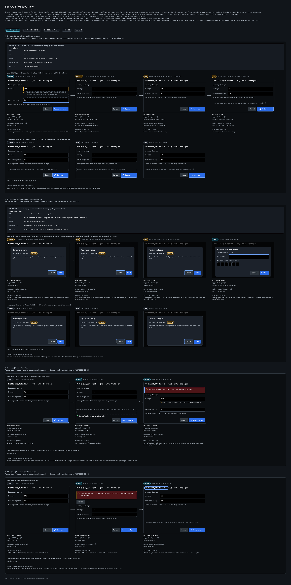
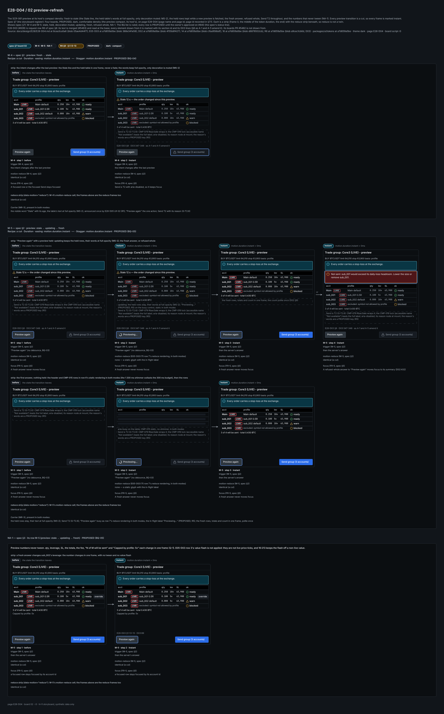
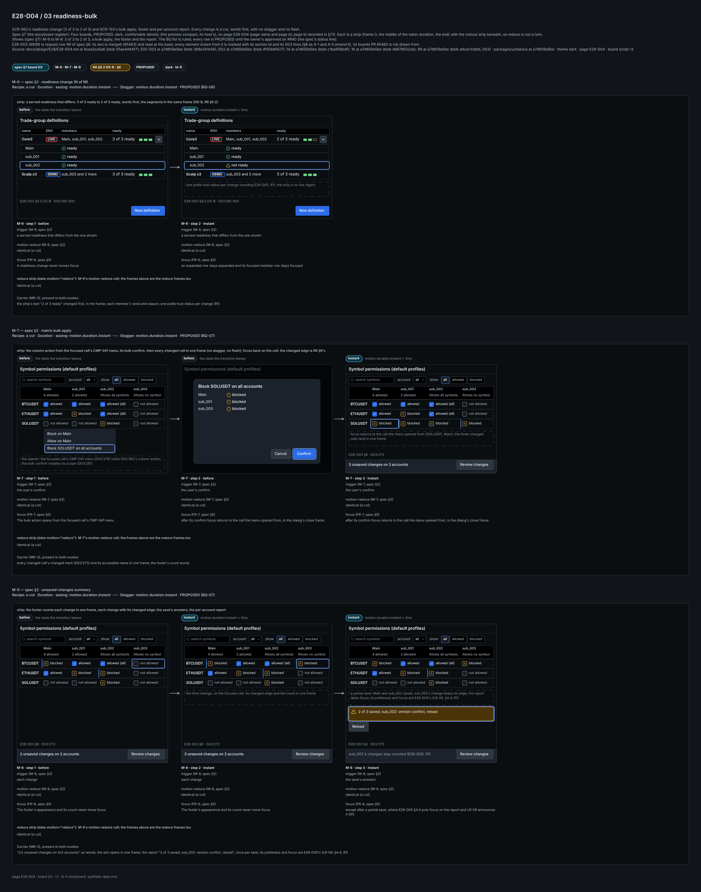
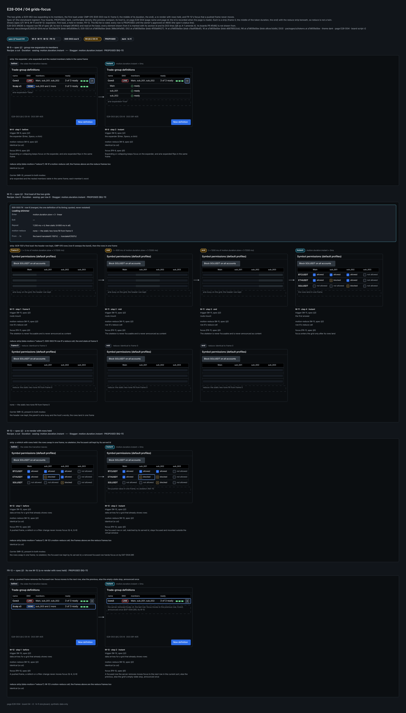

# E28-D04 — Motion and state-transition choreography for profile saves, previews and readiness

**Ticket:** E28-D04 (#840) · **Epic:** E28 Per-account profiles and trade groups · **Kind:** design spec, text first ·
**Status:** Draft — owner approval pending; the BQ list (BQ-01 to BQ-14) is ruled (the orchestrator's comment
6601762417 on #840) and folded in §1, and every row stays PROPOSED until the owner's `approved`. E28-D03 (#839) is
merged as text (#5463) and cited at `main`; its boards PR #5482 is the one open input (R6, PENDING).

## 0. Inputs pinned

**Base.** `main` `a7d659a5be`. Every `file`:line below is read there (`git show`), and the audit tool (§10) reads
every cite at that commit and pins the cited lines in its pins file.

**Key.** `NN`:line = `docs/plan/NN-*.md`. `D02` = `docs/design/E28/E28-D02.md` (E28-D02, merged): `Dn` are its
decisions, `AX-n` its accessibility rules. `E05-D03` = `docs/design/E05/E05-D03.md` (the motion recipes, shipped by
#3174). `E42-D04` = `docs/design/E42/E42-D04.md` (the admin-area motion, `16` §7.2). `E28.json`:444 = the ticket body
(T), one line. `D03` = `docs/design/E28/E28-D03.md` (E28-D03's text, merged as #5463, `0af333fa0`). `E47-D04` =
`docs/design/E47/E47-D04.md` (the focus model, merged; the focus detail owner). `E09-D06` =
`docs/design/E09/E09-D06.md`. `E17-D01` = `docs/design/E17/E17-D01.md`. `DS` = `.claude/rules/32-design-specs.md`
(the T2 grammar G-T2 and the recurring items R1 to R7).

**What is not cited by line.** E28-D03's boards PR #5482 is open, PENDING at `3b23ab11a` (request row R6): its
boards are named by number only, never by file:line. E28-D03's text is on `main` and cited by `D03`:line (BQ-02).

**Tokens.** No token is added or edited. A cut is written `motion.duration.instant` · easing `—` (a 0 ms change has no
curve) · stagger `motion.duration.instant`. Every animated row is an E05-D03 recipe cited by its row id and never
restated, so E05-D03 stays the one definition of its durations and easings (`16`:204). The only other tokens named
are `color.text.secondary` (the stale table's text, BQ-04) and `opacity.scrim` (inside row 2a). The stale table's
decoration muting is E28-D03 §8's (`D03`:347-348, as A-1 and A-5 amend it), cited there and never as a token here.

## 1. The questions, as ruled

The orchestrator ruled the list in comment 6601762417 on #840 (AGREE 03, 06 to 10, 12, 13; AMEND 01, 02, 04, 05,
14; DISAGREE 11). Each row states the ruling as applied; every row it touches stays PROPOSED to the owner.

| BQ    | Ruling             | Applied here                                                                                                                                                                                                                                                                        | Where                   |
| ----- | ------------------ | ----------------------------------------------------------------------------------------------------------------------------------------------------------------------------------------------------------------------------------------------------------------------------------- | ----------------------- |
| BQ-01 | AMEND              | one PR closing #840: this file, its tool and the pins file, then the four storyboards and the `16` §7.5 pointer as the boards commit; draft until every board is embedded; `large-pr-approved` asked in advance (one PR, not two slices)                                            | §7, §10                 |
| BQ-02 | AMEND              | E28-D03 merged as #5463 (`0af333fa0`): re-pinned to `main` and cited by `D03`:line; only the boards PR #5482 is in flight, PENDING at `3b23ab11a` (R6)                                                                                                                              | §0, §8                  |
| BQ-03 | AGREE              | D02 D12 (RULED) beats T's 150 ms debounce: the preview re-runs on "Preview again" only; T's text is deviation D-4; M-4 and M-5 stay trigger-agnostic                                                                                                                                | M-4, M-5, D-4           |
| BQ-04 | AMEND              | the joint stale-preview rule (§3, MS-2): the stale table's text at full opacity in `color.text.secondary` with a visible "Stale" word; decoration only is muted; A-1 to E28-D03 §8; #5550                                                                                           | M-4, M-5, A-1           |
| BQ-05 | AMEND              | the held rows stay while a new preview is fetched; Send disabled is T2 in every row (G-T2.1a to G-T2.1d, G-T2.6); the static spinner and skeleton in both modes depart from CMP-014 and CMP-015 (reduce only): A-2 and A-3 to the design-system owner, no design-system change here | M-4, M-5, C-4           |
| BQ-06 | AGREE              | a readiness change is a cut, words first; the strip is no live region; the host's status speaks once (R1)                                                                                                                                                                           | M-6                     |
| BQ-07 | AGREE              | a bulk apply lands every changed cell in one frame, no stagger, no flash; D-13 bars per-cell animation; the budget is SCR-133's 600 ms (`14`:2808)                                                                                                                                  | M-7                     |
| BQ-08 | AGREE              | the step-up replaces the diff summary in one frame under the same scrim; its initial focus is the first credential field (`E47-D04`:302; `E09-D06`:67); the A-row to E28-D02's "Cancel first" is #841's (its BQ-12)                                                                 | M-2, FR-2               |
| BQ-09 | AGREE              | the saved status reads "Saved. Applies to future orders only." (PROPOSED; #841 BQ-17; `14`:2785's checklist item); focus stays on Save, as D02 D26 says, itself PROPOSED (`D02`:168)                                                                                                | M-3, FR-3               |
| BQ-10 | AGREE              | the version-conflict anchors as D02 has them; the post-Reload anchors are PROPOSED and testable by E47-D04 R-4 (`E47-D04`:119)                                                                                                                                                      | M-10, FR-10             |
| BQ-11 | DISAGREE (removal) | the skeleton is first-load only and a focused row is kept by its served id; a focused row the server removes moves focus to the next row, else the previous, else the empty-state stop, announced once (`E47-D04`:285, :291; its W-5)                                               | M-11, M-12, FR-5, FR-12 |
| BQ-12 | AGREE              | four storyboards, PROPOSED, on page `E28-D04` (page name and page id, page id recorded in §7.1); every PNG embedded in the PR body                                                                                                                                                  | §7                      |
| BQ-13 | AGREE              | the sign-offs are the owner's `approved` on #840; "owner approval pending" claims none                                                                                                                                                                                              | §9                      |
| BQ-14 | AMEND              | one `16` §7.5 pointer (the next free subsection after §7.4, the E27-D04 precedent) rides the boards commit; the `14` pointers stay A-row A-4; `15` is untouched by this PR                                                                                                          | §7, §8                  |

Out of scope (T): hi-fi visuals (E28-D03, R6), implementation, SCR-061's send-in-progress and partial-failure
choreography (E34).

## 2. The choreography table

The Recipe column names an E05-D03 §2 row (`E05-D03`:67-75) or "a cut". A cut changes in one frame. Its Duration ·
easing cell reads `motion.duration.instant` · `—`. A recipe row's timing is that E05-D03 row's Enter and Exit, cited,
never copied. Stagger is `motion.duration.instant` on every row: nothing in this epic staggers. The motion-reduce
column reads "identical (a cut)" for a cut and names the E05-D03 reduce cell for a recipe row. The Carrier column names
the non-motion carrier MR-3 asks for (`E05-D03`:118); it is present in both modes. Every state the hi-fi draws enters
as a cut and the choreography of the preview's stale state and the readiness change is this spec's (R6).

| M    | Transition                        | Surfaces                                                                                                             | Trigger                                                                      | Recipe                       | Duration · easing                                          | Stagger                   | motion-reduce                                          | Carrier (MR-3)                                                                                                                                                                                                                                        | Status           | Source                                                 |
| ---- | --------------------------------- | -------------------------------------------------------------------------------------------------------------------- | ---------------------------------------------------------------------------- | ---------------------------- | ---------------------------------------------------------- | ------------------------- | ------------------------------------------------------ | ----------------------------------------------------------------------------------------------------------------------------------------------------------------------------------------------------------------------------------------------------- | ---------------- | ------------------------------------------------------ |
| M-1  | save: idle → validating → saving  | SCR-131 Save; SCR-062 create; SCR-133 Save in its review                                                             | the field's blur (the mirror); the user's Save after the step-up             | a cut; the busy state: row 7 | `motion.duration.instant` · `—`; the busy state: per row 7 | `motion.duration.instant` | identical (a cut); the busy state: row 7's reduce cell | each field error's words at the field; the fixed line beside Save; the in-flight label "Saving…" (PROPOSED, R5) on the busy control, width locked                                                                                                     | PROPOSED (BQ-09) | `D02`:296-299, :301; `14`:2782; `16`:256; `E05-D03`:75 |
| M-2  | diff summary and step-up dialogs  | SCR-131's diff summary; SCR-006 step-up; SCR-133's review, bulk and open-position confirms; SCR-062 create's step-up | Review and save; Save; a bulk action; the step-up replacing the diff summary | row 2a                       | per row 2a                                                 | `motion.duration.instant` | row 2a's reduce cell                                   | the dialog's name and its focused control at frame 0 (the step-up's first credential field); the swap to the step-up in one frame under the same scrim                                                                                                | PROPOSED (BQ-08) | `D02`:184-185, :558-559; `16`:249-250; `E05-D03`:67    |
| M-3  | saved or failed                   | SCR-131; SCR-062 create; SCR-133's per-account report                                                                | the server's answer                                                          | a cut                        | `motion.duration.instant` · `—`                            | `motion.duration.instant` | identical (a cut)                                      | saved: the polite status "Saved. Applies to future orders only." (PROPOSED, R5); refused: the danger summary with each error at its field, focused; `503`: the served sentence; nothing is ever half-saved                                            | PROPOSED (BQ-09) | `D02`:303-307, :368-370, :561-562; `16`:253            |
| M-4  | preview: fresh → stale            | SCR-061 preview                                                                                                      | the intent changes after the last preview                                    | a cut                        | `motion.duration.instant` · `—`                            | `motion.duration.instant` | identical (a cut)                                      | the visible word "Stale" with its age, the table's text at full opacity (MS-2), announced once by E28-D05 LR-02 (R1); "Preview again" the one action; Send T2 with its reason (G-T2.6)                                                                | PROPOSED (BQ-04) | `D02`:154, :438-442; `D03`:348; `E28.json`:444         |
| M-5  | preview: stale → updating → fresh | SCR-061 preview, its first answer included                                                                           | "Preview again" (no debounce, BQ-03); then the server's answer               | a cut                        | `motion.duration.instant` · `—`                            | `motion.duration.instant` | identical (a cut)                                      | the held rows stay, their text at full opacity (MS-2); Send T2 (G-T2.6); "Preview again" busy as row 7's reduce rendering in both modes, the in-flight label "Previewing…" (PROPOSED, R5); the fresh rows, totals and count in one frame, polite once | PROPOSED (BQ-05) | `D02`:432, :561-562; `14`:1504, :1507; `E05-D03`:75    |
| M-6  | readiness change (N of M)         | SCR-062 rows' readiness strip (R6) and expanded members; the Manager's read-only picker                              | a served `readiness` that differs from the one shown                         | a cut                        | `motion.duration.instant` · `—`                            | `motion.duration.instant` | identical (a cut)                                      | the strip's text "2 of 3 ready" changed first, in the frame; each member's word and reason; one polite host status per change (R1)                                                                                                                    | PROPOSED (BQ-06) | `D02`:167, :191-193, :389; `D03`:391-405; `16`:253     |
| M-7  | matrix bulk apply                 | SCR-133 cells after a bulk confirm                                                                                   | the user's confirm                                                           | a cut                        | `motion.duration.instant` · `—`                            | `motion.duration.instant` | identical (a cut)                                      | every changed cell's changed mark (`D03`:273) and its accessible name in one frame; the footer's count words                                                                                                                                          | PROPOSED (BQ-07) | `D02`:169, :362-363; `14`:2808; `E28.json`:444         |
| M-8  | unsaved-changes summary           | SCR-133 footer: appears, counts, clears; the per-account save report                                                 | the first unsaved change; each change; the save's answers                    | a cut                        | `motion.duration.instant` · `—`                            | `motion.duration.instant` | identical (a cut)                                      | "{n} unsaved changes on {m} accounts" as words; the slot opens in one frame; the report "2 of 3 saved; sub_002: version conflict, reload", once per save; its politeness and focus are E28-D05's (LR-09, §4.4; R1)                                    | PROPOSED (BQ-07) | `D02`:160, :368-370, :561-562; `16`:252                |
| M-9  | group row expansion to members    | SCR-062 definition rows; the legs are E34-D03's (R4)                                                                 | the expander (Enter, Space, a click)                                         | a cut                        | `motion.duration.instant` · `—`                            | `motion.duration.instant` | identical (a cut)                                      | `aria-expanded` and the nested members table in the same frame; each member's word                                                                                                                                                                    | PROPOSED (BQ-11) | `D02`:389, :556; `16`:252; `E42-D04`:760               |
| M-10 | version-conflict recovery         | SCR-131 `412`; SCR-133's per-account conflict; SCR-062 edit (G-6, not served)                                        | the `412` answer; the user's Reload                                          | a cut                        | `motion.duration.instant` · `—`                            | `motion.duration.instant` | identical (a cut)                                      | the served sentence "This changed since you opened it. Nothing was saved — reload to see the new version."; the reloaded version in one frame; one polite status naming it (R1)                                                                       | PROPOSED (BQ-10) | `D02`:306-307, :370; `16`:253                          |
| M-11 | first load of the two grids       | SCR-133 matrix and SCR-062 list, loading → populated, empty or error                                                 | route mount; the first answer                                                | row 6                        | per row 6                                                  | `motion.duration.instant` | row 6's reduce cell                                    | the header row kept; the parent's `aria-busy` and the host's words; the rows land in one frame                                                                                                                                                        | PROPOSED (BQ-11) | `D02`:372, :404-405; `16`:255; `E05-D03`:74            |
| M-12 | a re-render with rows held        | SCR-133, SCR-062 and the preview: a refetch, a pushed frame, a search or filter change                               | data arrives for a grid that already shows rows                              | a cut                        | `motion.duration.instant` · `—`                            | `motion.duration.instant` | identical (a cut)                                      | the rows swap in one frame; no skeleton; the focused row kept by its served id; a removed focused row hands focus on by `E47-D04`:285                                                                                                                 | PROPOSED (BQ-11) | `14`:1522; `23`:862; `E28.json`:444                    |

What each row means, beyond the table:

- **M-1.** The client's mirror of the schema on blur (`D02`:290-293) shows a field's error in one frame; nothing is
  sent. Saving is one step: the busy Save keeps its width and shows row 7 until the answer, which `14`:2782 targets at
  2 s; row 7's slow-path line at 5 s therefore rarely shows, and is kept.
- **M-2.** The scrim fades by row 2a and the card is a cut, complete and focused at frame 0. When Save in the diff
  summary needs the step-up, the step-up replaces the summary in one frame under the same scrim, as `16`:250 does for a
  code dialog replacing a rung dialog, so the scrim never fades twice (BQ-08). Its initial focus is the first
  credential field (`E47-D04`:302; `E09-D06`:67).
- **M-4 and M-5 (Q-2; D-13).** Every preview transition is a cut. The stale state is MS-2's: the word "Stale" with
  the preview's age and the table's text at full opacity in one frame, never a fade; only decoration is muted, by
  E28-D03 §8 as A-1 amends it. Updating keeps the held rows; the first preview, with nothing held, shows the header and
  the CMP-015 rows in row 6's reduce rendering (static, no shimmer) in both modes, because the shimmer's 1 200 ms period
  outlasts the 300 ms preview budget (`14`:1507). The busy "Preview again" shows row 7's reduce rendering in both modes
  for the same reason; both depart from CMP-014's and CMP-015's reduce-only static rendering (C-4, A-2, A-3). Send is
  T2 while stale or updating, in every row: native role and full label, `aria-disabled`, the reason node at mount,
  CMP-079 RbacGate wrapping it and the CMP-019 `lock` (accessible name "Not available") leading the label
  (`DS`:27-28, :30, :36-38), and T2 named in each state row (`DS`:59). A refused-whole answer is a cut;
  its summary takes focus (`D02`:432; FR-5).
- **M-6.** Readiness changes only when the server says so (`D02`:167, :192); the client never counts. The strip's text
  changes in the same frame as its segments, and nothing in the row moves.
- **M-7 and M-8 (D-13).** A bulk action can mark hundreds of cells. All of them change in the same frame, so the cost
  is one style flip, never a per-cell transition (Q-5; `D03`:89 bars per-cell animation). The budget is SCR-133's
  600 ms first render (`14`:2808); SCR-062's 4 ms scripting per frame (`14`:1522) is M-12's. The footer bar's slot opens
  in one frame; heights never animate. The bulk action opens from the focused cell's CMP-041 menu (`D03`:278;
  D02's column action, `D02`:362) and its confirm restates the scope (`D03`:281); no toolbar button opens it.
- **M-9.** T's "group row expansion to legs" is a cut too (`16`:252): the members expand here, and the legs, when
  E34-D03 draws them, expand in one frame the same way (C-2).
- **M-10.** Nothing is half-saved (`D02`:307), so the recovery is a reload, never a merge animation: the reloaded
  values replace the form's in one frame.
- **M-11 and M-12 (D-13).** The skeleton is a first-load state only. A grid that holds rows never shows it again
  (Q-7): a refetch, a pushed frame or a filter change swaps the rows in one frame, with `aria-busy` while it waits. A
  focused row the server removes is not kept: E47-D04 owns the move (`E47-D04`:285), FR-12.

## 3. The quotes and the does-not-animate list

**T's words, quoted byte for byte from `E28.json`:444.**

- Q-1 (§Scope / Deliverables): "numeric values in the preview table and the worked example do not tween between values (a tweening number is unreadable and, in a trading context, misleading); status text swaps without a transition; virtualised rows do not animate on scroll"
- Q-2 (§Technical notes / design): "caps preview-related motion at the shortest token and prefers a state change with no motion at all, using a subtle staleness treatment instead of an animation"
- Q-3 (§Security notes): "Motion must never be the sole indicator of a dangerous state."
- Q-4 (§Accessibility notes): "Focus is never moved by an animation or by a data-driven re-render."
- Q-5 (§Performance notes): "no per-row transition is permitted at that scale"
- Q-6 (§Scope / Deliverables): "a coalesced WS update must never move or steal focus, and the version-conflict path must return focus to a sensible anchor"
- Q-7 (§Scope / Deliverables): "specified so a re-render caused by a WS frame does not flash a skeleton"

**The does-not-animate list.** Each item is a checkable statement; the tool pins the bold sentence of each.

- **NA-1. Preview numbers never tween.** qty, leverage, SL, the totals, the fee, "N of M will be sent" and "Capped by
  profile: 5x" each change in one frame (Q-1). E05-D03 row 3's value flash is not applied: they are not live price
  ticks, and `16`:213 keeps the flash off a non-live value.
- **NA-2. The worked example never tweens.** SCR-131's worked example and its incomplete and unknown-equity forms
  change in one frame, with no count-up and no value flash (Q-1).
- **NA-3. Status text swaps without a transition.** The ok words, the readiness words, the member words, the cell
  state words, the save report and the refusal summaries change in one frame, words first (`16`:253).
- **NA-4. Virtualised rows do not animate on scroll.** SCR-133, SCR-062 and the preview mount and unmount rows with no
  entrance, no fade and no smooth scrolling.
- **NA-5. The readiness segments never move.** No fill sweep, no grow and no pulse; a segment's state flips in the
  frame the text does (M-6).
- **NA-6. No cross-fade between states.** Allowed, blocked and not allowed; ready and not ready; ready, warn, skipped
  and blocked each flip in one frame (`E42-D04`:759).
- **NA-7. Heights and widths never animate.** The footer slot, a row expansion, a reason row and a refusal summary
  open in one frame (`16`:252).
- **NA-8. The meter never tweens.** CMP-138's fill and its number snap to the served value.
- **NA-9. Safety and environment marks never animate.** The CMP-158 notice, the environment badge, the "override"
  marker and every refusal stay still in both modes (`E42-D04`:756-757).
- **NA-10. Focus never animates.** The ring appears and moves in one frame.
- **NA-11. A held grid never shows a skeleton.** Once a grid has shown rows, no refetch, pushed frame or filter change
  shows CMP-015 again (Q-7).

**MS-1. Motion is never the sole carrier of a dangerous state.** A blocked group, a refused save, a refused-whole
preview and a failed step-up are words, a glyph and a role in the frame they are known, and every one of them is a
cut in both modes (Q-3). A user with motion off loses no safety information.

**MS-2.** **Stale preview (joint ruling: #840 BQ-04, #841 BQ-10, #842 BQ-15).** The stale table's text keeps `color.text.secondary` at full opacity, and the table carries the visible word "Stale" with the preview's age (`E17-D01`:146; dimming alone was misread, `E17-D01`:88); the muted treatment applies to decoration only, never to a word, number or glyph. No state rests on hue or opacity alone (`05`:141), every word keeps 4.5:1 (`05`:159), and focus moves only on a press (`05`:100). The a11y floor wins over the token choice; the A-row is #840's A-1 to E28-D03 §8, cross-referenced to #5550.

## 4. Reduced motion, flashing and performance

- **The reduce column.** Rows 2a, 6 and 7 take E05-D03's reduce cells: `none`, the end state at frame 0 (`E05-D03`:83).
  Every cut row reads "identical (a cut)". The preview takes row 6's and row 7's reduce rendering in both modes (M-5).
  Every reduce cell keeps its row's MR-3 carrier, present in the reduce end state (`E05-D03`:118-119).
- **One mechanism.** Reduce is driven by `data-motion` only, the in-app override winning over the OS both ways
  (`16`:218). A mode flip mid-transition completes on its own clock (`E05-D03`:93).
- **No flash anywhere.** No row flashes, so MR-1 holds with none counted (`E05-D03`:100; `05`:252). MR-2 holds: row 6
  stops by itself, and row 7 is MR-2's request-bound exception (`E05-D03`:114).
- **Performance.** Only `opacity` and `transform` animate, and only inside rows 2a, 6 and 7 (`16`:259-260). No row
  animates per grid row (D-13, `D03`:89), so SCR-062 keeps its 4 ms scripting budget at 50 groups × 5 (`14`:1522;
  Q-5) and the matrix its 600 ms first render (`14`:2808).
- **The recurring items (`DS`:65-69).** R1: no row animates a height or a width, so 200 % text and the in-app text
  scale change no row; the footer slot and the reason rows reflow as E28-D03 §10.3 draws them. R2: no carrier is
  colour-only (MS-1, MS-2), so `forced-colors` keeps every one: the "Stale" word, the T2 `lock`, the readiness words.
  R3: no new binding; the keyboard model is §5's focus rules over D02 §9.

## 5. Focus rules, one or more per transition

Each rule is a testable statement for E28-D07's design QA and the E28 stories' tests. "In the same frame" means the
focus change is in the commit that applies the state.

- **FR-1 (M-1).** Focus stays on Save while it is busy, and no validation answer moves it except a refusal (FR-3).
  Save is the editor's control labelled "Review and save" ("Saving…" while busy).
- **FR-2 (M-2).** A dialog opens with focus on its first control at frame 0: Cancel in a confirm, the first
  credential field in the step-up or the re-auth card (`E47-D04`:302; `E09-D06`:67). On close focus returns to the
  opener in the same frame (`D02`:558-559). The step-up that replaced the diff summary returns focus to Save
  (`D02`:184-185).
- **FR-3 (M-3).** On a saved answer focus stays on Save (D02 D26, PROPOSED, `D02`:168) and "Saved. Applies to future
  orders only." speaks once; on a refused answer focus moves to the top summary in the same frame, as the response to
  the user's Save (`D02`:303).
- **FR-4 (M-4).** The stale cut never moves focus. A focused row or the focused Send stays focused; Send is T2 with
  `aria-disabled`, so it keeps focus (`DS`:28; PROPOSED), wrapped by CMP-079 with the CMP-019 `lock` (accessible
  name "Not available") leading its label (`DS`:36-38).
- **FR-5 (M-5).** A fresh answer never moves focus: a focused row stays focused by its account id, and a focused
  account that left the preview hands focus to the next row, else the previous, else the table's empty-state stop
  (`E47-D04`:285). A refused-whole answer to "Preview again" moves focus
  to its summary (`D02`:432); an automatic refresh, if BQ-03 ever rules one, announces it and never moves focus
  (`05`:100).
- **FR-6 (M-6).** A readiness change never moves focus; an expanded row stays expanded and its focused member row
  stays focused.
- **FR-7 (M-7).** The bulk action opens from the focused cell's CMP-041 menu (`D03`:278; `D02`:362), and after its
  confirm focus returns to the cell the menu opened from, in the dialog's close frame (`E47-D04`:312); no other
  changed cell takes focus.
- **FR-8 (M-8).** The footer's appearance and its count never move focus. After the review's save, focus returns to
  Review changes, except after a partial save, where E28-D05 §4.4 puts focus on the report and LR-09 announces it (R1); when nothing is left unsaved the footer clears and focus moves to the grid cell that last held it.
- **FR-9 (M-9).** Expanding or collapsing keeps focus on the expander, and `aria-expanded` flips in the same frame.
- **FR-10 (M-10).** On SCR-131 the `412` summary takes focus in the answer's frame; after Reload, focus moves to the
  editor's heading in the frame the new version applies (PROPOSED anchor, a destination that exists after the reload,
  `E47-D04`:119). On SCR-133 focus stays on the report's Reload; after it, focus moves to Review changes, or to the grid
  cell that last held it when nothing is left unsaved (PROPOSED, testable by the same rule).
- **FR-11 (M-11).** The skeleton is never focusable and is never announced as content; focus enters the grid only
  after its rows land.
- **FR-12 (M-12).** A pushed frame, a refetch or a filter change never moves focus (Q-4, Q-6): the focused row or cell,
  matched by its served id, stays focused and mounted outside the virtual window (`E47-D04`:291). A focused row the
  server removes moves focus to the next row in the current sort, else the previous, else the grid's empty-state stop,
  announced once (`E47-D04`:285; its W-5).

**Announcements never wait on a transition.** A state is announced in the frame it is applied; skeletons are not
announced; the preview's count is polite once per result, the save report's politeness and focus are E28-D05's (LR-09, §4.4; R1), and the refused-whole
summary takes focus instead (`D02`:561-562). The saved status is "Saved. Applies to future orders only." (PROPOSED,
#841 BQ-17); the readiness and reloaded wording is E28-D05's (R1); this spec only fixes when they speak
(`05`:185-186).

## 6. Gap, conflict and deviation rows

| Row | What                                                                                                                                                                                                      | Evidence                                | Owner      |
| --- | --------------------------------------------------------------------------------------------------------------------------------------------------------------------------------------------------------- | --------------------------------------- | ---------- |
| C-1 | T says a preview "re-resolves as the intent is typed" with a 150 ms debounce; D02 D12 (ruled) makes "Preview again" the one action. RULED for D12 (BQ-03); T's text is D-4.                               | `E28.json`:444; `D02`:154, :438         | the owner  |
| C-2 | T's "group row expansion to legs" meets D02's definition members; the legs are the execution grid's (R4). M-9 covers the members; a legs expansion is a cut too (`16`:252).                               | `D02`:389; `14`:1522                    | E34-D03    |
| C-3 | T's ~120 ms ceiling is for preview motion; the dialogs keep row 2a's 200 ms scrim, because the card and its focus are present at frame 0.                                                                 | `E28.json`:444; `E05-D03`:67            | E28        |
| C-4 | E05-D03 row 6 puts the shimmer on every CMP-015 loading state; the preview's first answer shows row 6's static rendering in both modes, by T's preview cap (Q-2); A-2 and A-3 to the design-system owner. | `E05-D03`:74; `14`:1507; `15`:191, :199 | E28        |
| C-5 | `14` says SCR-133's bulk edits are a single server call; D02 D18 (ruled) writes one profile per changed account. M-8's per-account report follows D18.                                                    | `14`:2808; `D02`:160, :370              | `14` owner |
| D-1 | T names branch `design/e28-motion` and no file; the spec is `docs/design/E28/E28-D04.md` on `design/e28-d04-motion`, the repo's convention.                                                               | `E28.json`:444                          | E28        |
| D-2 | T's DoD "every state drawn" in both themes is met by the hi-fi (R6); motion is identical across themes and densities, so the storyboards are dark with no twins.                                          | `E28.json`:444                          | E28        |
| D-3 | Figma becomes Penpot, and the prototype becomes storyboard strips with the reduce strip beneath (T's agent-delivery adaptations).                                                                         | `E28.json`:444                          | E28        |
| D-4 | T's 150 ms debounce ("re-resolves as the intent is typed") yields to D02 D12 (RULED): the preview re-runs on "Preview again" only (BQ-03).                                                                | `E28.json`:444; `D02`:154               | E28        |

### 6.1 A-rows (copy-ready; each Old stands once on its line at the base)

| A   | Target                                    | Owner                               | Old (verbatim)                                                                              | New                                                                                                                                                                                                                                                 |
| --- | ----------------------------------------- | ----------------------------------- | ------------------------------------------------------------------------------------------- | --------------------------------------------------------------------------------------------------------------------------------------------------------------------------------------------------------------------------------------------------- |
| A-1 | `D03`:348                                 | E28-D03 §8 (#839's owner)           | "- **Stale.** The same muting, and "Preview again" is the one action."                      | "- **Stale.** The table's text keeps `color.text.secondary` at full opacity under the visible line "Stale {age} — the order changed since this preview." (PROPOSED); the muting applies to decoration only, and "Preview again" is the one action." |
| A-2 | `15`:191                                  | CMP-014's owner (the design system) | "motion-reduce: no rotation; a static arc with the in-flight label"                         | "motion-reduce: no rotation; a static arc with the in-flight label (also in both modes on a host whose budget is shorter than one turn, as the SCR-061 preview's busy "Preview again", E28-D04 C-4)"                                                |
| A-3 | `15`:199                                  | CMP-015's owner (the design system) | "static (the two-tone fill, under reduced motion from the first frame and after the stop)." | "static (the two-tone fill, under reduced motion from the first frame and after the stop; also in both modes on a host whose budget is shorter than one sweep, as the SCR-061 preview's first answer, E28-D04 C-4)."                                |
| A-4 | `14` SCR-130 to SCR-133, SCR-062, SCR-061 | `14`'s owner                        | each entry's last pointer line, found by content at the closing PR                          | that line, then "- **Motion (E28-D04):** `docs/design/E28/E28-D04.md` §2 and §5."                                                                                                                                                                   |
| A-5 | `D03`:347                                 | E28-D03 §8 (#839's owner)           | "with its words kept at full contrast in the summary above."                                | "on its decoration only, its text at full opacity in `color.text.secondary` (MS-2), and its words also stand at full contrast in the summary above."                                                                                                |

A-1 is the joint ruling's A-row (MS-2); #841 cites it and carries none of its own on that line. A-5 carries the same
rule to the refused-whole line, `D03`:347, and keeps its "Send is disabled with its reason" clause. #5550 (the light-theme
contrast P1) is its cross-reference.

## 7. The storyboard register

Four boards, PROPOSED, dark, comfortable density (the preview compact, its host's), on page `E28-D04` (page name and
page id; page id recorded in §7.1). Each is a strip (frame 0, the middle of the token duration, the
end) with the reduce strip beneath, so reduce is not a twin. The boards commit adds the boards, every PNG embedded full-size in
the PR body at its head, and the `16` §7.5 pointer (BQ-14); the PR stays draft until then.

| No  | Board                          | Export                                               | Theme | Shows                                                                            | Status |
| --- | ------------------------------ | ---------------------------------------------------- | ----- | -------------------------------------------------------------------------------- | ------ |
| 01  | `E28-D04 / 01 save-flow`       | `docs/design/E28/img/E28-D04-01-save-flow.png`       | dark  | M-1 to M-3 and M-10: busy, diff summary, the step-up swap, saved, refused        | drawn  |
| 02  | `E28-D04 / 02 preview-refresh` | `docs/design/E28/img/E28-D04-02-preview-refresh.png` | dark  | M-4 and M-5: stale, held, decoration muted, updating, fresh, refused whole, NA-1 | drawn  |
| 03  | `E28-D04 / 03 readiness-bulk`  | `docs/design/E28/img/E28-D04-03-readiness-bulk.png`  | dark  | M-6 to M-8: 3 of 3 to 2 of 3, a bulk apply, the footer and the report            | drawn  |
| 04  | `E28-D04 / 04 grids-focus`     | `docs/design/E28/img/E28-D04-04-grids-focus.png`     | dark  | M-9, M-11 and M-12: expansion, first load, a held re-render, FR-12               | drawn  |

### 7.1 As built

Drawn on page `E28-D04` (page id `2373897a-cf76-8072-8008-e39e46e3d853`) by board script r2 (sha256
`3a8e84287d3a3399df68bc1094223a8dc5755f6a1f3e9f56c0eacafc6222cd4f`), which reads every word from this spec at `10e3fab07` and the cited owners at
`a7d659a5be`. Gates: the offline mock 0 errors and 46 of 46 mutations caught; one copy of each board; the relayout converged (0 overruns, 0 collisions); every fill and stroke a dark token by value and by name (2 786 checked, 0 unbound). Board decisions this spec leaves open, each with its owner: the held table in the
refused-whole frame takes MS-2's treatment (its words at full opacity, decoration muted), as A-5 amends `D03`:347;
Send's T2 reason words are not drawn (the board note points at R5's PROPOSED key); after a partial save the footer's
count is an annotation, its one-account form R1's. Exported at 1:1:

| No  | PNG                              | Size (px)   | sha256                                                             | Board id                               |
| --- | -------------------------------- | ----------- | ------------------------------------------------------------------ | -------------------------------------- |
| 01  | `E28-D04-01-save-flow.png`       | 2320 × 4665 | `6e96f6e4e131855850d22a14f9a380eda1216430d857f120968fb8c5cf864081` | `2373897a-cf76-8072-8008-e39e5b9aa4a9` |
| 02  | `E28-D04-02-preview-refresh.png` | 2320 × 3724 | `662a18941fbfd18f21c313a7a88ecc5d017e4a263d138db3867ea583d4254bd5` | `2373897a-cf76-8072-8008-e39ec2f848f1` |
| 03  | `E28-D04-03-readiness-bulk.png`  | 2320 × 2909 | `cee7b1a944472411e21567a75297d6e08a9baaad4edb77fb58a0876728326aa9` | `2373897a-cf76-8072-8008-e39f1467748d` |
| 04  | `E28-D04-04-grids-focus.png`     | 2320 × 4068 | `a3b8324a36c693d08d55e5ccec2f9771a8738e5a368a06cbb6600802c8824195` | `2373897a-cf76-8072-8008-e39f42dd1334` |

### 7.2 The boards

## 8. Request rows

| Row | Needed from                                                                                                                                                                                                                                                                                          | For                 |
| --- | ---------------------------------------------------------------------------------------------------------------------------------------------------------------------------------------------------------------------------------------------------------------------------------------------------- | ------------------- |
| R1  | E28-D05 (#841, PR #5619, open, PENDING): the wording, politeness and focus of the readiness, saved, reloaded and partial-save announcements (LR-09, §4.4), and the one-account form of the footer's "{n} unsaved changes on {m} accounts" after a partial save; this spec fixes only when they speak | M-3, M-6, M-8, M-10 |
| R2  | E28-D06 (#842): §2 and §5 carried into the handoff pack                                                                                                                                                                                                                                              | §2, §5              |
| R3  | E34-D02 (#996): SCR-061's send-in-progress and partial-failure choreography (out of scope here)                                                                                                                                                                                                      | M-5                 |
| R4  | E34-D03 (#997): the execution grid's legs and its `trade_groups` updates                                                                                                                                                                                                                             | M-9, M-12           |
| R5  | the E28 copy owner: the PROPOSED strings "Saving…", "Previewing…", "Saved. Applies to future orders only." and "Stale {age} — the order changed since this preview."; a PROPOSED key for Send's T2 reason while the preview is stale, updating or refused whole (G-T2.4; no owner document has one)  | M-1, M-3 to M-5     |
| R6  | E28-D03 (#839): text merged as #5463 (`0af333fa0`), cited at `main` (`D03`:89 D-13, :273, :347-348, :391-405, :732); its boards PR #5482 PENDING at `3b23ab11a` (boards 05 and 07, by number only)                                                                                                   | M-4 to M-8          |
| R7  | the owners of `14` and `16`: A-4's six `14` pointer lines after this PR merges; the `16` §7.5 pointer rides the boards commit (BQ-14)                                                                                                                                                                | §9                  |

## 9. The AC and DoD trace

| Item                                                             | Where                                                   | Status                 |
| ---------------------------------------------------------------- | ------------------------------------------------------- | ---------------------- |
| AC 1: every transition has duration, easing and trigger, tokens  | §2 (G1-TABLE, G2-TOKEN)                                 | text done              |
| AC 2: the does-not-animate list, preview numbers, worked example | §3 NA-1 to NA-11 (G4-STILL)                             | text done              |
| AC 3: a reduced-motion alternative for every transition          | §2 motion-reduce and Carrier columns; §4                | text done              |
| AC 4: focus rules per transition, testable                       | §5 FR-1 to FR-12 (G5-FOCUS)                             | text done              |
| AC 5: the prototype shows the save flow and a preview refresh    | §7 boards 01 and 02 (§7.1, §7.2)                        | boards drawn           |
| AC 6: CDO, motion lead and frontend lead                         | the owner's `approved` on #840 (BQ-13)                  | owner approval pending |
| DoD: linked from `14` and `16`                                   | A-4 (`14`, after merge); `16` §7.5 in the boards commit | after merge; §7.5 done |
| DoD: tokens only, components from `15` only                      | §0 Tokens; no component added                           | text done              |

## 10. The audit tool

`python3 -I -B docs/design/_tools/e28_d04_motion_audit.py --check` (also `--json`, `--self-test` and
`--repin-ruled`). Stdlib only and offline; it reads every cite and the token JSON at `a7d659a5be` with `git show`, and
`docs/design/_tools/e28_d04_ruled_pins.txt` holds one hash per cited line. Ten gates: G1-TABLE (M-1 to M-12, the
recipe per row, the preview rows cuts), G2-TOKEN, G3-QUOTES (Q-1 to Q-7 byte for byte), G4-STILL (NA-1 to NA-11,
MS-1 and MS-2), G5-FOCUS (every M-row has a rule, no aspiration wording), G6-CITE (range, words and the pins both
ways), G7-REQUEST (E28-D03 at `main` by `D03`, its boards PR only as R6, PENDING), G8-HYGIENE, G9-BOARDS
(every board drawn; §7.1's IHDR size and sha256 of each PNG; each §7.2 embed pinned to one commit holding that
PNG byte for byte) and G10-RULED (the joint stale sentence verbatim, no muting token named, E47-D04 as the focus owner, A-1 to A-4 with each Old
once on its line). `--self-test` applies one mutation per gate plus probes and
passes only when each adds exactly one new FAIL from its gate and no file on disk changes.
