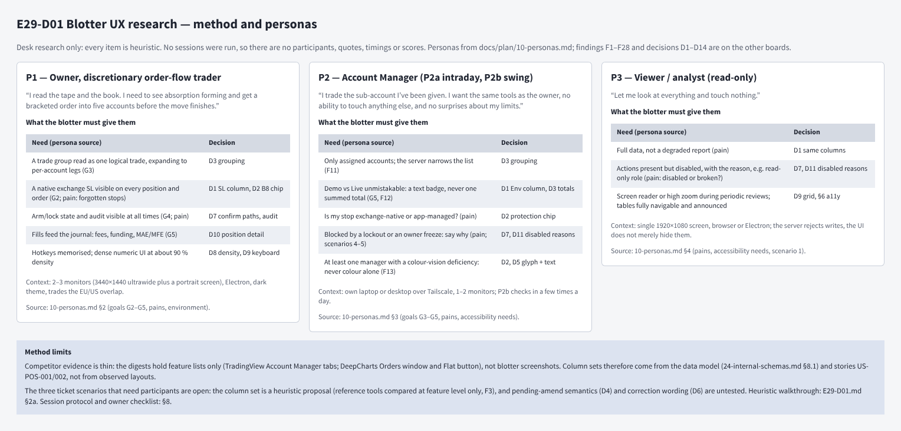
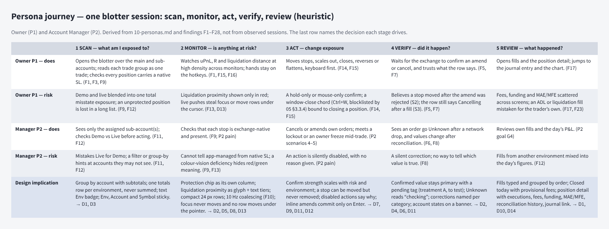
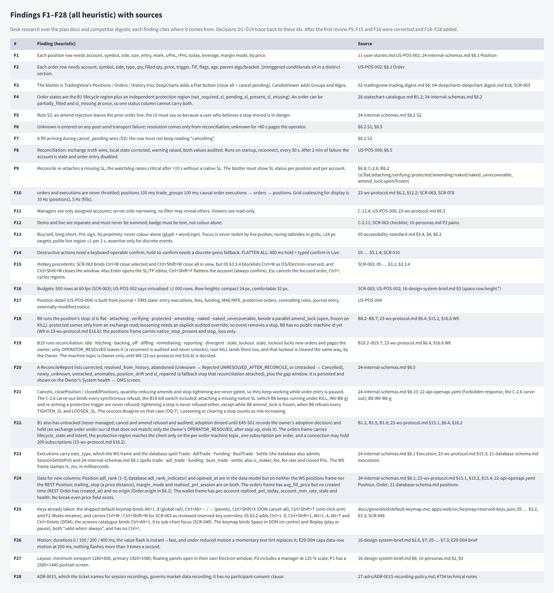
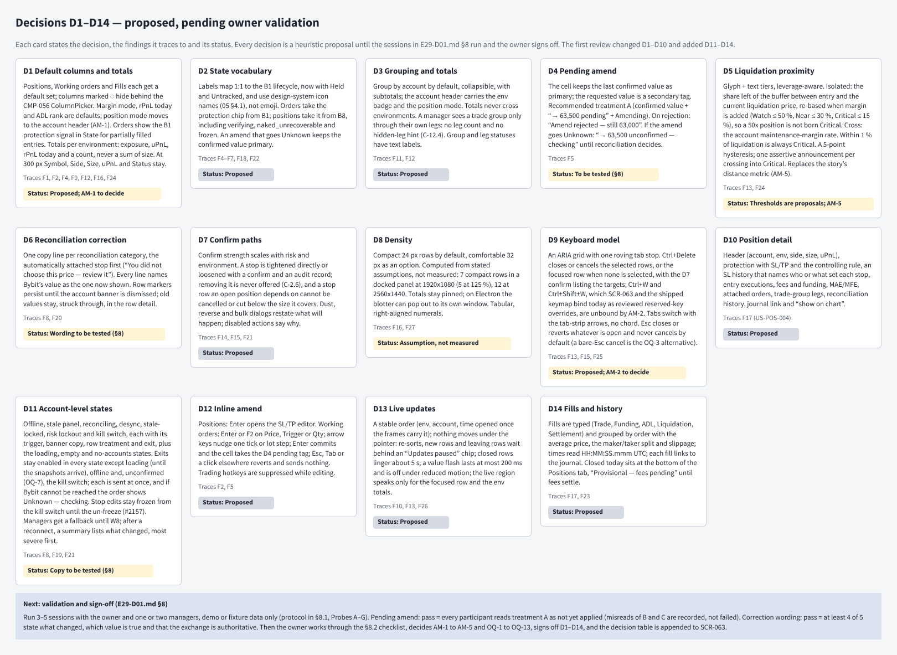
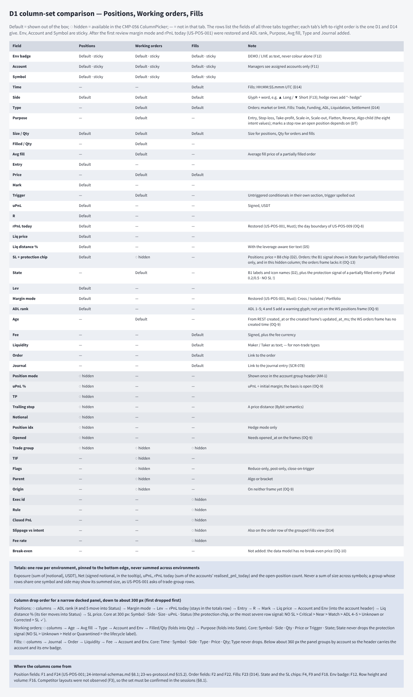

# E29-D01 — UX research: what traders need from a positions and orders blotter

**Ticket:** E29-D01 (#734) · **Epic:** E29 · **Status:** In Review, owner approval pending. The review findings on PR #3899 are applied to this note and to the board: all twelve frames were rebuilt from the current build scripts on 2026-10-20 and re-exported, so the PNGs below match this text. The participant sessions in §8 remain open.

## 0. Artefacts

- Penpot page `E29-D01 Blotter UX research` (frames named `E29-D01/<name>`; Penpot displays the slash with spaces, `E29-D01 / <name>`): https://design.penpot.app/#/workspace?team-id=b564c72c-f31f-81ec-8008-b109a9175d0b&file-id=b564c72c-f31f-81ec-8008-b112c6fdc116&page-id=c1ff2298-b5c7-80ce-8008-c9875b0276d3
- PNG exports: one per frame, in `img/`, made with the Penpot MCP `export_shape` call that `docs/design/_tools/penpot_export.py` makes (run through a wrapper that retries while the plugin tab is suspended). The board is a low-fidelity research artefact, not visual design: greyscale, except amber and red row tints that mark warning and critical states, and every tinted row also carries a word.

1. **Method and personas** (`E29-D01/method-and-personas`)

   

2. **Persona journey** (`E29-D01/journey`)

   

3. **Findings F1–F28** (`E29-D01/findings`)

   

4. **Decisions D1–D14** (`E29-D01/decisions`)

   

5. **Column-set comparison (D1)** (`E29-D01/column-sets`)

   

6. **State vocabulary (D2)** (`E29-D01/state-vocabulary`)

   

7. **Pending amend treatments (D4)** (`E29-D01/pending-amend`)

   

8. **Reconciliation correction (D6)** (`E29-D01/correction`)

   

9. **Confirm paths and hotkeys (D7, D9)** (`E29-D01/confirm-paths`)

   

10. **Account-level states (D11)** (`E29-D01/account-states`)

    ![Table of account-level states (offline, stale panel, reconciling, desync, stale and locked, locked after the kill switch, risk lockout, kill switch), each with its trigger, banner copy, row treatment, the actions that stay enabled, the actions disabled with their reason, and the exit; a second table for the loading, empty, filter-empty and no-accounts states; then what managers and viewers see without the reconciliation topic, one line per order-entry refusal reason, and a post-reconnect summary banner that lists what changed, most severe first](img/E29-D01-account-states.png)

11. **Live updates and inline amend (D12, D13)** (`E29-D01/live-updates`)

    

12. **Fills and history (D14)** (`E29-D01/fills`)

    

## 1. Purpose and scope

Decide what SCR-063 (Positions, Working orders, Fills tabs) and SCR-078 (Fills detail) must show, and how the account-level truth states read, so E29-D02/D03 can wireframe from it. Out of scope: visual design, implementation, the order ticket (E30), the SL/TP editor itself (SCR-064, E32) and the kill-switch modal (SCR-072, E39).

## 2. Method (honest)

Desk research only. No sessions were run; there are no participants, quotes, timings or scores. Every finding is labelled _(heuristic)_. Sources: the plan docs cited per finding and the competitor digests in `docs/research/digests/`. Competitor evidence is thin: the corpus has no screenshots of the Bybit web blotter or of ATAS/DeepCharts blotters, only feature lists (`04-deepcharts-deepchart.digest.md` §18: Orders Window, Flat button; `02-tradingview-trading.digest.md` §6: Account Manager tabs). Column sets below are therefore derived from the data model and stories, not from observed competitor layouts. Per the ticket's agent-delivery adaptation, the moderated sessions are replaced by the structured heuristic walkthrough in §2a, the ready-to-run session protocol in §8.1 and the owner walkthrough checklist in §8.2. The three ticket Gherkin scenarios that need participants stay open (§5).

## 2a. Structured heuristic walkthrough (heuristic)

Heuristic sets: Nielsen's ten (H1–H10); the error-prevention heuristics that `33-raci.md` §4 makes mandatory for safety-critical screens (EP: mis-click resistance, demo/live discrimination, confirm copy for destructive actions); and the trading heuristics of `05-accessibility-standard.md`: T1 never colour alone (§4), T2 focus never stolen by live data (§3.4.3), T3 destructive actions keyboard-confirmable with a discrete fallback (§3.1.4), T4 one global hotkey layer with OS/Electron-reserved keys blocklisted (§3.1.2, §3.3.4), T5 live regions throttled, assertive only for discrete events (§6.2), T6 reduced motion and no more than 3 flashes a second (§7). Severity uses Nielsen's 0–4 scale: 1 cosmetic, 2 minor, 3 major, 4 catastrophic (money or protection at risk).

`33-raci.md` §4 asks for a walkthrough recorded by UXR, A11Y and QAL. Under the agent-delivery adaptation the agent recorded it in the UXR role, against the first draft of this note (the version first reviewed on PR #3899) and the plan text it cites. The rows are not an independent pass: they come from that first design review (its twelve items, recorded on PR #3899 as comment 6291317093) plus the agent's own pass over the same draft, and each severity is the agent's judgement. The A11Y and QAL passes fold into the owner walkthrough (§8.2). No participant took part. The row ids are HW-1 to HW-21, so they do not collide with the W-numbered open items of `23-ws-protocol.md` §16.6 cited elsewhere in this note.

| #     | Heuristic  | Surface walked                                                             | Violation found _(heuristic)_                                                                                                                          | Sev | Decision                                                                              |
| ----- | ---------- | -------------------------------------------------------------------------- | ------------------------------------------------------------------------------------------------------------------------------------------------------ | --- | ------------------------------------------------------------------------------------- |
| HW-1  | EP, H5     | First draft D7 "Edit SL (loosen or remove)"                                | A UI path to an unprotected position, which C-2.6 makes a Severity-1 defect                                                                            | 4   | D7: removal never offered; a stop row an open position depends on cannot be cancelled |
| HW-2  | T4, H5     | SCR-063 `Ctrl+W` / `Ctrl+Shift+W`                                          | Window and tab-close chords bound to closing positions; a slip closes the window or a position                                                         | 4   | D9 `Ctrl+Delete`; AM-2                                                                |
| HW-3  | H1         | Positions SL chip mapped from the order machine (B1)                       | B8's `verifying`, `naked_unrecoverable` and `frozen` had no label; a chip could read "SL ✓" before the exchange read                                   | 4   | D2 B8 table                                                                           |
| HW-4  | H1, EP     | Account-level truth (reconciling, desync, stale, offline)                  | One sentence in the first draft; a user can act on values about to be corrected, or try an entry the server will refuse                                | 3   | D11                                                                                   |
| HW-5  | H9         | Correction banner "its value is now shown"; reconciliation's fallback stop | Ambiguous referent; a stop at a price the user never chose goes unnoticed                                                                              | 3   | D6 taxonomy, `sl_repaired` first                                                      |
| HW-6  | H5         | `Esc` both dismisses and cancels in one focus context                      | A reflexive double `Esc` closes a menu, then cancels the focused order                                                                                 | 3   | D9: bare `Esc` never cancels by default; repeat guard for the OQ-3 alternative        |
| HW-7  | H4, T4     | `Ctrl+Alt+1..3` tab switch                                                 | `Ctrl+Alt` is AltGr on many EU layouts, so the chord types characters there; `Alt+1..9`, `Ctrl+1..9` and `Ctrl+Shift+1` are taken                      | 2   | D9: tab-strip arrows and the command palette, no chord                                |
| HW-8  | H3         | Inline amend                                                               | No start, commit or revert rule; a blur could send an amend                                                                                            | 3   | D12                                                                                   |
| HW-9  | T2, H5     | Live re-sort by uPnL or liquidation distance                               | Rows move under the pointer, so a click lands on a different position                                                                                  | 3   | D13 stable order; "Updates paused" holds re-sorts, inserts and removals               |
| HW-10 | T5         | Live-region scope                                                          | A 10 Hz grid can flood a screen reader                                                                                                                 | 3   | D13 (f)                                                                               |
| HW-11 | T6         | Value flash                                                                | Unbounded flashing on a fast symbol (more than 3 a second)                                                                                             | 2   | D13 (e)                                                                               |
| HW-12 | H2         | Fills without a type                                                       | An ADL or liquidation fill reads as the trader's own fill                                                                                              | 3   | D14 Type                                                                              |
| HW-13 | H2, H8     | D5 fixed-percent thresholds                                                | A new 50× isolated position is born Critical (alarm fatigue); cross-margin liquidation follows the account, not the position                           | 2   | D5 leverage-aware tiers, hysteresis                                                   |
| HW-14 | H8         | Totals row summing size (SCR-063 sketch)                                   | A size total across symbols is meaningless, and misleads in hedge mode                                                                                 | 2   | D1 totals definition                                                                  |
| HW-15 | H6         | Margin mode and rPnL today hidden                                          | Contradicts US-POS-001 (Must); the trader must recall them from another screen                                                                         | 2   | D1 restored; AM-1 for position mode                                                   |
| HW-16 | EP         | Close %, reverse, one-click arm, bulk actions                              | Dust left below the minimum; a reverse that does not restate the new stop; an armed state that could weaken confirms; a bulk dialog without the filter | 3   | D7 rows                                                                               |
| HW-17 | H1, C-12.4 | Trade-group rows for a manager                                             | A group total or leg count reveals accounts the manager may not see                                                                                    | 3   | D3 manager view; W6 (23-ws §16.6)                                                     |
| HW-18 | H7         | Narrow docked panel (≈ 300 px)                                             | No rule for which columns survive                                                                                                                      | 2   | D1 drop order                                                                         |
| HW-19 | H1         | An amend in flight that goes Unknown                                       | The row shows the requested value as if applied, or loses it                                                                                           | 3   | D4 × Unknown                                                                          |
| HW-20 | H1, H10    | Disabled actions                                                           | Silently disabled with no reason (a P2 pain)                                                                                                           | 2   | D7 "Always" row, D11 reasons                                                          |
| HW-21 | T1         | Glyphs                                                                     | `⛔` renders as a colour emoji; one `✕` served Cancelled, Rejected and Expired                                                                         | 1   | D2 icon names (05 §4.1)                                                               |

## 3. Findings

| #   | Finding _(heuristic)_                                                                                                                                                                                                                                                                                                                                                                                                                                                                                                                                                                                                         | Source                                                                                                                                                 |
| --- | ----------------------------------------------------------------------------------------------------------------------------------------------------------------------------------------------------------------------------------------------------------------------------------------------------------------------------------------------------------------------------------------------------------------------------------------------------------------------------------------------------------------------------------------------------------------------------------------------------------------------------- | ------------------------------------------------------------------------------------------------------------------------------------------------------ |
| F1  | Each position row needs account, symbol, side, size, entry, mark, uPnL, rPnL today, leverage, margin mode, liq price.                                                                                                                                                                                                                                                                                                                                                                                                                                                                                                         | `11-user-stories.md` US-POS-001; `24-internal-schemas.md` §8.1 `Position`                                                                              |
| F2  | Each order row needs account, symbol, side, type, qty, filled qty, price, trigger, TIF, flags, age, parent algo/bracket. Untriggered conditionals sit in a distinct section.                                                                                                                                                                                                                                                                                                                                                                                                                                                  | US-POS-002; §8.1 `Order`                                                                                                                               |
| F3  | The blotter is TradingView's Positions / Orders / History trio; DeepCharts adds a Flat button (close all + cancel pending). CandleViewer adds Groups and Algos.                                                                                                                                                                                                                                                                                                                                                                                                                                                               | `02-tradingview-trading.digest.md` §6; `04-deepcharts-deepchart.digest.md` §18; SCR-063                                                                |
| F4  | Order states are the B1 `lifecycle` region plus an independent `protection` region (`not_required`, `sl_pending`, `sl_present`, `sl_missing`). An order can be `partially_filled` and `sl_missing` at once, so one status column cannot carry both.                                                                                                                                                                                                                                                                                                                                                                           | `28-statechart-catalogue.md` B1.2; `24-internal-schemas.md` §8.2                                                                                       |
| F5  | Rule S2: an amend rejection leaves the prior order live; the UI must say so because a user who believes a stop moved is in danger.                                                                                                                                                                                                                                                                                                                                                                                                                                                                                            | `24-internal-schemas.md` §8.2 S2                                                                                                                       |
| F6  | `Unknown` is entered on any post-send transport failure; resolution comes only from reconciliation; unknown for >60 s pages the operator.                                                                                                                                                                                                                                                                                                                                                                                                                                                                                     | §8.2 S1; §8.5                                                                                                                                          |
| F7  | A fill arriving during `cancel_pending` wins (S3): the row must not keep reading "cancelling".                                                                                                                                                                                                                                                                                                                                                                                                                                                                                                                                | §8.2 S3                                                                                                                                                |
| F8  | Reconciliation: exchange truth wins, local state corrected, warning raised, both values audited. Runs on startup, reconnect, every 30 s. After 2 min of failure the account is stale and order entry disabled.                                                                                                                                                                                                                                                                                                                                                                                                                | US-POS-008; §8.5                                                                                                                                       |
| F9  | Reconcile re-attaches a missing SL; the watchdog raises critical after >10 s without a native SL. The blotter must show SL status per position and per account.                                                                                                                                                                                                                                                                                                                                                                                                                                                               | §8.8; C-2.6; B8.2 (`sl.flat/attaching/verifying/protected/amending/naked/naked_unrecoverable`, `amend_lock.open/frozen`)                               |
| F10 | `orders` and `executions` are never throttled; `positions` 100 ms; `trade_groups` 100 ms; causal order executions → orders → positions. Grid coalescing for display is 10 Hz (positions), 5 Hz (fills).                                                                                                                                                                                                                                                                                                                                                                                                                       | `23-ws-protocol.md` §6.2, §12.2; SCR-063, SCR-078                                                                                                      |
| F11 | Managers see only assigned accounts; server-side narrowing, no filter may reveal others. Viewers see read-only.                                                                                                                                                                                                                                                                                                                                                                                                                                                                                                               | C-12.4; US-POS-006; `23-ws-protocol.md` §6.3                                                                                                           |
| F12 | Demo and live are separate and must never be summed; badge must be text, not colour alone.                                                                                                                                                                                                                                                                                                                                                                                                                                                                                                                                    | C-2.11; SCR-063 checklist; `10-personas.md` P2 pains                                                                                                   |
| F13 | Buy/sell, long/short, PnL sign, liq proximity: never colour alone (glyph + word/sign). Focus is never stolen by live pushes; roving tabindex in grids; ≥24 px targets; polite live region ≤1 per 2 s, assertive only for discrete events.                                                                                                                                                                                                                                                                                                                                                                                     | `05-accessibility-standard.md` §3.4, §4, §6.2                                                                                                          |
| F14 | Destructive actions need a keyboard-operable confirm; hold-to-confirm needs a discrete-press fallback. FLATTEN ALL: 800 ms hold + typed confirm in Live.                                                                                                                                                                                                                                                                                                                                                                                                                                                                      | `05-…` §3.1.4; SCR-010                                                                                                                                 |
| F15 | Hotkey precedents: SCR-063 binds `Ctrl+W` close selected and `Ctrl+Shift+W` close all in view, but 05 §3.3.4 blocklists `Ctrl+W` as OS/Electron-reserved, and `Ctrl+Shift+W` closes the window. Also `Enter` opens the SL/TP editor, `Ctrl+Shift+F` flattens the account (always confirm), `Esc` cancels the focused order, `Ctrl+\` cycles regions.                                                                                                                                                                                                                                                                          | SCR-063; `05-…` §3.2, §3.3.4                                                                                                                           |
| F16 | Budgets: 500 rows at 60 fps (SCR-063); US-POS-002 says virtualised ≥1 000 rows. Row heights: compact 24 px, comfortable 32 px.                                                                                                                                                                                                                                                                                                                                                                                                                                                                                                | SCR-063; US-POS-002; `16-design-system-brief.md` §3 (`space.row.height.*`)                                                                             |
| F17 | Position detail (US-POS-004) is built from journal + OMS state: entry executions, fees, funding, MAE/MFE, protective orders, controlling rules, journal entry, externally-modified notice.                                                                                                                                                                                                                                                                                                                                                                                                                                    | US-POS-004                                                                                                                                             |
| F18 | B8 runs the position's stop: `sl` is flat · attaching · verifying · protected · amending · naked · naked_unrecoverable, beside a parallel `amend_lock` (open, frozen on KILL). `protected` comes only from an exchange read; loosening needs an explicit audited override; no event removes a stop. B8 has no public machine id yet (W9 in `23-ws-protocol.md` §16.6): the positions frame carries `native_stop_present` and `stop_loss` only.                                                                                                                                                                                | B8.2–B8.7; `23-ws-protocol.md` §6.4, §15.2, §16.6 W9                                                                                                   |
| F19 | B19 runs reconciliation: idle · fetching · backing_off · diffing · remediating · reporting · divergent · stale_lockout. `stale_lockout` locks new orders and pages the owner; only `OPERATOR_RESOLVED` leaves it (a reconnect is audited and never unlocks); root `KILL` lands there too, and that lockout is cleared the same way, by the Owner. The machine topic is Owner-only until W8 (`23-ws-protocol.md` §16.6) is decided.                                                                                                                                                                                            | B19.2–B19.7; `23-ws-protocol.md` §6.4, §16.6 W8                                                                                                        |
| F20 | A `ReconcileReport` lists `corrected`, `resolved_from_history`, `abandoned` (Unknown → Rejected `UNRESOLVED_AFTER_RECONCILE`, or Untracked → Cancelled), `newly_unknown`, `untracked`, `anomalies`, `position_drift` and `sl_repaired` (a fallback stop that reconciliation attached), plus the gap window. It is persisted and shown on the Owner's System health → OMS screen.                                                                                                                                                                                                                                              | `24-internal-schemas.md` §8.5                                                                                                                          |
| F21 | Cancels, `closePosition` / `closeAllPositions`, quantity-reducing amends and stop-tightening are never gated, so they keep working while order entry is paused. The C-2.6 carve-out binds every synchronous refusal, the B18 kill switch included: attaching a missing native SL (which B8 keeps running under KILL, INV-B8-g) and re-arming a protective trigger are never refused; tightening a stop is never refused either, except while B8 `amend_lock` is frozen, when B8 refuses every `TIGHTEN_SL` and `LOOSEN_SL`. The sources disagree on that case (OQ-7). Loosening or clearing a stop counts as risk-increasing. | `24-internal-schemas.md` §8.10; `22-api-openapi.yaml` (`Forbidden` response, the C-2.6 carve-out); B8 INV-B8-g                                         |
| F22 | B1 also has `untracked` (never managed; cancel and amend refused and audited; adoption denied until E45-S01 records the owner's adoption decision) and `held` (an exchange order under our id that does not match; only the Owner's `OPERATOR_RESOLVED`, after step-up, ends it). The orders frame carries `lifecycle_state` and `intent`; the `protection` region reaches the client only on the per-order machine topic, one subscription per order, and a connection may hold 200 subscriptions (`23-ws-protocol.md` §16.2).                                                                                               | B1.2, B1.5, B1.8; `23-ws-protocol.md` §15.1, §6.4, §16.2                                                                                               |
| F23 | Executions carry `exec_type`, which the WS frame and the database spell `Trade` · `AdlTrade` · `Funding` · `BustTrade` · `Settle` (the database also admits `SessionSettlePnl`) and `24-internal-schemas.md` §8.1 spells `trade` · `adl_trade` · `funding` · `bust_trade` · `settle`; also `is_maker`, fee, fee rate and closed PnL. The WS frame stamps `ts_ms`, in milliseconds.                                                                                                                                                                                                                                            | `24-internal-schemas.md` §8.1 `Execution`; `23-ws-protocol.md` §15.3; `21-database-schema.md` `executions`                                             |
| F24 | Data for new columns: Position `adl_rank` (1–5; database `adl_rank_indicator`) and `opened_at` are in the data model but on neither the WS positions frame nor the REST `Position`; `trailing_stop` (a price distance), `margin_mode` and `realised_pnl_session` are on both. The orders frame has `avg_fill_price` but no created time (REST `Order` has `created_at`) and no `origin` (`Order.origin` in §8.1). The wallet frame has per-account `realised_pnl_today`, `account_mm_rate`, `stale` and `health`. No break-even price field exists.                                                                           | `24-internal-schemas.md` §8.1; `23-ws-protocol.md` §15.1, §15.2, §15.4; `22-api-openapi.yaml` `Position`, `Order`; `21-database-schema.md` `positions` |
| F25 | Keys already taken: the shipped default keymap binds `Alt+1..9` (global rail), `Ctrl+Alt+←/→` (panels), `Ctrl+Shift+X` (DOM cancel-all), `Ctrl+Shift+T` (one-click arm) and `F2` (Rules rename), and carries `Ctrl+W` / `Ctrl+Shift+W` for SCR-063 as reviewed reserved-key overrides; 05 §3.2 adds `Ctrl+1..9`, `Ctrl+Shift+1`, `Alt+1..4`, `Alt+T` and `Ctrl+Delete` (DOM); the screens catalogue binds `Ctrl+Alt+1..9` to sub-chart focus (SCR-049). The keymap binds `Space` in DOM (re-centre) and Replay (play or pause), both "valid when: always", and has no `Ctrl+\`.                                               | `docs/generated/default-keymap.md`; `apps/web/src/keymap/reserved-keys.json`; `05-…` §3.2, §3.3; SCR-049                                               |
| F26 | Motion: durations 0 / 100 / 200 / 400 ms; the value flash is instant→fast, and under reduced motion a momentary text tint replaces it; E29-D04 caps data-row motion at 200 ms; nothing flashes more than 3 times a second.                                                                                                                                                                                                                                                                                                                                                                                                    | `16-design-system-brief.md` §2.6, §7; `05-…` §7.3; E29-D04 brief                                                                                       |
| F27 | Layout: minimum viewport 1280×800, primary 1920×1080; floating panels open in their own Electron window; P2 includes a manager at 125 % scale; P1 has a 2560×1440 portrait screen.                                                                                                                                                                                                                                                                                                                                                                                                                                            | `16-design-system-brief.md` §8; `10-personas.md` §2, §3                                                                                                |
| F28 | ADR-0015, which the ticket names for session recordings, governs market-data recording; it has no participant-consent clause.                                                                                                                                                                                                                                                                                                                                                                                                                                                                                                 | `27-adrs/ADR-0015-recording-policy.md`; #734 technical notes                                                                                           |

## 3a. Persona journey (heuristic)

One blotter session for the owner (P1) and an account manager (P2), derived from `10-personas.md` §2–§3 and the findings above, not from observed sessions. The board frame `E29-D01/journey` shows the same content.

| Stage                            | Owner P1 — does                                                                                                                                | Owner P1 — risk                                                                                                                      | Manager P2 — does                                                                               | Manager P2 — risk                                                                                     | Design implication                                                                                                                                                                                  |
| -------------------------------- | ---------------------------------------------------------------------------------------------------------------------------------------------- | ------------------------------------------------------------------------------------------------------------------------------------ | ----------------------------------------------------------------------------------------------- | ----------------------------------------------------------------------------------------------------- | --------------------------------------------------------------------------------------------------------------------------------------------------------------------------------------------------- |
| 1 SCAN — what am I exposed to?   | Opens the blotter over the main and sub-accounts; reads each trade group as one trade; checks every position carries a native SL. (F1, F3, F9) | Demo and live blended into one total misstate exposure; an unprotected position is lost in a long list. (F9, F12)                    | Sees only the assigned sub-account(s); checks Demo vs Live before acting. (F11, F12)            | Mistakes Live for Demo; a filter or group-by hints at accounts they may not see. (F11, F12)           | Group by account with subtotals; one totals row per environment, never summed; text Env badge; Env, Account and Symbol sticky. → D1, D3                                                             |
| 2 MONITOR — is anything at risk? | Watches uPnL, R and liquidation distance at high density across monitors; hands stay on the hotkeys. (F1, F15, F16)                            | Liquidation proximity shown only in red; live pushes steal focus or move rows under the cursor. (F13, D13)                           | Checks that each stop is exchange-native and present. (F9; P2 pain)                             | Cannot tell app-managed from native SL; a colour-vision deficiency hides red/green meaning. (F9, F13) | Protection chip as its own column; liquidation proximity as glyph + text tiers; compact 24 px rows; 10 Hz coalescing (F10); focus never moves and no row moves under the pointer. → D2, D5, D8, D13 |
| 3 ACT — change exposure          | Moves stops, scales out, closes, reverses or flattens, keyboard first. (F14, F15)                                                              | A hold-only or mouse-only confirm; a window-close chord (`Ctrl+W`, blocklisted by 05 §3.3.4) bound to closing a position. (F14, F15) | Cancels or amends own orders; meets a lockout or an owner freeze mid-trade. (P2 scenarios 4–5)  | An action is silently disabled, with no reason given. (P2 pain)                                       | Confirm strength scales with risk and environment; a stop can be moved but never removed; disabled actions say why; inline amends commit only on `Enter`. → D7, D9, D11, D12                        |
| 4 VERIFY — did it happen?        | Waits for the exchange to confirm an amend or cancel, and trusts what the row says. (F5, F7)                                                   | Believes a stop moved after the amend was rejected (S2); the row still says Cancelling after a fill (S3). (F5, F7)                   | Sees an order go Unknown after a network drop, and values change after reconciliation. (F6, F8) | A silent correction; no way to tell which value is true. (F8)                                         | Confirmed value stays primary with a pending tag (treatment A, to test); Unknown reads “checking”; corrections named per category; account states on a banner. → D2, D4, D6, D11                    |
| 5 REVIEW — what happened?        | Opens fills and the position detail; jumps to the journal entry and the chart. (F17)                                                           | Fees, funding and MAE/MFE scattered across screens; an ADL or liquidation fill mistaken for the trader's own. (F17, F23)             | Reviews own fills and the day’s P&L. (P2 goal G4)                                               | Fills from another environment mixed into the day’s figures. (F12)                                    | Fills typed and grouped by order; Closed today with provisional fees; position detail with executions, fees, funding, MAE/MFE, reconciliation history, journal link. → D1, D10, D14                 |

## 4. Decisions (proposed; each is a heuristic proposal pending owner validation)

### D1 Default columns and totals (traces F1, F2, F4, F9, F12, F16, F24)

CMP-056 ColumnPicker hides items marked ◌. Order is left to right. Sticky: Env + Account + Symbol. Fields come from the data model (`24-internal-schemas.md` §8.1, `23-ws-protocol.md` §15); a field the client does not receive yet is flagged.

**Positions:** Env badge (`DEMO`/`LIVE` text) · Account · Symbol · Side (`▲ Long` / `▼ Short`, text) · Size · Entry · Mark · uPnL (signed, USDT) · R · rPnL today · Liq price · Liq distance % (with the D5 tier text) · SL (price + B8 protection chip, D2) · Lev · Margin mode (`Cross` / `Isolated` / `Portfolio`) · ADL rank (`ADL 1`–`ADL 5`; 4 and 5 also carry a warning glyph) · ◌ Position mode (AM-1) · ◌ uPnL % · ◌ TP · ◌ Trailing stop (a price distance, Bybit semantics) · ◌ Notional · ◌ Position idx (hedge only) · ◌ Opened (needs `opened_at` on the frames, OQ-9) · ◌ Trade group.

Data notes: rPnL today per position comes from the positions frame's `realised_pnl_session`, whose window must be the configured day boundary of US-POS-009 (OQ-8); the per-account figure is the wallet's `realised_pnl_today`. ADL rank is in the Position model and the database but not on the WS positions frame (OQ-9). uPnL % is uPnL ÷ initial margin (the ROE convention); the frame has no initial-margin field, so the basis is D02's to confirm (OQ-9). **Break-even:** the data model has no break-even price, so no column is added (OQ-10).

**Amendment AM-1 (US-POS-001 / E29-D02 scope):** margin mode and rPnL today are restored as defaults, because US-POS-001 (Must) lists them. Position mode (`One-way` / `Hedge`) is an account setting, the same on every row of that account, so it shows once in the account group header and as a ◌ column instead of a default per-row column; in hedge mode the Side cell already reads `▲ Long · hedge` / `▼ Short · hedge`. This narrows the E29-D02 scope line "realised today, margin mode, position mode" and needs the owner's yes (OQ-2).

**Working orders:** Env · Account · Symbol · Side · Type · Purpose (`Entry`, `Stop-loss`, `Take-profit`, `Scale-in`, `Scale-out`, `Flatten`, `Reverse`, `Algo child`: the eight values of the order's `intent`) · Qty · Filled/Qty · Avg fill · Price · Trigger · State (D2, carrying the B1 protection signal below) · Age (from REST `created_at`, or the `updated_at_ms` of the order's `change: "created"` frame; the WS orders frame has no created-time field, OQ-9) · ◌ SL protection (B1) · ◌ TIF · ◌ Flags (reduce-only, post-only, close-on-trigger) · ◌ Parent (algo/bracket) · ◌ Trade group · ◌ Origin (on neither frame yet, OQ-9). Purpose is a default because D7 treats a stop row that an open position depends on differently. Untriggered conditionals: separate collapsible section "Conditional (untriggered)" with trigger spelled out ("Triggers when Mark falls to 62,000").

**SL protection on orders.** The B1 `protection` region reaches the client only on the per-order machine topic (F22), and a connection may hold 200 subscriptions against a grid of 500–1,000 rows, so it is not a default column. Until the orders frame carries it (OQ-13) the blotter subscribes only for partially filled position-opening orders, the ones whose fills have already opened a position, and folds the signal into State ("Partial 0.200/0.500 · NO SL !"); the ◌ SL protection column shows it for the same orders.

**Fills:** D14.

**Totals (one row per environment shown, pinned to the panel's bottom edge, never summed across environments, D3):** Exposure (Σ |notional|, USDT) · Net (Σ signed notional, in the tooltip) · uPnL (Σ) · rPnL today (Σ of the accounts' `realised_pnl_today`) · open positions (count). **Never a sum of size across symbols.** A group whose rows share one symbol and side (a trade group, or group-by symbol in one-way mode) may show its summed size, as US-POS-001 asks of trade-group rows.

**Column drop order for a narrow docked panel (down to ≈ 300 px).** As the panel narrows, columns leave in this order, first to last; a dropped value moves to the row detail and stays in the row's accessible description:

- Positions: the ◌ columns; then ADL rank (a rank of 4 or 5 moves into Status) → Margin mode → Lev → rPnL today (stays in the totals row) → Entry → R → Mark → Liq price → Account and Env (into the account group header) → Liq distance % (its tier moves into Status) → SL price. The 300 px core never drops: **Symbol · Side · Size · uPnL · Status**, where Status is the protection chip or, when one is active, the most severe row signal (NO SL > Critical liquidation > Near liquidation > Watch > ADL 4–5 > Unknown or Corrected > SL ✓).
- Working orders: the ◌ columns; then Age → Avg fill → Type → Account and Env → Filled/Qty (folds into Qty as `0.2/0.5`) → Purpose (folds into State, as `Working · SL`). Core: **Symbol · Side · Qty · Price or Trigger · State**. State never drops the protection signal, and shows the most severe first: NO SL > Unknown > Held or Quarantined > the lifecycle label (as in `Partial 0.2/0.5 · NO SL !`).
- Fills: the ◌ columns; then Journal → Order → Liquidity → Fee → Account and Env. Core: **Time · Symbol · Side · Type · Price · Qty**. Type never drops, so an ADL or liquidation fill never reads as an ordinary fill.
- Below about 360 px the panel groups by account, so the group header carries the account and its env badge as text; the user's own group-by returns when the panel widens. Breakpoints follow from the column widths D02 sets.

### D2 State vocabulary (traces F4–F7, F18, F22)

Display labels map 1:1 to the machine states; the contract names stay in the data attribute and the accessible description. **Icons** follow the 05 §4.1 convention (clock, check, x, slash for order status) as design-system icon names registered per `16-design-system-brief.md` §5; the names below are proposals for E29-D04. The board and the wireframes use Unicode characters only as placeholders (◌ ● ◐ ⟳ ? ✓ ✕ ■ ◇ ▲ ▼ △ ⚑ ⓘ); `⛔` is dropped because it renders as a colour emoji.

**Orders: B1 `lifecycle`** (`orders.lifecycle_state`, `23-ws-protocol.md` §15.1)

| B1 lifecycle state | Label                                   | Icon (proposal) | Notes and actions                                                                                                                                                                                                                   |
| ------------------ | --------------------------------------- | --------------- | ----------------------------------------------------------------------------------------------------------------------------------------------------------------------------------------------------------------------------------- |
| draft / validated  | not shown in the blotter (ticket-local) | —               |                                                                                                                                                                                                                                     |
| submitting         | Sending                                 | loader          |                                                                                                                                                                                                                                     |
| submitted          | Working                                 | clock           |                                                                                                                                                                                                                                     |
| triggered          | Triggered                               | zap             | the conditional order fired                                                                                                                                                                                                         |
| partially_filled   | Partial 0.200/0.500                     | circle-half     |                                                                                                                                                                                                                                     |
| cancel_pending     | Cancelling                              | refresh         | a late fill flips it (S3)                                                                                                                                                                                                           |
| amend_pending      | Amending                                | refresh         | pending rules in D4                                                                                                                                                                                                                 |
| unknown            | Unknown — checking                      | help-circle     | amber; "We could not confirm this order with Bybit; checking." Only reconciliation resolves it (S1); amend and cancel disabled with that reason; D4 × Unknown                                                                       |
| quarantined        | Quarantined                             | octagon-alert   | critical; diagnostics only                                                                                                                                                                                                          |
| held               | Held — owner review                     | lock            | critical; Bybit has an order under our id that does not match ours; only the Owner resolves it, after step-up (E45-T03); no action for anyone else, reason shown                                                                    |
| untracked          | Untracked — not placed by CandleViewer  | link-off        | never rule-managed (S9); the OMS refuses cancel and amend (INV-B1-l), so both are disabled with "Not placed by CandleViewer — manage it on Bybit"; Adopt (Owner) stays disabled until E45-S01 records the owner's adoption decision |
| filled             | Filled                                  | check           | terminal; lingers, then leaves the tab (D13)                                                                                                                                                                                        |
| cancelled          | Cancelled                               | slash           | terminal                                                                                                                                                                                                                            |
| rejected           | Rejected                                | x               | terminal; opens SCR-077; "Rejected — not found on Bybit" has its own copy (D6)                                                                                                                                                      |
| expired            | Expired                                 | clock-strike    | terminal                                                                                                                                                                                                                            |
| killed             | Killed (kill switch)                    | stop-square     | terminal                                                                                                                                                                                                                            |

**Orders: protection signal from B1 `protection`** (on `machines.order:{id}.state`, `regions`, `23-ws-protocol.md` §6.4; shown in State for partially filled position-opening orders only, D1): `sl_pending` "SL pending"; `sl_present` "SL ✓ 63,900" with its price (confirmed by an exchange read, INV-B1-f); `sl_missing` "NO SL !" critical (the naked-position alert and the fallback stop run); `not_required` "—" (reduce-only and closing orders).

**Positions: protection chip from B8** (`sl` region plus the parallel `amend_lock`)

| B8 state              | Chip                          | Treatment                                                                                                                                                            | What today's contract shows                                                                                                                                                   |
| --------------------- | ----------------------------- | -------------------------------------------------------------------------------------------------------------------------------------------------------------------- | ----------------------------------------------------------------------------------------------------------------------------------------------------------------------------- |
| `flat`                | no row                        | —                                                                                                                                                                    | the position leaves the frame                                                                                                                                                 |
| `attaching`           | SL attaching…                 | neutral                                                                                                                                                              | needs W9                                                                                                                                                                      |
| `verifying`           | SL sent — verifying           | neutral; never "✓" before the exchange read (INV-B8-a)                                                                                                               | needs W9                                                                                                                                                                      |
| `protected`           | SL ✓ 63,900                   | normal                                                                                                                                                               | `native_stop_present: true` and `stop_loss`                                                                                                                                   |
| `amending`            | SL 63,900 → 63,950 pending    | the D4 rule: the confirmed price stays primary                                                                                                                       | needs W9                                                                                                                                                                      |
| `naked`               | NO SL ! 12 s                  | critical; counts up from the naked-since time; announced once                                                                                                        | `native_stop_present: false` (the timer needs W9)                                                                                                                             |
| `naked_unrecoverable` | NO SL — owner paged           | critical; the row offers a reduce-only Close (an exit, never new exposure); announced once                                                                           | needs W9; reads as "NO SL !" until then                                                                                                                                       |
| `amend_lock.frozen`   | adds "· frozen (kill switch)" | warning; every SL edit disabled with "Stops are frozen by the kill switch; the native stop stays in place" (INV-B8-g; the plan sources disagree on tightening, OQ-7) | the B18 `kill_switch` state (`23-ws-protocol.md` §6.4) while it is engaged; after the release B8 stays frozen until the un-freeze (#2157), which the frames show only with W9 |

Account-level conditions (offline, reconciling, desync, stale, lockouts) are not row states: D11.

### D3 Grouping and totals (traces F11, F12)

Default group-by: **account** (owner and manager alike), collapsible, with per-account subtotal; the account group header carries the account, its `DEMO`/`LIVE` badge as text and its position mode (AM-1). Alternatives in the toolbar: symbol, trade group, manager (owner only). Trade-group view: group row aggregates size and PnL (US-POS-001) and expands to per-account legs. **Totals never cross environments**: one totals row per env, each labelled, with the fields D1 defines; mixed demo+live is shown as two blocks, never a single sum. Manager view: server-scoped, so the account list contains only assigned accounts.

**A trade group seen by a manager (C-12.4, US-POS-006).** A manager sees a group only through its legs on the manager's own accounts. The group row aggregates those legs only and reads "Trade group · your legs"; it shows no total leg count, no "n hidden" hint and no group status computed from legs the manager cannot see. The UI alone cannot keep this rule: the `trade_groups` data frame (`23-ws-protocol.md` §15.5) carries the group-wide `status` and `totals` (`requested_legs`, `submitted_legs`, `rejected_legs`), and §6.3 narrows that topic only to granted accounts. Until the server narrows those fields to the manager's legs or leaves them out (OQ-5), the blotter does not render them for a manager and computes the group row from the visible legs. Whether a manager may see the group's machine state at all is W6 (`23-ws-protocol.md` §16.6; Owner + Security; refused until decided, §6.4).

**Group and leg labels** (proposed labels for the `23-ws-protocol.md` §15.5 statuses; SCR-062 names a state column but no state words, so its designs, E28-D02 and E34-D03, should reuse these). Group: submitting `Sending`, partially_open `Partly open`, open `Open`, closing `Closing`, closed `Closed`, failed `Failed`, cancelled `Cancelled`; draft is not shown. Leg: pending `Pending`, submitted `Sent`, open `Open`, partially_filled `Partial`, filled `Filled`, rejected `Rejected`, cancelled `Cancelled`, closed `Closed`, error `Error`. Each leg's `native_sl_confirmed` drives its SL chip.

### D4 Pending amend (traces F5) — to be tested, see §8

Rule: **the cell keeps showing the last confirmed value as primary**; the requested value appears as a secondary tag. Candidate treatments for the walkthrough: (A) confirmed value + `→ 63,500 pending` tag + "Amending" state label, (B) both values stacked, (C) greyed requested value only. Recommended default: A, because it can never be read as applied (the confirmed value is never replaced). Hypotheses for the walkthrough: in B the requested value shares the cell at nearly the same weight and may be read as current; C removes the confirmed value, so dimming is the only signal. As drawn on the board, C's greyed value (`#8A90A0` on the `#ECEFF4` row) measures 2.77:1, so it fails WCAG 1.4.3 (05 §5 rule 1 asks 4.5:1 for text); that is the point of the probe, and E29-D02 does not copy it. The tag has text, not only dimming. On ack the tag disappears; on rejection the row shows "Amend rejected — still 63,000" with the exchange reason, until dismissed (S2). Pending state is never optimistic for fills or positions (only for amend/cancel intent).

**D4 × Unknown.** An amend whose round trip fails goes `amend_pending → unknown` (B1.4). The row keeps the confirmed value primary and says the request is unconfirmed:

| Moment                              | Trigger cell                             | State                         | Message                                                                                                                                                                   |
| ----------------------------------- | ---------------------------------------- | ----------------------------- | ------------------------------------------------------------------------------------------------------------------------------------------------------------------------- |
| Amend sent                          | 63,000 `→ 63,500 pending`                | Amending                      | —                                                                                                                                                                         |
| Round trip fails                    | 63,000 `→ 63,500 unconfirmed — checking` | Unknown — checking            | "We could not confirm the amend with Bybit. The order may still be at 63,000; checking." Amend and cancel disabled with that reason; flattening the account stays enabled |
| Reconciliation finds 63,500         | 63,500                                   | Working                       | "Amend confirmed by reconciliation."                                                                                                                                      |
| Reconciliation finds 63,000         | 63,000                                   | Working                       | "Amend not applied — still 63,000." until dismissed (S2)                                                                                                                  |
| Filled or cancelled in the meantime | final values                             | Filled / Cancelled            | the D6 resolved-from-history line                                                                                                                                         |
| Two passes find nothing             | —                                        | Rejected — not found on Bybit | the D6 abandoned line                                                                                                                                                     |
| Bybit's order does not match ours   | —                                        | Held — owner review           | D2                                                                                                                                                                        |

### D5 Liquidation proximity (traces F13, F24; thresholds are proposals)

Always glyph + text, three tiers: "Watch" (△), "Near liquidation" (!), "Critical — near liquidation" (!!). Row text e.g. "! within 1.4% of liquidation" (as SCR-063). The tiers are leverage-aware:

- **Isolated margin:** the share of the liquidation buffer still left, measured from the average entry price to the current liquidation price, `(mark − liq) / (entry − liq)` for a long and `(liq − mark) / (liq − entry)` for a short (the positions frame's `mark_price`, `liq_price` and `avg_price`, `23-ws-protocol.md` §15.2): Watch ≤ 50 %, Near ≤ 30 %, Critical ≤ 15 %. A new position starts at 100 % whatever its leverage, so a 50× position (a buffer of roughly 1.5–2 %) is not born Critical, as a fixed "≤ 1.5 %" rule would make it. At 10× these land near the first draft's 5 / 3 / 1.5 %.
- **The buffer re-bases (a proposal).** Both terms use the current liquidation price, so adding isolated margin (the liquidation price moves away), removing it, or a fill that moves the average entry re-bases the share at once, as if the position had opened at its current entry and margin; the share passes 100 % only while the position is in profit, which shows no tier. A denominator fixed at entry would need the liquidation price at entry, which neither the positions frame nor the REST `Position` carries, and would keep a topped-up position on its old thresholds: a 50× position topped up to about 10× would show no tier until the 1 % floor made it Critical, where a 10× position shows Watch and Near first.
- **Cross and portfolio margin:** liquidation follows the account, so the tier comes from the account's maintenance-margin rate on the wallet frame (`account_mm_rate`): Watch ≥ 50 %, Near ≥ 70 %, Critical ≥ 85 % (liquidation as the rate nears 100 %, to be confirmed against the Bybit adapter's model). The tier shows on every cross position of that account and on its group header.
- **Hysteresis:** a row leaves a tier only after recovering 5 points past its threshold (for example, Near is left at 35 % of the buffer, or at a 65 % MM rate), so a price hovering at a boundary does not flap the row or the announcer.
- **Distance floor (a proposal):** whatever the margin mode or leverage, a position whose mark is within 1 % of its liquidation price is Critical. At 50× that is reached once a third to a half of the entry buffer is gone.
- **This changes the story's metric (AM-5).** US-POS-001's scenario fires "within the configured distance of the liquidation price"; the tiers above use the share of the entry buffer (isolated) or the account MM rate (cross), so QA scenarios follow D5 once the owner accepts AM-5. The printed row text stays the distance ("! within 1.4% of liquidation"). Read as isolated, SCR-063's sample row (entry 64,050, mark 64,012, liquidation 63,100: 1.4 % away) still has 96 % of its buffer, so it shows no tier under the buffer rule or the 1 % floor; whether a Near floor (for example 2 %) is worth the alarms it raises on high-leverage entries is part of OQ-1.
- The assertive announcement fires once per crossing into Critical. Thresholds are configurable per profile; the defaults are an owner decision (OQ-1).

### D6 Reconciliation correction (traces F8, F20; wording to be tested)

Both, per correction: (1) an inline row marker with a one-time subtle highlight (static with reduced motion) that **persists until the account's banner is dismissed** (CMP-045: never auto-dismiss content the user may not have perceived; the first draft's 60 s auto-clear is dropped); (2) a dismissible, non-modal banner per account that lists the run's corrections, most severe first, each line linking to its row. The old value stays visible, struck through, in the row tooltip and the position detail (D10) after dismissal. Audit shows both values (F8). Every line names whose value is now shown; the first draft's "its value is now shown" was ambiguous between Bybit's and CandleViewer's.

| ReconcileReport category (24 §8.5) | Row marker                                                     | Banner line (example; every line ends "Detected 14:02:11 UTC.")                                                                                                                                                          |
| ---------------------------------- | -------------------------------------------------------------- | ------------------------------------------------------------------------------------------------------------------------------------------------------------------------------------------------------------------------ |
| `sl_repaired`                      | "SL auto-attached" on the SL chip, with Review (opens SCR-064) | "A stop at 62,700 was attached automatically to BTCUSDT (Sub-1 · LIVE) because none was found on Bybit. You did not choose this price — review it."                                                                      |
| `position_drift`                   | Corrected                                                      | "Bybit reports BTCUSDT size 0.200; CandleViewer showed 0.250. Bybit's value is now shown."                                                                                                                               |
| `corrected` (order fields)         | Corrected                                                      | "Bybit reports the ETHUSDT limit at 2,505.00; CandleViewer showed 2,500.00. Bybit's value is now shown."                                                                                                                 |
| `resolved_from_history`            | Updated from Bybit                                             | "This order filled on Bybit at 14:01:58 UTC while CandleViewer was not watching; its final state is now shown." (or "was cancelled", "was rejected")                                                                     |
| `abandoned`, from Unknown          | state "Rejected — not found on Bybit"                          | "CandleViewer sent this order, but after two checks Bybit has no record of it, so it is marked Rejected. Nothing is working on Bybit for it." (an exchange rejection reads "Rejected by Bybit:" and the exchange reason) |
| `abandoned`, from Untracked        | Gone from Bybit                                                | "An order placed outside CandleViewer is no longer on Bybit; it is shown as Cancelled."                                                                                                                                  |
| `newly_unknown`                    | state "Unknown — checking"                                     | "Bybit no longer lists this order as open; checking its history."                                                                                                                                                        |
| `untracked`                        | state "Untracked — not placed by CandleViewer"                 | "Bybit has an order CandleViewer did not place: ETHUSDT Sell 1.00 at 2,520.00. It is shown, but CandleViewer will not manage it."                                                                                        |
| `anomalies`                        | Owner only: Anomaly                                            | Owner only: "Bybit shows an open order whose id CandleViewer has already closed, or uses on another account. Nothing was changed; it waits for your review." (C-12.4: it may involve another account's row)              |

### D7 Destructive-action confirm paths (traces F14, F15, F21)

| Action                                                | Demo                                                                                                                 | Live                                                                                                      | Notes                                                                                                                                                                                                                                                                                                                                 |
| ----------------------------------------------------- | -------------------------------------------------------------------------------------------------------------------- | --------------------------------------------------------------------------------------------------------- | ------------------------------------------------------------------------------------------------------------------------------------------------------------------------------------------------------------------------------------------------------------------------------------------------------------------------------------- |
| Close position % / full                               | Single `Enter` on a preview popover                                                                                  | SCR-076-style dialog restating account, env, side, symbol, qty; `Enter` armed after 400 ms; `Esc` cancels | Always reduce-only. **Dust rule** (US-POS-003): if rounding to the lot step would leave a remainder below the minimum, warn ("This would leave 0.0004 BTC, below the 0.001 minimum") and offer "Close the full position"; a rounded size says "Rounded to 0.001" (SCR-063)                                                            |
| Cancel one order                                      | `Ctrl+Delete` (the D9 target rule); no question (cancel is safe); a toast without Undo names the order               | Same                                                                                                      | Bare `Esc` never cancels by default (D9, OQ-3). A protective take-profit asks first. **A native-stop row (defined below the table) cannot be cancelled:** disabled with "Every position keeps a native stop — you can move it, not delete it." (SCR-064, C-2.6). Untracked, held and Unknown rows: disabled with their D2 reason      |
| Cancel or close several selected rows, or all in view | Dialog restating the selection or the active filter chips, and the counts per account and env                        | Same, plus a typed word                                                                                   | Every selection of more than one row uses this dialog. Native-stop rows are excluded, and the dialog says so; closes are reduce-only                                                                                                                                                                                                  |
| Reverse                                               | Dialog stating both legs (close, then open) and the fresh native stop of the new position (price and R)              | Same, plus a typed word                                                                                   | Always confirms, even with one-click armed (US-ORD-011); refused before sending when margin is short, showing required vs available                                                                                                                                                                                                   |
| Edit SL — tighten                                     | Direct (SCR-064 Apply), audited                                                                                      | Same                                                                                                      | B8 `TIGHTEN_SL` with the deny-polarity `tightens_only` guard                                                                                                                                                                                                                                                                          |
| Edit SL — loosen                                      | Confirm dialog restating old → new price, the new R and the new liquidation distance; audited                        | Same                                                                                                      | `24-internal-schemas.md` §8.8 item 5; B8 `LOOSEN_SL` needs `explicit_audited_override` (INV-B8-c)                                                                                                                                                                                                                                     |
| Edit SL — remove                                      | **Not offered.** The control is disabled with "Every position keeps a native stop — you can move it, not delete it." | Same                                                                                                      | C-2.6; SCR-064; B8 has no event that removes a stop                                                                                                                                                                                                                                                                                   |
| Edit SL while the kill switch is engaged              | Disabled: "Stops are frozen by the kill switch; the native stop stays in place"                                      | Same                                                                                                      | B8 `amend_lock.frozen` refuses both tighten and loosen (INV-B8-g) and stays frozen after the release until the un-freeze (#2157), so the control stays disabled until then (D11). `22-api-openapi.yaml` and 24 §8.10 say tightening is never refused, the kill switch included; the blotter draws the B8 behaviour until OQ-7 decides |
| Flatten account / flatten all                         | 800 ms hold with a discrete-press keyboard fallback (second `Enter`)                                                 | Same hold, plus a typed confirm                                                                           | SCR-010 FLATTEN ALL; `Ctrl+Shift+F` (one account) always confirms                                                                                                                                                                                                                                                                     |

**Native-stop row.** A position's native stop is usually not an order row: in Full mode (`tpsl_mode: Full`) it is the position's own `stop_loss`, shown in the SL column and edited in SCR-064. A Working-orders row is a native-stop row when its `intent` is `stop_loss`, it is reduce-only, it is on the exchange (it has an `exchange_order_id`), and cancelling it would leave some of an open position's size (same account, symbol and `position_idx`) without a native stop, as with a Partial-mode stop. Only then is Cancel disabled, with the SCR-064 reason. The same rule bounds the row's Qty: an inline amend (D12) that would leave some of that size without a native stop is a partial removal, so the value is invalid and nothing is sent; the editor shows the SCR-064 reason and the lowest valid quantity, and a Qty of 0 is never valid. An orphan stop whose position has closed, or a stop the position no longer depends on, cancels like any order. An engine-managed stop (SCR-064 tells it apart from the native one) is not an exchange order, so it is not a row here.

**Always:** every mutating control emits an audit event. A disabled control states its reason, to keyboard and screen-reader users too: it stays focusable (`aria-disabled`, never the `disabled` attribute, as CMP-001 does for a button disabled with a reason and CMP-079 passes on), its reason is its accessible description (`aria-describedby`), and the row menu lists the item with the same reason; a reason never lives only in a hover tooltip (05 §3.1.1; E29-D05). An order-entry refusal names one reason of the closed set in 24 §8.10 (`maintenance`, `account_disabled_by_policy`, `no_active_key`, `account_unhealthy`) or one of the two refusals that carry none (the kill switch, live not enabled), with the copy in D11; the client-side reasons are offline, a stale or locked account, a risk lockout, viewer read-only, and the D2 row states (Unknown, Held, Untracked). The one-click armed state (US-ORD-005) never weakens a blotter confirm.

**C-2.6 wording, routed (OQ-4).** `24-internal-schemas.md` §8.8 item 5 says smarter stops "may only ever tighten the native stop, never loosen or remove it, unless the user explicitly overrides with a confirmation dialog that is audited". Read literally, that admits an audited removal, which C-2.6 and SCR-064 forbid. This note never offers removal. The wording, and the same tension in §8.10 ("loosening or clearing it is classified like a stop-loosening amend") and in US-ORD-013's "Explicit opt-out" scenario, is an open item for the ADR-0006 / OMS owner, not a new issue.

### D8 Density (traces F16, F27)

Default **compact 24 px rows**, option comfortable 32 px (`16-design-system-brief.md` §3); target ≥24 px (F13). Virtualise at ≥1 000 rows. Numerals in JetBrains Mono, tabular, right-aligned.

**Rows visible in a docked panel (computed from stated assumptions, not measured):** a bottom dock of 30 % of the window; 80 CSS px of OS and window chrome (the taskbar and title bar scale with the display, so they stay about constant in CSS px); 112 px of blotter chrome (tab strip 32, toolbar 32, header 24, one pinned totals row 24; a second environment's totals row costs one more row).

| Screen and scale                                 | Docked panel (CSS px) | Compact rows | Comfortable rows |
| ------------------------------------------------ | --------------------- | ------------ | ---------------- |
| 1920×1080, 100 %                                 | 300                   | 7            | 5                |
| 1920×1080, 125 % (P2)                            | 235                   | 5            | 3                |
| 2560×1440, 100 %                                 | 408                   | 12           | 9                |
| 2560×1440, 125 %                                 | 322                   | 8            | 6                |
| 1440×2560 portrait, popped out, full height (P1) | 2,480                 | 98           | 74               |

**Target:** at least 7 compact rows in the default docked panel at 1920×1080 and 100 % (at least 5 at 125 %), with the totals pinned so they never scroll away; more rows come from resizing the dock or popping the blotter out. The first draft's "≥ 30 rows at default panel height" is withdrawn: it needs a panel of about 830 px. The real number is a session question (§8.1 Probe G).

**Pop-out (proposed):** on the Electron shell the blotter can float in its own window through the docking system's floating panels (`16-design-system-brief.md` §8, docking rule 4); the browser build stays docked. D02 draws the floating state; the window mechanics belong to the shell (E10). Minimum docked size: 300 px wide (the D1 core), and tall enough for the header, three rows and the totals.

**125 % scale (proposed):** D02 draws every state at 100 % and checks it at 125 % (P2); at 200 % zoom compact tables reflow to the stacked layout of `16-design-system-brief.md` §3 rule 4.

### D9 Keyboard model (traces F13, F15, F25)

Table is an ARIA grid, one roving tab stop; `↑/↓` rows, `←/→` cells, `Home/End` first/last, `PageUp/PageDown`, `Space` select, `Shift+↑/↓` extend. Live updates never move focus (D13). The bindings below are proposals, remappable (05 §3.1.3), each checked against 05 §3.2, the shipped default keymap with the decision records in `apps/web/src/keymap/keymap.json`, `apps/web/src/keymap/reserved-keys.json` and SCR-063 (F25):

| Action                      | Binding (proposal)                                                                                                                                                                                                                                                                                                                                   | Focus context  | Clash check                                                                                                                                                                                                                                                                                                                                                                                                                                  |
| --------------------------- | ---------------------------------------------------------------------------------------------------------------------------------------------------------------------------------------------------------------------------------------------------------------------------------------------------------------------------------------------------- | -------------- | -------------------------------------------------------------------------------------------------------------------------------------------------------------------------------------------------------------------------------------------------------------------------------------------------------------------------------------------------------------------------------------------------------------------------------------------- |
| Select rows                 | `Space`, `Shift+↑/↓`, `Ctrl`/`Shift`+click, `Ctrl+A` (all rows in view)                                                                                                                                                                                                                                                                              | grid           | SCR-063 multi-select; `Space` (DOM re-centre, Replay play or pause) and `Ctrl+A` (Rules select-all) are bound in other contexts, so each needs mutual `shadows` entries (the keymap rule below)                                                                                                                                                                                                                                              |
| Switch tab                  | `←/→` on the tab strip (APG tabs, automatic activation); command palette "Blotter: Positions" and so on                                                                                                                                                                                                                                              | tab strip      | no chord: `Alt+1..9` is the global rail, `Ctrl+1..9` the layouts, `Ctrl+Shift+1` one-click, and `Ctrl+Alt+digit` is AltGr on EU layouts                                                                                                                                                                                                                                                                                                      |
| SL/TP editor (positions)    | `Enter`                                                                                                                                                                                                                                                                                                                                              | positions row  | SCR-063 and the keymap (kept)                                                                                                                                                                                                                                                                                                                                                                                                                |
| Inline amend (orders)       | `Enter` or `F2` on Price, Trigger or Qty (D12)                                                                                                                                                                                                                                                                                                       | orders cell    | `F2` renames a node in Rules: another context, the same meaning, so mutual `shadows` entries (below)                                                                                                                                                                                                                                                                                                                                         |
| Close position(s)           | `Ctrl+Delete` on the selected rows, else the focused row (the target rule below), or `Ctrl+Backspace` where the keyboard has no forward-delete key (a Mac laptop needs `Fn` for it; macOS is a supported client, `10-personas.md` §1); then the D7 confirm, which lists the target rows, and the D7 bulk dialog when more than one row is the target | positions grid | not reserved; 05's `Ctrl+Delete` (cancel all at the focused DOM row) is another context and the same destructive family, but the shipped keymap has no `Ctrl+Delete` (the DOM's cancel-all is `Ctrl+Shift+X`, SCR-050), so it needs no `shadows` entry until that DOM binding is added (the keymap rule below); 05 §3.2 already pairs `Delete` with `Backspace` for drawings; `Backspace` needs keymap support first (the keymap rule below) |
| Cancel order(s)             | `Ctrl+Delete` or `Ctrl+Backspace` on the selected rows, else the focused order (the target rule below; the D7 bulk dialog for more than one row); a bare `Esc` never cancels by default (the OQ-3 alternative keeps it for the focused order only)                                                                                                   | orders grid    | 05 §3.2 binds bare `Esc` to "Cancel focused order"; E49-S07 took bare `Esc` off the DOM's cancel-all ("destructive needs a modifier", the keymap's `dom.cancel_all` decision), so this note moves the cancel to `Ctrl+Delete` (AM-2) and keeps bare `Esc` only as the OQ-3 alternative, which would need mutual `shadows` entries with Chart and Ticket (below)                                                                              |
| Close or cancel all in view | the toolbar button, the command palette, or `Ctrl+A` then `Ctrl+Delete` (the D7 bulk dialog)                                                                                                                                                                                                                                                         | grid           | no new chord; `Ctrl+Shift+X` is the DOM's cancel-all                                                                                                                                                                                                                                                                                                                                                                                         |
| Flatten account             | `Ctrl+Shift+F`, always confirms                                                                                                                                                                                                                                                                                                                      | blotter        | 05 §3.2 (kept)                                                                                                                                                                                                                                                                                                                                                                                                                               |
| Row actions menu            | `Shift+F10` or `Menu`                                                                                                                                                                                                                                                                                                                                | row            | APG; `Menu` needs keymap support first (below)                                                                                                                                                                                                                                                                                                                                                                                               |
| Sort                        | `Enter` or `Space` on a column header                                                                                                                                                                                                                                                                                                                | header         | —                                                                                                                                                                                                                                                                                                                                                                                                                                            |
| Region cycle                | `Ctrl+\`                                                                                                                                                                                                                                                                                                                                             | global         | 05 §3.2; the shipped keymap has no `Ctrl+\` and cycles panels with `Ctrl+Alt+←/→`, so the blotter adds no binding and follows whichever the keymap owner ships                                                                                                                                                                                                                                                                               |
| Not bound in the blotter    | `Ctrl+W`, `Ctrl+Shift+W` (05 §3.3.4); `Ctrl+Alt+1..3` (AltGr); `Alt+T` (05's canvas "view as table" toggle: the blotter is already a table)                                                                                                                                                                                                          | —              | —                                                                                                                                                                                                                                                                                                                                                                                                                                            |

**Target rule** (a proposal). An ARIA grid keeps focus and selection apart (the WAI-ARIA APG grid pattern, which 05 §3.4.2 adopts), so `Ctrl+Delete` names its target: the selected rows when any are selected, otherwise the focused row, never both; a focused row outside the selection is not a target. Every D7 confirm it opens lists the target rows, and the bulk dialog adds the counts per account and env; a single cancel, which D7 sends without a question, names its order in the toast. Under the OQ-3 alternative a bare `Esc` acts only on the focused order, never on the selection (Esc precedence, step 3).

**Keymap rule** (`scripts/keymap_lint.py`, E49-T04). The shipped keymap is linted: a binding that two non-Global contexts reuse fails unless both commands list each other in `shadows` with a rationale, and within one context a binding can name only one command. So every key the blotter shares with another context needs mutual `shadows` entries: `Space` (DOM re-centre and Replay play or pause, which already declare each other), `Ctrl+A` (Rules select-all) and `F2` (Rules rename). By default the blotter binds no keymap command to `Esc`: closing a menu or dialog and reverting a cell editor are the widgets' own behaviour, not keymap commands (05 §3.4.4, D12); only the OQ-3 alternative's bare-`Esc` cancel would need mutual entries with `Esc` in Chart (cancel drawing) and Ticket (clear). `Ctrl+Delete` needs none today, because the shipped keymap binds it nowhere else; if 05 §3.2's DOM "cancel all at focused row" is added on `Ctrl+Delete`, the two commands need mutual entries too. Inside the blotter's own keymap context (`Positions`), `Enter` and `Ctrl+Delete` each stay one command whose action follows the focused tab: `Enter` opens the SL/TP editor on a position row and the inline editor on an order cell, and `Ctrl+Delete` closes positions or cancels orders. The grid's arrow, `Home`, `End` and page keys are the ARIA grid's own navigation, not keymap commands. The linter does not parse `Backspace` or `Menu` yet (it raises "unrecognised key"), so `Ctrl+Backspace` and `Menu` need `KEY_ALIASES` support first. It also checks SCR-063's hotkeys line against the keymap, so `keymap.json`, the regenerated `docs/generated/default-keymap.md` and that line change in one PR (AM-2).

**Esc precedence** (05 §3.3.3 reserves `Esc` as the universal cancel):

1. If a menu, popover, tooltip, column picker or dialog is open, `Esc` closes it and stops (05 §3.4.4).
2. If a cell editor is open, `Esc` reverts the edit, sends nothing and stops (D12); trading hotkeys stay suppressed while the editor is open (US-ORD-006).
3. Otherwise `Esc` on a working-order row does nothing: by default a bare `Esc` never cancels, and `Ctrl+Delete` does (the target rule above). Under the OQ-3 alternative only, when nothing is open and a working-order row has focus, `Esc` cancels that focused order, never the selection (05 §3.2), under D7: a native-stop row is disabled with its reason, a protective take-profit asks first, and Untracked, Held and Unknown rows are disabled with theirs.
4. `Esc` on a Positions or Fills row does nothing.
5. Repeat guard (for the OQ-3 alternative; a proposal to test): the auto-repeat of a held `Esc` never cancels, and an `Esc` within 500 ms of an `Esc` that closed something does not cancel.

**Why a bare `Esc` never cancels by default (E49-S07).** E49-S07 removed bare `Esc` from the DOM's cancel-all, and the keymap records why on `dom.cancel_all`: "destructive needs a modifier; Esc stays Close/Cancel" (SCR-050: "destructive commands need a modifier"); the ticket's security notes state the rule for every destructive command: "destructive commands require a modifier by default". 05 itself reserves `Esc` as the universal cancel (§3.3.3), and §3.4.4 says "cancel is always safe", so an `Esc` that can cancel an order breaks that promise exactly where a double press is reflexive (HW-6). The default therefore keeps `Esc` to closing and reverting (steps 1 and 2) and cancels with `Ctrl+Delete` only; the repeat guard is then not needed. The round-2 design review on PR #3899 adds that TradingView, Quantower and Bookmap also keep `Esc` for dismissing; the digests in `docs/research/digests/` do not cover their hotkeys, so that comparison is the reviewer's and is not checked here. **The alternative (OQ-3):** 05 §3.2 binds bare `Esc` to "Cancel focused order", E49-S07's modifier default names flatten, cancel-all, freeze and the kill switch but not a single cancel, and D7 treats one cancel as safe. If the owner and the keymap owner keep 05's binding, a bare `Esc` cancels the focused order only, under step 3 and the repeat guard; that decision is part of AM-2 (OQ-3).

**Amendment AM-2 (SCR-063 "Interactions/hotkeys" line, and 05 §3.2's "Cancel focused order" row):** replace "`Ctrl+W` close selected position (confirm); `Ctrl+Shift+W` close all in view" with "`Ctrl+Delete` (or `Ctrl+Backspace` without a forward-delete key) closes the selected positions or cancels the selected orders, or the focused row when none is selected (confirm per E29-D01 D7); close all in view from the toolbar, the command palette or `Ctrl+A` then `Ctrl+Delete`; `Esc` closes and reverts, and never cancels (E29-D01 D9)", and move 05 §3.2's "Cancel focused order" from `Esc` to `Ctrl+Delete`. The shipped keymap (`apps/web/src/keymap/keymap.json`, rendered in `docs/generated/default-keymap.md`) carries both chords as reviewed reserved-key overrides that cite SCR-063, so its entries follow through the keymap owner once the owner accepts AM-2 (OQ-3): in one PR, `keymap.json`, the regenerated `default-keymap.md` and SCR-063's line, with the mutual `shadows` entries and the `Backspace` and `Menu` key support of the keymap rule above. The 05 row goes to 05's owners (the Accessibility lead and the Frontend team). If the owner takes the OQ-3 alternative instead, 05 §3.2's row stays and SCR-063's line keeps bare `Esc` for the focused order under the D9 precedence. This note edits neither SCR-063's hotkey line nor 05.

### D10 Position detail (US-POS-004, F17)

Worth opening if it shows: header (account, env, side, size, uPnL), protection status with SL/TP prices and the controlling rule, an SL history that names who or what set each stop (including a stop reconciliation attached automatically, D6 `sl_repaired`), entry executions list, fees and funding paid, MAE/MFE, attached orders, trade group and sibling legs, reconciliation history ("externally modified" notice with detected-at), journal link, "show on chart".

### D11 Account-level states (traces F8, F19, F21; copy to be tested)

Account-level truth shows on the account (its group header and a banner), not by repainting every row. The copy is a proposal for E29-D03's copy deck. **Exits stay enabled in every account-level state except loading, until the snapshots arrive (below), offline, where nothing can be sent, and, unconfirmed (OQ-7), the kill switch. Each exit is sent at once and none waits for Bybit: if Bybit cannot be reached, the order shows Unknown — checking (S1).** Cancels, closes, close-all, quantity-reducing amends and stop-tightening are never gated by the order-entry gate (F21); whether closes and cancels stay enabled under the kill switch is the open part of OQ-7. Stop edits are the exception that outlasts the kill switch: B8 freezes every SL edit, tightening included, when the kill switch is engaged and keeps them frozen after the release, until the un-freeze (#2157, tracked and not built yet).

| State (source)                                                            | Trigger                                                                                                                                                                     | Banner or panel copy                                                                                                                                                                                                                                                                                                                                                                                                                                     | Row treatment                                                                                        | Stays enabled                                                                                                                                                                                                                                                                    | Disabled, with this reason                                                                                                                                                                                                                                                                                             | Exit                                                                                                                                                                     |
| ------------------------------------------------------------------------- | --------------------------------------------------------------------------------------------------------------------------------------------------------------------------- | -------------------------------------------------------------------------------------------------------------------------------------------------------------------------------------------------------------------------------------------------------------------------------------------------------------------------------------------------------------------------------------------------------------------------------------------------------- | ---------------------------------------------------------------------------------------------------- | -------------------------------------------------------------------------------------------------------------------------------------------------------------------------------------------------------------------------------------------------------------------------------- | ---------------------------------------------------------------------------------------------------------------------------------------------------------------------------------------------------------------------------------------------------------------------------------------------------------------------- | ------------------------------------------------------------------------------------------------------------------------------------------------------------------------ |
| Offline (SCR-152; CMP-076 offline or reconnecting)                        | the client's connection to CandleViewer drops                                                                                                                               | "Disconnected — reconnecting (attempt 3, next in 4 s). Last data 00:12 ago. Trading is disabled while offline. Your exchange-side stop-losses are unaffected." (SCR-152)                                                                                                                                                                                                                                                                                 | panel frozen at its last-good values, shaded, "as of 14:02:11 UTC"; the overlay never hides the grid | reading, sorting, filtering, row detail                                                                                                                                                                                                                                          | every mutating control: "Offline — nothing can be sent. Your exchange-side stop-losses are unaffected."                                                                                                                                                                                                                | reconnect; snapshots are re-fetched and the post-reconnect summary runs                                                                                                  |
| Stale panel (`14-screens-catalogue.md` §0.5.4, CMP-078)                   | no expected update on the panel's streams for 2 s while connected                                                                                                           | "Last update 5 s ago" on the panel; no banner                                                                                                                                                                                                                                                                                                                                                                                                            | shade and that text; values unchanged                                                                | everything; confirm dialogs add "Prices last updated 5 s ago"                                                                                                                                                                                                                    | —                                                                                                                                                                                                                                                                                                                      | the next update                                                                                                                                                          |
| Reconciling (B19 `fetching`, `diffing`, `remediating`; `backing_off`)     | a run after startup, a reconnect or an Unknown order; the 30 s periodic sweep stays silent unless it finds something                                                        | "Reconciling Sub-1 with the exchange…" ("… retrying, attempt 2" in `backing_off`)                                                                                                                                                                                                                                                                                                                                                                        | account header marker "checking"; values stay the last confirmed                                     | every exit: cancel, close, close all, flatten, tighten a stop, reduce a quantity                                                                                                                                                                                                 | new exposure (reverse, a quantity-up amend, loosening a stop): "Reconciling Sub-1 — new exposure is paused until it finishes; nothing is queued" (a proposal; the server does not lock here, OQ-7)                                                                                                                     | reporting, then idle (in sync, silent) or divergent                                                                                                                      |
| Desync (B19 `divergent`)                                                  | the report keeps unresolved divergences                                                                                                                                     | "Position data for Sub-1 is being verified — actions temporarily limited." (SCR-063), then the D6 lines                                                                                                                                                                                                                                                                                                                                                  | affected rows "Verifying" plus the D6 markers                                                        | every exit                                                                                                                                                                                                                                                                       | new exposure: "Sub-1's data is being verified — new orders are paused" (a proposal, OQ-7)                                                                                                                                                                                                                              | the next sweep (`divergent` → `fetching`), or the Owner resolves it                                                                                                      |
| Stale — locked (B19 `stale_lockout`)                                      | reconciliation keeps failing (US-POS-008: 2 minutes)                                                                                                                        | "Sub-1 · LIVE is stale: CandleViewer could not reconcile it with Bybit for 2 minutes. New orders are locked until the owner resolves it. Closing, cancelling and tightening stops are still allowed. Each is sent at once and nothing waits for Bybit to come back: if Bybit cannot be reached, the order shows Unknown — checking, and until reconciliation resolves it the position may still be open. Your exchange-side stop-losses are unaffected." | rows dimmed, "as of 14:02:11 UTC" (the last good reconciliation); header "Stale — locked"            | every exit (the C-2.6 carve-out, F21), sent at once, never held until Bybit is back: a transport failure leaves an order Unknown until reconciliation resolves it (S1, B1.4) and a stop edit in B8 `verifying`; closes go reduce-only, so a stale size cannot reverse a position | every new order: "Sub-1 is locked for new orders until the owner resolves the failed reconciliation"                                                                                                                                                                                                                   | only `OPERATOR_RESOLVED` (→ `idle`, audited, unlocked), sent from the Owner's "Resolve…" on the banner (its route is E45's, OQ-7); a reconnect never unlocks (INV-B19-b) |
| Locked after the kill switch (B19 `stale_lockout` entered by root `KILL`) | the kill switch is engaged on the account (the Kill switch row); root `KILL` puts the account's reconciliation in `stale_lockout` (B19.7 notes)                             | while the kill switch is engaged, the Kill switch row applies; after the release: "Sub-1 · LIVE is still locked for new orders after the kill switch. The owner must resolve it. Closing and cancelling are still allowed; each is sent at once. Stop edits come back when the stops are un-frozen." (#2157)                                                                                                                                             | header "Locked — kill switch"                                                                        | after the release, every exit but a stop edit: cancel, close, close all, flatten, reduce a quantity                                                                                                                                                                              | every new order: "Sub-1 stays locked after the kill switch until the owner resolves it"; every SL edit until the stops are un-frozen (#2157; B8 keeps `amend_lock` frozen after the release, INV-B8-g, and the frames show it only with W9, D2): "Stops are frozen by the kill switch; the native stop stays in place" | only `OPERATOR_RESOLVED` from the Owner's "Resolve…" (OQ-7); releasing the kill switch never unlocks (INV-B19-b); stop edits return only with the un-freeze (#2157)      |
| Risk lockout (B20 `locked`)                                               | the daily loss cap, a cap breach or a manual lock                                                                                                                           | the lockout's own notice is SCR-073 (E39); the blotter header repeats it and cannot be dismissed while the lockout holds: "Sub-1 reached its daily loss limit. New orders are locked until 00:00 UTC." (from `locked_out_until_ms`; a manual lock reads "until the owner clears it")                                                                                                                                                                     | header "Locked — risk"                                                                               | every exit                                                                                                                                                                                                                                                                       | every new order: "Daily loss limit reached — locked until 00:00 UTC"                                                                                                                                                                                                                                                   | the expiry, or the Owner's elevated override                                                                                                                             |
| Kill switch (B18 engaged; B8 `amend_lock.frozen`)                         | the kill switch covers the account (FREEZE or global), engaged by the Owner or, under `setKillSwitch`, by a manager for accounts in their scope (who may engage it is OQ-7) | the kill switch's own UI is SCR-072 (E39); the blotter header repeats "Kill switch active — engaged by `<name or role>` at 14:02:11 UTC" (P2 scenario 5 names who and when); `23-ws-protocol.md` §15.9 sends who engaged it to the Owner only, so until OQ-7 decides a manager's or viewer's header reads "Kill switch active since 14:02:11 UTC"                                                                                                        | SL chips add "· frozen"                                                                              | closes and cancels, **unconfirmed** (OQ-7): 24 §8.10 keeps them ungated, but `10-personas.md` P2 scenario 5 makes the manager's terminal read-only on FREEZE                                                                                                                     | new orders; every SL edit, tightening included, as B8 INV-B8-g has it until OQ-7 decides: "Stops are frozen by the kill switch; the native stop stays in place"                                                                                                                                                        | the release (B18), then the un-freeze (#2157); the account stays locked for new orders until the Owner resolves it (the Locked after the kill switch row)                |

**Loading and empty states** (SCR-063 lists both, and its sign-off checklist asks for them drawn; a proposal, heuristic). Nothing reads as current, or as empty, before a snapshot says so: an empty line appears only after a snapshot with no rows, so "No open positions" is never shown while the data is still on its way.

| State        | When                                                                                                                                                                                                                    | What the panel shows                                                                                                                                                                                                                                                                                                                                  | Controls                                                                                                                                                                                                                                                                                                     |
| ------------ | ----------------------------------------------------------------------------------------------------------------------------------------------------------------------------------------------------------------------- | ----------------------------------------------------------------------------------------------------------------------------------------------------------------------------------------------------------------------------------------------------------------------------------------------------------------------------------------------------- | ------------------------------------------------------------------------------------------------------------------------------------------------------------------------------------------------------------------------------------------------------------------------------------------------------------ |
| Loading      | an account in view has no snapshot yet for the tab: the first `snap` of `positions`, `orders` or `executions` after `sub` (`23-ws-protocol.md` §7.1), and again after a reconnect, when every topic re-snapshots (§9.3) | CMP-015 Skeleton rows in the account's group, its header "Loading Sub-1 · LIVE…"; after a reconnect the last-good values stay instead, shaded "as of" (the Offline row); the panel is `aria-busy` while any account loads, announced once, never per row (CMP-015)                                                                                    | every mutating control in the blotter stays disabled until both the `positions` and `orders` snapshots are in, because D7's native-stop rule needs both: "Loading Sub-1 — actions return when its positions and orders arrive"; the shell's FLATTEN ALL (SCR-010) is not a blotter control and is unaffected |
| Empty        | the snapshot holds no rows for the account in this tab                                                                                                                                                                  | the account's group keeps its header and one line: "No open positions on Sub-1 · LIVE" (Working orders: "No working orders on Sub-1 · LIVE"; Fills: "No recent fills on Sub-1 · LIVE", because the `executions` snapshot holds only the last 100 fills, §6.2); with no rows on any account in view, SCR-063's "No open positions" (CMP-026 `no-data`) | as the account's state allows (the table above)                                                                                                                                                                                                                                                              |
| Filter-empty | rows exist, but the active filters hide all of them                                                                                                                                                                     | CMP-026 `filtered-empty`: "No rows match 2 filters" with a "Clear filters" button                                                                                                                                                                                                                                                                     | Clear filters; close or cancel all in view is disabled, as nothing is in view                                                                                                                                                                                                                                |
| No accounts  | a manager or viewer whose `auth_ok.account_scope` is empty (`23-ws-protocol.md` §4.3)                                                                                                                                   | CMP-026 `no-data`: "No accounts to show. None is assigned to you, or your access to them is frozen. Ask the owner." `account_scope` leaves out a frozen grant (§4.3), so the client cannot tell the two cases apart                                                                                                                                   | none: the client subscribes to nothing, since an empty `exchange_account_ids` is refused (§6.2), so the panel never waits for a snapshot that cannot come                                                                                                                                                    |

**Announcements** (05 §6.2; a proposal for E29-D05 and the A11Y role, `33-raci.md` §2). Offline and Reconnected are assertive, once (SCR-152: `role="alert"` once, then a persistent banner). Stale-locked, locked after the kill switch, the kill switch and the risk lockout are assertive once per event, then a persistent banner on each account (as SCR-073 does); an event that reaches several accounts at once, such as a global kill switch or its release, is one announcement that says how many accounts it covers. Reconciling, desync, the stale panel and the manager signals "Degraded" and "Not up to date" are a polite status, once per change. A reconciliation run's D6 corrections are announced once per account banner, never once per corrected row: the banner's most severe line, then a count of the rest ("… and 3 more changes"). After a reconnect, the post-reconnect summary below is that one announcement, in place of "Reconnected". No counter is announced per tick: not "Last update Xs ago", not the reconnect countdown (SCR-152), not the NO SL timer. 05 §6.2 keeps the assertive region for discrete, low-frequency events and lets each user set the politeness level of each event class in its Announcements panel; the blotter classes here extend its list, so they stay a proposal (D13 f).

**Who sees what today.** The Owner sees B19 on `machines.reconciliation:{account_id}.state`; managers and viewers are refused until W8 (`23-ws-protocol.md` §6.4, §16.6) is decided, so for them the reconciling, desync and stale-locked rows above have no source. Until then their blotter draws from the signals they may read:

| Signal (managers and viewers)                                   | Row and header treatment                                                                                       | Copy                                                                                                   |
| --------------------------------------------------------------- | -------------------------------------------------------------------------------------------------------------- | ------------------------------------------------------------------------------------------------------ |
| wallet `health` `degraded`                                      | header marker "Degraded"; values unchanged                                                                     | "Sub-1's link to Bybit is degraded; values may lag."                                                   |
| wallet `health` `down`, or the wallet item's `stale`            | the stale shade on the account's rows, "as of" `stale_since_ms`; header "Not up to date"                       | "Sub-1's data may be out of date (as of 14:02:11 UTC). Your exchange-side stop-losses are unaffected." |
| an `orders` frame with `change: "reconcile"`                    | the D6 "Updated from Bybit" marker on that row; with no account banner to dismiss, it clears from the row menu | "Updated from Bybit after a check." (the frame does not say which D6 category)                         |
| offline, the stale panel, the B20 risk lockout, the kill switch | as in the table above                                                                                          | as above                                                                                               |
| an order-entry refusal                                          | the action's disabled reason, from then on                                                                     | the line for its reason, below                                                                         |

Order-entry refusal copy, one line per reason of the closed set in 24 §8.10, plus the two refusals that carry no `reason`:

- `maintenance`: "New orders are paused for maintenance. Closing and cancelling still work."
- `account_disabled_by_policy`: "New orders are switched off for Sub-1. Ask the owner."
- `no_active_key`: "Sub-1 has no usable Bybit API key, so new orders cannot be sent. Ask the owner."
- `account_unhealthy`: "Sub-1's link to Bybit is not healthy, so new orders are paused. Closing and cancelling are still allowed and are sent at once: if Bybit cannot be reached, the order shows Unknown — checking, and until reconciliation resolves it the position may still be open."
- the kill switch (no `reason`): "Trading is frozen by the kill switch."
- live not enabled (no `reason`): "Live trading is not enabled for Sub-1."

The B19 topic carries no trigger in its summary either, so telling a routine sweep from a reconnect run needs a `trigger` key or the client's own reconnect signal. Both go to the owner and E45 (OQ-5).

**Post-reconnect summary.** After a reconnect, and after any reconciliation run that changed something, the account banner leads with one line in SCR-152's form. It is built from the ReconcileReport categories plus what the server did while the client was away (fills and rule actions in the gap window), most severe first:

> While you were offline (14:01:30–14:02:11 UTC, Sub-1 · LIVE): 1 stop attached automatically — review it · 1 position size corrected (0.250 → 0.200) · 1 order not found on Bybit (marked Rejected) · 1 order placed outside CandleViewer found · 1 order filled · 1 stop moved by a rule.

Order: `sl_repaired` → `position_drift` → `abandoned` → `newly_unknown` → `untracked` → `corrected` → `resolved_from_history` and fills → rule actions → `anomalies` (Owner only). Each clause links to its rows and their D6 markers. When there is nothing to report there is no banner, and "Reconnected" is announced once in the assertive region: 05 §6.2 lists WS disconnected and reconnected as assertive and SCR-152 uses `role="alert"` once, so 05 wins over CMP-045, whose polite "connection restored" toast stays the visual. When there is something to report, the summary replaces "Reconnected": it is announced once, assertively, so the trader hears one message, not two, and the corrections it lists are not announced again one by one (D13 f). The ReconcileReport is persisted and shown on the Owner's System health → OMS screen (24 §8.5); a client-side digest of it is a contract question for E45 (OQ-6).

### D12 Inline amend, per tab (traces F2, F5; US-POS-002)

| Tab                 | Start                                                                                                       | Edit and nudge                                                                                                                               | Commit                                                                                        | Revert                                                                               | Guards                                                                                                                                                                                                                                                                                                                                                                                                                                                                                                                                                                                                                                                                                                                                                                                                                                                                                                                      |
| ------------------- | ----------------------------------------------------------------------------------------------------------- | -------------------------------------------------------------------------------------------------------------------------------------------- | --------------------------------------------------------------------------------------------- | ------------------------------------------------------------------------------------ | --------------------------------------------------------------------------------------------------------------------------------------------------------------------------------------------------------------------------------------------------------------------------------------------------------------------------------------------------------------------------------------------------------------------------------------------------------------------------------------------------------------------------------------------------------------------------------------------------------------------------------------------------------------------------------------------------------------------------------------------------------------------------------------------------------------------------------------------------------------------------------------------------------------------------- |
| Positions           | `Enter` opens the SL/TP editor (SCR-064); partial close comes from the row menu (25 %, 50 %, a custom size) | inside SCR-064, `↑/↓` move the stop by one tick (05 §3.1.6)                                                                                  | Apply: tighten direct, loosen with the D7 confirm                                             | `Esc` closes the editor; nothing is sent                                             | no numeric edit in the row; size changes only through reduce-only closes                                                                                                                                                                                                                                                                                                                                                                                                                                                                                                                                                                                                                                                                                                                                                                                                                                                    |
| Working orders      | `Enter`, `F2` or a double-click on Price, Trigger or Qty of an amendable order; typing never starts an edit | `↑/↓` one tick (price, trigger) or one lot step (qty), `Shift+↑/↓` ten steps; an invalid value shows its reason inline and blocks the commit | `Enter` only, never a blur or `Tab`; the amend goes out and the cell takes the D4 pending tag | `Esc`, `Tab` away or a click elsewhere restores the confirmed value; nothing is sent | Trading hotkeys are suppressed while editing, with a visible indicator (US-ORD-006). Not editable in Amending, Cancelling, Unknown, Quarantined, Held, Untracked or a terminal state (the reason shows). A fill during the edit raises the floor ("0.200 already filled"); a terminal state closes the editor with "Order filled while you were editing — nothing was sent". On a native-stop order (D7), tightening is direct and loosening takes the D7 confirm (both disabled while the stops are frozen: under the kill switch and, after its release, until the un-freeze, D7), and a Qty that would leave some of the position's size without a native stop, or a Qty of 0, is invalid and blocks the commit: "Every position keeps a native stop — you can move it, not delete it. Lowest quantity: 0.200." (SCR-064, C-2.6); a risk-increasing amend refused by the order-entry gate shows the refusal reason (F21) |
| Fills               | read-only; `Enter` opens SCR-078 for that order                                                             | —                                                                                                                                            | —                                                                                             | —                                                                                    | —                                                                                                                                                                                                                                                                                                                                                                                                                                                                                                                                                                                                                                                                                                                                                                                                                                                                                                                           |
| Trade groups, Algos | placeholders (E33, E34)                                                                                     | —                                                                                                                                            | —                                                                                             | —                                                                                    | —                                                                                                                                                                                                                                                                                                                                                                                                                                                                                                                                                                                                                                                                                                                                                                                                                                                                                                                           |

### D13 Live-update strategy (traces F10, F13, F26)

- **(a) Stable default order.** Positions: env → account → time opened (oldest first); orders: env → account → time created; fills: newest first. New rows then belong at the end of their account group, so nothing above them moves. **Dependencies:** the positions frames carry no opened time (`opened_at` is in the data model only, OQ-9), so until it ships positions sort env → account → symbol → side → position idx; a new position can then land inside its group, and (b) holds it while the pointer is on the grid. The orders frame has no created-time field either, so the client takes REST `created_at` or the `updated_at_ms` of the order's `change: "created"` frame (OQ-9).
- **(b) Nothing moves under the pointer.** While the pointer is over the grid, or a cell editor or row menu is open, the grid holds every change that would move rows: re-sorts, new rows (c) and rows leaving (d). Values still update in place, and a held change never delays an announcement (f). A chip says "Updates paused · 2 new · 1 closed" (in the critical style when a held row carries NO SL), and the held changes apply when the pointer leaves the grid, the editor or menu closes, or the trader presses the chip. Sorting by uPnL, liquidation distance or mark is a snapshot: the grid re-sorts on an explicit header press or a "Re-sort now" control, or at most every 2 s (0.5 Hz) when the trader opts into live sort, and live sort also waits while a row is focused or selected. Focus stays on the same logical row through any change (E29-D05).
- **(c) Insert edge.** A new row joins the end of its account group (or its place in the group under the (a) fallback) with a "New" marker for 5 s (static under reduced motion); a new fill joins the top of Fills.
- **(d) Closed rows linger.** A closed position or terminal order stays in place for about 5 s, reading "Closed +12.40 USDT", "Filled" or "Cancelled", then moves to Closed today (D14) or leaves the tab. A focused row never leaves while it has focus, because a live update must not move focus (05 §3.4.3); it goes once focus moves off it, and (b) can hold it longer. Under reduced motion it leaves without animation.
- **(e) Value flash.** At most 200 ms (the `16-design-system-brief.md` §7 value-flash recipe; E29-D04 caps data-row motion at 200 ms), at most once per cell per 500 ms, so a cell never flashes more than twice a second (05 §7.3 allows 3). The flash colour never carries the direction alone: the cell shows the sign, price-like cells add ▲ or ▼, and the cell's accessible description states the change (E29-D04 pairs the flash with a text or glyph delta). Under reduced motion there is no flash and the value changes instantly (05 §7.2). The momentary text tint of 16 §7 is not adopted here, because 05 §7.2 turns price-flash colour pulses into instant changes or one low-amplitude cross-fade; whether that tint counts as such a cross-fade is E29-D04's call.
- **(f) Live-region scope.** The polite region speaks only for the focused row's changed values and the per-environment totals, at most once per 2 s per field (05 §6.2); a value update on an unfocused row is never announced. 05 §6.2's assertive events (order filled, order rejected, position auto-flattened by the risk engine, rule triggered, WS disconnected or reconnected, Demo/Live switch confirmed) are each announced once, in full. This note proposes adding the blotter events below to that set, for E29-D05 and the A11Y role to decide, since 05 §6.2 keeps the assertive region for discrete, low-frequency events and its Announcements panel lets each user set the politeness level of each event class. Each is announced once per occurrence, at this grain: NO SL or "owner paged", per position; a reconciliation run's D6 corrections, per account banner (its most severe line, then a count of the rest), and after a reconnect only as the post-reconnect summary (D11), never per corrected row; a stale lockout (either kind), the kill switch engaged and a risk lockout, per event, one announcement however many accounts it reaches; a crossing into Critical, per crossing (D5); and an ADL or liquidation fill (D14), per position it hits. The other account states follow the D11 announcement classes.
- **(g) Fills auto-scroll.** New fills prepend at the top. If the trader has scrolled away from the top, auto-scroll pauses and a "3 new fills" pill appears; `Enter` or a click on it jumps back.
- **(h) Coalescing never drops a state change.** Display coalescing is 10 Hz for positions and 5 Hz for fills (SCR-063, SCR-078); the `orders` and `executions` streams are never throttled (F10), so a state change such as Cancelling → Filled shows at the next painted frame.

### D14 Fills and history (traces F17, F23; US-POS-005, US-POS-009; SCR-078)

- **Fills columns:** Time (`HH:MM:SS.mmm` UTC; the frame's `ts_ms` is in milliseconds) · Env · Account · Symbol · Side · Type · Price · Qty · Fee (signed, with currency) · Liquidity (`Maker` / `Taker`; — for non-trade types) · Order (link) · Journal (link) · ◌ Exec id · ◌ Trade group · ◌ Rule · ◌ Closed PnL · ◌ Slippage vs intent · ◌ Fee rate.
- **Type** (`exec_type`, keyed on the value the client receives, `23-ws-protocol.md` §15.3; 24 §8.1 spells the same values in lower snake case, F23): `Trade` "Trade", `AdlTrade` "ADL — auto-deleveraged", `BustTrade` "Liquidation", `Funding` "Funding", `Settle` "Settlement". Any other value (the database also admits `SessionSettlePnl`) shows its raw name and is never shown as "Trade". Non-trade rows carry a glyph and the word, so an ADL or liquidation fill never reads as the trader's own fill; such a fill is announced once per position it hits (assertive, a proposal, D13 f). A Type filter chip set, all on by default, lets the trader hide funding rows.
- **Aggregation:** by default fills group **by order**. The order row shows the first and last fill time, the filled qty, the average price (Σ price × qty ÷ Σ qty), the fee total, the maker/taker split by quantity ("75 % maker") and the slippage vs intent where the order has an intended price (a limit or trigger price: positive means worse, in ticks and in USDT). It expands to its fills; "Show every fill" switches to the flat list. Fan-out orders group by account under their trade group (the SCR-078 checklist). A market order shows no slippage unless the OMS records a reference price (OQ-11). Aggregation per position lives in the position detail (D10), not here.
- **Closed today (proposed):** a collapsible "Closed today" group at the bottom of the Positions tab ("Closed today (since 00:00 UTC) · 3 · net +40.20 USDT · incl. provisional"), collapsed by default. The tab strip E29-D02 draws stays as it is, and the day's result sits next to the open book. Rows show symbol, side, entry, exit, qty, gross PnL, fees, funding and net PnL (US-POS-009); "today" follows the configured day boundary of the daily-loss limit. A closed row opens SCR-078 with its fills.
- **Provisional:** a closed row whose fees have not arrived shows its PnL with "Provisional — fees pending" and updates in place when they settle (US-POS-009); a total that includes one reads "incl. provisional".

## 5. Acceptance criteria → evidence

Status key: **done** = delivered as the ticket words it; **heuristic-only** = delivered under the agent-delivery adaptation, so it stays a proposal pending confirmation; **open** = needs sessions or an owner decision and is not claimed.

| Ticket AC or deliverable                                                                        | Evidence (section)                                                                                                                          | Status                                                                                       |
| ----------------------------------------------------------------------------------------------- | ------------------------------------------------------------------------------------------------------------------------------------------- | -------------------------------------------------------------------------------------------- |
| AC "Column set decided" (three reference tools, decision table, written into SCR-063)           | D1 and AM-1; F3; the column-sets frame; SCR-063 now links this note; the decision table is appended to SCR-063 after the owner's `approved` | heuristic-only: the reference tools were compared at feature level only (F3); append pending |
| AC "Pending semantics agreed" (three treatments, none misread)                                  | D4 and D4 × Unknown; the pending-amend frame; §8.1 Probe B                                                                                  | open: needs sessions                                                                         |
| AC "Correction wording tested" (at least 4 of 5)                                                | D6; the correction frame; §8.1 Probe C                                                                                                      | open: needs sessions                                                                         |
| Scope: grouping, and totals never across environments                                           | D3; D1 totals                                                                                                                               | heuristic-only                                                                               |
| Scope: liquidation-proximity thresholds and wording                                             | D5                                                                                                                                          | heuristic-only; the numbers are OQ-1                                                         |
| Scope: what US-POS-004 position detail must contain                                             | D10                                                                                                                                         | heuristic-only                                                                               |
| Adaptation: heuristic evaluation (Nielsen + 05 trading heuristics; `33-raci.md` §4 walkthrough) | §2a                                                                                                                                         | done (heuristic)                                                                             |
| Adaptation: written session protocol ready for the owner                                        | §8.1                                                                                                                                        | done; the sessions are open                                                                  |
| Adaptation: owner walkthrough checklist posted on #734                                          | §8.2 (posted on #734 as comment 6300205247)                                                                                                 | done: posted 2026-10-20                                                                      |
| DoD: findings note linked from SCR-063                                                          | the "UX research" lines under SCR-063 and SCR-078 in `14-screens-catalogue.md`                                                              | done                                                                                         |
| DoD: decision table signed (owner, in place of Owner and CDO)                                   | §8.3                                                                                                                                        | open: owner approval pending                                                                 |
| DoD: D02/D03 tickets updated with the decisions as constraints                                  | §9                                                                                                                                          | open: after approval                                                                         |
| DoD: presented at Design Review                                                                 | —                                                                                                                                           | open                                                                                         |
| Ticket a11y note: one keyboard-only and screen-reader session                                   | §8.1 Probe F; §6                                                                                                                            | open                                                                                         |
| Ticket performance note: a measured density number                                              | D8 (computed rows); §8.1 Probe G                                                                                                            | heuristic-only; the measured number is open                                                  |

## 6. Accessibility notes

Side, state, protection, env and liquidation proximity all carry text plus an icon (F13; D2 names the icons). Real table/grid semantics, `aria-sort`, totals row via `scope`, per-row menu for row actions. A disabled action stays focusable (`aria-disabled`, not `disabled`); its reason is its accessible description (`aria-describedby`) and is also shown on the row-menu item, never only in a hover tooltip (D7). Live regions follow D13 (f): polite, at most once per 2 s per field, for the focused row and the env totals, and never for a value update on an unfocused row; assertive once per event for the events of 05 §6.2, plus the blotter events D13 (f) proposes to E29-D05 and the A11Y role (NO SL, a reconciliation run's corrections once per account banner, stale lockouts, the kill switch, risk lockouts, crossings into Critical, ADL and liquidation fills), with the account states announced as D11 classes them. Focus is never stolen: a focused row that closes stays in place until focus moves off it (D13). `Esc` follows the D9 precedence and, by default, never cancels an order. A loading panel is `aria-busy`, announced once, never per row (CMP-015; D11). Under reduced motion there is no value flash (an instant change, 05 §7.2) and no linger animation (D13); the direction of a change is never carried by colour alone. High-contrast token set (`color.*.hc`) must be checked by Q05. A keyboard-only and screen-reader session is required by the ticket and is open (§8.1 Probe F).

## 7. Method limits

Everything above is _(heuristic)_. No competitor blotter was observed directly. The thresholds (D5), the rows visible (D8, computed from stated assumptions), the hotkeys (D9) and the live-update timings (D13) are proposals. Data-path statements cite the plan's contracts as they stand on this branch; several states depend on open contract decisions (W6, W8 and W9 in `23-ws-protocol.md` §16.6, and OQ-5 to OQ-11 and OQ-13 below).

## 8. Open items and validation plan for the owner

### 8.1 Session protocol (ready to run)

**Setup.** Props: static exports of the board frames (pending-amend A/B/C with its Unknown row, the correction taxonomy, the account states, live updates, fills), plus the R2 builds where they exist (the ticket's technical note: no new prototype code). Demo or fixture data only; no production keys or real balances (the ticket's security note). Screens: 1920×1080 at 100 % and 125 %, and 2560×1440. NVDA at default verbosity for Probe F.

**Participants.** The Owner (P1) and one or two account managers (P2), 3–5 sessions in all (the ticket's scope), about 60 minutes each; at least one pass keyboard-only with NVDA.

**Consent and recordings.** Verbal consent at the start, noted in the addendum; recordings kept only until synthesis, then deleted (the ticket's security note). The ticket also names ADR-0015, which covers market-data recording and has no participant clause (F28, OQ-12).

**Probes.** Run in order; within Probe B the treatments are shown in random order.

- **A — Scan** (D1, D3, D8; about 8 min). Show the positions frame at the docked 1080p height. Ask: "What is your total Live exposure? Which position is closest to liquidation? Is every position protected?" Pass: all three answered from the docked panel without scrolling or opening a detail. Record the rows the participant needed and any hidden column they looked for.
- **B — Pending amend** (D4; about 10 min). Show treatments A, B and C in random order, then A's Unknown row. Ask: "Where is the stop right now?" Pass (ticket AC "Pending semantics agreed", which asks that the chosen treatment is never misread): treatment A, the recommended default, is read as not yet applied by every participant; misreads of B and C are recorded, not failed, since the D4 hypotheses expect them; and for the Unknown row every participant says the stop may still be at 63,000.
- **C — Correction wording** (D6, the D11 summary; about 10 min). Show the `position_drift` banner, the `sl_repaired` banner and the post-reconnect summary. Ask: "What changed? Which value is true now? Who decided?" and, for `sl_repaired`, "Did you choose this stop price? What would you do now?" Pass (ticket AC "Correction wording tested"): at least 4 of 5 state what changed, which value is now true, and that the exchange is authoritative; for `sl_repaired`, every participant says the stop was set automatically and would review it.
- **D — Account states** (D11; about 8 min). Show reconciling, desync and stale-locked. Ask per frame: "Can you close this position now? Can you open a new one? Why?" and, on stale-locked, "If Bybit cannot be reached, what happens to your close?" Pass: the answers match D11's enabled and disabled columns, and no participant reads the copy as the close being queued until Bybit is back. Record any action a participant expected that D11 disables.
- **E — Keyboard and hotkeys** (D9, D12, D13; about 10 min). Tasks: close a position with `Ctrl+Delete`; with two orders selected and focus on a third, press `Ctrl+Delete` and say what will be cancelled (the D9 target rule); amend an order's price inline with `↑/↓` and `Enter`, then revert another with `Esc`; open the row menu and press `Esc` twice; watch a re-sort with a row focused; rest the pointer on the grid while a new position arrives and a closed one is due to leave, then move it away (D13 b). Pass: no unintended cancel or close, every participant names the two selected orders from the dialog, focus stays on the same logical row, and no row moves under the pointer. Record the keys participants reach for first (`Ctrl+W`? `Esc` to cancel an order, OQ-3?) and whether they want a direct tab-switch chord.
- **F — Screen reader** (about 10 min; at least one participant). Probes A, B and E, keyboard-only with NVDA. Pass: every task can be completed, and no announcement floods the reader (note any the participant found noisy). Feeds E29-D05.
- **G — Density** (about 4 min). Ask "How many rows must you see at once to trade comfortably?" at 1080p, 1440p and 125 %. Record the number per participant (the ticket's performance note; it drives the virtualisation budget).
- **Debrief** (about 5 min): anything the participant would work around.

**Analysis.** Count passes per probe; a probe that fails changes its decision before sign-off. Real results are appended to this file as a dated addendum; the _(heuristic)_ sections are not overwritten.

### 8.2 Owner walkthrough checklist (posted on #734 on 2026-10-20 as comment 6300205247, which carries this list)

- [ ] Open the board (12 frames) and this note side by side.
- [ ] C-2.6: confirm no blotter path removes a stop (D7: tighten direct, loosen confirmed and audited, removal disabled with the SCR-064 reason; a row carrying a native stop cannot be cancelled, nor its Qty cut below the size it covers), and decide OQ-4.
- [ ] D1: confirm margin mode, rPnL today and ADL rank as defaults; accept or reject AM-1 (position mode in the account header).
- [ ] D2: read the B8 positions chip and the states that need W9 (`23-ws-protocol.md` §16.6; OQ-5).
- [ ] D4: look at treatments A, B and C and the Unknown row; say which one you would read as "already applied".
- [ ] D5: set or accept the leverage-aware thresholds, the 5-point hysteresis and the 1 % floor (OQ-1); accept or reject AM-5, which replaces the story's distance metric.
- [ ] D6: read each correction line; for the automatically attached stop, say what you would do.
- [ ] D11: for offline, reconciling, desync, stale-locked and the kill switch, check the enabled and disabled actions and the manager fallback; check the loading, empty, filter-empty and no-accounts lines; decide OQ-7, including the kill-switch conflicts (stop edits under FREEZE, and who may engage it), and whether managers may see reconciliation state (W8, OQ-5).
- [ ] D9: try the proposed keys on your own keyboard layout (`Ctrl+Delete`, or `Ctrl+Backspace` on a Mac laptop; the `Esc` precedence; no `Ctrl+W`); accept or reject AM-2, including whether one focused order keeps bare `Esc` after E49-S07.
- [ ] D12 and D13: confirm the `Enter`-only commit, the "Updates paused" chip and the 5 s closed-row linger.
- [ ] D14: confirm Closed today as a section of the Positions tab (not a new tab) and fills grouped by order.
- [ ] D8: say how many rows you need in the docked blotter (this note computes 7 at 1080p).
- [ ] Optional: one keyboard-only pass with NVDA through Probes A, B and E (§8.1).
- [ ] Comment `approved` on #734, or leave rework notes citing the D, AM and OQ numbers.

### 8.3 Sign-off

The owner's `approved` comment on #734 stands in for the Owner and CDO signatures (the agent-delivery adaptation). After it, the D1–D14 decision table is appended to SCR-063 and E29-D02/D03 take the decisions as constraints. The "UX research" lines under SCR-063 and SCR-078 link this note now; the decision-table append waits for `approved`.

### 8.4 Amendment proposals

- **AM-1 (US-POS-001 / E29-D02 scope):** position mode shown in the account group header and as a ◌ column, not as a default per-row column (D1).
- **AM-2 (SCR-063 "Interactions/hotkeys" line; 05 §3.2 "Cancel focused order"):** `Ctrl+Delete` (`Ctrl+Backspace` without a forward-delete key) replaces `Ctrl+W` and `Ctrl+Shift+W` and acts on the selected rows, else the focused row; close all in view without a chord; a bare `Esc` never cancels, so 05 §3.2's "Cancel focused order" moves from `Esc` to `Ctrl+Delete` (D9). The keymap owner follows through in one PR, because `scripts/keymap_lint.py` checks the catalogue against the keymap: `keymap.json`, the regenerated `docs/generated/default-keymap.md` and SCR-063's hotkeys line together, mutual `shadows` entries for `Space`, `Ctrl+A` and `F2` (and for `Esc` only under the alternative), and `KEY_ALIASES` support for `Backspace` and `Menu` (the D9 keymap rule); the 05 row goes to 05's owners. The alternative, for the owner and the keymap owner (OQ-3): keep 05 §3.2's bare `Esc` for the focused order only, with the D9 repeat guard.
- **AM-3 (`15-component-catalogue.md`, for E29-D04, which updates those entries):** CMP-115 OrderRow's five-value `status` must widen to the D2 vocabulary (including Unknown, Quarantined, Held and Untracked); CMP-114 PositionsGrid's `groupBy` lacks `trade_group`, and its `PositionRow` lacks the D1 fields added here (rPnL today, protection, ADL rank, position mode).
- **AM-4 (SCR-078):** add Type to the per-fill row list and to the checklist's per-fill row item (D14).
- **AM-5 (US-POS-001 liquidation-proximity scenario):** the tiers use the share of the entry buffer (isolated) or the account MM rate (cross), with a 1 % distance floor, instead of "within the configured distance of the liquidation price"; the printed text stays the distance (D5).

### 8.5 Open questions for the owner

- **OQ-1 (D5, AM-5):** the threshold numbers, the re-based isolated buffer, the 5-point hysteresis, the 1 % Critical floor, and whether a Near floor (for example 2 %) is wanted.
- **OQ-2 (AM-1):** accept or reject.
- **OQ-3 (AM-2):** accept or reject. The default is that only `Ctrl+Delete` cancels and a bare `Esc` never does (E49-S07's modifier rule; D9); the alternative keeps 05 §3.2's bare `Esc` for the focused order only, never the selection, with the repeat guard. Then the keymap owner follows through as AM-2 lists.
- **OQ-4 (C-2.6 wording, D7):** route the wording of `24-internal-schemas.md` §8.8 item 5, §8.10 and US-ORD-013 "Explicit opt-out" to the ADR-0006 / OMS owner, as an open item rather than a new issue.
- **OQ-5 (contract, Owner + Security and the Architect):** W8 (may managers and viewers see B19?), W9 (a public id for B8), W6 (may managers see a trade group's machine state?) and a `trigger` key in the B19 summary; and the server-side narrowing of `TradeGroupUpdate` `status` and `totals` to a manager's legs, without which the blotter renders neither for a manager (D3). Until then the manager variants of D11 and the B8 sub-states draw from the fallbacks in D2 and D11 (the manager and viewer table).
- **OQ-6 (E45 contract):** how the client gets a ReconcileReport digest for the post-reconnect summary.
- **OQ-7 (OMS owner, E45, and the E39 kill-switch owner):** should new exposure pause during reconciling and desync (D11 proposes a client-side pause; the server does not lock there); which refusal reason a stale lockout raises; and the route behind the Owner's "Resolve…". **Kill switch:** `22-api-openapi.yaml` (the `Forbidden` response) and `24-internal-schemas.md` §8.10 say tightening a stop is never refused, the kill switch included, while B8 INV-B8-g refuses every SL edit while `amend_lock` is frozen and `10-personas.md` P2 scenario 5 makes the manager's terminal read-only on FREEZE. As built, a FREEZE of one manager (E39's `risk.freeze_manager`, `21-database-schema.md` §3.1.3) hides the frozen accounts rather than making them read-only: `account_scope` leaves out a frozen grant (`23-ws-protocol.md` §4.3) and §9.5 ends their subscriptions with `revoked` (`account_scope_changed`), so that manager's blotter falls to the No accounts line (D11), not to a read-only view; which of the two P2 scenario 5 wants is part of this question. Until this is decided the blotter draws the B8 behaviour (every SL edit disabled, with its reason), and "closes and cancels stay enabled under FREEZE" is unconfirmed. **Who may engage it:** `22-api-openapi.yaml` (`setKillSwitch`), `21-database-schema.md` §10.1 and `04-security-program.md` §7.2.1 let a manager engage the kill switch for accounts in their scope, with release owner-only; SCR-010, SCR-071, `10-personas.md` §7 and P2 scenario 5, `20-architecture.md` (`KillSwitch`), `24-internal-schemas.md` §15.2 and `04-security-program.md` §7.2.2 rows 31–32 make FREEZE owner-only. P2 scenario 5 also wants the manager's banner to name who froze the account, while `23-ws-protocol.md` §15.9 sends who engaged it to the Owner only. Meanwhile the D11 copy names the actor generically, and a manager's or viewer's header names only the time.
- **OQ-8:** is the positions frame's `realised_pnl_session` the configured day boundary that US-POS-009 calls "today"?
- **OQ-9 (23-ws contract):** ADL rank, `opened_at` and the initial margin behind uPnL % are not on the WS positions frame (the first two are not on the REST `Position` either); the orders frame has no created time and no `origin`. D13 sorts by the fallback keys until they ship.
- **OQ-10:** add a break-even price to the data model, or leave the column out.
- **OQ-11:** market-order slippage needs a recorded reference price at submit; the order model has none.
- **OQ-12:** which policy governs participant consent and session recordings, given that ADR-0015 has no such clause.
- **OQ-13 (23-ws contract):** a protection field on the `orders` frame, so that the B1 signal needs no machine subscription per order against the 200-subscription cap (`23-ws-protocol.md` §16.2); until then D1 shows it only for partially filled position-opening orders.

## 9. Hand-offs

E29-D02 (SCR-063) consumes D1–D5, the D6 row markers, D7–D9, D10 (the position detail opened from a row; US-POS-004 has no screen of its own in the catalogue, it is listed under SCR-064, whose SL/TP part E32 owns), the D11 row states and disabled reasons, D12, D13, the D14 Closed today group and AM-1/AM-2; E29-D03 (SCR-078, SCR-152 variants, copy deck) consumes the D6 banner copy, the D11 banners and copy (with the manager fallback and the refusal lines) and the D14 Fills and SCR-078 rules; E29-D04 consumes the D2 icon names, the D13 motion limits and AM-3; E29-D05 consumes D9, D12, D13, the D7 disabled-reason rule, the D11 announcement classes and §6; the SCR-063/SCR-078 catalogue update consumes D1, D2 and AM-4 after approval; E30 consumes D7 (close and reverse confirm patterns); E45 answers OQ-5 to OQ-7, with the E39 kill-switch owner for OQ-7's kill-switch part; the 23-ws contract owner answers OQ-9 and OQ-13; AM-5 changes US-POS-001 and needs the owner's yes (OQ-1).

## 10. Penpot research board

The page in §0 holds twelve frames: persona cards (P1, P2, P3), the persona journey, findings F1–F28 with citations, decision cards D1–D14, the column-set comparison matrix with totals and drop order, the state vocabulary (B1 and B8 → labels and icon names), the pending-amend treatments A/B/C as greyscale wireframes with their Unknown outcome, the correction wireframe and taxonomy, the confirm paths with the hotkey table, the account-level states, the live-update and inline-amend models, and the fills model. Each frame is exported to `img/` (§0). The wireframes show structure and wording only; visual design belongs to E29-D02/D03.

| Frame                         | Penpot shape id                        | State                                                      |
| ----------------------------- | -------------------------------------- | ---------------------------------------------------------- |
| `E29-D01/method-and-personas` | `d1bb318a-d48f-80a7-8008-d22c603d986a` | rebuilt from the current script and exported on 2026-10-20 |
| `E29-D01/journey`             | `55e86c27-99d4-8006-8008-d1e44e8ed1b6` | rebuilt from the current script and exported on 2026-10-20 |
| `E29-D01/findings`            | `55e86c27-99d4-8006-8008-d1e4546dad93` | rebuilt from the current script and exported on 2026-10-20 |
| `E29-D01/decisions`           | `d1bb318a-d48f-80a7-8008-d22c68b17c90` | rebuilt from the current script and exported on 2026-10-20 |
| `E29-D01/column-sets`         | `55e86c27-99d4-8006-8008-d1e470c40e96` | rebuilt from the current script and exported on 2026-10-20 |
| `E29-D01/state-vocabulary`    | `55e86c27-99d4-8006-8008-d1e4d9ed286b` | rebuilt from the current script and exported on 2026-10-20 |
| `E29-D01/pending-amend`       | `d1bb318a-d48f-80a7-8008-d22c6fe6a094` | rebuilt from the current script and exported on 2026-10-20 |
| `E29-D01/correction`          | `55e86c27-99d4-8006-8008-d1e59b2fb58f` | rebuilt from the current script and exported on 2026-10-20 |
| `E29-D01/confirm-paths`       | `d1bb318a-d48f-80a7-8008-d22c7fe40811` | rebuilt from the current script and exported on 2026-10-20 |
| `E29-D01/account-states`      | `8d40e462-4bcb-80ab-8008-d242041cb263` | rebuilt from the current script and exported on 2026-10-20 |
| `E29-D01/live-updates`        | `55e86c27-99d4-8006-8008-d1e6d6fd3a99` | rebuilt from the current script and exported on 2026-10-20 |
| `E29-D01/fills`               | `55e86c27-99d4-8006-8008-d1e7314272da` | rebuilt from the current script and exported on 2026-10-20 |
