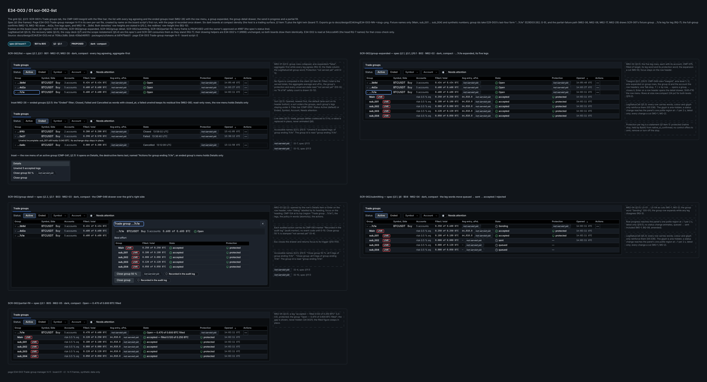
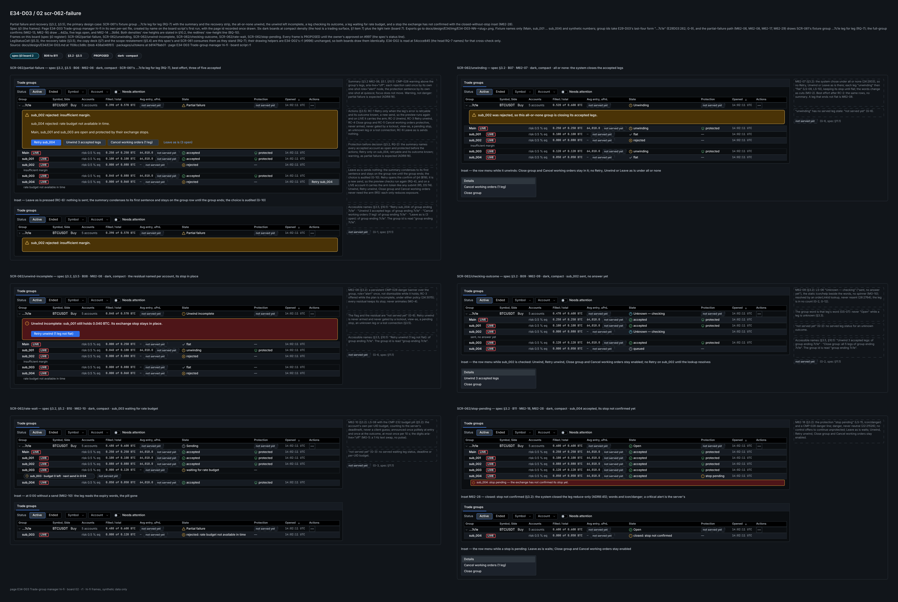
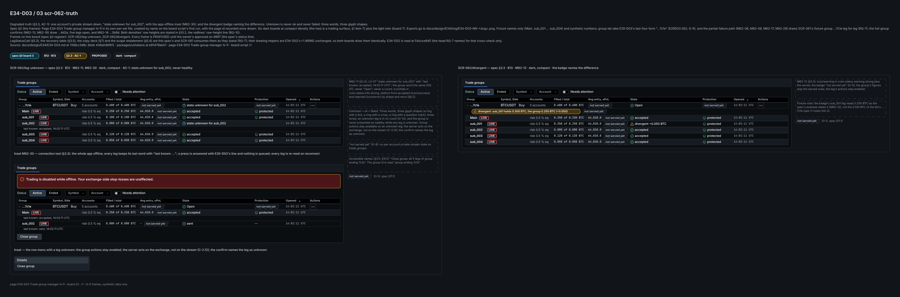
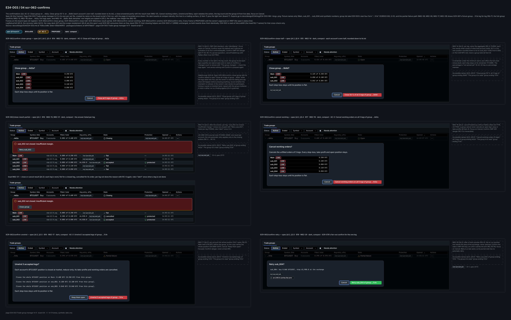
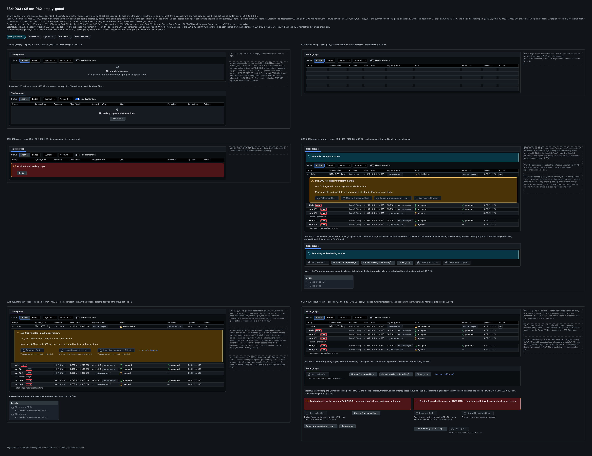
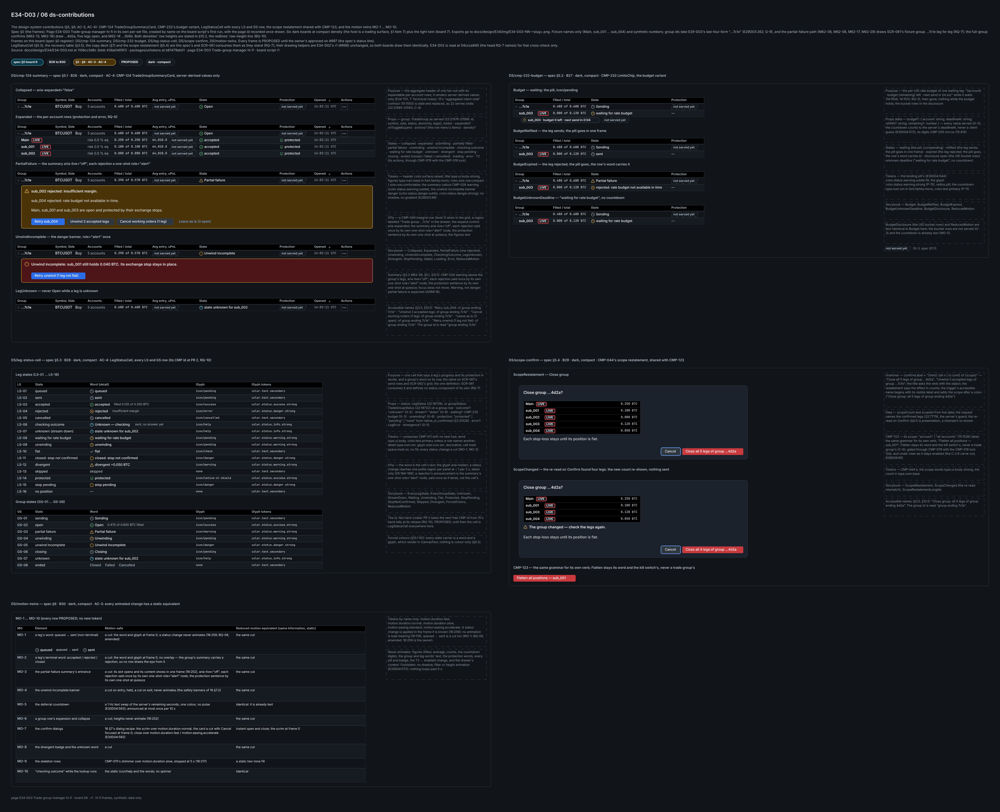
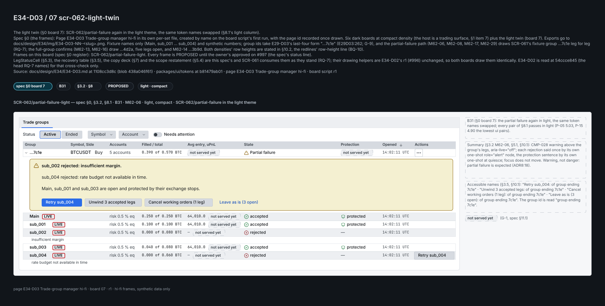

# E34-D03 — Hi-fi design: the trade-group manager SCR-062 (open groups and their legs), with the design-system and motion work both fan-out screens share

**Ticket:** E34-D03 (#997) · **Epic:** E34 · **Task, P1, Sprint 16** · **Status:** Draft. It is a text-first PR 1 of 2 (`Refs #997`, `Partial: PR 1 of 2`). This PR carries the spec text, its audit tool and its pins. PR 2 draws the frames of §0 on Penpot, applies the A-rows of §11 as a separate commit and carries the closing line. **The vocabulary V-1 … V-7 is ruled** (a request row, RQ-1: the memo's BQ-4, comment 6601761450 on #936); V-8 … V-10 stay PROPOSED. **This spec's BQ list is ruled** (comment 6602482885 on #997) and folded; what the ruling leaves PROPOSED stays marked so. **This PR stays a draft until E34-D01's PR merges:** its request rows (RQ-1 … RQ-6, RQ-9) are re-pinned at #936's PR head once it opens, "if it merges as is", and again on merge. **Owner approval pending (C-10.1):** the owner's `approved` stands in for the CDO walkthrough and the frontend hand-off; nothing here claims it.

**Inputs pinned.** Base `origin/main` `a7d659a5b`. Every `file`:line below is read there and pinned in the pins file. **Only merged owners are cited by line.** The E34-D01 research memo (#936) and the E34-D02 hi-fi (#996, draft PR #5621) are not merged: each is used only through a request row (§11.4: RQ-1 … RQ-6 and RQ-9 to #936, RQ-7 and RQ-8 to #996), by section id, never by line. This text builds on the memo's vocabulary: V-1 … V-7 are ruled (BQ-4), V-8 … V-10 stay PROPOSED.

**Key.** `NN`:line = `docs/plan/NN-*.md` (`22` = `22-api-openapi.yaml`); `ADR8` = `docs/plan/27-adrs/ADR-0008-trade-group-fanout.md`.

- `E09D09` = `docs/design/E09/E09-D09.md` (the T2 grammar and its §3.1 keys).
- `E30D02` = `docs/design/E30/E30-D02.md` (the registered state strings `lockout` and `frozen`, §14).
- `E30D04` = `docs/design/E30/E30-D04.md` (CMP-232's DS entry §18; the motion rows M5 … M7).
- `E28D02` / `E28D03` = `docs/design/E28/E28-D02.md` / `E28-D03.md` (SCR-062's wireframes and definitions half); `E29D01` / `E29D03` = `docs/design/E29/E29-D01.md` / `E29-D03.md`.
- `E32D06` = `docs/design/E32/E32-D06.md`; `E39D01` / `E39D03` = `docs/design/E39/E39-D01.md` / `E39-D03.md` (the kill switch's OD-11; the panic cluster's scope names).
- `DS` = `.claude/rules/32-design-specs.md` (the standing T2 checklist G-T2.1a … G-T2.6 and the recurring items R1 … R7).
- **`T`** = the ticket text (#997). **PROPOSED** = this spec's, until ruled.

## Acceptance-criteria trace (#997)

| Ticket item                                                                                   | Where                    | Status                                                                                              |
| --------------------------------------------------------------------------------------------- | ------------------------ | --------------------------------------------------------------------------------------------------- |
| AC: degraded truth — "state unknown for sub_002", unknown ≠ ok ≠ failed                       | §3.3 M62-11; §8 (V-rows) | text done; frame drawn (§0.1)                                                                       |
| AC: confirmations restate the action, the leg count and the group id from live data           | §4, §7 copy deck         | text done; frames drawn (§0.1)                                                                      |
| AC: every animated change has a static equivalent under reduced motion                        | §6                       | text done                                                                                           |
| AC: CMP-124, CMP-232 and the shared row status as DS entries with props, states, tokens       | §5; A-4 … A-7            | text done; frames drawn (§0.1); the `15` edits in a later PR                                        |
| Scope: list, expansion, filter bar, row menu                                                  | §2, §3.1                 | text done                                                                                           |
| Scope: the `14` sign-off checklist, item by item                                              | §9                       | text done                                                                                           |
| Scope: per-leg retry, unwind-incomplete banner with residual, divergent badge naming the diff | §3.2, §3.3, §3.5         | text done                                                                                           |
| Scope: empty, loading, error, Viewer read-only                                                | §3.4                     | text done                                                                                           |
| Scope: copy deck generated from the leg count                                                 | §7                       | text done                                                                                           |
| T notes: CMP-124's aggregate header is server-derived; the stale client note corrected        | §5.1; A-4; C-4           | text done                                                                                           |
| T Security: destructive actions distinct, never default focus; no real account data           | §4.1, §10.3              | text done                                                                                           |
| T Performance: row height and density for 50 groups × 5 legs in 4 ms                          | §10.2                    | text done                                                                                           |
| T Test plan: the wrong-leg-count walkthrough                                                  | §10.4                    | protocol written; owner run pending                                                                 |
| DoD: Penpot artefact, sign-off, hand-off ≥ 2 sprints ahead                                    | §0; §12                  | frames drawn (§0.1); the A-rows to `14` / `15` and the closing line in a later PR; sign-off pending |

## 0. The frames (Penpot) — drawn (PR 2)

Page **`E34-D03 Trade-group manager hi-fi`** in its own per-set file, created by name on the board script's first run, with the page id recorded once drawn. Six dark boards at compact density (the host is a trading surface, §1 item 7) plus the light twin (board 7). Exports go to `docs/design/E34/img/E34-D03-NN-<slug>.png`. Fixture names only (`Main`, `sub_001` … `sub_004`) and synthetic numbers; group ids take E29-D03's last-four form "…7c1e" (`E29D03`:262; G-9), and the partial-failure path (M62-06, M62-08, M62-17, M62-29) draws SCR-061's fixture group …7c1e leg for leg (RQ-7); the full-group confirms (M62-13, M62-16) draw …4d2a, five legs open, and M62-14 …3b9d. Both densities' row heights are stated in §10.2, the redlines' row-height line (BQ-10).

| B   | Frame                            | Board                   | Status |
| --- | -------------------------------- | ----------------------- | ------ |
| B01 | `SCR-062/list`                   | 1 `scr-062-list`        | drawn  |
| B02 | `SCR-062/group-expanded`         | 1                       | drawn  |
| B03 | `SCR-062/group-detail`           | 1                       | drawn  |
| B04 | `SCR-062/submitting`             | 1                       | drawn  |
| B05 | `SCR-062/partial-fill`           | 1                       | drawn  |
| B06 | `SCR-062/partial-failure`        | 2 `scr-062-failure`     | drawn  |
| B07 | `SCR-062/unwinding`              | 2                       | drawn  |
| B08 | `SCR-062/unwind-incomplete`      | 2                       | drawn  |
| B09 | `SCR-062/checking-outcome`       | 2                       | drawn  |
| B10 | `SCR-062/rate-wait`              | 2                       | drawn  |
| B11 | `SCR-062/stop-pending`           | 2                       | drawn  |
| B12 | `SCR-062/leg-unknown`            | 3 `scr-062-truth`       | drawn  |
| B13 | `SCR-062/divergent`              | 3                       | drawn  |
| B14 | `SCR-062/confirm-close-group`    | 4 `scr-062-confirms`    | drawn  |
| B15 | `SCR-062/confirm-close-half`     | 4                       | drawn  |
| B16 | `SCR-062/close-result-partial`   | 4                       | drawn  |
| B17 | `SCR-062/confirm-cancel-working` | 4                       | drawn  |
| B18 | `SCR-062/confirm-unwind`         | 4                       | drawn  |
| B19 | `SCR-062/confirm-retry`          | 4                       | drawn  |
| B20 | `SCR-062/empty`                  | 5 `scr-062-empty-gated` | drawn  |
| B21 | `SCR-062/loading`                | 5                       | drawn  |
| B22 | `SCR-062/error`                  | 5                       | drawn  |
| B23 | `SCR-062/viewer-read-only`       | 5                       | drawn  |
| B24 | `SCR-062/manager-scope`          | 5                       | drawn  |
| B25 | `SCR-062/lockout-frozen`         | 5                       | drawn  |
| B26 | `DS/cmp-124-summary`             | 6 `ds-contributions`    | drawn  |
| B27 | `DS/cmp-232-budget`              | 6                       | drawn  |
| B28 | `DS/leg-status-cell`             | 6                       | drawn  |
| B29 | `DS/scope-confirm`               | 6                       | drawn  |
| B30 | `DS/motion-twins`                | 6                       | drawn  |
| B31 | `SCR-062/partial-failure-light`  | 7 `scr-062-light-twin`  | drawn  |

**The four ACs, each to its frames (G-STATE):**

| AC   | Ticket scenario (short)                                 | Frames                                                                                                                  |
| ---- | ------------------------------------------------------- | ----------------------------------------------------------------------------------------------------------------------- |
| AC-1 | one account's private WS down: unknown, never healthy   | `SCR-062/leg-unknown`                                                                                                   |
| AC-2 | a group action's confirm names action, leg count, group | `SCR-062/confirm-close-group`, `SCR-062/confirm-close-half`, `SCR-062/confirm-cancel-working`, `SCR-062/confirm-unwind` |
| AC-3 | reduced motion: a static equivalent for every animation | `DS/motion-twins`                                                                                                       |
| AC-4 | CMP-124, CMP-232 and the row status enter the system    | `DS/cmp-124-summary`, `DS/cmp-232-budget`, `DS/leg-status-cell`, `DS/scope-confirm`                                     |

**Insets (R4, `DS`:65–76; drawn in PR 2).** These states have no frame row of their own; PR 2 draws each as a named inset on the frame given: M62-20 (filtered empty) on `SCR-062/empty`; M62-26 (ended groups) on `SCR-062/list`; M62-27 (view-as) on `SCR-062/viewer-read-only`; M62-28 (closed: stop not confirmed) on `SCR-062/stop-pending`; M62-30 (connection lost) on `SCR-062/leg-unknown`; M62-31 (close or cancel result) on `SCR-062/close-result-partial`. M62-25 is two insets on `SCR-062/lockout-frozen`, one `lockout` and one `frozen`, its Owner and Manager side by side (OD-11).

### 0.1 As built

Penpot file **`E34-D03 boards`**, page `E34-D03 Trade-group manager hi-fi` (page id `307e836f-d138-801c-8008-e42fc04d6581`), drawn by the board script r2 (boards 01, 02, 03 and 05; r1 for 04, 06 and 07, unchanged) from this spec at `1108cc3d8` and exported at scale 1. G-BOARDS checks each row against its PNG.

| No  | PNG                                  | Size        | sha256                                                             | Board id                               |
| --- | ------------------------------------ | ----------- | ------------------------------------------------------------------ | -------------------------------------- |
| 01  | `E34-D03-01-scr-062-list.png`        | 3584 × 1939 | `3382f081dbcd3b94f216ee2d87e7c391afbebaa3c57823b76e278a419c32e6cc` | `307e836f-d138-801c-8008-e440da1b00b3` |
| 02  | `E34-D03-02-scr-062-failure.png`     | 3584 × 2427 | `8905a49afdb8f24abdfb3070674c570647a4946223c0697528358cdea56b9126` | `307e836f-d138-801c-8008-e4415d17af08` |
| 03  | `E34-D03-03-scr-062-truth.png`       | 3584 × 1209 | `4755681e3a5f8b221fa00a224ccd38adce05e19e6ae3b93737f2170e9a81059c` | `307e836f-d138-801c-8008-e44222e7792a` |
| 04  | `E34-D03-04-scr-062-confirms.png`    | 3584 × 2249 | `b2d2557f5a2e8e86af509fc2285703ea1ba0cb2bef30d0509af1974ddb0962e8` | `307e836f-d138-801c-8008-e430cc4c4a8b` |
| 05  | `E34-D03-05-scr-062-empty-gated.png` | 3584 × 2763 | `f76a29800ac562a6bc4ab6c5d8ab1dc3a5d1812e235c42d1f82dd1f3a6875ad4` | `307e836f-d138-801c-8008-e442672ddfc7` |
| 06  | `E34-D03-06-ds-contributions.png`    | 3584 × 2911 | `e45842fdef0c2f032a0af9ca192ecdf10ee12145bd4e898e8d383f7a6be8b0b0` | `307e836f-d138-801c-8008-e4317576feb0` |
| 07  | `E34-D03-07-scr-062-light-twin.png`  | 1800 × 911  | `b14a1c0afaa0e44199c6d728a0d3d761127fdb525702b6437ef135078ac05211` | `307e836f-d138-801c-8008-e431e92a19fb` |

**Gates on the page.** The 31 frames of the register found by name on their boards, B31 light; every fill and stroke a token of its frame's theme (5 069 checked, 0 off; light 168, 0 off); each frame's crop of its PNG passes the theme check (31 of 31). Every frame with a gated control carries its G-T2 note (§1 item 6), and the row menus offer Unwind while accepted legs are open (RC-2).

**Greyscale.** One greyscale export per board, made from its PNG with `docs/design/_tools/cvd_sim.py`; each state reads by glyph and word without colour (§8.2). This boards PR is `Refs` only: a later PR carries the A-rows to `14` and `15` and the closing line.

| G   | Greyscale PNG                                  | Size        | sha256                                                             |
| --- | ---------------------------------------------- | ----------- | ------------------------------------------------------------------ |
| G01 | `E34-D03-01-scr-062-list-greyscale.png`        | 3584 × 1939 | `06a1b2455b9db99bd09bd7d2e0fd71e0ac0204aa49e1fbc4acdd9b9f5e35b695` |
| G02 | `E34-D03-02-scr-062-failure-greyscale.png`     | 3584 × 2427 | `0711874cfbd36ee4b0aa1fdbec13d51c76b02186cbfb9ad5a424826e830cc953` |
| G03 | `E34-D03-03-scr-062-truth-greyscale.png`       | 3584 × 1209 | `9486c3c71a9e600e2139ddeca4333bf0e6673ca7c738df38d180998b5a3ac49a` |
| G04 | `E34-D03-04-scr-062-confirms-greyscale.png`    | 3584 × 2249 | `8defd575fabf1512bf477dfc0efb6c5d09197f2145f1e7c325b2ac22c495b0a5` |
| G05 | `E34-D03-05-scr-062-empty-gated-greyscale.png` | 3584 × 2763 | `db8942e04e3675fb0a729104387705657eaff7a33c0af30cd074cc7794ed97c3` |
| G06 | `E34-D03-06-ds-contributions-greyscale.png`    | 3584 × 2911 | `feaae7bc1dccb190fba4213afaf0ac9bd33e9ce85ac95339dba67ec48382cf09` |
| G07 | `E34-D03-07-scr-062-light-twin-greyscale.png`  | 1800 × 911  | `eb4517b884dad196ef0b38f786498f8a75ee3bf04f5a0c799309b678fdfd336f` |

### 0.2 The boards

## 1. Locked inputs (built on, never re-decided)

1. **C-2.6, the native stop on every leg.** Every leg carries a native exchange stop; a leg without an observed stop within the deadline is closed reduce-only with a critical alert (`ADR8`:45). A filled leg with `native_sl_confirmed` false is an alertable condition (`22`:21521, `22`:21526). An unwind may not leave a position without its stop (`28`:2851). **This spec shows protection per leg as a statement and never offers a way to omit, remove or turn off the stop** — no control, no option, no copy (RQ-2).
2. **Partial failure is a first-class state** (`ADR8`:18, `ADR8`:48): the group status is a pure function of the leg counts (`28`:2440); the three policies are `24`'s (`24`:2932–2934), and only `best_effort` leaves a choice to the user.
3. **The fan-out is server-side** (C-2.12). Every group action is one backend command that fans out server-side; the UI never loops over legs (`14`:1522). A group cancel never cancels an open leg's stop or take-profits (`22`:7779–7788; `ADR8`:131); an unwind cancels take-profits and working orders and removes a stop only once its leg is flat. Every stop is the native one, "held by Bybit (exchange)" (`E32D06`:143), never an app-side stop (C-2.6).
4. **Scope (C-12.4).** A group is served only when every leg's account is in the caller's grants; any other is absent, as if it did not exist (`22`:7695; `23`:4022). A Manager therefore never sees a group that touches an ungranted account (RQ-2).
5. **Unknown is a third outcome.** A leg whose submit outcome is unknown is resolved by an `orderLinkId` lookup, never resent (`28`:2764, `28`:2788). The close attempts are bounded and their exhaustion is a visible state (`28`:2852).
6. **T2** (`E09D09`:49; `14`:85): a control the session may not use is disabled with a visible reason, programmatically associated (CMP-079). Protective actions are never T2 under `lockout` or view-as; under `frozen` the closes follow OD-11 (§3.5). Reasons are E09-D09 §3.1's keys verbatim (`E09D09`:89, `E09D09`:92, `E09D09`:95) or a registered state's string (`E30D02`:421, `E30D02`:422). Each T2 control keeps its native role and full label, and its state row names its rendering (G-T2.1c): 2a, the reason inline, the label led by the CMP-019 `lock` glyph ("Not available"; G-T2.1d); 2b, the CMP-016 Tooltip echo for icon-only controls; or the sentence form. G-T2.1b, verbatim (`DS`:28–29): `aria-disabled="true"`, never the `disabled` attribute — it stays in the Tab order and a menu item stays arrow-reachable. G-T2.2, verbatim (`DS`:40–42): hi-fi label `color.text.tertiary`, reason `color.text.secondary`; for primary / buy / sell actions the fill becomes `color.surface.raised` with a `color.border.default` hairline; never `color.text.disabled`, never `opacity.disabled` on the label, glyph or reason (the label pair is §8.1 P-04). G-T2.3, verbatim (`DS`:47–48): `Enter`, `Space` or a bound hotkey on a T2 control changes nothing and re-shows the reason inline with one polite announcement; arrow keys land on a disabled menu item without activating it. G-T2.5 (`DS`:57–58): a read-only panel carries one notice that every gated control points at.
7. **The host (ruled, BQ-02).** The **execution grid** is the content of SCR-063's "Trade groups" tab (`14`:1532) in the trading shell, compact density (`16`:129), for Owner, Manager and Viewer within their grants; `12`'s trading-side R-140 / R-141 (`12`:69–70) become the route alias into that tab (A-9), and `/admin/trade-groups` keeps the definitions (R-352, `12`:114; `14`:1517; E28-D03 §7, `E28D03`:315). The Viewer reads it; a Manager sees a group only when every leg's account is granted (`22`:7695).
8. **No figure is computed in the client** (`E28D03`:79): every number is a served field; what the contract does not serve is stamped "not served yet" (DS-G, `E28D03`:449) and is a gap (§11.1): the unwind-incomplete flag and residual, the divergent badge, the aggregate average price and uPnL (`totals` serves legs, quantities and realised only, `22`:21585–21593), the deferral state, Retry, Retry unwind and Close group 50 %. **No safety count is computed here:** an "N of M protected / accepted / unknown" figure is drawn only when served, and none is today (G-12), so every leg says its own words. The count in an action label is a scope: it counts the legs its confirm lists one per row and is re-read on Confirm (§4.1).
9. **The vocabulary is the memo's, ruled for V-1 … V-7 (RQ-1; BQ-4):** Retry · Unwind · Retry unwind · Leave as is · Close group · Cancel working orders; "Flatten" is reserved for the account-wide close (CMP-123) and the kill switch; these are `24`'s words (`24`:3015, `24`:3048), and the wire name `flatten_filled` stays. Where SCR-061 and SCR-062 meet, these are the only words, and §3.5 is their one table of labels, confirms and tone.

## 2. The grid (SCR-062's execution half)

### 2.1 Structure

- **CMP-049 in `treegrid` mode** (as built, `15`:593): one header row; a group is a level-1 row, each leg a level-2 row under it. `14` asks for a nested per-account table (`14`:1521); a treegrid keeps one set of column headers for both levels, so every leg cell is associated with its column header and its row header (C-3). Windowed by the host above 60 rows (`15`:591), rows at a fixed height (§10.2).
- **Columns (group row / leg row):**

| Column          | Group row (level 1)                                                                                                                                 | Leg row (level 2)                                                              | Sort                     |
| --------------- | --------------------------------------------------------------------------------------------------------------------------------------------------- | ------------------------------------------------------------------------------ | ------------------------ |
| Group           | the row header: …7c1e (G-9) with the expand control, at least `size.target.min`                                                                     | the row header: the account, then CMP-075 (its environment)                    | —                        |
| Symbol, Side    | "BTCUSDT", "Buy" as words (`type.ui.body`)                                                                                                          | blank (inherited)                                                              | Symbol                   |
| Accounts        | "5 accounts"                                                                                                                                        | the bound profile as text ("risk 0.5 % eq")                                    | —                        |
| Filled / total  | `totals.filled_qty` of `totals.target_qty`: "0.430 of 0.600 BTC" (`22`:21591–21592)                                                                 | `filled_qty` of `target_qty`: "0.250 of 0.250 BTC"                             | —                        |
| Avg entry, uPnL | "not served yet" (G-7)                                                                                                                              | `avg_entry_price` `type.num.base`, "—" while none; uPnL "not served yet" (G-7) | —                        |
| State           | LegStatusCell group word (§5.3 GS-rows)                                                                                                             | LegStatusCell leg word (§5.3 LS-rows)                                          | State (attention order)  |
| Protection      | "not served yet" (DS-G) until G-12; the row expands while any leg reads stop pending or unknown                                                     | LegStatusCell protection word from `native_sl_confirmed` (LS-14 … LS-16)       | —                        |
| Opened          | `created_at` as "14:02:11 UTC" (`type.num.sm`)                                                                                                      | `submitted_at`                                                                 | Opened (default, newest) |
| Actions         | the row menu button (CMP-041, `icon/more-horizontal`, named "Actions for group ending 7c1e"; the menu opens on Details, the destructive items last) | the leg's own action where one applies ("Retry sub_002"), else empty           | —                        |

- **Sort.** Opened (newest first) is the default; State sorts by attention, PROPOSED: unwind incomplete, stop pending, partial failure, unknown, divergent, checking outcome, waiting, submitting, partially filled, open, closing, then ended. Each sortable `columnheader` carries `aria-sort` and holds its sort button; a sort orders the groups, each group's legs staying under it (`15`:591).
- **Filter bar (CMP-055).** Status: "Active" (default: `submitting`, `partially_open`, `open`, `closing`) or "Ended" (`closed`, `failed`, `cancelled`), the `status` query of `listTradeGroups` (`22`:7399); Symbol; Account (the session's granted accounts); a "Needs attention" toggle (the first five attention states above).
- **Live data.** `trade_groups` deltas (`23`:862, `23`:4030) coalesced to 5 Hz (`14`:1522); a value is replaced in place, never animated (§6).

### 2.2 Group detail

`SCR-062/group-detail` is a CMP-046 drawer opened by the row's "Details" item or `Enter` on the row header: CMP-124 at its top (§5.1), the legs table, the group's policy in words (`atomicity`, `22`:21576: "Best effort" or "All or none"; a rule-originated group `group.rule_policy`, C-8), the actions, and each audited action's marker `audit.marker` (CMP-093) every action a CMP-093 trigger, its audit emitter (`14`:1526), with no code until G-10.

## 3. The states

Group words and leg words are LegStatusCell's (§5.3). **Every row carries words; colour and glyph only reinforce them** (`05`:336).

### 3.1 List, expansion and progress

| Id     | State                    | Shows                                                                                                                                          | Presentation                                                            |
| ------ | ------------------------ | ---------------------------------------------------------------------------------------------------------------------------------------------- | ----------------------------------------------------------------------- |
| M62-01 | list, every leg agreeing | group rows collapsed: "…7c1e · BTCUSDT · Buy · 5 accounts · 0.600 of 0.600 BTC · Open", Protection "not served yet" (G-12)                     | aggregate-first while every leg agrees (RQ-3); `aria-expanded="false"`  |
| M62-02 | a group expanded         | its five leg rows, each with its account, CMP-075, filled of target, its leg word and its protection word                                      | a cut (§6 MO-6); focus stays on the row header                          |
| M62-03 | group detail             | the drawer of §2.2                                                                                                                             | `role="dialog"` labelled by its heading; focus on the heading           |
| M62-04 | submitting               | the leg words move queued → sent → accepted / rejected (LS-01 … LS-04); the group word "Sending" (GS-01)                                       | cuts (MO-1, MO-2); the group row expands while any leg disagrees (RQ-3) |
| M62-05 | partially filled         | a leg "accepted — filled 0.120 of 0.250 BTC" (LS-03); the group "Open — 0.470 of 0.600 BTC filled"; the gap is shown, never hidden (`24`:3021) | words; the filled figure swaps in place                                 |
| M62-26 | ended groups (inset)     | the "Ended" filter: "Closed", "Failed", "Cancelled" as words, with `closed_at`; a failed unwind keeps its residual line (M62-08)               | read-only rows; the row menu holds "Details" only                       |

### 3.2 Partial failure and recovery (the primary design case)

| Id     | State                        | Shows                                                                                                                                                                                                                                                                                                                                                                                                                 | Presentation                                                                                                                                                                                                                                                                                 |
| ------ | ---------------------------- | --------------------------------------------------------------------------------------------------------------------------------------------------------------------------------------------------------------------------------------------------------------------------------------------------------------------------------------------------------------------------------------------------------------------- | -------------------------------------------------------------------------------------------------------------------------------------------------------------------------------------------------------------------------------------------------------------------------------------------- |
| M62-06 | partial failure, best effort | the group row auto-expands; above its legs a CMP-028 `warning` summary, `aria-live="off"` (each rejection said once by its own one-shot `role="alert"` node, the protection sentence by its own one-shot at quiesce): "sub_002 rejected: insufficient margin. sub_004 rejected: rate budget not available in time." then "Main, sub_001 and sub_003 are open and protected by their exchange stops." then the actions | RC-1 "Retry sub_004", RC-2 "Unwind 3 accepted legs", RC-5 "Cancel working orders (1 leg)", RC-6 "Leave as is (3 open)" (§3.5); Retry only when the leg's error is `retryable` and its outcome known (`22`:21553); `warning`, as partial failure is expected (`ADR8`:18); focus does not move |
| M62-07 | unwinding                    | all or none: "sub_002 was rejected, so this all-or-none group is closing its accepted legs."; best effort after RC-2: the same rows, no summary; each leg "unwinding" then "flat" (LS-09, LS-10)                                                                                                                                                                                                                      | the system chose under all or none (`24`:2933), so no Retry, Unwind or Leave as is there; Close group and Cancel working orders stay in the row menu; a leg that ends not flat is M62-08; the words change as cuts (MO-2)                                                                    |
| M62-08 | unwind incomplete            | a persistent CMP-028 `danger` banner over the group, `role="alert"` once, not dismissible while it holds: "Unwind incomplete: sub_001 still holds 0.040 BTC. Its exchange stop stays in place." with RC-3 "Retry unwind (1 leg not flat)", offered while the plan is incomplete                                                                                                                                       | the residual named per account (`24`:3015); every residual keeps its stop; never animates (MO-4); the flag and residual "not served yet" (G-6)                                                                                                                                               |
| M62-09 | checking outcome             | a leg "Unknown — checking" ("sent, no answer yet"; LS-06), "not served yet" (G-2); no Retry on that leg until the lookup resolves; Unwind, Retry unwind, Close group and Cancel working orders stay enabled                                                                                                                                                                                                           | the static `icon/help` beside the words; the leg is in no count (G-2, G-12)                                                                                                                                                                                                                  |
| M62-10 | waiting for rate budget      | a leg "waiting for rate budget" (LS-08) with the CMP-232 `budget` pill "sub_003 · budget 0 left · next send in 0:04" (§5.2)                                                                                                                                                                                                                                                                                           | the countdown is MO-5; at 0:00 without a send the leg reads "rejected: rate budget not available in time" (`20`:625–626); "not served yet" (G-3)                                                                                                                                             |
| M62-18 | stop pending                 | a leg "accepted" with the protection "stop pending" (LS-15, `icon/danger`); a CMP-028 `danger` line "sub_004: stop pending — the exchange has not confirmed its stop yet."                                                                                                                                                                                                                                            | `danger`, never neutral (`22`:21526); no control offers to continue unprotected; Leave as is waits; Unwind, Retry unwind, Close group and Cancel working orders stay enabled                                                                                                                 |
| M62-28 | closed: stop not confirmed   | the leg "closed: stop not confirmed" (LS-11) — the system closed it reduce-only (`ADR8`:45)                                                                                                                                                                                                                                                                                                                           | words and `icon/danger`; a critical alert is the server's                                                                                                                                                                                                                                    |

**Leave as is** sends nothing: the summary condenses to its first sentence and stays on the group row until the group ends; the choice is audited (G-10). **Retry** opens the confirm of §4 (B19); it is a new send, so the preview checks run again (RQ-4), and on a LIVE account it carries the arm token like any submit (R5, `DS`:74). **Unwind**, **Retry unwind**, **Close group** and **Cancel working orders** never need the arm (R5): each only reduces exposure.

### 3.3 Degraded truth: unknown and divergent (AC-1)

| Id     | State                         | Shows                                                                                                                                                                                                                              | Presentation                                                                                                                                                                                                                                                                                                                |
| ------ | ----------------------------- | ---------------------------------------------------------------------------------------------------------------------------------------------------------------------------------------------------------------------------------- | --------------------------------------------------------------------------------------------------------------------------------------------------------------------------------------------------------------------------------------------------------------------------------------------------------------------------- |
| M62-11 | leg unknown (private WS down) | the leg "state unknown for sub_002" (`14`:1526, LS-07) with "last known: accepted, 14:02:11 UTC" and the served code verbatim once one is served (`E28D02`:392–393); the group word the same (GS-07) — never "Open", never a count | the unknown glyph `icon/help` (C-5) in `color.status.info.strong` beside the word; distinct from accepted (`icon/success`, `color.status.success.strong`) and rejected (`icon/error`, `color.status.danger.strong`) by shape and word (§8.2); Unwind, Retry unwind, Close group and Cancel working orders stay enabled; G-8 |
| M62-12 | divergent                     | a badge on the group row "divergent: sub_001 holds 0.300 BTC, the group 0.250 BTC (+0.050)" (`11`:662) and on the leg "divergent +0.050 BTC"                                                                                       | `icon/warning` in `color.status.warning.strong` plus the words; the badge "not served yet" (G-5); the group's figures stay the served ones; the leg's actions stay enabled                                                                                                                                                  |
| M62-30 | connection lost (inset)       | the whole app offline: every leg keeps its last word with "last known: …"; E30-D02's `disconnected.*` line "Trading is disabled while offline. Your exchange-side stop-losses are unaffected." (`E30D02`:423)                      | Unwind, Retry unwind, Close group and Cancel working orders stay enabled; a press while offline is answered with that line and nothing is queued; every leg is re-read on reconnect                                                                                                                                         |

**Unknown ≠ ok ≠ failed.** Three words, three glyph shapes (a ring with a tick, a ring with a cross, a ring with a question mark), three tones; an unknown leg is in no count (G-12), and the group is never presented as healthy while any leg is unknown. Group actions stay available on an unknown leg: the server acts on the exchange, not on the stream (C-2.12); the confirm names the leg as unknown.

### 3.4 Empty, loading, error and gated sessions

| Id     | State                                 | Shows                                                                                                                                                                                                                                                                                                                                                        | Presentation                                                                                                                                                                                                                                                                                                                                         |
| ------ | ------------------------------------- | ------------------------------------------------------------------------------------------------------------------------------------------------------------------------------------------------------------------------------------------------------------------------------------------------------------------------------------------------------------ | ---------------------------------------------------------------------------------------------------------------------------------------------------------------------------------------------------------------------------------------------------------------------------------------------------------------------------------------------------- |
| M62-19 | empty                                 | CMP-026 `list.empty` "No open trade groups." and `list.empty_hint` "Groups you send from the trade-group ticket appear here."                                                                                                                                                                                                                                | text; no CTA                                                                                                                                                                                                                                                                                                                                         |
| M62-20 | filtered empty (inset)                | `list.filtered_empty` "No trade groups match these filters." with `list.clear_filters` "Clear filters"                                                                                                                                                                                                                                                       | the header row kept                                                                                                                                                                                                                                                                                                                                  |
| M62-21 | loading                               | the header row and CMP-015 skeleton rows at 24 px, `aria-busy`                                                                                                                                                                                                                                                                                               | MO-9                                                                                                                                                                                                                                                                                                                                                 |
| M62-22 | error                                 | CMP-027 "Couldn't load trade groups." with Retry; the header kept                                                                                                                                                                                                                                                                                            | the server's reason as text; announced once politely                                                                                                                                                                                                                                                                                                 |
| M62-23 | Viewer read-only                      | the grid in full; one panel notice "Your role can't place orders." in the panel header                                                                                                                                                                                                                                                                       | T2 `rbac.permission` "Your role can't place orders." (`E09D09`:89, verb `E09D09`:110); rendering 2a, the one panel notice every action points at (G-T2.5); the row menu items keep their labels and the `lock`                                                                                                                                       |
| M62-24 | Manager, a leg out of the trade grant | a group on accounts all granted, one held `read`: its leg's Retry and the group actions                                                                                                                                                                                                                                                                      | T2 `rbac.account_read_only` "You can view this account, not trade it." (`E09D09`:92); rendering 2a, the reason as the menu item's second line and under the summary's action; whether a group action is refused whole is G-11                                                                                                                        |
| M62-25 | lockout or frozen                     | Retry on a leg of a locked or frozen account. Under `lockout` Unwind, Retry unwind, Close group and Cancel working orders stay enabled (reduce-only, `14`:1762). Under `frozen` Cancel working orders passes (`E39D01`:455); Unwind, Retry unwind and Close group follow OD-11, open (`E39D01`:687): the Owner's enabled, a Manager's T2 until E39-S03 rules | T2 `lockout` "Locked out — reduce through Close position" or `frozen` "Trading frozen by the owner at 14:02 UTC — new orders off. Cancel and close still work." (registered states) on Retry, `frozen.manager` (§7) in a Manager session; a frozen Manager's closes "Frozen — the owner closes or releases" (OD-11); rendering 2a, inline under each |
| M62-27 | view-as (inset)                       | under view-as, Retry, Close group 50 % and Leave as is; on the summary each of these takes the `color.surface.raised` fill and `color.border.default` hairline, so its T2 label clears 4.5:1; Unwind, Retry unwind, Close group and Cancel working orders stay enabled (the C-2.6 carve-out, `E09D09`:95)                                                    | T2 `rbac.view_as` "Read-only while viewing as alex." (`E09D09`:95); rendering 2a, the one panel notice (G-T2.5)                                                                                                                                                                                                                                      |

**No group the session cannot see is hinted at** (§1 item 4): no "1 hidden group", no count of others (RQ-2). **The protective actions are never gated by the arm** (R5, `DS`:74); a permission or account leg gates them as T2 (M62-23, M62-24); `lockout` and view-as never do (M62-25, M62-27; the C-2.6 carve-out, `E09D09`:95), and under `frozen` Cancel working orders passes while the closes follow OD-11 (M62-25, C-11). Every group action is a CMP-093 trigger, its audit emitter (`14`:1526).

### 3.5 The recovery actions — one table for SCR-061 and SCR-062 (RQ-7)

The labels are the ruled vocabulary of RQ-1 (V-1 … V-7), owner E34-D03; SCR-061 uses this table as it stands (RQ-7). `{legs}` is "all {n} legs" when the action covers every leg, else "{n} leg" or "{n} legs" (§5.4); a trigger's accessible name begins with its visible label and adds the scope after a colon ("Close group: all 5 legs of group ending 4d2a"); the confirm label is unchanged. The journal note is US-ORD-010's (`11`:3092–3094): one result per account, named with the action's term; its one automatic retry applies only to the closing actions (RC-2 … RC-5), never to a Retry (RC-1), which is a new send.

| RC   | Action                                        | Trigger label                     | Confirm (focus on Cancel)                                                                                                                                          | Arm (R5)           | Available while                                                               |
| ---- | --------------------------------------------- | --------------------------------- | ------------------------------------------------------------------------------------------------------------------------------------------------------------------ | ------------------ | ----------------------------------------------------------------------------- |
| RC-1 | Retry, not served yet (G-1)                   | "Retry {account}"                 | SCR-076's fan-out confirm for the one leg, after a fresh preview, its stop in the preview line; "Retry {account} of group {id}", the side's CMP-001 `buy` / `sell` | on LIVE (a submit) | a rejected leg is `retryable` and its outcome known; T2 like any submit       |
| RC-2 | Unwind                                        | "Unwind {n} accepted legs"        | CMP-044 `standard`, `role="alertdialog"`; "Unwind {n} accepted legs of group {id}", CMP-001 `danger`                                                               | never              | any leg is accepted under best effort, in every state                         |
| RC-3 | Retry unwind, not served yet                  | "Retry unwind ({n} leg not flat)" | RC-2's; "Retry unwind on {legs} of group {id}"                                                                                                                     | never              | an unwind plan is incomplete, under either policy (`24`:3015), in every state |
| RC-4 | Close group                                   | "Close group"                     | RC-2's, the same served operation; "Close {legs} of group {id}"                                                                                                    | never              | any leg is open, in every state                                               |
| RC-5 | Cancel working orders, the conditional fourth | "Cancel working orders ({n} leg)" | RC-2's; "Cancel working orders on {legs} of group {id}"                                                                                                            | never              | a working order exists, in every state                                        |
| RC-6 | Leave as is                                   | "Leave as is ({n} open)"          | none: it sends nothing                                                                                                                                             | n/a                | a partial failure under best effort, once no stop is pending                  |

- **Tone.** RC-2 … RC-5 are irreversible, so their Confirm is CMP-001 `danger`, as CMP-044's owner sets it for flatten-all and cancel-all (`15`:518, `15`:522); focus starts on Cancel and Confirm is never the default (`15`:521). RC-1 is SCR-076's fan-out confirm in the side's colour, and on LIVE it needs the arm.
- **One served operation, two labels.** Unwind (after a failed fan-out) and Close group (a deliberate close) are both `cancelTradeGroup` with `flatten_filled: true` (`22`:7783): each closes the account's whole position, cancels its take-profits and working orders and keeps its stop until flat (`24`:2990–3017). Close group's percentage form is stamped "not served yet": `22` has no percentage member.
- **Never hidden, never blocked.** RC-2 … RC-5 are protective: never armed (R5), and never gated by a lockout (reduce-only stays, `14`:1762), view-as, a pending stop, an unknown leg or a lost connection. Under the kill switch (`frozen`) RC-5 passes (`E39D01`:455) and RC-2 … RC-4 follow OD-11, open (`E39D01`:687): enabled for the Owner, T2 for a Manager with "Frozen — the owner closes or releases" until E39-S03 rules. Otherwise only the permission leg or a read-only account gates them, as T2.
- **The per-account unwind line** (OQ-1 open; E34-S03 rules it): `unwind.account`, "Closes the whole {symbol} position on {account}: {qty} ({group_qty} from this group)."

## 4. Confirmations (AC-2)

### 4.1 Anatomy (CMP-044 with the scope restatement, §5.4)

- **Rung 2, standard**, `role="alertdialog"` (`15`:519): the title, the restatement, the per-leg table (`legs`), the Cancel and Confirm buttons. **Focus starts on Cancel** (`15`:525); Confirm is never the default focus and ignores an activation in its first `confirmDelayMs`.
- **Confirm** is CMP-001 `danger` (`color.text.on-action` on `color.status.danger.default`, §8.1 P-13), the tone of §3.5; Cancel is CMP-001 secondary. The destructive control is visually distinct from the safe one by fill, label and position.
- **Every number is live:** the leg count, the group id and each leg's quantity are read from the group at open and **re-read on Confirm**. The request names the confirmed legs (`legs`, `22`:7779), so the server acts on those legs only; the re-read is presentation: if the count changed, the dialog shows the new count with "The group changed — check the legs again." (PROPOSED) and sends nothing until Confirm is pressed again.
- **The stop line** closes every restatement that closes or cancels: each stop stays until its position is flat.

### 4.2 The confirm states

| Id     | State                  | Shows                                                                                                                                                                                                                                                                                                                                                                                                                                                                  | Presentation                                                                                                                                                                                                                     |
| ------ | ---------------------- | ---------------------------------------------------------------------------------------------------------------------------------------------------------------------------------------------------------------------------------------------------------------------------------------------------------------------------------------------------------------------------------------------------------------------------------------------------------------------- | -------------------------------------------------------------------------------------------------------------------------------------------------------------------------------------------------------------------------------- |
| M62-13 | close group            | title "Close group …4d2a?"; the restatement and the legs table: Main 0.250, sub_001 0.100, sub_002 0.080, sub_003 0.120, sub_004 0.050 BTC; then `close.stop_line`; Confirm "Close all 5 legs of group …4d2a"                                                                                                                                                                                                                                                          | §4.1; the copy is `close.*` (§7); RC-2's served operation (`22`:7783)                                                                                                                                                            |
| M62-14 | close group 50 %       | the per-leg halves, each 50 % of that account's own position, rounded down to its lot: Main 0.125, sub_001 0.050, sub_002 0.042 (from 0.084, on the 0.001 BTC lot); each leg's line names what closes and what stays (Main 0.125 of 0.250 BTC), never a group total (§1 item 8); Confirm "Close 50 % of all 3 legs of group …3b9d"                                                                                                                                     | per leg, never the aggregate (RQ-3; `11`:659); a remainder under the minimum warns and offers the full close (`close.dust`, `11`:3489–3491); each stop stays on its remainder (`11`:3488); the percentage "not served yet" (G-4) |
| M62-15 | close result, partial  | after the answer, per leg: "sub_002 not closed: insufficient margin." with "Retry sub_002"                                                                                                                                                                                                                                                                                                                                                                             | listed per leg (`11`:659); `role="alert"` once; G-4                                                                                                                                                                              |
| M62-16 | cancel working orders  | title "Cancel working orders?"; "Cancels the unfilled orders of 5 legs. Every stop-loss, take-profit and open position stays." Confirm "Cancel working orders on all 5 legs of group …4d2a"                                                                                                                                                                                                                                                                            | `cancelTradeGroup` without `flatten_filled` (`22`:7776, `22`:7780)                                                                                                                                                               |
| M62-17 | unwind                 | title "Unwind 3 accepted legs?"; "Each account's BTCUSDT position is closed at market, reduce-only; its take-profits and working orders are cancelled."; per account the **whole** position: "Closes the whole BTCUSDT position on Main: 0.400 BTC (0.250 BTC from this group).", then sub_001 (0.100 BTC) and sub_003 (0.040 BTC) the same way, all from this group; then `close.stop_line`; Cancel "Keep them open"; Confirm "Unwind 3 accepted legs of group …7c1e" | OQ-1 open: Main held 0.150 BTC before the group, so the copy names the whole position (`24`:2990–3017, RQ-5)                                                                                                                     |
| M62-29 | retry                  | after a fresh preview, title "Retry sub_004?"; the re-run preview line "sub_004: buy 0.060 BTCUSDT, stop 63,900.0 at the exchange"; Confirm "Retry sub_004 of group …7c1e"                                                                                                                                                                                                                                                                                             | SCR-076's fan-out confirm for the one leg, Confirm the side's CMP-001 `buy`; on LIVE it carries the arm; the stop is in the line, never optional; "not served yet" (G-1)                                                         |
| M62-31 | close or cancel result | after Close group or Cancel working orders answers: each leg's word ("flat" for a closed leg, "cancelled" for its order) and, per leg not done, "sub_002 not closed: insufficient margin." with RC-4 again                                                                                                                                                                                                                                                             | listed per leg; `role="alert"` once when a leg is not done; G-4                                                                                                                                                                  |

## 5. Design-system contributions (each a catalogue entry; PROPOSED until the DS owner's `approved`)

### 5.1 CMP-124 TradeGroupSummaryCard (corrected; A-4)

| Part        | Spec                                                                                                                                                                                                                                                                                                                                                                         |
| ----------- | ---------------------------------------------------------------------------------------------------------------------------------------------------------------------------------------------------------------------------------------------------------------------------------------------------------------------------------------------------------------------------- |
| Purpose     | the aggregate header of one fan-out with its expandable per-account rows; it **renders server-derived values only** (E34-T01, `T` Technical notes): `15`'s "aggregated client-side" contract (`15`:1550) is stale and replaced, as `22` serves `totals` (`22`:21585–21593; C-4)                                                                                              |
| Props       | `group: TradeGroup` as served (`22`:21576–21588: `id`, `symbol`, `side`, `status`, `atomicity`, `legs[]`, `totals`) · `expanded?` · `onToggleExpand` · `actions?` (the row menu's items) · `density?`                                                                                                                                                                        |
| Per-leg row | account, CMP-075, `filled_qty` of `target_qty`, LegStatusCell leg word, protection word, `error.message` when rejected, `retryable` deciding Retry (RQ-6: the protection and error fields `15` lacks)                                                                                                                                                                        |
| States      | collapsed · expanded · submitting · partially filled · partial failure · unwinding · unwind incomplete · checking outcome · waiting for rate budget · unknown · divergent · stop pending · closing · ended (closed / failed / cancelled) · loading · error · T2 (its actions, through CMP-079 with the CMP-019 `lock`)                                                       |
| Tokens      | header `color.surface.raised`, title `type.ui.body-strong`, figures `type.num.base` in `font.family.mono`; rows `size.row.compact` / `size.row.comfortable`; the summary callout CMP-028 `warning` (`color.status.warning.subtle`), the unwind-incomplete banner `danger` (`color.status.danger.subtle`, `color.status.danger.strong`); no shadow, no gradient (`E28D03`:89) |
| A11y        | a CMP-049 treegrid row (level 1) when in the grid, a `region` labelled "Trade group …7c1e" in the drawer; the expand control `aria-expanded`; the summary `aria-live="off"`, each rejection said once by its own one-shot `role="alert"` node, the protection sentence by its own one-shot at quiesce; the figures text                                                      |
| Storybook   | Collapsed, Expanded, PartialFailure (one rejected), Unwinding, UnwindIncomplete, CheckingOutcome, LegUnknown, Divergent, StopPending, Gated, Loading, Error, ReducedMotion                                                                                                                                                                                                   |

### 5.2 CMP-232 LimitsChip — the `budget` variant (A-5)

| Part        | Spec                                                                                                                                                                                                                                                                  |
| ----------- | --------------------------------------------------------------------------------------------------------------------------------------------------------------------------------------------------------------------------------------------------------------------- |
| Purpose     | the per-UID rate budget of one waiting leg: "{account} · budget {remaining} left · next send in {m:ss}" while it waits (`14`:1504, `14`:1512; RQ-3), then gone; nothing while the budget holds; the bucket rows in the disclosure                                     |
| Props delta | `budget?: { account: string; deadlineAt: string; refillAt?: string; remaining?: number }` — every value served (G-3); the countdown counts to the server's `deadlineAt`, never a client guess (`E30D04`:572), its digits CMP-035 `mm:ss` (`15`:415)                   |
| States      | waiting (the pill, `icon/pending`) · refilled (the leg sends; the pill goes in one frame) · expired (the leg rejected; the pill goes, the row's word carries it) · disclosure open (the UID bucket rows) · unknown deadline ("waiting for rate budget", no countdown) |
| Tokens      | the binding pill's (`E30D04`:544): `color.status.warning.subtle` fill, the glyph `color.status.warning.strong` (P-15), `radius.pill`; the countdown `type.num.sm` in `font.family.mono`, `color.text.primary` (P-11)                                                  |
| A11y        | the pill is text; announced once politely at entry ("sub_003 waiting for rate budget") and once at the outcome, a countdown at most once per 10 s (BQ-08); the digits are `aria-live="off"` (MO-5)                                                                    |
| Storybook   | Budget, BudgetRefilled, BudgetExpired, BudgetUnknownDeadline, BudgetDisclosure, ReducedMotion                                                                                                                                                                         |

### 5.3 LegStatusCell — the shared row status of SCR-061 and SCR-062 (new; its CMP id at PR 2; A-6)

**The id.** Not hard-coded: PR 2 takes the next free CMP id from `15`'s band tally at its rebase (RQ-10), PROPOSED; until then the cell is LegStatusCell everywhere here.

| Part      | Spec                                                                                                                                                                                                                                                                                                                                                   |
| --------- | ------------------------------------------------------------------------------------------------------------------------------------------------------------------------------------------------------------------------------------------------------------------------------------------------------------------------------------------------------ |
| Purpose   | one cell that says a leg's progress and its protection in words, and a group's word on its row, the same on SCR-061's send rows and SCR-062's grid; **the one definition**: SCR-061 consumes it and defines no status component of its own (RQ-7)                                                                                                      |
| Props     | `status: LegStatus` (`22`:18739), or `groupStatus: TradeGroupStatus` (`22`:18732) on a group row · `outcome?: "unknown"` (G-2) · `stream?: "down"` (G-8) · `waiting?: CMP-232 budget` (G-3) · `unwinding?` (G-6) · `protection: "protected" \| "pending" \| "none"` from `native_sl_confirmed` (`22`:21526) · `error?: LegError` · `divergence?` (G-5) |
| Tokens    | composes CMP-011 with no new hue; word `type.ui.body`, `color.text.primary` unless a row names another; detail `type.num.sm`; glyph `size.icon.sm`, decorative; cell inset `space.inset.xs`; no fill; every status change a cut (MO-1, MO-2)                                                                                                           |
| A11y      | the word is the cell's text; the glyph `aria-hidden`; a status change reaches one polite region per panel at ≤ 1 per 2 s, latest only (`05`:184–186); a rejection's announcement is the summary's one-shot `role="alert"` node, said once as it lands, not the cell's                                                                                  |
| Storybook | EveryLegState, EveryGroupState, Unknown, StreamDown, Waiting, Unwinding, Flat, Protected, StopPending, StopNotConfirmed, Skipped, Divergent, ForcedColors, ReducedMotion                                                                                                                                                                               |

**Leg states.** Every leg state either screen draws; each glyph is a CMP-019 icon built at the base (`packages/ui/src/icons/source`), "none" where the word stands alone.

| LS    | State                      | From (served, or the gap)                               | Word (detail)                                                                                                            | Glyph                   | Glyph tokens                  |
| ----- | -------------------------- | ------------------------------------------------------- | ------------------------------------------------------------------------------------------------------------------------ | ----------------------- | ----------------------------- |
| LS-01 | queued                     | `pending`                                               | "queued"                                                                                                                 | `icon/pending`          | `color.text.secondary`        |
| LS-02 | sent                       | `submitted`                                             | "sent"                                                                                                                   | `icon/pending`          | `color.text.secondary`        |
| LS-03 | accepted                   | `open`, `partially_filled`, `filled` (`24`:3021)        | "accepted" ("filled {qty} of {target}")                                                                                  | `icon/success`          | `color.status.success.strong` |
| LS-04 | rejected                   | `rejected`, `error`                                     | "rejected" (the served `error.message`)                                                                                  | `icon/error`            | `color.status.danger.strong`  |
| LS-05 | cancelled                  | `cancelled`                                             | "cancelled"                                                                                                              | `icon/cancelled`        | `color.text.secondary`        |
| LS-06 | checking outcome           | an unknown submit outcome (G-2)                         | "Unknown — checking" ("sent, no answer yet"; `E29D01`:183)                                                               | `icon/help`             | `color.status.info.strong`    |
| LS-07 | unknown (stream down)      | the account's private stream down (G-8)                 | "state unknown for {account}" ("last known: {word}, {time} UTC"; the served code verbatim once served, `E28D02`:392–393) | `icon/help`             | `color.status.info.strong`    |
| LS-08 | waiting for rate budget    | no served state (G-3)                                   | "waiting for rate budget" with the CMP-232 `budget` pill                                                                 | `icon/pending`          | `color.status.warning.strong` |
| LS-09 | unwinding                  | no served leg state (G-6)                               | "unwinding"                                                                                                              | `icon/pending`          | `color.status.warning.strong` |
| LS-10 | flat                       | `closed` after an unwind or a close, its stop confirmed | "flat"                                                                                                                   | `icon/check`            | `color.text.secondary`        |
| LS-11 | closed: stop not confirmed | `closed` with `native_sl_confirmed` false (`ADR8`:45)   | "closed: stop not confirmed"                                                                                             | `icon/danger`           | `color.status.danger.strong`  |
| LS-12 | divergent                  | no served signal (G-5)                                  | "divergent {diff}" (`11`:662)                                                                                            | `icon/warning`          | `color.status.warning.strong` |
| LS-13 | skipped                    | no leg row (`overrides.skip`)                           | "skipped"                                                                                                                | none                    | `color.text.secondary`        |
| LS-14 | protected                  | `native_sl_confirmed` true                              | protection "protected" ("native stop, held by Bybit", `E32D06`:143)                                                      | `icon/native-sl-shield` | `color.status.success.strong` |
| LS-15 | stop pending               | an accepted leg with `native_sl_confirmed` false        | protection "stop pending"                                                                                                | `icon/danger`           | `color.status.danger.strong`  |
| LS-16 | no position                | queued, sent, rejected, cancelled, flat or skipped      | protection "—", its text "no position" for assistive technology                                                          | none                    | `color.text.secondary`        |

**Group states.** The word on a level-1 row, from the served `status`; never a count (G-12).

| GS    | State             | From                              | Word                                            | Glyph          | Glyph tokens                  |
| ----- | ----------------- | --------------------------------- | ----------------------------------------------- | -------------- | ----------------------------- |
| GS-01 | sending           | `submitting`                      | "Sending"                                       | `icon/pending` | `color.text.secondary`        |
| GS-02 | open              | `open`                            | "Open" ("{filled} of {target} filled")          | `icon/success` | `color.status.success.strong` |
| GS-03 | partial failure   | `partially_open`                  | "Partial failure"                               | `icon/warning` | `color.status.warning.strong` |
| GS-04 | unwinding         | `closing` after a rejection (G-6) | "Unwinding"                                     | `icon/pending` | `color.status.warning.strong` |
| GS-05 | unwind incomplete | G-6                               | "Unwind incomplete"                             | `icon/danger`  | `color.status.danger.strong`  |
| GS-06 | closing           | `closing`                         | "Closing"                                       | `icon/pending` | `color.text.secondary`        |
| GS-07 | unknown           | any leg at LS-06 or LS-07         | that leg's word ("state unknown for {account}") | `icon/help`    | `color.status.info.strong`    |
| GS-08 | ended             | `closed`, `failed`, `cancelled`   | "Closed", "Failed", "Cancelled"                 | none           | `color.text.secondary`        |

### 5.4 The scope restatement — CMP-044's named pattern, shared with CMP-123 (A-7)

| Part      | Spec                                                                                                                                                                                                                                                                                                                                                                     |
| --------- | ------------------------------------------------------------------------------------------------------------------------------------------------------------------------------------------------------------------------------------------------------------------------------------------------------------------------------------------------------------------------ |
| Grammar   | `confirmLabel` = "{Verb} {all n \| n} {unit} of {scope}" — "Close all 5 legs of group …4d2a", "Unwind 3 accepted legs of group …7c1e"; the title asks the verb with the object; the restatement says the effect in counts; the trigger's accessible name begins with its visible label and adds the scope after a colon ("Close group: all 5 legs of group ending 4d2a") |
| Data      | `scopeCount` and `scopeId` from live data; the request names the confirmed `legs` (`22`:7779), the server's guard; the re-read on Confirm (§4.1) is presentation, a mismatch re-shown                                                                                                                                                                                    |
| CMP-123   | its `scope: "account" \| "all-accounts"` (`15`:1526) takes the same grammar for its own verb, "Flatten all positions — sub_001"; **Flatten** stays its word and the kill switch's, never a trade group's (C-6); gated through CMP-079 with the CMP-019 `lock` (2a), and under view-as it stays enabled (the C-2.6 carve-out, `E09D09`:95)                                |
| Tokens    | CMP-044's; the scope words `type.ui.body-strong`, the count in `type.num.base`                                                                                                                                                                                                                                                                                           |
| Storybook | ScopeRestatement, ScopeChanged (the re-read mismatch), ScopeRestatementLongIds                                                                                                                                                                                                                                                                                           |

## 6. Motion (AC-3; `16` §7; every row PROPOSED; no new token)

Tokens by name only: `motion.duration.fast`, `motion.duration.normal`, `motion.duration.slow`, `motion.easing.standard`, `motion.easing.accelerate`. A status change is applied in the frame it is known (`16`:259); no animation is load-bearing (`16`:119); queued → sent is a cut too (MO-1; BQ-08, amended: `16`:259 is the owner).

| MO    | Element                                             | Motion-safe                                                                                                                                                                                                      | Reduced-motion equivalent (same information, static) |
| ----- | --------------------------------------------------- | ---------------------------------------------------------------------------------------------------------------------------------------------------------------------------------------------------------------- | ---------------------------------------------------- |
| MO-1  | a leg's word: queued → sent (non-terminal)          | a cut: the word and glyph at frame 0; a status change never animates (`16`:259; BQ-08, amended)                                                                                                                  | the same cut                                         |
| MO-2  | a leg's terminal word: accepted / rejected / closed | a cut: the word and glyph at frame 0, no overlay — the group's summary carries a rejection, so no row draws the eye from it                                                                                      | the same cut                                         |
| MO-3  | the partial-failure summary's entrance              | a cut: its slot opens and its content shows in one frame (`16`:252), `aria-live="off"`, each rejection said once by its own one-shot `role="alert"` node, the protection sentence by its own one-shot at quiesce | the same cut                                         |
| MO-4  | the unwind-incomplete banner                        | a cut on entry, held, a cut on exit; never animates (the safety banners of `16` §7.2)                                                                                                                            | the same cut                                         |
| MO-5  | the deferral countdown                              | a 1 Hz text swap of the server's remaining seconds, one colour, no pulse (`E30D04`:563); announced at most once per 10 s                                                                                         | identical: it is already text                        |
| MO-6  | a group row's expansion and collapse                | a cut; heights never animate (`16`:252)                                                                                                                                                                          | the same cut                                         |
| MO-7  | the confirm dialogs                                 | `16` §7's dialog recipe: the scrim over `motion.duration.normal`, the card a cut with Cancel focused at frame 0; close over `motion.duration.fast` / `motion.easing.accelerate` (`E30D04`:562)                   | instant open and close; the scrim at frame 0         |
| MO-8  | the divergent badge and the unknown word            | a cut                                                                                                                                                                                                            | the same cut                                         |
| MO-9  | the skeleton rows                                   | CMP-015's shimmer over `motion.duration.slow`, stopped at 5 s (`16`:217)                                                                                                                                         | a static two-tone fill                               |
| MO-10 | "checking outcome" while the lookup runs            | the static `icon/help` and the words; no spinner                                                                                                                                                                 | identical                                            |

**Never animates:** figures (filled, average, counts, the countdown digits), the group and leg words' text, the protection words, every pill and badge, the T2 ↔ enabled change, and the drawer's content. **Forbidden:** no shadow, filter or height animation (`E30D04`:572); nothing loops past 5 s.

## 7. Copy deck (verbatim with its source, or PROPOSED with its owner)

Group copy is generated from served data; `{n}`, `{legs}`, `{id}`, `{account}`, `{qty}` are slots. SCR-061 uses these keys as they stand (RQ-7); every string in a state row of §3 and §4 is one of them, a §3.5 label or a §5.3 word. The trigger and confirm labels live only in §3.5's table. "Owner E34-D03" means this spec until the owner rules; the vocabulary is RQ-1's.

| Key                   | String                                                                                                                  | Status                                                                                                                |
| --------------------- | ----------------------------------------------------------------------------------------------------------------------- | --------------------------------------------------------------------------------------------------------------------- |
| `leg.unknown`         | "state unknown for {account}"                                                                                           | verbatim `14`:1526                                                                                                    |
| `leg.last_known`      | "last known: {word}, {time} UTC"                                                                                        | PROPOSED, owner E34-D03                                                                                               |
| `leg.checking`        | "Unknown — checking"                                                                                                    | verbatim `E29D01`:183                                                                                                 |
| `leg.budget_expired`  | "rejected: rate budget not available in time"                                                                           | PROPOSED, owner E34-D03                                                                                               |
| `group.divergent`     | "divergent: {account} holds {qty}, the group {qty} ({diff})"                                                            | the word verbatim `11`:662; the rest PROPOSED, owner E34-D03                                                          |
| `group.partial`       | "{account} rejected: {reason}."                                                                                         | verbatim pattern `14`:1504, `{reason}` the served `error.message`; the catalogue's accepted-count lead waits for G-12 |
| `group.protected`     | "{accounts} are open and protected by their exchange stops."                                                            | PROPOSED, owner E34-D03                                                                                               |
| `group.aon_unwinding` | "{account} was rejected, so this all-or-none group is closing its accepted legs."                                       | PROPOSED, owner E34-D03                                                                                               |
| `group.rule_policy`   | "Stops after the first failure"                                                                                         | PROPOSED, owner E34-D03 (C-8)                                                                                         |
| `retry.title`         | "Retry {account}?"                                                                                                      | PROPOSED, owner E34-D03                                                                                               |
| `retry.preview`       | "{account}: {side} {qty} {symbol}, stop {price} at the exchange"                                                        | PROPOSED, owner E34-D03                                                                                               |
| `close.title`         | "Close group {id}?"                                                                                                     | PROPOSED, owner E34-D03                                                                                               |
| `close.half.confirm`  | "Close 50 % of {legs} of group {id}"                                                                                    | PROPOSED, owner E34-D03                                                                                               |
| `close.stop_line`     | "Each stop-loss stays until its position is flat."                                                                      | PROPOSED, owner E34-D03                                                                                               |
| `close.not_closed`    | "{account} not closed: {reason}."                                                                                       | PROPOSED, owner E34-D03                                                                                               |
| `close.dust`          | "{account}: half would leave {qty}, under the {min} minimum. Close the whole position instead?"                         | PROPOSED, owner E34-D03                                                                                               |
| `cancel.title`        | "Cancel working orders?"                                                                                                | PROPOSED, owner E34-D03                                                                                               |
| `cancel.effect`       | "Cancels the unfilled orders of {n} legs. Every stop-loss, take-profit and open position stays."                        | PROPOSED, owner E34-D03                                                                                               |
| `unwind.title`        | "Unwind {n} accepted legs?"                                                                                             | PROPOSED, owner E34-D03                                                                                               |
| `unwind.effect`       | "Each account's {symbol} position is closed at market, reduce-only; its take-profits and working orders are cancelled." | PROPOSED, owner E34-D03                                                                                               |
| `unwind.account`      | "Closes the whole {symbol} position on {account}: {qty} ({group_qty} from this group)."                                 | PROPOSED until OQ-1, owner E34-S03; one string with SCR-061                                                           |
| `unwind.cancel`       | "Keep them open"                                                                                                        | PROPOSED, owner E34-D03                                                                                               |
| `unwind.incomplete`   | "Unwind incomplete: {account} still holds {qty}. Its exchange stop stays in place."                                     | PROPOSED, owner E34-D03                                                                                               |
| `stop.pending`        | "{account}: stop pending — the exchange has not confirmed its stop yet."                                                | PROPOSED, owner E34-D03                                                                                               |
| `scope.changed`       | "The group changed — check the legs again."                                                                             | PROPOSED, owner E34-D03                                                                                               |
| `budget.wait`         | "{account} · budget {remaining} left · next send in {m:ss}"                                                             | PROPOSED, owner E34-D03                                                                                               |
| `list.empty`          | "No open trade groups."                                                                                                 | PROPOSED, owner E34-D03                                                                                               |
| `list.empty_hint`     | "Groups you send from the trade-group ticket appear here."                                                              | PROPOSED, owner E34-D03                                                                                               |
| `list.filtered_empty` | "No trade groups match these filters."                                                                                  | PROPOSED, owner E34-D03                                                                                               |
| `list.clear_filters`  | "Clear filters"                                                                                                         | PROPOSED, owner E34-D03                                                                                               |
| `list.error`          | "Couldn't load trade groups."                                                                                           | PROPOSED, owner E34-D03                                                                                               |
| `audit.marker`        | "Recorded in the audit log"                                                                                             | PROPOSED, owner E34-D03                                                                                               |
| `frozen.manager`      | "Trading frozen by the owner at {hh:mm} UTC — new orders off. Ask the owner to close or release."                       | PROPOSED, owner E30-D02 (a request row)                                                                               |

**Never in any string:** a way to place, keep or send a leg without its stop; "Flatten" on a group action; "Cancel group" (RQ-1).

## 8. Contrast and CVD (tool-computed over the merged token sets)

The figures come from `contrast_check.contrast_ratio()` and `cvd_simulate` (JND 5.0) over the token sets resolved by `verify_tokens`, as E38-D03 §8 did. Rows alternate `color.surface.canvas` and `color.surface.raised` (`15`:591), so each glyph is measured on both.

### 8.1 Contrast (`text` ≥ 4.5:1, `ui` ≥ 3:1)

| P    | fg                            | bg                            | role | dark  | light | hc    | verdict |
| ---- | ----------------------------- | ----------------------------- | ---- | ----- | ----- | ----- | ------- |
| P-01 | `color.text.primary`          | `color.surface.canvas`        | text | 15.20 | 16.78 | 17.21 | pass    |
| P-02 | `color.text.primary`          | `color.surface.raised`        | text | 14.35 | 15.62 | 16.25 | pass    |
| P-03 | `color.text.secondary`        | `color.surface.raised`        | text | 8.81  | 8.98  | 14.35 | pass    |
| P-04 | `color.text.tertiary`         | `color.surface.raised`        | text | 5.62  | 5.92  | 11.21 | pass    |
| P-05 | `color.status.success.strong` | `color.surface.canvas`        | ui   | 9.96  | 5.03  | 9.96  | pass    |
| P-06 | `color.status.danger.strong`  | `color.surface.canvas`        | ui   | 9.87  | 7.26  | 9.87  | pass    |
| P-07 | `color.status.info.strong`    | `color.surface.canvas`        | ui   | 10.34 | 5.76  | 10.34 | pass    |
| P-08 | `color.status.warning.strong` | `color.surface.canvas`        | ui   | 11.65 | 5.27  | 11.65 | pass    |
| P-09 | `color.status.info.strong`    | `color.surface.raised`        | ui   | 9.76  | 5.36  | 9.76  | pass    |
| P-10 | `color.text.primary`          | `color.status.danger.subtle`  | text | 12.06 | 14.64 | 13.66 | pass    |
| P-11 | `color.text.primary`          | `color.status.warning.subtle` | text | 9.86  | 15.62 | 11.16 | pass    |
| P-12 | `color.status.danger.strong`  | `color.status.danger.subtle`  | ui   | 7.83  | 6.33  | 7.83  | pass    |
| P-13 | `color.text.on-action`        | `color.status.danger.default` | text | 5.05  | 10.31 | 4.54  | pass    |
| P-14 | `color.focus.ring`            | `color.surface.raised`        | ui   | 6.66  | 5.86  | 17.30 | pass    |
| P-15 | `color.status.warning.strong` | `color.status.warning.subtle` | ui   | 7.56  | 4.90  | 7.56  | pass    |

### 8.2 CVD (`cvd_simulate`; JND floor 5.0; reported)

| V    | a                             | b                             | theme | ΔE76 normal / protanopia / deuteranopia / tritanopia | under the JND |
| ---- | ----------------------------- | ----------------------------- | ----- | ---------------------------------------------------- | ------------- |
| V-01 | `color.status.success.strong` | `color.status.danger.strong`  | dark  | 68.37 / 27.05 / 43.10 / 74.37                        | none          |
| V-02 | `color.status.success.strong` | `color.status.danger.strong`  | light | 86.15 / 28.79 / 7.32 / 93.19                         | none          |
| V-03 | `color.status.info.strong`    | `color.status.success.strong` | dark  | 53.97 / 51.97 / 50.82 / 10.34                        | none          |
| V-04 | `color.status.info.strong`    | `color.status.danger.strong`  | dark  | 91.17 / 78.42 / 93.56 / 81.60                        | none          |
| V-05 | `color.status.info.strong`    | `color.status.success.strong` | light | 52.69 / 50.04 / 48.47 / 8.89                         | none          |
| V-06 | `color.status.warning.strong` | `color.status.danger.strong`  | dark  | 14.71 / 12.51 / 13.99 / 11.23                        | none          |

**Reading.** Accepted, rejected and unknown are told apart by the word and the glyph's shape (tick, cross, question ring); the tone only reinforces them. No pair falls under the JND; the closest is accepted against rejected in light under deuteranopia (V-02, 7.32), which the word and the shape still carry. This is the AC's "unknown is different from both ok and failed" without relying on hue.

## 9. The `14` sign-off checklist, item by item (`14`:1526)

| `14` item                                                                          | Where                                                     |
| ---------------------------------------------------------------------------------- | --------------------------------------------------------- |
| group list with expansion to legs drawn                                            | M62-01, M62-02; B01, B02                                  |
| partial-fill and partial-failure group states drawn                                | M62-05, M62-06; B05, B06                                  |
| flatten-group and cancel-remaining confirmations with the exact leg count restated | M62-13, M62-14, M62-16; B14, B15, B17 (the words per A-2) |
| per-leg retry                                                                      | M62-06, M62-29; B06, B19                                  |
| degraded state when one account's private WS is down                               | M62-11; B12                                               |
| every execution-affecting control confirmed to emit an audit event                 | §2.2 markers; G-10                                        |

## 10. Accessibility, performance and security

### 10.1 Accessibility (`05`; the a11y review is E34-D04's)

- **Table semantics.** CMP-049 `treegrid`: `role="treegrid"`, `aria-level` 1 / 2, `aria-expanded` on group rows, `aria-posinset` / `aria-setsize` from the model (`15`:593); the group id and the account are row headers (`th scope="row"`); every leg cell is associated with its column header; sortable headers are buttons with `aria-sort`.
- **Live regions.** The partial-failure summary is `aria-live="off"`, each rejection said once by its own one-shot `role="alert"` node and the protection sentence by its own one-shot at quiesce; the unwind-incomplete banner is `role="alert"`, announced once; neither moves focus; row progress goes through the panel's one polite region at ≤ 1 per 2 s, latest only (`05`:184–186).
- **Accessible names.** Every action's name is its visible label, then its scope (§3.5), replacing the forms that follow: "Close all 5 legs of group …4d2a…", "Close 50 % of all 3 legs of group …3b9d…", "Cancel working orders on all 5 legs of group …4d2a…", "Retry sub_004 of group …7c1e…".
- **R3 Keyboard.** One Tab stop in the grid; ↑ / ↓ by row, → opens a group or enters its first leg, ← closes or returns to the group; `Enter` on a row header opens the detail drawer, declared as the tab's shadow of the Positions context's `Enter`; `Ctrl+W` and `Ctrl+Shift+W` are inert on this tab and say once where they work (no new keymap context); `Shift+F10` or the Menu key opens the row menu; `Esc` closes a menu or dialog and returns focus to its trigger; a row that leaves the grid while focused or while its drawer is open hands focus to the next row in the sort, else the previous, else the grid's empty-state stop. In a confirm, focus starts on Cancel; Tab order is the legs table's scroll region, Cancel, Confirm; `Enter` in the dialog activates the focused button only.
- **R1 Text resize.** At 200 % and the in-app text scale on the 1280 × 800 frame, the treegrid does not stack: it scrolls sideways under its pinned Group column (`15`:593, its OQ-19 open), a focused cell scrolled clear of that column and the sticky header; the summary and its actions sit above the grid and reflow to one column; a confirm's legs table scrolls inside the dialog while the title, the restatement and the buttons stay in view.
- **R2 Forced colours.** Every state carrier is a word and a glyph, which render in `CanvasText`; the summary and banner keep a `border.thick` `CanvasText` start edge; focus rings use `Highlight`.
- **Targets.** Every control at least `size.target.min` (24 × 24 px) at compact density; the row menu button fills its 24 px cell.

### 10.2 Performance (`T` Performance notes; `14`:1522)

- **Rows** at a fixed `size.row.compact` (24 px) for both levels, so a 50 groups × 5 legs list is 300 rows of one height and the window is an O(1) offset; comfortable density is `size.row.comfortable` (32 px), a token swap only (`16`:129).
- **Paint.** No per-row shadow, filter, gradient or blur (`E28D03`:89); no status change animates, queued → sent included (MO-1); every change is a cut; the deltas are coalesced to 5 Hz and applied in one pass per frame.
- **Budget.** With a windowed body, one 5 Hz pass touching only the changed cells keeps scripting inside the 4 ms per frame `14`:1522 sets; PROPOSED, to be measured by E34-S05.

### 10.3 Security (`T` Security notes)

- Irreversible actions (Close group, Unwind, Retry unwind, Cancel working orders) use CMP-044's `danger` Confirm (`15`:522) and are never the default focus; protective, they are never gated by the arm, a lockout or view-as; under the kill switch Cancel working orders passes and the closes follow OD-11 (§3.5).
- Frames carry fixture accounts and synthetic numbers only; no key, UID, label or balance of a real account.
- No frame offers a way to send a leg without its native stop, and no copy implies one (§1 item 1).

### 10.4 The wrong-leg-count walkthrough (`T` Test plan; for the owner to run)

Open `SCR-062/confirm-close-group` with its Confirm edited to read "Close all 4 legs of group …4d2a" while the legs table lists five; ask the owner to read the dialog and say what will happen before pressing anything; record whether the mismatch is noticed, in the owner's own words (no participant, timing or quote is invented here); repeat with the group id altered. A miss in either run is a finding against §5.4's grammar.

## 11. Contract gaps, A-rows, rows and requests

### 11.1 Contract gaps (none filled; contract first, C-6.1)

| G    | Gap                                                                                                                                                                        | Owner                    |
| ---- | -------------------------------------------------------------------------------------------------------------------------------------------------------------------------- | ------------------------ |
| G-1  | no operation retries one rejected leg; `retryable` is served (`22`:21553)                                                                                                  | E34-S03                  |
| G-2  | no served leg status for an unknown outcome; `resolving` exists only in the chart (`28`:2764)                                                                              | E34-T01                  |
| G-3  | no served waiting leg status, deadline or per-UID budget (`20`:625)                                                                                                        | E34-T02                  |
| G-4  | no partial-close operation: Close group is `flatten_filled` (`22`:7783), its percentage form "not served yet" (`24`:3048)                                                  | E34-S03                  |
| G-5  | no served divergence signal or difference (`11`:665)                                                                                                                       | E34-T01                  |
| G-6  | no unwind-incomplete flag or residual quantity per leg on `TradeGroup` (`24`:3015), and no retry-unwind operation                                                          | E34-T01, E34-S03         |
| G-7  | no aggregate average entry or uPnL in `totals` (`22`:21585–21593)                                                                                                          | E34-T01                  |
| G-8  | no per-account private-stream state on `trade_groups` (`23`:862)                                                                                                           | E34-T01                  |
| G-9  | no short display id: `id` is a UUID; "…7c1e" is E29-D03's last-four form                                                                                                   | the `22` owner, E34-T01  |
| G-10 | no audit event names for close, cancel, retry, leave as is and unwind from the manager                                                                                     | the audit owner, E34-T01 |
| G-11 | whether a group action with one read-only leg is refused whole or per leg                                                                                                  | E34-S03                  |
| G-12 | no served accepted, protected or unknown leg count: `totals` serves requested, submitted and rejected legs only (`22`:21585–21593); no served scope count per group action | E34-T01                  |

### 11.2 A-rows (copy-ready; applied verbatim by PR 2; PR 1 edits no plan file)

- **A-1, `14` SCR-062** (after `14`:1528): "- **Hi-fi (E34-D03):** the execution grid — groups and their legs as a treegrid, partial failure with Retry / Unwind / Cancel working orders / Leave as is (one recovery table with SCR-061), unwind incomplete with its residual, 'state unknown for sub_002', the divergent badge, Close group (incl. 50 %) and Cancel working orders confirms, in SCR-063's Trade groups tab, that restate the leg count and group id."
- **A-2, `14` SCR-062 A11y and sign-off** (`14`:1521): replace "'Flatten all 5 legs of group …7c1e'" with "'Close all 5 legs of group …7c1e'" (RQ-5). Also (the memo's A-8, a request row, RQ-5; `14`:1522, `14`:1526): "Flatten-group" → "Close group"; in the sign-off, "flatten-group and cancel-remaining confirmations" → "Close group and Cancel working orders confirmations" and "per-leg retry" → "Retry"; the nested per-account table → a CMP-049 treegrid; `14`:1504's "Flatten accepted", `11` US-PROF-006 (`11`:639) and US-ORD-010's "Flatten group" (`11`:3092) → Unwind and Close group, `flatten_filled` keeping its wire name, staged with E34-D02's A-1 and A-8 (a request row).
- **A-3, `14` SCR-062 Type** (`14`:1517): add "The execution grid (open groups and legs) is SCR-063's Trade groups tab in the trading shell, for every role within its grants; `/admin/trade-groups` keeps the definitions." (BQ-02, ruled).
- **A-4, `15` CMP-124** (`15`:1533–1552), each Old once in `15` at main, replaced by its New. Props: "`group: TradeGroupSummary` · `expanded?` · `onToggleExpand`." → "`group: TradeGroup` as served (`listTradeGroups`, `trade_groups`) · `expanded?` · `onToggleExpand` · `actions?` (the row menu) · `density?`." A11y: "Accordion (CMP-051) composition; per-account rows use ProfileBadge (CMP-106)." → "a CMP-049 treegrid row (level 1) in the grid, a `region` labelled 'Trade group {id}' in the drawer; the expand control `aria-expanded`; the summary `aria-live="off"`, each rejection said once by its own one-shot `role="alert"` node, the protection sentence by its own one-shot at quiesce; each leg's status in words (LegStatusCell); its actions T2 through CMP-079 with the CMP-019 `lock`, the protective ones never gated by the kill switch, a lockout or view-as." Tokens: "inherits CMP-050." → "the header `color.surface.raised`; figures `type.num.base` in `font.family.mono`; rows `size.row.compact` / `size.row.comfortable`; the summary CMP-028 `warning`, the unwind-incomplete banner `danger`; no shadow." API sketch: the `TradeGroupSummary` block → "`interface TradeGroupSummaryCardProps { group: TradeGroup; expanded?: boolean; onToggleExpand: () => void; actions?: MenuItem[]; density?: 'compact' | 'comfortable' }`, `TradeGroup` the generated protocol type, never redeclared." Data contract: the "aggregated client-side" sentence → "`group` is the served `TradeGroup` (`listTradeGroups`, `trade_groups`); every aggregate is server-derived (E34-T01); the client computes no figure and no count, and a figure not served reads 'not served yet' (DS-G)." Storybook: "Collapsed, Expanded, PartialFailure(one account rejected)." → §5.1's States and Storybook lines, verbatim.
- **A-5, `15` CMP-232** (after `15`:3021, its States line), a new line: "- **Variant `budget` (E34-D03):** `budget?: { account, deadlineAt, refillAt?, remaining? }`, every value served (G-3); the pill "{account} · budget {remaining} left · next send in {m:ss}" (the figure is the account's own per-UID budget, shown during backoff, BQ-5) counts to `deadlineAt` with CMP-035 `mm:ss` digits; states waiting, refilled, expired, disclosure open and unknown deadline; the binding pill's tokens, the digits `color.text.primary`; announced once at entry and once at the outcome, the digits `aria-live="off"`; stories Budget, BudgetRefilled, BudgetExpired, BudgetUnknownDeadline, BudgetDisclosure, ReducedMotion."
- **A-6, `15` LegStatusCell** (after the catalogue's last entry at PR 2's rebase, with the next free CMP id, RQ-10), a new entry: "### CMP-NNN LegStatusCell" then one bullet per §5.3 Part, its cell verbatim ("- **Tier**: Atom (trading) · **Purpose**: …", Props, Tokens, A11y, Storybook), then "- **States**:" with the LS and GS tables of §5.3 as its rows, word, glyph and tokens unchanged.
- **A-7, `15` CMP-044 and CMP-123.** CMP-044, after `15`:523 (Storybook), a new line: "- **Scope restatement (E34-D03):** `confirmLabel` = "{Verb} {legs} of {scope}" ("Close all 5 legs of group …4d2a"); `scopeCount` and `scopeId` from live data, re-read on Confirm, a mismatch re-shown with "The group changed — check the legs again."; stories ScopeRestatement, ScopeChanged, ScopeRestatementLongIds." CMP-123 A11y (`15`:1527): "CMP-044 composition, always keyboard-operable (never a mouse-hold-only gate)." → "CMP-044 composition with its scope restatement ("Flatten all positions — sub_001"), always keyboard-operable (never a mouse-hold-only gate); gated through CMP-079 with the CMP-019 `lock` (2a); under view-as it stays enabled (the C-2.6 carve-out)."
- **A-8, `14` SCR-063 Components** (`14`:1555): add "CMP-044 ConfirmDialog, CMP-046 Drawer, CMP-124 TradeGroupSummaryCard, CMP-232 LimitsChip" and LegStatusCell under its PR 2 id (CMP-079 and the CMP-019 `lock` are listed there already).
- **A-9, `12` R-140 / R-141** (`12`:69–70): each Notes cell gains "the route alias into SCR-063's Trade groups tab (E34-D03); R-352 keeps the definitions" (BQ-02, `12`:114).

### 11.3 Contradictions and open questions

| Row  | Between                                                                                                                                                                 | Reading here                                                                                                                                                                            |
| ---- | ----------------------------------------------------------------------------------------------------------------------------------------------------------------------- | --------------------------------------------------------------------------------------------------------------------------------------------------------------------------------------- |
| C-1  | `14`'s "Flatten all 5 legs" (`14`:1521) vs the vocabulary's Close group (RQ-1)                                                                                          | Close group; A-2                                                                                                                                                                        |
| C-2  | SCR-062 at an Owner-only route (`14`:1517, `14`:43) vs a Manager's use of granted groups                                                                                | the grid in SCR-063's Trade groups tab; A-3, A-9 (BQ-02)                                                                                                                                |
| C-3  | `14`'s nested per-account table (`14`:1521) vs one header row for both levels                                                                                           | a CMP-049 treegrid (`15`:593)                                                                                                                                                           |
| C-4  | `15` CMP-124 aggregated client-side (`15`:1550) vs `T` Technical notes (server-derived)                                                                                 | server-derived; A-4                                                                                                                                                                     |
| C-5  | the unknown glyph: `help` (`E28D03`:399, :566) vs `question` (`E30D04`:295); and SCR-062's definitions half draws "state unknown" after the `info` glyph (`E28D03`:319) | `help` is built at the base and `question` is not: drawn `icon/help`, the question ring; `info` vs `help` on one state is a request to E28-D03's owner to take `help`                   |
| C-6  | the panic cluster's group scope "Flatten all positions — group Scalp" (`E39D03`:110) vs Close group                                                                     | Flatten closes the accounts' whole positions; Close group closes a trade group's legs; never one word for both                                                                          |
| C-7  | `T` DoD's previewing, ready and blocked states vs SCR-062                                                                                                               | SCR-061's; RQ-8                                                                                                                                                                         |
| C-8  | three policies (`24`:2932–2934) vs two `atomicity` values (`22`:21576)                                                                                                  | a rule-originated group reads "Stops after the first failure" (PROPOSED)                                                                                                                |
| C-9  | `T`'s branch `design/e34-scr062-hifi` vs the assignment's `design/e34-d03-hifi`                                                                                         | the assignment's (C-4.4)                                                                                                                                                                |
| C-10 | `16`:259 (a status change is never animated) vs the earlier queued → sent animation (withdrawn)                                                                         | resolved by the amended BQ-08 ruling: `16`:259 is the owner, queued → sent is a cut (MO-1)                                                                                              |
| C-11 | E30-D02's `frozen` "Cancel and close still work." (`E30D02`:422) vs OD-11, open (`E39D01`:687)                                                                          | Cancel passes; the closes: the Owner's enabled, a Manager's T2 until E39-S03 rules (M62-25); a Manager reads `frozen.manager`, without "Cancel and close still work." (PROPOSED; RQ-11) |
| OQ-1 | does an unwind close only the leg's quantity or the account's whole symbol position?                                                                                    | open; the copy names the whole position (RQ-5); the leg's size is `24`:3017 or `24`:3021, routed to E34-S03 #1111                                                                       |
| OQ-2 | the execution grid's host                                                                                                                                               | ruled (BQ-02): SCR-063's Trade groups tab, `12`'s R-140 / R-141 its alias (A-9)                                                                                                         |
| OQ-3 | the short display id of a group (G-9)                                                                                                                                   | the `22` owner                                                                                                                                                                          |

### 11.4 Request rows (unmerged inputs, by section id only)

| RQ    | Request                                                                                                                                                                                                                                                                                                                                                                    | To                      |
| ----- | -------------------------------------------------------------------------------------------------------------------------------------------------------------------------------------------------------------------------------------------------------------------------------------------------------------------------------------------------------------------------- | ----------------------- |
| RQ-1  | E34-D01 (#936) §7 V-1 … V-10: the recovery and state words; V-1 … V-7 ruled (BQ-4), V-8 … V-10 PROPOSED                                                                                                                                                                                                                                                                    | E34-D01 (#936)          |
| RQ-2  | E34-D01 (#936) §9 P-1 … P-8: rows are the truth, protection before decision, the stop a statement, never retry the unknown, say what is not in view                                                                                                                                                                                                                        | E34-D01 (#936)          |
| RQ-3  | E34-D01 (#936) §6 Q1, Q3, Q4 as ruled (BQ-5): aggregate-first while legs agree; the per-UID budget, a word and a countdown on a waiting row; 50 % of each account's own position, rounded to its lot                                                                                                                                                                       | E34-D01 (#936)          |
| RQ-4  | E34-D01 (#936) §11.3 OQ-3: a Retry re-runs the preview checks                                                                                                                                                                                                                                                                                                              | E34-D01 (#936), E34-S03 |
| RQ-5  | E34-D01 (#936) §11.3 OQ-1, C-4 and §11.2 A-5: what an unwind closes (the partly filled leg's size, and an account that already held a position, to E34-S03 #1111); "Close group (5 legs)" in `14`                                                                                                                                                                          | E34-D01 (#936), E34-S03 |
| RQ-6  | E34-D01 (#936) §11.2 A-6: CMP-124's per-account row gains protection and error                                                                                                                                                                                                                                                                                             | E34-D01 (#936)          |
| RQ-7  | E34-D02 (#996), read at #5621's head `54ccce845` (its head before this fold; R6), "if it merges as is": use LegStatusCell (§5.3), §3.5's recovery table, §7's shared keys, §5.4's scope restatement and the fixture group …7c1e as they stand, pinned at this PR's head; do not redefine them. The two PR 2s are sequenced, this one first (both edit `14` / `15`, C-4.15) | E34-D02 (#996)          |
| RQ-8  | E34-D02 (#996): the previewing, ready and blocked states of the ticket's DoD are SCR-061's                                                                                                                                                                                                                                                                                 | E34-D02 (#996)          |
| RQ-9  | E34-D01 (#936) §10 AX-1 … AX-6 and §11.1 R-10, R-11: the walkthrough items and the Viewer's T2 verb                                                                                                                                                                                                                                                                        | E34-D01 (#936), E34-D04 |
| RQ-10 | the CMP id band, each pinned at its head (R6), "if it merges as is": #5482 at `3b23ab11a` (CMP-254 … CMP-256), #5522 at `91b43050b` (CMP-257) and #5509 at `b638ed151` (the next free ids at its rebase) claim first; LegStatusCell takes the next free id at PR 2 with `15`'s band tally                                                                                  | the `15` owner          |
| RQ-11 | E30-D02 §14: register `frozen.manager` (§7), the `frozen` string a Manager reads while OD-11 is open (`E39D01`:687)                                                                                                                                                                                                                                                        | E30-D02                 |

## 12. The tool, Definition of Done and deviations

`docs/design/_tools/e34_d03_manager_audit.py` (`--check`, `--fill`, `--self-test`, `--repin-ruled`) is shaped on the merged E38-D03 tool: it imports `verify_tokens`, `contrast_check` and `cvd_simulate` and never re-implements them. It gates G-STATE, G-TOKEN, G-CONTRAST, G-CVD, G-SAFETY, G-T2, G-MOTION, G-COPY, G-VOCAB, G-RECOVERY, G-PROTECT, G-CELL, G-COUNT, G-MERGED, G-CITE, G-HYGIENE, G-SCOPE, G-ID (the shared cell's CMP id never hard-coded, in any case; BQ-06) and G-BOARDS (§0.1 against the PNGs, §0.2's embeds at one commit that holds them), described in its docstring; each has at least one self-test mutation.

- [x] Every state specified: list, detail, divergence, partial failure with recovery, close group (incl. 50 %), cancel working orders, empty, loading, error and T2 (§3, §4).
- [x] The four ACs mapped to frames (§0).
- [x] Every frame drawn in Penpot, with a greyscale export (§0, §0.1).
- [ ] The `15` and `14` A-rows applied (a later PR, after the owner's approval).
- [ ] CDO sign-off and the hand-off walkthrough (the owner's `approved`; C-10.1).
- **Deviations.**
  - D1: Figma → Penpot, and no boards in PR 1.
  - D2: the sign-offs read as the owner's approval.
  - D3: the branch (§11.3 C-9).
  - D4: the brief's `apps/web` paths, machine path and pnpm commands are template text; this is a docs-only pack.
