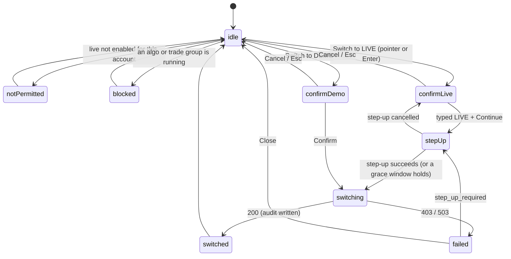

# E38-D02 — Hi-fi design: the environment switcher SCR-074 and the demo / live chrome SCR-075

**Ticket:** E38-D02 (#1003) · **Epic:** E38 · **Task, P0, Sprint 16** · **Status:** Draft. It is a text-first PR 1 of 2 (`Refs #1003`, `Partial: PR 1 of 2`). This PR carries the spec text, its audit tool, its pins and the `14` / `15` changes as staged A-rows. PR 2 draws the boards of §0 on Penpot, applies the A-rows as a separate commit and carries the closing line. **The BQ list BQ-01 … BQ-30 is ruled** (issue comment 6577247518): twenty-four acceptances and five overrides (BQ-07, BQ-08 and BQ-11, and BQ-14 and BQ-22 narrowly), all folded here. The orchestrator's read (issue comment 6578478536) is folded too: the T2 anatomy (§4.3), the pill's role (§3.1), forced colours (§2), the keyboard model (§4.1) and text resize (§9). **Owner approval pending (C-10.1):** the owner's `approved` stands in for the CDO, Architect and Security walkthroughs (the agent-delivery adaptations); nothing here claims it.

**Inputs pinned.** Base `origin/main` `67fe8b526`. Every `file`:line below is read there (`git show`), except `D01`, the E38-D01 research memo, read at #5451's approved head `4774b2f8c`, if #5451 merges as is, and re-pinned to `main` by content at its merge (R6). Proceeding on it before its merge is an orchestrator waiver (ruling BQ-03). D01's rulings are issue comment 6572970059 and its approval, with its carries, is 6574227712.

**Key.** `NN`:line = `docs/plan/NN-*.md`; `05` is cited by content, not line.

- **E10:** `E10D03` = `docs/design/E10/E10-D03.md` (the shell chrome and the environment signal, §1.2, §3); `E10D04` = its motion review.
- **E30:** `E30D02` / `E30D04` = the order-ticket wireframes and design-system contributions (the pill grammar D7, §2.2; CMP-139 §14).
- **E09:** `E09D09` = the T2 grammar.
- **Placements:** `E15D03`, `E29D03`, `E32D03` and `E33D03` = the placement owners of §3.2; `E11D02` = the chart's status row.
- **`T`** = the ticket text (#1003).

## Acceptance-criteria trace (#1003)

| Ticket item                                                                                 | Where                                               | Status                                |
| ------------------------------------------------------------------------------------------- | --------------------------------------------------- | ------------------------------------- |
| AC: every catalogued state is drawn; both sign-off checklists ticked                        | §0 (frames), §4.3, §11 (the checklist map; G-STATE) | text done; the frames are PR 2's      |
| AC: colour is never the only signal (greyscale, three CVD simulations)                      | §2, §8 (G-CONTRAST, G-CVD)                          | done (tool-computed); renders in PR 2 |
| AC: no single-click or hotkey path to live; typed confirm plus step-up; no hotkey annotated | §4.1, §4.2, §11 A-8, §13 C-3 (G-HOTKEY)             | done                                  |
| AC: the blocked switch is designed, with its reason listed                                  | §4.3 S74-08 (G-T2), §12 G-1                         | text done; the data is a G-row        |
| AC: the band survives a modal                                                               | §3.1, §3.3                                          | done                                  |
| Scope: CMP-074 / CMP-075 finalised; CMP-139's disabled-with-reason presentation             | §2, §6, §11 A-rows                                  | done (A-rows applied in PR 2)         |
| Scope: the demo copy variant                                                                | §3.4                                                | done                                  |
| Scope: motion of the chrome during a switch                                                 | §7 (E10-D04 T-25, cited)                            | done                                  |
| Scope: redlines and the switch's state diagram                                              | §5; redlines on the PR 2 boards                     | diagram done; redlines PR 2           |
| DoD: Figma artefact; CDO / Architect sign-off; handed ≥ 2 sprints ahead                     | §0; §14                                             | PR 2 and sign-off pending             |

## 0. The frames (Penpot) — to draw (PR 2)

Page **`E38-D02 Environment chrome hi-fi`** in its own per-set file (the per-set recipe), created by name on the board script's first run, with the page id pinned here after the draw (page name and id only).

- **Boards:** six, in dark, plus two light twins (≤ ⅓). Every state × theme × density is also specified as text in §3–§4.
- **Exports:** `docs/design/E38/img/E38-D02-NN-<slug>.png` at 1:1, with greyscale, deuteranopia, protanopia and tritanopia renders of boards 1 and 3 (AC 2; K75-1; §8.2).

| B   | Frame                     | Board                                 | Shows                                                                                                                     | Status         |
| --- | ------------------------- | ------------------------------------- | ------------------------------------------------------------------------------------------------------------------------- | -------------- |
| B01 | `SCR-074/idle`            | 1 `scr-074-switch-to-live`            | the env pill and its popover, current DEMO, "Switch to LIVE…" (§3.4, §4.1)                                                | to draw (PR 2) |
| B02 | `SCR-074/confirm-live`    | 1                                     | the to-live dialog: the target, the accounts, the stays-on-DEMO line, the typed field empty / mismatched / matched (§4.2) | to draw (PR 2) |
| B03 | `SCR-074/confirm-demo`    | 2 `scr-074-switch-to-demo-and-states` | the to-demo click-confirm with the demo statement (§4.2)                                                                  | to draw (PR 2) |
| B04 | `SCR-074/switching`       | 2                                     | the three phases as text steps; order entry blocked app-wide (§4.3 S74-04)                                                | to draw (PR 2) |
| B05 | `SCR-074/switched`        | 2                                     | the chrome in LIVE in one frame; the 10 s banner under the TopBar (§4.3 S74-05)                                           | to draw (PR 2) |
| B06 | `SCR-074/failed`          | 2                                     | the dialog with the server's reason; the session still in DEMO (§4.3 S74-06)                                              | to draw (PR 2) |
| B07 | `SCR-074/not-permitted`   | 2                                     | the popover's switch action T2 with its reason (§4.3 S74-07)                                                              | to draw (PR 2) |
| B08 | `SCR-074/blocked`         | 2                                     | the switch action T2 with the running algos and groups listed (§4.3 S74-08)                                               | to draw (PR 2) |
| B09 | `SCR-075/band-demo`       | 3 `scr-075-band-and-signal`           | the TopBar row in DEMO: the CMP-074 pill, the StatusBar repeat; the four channels with redlines (§2, §3.1)                | to draw (PR 2) |
| B10 | `SCR-075/band-live`       | 3                                     | the same in LIVE; the unconfirmed state beside it (§3.5); the greyscale strip (§8)                                        | to draw (PR 2) |
| B11 | `SCR-075/panels`          | 4 `scr-075-panel-placements`          | the six panel placements of §3.2 composed on one workspace                                                                | to draw (PR 2) |
| B12 | `SCR-075/floating-window` | 4                                     | a popped-out window's CMP-215 title bar with its pill (§3.2)                                                              | to draw (PR 2) |
| B13 | `SCR-075/under-modal`     | 5 `scr-075-modal-and-banners`         | a modal and its scrim over the workspace with the TopBar row above the scrim (§3.3)                                       | to draw (PR 2) |
| B14 | `SCR-075/demo-statement`  | 5                                     | the DEMO popover with the REST-only statement (§3.4)                                                                      | to draw (PR 2) |
| B15 | `SCR-074/state-diagram`   | 6 `switch-diagram-and-matrix`         | §5's diagram drawn as frames (Mermaid is additional, never the only deliverable), §8's tables as literal cells            | to draw (PR 2) |

The light twins are boards 1 and 3 in `semantic-light`. In hc, the env tokens have no hc override (E10-D03 §1.2), so the boards draw no hc twin; §8 carries hc as literal values.

## 1. Locked inputs (built on, never re-decided)

1. **C-2.11.** Demo and live are separate credential sets, base URLs, state and UI chrome. Switching to live takes an explicit typed confirmation, and **no hotkey may switch the environment**. Demo has no WS order entry.
2. **`22` `setSessionEnvironment`** (`22`:14074–14080): switching **to** live requires an elevated session and the `live_trading` flag (`403 step_up_required` / `403 live_trading_disabled`). The switch is audited and broadcast on the `system` WS topic.
3. **The badge contract**: four channels, word, weight, glyph, then border (`E10D03`:169); hue last, and never under a scrim or a modal (`E10D03`:97); repeated in the floating window's title bar (`E10D03`:85). **SR-179** (`04`:1009): the badge reads the `system` topic, and on disconnect it adds "unconfirmed" (`E10D03`:214).
4. **The switch is a cut** (`E10D04`:157, T-25): `motion.duration.instant`, identical under reduce, with order entry blocked for the whole transition.
5. **D01's rulings** (6572970059):
   - the typed word is `LIVE` (`D01`:101);
   - to demo is a click-confirm with no step-up (`D01`:102);
   - a live session shows no demo rows (`D01`:103);
   - one environment per session (`D01`:104);
   - DEMO names the environment and SIMULATED the local matcher's fills (`D01`:106);
   - per-panel badges are mandatory, popped-out windows included (`D01`:140).
6. **T2** (`E09D09`:49): a control the session may not use is disabled with a visible reason, never hidden (`14`:85).

## 2. CMP-074 and CMP-075 — E10-D03 §1.2's pill (BQ-07 RULED)

| Channel | Spec (dark; light and hc by token swap)                                                                                                                                                                       | Survives                                                             |
| ------- | ------------------------------------------------------------------------------------------------------------------------------------------------------------------------------------------------------------- | -------------------------------------------------------------------- |
| word    | DEMO / LIVE in `color.text.primary` on `color.surface.raised`, `type.ui.label`; NBSP-joined; never tinted (`E30D04`:188)                                                                                      | greyscale, CVD, forced colours                                       |
| weight  | LIVE `font.weight.bold`; DEMO `font.weight.medium` on CMP-074, the StatusBar, panel headers and CMP-215 (`E10D03`:80, :169; C24, `E10D03`:794); E30-D04 D7's regular (`E30D04`:156) is the loser, A-5 and A-6 | greyscale, CVD                                                       |
| glyph   | `icon/env-live` filled dot, `icon/env-demo` outline dot, 16 px, in `color.env.live` / `color.env.demo`                                                                                                        | greyscale, CVD, forced colours (the shape)                           |
| border  | `color.env.demo` / `color.env.live` (border, dot); `border.thick` (2 px) on every host (`E10D03`:80); the 1 px of E30-D04 D7 and E29-D03 C-13 are the losers, A-5 … A-7                                       | greyscale as a luminance edge; forced colours as a `CanvasText` line |

- **Shape.** The pill is a `radius.pill` box fitted to its label (never a fixed width), with `space.2` horizontal padding. It is 20 px tall in a compact shell row and 24 px in comfortable (`E10D03`:97), and 24 / 32 px in panel headers (D7).
- **Forced colours (R2).** Under `forced-colors: active` no hue carries the environment, and every channel but the hue survives: the word and its weight are unchanged; the dot is drawn in `currentColor`, so LIVE's filled dot and DEMO's outline dot keep their shapes in `CanvasText`; the 2 px border and LIVE's panel rule render as `CanvasText` lines; the unconfirmed state keeps its dashed border and its caption (§3.5), so the dash, not the hue, carries it; the banner (S74-05) keeps a 1 px `CanvasText` border, its text in `CanvasText` on `Canvas` and its glyph in `currentColor`. `forced-color-adjust` stays `auto` on every host.
- **The LIVE rule, never a text underline** (BQ-08 RULED). On panel badges LIVE keeps E15-D03 D-4's `border.thick` rule (`E15D03`:169, :304), which E11-D02 draws under the chart's status row (`E11D02`:415). The TopBar badge has no rule, and the word itself is never underlined (E10-D03 C13, `E10D03`:783).
- **Hosts.** CMP-074 is the pill in the TopBar's environment slot (`E10D03`:169), a button (§3.1) whose press opens §3.4's popover (`onRequestSwitch`). CMP-075 is the same pill, non-interactive, `role="img"` with a static name "Trading environment: Live" (`15`:847), in every other host.
- **LIVE and sell.** `color.env.live` is the same value as `color.sell.default` in dark and light. This is known and designed (E30-D01 F5; E10-D03 §11.2): the pill sits on chrome and sell on the ticket, never one beside the other. E30-D04 owns the treatment (the E10-D03 hand-off H10). **This spec never places the env hue on a sell surface** (BQ-28; D01 approval carry 1).

## 3. SCR-075 — the band, the panels, the modal, the demo statement

### 3.1 The band (BQ-06)

The "persistent top band" of `14` SCR-075 (`14`:1787) is the **TopBar row itself**, carrying the CMP-074 pill in its environment slot, with the StatusBar's CMP-075 repeating the word (`E10D03`:169).

- **No full-width coloured band is added.** A red band would put LIVE's hue beside red sell fills, so C-1 records `14`'s word "band".
- **Never moves, never covered.** The TopBar is part of the app shell: it never remounts on a route change, its badge comes from one shared store subscription (`14`:1791), it is never scrolled away, and it is never under a scrim (§3.3).
- **Role and accessible name.** The TopBar's environment slot is a `role="status"` container read early in document order, and the pill inside it is a button, CMP-017's anchor (`aria-haspopup="dialog"`, `aria-expanded`, `aria-controls`), never itself `role="status"` (E38-D05 F-01; C-10); its name is "Trading environment: Live" (`14`:1790). The slot's text swap at S74-05 is not spoken (`aria-live="off"` on the swap); the banner's alert is the one announcement (§9).
- **LIVE since (BQ-11 RULED).** In LIVE, a persistent line, "LIVE since 14:02 UTC" (CA-3, `D01`:298), sits beside the pill as a separate text node, never inside the pill and never in a live region (D01 F4, P-2). Its placement is PROPOSED to the E10-D03 owner (R-2); the popover may repeat it.

### 3.2 Per-panel placements (BQ-09; each its owner's, cited, drawn together on board 4)

| Panel                 | Where the pill sits                                                           | Owner (cited)                     | Accessible name                         |
| --------------------- | ----------------------------------------------------------------------------- | --------------------------------- | --------------------------------------- |
| order ticket          | the header row, after the instrument; the 2 px LIVE rule under the header     | `E30D02`:157, :267; `E30D04`:188  | "Order ticket - BTCUSDT - LIVE - Main"  |
| group ticket          | the same header; each leg row's account carries its own pill in the leg table | `E30D02`:267 (the header grammar) | "Group ticket - BTCUSDT - LIVE - Scalp" |
| DOM ladder            | the panel header, by kind (`dom`), so a viewer's DOM still discloses it       | `E15D03`:169 (D-4)                | "DOM - BTCUSDT - LIVE"                  |
| positions grid        | the title bar, on every scope                                                 | `E29D03`:116                      | "Positions - LIVE - Main"               |
| algo monitor          | the title row, "Bracket · BTCUSDT · Main · DEMO" grammar                      | `E32D03`:125; `E33D03`:317 (A10)  | "Algos - LIVE - Main"                   |
| chart-trading overlay | the chart panel header pill; the chart's own status-row LIVE rule             | `E15D03`:169; `E10D03`:169        | "Chart - BTCUSDT 1m - LIVE"             |
| floating window       | the CMP-215 title bar, mandatory; the window title includes the word          | `15`:2798; `E10D03`:97            | "BTCUSDT DOM - LIVE" (window title)     |

The names follow the `14` example "Order ticket - LIVE - Main" (`14`:1790) and the owners' grammars. Names the owners did not fix are PROPOSED (the group-ticket, algo, chart and window rows).

### 3.3 The band survives a modal (AC 5)

A modal (CMP-043 / CMP-044) and its scrim cover the workspace below the TopBar row, never the row. The scrim starts at the TopBar's bottom edge, and the pill stays at full ink above it (`E10D03`:97). The board annotates "never scrolled away or covered". A full-screen route (`F11`) keeps the TopBar's pill (E15-D04).

### 3.4 The env popover and the demo statement (BQ-10, BQ-11; PROPOSED)

Pressing CMP-074 (a pointer, or Tab then `Enter` / `Space`) opens a small non-modal popover (CMP-017, a `role="dialog"` without `aria-modal`, `15`:220), named "Trading environment"; the pill's `aria-expanded` follows it.

- **Content:**
  - the current environment's word;
  - in DEMO, the verbatim statement "Demo uses Bybit's demo matching engine — REST order entry only, no private WS order entry." (`14`:1787), never hidden (SR-040a, `04`:907);
  - in LIVE, a repeat of the persistent "LIVE since 14:02 UTC" line (§3.1);
  - a count line for the other environment's working orders, "3 demo orders still working on DEMO" (PROPOSED; D02 places it, D01 ruling 13–14);
  - the action, "Switch to LIVE…" or "Switch to DEMO…".
- **Keys and focus:** `Esc` closes it, and focus returns to the pill.
- **Not a hotkey:** the popover is the only entry to SCR-074. No key opens it.

### 3.5 Unconfirmed and unknown (BQ-12)

- **Unconfirmed:** SR-179's state is E10-D03 §3.4's, unchanged: a dashed border, the caption "unconfirmed" and the name "Trading environment: Live — unconfirmed, reconnecting" (`E10D03`:214). Order entry is blocked from the same signal.
- **Unknown:** before the environment is known, no pill is shown (`E10D03`:97). The as-built "ENV UNKNOWN" look is C-4 for the E10 owner. The switch action is unavailable while the pill is absent or unconfirmed.

## 4. SCR-074 — the switcher

### 4.1 Entry, gate and sequence (BQ-14 … BQ-17)

- **Entry:** the popover's action only (§3.4); there is no other path to SCR-074. No key opens it. The control is click- and Tab-reachable, which is keyboard operation, not a hotkey (`14`:1776; C-2.11).
- **To live:**
  1. The dialog opens with focus in the typed field, labelled "Type LIVE to confirm" (`14`:1770).
  2. Until the field equals `LIVE` exactly (case-sensitive, `14`:264), Continue is `aria-disabled` but stays focusable, and a press moves focus to the field: form validity, not T2 (E09-D09 §9.1, `E09D09`:224, :230; BQ-14 RULED). The field's label and the mismatch line explain it. Trimming surrounding spaces is PROPOSED.
  3. Continue opens E09's step-up (SCR-006; `14`:85: "a missing step-up is enabled, the press opens SCR-006"). Whether a step-up grace window skips it is E09's to decide (`22`'s elevated session, `22`:14074–14080); this spec decides nothing about it.
  4. The step-up's success starts the switch (§4.3 S74-04).
     This PR draws only the hand-off point to SCR-006.
- **To demo:** one Confirm, no typed word and no step-up (`22`:14080; `13`:432; D01 SC-2).
- **Keyboard model (R3; `05` §3.4):**
  - the popover: focus moves into it on open, to its first control, the action (`15`:220); `Tab` past the action leaves and closes it, as CMP-017's non-modal use does (`15`:223); `Esc` closes it and returns focus to the pill;
  - the to-live dialog: focus starts in the typed field; the Tab order is the field, Continue, Cancel, and it stays inside the dialog; `Enter` in the field is a Continue press: while the field does not equal `LIVE` it changes nothing and shows the mismatch line, polite, once per press (`14`:264: a press with an incomplete field is refused with focus to that field); once it matches, it opens the step-up; `Esc` is Cancel;
  - the to-demo dialog: focus starts on Confirm (S74-03); the Tab order is Cancel, Confirm, inside the dialog; `Enter` or `Space` presses the focused button; `Esc` is Cancel;
  - the failed state (S74-06): focus moves to the error line, then `Tab` reaches Close; Close or `Esc` returns focus to the pill.

### 4.2 The dialogs' content (copy from `14` verbatim where it exists; else PROPOSED)

- **To live:**
  - "Now: DEMO (api-demo) -> LIVE (mainnet)" and "Affects: this session, all panels, all tickets." (`14`:1765–1766);
  - the live accounts available (`14`:1767);
  - the line "Working demo orders (3) stay on demo and are not migrated." (`14`:1768–1769), its count from the session's working demo orders (PROPOSED; D01 SC-3);
  - the typed field and Continue / Cancel. CA-1 (`D01`:296) is the PROPOSED intro sentence.
- **To demo:** CA-2 (`D01`:297), "Switch this session to DEMO? Live orders and positions stay on LIVE and keep their native stops.", and the demo statement of §3.4.

### 4.3 The states (G-T2: every T2 row carries its reason)

| Id     | State         | What the user sees                                                                                                                         | Presentation                                                                                                                                                                                                                       | Focus · announcement                                                                            | Audit                                                        |
| ------ | ------------- | ------------------------------------------------------------------------------------------------------------------------------------------ | ---------------------------------------------------------------------------------------------------------------------------------------------------------------------------------------------------------------------------------- | ----------------------------------------------------------------------------------------------- | ------------------------------------------------------------ |
| S74-01 | idle          | the pill and its popover                                                                                                                   | the action enabled                                                                                                                                                                                                                 | on the pill; nothing announced                                                                  | —                                                            |
| S74-02 | confirm-live  | the to-live dialog; the field empty, then mismatched ("That doesn't match. Type LIVE exactly." as text under the field), then matched      | Continue `aria-disabled` and focusable until the field equals `LIVE`; a press focuses the field (form validity, E09-D09 §9.1, never the lock look)                                                                                 | the field on open, the dialog's title and description read once; the mismatch line polite, once | —                                                            |
| S74-03 | confirm-demo  | the to-demo dialog with the demo statement                                                                                                 | Confirm enabled                                                                                                                                                                                                                    | Confirm on open, the dialog's title and description read once                                   | —                                                            |
| S74-04 | switching     | the three phases as text steps, "Closing subscriptions…", "Re-authenticating…", "Resubscribing…" (`14`:1777); order entry blocked app-wide | every submit control T2 2a (the T2 anatomy below) "Switching environment — order entry is paused." (PROPOSED; its state key is G-2)                                                                                                | the dialog; each step polite, once                                                              | — (server-side only)                                         |
| S74-05 | switched      | the dialog closes; chrome, badges and every trading surface change in one frame; the 10 s banner under the TopBar                          | CMP-028 `info` banner, "You're now in LIVE. Orders reach Bybit with real funds." (PROPOSED)                                                                                                                                        | the pill; the banner `role="alert"`, assertive, once (§9)                                       | `session.environment_switched`, high, on the 200 (`14`:1779) |
| S74-06 | failed        | the dialog with the server's reason; the session stays where it was (`14`:1777)                                                            | the server's reason in text (ruling BQ-22); `step_up_required` returns to SCR-006; fallback copy only where the server sends no reason: "Live trading is turned off for this deployment." (PROPOSED, routed to the `22` owner)     | the error line; `role="alert"`, once                                                            | — (the server records the refusal)                           |
| S74-07 | not-permitted | the popover's switch action                                                                                                                | T2 2a `rbac.env`, "Live trading isn't enabled for you." (`E09D09`:93; `14`:1777's wording is C-8; the T2 anatomy below)                                                                                                            | on the action; the reason on press, polite, once                                                | —                                                            |
| S74-08 | blocked       | the popover's switch action with the blockers listed                                                                                       | T2 2a, "2 algos are running: BTC trail, ETH OCO. Stop them or let them finish before switching." (an example, pending G-2: PROPOSED; its state key registered in E33-D03 D03-A10's vocabulary, `E33D03`:317; the T2 anatomy below) | on the action; the reason on press, polite, once                                                | —                                                            |

- **T2 anatomy (S74-04, S74-07, S74-08; G-T2.1a–d, G-T2.2, G-T2.6; `E09D09`:49)**, stated once and cited from each row:
  - the control keeps its native role, a button, and its full label: "Switch to LIVE…" or "Switch to DEMO…" in the popover, each submit control's own label in S74-04;
  - `aria-disabled="true"`, never the `disabled` attribute, so it stays in the Tab order (`E09D09`:224);
  - the reason node is in the DOM at mount and linked by `aria-describedby` (`E09D09`:236); rendering 2a, the reason inline under the control; in S74-04 each trading panel carries one notice and every submit control in it points at that node (G-T2.5);
  - `Enter` or `Space` changes nothing and re-shows the reason inline, polite, once (`E09D09`:243);
  - CMP-079 RbacGate wraps S74-07's step-3 `rbac.env` control (`E09D09`:204; `15`:890); S74-04's and S74-08's state-gated controls take the same anatomy through it, each with its registered state reason (G-2);
  - the CMP-019 `lock` glyph, `decorative=false`, named "Not available", leads the full label (`E09D09`:207);
  - the hi-fi pins: the label in `color.text.tertiary` and the reason in `color.text.secondary`; on a primary, buy or sell submit (S74-04) the fill becomes `color.surface.raised` with a `color.border.default` hairline; never `color.text.disabled`, never `opacity.disabled` on the label, the glyph or the reason (`E09D09`:220; CMP-079's tokens, `15`:896).
- **Focus return:** Cancel or `Esc` returns focus to the pill that opened the popover (`T` a11y notes). Success returns it to the pill, now LIVE.
- **The audit trigger:** `session.environment_switched` (high severity, `14`:1779) is written by the server on the 200 of `POST /session/environment`, at S74-05, never on intent (`T` Observability).
- **Performance:** order entry is blocked for the whole transition, typically ≤ 2 s (`14`:1780). The design shows the blocked state, never an optimistic one.

## 5. The switch's state diagram (BQ-29; a design diagram, not a `28` machine)

## 6. CMP-139 — the disabled-with-reason presentation (cited; `E30D04`:468)

A submit whose target environment differs from the session's is T2 (E09-D09 §2.2): full label, the `lock` glyph and `aria-disabled`, with the reason `guard.mismatch`, "Order is for a LIVE account while the workspace is DEMO" (`15`:1709). The reason is in the DOM at mount and re-shown once on press. This spec adds nothing to it. The board composes it beside the band (board 4).

## 7. Motion (BQ-25; cited, none added)

The switch is a cut: badges, chrome and every surface change in one frame, in both modes (`E10D04`:157). There is no cross-fade, ever (C-2.11; `E30D04`:191, "never: transitions"). The 10 s banner appears and leaves as cuts. The phases of S74-04 are text swaps, with no spinner past 5 s (`05` §7). This PR adds no motion row and no token.

## 8. Themes, contrast and CVD (tool-computed: `contrast_check` and `cvd_simulate` over the merged token sets, resolved by `verify_tokens` as E10-D03 §11 does; light = `semantic-light` over dark, hc = `semantic-hc` over dark)

### 8.1 Contrast (`contrast_check.contrast_ratio`; `text` ≥ 4.5:1, `ui` ≥ 3:1, `structure` reported)

| P    | fg                     | bg                         | role      | dark  | light | hc    | verdict   |
| ---- | ---------------------- | -------------------------- | --------- | ----- | ----- | ----- | --------- |
| P-01 | `color.text.primary`   | `color.surface.raised`     | text      | 14.35 | 15.62 | 16.25 | pass      |
| P-02 | `color.env.live`       | `color.surface.raised`     | ui        | 4.42  | 4.51  | 4.42  | pass      |
| P-03 | `color.env.demo`       | `color.surface.raised`     | ui        | 3.64  | 4.13  | 3.64  | pass      |
| P-04 | `color.env.live`       | `color.surface.app`        | ui        | 4.94  | 5.20  | 4.94  | pass      |
| P-05 | `color.env.demo`       | `color.surface.app`        | ui        | 4.07  | 4.76  | 4.07  | pass      |
| P-06 | `color.env.live`       | `color.surface.sunken`     | ui        | 5.37  | 3.70  | 5.37  | pass      |
| P-07 | `color.env.demo`       | `color.surface.sunken`     | ui        | 4.41  | 3.39  | 4.41  | pass      |
| P-08 | `color.text.secondary` | `color.surface.raised`     | text      | 8.81  | 8.98  | 14.35 | pass      |
| P-09 | `color.surface.raised` | `color.surface.app`        | structure | 1.12  | 1.15  | 1.12  | structure |
| P-10 | `color.text.primary`   | `color.status.info.subtle` | text      | 10.74 | 15.44 | 12.16 | pass      |
| P-11 | `color.text.primary`   | `color.surface.overlay`    | text      | 13.27 | 14.37 | 15.02 | pass      |

### 8.2 CVD (`cvd_simulate.simulate`, `delta_e76`; JND floor 5.0; reported, never gated)

| V    | a                             | b                | theme | ΔE76 normal / protanopia / deuteranopia / tritanopia | under the JND                                |
| ---- | ----------------------------- | ---------------- | ----- | ---------------------------------------------------- | -------------------------------------------- |
| V-01 | `color.env.demo`              | `color.env.live` | dark  | 107.05 / 91.86 / 121.11 / 115.66                     | none                                         |
| V-02 | `color.env.demo`              | `color.env.live` | light | 104.74 / 92.00 / 119.21 / 110.38                     | none                                         |
| V-03 | `color.sell.default`          | `color.env.live` | dark  | 0.00 / 0.00 / 0.00 / 0.00                            | normal, protanopia, deuteranopia, tritanopia |
| V-04 | `color.status.danger.default` | `color.env.live` | hc    | 5.14 / 2.56 / 3.83 / 6.06                            | protanopia, deuteranopia                     |

**Reading.**

- **DEMO vs LIVE:** the hue stays apart in all three simulations. In greyscale the two borders are near-equal, so the word, the weight and the glyph carry the environment (E10-D03 §3.3). Any treatment that tells them apart by hue or fill alone is rejected (AC 2; `D01`:253).
- **Sell vs LIVE** is equal by design and cited, not a new finding.
- **Danger vs LIVE in hc** falls under the JND for two simulations, so a danger banner never carries the environment by hue beside a pill. The point is routed to E30-D04 with the E10-D03 hand-off H10 (D01 approval carry 1; `D01`:256).

## 9. Announcements and accessible names

- **The pill:** a button named "Trading environment: Live" inside the `role="status"` slot (CMP-074; E38-D05 F-01). Each repeat is CMP-075 `role="img"` with a static label, so a re-render is never re-announced (`15`:847). Each trading panel's accessible name carries the environment (§3.2).
- **The switch:** confirmed is announced once, assertively, through the banner's `role="alert"`, because `05` §6.2 lists the switch among the assertive events and the banner is the element that appears for it; the slot's status swap stays silent (§3.1), so the confirmation is never heard twice. The S74-04 phases and the S74-02 mismatch are polite, once each. Unconfirmed belongs to E17-D01's announcement (`E10D03`:214).
- **Text resize (R1; `05` §5 item 7, WCAG 1.4.4), at 1280 × 800, at 200 % zoom and at the largest in-app text scale:**
  - the to-live and to-demo dialogs cap at the viewport's height: the title stays at the top and the buttons in a sticky footer, while the restatement, the accounts and the stays-on-demo line scroll between them; every line wraps and none truncates; the typed field keeps the dialog's full width;
  - the popover grows with its content down to the viewport's bottom edge, then scrolls inside, the action last; the demo statement wraps and is never cut;
  - the 10 s banner wraps to as many lines as it needs and pushes the workspace down, below the TopBar row, never over the row or the pill (§3.3);
  - the pill grows with its label (§2 Shape) and the TopBar row grows taller rather than drop or truncate the pill; the "LIVE since" line may wrap, never truncate.

## 10. Security, performance and observability

- **Security:** this design is the user-facing half of SR-040a (`04`:907: the capability matrix, demo's REST-only order entry stated, never hidden) and SR-043 (`04`:911: arming is separate, and the switch disarms; `E30D04`:188). The design implies no capability the backend forbids.
- **Performance:** the TopBar never remounts; one store subscription feeds every badge (`14`:1791).
- **Observability:** the audit event is written on success only (§4.3).

## 11. The checklists, item by item (G-STATE) and the A-rows for PR 2

| K     | `14` sign-off item (verbatim)                                                                                              | Frames                                   |
| ----- | -------------------------------------------------------------------------------------------------------------------------- | ---------------------------------------- |
| K74-1 | "the switch is a deliberate, confirmed action, never a toggle that can be hit accidentally"                                | `SCR-074/idle`, `SCR-074/confirm-live`   |
| K74-2 | "switching to LIVE requires typed confirmation and step-up"                                                                | `SCR-074/confirm-live`                   |
| K74-3 | "open DEMO positions/orders are listed with a statement that they remain in DEMO"                                          | `SCR-074/confirm-live`                   |
| K74-4 | "transition state drawn (order entry blocked)"                                                                             | `SCR-074/switching`                      |
| K74-5 | "chrome, badges and all trading surfaces are shown updating together"                                                      | `SCR-074/switched`                       |
| K74-6 | "switching is blocked while any algo or trade group is running, with the reason listed"                                    | `SCR-074/blocked`                        |
| K75-1 | "DEMO and LIVE bands drawn and distinguishable in greyscale and in all three colour-vision simulations"                    | `SCR-075/band-demo`, `SCR-075/band-live` |
| K75-2 | "per-panel badge placement drawn for ticket, group ticket, ladder, positions grid, algo monitor and chart trading overlay" | `SCR-075/panels`                         |
| K75-3 | "floating windows repeat the band"                                                                                         | `SCR-075/floating-window`                |
| K75-4 | "the band is never scrolled away or covered by a modal"                                                                    | `SCR-075/under-modal`                    |

**A-rows (copy-ready; applied verbatim by PR 2 as a separate commit; PR 1 edits neither file):**

- **A-1, `14` SCR-074** (after the checklist line `14`:1783): "- **Hi-fi (E38-D02):** [E38-D02.md](../design/E38/E38-D02.md) (E38-D02; owner approval pending; the switcher's entry through the env popover only, the typed `LIVE` gate then E09's step-up, every state S74-01 … S74-08 with its reason, focus and announcement, the state diagram; no hotkey opens it)."
- **A-2, `14` SCR-075** (after `14`:1793): "- **Hi-fi (E38-D02):** [E38-D02.md](../design/E38/E38-D02.md) (E38-D02; owner approval pending; the band as the TopBar row with the CMP-074 pill, the per-panel placements by owner, the band above every scrim, the demo statement in the env popover, the measured contrast and CVD)."
- **A-3, `15` CMP-074** (a line after its Tests line, `15`:838–841): "- **Hi-fi (E38-D02)**: E10-D03 §1.2's pill — word, weight (LIVE bold, DEMO medium), glyph, 2 px border, hue last; a button inside the `role="status"` slot (`aria-haspopup="dialog"`, `aria-expanded`, `aria-controls`; E38-D05 F-01), whose press opens the env popover (§3.4), the only entry to SCR-074; where the switch is T2 (S74-07, S74-08) CMP-079 RbacGate wraps the popover's action and the CMP-019 `lock` leads its label (E38-D02 §4.3); the word never underlined."
- **A-4, `15` CMP-075** (a line after its As-built line, `15`:847–850): "- **Hi-fi (E38-D02)**: the same grammar as CMP-074 (2 px border on every host, and LIVE's `border.thick` rule on panel badges; a denser row variant is R-1, PROPOSED to the E10-D03 owner), `role=\"img\"` with a static label; the placements per host are E38-D02 §3.2 (PROPOSED)."
- **A-5, E30-D04 D7** (`E30D04`:156; BQ-07, the loser). Old: "1 px border, 24 px tall in compact / 32 px in comfortable". New: "2 px border (`border.thick`, E10-D03 §1.2), 24 px tall in compact / 32 px in comfortable". Old: "DEMO regular with an outline dot". New: "DEMO `font.weight.medium` with an outline dot (E10-D03 §1.2)".
- **A-6, E30-D04 §2.2, the channels row** (`E30D04`:188; BQ-07, the loser). Old: "the env hue as the 1 px border and the dot". New: "the env hue as the 2 px border and the dot". Old: "DEMO `font.weight.regular` + outline dot". New: "DEMO `font.weight.medium` + outline dot".
- **A-7, E29-D03, the ENV pill row and C-13** (`E29D03`:413, :575; BQ-07, the loser). Old: "1 px border and dot in `color.env.live` / `color.env.demo`". New: "2 px border (`border.thick`) and dot in `color.env.live` / `color.env.demo`". Old: "the width goes to E30-D04 with ruling 2's final live treatment". New: "the width is E10-D03 §1.2's 2 px (E38-D02 BQ-07, A-5)".
- **A-8, `17` §7** (`17`:446; BQ-17, the loser). Delete the row whose action is "Toggle Demo/Live switch flow (opens M-005, never switches without confirm)": no key opens SCR-074 (C-2.11; `14`:1776; `T` AC 3), and KEYMAP binds none.
- **A-9, E30-D04 §2.2** (BQ-28). After "the env hue as the 2 px border and the dot" (A-6's row, `E30D04`:188) add the row: "| submit word | the submit label carries the environment word as text, e.g. "Sell 0.5 BTC · LIVE" (PROPOSED), in `color.text.inverse` on the side fill; no env hue on the sell fill (D01 F1 / CA-4; D01 approval carry 1) |".

## 12. Contract gaps (none filled; contract first, C-6.1)

| G   | Gap                                                                                                                                                                                                      | Owner                                                                                                              |
| --- | -------------------------------------------------------------------------------------------------------------------------------------------------------------------------------------------------------- | ------------------------------------------------------------------------------------------------------------------ |
| G-1 | No `22` field lists the session's running algos and trade groups for S74-08's reason; this spec proposes no shape                                                                                        | the `22` owner, E38-T02                                                                                            |
| G-2 | No registered state keys for S74-04's reason ("Switching environment — order entry is paused.") or S74-08's (the running algos and groups; names and counts are legal only as a registered state string) | S74-04: E30-D02 §14's state vocabulary, the order-entry states (`E09D09`:85); S74-08: E33-D03 D03-A10's vocabulary |

## 13. Rows (C · Q)

| Row  | Between                                                                                                                                                        | Reading here                                                                                                                         |
| ---- | -------------------------------------------------------------------------------------------------------------------------------------------------------------- | ------------------------------------------------------------------------------------------------------------------------------------ |
| C-1  | `14` SCR-075's "persistent top band" vs E10-D03's TopBar slot pill                                                                                             | the TopBar row is the band; no full-width coloured band (BQ-06)                                                                      |
| C-2  | E15-D03's "LIVE underlined" (`E15D03`:304) vs E10-D03 C13's no text underline (`E10D03`:783)                                                                   | the 2 px `border.thick` rule under a LIVE panel header or status row, never a text underline (BQ-08 RULED)                           |
| C-3  | `17` §7 binds a chord to "Toggle Demo/Live switch flow" (`17`:446) vs C-2.11, SCR-074's "not bindable to a hotkey" (`14`:1776) and `T`'s AC                    | merged vs merged: A-8 deletes the binding (BQ-17 RULED); KEYMAP binds no key to SCR-074 (G-HOTKEY)                                   |
| C-4  | the as-built "ENV UNKNOWN" look vs E10-D03 §1.2's "no badge before the environment is known"                                                                   | E10-D03 followed; recorded for the E10 owner (BQ-12)                                                                                 |
| C-5  | E10-D03 §1.2's DEMO `font.weight.medium` and 2 px border vs E30-D04 D7's DEMO regular and 1 px (C24, `E10D03`:794; E29-D03 C-13)                               | merged vs merged: E10-D03 owns the pill (BQ-07 RULED); A-5 … A-7 move the losers; R-1 asks the E10-D03 owner about a lighter variant |
| C-6  | `14` SCR-074's inline "+ 2FA code" vs `T` (the step-up modal is E09's)                                                                                         | typed `LIVE`, then SCR-006 (BQ-15)                                                                                                   |
| C-7  | `T` Branch `design/e38-env-chrome` vs the assignment `design/e38-d02-hifi`                                                                                     | the assignment (BQ-01)                                                                                                               |
| C-8  | `14`:1777's not-permitted string "The owner hasn't enabled Live for your account." vs E09-D09's `rbac.env` "Live trading isn't enabled for you." (`E09D09`:93) | `rbac.env` (`14`:85: every T2 reason from E09-D09 §3); one string per condition is the `14` owner's                                  |
| C-9  | `T` DoD "both themes for every frame" vs the dark-first boards with light twins of boards 1 and 3 (BQ-26)                                                      | every state is specified in text across 3 themes × 2 densities (§3, §4, §8); the boards draw dark first                              |
| C-10 | `15` CMP-074's `role="status"` region (`15`:838) vs the pill as the press target and the only entry to SCR-074 (§3.4)                                          | the slot is the status and the pill a button inside it (§3.1; the orchestrator's read; E38-D05 F-01's A-1, folded here)              |
| R-1  | to the E10-D03 owner: a DEMO `regular` weight and a 1 px border for dense panel rows                                                                           | PROPOSED, not adopted; D01 §8 counts DEMO medium as a greyscale channel (`D01`:252)                                                  |
| R-2  | to the E10-D03 owner: where the persistent "LIVE since" line sits beside the TopBar pill                                                                       | PROPOSED (§3.1; BQ-11)                                                                                                               |
| Q-1  | is the switch a statechart catalogue machine (a `28` B-entry), or a design diagram only?                                                                       | the `28` owner (BQ-29)                                                                                                               |
| Q-2  | the other-environment count line in the popover                                                                                                                | the owner (PROPOSED, §3.4)                                                                                                           |

## 14. The tool, Definition of Done and deviations

`docs/design/_tools/e38_d02_env_chrome_audit.py` (`--check`, `--fill`, `--self-test`, `--repin-ruled`) gates G-STATE, G-TOKEN, G-CONTRAST, G-CVD, G-HOTKEY, G-T2, G-RULED, G-AROW, G-CITE, G-HYGIENE and G-SCOPE. G-RULED holds the ruled texts (the demo statement verbatim, DEMO medium, the panel rule, LIVE since, the exact match, the click-confirm to demo, the audit on the 200 in the prose and in S74-05's cell, the pill a button inside the status slot, the three CVD exports), and G-AROW holds every A-row's Old text at the base. It imports `verify_tokens`, `contrast_check` and `cvd_simulate` as the merged E10-D03 tool does. G-T2 classes the typed-gate Continue as V (form validity), not T2, and holds §4.3's T2 anatomy, its cite from every T2 row and A-3's CMP-079 and `lock`, and G-HOTKEY also reads KEYMAP at the base (BQ-30). The gates are described in its docstring, and each has at least one self-test mutation.

- [x] Every catalogued state specified (§4.3) and both checklists mapped to frames (§11).
- [x] Colour never the only signal, measured (§2, §8).
- [x] No hotkey path; typed confirm plus step-up (§4.1).
- [ ] Every frame drawn in Penpot, dark first with the light twins of §0 (C-9; PR 2).
- [ ] CDO, Architect and Security sign-off (the owner's `approved`; C-10.1).
- **Deviations.** D1: the branch (C-7). D2: Figma → Penpot, and no boards in PR 1. D3: the sign-offs read as the owner's approval.
