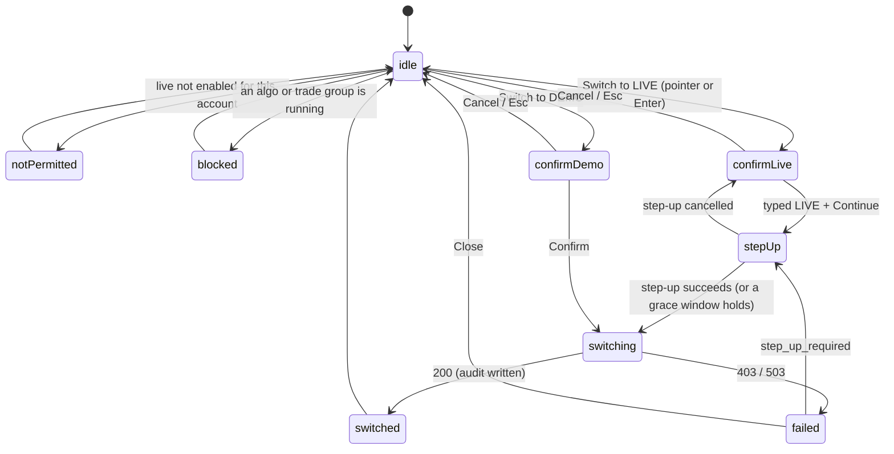

# E38-D06 — Engineering hand-off pack for the E38 surfaces (SCR-074, SCR-075, the SCR-079 reset, SCR-099, the SCR-122 eligibility control, SCR-137 parity and fidelity)

**Ticket:** E38-D06 (#1077) · **Epic:** E38 · **Kind:** design hand-off pack, text first · **Version:** v1 (the consuming stories cite the version they build against, §18) · **Status:** Draft, text-first, PR 1b of 2, stacked on PR 1a (the copy deck and its tool), **pre-staged on four unmerged parents**. Both PRs carry `Refs #1077` and a `Partial:` line and no closing line: AC 2 stays open (D5), the parents and D05's A-rows gate the hand-off (Q-03), and the `14` / `15` A-row edits and the glyph exports join this PR only when that gate clears (§15, §17). **The BQ list is ruled** (issue comment 6580362282): thirteen acceptances and four overrides (BQ-03, BQ-07, BQ-09, BQ-10), all folded here (§0). **Owner approval pending (#2701):** the owner's `approved` stands in for the CDO, Architect and Security sign-offs the ticket names (the agent-delivery adaptations); nothing here claims it.

**The hand-off gate.** E38-D05 refuses this hand-off until its A-2 … A-11, A-16, A-17 and A-21 (the A-rows of every open Blocking and Major) are applied in D02, D03 and D04 and re-reviewed (`D05`:388; its R-2, `D05`:63). This pack is written as if they land: every item one of D05's A-rows changes is marked **"per D05 A-n, pending its owner"**, and the parent's current text is stated beside it. Nothing here is settled until the gate opens (§0).

**Inputs pinned.** Base `origin/main` `b005ce6105`<!--=SHA:BASE-->. Every `KEY`:line below was read at its ref with `git show` and is pinned by content (§18). The parents are open and read at the heads the ruling names (BQ-04), each "if it merges as is" (`DS`:79, R6), and re-pinned to `main` by content at each merge; D05 is read at its PR's head and, per the ruling, never pinned:

- `D01` = `docs/design/research/E38-paper-parity.md` (the E38-D01 memo) at #5451's head `4774b2f8cd`<!--=SHA:D01-->;
- `D02` = `docs/design/E38/E38-D02.md` at #5494's head `292ce79537`<!--=SHA:D02-->;
- `D03` = `docs/design/E38/E38-D03.md` at #5493's design-approved head `75c776d822`<!--=SHA:D03-->;
- `D04` = `docs/design/E38/E38-D04.md` at #5490's head `2c47253340`<!--=SHA:D04-->;
- `D05` = `docs/design/E38/E38-D05.md` at #5514's head `ae76d1ac9f`<!--=SHA:D05--> (#1076), **unpinned** (BQ-04): every D05 cite and A-n number here was re-read at that head by content, and is re-read again if #5514 moves.

**Key.**

- `NN`:line = `docs/plan/NN-*.md` at the base.
- `D01` … `D05` = the parents above.
- `E09D09` = `docs/design/E09/E09-D09.md` (the T2 grammar and its §3.1 keys).
- `E10D03` = `docs/design/E10/E10-D03.md` (the env pill); `E10D04` = `docs/design/E10/E10-D04.md` (the motion review).
- `DS` = `.claude/rules/32-design-specs.md`; `CAL` = `docs/plan/backlog/_tools/calendar_cv.py`.
- `T` = the ticket text (#1077).
- Ids: **S** state, **B** frame, **N** annotation row and **W** switch-path step (D05's), **T** gated control (D05's), **E** event, **Q** open question, **A** A-row, **C** contradiction, **M** self-test mutation.

## Acceptance-criteria trace (#1077)

| Ticket item                                                                                           | Where                                      | Status                                                                                                                                                                 |
| ----------------------------------------------------------------------------------------------------- | ------------------------------------------ | ---------------------------------------------------------------------------------------------------------------------------------------------------------------------- |
| AC 1 — an engineer identifies every state, token, string and interaction per screen without asking    | §3 (states), §5 (tokens), §8 (strings), §7 | text done; the frames are the parents' PR 2s (§2)                                                                                                                      |
| AC 2 — every user-visible string is final and approved, error and not-permitted copy included         | §8; the JSON twin `E38-D06-copy.json`      | 20<!--=COPY:merged--> merged, 2<!--=COPY:ruled--> RULED, 126<!--=COPY:proposed--> PROPOSED with their owners (§8.0); approved: pending (owner); a named deviation (D5) |
| AC 3 — every open-questions entry has a recorded resolution or an owned follow-up                     | §13 (G-QUESTION)                           | every row has an owner and a resolution or an owned follow-up; open until the owner walkthrough (§14)                                                                  |
| AC 4 — Done at or before the end of Sprint 17 (design-ahead)                                          | §16                                        | on track; the parents' merges gate it                                                                                                                                  |
| Scope — per screen: frames, state inventory, redlines, token list, motion, a11y layer, copy deck      | §2, §3, §5, §6, §7, §8                     | text done                                                                                                                                                              |
| Scope — the component mapping table, with the new variants                                            | §9                                         | done; the new variants are A-rows (§17)                                                                                                                                |
| Scope — the asset export (the environment glyphs and the `simulated` glyph)                           | §15                                        | in PR 1b once the boards exist; the DS request is Q-17, no new issue                                                                                                   |
| Scope — the walkthrough and its open-questions log                                                    | §14, §13                                   | the owner walkthrough checklist; no session is claimed                                                                                                                 |
| Scope — `14` / `15` updated where the final design diverged                                           | §17                                        | nine copy-ready A-rows, applied in PR 1b once the gate clears; CMP-074's role carried by reference to D02                                                              |
| Tech — token names exactly as in `16`; the copy deck as the i18n source; the env-switch state diagram | §5 (G-TOKEN), §8, §4                       | done                                                                                                                                                                   |
| Security — the not-permitted reason discloses no other user's grants; sign-off of SCR-074 and SCR-122 | §10                                        | reviewed `(heuristic)`; the owner's sign-off pending                                                                                                                   |
| A11y — D05's annotation layer is part of the pack; the keyboard path and the announcements are walked | §7, §14                                    | carried by row                                                                                                                                                         |
| Perf — the band never remounts; the switch blocks order entry; SCR-099 fetches once                   | §11                                        | restated                                                                                                                                                               |
| Observability — every audit and analytics event per surface                                           | §12 (G-EVENT)                              | listed; the unnamed ones are owned follow-ups                                                                                                                          |

## 0. Status and evidence

**The surfaces are unbuilt** and the parents' boards are not yet drawn: each parent is a text-first PR 1 of 2 whose PR 2 draws the frames (`D02`:32; `D03`:34; `D04`:43), and D05 draws none. So this pack packages text: every state, string, token, name and event is stated here or carried by an exact row reference, and every frame row reads "to draw" with its page name (§2). Nothing was run with an engineer, a participant or assistive technology; every evaluative sentence is `(heuristic)`.

The parents' own rulings are locked (§1); D05's BQ list awaits its ruling, so its A-rows are carried as "pending its owner", their numbers read at #5514's head and unpinned (BQ-13). At that head D05 withdraws its A-1, A-14 and A-19, which D02 applied at its pinned head (`D05`:337), and adds A-20 and A-21.

**This pack's BQ rulings, folded** (issue comment 6580362282): the branch, the path and the deck format stand (BQ-01, BQ-02, BQ-06), the deck adding a `frozen` flag and group id for every safety string, its ids key names only (§8.0); the split into PR 1a (the deck and the tool, `--stage deck`) and PR 1b (this pack and its pins, `--stage full`) (BQ-03); the parents pinned at the ruled heads, D05 unpinned (BQ-04); Penpot page names only, #511 being E26-D04's (BQ-05); one status vocabulary, `merged` / `RULED` / `PROPOSED`, and AC 2 left open until the owner's `approved` (BQ-07, §8.0, D5); the K-1 … K-8 checklist as a comment on #1077, its findings `(heuristic)`, AC 3 open (BQ-08, §14); the glyph DS request logged as Q-17, no new issue (BQ-09, §15); CMP-074's role dropped from the A-rows and carried by reference to D02 (BQ-10, §17); design-ahead on track (BQ-11); a G-HYGIENE case for schemes, hostnames and key-like tokens in every deck value (BQ-12); D05's A-n marks pending, the text resize stated per dialog (BQ-13, BQ-14, §7); the unnamed events as E38-T02 rows, not issues (BQ-15, Q-08); `font.weight.semibold` ships (BQ-16, Q-14); the tool's shape (BQ-17, §18).

## 1. Locked inputs (cited, never re-decided)

1. **C-2.11.** Demo and live are separate; switching to live takes a typed confirmation, and no hotkey switches the environment (`D02`:59; `14`:1777).
2. **The contract.** `setSessionEnvironment`: switching to live needs an elevated session and the `live_trading` flag, else `403 step_up_required` or `403 live_trading_disabled`; the switch is audited and broadcast on the `system` WS topic (`22`:14080–14083).
3. **The pill.** E10-D03 §1.2's four channels — word, weight, glyph, border — hue last; never under a scrim (`E10D03`:97, :169).
4. **The switch is a cut** (`E10D04`:157, T-25).
5. **Paper is an execution mode, not an environment**; DEMO names where the account is and SIMULATED who filled it (`D03`:85; `D04`:55).
6. **T2** (`14`:85): a control the session may not use is disabled with a visible reason, never hidden, from E09-D09 §3.1's keys (`E09D09`:89, :92, :93, :95).
7. **The fidelity rule** (`24`:4062) and the fill model (`24`:3986).
8. **The parents' rulings:** D02's BQ-01 … BQ-30 (`D02`:3), D03's BQ-01 … BQ-25 (`D03`:3), D04's BQ-01 … BQ-20 (`D04`:3).

## 2. The frames (Penpot page names; to draw)

Page names and ids only, never a host or a file link (`DS`:81, R7). No page id exists yet: each parent records its page id when its PR 2 draws.

| Screen              | Page (owner)                                              | Frames                                                                                                                                                                                                       | Status             |
| ------------------- | --------------------------------------------------------- | ------------------------------------------------------------------------------------------------------------------------------------------------------------------------------------------------------------ | ------------------ |
| SCR-074             | `E38-D02 Environment chrome hi-fi` (`D02`:32)             | `SCR-074/idle`, `SCR-074/confirm-live`, `SCR-074/confirm-demo`, `SCR-074/switching`, `SCR-074/switched`, `SCR-074/failed`, `SCR-074/not-permitted`, `SCR-074/blocked`, `SCR-074/state-diagram` (`D02`:39–53) | to draw (D02 PR 2) |
| SCR-075             | the same page                                             | `SCR-075/band-demo`, `SCR-075/band-live`, `SCR-075/panels`, `SCR-075/floating-window`, `SCR-075/under-modal`, `SCR-075/demo-statement` (`D02`:47–52)                                                         | to draw (D02 PR 2) |
| SCR-079 reset       | `E38-D03 Honesty surfaces hi-fi` (`D03`:34)               | `SCR-079/reset-demo`, `SCR-079/reset-confirm-plain`, `SCR-079/reset-confirm-typed`, `SCR-079/reset-done`, `SCR-079/reset-error`, `SCR-079/reset-live-absent`, `SCR-079/reset-alt-t2` (`D03`:44–50)           | to draw (D03 PR 2) |
| SCR-122 eligibility | the same page                                             | `SCR-122/eligibility-default`, `SCR-122/eligibility-grant`, `SCR-122/eligibility-revoke`, `sign-in/acknowledge-live`, `workspace/reduce-only` (`D03`:51–55)                                                  | to draw (D03 PR 2) |
| SCR-137 parity      | the same page                                             | `SCR-077/parity-link`, `SCR-137/parity`, `SCR-137/parity-stale`, `SCR-137/parity-candidates`, `SCR-137/parity-empty-error` (`D03`:56–60)                                                                     | to draw (D03 PR 2) |
| SCR-137 fidelity    | the same page                                             | `SCR-137/fidelity`, `SCR-137/fidelity-breach`, `SCR-137/fidelity-fill-rate`, `SCR-137/fidelity-unavailable` (`D03`:61–64)                                                                                    | to draw (D03 PR 2) |
| SCR-099 framing     | `E38-D04` in the per-set file "E38-D04 boards" (`D04`:43) | board 01 the badge sheet, 02 the placement sheet, 03 the disclosure block, 04 the DEMO + SIMULATED pair                                                                                                      | to draw (D04 PR 2) |
| SCR-099 screen      | E26-D04's page (#511, by its ruling)                      | SCR-099's twelve states are #511's; D04 §8's R-1 … R-7 are their checklist (`D04`:186–192)                                                                                                                   | to draw (#511)     |

**Exports** follow each parent: `docs/design/E38/img/E38-D0n-NN-<slug>.png`. The pack itself adds no board (BQ-05).

## 3. The state inventory, per screen

Every state id of the parents' state tables, in their order. **Presentation** is the parent's; **Focus · announcement** is D05's annotation row for it. A D05 A-row that changes the row is marked.

### 3.1 SCR-074 — the switcher (`D02`:163–172)

| Id     | State         | Frame                   | Presentation (parent)                                                                                                                                                          | Focus · announcement                                                                                                                                        |
| ------ | ------------- | ----------------------- | ------------------------------------------------------------------------------------------------------------------------------------------------------------------------------ | ----------------------------------------------------------------------------------------------------------------------------------------------------------- |
| S74-01 | idle          | `SCR-074/idle`          | the pill and its popover; the action enabled                                                                                                                                   | on the pill; nothing announced; the popover opens on its heading (per D05 A-12, pending its owner; today D02 names no initial focus, `D02`:126)             |
| S74-02 | confirm-live  | `SCR-074/confirm-live`  | the typed field; Continue `aria-disabled` and focusable until the field equals `LIVE`; a press focuses the field (V, not T2)                                                   | the field on open; the mismatch line on a Continue press or blur, linked by `aria-describedby`, `aria-invalid` while wrong (per D05 A-2, pending its owner) |
| S74-03 | confirm-demo  | `SCR-074/confirm-demo`  | the to-demo dialog with the demo statement; its button "Switch to DEMO" (per D05 A-4; today "Confirm", `D02`:145)                                                              | **Cancel on open** (per D05 A-13, pending its owner; today D02 opens on Confirm, `D02`:167)                                                                 |
| S74-04 | switching     | `SCR-074/switching`     | the three phases as text; every submit app-wide T2 "Switching environment — order entry is paused.", rendering 2a with the `lock` (D02's T2 anatomy; D05 F-32, applied in D02) | focus on the phase line (`tabindex="-1"`); each phase polite, once; `Esc` does nothing (per D05 A-3, pending its owner)                                     |
| S74-05 | switched      | `SCR-074/switched`      | chrome, badges and every surface change in one frame; the 10 s CMP-028 `info` banner under the TopBar row, pushing the workspace down (D05 F-15, applied in D02)               | focus on the pill, now LIVE; the banner `role="alert"`, assertive, once; the pill's swap silent                                                             |
| S74-06 | failed        | `SCR-074/failed`        | the server's reason; the session stays where it was                                                                                                                            | the error line `role="alert"`, once; Close and `Esc` return focus to the pill (per D05 A-3)                                                                 |
| S74-07 | not-permitted | `SCR-074/not-permitted` | the action T2, rendering 2a, `rbac.env`                                                                                                                                        | on the action; the reason on press, polite, once                                                                                                            |
| S74-08 | blocked       | `SCR-074/blocked`       | the action T2, rendering 2a, the running algos and groups the session can see (per D05 A-15)                                                                                   | on the action; the reason on press, polite, once                                                                                                            |

**The step-up** is E09's SCR-006 (N74-13): a cancelled step-up returns focus to the typed field with the dialog still open; success starts S74-04 (per D05 A-3, pending its owner).

### 3.2 SCR-075 — the band and the per-panel badges (`D02` §3)

D02 states these in prose without ids; this pack numbers them (S75-nn are D06's ids).

| Id     | State                         | Frame                     | Presentation (parent)                                                                                       |
| ------ | ----------------------------- | ------------------------- | ----------------------------------------------------------------------------------------------------------- |
| S75-01 | band, DEMO                    | `SCR-075/band-demo`       | the TopBar row: the CMP-074 pill in its environment slot, the StatusBar's CMP-075 repeat (`D02`:91)         |
| S75-02 | band, LIVE                    | `SCR-075/band-live`       | the same in LIVE, with the "LIVE since" line beside the pill, never inside it and never live (`D02`:96)     |
| S75-03 | unconfirmed                   | `SCR-075/band-live`       | E10-D03's dashed border and the "unconfirmed" caption; order entry blocked from the same signal (`D02`:131) |
| S75-04 | unknown                       | —                         | no pill before the environment is known; the switch action unavailable (`D02`:132)                          |
| S75-05 | per-panel badges              | `SCR-075/panels`          | the seven placements by owner (`D02`:100–108)                                                               |
| S75-06 | floating window               | `SCR-075/floating-window` | the CMP-215 title bar's pill; the window title carries the word (`D02`:108)                                 |
| S75-07 | under a modal                 | `SCR-075/under-modal`     | the scrim starts at the TopBar's bottom edge; the pill at full ink above it (`D02`:114)                     |
| S75-08 | the popover's demo statement  | `SCR-075/demo-statement`  | the DEMO popover with the REST-only statement, never hidden (`D02`:122)                                     |
| S75-09 | a mismatched submit (CMP-139) | `SCR-075/panels`          | T2 `guard.mismatch` on the child, as built (`D02`:212; `15`:1709)                                           |

### 3.3 SCR-079 — the paper reset (`D03`:133–143)

| Id     | State                   | Frame                         | Presentation (parent)                                                                                                                                                                                                                                        | Focus · announcement                                                                                |
| ------ | ----------------------- | ----------------------------- | ------------------------------------------------------------------------------------------------------------------------------------------------------------------------------------------------------------------------------------------------------------ | --------------------------------------------------------------------------------------------------- |
| S79-01 | default (DEMO, paper)   | `SCR-079/reset-demo`          | the "Paper account" group; Reset paper balance enabled                                                                                                                                                                                                       | the group's last stop                                                                               |
| S79-02 | confirm, no open items  | `SCR-079/reset-confirm-plain` | CMP-044 standard, rung 2: the balance line `paper.reset.balance`; Confirm "Reset paper balance" (`paper.reset.confirm`) in D3's rung-2 anatomy (`D03`:120) once the counts are read; no step-up line (D03 G-2); the audit marker PROPOSED (D03 G-5)          | Cancel on open; return to Reset paper balance (per D05 A-8, pending its owner)                      |
| S79-03 | confirm, open items     | `SCR-079/reset-confirm-typed` | CMP-044 typed, rung 3, "Type Paper 1 to confirm"; Confirm natively disabled until it matches (V), then in D3's rung-3 anatomy (`D03`:120); no step-up line (D03 G-2); the audit marker PROPOSED (D03 G-5); the starting-balance field labelled (per D05 A-6) | Cancel, then the typed field, then the balance field; its error by `aria-describedby` (per D05 A-6) |
| S79-04 | done                    | `SCR-079/reset-done`          | the drawer re-read; the done line                                                                                                                                                                                                                            | `role="status"`, polite, once; focus returns to the action                                          |
| S79-05 | error                   | `SCR-079/reset-error`         | CMP-027 inline error with Retry; nothing changed                                                                                                                                                                                                             | `role="alert"` once, focus on Retry (per D05 A-16, pending its owner)                               |
| S79-06 | loading                 | `SCR-079/reset-demo`          | skeleton rows; the action present; Confirm waits for the counts                                                                                                                                                                                              | —                                                                                                   |
| S79-07 | LIVE session            | `SCR-079/reset-live-absent`   | **absent**: no slot, no placeholder, never disabled (US-PAPER-006; Q-04)                                                                                                                                                                                     | no node                                                                                             |
| S79-08 | read-only grant         | `SCR-079/reset-demo`          | T2 2a `rbac.account_read_only`                                                                                                                                                                                                                               | the reason on press, polite, once                                                                   |
| S79-09 | the alternative (inset) | `SCR-079/reset-alt-t2`        | T2 2a with a PROPOSED key — **not adopted**; drawn as a marked inset only                                                                                                                                                                                    | —                                                                                                   |

### 3.4 SCR-099 — the simulated framing (`D04` §2, §5, §8)

SCR-099's twelve states are #511's (`D04`:5). This pack owns its framing, held to D04's R-1 … R-7 (`D04`:186–192). The badge and the block have their own states (D04 numbers none; SB-nn and FD-nn are D06's ids):

| Id    | State                  | Presentation (parent)                                                                 |
| ----- | ---------------------- | ------------------------------------------------------------------------------------- |
| SB-01 | default                | the word SIMULATED and the `simulated` glyph on `color.neutral.subtle` (`D04`:86)     |
| SB-02 | in a heading (`md`)    | 24 px; in a heading that begins "Simulated" the badge is `aria-hidden` (per D05 A-18) |
| SB-03 | in a row (`sm`)        | 20 px, the `SIM` column's cell (`D04`:88)                                             |
| SB-04 | on a stale row         | the row's own stale treatment; the badge unchanged (`D04`:89)                         |
| SB-05 | forced colours         | `CanvasText` word and border; the glyph kept (`D04`:90)                               |
| FD-01 | loaded                 | six rows, always expanded (`D04`:134)                                                 |
| FD-02 | loading                | a CMP-015 skeleton sized to the six rows, no layout shift (`D04`:151)                 |
| FD-03 | fees set in the config | B-5 reads "Set: …" (`D04`:152)                                                        |
| FD-04 | fee estimated          | B-5 reads "Estimated: …" (`D04`:153)                                                  |
| FD-05 | unavailable            | "Fill-model settings are not available for this session." (`D04`:154)                 |

The analytics view switch (SCR-095, E41's host) is a read, never T2 (`D04`:221); a change announces once, politely (per D05 A-11).

### 3.5 SCR-122 — live eligibility (`D03`:208–218)

| Id      | State                   | Frame                         | Presentation (parent)                                                                                                                                            | Focus · announcement                                                                                     |
| ------- | ----------------------- | ----------------------------- | ---------------------------------------------------------------------------------------------------------------------------------------------------------------- | -------------------------------------------------------------------------------------------------------- |
| S122-01 | default                 | `SCR-122/eligibility-default` | each row: Trade, Live, the env badge; "Live: on" / "Live: off — demo only"                                                                                       | the switch is CMP-004 `role="switch"` named "Live trading on {account}" (per D05 A-9, pending its owner) |
| S122-02 | demo account            | `SCR-122/eligibility-default` | the Live switch T2 2a, a PROPOSED key (E42-D03's)                                                                                                                | the reason on press, polite, once                                                                        |
| S122-03 | grant                   | `SCR-122/eligibility-grant`   | CMP-044 standard, rung 1, then the `users` step-up                                                                                                               | Cancel on open; return to the row's switch, after the step-up too (per D05 A-8)                          |
| S122-04 | pending acknowledgement | `SCR-122/eligibility-grant`   | "Live: on — awaiting alex's acknowledgement"                                                                                                                     | `aria-checked="true"` with the line as its description (per D05 A-9)                                     |
| S122-05 | revoke, positions       | `SCR-122/eligibility-revoke`  | CMP-044 standard, rung 2; the counts first, then the positions and the reduce-only effect                                                                        | Cancel on open; return to the switch (per D05 A-8)                                                       |
| S122-06 | reduce-only (alex)      | `workspace/reduce-only`       | one CMP-028 `warning` notice; every entry control T2 `rbac.env`, `aria-disabled` (per D05 A-20, pending its owner); close, cancel, reduce-only and stops enabled | the notice `role="alert"`, once; each entry control's `aria-describedby` → its reason and the notice     |
| S122-07 | the owner's own record  | `SCR-122/eligibility-default` | no Accounts rows; no self-grant string                                                                                                                           | —                                                                                                        |
| S122-08 | error                   | `SCR-122/eligibility-default` | the save bar's inline error; nothing changed                                                                                                                     | the server's reason as text                                                                              |
| S122-09 | loading                 | `SCR-122/eligibility-default` | E42-D03's skeleton                                                                                                                                               | —                                                                                                        |

**The acknowledgement** (frame `sign-in/acknowledge-live`) is a one-time full-screen `alertdialog` before the workspace, titled "Live trading enabled" (per D05 A-7), opening on "I understand"; after it, focus moves to the workspace's first landmark (per D05 A-8). Its place in the sign-in flow is Q-07.

### 3.6 SCR-137 — the parity report and the fidelity panel (`D03`:169–180, :233–239)

| Id      | State                 | Frame                          | Presentation (parent)                                                                                |
| ------- | --------------------- | ------------------------------ | ---------------------------------------------------------------------------------------------------- |
| S137-01 | default               | `SCR-137/parity`               | the CMP-049 table, verified rows, status in words                                                    |
| S137-02 | needs re-verification | `SCR-137/parity-stale`         | the triangle glyph and the words; the row's Verify                                                   |
| S137-03 | missing source        | `SCR-137/parity`               | "Source not recorded" in `color.text.secondary`                                                      |
| S137-04 | candidates            | `SCR-137/parity-candidates`    | "Candidates from runtime"; Verify, Dismiss with a required reason in a CMP-044 dialog (per D05 A-10) |
| S137-05 | empty                 | `SCR-137/parity-empty-error`   | the two empty lines as text                                                                          |
| S137-06 | loading               | `SCR-137/parity`               | skeleton rows                                                                                        |
| S137-07 | error                 | `SCR-137/parity-empty-error`   | CMP-027 inline error with Retry                                                                      |
| S137-08 | not permitted         | —                              | any session but the owner's resolves to SCR-155; absent, never disabled                              |
| S137-09 | verify, view-as       | `SCR-137/parity-candidates`    | T2 2a `rbac.view_as` under the section's actions; PROPOSED until a view-as session reaches SCR-137   |
| S77-01  | the SCR-077 link      | `SCR-077/parity-link`          | a CMP-021 link line under a rejection's reason                                                       |
| S137-10 | p95 breach            | `SCR-137/fidelity-breach`      | the p95 tile `danger`: octagon plus words, threshold, value and the defect link                      |
| S137-11 | fill-rate breach      | `SCR-137/fidelity-fill-rate`   | the fill-rate tile `danger`: octagon plus words                                                      |
| S137-12 | within                | `SCR-137/fidelity`             | every tile `ok` with its threshold stated                                                            |
| S137-13 | no overlap            | `SCR-137/fidelity`             | `neutral` ring plus words                                                                            |
| S137-14 | unavailable           | `SCR-137/fidelity-unavailable` | octagon plus "Unavailable — {detail}"                                                                |

## 4. The environment-switch state diagram (D02 §5, unchanged)

The frontend store models exactly these states (`T` Technical notes). It is a design diagram, not a `28` machine (Q-01). The ids map one to one: `idle` S74-01, `confirmLive` S74-02, `confirmDemo` S74-03, `switching` S74-04, `switched` S74-05, `failed` S74-06, `notPermitted` S74-07, `blocked` S74-08; `stepUp` is E09's SCR-006 hand-off (N74-13). D05's A-3 adds no transition: `Esc` in `switching` does nothing.

## 5. Redlines and the token list, per screen

Token names exactly as the merged token sets name them (G-TOKEN resolves each). Contrast and CVD are the parents' measured tables, never retyped here: D02 §8 (`D02`:222–243), D03 §8 (`D03`:269–287), D04 §2.2 and §5.2 (`D04`:82, :156–159) and D05 §6 (`D05`:239–272), where every gated pairing passes.

| Screen           | Element                   | Redline (parent)                                                                                                              | Tokens                                                                                                                                                                                                     |
| ---------------- | ------------------------- | ----------------------------------------------------------------------------------------------------------------------------- | ---------------------------------------------------------------------------------------------------------------------------------------------------------------------------------------------------------- |
| SCR-075          | the pill (CMP-074 / 075)  | fitted to its label; 20 px compact / 24 px comfortable in the shell, 24 / 32 px in panel headers; 16 px glyph (`D02`:81, :78) | `color.text.primary`, `color.surface.raised`, `type.ui.label`, `font.weight.bold`, `font.weight.medium`, `color.env.live`, `color.env.demo`, `border.thick`, `radius.pill`, `space.2`                      |
| SCR-075          | the panel LIVE rule       | a 2 px rule under a LIVE panel header, never a text underline (`D02`:83)                                                      | `border.thick`, `color.env.live`                                                                                                                                                                           |
| SCR-074          | the popover and dialogs   | CMP-017 / CMP-044 as built; the focus ring on the overlay (`D05`:255)                                                         | `color.surface.overlay`, `color.focus.ring`, `color.text.secondary`                                                                                                                                        |
| SCR-074          | the post-switch banner    | CMP-028 `info` under the TopBar row, pushing the workspace down (D05 F-15, applied in D02)                                    | `color.status.info.subtle`, `color.text.primary`                                                                                                                                                           |
| all              | a T2 control              | the `lock` leads the full label; the reason under it (`DS`:40, G-T2.2)                                                        | `color.text.tertiary`, `color.text.secondary`, `color.surface.raised`, `color.border.default`                                                                                                              |
| SCR-079, SCR-122 | a rung-2 Confirm          | text on the subtle fill with a strong border (`D03`:136, :214)                                                                | `color.status.danger.subtle`, `color.status.danger.strong`                                                                                                                                                 |
| SCR-079          | a rung-3 Confirm          | CMP-001 `danger`; the restatement box (CMP-044's tokens)                                                                      | `color.status.danger.default`, `color.text.on-action`, `radius.card`, `space.inset.md`                                                                                                                     |
| SCR-099          | the SIMULATED badge       | 24 px at `md`, 20 px at `sm`; `radius.control`, unlike the pill (`D04`:70, :210)                                              | `color.neutral.subtle`, `color.border.strong`, `color.text.primary`, `type.ui.label`, `font.weight.semibold`, `size.icon.sm`, `space.inset.xs`, `space.inset.sm`, `size.control.compact`, `radius.control` |
| SCR-099          | the disclosure block      | a description list; rows `size.row.height`; at 200 % label over value (`D04`:210, :212)                                       | `color.text.secondary`, `color.text.primary`, `font.family.mono`, `color.text.tertiary`, `color.surface.raised`, `size.row.height`                                                                         |
| SCR-137          | the parity table          | CMP-049, real `<th scope>`, sortable by Status and Last verified, no virtualisation (`D03`:151)                               | `size.row.height`, `type.ui.label`, `color.text.secondary`                                                                                                                                                 |
| SCR-137          | a fidelity tile (CMP-178) | value with unit, threshold and "as of"; one glyph shape per tone (`D03`:229)                                                  | `color.status.success.strong`, `color.status.warning.strong`, `color.status.danger.strong`, `color.neutral.default`, `type.num.base`, `radius.card`                                                        |

**One binding added here.** D04 writes the badge's weight as "semibold" (`D04`:78); this pack binds it to `font.weight.semibold` (Q-14).

## 6. Motion

- **The switch is a cut:** every badge, the chrome and every surface change in one frame, `motion.duration.instant`, identical under reduced motion (`E10D04`:157; `D02`:216). No cross-fade, ever.
- The 10 s banner appears and leaves as cuts; the S74-04 phases are text swaps, no spinner past 5 s (`D02`:216).
- Dialogs follow E05-D03 row 2a; state changes in D03 are cuts (`D03`:253). The badge and the block are static; the skeleton is CMP-015's, static under reduced motion (`D04`:213).
- Nothing flashes (D05 F-28, `D05`:326). This pack adds no motion row and no token.

## 7. The a11y annotation layer (D05, non-optional)

**By row.** D05 §3 is the layer: one row per control, region and announcement, with its role, name, keys, focus order, initial focus, return target and live region — N74-01 … N74-18 (`D05`:90–107), N75-01 … N75-13 (`D05`:113–125), N79-01 … N79-11 (`D05`:131–141), N99-01 … N99-11 (`D05`:147–157), N122-01 … N122-12 (`D05`:163–174) and N137-01 … N137-13 (`D05`:180–192). Each row is one build step and one E38-Q05 audit step. The keyboard-only switch path is W-01 … W-09 (`D05`:200–208); the gated controls are T-01 … T-12 (`D05`:218–229), ten T2 and two V (form validity).

**The announcements, once each:** the confirmed switch is the banner's one `role="alert"`; the slot's swap is silent; the S74-04 phases and the S74-02 mismatch are polite once; the reset's done line polite once; a fidelity breach is not a live region (`D05`:280).

**The three items D05 routed to this pack:**

- **F-21, heading levels** (`D05`:319; Q-1, `D05`:369). The pack adopts D05's PROPOSED levels as the default: the popover's heading h2, "Paper account" h3 in the drawer, SCR-099's drawer heading h2 and its block h3, SCR-137's parity and fidelity sections h2 with "Candidates from runtime" h3. Each host owner confirms them at its draw (Q-12).
- **F-23, text resize** (`D05`:321; `DS`:65, R1). D02 now states R1 and R2 for its popover, dialogs, banner and pill itself (`D02`:255–259), so those rows carry D02 by reference; D05 routes R1 for D03's dialogs here. At 200 % zoom and the in-app text scale, on the 1280 × 800 frame (PROPOSED here, to D03's owner):

| Surface                                                                                          | What reflows                                                                                                     |
| ------------------------------------------------------------------------------------------------ | ---------------------------------------------------------------------------------------------------------------- |
| the env popover, the to-live and to-demo dialogs, the S74-04 phase line, the banner and the pill | as D02 states them (`D02`:255–259)                                                                               |
| the reset dialog                                                                                 | the starting-balance label sits above its field; the counts and the typed field wrap; the footer stacks as above |
| the grant dialog                                                                                 | the restatement wraps; the footer stacks as above                                                                |
| the revoke dialog                                                                                | the positions sentence wraps; the footer stacks as above                                                         |
| the dismiss dialog                                                                               | the reason's label sits above its field; the error wraps under it; the footer stacks as above                    |
| the acknowledgement notice                                                                       | full screen; the text wraps and scrolls; "I understand" stays in reach at the end of the content                 |
| the parity table                                                                                 | CMP-049's stacked reflow, one row element per record, every value present                                        |
| the fidelity tiles and the disclosure                                                            | the tiles fall to one column; the block's rows stack label over value (`D04`:212)                                |

- **F-14, CMP-044's initial focus** (`D05`:312). The to-live dialog opens in its typed field, which CMP-044 as built cannot do (`15`:525); A-07 (§17) stages the option for the CMP-044 owner.

**Forced colours** of the env glyph and border are E10-D03's (CanvasText; the word stays, `E10D03`:97); E38-Q05 checks them on the build (F-23).

## 8. The copy deck (the i18n source; JSON twin `docs/design/E38/E38-D06-copy.json`)

### 8.0 The rules

- **The ids are the i18n string ids** (`T` Technical notes): v1 is English-only, and no string is hardcoded. The JSON twin carries each id with its string, screen, kind, owner, status, source and announcement; the tables below are generated from the same rows, and G-COPY holds the two equal.
- **Status: one vocabulary** (BQ-07, shared with E37 and E33-D06's words). `merged` = verbatim in a merged source at the base (`14`, `15`, E09-D09, E10-D03), and every string from one is `merged`; `RULED` = an unmerged parent's text that its BQ ruling settled, the ruling named in the deck's `ruling`; `PROPOSED` = everything else, with its owner named. No PROPOSED string is rendered as settled here: each waits for its owner's approval (Q-02), and AC 2 stays open (D5). Of 148<!--=COPY:total--> strings, 20<!--=COPY:merged--> are merged, 2<!--=COPY:ruled--> RULED and 126<!--=COPY:proposed--> PROPOSED.
- **Frozen** (BQ-06). A safety string carries `frozen`, one group id of the table below: it ships byte for byte, its test asserts the rendered text exactly, and a rewording is a design and security decision for its owner. Every reason and both required notices are frozen; 43<!--=COPY:frozen--> strings in all. The ids, string and group alike, are key names only.

| FZ    | Strings                                                                                                                                                                                                                                                           | What                                                      |
| ----- | ----------------------------------------------------------------------------------------------------------------------------------------------------------------------------------------------------------------------------------------------------------------- | --------------------------------------------------------- |
| FZ-01 | `env.popover.demo_statement`, `sim.caveat`                                                                                                                                                                                                                        | the two required notices                                  |
| FZ-02 | `env.confirm_live.title`, `env.confirm_live.intro`, `env.confirm_live.now`, `env.confirm_live.affects`, `env.confirm_live.accounts`, `env.confirm_live.demo_orders`, `env.confirm_live.field`, `env.confirm_live.mismatch`, `env.confirm_live.continue`           | the typed to-live confirm                                 |
| FZ-03 | `env.switched.banner_live`, `env.failed.fallback`                                                                                                                                                                                                                 | the switch outcome                                        |
| FZ-04 | `env.switching.reason`, `env.blocked.reason`, `guard.mismatch`, `rbac.env`, `paper.reset.alt_reason`, `rbac.account_read_only`, `sim.export.reason`, `rbac.permission`, `admin.live.demo_reason`, `rbac.view_as`                                                  | every not-permitted and blocked reason                    |
| FZ-05 | `paper.reset.title`, `paper.reset.counts`, `paper.reset.balance`, `paper.reset.history`, `paper.reset.typed`, `paper.reset.typed_template`, `paper.reset.confirm`                                                                                                 | the paper reset confirm                                   |
| FZ-06 | `admin.live.grant.title`, `admin.live.grant.body`, `admin.live.grant.confirm`, `admin.live.revoke.title`, `admin.live.revoke.body`, `admin.live.revoke.confirm`, `admin.live.ack.title`, `admin.live.ack.body`, `admin.live.ack.button`, `admin.live.reduce_only` | live eligibility: grant, revoke, acknowledge, reduce-only |
| FZ-07 | `sim.badge.word`, `sim.disclosure.lead`, `sim.orthogonality`                                                                                                                                                                                                      | the simulated framing                                     |

- **Verbatim.** Every string stands verbatim on its cited line at its ref (G-COPY), so a later edit in a parent is caught.
- **Figures** in a string (3 orders, 14:02 UTC, 10,000 USDT, alex, sub_001, Paper 1) are specimens: they become ICU arguments in the i18n file, and the rendered value is the server's (Q-11).
- **E09-D09 keys** keep their names (`rbac.env`, `rbac.account_read_only`, `rbac.view_as`, `rbac.permission`), and `guard.mismatch` keeps E30-D02's (`15`:1709).
- **The two required notices, verbatim:**
  - the demo REST-only notice (`env.popover.demo_statement`): "Demo uses Bybit's demo matching engine — REST order entry only, no private WS order entry." (`14`:1788);
  - the caveat (`sim.caveat`): "these results are not a backtest guarantee" (`14`:2277). Its sentence case and its place on SCR-099 are #511's; it is non-dismissible (`D04`:192).

### 8.1 SCR-074

| Id                             | String                                                                                                   | Status                                    | Owner   | Source         |
| ------------------------------ | -------------------------------------------------------------------------------------------------------- | ----------------------------------------- | ------- | -------------- |
| `env.popover.title`            | "Trading environment"                                                                                    | PROPOSED; per D05 A-12, pending its owner | E38-D02 | `D02`:118      |
| `env.popover.other_orders`     | "3 demo orders still working on DEMO"                                                                    | PROPOSED                                  | E38-D02 | `D02`:124      |
| `env.popover.action.to_live`   | "Switch to LIVE…"                                                                                        | PROPOSED                                  | E38-D02 | `D02`:125      |
| `env.popover.action.to_demo`   | "Switch to DEMO…"                                                                                        | PROPOSED                                  | E38-D02 | `D02`:125      |
| `env.popover.parity_link`      | "Known demo differences"                                                                                 | PROPOSED                                  | E38-D02 | `D03`:165      |
| `env.confirm_live.title`       | "Switch to LIVE"                                                                                         | PROPOSED; per D05 A-4, pending its owner  | E38-D02 | `D05`:341      |
| `env.confirm_live.intro`       | "You're switching this session to LIVE. Orders will reach Bybit with real funds. Type LIVE to continue." | PROPOSED                                  | E38-D02 | `D01`:296      |
| `env.confirm_live.now`         | "Now: DEMO (api-demo) -> LIVE (mainnet)"                                                                 | merged                                    | 14      | `14`:1766      |
| `env.confirm_live.affects`     | "Affects: this session, all panels, all tickets."                                                        | merged                                    | 14      | `14`:1767      |
| `env.confirm_live.accounts`    | "Live accounts available: Main, sub_001"                                                                 | merged; per D05 A-15, pending its owner   | 14      | `14`:1768      |
| `env.confirm_live.demo_orders` | "Working demo orders (3) stay on demo and are not migrated."                                             | merged                                    | 14      | `14`:1769–1770 |
| `env.confirm_live.field`       | "Type LIVE to confirm"                                                                                   | merged                                    | 14      | `14`:1771      |
| `env.confirm_live.mismatch`    | "That doesn't match. Type LIVE exactly."                                                                 | PROPOSED; per D05 A-2, pending its owner  | E38-D02 | `D02`:166      |
| `env.confirm_live.continue`    | "Continue"                                                                                               | PROPOSED                                  | E38-D02 | `D02`:158      |
| `env.confirm.cancel`           | "Cancel"                                                                                                 | merged                                    | 14      | `14`:1772      |
| `env.confirm_demo.title`       | "Switch to DEMO"                                                                                         | PROPOSED; per D05 A-4, pending its owner  | E38-D02 | `D05`:341      |
| `env.confirm_demo.body`        | "Switch this session to DEMO? Live orders and positions stay on LIVE and keep their native stops."       | PROPOSED                                  | E38-D02 | `D02`:159      |
| `env.confirm_demo.confirm`     | "Switch to DEMO"                                                                                         | PROPOSED; per D05 A-4, pending its owner  | E38-D02 | `D05`:341      |
| `env.switching.closing`        | "Closing subscriptions…"                                                                                 | PROPOSED                                  | E38-D02 | `D02`:168      |
| `env.switching.reauth`         | "Re-authenticating…"                                                                                     | PROPOSED                                  | E38-D02 | `D02`:168      |
| `env.switching.resubscribing`  | "Resubscribing…"                                                                                         | PROPOSED                                  | E38-D02 | `D02`:168      |
| `env.switching.reason`         | "Switching environment — order entry is paused."                                                         | PROPOSED                                  | E38-D02 | `D02`:168      |
| `env.switched.banner_live`     | "You're now in LIVE. Orders reach Bybit with real funds."                                                | PROPOSED                                  | E38-D02 | `D02`:169      |
| `env.failed.fallback`          | "Live trading is turned off for this deployment."                                                        | PROPOSED                                  | E38-D02 | `D02`:170      |
| `env.blocked.reason`           | "2 algos are running: BTC trail, ETH OCO. Stop them or let them finish before switching."                | PROPOSED; per D05 A-15, pending its owner | E38-D02 | `D02`:172      |
| `rbac.env`                     | "Live trading isn't enabled for you."                                                                    | merged                                    | E09-D09 | `E09D09`:93    |

### 8.2 SCR-075

| Id                              | String                                                                                       | Status                                   | Owner   | Source       |
| ------------------------------- | -------------------------------------------------------------------------------------------- | ---------------------------------------- | ------- | ------------ |
| `env.pill.word.live`            | "LIVE"                                                                                       | merged                                   | 14      | `14`:81      |
| `env.pill.word.demo`            | "DEMO"                                                                                       | merged                                   | 14      | `14`:81      |
| `env.pill.name.live`            | "Trading environment: Live"                                                                  | merged                                   | 15      | `15`:838     |
| `env.pill.name.demo`            | "Trading environment: Demo"                                                                  | PROPOSED                                 | E38-D02 | `D05`:90     |
| `env.pill.name.unconfirmed`     | "Trading environment: Live — unconfirmed, reconnecting"                                      | merged                                   | E10-D03 | `E10D03`:214 |
| `env.pill.caption.unconfirmed`  | "unconfirmed"                                                                                | merged                                   | E10-D03 | `E10D03`:214 |
| `env.band.live_since`           | "LIVE since 14:02 UTC"                                                                       | RULED, D02 BQ-11                         | E38-D02 | `D02`:96     |
| `env.panel.order_ticket`        | "Order ticket - BTCUSDT - LIVE - Main"                                                       | PROPOSED                                 | E38-D02 | `D02`:102    |
| `env.panel.group_ticket`        | "Group ticket - BTCUSDT - LIVE - Scalp"                                                      | PROPOSED                                 | E38-D02 | `D02`:103    |
| `env.panel.dom`                 | "DOM - BTCUSDT - LIVE"                                                                       | PROPOSED                                 | E38-D02 | `D02`:104    |
| `env.panel.positions`           | "Positions - LIVE - Main"                                                                    | PROPOSED                                 | E38-D02 | `D02`:105    |
| `env.panel.positions_simulated` | "Positions - DEMO - Paper 1, 1 simulated"                                                    | PROPOSED; per D05 A-5, pending its owner | E38-D04 | `D05`:342    |
| `env.panel.algos`               | "Algos - LIVE - Main"                                                                        | PROPOSED                                 | E38-D02 | `D02`:106    |
| `env.panel.chart`               | "Chart - BTCUSDT 1m - LIVE"                                                                  | PROPOSED                                 | E38-D02 | `D02`:107    |
| `env.panel.window`              | "BTCUSDT DOM - LIVE"                                                                         | PROPOSED                                 | E38-D02 | `D02`:108    |
| `env.popover.demo_statement`    | "Demo uses Bybit's demo matching engine — REST order entry only, no private WS order entry." | merged                                   | 14      | `14`:1788    |
| `env.submit_word`               | "Sell 0.5 BTC · LIVE"                                                                        | PROPOSED                                 | E30-D04 | `D02`:292    |
| `guard.mismatch`                | "Order is for a LIVE account while the workspace is DEMO"                                    | merged                                   | 15      | `15`:1709    |

### 8.3 SCR-079

| Id                           | String                                                                                             | Status                                   | Owner   | Source      |
| ---------------------------- | -------------------------------------------------------------------------------------------------- | ---------------------------------------- | ------- | ----------- |
| `paper.reset.group`          | "Paper account"                                                                                    | PROPOSED                                 | E38-D03 | `D03`:106   |
| `paper.reset.action`         | "Reset paper balance"                                                                              | PROPOSED                                 | E38-D03 | `D03`:106   |
| `paper.reset.title`          | "Reset the paper balance?"                                                                         | PROPOSED                                 | E38-D03 | `D03`:122   |
| `paper.reset.counts`         | "This clears 3 open simulated positions and 2 working orders and sets the balance to 10,000 USDT." | PROPOSED                                 | E38-D03 | `D03`:123   |
| `paper.reset.balance`        | "This sets the balance to 10,000 USDT. There are no open simulated positions or working orders."   | PROPOSED                                 | E38-D03 | `D03`:120   |
| `paper.reset.history`        | "Your simulated history stays in the journal. Live and demo exchange accounts are not affected."   | PROPOSED                                 | E38-D03 | `D03`:124   |
| `paper.reset.typed`          | "Type Paper 1 to confirm"                                                                          | PROPOSED                                 | E38-D03 | `D03`:125   |
| `paper.reset.typed_template` | "Type {token} to confirm"                                                                          | merged                                   | 15      | `15`:525    |
| `paper.reset.balance_label`  | "Starting balance (USDT)"                                                                          | PROPOSED; per D05 A-6, pending its owner | E38-D03 | `D05`:343   |
| `paper.reset.confirm`        | "Reset paper balance"                                                                              | PROPOSED                                 | E38-D03 | `D03`:120   |
| `paper.reset.done`           | "Paper balance reset to 10,000 USDT. A new paper session started."                                 | PROPOSED                                 | E38-D03 | `D03`:138   |
| `paper.reset.alt_reason`     | "Paper reset isn't available in a LIVE session."                                                   | PROPOSED                                 | E09-D09 | `D03`:143   |
| `rbac.account_read_only`     | "You can view this account, not trade it."                                                         | merged                                   | E09-D09 | `E09D09`:92 |

### 8.4 SCR-099

| Id                                        | String                                                                                                      | Status                                    | Owner   | Source      |
| ----------------------------------------- | ----------------------------------------------------------------------------------------------------------- | ----------------------------------------- | ------- | ----------- |
| `sim.badge.word`                          | "SIMULATED"                                                                                                 | PROPOSED                                  | E38-D04 | `D04`:235   |
| `sim.badge.with_account`                  | "SIMULATED · Paper 1"                                                                                       | PROPOSED                                  | E38-D04 | `D04`:233   |
| `sim.drawer.heading`                      | "Simulated results"                                                                                         | PROPOSED; per D05 A-18, pending its owner | E38-D04 | `D04`:112   |
| `sim.drawer.name`                         | "Simulated results — {session}"                                                                             | PROPOSED                                  | E38-D04 | `D04`:198   |
| `sim.summary.name`                        | "Simulated summary"                                                                                         | PROPOSED                                  | E38-D04 | `D04`:199   |
| `sim.equity.name`                         | "Simulated equity curve"                                                                                    | PROPOSED                                  | E38-D04 | `D04`:200   |
| `sim.r_distribution.name`                 | "Simulated R distribution"                                                                                  | PROPOSED                                  | E38-D04 | `D04`:201   |
| `sim.trades.name`                         | "Simulated trades"                                                                                          | PROPOSED                                  | E38-D04 | `D04`:202   |
| `sim.caveat`                              | "these results are not a backtest guarantee"                                                                | merged                                    | 14      | `14`:2277   |
| `sim.disclosure.heading`                  | "Simulated with these assumptions"                                                                          | PROPOSED                                  | E38-D04 | `D04`:160   |
| `sim.disclosure.lead`                     | "Simulated with a queue, latency and fee model. Your own size can move a real market; this model does not." | PROPOSED                                  | E38-D04 | `D04`:234   |
| `sim.disclosure.fill_model.label`         | "Fill model"                                                                                                | PROPOSED                                  | E38-D04 | `D04`:138   |
| `sim.disclosure.fill_model.words`         | "how orders are matched against the order book"                                                             | PROPOSED                                  | E38-D04 | `D04`:138   |
| `sim.disclosure.fill_model.book_walk`     | "Book walk"                                                                                                 | PROPOSED                                  | E38-D04 | `D04`:138   |
| `sim.disclosure.fill_model.probabilistic` | "Probabilistic"                                                                                             | PROPOSED                                  | E38-D04 | `D04`:138   |
| `sim.disclosure.fill_model.conservative`  | "Conservative"                                                                                              | PROPOSED                                  | E38-D04 | `D04`:138   |
| `sim.disclosure.queue.label`              | "Queue position"                                                                                            | PROPOSED                                  | E38-D04 | `D04`:139   |
| `sim.disclosure.queue.words`              | "a resting order waits behind the size already at its price"                                                | PROPOSED                                  | E38-D04 | `D04`:139   |
| `sim.disclosure.queue.on`                 | "On"                                                                                                        | PROPOSED                                  | E38-D04 | `D04`:139   |
| `sim.disclosure.queue.off`                | "Off — 35 % chance of a fill on touch"                                                                      | PROPOSED                                  | E38-D04 | `D04`:139   |
| `sim.disclosure.latency.label`            | "Latency"                                                                                                   | PROPOSED                                  | E38-D04 | `D04`:140   |
| `sim.disclosure.latency.words`            | "delays applied to your orders and to market data"                                                          | PROPOSED                                  | E38-D04 | `D04`:140   |
| `sim.disclosure.latency.value`            | "Submit 60 ms · Cancel 60 ms · Market data 30 ms"                                                           | PROPOSED                                  | E38-D04 | `D04`:140   |
| `sim.disclosure.slippage.label`           | "Slippage"                                                                                                  | PROPOSED                                  | E38-D04 | `D04`:141   |
| `sim.disclosure.slippage.words`           | "extra price movement against you"                                                                          | PROPOSED                                  | E38-D04 | `D04`:141   |
| `sim.disclosure.slippage.none`            | "None beyond the book"                                                                                      | PROPOSED                                  | E38-D04 | `D04`:141   |
| `sim.disclosure.slippage.floor`           | "{n} ticks minimum"                                                                                         | PROPOSED                                  | E38-D04 | `D04`:141   |
| `sim.disclosure.fees.label`               | "Fees"                                                                                                      | PROPOSED                                  | E38-D04 | `D04`:142   |
| `sim.disclosure.fees.words`               | "maker and taker fees"                                                                                      | PROPOSED                                  | E38-D04 | `D04`:142   |
| `sim.disclosure.fees.account`             | "From your Bybit fee rate"                                                                                  | PROPOSED                                  | E38-D04 | `D04`:142   |
| `sim.disclosure.fees.set`                 | "Set: maker {maker_fee_bps} bps, taker {taker_fee_bps} bps"                                                 | RULED, D04 BQ-05                          | E38-D04 | `D04`:142   |
| `sim.disclosure.fees.estimated`           | "Estimated: maker 2 bps, taker 5.5 bps"                                                                     | PROPOSED                                  | E38-D04 | `D04`:142   |
| `sim.disclosure.funding.label`            | "Funding"                                                                                                   | PROPOSED                                  | E38-D04 | `D04`:143   |
| `sim.disclosure.funding.words`            | "funding payments on open positions"                                                                        | PROPOSED                                  | E38-D04 | `D04`:143   |
| `sim.disclosure.funding.applied`          | "Applied"                                                                                                   | PROPOSED                                  | E38-D04 | `D04`:143   |
| `sim.disclosure.funding.not_applied`      | "Not applied"                                                                                               | PROPOSED                                  | E38-D04 | `D04`:143   |
| `sim.disclosure.unavailable`              | "Fill-model settings are not available for this session."                                                   | PROPOSED                                  | E38-D04 | `D04`:154   |
| `sim.export.csv`                          | "Export 42 simulated trades as CSV"                                                                         | PROPOSED                                  | E38-D04 | `D04`:175   |
| `sim.export.reason`                       | "Your role can't see the journal."                                                                          | PROPOSED; per D05 A-21, pending its owner | E09-D09 | `D04`:222   |
| `rbac.permission`                         | "Your role can't {verb}."                                                                                   | merged                                    | E09-D09 | `E09D09`:89 |
| `sim.analytics.live`                      | "Live"                                                                                                      | PROPOSED                                  | E38-D04 | `D04`:236   |
| `sim.analytics.simulated`                 | "Simulated"                                                                                                 | PROPOSED                                  | E38-D04 | `D04`:236   |
| `sim.analytics.heading_live`              | "Live results"                                                                                              | PROPOSED                                  | E38-D04 | `D04`:111   |
| `sim.analytics.name`                      | "Simulated results — analytics"                                                                             | PROPOSED                                  | E38-D04 | `D04`:111   |
| `sim.analytics.group`                     | "Data set"                                                                                                  | PROPOSED; per D05 A-11, pending its owner | E38-D04 | `D05`:348   |
| `sim.analytics.changed`                   | "Showing simulated results"                                                                                 | PROPOSED; per D05 A-11, pending its owner | E38-D04 | `D05`:348   |
| `sim.orthogonality`                       | "DEMO is where the account is. SIMULATED is who filled it. A trade can be both."                            | PROPOSED                                  | E38-D04 | `D04`:128   |

### 8.5 SCR-122

| Id                          | String                                                                                                                  | Status                                   | Owner   | Source    |
| --------------------------- | ----------------------------------------------------------------------------------------------------------------------- | ---------------------------------------- | ------- | --------- |
| `admin.live.on`             | "Live: on"                                                                                                              | PROPOSED                                 | E38-D03 | `D03`:188 |
| `admin.live.off`            | "Live: off — demo only"                                                                                                 | PROPOSED                                 | E38-D03 | `D03`:188 |
| `admin.live.switch_name`    | "Live trading on {account}"                                                                                             | PROPOSED; per D05 A-9, pending its owner | E38-D03 | `D05`:346 |
| `admin.live.pending`        | "Live: on — awaiting alex's acknowledgement"                                                                            | PROPOSED; per D05 A-9, pending its owner | E38-D03 | `D03`:213 |
| `admin.live.demo_reason`    | "This is a demo account."                                                                                               | PROPOSED                                 | E42-D03 | `D03`:211 |
| `admin.live.grant.title`    | "Allow live trading for alex?"                                                                                          | PROPOSED; per D05 A-7, pending its owner | E38-D03 | `D05`:344 |
| `admin.live.grant.body`     | "alex can trade LIVE on sub_001 after acknowledging at next sign-in."                                                   | PROPOSED                                 | E38-D03 | `D03`:195 |
| `admin.live.grant.confirm`  | "Allow live trading"                                                                                                    | PROPOSED; per D05 A-7, pending its owner | E38-D03 | `D05`:344 |
| `admin.live.revoke.title`   | "Revoke live trading for alex?"                                                                                         | PROPOSED; per D05 A-7, pending its owner | E38-D03 | `D05`:344 |
| `admin.live.revoke.body`    | "alex holds 2 open LIVE positions on sub_001. They stay manageable in reduce-only mode; new entries are refused."       | PROPOSED                                 | E38-D03 | `D03`:200 |
| `admin.live.revoke.confirm` | "Revoke live trading"                                                                                                   | PROPOSED; per D05 A-7, pending its owner | E38-D03 | `D05`:344 |
| `admin.live.ack.title`      | "Live trading enabled"                                                                                                  | PROPOSED; per D05 A-7, pending its owner | E38-D03 | `D05`:344 |
| `admin.live.ack.body`       | "You can now trade LIVE on sub_001. Granted by the owner at 14:02 UTC."                                                 | PROPOSED                                 | E38-D03 | `D03`:196 |
| `admin.live.ack.button`     | "I understand"                                                                                                          | PROPOSED                                 | E38-D03 | `D03`:196 |
| `admin.live.reduce_only`    | "Live access was revoked. Your open positions stay manageable — you can reduce or close them; new entries are refused." | PROPOSED                                 | E38-D03 | `D03`:202 |

### 8.6 SCR-137

| Id                          | String                                                                                                                    | Status                                    | Owner   | Source      |
| --------------------------- | ------------------------------------------------------------------------------------------------------------------------- | ----------------------------------------- | ------- | ----------- |
| `parity.heading`            | "Environment parity: known demo differences"                                                                              | PROPOSED                                  | E38-D03 | `D03`:149   |
| `parity.col.difference`     | "Difference"                                                                                                              | PROPOSED                                  | E38-D03 | `D03`:153   |
| `parity.col.area`           | "Area"                                                                                                                    | PROPOSED                                  | E38-D03 | `D03`:154   |
| `parity.col.source`         | "Source"                                                                                                                  | PROPOSED                                  | E38-D03 | `D03`:155   |
| `parity.col.last_verified`  | "Last verified"                                                                                                           | PROPOSED                                  | E38-D03 | `D03`:156   |
| `parity.col.status`         | "Status"                                                                                                                  | PROPOSED                                  | E38-D03 | `D03`:157   |
| `parity.source.runtime`     | "Seen at runtime on {date}"                                                                                               | PROPOSED                                  | E38-D03 | `D03`:155   |
| `parity.source.missing`     | "Source not recorded"                                                                                                     | PROPOSED                                  | E38-D03 | `D03`:155   |
| `parity.status.verified`    | "Verified"                                                                                                                | PROPOSED                                  | E38-D03 | `D03`:159   |
| `parity.status.stale`       | "Needs re-verification"                                                                                                   | PROPOSED                                  | E38-D03 | `D03`:160   |
| `parity.status.candidate`   | "Candidate"                                                                                                               | PROPOSED                                  | E38-D03 | `D03`:161   |
| `parity.stale.cell`         | "Needs re-verification — last verified 95 days ago"                                                                       | PROPOSED                                  | E38-D03 | `D03`:172   |
| `parity.candidates.heading` | "Candidates from runtime"                                                                                                 | PROPOSED                                  | E38-D03 | `D03`:174   |
| `parity.empty.items`        | "No known differences recorded."                                                                                          | PROPOSED                                  | E38-D03 | `D03`:175   |
| `parity.empty.candidates`   | "No candidates."                                                                                                          | PROPOSED                                  | E38-D03 | `D03`:175   |
| `parity.error`              | "Couldn't load the parity report — Retry"                                                                                 | PROPOSED                                  | E38-D03 | `D03`:177   |
| `parity.rejection_link`     | "Known demo difference: {difference} — see the parity report"                                                             | PROPOSED                                  | E38-D03 | `D03`:164   |
| `parity.verify`             | "Verify {difference}"                                                                                                     | PROPOSED; per D05 A-17, pending its owner | E38-D03 | `D05`:353   |
| `parity.dismiss`            | "Dismiss {failure}"                                                                                                       | PROPOSED; per D05 A-17, pending its owner | E38-D03 | `D05`:353   |
| `parity.dismiss.title`      | "Dismiss {failure}?"                                                                                                      | PROPOSED; per D05 A-10, pending its owner | E38-D03 | `D05`:347   |
| `parity.dismiss.field`      | "Reason for dismissing"                                                                                                   | PROPOSED; per D05 A-10, pending its owner | E38-D03 | `D05`:347   |
| `parity.dismiss.error`      | "Enter a reason."                                                                                                         | PROPOSED; per D05 A-10, pending its owner | E38-D03 | `D05`:347   |
| `rbac.view_as`              | "Read-only while viewing as {user}."                                                                                      | merged                                    | E09-D09 | `E09D09`:95 |
| `fidelity.heading`          | "Paper fidelity: last night's divergence"                                                                                 | PROPOSED                                  | E38-D03 | `D03`:226   |
| `fidelity.breach.p95`       | "p95 slippage divergence 1.6 ticks — over the 1 tick threshold. Defect DEF-0142 was opened against the fill model."       | PROPOSED                                  | E38-D03 | `D03`:235   |
| `fidelity.breach.fill_rate` | "Resting-limit fill-rate divergence 12 pp — over the 10 pp threshold. Defect DEF-0143 was opened against the fill model." | PROPOSED                                  | E38-D03 | `D03`:236   |
| `fidelity.no_overlap`       | "No demo fills overlapped last night's recorded day — nothing to compare."                                                | PROPOSED                                  | E38-D03 | `D03`:238   |
| `fidelity.unavailable`      | "Unavailable — {detail}"                                                                                                  | merged                                    | 15      | `15`:2258   |
| `fidelity.defect_link`      | "Defect DEF-0142"                                                                                                         | PROPOSED; per D05 A-17, pending its owner | E38-D03 | `D05`:353   |

## 9. The component mapping

Every catalogue component the ticket names, the screens that compose it and what is new. A new variant is staged as an A-row (§17); none is invented here.

| CMP     | `15` entry                 | Screens                            | Used for                                                                      | New variant or prop                                                                          |
| ------- | -------------------------- | ---------------------------------- | ----------------------------------------------------------------------------- | -------------------------------------------------------------------------------------------- |
| CMP-074 | EnvBanner (Demo/Live)      | SCR-074, SCR-075                   | the TopBar pill, the only entry to SCR-074                                    | none here: its role is E38-D02's, carried by reference (D02 A-3, `D02`:286; C-10, `D02`:314) |
| CMP-075 | EnvBadgeLocal              | SCR-075                            | the StatusBar, panel headers and CMP-215 title bars                           | none beyond D02 A-4's hi-fi line                                                             |
| CMP-139 | EnvironmentAwareOrderGuard | SCR-075                            | a mismatched submit, T2 `guard.mismatch`                                      | none (`D02`:212)                                                                             |
| CMP-044 | ConfirmDialog              | SCR-074, SCR-079, SCR-122, SCR-137 | the switch dialogs, the reset (rung 2 / 3), grant, revoke, the dismiss reason | an initial-focus option for `variant="typed"` (A-07; D05 F-14)                               |
| CMP-049 | Table                      | SCR-137, SCR-099                   | the parity and candidates tables; SCR-099's trade table (#511's)              | none                                                                                         |
| CMP-099 | PrintExportBar             | SCR-099                            | the simulated export                                                          | `parquet` beside `csv` (D04 A-1, PROPOSED to its owner)                                      |
| CMP-116 | PnLBadge                   | SCR-099, SCR-079                   | simulated P&L figures; the drawer's balances                                  | none                                                                                         |
| CMP-167 | JournalEquityCurveChart    | SCR-099                            | the simulated equity curve and its table                                      | a `label` prop for "Simulated equity curve" (A-08)                                           |
| CMP-168 | JournalStatsSummaryCard    | SCR-099                            | the simulated summary                                                         | a `label` prop for "Simulated summary" (A-09)                                                |
| CMP-175 | KeyPermissionBadge         | SCR-079, SCR-137                   | the hosts' existing permission rows; E38 changes nothing in it                | none                                                                                         |
| CMP-178 | SystemHealthTile           | SCR-137                            | the four fidelity tiles                                                       | none: the threshold and the defect link are the host's `children` lines (`15`:2258)          |

**Also composed** (each a catalogue entry, unchanged): CMP-017 Popover (the env popover), CMP-028 Callout / Banner (the switch banner, the reduce-only notice), CMP-043 Dialog, CMP-001 Button, CMP-003 SegmentedControl (the analytics view switch), CMP-004 Toggle (the Live switch), CMP-015 Skeleton, CMP-016 Tooltip (2b echoes), CMP-019 Icon (`lock`), CMP-021 Link, CMP-027 ErrorState / InlineError, CMP-079 RbacGate and CMP-215 FloatingWindowFrame. **New catalogue entries** are D04's SimulatedBadge and FillModelDisclosure (D04 A-2, PROPOSED, numbered at its PR 2).

## 10. Security: the copy-disclosure review of SCR-074 and SCR-122 (for the owner's sign-off)

The rule (`T` Security notes): a not-permitted reason never discloses another user's grants. Reviewed string by string `(heuristic)`; the sign-off is the owner's `approved`, which stands in for Security.

- `rbac.env`, "Live trading isn't enabled for you." (`E09D09`:93): a capability, no data; it says nothing about whether any other user has live access (D05 F-24, `D05`:322). `14`'s "The owner hasn't enabled Live for your account." is replaced by A-01.
- `env.blocked.reason`: names only the algos and groups the session itself can see (per D05 A-15, `D05`:351).
- `env.confirm_live.accounts`: lists only the accounts in the session's `account_scope` (per D05 A-15).
- `env.popover.other_orders`: counts the session's own working orders only.
- `env.failed.fallback`: names a deployment state, no user.
- `admin.live.*`: SCR-122 is an admin route, reached only by the owner (`14`:85, step 1); a manager never reaches it, and the server refuses a self-grant regardless; no self-grant string is drawn (`D03`:220).
- `admin.live.ack.body` names "the owner", never a person; `admin.live.reduce_only` names no one.
- `admin.live.demo_reason`, "This is a demo account.": the account's own environment, shown to the owner.

## 11. Performance constraints (restated)

- **The band never remounts:** the TopBar is part of the app shell; one shared store subscription feeds every badge (`14`:1792; `D02`:264).
- **The switch blocks order entry** for the whole transition, typically ≤ 2 s; a half-switched state is never reachable; the design shows the blocked state, never an optimistic one (`14`:1781; `D02`:184).
- **On a switch** each panel renders once, in the same frame, for its name and badge, never per tick, and no announcement rides on that render (`D05`:281).
- **SCR-099 fetches once:** results are computed server-side at session end; no live subscriptions remain open (`14`:2274).
- **SCR-079** opens from cached state in ≤ 100 ms (`14`:1843); the reset dialog re-reads its counts on Confirm (`D03`:127).
- **SCR-122:** a permission change is pushed within 2 s; the UI confirms only after the server acknowledges (`14`:2590).
- **SCR-137:** the parity table is tens of rows with no virtualisation (`D03`:151); the fidelity panel reads one pre-aggregated nightly document, never raw executions (`D03`:226).
- **FillModelDisclosure:** the skeleton is sized to its six rows, no layout shift (`D04`:151).

## 12. Observability: the events per surface

Audit events are server-written on the success transition, never on intent; analytics are client UI events with no account ids, keys or balances (`D01`:306). An event with no name yet is an owned follow-up.

| E    | Screen  | Event                                                                                    | Kind                  | Trigger                                                      | Source               |
| ---- | ------- | ---------------------------------------------------------------------------------------- | --------------------- | ------------------------------------------------------------ | -------------------- |
| E-01 | SCR-074 | `session.environment_switched`                                                           | audit, high           | the 200 of `POST /session/environment`, at S74-05            | `14`:1780; `D02`:183 |
| E-02 | SCR-074 | `env.switch_opened`, `env.switch_cancelled`, `env.switch_completed`                      | analytics (PROPOSED)  | the dialog opens; Cancel (with the step); S74-05             | `D01`:308            |
| E-03 | SCR-074 | `env.first_live_confirm_shown`                                                           | analytics (PROPOSED)  | the first LIVE order confirm after a switch (Q-06)           | `D01`:309            |
| E-04 | SCR-075 | none of its own; the environment value is in every trading audit record                  | —                     | —                                                            | `14`:1793            |
| E-05 | SCR-079 | `account.detail_viewed`                                                                  | analytics             | the drawer opens (existing)                                  | `14`:1844            |
| E-06 | SCR-079 | the reset: a paper-journal row and an audit row, name not yet assigned                   | audit                 | the reset's success                                          | `D03`:246; Q-08      |
| E-07 | SCR-099 | `replay.results_viewed`, `replay.results_exported`, `replay.results_promoted_to_journal` | analytics             | #511's flows                                                 | `14`:2275            |
| E-08 | SCR-099 | `journal.simulated_import`                                                               | audit                 | a promote writes `simulated=true` entries                    | `14`:2275; `D04`:178 |
| E-09 | SCR-099 | `sim.results_assumptions_expanded`                                                       | analytics (not wired) | none: the block never collapses (D04 D-4), so it never fires | `D01`:309; Q-10      |
| E-10 | SCR-122 | `users.access_change`                                                                    | audit (step-up)       | grant or revoke saved                                        | `14`:2588; `D03`:247 |
| E-11 | SCR-122 | the acknowledgement: an audit row, name not yet assigned                                 | audit                 | "I understand"                                               | `D03`:248; Q-08      |
| E-12 | SCR-137 | `security.centre_viewed`, `security.rescan_requested`, `security.finding_dismissed`      | analytics; audit      | the host's existing events                                   | `14`:2857            |
| E-13 | SCR-137 | parity verify and dismiss: audit rows, names not yet assigned                            | audit                 | Verify; Dismiss with its reason                              | `D03`:249; Q-08      |
| E-14 | SCR-137 | `parity.item_opened_from_rejection`                                                      | analytics (PROPOSED)  | the SCR-077 parity link                                      | `D01`:309            |

The analytics view switch adds no event (`D04`:214), and the badge and the block add none.

## 13. The open-questions log (AC 3)

Every row has an owner and either a recorded resolution or an owned follow-up. None is closed by this pack's say-so: a "resolution" is a parent's ruling or a merged owner's text, cited.

| Q    | Question                                                                                                                                | Owner                                                                  | Resolution or follow-up                                                                                                                                                          |
| ---- | --------------------------------------------------------------------------------------------------------------------------------------- | ---------------------------------------------------------------------- | -------------------------------------------------------------------------------------------------------------------------------------------------------------------------------- |
| Q-01 | is the switch a `28` catalogue machine or a design diagram? (D02 Q-1, `D02`:317)                                                        | the `28` owner                                                         | resolution: a design diagram (D02 BQ-29); a B-entry, if wanted, is a `28` amendment ticket of its owner                                                                          |
| Q-02 | the PROPOSED strings of §8                                                                                                              | the owner (#2701), with each owner                                     | follow-up: approved with each parent's PR (the owner's `approved`); a string becomes `merged` when its source merges, never by this pack's say-so                                |
| Q-03 | D05's A-2 … A-11, A-16, A-17 and A-21 (A-1, A-14, A-19 withdrawn, `D05`:337) and its BQ ruling (the hand-off gate)                      | the D02, D03, D04 owners                                               | follow-up: applied in each parent's PR 2 and re-reviewed (`D05`:388); D05's A-n numbers are read at #5514's head, unpinned (BQ-13); then v1.1 drops the "pending" marks          |
| Q-04 | the reset in a LIVE session: absent, or T2 (D03 OQ-1, `D03`:315)                                                                        | the owner                                                              | follow-up: D03 A-3's exception to `14` §0.5 #5, PROPOSED; both drawn; absent until ruled                                                                                         |
| Q-05 | the to-DEMO banner's text: D02 gives only the LIVE banner                                                                               | E38-D02                                                                | follow-up: D02's PR 2 adds the string; until then S74-05 to DEMO shows no banner text in this deck                                                                               |
| Q-06 | is the first LIVE order after a switch always confirmed? (D01 OQ-4, `D01`:335)                                                          | the owner (#2701)                                                      | follow-up: E30-D04's confirm policy; E-03 fires only if it is                                                                                                                    |
| Q-07 | where the live-access acknowledgement sits in the sign-in flow (D03 OQ-3, `D03`:317)                                                    | the auth-chassis owner                                                 | follow-up: E38-S07 builds it where the owner places it; no screen id is invented                                                                                                 |
| Q-08 | audit event names for the reset, the acknowledgement and parity verify / dismiss (D03 G-5)                                              | the audit owner                                                        | follow-up: rows in E38-T02's event list, not new issues (BQ-15; `D03`:299)                                                                                                       |
| Q-09 | section ids for parity and fidelity inside SCR-137, and the fidelity host (D03 OQ-2, OQ-4)                                              | the `14` owner                                                         | follow-up: E38-S08 and E38-T03 build into the ids `14` assigns (`D03`:316, :318)                                                                                                 |
| Q-10 | `sim.results_assumptions_expanded` has no trigger: the block is always expanded                                                         | E38-T02                                                                | resolution: not wired (D04 D-4, `D04`:62); E38-T02 drops it from its list                                                                                                        |
| Q-11 | the figures in strings (counts, times, names, balances) as i18n arguments                                                               | E38-S04 … E38-S08                                                      | resolution: the specimens become ICU arguments; the values are the server's (§8.0)                                                                                               |
| Q-12 | heading levels inside the hosts (D05 F-21, Q-1)                                                                                         | E27-D03's owner, E26-D04 (#511), the `14` owner                        | follow-up: D05's levels adopted as the default (§7); each host owner confirms at its draw                                                                                        |
| Q-13 | the contract gaps: running algos for S74-08, the live flag and acknowledgement, the reset and parity endpoints (D02 G-1; D03 G-1 … G-4) | the `22` owner                                                         | follow-up: E38-T02 (S74-08's list), E38-S07 (the grant), E38-S06 (the reset), E38-S08 / E38-T03 (parity, fidelity) (`D02`:298; `D03`:295–298)                                    |
| Q-14 | `font.weight.semibold` for the SIMULATED word (§5)                                                                                      | E38-D04                                                                | resolution: `font.weight.semibold` ships and resolves in every theme (BQ-16); D04's PR 2 uses the name                                                                           |
| Q-15 | state keys for S74-04's and S74-08's reasons (D02 G-2, `D02`:299)                                                                       | E30-D02 §14's vocabulary owner (S74-04); E33-D03's vocabulary (S74-08) | follow-up: registered before E38-S04 builds them; until then PROPOSED keys                                                                                                       |
| Q-16 | an export verb for the journal (D04 G-3, `D04`:274)                                                                                     | the E09-D09 owner                                                      | follow-up: an amendment to E09-D09 §3.2; "see the journal" until then                                                                                                            |
| Q-17 | the registry glyphs `env-live`, `env-demo` and `simulated` (D04 G-1, `D04`:272)                                                         | the design-system lane                                                 | follow-up: logged here as the glyph DS contribution, against the DS requests D02 and D04 already carry; no new issue (BQ-09); the exports join PR 1b once the boards exist (§15) |
| Q-18 | the parity link in the env popover (D03 R-1, `D03`:314)                                                                                 | E38-D02                                                                | follow-up: D02's owner adopts or declines it in PR 2; PROPOSED in the deck until then                                                                                            |
| Q-19 | the "LIVE since" line's place and a lighter DEMO for dense rows (D02 R-1, R-2)                                                          | the E10-D03 owner                                                      | follow-up: PROPOSED to the E10-D03 owner (`D02`:315–316); the line beside the pill until then                                                                                    |
| Q-20 | the popover's count line (D02 Q-2, `D02`:318)                                                                                           | the owner                                                              | follow-up: PROPOSED; E38-S04 builds it behind the owner's ruling                                                                                                                 |
| Q-21 | one environment per session vs E10-D03's two-pill session (D01 OQ-1, `D01`:332)                                                         | the E10 and E39 owners                                                 | resolution: one per session (D02 locked input, `D02`:67)                                                                                                                         |
| Q-22 | does the owner want the analytics comparison in v1? (D04 Q-1, `D04`:277)                                                                | the owner                                                              | follow-up: the owner's review O-3 on D04's boards                                                                                                                                |
| Q-23 | the starting-balance range and its error string (D03 Q-2, `D03`:319)                                                                    | E38-S06                                                                | follow-up: E38-S06 sets the range with `24` §12; D03's owner writes the error string                                                                                             |
| Q-24 | the `SIM` column header's name and SCR-099's table alternatives (D05 F-22, F-30)                                                        | E26-D04 (#511)                                                         | follow-up: #511 annotates N99-01, N99-06 … N99-08 and names the header "Simulated" (`D05`:320, :328)                                                                             |
| Q-25 | the copy sign-off of SCR-074 and SCR-122 (§10)                                                                                          | the owner (#2701)                                                      | follow-up: the owner's `approved` on this pack                                                                                                                                   |

## 14. The walkthrough (an owner walkthrough checklist; no session is claimed)

The ticket's recorded walkthrough with the engineers of E38-S03 … E38-S08 and a QA representative becomes, under the agent-delivery adaptations, an **owner walkthrough**: the K-1 … K-8 checklist goes on #1077 as a comment (BQ-08), each finding marked `(heuristic)`, plus the restatement test of `T` Test plan; AC 3 stays open until it runs. No session, participant, timing or quote is recorded here; the log of §13 is the open-questions log, and a question raised in the run is added to it with an owner.

- **K-1** Each consumer restates its screen's states from §3 alone: E38-S04 (SCR-074, SCR-075), E38-S05 (SCR-099 framing), E38-S06 (the reset), E38-S07 (eligibility), E38-S08 (parity), E38-S03 and E38-T03 (fidelity's data).
- **K-2** With the keyboard only, follow D05's W-01 … W-09 (`D05`:200–208); is the focus visible at every step, and does `Esc` do nothing in S74-04?
- **K-3** Read the popover from its heading: does the demo statement come before the action (D05 O-2, `D05`:381)?
- **K-4** Hear the switch once: one assertive alert, a silent pill swap, polite phases.
- **K-5** Read every N row's name aloud without the screen; is any control ambiguous (D05 O-3)?
- **K-6** View the boards in greyscale; can DEMO, LIVE and SIMULATED be told apart by their words alone (D05 O-4)?
- **K-7** The QA representative maps §3 and §8 to E38-Q01's cases.
- **K-8** The owner signs the copy of §10.

## 15. Asset export (PR 1b, once the boards exist)

The colour-independent encoding uses three glyphs the registry does not hold yet (`16`:181): `icon/env-live` (a filled dot) and `icon/env-demo` (an outline dot), 16 px, E10-D03's (`E10D03`:169), and D04's `simulated` glyph at `size.icon.sm` (`D04`:70). The web build draws them as text stand-ins today. PR 1b exports them from the parents' Penpot pages with the repo's export tool, at 1:1 as SVG and PNG under `docs/design/E38/img/`, once the boards exist; the registry request is Q-17, logged against the DS requests D02 and D04 already carry, with no new issue (BQ-09). No pattern is used: the encoding is word, weight, glyph and border.

## 16. Design-ahead (AC 4)

Sprint 01 starts 2026-09-25 with 1-week sprints (`CAL`:13–14), so Sprint 17 ends 2027-01-21 and the consuming stories run in Sprints 18 and 19 (E38-S03 in 18; E38-S04 … E38-S08 in 19). Design must be Done ≥ 2 sprints ahead (`02`:53; `00`:27). This pack is drafted in Sprint 6; its Done waits on the four parents' merges, D05's A-rows and the owner's approval, none of which is near the line. E38-S03 (the paper matcher, Sprint 18) is one sprint after Sprint 17: if the pack lands late in Sprint 17, S03 needs the waiver `02` allows (C-02).

## 17. The `14` / `15` A-rows

### 17.1 This pack's A-rows (copy-ready; applied in PR 1b once the gate clears, never in PR 1a)

Each Old text and each anchor stands exactly once at the base, on the line cited; no two rows share an anchor, and none targets a line a parent's A-row owns (G-AROW). CMP-074's role is not here: E38-D02 owns it (A-3, `D02`:286; C-10, `D02`:314), one owner per `15` row (C-4.9, BQ-10).

- **A-01 → `14` SCR-074, the not-permitted state** (`14`:1778). Old: "not permitted ("The owner hasn't enabled Live for your account.")". New: "not permitted (T2 `rbac.env`, "Live trading isn't enabled for you.", from `docs/design/E09/E09-D09.md` §3.1; E38-D02 C-8)". PROPOSED to the `14` owner.
- **A-02 → `14` SCR-075, the band's role** (`14`:1791). Old: "The band is a `role="status"` landmark read early in the document order". New: "The band is the TopBar row: its environment slot is a `role="status"` container read early in the document order, holding the CMP-074 pill, whose role is E38-D02's (E38-D02 §3.1, A-3, C-10)". Checked against D02's band (`D02`:91) and its role line (`D02`:95): the TopBar row is the band, the slot the status. PROPOSED to the `14` owner.
- **A-03 → `14` SCR-074, the components** (`14`:1782). After "CMP-093 AuditActionTrigger, CMP-139 EnvironmentAwareOrderGuard." add " E38-D02: CMP-017 Popover (the env popover, the only entry), CMP-028 Callout / Banner (the 10 s banner), CMP-079 RbacGate and CMP-019 Icon (`lock`) (not permitted, blocked, switching)." PROPOSED to the `14` owner.
- **A-04 → `14` SCR-079, the components** (`14`:1840). After "CMP-129 PositionModeToggle, CMP-175 KeyPermissionBadge." add " E38-D03 (the paper reset): CMP-001 Button, CMP-044 ConfirmDialog, CMP-015 Skeleton, CMP-027 ErrorState / InlineError, CMP-079 RbacGate." PROPOSED to the `14` owner.
- **A-05 → `14` SCR-122, the components** (`14`:2591). After "CMP-138 RiskCapMeter, CMP-079 RbacGate, CMP-019 Icon (`lock`)." add " E38-D03 (live eligibility): CMP-044 ConfirmDialog (grant, revoke), CMP-028 Callout / Banner (the reduce-only notice)." PROPOSED to the `14` owner.
- **A-06 → `14` SCR-137, the components** (`14`:2853). After "CMP-087 AdminLayout, CMP-093 AuditActionTrigger, CMP-175 KeyPermissionBadge, CMP-178 SystemHealthTile." add " E38-D03 (parity and fidelity, fragments): CMP-049 Table, CMP-044 ConfirmDialog (the dismiss reason), CMP-021 Link, CMP-027 ErrorState / InlineError, CMP-015 Skeleton." PROPOSED to the `14` owner.
- **A-07 → `15` CMP-044, the initial focus** (`15`:525). After "no `initialFocus` prop: focus always starts on Cancel (H32)." add " E38-D06 (PROPOSED to the CMP-044 owner; E38-D05 F-14): an `initialFocus?: "cancel"|"typed"` option for `variant="typed"`, so the to-live switch dialog opens in its typed field (E38-D02 §4.1); every other E38 confirm keeps Cancel."
- **A-08 → `15` CMP-167, a name** (`15`:2138). After "`points: {time,equity}[]` · `drawdownOverlay?: boolean`" add " · `label?: string` (PROPOSED, E38-D06: the chart's and its table's accessible name, e.g. "Simulated equity curve", E38-D04 N-3)". PROPOSED to the CMP-167 owner.
- **A-09 → `15` CMP-168, a name** (`15`:2147). After "- **Props**: `stats: JournalStats`." add " · `label?: string` (PROPOSED, E38-D06: the card's accessible name, e.g. "Simulated summary", E38-D04 N-2)." PROPOSED to the CMP-168 owner.

### 17.2 The parents' A-rows, carried by reference

Staged by their owners and applied in their PR 2s, never here: D02 A-1 … A-9 (`D02`:284–292), D03 A-1 … A-4 (`D03`:303–306), D04 A-1 … A-8 (`D04`:244–251), and D05's A-2 … A-21 to the parents (`D05`:339–356), its A-1, A-14 and A-19 withdrawn as applied in D02 at its pinned head (`D05`:337). Their line anchors were read at older bases, so each re-reads its anchor by content at its PR 2 (D02 A-1's checklist line is `14`:1784 at this base). None overlaps §17.1: D02 A-3 and A-4 add hi-fi lines to CMP-074 and CMP-075, and A-3 with C-10 carries the pill's role, which this pack does not restate (BQ-10).

## 18. The tool, the mutation list, versioning and deviations

`docs/design/_tools/e38_d06_handoff_audit.py` (`--stage deck|full`, required, with `--check`, `--self-test`, `--repin-ruled` or `--json`), stdlib only, run with `python3 -I`, offline and default-deny. It reads this pack, the copy deck and the pins file from the working tree and every cited file with `git show` at its pinned ref, and it imports `verify_tokens` only to load the merged token sets. Gates:

- **G-STATES:** every state id of D02's and D03's state tables, every frame name of their §0, and D04's badge and block states stand in §3; the diagram equals D02 §5's.
- **G-COPY:** the copy deck parses, its ids are unique, each string stands verbatim at its source; its status is `merged` exactly when its source is merged, `RULED` only with a ruling its parent records, else `PROPOSED`; every string names an owner; every `frozen` id is a group of the deck's table, every group is used and its `ids` list exactly the strings that carry it; every reason is in FZ-04 and both required notices in FZ-01; a frozen string carries no double or edge space and stands byte for byte on a one-line source; §8's tables and its FZ table equal the deck; every quoted string of §3.3 is a deck string of SCR-079; AC 2 reads "approved: pending (owner)".
- **G-COMPONENT:** the eleven CMPs each have a row naming a screen and their `15` heading at the base.
- **G-TOKEN:** every token named in §5 resolves in the merged token sets.
- **G-EVENT:** each backticked event of §12 stands on its cited line.
- **G-QUESTION:** every §13 row has an owner and a resolution or a follow-up.
- **G-AROW:** every §17.1 Old text or anchor stands once in its target at the base, on its cited line; no two A-rows share an anchor; no A-row targets a `14` / `15` line a parent's A-row owns (one owner per row, C-4.9).
- **G-CITE:** every cite in range, on a non-blank line, equal to the pins file; D05's cites are read unpinned and never pinned; the SHA anchors are the pinned refs.
- **G-HYGIENE:** no closing keyword, local path, URL or host, agent name, double-brace slot or public-text deny word in the pack, the deck, the tool or the pins; no `://`, hostname or key-like token in any string value of the deck (BQ-12).
- **G-SCOPE:** every file of the stage is present, and the diff touches only them.

**Two stages, named by `--stage`** (BQ-03; never guessed from the working tree). `--stage deck` is PR 1a's: it reads neither this pack nor the pins file, runs G-COPY on the deck alone, G-HYGIENE on the deck and the tool and G-SCOPE against those two files, and its self-test runs the mutations marked (deck). `--stage full` is this PR's: every gate runs, and any of the four files missing fails G-SCOPE.

**The mutation list** (`--self-test` applies each in memory, expects exactly its own gate to fail, then confirms the text is restored; (deck) marks the deck-stage ones): M-1 a state row dropped (G-STATES); M-2 a frame renamed in §2 (G-STATES); M-3 a deck string reworded (G-COPY, deck); M-4 a PROPOSED string's owner emptied (G-COPY, deck); M-5 a PROPOSED string marked merged (G-COPY, deck); M-6 the demo notice's id renamed (G-COPY, deck); M-7 a component row dropped (G-COMPONENT); M-8 a token misspelled (G-TOKEN); M-9 an event renamed (G-EVENT); M-10 a question's owner emptied (G-QUESTION); M-11 A-01's Old text off by one character (G-AROW); M-12 a `D03` cite one line off (G-CITE); M-13 a closing keyword against #1077 (G-HYGIENE); M-14 a deny word in the deck (G-HYGIENE, deck); M-15 a parent file in the diff (G-SCOPE, deck); M-16 a diagram line changed (G-STATES); M-17 a count typed by hand (G-COPY); M-18 a status outside the vocabulary (`final`) (G-COPY, deck); M-19 a merged-source string marked PROPOSED (G-COPY, deck); M-20 a RULED string's ruling dropped (G-COPY, deck); M-21 a reason's frozen flag dropped (G-COPY, deck); M-22 a frozen id outside the table (G-COPY, deck); M-23 a `://` scheme in a deck value (G-HYGIENE, deck); M-24 a hostname in a deck value (G-HYGIENE, deck); M-25 a key-like token in a deck value (G-HYGIENE, deck); M-26 the deck missing (G-SCOPE, deck); M-27 the pins file missing in the full stage (G-SCOPE); M-28 two A-rows on one anchor (G-AROW); M-29 an A-row on CMP-074's role, D02 A-3's row (G-AROW); M-30 a D05 cite pinned (G-CITE); M-31 AC 2's "approved: pending (owner)" dropped (G-COPY); M-32 a frozen-table row dropped (G-COPY); M-33 a whitespace-only drift in a frozen string (G-COPY, deck); M-34 a reason moved to the wrong frozen group (G-COPY, deck); M-35 a non-reason string's frozen flag dropped (G-COPY, deck); M-36 a §3.3 quote that is no deck string (G-COPY).

**Versioning.** v1 is this text. When the parents merge, the cites re-pin by content in one commit, and D05's re-pin with its own merge; when D05's A-rows land, v1.1 drops the "pending" marks; a late frame change bumps the version and names the changed rows.

**Definition of Done.**

- [x] Per screen: frames, states, redlines, tokens, motion, a11y layer, copy (§2 … §8).
- [x] The component mapping (§9), the events (§12), the open-questions log (§13).
- [ ] The parents merged and D05's A-rows applied (Q-03).
- [ ] The frames drawn and the glyphs exported (§2, §15), and §17.1's A-rows applied in PR 1b.
- [ ] The owner's walkthrough and `approved` (§14; Q-25).

**Deviations.**

- D1: the path. `T` names `docs/design/handoff/E38.md`; the repo's per-ticket path `docs/design/E38/E38-D06.md` is used, as the merged epic packs do (C-01).
- D2: the branch. `T` names `design/e38-handoff` and the brief `feat/e38-paper-trading-d06`; the assignment's `design/e38-d06-handoff` is kept (BQ-01), split by the BQ-03 ruling into `design/e38-d06-deck` (PR 1a) and `design/e38-d06-pack` (PR 1b) (C-01).
- D5: AC 2. `T` asks every string "final and approved"; 126<!--=COPY:proposed--> are PROPOSED and 2<!--=COPY:ruled--> RULED, so AC 2 is unmet until the owner's `approved` (BQ-07): `Partial:` stays, approved: pending (owner) (C-03).
- D3: Figma becomes Penpot (page names only); the recorded walkthrough becomes the owner walkthrough (§14).
- D4: the parents are unmerged; the pack is pre-staged "if they merge as is".

| C    | Between                                                                                | Reading here                                                                                 |
| ---- | -------------------------------------------------------------------------------------- | -------------------------------------------------------------------------------------------- |
| C-01 | `T`'s path and branch vs the repo's per-ticket path and the assignment                 | the repo's path and the assignment's branch (D1, D2)                                         |
| C-02 | `T` AC 4 (Done by the end of Sprint 17) vs `02`'s ≥ 2 sprints for E38-S03 in Sprint 18 | AC 4 holds for Sprint 19; E38-S03 needs the waiver only if the pack lands in Sprint 17 (§16) |
| C-03 | `T` AC 2 "every string final and approved" vs the parents' PROPOSED strings            | listed with their owners, never marked merged before their source merges (§8.0; Q-02; D5)    |
| C-04 | `14`'s not-permitted string vs `rbac.env`                                              | `rbac.env` (D02 C-8, `D02`:312); A-01 stages `14`                                            |
