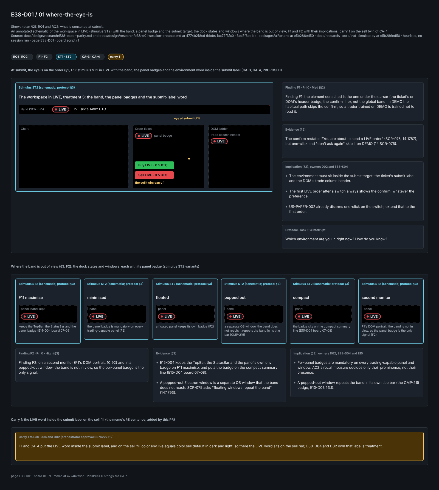
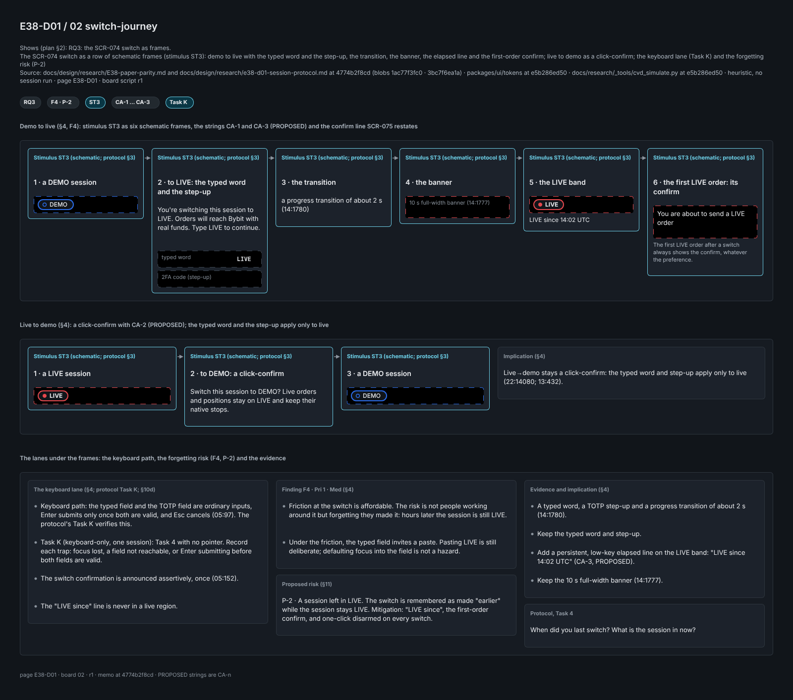
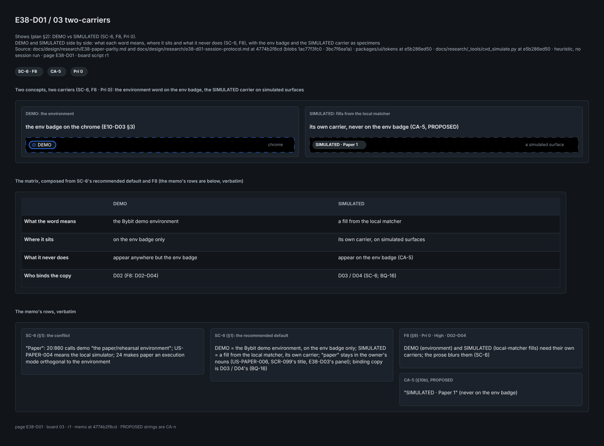
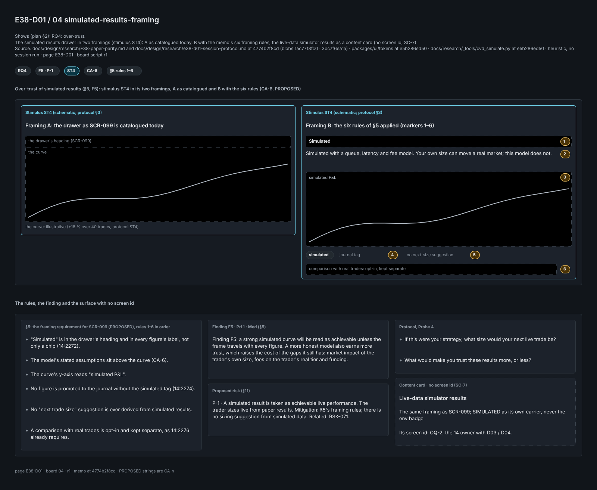
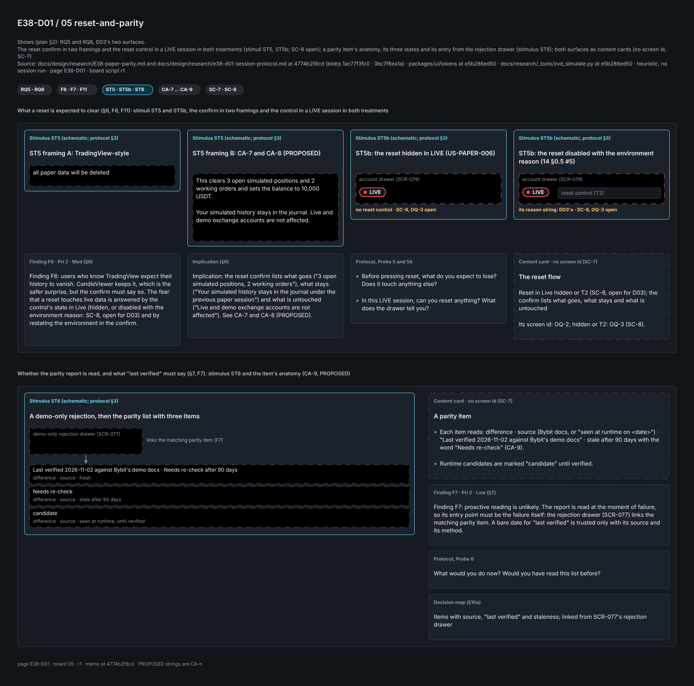
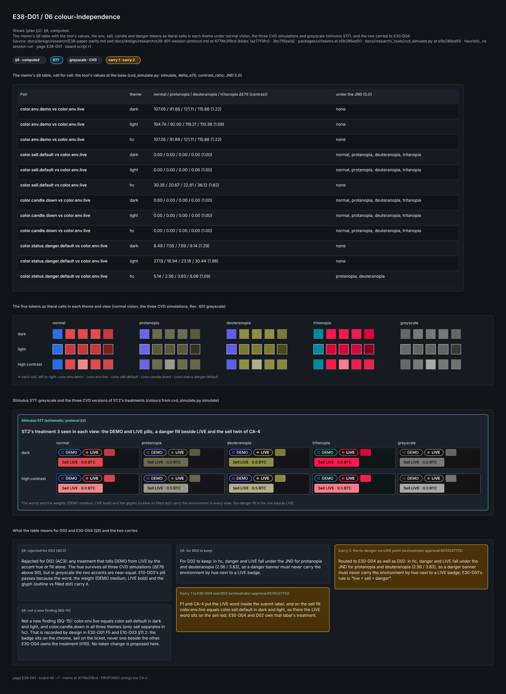
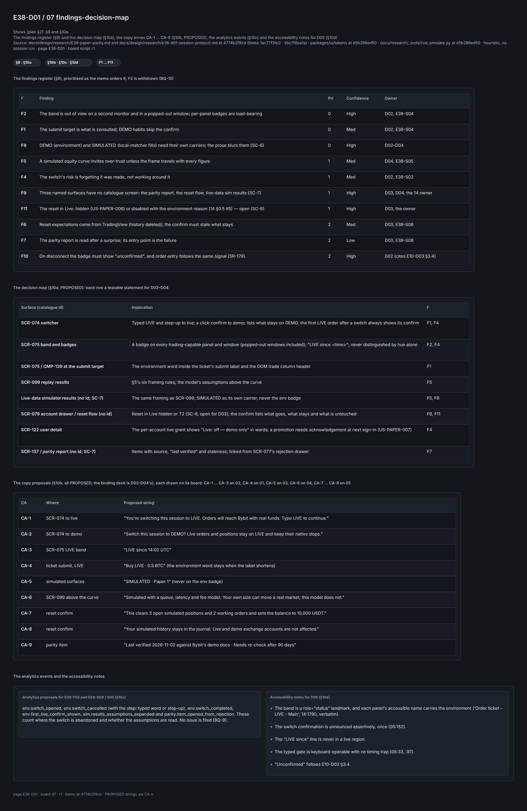
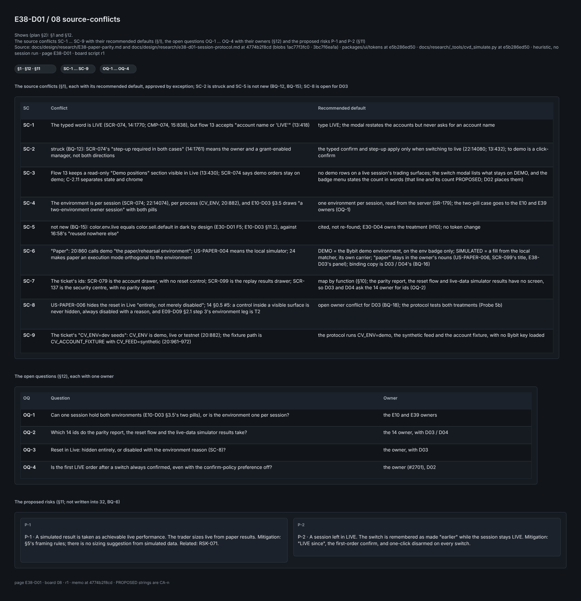

# E38-D01 — UX research: how traders tell demo from live and trust simulated fills

- **Ticket:** E38-D01 (issue #1002) · **Status:** text first (the memo PR, `Partial:`), then the boards PR, which completes #1002, as E33-D01
  and E35-D01 did (#4046 / #4295, #4070 / #4289): the Penpot research boards are drawn on page `E38-D01` (page id
  `b96edf38-8e58-8006-8008-e246a81cb753`) and exported in that PR (Research boards, below). The BQ rulings are of record (issue comment 6572970059). **Owner approval pending** (C-10.1). ·
  **Method:** heuristic evaluation and persona walkthrough of the locked plan texts, the
  merged E10, E15, E26 and E30 designs and the token JSON (Method note). **No session was run. No participant, quote,
  timing, recall rate or sizing answer exists, and none is invented.** Live-exchange access and real user data are not
  available: the memo works from the personas, the stories and the demo stack. · **Protocol and owner walkthrough
  checklist:** [`e38-d01-session-protocol.md`](e38-d01-session-protocol.md) (this folder).
- **Scope (#1002 §Context):** the environment switch SCR-074 and the permanent demo/live indication SCR-075, which
  E38-D02 designs; the simulated-results surfaces, the parity report and the paper-balance reset, which D03 and D04
  design; US-PAPER-001..008 (`11`:3936–4086); P1 Owner and P2 Account Manager (`10` §2–§3). **Out of scope
  (ticket):** visual design (D02–D04), order-ticket, DOM and rule-editor research (E30, E31, E36, E37), and
  quantitative testing.
- **Deviations to record in the PR:**
  1. **Branch.** `design/e38-d01-research` (the coordinator's), not the ticket's `design/e38-paper-research` or the
     brief's `feat/e38-paper-trading-d01`.
  2. **Brief items that do not apply.** The brief's repo paths (`apps/web/…`) and its "Done means" tests do not apply
     to a research ticket.
  3. **Risk enum.** "R9 Advice boundary" is the schema enum. `32` §1.2 names R9 "Schedule & capacity". The nearest
     registered risks are RSK-014 (demo/live divergence) and RSK-071 (simulated replay fills feeding a real account).
  4. **Study data.** The ticket's "`CV_ENV=dev` seeds" becomes `CV_ENV=demo` with the synthetic feed and the account
     fixture (`20`:882, :961–972), as SC-9 explains.
  5. **Sign-offs and the DoD.** The heuristic evaluation, the protocol and the walkthrough checklist are the owner's
     substitute for the sessions and satisfy the DoD; D01 closes with the boards PR, not after an owner run (BQ-04,
     RULED (orchestrator, issue comment 6572970059, 2026-11-02)). The CDO and Architect sign-offs become the owner's approval.
  6. **Risk rows.** The proposed risks (§11) stay in this memo: `32` is single-writer and E38-X01 owns the rows
     (BQ-06).
  7. **Blockers.** E30-X01 (#920), E30-K01 (#852) and E29-K01 (#843) were still open; work proceeded under an
     **orchestrator waiver**, not owner approval (BQ-03, RULED (orchestrator, issue comment 6572970059, 2026-11-02)).
  8. **Report path.** The AC1 path `E38-paper-parity.md` is used literally, unlike the folder's lowercase `eNN-`
     files (`e33-…`, `e35-…`); the protocol keeps the lowercase form (BQ-02).
- **In plain words.** The plan already makes DEMO/LIVE a word, a weight and a glyph, not a colour (E10-D03 §3). The
  research risk is elsewhere:
  - **What traders look at.** They read the ticket and the confirm restatement, not the band (§2, §3).
  - **Two concepts, two carriers.** DEMO is the environment (Bybit demo); SIMULATED marks fills from the local
    matcher. The plan's prose blurs them (SC-6).
  - **Simulated results.** These invite over-trust unless every figure is framed and the fill model is stated (§5).
  - **Missing surfaces.** Three of the six surfaces the ticket names have no catalogue screen yet (SC-7).
  - **Already known, not new:** LIVE's red equals the sell red in dark by design (E30-D01 F5; E10-D03 §11.2); E30-D04
    owns its treatment (§8).

  Act first on the Pri 0 rows of §9. Every conflict has a **Recommended default**, approved **by exception**.

- **Ids.** **RQ1–RQ6** the ticket's research questions · **F** finding · **SC** source conflict · **CA** copy proposal
  (PROPOSED) · **OQ** open question · **P** proposed risk · **H1–H10** Nielsen · plan documents by number
  (`docs/plan/NN-*`) · `NN`:line at the base.

## Locked, not relitigated

1. **C-2.11.** Demo and live are separate credential sets, base URLs, state and UI chrome. A demo-scoped session
   never reaches a live endpoint. Switching to live needs an explicit typed confirmation, and no hotkey may switch the
   environment. Demo has no WS order entry.
2. **Server-side enforcement** (C-2.12): a cross-environment request is refused with 403 and audited high-severity
   (US-PAPER-003). CMP-139's guard is defence in depth, not the control (`15`:1704).
3. **Never colour-only** (`14`:81; `05`:107, :116): the band and every trading panel carry the text DEMO or LIVE.
4. **SR-179** (`04`:1009): the badge reads the WS `system` topic, and on disconnect it shows "unconfirmed" rather
   than the last-known environment (E10-D03 §3.4).
5. **Paper P&L uses the live code path and never aggregates into live statistics** (US-PAPER-005). Paper and replay
   are an `ExecutionMode`, not an `Environment` (`24`:87–94).
6. **Live is unreachable until R4** (`30`:423). Everything up to R3 runs on Bybit demo.
7. **Testnet is out of the E38 UI** (`20`:860, owner decision 8): connectivity smoke tests only, so no E38 surface
   draws a TESTNET state.

## Acceptance-criteria trace (issue #1002)

Status key as in E35-D01: **done** = delivered as worded; **heuristic-only** = delivered by the adaptation (the
owner's substitute, BQ-04); **open** = an owner run still to come, recorded but not a gate.

| Ticket AC or deliverable                                                              | Where                                   | Status                                                       |
| ------------------------------------------------------------------------------------- | --------------------------------------- | ------------------------------------------------------------ |
| AC1: a report at `docs/design/research/E38-paper-parity.md` answering RQ1–RQ6         | this file, §2–§7                        | heuristic-only (predicted answers with their basis)          |
| AC2: recall at 3 unprompted moments per session, per chrome treatment; badge decision | §2–§3; protocol §4 (the interrupts), §5 | recommendation heuristic-only; the recall rate is open       |
| AC3: greyscale and three CVD simulations; ambiguous treatments rejected               | §8 (computed at the base)               | done for the tokens; the drawn treatments are D02's to check |
| AC4: over-trust of a strong simulated equity curve, converted into SCR-099 framing    | §5; protocol Probe 4                    | framing requirement done (PROPOSED); the evidence is open    |
| Implications mapped to SCR-074/075/079/099/122/137                                    | §10                                     | done (three surfaces have no catalogue id, SC-7)             |
| Risks raised into `32`                                                                | §11                                     | proposed, not written (BQ-6)                                 |
| A keyboard-only switch flow                                                           | §4; protocol Task K                     | heuristic-only; open                                         |
| DoD: the artefact (Figma → Penpot): the research board                                | Research boards (Penpot)                | done: page `E38-D01`, 8 boards, below                        |
| DoD: every state drawn; the screen's sign-off checklist                               | —                                       | N/A for research (D02–D04 own them)                          |
| DoD: sign-off by the CDO and the Architect                                            | the owner's approval of the PR (C-10.1) | pending                                                      |

## Research boards (Penpot)

Page `E38-D01` (page id `b96edf38-8e58-8006-8008-e246a81cb753`) in the per-set file `E38-D01 boards`, named by page name and id only. Eight boards, 1600 px wide, drawn on 2026-11-02 by one board script (r1, sha256 `634794b1fb4d52638926b253f69be95a3444e47b6abe7d0c9d85d1b9857d50e3`) in eight calls, bound to nothing: every fill is a token value from `packages/ui/tokens` at the base, with the token name in its plugin data. Each board's footer cites this memo; nothing on a board states a finding, string or number this memo does not. As built: relayout converged (0 moved, 0 overruns, 0 collisions), dedupe kept 8, and a value check of 1 406 fills and strokes found 0 off (dark tokens; board 06's computed CVD values). Board 03 reports one warning: an empty table cell draws no text, as Penpot creates no text for an empty string.

- **Board 01 `where-the-eye-is`:** RQ1 and RQ2: what is consulted at submit. The shell in LIVE with the band, a panel badge and the submit target, F1's eye-path, the five dock-state insets and a second-monitor DOM (F2), CA-4 on the buy twin and carry (1) on the sell twin (§2, §3; ST1, ST2). `docs/design/E38/img/E38-D01-01-where-the-eye-is.png` (1600 × 1782, sha256 `b863a64f5ac22011595d20c50689f168176f1d93a4a11e2af189b0bd8d3acf78`).
  
- **Board 02 `switch-journey`:** RQ3: the SCR-074 switch as frames, DEMO → LIVE (typed `LIVE`, the step-up, the banner, CA-1 and CA-3, the first LIVE order confirmed) and LIVE → DEMO (CA-2), with the keyboard lane and where F4's risk sits (§4; ST3). `docs/design/E38/img/E38-D01-02-switch-journey.png` (1600 × 1413, sha256 `7546b295b49d24e0b63e70fa57e4b25d3a075f1994f24c2eb9fb7c28763e9741`).
  
- **Board 03 `two-carriers`:** DEMO vs SIMULATED (SC-6, F8): what each word means, where it sits and what it never does, with CA-5. `docs/design/E38/img/E38-D01-03-two-carriers.png` (1600 × 1182, sha256 `9eef513f53552853b11a52ff290b4ec7ea6ca278f212f656504fab481ffde02e`).
  
- **Board 04 `simulated-results-framing`:** RQ4: SCR-099 in two framings, as catalogued and with §5's six rules applied (CA-6), the curve marked illustrative; the live-data simulator results as a labelled card with no screen id (§5; ST4). `docs/design/E38/img/E38-D01-04-simulated-results-framing.png` (1600 × 1312, sha256 `908980d4ad9af08bc6550a1f9c422d6c3834ac6ed645dceb88a77a47082deb81`).
  
- **Board 05 `reset-and-parity`:** RQ5 and RQ6: the reset confirm in two framings (CA-7, CA-8), the account drawer's two treatments (SC-8, open), and the parity item's anatomy with its three states and its entry from SCR-077 (CA-9), drawn as content cards (§6, §7; ST5, ST5b, ST6). `docs/design/E38/img/E38-D01-05-reset-and-parity.png` (1600 × 1581, sha256 `01ef542e2a3ab2d86488f32e84493726cf658de77594a47ba571b2ce2dc745b5`).
  
- **Board 06 `colour-independence`:** §8's twelve rows as swatch pairs with ΔE76 and contrast, the treatments in greyscale and three CVD simulations, and the three callouts: LIVE = sell = candle.down by design, carry (1) and carry (2) (ST7). `docs/design/E38/img/E38-D01-06-colour-independence.png` (1600 × 2192, sha256 `15048fce3062efe92db9dbbbcdd891f11155e15a9452de4198a0af39ffbc6a3f`).
  
- **Board 07 `findings-decision-map`:** §9 and §10a: the findings F1–F11 by priority joined to the decision map, the copy annex CA-1–CA-9, the analytics events and the notes for D05. `docs/design/E38/img/E38-D01-07-findings-decision-map.png` (1600 × 2458, sha256 `3e3808fbfd8a6700acf92c5a2f6e1cace7f0d31b9a2c342c3e394b973f7d949e`).
  
- **Board 08 `source-conflicts`:** §1 and §12: SC-1 … SC-9 with their defaults, OQ-1 … OQ-4 with their owners, and the proposed risks P-1 and P-2. `docs/design/E38/img/E38-D01-08-source-conflicts.png` (1600 × 1656, sha256 `b1ea7202c09cf639ad5ce5d2a1220d722d341597a0665301bbd46a1088384a5f`).
  

## Method note (agent-delivery adaptation, owner decision 2026-09-25)

The three moderated sessions become (1) a heuristic evaluation of the plan texts and merged designs, (2) a written
session protocol and (3) an owner walkthrough checklist. Every repository claim was read at `origin/main`
`e5b286ed50`.

- **Heuristics.** Nielsen's ten (H1 status, H2 real-world match, H3 control, H4 consistency, H5 error prevention,
  H6 recognition, H7 efficiency, H8 minimalism, H9 recovery, H10 help) and `05` §3–§6.
- **Confidence.** **High** = stated in a locked plan text or computed from the tokens; **Med** = sound reasoning
  from a contract; **Low** = persona inference only.
- **Competitor facts.** These come only from the repository's research (`docs/research/02` §4, `06` §2, `09` §9,
  `ux/replay-study-sessions.md`), with no web access. Every finding below is `(heuristic)`.

## 1. Source conflicts (owner decisions) `(heuristic, High — plan text)`

| SC   | Conflict                                                                                                                                                                                                               | Recommended default                                                                                                                                                                                                                            |
| ---- | ---------------------------------------------------------------------------------------------------------------------------------------------------------------------------------------------------------------------- | ---------------------------------------------------------------------------------------------------------------------------------------------------------------------------------------------------------------------------------------------- |
| SC-1 | The typed word is `LIVE` (SCR-074, `14`:1770; CMP-074, `15`:838), but flow 13 accepts "account name or 'LIVE'" (`13`:418)                                                                                              | type `LIVE`; the modal restates the accounts but never asks for an account name                                                                                                                                                                |
| SC-2 | struck (BQ-12): SCR-074's "step-up required in both cases" (`14`:1761) means the owner and a grant-enabled manager, not both directions                                                                                | the typed confirm and step-up apply only when switching to live (`22`:14080; `13`:432); to demo is a click-confirm                                                                                                                             |
| SC-3 | Flow 13 keeps a read-only "Demo positions" section visible in Live (`13`:430); SCR-074 says demo orders stay on demo; C-2.11 separates state and chrome                                                                | no demo rows on a live session's trading surfaces; the switch modal lists what stays on DEMO, and the badge menu states the count in words (that line and its count PROPOSED; D02 places them)                                                 |
| SC-4 | The environment is per session (SCR-074; `22`:14074), per process (`CV_ENV`, `20`:882), and E10-D03 §3.5 draws "a two-environment owner session" with both pills                                                       | one environment per session, read from the server (SR-179); the two-pill case goes to the E10 and E39 owners (OQ-1)                                                                                                                            |
| SC-5 | not new (BQ-15): `color.env.live` equals `color.sell.default` in dark by design (E30-D01 F5; E10-D03 §11.2), against `16`:58's "reused nowhere else" (the `16` owner, the design-system lane)                          | cited, not re-found; E30-D04 owns the treatment (E10-D03 hand-off H10); no token change                                                                                                                                                        |
| SC-6 | "Paper": `20`:860 calls demo "the paper/rehearsal environment"; US-PAPER-004 means the local simulator; `24` makes paper an execution mode orthogonal to the environment                                               | DEMO = the Bybit demo environment, on the env badge only; SIMULATED = a fill from the local matcher, its own carrier; "paper" stays in the owner's nouns (US-PAPER-006, SCR-099's title, E38-D03's panel); binding copy is D03 / D04's (BQ-16) |
| SC-7 | The ticket's ids: SCR-079 is the account drawer, with no reset control; SCR-099 is the replay results drawer; SCR-137 is the security centre, with no parity report                                                    | map by function (§10); the parity report, the reset flow and live-data simulator results have no screen, so D03 and D04 ask the `14` owner for ids (OQ-2)                                                                                      |
| SC-8 | US-PAPER-006 hides the reset in Live "entirely, not merely disabled"; `14` §0.5 #5: a control inside a visible surface is never hidden, always disabled with a reason, and E09-D09 §2.1 step 3's environment leg is T2 | **open owner conflict for D03** (BQ-18); the protocol tests both treatments (Probe 5b)                                                                                                                                                         |
| SC-9 | The ticket's "`CV_ENV=dev` seeds": `CV_ENV` is `demo`, `live` or `testnet` (`20`:882); the fixture path is `CV_ACCOUNT_FIXTURE` with `CV_FEED=synthetic` (`20`:961–972)                                                | the protocol runs `CV_ENV=demo`, the synthetic feed and the account fixture, with no Bybit key loaded                                                                                                                                          |

## 2. RQ1 — what a trader consults before submit `(heuristic)`

- **Method:** a walkthrough of P1 scenario 2 (`10`:98) and P2 scenario 2 (`10`:135) through the ticket, the DOM
  click and the confirm.
- **Evidence:**
  - At the moment of submit the eyes are on the order: price, size, the bracket, the limits chip. P1 trades from
    hotkeys and the DOM, with "hotkeys memorised" (`10`:92).
  - The band sits at the screen's top edge, far from a DOM on a portrait monitor.
  - The confirm restates "You are about to send a **LIVE** order" (SCR-075, `14`:1787), but one-click and "don't
    ask again" skip it on DEMO (`14` SCR-076).
- **Finding F1:** the element consulted is the one under the cursor (the ticket's or DOM's header badge, the confirm
  line), not the global band. In DEMO the habitual path skips the confirm, so a trader trained on DEMO is trained
  not to read it.
- **Confidence:** Med.
- **Implication:**
  - The environment must sit inside the submit target: the ticket's submit label and the DOM's trade column header (on the sell fill, §8 hands the label's treatment to E30-D04 and D02).
  - The first LIVE order after a switch always shows the confirm, whatever the preference.
  - US-PAPER-002 already disarms one-click on the switch; extend that to the first order.
- **Owners:** D02, E38-S04.

## 3. RQ2 — is the global band enough, or is the per-panel badge load-bearing? `(heuristic)`

- **Method:** a walkthrough of the dock states: maximised, minimised, floated, popped out and compact.
- **Evidence:**
  - E15-D04 keeps the TopBar, the StatusBar and the panel's own env badge on `F11` maximise, and puts the badge on
    the compact summary line (E15-D04 board 07–08).
  - A popped-out Electron window is a separate OS window that the band does not reach. SCR-075 asks "floating
    windows repeat the band" (`14`:1793).
  - CMP-075's role, `img` with a static label, keeps it out of re-announcement (`15`:847).
- **Finding F2:** on a second monitor (P1's DOM portrait, `10`:92) and in a popped-out window, the band is not in
  view, so the per-panel badge is the only signal.
- **Confidence:** High for the geometry, Med for the behaviour.
- **Implication:**
  - Per-panel badges are **mandatory** on every trading-capable panel and window. AC2's recall measure decides only
    their prominence, not their presence.
  - A popped-out window repeats the band in its own title bar (the CMP-215 badge, E10-D03 §3.1).
- **Owners:** D02, E38-S04, E15.

## 4. RQ3 — how much friction the demo→live switch can carry `(heuristic)`

- **Method:** H5 and H7 trade-off over the SCR-074 flow (`14`:1759–1783), with the keyboard path per `05` §3.1
  item 4.
- **Evidence:**
  - A typed word, a TOTP step-up and a progress transition of about 2 s (`14`:1780).
  - The switch is rare: it happens per session, not per order. P2 meets it on their first live session (`10`:135).
  - The friction lands once per session, and nothing repeats it per order.
- **Finding F4:**
  - Friction at the switch is affordable. The risk is not people working around it but **forgetting they made
    it**: hours later the session is still LIVE.
  - Under the friction, the typed field invites a paste. Pasting `LIVE` is still deliberate; defaulting focus into
    the field is not a hazard.
- **Confidence:** Med.
- **Implication:**
  - Keep the typed word and step-up.
  - Add a persistent, low-key elapsed line on the LIVE band: "LIVE since 14:02 UTC" (CA-3, PROPOSED).
  - Keep the 10 s full-width banner (`14`:1777).
  - Live→demo stays a click-confirm: the typed word and step-up apply only to live (`22`:14080; `13`:432).
  - Keyboard path: the typed field and the TOTP field are ordinary inputs, `Enter` submits only once both are valid,
    and `Esc` cancels (`05`:97). The protocol's Task K verifies this.
- **Owners:** D02, E38-S02.

## 5. RQ4 — over-trust of simulated results `(heuristic)`

- **Method:** comparison with what the repository's research records about simulators. TradingView's paper fills are
  idealised, with no slippage or liquidity model (`docs/research/02` §4). ATAS fills "immediately in full" and Sierra
  Chart uses unit sizes (`ux/replay-study-sessions.md` F25). CandleViewer's matcher models queue position, latency and
  partial fills (`24` §12; `09` §9).
- **Evidence:**
  - An equity curve is the most persuasive object on SCR-099, and it is the one figure with no per-trade caveat.
  - P1's goal G5 ("learn", `10`:80) makes the curve a decision input.
- **Finding F5:** a strong simulated curve will be read as achievable unless the frame travels with every figure. A
  more honest model also earns more trust, which raises the cost of the gaps it still has: market impact of the
  trader's own size, fees on the trader's real tier and funding.
- **Confidence:** Med.
- **Implication (framing requirement for SCR-099, PROPOSED):**
  1. "Simulated" is in the drawer's heading and in every figure's label, not only a chip (`14`:2272).
  2. The model's stated assumptions sit above the curve (CA-6).
  3. The curve's y-axis reads "simulated P&L".
  4. No figure is promoted to the journal without the `simulated` tag (`14`:2274).
  5. No "next trade size" suggestion is ever derived from simulated results.
  6. A comparison with real trades is opt-in and kept separate, as `14`:2276 already requires.

  The protocol's Probe 4 tests the sizing question of AC4.

- **Owners:** D04, E38-S05.

## 6. RQ5 — what "reset paper balance" is expected to destroy `(heuristic)`

- **Method:** comparison with TradingView, where a reset deletes all open positions, working orders and the paper
  history and is irreversible (`docs/research/02` §4). Compared with US-PAPER-006, where positions and orders are
  cleared, the reset is journaled and the history is kept under a new paper session id.
- **Finding F6:** users who know TradingView expect their history to vanish. CandleViewer keeps it, which is the
  safer surprise, but the confirm must say so. The fear that a reset touches live data is answered by the control's
  state in Live (hidden, or disabled with the environment reason: SC-8, open for D03) and by restating the
  environment in the confirm.
- **Confidence:** Med.
- **Implication:** the reset confirm lists what goes ("3 open simulated positions, 2 working orders"), what stays
  ("Your simulated history stays in the journal under the previous paper session") and what is untouched ("Live and
  demo exchange accounts are not affected"). See CA-7 and CA-8 (PROPOSED).
- **Owners:** D03, E38-S06.

## 7. RQ6 — whether the parity report is read, and what "last verified" must say `(heuristic)`

- **Method:** H1 and H10 over US-PAPER-008 and RSK-014's mitigation (`32`:238).
- **Evidence:** the report is reference material, read after a surprise, for example a demo-only failure
  (US-PAPER-008 "Runtime detection"; RR-06, `04`:1940, the demo / live parity gaps it records).
- **Finding F7:** proactive reading is unlikely. The report is read at the moment of failure, so its entry point must
  be the failure itself: the rejection drawer (SCR-077) links the matching parity item. A bare date for "last
  verified" is trusted only with its source and its method.
- **Confidence:** Low, a persona inference.
- **Implication:**
  - Each item reads: difference · source (Bybit docs, or "seen at runtime on <date>") · "Last verified 2026-11-02
    against Bybit's demo docs" · stale after 90 days with the word "Needs re-check" (CA-9).
  - Runtime candidates are marked "candidate" until verified.
- **Owners:** D03, E38-S08, E38-K01 (the data).

## 8. Colour independence, pre-tested at the base `(computed; High)`

The repository's own tool computed the table below, as E10-D03 §11.2 does: `docs/research/_tools/cvd_simulate.py`
(`simulate`, `delta_e76`, contrast; JND floor 5.0; reported, never gated), over the token JSON at the base
(hc = dark + the hc overrides; light = dark + the light overrides). It
reproduces E10-D03 §11.2's DEMO / LIVE and sell / LIVE rows to the hundredth. Greyscale is E10-D03 §3.3's: the two
borders sit 3 luma steps apart in dark and hc and 17 in light, while the word stands more than 200 steps from its
fill.

| Pair                                              | theme | normal / protanopia / deuteranopia / tritanopia ΔE76 (contrast) | under the JND (5.0)                          |
| ------------------------------------------------- | ----- | --------------------------------------------------------------- | -------------------------------------------- |
| `color.env.demo` vs `color.env.live`              | dark  | 107.05 / 91.86 / 121.11 / 115.66 (1.22)                         | none                                         |
| `color.env.demo` vs `color.env.live`              | light | 104.74 / 92.00 / 119.21 / 110.38 (1.09)                         | none                                         |
| `color.env.demo` vs `color.env.live`              | hc    | 107.05 / 91.86 / 121.11 / 115.66 (1.22)                         | none                                         |
| `color.sell.default` vs `color.env.live`          | dark  | 0.00 / 0.00 / 0.00 / 0.00 (1.00)                                | normal, protanopia, deuteranopia, tritanopia |
| `color.sell.default` vs `color.env.live`          | light | 0.00 / 0.00 / 0.00 / 0.00 (1.00)                                | normal, protanopia, deuteranopia, tritanopia |
| `color.sell.default` vs `color.env.live`          | hc    | 30.35 / 20.67 / 22.81 / 36.12 (1.62)                            | none                                         |
| `color.candle.down` vs `color.env.live`           | dark  | 0.00 / 0.00 / 0.00 / 0.00 (1.00)                                | normal, protanopia, deuteranopia, tritanopia |
| `color.candle.down` vs `color.env.live`           | light | 0.00 / 0.00 / 0.00 / 0.00 (1.00)                                | normal, protanopia, deuteranopia, tritanopia |
| `color.candle.down` vs `color.env.live`           | hc    | 0.00 / 0.00 / 0.00 / 0.00 (1.00)                                | normal, protanopia, deuteranopia, tritanopia |
| `color.status.danger.default` vs `color.env.live` | dark  | 8.49 / 7.05 / 7.69 / 9.14 (1.29)                                | none                                         |
| `color.status.danger.default` vs `color.env.live` | light | 27.13 / 16.94 / 23.18 / 30.44 (1.98)                            | none                                         |
| `color.status.danger.default` vs `color.env.live` | hc    | 5.14 / 2.56 / 3.83 / 6.06 (1.09)                                | protanopia, deuteranopia                     |

- **Rejected for D02 (AC3):** any treatment that tells DEMO from LIVE by the accent hue or fill alone. The hue
  survives all three CVD simulations (ΔE76 above 90), but in greyscale the two accents are near-equal. E10-D03's pill
  passes because the word, the weight (DEMO medium, LIVE bold) and the glyph (outline vs filled dot) carry it.
- **Not a new finding (BQ-15):** `color.env.live` equals `color.sell.default` in dark and light, and
  `color.candle.down` in all three themes (only sell separates in hc). That is recorded by design in E30-D01 F5 and E10-D03 §11.2: the badge sits on the chrome, sell on the ticket,
  never one beside the other. F1 and CA-4 put the LIVE word inside the submit label, and on the sell fill `color.env.live` equals `color.sell.default` in dark and light, so there the LIVE word sits on the sell red; E30-D04 and D02 own that label's treatment. E30-D04 owns the treatment (E10-D03 hand-off H10). No token change is proposed here.
- **For D02 and E30-D04 (E30-D01 :275, "live ≠ sell ≠ danger"):** in hc, danger and LIVE fall under the JND for protanopia and deuteranopia (2.56 / 3.83), so a
  danger banner must never carry the environment by hue next to a LIVE badge.

## 9. Findings register (all `(heuristic)`), prioritised

F3 is withdrawn (BQ-15: LIVE = sell red is cited, not found, §8); the other ids keep their numbers because the PR text
cites them.

| F   | Finding                                                                                                        | Pri | Confidence | Owner                    |
| --- | -------------------------------------------------------------------------------------------------------------- | --- | ---------- | ------------------------ |
| F2  | The band is out of view on a second monitor and in a popped-out window; per-panel badges are load-bearing      | 0   | High       | D02, E38-S04             |
| F1  | The submit target is what is consulted; DEMO habits skip the confirm                                           | 0   | Med        | D02, E38-S04             |
| F8  | DEMO (environment) and SIMULATED (local-matcher fills) need their own carriers; the prose blurs them (SC-6)    | 0   | High       | D02–D04                  |
| F5  | A simulated equity curve invites over-trust unless the frame travels with every figure                         | 1   | Med        | D04, E38-S05             |
| F4  | The switch's risk is forgetting it was made, not working around it                                             | 1   | Med        | D02, E38-S02             |
| F9  | Three named surfaces have no catalogue screen: the parity report, the reset flow, live-data sim results (SC-7) | 1   | High       | D03, D04, the `14` owner |
| F11 | The reset in Live: hidden (US-PAPER-006) or disabled with the environment reason (`14` §0.5 #5) — open (SC-8)  | 1   | High       | D03, the owner           |
| F6  | Reset expectations come from TradingView (history deleted); the confirm must state what stays                  | 2   | Med        | D03, E38-S06             |
| F7  | The parity report is read after a surprise; its entry point is the failure                                     | 2   | Low        | D03, E38-S08             |
| F10 | On disconnect the badge must show "unconfirmed", and order entry follows the same signal (SR-179)              | 2   | High       | D02 (cites E10-D03 §3.4) |

## 10. Implications by surface

### 10a. Decision map (PROPOSED; each is a testable statement for D02–D04)

| Surface (catalogue id)                      | Implication                                                                                                                                       | F       |
| ------------------------------------------- | ------------------------------------------------------------------------------------------------------------------------------------------------- | ------- |
| SCR-074 switcher                            | Typed `LIVE` and step-up to live; a click-confirm to demo; lists what stays on DEMO; the first LIVE order after a switch always shows its confirm | F1, F4  |
| SCR-075 band and badges                     | A badge on every trading-capable panel and window (popped-out windows included); "LIVE since <time>"; never distinguished by hue alone            | F2, F4  |
| SCR-075 / CMP-139 at the submit target      | The environment word inside the ticket's submit label and the DOM trade column header                                                             | F1      |
| SCR-099 replay results                      | §5's six framing rules; the model's assumptions above the curve                                                                                   | F5      |
| Live-data simulator results (no id; SC-7)   | The same framing as SCR-099; SIMULATED as its own carrier, never the env badge                                                                    | F5, F8  |
| SCR-079 account drawer / reset flow (no id) | Reset in Live hidden or T2 (SC-8, open for D03); the confirm lists what goes, what stays and what is untouched                                    | F6, F11 |
| SCR-122 user detail                         | The per-account live grant shows "Live: off — demo only" in words; a promotion needs acknowledgement at next sign-in (US-PAPER-007)               | F4      |
| SCR-137 / parity report (no id; SC-7)       | Items with source, "last verified" and staleness; linked from SCR-077's rejection drawer                                                          | F7      |

### 10b. Copy proposals (all PROPOSED; the binding deck is D02–D04's)

| CA   | Where                   | Proposed string                                                                                             |
| ---- | ----------------------- | ----------------------------------------------------------------------------------------------------------- |
| CA-1 | SCR-074 to live         | "You're switching this session to LIVE. Orders will reach Bybit with real funds. Type LIVE to continue."    |
| CA-2 | SCR-074 to demo         | "Switch this session to DEMO? Live orders and positions stay on LIVE and keep their native stops."          |
| CA-3 | SCR-075 LIVE band       | "LIVE since 14:02 UTC"                                                                                      |
| CA-4 | ticket submit, LIVE     | "Buy LIVE · 0.5 BTC" (the environment word stays when the label shortens; the sell twin's treatment: §8)    |
| CA-5 | simulated surfaces      | "SIMULATED · Paper 1" (never on the env badge)                                                              |
| CA-6 | SCR-099 above the curve | "Simulated with a queue, latency and fee model. Your own size can move a real market; this model does not." |
| CA-7 | reset confirm           | "This clears 3 open simulated positions and 2 working orders and sets the balance to 10,000 USDT."          |
| CA-8 | reset confirm           | "Your simulated history stays in the journal. Live and demo exchange accounts are not affected."            |
| CA-9 | parity item             | "Last verified 2026-11-02 against Bybit's demo docs · Needs re-check after 90 days"                         |

### 10c. Analytics proposals for E38-T02 and E38-S04/S05 (client UI events only; no account ids, keys or balances)

`env.switch_opened`, `env.switch_cancelled` (with the step: typed word or step-up), `env.switch_completed`,
`env.first_live_confirm_shown`, `sim.results_assumptions_expanded` and `parity.item_opened_from_rejection`. These
count where the switch is abandoned and whether the assumptions are read. No issue is filed (BQ-9).

### 10d. Accessibility notes for D05

- The band is a `role="status"` landmark, and each panel's accessible name carries the environment ('Order ticket - LIVE - Main',
  `14`:1790, verbatim).
- The switch confirmation is announced assertively, once (`05`:152).
- The "LIVE since" line is never in a live region.
- The typed gate is keyboard-operable with no timing trap (`05`:33, :97).
- "Unconfirmed" follows E10-D03 §3.4.

## 11. Proposed risks (not yet written into `32`; BQ-6)

- **P-1 · A simulated result is taken as achievable live performance.** The trader sizes live from paper results.
  **Mitigation:** §5's framing rules; there is no sizing suggestion from simulated data. Related: RSK-071.
- **P-2 · A session left in LIVE.** The switch is remembered as made "earlier" while the session stays LIVE.
  **Mitigation:** "LIVE since", the first-order confirm, and one-click disarmed on every switch.

## 12. Open questions (each with one owner)

| OQ   | Question                                                                                                  | Owner                          |
| ---- | --------------------------------------------------------------------------------------------------------- | ------------------------------ |
| OQ-1 | Can one session hold both environments (E10-D03 §3.5's two pills), or is the environment one per session? | the E10 and E39 owners         |
| OQ-2 | Which `14` ids do the parity report, the reset flow and the live-data simulator results take?             | the `14` owner, with D03 / D04 |
| OQ-3 | Reset in Live: hidden entirely, or disabled with the environment reason (SC-8)?                           | the owner, with D03            |
| OQ-4 | Is the first LIVE order after a switch always confirmed, even with the confirm-policy preference off?     | the owner (#2701), D02         |

## 13. References

`CONSTITUTION.md` C-2.11, C-2.12 · `04`:1009 (SR-179), :1940 (RR-06) · `05` §3–§6 · `10` §2–§3, §7 ·
`11` §21 · `13` §13 · `14` §0.5, SCR-074, SCR-075, SCR-076, SCR-077, SCR-079, SCR-099, SCR-122, SCR-137 · `15` CMP-074,
CMP-075, CMP-139 · `16`:58 · `20` §7.1–§7.2 · E30-D01 F5 (`e30-order-entry-under-time-pressure.md`) · E10-D03 §11.2 · `docs/research/_tools/cvd_simulate.py` · `22` `setSessionEnvironment` · `24` §1.2, §12 · `30` R3/R4 · `32` RSK-014,
RSK-071 · E10-D03 §3 · E15-D04 boards 07–08 · `docs/research/02-tradingview-trading.md`
§4, `06-bybit-api.md` §2, `09-execution-risk-tools.md` §9, `ux/replay-study-sessions.md` F25 · packages/ui/tokens at
the base.
