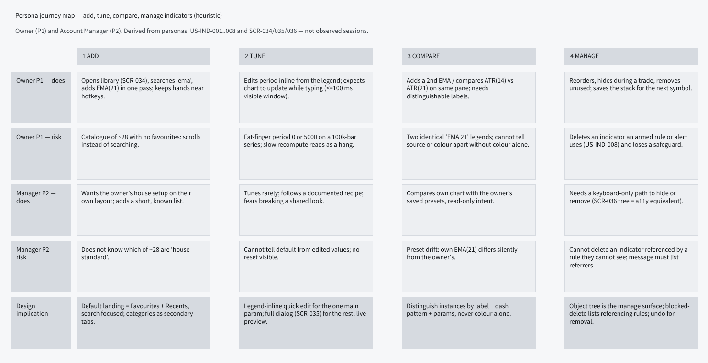
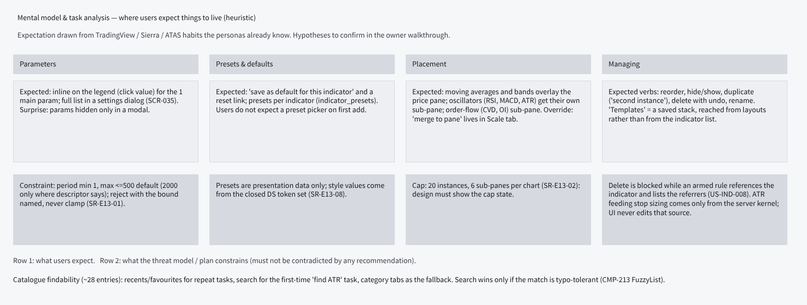
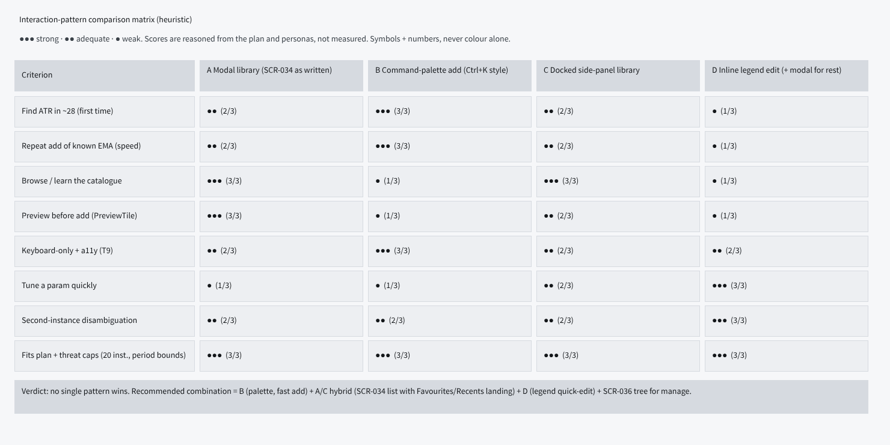
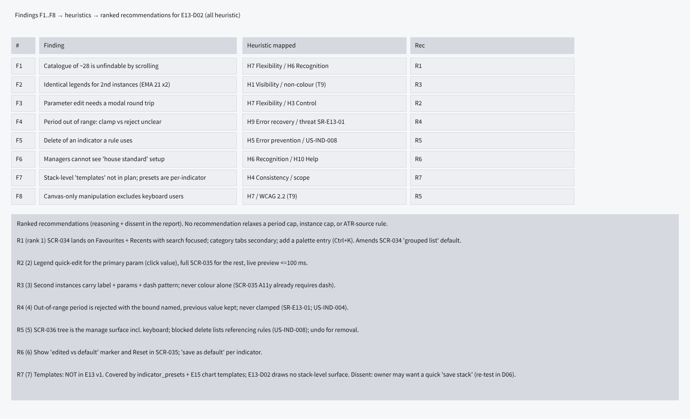

# E13-D01 — UX research: how traders add, tune and manage indicators

- **Ticket:** E13-D01 (issue #203) · **Status:** Draft, every recommendation pending confirmation ·
  **Method:** heuristic evaluation + persona walkthrough + competitive review (see "Method note"; no live
  participant sessions were run)
- **Scope:** SCR-034 indicator library, SCR-035 indicator settings, SCR-036 object tree. Feeds E13-D02 wireframes.
- **Out of scope (unchanged):** drawing tools (E14), layouts/workspaces (E15), alert editor (E40), visual design.
- **Note on path:** the ticket text names `e13-indicators.md`; this delivery uses the requested
  `e13-indicator-mental-models.md`, mirroring the E09 precedent.

## Acceptance-criteria trace (E13-D01, issue #203)

Status key: **done** = delivered as the ticket words it; **heuristic-only** = delivered by the agent-delivery
adaptation (heuristic evaluation, no participants), so it stays a recommendation pending confirmation; **open** =
needs live sessions or an owner decision and is not claimed. The ticket stays open until the sessions in §7 run.

| Ticket AC or deliverable                                                                                   | Section, line                                                                 | Status         |
| ---------------------------------------------------------------------------------------------------------- | ----------------------------------------------------------------------------- | -------------- |
| AC1: at least 5 decisions, each phrased so a wireframe can satisfy or violate it                           | §5 AD table, "violates it if" column, L215-225                                | done           |
| AC1: each decision traceable to a specific observation                                                     | §5 AD table, "F / R / basis" column, L215-225                                 | heuristic-only |
| AC2: findability answered (search vs categories vs favourites) and a default SCR-034 landing recommended   | §5 "Findability answer", L234; §3 R1, L106                                    | heuristic-only |
| AC3: templates question resolved, carried into D02 scope                                                   | §4, L193; AD-8                                                                | done           |
| AC3: owner of the chart-template UI (E15 or E13) named                                                     | §4 "Owner gap", L202; OQ-2                                                    | open           |
| AC4: contradictions with the plan raised as amendments                                                     | §5 AM-1, L227; §5a period-ceiling row, L247 (number settled in E13-X01, #428) | done           |
| Deliverable: 3-4 moderated sessions, task frequencies, "top 8 indicators actually used", naming vocabulary | §7, L261                                                                      | open           |
| Notes: keyboard-only probe; 250 ms add and 100 ms re-tune latency tolerance                                | §7, L261                                                                      | open           |
| Validity control: weak evidence marked and re-tested in E13-D06                                            | §1 confidence column, L77-87; §4                                              | heuristic-only |
| Owner decisions raised (AM-1, templates, `primary` parameter, house setup, armed-rule policy)              | §8 OQ-1, OQ-2, OQ-3, OQ-5, OQ-6, L276                                         | open           |

## Research boards (Penpot)

Page **`E13-D01 Indicator UX research`**, page id `89375c6a-c647-8027-8008-c83de28d7c15`:
`https://design.penpot.app/#/workspace?team-id=b564c72c-f31f-81ec-8008-b109a9175d0b&file-id=b564c72c-f31f-81ec-8008-b112c6fdc116&page-id=89375c6a-c647-8027-8008-c83de28d7c15`

1. **Persona journey map** (Owner P1 + Manager P2; add → tune → compare → manage):

   

   _Board v1 — superseded by the text above; re-export tracked in the follow-up issue (#2633)._

2. **Mental-model / task analysis** (parameters, presets, placement, managing — vs. plan constraints):

   

   _Board v1 — superseded by the text above; re-export tracked in the follow-up issue (#2633)._

3. **Interaction-pattern comparison matrix** (modal, command palette, side panel, inline legend):

   

   _Board v1 — superseded by the text above; re-export tracked in the follow-up issue (#2633)._

4. **Findings F1–F8 and ranked recommendations:**

   

   _Board v1 — superseded by the text above; re-export tracked in the follow-up issue (#2633)._

## Method note (Agent-delivery adaptation, owner decision 2026-09-25)

The ticket asks for 3–4 moderated 45-minute sessions. Delivery is a solo AI agent with one human owner and no
prototype, so, per the ticket's **Agent-delivery adaptations** clause and the E09-D01 precedent, sessions are
substituted with: (1) a **heuristic evaluation** of SCR-034/035/036 against Nielsen's 10 heuristics plus the
T9 accessible-alternative theme of `10-personas.md`; (2) a **persona walkthrough** of P1 and P2 across the four
tasks; (3) a **competitive review** of indicator UIs the personas already know (TradingView, Sierra Chart /
DeepCharts-class tools, ATAS), described at the level of general interaction patterns only.

**Honest limits.** No participant quotes, timings, task frequencies or "top 8 indicators actually used"
counts exist, and none are invented. Competitive-review statements are recalled from general familiarity with
those products, not re-verified against live builds, and are labelled `(heuristic)`. Everything below that
would need observed data is deferred to the session protocol and owner walkthrough (§7). Because the ticket's
acceptance criteria ask for participant-backed decisions, every AD-n below is a **recommendation pending
confirmation** (by the §7 sessions and the owner), not a decision.

## 1. Findings (all `(heuristic)`)

| #   | Finding                                                                                                                                                                                              | Heuristic                       | Rec  | Confidence (basis)                                                                                                   |
| --- | ---------------------------------------------------------------------------------------------------------------------------------------------------------------------------------------------------- | ------------------------------- | ---- | -------------------------------------------------------------------------------------------------------------------- |
| F1  | A ~28-entry catalogue is not findable by scrolling; first-time "find ATR" needs search, repeat adds need recents/favourites                                                                          | H6 Recognition, H7 Flexibility  | R1   | Med — follows from list length (~28) and SCR-034 as written; no observed behaviour                                   |
| F2  | Two instances of the same indicator render identical legends; colour alone cannot separate them                                                                                                      | H1 Visibility, T9               | R3   | High — directly entailed by identical legend text plus SCR-035 A11y and US-IND-008                                   |
| F3  | Tuning one parameter via a modal round trip is slow for a live, chart-watching task                                                                                                                  | H7, H3 User control             | R2   | Med — standard H7 reasoning; the 100 ms budget is from SCR-035, tolerance unmeasured                                 |
| F4  | Out-of-range input (period 0 / above the cap) must be rejected with the bound named, not silently clamped                                                                                            | H9 Error recovery, SR-E13-01    | R4   | High — US-IND-004 and SR-E13-01 state the behaviour explicitly                                                       |
| F5  | Deleting an indicator an armed rule uses is a safety event, not a cosmetic one                                                                                                                       | H5 Error prevention, US-IND-008 | R5   | High — US-IND-008 'Removed indicator in use' scenario states it                                                      |
| F6  | A Manager cannot tell the "house" setup from their own edits; no visible default/reset (the "house" concept is a new-scope proposal, R6)                                                             | H6, H10 Help                    | R6   | Low — inferred from the persona only; no spec text or observation                                                    |
| F7  | The plan has per-indicator presets only; a stack-level "template" has no home in E13                                                                                                                 | H4 Consistency                  | R7   | Med — plan gap is documented (presets only); user need is unobserved                                                 |
| F8  | Canvas-only manipulation makes keyboard / screen-reader use second-class                                                                                                                             | WCAG 2.2, T9                    | R5   | High — SCR-036 is specified as the accessible alternative (T9)                                                       |
| F9  | Re-tuning a parameter of an indicator an armed rule uses changes its instance key, which is also its metric key, so an inline quick-edit can orphan the rule while only removal is guarded (round 1) | H5 Error prevention, US-IND-008 | R2-A | High — E13-T01 (the key includes the canonical params) and E13-S08 (a referenced metric must not silently disappear) |

Confidence is the strength of the basis, not a measured value: High = stated in a locked plan or threat-model
document; Med = sound heuristic reasoning; Low = persona inference only.

## 2. Competitive review (patterns only, `(heuristic)`)

| Pattern seen in tools the personas know                       | Strength                                                | Weakness for CandleViewer                               |
| ------------------------------------------------------------- | ------------------------------------------------------- | ------------------------------------------------------- |
| Modal library with search + category list (TradingView-style) | Browsable; familiar; room for descriptions and previews | Slow for repeat adds; modal hides the chart being tuned |
| Docked, always-open study list (Sierra-style)                 | Fast re-add and reorder                                 | Costs chart width on a multi-pane terminal              |
| Legend-inline editing (value click, gear, eye)                | Fastest tune and hide; strong instance identity         | Poor for discovery; cannot hold the long parameter list |
| Command palette                                               | Fastest keyboard add                                    | No browse/preview; needs good fuzzy match (CMP-213)     |

## 3. Ranked recommendations (feed E13-D02)

Ranked by (persona impact x assumed task frequency) / (design cost); impact and frequency are heuristic
judgements, not measurements. Each recommendation is then checked against the plan and threat model.

1. **R1 — SCR-034 default landing = Favourites + Recents, search field focused**; categories (Overlay /
   Sub-pane / Order-flow) as secondary tabs. _Reason:_ F1. _Dissent:_ a first-time Manager sees empty
   Favourites (see the state mapping, section 5a). **Catalogue amendment proposal AM-1** — see section 5.
   **Keyboard path (existing keys only):** `Ctrl+K` opens the global palette (SCR-012) -> type "add ema" ->
   `Up/Down` move in the fuzzy list -> `Enter` adds with default params -> the palette closes and **focus
   returns to the element that had it before `Ctrl+K`** (the chart region), with a polite announcement
   "EMA 21 added to price pane". Choosing "Add indicator..." (or the toolbar button) opens SCR-034 instead:
   search focused, `Up/Down` move in the listbox, `Enter` adds, keeps the dialog open for another add and
   makes the same polite announcement "EMA 21 added to price pane" (WCAG 4.1.3 Status Messages; live region
   per 05 §6.2), because focus stays in the dialog and nothing else signals the add; `Tab` reaches the
   category tabs and "Add to chart", `Esc` closes and returns focus to the invoker. `Ctrl+Enter` is not used
   (SCR-012 reserves it for run-on-group).
   **Backing stores (contract-first; neither exists today).** _Favourites:_ `indicator_presets.is_favourite`
   (§3.8.4) is a per-row flag and built-in presets are shared rows (`owner_user_id` NULL, `is_builtin`), so a
   "star" on a built-in must create a **user-owned copy** with `is_favourite` set. _Recents:_
   `indicator_presets` has no recency column and `Settings` (`/me/preferences`) has no recents leaf; the
   nearest precedent is SCR-012 persisting command recency through `PATCH /api/v1/me/preferences`. Either a
   `Settings` leaf (OpenAPI first, C-6.1) or a migration is needed before Recents is real (OQ-7); until then
   D02 draws Recents as a designed state marked "store pending".
2. **R2 — Legend quick-edit** of the one primary parameter; full SCR-035 for the rest; live preview.
   _Dissent:_ two edit surfaces risk divergence; D02 must show both write the same state.
   **"Click value" = an inline numeric field in the legend row** (CMP-008 compact), not a popover: click the
   value, or focus the legend entry and press `Enter`. Typing previews live (<=100 ms on the visible
   window); `Enter` commits; `Esc` reverts to the previous value; blur commits only if the value is valid
   **and the instance is not referenced by a rule or alert (R2-A)**, otherwise it reverts with the inline
   bound message (R4). A gear button (also reachable by `Tab`) opens SCR-035.
   **Primary-parameter rule (pending OQ-3):** the descriptor names its primary parameter explicitly, through
   a `primary` field on `IndicatorDescriptor` that **E13-T02 is to add**. `params_schema` is JSON Schema with
   `additionalProperties: true` and its property order is not a contract, and several descriptors have more
   than one plausible lead parameter (MA ribbons: five lengths; Bollinger: period and multiplier; Ichimoku:
   three periods). A descriptor with no `primary` (Volume and CVD have no numeric parameter) shows no inline
   field, gear only. Until E13-T02 lands, D02 labels the field "primary parameter (per descriptor)" instead
   of naming one per indicator.
   **R2-A — editing a rule-referenced indicator (round 1 amendment; the policy is an OWNER DECISION, OQ-6).**
   An instance's identity is `key = sha1(indicatorId + canonical(params) + sourceSeriesId)` (E13-T01), and
   that key is also the metric key rules and alerts reference (`ema(21, 5m)`, E13-S08). Changing a parameter
   or the source therefore _re-keys_ the instance: re-tuning EMA 21 to 34 makes `ema(21, 5m)` vanish under an
   armed rule, the integrity threat E13-S08's security note names (a referenced metric must not silently
   disappear). AD-5 guards removal only, so an inline commit would bypass it. Hence: (1) editing a parameter
   or the source of a referenced instance follows the **same blocking list as removal** (AD-5) or takes an
   explicit **"new instance" branch** that commits the new values as a second instance and leaves the
   original key untouched; (2) **no blur-commit on a referenced instance**: only `Enter` commits, and blur
   reverts and says so; (3) **the preview is display-only**: it recomputes the visible window for drawing,
   publishes no metric, registers no server instance (SR-E13-03: the cap check precedes registration) and
   never changes the key; only a commit does. For `compute: server` descriptors a per-keystroke preview
   would be a server registration each time, so D02 draws a pending or refused state there instead (confirm
   with E13-K01). **Owner decision (E13-S08, E13-S01):** what an armed rule does when its indicator is
   re-tuned: _block_ (the AD-5 list; no new behaviour; cannot orphan a rule), _new instance_ (the original
   stays; metric keys multiply) or _confirm_ (the user accepts that the referencing rules lose their metric,
   which conflicts with S08's "never armed in an unresolvable state" unless those rules are disarmed first).
   Until decided, D02 draws the _block_ variant and annotates the other two.
3. **R3 — Instance identity** = label + parameters + a non-colour marker: a dash pattern for lines, a fill
   pattern for histograms and areas, a glyph shape for marker series (dots, pivots, divergence glyphs);
   never colour alone. SCR-035 A11y already requires the dash pattern for lines; make the marker explicit in
   the legend for every series type, and let D02/D03 confirm the patterns against the E13-D04 palette.
4. **R4 — Reject, never clamp**, naming the bound, previous value retained.
5. **R5 — SCR-036 is the manage surface** (reorder, hide, duplicate, delete with undo), fully keyboard
   operable. A blocked delete lists the user's own referencing rules with links to disarm or edit; other
   users' referencing objects appear **as a count only** ("2 other objects": no names, no links; IR-23 and
   AC-16 of the E13 threat model; the Owner role may see names, E09 RBAC). **Key map** (`role="tree"`), in
   three groups so that nothing proposed is asserted as established:
   - _Standard tree pattern (WAI-ARIA APG) and the OS context-menu gesture, no registration needed:_ `Up/Down`
     move focus, `Left/Right` collapse/expand a group, `Enter` opens SCR-035, `Shift+Up/Down` extend selection
     for bulk actions, `Shift+F10` / menu key opens the item menu (lock, move to pane, and every action below).
   - _Registered today in another context, to be scoped to SCR-036:_ `Alt+Up/Down` reorder within the group
     (Rules context; SCR-033 documents it as the keyboard equivalent of drag), `Ctrl+D` duplicate (Rules
     context), `Delete` remove (the Chart context binds `Del` to a selected drawing; here it acts on the
     focused tree item and is blocked if the indicator is referenced).
   - _Proposed, conflicting or unregistered: **to be registered per 05 §3.3 and checked by keymap lint**
     (`scripts/keymap_lint.py`) before D02 asserts them._ `Space` for visibility (APG multi-select trees use
     `Space` to toggle selection, so visibility needs another binding; the eye button and the item menu are
     the guaranteed paths); `F2` for rename (registered only in the Rules context); `Ctrl+Z` for undoing a
     removal (registered in the Chart context as "Undo drawing"; whether it also undoes an indicator
     removal, which E13-S01 puts on the chart command stack, is a keymap decision; the removal toast's
     "Undo" button is the guaranteed path).
6. **R6 — "Edited vs default" marker + Reset** in SCR-035; per-indicator "save as default" (both already
   in SCR-035's checklist). **NEW SCOPE PROPOSAL, not a recommendation:** the F6 "house setup" and the
   seeded "house" Favourites list (R1 dissent) do not exist in the plan; they need an owner decision (OQ-5)
   and, if accepted, a ticket. D02 must not draw them as given.
7. **R7 — Templates: not in E13 v1.** See §4 (the owner of the chart-template UI is not settled, OQ-2).

**Matrix verdict (corrects board 3).** The recommended combination is B (palette entry, additive) + A (the
SCR-034 dialog, amended to a Favourites + Recents landing; it stays a modal) + D (legend quick-edit, with R2-A
for referenced instances) + the SCR-036 tree for management. C (a docked side panel) is **not** adopted: it
costs chart width on a multi-pane terminal (§2) and no recommendation here draws one. Board 3's verdict line
reads "A/C hybrid"; that wording is superseded by this paragraph.

## 4. Templates decision (ticket question)

**Recommendation: covered by `indicator_presets` (per-indicator, §3.8.4) + E15 chart templates; E13 does
not grow a stack-level surface.** _Reasoning:_ US-CHART templates (E15) already store indicators with the
layout; a second stack concept would create two sources of truth for "my setup". _Dissent:_ the Owner may want
"save this stack" without opening layouts; if the owner walkthrough shows that, E15 should expose it, not E13.
Carried into E13-D02 scope as "no stack-level surface; draw the E15 hand-off link only". **Weak evidence**
(no observed behaviour): re-test in E13-D06.

**Owner gap (round 1).** "Covered by E15 chart templates" does not yet have an owner behind it. US-CHART-012
(Chart templates, Must) is assigned to E15 by the E11 epic and E12-S11 text; but the E15 epic lists
"Chart-template CRUD UI (`chart_templates`) beyond referencing an existing template id from a pane" as out of
scope and hands it to E13, while the E13 epic lists "Chart templates and workspace persistence of the
indicator stack" as E15's. Until one ticket owns that UI (SCR-022 / SCR-031), AD-8 would leave a Must story
unowned. OQ-2 asks the owner to decide, and D02 must not be told "E15 has it" as a fact.

## 5. Recommended decisions AD-1..AD-9 (pending confirmation; testable by E13-D02 wireframes)

The ticket calls these "adopted decisions". With no participants they are recommendations pending confirmation;
the last column names the finding, the recommendation and the strength of the basis for each (heuristic or plan
text, never an observation).

| #    | Decision                                                                                                                                                                                                                                                                                                                                 | Wireframe violates it if...                                                                                                                      | F / R / basis                                                                                        |
| ---- | ---------------------------------------------------------------------------------------------------------------------------------------------------------------------------------------------------------------------------------------------------------------------------------------------------------------------------------------- | ------------------------------------------------------------------------------------------------------------------------------------------------ | ---------------------------------------------------------------------------------------------------- |
| AD-1 | SCR-034 opens on Favourites + Recents with the search field focused (AM-1; the stores are OQ-7)                                                                                                                                                                                                                                          | it opens on an unsorted full list                                                                                                                | F1 / R1: Med, heuristic (H6, H7; ~28 entries)                                                        |
| AD-2 | Each legend entry shows name, params and a non-colour marker: dash pattern for lines, fill pattern for histograms and areas, glyph shape for marker series                                                                                                                                                                               | two instances look identical without colour, or a histogram or marker series relies on a dash                                                    | F2 / R3: High, plan text (SCR-035 A11y, US-IND-008 "Ambiguity resolved", US-IND-003 glyph + label)   |
| AD-3 | The descriptor's explicit `primary` parameter (to be added in E13-T02; **pending OQ-3**) is an inline legend field: `Enter` commits, `Esc` reverts; the rest in SCR-035 (Inputs/Style/Visibility/Scale/Alerts tabs). The Alerts tab references server metric keys only, and the UI never offers a client-side ATR source for stop sizing | the only edit path is a modal, or `Esc` does not revert                                                                                          | F3 / R2: Med, heuristic (H7; the 100 ms budget is SCR-035's)                                         |
| AD-4 | Out-of-range parameter shows an inline error naming the descriptor's `{min}` and `{max}`; value is not changed                                                                                                                                                                                                                           | the field clamps silently, or the message hard-codes a number the descriptor does not carry                                                      | F4 / R4: High, SR-E13-01                                                                             |
| AD-5 | Deleting a referenced indicator shows the blocking rule list (the user's own objects by name, other users' objects as a count only), not a plain confirm                                                                                                                                                                                 | a generic "Delete?" dialog is drawn, or the list names another user's rule or alert                                                              | F5 / R5: High, US-IND-008 "Removed indicator in use", IR-23, AC-16                                   |
| AD-6 | The SCR-036 key map from R5 is drawn and annotated, each binding marked registered or proposed (proposals to be registered per 05 §3.3 / keymap lint); every item has an accessible name                                                                                                                                                 | any action is pointer-only, the map is absent, or a proposed binding is drawn as established                                                     | F8 / R5: High for the requirement (SCR-036 is the T9 alternative); the individual keys are proposals |
| AD-7 | Cap states are drawn with a plain-language message: 20 instances and 6 sub-panes (SR-E13-02), and the server-instance refusals (SR-E13-03/04); hiding is never offered as a way to free a cap                                                                                                                                            | the cap is silent or absent, or hiding is suggested to free it                                                                                   | none (constraint; F4 by analogy) / R4: High, SR-E13-02/03/04                                         |
| AD-8 | No stack-level template UI is drawn in E13 (the owner of the chart-template UI is open, OQ-2)                                                                                                                                                                                                                                            | a "templates" surface appears                                                                                                                    | F7 / R7: Med, plan gap (presets only); need unobserved                                               |
| AD-9 | Editing a parameter or the source of a rule-referenced instance is guarded like removal (R2-A): the AD-5 list or an explicit "new instance" branch, no blur-commit, display-only preview; the policy is an owner decision (OQ-6)                                                                                                         | a referenced instance can be re-tuned inline by a plain `Enter` or blur commit, or the preview publishes a metric or registers a server instance | F9 / R2-A: High, E13-T01 key formula and E13-S08 security note                                       |

**Catalogue amendment AM-1 (SCR-034):** change the default from "grouped by Overlay / Sub-pane / Order-flow" to
"Favourites + Recents landing, search first, groups as tabs", and add a palette entry point. Raised as a
proposal, not silently designed around. **Palette: reuse, not a new binding.** A global `Ctrl+K` palette
already exists (`12-sitemap.md` M-010, `14-screens-catalogue.md` SCR-012, CMP-059 + CMP-213); AM-1 only
proposes registering "Add indicator: <name>" commands in it. **Pending OQ-1, D02 designs both** the SCR-034
categorised/searchable list (its checklist item stays satisfied) and the palette entry; the palette is additive.

**Findability answer (ticket scenario):** a heuristic judgement, not observed: _search_ wins the first-time
"find ATR" task, _favourites/recents_ win repeats, _categories_ are the browse fallback. Recommended default
landing: Favourites + Recents with search focused.

## 5a. SCR state mapping (for E13-D02)

| Screen / state                                                                              | Behaviour to draw                                                                                                                                                                                                                                                                                                                                                                                                                                                                                                                                                                                              | Source                      |
| ------------------------------------------------------------------------------------------- | -------------------------------------------------------------------------------------------------------------------------------------------------------------------------------------------------------------------------------------------------------------------------------------------------------------------------------------------------------------------------------------------------------------------------------------------------------------------------------------------------------------------------------------------------------------------------------------------------------------- | --------------------------- |
| SCR-034 indicator already present                                                           | Entry shows "Add second instance"; the new instance is auto-labelled with its params and a different non-colour marker (R3)                                                                                                                                                                                                                                                                                                                                                                                                                                                                                    | SCR-034 States, F2          |
| SCR-034 empty Favourites                                                                    | Empty state (CMP-026) prompting the user to star an indicator (on a built-in, the star creates a user-owned copy, R1); Recents and search stay usable. A seeded "house" list is drawn only if OQ-5 is accepted                                                                                                                                                                                                                                                                                                                                                                                                 | R1, R6                      |
| SCR-034 no results                                                                          | No-results state echoing the query, with a "clear search" action                                                                                                                                                                                                                                                                                                                                                                                                                                                                                                                                               | SCR-034 checklist           |
| Cap reached: 6 sub-panes / 20 instances                                                     | Add disabled with a plain message, e.g. "This chart has the maximum of 6 sub-panes. Remove an indicator to add another." (instance cap: same pattern, 20). **Hiding does not free a cap:** a hidden instance still counts against the chart's instances (SR-E13-02), and a sub-pane collapses only when its last indicator is removed (US-IND-003 "Pane management"), so the message never suggests hiding (E13-T01 to confirm that hidden instances count)                                                                                                                                                    | SR-E13-02, US-IND-003, AD-7 |
| Server-computed indicator refused (`compute: server`), at add or on preset or template load | Caps: 8 server instances per user, 32 per symbol, 128 process-wide, and the check precedes registration (SR-E13-03), so the add fails cleanly with the cap named ("You have the maximum of 8 server indicators. Remove one to add another."). The per-symbol and process-wide caps are not user-actionable: their message says server indicators are at capacity for this symbol or overall, and names no other user's usage. A full recompute beyond the 250 000-bar window, or while 2 are already running, is refused and never queued (SR-E13-04): draw a refused state with a retry action, not a spinner | SR-E13-03/04, AD-7          |
| SCR-035 out-of-range period                                                                 | Inline error "Period must be between {min} and {max}." where `{min}` and `{max}` come from the descriptor's bound for that parameter (SR-E13-01), with the previous value retained, never clamped. The number is not a UI constant: the plan quotes different ceilings today (SCR-035 and the threat model), and **E13-X01 (#428)** settles it; SCR-035's quoted string and D02's scope line follow that outcome. D02 draws the placeholders, not a number                                                                                                                                                     | SCR-035, SR-E13-01, E13-X01 |
| Legend inline edit on a rule-referenced instance (SCR-035 shares the guard)                 | No blur-commit; `Enter` opens the AD-5 blocking list or the "new instance" branch, per OQ-6 (D02 draws _block_ until decided). The legend carries a "used by rules" cue so the different behaviour is predictable (no rule names in the legend; names appear only in the blocking list, and only for the user's own objects). The preview shown while typing is display-only and publishes no metric                                                                                                                                                                                                           | R2-A, AD-9, US-IND-008      |
| SCR-036 delete of a referenced indicator                                                    | Blocked state listing the user's own referencing rules, each with "Disarm" and "Edit" links. **Variant:** other users' referencing objects appear as a count only ("2 other objects": no names, no links; IR-23 and AC-16; the Owner role may see names). That variant has nothing the user can act on, so it must still offer a way forward (the "new instance" branch if OQ-6 allows). A plain confirm is not drawn                                                                                                                                                                                          | US-IND-008, AD-5, IR-23     |
| SCR-035 Alerts tab                                                                          | "Create alert from this indicator" goes to SCR-091 using the server metric key; ATR for stop sizing is read-only and server-sourced, with the fail-closed "unavailable" state                                                                                                                                                                                                                                                                                                                                                                                                                                  | SR-E13-11/12                |

## 6. Constraints honoured (threat model E13-indicators.md)

No recommendation relaxes: per-parameter min/max, reject-not-clamp (SR-E13-01); 20 instances / 6 sub-panes
(SR-E13-02); 8 / 32 / 128 server instances and refuse-never-queue (SR-E13-03/04); closed style token set
(SR-E13-08); ATR for stop sizing from the server kernel only, with fail-closed behaviour (SR-E13-11/12) — the
UI never offers a client-side ATR source for stop sizing; provisional Zig Zag swings stay excluded from rules.
R2-A adds one more: an edit may not silently re-key an instance an armed rule references (E13-S08 integrity
control; IR-16, IR-23).

## 7. Session protocol and owner walkthrough (deferred)

Fixed script, five probes: add EMA(21); change its period; find ATR in the catalogue (record which path:
search, category or favourites); remove, then re-tune, an indicator a rule depends on (record what the
participant expected each time, R2-A); reproduce a setup on a second symbol.
One probe run keyboard-only. Capture whether a 250 ms add feels instant and whether a 100 ms live recompute
feels live. Recordings per ADR-0015; blur balances; no credentials. Real findings are appended here as a
dated addendum.

- [ ] Add EMA(21), change period, note where you looked for the parameter
- [ ] Find ATR in a long list; say which path you took
- [ ] Remove, then re-tune, an indicator used by an alert; say what you expected each time
- [ ] Reproduce your setup on a second symbol; say what you reached for (preset? template? layout?)
- [ ] Comment `approved` on #203 or leave rework notes referencing AD-n / R-n

## 8. Open questions

- OQ-1: Accept AM-1 (SCR-034 default landing)?
- OQ-2: Confirm "no templates in E13 v1" (R7), **and** name the owner of the chart-template UI (US-CHART-012):
  the plan hands it from E15 to E13 and back (§4 "Owner gap").
- OQ-3: **Open.** Which parameter is primary for each indicator? Recommended: an explicit `primary` field on
  `IndicatorDescriptor`, added in E13-T02 (R2); the owner may override.
- OQ-4: Run real sessions after E13-D02 exists?
- OQ-5: Is a "house setup" / seeded Favourites list in scope at all (new scope proposal, R6)?
- OQ-6: **OWNER DECISION (E13-S08, E13-S01).** What happens to an armed rule when the indicator it references is
  re-tuned: _block_ (AD-5 list), _new instance_ (original stays), or _confirm_ (rules lose the metric unless
  disarmed first)? D02 draws _block_ until decided (R2-A). Related: does a hidden instance stay computed and
  published as a metric (E13-S08 says "enabled")?
- OQ-7: Backing stores for Favourites (user-owned copy of a built-in) and Recents (`Settings` leaf or migration):
  contract-first, needs a ticket before D02 draws them as built (R1).
- OQ-8: Period ceiling: settled in E13-X01 (#428); SCR-035, E13-S01 and D02's scope line then follow it. D02 draws
  `{min}` / `{max}` meanwhile (§5a).
- OQ-9: Register the proposed SCR-036 bindings (visibility, rename, undo) per 05 §3.3 and keymap lint, or pick
  others (R5).

## 9. Accessibility

Boards use only DS semantic tokens, resolved from the connected Penpot file (light theme). Pairs used and
computed WCAG 2.x ratios (`docs/design/_tools/contrast_check.py` `contrast_ratio`, the same function the tool uses):

| Pair (text on fill)                                  | Used on                         | Ratio                | AA text 4.5:1 |
| ---------------------------------------------------- | ------------------------------- | -------------------- | ------------- |
| text.primary #14171A on surface.canvas #F6F7F9       | all board titles/notes          | 16.78:1              | PASS          |
| text.primary on surface.raised #EDEFF2               | cells, cards                    | 15.62:1              | PASS          |
| text.primary on surface.sunken #D6DAE0               | headers, row labels             | 12.82:1              | PASS          |
| text.primary on surface.selected #D6DAE0             | implication/recommendation rows | 12.82:1              | PASS          |
| text.secondary #3A4148 on surface.canvas             | subtitles                       | 9.65:1               | PASS          |
| text.secondary on surface.raised / sunken / selected | not used on those fills         | 8.98 / 7.37 / 7.37:1 | PASS          |

The tool's built-in dark-theme pairs also run green (exit 0). **Note (non-blocking):** `border.default` #D6DAE0
on canvas is 1.31:1, below 3:1. These are decorative outlines on static research cards; no card relies on its
outline (each is identified by text and fill), so WCAG 1.4.11 does not apply and no board change was made. If a
board is later reused as an interactive surface, the border must move to `border.strong`.
Non-colour encoding: matrix ratings use dots plus a numeric score; no meaning is carried by colour alone.

## 10. References

`docs/plan/10-personas.md` P1/P2, T9 · `11-user-stories.md` US-IND-001..008, US-CHART-012 · `14-screens-catalogue.md`
SCR-012, SCR-033..036 · `05-accessibility-standard.md` §3.3, §6.2 · `21-database-schema.md` §3.8.4 ·
`22-api-openapi.yaml` `/me/preferences`, `IndicatorDescriptor` · `docs/generated/default-keymap.md` ·
`docs/security/threat-models/E13-indicators.md` (SR-E13-01..04, IR-16, IR-23, AC-16) · backlog tickets E13-T01,
E13-T02, E13-S01, E13-S08, E13-K01, E13-X01 (#428), E13-D02 (#246) · `docs/design/research/e09-auth-mental-models.md`
