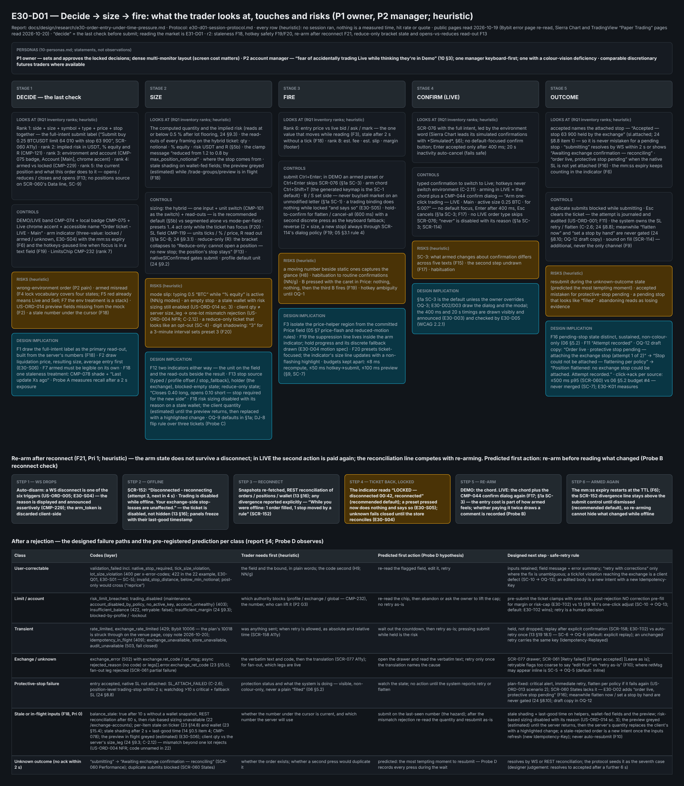
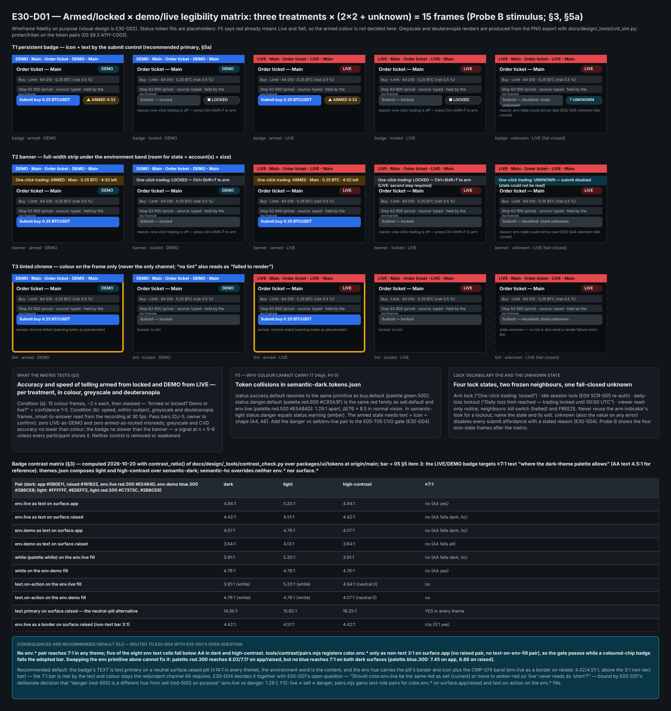
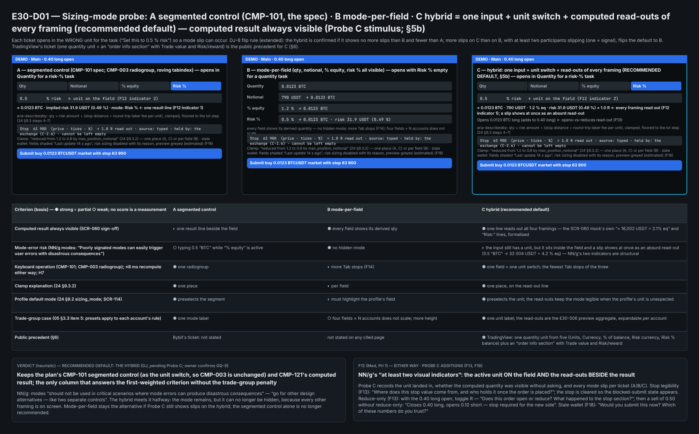
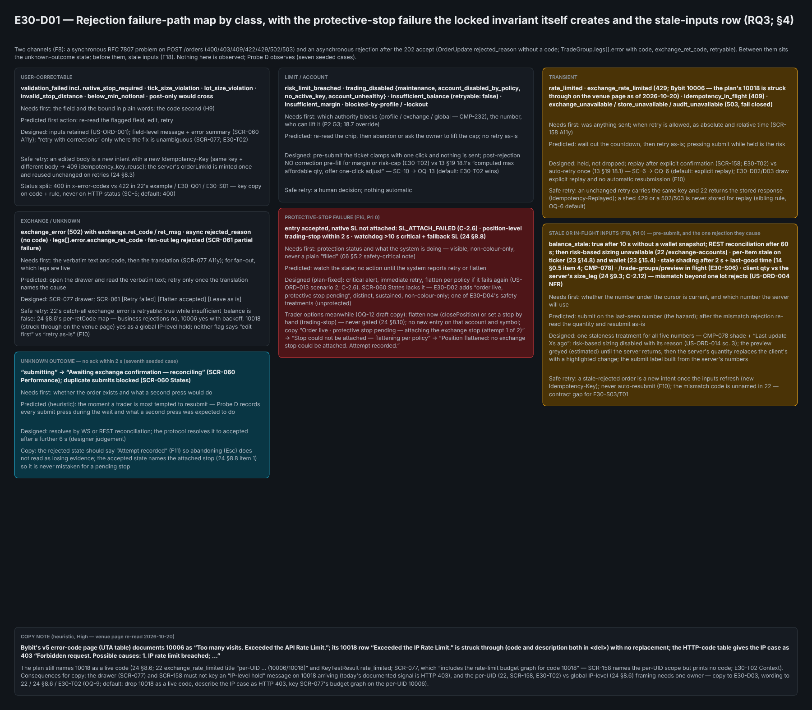
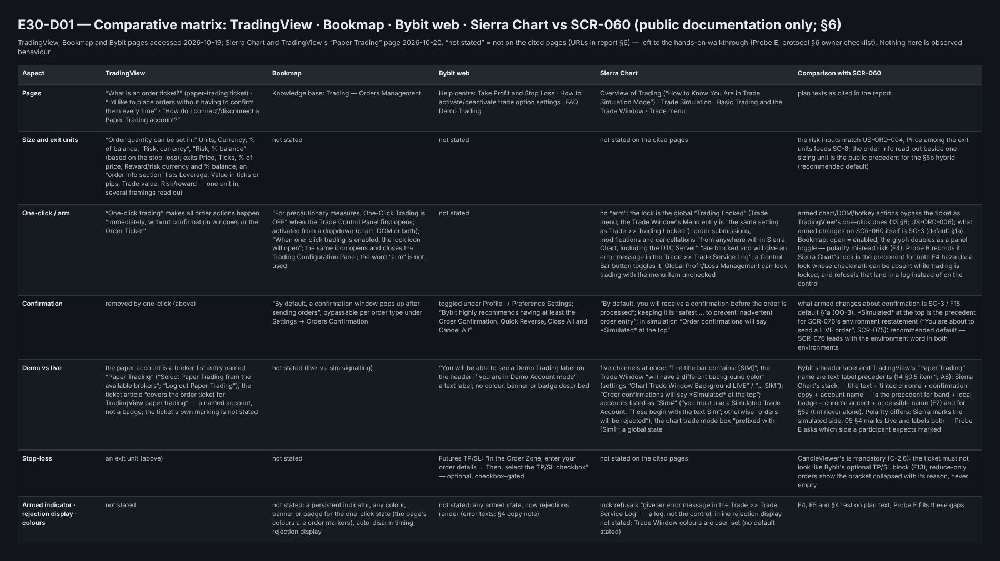
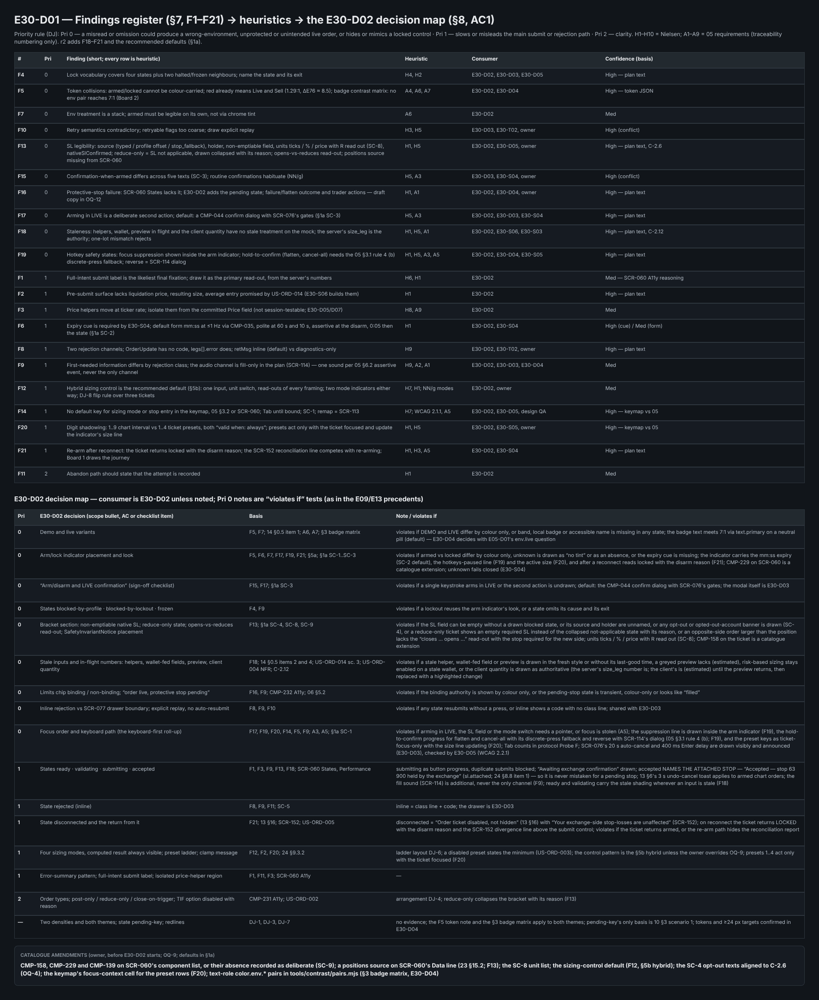
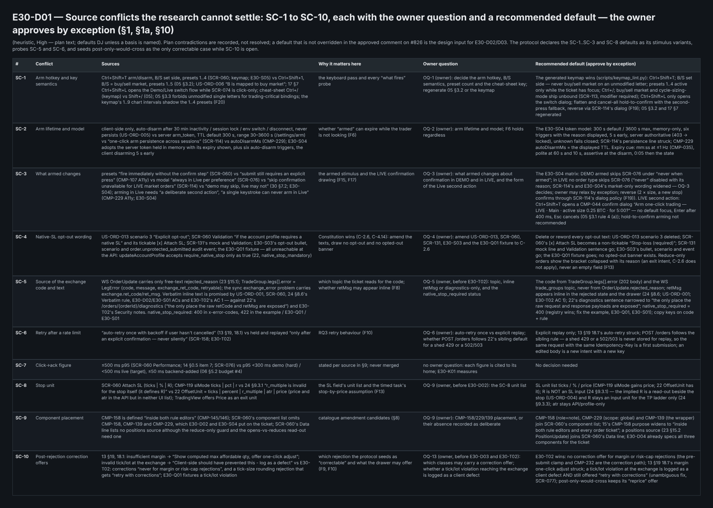

# E30-D01 — UX research: how traders decide, size and fire an order under time pressure

- **Ticket:** E30-D01 (issue #826) · **Status:** In Review — Penpot boards and PNG exports pending (the mandatory
  evidence of `docs/design/README.md` "Approval rule" is not yet attached; see "Research boards") · **Owner approval
  pending** (Agent-delivery adaptations, owner decision 2026-09-25) · **Method:** heuristic evaluation +
  public-documentation comparison; persona scenarios are cited as a basis, not walked through; **no sessions were run**
  · **Revision 2026-10-20 (r2):** the Fable design-review round-1 desk items are folded — a recommended default for
  every source conflict and open question (§1a, §10), the hybrid sizing pattern (§5b), staleness (F18), hotkey safety
  (F19, F20), re-arm after reconnect (F21), the badge contrast matrix (§3), Sierra Chart and TradingView's "Paper
  Trading" label (§6), the reduce-only bracket state and the opens-vs-reduces read-out (§4); the boards follow when the
  Penpot bridge is back.
- **Scope:** SCR-060 order ticket (single account) and the surfaces it opens into — SCR-076 confirmation, SCR-077
  rejection drawer, SCR-158 rate-limited state, SCR-114 trading defaults, the SCR-061 selector slice — plus the arm/lock
  control (CMP-229, `scope: "global"` only, E30-S04) and the environment treatment (CMP-074/075). Feeds E30-D02
  (SCR-060 hi-fi), E30-D03 (SCR-076/077/114/158, selector), E30-D04, E30-S04 and E30-T02.
- **Out of scope (ticket):** visual design; chart/DOM trading (E31; research ticket E31-D01); rule-engine authoring
  (E36/E37). **Also excluded here:** the rate-limit governor (E34, per E30-T02 Out of scope) and the chart/DOM arm display
  and click-trade confirmation tolerance (E31-D01's own work; one shared indicator CMP-229, findings exchanged both ways).
- **Deviations to record in the PR:** (1) the ticket asks for the `docs/plan/` research-notes format and names branch
  `design/e30-ux-research`; this delivery uses the E09/E13 path `docs/design/research/` and branch
  `design/e30-d01-order-entry-research`. (2) The ticket cites 06 §5.2 budget #4 for the 8 ms / 50 ms budgets; they live in
  SCR-060 Performance and the US-ORD-006 NFR, and that budget is submit→ack only (§9). (3) C-4.8: this report and the
  protocol file are one pair of 885 lines (report 574, protocol 311); the protocol cites the report's ids throughout and cannot be split from it.
- **In plain words.** No session has been run: nothing here is a measured time, hit rate or quote; every finding is a
  heuristic prediction for the owner run to confirm or overturn. Act first on the Pri 0 rows of §7. **Every source
  conflict and open question carries a Recommended default** (§1a, §10): the owner approves **by exception**,
  overriding only the defaults they disagree with — OQ-1..OQ-4, OQ-6, OQ-9 and OQ-12 (draft copy) before E30-D02
  starts, OQ-5 and OQ-13 before E30-T02; a default that is not overridden is the design input for E30-D02/D03. Ids:
  **RQ** research question · **F** finding (F1–F21) · **SC** source conflict · **DJ** designer judgement, no evidence ·
  **OQ** open question · **H** Nielsen heuristic · **A1–A9** 05 requirement (not the T-themes of `10-personas.md` §10) ·
  **Pri 0–2** priority (persona ids P1/P2 are untouched) · bare numbers such as "22" or "24 §8.6" = `docs/plan/NN-*.md`.

## Locked, not relitigated

Two decisions are inputs to this research, not questions for it. (1) **C-2.6** (`CONSTITUTION.md`): every
position-opening order, on every account, in every environment, including every fan-out leg, carries a native
exchange-side stop-loss; no flag, environment or "advanced mode" disables it (also **C-4.14**); `POST /orders` enforces it
as `validation_failed` / `native_stop_required` (`22-api-openapi.yaml` placeOrder invariants) and `updateAccountProfile`
accepts `require_native_stop` only as `true` (`native_stop_mandatory`). (2) The **arm/lock control plus an always-visible
environment badge — "no trading control is operable unless both are visible"** (`30-release-roadmap.md` §7.2 E30 row;
E30-S04 Context; US-ORD-005; `14-screens-catalogue.md` §0.5 item 1; `05-accessibility-standard.md` §3.1 rule 5 and §4;
**C-2.11**: typed confirmation to switch to Live, hotkeys may not switch environment). E30-S04 gives the arm state three
values — `locked`, `armed`, `unknown` — and `unknown` (also the value on any error) disables every submit affordance with
a stated reason. This research makes both legible and fast; **it does not recommend removing or weakening either**, and
it designs no opt-out of the native SL. Plan texts that read as an opt-out (listed in SC-4) are unreachable at the API.

## Acceptance-criteria trace (issue #826)

Status key as in E13-D01: **done** = delivered as worded; **heuristic-only** = delivered by the agent-delivery adaptation,
a recommendation pending the owner run; **open** = needs sessions or an owner decision.

| Ticket AC or deliverable                                                              | Where                                                                                      | Status                               |
| ------------------------------------------------------------------------------------- | ------------------------------------------------------------------------------------------ | ------------------------------------ |
| AC1: each major E30-D02 layout decision cites a finding or is marked DJ               | §8 decision map                                                                            | done (basis heuristic)               |
| AC2: how quickly/reliably armed vs locked and demo vs live are told apart; no removal | §3 prediction + measurement design (no time or hit rate exists); "Locked, not relitigated" | heuristic-only; no-removal done      |
| AC3: what participants did after a rejection and what they looked for first           | §4 characterises the designed paths and pre-registers a predicted first action per class   | heuristic-only / open                |
| Concept probes (a) arm/lock treatments, (b) sizing-mode switching                     | §5                                                                                         | heuristic-only                       |
| Timed task; "observed human times"                                                    | §9; protocol file §4 — times **not yet available**                                         | open                                 |
| Comparative walkthroughs (TradingView, Bookmap, Bybit; Sierra Chart added 2026-10-20) | §6 documentation review; hands-on walkthroughs = protocol file Probe E and §6 checklist    | heuristic-only (documentation); open |
| Accessibility notes: keyboard-only pass of the placement task                         | protocol file Probe F, §4 trials 3–4; owner checklist item                                 | open                                 |
| Prioritised implications                                                              | §7 Pri column and rule; §8 ordered by inherited priority                                   | heuristic-only                       |
| Quote bank                                                                            | none yet — see Method note; template in protocol file §5                                   | open                                 |
| Open questions, each with an owner and a recommended default                          | §10; §1a for SC-1..SC-10                                                                   | done                                 |
| Owner walkthrough checklist                                                           | protocol file §6                                                                           | done (approval pending)              |
| 5–6 sessions, read-out, CDO sign-off                                                  | protocol file; owner `approved` comment replaces sign-off                                  | open                                 |

## Research boards (Penpot)

Per `docs/design/README.md` ("Approval rule"), a research ticket still ships boards on its Penpot page plus PNG exports:
team `b564c72c-f31f-81ec-8008-b109a9175d0b`, file `b564c72c-f31f-81ec-8008-b112c6fdc116`. Page **`E30-D01`**, page id `0a41e3a8-e6a6-807a-8008-d1d0922b0ebc`:
`https://design.penpot.app/#/workspace?team-id=b564c72c-f31f-81ec-8008-b109a9175d0b&file-id=b564c72c-f31f-81ec-8008-b112c6fdc116&page-id=0a41e3a8-e6a6-807a-8008-d1d0922b0ebc`.
Planned: one frame per board, bound to semantic tokens in `packages/ui/tokens` only (no raw hex), exported with
`docs/design/_tools/penpot_export.py` to `docs/design/E30/img/E30-D01-<board>.png`, page link in the PR body and the
issue comment, no image embedded until exports exist. Boards 2 and 3 are also the Probe B and Probe C stimulus (protocol
file §2). The seven boards: **1 Decide → size → fire journey** (P1, P2; "decide" = the last check before submit — reading
the market is E31-D01): the 13 §5–§6 flow, the glance inventory (§2), the staleness and hotkey-safety states (F18–F20),
the post-rejection journey (§4) and the re-arm-after-reconnect journey (F21) · **2 Armed/locked × demo/live legibility
matrix**: per treatment the 2×2 plus its own `unknown` frame, 15 frames, plus the badge contrast matrix (§3); greyscale
and deuteranopia renders via `docs/design/_tools/cvd_sim.py`, the three-dichromacy token check via
`docs/research/_tools/cvd_simulate.py` (§3, §5a) · **3 Sizing-mode probe wireframes**: three tickets — segmented control,
mode-per-field and the hybrid (one input + unit switch + computed read-outs of every framing, the recommended default) —
computed result visible (§5b) · **4 Rejection failure-path map** by class, with the protective-stop failure and the
stale-inputs row (§4) · **5 Comparative matrix** TradingView / Bookmap / Bybit / Sierra Chart vs SCR-060 (§6) · **6
Findings → heuristics → E30-D02 decision map** (§7, §8) · **7 Source conflicts SC-1 to SC-10** (the §1 table as a frame,
one owner question and one recommended default per row, §1a).

1. `E30-D01 / 01 journey` (board id `0a41e3a8-e6a6-807a-8008-d1d41914b335`):

   

2. `E30-D01 / 02 legibility-matrix` (board id `0a41e3a8-e6a6-807a-8008-d1d649a29aa3`):

   

3. `E30-D01 / 03 sizing-mode-probe` (board id `0a41e3a8-e6a6-807a-8008-d1d7b2bd73f4`):

   

4. `E30-D01 / 04 rejection-failure-paths` (board id `0a41e3a8-e6a6-807a-8008-d1d92790b760`):

   

5. `E30-D01 / 05 comparative-matrix` (board id `55e86c27-99d4-8006-8008-d1e06a8a477c`):

   

6. `E30-D01 / 06 findings-decision-map` (board id `55e86c27-99d4-8006-8008-d1e1bdc205f9`):

   

7. `E30-D01 / 07 source-conflicts` (board id `55e86c27-99d4-8006-8008-d1e232ce1e4b`):

   

## Method note (Agent-delivery adaptation, owner decision 2026-09-25)

The ticket asks for 5–6 moderated 60-minute remote sessions, a timed task and a quote bank. Delivery is a solo AI agent
with one human owner and no clickable stimulus (SCR-060 wireframes are E30-D02, which depends on this report), so per the
ticket's **Agent-delivery adaptations** sessions become (1) a **heuristic evaluation** of the locked specs, (2) a
**written session protocol** the owner can run later and (3) an **owner walkthrough checklist** (protocol file §6).

**Heuristic set.** Nielsen's 10 usability heuristics (https://www.nngroup.com/articles/ten-usability-heuristics/), cited
by their published numbers: H1 status · H2 real-world match · H3 user control · H4 consistency · H5 error prevention · H6
recognition · H7 efficiency · H8 minimalism · H9 error recovery · H10 help (checked: the hotkey cheat-sheet, keymap Global
rows and CMP-101's `aria-describedby` formula text; the cheat-sheet key is itself a keymap-vs-05 conflict — `Ctrl+/` in
`docs/generated/default-keymap.md`, `Shift+/` (`?`) in 05 §3.2 and §3.4 item 9 — recorded under SC-1). Plus the trading
requirements of `05-accessibility-standard.md`, which **supplies requirements, not an enumerated heuristic checklist**; the
sections used are numbered A1–A9 for traceability only: A1 §2 Perceivable row (never colour-only) · A2 §2 Understandable row
(plain-language rejections) · A3 §3.1 rule 4 (keyboard-operable confirm gate) · A4 §3.1 rule 5 (persistent, non-colour-only
"1-click ARMED" indicator, icon and text) · A5 §3.4 (focus never silently stolen) · A6 §4 (colour independence; Live =
red-accented chrome plus a text badge) · A7 §5 item 3 (LIVE/DEMO badge ≥7:1, an AAA target "where the dark-theme palette
allows") · A8 §6.2 (assertive region for rejected/filled) · A9 §7 (reduced motion).

**Honest limits.** **No quote bank: no sessions were run.** No participant, timing, hit rate or quote appears here; lines
quoted from `10-personas.md` are persona statements. Every finding, including each §1 conflict, is labelled `(heuristic)`
with a confidence naming its basis (High = stated in a locked plan document or token file; Med = sound heuristic
reasoning; Low = persona inference only) and a priority (§7 rule, DJ). Claims about TradingView, Bookmap, Bybit, Sierra Chart and NN/g
come only from the public pages cited in §4, §6 and §7 (accessed 2026-10-19; the Bybit error-code page re-read and the
Sierra Chart and TradingView "Paper Trading" pages read 2026-10-20); what they do not state is marked "not stated on the
cited pages" — only those pages were checked. Plan contradictions are recorded (§1) and given a recommended default
(§1a), not resolved: the owner resolves them by approving or overriding the default.

## 1. Source conflicts the research cannot settle (owner decisions) `(heuristic, High — plan text)`

The protocol file §2 declares the §1a recommended defaults as the stimulus variants (SC-1 to SC-3, SC-8); SC-5 and SC-6
are probed (Probe D), SC-10 is an owner decision (OQ-13) — meanwhile the protocol seeds post-only-would-cross as the only
correctable case.

| #     | Conflict                             | Sources                                                                                                                                                                                                                                                                                                                                                                                                                                                                                                                                                                                                                                                                                                                                                                                                                                                                                                                                                                                                                                                                                                                                                                                                                                           | Why it matters here                                                                                               |
| ----- | ------------------------------------ | ------------------------------------------------------------------------------------------------------------------------------------------------------------------------------------------------------------------------------------------------------------------------------------------------------------------------------------------------------------------------------------------------------------------------------------------------------------------------------------------------------------------------------------------------------------------------------------------------------------------------------------------------------------------------------------------------------------------------------------------------------------------------------------------------------------------------------------------------------------------------------------------------------------------------------------------------------------------------------------------------------------------------------------------------------------------------------------------------------------------------------------------------------------------------------------------------------------------------------------------------- | ----------------------------------------------------------------------------------------------------------------- |
| SC-1  | Arm hotkey and key semantics         | `Ctrl+Shift+T` arm/disarm, `B`/`S` set side, presets `1..4` (SCR-060 Interactions; `docs/generated/default-keymap.md` Ticket rows; E30-S05) vs `Ctrl+Shift+1`, `B`/`S` = buy/sell market, presets `1..5` (05 §3.2); US-ORD-006 "B is mapped to buy market"; 17 §7 `B` = "Buy market (armed 1-click) or open ticket pre-filled" and `Ctrl+Shift+L` opens the Demo/Live switch flow ("never switches without confirm") while SCR-074 is click-only; E30-S05 also binds buy/sell limit at bid/ask and a cycle-sizing-mode action (no default key) that are in neither list, and makes a trading binding do nothing while locked "and say so"; the cheat-sheet is `Ctrl+/` (keymap) vs `Shift+/` (05 §3.2, §3.4 item 9); 05 §3.3 item 1 (2) forbids unmodified single letters for trading-critical bindings                                                                                                                                                                                                                                                                                                                                                                                                                                           | the keyboard pass and every "what fires" probe                                                                    |
| SC-2  | Arm lifetime and model               | client-side only, auto-disarm after 30 min inactivity / session lock / env switch / disconnect, never persists (US-ORD-005 Auto-disarm scenario and NFR) vs server `arm_token`, TTL default 300 s, range 30–3600 s, invalidated on disarm, session end, kill switch, risk-cap breach (`/settings/arm`) vs "one-click arm persistence across sessions" (SCR-114) vs `autoDisarmMs` (CMP-229); E30-S04 adopts the server token (TTL default 300 s, max 3600 s) held in memory, its expiry shown in the indicator, plus six auto-disarm triggers (30 min inactivity, session lock, environment switch, WS disconnect, kill switch, risk-cap lockout), the client disarming 5 s early                                                                                                                                                                                                                                                                                                                                                                                                                                                                                                                                                                 | whether "armed" can expire while the trader is not looking (F6)                                                   |
| SC-3  | What armed changes                   | presets "fire immediately without the confirm step" (SCR-060) vs "submit still requires an explicit press" (CMP-107 A11y) vs modal "always in Live per preference" (SCR-076) vs "'skip confirmation' is unavailable for LIVE market orders" (SCR-114 checklist) vs "demo may skip, live may not" (`30-release-roadmap.md` §7.2; E30-S04); fixed alongside: arming in Live needs "a deliberate second action" and "a single keystroke can never arm in Live" (CMP-229 A11y; E30-S04 Technical notes)                                                                                                                                                                                                                                                                                                                                                                                                                                                                                                                                                                                                                                                                                                                                               | the armed stimulus and the LIVE confirmation drawing (F15, F17)                                                   |
| SC-4  | Native-SL opt-out wording            | US-ORD-013 scenario 3 "Explicit opt-out"; SCR-060 Validation "if the account profile requires a native SL"; the SCR-060 mock's tickable `[x] Attach SL`; SCR-131's mock `[x] require a native stop-loss on every order` and its Validation ("disabling the mandatory-stop flag requires an extra typed acknowledgement"); E30-S03's "Opt-out surfacing" bullet, "Explicit opt-out is loud" scenario and `order.unprotected_submitted` audit event; the E30-Q01 fixture "account with the native-SL invariant opted out" — all unreachable at the API: `updateAccountProfile` accepts `require_native_stop` only as `true` (22, `native_stop_mandatory`)                                                                                                                                                                                                                                                                                                                                                                                                                                                                                                                                                                                           | Constitution wins (C-2.6, C-4.14): amend the texts, draw no opt-out and no opted-out banner                       |
| SC-5  | Source of the exchange code and text | WS `OrderUpdate` carries only free-text `rejected_reason` (23 §15.1); the `202` `TradeGroup` and WS `trade_groups` carry `legs[].error` = `LegError {code, message, exchange_ret_code, retryable}` (22 LegError; 23 §15.5); the synchronous `exchange_error` problem carries `exchange.ret_code/ret_msg` (22 ExchangeError). Inline verbatim text is promised by US-ORD-001 ("shows the exchange message and code, retains my inputs"), SCR-060 rejected and its sign-off checklist ("exchange reason verbatim"), 24 §8.6's Verbatim rule ("every business rejection carries the exchange's own `retMsg` to the UI unchanged"), the E30-D02 and E30-S01 ACs, and E30-T02's own AC 1 and Technical notes (the drawer shows the verbatim message from "already-received rejection data", no fetch); against them, the 22 description of `GET /orders/{orderId}/diagnostics` ("the only place the raw retCode and retMsg from Bybit are exposed") and E30-T02's Security notes. Status split: `native_stop_required` is REST 400 in x-error-codes but 422 in 22's own UnprocessableEntity example, E30-Q01 and E30-S01 (that example also shows `risk_limit_breached` at 422, registry 403) — copy must key on `code` + `rule`, never on HTTP status | which topic the ticket reads for the code, whether `retMsg` may appear inline (F8, OQ-5)                          |
| SC-6  | Retry after a rate limit             | "auto-retry once with backoff if user hasn't cancelled" (13 §19, subsection 18.1) vs held and replayed "only after an explicit confirmation — never silently" (SCR-158; E30-T02)                                                                                                                                                                                                                                                                                                                                                                                                                                                                                                                                                                                                                                                                                                                                                                                                                                                                                                                                                                                                                                                                  | RQ3 retry behaviour (F10)                                                                                         |
| SC-7  | Click→ack figure                     | ≤500 ms p95 (SCR-060 Performance; 14 §0.5 item 7; SCR-076 Performance) vs p95 <300 ms demo (hard) / <500 ms live (target), ≤50 ms backend-added (06 §5.2 budget #4)                                                                                                                                                                                                                                                                                                                                                                                                                                                                                                                                                                                                                                                                                                                                                                                                                                                                                                                                                                                                                                                                               | stated per source in §9; E30-K01 measures                                                                         |
| SC-8  | Stop unit                            | SCR-060 `Attach SL … (ticks\|%\|R)`; CMP-119 `slMode "ticks"\|"pct"\|"r"` vs 24 §9.3.1 "`r_multiple` is invalid for the stop itself" vs 22 `OffsetUnit` = `ticks\|percent\|r_multiple\|atr\|price` (`price` and `atr` exist in the API but in neither UI list); TradingView's ticket offers Price as an exit unit (§6)                                                                                                                                                                                                                                                                                                                                                                                                                                                                                                                                                                                                                                                                                                                                                                                                                                                                                                                            | the SL field's unit list and the timed task's stop-by-price assumption (F13; protocol file §2)                    |
| SC-9  | Component placement                  | CMP-158 is defined "inside both rule editors" (CMP-145/146); SCR-060's component list omits CMP-158, CMP-139 and CMP-229, which E30-D02 and E30-S04 put on the ticket                                                                                                                                                                                                                                                                                                                                                                                                                                                                                                                                                                                                                                                                                                                                                                                                                                                                                                                                                                                                                                                                             | catalogue amendment candidates (§8)                                                                               |
| SC-10 | Post-rejection correction offers     | 13 §19, subsection 18.1: insufficient margin → "Show computed max affordable qty, offer one-click adjust"; invalid tick/lot at the exchange → "Client-side should have prevented this - log as a defect if it reaches here" vs E30-T02: corrections "never for margin or risk-cap rejections", AC "for an insufficient-margin rejection no auto-correction is offered", and a tick-size rounding rejection that gets "retry with corrections"; E30-Q01 fixtures a tick/lot violation                                                                                                                                                                                                                                                                                                                                                                                                                                                                                                                                                                                                                                                                                                                                                              | which rejection the protocol seeds as "correctable" and what the drawer may offer (F9, F10; owner decision OQ-13) |

### 1a. Recommended defaults — the owner approves by exception `(heuristic; DJ unless a basis is named)`

Each default is what E30-D02/D03 draw and the protocol declares (protocol file §2) unless the owner overrides it in
the `approved` comment on #826. Overriding one default never reopens the others.

| #     | Recommended default                                                                                                                                                                                                                                                                                                                                                                                                                                                                                                                                                                                                                                                                                                                                                                                                                                                                                                                                                                                                                                                                                                                                                                                                                                                                                                              | Basis                                                                                                                              | Settled by |
| ----- | -------------------------------------------------------------------------------------------------------------------------------------------------------------------------------------------------------------------------------------------------------------------------------------------------------------------------------------------------------------------------------------------------------------------------------------------------------------------------------------------------------------------------------------------------------------------------------------------------------------------------------------------------------------------------------------------------------------------------------------------------------------------------------------------------------------------------------------------------------------------------------------------------------------------------------------------------------------------------------------------------------------------------------------------------------------------------------------------------------------------------------------------------------------------------------------------------------------------------------------------------------------------------------------------------------------------------------- | ---------------------------------------------------------------------------------------------------------------------------------- | ---------- |
| SC-1  | Keep the generated keymap as the single truth and regenerate 05 §3.2 and 17 §7 from it: `Ctrl+Shift+T` arm/disarm, `B`/`S` **set side** (never buy/sell market — an unmodified letter may not be trading-critical), presets `1..4` **active only while the ticket region has focus** (F20), cheat-sheet `Ctrl+/`; buy/sell market and the E30-S05 cycle-sizing-mode action ship **unbound** (the owner binds them in SCR-113, modifier required); `Ctrl+Shift+L` only opens the switch dialog (SCR-074 stays click-to-confirm; C-2.11); destructive keys: flatten and cancel-all hold-to-confirm with the second-press keyboard fallback, `reverse` always through SCR-114's `dialog` policy (F19)                                                                                                                                                                                                                                                                                                                                                                                                                                                                                                                                                                                                                               | `docs/generated/default-keymap.md` is generated and linted by `scripts/keymap_lint.py`; 05 §3.3 item 1 (2) and (3); 05 §3.1 rule 2 | OQ-1       |
| SC-2  | The E30-S04 token model: server `arm_token`, TTL default 300 s (max 3600 s), held in memory only, six auto-disarm triggers each with its reason displayed, client disarms 5 s early, server authoritative (`403` → `locked`), `unknown` fails closed; strike SCR-114's "one-click arm persistence across sessions" (it contradicts the US-ORD-005 NFR "never persists") and read CMP-229 `autoDisarmMs` as the TTL the indicator displays. **Expiry cue (F6):** `mm:ss` remaining time, updated at ≤1 Hz as a text change (no flash, 05 §7), via CMP-035 `format: "mm:ss"`; announced politely at 60 s and 10 s (CMP-035 thresholds; SCR-158 "at most once every 10 s") and assertively at the disarm (CMP-229); the cue reads `0:05` at the client's early disarm and then the state — never a dead `0:00` beside an operable control                                                                                                                                                                                                                                                                                                                                                                                                                                                                                           | E30-S04 Technical notes and AC; US-ORD-005 NFR; CMP-035 A11y; SCR-158 A11y; 05 §7                                                  | OQ-2       |
| SC-3  | The E30-S04 matrix (env × order type × policy; policy ∈ `always` / `live only` / `never when armed`): in DEMO an armed preset or `Ctrl+Enter` skips SCR-076 under `never when armed`; in LIVE **no order type skips SCR-076** (`never` is rendered disabled with its reason; 30 §7.2 "live may not"; SCR-114's and E30-S04's narrower "LIVE market orders" wording (SCR-114 checklist; E30-S04 Scope and AC) is amended to all LIVE orders — OQ-3 decides, and the owner may relax it to market-only by exception; `reverse` (22 `reversePosition`: a single order of `2 × size` with a new native stop) confirms through SCR-114's `dialog` policy in both environments, never a hold or a double press (F19)), no default-focused confirm, `Enter` accepted after 400 ms. **The LIVE second action (F17):** `Ctrl+Shift+T` in LIVE opens a CMP-044 ConfirmDialog — "Arm one-click trading — LIVE · Main · active size 0.25 BTC · for 5:00?" — with no default-focused confirm, `Enter` accepted after 400 ms, `Esc` cancels (keyboard: `Tab` to Confirm, `Enter`; pointer: click): 05 §3.1 rule 4 (a), the same gates as SCR-076, and the dialog restates account(s) and size as US-ORD-005 "Arming" requires; a hold-to-confirm arm is **not** recommended (it needs the discrete fallback anyway and carries no restatement) | E30-S04; SCR-076 A11y and checklist; SCR-114; 30 §7.2; CMP-229 A11y; 05 §3.1 rule 4                                                | OQ-3       |
| SC-4  | Amend every opt-out text to C-2.6 and draw nothing: US-ORD-013 scenario 3 is deleted (scenario 2 already owns the failure path); SCR-060's `[x] Attach SL` becomes a non-tickable "Stop-loss (required)" field; SCR-131's mock line and Validation sentence go; E30-S03's opt-out bullet, "Explicit opt-out is loud" scenario and `order.unprotected_submitted` event go; the E30-Q01 opted-out fixture goes; no opted-out banner exists                                                                                                                                                                                                                                                                                                                                                                                                                                                                                                                                                                                                                                                                                                                                                                                                                                                                                         | C-2.6, C-4.14; 22 `updateAccountProfile` (`native_stop_mandatory`)                                                                 | OQ-4       |
| SC-5  | The ticket reads the **code** from `TradeGroup.legs[].error` (the `202` body) and the WS `trade_groups` topic, never from `OrderUpdate.rejected_reason` (free text); the verbatim `retMsg` **appears inline** in the rejected state and in the drawer (24 §8.6 Verbatim rule; US-ORD-001; E30-T02 AC 1), and 22's diagnostics sentence is narrowed to "the only place the raw request and response payloads are exposed"; `native_stop_required` is **400** (the x-error-codes registry wins; fix 22's UnprocessableEntity example, E30-Q01 and E30-S01); copy keys on `code` + `rule`, never on the HTTP status                                                                                                                                                                                                                                                                                                                                                                                                                                                                                                                                                                                                                                                                                                                 | 22 LegError, x-error-codes, `/orders/{orderId}/diagnostics`; 23 §15.1, §15.5; 24 §8.6                                              | OQ-5       |
| SC-6  | Explicit replay only (SCR-158; E30-T02): 13 §19 subsection 18.1's "auto-retry once with backoff" is struck; `POST /orders` follows 22's sibling rule — a shed `429` or a `502`/`503` is never stored for replay, so the same request with the same `Idempotency-Key` is a first submission, and an edited body is a new intent with a new key (plan-decided, §4)                                                                                                                                                                                                                                                                                                                                                                                                                                                                                                                                                                                                                                                                                                                                                                                                                                                                                                                                                                 | SCR-158 Performance; E30-T02; 22 Idempotency (createWorkspace, createApiKey import, OpenExposure)                                  | OQ-6       |
| SC-7  | No decision: each figure stays cited to its home (§9); E30-K01 measures                                                                                                                                                                                                                                                                                                                                                                                                                                                                                                                                                                                                                                                                                                                                                                                                                                                                                                                                                                                                                                                                                                                                                                                                                                                          | SCR-060 Performance; 14 §0.5 item 7; 06 §5.2 budget #4                                                                             | —          |
| SC-8  | SL unit list **`ticks` / `%` / `price`** (CMP-119 `slMode` gains `"price"`; 22 `OffsetUnit` already has it; TradingView offers Price as an exit unit, §6). **`R` is not an SL input:** 24 §9.3.1 — "`r_multiple` is invalid for the stop itself (it _defines_ R)" — so the implied R is a **read-out** beside the stop (US-ORD-004 "implied risk in USDT and R") and `R` stays an input unit for the TP ladder only (24 §9.3.3); `atr` stays API/profile-only (the fallback source F13 names). The lens's shorthand "ticks, %, R, price" is honoured as "add price"; keeping `R` as an input would contradict 24 §9.3.1                                                                                                                                                                                                                                                                                                                                                                                                                                                                                                                                                                                                                                                                                                          | 24 §9.3.1, §9.3.3; 22 OffsetUnit; SCR-060; CMP-119                                                                                 | OQ-9       |
| SC-9  | CMP-158 (`role="note"`), CMP-229 (`scope: "global"`) and CMP-139 (the wrapper) join SCR-060's component list; 15's CMP-158 purpose widens from "inside both rule editors" to "inside both rule editors and every order ticket (SCR-060/061; SCR-076 already lists it)"; a positions source joins SCR-060's Data line (23 §15.2 `PositionUpdate`; F13's opens-vs-reduces read-out and the reduce-only guard need it); E30-D04 already specs all three components for the ticket                                                                                                                                                                                                                                                                                                                                                                                                                                                                                                                                                                                                                                                                                                                                                                                                                                                   | E30-D04 Scope; SCR-075/076 Components; E30-S04; US-ORD-002                                                                         | OQ-9       |
| SC-10 | E30-T02 wins: no correction offer for margin or risk-cap rejections (the pre-submit clamp and CMP-232 are the correction path, P2 scenario 3); 13 §19 subsection 18.1's margin "one-click adjust" is struck; a tick/lot violation that reaches the exchange is logged as a client defect **and** still gets "retry with corrections" (the fix is unambiguous, SCR-077); post-only-would-cross keeps its "reprice" offer (US-ORD-002)                                                                                                                                                                                                                                                                                                                                                                                                                                                                                                                                                                                                                                                                                                                                                                                                                                                                                             | E30-T02 AC; SCR-077 checklist; 13 §19; US-ORD-002                                                                                  | OQ-13      |

## 2. RQ1 — what a trader looks at in the two seconds before submitting `(heuristic)`

Nothing here is observed: an inventory of what SCR-060 puts in front of the trader, ranked by heuristic likelihood of a
last-glance check; Probe A replaces the ranking with data (P1 G2, P2 G3, `10-personas.md` §2, §3; H6 recognition; H1 status).

| Rank | Glanceable fact on SCR-060                                                           | Source on the ticket                                                                                                                                                                                                                           | Why it ranks here                                                                                           |
| ---- | ------------------------------------------------------------------------------------ | ---------------------------------------------------------------------------------------------------------------------------------------------------------------------------------------------------------------------------------------------- | ----------------------------------------------------------------------------------------------------------- |
| 1    | Side + size + symbol + type + price + stop, together                                 | submit button's full-intent name ("Submit buy 0.25 BTCUSDT limit 64 010 with stop 63 900", SCR-060 A11y)                                                                                                                                       | the only place all six co-occur; the last thing under pointer or focus                                      |
| 2    | Implied risk in USDT, % equity and R                                                 | `Risk:` line, CMP-121 (US-ORD-004)                                                                                                                                                                                                             | the quantity the trader actually chose                                                                      |
| 3    | Environment and account                                                              | CMP-075 badge, `Account [Main]`, chrome accent (14 §0.5 item 1)                                                                                                                                                                                | P2 G5; P2 Pains "Fear of accidentally trading Live while thinking they're in Demo" (10 §3)                  |
| 4    | Armed vs locked                                                                      | arm indicator (A4; CMP-229)                                                                                                                                                                                                                    | decides whether a preset fires or SCR-076 opens (SC-3)                                                      |
| 5    | Current position and what this order does to it (opens / reduces / closes and opens) | the opens-vs-reduces read-out (F13); the reduce-only guard "Reduce-only needs an open position" (SCR-060 Validation; US-ORD-002); **no positions source on SCR-060's Data line** — 23 §15.2 `PositionUpdate` is the catalogue amendment (SC-9) | an opposite-side order larger than the position flips it and needs a new stop (22 `reversePosition`; C-2.6) |
| 6    | Entry price vs live bid/ask/mark                                                     | price helpers from `ticker.{symbol}` (SCR-060 Data; 23 §14.8)                                                                                                                                                                                  | the one value that moves while reading (F3); stale after 2 s without a tick (F18)                           |
| 7    | The binding limit                                                                    | CMP-232 LimitsChip                                                                                                                                                                                                                             | P2 G3; names which authority blocks                                                                         |
| 8    | est. fee · est. slip · margin                                                        | footer line (SCR-060 mock)                                                                                                                                                                                                                     | predicted secondary before a submit (DJ)                                                                    |

- **F1 (heuristic, Med, Pri 1)** — the full-intent submit label is the likeliest final fixation; draw it as the primary
  read-out, not a11y-only text, with every rank 1–4 value visible in or adjacent to it. H6, H1.
- **F2 (heuristic, High, Pri 1)** — US-ORD-014 "Preview" promises resulting position size, average entry, initial margin,
  estimated liquidation price, risk in USDT and R, and fees; the SCR-060 mock shows only risk, est. fee, est. slip and
  margin. E30-S06 builds exactly the missing fields into CMP-121 (`/trade-groups/preview`, `/risk/summary`): draw them first.
- **F3 (heuristic, Med, Pri 1)** — the price-helper region updates at ticker rate (SCR-060 Data; the E30-D02 performance
  note asks for an isolated region). A moving number beside static ones is predicted to capture the glance (H8); 05 §7's
  price-flash and reduced-motion rules bound how it may move: keep helpers apart from the committed `Price` field. Not
  testable with static session frames — E30-D05 and E30-D07 verify against the build.

**Measurement (Probe A; protocol file §3):** 2 s exposure, free recall, forced choice — salience and recall after a forced
exposure, not gaze; the objective trace is the cued review of the last ~2 s before each timed-task submit (protocol file §4).

## 3. RQ2 — armed vs locked, demo vs live: legibility `(heuristic)`

**Definition.** Here **locked = disarmed one-click** (US-ORD-005 "Disarmed by default"; CMP-229 accessible name "Chart
trading: locked"; for the ticket's global scope E30-S04 uses "One-click trading: locked"). It is distinct from the idle
session lock (13 §19, subsection 18.6), the daily-loss lockout (SCR-060 "trading locked until 00:00 UTC"; SCR-073;
subsection 18.7; `risk_limit_breached`) and the viewer's read-only "lock notice" (SCR-060 RBAC); two near-neighbours are
halted or frozen: the kill switch (13 §20; SCR-072 confirmation modal; 24 §8.10) and FREEZE (SCR-060 `frozen`; 10 §3 scenario 5).

- **F4 (heuristic, High, Pri 0)** — lock vocabulary covers four plan states (arm lock, idle lock, daily-loss lockout,
  viewer lock notice) plus two halted/frozen neighbours, with different causes, owners and exits. H4, H2: name the state
  and its exit — the plan's own copy "One-click trading is off — press Ctrl+Shift+T to arm" (SCR-030 Validation) vs "Daily
  loss limit reached — trading locked until 00:00 UTC" (SCR-060) — and never reuse the arm indicator's look for a lockout.
  Probe B shows the four lock states; E30-D05 and E30-D07 verify the drawn and shipped copy.
- **F5 (heuristic, High, Pri 0)** — colour cannot carry armed vs locked. CMP-229 binds `color.status.danger` and
  `color.status.success`; in `semantic-dark.tokens.json` `status.success.default` resolves to the same primitive as
  `buy.default` (`palette.green.500`), and `status.danger.default` (`palette.red.600` `#C93A3F`) is the same red family as
  `sell.default` and `env.live` (`palette.red.500` `#E5484D`): 1.29:1 apart, ΔE76 ≈ 8.5 in normal vision, `palette.red.550`
  between them (computed from `primitives.tokens.json`, WCAG luminance + CIE76; re-verify via `contrast_ratio()` in
  `docs/design/_tools/contrast_check.py`, whose fixed `PAIRS` lacks the pair, or `packages/ui/tokens/tests/verify_tokens.py`);
  in `semantic-light.tokens.json` `status.danger.default` equals `status.warning.default` (`palette.light.amber.500`
  `#B87F0A`). The armed state needs text + icon + shape (A4, A6), not "red = danger": red already means Live (A6) and Sell.
  The danger vs sell/`env.live` pair should join the E05-T05 CVD gate (`tools/contrast/pairs.mjs` names buy/sell only; E30-D04).

**Badge contrast matrix** (computed 2026-10-20 with `contrast_ratio()` of `docs/design/_tools/contrast_check.py` over
`packages/ui/tokens` at `origin/main`; the bar is A7 — 05 §5 item 3: the LIVE/DEMO badge targets **≥7:1** text contrast
"where the dark-theme palette allows"; AA text 4.5:1 for reference). `themes.json` composes `light` and `high-contrast`
over `semantic-dark`, and `semantic-hc` overrides neither `env.*` nor `surface.*` (only text, border, focus ring, primary
action and buy/sell), so its env cells equal dark's except where `text.on-action` (`palette.neutral.0` in hc) is the
foreground.

| Pair                                                              | dark           | light          | high-contrast        | ≥7:1                   |
| ----------------------------------------------------------------- | -------------- | -------------- | -------------------- | ---------------------- |
| `env.live` as text on `surface.app`                               | 4.94:1         | 5.20:1         | 4.94:1               | no (AA yes)            |
| `env.live` as text on `surface.raised`                            | 4.42:1         | 4.51:1         | 4.42:1               | no (AA fails dark, hc) |
| `env.demo` as text on `surface.app`                               | 4.07:1         | 4.76:1         | 4.07:1               | no (AA fails dark, hc) |
| `env.demo` as text on `surface.raised`                            | 3.64:1         | 4.13:1         | 3.64:1               | no (AA fails all)      |
| white (`palette.white`) on the `env.live` fill                    | 3.91:1         | 5.20:1         | 3.91:1               | no (AA fails dark, hc) |
| white on the `env.demo` fill                                      | 4.76:1         | 4.76:1         | 4.76:1               | no (AA yes)            |
| `text.on-action` on the `env.live` fill                           | 3.91:1 (white) | 5.20:1 (white) | 4.94:1 (`neutral.0`) | no                     |
| `text.on-action` on the `env.demo` fill                           | 4.76:1 (white) | 4.76:1 (white) | 4.07:1 (`neutral.0`) | no                     |
| `text.primary` on `surface.raised` — the neutral-pill alternative | 14.35:1        | 15.62:1        | 16.25:1              | **yes**                |
| `env.live` as a border on `surface.raised` (non-text bar 3:1)     | 4.42:1         | 4.51:1         | 4.42:1               | n/a (3:1 yes)          |

Values: dark `surface.app` `#0B0E11`, `surface.raised` `#161B22`, `env.live` = `palette.red.500` `#E5484D`, `env.demo` =
`palette.blue.500` `#2B6CE8`; light `#FFFFFF`, `#EDEFF2`, `palette.light.red.500` `#C7373C`, `palette.light.blue.500`
`#2B6CE8`. Agreement with the design-review lens: its 4.94, 4.07 and 3.91 recompute exactly; its "3.64:1 on
`surface.raised`" is the `env.demo` cell (`env.live` on raised is 4.42:1). Consequences: (1) **no `env.*` pair reaches
7:1 in any theme**, and five of the eight env text cells fall below AA in dark and high-contrast; (2) the E05-T05 gate
(`tools/contrast/pairs.mjs`) registers `color.env.*` only as **non-text 3:1 on `surface.app`** — no raised pair and no
text-on-env-fill pair — so the gate passes today while a coloured-chip badge fails the adopted bar; (3) swapping the env
primitive alone cannot fix it: `palette.red.300` (`#F08A8A`) reaches 8.02/7.17:1 on app/raised and `palette.light.red.700`
8.64/7.50:1, but no blue reaches 7:1 on both dark surfaces (`palette.blue.300` `#6EA1F5` 7.45:1 on app, 6.66:1 on raised).
**Recommended default (DJ):** the badge's **text** is `text.primary` on a neutral `surface.raised` pill (≥14:1 in every
theme), the environment word is the content, and the env hue carries the pill's border and icon plus the CMP-074 band
(`env.live` as a border on raised is 4.42/4.51:1, above the 3:1 non-text bar) — the 7:1 bar is met by the text and colour
stays the redundant channel A6 requires. **Routed to E30-D04** (the `live` safety treatment is one of its four) together
with E05-D01's open question — "Should `color.env.live` be the same red as `sell` (current) or move to amber-red so
'live' never reads as 'short'?" (`docs/design/E05/E05-D01.md` Open questions) — and bound by E05-D01's deliberate
decision that "`danger` (red-600) is a different hue from `sell` (red-500) on purpose" (`env.live` and `danger` are
1.29:1 apart, F5): whatever E30-D04 picks must keep live ≠ sell ≠ danger, and `pairs.mjs` gains text-role pairs for
`color.env.*` on `surface.app`/`surface.raised` and `text.on-action` on the `env.*` fills so the gate measures what the
badge does.

- **F6 (heuristic, High for the cue, Med for its form, Pri 1)** — E30-S04 already requires "an arm_token with a stated
  expiry shown in the indicator" and six announced auto-disarm reasons (SC-2), so an invisible expiry is a plan violation
  (H1). Open is the form: remaining vs clock time, cadence, the announcement (CMP-229 A11y), 0 s and the 5 s early disarm.
  **Recommended default:** §1a SC-2 — `mm:ss` remaining time at ≤1 Hz (CMP-035 `format: "mm:ss"`), polite at 60 s and
  10 s, assertive at the disarm, `0:05` and then the state.
- **F7 (heuristic, Med, Pri 0)** — the environment treatment is already a stack: band CMP-074 + local badge CMP-075 + Live
  chrome accent + accessible name "Order ticket - LIVE - Main" (SCR-075 A11y), entered only by the click-only switch flow
  (13 §13; SCR-074). If the armed layer also tints the chrome, Live-armed and Live-locked differ only in the armed element,
  which must be legible on its own (§5a).
- **F17 (heuristic, High — plan text, Pri 0)** — arming in LIVE is a two-step act ("a deliberate second action", CMP-229
  A11y; "a single keystroke can never arm in Live", E30-S04), so part of how armed _feels_ is its entry cost; the declared
  key map (`Ctrl+Shift+T`, keymap "valid when: always") describes only the chord. E30-D02/D03 draw the second step.
  **Recommended default:** §1a SC-3 — a CMP-044 ConfirmDialog with SCR-076's gates (no default-focused confirm, `Enter`
  after 400 ms, `Esc` cancels) restating environment, account(s), active size and the TTL.
- **F19 (heuristic, High — plan text, Pri 0)** — hotkey safety has two states the ticket must show. (a) **Suppression:**
  trading hotkeys do not fire while focus is in a text field, a `contenteditable` or a non-confirmation modal, and "a
  subtle indicator shows they are suppressed" (US-ORD-006 scenario 3; E30-S05: exposed in text, not only as an icon).
  Under time pressure "subtle" is the hazard: `B` pressed with the caret in `Price` does nothing, a second `B` does
  nothing, the trader clicks out and the third `B` fires — at the active size, if `B` is buy market when armed (SC-1).
  Recommended default (DJ): the suppression state lives **in the arm indicator** as a second line of the same element
  ("ARMED 4:32 · hotkeys paused — typing in Price"), icon + text, announced politely once per focus change, never a
  separate toast; the E30-S05 rule that a trading binding "does nothing while locked and says so" uses the same line.
  (b) **Hold-to-confirm:** flatten and cancel-all default to a hold (E30-S05: 600 ms, visible progress, `aria-live`
  countdown at most once per 200 ms); 05 §3.1 rule 4 (b) demands "a discrete-press keyboard fallback (never a
  mouse-hold-only or timing-only gate)", and a `keydown` hold is still a timing gate. Recommended default (DJ): for
  flatten and cancel-all a second discrete press of the same key within 5 s confirms (rule 4 (a), "a second keystroke"),
  the progress ring filling on the hold _or_ after the first press; **`reverse` is the exception** — it opens exposure
  (22 `reversePosition`: a single order of `2 × size` in one-way mode with a new native stop), so its default is
  SCR-114's `dialog` policy (CMP-044, keyboard-operable, no default-focused confirm), never a hold and never a double
  press; E30-D04's motion spec draws the progress and its reduced-motion twin. H1, H5, A3, A5.
- **F20 (heuristic, High — keymap, Pri 1)** — digit shadowing: the generated keymap binds `1..9` to **Chart** "Interval
  preset 1-9" and `1..4` to **Ticket** "Quantity preset 1-4", both "valid when: always", beside `Alt+1..9` (rail) and
  `Ctrl+1..9` (layouts); 05 §3.3 item 1 (3) lets view-local bindings shadow each other only "within mutually-exclusive
  focus contexts", yet neither row states its focus context, and 05 §3.3 item 5 still says `1`-`5` (SC-1). The dangerous
  direction is chart → ticket: a trader reading the chart with focus left in the ticket presses `3` for a 3-minute
  interval and silently sets the active size to preset 3; the next armed `B` fires at that size (US-ORD-005 puts "the
  active size" in the armed indicator for exactly this reason). Recommended default (DJ): presets act only while the
  ticket region has focus (the keymap row gains "valid when: ticket focused"; SCR-113 shows both meanings side by side,
  05 §3.3 item 1 (3)), and every preset change updates the arm indicator's size line with a non-flashing value-change
  highlight (E30-D04 motion spec) and a polite announcement. H1, H5; 05 §3.1 rule 2.
- **F21 (heuristic, High — plan text, Pri 1)** — re-arm after reconnect: a WS disconnect is one of the six auto-disarm
  triggers (US-ORD-005; E30-S04, "each with the reason displayed"), SCR-152 disables trading ("Trading is disabled while
  offline. Your exchange-side stop-losses are unaffected.") and on reconnect "order/position state is reconciled and any
  divergence is reported explicitly ('While you were offline: 1 order filled, 1 stop moved by a rule')" (SCR-152; 13 §16
  REST reconciliation pass). So the ticket returns **LOCKED**, in LIVE the chord plus the second action is paid again
  (F17), and the reconciliation line competes with re-arming for the first glance; predicted first action (Probe B
  noticing check): re-arm before reading what changed. Recommended default (DJ): the ticket returns locked with the
  disarm reason in the indicator ("LOCKED — disconnected 00:42, reconnected"), the SCR-152 divergence line stays above
  the submit control until dismissed, and a preset pressed while locked "does nothing and says so" (E30-S05) rather than
  re-arming. Board 1 draws the journey. H1, H3, A5.

**Prediction (Probe B; §5a; heuristic, to be measured).** The persistent icon + text badge beside the submit control is
most robust under greyscale and deuteranopia (A4, A6; P2 accessibility needs, `10-personas.md` §3); a banner is equally
legible but costs height on a dense multi-monitor layout (P1 Environment); tinted chrome alone is least reliable (F5, F7);
demo vs live is reliably distinguishable only with text badge and band both present (14 §0.5 item 1; A6). No hit rate or
latency is claimed.

**Measurement design (procedure: protocol file §3 Probe B, §4).** Stimulus = Board 2, 15 frames: per treatment the four
armed/locked × demo/live frames plus its own fail-closed `unknown` frame (E30-S04), because `unknown` looks different per
treatment (§5a: "no tint" also reads as "failed to render"). Condition (a): accuracy after a ~2 s exposure; condition (b):
speed, within-subject across all three treatments (greyscale and deuteranopia frames), read from the screen recording at
30 fps — no instrumented prototype exists or is planned. The three-dichromacy check is computed on the token pairs and
attached to the PR (05 §4 item 2, §9.3 A11Y-C003; E30-D02 AC; Board 2 tools). Pass bars (DJ-5, owner to confirm): zero
LIVE-as-DEMO and zero armed-as-locked misreads; greyscale and CVD accuracy no lower than colour; the badge no slower than
the banner in (b), a **signal** at n = 5–6 unless every participant shows it. **Neither control is removed or weakened.**

## 4. RQ3 — failure behaviour after a rejection `(heuristic)`

What a trader does after a rejection (re-read, retry, abandon) is **not yet observed**; this section characterises the
designed failure paths, pre-registers a predicted first action per class as the Probe D hypothesis, and Probe D observes.
Two channels exist (**F8**, heuristic, High, Pri 1): a **synchronous** RFC 7807 problem on `POST /orders` (22
x-error-codes; 400/403/409/422/429/502/503) and an **asynchronous** rejection after the `202` accept — `OrderUpdate` on the
WS `orders` topic with a free-text `rejected_reason` and no code (23 §15.1), `TradeGroup.legs[].error` and WS `trade_groups`
with `code`, `exchange_ret_code` and `retryable` (22 LegError; 23 §15.5); where the verbatim `retMsg` may appear is SC-5
(OQ-5). Between the channels sits an **unknown-outcome** state — "submitting" resolves by WS within 2 s or shows "Awaiting
exchange confirmation — reconciling" (SCR-060 Performance), duplicate submits blocked (SCR-060 States) — predicted
(heuristic) to be when a trader is most tempted to resubmit; Probe D seeds it as a sixth case and records resubmit attempts.

| Class                                                                    | Codes (layer)                                                                                                                                                                                                                                                                                                                                                                                                                                                                                                                                                                                                                                                                                                                           | Trader needs first (heuristic)                                                                                                   | Predicted first action (heuristic; Probe D hypothesis)                                                                       | Designed next step                                                                                                                                                                                                                                                                                                                                          | Safe-retry rule                                                                                                                                                                                                                                                                                                                                                                                            |
| ------------------------------------------------------------------------ | --------------------------------------------------------------------------------------------------------------------------------------------------------------------------------------------------------------------------------------------------------------------------------------------------------------------------------------------------------------------------------------------------------------------------------------------------------------------------------------------------------------------------------------------------------------------------------------------------------------------------------------------------------------------------------------------------------------------------------------- | -------------------------------------------------------------------------------------------------------------------------------- | ---------------------------------------------------------------------------------------------------------------------------- | ----------------------------------------------------------------------------------------------------------------------------------------------------------------------------------------------------------------------------------------------------------------------------------------------------------------------------------------------------------- | ---------------------------------------------------------------------------------------------------------------------------------------------------------------------------------------------------------------------------------------------------------------------------------------------------------------------------------------------------------------------------------------------------------- |
| User-correctable                                                         | `validation_failed` incl. `native_stop_required`, `tick_size_violation`, `lot_size_violation` (REST 400 per x-error-codes; 22's UnprocessableEntity example, E30-Q01 and E30-S01 say 422 — SC-5); client copy (SCR-060 Validation); sizing `invalid_stop_distance`, `below_min_notional` (24 §9.3); post-only would cross (US-ORD-002 "reprice" suggestion; E30-Q01 fixture)                                                                                                                                                                                                                                                                                                                                                            | the field and the bound, in plain words; the code second (H9; NN/g error-message guidelines)                                     | re-read the flagged field, edit it, retry                                                                                    | inputs retained (US-ORD-001); field-level message + error summary (SCR-060 A11y); "retry with corrections" only where the fix is unambiguous (SCR-077; E30-T02); a tick/lot violation reaching the exchange is a client defect (13 §19, subsection 18.1; SC-10)                                                                                             | plan-decided: an edited body is a new intent with a new `Idempotency-Key` (22 Idempotency: same key + different body → `409 idempotency_key_reuse`; E30-T01 AC "changing any field before retrying produces a new key"); the server's `orderLinkId` is minted once and reused unchanged on retries (24 §8.3 rule 1)                                                                                        |
| Limit / account                                                          | `risk_limit_breached`; `trading_disabled` with `reason` ∈ {maintenance, account_disabled_by_policy, no_active_key, account_unhealthy} (REST 403; 24 §8.10); `insufficient_balance` (REST 422, exchange margin, `retryable: false`); sizing `insufficient_margin` (24 §9.3); blocked-by-profile / -lockout                                                                                                                                                                                                                                                                                                                                                                                                                               | which authority blocks (profile / exchange / global, CMP-232), the number, who can lift it (P2 G3; 18.7 override)                | re-read the chip, then abandon or ask the owner to lift the cap; no retry as-is                                              | pre-submit: the ticket clamps with one click and nothing is sent (P2 scenario 3); post-rejection: **no** correction pre-fill for margin or risk-cap rejections (E30-T02) vs 18.1's "computed max affordable qty, offer one-click adjust" (SC-10)                                                                                                            | retry is a human decision; nothing automatic                                                                                                                                                                                                                                                                                                                                                               |
| Transient                                                                | `rate_limited`, `exchange_rate_limited` (REST 429; Bybit 10006; the plan's 10018 is struck through on the venue page — copy note); `idempotency_in_flight` (409); `exchange_unavailable`, `store_unavailable`, `audit_unavailable` (503, fail closed)                                                                                                                                                                                                                                                                                                                                                                                                                                                                                   | was anything sent; when retry is allowed, as absolute and relative time (SCR-158 A11y)                                           | wait out the countdown, then retry as-is; pressing submit while held is the risk                                             | held, not dropped; replay after explicit confirmation (SCR-158; E30-T02) **vs** auto-retry once (subsection 18.1) — SC-6                                                                                                                                                                                                                                    | an unchanged retry carries the same key and 22 returns the stored response (`Idempotency-Replayed`); for `POST /orders` 22 does not say whether a shed 429 or a 502/503 is stored — its sibling rule (createWorkspace replays only the stored 2xx; createApiKey import and OpenExposure: a 502/503 "is never stored for replay", so the same request is a first submission) is the proposed default (OQ-6) |
| Exchange / unknown                                                       | `exchange_error` (REST 502) with `exchange.ret_code/ret_msg`; async `rejected_reason` (no code) or `legs[].error.exchange_ret_code` (23 §15.5); fan-out leg `rejected` (SCR-061 partial failure)                                                                                                                                                                                                                                                                                                                                                                                                                                                                                                                                        | the verbatim text and code, then the translation (SCR-077 A11y); for fan-out, which legs are live                                | open the drawer and read the verbatim text; retry only once the translation names the cause                                  | SCR-077 drawer; SCR-061 `[Retry failed] [Flatten accepted] [Leave as is]`                                                                                                                                                                                                                                                                                   | 22's catch-all `exchange_error` is `retryable: true` while `insufficient_balance` is `false`; the per-retCode map (24 §8.6) says business rejections no, `10006` yes with backoff, `10018` (struck through on the venue page, copy note) yes as a global IP-level hold — neither flag says "edit first" vs "retry as-is"                                                                                   |
| Protective-stop failure                                                  | entry accepted, native SL not attached: `SL_ATTACH_FAILED` alert (C-2.6); position-level `trading-stop` within 2 s, watchdog >10 s critical + fallback SL (24 §8.8 items 2–3)                                                                                                                                                                                                                                                                                                                                                                                                                                                                                                                                                           | protection status and what the system is doing — visible, non-colour-only, never a plain "filled" (06 §5.2 safety-critical note) | watch the state; no action until the system reports retry or flatten                                                         | plan-fixed: critical alert, immediate retry, flatten per policy if it fails again (US-ORD-013 scenario 2; C-2.6 cancel/flatten); SCR-060 States lacks it — E30-D02 scope adds "order live, protective stop pending"; `unprotected` is one of E30-D04's four safety treatments (E30-D07 re-checks five)                                                      | none for the trader; the system owns the retry — what the trader may do meanwhile, and the copy, are open (OQ-12)                                                                                                                                                                                                                                                                                          |
| Stale or in-flight inputs (pre-submit, and the one rejection they cause) | `balance_stale: true` after 10 s without a `wallet` snapshot, REST reconciliation after 60 s of silence, "if that fails too, risk-based sizing is unavailable" (22 `/exchange-accounts`); per-item `stale` on `ticker` (23 §14.8) and `wallet` (23 §15.4); per-panel stale shading after 2 s without an expected update, last-good timestamp always shown (14 §0.5 item 4; CMP-078 "Last update Xs ago"); `/trade-groups/preview` in flight (E30-S06: last-known preview greyed, never blanked; liquidation and margin `(estimated)`); the client quantity vs the server's `size_leg` result (24 §9.3; C-2.12) — "mismatch beyond one lot rejects the order" (US-ORD-004 NFR; the code is unnamed in 22 — contract gap for E30-S03/T01) | whether the number under the cursor is current, and which number the server will use                                             | submit on the last-seen number (the hazard F18 names); after the mismatch rejection, re-read the quantity and resubmit as-is | stale shading + last-good time on the helpers, the wallet-fed fields and the preview; risk-based sizing disabled with a stated reason (US-ORD-014 scenario 3; E30-S06); the preview greyed with `(estimated)` until the server returns, then the server's quantity replaces the client's with a highlighted change (US-ORD-004 "the change is highlighted") | a stale-rejected order is a new intent once the inputs refresh (new `Idempotency-Key`); never auto-resubmit (F10)                                                                                                                                                                                                                                                                                          |

- **F9 (heuristic, Med, Pri 1)** — the first thing needed differs by class, so one generic "Order rejected" banner fails H9
  for most classes; lead with the class-specific line, code visible but secondary (A2). A8 checked: SCR-077 and CMP-107
  specify `role="alert"` and E30-S03 makes the pending-stop state `role="alert"`; E30-D05 verifies the utterances.
  **Audio channel:** the only sound in the plan is SCR-114's "sound on fill"; no text gives a rejection, a
  protective-stop failure or an auto-disarm a sound, and 05 has no audio rule. Recommended default (DJ): one distinct
  sound per assertive event of 05 §6.2 (filled, rejected, auto-flattened, disconnected/reconnected), off by default except
  fill, set on SCR-114, and **never the only channel** (A1); the sound set and copy go to E30-D03 (SCR-114) and E30-D04.
- **F10 (heuristic, High for the conflict, Pri 0)** — retry semantics are contradictory (SC-6), and neither 22's per-slug
  `retryable` nor 24 §8.6's per-retCode column distinguishes "retry as-is" from "edit first". Until the owner decides,
  E30-D02/D03 draw **explicit** replay (SCR-158) and no automatic resubmission. H3, H5.
- **F11 (heuristic, Med, Pri 2)** — the "abandon" path is `Esc` clear ticket (keymap) with the attempt journaled and
  audited (US-ORD-001); the rejected state should say so ("Attempt recorded"), or abandoning reads as losing evidence (H1).
- **F13 (heuristic, High — plan text, C-2.6, Pri 0)** — native-SL legibility: the stop has three sources (typed; the profile
  offset `POST /orders` applies when `stop_loss` is omitted, else `validation_failed` / `native_stop_required`, 22 placeOrder;
  the ATR-warmup fallback `fallback_sl_offset_pct` 2 % flagged `stop_fallback`, 24 §9.2, §9.3.1), the field cannot be left
  empty (SCR-060 sign-off; CMP-119 `nativeSlConfirmed` gates submit) and the exchange holds the stop — none of which the mock
  says. Draw source, holder and the blocked-empty state (H1, H5); Probe C asks where the stop comes from and who holds it.
  **Reduce-only state (the scope of C-2.6):** C-2.6 and 22 bind the native SL to position-opening orders — "A native
  exchange-side stop-loss is mandatory for **entry intents**" (22 placeOrder), `closePosition` "Issues a reduce-only
  order of the opposite side", the order-entry gate's C-2.6 carve-out never gates cancels, closes or stop-tightening
  (24 §8.10), and the KEK-rotation latch "refuses position-opening orders only" (22). A `reduce_only` order (`R`; SCR-060
  `[x] Reduce-only`; US-ORD-002 and SCR-060 "Reduce-only needs an open position") cannot open a position, so the
  bracket's SL is **not applicable**, never "empty": draw the section collapsed with the reason "Reduce-only: cannot open
  a position — no new stop; the position's stop stays", distinct from the blocked-empty state and never resembling an
  opt-out (SC-4). **Opens-vs-reduces read-out:** in one-way mode an opposite-side order without reduce-only reduces up
  to the position size and opens the rest (22 `reversePosition`: "a single order of `2 × size` in one-way mode … The new
  side receives a native stop derived from the account profile"); recommended default (DJ): a read-out line under the
  side toggle — "Opens 0.25 long" · "Reduces 0.40 long by 0.25 → 0.15 long" · "Closes 0.40 long, opens 0.10 short — stop
  required for the new side" — with the SL requirement following the opening part (23 §15.1 `intent` ∈ `entry` /
  `scale_in` / `scale_out` / `flatten` / `reverse` is the server's own vocabulary). The ticket needs the current position
  for this and for the reduce-only guard, yet SCR-060's Data line lists no positions source (23 §15.2 `PositionUpdate`:
  `side`, `size`, `liq_price`) — catalogue amendment (SC-9, OQ-9); §2 ranks it. Probe C adds the reduce-only step.
  F14 (keyboard: SC-1, §5b) and F15 (confirmation texts: SC-3) stay register-only by design.
- **F16 (heuristic, High — plan text, Pri 0)** — the protective-stop failure is the one failure the locked invariant itself
  creates: SCR-060 States lacks it, E30-D02's scope adds the pending state, and the failure/flatten outcome and the trader's
  options stay undrawn (table row 5; OQ-12). E30-D02 draws the pending state as distinct, sustained and non-colour-only
  (06 §5.2; E30-D04 `unprotected`); the first need is protection status, not a code; Probe D seeds it. H1, A1.
- **F18 (heuristic, High — plan text, Pri 0)** — staleness and in-flight numbers are invisible on the SCR-060 mock. Five
  numbers on the ticket can be stale at once — the helpers from `ticker`, equity and margin from `wallet`, the preview
  from `/trade-groups/preview`, the client's own quantity — and the plan already fixes what each must do: stale shading
  after 2 s with the last-good time (14 §0.5 item 4; CMP-078), a stale wallet "marks the stale inputs and disables
  risk-based sizing" (US-ORD-014 scenario 3; E30-S06; 22: risk-based sizing unavailable once REST reconciliation also
  fails), a preview in flight keeps the last-known preview greyed with the `(estimated)` chip (E30-S06; 14 §0.5 item 2's
  chip vocabulary; architecture P10 "estimated is labelled"), and C-2.12 makes the server's `size_leg` the only
  authoritative quantity, with "mismatch beyond one lot" a rejection (US-ORD-004 NFR). A trader under time pressure
  submits the number they see (H1); if it is stale the order is rejected (beyond one lot) or filled at a size they did
  not choose (within one lot). Recommended default (DJ): one staleness treatment for all five (CMP-078 shade + "Last
  update Xs ago"), the client quantity drawn as `(estimated)` until the preview returns and then replaced with a
  highlighted change, risk-based sizing disabled with its reason while the wallet is stale, and the full-intent submit
  label (F1) built from the **server's** numbers only. Table row above; §8 row; Probe C seeds a stale-wallet frame and
  Probe D the one-lot mismatch. H1, H5, A1.
- **Copy note (heuristic, High — venue page re-read 2026-10-20):** Bybit's v5 error-code page
  (https://bybit-exchange.github.io/docs/v5/error, UTA table) documents `10006` as "Too many visits. Exceeded the API
  Rate Limit."; its `10018` row, "Exceeded the IP Rate Limit.", is **struck through** (code and description both in
  `<del>`) with no replacement code or note, and the page's HTTP-code table gives the IP case as 403 "Forbidden request.
  Possible causes: 1. IP rate limit breached; …" (429 is "System level frequency protection"). The plan still names
  `10018` as a live code: 24 §8.6 ("Exceeded IP rate limit", a global IP-level hold), 22's `exchange_rate_limited` title
  ("per-UID … (10006/10018)") and `KeyTestResult` `rate_limited`, SCR-077 (which "includes the rate-limit budget graph
  for code 10018" — SCR-158 names the per-UID scope but prints no code), E30-T02's Context, and the 03/04/14 chaos rows
  and mocks that print `10018` as a reject. Two consequences for copy: the drawer (SCR-077)
  and SCR-158 must not key an "IP-level hold" message on `10018` arriving (today the documented signal is HTTP 403), and
  the per-UID (22, SCR-158, E30-T02) vs global IP-level (24 §8.6) framing still needs one owner — copy to E30-D03, wording
  to 22 / 24 §8.6 / E30-T02 (OQ-9).

## 5. Concept probes `(heuristic)` — recommendations pending the owner run

Scores: ● strong · ◐ partial · ○ weak; no score is a measurement; removing the control is not an option in either matrix.

### 5a. Arm/lock treatments: persistent badge vs banner vs tinted chrome

| Criterion (basis)                                                                    | Persistent badge (icon + text by the submit control) | Banner (full-width strip)                    | Tinted chrome                                |
| ------------------------------------------------------------------------------------ | ---------------------------------------------------- | -------------------------------------------- | -------------------------------------------- |
| Glanceable in ~2 s next to the final fixation (F1)                                   | ● adjacent to the rank-1 element                     | ◐ above the fold, away from the button       | ◐ everywhere, so nowhere specific            |
| Non-colour channel (A4, A6)                                                          | ● text + icon intrinsic                              | ● text intrinsic                             | ○ colour-only unless paired                  |
| Shows state + target account(s) + active size (US-ORD-005 "Arming")                  | ◐ needs a compact second line                        | ● room for all three                         | ○ cannot carry text                          |
| Locked and `unknown` are explicit states, not an absence (E30-S04 three-value store) | ● text names the state                               | ● same                                       | ○ "no tint" also reads as "failed to render" |
| Always visible, also when scrolled or under a modal (SCR-075 checklist)              | ◐ scrolls with the ticket unless pinned              | ● app-shell strip, as CMP-074                | ◐ a modal covers it                          |
| Colour collisions (F5, F7)                                                           | ● independent of chrome                              | ◐ competes with the DEMO/LIVE band (CMP-074) | ○ collides with the Live accent and Buy/Sell |
| Screen cost on a dense multi-monitor layout (P1 Environment)                         | ● none                                               | ○ height on every ticket                     | ● none                                       |
| Announced on toggle and on auto-disarm (CMP-229 A11y; SCR-060 A11y)                  | ● the same element announces                         | ● same                                       | ◐ no element to announce from                |

Verdict `(heuristic)`: the badge as the primary armed indicator, optionally **combined** with a short banner line for
account(s) + size; tinted chrome never as the only channel. Pending Probe B.

### 5b. Sizing-mode switching: segmented control vs mode-per-field vs the hybrid

The segmented control is the specified default (CMP-101 A11y: "CMP-003 SegmentedControl with `aria-describedby` explaining
the active formula"); any change is a catalogue amendment. Weighting (DJ): mode-error risk first, trade-group scaling second.
The lens's reading stands: two columns were a false binary — the SCR-060 mock itself already draws the third pattern
(`Qty [0.25] BTC = 16,002 USDT = 2.1% eq` plus the `Risk:` line), and TradingView's ticket documents it (§6).

| Criterion (basis)                                                                                                 | Segmented control (one field, mode switch)    | Mode-per-field (qty, notional, % equity, risk % all visible) | Hybrid — one input + unit switch + computed read-outs of every framing (**recommended default**)                                                                                                             |
| ----------------------------------------------------------------------------------------------------------------- | --------------------------------------------- | ------------------------------------------------------------ | ------------------------------------------------------------------------------------------------------------------------------------------------------------------------------------------------------------ |
| Computed result always visible (SCR-060 sign-off checklist)                                                       | ◐ one result line beside the field            | ● every field shows its derived qty                          | ● one line reads out all four framings (qty · notional · % equity · risk in USDT and R) — the mock's own `= 16,002 USDT = 2.1% eq` and `Risk:` lines, formalised                                             |
| Mode-error risk (NN/g modes: "Poorly signaled modes can easily trigger user errors with disastrous consequences") | ○ typing 0.5 "BTC" while "% equity" is active | ● no hidden mode                                             | ◐ the input still has a unit, but it sits inside the field and a slip shows at once as an absurd read-out (0.5 "BTC" in % equity → 32 004 USDT = 4.2 % eq) — NN/g's two indicators are structural, not added |
| Keyboard operation (CMP-101; CMP-003 radiogroup with roving tabindex); ≤8 ms recompute either way; H7             | ● one radiogroup                              | ◐ more Tab stops (F14)                                       | ● one field + one unit switch (the CMP-003 radiogroup, or the E30-S05 cycle action once bound); the fewest Tab stops of the three                                                                            |
| Clamp explanation ("reduced from 1.2 to 0.8 by max_position_notional", 24 §9.3.2)                                 | ● one place                                   | ◐ per field                                                  | ● one place, on the read-out line                                                                                                                                                                            |
| Profile default mode (24 §9.2 `sizing_mode`; SCR-114)                                                             | ● preselects the segment                      | ◐ must highlight the profile's field                         | ● preselects the unit; the read-outs keep the mode legible even when the profile's unit is not the one the trader expected                                                                                   |
| Trade-group case (05 §3.3 item 5: presets apply to each account's rule)                                           | ● one mode label                              | ○ four fields × N accounts does not scale; more height       | ● one unit label; the read-outs are the E30-S06 preview aggregate, expandable per account                                                                                                                    |
| Public precedent (§6)                                                                                             | Bybit's ticket: not stated                    | not stated on any cited page                                 | ● TradingView: one quantity unit chosen from five ("Units", "Currency", "% of balance", "Risk, currency", "Risk, % balance") plus an "order info section" with "Trade value" and "Risk/reward"               |

Verdict `(heuristic)`: **Recommended default (DJ, pending Probe C) — the hybrid.** It keeps the plan's CMP-101 segmented
control (as the unit switch, so CMP-003 is unchanged) and CMP-121's computed result, and it is the only column that
answers the first-weighted criterion without the trade-group penalty. The cited NN/g article says modes "should not be
used in critical scenarios where mode errors can produce disastrous consequences" and advises "Avoiding modes entirely
when mode slips can have unsafe outcomes" ("go for other design alternatives — like two separate controls"); the hybrid
meets it halfway — the mode remains, but it can no longer be hidden, because every other framing is on screen.
Mode-per-field stays the alternative if Probe C still shows slips on the hybrid; the segmented control alone is no longer
recommended. Either way NN/g's "we strongly recommend at least two visual indicators" applies: the active unit **on the
field** and the read-outs **beside the result** (**F12**, heuristic, Med, Pri 1; H7, H1). Flip rule (DJ-8, pre-registered,
extended): Probe C runs three tickets — A segmented, B mode-per-field, C hybrid — counterbalanced, each opening in the
wrong unit for the task; the hybrid is confirmed if it shows no more slips than B and fewer than A; more slips on C than
on B, with at least two participants slipping (one = signal), flips the default to B.

## 6. Comparative walkthroughs — public documentation only `(heuristic)`

Each cell states what the cited page establishes (TradingView, Bookmap and Bybit accessed 2026-10-19; Sierra Chart and
TradingView's "Paper Trading" page 2026-10-20); "not stated" = not on the cited pages, left to a hands-on walkthrough
(Probe E; protocol file §6 owner checklist). The matrix is Board 5.

| Aspect                                      | TradingView                                                                                                                                                                                                                                                                                                                                                       | Bookmap                                                                                                                                                                                                                                                                                                       | Bybit web                                                                                                                                                                                                                              | Sierra Chart                                                                                                                                                                                                                                                                                                                                                                                                                                                                                                                                               | Comparison with SCR-060                                                                                                                                                                                                                                                                                                                                                                                                                                                                                                                                                                                                                                                                                                                                                                                                                                                                                                                      |
| ------------------------------------------- | ----------------------------------------------------------------------------------------------------------------------------------------------------------------------------------------------------------------------------------------------------------------------------------------------------------------------------------------------------------------- | ------------------------------------------------------------------------------------------------------------------------------------------------------------------------------------------------------------------------------------------------------------------------------------------------------------- | -------------------------------------------------------------------------------------------------------------------------------------------------------------------------------------------------------------------------------------- | ---------------------------------------------------------------------------------------------------------------------------------------------------------------------------------------------------------------------------------------------------------------------------------------------------------------------------------------------------------------------------------------------------------------------------------------------------------------------------------------------------------------------------------------------------------- | -------------------------------------------------------------------------------------------------------------------------------------------------------------------------------------------------------------------------------------------------------------------------------------------------------------------------------------------------------------------------------------------------------------------------------------------------------------------------------------------------------------------------------------------------------------------------------------------------------------------------------------------------------------------------------------------------------------------------------------------------------------------------------------------------------------------------------------------------------------------------------------------------------------------------------------------- |
| Pages                                       | https://www.tradingview.com/support/solutions/43000784804-what-is-an-order-ticket/ (paper-trading ticket) · https://www.tradingview.com/support/solutions/43000480920-i-d-like-to-place-orders-without-having-to-confirm-them-every-time/ · https://www.tradingview.com/support/solutions/43000479975-how-do-i-connect-disconnect-a-paper-trading-account/        | https://bookmap.com/knowledgebase/docs/KB-Trading-Orders-Management                                                                                                                                                                                                                                           | https://www.bybit.com/en/help-center/article/Take-Profit-and-Stop-Loss · https://www.bybit.com/en/help-center/article/How-to-activate-deactivate-trade-option-settings · https://www.bybit.com/en/help-center/article/FAQ-Demo-Trading | https://www.sierrachart.com/index.php?page=doc/Trading.html ("How to Know You Are in Trade Simulation Mode") · https://www.sierrachart.com/index.php?page=doc/TradeSimulation.php · https://www.sierrachart.com/index.php?page=doc/TradeWindow.html · https://www.sierrachart.com/index.php?page=doc/TradeMenu.html                                                                                                                                                                                                                                        | plan texts as cited                                                                                                                                                                                                                                                                                                                                                                                                                                                                                                                                                                                                                                                                                                                                                                                                                                                                                                                          |
| Size and exit units                         | "Order quantity can be set in:" Units, Currency, % of balance, "Risk, currency", "Risk, % balance" ("based on the stop-loss"); exits Price, Ticks, % of price, "Reward/risk, currency", "Reward/risk, % balance"; and an "order info section" listing "Leverage", "Value in ticks or pips", "Trade value", "Risk/reward" — one unit in, several framings read out | not stated                                                                                                                                                                                                                                                                                                    | not stated                                                                                                                                                                                                                             | not stated on the cited pages                                                                                                                                                                                                                                                                                                                                                                                                                                                                                                                              | the risk inputs match US-ORD-004; Price among the exit units feeds SC-8; the order-info read-out beside a single sizing unit is the public precedent for the §5b hybrid (recommended default)                                                                                                                                                                                                                                                                                                                                                                                                                                                                                                                                                                                                                                                                                                                                                |
| One-click / arm                             | "One-click trading" makes all order actions happen "immediately, without confirmation windows or the Order Ticket"                                                                                                                                                                                                                                                | "For precautionary measures, One-Click Trading is OFF" when the Trade Control Panel is first opened; activated from a dropdown (chart, DOM or both); "When one-click trading is enabled, the lock icon will open"; the same icon opens and closes the Trading Configuration Panel; the word "arm" is not used | not stated                                                                                                                                                                                                                             | no "arm"; the lock is the global **"Trading Locked"** (Trade menu; the Trade Window's Menu entry is "the same setting as Trade >> Trading Locked"): "order submissions, order modifications and order cancellations from anywhere within Sierra Chart, including the DTC Server" "are blocked and will give an error message in the Trade >> Trade Service Log"; a Control Bar button can toggle it; Global Profit/Loss Management can also lock trading, in which case the menu item shows no checkmark while trading stays locked                        | CandleViewer's armed chart/DOM/hotkey actions bypass the ticket as TradingView's one-click does (13 §6 "Order fires immediately"; US-ORD-006; keymap arm-gated rows); what armed changes on SCR-060 itself is SC-3 (default §1a). Bookmap establishes open = enabled; closed = off is an inference from "will open"; so read, it matches locked = disarmed, armed = enabled (US-ORD-005; 13 §6 "visible lock icon"); the plan fixes no glyph polarity and Bookmap's glyph doubles as a panel toggle, so the risk is a polarity misread — state or action, "blocked" (F4) or "protected"? Probe B records it (H2, H4). Sierra Chart's lock is the public precedent for both F4 hazards: a lock whose checkmark can be absent (a P/L lockout) while trading is locked, and refusals that land in a log instead of on the control — CandleViewer names the state and its exit at the control and never gives a lockout the arm indicator's look |
| Confirmation                                | removed by one-click (above)                                                                                                                                                                                                                                                                                                                                      | "By default, a confirmation window pops up after sending orders", bypassable per order type under Settings → Orders Confirmation                                                                                                                                                                              | toggled under Profile → Preference Settings; "Bybit highly recommends having at least the Order Confirmation, Quick Reverse, Close All and Cancel All"                                                                                 | "By default, you will receive a confirmation before the order is processed"; keeping it is "safest … to prevent inadvertent order entry"; in simulation "Order confirmations will say \*Simulated\* at the top"                                                                                                                                                                                                                                                                                                                                            | what armed changes about confirmation is SC-3 / F15 — default §1a, the owner's call (OQ-3). \*Simulated\* at the top of the confirmation is the precedent for SCR-076's environment restatement ("You are about to send a **LIVE** order", SCR-075): recommended default — SCR-076 leads with the environment word in both environments, DEMO included                                                                                                                                                                                                                                                                                                                                                                                                                                                                                                                                                                                       |
| Demo vs live                                | the paper account is a **broker-list entry named "Paper Trading"** ("Select Paper Trading from the available brokers"; "Log out Paper Trading") and the ticket article "covers the order ticket for TradingView paper trading" — a named account, not a badge; how the ticket itself is marked is not stated                                                      | not stated (live-vs-sim signalling)                                                                                                                                                                                                                                                                           | "You will be able to see a Demo Trading label on the header if you are in Demo Account mode" — a text label; no colour, banner or badge is described; styling not stated                                                               | five channels at once: "The title bar contains: [SIM]"; the chart's Trade Window "will have a different background color" (settings "Chart Trade Window Background LIVE" / "… SIM"; the doc advises a colour that makes simulation obvious); "Order confirmations will say \*Simulated\* at the top"; simulated accounts are listed as "Sim#" ("you must use a Simulated Trade Account. These begin with the text Sim"; otherwise "orders will be rejected"); the chart trade mode box is "prefixed with [Sim]"; Trade Simulation Mode "is a global state" | Bybit's header label and TradingView's "Paper Trading" broker name are text-label precedents (14 §0.5 item 1; A6) and Probe E prompts; Sierra Chart's stack — title text + tinted chrome + confirmation copy + account name — is the public precedent for CandleViewer's band + local badge + chrome accent + accessible name (F7) and for the §5a verdict that tint is never the only channel. Polarity differs: Sierra marks the **simulated** side and leaves live unmarked; 05 §4 marks Live (red-accented chrome) and labels both — Probe E asks which side a participant expects to be marked                                                                                                                                                                                                                                                                                                                                          |
| Stop-loss                                   | an exit unit (above)                                                                                                                                                                                                                                                                                                                                              | not stated                                                                                                                                                                                                                                                                                                    | Futures TP/SL: "In the Order Zone, enter your order details … Then, select the TP/SL checkbox" — optional, checkbox-gated                                                                                                              | not stated on the cited pages                                                                                                                                                                                                                                                                                                                                                                                                                                                                                                                              | CandleViewer's is mandatory (C-2.6): the ticket must not look like Bybit's optional TP/SL block (F13)                                                                                                                                                                                                                                                                                                                                                                                                                                                                                                                                                                                                                                                                                                                                                                                                                                        |
| Armed indicator, rejection display, colours | not stated                                                                                                                                                                                                                                                                                                                                                        | not stated: a persistent indicator, any colour, banner or badge for the one-click state (the page's colours are order markers — beige and magenta dots and triangles, blue queue lines), auto-disarm timing, rejection display                                                                                | not stated: any armed state, how rejections render (error texts: §4 copy note)                                                                                                                                                         | lock refusals "give an error message in the Trade >> Trade Service Log" — a log, not the control; inline rejection display not stated; the Trade Window colours are user-set (no default colour is stated)                                                                                                                                                                                                                                                                                                                                                 | F4, F5 and §4 rest on plan text; Probe E fills these gaps                                                                                                                                                                                                                                                                                                                                                                                                                                                                                                                                                                                                                                                                                                                                                                                                                                                                                    |

## 7. Findings register (all `(heuristic)`), prioritised

Priority rule (DJ): **Pri 0** — a misread or omission could produce a wrong-environment, unprotected or unintended live
order, or hides or mimics a locked control; **Pri 1** — slows or misleads the main submit or rejection path; **Pri 2** —
clarity. Within a priority: breadth across E30-D02 frames, then fix cost. §8 inherits the highest Pri cited.

| #   | Pri | Finding (short; every row is heuristic)                                                                                                                                                                                                                                                                                      | Heuristic          | Consumer                    | Confidence (basis)           |
| --- | --- | ---------------------------------------------------------------------------------------------------------------------------------------------------------------------------------------------------------------------------------------------------------------------------------------------------------------------------- | ------------------ | --------------------------- | ---------------------------- |
| F4  | 0   | Lock vocabulary covers four states plus two halted/frozen neighbours; name the state and its exit                                                                                                                                                                                                                            | H4, H2             | E30-D02, E30-D03, E30-D05   | High — plan text             |
| F5  | 0   | Token collisions: armed/locked cannot be colour-carried; red already means Live and Sell (1.29:1, ΔE76 ≈ 8.5)                                                                                                                                                                                                                | A4, A6             | E30-D02, E30-D04            | High — token JSON            |
| F7  | 0   | Env treatment is a stack; armed must be legible on its own, not via chrome tint                                                                                                                                                                                                                                              | A6                 | E30-D02                     | Med                          |
| F10 | 0   | Retry semantics contradictory; `retryable` flags too coarse; draw explicit replay                                                                                                                                                                                                                                            | H3, H5             | E30-D03, E30-T02, owner     | High (conflict)              |
| F13 | 0   | SL legibility: source (typed / profile offset / `stop_fallback`), holder, non-emptiable field, unit list `ticks` / `%` / `price` with R read out (SC-8), `nativeSlConfirmed`; reduce-only = SL not applicable, drawn collapsed with its reason; opens-vs-reduces read-out; positions source missing from SCR-060 — §4 bullet | H1, H5             | E30-D02, E30-D05, owner     | High — plan text, C-2.6      |
| F15 | 0   | Confirmation-when-armed differs across five texts (SC-3); routine confirmations habituate (NN/g)                                                                                                                                                                                                                             | H5, A3             | E30-D03, E30-S04, owner     | High (conflict)              |
| F16 | 0   | Protective-stop failure: SCR-060 States lacks it; E30-D02 adds the pending state; failure/flatten outcome and trader actions undrawn (OQ-12)                                                                                                                                                                                 | H1, A1             | E30-D02, E30-D04, owner     | High — plan text             |
| F17 | 0   | Arming in LIVE is a deliberate second action; the stimulus and the declared key map must include it; default: a CMP-044 confirm dialog with SCR-076's gates (§1a SC-3)                                                                                                                                                       | H5, A3             | E30-D02, E30-D03, E30-S04   | High — plan text             |
| F18 | 0   | Staleness: helpers, wallet, preview in flight and the client quantity have no stale treatment on the mock; the server's `size_leg` is the authority; one-lot mismatch rejects                                                                                                                                                | H1, H5, A1         | E30-D02, E30-S06, E30-S03   | High — plan text, C-2.12     |
| F19 | 0   | Hotkey safety states: focus suppression shown inside the arm indicator; hold-to-confirm (flatten, cancel-all) needs the 05 §3.1 rule 4 (b) discrete-press fallback; `reverse` = SCR-114 `dialog`                                                                                                                             | H1, H5, A3, A5     | E30-D02, E30-D04, E30-S05   | High — plan text             |
| F1  | 1   | Full-intent submit label is the likeliest final fixation; draw it as the primary read-out                                                                                                                                                                                                                                    | H6, H1             | E30-D02                     | Med — SCR-060 A11y reasoning |
| F2  | 1   | Pre-submit surface lacks liquidation price, resulting size, average entry promised by US-ORD-014 (E30-S06 builds them)                                                                                                                                                                                                       | H1                 | E30-D02                     | High — plan text             |
| F3  | 1   | Price helpers move at ticker rate; isolate them from the committed Price field (not session-testable; E30-D05/D07)                                                                                                                                                                                                           | H8, A9             | E30-D02                     | Med                          |
| F6  | 1   | Expiry cue is required by E30-S04; default form `mm:ss` at ≤1 Hz via CMP-035, polite at 60 s and 10 s, assertive at the disarm, `0:05` then the state (§1a SC-2)                                                                                                                                                             | H1                 | E30-D02, E30-S04            | High (cue) / Med (form)      |
| F8  | 1   | Two rejection channels; `OrderUpdate` has no code, `legs[].error` does; `retMsg` inline (24 §8.6, US-ORD-001, E30-T02 AC) vs diagnostics-only (22, E30-T02 Security)                                                                                                                                                         | H9                 | E30-D02, E30-T02, owner     | High — plan text             |
| F9  | 1   | First-needed information differs by rejection class; the audio channel is fill-only in the plan (SCR-114) — one sound per 05 §6.2 assertive event, never the only channel                                                                                                                                                    | H9, A2, A1         | E30-D02, E30-D03, E30-D04   | Med                          |
| F12 | 1   | Hybrid sizing control is the recommended default (§5b column 3): one input, unit switch, read-outs of every framing; two mode indicators either way; DJ-8 flip rule over three tickets; owner confirms (OQ-9)                                                                                                                | H7, H1; NN/g modes | E30-D02, owner              | Med                          |
| F14 | 1   | No default key for sizing mode or stop entry in the keymap, 05 §3.2 or SCR-060 (E30-S05 lists a cycle-sizing-mode action, no key); Tab until bound; SC-1; remap = SCR-113                                                                                                                                                    | H7; WCAG 2.1.1, A5 | E30-D02, E30-D05, design QA | High — keymap vs 05          |
| F20 | 1   | Digit shadowing: `1..9` chart interval vs `1..4` ticket presets, both "valid when: always"; presets act only with the ticket focused and update the indicator's size line                                                                                                                                                    | H1, H5             | E30-D02, E30-S05, owner     | High — keymap vs 05          |
| F21 | 1   | Re-arm after reconnect: the ticket returns locked with the disarm reason; the SCR-152 reconciliation line competes with re-arming; Board 1 draws the journey                                                                                                                                                                 | H1, H3, A5         | E30-D02, E30-S04            | High — plan text             |
| F11 | 2   | Abandon path should state that the attempt is recorded                                                                                                                                                                                                                                                                       | H1                 | E30-D02                     | Med                          |

NN/g sources: https://www.nngroup.com/articles/error-message-guidelines/ · https://www.nngroup.com/articles/confirmation-dialog/
("For particularly dangerous operations, require a nonstandard action from the user to confirm"; "if you warn people too
much, they stop paying attention") · https://www.nngroup.com/articles/modes/ (the three sentences quoted in §5b).

## 8. Implications — the E30-D02 decision map (AC1) `(heuristic)`

Consumer is E30-D02 unless noted; rows follow inherited priority (§7); Pri 0 notes are "violates if" tests, as in the E09/E13
precedents. DJ index: DJ-1 themes/densities · DJ-2 disconnected (superseded by F21) · DJ-3 pending-key · DJ-4 order types · DJ-5 pass bars · DJ-6 ladder · DJ-7 redlines · DJ-8 flip rule (three tickets).

| Pri | E30-D02 decision (scope bullet, AC or checklist item)                                                                   | Basis                                                                | Note                                                                                                                                                                                                                                                                                                                                                                                                                                                                                                                                                                                                                                          |
| --- | ----------------------------------------------------------------------------------------------------------------------- | -------------------------------------------------------------------- | --------------------------------------------------------------------------------------------------------------------------------------------------------------------------------------------------------------------------------------------------------------------------------------------------------------------------------------------------------------------------------------------------------------------------------------------------------------------------------------------------------------------------------------------------------------------------------------------------------------------------------------------- |
| 0   | Demo and live variants                                                                                                  | F5, F7; 14 §0.5 item 1; A6, A7                                       | violates if DEMO and LIVE differ by colour only, or band, local badge or accessible name is missing in any state                                                                                                                                                                                                                                                                                                                                                                                                                                                                                                                              |
| 0   | Arm/lock indicator placement and look                                                                                   | F5, F6, F7, F17, F19, F21; §5a; §1a SC-1..SC-3                       | violates if armed vs locked differ by colour only, `unknown` is drawn as "no tint" or as an absence, or the expiry cue is missing; the indicator carries the `mm:ss` expiry (SC-2 default), the hotkeys-paused line (F19) and the active size (F20), and after a reconnect reads locked with the disarm reason (F21); CMP-229 on SCR-060 is a catalogue extension; `unknown` fails closed (E30-S04)                                                                                                                                                                                                                                           |
| 0   | "Arm/disarm and LIVE confirmation" (sign-off checklist)                                                                 | F15, F17; SC-3                                                       | violates if a single keystroke arms in LIVE or the second action is undrawn; the modal itself is E30-D03                                                                                                                                                                                                                                                                                                                                                                                                                                                                                                                                      |
| 0   | States blocked-by-profile · blocked-by-lockout · frozen                                                                 | F4, F9                                                               | violates if a lockout reuses the arm indicator's look, or a state omits its cause and its exit                                                                                                                                                                                                                                                                                                                                                                                                                                                                                                                                                |
| 0   | Bracket section: non-emptiable native SL; reduce-only state; opens-vs-reduces read-out; SafetyInvariantNotice placement | F13; §1a SC-4, SC-8, SC-9                                            | violates if the SL field can be empty without a drawn blocked state, or its source and holder are unnamed, or any opt-out or opted-out-account banner is drawn (SC-4; E30-S03's banner waits on OQ-4), or a reduce-only ticket shows an empty required SL instead of the collapsed not-applicable state with its reason, or an opposite-side order larger than the position lacks the "closes … opens …" read-out with the stop required for the new side; the SL unit list is `ticks` / `%` / `price` with R read out (SC-8); CMP-158 on the ticket is a catalogue extension                                                                 |
| 0   | Stale inputs and in-flight numbers: helpers, wallet-fed fields, preview, client quantity                                | F18; 14 §0.5 items 2 and 4; US-ORD-014 sc. 3; US-ORD-004 NFR; C-2.12 | violates if a stale helper, wallet-fed field or preview is drawn in the fresh style or without its last-good time, a greyed preview lacks `(estimated)`, risk-based sizing stays enabled on a stale wallet, or the client quantity is drawn as authoritative (the server's `size_leg` number is; the client's is `(estimated)` until the preview returns, then replaced with a highlighted change)                                                                                                                                                                                                                                            |
| 0   | Limits chip binding / non-binding; "order live, protective stop pending"                                                | F16, F9; CMP-232 A11y; 06 §5.2 safety-critical note                  | violates if the binding authority is shown by colour only, or the pending-stop state is transient, colour-only or looks like "filled"                                                                                                                                                                                                                                                                                                                                                                                                                                                                                                         |
| 0   | Inline rejection vs SCR-077 drawer boundary; explicit replay, no auto-resubmit                                          | F8, F9, F10                                                          | violates if any state resubmits without a press, or inline shows a code with no class line; shared with E30-D03                                                                                                                                                                                                                                                                                                                                                                                                                                                                                                                               |
| 0   | Focus order and keyboard path (the keyboard-first roll-up)                                                              | F17, F19, F20, F14, F5, F9; A3, A5; §1a SC-1                         | violates if arming in LIVE, the SL field or the mode switch needs a pointer, or focus is stolen (A5); the suppression line is drawn inside the arm indicator (F19), the hold-to-confirm progress for flatten and cancel-all is drawn with its discrete-press fallback and `reverse` with SCR-114's dialog (05 §3.1 rule 4 (b); F19), and the preset keys are drawn as ticket-focus-only with the size line updating (F20); Tab counts in protocol file Probe F, §4, §5; SCR-076's 20 s inactivity auto-cancel (fails safe) and 400 ms `Enter` delay are timing behaviours E30-D03 draws visibly and announced and E30-D05 checks (WCAG 2.2.1) |
| 1   | States ready · validating · submitting · accepted                                                                       | F1, F3, F9, F13, F18; SCR-060 States, Performance                    | submitting as button progress, duplicate submits blocked; "Awaiting exchange confirmation" drawn; **accepted names the attached stop** — "Accepted — stop 63 900 held by the exchange" (`sl.attached`; 24 §8.8 item 1) — so it can never be mistaken for "order live, protective stop pending"; 13 §6's 3 s undo-cancel toast applies to armed chart orders; the fill sound (SCR-114) is additional, never the only channel (F9); ready and validating carry the stale shading wherever an input is stale (F18)                                                                                                                               |
| 1   | State rejected (inline)                                                                                                 | F8, F9, F11; SC-5                                                    | inline = class line + code; the drawer is E30-D03                                                                                                                                                                                                                                                                                                                                                                                                                                                                                                                                                                                             |
| 1   | State disconnected and the return from it                                                                               | F21; 13 §16; SCR-152; US-ORD-005                                     | disconnected = "Order ticket disabled, not hidden" (13 §16) with "Your exchange-side stop-losses are unaffected" (SCR-152); on reconnect the ticket returns **locked** with the disarm reason and the SCR-152 divergence line above the submit control; violates if the ticket returns armed, or the re-arm path hides the reconciliation report                                                                                                                                                                                                                                                                                              |
| 1   | Four sizing modes, computed result always visible; preset ladder; clamp message                                         | F12, F2, F20; 24 §9.3.2                                              | ladder layout DJ-6; a disabled preset states the minimum (US-ORD-003); the control pattern is the §5b hybrid — one input, unit switch, read-outs of every framing — unless the owner overrides OQ-9; presets `1..4` act only with the ticket focused (F20)                                                                                                                                                                                                                                                                                                                                                                                    |
| 1   | Error-summary pattern; full-intent submit label; isolated price-helper region                                           | F1, F11, F3; SCR-060 A11y                                            |                                                                                                                                                                                                                                                                                                                                                                                                                                                                                                                                                                                                                                               |
| 2   | Order types; post-only / reduce-only / close-on-trigger; TIF option disabled with reason                                | CMP-231 A11y; US-ORD-002                                             | arrangement DJ-4                                                                                                                                                                                                                                                                                                                                                                                                                                                                                                                                                                                                                              |
| —   | Two densities and both themes; state pending-key; redlines                                                              | DJ-1, DJ-3, DJ-7                                                     | no evidence; the F5 token note and the §3 badge matrix apply to both themes; pending-key's only basis is `10-personas.md` §3 scenario 1; tokens and ≥24 px targets confirmed in E30-D04                                                                                                                                                                                                                                                                                                                                                                                                                                                       |

**Catalogue amendments (owner, before E30-D02 starts; OQ-9; defaults in §1a):** CMP-158, CMP-229 and CMP-139 on SCR-060's
component list, or their absence recorded as deliberate (SC-9); a positions source on SCR-060's Data line (23 §15.2;
F13); the SC-8 unit list; the sizing-control default (F12, §5b hybrid); the SC-4 texts aligned to C-2.6 (OQ-4); the
keymap's focus-context cell for the preset rows (F20); text-role `color.env.*` pairs in `tools/contrast/pairs.mjs` (§3
badge matrix, E30-D04).

## 9. Timed task and the budgets it serves (protocol only)

**Observed human times: not yet available.** None is estimated here. The task, verbatim for the moderator: **"size this
trade to risk 0.5% with a stop under that swing low, then place it"** — the swing-low price and the stop rule are given as
numbers (no chart interaction, E31 scope); per-trial fields (including last input edit→submit and hotkey press→submit, the
human analogues of the two budgets), start/stop events and the stimulus (24 §9.3 sizing, a §9.3.2 clamp case, stop by
price per SC-8) are in the protocol file §4, whose results table is empty. Budgets, each cited to its home and never merged
(SC-7): **≤8 ms** per-input recompute (SCR-060 Performance) · **≤50 ms** hotkey→submit (US-ORD-006 NFR) · **≤100 ms** preview
recompute (US-ORD-014 NFR) · **click→ack** ≤500 ms p95 (SCR-060 Performance; 14 §0.5 item 7) vs 06 §5.2 budget #4's p95
<300 ms demo (hard) / <500 ms live (target) with **≤50 ms backend-added** — not the 50 ms hotkey budget. E30-K01 measures.

## 10. Open questions (each with one owner; later verifiers named)

- **OQ-1 (owner):** SC-1 — decide the arm hotkey, `B`/`S` semantics, preset count and the cheat-sheet key; regenerate 05 §3.2 or the keymap. **Recommended default:** §1a SC-1 — the generated keymap wins (`Ctrl+Shift+T`; `B`/`S` set side; `1..4` ticket-focused; `Ctrl+/`), buy/sell market and cycle-sizing-mode ship unbound, 05 §3.2 and 17 §7 are regenerated from it.
- **OQ-2 (owner):** SC-2 — arm lifetime and model (30 min client-side vs 300 s server token vs persistence); F6 holds regardless. **Recommended default:** §1a SC-2 — the E30-S04 token (300 s default, 3600 s max, memory-only, six triggers, 5 s early) with the `mm:ss` ≤1 Hz expiry cue.
- **OQ-3 (owner):** SC-3 — what armed changes about confirmation in DEMO and in LIVE (F15), and the form of the Live second action (F17). **Recommended default:** §1a SC-3 — the E30-S04 matrix; LIVE never skips SCR-076 (SCR-114's and E30-S04's market-only wording amended — OQ-3 decides); `reverse` confirms through SCR-114's `dialog` policy; the LIVE second action is a CMP-044 confirm dialog with SCR-076's gates, restating environment, account(s), active size and TTL.
- **OQ-4 (owner):** SC-4 — amend US-ORD-013 scenario 3, SCR-060 Validation wording and mock checkbox, SCR-131 mock and Validation, E30-S03's opt-out bullet, scenario and audit event, and the E30-Q01 fixture to C-2.6. **Recommended default:** §1a SC-4 — delete or reword every opt-out text; draw no opt-out and no opted-out banner.
- **OQ-5 (owner, before E30-T02):** SC-5 — which topic the ticket reads for the code (`OrderUpdate` has none; `TradeGroup.legs[].error` and `trade_groups` do), whether `retMsg` may appear inline (24 §8.6; US-ORD-001; E30-T02 AC) or stays diagnostics-only (22; E30-T02 Security notes), and the `native_stop_required` status (400 registry vs 422 example, E30-Q01, E30-S01). **Recommended default:** §1a SC-5 — the code from `legs[].error` / `trade_groups`; `retMsg` inline; diagnostics = the raw payloads only; `native_stop_required` = 400.
- **OQ-6 (owner):** SC-6 (auto-retry once vs explicit replay), and whether `POST /orders` follows 22's sibling default for a shed 429 or a 502/503 (stored 2xx replayed; a failed 502/503 never stored, so the same request is a first submission); the key rule itself is plan-decided (§4). **Recommended default:** §1a SC-6 — explicit replay, nothing automatic; a shed 429 or a 502/503 is never stored for replay.
- **OQ-7 / OQ-8 / OQ-10 (owner, via the OQ-11 run; later verified by E30-Q06 charters 3 / 4 / 5, the last with E30-Q05; F4 and F13 also by E30-D05 and E30-D07):** measured legibility of armed/locked and demo/live per treatment (Probe B — AC2's only route to a number; until then the arm treatment stays DJ in E30-D02); observed behaviour after each rejection class against the §4 predicted first actions (Probe D); keyboard-only completion of the placement task and the Tab count (Probe F). **Default until measured:** the pre-registered predictions stand — §5a (badge first, tint never alone), the §4 predicted first actions, and Probe F run on the §1a SC-1 key map.
- **OQ-9 (owner, before E30-D02 starts; E30-D07 verifies the shipped result):** SC-8 unit list; CMP-158/229/139 placement (SC-9); the sizing-control default (F12, §5b). **Recommended default:** §1a SC-8 (`ticks` / `%` / `price`, R as a read-out), §1a SC-9 (CMP-158/229/139 and a positions source on SCR-060) and §5b (the hybrid control). **(E30-D03, with 22 / 24 §8.6 / E30-T02 for the wording):** the `10018` copy note (§4) — the code is struck through on the venue page as of 2026-10-20. **Recommended default:** 22 and 24 §8.6 drop `10018` as a live code and describe the IP case as HTTP 403 "Forbidden request"; SCR-077's budget graph is keyed on the per-UID `10006`; E30-T02's Context follows.
- **OQ-11 (owner):** run the sessions once the E30-D02 (SCR-060) and E30-D03 (SCR-076/077/158, selector) frames and this ticket's Boards 2–3 exist, with the stimulus declaring the §1a defaults; append results here as a dated addendum (as E09-D01 OQ-4).
- **OQ-12 (owner; draft copy below, confirmed at the D02 review):** the protective-stop-pending state (F16) — what the trader may do while the system retries and flattens, and the copy. **Recommended default (draft copy, DJ):** pending — "Order live · protective stop pending — attaching the exchange stop (attempt 1 of 2)"; retry — "Stop not attached — retrying now"; failure — "Stop could not be attached — flattening per policy"; flattened — "Position flattened: no exchange stop could be attached. Attempt recorded." While pending the trader may **flatten now** (`closePosition`, never gated) or **set a stop by hand** (`trading-stop`, never gated — 24 §8.10's C-2.6 carve-out), and may not open a new position on that account and symbol (submit disabled with the reason "Protective stop pending on BTCUSDT"); the state is `role="alert"` (E30-S03), sustained and non-colour-only (06 §5.2; E30-D04 `unprotected`), and the fill sound does not play for it (F9).
- **OQ-13 (owner, before E30-D03 and E30-T02):** SC-10 — which rejection classes may carry a correction offer (13 §19,
  subsection 18.1: insufficient margin → "computed max affordable qty, offer one-click adjust" vs E30-T02: "never for
  margin or risk-cap rejections"), and whether a tick/lot violation that reaches the exchange is logged as a client
  defect; until decided, the protocol seeds post-only-would-cross as the only correctable case (protocol file §2) and
  E30-D03 draws no margin correction. **Recommended default:** §1a SC-10 — E30-T02 wins; margin and risk-cap rejections
  get no correction offer; a tick/lot violation at the exchange is logged as a client defect and still offered "retry
  with corrections".

## 11. References

`CONSTITUTION.md` C-2.6, C-2.11, C-2.12, C-4.8, C-4.14 · `docs/plan/10-personas.md` §2 P1, §3 P2, §10 · `11-user-stories.md` §17
US-ORD-001..007, 012, 013, 014; US-SET-003 · `13-user-flows.md` §5, §6, §13, §16, §19 (subsections numbered 18.x in the
source), §20 · `14-screens-catalogue.md` §0.5, SCR-030, 060, 061, 072, 073, 074, 075, 076, 077, 113, 114, 131, 152, 158 ·
`15-component-catalogue.md` CMP-003, 035, 044, 074, 075, 078, 100..107, 119, 121, 122, 130, 139, 158, 229, 231, 232 ·
`17-ux-diagrams.md` §7 · `22-api-openapi.yaml` Idempotency, x-error-codes, UnprocessableEntity, `/orders`,
`/orders/{orderId}/diagnostics`, `/settings/arm`, `/instruments/{symbol}`, `/exchange-accounts` (`balance_stale`),
`/trade-groups/preview` and `/risk/summary` (not on SCR-060's catalogue Data line; E30-S06 adds both), closePosition and
reversePosition, updateAccountProfile, ExchangeError, LegError, OffsetUnit · `23-ws-protocol.md` §14.8, §15.1, §15.2,
§15.4, §15.5 · `24-internal-schemas.md` §8.3, §8.6, §8.8, §8.10, §9.2–§9.4 · `05-accessibility-standard.md` §1, §2,
§3.1–§3.4, §4, §5, §6.2, §7, §8.2, §9.3 · `06-performance-and-load-standard.md` §5.2 · `16-design-system-brief.md`
"Validated palette status" · `30-release-roadmap.md` §7.2 · `docs/generated/default-keymap.md` (Chart and Ticket rows) ·
`packages/ui/tokens/*.tokens.json`, `packages/ui/tokens/themes.json`, `packages/ui/tokens/tests/verify_tokens.py` ·
`tools/contrast/pairs.mjs` · `docs/design/README.md`, `docs/design/_tools/` (`contrast_check.py`, `cvd_sim.py`,
`penpot_export.py`), `docs/design/E05/E05-D01.md` (palette decisions and open questions),
`docs/research/_tools/cvd_simulate.py` · backlog (`docs/plan/backlog/E30.json`, `E31.json`) E30-D02..D05, D07, K01, S01,
S03..S06, T01, T02, Q01, Q05, Q06, E31-D01 · precedents `e09-auth-mental-models.md`, `e13-indicator-mental-models.md` ·
public URLs as cited in §4, §6, §7
