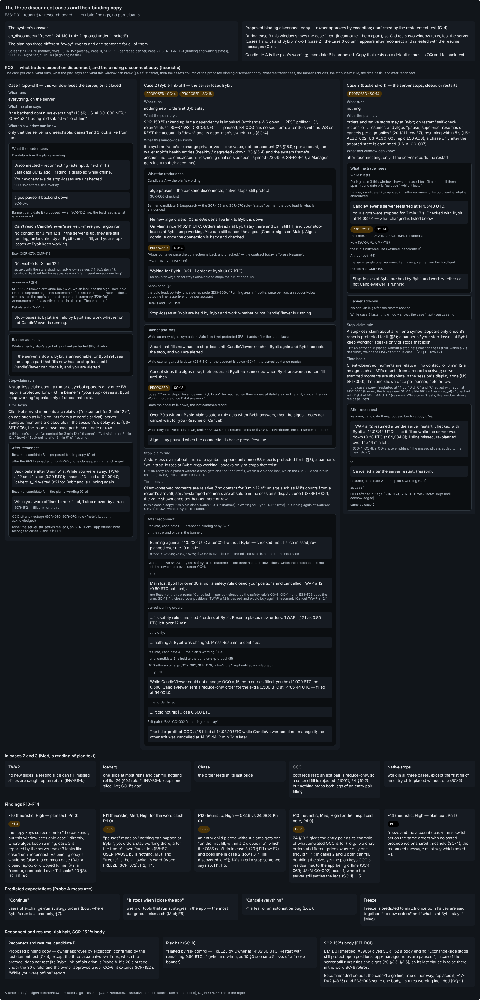
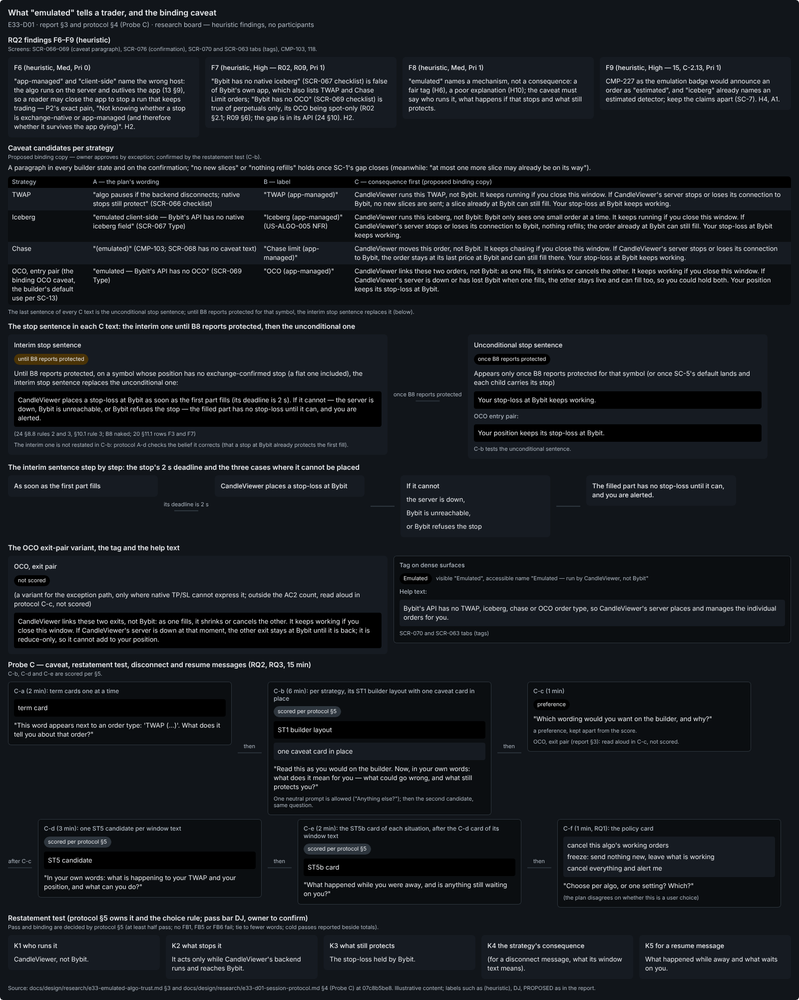
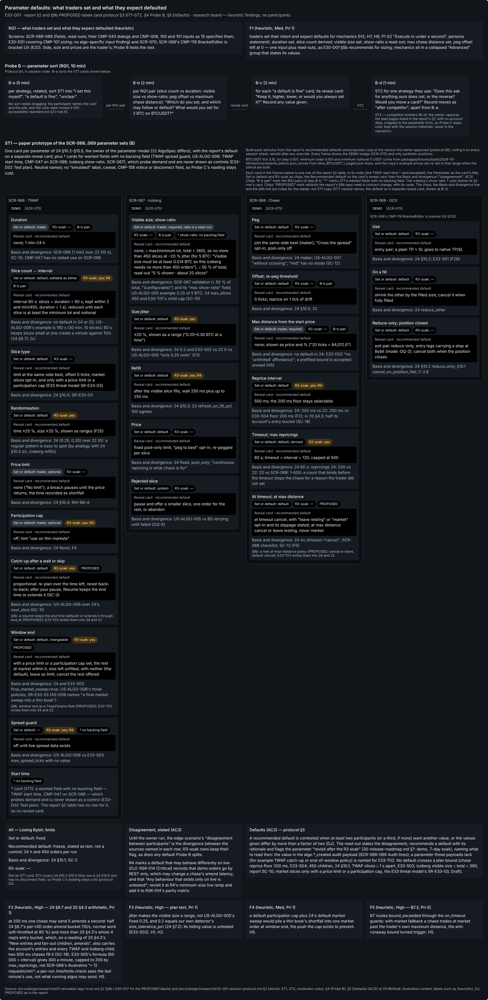
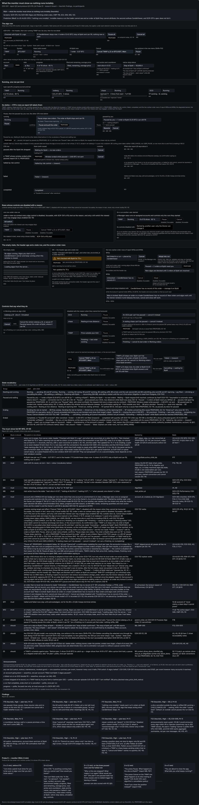
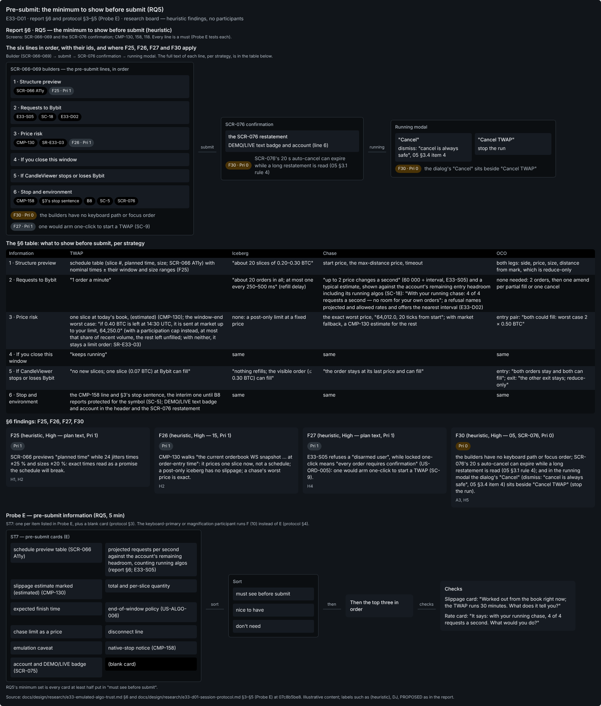
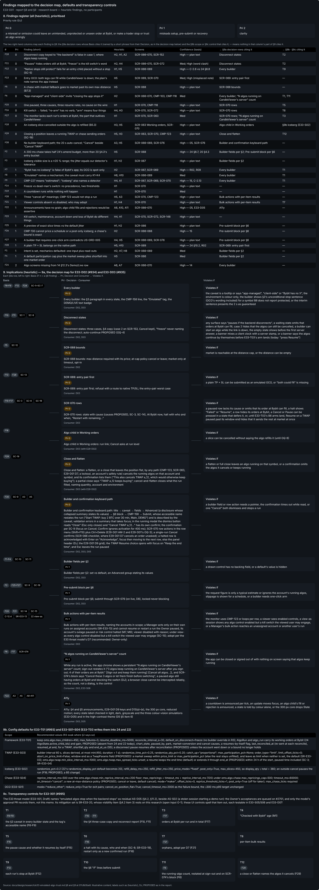
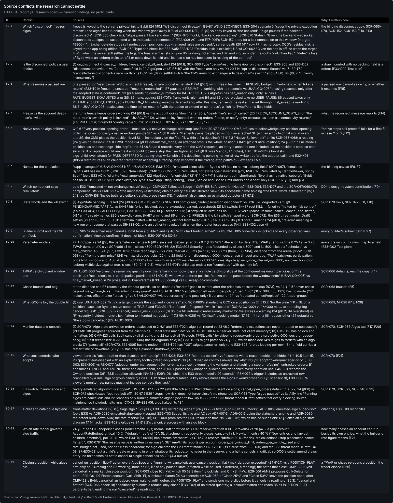
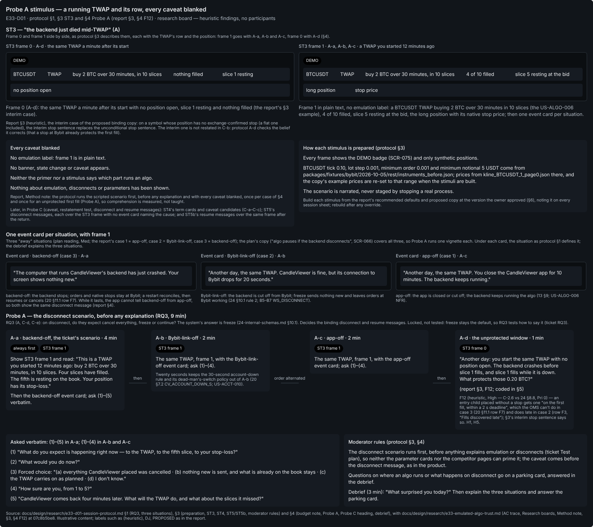

# E33-D01 — UX research: how traders configure and trust an emulated algorithm

- **Ticket:** E33-D01 (issue #857) · **Status:** text first — **owner approval pending** (Agent-delivery adaptations,
  owner decision 2026-09-25); Penpot boards drawn on page `E33-D01` · id `2f3d2667-6b0f-80a6-8008-d4fe6a7cba88` and
  exported in this PR · **Method:** heuristic evaluation of the locked plan texts + public documentation as recorded in
  the repository's research; **no sessions were run** · **Protocol and owner walkthrough checklist:**
  `e33-d01-session-protocol.md` (this folder), which owns the session script and scoring.
- **Scope:** builders SCR-066 TWAP, SCR-067 iceberg, SCR-068 chase, SCR-069 OCO (its OCO half); the SCR-070 monitor
  and the SCR-063 Algos tab that hosts it; algo children in SCR-063 Working orders; the algo lines of SCR-072, 076,
  148, 152 and 153; CMP-103, 118, 123, 130, 158, 227. Feeds E33-D02 (#934) and E33-D03 (#935) with findings, defaults
  and binding copy; E33-T01 (#993) and E33-S01–S04 with config defaults; E33-X01 (#995) with transparency controls.
- **Out of scope:** visual design (D02/D03); testing built software (E33-Q05, Q06); rule-engine and bracket UX (E32,
  E35–E37); scaled orders (SCR-065) beyond the CMP-118 they share; group-level algos; live trading (R3 is demo).
- **Deviations to record in the PR:** (1) the ticket asks for `docs/research/` and its agent brief names branch
  `feat/e33-ux-research-how-traders`; this delivery uses `docs/design/research/`, as E09, E13, E16 and E30 did, and
  the ticket's own `## Branch` value, `design/e33-algo-research`. (2) The brief's `/algos/*` appears in plan text only
  as doc 14's superseded name (24 §19.2: canonical `/orders` with an `algo` block) and as E33-T02's planned delta;
  `ADOPT` is a B1 event only; the WS `algos` topic, `machines/emulated-algo.machine.json` and the events ARM, TICK and
  CRASH_RESUME appear only in the E33 ticket briefs and in the E33 threat model, which quotes them (CX-04, CX-18) and
  settles that B4–B7 as committed are the contract (CX-18). (3) The ticket's "R11 Alert reliability" is "Supply chain
  & tooling" in `32`; algo risks are R4. (4) "CMP-115 OrderTypeSelector" is CMP-115 OrderRow; the selector is CMP-103
  OrderTypeTabs. (5) Of the ticket's three "§18 NFRs" only the iceberg "(app-managed)" label is in `11` §18; the
  others are SCR-069/070 lines. (6) C-4.8: report and protocol are one pair; the PR states their sizes.
- **In plain words.** No session has been run: nothing here is a measured time, a hit rate or a participant quote;
  every finding is a heuristic prediction for the owner run. The headline: the plan uses one sentence — "algo pauses
  if the backend disconnects; native stops still protect" — for three different events, and it is false in a common
  one (DJ), this window losing the server, where algos keep running (§4). Act first on the Pri 0 rows of §8. Every
  source conflict and open question has a **Recommended default** (§1a, §10) the owner approves **by exception**. Ids:
  **RQ** research question · **F** finding · **SC** source conflict · **DJ** designer judgement, no evidence · **OQ**
  open question · **H1–H10** Nielsen · **A1–A11** `05` requirement · **Pri 0–2** priority · **case 1–3** the three
  ways an algo loses its owner (§4; the protocol's app-off, Bybit-link-off, backend-off) · **R3-soak** revisit after
  the R3 soak · **Probe A–F** the protocol's session steps · **PROPOSED** needs a contract change named in §1a; drawn
  only with its E33-T03/T02 route. Plan documents by number (`docs/plan/NN-*`): `04` security · `05` accessibility ·
  `10` personas · `11` user stories · `13` user flows · `14` screens · `15` components · `16` design-system brief ·
  `17` UX diagrams · `20` architecture · `21` database · `22` OpenAPI · `23` WS protocol · `24` internal schemas ·
  `28` statecharts · `30` roadmap · `32` risk register.

## Locked, not relitigated

Inputs, not questions. (1) **C-2.6** with **C-4.14**: every position-opening order, on every account, in every
environment, including every leg — so every position-opening algo child — carries a native exchange-side stop-loss (24
§8.8 "Binding (owner decision; ADR-0008)"). (2) Algos run **on the CandleViewer server** (`AlgoSupervisor`, `20`
§3.5), "never in the browser" (epic E33), and survive "client disconnects and browser closure" (US-ALGO-006 NFR; `13`
§9). (3) **`on_disconnect="freeze"`** is the default: on losing Bybit the server "stops issuing new children but
leaves existing ones working — the native SL still protects the position" (24 §10.1 rule 2; B5–B7 `WS_DISCONNECT` →
`paused`); this research asks how to say it, not whether to cancel instead. (4) **Demo only in R3** ("no code path
that can reach live until R4", `30` §7); SCR-074 blocks a demo/live switch "while any algo or trade group is running"
(C-2.11). (5) The kill switch and lockouts halt every algo by a synchronous check (C-2.21); no run "ever auto-resumes
without an explicit re-arm" (epic E33 AC4). (6) The monitor shows **server state**, reconciled at least every 30 s
(US-ALGO-010 NFR); RBAC is server-side (C-12.4). (7) A crashed run resumes from Postgres within 5 s and adopts its
orders by `order_link_id` (epic E33 AC3), only after the full match (24 §8.3 rule 3). This report makes the residual
risk legible; it weakens none of these.

## Acceptance-criteria trace (issue #857)

Status key as in E30-D01: **done** = delivered as worded · **heuristic-only** = delivered by the adaptation, pending
the owner run · **open** = needs sessions or an owner decision.

| Ticket AC or deliverable                                                                                                                                                        | Where                                                                                                                                                                  | Status                                                                                           |
| ------------------------------------------------------------------------------------------------------------------------------------------------------------------------------- | ---------------------------------------------------------------------------------------------------------------------------------------------------------------------- | ------------------------------------------------------------------------------------------------ |
| AC1: all five RQs answered with evidence, each naming the screens it affects                                                                                                    | §2–§6, each opening with its screens                                                                                                                                   | heuristic-only (evidence = plan text + heuristics)                                               |
| AC2 and the binding-copy deliverable: one caveat per strategy, shown to be restated correctly; the disconnect message                                                           | §3 candidates, the restatement test and choice rule (protocol §5) and proposed binding text; §4 disconnect and resume copy                                             | heuristic-only; restatement evidence open (protocol steps C-b, C-d, C-e)                         |
| AC3 (edge) and the defaults deliverable: a disagreement on a default stated, a default recommended and flagged for the R3 soak; defaults per strategy handed to D02/D03 and T01 | §2 table (divergent plan texts stand in for participant disagreement); §9b                                                                                             | heuristic-only (plan divergence stands in; participant disagreement open — protocol §5 Defaults) |
| Prioritised design implications                                                                                                                                                 | §8 Pri column; §9a decision map                                                                                                                                        | heuristic-only                                                                                   |
| Stimuli: competitor builders · paper prototype of SCR-066..069 · scripted "backend died mid-TWAP"                                                                               | §7 (documentation only; leads listed, not read); Boards 3 and 8; protocol Probe A (scripted scenario, ST3) and Probe B (paper prototype ST1; competitor step B-d, ST2) | open (protocol ready)                                                                            |
| Validity, a11y and security controls: one participant new to CandleViewer; disconnect first; one keyboard or magnification user; demo only, PII                                 | protocol recruiting and framing; Probe A first, before any explanation, every caveat blanked; Probe F                                                                  | open (specified in protocol §2 and §4; needs the run)                                            |
| ≥5 sessions, "verbatim quotes", CDO and OMS-lead review, sign-off                                                                                                               | no sessions, no quotes; owner `approved` comment replaces sign-off                                                                                                     | open                                                                                             |
| Owner walkthrough checklist                                                                                                                                                     | protocol §6                                                                                                                                                            | drafted (protocol §6); to be posted on #857 when the PR leaves draft                             |

## Research boards (Penpot)

Per `docs/design/README.md` ("Approval rule") a research ticket ships boards plus PNG exports. The eight boards are
drawn on the project's Penpot instance (`docs/design/README.md`), on page `E33-D01` · id
`2f3d2667-6b0f-80a6-8008-d4fe6a7cba88`, bound to semantic tokens in `packages/ui/tokens`, and exported in this PR to
`docs/design/E33/img/E33-D01-NN-<board>.png`, cited by page name and id:

- `E33-D01-01-three-cases` — the three cases, the three ways an algo loses its owner (app-off, Bybit-link-off,
  backend-off), with the binding disconnect copy (§4):
  
- `E33-D01-02-caveat-candidates` — what "emulated" tells a trader: the caveat candidates per strategy and the
  restatement test (§3; Probe C):
  
- `E33-D01-03-parameter-defaults` — what traders set and what they expect defaulted, as the Probe B paper prototype of
  SCR-066..069 (§2):
  
- `E33-D01-04-monitor-must-show` — what the monitor must show so nothing runs invisibly: the SCR-070 row, its states and
  the must-show list M1–M12 and S1–S5 (§5; Probe D):
  
- `E33-D01-05-pre-submit` — the minimum to show before submit, per strategy (§6; Probe E):
  
- `E33-D01-06-findings-decision-map` — the findings register F1–F30 (§8) and the decision map for E33-D02 and E33-D03,
  with the config defaults and the transparency controls (§9):
  
- `E33-D01-07-source-conflicts` — the source conflicts SC-1 to SC-19 (§1):
  
- `E33-D01-08-probe-a-stimulus` — the Probe A stimulus, a running TWAP and its row, every caveat blanked:
  

## Method note (Agent-delivery adaptation, owner decision 2026-09-25)

Moderated sessions become (1) a **heuristic evaluation** of the locked plan texts, (2) a **written session protocol**
and (3) an **owner walkthrough checklist** for #857 (both in the protocol file). Every repository claim was re-read at
commit `a556e05fc`. **Heuristics:** Nielsen's ten (https://www.nngroup.com/articles/ten-usability-heuristics/, as
cited in E30-D01): H1 status · H2 real-world match · H3 user control · H4 consistency · H5 error prevention · H6
recognition · H7 efficiency · H8 minimalism · H9 error recovery · H10 help; and `05-accessibility-standard.md`,
numbered as in E30-D01: A1 §2 never colour-only · A2 §2 "WS disconnects … announced in plain language" · A3 §3.1 rule
4 keyboard confirm · A4 §3.1 rule 5 "1-click ARMED" · A5 §3.4 item 3 focus never stolen · A6 §4 icon + text + colour ·
A7 §5 item 3 LIVE/DEMO contrast · A8 §6.2 assertive · A9 §7 reduced motion; added, A10 §4 item 4 persistent critical
banner · A11 §6.2 polite, throttled.

**Confidence and limits.** Each finding is `(heuristic)` with a basis: **High** = stated in a locked plan document or
token file (for a conflict: the texts disagree); **Med** = sound heuristic reasoning; **Low** = persona inference
only; no evidence = **DJ**; a judgement-based default = **R3-soak**. No quote bank, participant, timing or hit rate
exists; `10-personas.md` lines are persona statements. Competitor facts come only from the repository's reads of
public pages, compiled 2026-09-13/14 (`docs/research/02-tradingview-trading.md` R02,
`07-crypto-orderflow-competitors.md` R07, `09-execution-risk-tools.md` R09, with their URLs) and E30-D01's comparative
reads (Bookmap 2026-10-19, Sierra Chart 2026-10-20); on 2026-10-21 eight fetches of Bybit, Binance, OKX and
Hyperliquid pages were refused by the fetch tool's domain check, so **no page was read today**; a web search gave
titles, URLs and machine-written summaries but no page text, listed in §7 only as **leads** (Low). The protocol runs
the scripted scenario **first**, before any explanation and with every caveat blanked, once per case of §4 and once
for an unprotected first fill (Probe A), so comprehension is measured, not taught; then B parameter sort (B-d:
competitor builders), C restatements of the caveat (C-b), disconnect message (C-d) and resume message (C-e), D monitor
and E pre-submit, or F, a keyboard or magnification pass, instead of E.

## 1. Source conflicts the research cannot settle (owner decisions) `(heuristic, High — plan text)`

| #     | Conflict                                | Sources                                                                                                                                                                                                                                                                                                                                                                                                                                                                                                                                                                                                                                                                                                                                                                                                                                                                                                                                                                                                                                                                                                                                                                                                                                                                                   | Why it matters here                                                                                  |
| ----- | --------------------------------------- | ----------------------------------------------------------------------------------------------------------------------------------------------------------------------------------------------------------------------------------------------------------------------------------------------------------------------------------------------------------------------------------------------------------------------------------------------------------------------------------------------------------------------------------------------------------------------------------------------------------------------------------------------------------------------------------------------------------------------------------------------------------------------------------------------------------------------------------------------------------------------------------------------------------------------------------------------------------------------------------------------------------------------------------------------------------------------------------------------------------------------------------------------------------------------------------------------------------------------------------------------------------------------------------------- | ---------------------------------------------------------------------------------------------------- |
| SC-1  | Which "disconnect" freezes algos        | freeze is keyed to the server's private link to Bybit (24 §10.1 "WS disconnect (freeze)"; B5–B7 `WS_DISCONNECT`; E33-Q04 scenario 5 "sever the private execution stream") and algos keep running when this window goes away (US-ALGO-006 NFR; `13` §9) vs copy keyed to "the backend": "algo pauses if the backend disconnects" (SCR-066 checklist), "algos pause if backend down" (SCR-070 mock), "backend reconnecting" (SCR-070 States), "Given the backend websocket disconnects … algos are suspended while the backend reconnects" (E33-S06 AC), and E17-D01's SCR-152 body for a lost connection to this window (merged, #3905): "… Exchange-side stops still protect open positions; app-managed rules are paused."; server death (`20` §11.1 row F7) has no copy; OCO's residual risk is keyed to the app being offline (SCR-069 Type and checklist; E33-S05; E33-D03 "Residual risk is explicit"; US-ALGO-002 "Given the app is offline when the target fills"), when the server still settles the legs; the freeze arm exists only on B5 `working`, B6 `armed` and B7 `working`, so under the root's `"onUnhandled": "defer"` a loss of Bybit while an iceberg waits to refill or cools down is held until its next slice has been sent (a reading of the contract)            | the binding disconnect copy; SCR-066–070, SCR-152, SCR-153 (F10, F13)                                |
| SC-2  | Is the disconnect policy a user choice  | (1) `on_disconnect` ∈ `cancel_children`, `freeze`, `cancel_all_and_alert` (24 §10.1), SCR-066 Type "pause/resume behaviour on disconnect", E33-S05 and E33-D02 "disconnect behaviour" vs (2) no such field in 22 `AlgoSpec` vs (3) B5–B7 with the freeze arm only vs (4) `20` §14 "opt-in disconnect-flatten" vs (5) `30` §7.2 "cancelled-on-disconnect-aware via Bybit's DCP" vs (6) 22 setKillSwitch "the OMS arms no exchange-side dead-man's switch" and `04` OQ-04 (DCP "currently inverse-only")                                                                                                                                                                                                                                                                                                                                                                                                                                                                                                                                                                                                                                                                                                                                                                                    | a drawn control with no backing field is a defect (E33-D02 Test plan)                                |
| SC-3  | What resumes a paused run               | one `paused` for "user pause, WS disconnect (freeze), or rate budget exhausted" (24 §10.1) with three rules: user → `RESUME`; budget → "automatic when tokens return" (E33-T01); freeze → unstated ("resume, reconciled"); B7 `paused` + `RESUME` → `working` with no reconcile vs US-ALGO-007 "chasing resumes only after the adopted state is confirmed"; `23` §6.4 sends no `context_summary` for B4–B7; E33-T02's `AlgoRun` has `halt_reason` only; only B7 has a `RATE_BUDGET_EXHAUSTED` arm (B5, B6 none, against E33-T01's framework rule), and B4 and B6 `price_blocked` take no `USER_PAUSE`; B6 `paused` takes only `RESUME` and `USER_CANCEL`, so a `DURATION_END` while paused is deferred and, after Resume, can send the rest at market through `final_sweep` (a reading of B6.3); US-ALGO-006 recalculates the time left on resume "with the option to extend or compress", which no `TwapParams` field holds                                                                                                                                                                                                                                                                                                                                                              | a paused row cannot say why, or whether it resumes (F15)                                             |
| SC-4  | Freeze vs the account dead-man's switch | the run's freeze keeps orders working (24 §10.1) vs the account going "down" after 30 s, "dead-man's switch called" (`20` §7.2 `CV_ACCOUNT_DOWN_S`) or "the dead-man's-switch policy is invoked" (US-ACCT-010), whose policy "(cancel working orders, flatten, or notify only) executes as soon as connectivity returns" (US-RULE-013); threshold "configurable 10–120 s" (US-RULE-013 NFR) vs "≤ 30" (`20` §7.2)                                                                                                                                                                                                                                                                                                                                                                                                                                                                                                                                                                                                                                                                                                                                                                                                                                                                         | what the reconnect message reports (F14)                                                             |
| SC-5  | Native stop on algo children            | C-2.6 "Every position-opening order … must carry a native exchange-side stop-loss" and `30` §7.2 E32 "the OMS refuses to acknowledge any position-opening order that does not carry a native exchange-side SL" vs 24 §8.8 rule 2 "If an entry must be placed without an attached SL (e.g. an algo child that would over-attach), the OMS places the position-level SL … immediately on the first fill, within a 2 s deadline"; `14` §12.3 "Native-SL invariant" omits SCR-066–068; a reading (24 gives no reason): in `full` TP/SL mode (24 §8.1's default `tpsl_mode`) an attached stop is the whole position's (R02 §2.2 "Entire Position"; 24 §8.5: "In Full mode a position has one exchange-side stop"), and 24 §8.8 rule 6 records every stop the OMS requests, an entry's attached one included, as the position's stop, so each slice, refill or replace would rewrite it and could loosen a stop the user tightened (24 §8.8 rules 5 and 6; B1 notes); E32-T01 (#931) allow-lists `algo_child_over_attach` for PASS_DEFERRED (a `trading-stop` write with a 2 s deadline, its `pending_native_sl` row written before the adapter call), and E32-K01 (#856) restructures such children "rather than accepting a trading-stop window" if the trading-stop path's p99 exceeds 1.5 s | "native stops still protect" fails for a first fill in case 2 or 3 (F12)                             |
| SC-6  | Names for the emulation                 | "(app-managed)" (US-ALGO-005 NFR; US-ALGO-008; E33-S02), "emulated client-side — Bybit's API has no native iceberg field" (SCR-067), "emulated — Bybit's API has no OCO" (SCR-069), "(emulated)" (CMP-103, CMP-118), "emulated, not exchange-native" (`30` §7.2; RSK-017), "emulated by CandleViewer, not by Bybit" (epic E33 AC1), "client-of-exchange-side" (22 `AlgoSpec`), "client-side" (`21` §14; CMP-118 data contract); shorthands "Bybit has no native iceberg", "Bybit has no OCO" (SCR-067/069 checklists) vs Bybit's own app listing Iceberg, TWAP, Scaled and Chase Limit orders and a spot-only OCO (R02 §2.1; R09 §6)                                                                                                                                                                                                                                                                                                                                                                                                                                                                                                                                                                                                                                                      | the binding caveat (F6, F7)                                                                          |
| SC-7  | Which component says "emulated"         | epic E33 "'emulated — not exchange-native' badge (CMP-227 EstimatedBadge + CMP-158 SafetyInvariantNotice)", E33-D04, E33-D07 and the SCR-067/069/070 component lists vs CMP-227 = "the mandatory `(estimated)` chip on every heuristic-derived view", its accessible name holding "the literal word 'estimated'" (`15`; C-2.13) vs CMP-158 "inside both rule editors", static, props none (`15`); "iceberg" also names an estimated detector (24 §7.2)                                                                                                                                                                                                                                                                                                                                                                                                                                                                                                                                                                                                                                                                                                                                                                                                                                    | D04's design-system contribution (F9)                                                                |
| SC-8  | State words and the kill switch         | (1) AlgoState `pending` … `failed` (24 §10.1) vs CMP-118 `error` vs SCR-066 `configured`, "auto-paused on disconnect" vs SCR-070 `degraded` vs `13` §9 PENDING/ARMED/PARTIAL vs B4–B7 ids (`price_blocked`, `bound_exceeded`, `parked`, `overshoot`); (2) kill switch: B4–B7 root `KILL` → `failed` vs "halted by risk control" (epic E33 AC4; US-ALGO-005/006; E33-T01; E33-S06; `10` §5 scenario 10); (3) "explicit re-arm" has no E33-T02 verb (pause, resume, cancel, cancel_and_flatten); (4) "arm" already names E30's one-click arm, B4/B7 `arming` and B6 `armed`; (5) FREEZE is the kill switch's typed word (SCR-072); the E33 threat model (Draft) settles (2) and (3) for E33-T01: a terminal `halted` with `halt_reason`, distinct from `failed` (CX-10, SR-E33-19; its §11.3 note 3 amends 24 §10.1), "re-arm" meaning a new run or a resume that passes SR-E33-02, and an `authority_revoked` halt when the creator loses access (§4.1; E33-X02 case 4)                                                                                                                                                                                                                                                                                                                    | SCR-070 rows, SCR-072 (F11, F16)                                                                     |
| SC-9  | Builder submit and the E30 arm/lock     | E33-S05 "a disarmed user cannot submit from a builder" and its AC "with chart trading armed" vs US-ORD-005 "one-click is locked and every order requires confirmation" (locked confirms, it does not block; E30-D01 §1a SC-3)                                                                                                                                                                                                                                                                                                                                                                                                                                                                                                                                                                                                                                                                                                                                                                                                                                                                                                                                                                                                                                                             | every builder's submit path (F27)                                                                    |
| SC-10 | Parameter models                        | 22 `AlgoSpec` vs 24 §10, the parameter owner (each §10.x says so): iceberg jitter 0 vs 0.2 (E33-S02 "jitter is on by default"); TWAP jitter 0 vs time 0.25 / size 0.20; TWAP duration ≥10 s vs SCR-066 ≥1 min; slices ≤500 (SCR-066; 22; E33-S03 Security notes "bounded by `slices ≤ 500`", and its 500-slice perf schedule) vs `max_children` 450 (24 §10.1; E33-T01); chase repricings 20 vs 200; interval 250 ms (min 50) vs 200 ms (floor, E33-S04); distance "from the arrival price" (SCR-068) vs "from the arm price" (24) vs `max_slippage_ticks` (22); no 22 field for `on_disconnect`, OCO `mode`, chase timeout and peg, TWAP catch-up, participation, price limit, window end; 450 slices in SCR-066's 1 min minimum is a 133 ms interval vs E33-S03 `oms.algo.twap.min_slice_interval_ms=1000`; no lower bound on iceberg visible size against `max_slices` 450 (24 §10.3), where E33-T01's child cap ends a run "completed" with quantity left                                                                                                                                                                                                                                                                                                                             | every drawn control must map to a field (E33-D02 Test plan)                                          |
| SC-11 | TWAP catch-up and window end            | US-ALGO-006 "re-plans the remaining quantity over the remaining window, caps any single catch-up slice at the configured maximum participation" vs `catch_up="next_slice"`, `max_participation_pct=None` (24 §10.4); window end: three policies "shown on the panel before the window ends" (US-ALGO-006) vs `final_market_sweep` in 24 prose, not in `TwapParams` (E33-S03 config) vs B6 sweep-or-complete                                                                                                                                                                                                                                                                                                                                                                                                                                                                                                                                                                                                                                                                                                                                                                                                                                                                               | SCR-066 defaults, resume copy (F4)                                                                   |
| SC-12 | Chase bounds and peg                    | at the distance cap B7 routes by the timeout guards, so `on_timeout="market"` goes to market after the price has passed the cap (B7.3), vs 24 §10.5 "never chase beyond `max_chase_ticks` … the anti-runaway guard" and US-ALGO-007 "cancelled or left resting per policy"; peg "mid" (SCR-068; E33-D02) has no mode (24: maker, taker, offset); taker "crossing" vs US-ALGO-007 "without crossing" and `post_only=True`; amend (24) vs "repeated cancel/replace" (22 `/trade-groups`)                                                                                                                                                                                                                                                                                                                                                                                                                                                                                                                                                                                                                                                                                                                                                                                                    | SCR-068 bounds (F5)                                                                                  |
| SC-13 | What OCO is for; the double fill        | (1) use: US-ALGO-002 "hitting a target cancels the stop and vice versa" and SCR-069's standalone OCO on a position vs 24 §10.2 "for the plain 'TP + SL on a position' case, use Bybit's native attached TP/SL" and E33-S01 "is refused"; (2) speed: "within 1 second" (US-ALGO-002) vs "<=300 ms … to opposing-leg cancel request" (SCR-069) vs `cancel_timeout_ms` 2000 (22); (3) double fill: automatic reduce-only market for the excess + `warning` (24 §10.2; B4 `overshoot`) vs "P1-severity incident … one-click 'flatten to intended net position'" (`13` §9; M-028) vs "Critical", blocking modal (`17` §6); (4) on a fill: `reduce_other` (24 default) vs "the stop is cancelled" (US-ALGO-002)                                                                                                                                                                                                                                                                                                                                                                                                                                                                                                                                                                                 | SCR-069, M-028 (F13, F28)                                                                            |
| SC-14 | Monitor data and controls               | (1) SCR-070 "Algo state arrives on `orders`, coalesced to 2 Hz" and E33-T02's `algo_run` record vs `23` §6.2 "`orders` and `executions` are never throttled or coalesced"; (2) CMP-118 progress "sourced from the client-side … local state machine" vs US-ALGO-010 NFR "server state, not client memory"; (3) CMP-118 has no `oco` and no flatten; (4) CMP-123 calls Bybit cancel-all directly, and 22 cancel-all "Protects TP/SL exits" by skipping reduce-only orders (protective OCO legs are reduce-only); (5) "last reconciled" (E33-D03, E33-S06) has no `AlgoRun` field; (6) E33-T02's `/algos` paths vs 24 §19.2, which maps doc 14's `/algos` to `/orders` with an `algo` block; (7) "pause all" (SCR-070, E33-S06) has no endpoint (E33-T02 has `POST /algos/cancel-all` only) and E33-S06 forbids looping per row; (8) no field carries a restart time or downtime (`23` §15.9 has only a planned `shutdown_notice`)                                                                                                                                                                                                                                                                                                                                                          | SCR-070, SCR-063 Algos tab (F17, F20)                                                                |
| SC-15 | Who sees controls; who adopts           | viewer controls "absent rather than disabled-with-tooltip" (E33-D03; E33-S06 "controls absent") vs "disabled with a reason tooltip, not hidden" (`14` §0.5 item 5), P3 "present-but-disabled with an explanatory tooltip ('Read-only role')" (`10` §4), "Disabled controls always say why" (`16` §1); adopt "owner/manager-only" (E33-D03; E33-S06) vs RSK-077 "adoption under management Owner-only, step-up, re-running the validator and attaching a stop or refusing"; untracked orders: B1 consumes `CANCEL` and `AMEND` there and audits them, and `ADOPT` passes only `adoption_allowed`, which "denies every adoption until E45-S01 records the Owner's decision D6" (B1.5 `adoption_allowed`; INV-B1-l; E29's D6, which the E33 threat model's D7 extends); RSK-077's trigger includes an `untracked` row "cancelled by a rule, algo or group cancel"; E29-D01 D2 draws both disabled; a key revoke names the algos it would orphan (`10` §5 scenario 9); E33-D05: "a `viewer`'s monitor row names must not include controls they lack"                                                                                                                                                                                                                                          | SCR-070 (F21)                                                                                        |
| SC-16 | Kill switch, maintenance and algos      | "every emulated algorithm is stopped" (US-RULE-014) vs 22 setKillSwitch and `KillSwitchResult`, silent on algos; `cancel_open_orders` default true (22; 24 §8.11) vs SCR-072 checkboxes "both default off"; `30` §7.2 E39 "stops new risk, does not force-close"; maintenance: SCR-148 Type "algos paused" vs its A11y line "Running algos are cancelled" and 22 "cancels only running emulated algos" (open follow-up #3380); the E33 threat model (Draft) settles that every blocking source, maintenance included, halts runs (CX-09, SR-E33-06; `algo.halted`, its §8.1)                                                                                                                                                                                                                                                                                                                                                                                                                                                                                                                                                                                                                                                                                                              | SCR-070, SCR-072, SCR-148 (F23)                                                                      |
| SC-17 | Ticket and catalogue hygiene            | front-matter deviations (2)–(5); flags `algo.*` (`21` §10.7; E33-T02) vs `trading.algos.*` (24 §16.2) vs `twap_algo` (SCR-145 mock); "ADR-0016 emulated-algo supervisor" (epic E33) vs `ADR-0030-emulated-algo-supervisor.md` (E33-T03 Scope; its title and AC say ADR-0016), ADR-0016 being the statechart runtime and ADR-0030 the defect burn-down ADR; the rate reserve (SC-18); SCR-069 promises the OCO resolution time "in SCR-078", which has no such field; `17` §5 cites an algo state diagram `17` §4 lacks; E33-T02's `/algos` vs 24 §19.2's canonical `/orders` with an `algo` block                                                                                                                                                                                                                                                                                                                                                                                                                                                                                                                                                                                                                                                                                         | citations; E33-T03 reconciles                                                                        |
| SC-18 | Which rate model governs algo traffic   | 24 §8.7: per-UID endpoint classes (`order.amend` 10/s; `normal` soft-throttled at 80 %; `reserve_fraction` 0.10 + 2 tokens) vs `20` §4.3: a per-account `AccountRateBudget`, `critical` 40 % ("default 4 req/s of 10": SL attachment, reduce-only closes, cancel-all / kill-switch), `entry` 40 % ("New entries and fan-out children, amends"), `poll` 20 %, which E34-T02 (#859) implements "verbatim" vs C-12.7: a reserve "(default 30%) for risk-critical actions (stop placement, cancel, flatten)"; RSK-078: "the reserve value is written three ways"; `GET /me/limits` reports per account `orders_per_minute_limit`, `orders_per_minute_used` and `rate_budget_pct_used`, not per-class headroom; for algo children the E29 threat model's SR-E29-01 (its clause from E33-X01) and the E33 threat model (Draft; CX-08, SR-E33-08) put a child's create or amend in `entry` whatever its `reduce_only`, never in the reserve, and a halt's cancels in `critical`, so OCO's settle amend draws `entry`; no text names its settle cancel (a single cancel has no `20` §4.3 bucket)                                                                                                                                                                                                  | how many chases an account can run beside its own entries; what the builder's rate figure means (F2) |
| SC-19 | Closing a position while algos run      | `cancel_on_position_flat=True` on every `AlgoSpec` and "running --> cancelled: user cancel / position flat / max_duration exceeded" (24 §10.1) vs a `POSITION_FLAT` arm only on B4 `racing` and B5 `working`, none on B6, B7 or any `paused` state (a flatten while paused is deferred, a reading); the paths that close: CMP-123 (Bybit cancel-all + a market close per position), SCR-063 close (`Ctrl+W`, which `05` §3.3 item 4 blocklists, and `Ctrl+Shift+W`; E29-D01 AM-2 proposes `Ctrl+Delete` for both), E29-D01 D7 Flatten account (`Ctrl+Shift+F`), a lockout's flatten (`10` §3 scenario 4); SCR-063's "Close 25%" and "Close 50%" leave the position open; after CMP-123's Bybit cancel-all an iceberg goes `waiting_refill`, defers the `POSITION_FLAT` and sends one more slice before it cancels (a reading of B5.3); "cancel and flatten" (SCR-066 checklist) "additionally submits a reduce-only close" (E33-T02) of no stated quantity; a lockout's flatten can reach B5 as `POSITION_FLAT` before its halt, ending the run "cancelled" (a reading of B5)                                                                                                                                                                                                             | a TWAP or chase re-opens a position the trader closed (F29)                                          |

### 1a. Recommended defaults — the owner approves by exception (#857) `(heuristic; DJ unless a basis is named)`

Where the E33 threat model already queues an Owner decision (D6–D8) or acceptance (AS-D05, AS-S02), this memo's
default is a recommendation into that decision, never a second approval.

| #     | Recommended default                                                                                                                                                                                                                                                                                                                                                                                                                                                                                                                                                                                                                                                                                                                                                                                                                                                                                                                                                                                                                                                                                                                                                                                                                                                                                                                                                                                                                                                                                                                                                                                                                                                                                                                                                                                                                                                                                                                                                                                                                                                                                                                                                                                                                                                                                                                                                                                            | Basis                                                                                                            | Settled by |
| ----- | -------------------------------------------------------------------------------------------------------------------------------------------------------------------------------------------------------------------------------------------------------------------------------------------------------------------------------------------------------------------------------------------------------------------------------------------------------------------------------------------------------------------------------------------------------------------------------------------------------------------------------------------------------------------------------------------------------------------------------------------------------------------------------------------------------------------------------------------------------------------------------------------------------------------------------------------------------------------------------------------------------------------------------------------------------------------------------------------------------------------------------------------------------------------------------------------------------------------------------------------------------------------------------------------------------------------------------------------------------------------------------------------------------------------------------------------------------------------------------------------------------------------------------------------------------------------------------------------------------------------------------------------------------------------------------------------------------------------------------------------------------------------------------------------------------------------------------------------------------------------------------------------------------------------------------------------------------------------------------------------------------------------------------------------------------------------------------------------------------------------------------------------------------------------------------------------------------------------------------------------------------------------------------------------------------------------------------------------------------------------------------------------------------------- | ---------------------------------------------------------------------------------------------------------------- | ---------- |
| SC-1  | Copy names the case, never "the backend": case 1 "Can't reach CandleViewer's server" (algos may still run); case 2 "No new algo orders: CandleViewer's live link to Bybit is down"; case 3 reported after reconnect (§4); the OCO outage note covers cases 2 and 3 (§4). The freeze itself is unchanged; E33-T03 gives every non-final state (or the root) a `WS_DISCONNECT` freeze arm, and until then the copy allows one more slice; while an account's link is down (its `account_notice` reads `oms.account_resyncing`, or its `wallet` health is degraded or down), builders disable Submit, focusable, with "Can't start algos: CandleViewer's live link to Bybit is down", and the server refuses the run or starts it paused (E33-T03), since the freeze reaches only runs that exist when the link drops; SCR-152's case-1 body replaces E17-D01's "app-managed rules are paused" (merged, #3905), false while the server is up, with the case-1 algo line (§4; routed to E17-D02, #325, and E33-D03)                                                                                                                                                                                                                                                                                                                                                                                                                                                                                                                                                                                                                                                                                                                                                                                                                                                                                                                                                                                                                                                                                                                                                                                                                                                                                                                                                                                                | `13` §9; US-ALGO-006 NFR; 24 §10.1; `23` §15.9; SCR-153; `20` §3.6; E17-D01 §5                                   | OQ-1       |
| SC-2  | R3 ships `freeze` only, shown in builders as a read-only line, not a control; other policies and disconnect-flatten wait for an owner decision and a 22 field; no copy claims Bybit's DCP (not available for linear, `04` OQ-04); E33-T03 amends `30` §7.2                                                                                                                                                                                                                                                                                                                                                                                                                                                                                                                                                                                                                                                                                                                                                                                                                                                                                                                                                                                                                                                                                                                                                                                                                                                                                                                                                                                                                                                                                                                                                                                                                                                                                                                                                                                                                                                                                                                                                                                                                                                                                                                                                     | E33-D02 Test plan; 22 `AlgoSpec`; `04` SR-059                                                                    | OQ-5       |
| SC-3  | `AlgoRun` carries `paused_by` (user, disconnect, rate budget, account down, a bound passed while Bybit was away, orders at Bybit needing you, M10a) and whether the run resumes by itself; a disconnect pause resumes by itself (**PROPOSED**; today no freeze pause resumes by itself: B5–B7 `paused` takes only `RESUME` and `USER_CANCEL`, and only E33-T01's rate-budget pause resumes automatically, when tokens return) only after reconciliation with Bybit and only while the run's bounds still hold (price limit, max distance, window open): if its price limit or max distance no longer holds when Bybit is back, the run waits for Resume or Cancel, and Resume re-checks it (B6 `price_blocked`; B7 `bound_exceeded`); a user, account-down or orphan pause waits for Resume; B7 resumes through reconciliation (US-ALGO-007). Resume on a TWAP restates the time and quantity left and offers "Keep the end time" (larger slices; the default) or "Extend to {time}" (US-ALGO-006 "extend or compress"), which needs `resume` to take an optional `end_at` (E33-T02); the extension is a new audited parameter version, which the E33 threat model's SR-E33-04 (Draft) lets only narrow the run, ending within its 24 h, paused time included (the model's §5 `max_duration_ms`). When a paused TWAP's window ends, a "leave as limit" or "cancel the rest" policy still applies by itself, but the market sweep waits for the trader: the row reads "Window ended while paused — 0.80 BTC not sent", with "Send the rest at market…" (within the run's price limit or cap, SR-E33-03; confirmed, with a CMP-130 estimate; a new E33-T02 action and a B6 `paused` → `final_sweep` arm, E33-T03) and "End the run"; until those **PROPOSED** arms land, Resume on such a run is confirmed with "Resume sends the 0.80 BTC left at market now, within your price limit if set" (B6 defers the window end, and its sweep runs on Resume); holding the sweep for the trader amends US-ALGO-006's and E33-S03's "executes exactly once" (DJ). E33-T03 gives B6 `paused` arms for `SLICE_DUE` (recorded as missed) and `DURATION_END`, so a deferred window end never turns Resume into a market order; a user Pause leaves its order at Bybit and says so (M8); "Pause and pull the order" is **PROPOSED**: a `pull_children` flag on E33-T02's `pause`, or a B5–B7 `paused` entry action (E33-T03) | 24 §10.1 "resume, reconciled"; E33-T01; US-ALGO-006/007; B6.3; SR-E33-04                                         | OQ-4       |
| SC-4  | The account outranks the run: an account that goes "down" moves its runs to "Paused — connection lost for over 30 s", its dead-man's-switch policy applies to their orders at Bybit, and Resume is explicit, offered by outcome (§4): after "cancel working orders" it places new orders and says what is left, after "notify only" it continues, and a flatten by the safety rule cancels the account's runs on the flattened symbols, with no Resume (SC-19); one threshold, `CV_ACCOUNT_DOWN_S` (≤30 s); US-RULE-013's 10–120 s is amended                                                                                                                                                                                                                                                                                                                                                                                                                                                                                                                                                                                                                                                                                                                                                                                                                                                                                                                                                                                                                                                                                                                                                                                                                                                                                                                                                                                                                                                                                                                                                                                                                                                                                                                                                                                                                                                                  | US-ACCT-010; US-RULE-013; `20` §7.2                                                                              | OQ-6       |
| SC-5  | C-2.6 wins (recommended): every position-opening algo child carries a stop at Bybit no looser than the position's recorded stop (24 §8.8 rule 6) or the stop Bybit holds now, whichever is tighter, checked tighten-only before sending, since in Full mode the child's attached stop becomes the position's recorded stop and putting the recorded stop back over a tighter one would loosen it (24 §8.8 rules 5 and 6); Full or Partial mode for children is settled in OQ-2 with E33-T03 and E33-X01's threat model; E32-K01's measurement informs the choice (above a 1.5 s trading-stop p99 the plan already restructures such children); if C-2.6 wins, E32-T01 drops `algo_child_over_attach` from its allow-list, E33-T03 amends 24 §8.8 rule 2, and the E33 threat model (Draft) revises its §4.2 item 1 and SR-E33-07, which keep E32-T01's closed deferral today (its open input O-7). Until then no surface claims a stop at Bybit for a run whose position lacks an exchange-confirmed stop (B8 `protected`): such a run shows §3's interim stop sentence; SCR-066–068 join `14` §12.3's "Native-SL invariant" row                                                                                                                                                                                                                                                                                                                                                                                                                                                                                                                                                                                                                                                                                                                                                                                                                                                                                                                                                                                                                                                                                                                                                                                                                                                                                | C-2.6, C-4.14; 24 §8.8 rules 5 and 6; `30` §7.2 E32; B8; E32-T01; E32-K01; SR-E33-07                             | OQ-2       |
| SC-6  | One vocabulary: the visible tag **"Emulated"** on dense surfaces, accessible name "Emulated — run by CandleViewer, not Bybit"; builders lead with the §3 consequence paragraph; "(app-managed)", "client-side" and "client-of-exchange-side" leave user-facing copy (US-ALGO-005's label is amended); "Bybit's API has no …" only in the help text, never "Bybit has no …"                                                                                                                                                                                                                                                                                                                                                                                                                                                                                                                                                                                                                                                                                                                                                                                                                                                                                                                                                                                                                                                                                                                                                                                                                                                                                                                                                                                                                                                                                                                                                                                                                                                                                                                                                                                                                                                                                                                                                                                                                                     | epic E33 AC1; R02 §2.1; R09 §6                                                                                   | OQ-7       |
| SC-7  | CMP-227 stays "(estimated)" only; the emulated tag extends CMP-103's and CMP-118's "(emulated)" text (E33-D04); CMP-158 widens to builders, as E30-D01 SC-9 does for tickets, keeping its one stop-loss sentence; the strategy caveat is its own paragraph in E33-D02's `AlgoBuilderShell`; detectors read "Iceberg (estimated)", our orders "Iceberg order (emulated)"                                                                                                                                                                                                                                                                                                                                                                                                                                                                                                                                                                                                                                                                                                                                                                                                                                                                                                                                                                                                                                                                                                                                                                                                                                                                                                                                                                                                                                                                                                                                                                                                                                                                                                                                                                                                                                                                                                                                                                                                                                        | `15` CMP-103/118/158/227; C-2.13                                                                                 | OQ-7       |
| SC-8  | Every plan state has a label, many-to-one allowed (§5, read from `chart_state`, SC-14); "freeze" never names the disconnect behaviour, and a halt uses the kill switch's own word ("FREEZE by Owner at 14:02:30 UTC"); a risk halt shows "Halted by risk control — {reason, who, when}" from `halt_reason`, never "Failed", an `authority_revoked` halt "Halted — {user} can no longer trade on {account} — {when}" (E33 threat model §4.1) and a maintenance or account halt "Halted — {reason}" (SC-16; the model's `algo.halted` reasons, its §8.1); any halt's only way on is **"Restart with remaining…"**, a new run through the builder and its confirmation — not "Resume", not "re-arm" (`halted` is terminal, SR-E33-19; CX-10's "re-arm" is a new run or a resume that passes SR-E33-02); "arm" stays E30's                                                                                                                                                                                                                                                                                                                                                                                                                                                                                                                                                                                                                                                                                                                                                                                                                                                                                                                                                                                                                                                                                                                                                                                                                                                                                                                                                                                                                                                                                                                                                                                         | epic E33 AC4; US-ALGO-006; E33-T01; SCR-072; E30-D01 F4; CX-10, SR-E33-19                                        | OQ-11      |
| SC-9  | Builders follow US-ORD-005: locked one-click never blocks a builder; every algo submit opens SCR-076 (an algo is a standing programme, never a one-click act), restating kind, account, environment, size, bounds and the §6 worst case; the live-environment confirmation is the E33 threat model's D8 (a) (arm nonce + typed worst case), queued on #2701; R3 is demo, so this memo's confirmation is the demo one; the `unknown` arm state still fails closed (E30-S04); E33-S05 is amended; focus opens on Cancel, `Enter` activates the focused button, and Confirm ignores activation for 400 ms after the dialog opens (SCR-076 "`Enter` confirms only after 400 ms"); for an algo the 20 s inactivity auto-cancel is off (`05` §2 "without incidental timing traps"; §3.1 rule 4), and any timed variant goes to E33-D05 to check against WCAG 2.2.1                                                                                                                                                                                                                                                                                                                                                                                                                                                                                                                                                                                                                                                                                                                                                                                                                                                                                                                                                                                                                                                                                                                                                                                                                                                                                                                                                                                                                                                                                                                                                   | US-ORD-005; E30-D01 §1a SC-3; E30-S04; SCR-076; D8                                                               | OQ-11      |
| SC-10 | 24 owns the parameters; E33-T03 aligns 22 with the §2 values; the tighter screen bound wins (TWAP ≥1 min); SCR-066's slice range reads 2 to min(450, duration ÷ 1 s), its message naming the 1 s floor (`max_children`; E33-S03); iceberg visible size ≥ total ÷ 360, so ≤ 450 slices at −20 % jitter; an outside cancel or a rejected slice pauses the iceberg (F18, §2; a B5 change, E33-T03)                                                                                                                                                                                                                                                                                                                                                                                                                                                                                                                                                                                                                                                                                                                                                                                                                                                                                                                                                                                                                                                                                                                                                                                                                                                                                                                                                                                                                                                                                                                                                                                                                                                                                                                                                                                                                                                                                                                                                                                                                | 24 §10.2–§10.5; E33-T01; E33-S03                                                                                 | OQ-8       |
| SC-11 | `catch_up="proportional"` (re-plan over the window left, never back-to-back), each catch-up slice capped by the participation cap when one is set; cap off by default; window end: the rest at market within the run's price limit or participation cap, else left unfilled (24 "subject to `price_limit`"; the E33 threat model's SR-E33-03, Draft, asks one of them of every market slice), and "leave as limit" when the run has neither, the default, with "cancel the rest" offered, one `TwapParams` field shown before the window ends                                                                                                                                                                                                                                                                                                                                                                                                                                                                                                                                                                                                                                                                                                                                                                                                                                                                                                                                                                                                                                                                                                                                                                                                                                                                                                                                                                                                                                                                                                                                                                                                                                                                                                                                                                                                                                                                  | US-ALGO-006; 24 §10.4; E33-S03; SR-E33-03                                                                        | OQ-8       |
| SC-12 | At the distance cap a chase never becomes a market order: B7 gains its own at-cap policy (cancel, or leave resting); market is reachable only at the timeout, opt-in, with its slippage stated; "mid" leaves the peg radio until a backend mode exists; "Cross the spread" (taker) is explicit and turns post-only off; amend first, cancel and re-place only in US-ALGO-007's unmodifiable case                                                                                                                                                                                                                                                                                                                                                                                                                                                                                                                                                                                                                                                                                                                                                                                                                                                                                                                                                                                                                                                                                                                                                                                                                                                                                                                                                                                                                                                                                                                                                                                                                                                                                                                                                                                                                                                                                                                                                                                                               | 24 §10.5; US-ALGO-007; B7.3; E33-D02 Security notes                                                              | OQ-3       |
| SC-13 | SCR-069 leads with the entry pair ("two entries, only one should fill"); a plain TP + SL on a position is refused with a one-click route to native TP/SL (E33-S01); copy states no time figure (target stays ≤300 ms p95, failure bound 2 s); a double fill is corrected automatically (B4 is normative) and M-028 reports it, becoming a blocking decision only if the correction failed; copy says "shrinks or cancels the other"                                                                                                                                                                                                                                                                                                                                                                                                                                                                                                                                                                                                                                                                                                                                                                                                                                                                                                                                                                                                                                                                                                                                                                                                                                                                                                                                                                                                                                                                                                                                                                                                                                                                                                                                                                                                                                                                                                                                                                            | 24 §10.2; B4; E33-S01; `13` §9; `17` §6                                                                          | OQ-10      |
| SC-14 | SCR-070 reads E33-T02's `algo_run` and `GET /algos`; 2 Hz coalescing applies to `algo_run` only, order and execution frames stay unthrottled (`23` §6.2 says so); CMP-118's data contract becomes server state; `AlgoRun` and `algo_run` gain `chart_state` (the B4–B7 state the §5 vocabulary needs; `status` has seven values), park, market-conversion and cancel causes, `last_reconciled_at`, `paused_by`, its working orders at Bybit (24 `AlgoState.active_child_ids`), `resumed_at` (or a `system` restart notice) for the case-3 line, and a TWAP's `shortfall_qty` and `end_at_us` (S5); each reconcile re-sends every run's `algo_run` record with `last_reconciled_at`, a heartbeat (E33-T02); bulk actions call `POST /algos/cancel-all`, never CMP-123; Pause all needs `POST /algos/pause-all` with per-item results (E33-T02), or it is dropped                                                                                                                                                                                                                                                                                                                                                                                                                                                                                                                                                                                                                                                                                                                                                                                                                                                                                                                                                                                                                                                                                                                                                                                                                                                                                                                                                                                                                                                                                                                                                | `23` §6.2, §6.4; US-ALGO-010; E33-T02; 24 §10.1                                                                  | OQ-4       |
| SC-15 | Viewer: controls disabled with "Read-only role" (`14` §0.5 item 5 is a global invariant), focusable (`aria-disabled`) with the reason as visible text or `aria-describedby`, never only a hover tooltip (E29-D01 D7; WCAG 1.4.13, 2.1.1), the server refusing regardless; under a view-as context every algo control is disabled, focusable, reason "Viewing as {user}, read-only. You cannot act. Exit view-as." (SCR-124's A11y text; `22` view-as, `view_as_read_only`); the one act that can stay enabled is the account-scoped kill switch (the carve-out), and only on an account where the user viewed as holds `killswitch:write` (a Manager's granted account, never a Viewer's: `22` view-as admits a protective write only when both the viewer's RBAC and the target's `x-rbac` allow it); there the monitor header offers "Kill switch for {account}…" and nothing else; elsewhere it is disabled with the same view-as reason; the server refuses regardless; a disabled control's accessible name carries no data beyond its row (E33-D05); adopt: Owner-only with step-up, re-running the validator and attaching a stop or refusing (RSK-077), the E33 threat model's D7 (a) (OQ-9); untracked orders: Cancel disabled with M10b's reason, and Adopt until D7 is recorded (CX-13)                                                                                                                                                                                                                                                                                                                                                                                                                                                                                                                                                                                                                                                                                                                                                                                                                                                                                                                                                                                                                                                                                                             | `14` §0.5; `10` §4; `16` §1; RSK-077; INV-B1-l; E33-D05; `22` view-as, setKillSwitch, `x-permissions`; D7, CX-13 | OQ-9       |
| SC-16 | Kill switch: every run ends "Halted by risk control"; its orders that could open or add to a position are cancelled (as US-ALGO-005/006 say for slices) and reduce-only exits stay ("stops new risk"); SCR-072 lists the running algos and their orders' fate; `cancel_open_orders` defaults to true and `flatten_positions` to false, as in 22 `SetKillSwitchRequest` and 24 §8.11 (SCR-072's "both default off" is amended). Maintenance halts running algos ("Halted — maintenance"), as the E33 threat model (Draft) settles for every blocking source (CX-09, SR-E33-06), and 22's "cancels only running emulated algos" (#3380) and SCR-148's Type line are amended                                                                                                                                                                                                                                                                                                                                                                                                                                                                                                                                                                                                                                                                                                                                                                                                                                                                                                                                                                                                                                                                                                                                                                                                                                                                                                                                                                                                                                                                                                                                                                                                                                                                                                                                      | US-RULE-014; US-ALGO-005/006; `30` §7.2 E39; 22; CX-09, SR-E33-06                                                | OQ-11      |
| SC-17 | Cite the real ids (front matter); flags `algo.*`; the next free ADR number (E33-T03); the budget model is SC-18's; E33-T03 reconciles the rest, including `/algos` vs 24 §19.2                                                                                                                                                                                                                                                                                                                                                                                                                                                                                                                                                                                                                                                                                                                                                                                                                                                                                                                                                                                                                                                                                                                                                                                                                                                                                                                                                                                                                                                                                                                                                                                                                                                                                                                                                                                                                                                                                                                                                                                                                                                                                                                                                                                                                                 | `21` §10.7; E33-S05; E33-T03; 24 §19.2                                                                           | OQ-13      |
| SC-18 | `20` §4.3 governs, as E34-T02 implements it: an algo's children and amends draw from its account's `entry` bucket; the builder shows the projected rate against the account's remaining entry headroom including its running algos, from a server figure (E33-T02, or `/me/limits` extended per class), the server capping the running runs' projected rate per account at admission (SR-E33-08): "With your running chase: 4 of 4 requests a second — no room for your own orders"; Cancel and Cancel all stay enabled in every paused state (outside view-as, SC-15) and stop the run at once, since cancel is risk-critical (C-12.7): when Bybit cannot be reached (`exchange.rest` `down`, or the account down) the run reads "Cancelling — waiting for Bybit" until Bybit answers (M8), and for E33-T03 `cancelling` retries until then instead of going `failed` (B4–B7 `cancelling` and `cancelling_all` onError → `failed`); E33-T03 also gives every non-final state of B4–B7 (or the root) a `USER_CANCEL` arm, as SC-19 does for `POSITION_FLAT`, since today `completing` takes only `CHILDREN_TERMINAL` (B4's also takes its leg fills) and B5 `cooling_down` only `COOLDOWN_DUE`, so a Cancel there is deferred: on a TWAP left as a limit at its window end, for as long as that limit rests; in an iceberg's 1 s cooldown, until one more slice is sent (a reading of B5.3; M8), and a Cancel deferred in `completing` is lost when the run completes (a reading); OCO's settle amend draws `entry` (SR-E33-08), and E34-T02 decides whether its settle cancel travels as `critical`; the 500 ms chase stays R3-soak                                                                                                                                                                                                                                                                                                                                                                                                                                                                                                                                                                                                                                                                                                                                                                           | `20` §4.3; E34-T02; RSK-078; C-12.7; SR-E33-08                                                                   | OQ-14      |
| SC-19 | A flatten, or a close that leaves the position flat, by any path (the safety rule's included, SC-4) cancels the running algos on that account and symbol (`cancel_on_position_flat`; E33-T03 gives every non-final state of B4–B7, or the root, a `POSITION_FLAT` arm, as SC-1 asks for `WS_DISCONNECT`), and its confirmation lists them: "This also cancels TWAP a_12, which would otherwise keep buying"; a partial close leaves them running, and its confirmation says "TWAP a_12 keeps buying"; `cancel_and_flatten` cancels the run, then closes, reduce-only, exactly what the run filled (0.800 BTC), its confirmation naming quantity, account and environment (the E33 threat model's SR-E33-13, Draft, caps it at that quantity, so closing the whole position would need that model revised); a run with a `halt_reason` reads its halt label (§5) whichever event came first                                                                                                                                                                                                                                                                                                                                                                                                                                                                                                                                                                                                                                                                                                                                                                                                                                                                                                                                                                                                                                                                                                                                                                                                                                                                                                                                                                                                                                                                                                                     | 24 §10.1; B4–B7; E33-T02; SR-E33-13                                                                              | OQ-11      |

## 2. RQ1 — what traders set and what they expect defaulted `(heuristic)`

Screens: SCR-066–069 (fields, read-outs; their CMP-043 dialogs and CMP-008, 100 and 101 inputs as `15` specifies them,
E30-D01 covering CMP-101 sizing; no algo-specific input finding) and SCR-070; SCR-069's CMP-119 BracketEditor is
bracket UX (E32). Side, size and prices are the trader's; Probe B tests the rest.

- **F1 (heuristic, Med, Pri 1)** — traders set their **intent** and expect defaults for **mechanics** (H2, H7, H8; P1
  G2 "Execute in under a second", persona statement): **duration** set, **slice count** derived; **visible size** set,
  **show-ratio** a read-out; **max chase distance** set, **peg offset** left at 0 — one input plus read-outs, as
  E30-D01 §5b recommends for sizing; mechanics sit in a collapsed "Advanced" group that states its values.

| Strategy | Parameter                         | Set or default                        | Recommended default                                                                                                                                                                                                                             | Basis and divergence ("disagreement", AC3)                                                                                                                                    | R3-soak |
| -------- | --------------------------------- | ------------------------------------- | ----------------------------------------------------------------------------------------------------------------------------------------------------------------------------------------------------------------------------------------------- | ----------------------------------------------------------------------------------------------------------------------------------------------------------------------------- | ------- |
| TWAP     | Duration                          | trader                                | none; 1 min–24 h                                                                                                                                                                                                                                | SCR-066 (1 min) over 22 (10 s), SC-10; CMP-047 has no stated use on SCR-066                                                                                                   | —       |
| TWAP     | Slice count ↔ interval            | default, editable as either           | interval 60 s: slices = duration ÷ 60 s, kept within 2 and min(450, duration ÷ 1 s), reduced until each slice is at least the minimum lot and notional                                                                                          | no default in 24 or 22; US-ALGO-006's example is 180 s (30 min, 10 slices); 60 s keeps slices small at one create a minute against 10/s (24 §8.7); DJ                         | yes; R4 |
| TWAP     | Slice type                        | default                               | limit at the same-side best, offset 0 ticks; market slices opt-in, and only with a price limit or a participation cap (E33 threat model SR-E33-03)                                                                                              | 24 §10.4; SR-E33-03                                                                                                                                                           | —       |
| TWAP     | Randomisation                     | default                               | time ±25 %, size ±20 %, shown as ranges (F25)                                                                                                                                                                                                   | 24 (0.25, 0.20) over 22 (0): a regular pattern is easy to spot (by analogy with 24 §10.3 (c), iceberg refills)                                                                | yes     |
| TWAP     | Price limit                       | trader, optional                      | none ("No limit"); a breach pauses until the price returns, the time recorded as shortfall                                                                                                                                                      | 24 §10.4; INV-B6-d                                                                                                                                                            | —       |
| TWAP     | Participation cap                 | trader, optional                      | off; hint "use on thin markets"                                                                                                                                                                                                                 | 24 None; F4                                                                                                                                                                   | yes; R4 |
| TWAP     | Catch-up after a wait or skip     | default                               | proportional: re-plan over the time left, never back-to-back; after your pause, Resume keeps the end time or extends it (SC-3)                                                                                                                  | US-ALGO-006 over 24's `next_slice` (SC-11)                                                                                                                                    | yes     |
| TWAP     | Window end                        | default, changeable                   | with a price limit or a participation cap set, the rest at market within it, else left unfilled; with neither (the default), leave as limit; cancel the rest offered                                                                            | 24 and E33-S03 `final_market_sweep=true`; US-ALGO-006's three policies; SR-E33-03 (AS-D06 names "a final market sweep into a thin book")                                      | yes     |
| TWAP     | Spread guard                      | —                                     | off until live spread data exists                                                                                                                                                                                                               | US-ALGO-006 vs E33-S03 `max_spread_ticks` with no value                                                                                                                       | yes; R4 |
| Iceberg  | Visible size; show-ratio          | trader, required; ratio is a read-out | none; ≥ max(minimum lot, total ÷ 360), so no more than 450 slices at −20 % jitter (for 5 BTC: "Visible size must be at least 0.014 BTC so this iceberg needs no more than 450 orders"), ≤ 50 % of total; read-out "5 % shown · about 20 slices" | SCR-067 validation (≤ 50 % of total, "(configurable)") and its "max show-ratio" field; US-ALGO-005 example 0.25 of 5 BTC; 24 `max_slices` 450 and E33-T01's child cap (SC-10) | —       |
| Iceberg  | Size jitter                       | default                               | ±20 %, shown as a range ("0.20–0.30 BTC at a time")                                                                                                                                                                                             | 24 0.2 and E33-S02 vs 22 0 vs US-ALGO-005 "only 0.25 rests" (F3)                                                                                                              | yes     |
| Iceberg  | Refill                            | default                               | after the visible slice fills, wait 250 ms plus up to 250 ms                                                                                                                                                                                    | 24 §10.3; 22 `refresh_on_fill_pct` 100 agrees                                                                                                                                 | yes; R4 |
| Iceberg  | Price                             | default                               | fixed post-only limit; "peg to best" opt-in, re-pegged per slice                                                                                                                                                                                | 24 `fixed`, `post_only`; "continuous repricing is what `chase` is for"                                                                                                        | —       |
| Iceberg  | Rejected slice                    | system                                | pause and offer a smaller slice, one order for the rest, or abandon                                                                                                                                                                             | US-ALGO-005 vs B5 retrying until `failed` (OQ-8)                                                                                                                              | —       |
| Chase    | Peg                               | default                               | join the same-side best (maker); "Cross the spread" opt-in, post-only off                                                                                                                                                                       | 24 `maker`; US-ALGO-007 "without crossing"; "mid" has no mode (SC-12)                                                                                                         | —       |
| Chase    | Offset; re-peg threshold          | default                               | 0 ticks; reprice on 1 tick of drift                                                                                                                                                                                                             | 24 §10.5; 22                                                                                                                                                                  | —       |
| Chase    | Max distance from the start price | trader, required                      | none; shown as price and % ("20 ticks = 64,012.0")                                                                                                                                                                                              | no default in 24; E33-D02 "no 'unlimited' affordance"; a prefilled bound is accepted unread (H5)                                                                              | —       |
| Chase    | Reprice interval                  | default                               | 500 ms; the 200 ms floor stays selectable                                                                                                                                                                                                       | 24: 200 ms vs 22: 250 ms vs E33-S04 floor 200 ms (F2); in `20` §4.3, half its account's `entry` bucket (SC-18)                                                                | yes; R4 |
| Chase    | Timeout; max repricings           | default; derived                      | 60 s; timeout ÷ interval = 120, capped at 500                                                                                                                                                                                                   | 24 60 s; repricings 24: 200 vs 22: 20 vs SCR-068: 1–500: a count that binds before the timeout stops the chase for a reason the trader did not set                            | yes     |
| Chase    | At timeout; at max distance       | default                               | at timeout cancel, with "leave resting" or "market" opt-in and its slippage stated; at max distance cancel or leave resting, never market                                                                                                       | 24 `on_timeout="cancel"`; SCR-068 checklist; SC-12 (F5)                                                                                                                       | —       |
| OCO      | Use                               | default                               | entry pair; a plain TP + SL goes to native TP/SL                                                                                                                                                                                                | 24 §10.2; E33-S01 (F28)                                                                                                                                                       | —       |
| OCO      | On a fill                         | default                               | shrink the other by the filled size; cancel it when fully filled                                                                                                                                                                                | 24 `reduce_other`                                                                                                                                                             | —       |
| OCO      | Reduce-only; position closed      | default                               | exit pair reduce-only, entry legs carrying a stop at Bybit (mode: OQ-2); cancel both when the position closes                                                                                                                                   | 24 §10.2 `reduce_only`; §10.1 `cancel_on_position_flat`; C-2.6                                                                                                                | —       |
| All      | Losing Bybit; limits              | fixed                                 | freeze, stated as text, not a control; 24 h and 450 orders per run                                                                                                                                                                              | 24 §10.1; SC-2                                                                                                                                                                | —       |

**Disagreement, stated (AC3).** Until the owner run, the edge scenario's "disagreement between participants" is the
divergence between the sources named in each row; R3-soak rows keep their flag, as does any default Probe B splits.
**R4** marks a default that may behave differently on live (DJ): RSK-014 (Critical) records that demo orders go by
REST only, which may change a chase's amend latency, and that "Any behaviour that exists only on live is untested";
revisit it at R4's minimum-size live ramp and add it to RSK-014's parity matrix.

- **F2 (heuristic, High — 24 §8.7 and `20` §4.3 arithmetic, Pri 1)** — at 200 ms one chase may send 5 amends a second:
  half 24 §8.7's per-UID `order.amend` bucket (10/s, normal work soft-throttled at 80 %) and more than `20` §4.3's
  whole 4 req/s `entry` bucket, which, on a reading of `20` §4.3's "New entries and fan-out children, amends", also
  carries the account's entries and every TWAP and iceberg child; two 500 ms chases fill it (SC-18). E33-S05's formula
  (60 000 ÷ interval) gives 300 a minute, capped to 200 by `max_repricings`, not SCR-068's illustrative "≈ 12
  requests/min"; a per-run `/me/limits` check sees the last minute's use, not what running algos may send. H5.
- **F3 (heuristic, High — plan text, Pri 1)** — jitter makes the visible size a range, not US-ALGO-005's fixed 0.25,
  and 0.2 equals our own detector's `size_tolerance_pct` (24 §7.2): its hiding value is untested (E33-S02). H1, H2.
- **F4 (heuristic, Med, Pri 1)** — a default participation cap plus 24's default market sweep would pile a thin book's
  shortfall into one market order at window end, the push the cap exists to prevent. H5.
- **F5 (heuristic, High — B7.3, Pri 0)** — B7 routes `bound_exceeded` through the `on_timeout` guards: with market
  fallback a chase trades at market past the trader's own maximum distance, the anti-runaway bound turned trigger. H5.

## 3. RQ2 — what "emulated" tells a trader, and the binding caveat `(heuristic)`

Screens: SCR-066–069 (caveat paragraph), SCR-076 (confirmation), SCR-070 and SCR-063 tabs (tags), CMP-103, 118.

- **F6 (heuristic, Med, Pri 0)** — "app-managed" and "client-side" name the wrong host: the algo runs on the server
  and outlives the app (`13` §9), so a reader may close the app to stop a run that keeps trading — P2's exact pain,
  "Not knowing whether a stop is exchange-native or app-managed (and therefore whether it survives the app dying)".
  H2.
- **F7 (heuristic, High — R02, R09, Pri 1)** — "Bybit has no native iceberg" (SCR-067 checklist) is false of Bybit's
  own app, which also lists TWAP and Chase Limit orders; "Bybit has no OCO" (SCR-069 checklist) is true of perpetuals
  only, its OCO being spot-only (R02 §2.1; R09 §6); the gap is in its API (24 §10). H2.
- **F8 (heuristic, Med, Pri 1)** — "emulated" names a mechanism, not a consequence: a fair tag (H6), a poor
  explanation (H10); the caveat must say who runs it, what happens if that stops and what still protects.
- **F9 (heuristic, High — `15`, C-2.13, Pri 1)** — CMP-227 as the emulation badge would announce an order as
  "estimated", and "iceberg" already names an estimated detector; keep the claims apart (SC-7). H4, A1.

**Restatement test (protocol §5 owns it and the choice rule; pass bar DJ, owner to confirm).** **K1** who runs it:
CandleViewer, not Bybit. **K2** what stops it: it acts only while CandleViewer's backend runs and reaches Bybit.
**K3** what still protects: the stop-loss held by Bybit. **K4** the strategy's consequence (for a disconnect message,
what its window text means). **K5** for a resume message: what happened while away and what waits on you. Pass and
binding are decided by protocol §5 (at least half pass; no FB1, FB5 or FB6 fail; tie to fewer words; cold passes
reported beside totals).

| Strategy | A — the plan's wording                                                                   | B — label                                 | C — consequence first |
| -------- | ---------------------------------------------------------------------------------------- | ----------------------------------------- | --------------------- |
| TWAP     | "algo pauses if the backend disconnects; native stops still protect" (SCR-066 checklist) | "TWAP (app-managed)"                      | binding text below    |
| Iceberg  | "emulated client-side — Bybit's API has no native iceberg field" (SCR-067 Type)          | "Iceberg (app-managed)" (US-ALGO-005 NFR) | binding text below    |
| Chase    | "(emulated)" (CMP-103; SCR-068 has no caveat text)                                       | "Chase limit (app-managed)"               | binding text below    |
| OCO      | "emulated — Bybit's API has no OCO" (SCR-069 Type)                                       | "OCO (app-managed)"                       | binding text below    |

**Proposed binding copy — owner approves by exception; confirmed by the restatement test (C-b).** A paragraph in every
builder state and on the confirmation; "no new slices" or "nothing refills" holds once SC-1's gap closes (meanwhile:
"at most one more slice may already be on its way"). The unconditional stop sentence ("Your stop-loss at Bybit keeps
working."; OCO entry pair: "Your position keeps its stop-loss at Bybit.") appears only once B8 reports `protected` for
that symbol (or once SC-5's default lands and each child carries its stop); until then, on a symbol whose position has
no exchange-confirmed stop (a flat one included), the **interim stop sentence** replaces it: "CandleViewer places a
stop-loss at Bybit as soon as the first part fills (its deadline is 2 s). If it cannot — the server is down, Bybit is
unreachable, or Bybit refuses the stop — the filled part has no stop-loss until it can, and you are alerted." (24 §8.8
rules 2 and 3, §10.1 rule 3; B8 `naked`; `20` §11.1 rows F3 and F7). C-b tests the unconditional sentence. The interim
one is not restated in C-b: protocol A-d checks the belief it corrects (that a stop at Bybit already protects the
first fill).

- **TWAP:** "CandleViewer runs this TWAP, not Bybit. It keeps running if you close this window. If CandleViewer's
  server stops or loses its connection to Bybit, no new slices are sent; a slice already at Bybit can still fill. Your
  stop-loss at Bybit keeps working."
- **Iceberg:** "CandleViewer runs this iceberg, not Bybit: Bybit only sees one small order at a time. It keeps running
  if you close this window. If CandleViewer's server stops or loses its connection to Bybit, nothing refills; the
  order already at Bybit can still fill. Your stop-loss at Bybit keeps working."
- **Chase:** "CandleViewer moves this order, not Bybit. It keeps chasing if you close this window. If CandleViewer's
  server stops or loses its connection to Bybit, the order stays at its last price at Bybit and can still fill there.
  Your stop-loss at Bybit keeps working."
- **OCO, entry pair** (the binding OCO caveat, the builder's default use per SC-13): "CandleViewer links these two
  orders, not Bybit: as one fills, it shrinks or cancels the other. It keeps working if you close this window. If
  CandleViewer's server is down or has lost Bybit when one fills, the other stays live and can fill too, so you could
  hold both. Your position keeps its stop-loss at Bybit."
- **OCO, exit pair** (a variant for the exception path, only where native TP/SL cannot express it; outside the AC2
  count, read aloud in protocol C-c, not scored): "CandleViewer links these two exits, not Bybit: as one fills, it
  shrinks or cancels the other. It keeps working if you close this window. If CandleViewer's server is down at that
  moment, the other exit stays at Bybit until it is back; it is reduce-only, so it cannot add to your position."
- **Tag** on dense surfaces: visible "Emulated", accessible name "Emulated — run by CandleViewer, not Bybit". **Help
  text:** "Bybit's API has no TWAP, iceberg, chase or OCO order type, so CandleViewer's server places and manages the
  individual orders for you."

## 4. RQ3 — what traders expect on disconnect, and the binding disconnect copy `(heuristic)`

Screens: SCR-070 (banner, rows), SCR-152 (overlay, case 1), SCR-153 (degraded banner, case 2), SCR-066–069 (running
and waiting states), SCR-063 Algos tab, SCR-143 (algo engine tile). **The system's answer:** `on_disconnect="freeze"`
(24 §10.1 rule 2, quoted under "Locked"). The plan has three different "away" events and one sentence for all of them:

| Case                                                     | What runs                         | What the plan says                                                                                                                                                                                                                                                                                       | What this window can know                                                                                                                                                                                                                                                                                                                      |
| -------------------------------------------------------- | --------------------------------- | -------------------------------------------------------------------------------------------------------------------------------------------------------------------------------------------------------------------------------------------------------------------------------------------------------- | ---------------------------------------------------------------------------------------------------------------------------------------------------------------------------------------------------------------------------------------------------------------------------------------------------------------------------------------------- |
| 1 (app-off) — this window loses the server, or is closed | everything, on the server         | "the backend continues executing" (`13` §9; US-ALGO-006 NFR); SCR-152 "Trading is disabled while offline"                                                                                                                                                                                                | only that the server is unreachable: cases 1 and 3 look alike from here                                                                                                                                                                                                                                                                        |
| 2 (Bybit-link-off) — the server loses Bybit              | nothing new; orders at Bybit stay | SCR-153 "Backend up but a dependency is impaired (exchange WS down → REST polling; …)", `role="status"`; B5–B7 `WS_DISCONNECT` → `paused`; B4 OCO has no such arm; after 30 s with no WS or REST the account is "down" and its dead-man's switch runs (SC-4)                                             | the `system` frame's `exchange.private_ws` — one value, not per account (`23` §15.9); per account, the `wallet` topic's `health` entries (healthy / degraded / down, `23` §15.4) and the `system` frame's `account_notice` `oms.account_resyncing` until `oms.account_synced` (`23` §15.9, SR-E29-10; a Manager gets it cut to their accounts) |
| 3 (backend-off) — the server stops, sleeps or restarts   | nothing                           | orders and native stops stay at Bybit; on restart "self-check → reconcile → resume", and algos "pause; supervisor resumes or cancels per algo policy" (`20` §11.1 row F7), resuming within 5 s (US-ALGO-002, US-ALGO-005; epic E33 AC3); a chase only after the adopted state is confirmed (US-ALGO-007) | after reconnecting, only if the server reports the restart                                                                                                                                                                                                                                                                                     |

In cases 2 and 3 (Med, a reading of plan text): TWAP — no new slices, a resting slice can fill, missed slices are
caught up on return (INV-B6-b); iceberg — one slice at most rests and can fill, nothing refills (24 §10.1 rule 2;
INV-B5-b keeps one slice live; SC-1's gap); chase — the order rests at its last price; OCO — both legs rest: an exit
pair is reduce-only, so a second fill is rejected (110017, 24 §10.2), but nothing stops both legs of an entry pair
filling; native stops work in all three cases, except the first fill of an entry child placed without one (SC-5).

- **F10 (heuristic, High — plan text, Pri 0)** — the copy keys suspension to "the backend", but this window sees only
  case 1 directly, where algos keep running; case 2 is reported by the server; case 3 looks like case 1 until
  reconnect. As binding copy it would be false in a common case (DJ), a closed laptop or dropped tunnel (P2 is
  "remote, connected over Tailscale", `10` §3). H2, H1, A2.
- **F11 (heuristic, Med; High for the word clash, Pri 0)** — "pauses" reads as "nothing can happen at Bybit", yet
  orders stay working there, after the trader's own Pause too (B5–B7 `USER_PAUSE` pulls nothing, M8); and "freeze" is
  the kill switch's word (typed `FREEZE`, SCR-072). H2, H4.
- **F12 (heuristic, High — C-2.6 vs 24 §8.8, Pri 0)** — an entry child placed without a stop gets one "on the first
  fill, within a 2 s deadline", which the OMS can't do in case 3 (`20` §11.1 row F7) and does late in case 2 (row F3,
  "Fills discovered late"); §3's interim stop sentence says so. H1, H5.
- **F13 (heuristic, Med; High for the misplaced note, Pri 0)** — 24 §10.2 gives the entry pair as its example of what
  emulated OCO is for ("e.g. two entry orders at different prices where only one should fill"); in cases 2 and 3 both
  can fill, doubling the size, yet the plan keys OCO's residual risk to the app being offline (SCR-069; US-ALGO-002),
  case 1, where the server still settles the legs (SC-1). H5.
- **F14 (heuristic, High — plan text, Pri 1)** — freeze and the account dead-man's switch act on the same orders with
  no stated precedence or shared threshold (SC-4); the reconnect message must say which acted. H1.

**Predicted expectations (Probe A measures).** "Continue": users of exchange-run strategy orders (Low; where Bybit's
run is a lead only, §7). "It stops when I close the app": users of tools that run strategies in the app — the most
dangerous mismatch (Med; F6). "Cancel everything": P1's fear of an automation bug (Low). Freeze is predicted to match
once both halves are said together: "no new orders" and "what is at Bybit stays" (Med).

**Proposed binding disconnect copy — owner approves by exception; confirmed by the restatement test (C-d).** During
case 3 this window shows the case 1 text (it cannot tell them apart), so C-d tests two window texts, lost the server
(cases 1 and 3) and Bybit-link-off (case 2); the case 3 column appears after reconnect and is tested with the resume
messages (C-e). Candidate A is the plan's wording; candidate B is proposed. Copy that rests on a default names its OQ
and fallback text; a stop-loss claim about a run or a symbol appears only once B8 reports `protected` for it (§3); a
banner's "your stop-losses at Bybit keep working" speaks only of stops that exist. Times: client-observed moments are
relative ("no contact for 3 min 12 s"; an age such as M1's counts from a record's arrival); server-stamped moments are
absolute in the session's display zone (US-SET-006), the zone shown once per banner, note or row.

| Surface                                                                                                                                   | Case 1 (app-off) — this window can't reach the server                                                                                                                                                                                                                                                                                                                                                                                                                | Case 2 (Bybit-link-off) — the server lost Bybit                                                                                                                                                                                                                                                                                                                                                                                                                                                                                                                                                                                                                                                                                                                                                                                                                                                                                                                                                                                                                                                                                                                                                                                                                                                                                                                                           | Case 3 (backend-off) — the server restarted (after reconnect)                                                                                                                                                                                                                                                                              |
| ----------------------------------------------------------------------------------------------------------------------------------------- | -------------------------------------------------------------------------------------------------------------------------------------------------------------------------------------------------------------------------------------------------------------------------------------------------------------------------------------------------------------------------------------------------------------------------------------------------------------------- | ----------------------------------------------------------------------------------------------------------------------------------------------------------------------------------------------------------------------------------------------------------------------------------------------------------------------------------------------------------------------------------------------------------------------------------------------------------------------------------------------------------------------------------------------------------------------------------------------------------------------------------------------------------------------------------------------------------------------------------------------------------------------------------------------------------------------------------------------------------------------------------------------------------------------------------------------------------------------------------------------------------------------------------------------------------------------------------------------------------------------------------------------------------------------------------------------------------------------------------------------------------------------------------------------------------------------------------------------------------------------------------------- | ------------------------------------------------------------------------------------------------------------------------------------------------------------------------------------------------------------------------------------------------------------------------------------------------------------------------------------------ |
| Candidate A — the plan's wording                                                                                                          | SCR-152's three-line overlay, "Disconnected - reconnecting (attempt 3, next in 4 s) / Last data 00:12 ago. Trading is disabled while offline. / Your exchange-side stop-losses are unaffected.", and SCR-070's "algos pause if backend down"                                                                                                                                                                                                                         | "algo pauses if the backend disconnects; native stops still protect" (SCR-066 checklist)                                                                                                                                                                                                                                                                                                                                                                                                                                                                                                                                                                                                                                                                                                                                                                                                                                                                                                                                                                                                                                                                                                                                                                                                                                                                                                  | as case 1 while it lasts                                                                                                                                                                                                                                                                                                                   |
| Banner, candidate B (case 1: an SCR-152 line; case 2: the SCR-153 and SCR-070 `role="status"` banner); the bold lead is what is announced | "**Can't reach CandleViewer's server, where your algos run.** No contact for 3 min 12 s. If the server is up, they are still running; orders already at Bybit can still fill, and your stop-losses at Bybit keep working." While an entry algo's symbol is not yet `protected` (B8), it adds: "If the server is down, Bybit is unreachable, or Bybit refuses the stop, a part that fills now has no stop-loss until CandleViewer can place it, and you are alerted." | "**No new algo orders: CandleViewer's live link to Bybit is down.** On Main since 14:02:11 UTC. Orders already at Bybit stay there and can still fill, and your stop-losses at Bybit keep working. You can still cancel the algos: [Cancel algos on Main]. Algos continue once the connection is back and checked." (**PROPOSED**, OQ-4; the contract today is "press Resume"). While an entry algo's symbol on Main is not yet `protected` (B8), it adds after the stop clause: "A part that fills now has no stop-loss until CandleViewer reaches Bybit again and Bybit accepts the stop, and you are alerted." While `exchange.rest` is `down` (`23` §15.9) or the account is down (SC-4), the cancel sentence reads "Cancel stops the algos now; their orders at Bybit are cancelled when Bybit answers and can fill until then" (**PROPOSED**, SC-18; today: "Cancel stops the algos now. Bybit can't be reached, so their orders at Bybit stay and can fill; cancel them in Working orders once Bybit answers."); once the account is down, the last sentence reads "Over 30 s without Bybit: Main's safety rule acts when Bybit answers, then the algos it does not cancel wait for you (Resume or Cancel)."; while only the live link is down, until E33-T03's auto-resume lands or if OQ-4 is overridden, it reads "Algos stay paused when the connection is back: press Resume" | "**CandleViewer's server restarted at 14:05:40 UTC.** Your algos were stopped for 3 min 12 s. Checked with Bybit at 14:05:44 — what changed is listed below." (the times need SC-14's **PROPOSED** `resumed_at`)                                                                                                                           |
| Row (SCR-070; CMP-118)                                                                                                                    | "Not visible for 3 min 12 s" as text with the stale shading, last-known values (`14` §0.5 item 4); controls disabled but focusable, reason "Can't send — reconnecting"                                                                                                                                                                                                                                                                                               | "Waiting for Bybit · 0:21 · 1 order at Bybit (0.07 BTC)"; no countdown; Cancel stays enabled and stops the run at once (M8)                                                                                                                                                                                                                                                                                                                                                                                                                                                                                                                                                                                                                                                                                                                                                                                                                                                                                                                                                                                                                                                                                                                                                                                                                                                               | the run's outcome line (Resume, candidate B)                                                                                                                                                                                                                                                                                               |
| Announced (§5)                                                                                                                            | SCR-152's `role="alert"` once (`05` §6.2), which includes the algo line's bold lead, no separate algo announcement; after reconnect, the "Back online…" clauses join the app's one post-reconnect summary (E29-D01 Announcements), assertive, once, in place of "Reconnected"                                                                                                                                                                                        | the bold lead, politely, once per episode (E33-S06); "Running again…" polite, once per run; an account-down outcome line, assertive, once per account                                                                                                                                                                                                                                                                                                                                                                                                                                                                                                                                                                                                                                                                                                                                                                                                                                                                                                                                                                                                                                                                                                                                                                                                                                     | the same single post-reconnect summary, its first line the bold lead                                                                                                                                                                                                                                                                       |
| Details and CMP-158                                                                                                                       | "Stop-losses at Bybit are held by Bybit and work whether or not CandleViewer is running."                                                                                                                                                                                                                                                                                                                                                                            | same                                                                                                                                                                                                                                                                                                                                                                                                                                                                                                                                                                                                                                                                                                                                                                                                                                                                                                                                                                                                                                                                                                                                                                                                                                                                                                                                                                                      | same                                                                                                                                                                                                                                                                                                                                       |
| OCO after an outage (SCR-069, SCR-070; `role="note"`, kept until acknowledged)                                                            | none: the server still settles the legs, so SCR-069's "app offline" note belongs to cases 2 and 3 (SC-1)                                                                                                                                                                                                                                                                                                                                                             | entry pair: "While CandleViewer could not manage OCO a_15, both entries filled: you hold 1.000 BTC, not 0.500. CandleViewer sent a reduce-only order for the extra 0.500 BTC at 14:05:44 UTC — filled at 64,001.0." If that order failed: "… it did not fill: [Close 0.500 BTC]". Exit pair (US-ALGO-002 "reporting the delay"): "The take-profit of OCO a_16 filled at 14:03:10 UTC while CandleViewer could not manage it; the other exit was cancelled at 14:05:44, 2 min 34 s later."                                                                                                                                                                                                                                                                                                                                                                                                                                                                                                                                                                                                                                                                                                                                                                                                                                                                                                 | same                                                                                                                                                                                                                                                                                                                                       |
| Resume, candidate A — the plan's wording (C-e)                                                                                            | SCR-152's "While you were offline: 1 order filled, 1 stop moved by a rule", filled in for the run                                                                                                                                                                                                                                                                                                                                                                    | none: candidate B is held to the bar alone (protocol §5)                                                                                                                                                                                                                                                                                                                                                                                                                                                                                                                                                                                                                                                                                                                                                                                                                                                                                                                                                                                                                                                                                                                                                                                                                                                                                                                                  | as case 1                                                                                                                                                                                                                                                                                                                                  |
| Resume, candidate B — proposed binding copy (C-e)                                                                                         | after the REST re-hydration (E33-S06), one clause per run that changed: "Back online after 3 min 51 s. While you were away: TWAP a_12 sent 1 slice (0.20 BTC); chase a_13 filled at 64,004.0; iceberg a_14 waited 0:21 for Bybit and is running again."                                                                                                                                                                                                              | on the row and once in the banner: "Running again at 14:02:32 UTC after 0:21 without Bybit — checked first. 1 slice missed, re-planned over the 19 min left." (US-ALGO-006; OQ-4, OQ-8; if OQ-8 is overridden: "The missed slice is added to the next slice"). Account down (SC-4), by the safety rule's outcome — flatten: "Main lost Bybit for over 30 s, so its safety rule closed your positions and cancelled TWAP a_12 (0.80 BTC not sent)." (no Resume; the row reads "Cancelled — position closed by the safety rule"; OQ-6, OQ-11; until E33-T03 adds the arm, SC-19: "… closed your positions; TWAP a_12 is paused and would buy again if resumed: [Cancel TWAP a_12]") · cancel working orders: "… its safety rule cancelled 4 orders at Bybit. Resume places new orders: TWAP a_12 has 0.80 BTC left over 12 min." · notify only: "… nothing at Bybit was changed. Press Resume to continue."                                                                                                                                                                                                                                                                                                                                                                                                                                                                                 | "TWAP a_12 resumed after the server restart, checked with Bybit at 14:05:44 UTC: slice 5 filled while the server was down (0.20 BTC at 64,004.0); 1 slice missed, re-planned over the 14 min left." (OQ-4, OQ-8; if OQ-8 is overridden: "The missed slice is added to the next slice"), or "Cancelled after the server restart: {reason}." |

**Reconnect and resume, candidate B** (the row above) is proposed binding copy — owner approves by exception,
confirmed by the restatement test (C-e), except the three account-down lines, which the protocol does not test (its
Bybit-link-off situation is Probe A-b's 20 s outage, under the 30 s rule) and the owner approves under OQ-6; it
extends SCR-152's "While you were offline" report. Risk halt (SC-8): "Halted by risk control — FREEZE by Owner at
14:02:30 UTC. Restart with remaining 0.80 BTC…" (who and when, as `10` §3 scenario 5 asks of a freeze banner). E17-D01
(merged, #3905) gives SCR-152 a body ending "Exchange-side stops still protect open positions; app-managed rules are
paused."; in case 1 the server still runs rules and algos (`20` §3.5, §3.6), so its last clause is false there, in the
word SC-6 retires. Recommended default: the case-1 algo line, true either way, replaces it; E17-D02 (#325) and E33-D03
settle one body, its rules wording included (OQ-1).

## 5. RQ4 — what the monitor must show so nothing runs invisibly `(heuristic)`

Screens: SCR-070, the SCR-063 Algos and Working orders tabs; CMP-118, 023, 049, 055, 123. Prediction (Med): to
US-ALGO-010's "nothing runs invisibly", invisible means a run the trader cannot see **and** an order at Bybit they
cannot attribute; the second outlives CandleViewer, and SCR-070's spec does not list it.

| #    | Must or should | The panel or row shows                                                                                                                                                                                                                                                                                                                                                                                                                                                                                                                                                                                                                                                                                                                                                                                                                                                                                                                                                                                                                                                                                                                                                                                                                                                                                                                                                                                                                                                                                                                                                                                                                                                                                                                                                                                                                                                                                                                                                                                                                                                                                                                                                                    | Backed by                                                                                                                                                                                                                                                                     | Basis                                                                                 |
| ---- | -------------- | ----------------------------------------------------------------------------------------------------------------------------------------------------------------------------------------------------------------------------------------------------------------------------------------------------------------------------------------------------------------------------------------------------------------------------------------------------------------------------------------------------------------------------------------------------------------------------------------------------------------------------------------------------------------------------------------------------------------------------------------------------------------------------------------------------------------------------------------------------------------------------------------------------------------------------------------------------------------------------------------------------------------------------------------------------------------------------------------------------------------------------------------------------------------------------------------------------------------------------------------------------------------------------------------------------------------------------------------------------------------------------------------------------------------------------------------------------------------------------------------------------------------------------------------------------------------------------------------------------------------------------------------------------------------------------------------------------------------------------------------------------------------------------------------------------------------------------------------------------------------------------------------------------------------------------------------------------------------------------------------------------------------------------------------------------------------------------------------------------------------------------------------------------------------------------------------- | ----------------------------------------------------------------------------------------------------------------------------------------------------------------------------------------------------------------------------------------------------------------------------- | ------------------------------------------------------------------------------------- |
| M1   | must           | every run in scope, from server state; header "Checked with Bybit 12 s ago", and when `last_reconciled_at` is older than 60 s, "Not checked with Bybit for 75 s" with a warning icon as well as colour; a row is stale when the connection is lost (SCR-152, case 1) or no `algo_run` record has arrived for 2 × `reconcile_interval_s` (60 s; each reconcile re-sends it, SC-14), and then adds "Not updated for 75 s" to its shading; a quiet run is never shaded (`14` §0.5 item 4's 2 s rule stays with the connection); this amends E33-S06's 30 s boundary and the E33 threat model's "stale marking after 30 s" (§4.2 item 3, SR-E33-20), which that Draft model re-reads when #857 lands (its O-1; DJ; OQ-4); the panel carries its own connection state: the header age and the case-1 line render inside SCR-070 (SCR-152's per-panel treatment, as SCR-030's in-panel variant does), so a panel floated into its own window (SCR-021; E29-D01 "Pop-out (proposed)") or on a second display never depends on the main window's overlay                                                                                                                                                                                                                                                                                                                                                                                                                                                                                                                                                                                                                                                                                                                                                                                                                                                                                                                                                                                                                                                                                                                                          | `GET /algos`, `algo_run`, `last_reconciled_at` (**PROPOSED**, SC-14); per account, `wallet` `health` (`23` §15.4) and `account_notice` (`23` §15.9)                                                                                                                           | US-ALGO-010 NFR; E33-S06; SCR-021; `14` §0.5 item 4; `05` §4 item 1                   |
| M2   | must           | **At Bybit now** per run ("1 order · 0.07 BTC") and in the header ("If CandleViewer stops now: 4 orders (0.42 BTC) stay at Bybit and can fill; nothing new is sent")                                                                                                                                                                                                                                                                                                                                                                                                                                                                                                                                                                                                                                                                                                                                                                                                                                                                                                                                                                                                                                                                                                                                                                                                                                                                                                                                                                                                                                                                                                                                                                                                                                                                                                                                                                                                                                                                                                                                                                                                                      | 24 `AlgoState.active_child_ids`                                                                                                                                                                                                                                               | F17                                                                                   |
| M3   | must           | state with its cause, as icon + text + colour (vocabulary below)                                                                                                                                                                                                                                                                                                                                                                                                                                                                                                                                                                                                                                                                                                                                                                                                                                                                                                                                                                                                                                                                                                                                                                                                                                                                                                                                                                                                                                                                                                                                                                                                                                                                                                                                                                                                                                                                                                                                                                                                                                                                                                                          | `status`; the B4–B7 state (`chart_state`, **PROPOSED** by SC-14 for `AlgoRun` and `algo_run`, or today `machines.algo:{id}.state`, `23` §6.4, one subscription per run); `halt_reason`; **PROPOSED** `paused_by` (SC-3) and park, market-conversion and cancel causes (SC-14) | F15, F16; A6                                                                          |
| M4   | must           | type-specific progress as text and bar: TWAP "6 of 10 slices · 60 %"; iceberg "1.25 of 5 BTC · 5 slices"; chase "repriced 7× · 3 ticks from start · 7 of 120" (accessible text "repriced 7 times"); OCO "TP working · SL working"; the bar's `aria-valuetext` (beside CMP-023's `aria-valuenow`) is the text ("6 of 10 slices · 60 %"), so bar and text never diverge                                                                                                                                                                                                                                                                                                                                                                                                                                                                                                                                                                                                                                                                                                                                                                                                                                                                                                                                                                                                                                                                                                                                                                                                                                                                                                                                                                                                                                                                                                                                                                                                                                                                                                                                                                                                                     | `AlgoState`                                                                                                                                                                                                                                                                   | SCR-070 A11y; E33-D03; CMP-023                                                        |
| M5   | must           | filled, remaining, average price; side as "▲ Buy" or "▼ Sell" text                                                                                                                                                                                                                                                                                                                                                                                                                                                                                                                                                                                                                                                                                                                                                                                                                                                                                                                                                                                                                                                                                                                                                                                                                                                                                                                                                                                                                                                                                                                                                                                                                                                                                                                                                                                                                                                                                                                                                                                                                                                                                                                        | `AlgoState`                                                                                                                                                                                                                                                                   | A1, A6                                                                                |
| M6   | must           | next action true to the state: "next slice in 0:22"; "resting at 64,010.0"; "waiting 0:21"; "—" when paused; one shared 1 s ticker                                                                                                                                                                                                                                                                                                                                                                                                                                                                                                                                                                                                                                                                                                                                                                                                                                                                                                                                                                                                                                                                                                                                                                                                                                                                                                                                                                                                                                                                                                                                                                                                                                                                                                                                                                                                                                                                                                                                                                                                                                                        | `next_action_at`                                                                                                                                                                                                                                                              | SCR-070 Performance; E33-D03; F19                                                     |
| M7   | must           | account and a DEMO/LIVE text badge per row when more than one account or environment is in view; a Manager sees runs on assigned accounts and controls only the runs they started; another user's run is the Owner's, its controls disabled with "Started by another user: only the Owner can change it" (`04` §7.2.2 row 13; E33 threat model SR-E33-13); for a run another user started, the row shows only what the model's open decision D6 allows (recommended: kind, status, progress and halt reason), so M4–M6's totals, remaining quantities and next-action times are the creator's and the Owner's until D6 is decided (SR-E33-15; queued on #2701)                                                                                                                                                                                                                                                                                                                                                                                                                                                                                                                                                                                                                                                                                                                                                                                                                                                                                                                                                                                                                                                                                                                                                                                                                                                                                                                                                                                                                                                                                                                            | `account_id`; `created_by` (24 `AlgoSpec`)                                                                                                                                                                                                                                    | SCR-063 checklist; SCR-075; F24; C-12.4; E33-S06 Security notes; SR-E33-13, SR-E33-15 |
| M8   | must           | controls naming target and effect ("Cancel TWAP a_12 on BTCUSDT, Main"), disabled with the reason when they cannot be honoured: focusable, the reason in text, never only a hover tooltip (SC-15); under a view-as context every algo control is disabled, focusable, with SCR-124's A11y text as the reason, and only a kill switch the viewed user may engage stays enabled (SC-15); outside view-as, Cancel stays enabled in every paused state and stops the algo at once (cancel is risk-critical, C-12.7), except in an iceberg's 1 s post-only cooldown: B5 `cooling_down` takes neither `USER_CANCEL` nor `USER_PAUSE`, so one more slice is sent first (a reading of B5.3); until E33-T03 gives `completing` a `USER_CANCEL` arm (SC-18), Cancel on a finishing run is disabled with "Finishing — cancel its last order in Working orders" (S1); when Bybit cannot be reached (`exchange.rest` `down`, or the account down), its confirmation says "TWAP a_12 stops now; its order at Bybit (0.20 BTC) is cancelled when Bybit answers and can fill until then", and the row reads "Cancelling — waiting for Bybit" (both **PROPOSED**, SC-18); today `cancelling` goes to `failed` when Bybit does not answer, so the confirmation says "TWAP a_12 stops now. Bybit can't be reached, so its order at Bybit (0.20 BTC) stays and can fill; cancel it in Working orders once Bybit answers." and the row reads "Failed — {reason}" with its orders at Bybit (M2); Pause, when an order rests at Bybit, confirms "Pause stops new orders. The order at Bybit stays and can fill." (a chase: "Pause stops repricing. …"), with a **PROPOSED** "Pause and pull the order" option (a `pull_children` flag on E33-T02's `pause`, or a B5–B7 `paused` entry action; SC-3, OQ-4, E33-T03); an OCO pair has no Pause (B4): "An OCO pair can't be paused — cancel it instead"; a TWAP held by its price limit cannot be paused (B6 `price_blocked`; E33-T03); a chase resting at its bound or after its timeout cannot be paused (B7 `parked` takes only `CHILD_FILLED` and `USER_CANCEL`): "A resting chase can't be paused — cancel it instead"; nor can a finishing run (`completing`) | E33-T02 verbs                                                                                                                                                                                                                                                                 | SCR-070 A11y; `16` §1; SC-15; B4–B7                                                   |
| M9   | must           | "Pause all" (**PROPOSED**: no endpoint today, SC-14) and "Cancel all": a confirmation restating the count per type, the accounts in scope (for a Manager, their own runs on assigned accounts, SR-E33-13) and what happens to their orders at Bybit, then per-item results; a run paused by the Owner or by its account going down, or halted by risk control, cannot be resumed or restarted by a Manager — the control is disabled with that reason (DJ, OQ-9); Pause all skips the runs M8 cannot pause (OCO pairs, TWAPs held by their price limit, resting chases, finishing runs) and Cancel all lists finishing runs apart (M8), each confirmation saying so                                                                                                                                                                                                                                                                                                                                                                                                                                                                                                                                                                                                                                                                                                                                                                                                                                                                                                                                                                                                                                                                                                                                                                                                                                                                                                                                                                                                                                                                                                                       | `POST /algos/cancel-all`; pause-all has no endpoint yet (SC-14)                                                                                                                                                                                                               | US-ALGO-010; E33-D03; A3; F20; C-12.4                                                 |
| M10a | must           | an algo child whose slice row is missing is adopted at boot with no user action (E33-T01), but only when its local order row exists and the order is that row's: bound to its `orderId`, or passing the full match, its whole `order_link_id` plus the SR-E29-03 fields (RSK-017; 24 §8.3 rules 3 and 7, §8.5 step 3a; E33 threat model SR-E33-10, SR-E33-14); an exchange order that no local row is bound to, or one under a row's id that fails that match, stays untracked (M10b) whatever its id (RSK-077; 24 §8.2 S9); an order that matches no run reads "Not linked to a run — placed by CandleViewer": Cancel (Owner, or the Manager who created it: `04` §7.2.2 row 13; SR-E33-13) and "Adopt into run" (Owner only, step-up, validator and stop re-checked; only into the run the order's own id names, after the full match, never one picked in the UI: SR-E33-14); while such orders wait, running algos (those M8 lets pause) are paused too — "Paused — 2 orders at Bybit need you" (`paused_by`, SC-3) — and the builders and the header say "New algos are blocked until 2 orders at Bybit are resolved" (RSK-017 contingency); an untracked order (M10b) has no OMS intent, so finding it opens its account's risk lockout `reconciliation_foreign_order`, which only the Owner releases (24 §8.5 step 3c and §8.10, applying SR-E27-19; an order Bybit itself places, a liquidation or an ADL, is exempt once the adapter maps it): that account's running algos halt at their next child or entry amend, and its new algos and exposure-adding orders are refused, as under any lockout (Locked (5); E33 threat model SR-E33-06), while RSK-017's pause and block above stay for this row's orphans (OQ-9)                                                                                                                                                                                                                                                                                                                                                                                                                                                           | E33-T02 orphan verbs                                                                                                                                                                                                                                                          | US-ALGO-010; RSK-017; RSK-077; 24 §8.10; F21                                          |
| M10b | must           | an order that no local row is bound to reads "Untracked — CandleViewer has no record of it" (B1 `untracked`; foreign, a TP/SL order CandleViewer did not record, ours whose row was lost, or one under one of our ids that fails that row's full match, recorded beside that row under `ext_key(orderId)`: `24` §8.2 S9, §8.5 step 3c); while the lockout it opened holds (M10a; 24 §8.10), the header and every builder on that account read "Main is locked: Bybit shows an order or a trade CandleViewer has no record of. New orders and algos wait until the Owner reviews it and releases the lock; cancel and close still work."; Cancel and Adopt disabled with "CandleViewer has no record of this order — manage it on Bybit", Adopt until the E33 threat model's D7 is recorded (CX-13); this amends E29-D01 D2's "not placed by CandleViewer" (E29-D02 and E33-D03 settle one label; OQ-9)                                                                                                                                                                                                                                                                                                                                                                                                                                                                                                                                                                                                                                                                                                                                                                                                                                                                                                                                                                                                                                                                                                                                                                                                                                                                                    | B1 `untracked`; the lockout `reason` of `RiskSummary` (24 §8.10)                                                                                                                                                                                                              | INV-B1-l; E29-D01 D2; RSK-077; 24 §8.10                                               |
| M11  | must           | halted and failed rows stay until acknowledged, not for the 60 s `23` §6.4 keeps terminal entries                                                                                                                                                                                                                                                                                                                                                                                                                                                                                                                                                                                                                                                                                                                                                                                                                                                                                                                                                                                                                                                                                                                                                                                                                                                                                                                                                                                                                                                                                                                                                                                                                                                                                                                                                                                                                                                                                                                                                                                                                                                                                         | —                                                                                                                                                                                                                                                                             | `10` §5 scenario 8 "never claims a clean stop it cannot prove"                        |
| M12  | must           | an empty state saying where algos run: "No algos running. Algos you start run on CandleViewer's server and keep running when this window is closed."; before the first `GET /algos` answer (on mount and on reconnect, E33-S06) the panel reads "Loading algos from the server…" over CMP-015 skeleton rows (`aria-busy`; static under reduced motion, `16` §7), never this empty state, and if the fetch fails the §4 case-1 text takes its place                                                                                                                                                                                                                                                                                                                                                                                                                                                                                                                                                                                                                                                                                                                                                                                                                                                                                                                                                                                                                                                                                                                                                                                                                                                                                                                                                                                                                                                                                                                                                                                                                                                                                                                                        | —                                                                                                                                                                                                                                                                             | `17` §5 "No active algos"; E33-S06; CMP-015; F6                                       |
| S1   | should         | in Working orders an algo child reads "Iceberg a_14 · slice 5 · Emulated", links to its run, and its Cancel asks "Cancel the whole iceberg a_14, or pause it? Pausing leaves this order at Bybit, where it can fill." (on a finishing run it cancels just that order: nothing refills, M8)                                                                                                                                                                                                                                                                                                                                                                                                                                                                                                                                                                                                                                                                                                                                                                                                                                                                                                                                                                                                                                                                                                                                                                                                                                                                                                                                                                                                                                                                                                                                                                                                                                                                                                                                                                                                                                                                                                | `parent_order_id`; E29-D01 D1 Purpose `Algo child`; 22 cancelOrder                                                                                                                                                                                                            | F18                                                                                   |
| S2   | should         | each run's stop at Bybit ("Stop at Bybit ✓ 63,900.0", accessible text "stop at Bybit confirmed"; "No stop at Bybit yet" until B8 reports `protected`; "No stop at Bybit — alert raised" while B8 reports `naked`: the stop refused, or not confirmed by its deadline); filters account, symbol, kind, status                                                                                                                                                                                                                                                                                                                                                                                                                                                                                                                                                                                                                                                                                                                                                                                                                                                                                                                                                                                                                                                                                                                                                                                                                                                                                                                                                                                                                                                                                                                                                                                                                                                                                                                                                                                                                                                                              | B8; CMP-055                                                                                                                                                                                                                                                                   | F12; E33-D03                                                                          |
| S3   | should         | the E29-D01 D9 grid model: one roving tab stop, row actions in the row menu (`Shift+F10`), `Ctrl+Delete` cancelling the selected runs through the bulk dialog if E29-D01 AM-2 and E29-D01's OQ-3 are accepted; no new global key; the 300 px core never drops: Type · Symbol · State (with cause) · At Bybit now · Cancel, other values moving to the row detail and staying in the row's accessible description (E29-D01 D1); at 200 % zoom the table reflows to cards (`16` §3 rule 4)                                                                                                                                                                                                                                                                                                                                                                                                                                                                                                                                                                                                                                                                                                                                                                                                                                                                                                                                                                                                                                                                                                                                                                                                                                                                                                                                                                                                                                                                                                                                                                                                                                                                                                  | E29-D01 D1, D9                                                                                                                                                                                                                                                                | A3, A5; `05` §5 item 7; ticket Accessibility notes                                    |
| S4   | should         | SCR-070 and the Algos tab adopt E29-D01 D13(a)–(e): stable order, nothing moves under the pointer, ended rows linger, a flash of at most 200 ms and none under reduced motion (A9); progress bars are determinate (DJ), and no animation runs past 5 s without a pause control (`16` §7; `05` §7 item 2)                                                                                                                                                                                                                                                                                                                                                                                                                                                                                                                                                                                                                                                                                                                                                                                                                                                                                                                                                                                                                                                                                                                                                                                                                                                                                                                                                                                                                                                                                                                                                                                                                                                                                                                                                                                                                                                                                  | —                                                                                                                                                                                                                                                                             | E29-D01 D13; A5, A9                                                                   |
| S5   | should         | a TWAP's schedule against plan: "Behind plan: 2 slices (0.40 BTC) to catch up — larger slices from 14:10 UTC" after a price-limit hold, a pause or a skipped small slice, else "On plan"; polite, once per episode                                                                                                                                                                                                                                                                                                                                                                                                                                                                                                                                                                                                                                                                                                                                                                                                                                                                                                                                                                                                                                                                                                                                                                                                                                                                                                                                                                                                                                                                                                                                                                                                                                                                                                                                                                                                                                                                                                                                                                        | B6 context `slices_done`, `shortfall_qty`, `end_at_us` (`AlgoState` carries only `slices_done`; the rest **PROPOSED**, SC-14, E33-T02)                                                                                                                                        | SC-11 (`catch_up` resizes slices silently); §7 desk conventions (DJ); A11             |

**State vocabulary** (label ← plan state of 24 `AlgoState` and B4–B7, read from `chart_state`, SC-14; every state has
a label, many-to-one allowed; each label is icon + text + colour, A6):

| Group                | Label ← plan state                                                                                                                                                                                                                                                                                                                                                                                                                                                                                                                                                                                                                                                                                                                                                                                                                                                                                                                                                                                                                                                                                                     |
| -------------------- | ---------------------------------------------------------------------------------------------------------------------------------------------------------------------------------------------------------------------------------------------------------------------------------------------------------------------------------------------------------------------------------------------------------------------------------------------------------------------------------------------------------------------------------------------------------------------------------------------------------------------------------------------------------------------------------------------------------------------------------------------------------------------------------------------------------------------------------------------------------------------------------------------------------------------------------------------------------------------------------------------------------------------------------------------------------------------------------------------------------------------- |
| Starting and running | Starting… ← `pending`, B4 and B7 `arming` · Running ← `running`, B4 `racing`, B5 and B7 `working`, B5 `waiting_refill`, B6 `armed`, and the sub-second B5 and B6 `submitting_slice` and B5 and B7 `repricing` · Leg filled — shrinking or cancelling the other ← B4 `settling_a`, `settling_b` · Checking with Bybit… ← `reconciling` (B4–B6), and after a restart until the run's first action (`AlgoRun` is read from Postgres, E33-T02)                                                                                                                                                                                                                                                                                                                                                                                                                                                                                                                                                                                                                                                                             |
| Paused and waiting   | Paused by you — 1 order at Bybit (0.20 BTC) can still fill (or "— nothing at Bybit") · Waiting for Bybit — no new orders · Waiting — Bybit request limit reached; continues by itself (E33-T01: "resumption is automatic when tokens return") · Paused — connection lost for over 30 s (SC-4) · Paused — price passed your {limit, max distance} while Bybit was away (SC-3) · Paused — 2 orders at Bybit need you (M10a): all ← `paused`, told apart by `paused_by` (**PROPOSED**, SC-3; until then one "Paused" label, with what is at Bybit; the request-limit one is chase-only by contract) · **PROPOSED** Window ended while paused — 0.80 BTC not sent ← B6 `paused` past its window end, market-sweep policy (SC-3; today B6 defers the window end and Resume sweeps, its confirmation saying so) · Price outside your limit ← B6 `price_blocked` · Pausing 1 s — post-only rejected ← B5 `cooling_down` · Resting at max distance · Resting at repricing limit · Timed out, resting: all three ← B7 `parked` (B7.3), told apart only by a cause field (**PROPOSED**, SC-14), as `paused_by` does for `paused` |
| Ending               | Sending the rest at market ← B6 `final_sweep`; Sending the rest at market — {timed out, at max distance, at the repricing limit} ← B7 `market_converting` (the cause **PROPOSED**, SC-14; "timed out" only once SC-12's **PROPOSED** at-cap policy lands; B7 `bound_exceeded` and `timing_out` are transient and show their target's label) · Double fill — closing the extra 0.500 BTC ← B4 `overshoot` · Finishing — last order working ← `completing` (no Pause; Cancel disabled until E33-T03, M8) · Cancelling… ← `cancelling`, `cancelling_all` (cancel requested, children not yet ended), "Cancelling — waiting for Bybit" while Bybit cannot be reached (**PROPOSED**, M8)                                                                                                                                                                                                                                                                                                                                                                                                                                    |
| Ended                | Completed, or "Double fill corrected" after `overshoot` · Ended — 0.400 BTC not filled ({reason}) ← `completed` with quantity left (E33-T01 child cap; INV-B6-a shortfall; B5's `slices_exhausted` guard; US-ALGO-005 "remainder unfillable") · Cancelled — {by you, at max distance, at the repricing limit, timed out, position closed, price limit, 24 h limit} ← `cancelled` with its cause (**PROPOSED**, SC-14) · Halted by risk control — {reason} · Halted — {user} can no longer trade on {account} · Halted — {maintenance, or the account's reason} ← `halted` + `halt_reason` (the E33 threat model's reasons: risk control, `authority_revoked`, maintenance, account, its §8.1; SR-E33-19; until E33-T01 contracts `halted`, `failed` + `halt_reason`) · Failed — {reason} ← `failed`. Orphans are order rows, not runs (M10a, M10b)                                                                                                                                                                                                                                                                     |

**Announcements** (amends `05` §6.2 for algo children: a new Announcements-panel class, "algo child fills and
rejections", folded into the run by default (a rejection shows as the run's state, e.g. "Pausing 1 s — post-only
rejected", or its failure), as `05` §6.2 lets each user set each class's politeness; E33-D05 and E29-D05 decide, and
E29-D05 would apply the same class to the blotter, where E29-D01 D13(f) keeps `05` §6.2's "order filled" an assertive
event, each announced once, in full; the cases are §4's "Announced" row): any halt (kill switch, lockout, maintenance,
revoked grant) — one assertive summary per event, however many runs it halts ("Kill switch: 6 algos halted"; E33-D05;
E29-D01 Announcements and D13(f), per event however many accounts it reaches); an account going down — assertive, one
per account ("Main lost Bybit: 3 algos paused"); a failed run or an OCO double fill — assertive, once per run (A8,
A10); a chase stopped at its bound, or a TWAP held by its price limit or behind plan (S5) — polite, once per episode
(US-ALGO-007 "I am notified"; B6 `price_blocked` `raise_price_limit_notice`); a run that completes, ends short or is
cancelled — polite, once per run; progress — polite, focused row only, at most once per 5 s (SCR-067; A11). Countdowns
are never announced per tick (SCR-152); no update moves focus (A5); row movement: S4.

- **F15 (heuristic, High — plan text, Pri 0)** — one `paused`, three causes, three resume rules and no cause on the
  wire (SC-3): a paused row cannot tell a trader whether to act. H1.
- **F16 (heuristic, High — plan text, Pri 0)** — the kill switch lands B4–B7 in `failed`, yet a risk halt must never
  look like a failure or a resumable pause; "re-arm" has no verb and three other meanings (SC-8). H4, H3.
- **F17 (heuristic, Med, Pri 0)** — "nothing runs invisibly" needs each run's orders at Bybit (M2), the only part of
  an algo that keeps acting when CandleViewer stops. H1.
- **F18 (heuristic, High — B5.3, Pri 0)** — a slice cancelled outside the algo is refilled (B5 `working` +
  `CHILD_CANCELLED` → `waiting_refill`): the order "comes back". Default: an outside cancel pauses the run (OQ-8). H3.
- **F19 (heuristic, Med, Pri 1)** — a countdown during a wait or a pause promises a time that won't come (M6). H1.
- **F20 (heuristic, High — plan text, Pri 1)** — three "cancel all" meanings meet here: E33-T02's, CMP-123's Bybit
  cancel-all (the run would place again) and 22's, which skips reduce-only orders (SC-14). H5.
- **F21 (heuristic, High — plan text, Pri 1)** — viewer controls are "absent" in E33-D03 but "disabled with a reason
  tooltip" in `14` §0.5 item 5; adopt is "owner/manager-only" in E33-D03, Owner-only in RSK-077 (SC-15). H1, H4.
- **F22 (heuristic, High — `05`, E33-D05, Pri 1)** — announcements need a grain: `05` §6.2 would announce every algo
  child's fill or rejection assertively (up to 450 TWAP slices), the plan's "waiting" banner is polite (SCR-070,
  E33-S06), and E33-D05 wants aggregate summaries, not per-row messages. A8, A10, A11.
- **F23 (heuristic, High — plan text, Pri 1)** — kill switch, maintenance, account down and loss of Bybit do
  different things, and SCR-148 contradicts itself (SC-16). H4, H1.
- **F24 (heuristic, High — `14`, Pri 2)** — `14` §12.3's "Demo/Live never colour-only" row lists no algo screen,
  though SCR-075 badges the monitor. A6, A7.
- **F29 (heuristic, High — plan text, Pri 0)** — closing a position does not stop its algos: only B4 and B5 have a
  `POSITION_FLAT` arm, so after Flatten all (CMP-123), a close (SCR-063), Flatten account (E29-D01 D7) or a lockout, a
  TWAP or chase keeps sending orders that re-open it; "cancel and flatten" names no quantity (SC-19). H5, H3.

## 6. RQ5 — the minimum to show before submit `(heuristic)`

Screens: SCR-066–069 and the SCR-076 confirmation; CMP-130, 158, 118. Every line is a must (Probe E tests each).

| Information                          | TWAP                                                                                                                                                                                                                                                                                                                | Iceberg                                                               | Chase                                                                                                                                                                                                                                                                                                                                                    | OCO                                                                                    |
| ------------------------------------ | ------------------------------------------------------------------------------------------------------------------------------------------------------------------------------------------------------------------------------------------------------------------------------------------------------------------- | --------------------------------------------------------------------- | -------------------------------------------------------------------------------------------------------------------------------------------------------------------------------------------------------------------------------------------------------------------------------------------------------------------------------------------------------- | -------------------------------------------------------------------------------------- |
| Structure preview                    | schedule table (slice #, planned time, size; SCR-066 A11y) with nominal times ± their window and size ranges (F25)                                                                                                                                                                                                  | "about 20 slices of 0.20–0.30 BTC"                                    | start price, the max-distance price, timeout                                                                                                                                                                                                                                                                                                             | both legs: side, price, size, distance from mark, which is reduce-only                 |
| Requests to Bybit                    | "1 order a minute"                                                                                                                                                                                                                                                                                                  | "about 20 orders in all; at most one every 250–500 ms" (refill delay) | "up to 2 price changes a second" (60 000 ÷ interval, E33-S05) and a typical estimate, shown against the account's remaining entry headroom including its running algos (SC-18): "With your running chase: 4 of 4 requests a second — no room for your own orders"; a refusal names projected and allowed rates and offers the nearest interval (E33-D02) | none needed: 2 orders, then one amend per partial fill or one cancel                   |
| Price risk                           | one slice at today's book, `(estimated)` (CMP-130); the window-end worst case: "if 0.40 BTC is left at 14:30 UTC, it is sent at market up to your limit, 64,250.0" (with a participation cap instead, at most that share of recent volume, the rest left unfilled; with neither, it stays a limit order: SR-E33-03) | none: a post-only limit at a fixed price                              | the exact worst price, "64,012.0, 20 ticks from start"; with market fallback, a CMP-130 estimate for the rest                                                                                                                                                                                                                                            | entry pair: "both could fill: worst case 2 × 0.50 BTC"                                 |
| If you close this window             | "keeps running"                                                                                                                                                                                                                                                                                                     | same                                                                  | same                                                                                                                                                                                                                                                                                                                                                     | same                                                                                   |
| If CandleViewer stops or loses Bybit | "no new slices; one slice (0.07 BTC) at Bybit can fill"                                                                                                                                                                                                                                                             | "nothing refills; the visible order (≤ 0.30 BTC) can fill"            | "the order stays at its last price and can fill"                                                                                                                                                                                                                                                                                                         | entry: "both orders stay and both can fill"; exit: "the other exit stays; reduce-only" |
| Stop and environment                 | the CMP-158 line and §3's stop sentence, the interim one until B8 reports `protected` for the symbol (SC-5); DEMO/LIVE text badge and account in the header and the SCR-076 restatement                                                                                                                             | same                                                                  | same                                                                                                                                                                                                                                                                                                                                                     | same                                                                                   |

- **F25 (heuristic, High — plan text, Pri 1)** — SCR-066 previews "planned time" while 24 jitters times ±25 % and
  sizes ±20 %: exact times read as a promise the schedule will break. H1, H2.
- **F26 (heuristic, High — `15`, Pri 1)** — CMP-130 walks "the current orderbook WS snapshot … at order-entry time":
  it prices one slice now, not a schedule; a post-only iceberg has no slippage; a chase's worst price is exact. H2.
- **F27 (heuristic, High — plan text, Pri 1)** — E33-S05 refuses a "disarmed user", while locked one-click means
  "every order requires confirmation" (US-ORD-005): one would arm one-click to start a TWAP (SC-9). H4.
- **F30 (heuristic, High — `05`, SCR-076, Pri 0)** — the builders have no keyboard path or focus order; SCR-076's 20 s
  auto-cancel can expire while a long restatement is read (`05` §3.1 rule 4); and in the running modal the dialog's
  "Cancel" (dismiss: "cancel is always safe", `05` §3.4 item 4) sits beside "Cancel TWAP" (stop the run). A3, H5.

## 7. Comparative review — public documentation only `(heuristic)`

Facts are the repository's reads of public pages (R02, R07, R09: 2026-09-13/14; E30-D01: 2026-10-19/20). The
2026-10-21 **leads**, for step B-d and walkthrough item 16 only, were not read (Low; "refused" = the fetch tool's
domain check failed, else a search result). The last row is designer judgement, not a read.

| Product                   | What the cited pages establish                                                                                                                                                                                                                                                                                                                       | Where it runs                                                                                                                                                                                                                                                                                                                                                                                                                                                                                                                                                                                                                                | Against CandleViewer                                                                                                                                                                                                                                                |
| ------------------------- | ---------------------------------------------------------------------------------------------------------------------------------------------------------------------------------------------------------------------------------------------------------------------------------------------------------------------------------------------------- | -------------------------------------------------------------------------------------------------------------------------------------------------------------------------------------------------------------------------------------------------------------------------------------------------------------------------------------------------------------------------------------------------------------------------------------------------------------------------------------------------------------------------------------------------------------------------------------------------------------------------------------------- | ------------------------------------------------------------------------------------------------------------------------------------------------------------------------------------------------------------------------------------------------------------------- |
| Bybit app                 | advanced types "Iceberg Order, … Trailing Stop Order, TWAP Order Strategy, Scaled Order, Chase Limit Order"; OCO "Spot-market-only" (R02 §2.1, Bybit Help Center); Iceberg with "four placement algorithms (Chase Limit Taker, Chase Limit maker, Chase Limit Offset, Fixed Price) — only one visible suborder rests on the book at a time" (R09 §6) | not stated; R09 infers "client-side order-slicing in Bybit's own frontend" for the Iceberg ticket only (R09 open question 1); lead (search summary, unverified, Low): Bybit's strategy orders run on Bybit's servers and continue after the app is closed — walkthrough item 16 confirms or refutes it; leads: https://www.bybit.com/en/help-center/article/Chase-Order (refused) · https://www.bybit.com/en/help-center/article/Iceberg-Order (refused) · https://www.bybit.com/en/learn/bybit-guide/how-to-use-twap-orders (refused) · https://www.bybit.global/en/help-center/article?id=000002003&language=en_US (TWAP article, refused) | the names exist in Bybit's app (OCO for spot only), so "Bybit has no X" reads as false (F7); Bybit's chase appears as Iceberg placement modes (R09 §6) and as a "Chase Limit Order" type (R02 §2.1); whether it is a standalone order is open (R09 open question 7) |
| Bybit API and TP/SL       | no `orderType=Iceberg`, no `displayQty`; TWAP "Not a native REST `orderType`"; OCO "Not Available for API Usage" (R09 §6); Partial-position TP/SL with "the paired SL/TP order auto-cancelled once one leg fires" (R02 §2.2)                                                                                                                         | Bybit                                                                                                                                                                                                                                                                                                                                                                                                                                                                                                                                                                                                                                        | why CandleViewer emulates (24 §10); a native OCO-like exit exists (F28)                                                                                                                                                                                             |
| TradingView               | OCO only as order and position brackets (R02)                                                                                                                                                                                                                                                                                                        | the broker                                                                                                                                                                                                                                                                                                                                                                                                                                                                                                                                                                                                                                   | no emulated algos to compare                                                                                                                                                                                                                                        |
| Insilico Terminal         | "TWAP, Limit Chase, Scale orders, Swarm orders" (R07 §3.4)                                                                                                                                                                                                                                                                                           | not stated in R07; nothing read today                                                                                                                                                                                                                                                                                                                                                                                                                                                                                                                                                                                                        | vocabulary ("Limit Chase")                                                                                                                                                                                                                                          |
| Tealstreet                | "'chaser' orders"; "serverless architecture (API keys never leave device …)" (R07 §3.3)                                                                                                                                                                                                                                                              | not stated                                                                                                                                                                                                                                                                                                                                                                                                                                                                                                                                                                                                                                   | vocabulary ("chaser")                                                                                                                                                                                                                                               |
| Quantower                 | "Iceberg" as an order-placing strategy (R09 §2); "algo order types, strategy runner/automation" (R07 §1.5)                                                                                                                                                                                                                                           | not stated in R07 or R09; nothing read today                                                                                                                                                                                                                                                                                                                                                                                                                                                                                                                                                                                                 | —                                                                                                                                                                                                                                                                   |
| Binance, OKX, Hyperliquid | not in the repository research                                                                                                                                                                                                                                                                                                                       | leads only (search summaries; pages not read): Binance Futures TWAP 5 min–24 h (https://www.binance.com/en/support/faq/detail/093927599fd54fd48857237f6ebec0b0, refused; https://developers.binance.com/docs/algo/future-algo/Time-Weighted-Average-Price-New-Order, refused); OKX chase at-cap behaviour contradictory across summaries (https://www.okx.com/help/how-to-use-chase-order, refused); Hyperliquid TWAP via third-party pages (https://hyperliquid.gitbook.io/hyperliquid-docs/trading/order-types, refused; the third-party https://www.hyperfolio.fun/en/blog/hyperliquid-twap-orders-guide)                                 | ranges for step B-d                                                                                                                                                                                                                                                 |
| Jigsaw                    | named beside Insilico for "TWAP, Limit Chase, Scale, Swarm" in R07's recommendations (R07 §8 item 13; its §9 lists TWAP, Scale and Limit-Chase); R07's own Jigsaw entry (§4.2) lists no execution algo and "No confirmed crypto/Bybit support"                                                                                                       | not stated                                                                                                                                                                                                                                                                                                                                                                                                                                                                                                                                                                                                                                   | open for step B-d                                                                                                                                                                                                                                                   |
| Sierra Chart              | E30-D01's reads (2026-10-20) record its trading lock, confirmations and simulation mode, nothing on algos or attached orders                                                                                                                                                                                                                         | to check (nothing read): whether its attached-order pages say which orders the trading service holds and which need Sierra Chart running                                                                                                                                                                                                                                                                                                                                                                                                                                                                                                     | the precedent to check for saying where an order is managed (walkthrough item 16)                                                                                                                                                                                   |
| Bookmap, ATAS             | R07 §1.3, §1.4, R09 §1 and E30-D01's Bookmap read (2026-10-19) cover their order-flow views, DOM and chart order entry and Bookmap's one-click lock; nothing on strategy orders or where orders are held; nothing read today                                                                                                                         | —                                                                                                                                                                                                                                                                                                                                                                                                                                                                                                                                                                                                                                            | open for step B-d                                                                                                                                                                                                                                                   |
| Execution desks (DJ)      | none read: a designer's expectation of institutional execution tools, for the owner to confirm (walkthrough item 16)                                                                                                                                                                                                                                 | the desk's server or the venue; a venue-run strategy survives losing the client (the Bybit lead above, Low)                                                                                                                                                                                                                                                                                                                                                                                                                                                                                                                                  | done, leaves and working-at-venue shown together (M2 and M5 follow it); % complete beside % of the window elapsed (S5); arrival-price slippage per run (absent here); a Pause that pulls the children (absent: M8's **PROPOSED** option)                            |

- **F28 (heuristic, High — 24 §10.2, R02 §2.2, Pri 1)** — a plain TP + SL has a native path that survives CandleViewer
  stopping; the most trustworthy OCO builder sends it there in one click (E33-S01's refusal). H5, H10.

**Weaker (Med):** an exchange-run strategy, if Bybit's are, survives losing every client; ours survive losing this
window, not the server — the caveat says so. Bybit-run strategies would spend none of the trader's per-UID budget;
every child, amend and cancel of ours does (F2; 24 §8.7). In Bybit's app our children show as plain orders, where a
cancel is an outside cancel (F18). Bybit links a Partial-position TP/SL pair itself (R02 §2.2); our OCO link needs the
server up and reaching Bybit (24 §10.2). Against the desk conventions (DJ): the planned monitor shows no benchmark or
slippage per run and no schedule-vs-actual cue (S5 proposes one), and a trader's Pause leaves the order at Bybit (M8).
**Stronger:** a native stop on every position (C-2.6; for an entry algo, from its first fill, §3), one monitor.

## 8. Findings register (all `(heuristic)`), prioritised

Priority rule (DJ): **Pri 0** — a misread or omission could leave an unintended, unprotected or unseen order at Bybit,
or make a trader stop or trust an algo wrongly; **Pri 1** — misleads setup, pre-submit or recovery; **Pri 2** — clarity.

| #   | Pri | Finding (short)                                                                                 | Heuristic    | Screens                         | Confidence (basis)         |
| --- | --- | ----------------------------------------------------------------------------------------------- | ------------ | ------------------------------- | -------------------------- |
| F10 | 0   | Disconnect copy keyed to "the backend" is false in case 1, where algos keep running             | H2, H1, A2   | SCR-066–070, SCR-152            | High — plan text           |
| F11 | 0   | "Pauses" hides orders still at Bybit; "freeze" is the kill switch's word                        | H2, H4       | SCR-066–070, SCR-072            | Med; High (word clash)     |
| F12 | 0   | "Native stops still protect" fails for an entry child placed without a stop (SC-5)              | H1, H5       | SCR-066–069                     | High — C-2.6 vs 24 §8.8    |
| F13 | 0   | Entry OCO: both legs can fill while CandleViewer is down; the plan's note names the app instead | H5           | SCR-069, SCR-070                | Med; High (misplaced note) |
| F5  | 0   | A chase with market fallback goes to market past its own max distance (B7.3)                    | H5           | SCR-068                         | High — plan text           |
| F6  | 0   | "App-managed" and "client-side" invite "closing the app stops it"                               | H2           | SCR-066–070, CMP-103, CMP-118   | Med                        |
| F15 | 0   | One `paused`, three causes, three resume rules, no cause on the wire                            | H1           | SCR-070, CMP-118                | High — plan text           |
| F16 | 0   | Kill switch → `failed`; "re-arm" has no verb; "arm" means four things                           | H4, H3       | SCR-070, SCR-072                | High — plan text           |
| F17 | 0   | The monitor lacks each run's orders at Bybit, the part that outlives CandleViewer               | H1           | SCR-070, SCR-063                | Med                        |
| F18 | 0   | An iceberg slice cancelled outside the algo is refilled (B5.3)                                  | H3, H5       | SCR-063 Working orders, SCR-070 | High — plan text           |
| F29 | 0   | Closing a position leaves a running TWAP or chase sending orders (SC-19)                        | H5, H3       | SCR-063, SCR-070, CMP-123       | High — plan text           |
| F30 | 0   | No builder keyboard path; the 20 s auto-cancel; "Cancel" beside "Cancel TWAP"                   | A3, H5       | SCR-066–069, SCR-076            | High — `05`, SCR-076       |
| F2  | 1   | A 200 ms chase takes half 24's amend budget, more than `20` §4.3's entry bucket                 | H5           | SCR-068                         | High — 24 §8.7, `20` §4.3  |
| F3  | 1   | Iceberg visible size is a ±20 % range; the jitter equals our detector's tolerance               | H1, H2       | SCR-067                         | High — plan text           |
| F7  | 1   | "Bybit has no iceberg" is false of Bybit's app; its OCO is spot-only                            | H2           | SCR-067, SCR-069                | High — R02, R09            |
| F8  | 1   | "Emulated" names a mechanism; the caveat must carry K1–K4                                       | H6, H10      | SCR-066–069                     | Med                        |
| F9  | 1   | CMP-227 means "estimated"; "iceberg" also names a detector                                      | H4, A1       | SCR-067, SCR-069, SCR-070       | High — `15`, C-2.13        |
| F14 | 1   | Freeze vs dead-man's switch: no precedence, two thresholds                                      | H1           | SCR-070                         | High — plan text           |
| F19 | 1   | A countdown runs while nothing will happen                                                      | H1           | SCR-070                         | Med                        |
| F20 | 1   | Three "cancel all" meanings; CMP-123 would not stop a run                                       | H5, A3       | SCR-070, CMP-123                | High — plan text           |
| F21 | 1   | Viewer controls absent vs disabled; who may adopt                                               | H1, H4       | SCR-070                         | High — plan text           |
| F22 | 1   | Announcements have no grain; algo child fills and rejections would be assertive                 | A8, A10, A11 | SCR-066–070                     | High — `05`, E33-D05       |
| F23 | 1   | Kill switch, maintenance, account down and loss of Bybit do different things                    | H4, H1       | SCR-070, SCR-072, SCR-148       | High — plan text           |
| F25 | 1   | A preview of exact slice times vs the default jitter                                            | H1, H2       | SCR-066                         | High — plan text           |
| F26 | 1   | CMP-130 cannot price a schedule or a post-only iceberg; a chase's bound is exact                | H2           | SCR-066–068                     | High — `15`                |
| F27 | 1   | A builder that requires one-click arm contradicts US-ORD-005                                    | H4, H5       | SCR-066–069, SCR-076            | High — plan text           |
| F28 | 1   | A plain TP + SL belongs on the native path                                                      | H5, H10      | SCR-069                         | High — 24 §10.2, R02       |
| F1  | 1   | Intent is set, mechanics defaulted: one input plus read-outs                                    | H2, H7, H8   | SCR-066–069                     | Med                        |
| F4  | 1   | A default participation cap plus the market sweep piles shortfall into one market order         | H5           | SCR-066                         | Med                        |
| F24 | 2   | Algo screens missing from `14` §12.3's Demo/Live row                                            | A6, A7       | SCR-066–070                     | High — `14`                |

## 9. Implications `(heuristic)` — 9a, the decision map for E33-D02 (#934) and E33-D03 (#935)

| Pri | Decision                                                                                                                                                                                                                                                                                                                                                                                                                                                                                                                                                                                                                                                                                                                                                                                                                                                                                                                                                                                                     | Consumer           | Basis                                                   | Violates if                                                                                                                                                                                                                                                                                                                                                                                                                      |
| --- | ------------------------------------------------------------------------------------------------------------------------------------------------------------------------------------------------------------------------------------------------------------------------------------------------------------------------------------------------------------------------------------------------------------------------------------------------------------------------------------------------------------------------------------------------------------------------------------------------------------------------------------------------------------------------------------------------------------------------------------------------------------------------------------------------------------------------------------------------------------------------------------------------------------------------------------------------------------------------------------------------------------ | ------------------ | ------------------------------------------------------- | -------------------------------------------------------------------------------------------------------------------------------------------------------------------------------------------------------------------------------------------------------------------------------------------------------------------------------------------------------------------------------------------------------------------------------- |
| 0   | Every builder: the §3 paragraph in every state, the CMP-158 line, the "Emulated" tag, the DEMO/LIVE text badge                                                                                                                                                                                                                                                                                                                                                                                                                                                                                                                                                                                                                                                                                                                                                                                                                                                                                               | D02, D03           | F6–F9, F12, F24; SC-5–SC-7                              | the caveat is a tooltip or says "app-managed", "client-side" or "Bybit has no X", the environment is colour-only, the builder shows §3's unconditional stop sentence (OCO's wording included) for a symbol B8 does not report `protected`, or the interim sentence presents the 2 s as guaranteed                                                                                                                                |
| 0   | Disconnect states: three cases, §4 copy (case 2 on SCR-153, Cancel kept), "freeze" never naming the disconnect; auto-continue **PROPOSED** (OQ-4)                                                                                                                                                                                                                                                                                                                                                                                                                                                                                                                                                                                                                                                                                                                                                                                                                                                            | D02, D03           | F10, F11; SC-1, SC-8                                    | any surface says "pauses if the backend disconnects", a waiting state omits that orders at Bybit can fill, case 2 hides that the algos can still be cancelled, a builder can start an algo while the link is down, the empty state shows before the first server answer, a banner mixes a client clock with a server stamp, or a banner says the algos continue by themselves before E33-T03's arm lands (today: "press Resume") |
| 0   | SCR-068 bounds: max distance required with its price; at-cap policy cancel or leave; market only at timeout, opt-in                                                                                                                                                                                                                                                                                                                                                                                                                                                                                                                                                                                                                                                                                                                                                                                                                                                                                          | D02                | F5; SC-12                                               | market is reachable at the distance cap, or the distance can be empty                                                                                                                                                                                                                                                                                                                                                            |
| 0   | SCR-069: entry pair first; refusal with a route to native TP/SL; the entry-pair worst case                                                                                                                                                                                                                                                                                                                                                                                                                                                                                                                                                                                                                                                                                                                                                                                                                                                                                                                   | D03                | F13, F28; SC-13                                         | a plain TP + SL can be submitted as an emulated OCO, or "both could fill" is missing                                                                                                                                                                                                                                                                                                                                             |
| 0   | SCR-070 rows: state with cause (causes **PROPOSED**, SC-3, SC-14), At Bybit now, halt with who and when, "Restart with remaining…"                                                                                                                                                                                                                                                                                                                                                                                                                                                                                                                                                                                                                                                                                                                                                                                                                                                                           | D03                | F15–F17; SC-3, SC-8, SC-18                              | a paused row lacks its cause or omits that its order at Bybit can fill, a halt shows "Failed" or "Resume", a row hides its orders at Bybit, a Cancel or Pause can be pressed in a state that defers it, or, until E33-T03's B6 arms land, Resume on a TWAP paused past its window end hides that it sends the rest at market at once                                                                                             |
| 0   | Algo child in Working orders: run link; Cancel asks at run level                                                                                                                                                                                                                                                                                                                                                                                                                                                                                                                                                                                                                                                                                                                                                                                                                                                                                                                                             | D03 (with E29-D02) | F18                                                     | a slice can be cancelled without saying the algo refills it (until OQ-8)                                                                                                                                                                                                                                                                                                                                                         |
| 0   | Close and flatten: a flatten, or a close that leaves the position flat, by any path (CMP-123, SCR-063, E29-D01 D7, a lockout, an account's safety rule) cancels the running algos on that account and symbol, and its confirmation lists them ("This also cancels TWAP a_12, which would otherwise keep buying"); a partial close says "TWAP a_12 keeps buying"; cancel-and-flatten closes what the run filled, naming quantity, account and environment                                                                                                                                                                                                                                                                                                                                                                                                                                                                                                                                                     | D03 (with E29-D02) | F29; SC-19                                              | a flatten or full close leaves an algo running on that symbol, or a confirmation omits the algos it cancels or keeps running                                                                                                                                                                                                                                                                                                     |
| 0   | Builder and confirmation keyboard path: title → caveat → fields → Advanced (a disclosure whose collapsed summary states its values) → §6 block → CMP-158 → Submit, whose accessible name restates the run ("Start TWAP: buy 2 BTC over 30 min, Main, DEMO") and is described by the caveat; validation errors in a summary that takes focus; in the running modal the dismiss button reads "Close" (`Esc` only closes) and "Cancel TWAP a_12…" has its own confirm; the confirmation per SC-9 (focus on Cancel; Confirm ignores activation for 400 ms); SCR-070 row actions in the row menu (`Shift+F10`) plus `Ctrl+Delete` (E29-D01 AM-2 and E29-D01's OQ-3); a single-run Cancel confirms (SCR-066 checklist, where E29-D01 D7 cancels an order unasked); a halted row is acknowledged with `Enter` on "Acknowledge", focus then moving to the next row, else the panel header (DJ; the E29-D01 D9 grid); the TWAP Resume choice opens with focus on "Keep the end time", and `Esc` leaves the run paused | D02, D03, D05      | F30; SC-9; A3, A5                                       | a builder field or row action needs a pointer, the confirmation times out while read, or one "Cancel" both dismisses and stops a run                                                                                                                                                                                                                                                                                             |
| 1   | Builder fields per §2: set vs default, an Advanced group stating its values                                                                                                                                                                                                                                                                                                                                                                                                                                                                                                                                                                                                                                                                                                                                                                                                                                                                                                                                  | D02, D03           | F1–F4; SC-10, SC-11                                     | a drawn control has no backing field, or a default's value is hidden                                                                                                                                                                                                                                                                                                                                                             |
| 1   | Pre-submit block per §6; submit through SCR-076 (on live, D8), locked never blocking                                                                                                                                                                                                                                                                                                                                                                                                                                                                                                                                                                                                                                                                                                                                                                                                                                                                                                                         | D02, D03           | F2, F25–F27; SC-9; SC-18                                | the request figure is only a typical estimate or ignores the account's running algos, slippage is shown for a schedule, or a builder needs one-click arm                                                                                                                                                                                                                                                                         |
| 1   | Bulk actions with per-item results, naming the accounts in scope; a Manager acts only on their own runs on assigned accounts (SR-E33-13) and cannot resume or restart a run the Owner paused, its account's outage paused or risk control halted (M7, M9); viewer disabled with reason; under view-as every algo control disabled but a kill switch the viewed user may engage (SC-15); adopt per the E33 threat model's D7 (recommended: Owner-only)                                                                                                                                                                                                                                                                                                                                                                                                                                                                                                                                                        | D03                | F20, F21; SC-14, SC-15; C-12.4; SR-E33-13; `22` view-as | the monitor uses CMP-123 or loops per row, a viewer sees enabled controls, a view-as session shows any algo control enabled but a kill switch the viewed user may engage, or a Manager's bulk action reaches an unassigned account or another user's run                                                                                                                                                                         |
| 1   | While any run is active, the app chrome shows a persistent "N algos running on CandleViewer's server" count; sign-out restates it ("3 algos keep running on CandleViewer's server after you sign out; 4 of their orders are at Bybit." [Sign out and keep them running] [Cancel all algos…]), and SCR-074's block says "Cancel these 3 algos or let them finish before switching", a paused algo still having orders at Bybit and blocking the switch (DJ); a browser close cannot be intercepted reliably, so the count, not a dialog, is the control                                                                                                                                                                                                                                                                                                                                                                                                                                                       | D03, E33-S06       | F6, F17; SCR-074                                        | the app can be closed or signed out of with nothing on screen saying that algos keep running                                                                                                                                                                                                                                                                                                                                     |
| 1   | A11y: §4 and §5 announcements, E29-D01 D9 keys and D13(a)–(e), the 300 px core, reduced motion; every state label checked in light, dark, greyscale and the three colour-vision simulations (E33-D05) and in the high-contrast theme (`05` §5 item 6)                                                                                                                                                                                                                                                                                                                                                                                                                                                                                                                                                                                                                                                                                                                                                        | D03, D05           | F22; A3, A5, A8–A11                                     | a countdown is announced per tick, an update moves focus, an algo child's fill or rejection is announced, a state is told by colour alone, or the 300 px core drops State                                                                                                                                                                                                                                                        |

### 9b. Config defaults for E33-T01 (#993) and E33-S01–S04 (E33-T03 writes them into 24 and 22)

| Scope               | Recommended values (R3-soak where §2 says so)                                                                                                                                                                                                                                                                                                                                                                                                                                                                                                                                                                                                                                                                                  |
| ------------------- | ------------------------------------------------------------------------------------------------------------------------------------------------------------------------------------------------------------------------------------------------------------------------------------------------------------------------------------------------------------------------------------------------------------------------------------------------------------------------------------------------------------------------------------------------------------------------------------------------------------------------------------------------------------------------------------------------------------------------------ |
| Framework (E33-T01) | keep `oms.algo.max_children=450`, `max_failures=3`, `resume_deadline_ms=5000`, `reconcile_interval_s=30`, `default_on_disconnect=freeze` (no builder override in R3); `AlgoRun` and `algo_run` carry its working orders at Bybit (24 `AlgoState.active_child_ids`) and gain, **PROPOSED** (absent from `24` and `22` today), `chart_state`, `paused_by`, park, market-conversion and cancel causes, a resumes-by-itself flag, `last_reconciled_at` (re-sent at each reconcile), `resumed_at` and, for a TWAP, `shortfall_qty` and `end_at_us` (S5); a disconnect pause resumes after reconciliation (**PROPOSED**) unless the account went down or a bound no longer holds                                                     |
| TWAP (E33-S03)      | builder interval 60 s, slices derived, at most min(450, duration ÷ 1 s); `randomize_time_pct=0.25`, `randomize_qty_pct=0.20`; `catch_up="proportional"`; `max_participation_pct=None`; `order_type="limit"`, `limit_offset_ticks=0`; `abort_on_price_limit=False`; window end as a `TwapParams` field (**PROPOSED**): a market sweep within `price_limit` or `max_participation_pct` (else the rest stays unfilled), and leave as limit when neither is set, the default (SR-E33-03); `oms.algo.twap.min_slice_interval_ms=1000`; `oms.algo.twap.max_spread_ticks` unset; a resume keeps the end time (default) or extends it through `end_at` (**PROPOSED**) within 24 h of the start, paused time included (SC-3; SR-E33-04) |
| Iceberg (E33-S02)   | `randomize_pct=0.2` (22's `randomize_display_pct` default becomes 20), `refill_delay_ms=250`, `refill_jitter_ms=250`, `price_mode="fixed"`, `post_only=True`, `max_slices=450`, so `display_qty` ≥ total ÷ 360; an outside cancel pauses the run (F18; **PROPOSED**, a B5 change)                                                                                                                                                                                                                                                                                                                                                                                                                                              |
| Chase (E33-S04)     | `reprice_interval_ms=500` over the `oms.algo.chase.min_reprice_interval_ms=200` floor; `max_repricings` = `timeout_ms` ÷ `reprice_interval_ms` (120) under `oms.algo.chase.max_repricings_cap=500`; `timeout_ms=60000`; `on_timeout="cancel"`; a new at-max-distance policy (**PROPOSED**; cancel or leave, default cancel); `mode="maker"`, `offset_ticks=0`, `reprice_threshold_ticks=1`, `post_only=True` (off for `taker`); `max_chase_ticks` required                                                                                                                                                                                                                                                                     |
| OCO (E33-S01)       | `mode="reduce_other"`; `reduce_only=True` for exit pairs; `cancel_on_position_flat=True`; `cancel_timeout_ms=2000` as the failure bound, the ≤300 ms p95 target unchanged                                                                                                                                                                                                                                                                                                                                                                                                                                                                                                                                                      |

### 9c. Transparency controls for E33-X01 (#995)

The E33 threat model (E33-X01, Draft) names "emulated algos stop when the backend stops" as residual AS-D05 (§4.2,
§11.2), beside AS-S02 (a stolen session starting a demo run): the Owner's acceptances are queued on #2701, and only
the model's approval PR records them, not this memo. Its mitigation set is SR-E33-20, whose visibility item (§4.2
item 3) rests on this research (open input O-1); these UI controls spell that item out, each testable in E33-S05/S06
and E33-D07: **T1** the §3 caveat in every builder state and the tag's accessible name (F6–F9) · **T2** the §4
three-case copy and reconnect report (F10, F11) · **T3** orders at Bybit per run and in total (F17) · **T4** "Checked
with Bybit" age (M1) · **T5** the pause cause and whether it resumes by itself (F15) · **T6** a halt with its cause,
who and when (SC-8; SR-E33-19), restart only as a new confirmed run (F16) · **T7** orphans, adopt per D7 (F21) ·
**T8** per-item bulk results · **T9** each run's stop at Bybit (F12) · **T10** the §6 "if" lines before submit ·
**T11** the running-algo count, restated at sign-out and on SCR-074's block (F6) · **T12** a close or flatten names
the algos it cancels (F29).

## 10. Open questions (each with one owner; later verifiers named)

- **OQ-1 (owner, before E33-D02/D03; E33-D06 copies it):** the §3 caveat and the §4 disconnect and resume copy.
  **Default:** as written; protocol C-b, C-d and C-e confirm or replace it by protocol §5's rule (AC2); SCR-152's
  case-1 body goes to E17-D02 (#325) and E33-D03 (§4).
- **OQ-2 (owner with E32-K01's numbers, before E33-T01 and E32-T01; an E33 threat-model revision records it, as its
  §4.2 item 1 and SR-E33-07 keep E32-T01's deferral):** SC-5. **Default:** §1a — C-2.6 wins; the children's TP/SL
  mode, and which stop governs after an OCO double fill (with OQ-10; each entry leg has its own stop, model §4.2
  item 1), are settled here.
- **OQ-3 (owner, before E33-S04; E33-T03 amends B7):** SC-12. **Default:** §1a — never market at the distance cap.
- **OQ-4 (owner with E33-T02, before E33-S06):** SC-3, SC-14, M8's Pause. **Default:** §1a — `paused_by`,
  `chart_state`, reconciled resume; M1's 60 s stale boundary, which also amends the E33 threat model's 30 s (§4.2 item
  3); a user Pause leaves the order at Bybit and says so, "Pause and pull the order" being **PROPOSED** (E33-T03).
- **OQ-5 (owner):** SC-2. **Default:** §1a — freeze only, stated as text, never a control.
- **OQ-6 (owner with E39):** SC-4. **Default:** §1a — the account outranks the run; one 30 s threshold.
- **OQ-7 (owner, before E33-D04):** SC-6, SC-7. **Default:** §1a — "Emulated" tag; CMP-227 untouched; CMP-158 wider.
- **OQ-8 (owner, before E33-D02; E33-T03 writes back):** §2 defaults, SC-10, SC-11, rejected slices, F18. **Default:**
  §2 and §1a; a rejected slice pauses with three choices; an outside cancel pauses the run.
- **OQ-9 (owner):** SC-15, M9, M10a, M10b. **Default:** §1a — disabled with reason, view-as included; a Manager acts
  only on own runs in scope and cannot resume what the Owner, an outage or risk control stopped. Adoption of an
  untracked order is the E33 threat model's D7, queued on #2701; this memo's default is D7 (a) and is not a separate
  decision; M10b's Adopt stays disabled until D7 is recorded (CX-13).
- **OQ-10 (owner, before E33-D03):** SC-13. **Default:** §1a — entry pair first; a plain TP + SL goes native.
- **OQ-11 (owner with E39):** SC-8, SC-9, SC-16, SC-19. **Default:** §1a — "Halted by risk control"; every algo
  confirmed; maintenance halts runs (CX-09); a flatten or full close cancels the algos on that symbol.
- **OQ-12 (owner):** run the sessions once E33-D02/D03 frames and Boards 2, 3 and 8 exist, Probe A first; append a
  dated addendum. **Default until then:** the predictions stand; a default participants split on stays R3-soak.
- **OQ-13 (E33-T03):** SC-17. **Default:** §1a SC-17.
- **OQ-14 (E34-T02 #859, with E33-T03):** SC-18. **Default:** §1a — `20` §4.3's buckets; the rate shown counts running
  algos; E34-T02 rules on OCO's settle cancel (its amend draws `entry`, SR-E33-08).

## 11. References

`CONSTITUTION.md` C-2.6, C-2.11, C-2.13, C-2.21, C-4.8, C-4.14, C-12.4, C-12.7 · `docs/plan/10-personas.md` §2–§5 ·
`11-user-stories.md` §18 US-ALGO-002, 005–007, 010; US-ACCT-010, US-ORD-005, US-RULE-013/014, US-SET-006 ·
`13-user-flows.md` §9 · `14-screens-catalogue.md` §0.5, §12.3, SCR-021, 030, 063, 066–070, 072, 074–076, 078, 124,
143, 145, 148, 152, 153 · `15-component-catalogue.md` CMP-008, 015, 023, 043, 047, 049, 055, 100, 101, 103, 115, 118,
119, 123, 130, 158, 227 · `16` §1, §3, §7 · `17` §5, §6 · `20` §3.5, §3.6, §4.3, §7.2, §11.1 rows F3 and F7, §14 ·
`21` §10.7, §14 · `22-api-openapi.yaml` `AlgoSpec`, placeOrder, cancelOrder, cancel-all, setKillSwitch, `/me/limits`,
maintenance, view-as, `x-permissions` · `23` §6.2, §6.4, §15.4, §15.9 · `24` §7.2, §8.1–§8.3, §8.5, §8.7–§8.11, §10,
§16.2, §19.2 · `28` B1, B4–B8 · `30` §7 · `32` RSK-014, RSK-017, RSK-077, RSK-078 · `04` SR-059, OQ-04, §7.2.2
row 13 · `05` §2–§7 · `docs/plan/27-adrs/` ADR-0016, ADR-0030 · `docs/plan/backlog/E32.json` (E32-T01, E32-K01),
`E33.json` (incl. E33-X02 case 4), `E34.json` (E34-T02) · `docs/security/threat-models/E29-oms.md` SR-E29-01,
`E33-emulated-algos.md` (E33-X01, Draft: O-1, O-7, §4.1–§4.3, §5, §8.1, §11.2, §11.3, D6–D8, AS-D05, AS-D06, AS-S02,
CX-04, CX-08–CX-10, CX-13, CX-18, SR-E33-03, 04, 06–08, 10, 13–15, 19, 20) · `docs/design/E17/E17-D01.md` §5 ·
E30-D01, `docs/design/E29/E29-D01.md`, `docs/design/README.md` · R02, R07 (§1.3–§1.5, §3.3, §3.4, §4.2, §8 item 13,
§9), R09 (§1, §2, §6, open questions 1, 7) · §7 leads (2026-10-21, unread).
