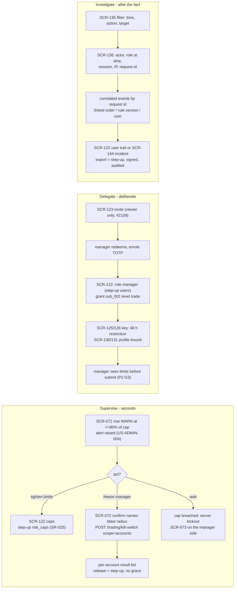
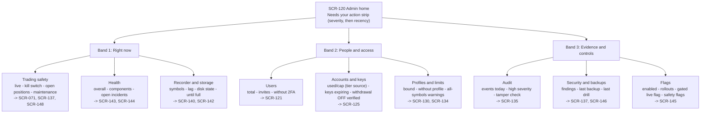

# E42-D01 — UX research: how the owner supervises, delegates and investigates in the admin area

- **Ticket:** E42-D01 (issue #830) · **Status:** Draft, rev 7 of 2026-10-20 (refreshed by hcl-worker-2
  against `main` at `4fe0ced3` for the merged view-as contract #3164, the E42 threat model, the merged
  #2392 and #2658, the closed #965 and the `post-ga` label on #2763 and #2764, with the reviews of the
  refresh applied; rev 5 of 2026-10-16 applied the cross-lane review and three docs delta reviews
  and folded in the coordinator's recommendations of 2026-10-16, #2701 comment 6207580985), every
  recommendation pending confirmation ·
  **Method:** heuristic evaluation + persona walkthrough against the catalogued screens and the
  contracts (see "Method note"; no live participant sessions were run)
- **Scope:** the admin area as catalogued, SCR-120..149 (`14-screens-catalogue.md` §10) and the global
  states it relies on (SCR-150..159, §11), read through US-ADMIN-001..014 and the P1 Owner, P4 Admin-hat
  and P2 Manager personas. Feeds E42-D02 (#831, wireframes) and E42-D03 (#886, hi-fi shell and users).
- **Out of scope (unchanged):** wireframes and hi-fi (E42-D02..D05); accounts/keys research (E27-D01,
  #732) and profiles research (E28-D01, #820); quantitative usability metrics (the population is one
  owner plus a few managers; this report is qualitative by necessity and says so).
- **Deliverable form (gap):** this file is markdown only. `docs/design/README.md` requires a UX-research
  deliverable to be a research board on the ticket's Penpot page, "not a markdown file alone", and a
  design PR without the Penpot link and PNG exports is sent back. The §1 boards are not drawn yet; the
  completion lane (hcl-worker-2, #830, 2026-10-20) draws them and embeds the exports before this PR
  leaves draft, which supersedes the earlier waiver request (Deviations, item 1). The Mermaid diagrams
  below are additional, never the only deliverable.

## Acceptance-criteria trace (E42-D01, issue #830)

Status key: **done** = delivered as the ticket words it; **heuristic-only** = delivered through the
ticket's Agent-delivery adaptation (heuristic evaluation, no participants), so it stays a recommendation
pending confirmation; **open** = needs live sessions, Penpot, or an owner decision, and is not claimed.
The ticket stays open until the §10 sessions run (or the owner waives them) and the Penpot boards exist
(see Deviations).

| Ticket AC or deliverable                                                                                       | Section                                                                                                                 | Status                           |
| -------------------------------------------------------------------------------------------------------------- | ----------------------------------------------------------------------------------------------------------------------- | -------------------------------- |
| AC1: at least three scripted sessions (supervise, delegate, investigate) completed and recorded with consent   | §4 persona walkthroughs (heuristic); §10 protocol, ready to run                                                         | heuristic-only; sessions open    |
| AC2: card sort gives a recommended SCR-120 tile set and grouping, reconciled with the catalogue's stated tiles | §5, reconciliation table (every deviation argued, nothing dropped silently)                                             | heuristic-only                   |
| AC3: every listed vocabulary term has a keep (one-line explanation) or replace (replacement) decision          | §6                                                                                                                      | done, pending owner confirmation |
| AC4: each of the four risk probes has a finding (understood / partially / misunderstood) and the copy change   | §7                                                                                                                      | heuristic-only                   |
| AC5: report merged and linked from E42-D02 and E42-D03; catalogue amendments filed                             | this file; §12 AM-1..AM-12, each with its owner and filing route in §12.1; links on #831 and #886 are added by the lane | open until merge                 |
| AC6: CDO (or delegate) review comment recorded                                                                 | the owner's `approved` on #830, or the orchestrator's under the owner's 2026-10-20 delegation (#2701)                   | open                             |
| Deliverable: prioritised comprehension-risk list feeding E42-D02 and E42-D03 copy                              | §8                                                                                                                      | heuristic-only                   |
| Deliverable: verbatim quotes                                                                                   | none exist and none are invented (§2)                                                                                   | open (sessions)                  |
| Technical note: open-then-closed card sort; teach-back comprehension test                                      | §5 (heuristic run); §10 scenarios 4 and 5                                                                               | heuristic-only; live run open    |
| Accessibility note: at least one keyboard-only session                                                         | §10, keyboard-only pass on scenario 1                                                                                   | open                             |
| Security note: sanitised fixtures only; recording retention stated                                             | §10 "Data handling"                                                                                                     | done (rules stated)              |
| Observability: the list feeds the `empty_state_shown` and `admin.onboarding_abandoned` questions               | §8, "Post-launch signal" column                                                                                         | done                             |
| Research boards in Penpot (mandatory evidence per `docs/design/README.md`)                                     | §1; Deviations item 1 (drawn by the completion lane before this PR leaves draft)                                        | open (boards not drawn yet)      |

## Deviations

Recorded in one place so the PR can point here (`docs/design/README.md`; C-4.4; C-4.8).

1. **Deliverable form.** This is a markdown report without the Penpot research boards the README
   requires ("not a markdown file alone"); a design PR without the Penpot link and the PNG exports is
   sent back (README, Approval rule), as this one was on 2026-10-20. The plugin bridge was not
   connected in the delivering session or the rev 2 to 5 fix rounds, and hpe-worker-1 asked the owner
   on #830 (through #2701) for a waiver or a connection; no waiver was recorded. The completion lane
   (hcl-worker-2, #830, 2026-10-20) draws the §1 boards and embeds their exports before this PR leaves
   draft. The §11 checklist is posted on #830 (comment 6208618311, still at rev 5).
2. **Branch name.** The ticket names `design/admin-screens-research`; the branch is
   `design/e42-d01-admin-research`, which carries the epic key in the `<type>/<epic-key>-<slug>` form
   of C-4.4. The deliverable is the same; the PR body names this deviation.
3. **Size (why one file, not several).** The report is 1230 lines at rev 7 against the 289, 322 and
   292 of the three research precedents (`e09-auth-mental-models.md`, `e13-indicator-mental-models.md`,
   `e16-recorder-mental-model.md`), because the ticket covers the twenty-eight screens of the
   SCR-120..149 range and fourteen stories rather than one screen family. As one new file it counts as
   1230 changed LOC, above C-4.8's 400-line preference and its 800-line limit, so the PR needs
   `large-pr-approved` with a written justification (granted by the orchestrator on 2026-10-19 at 1013
   lines, to be re-confirmed at this size); this item is that justification. It is not split because
   the ticket names one report as its deliverable; because the acceptance-criteria trace, findings (F-),
   recommendations (R-), decisions (AD-), amendments (AM-), risks (CR-) and open questions (OQ-) cite
   each other by id and are meant to be read in one review; and because §10 fixes the convention that
   session findings are appended here as a dated addendum, never as a new document. The change is
   documentation only, with no code, generated files or lockfiles.
4. **Method.** Moderated sessions are replaced by a heuristic evaluation and a persona walkthrough
   under the ticket's Agent-delivery adaptation (§2); every finding so produced is labelled
   `(heuristic)` and stays a recommendation pending confirmation.

## 1. Research boards (Penpot) — pending

No Penpot page exists for this ticket yet. The completion lane draws the boards below on page
`E42-D01 Admin UX research`, every board named with the `E42-D01/` prefix and built only from this
report. The intended file is the CandleViewer DS file (`b564c72c-f31f-81ec-8008-b112c6fdc116`), which
already holds the E13-D01 and E16-D01 research pages; `docs/design/README.md` asks for one file per
epic and keeps agents out of the shared DS library without an explicit ticket, so the lane confirms the
file with the coordinator before drawing. Exports use `docs/design/_tools/penpot_export.py` and go to
`docs/design/E42/img/`, the README's path (the E13-D01 and E16-D01 precedents used
`docs/design/research/img/`), one PNG per board named `E42-D01-<nn>-<slug>.png` after the board (for
example `E42-D01-15-matrix-oq-13.png`):

1. **Cover and method** (`00`): the §2 method, its honest limits and the confidence key.
2. **Roles and modes** (`01`): P1 with the P4 hat (P4-R, P4-E) and P2, against the three modes of §3.
3. **Journeys** (`02` to `04`): supervise, delegate and investigate as flow frames from §4.0, with the
   step-up gates (D8 retires the SCR-149 unlock), the audit emissions and the findings pinned where
   they occur.
4. **Findings cards** (`05`): F-S1..F-I6 with heuristic, recommendation and confidence.
5. **Card sort** (`06`): the 26 cards of §5.1, the open-sort bands of §5.2 and the §5.4 reconciliation.
6. **Annotated wireframes** (`07` to `12`): SCR-120 (§5), the freeze confirm (R-S1, R-S2), remove
   access with open positions (R-P3), disable and delete (R-P1, R-P2), restore (R-P4) and view as (§6).
7. **Vocabulary** (`13`) and **comprehension risks** (`14`): §6 and §8.
8. **Comparison matrices** (`15` to `17`): OQ-13 Option A against B, the OQ-1 engage confirmation, and
   the view-as kill-switch options of OQ-4.
9. **Open questions with deciders** (`18`) and **amendments with owners** (`19`): §13 and §12.1.
10. **Recommendations and decisions** (`20`): R-S1..R-I6, R-IA1, R-P1..R-P4 and AD-1..AD-10, one line
    each, so every id the other boards cite resolves on a board.

The board text is generated from this report, so any later edit here regenerates the boards it touches
before their exports are refreshed. If the set cannot be drawn in one pass, `00` to `12` and `15` to
`18` come first; `13`, `14`, `19` and `20` restate the tables of §6, §8, §12.1 and §9 and the R- lists
of §4, §5.6 and §7. Before the exports are embedded, the boards pass the #830 checks and the addendum
records them as E16-D01 does: a WCAG contrast table for every text and background token pair the
boards use (the `docs/design/_tools/contrast_check.py` formula over the resolved token values), a
greyscale and deuteranopia pass over every export (`docs/design/_tools/cvd_sim.py`), and focus-order
annotations on the six wireframes (`07` to `12`).

Until those exist this report is incomplete as a design deliverable (README: "not a markdown file
alone"); the AC table and Deviations above say so. When the boards are drawn they are added as a dated
addendum with their PNG exports embedded (`../E42/img/<name>.png`) and the Penpot file, page link and
page id. The README also wants the page link in the PR body and in the #830 comment, and the PNGs
embedded in the PR body. The AC row is then updated.

## 2. Method note (Agent-delivery adaptation, owner decision 2026-09-25)

The ticket asks for moderated, think-aloud sessions against a clickable prototype, an open-then-closed
card sort and a teach-back comprehension test. Delivery is a solo AI agent with one human owner and no
prototype (E42-D02 depends on this report), so, per the ticket's **Agent-delivery adaptations** clause and
the E09-D01 and E13-D01 precedents, the sessions are substituted with:

1. A **heuristic evaluation** of SCR-120..149 (plus SCR-071..073 where the supervise scenario starts
   outside the admin area, and SCR-150..159 where a global state is the admin screen's answer) against:
   - Nielsen's ten heuristics, cited as **H1** visibility of system status, **H2** match between the
     system and the real world, **H3** user control and freedom, **H4** consistency and standards,
     **H5** error prevention, **H6** recognition rather than recall, **H7** flexibility and efficiency,
     **H8** aesthetic and minimalist design, **H9** help users recognise, diagnose and recover from
     errors, **H10** help and documentation;
   - the trading-specific heuristics of `05-accessibility-standard.md`: **A-P** (§2 Perceivable: a state
     is never colour-only), **A-O** (§2 Operable and §3.1.4: every destructive gate is keyboard-operable,
     no timing trap), **A-U** (§2 Understandable: errors in plain language, predictable focus);
   - the persona-derived themes of `10-personas.md` §10 that bind this area: **T4** server-enforced
     safety that survives a dead UI, **T5** honest uncertainty, **T7** unmistakable Demo vs Live, **T8**
     secrets never visible, **T10** everything auditable and append-only, **T11** emergency mode is
     separate from configuration mode.
2. A **persona walkthrough** of the three scripted scenarios as P1 wearing the P4 hat, with the P2
   Manager's side of each scenario where the stories give it (§4).
3. A **heuristic card sort**: the information items the catalogue and the contracts put on the admin
   surface, sorted first by the question the owner is asking (open), then checked against the
   catalogue's own grouping (closed) (§5).
4. A **written session protocol** (§10) and an **owner walkthrough checklist** (§11) so the owner can
   turn every heuristic finding into an observed one later.

**Honest limits.** No participant quotes, task timings, success rates or card-sort agreement scores
exist, and none are invented. Every finding is labelled `(heuristic)` and traces to a line of a plan or
contract document, never to observed behaviour. Where the ticket's acceptance criteria want an observed
fact ("can the owner explain hash chain back?"), this report records the **risk** that the heuristic
evaluation can see and defers the fact to §10. All recommendations (R-\*) and decisions (AD-\*) are
therefore **recommendations pending confirmation** by the owner and by the §10 sessions. Confidence is
the strength of the basis, not a measurement: **High** = stated in a locked plan or contract document;
**Med** = sound heuristic reasoning from the catalogue text; **Low** = persona inference only.

**Inputs the ticket names that do not exist yet.** E27-D01 (#732) and E28-D01 (#820) are both open with no
report under `docs/design/research/`, so there is nothing to "read rather than repeat". Where keys and
profiles touch the admin modes, this report cites the E27 and E28 threat models
(`docs/security/threat-models/E27-accounts.md`, `E28-profiles-trade-groups.md`) and defers the rest to
those tickets.

**The E42 threat model.** Since rev 5 the E42 STRIDE model has been written and approved:
`docs/security/threat-models/e42-admin.md` (E42-X01, #890, Approved 2026-10-18; summarised as Area 14 in
`04-security-program.md` §5.15). It absorbs the user-lifecycle annex `e42-user-lifecycle.md`, whose ids
still resolve. The rows that bear on this report: AD-F03 with AD-I05, AD-E04, SR-E42-03 and decision D6
(view-as, §6 and AM-5); AD-F06 and D8 (SCR-149's 15-minute window against per-action step-up, F-D5);
AD-F12 (no actor role or type on audit rows, F-I1); AD-F14 (the chain is unkeyed and its anchors are
not built, a residual accepted until #1238 as RR-17, which the "Tamper check" copy of §6 respects);
AD-F17 (the admin audit vocabulary, F-I2); and AD-F02 with D7 (a restore and the security state, probe
4). On 2026-10-20 the orchestrator recorded RR-17, D7 and D8 on #890 under the owner's delegation of
that day, reversibly: D7 is #3084's Option 3 and D8 keeps per-action step-up. The model's own text on
`main` lags that record: its header still lists RR-17, D7 and D8 as pending on #2701, and its §5 marks
D8 open. The record that counts is #890 comment 6284449563 (05:56Z), made under the delegation in
#2701 comment 6284192190, and the owner can still revoke either decision there. Its D5 re-triages the
view-as and SCR-149 rows when E42-D02's wireframes land. The other security constraints come from
`04-security-program.md` (SR rows), `docs/security/threat-models/e09-auth-rbac.md` and the admin
read-model decisions recorded on #963 (partial results, the kill switch never defaulted, the
sub-account tier reported as `unrecorded` only when the store answered "no row").

## 3. What the three modes have in common (and why one IA will not do)

The ticket's premise holds on the evidence (heuristic): the fourteen stories describe three different
states of mind, and the catalogue's screens already lean three ways.

| Mode            | Trigger and tempo                                                                         | What the owner needs first                                                                         | Screens that carry it                                     | Confirmation posture (`10-personas.md` §5 P4-R vs P4-E)                                  |
| --------------- | ----------------------------------------------------------------------------------------- | -------------------------------------------------------------------------------------------------- | --------------------------------------------------------- | ---------------------------------------------------------------------------------------- |
| **Supervise**   | Mid-session, seconds matter (US-ADMIN-004 "at a glance"; P4-E)                            | One true number with a timestamp, one safe action, proof the action landed                         | SCR-071/072/073 (outside admin), SCR-120, SCR-143/144     | One confirm naming the blast radius; **no typed ritual**; step-up only to undo           |
| **Delegate**    | Outside trading hours, deliberate, reversible (P4-R), except unbind/revoke with positions | The consequence of a grant before it is saved; the preconditions (key, profile, 48 h) in one place | SCR-121/122/123, SCR-125/126, SCR-130/131, flow §4 wizard | Typed confirmation for destructive items; step-up for roles, grants, caps (SR-025)       |
| **Investigate** | After the fact, calm but suspicious (US-ADMIN-009 "investigation is practical")           | Who, when, under what permissions, correlated with what else happened; proof the record is intact  | SCR-135/136, SCR-144, SCR-137, SCR-122 audit trail        | None to read; step-up to export (SR-025, SR-067); reads are themselves audited (SCR-136) |

Two consequences drive everything below. First, **the landing page must be ordered by tempo**, not by
module: the supervise facts come first because they are the ones read under time pressure (§5). Second,
**the same verb must not mean two things across modes**: "disable", "revoke", "locked" and "kill switch"
each currently carry two meanings in the plan (§6), and the delegate action that behaves like an
emergency (unbind or revoke with open positions) must borrow the emergency vocabulary, as P4-E scenario 9
already says for keys.

## 4. The three modes — persona walkthroughs and findings (all `(heuristic)`)

### 4.0 Journey overview



Every lane starts with a signal the owner did not choose, passes at least one server-side gate the UI
cannot fake (SR-025 step-up, RBAC 403 + audit) and ends with a record the owner can read back (T10).
The findings below are where the catalogued screens make that walk slower, more ambiguous or less
honest than the stories demand. The lanes follow D8 (recorded 2026-10-20 on #890): per-action step-up
stays the model, and the catalogue's SCR-149 unlock in front of every admin route is amended away
(AM-11). If the owner revokes D8, that unlock returns ahead of each step-up drawn here.

### 4.1 Supervise — "a manager's account is approaching its daily loss cap; what do you do?"

**Walkthrough (P1 at the terminal, P4 hat not yet on).** The signal is SCR-071's row for `sub_001` at
95 % of its cap with the state word `WARN` and an alert (US-ADMIN-004 "the row escalates visually with a
text label and an alert is raised"). The owner has four moves. _Wait_: the server enforces the cap
(US-ADMIN-003, `13-user-flows.md` §18.7), flattens per policy and locks the account; the manager sees
SCR-073. _Tighten now_: the cap override lives on SCR-122 (admin area; under D8 its gate is the step-up
class `risk_caps`), and US-ADMIN-003 promises no forced liquidation, new entries blocked, reduce-only
kept. _Freeze_: SCR-071 `FREEZE sub_001` → SCR-072 → `POST /trading/kill-switch` with `scope: accounts`;
the manager's terminal goes read-only within 2 s with a banner naming who and when (P2 scenario 5).
_Talk_: outside the product. The manager's side is specified (SCR-073 copy, lockout until 00:00 UTC,
owner-override path with a typed reason, SCR-071).

| #    | Finding `(heuristic)`                                                                                                                                                                                                                                                                                                                                                                                                                                                                                                                                                                                                                                                                                                                                                                                                                                                                                                                                                                                                                                                                                                                                                                                                                                                                                                                                                   | Heuristic        | Rec  | Confidence (basis)                                                                                                                                                                                                                                                                                |
| ---- | ----------------------------------------------------------------------------------------------------------------------------------------------------------------------------------------------------------------------------------------------------------------------------------------------------------------------------------------------------------------------------------------------------------------------------------------------------------------------------------------------------------------------------------------------------------------------------------------------------------------------------------------------------------------------------------------------------------------------------------------------------------------------------------------------------------------------------------------------------------------------------------------------------------------------------------------------------------------------------------------------------------------------------------------------------------------------------------------------------------------------------------------------------------------------------------------------------------------------------------------------------------------------------------------------------------------------------------------------------------------------- | ---------------- | ---- | ------------------------------------------------------------------------------------------------------------------------------------------------------------------------------------------------------------------------------------------------------------------------------------------------- |
| F-S1 | Typed `FREEZE` on engage contradicts the persona rule and the user flow, and the plan is split. For it: SCR-071 asks for "hold-to-confirm + typed confirm" and SCR-072 "requires typing `FREEZE`"; `04-security-program.md` §9.1 gives the global kill a "confirm dialog with typed confirmation for live" (it names no confirmation for an account freeze); and the E39 tickets that draw and build SCR-072 carry it: E39-D03 (#879) draws the "typed `FREEZE` confirmation", and in E39-S05 (#1012) "the confirm action is disabled until FREEZE is typed and a reason is entered". Against it: `10-personas.md` §5 P4-E says "**no typed confirmation**, because a 15-second typing ritual during a runaway is itself the hazard. Step-up is required to **undo** (unfreeze), never to stop harm"; `13-user-flows.md` §20 says "single click, no typed confirmation since this is a safety action". US-ADMIN-004, the one user story on it, asks only for "a FREEZE control with an unambiguous confirmation" and says nothing about typing. The catalogue and the E39 tickets are what would be built; changing engage means reconciling 04 §9.1 and those tickets too. Dropping the word does not remove all typing: `SetKillSwitchRequest` requires a `reason` of 3 to 280 characters, and E39-S03 (#956) says "engagement always carries a typed reason" (OQ-1). | H7, H5, T11, A-O | R-S1 | High for the conflict (two plan documents and two E39 tickets for it, two plan documents against, US-ADMIN-004 neutral; two merged design specs also bear on it, OQ-1); the resolution is an owner decision (OQ-1), which includes reconciling 04 §9.1, the E39 tickets and the required `reason` |
| F-S2 | The freeze dialog's option defaults disagree with the contract, and the plan gives three answers. SCR-072: "also cancel working orders" and "also flatten positions" are checkboxes "both default off"; `SetKillSwitchRequest` defaults `cancel_open_orders: true`, `flatten_positions: false`, `disarm_rules: true`. A dialog that shows "off" while the server defaults "on" changes the blast radius silently; `disarm_rules` is not drawn at all. For the global kill, `04-security-program.md` §9.1 makes "cancel-all on every account" part of the effect with an "optional flatten", and `13-user-flows.md` §20, the node cited for "single click", runs "cancel all working orders across ALL accounts, flatten ALL open positions across ALL accounts". Depending on the document, cancel is always on, on by default or off by default, and flatten is always on or off by default.                                                                                                                                                                                                                                                                                                                                                                                                                                                                           | H4, H1, H5       | R-S2 | High (SCR-072 text vs `22-api-openapi.yaml`, 04 §9.1 and `13-user-flows.md` §20)                                                                                                                                                                                                                  |
| F-S3 | The supervise path has no registered hotkey; the shell control itself is specified. P4-E wants a Safety control "reachable from every screen (rail footer + global hotkey)"; CMP-211 PanicButtons is "always-reachable ... in the top bar and system tray" and SCR-010's component list includes it, so the control is placed. The gap is keymap registration: neither `apps/web/src/keymap/keymap.json` (the single source of the default keymap; `docs/generated/default-keymap.md` is generated from it) nor `05-accessibility-standard.md` §3.2 has a kill-switch, freeze or view-as-exit binding, and SCR-010's hotkey line names none (§3.2 puts Flatten all on `Ctrl+Shift+F`; none of the three carries `Ctrl+Shift+K`, which `04-security-program.md` §9.1 and `17-ux-diagrams.md` already name for the kill switch). SCR-124 requires "a single documented hotkey" for Exit view-as without naming one.                                                                                                                                                                                                                                                                                                                                                                                                                                                       | H7, A-O, T11     | R-S3 | Med (an absence in the keymap sources, a registration omission rather than a stated conflict; the control is catalogued in SCR-010); the key is already documented and awaits registration (OQ-7)                                                                                                 |
| F-S4 | "Approaching the cap" is a tightening decision, but the tightening control is not reachable from the signal. SCR-071 carries the signal; the override is on SCR-122 in the admin area behind a `risk_caps` step-up (the catalogue also puts the SCR-149 unlock in front of it, which D8 amends away, AM-11); nothing on SCR-071 links to it. The step-up is mandatory (SR-025); the walk is not.                                                                                                                                                                                                                                                                                                                                                                                                                                                                                                                                                                                                                                                                                                                                                                                                                                                                                                                                                                        | H7, H3           | R-S4 | Med (catalogue has no link; the gate is plan text)                                                                                                                                                                                                                                                |
| F-S5 | Freshness and partial results are the supervise tiles' honesty problem. US-ADMIN-004: "every figure carries a freshness timestamp"; `AdminOverview` slices carry `status: ok, error, unavailable` and `generated_at`; #963: the kill switch is never defaulted to `false` when unread, and the overview's `trading` and `recorder` slices answer `unavailable` until their providers are wired (#963 QA, 2026-10-20). A slice rendered as `0 open positions`, or an empty tile, reads as "all good".                                                                                                                                                                                                                                                                                                                                                                                                                                                                                                                                                                                                                                                                                                                                                                                                                                                                    | T5, H1           | R-S5 | High (contract plus the #963 decision record)                                                                                                                                                                                                                                                     |
| F-S6 | The owner is told to freeze from the manager's row, but the per-manager row is on SCR-071 and the per-user actions are on SCR-121/122; a freeze is `risk.freeze_manager` on an account scope (SCR-072 says `risk.freeze`, AM-9), a disable is `users.disable` on a person. The two look alike in a menu and differ completely in effect (freeze touches no persisted configuration and unfreeze restores exactly the prior state, P4-E scenario 7; disable revokes sessions and grants).                                                                                                                                                                                                                                                                                                                                                                                                                                                                                                                                                                                                                                                                                                                                                                                                                                                                                | H2, H5           | R-S6 | Med (persona text plus the two screens' menus)                                                                                                                                                                                                                                                    |

**Recommendations (supervise).**

- **R-S1 — engage is one confirm, release is step-up.** SCR-072 names the exact blast radius ("Freeze
  alex (sub_001): 1 account, 2 open positions, 3 working orders") and confirms with one keyboard-operable
  gesture (CMP-211 `confirmMode: "hold"` with the documented `Enter` hold, which E10-D02 already draws,
  or `"single"`, which conflicts with E10-D02's rule that the panic control is never a bare single
  click), never a typed word. The `reason` the contract requires is pre-filled and editable (for
  example "Emergency stop"), the only form that keeps engage free of typing without a contract change; a
  typed reason keeps a typing step, and an optional one moves `reason` out of the request's `required`
  list (OQ-1 asks which). Release (unfreeze, kill-switch off) keeps step-up with no grace (`killswitch`
  class), a typed reason (E39-S03) and its own confirm, which is where the typed `FREEZE` moves on the
  coordinator's recommendation (OQ-1). Catalogue amendment **AM-2**; owner decision **OQ-1**.
- **R-S2 — the dialog always sends all three options explicitly and shows all three**, including
  "disarm their rules", with one canonical default agreed between SCR-072, the contract, 04 §9.1 and
  `13-user-flows.md` §20 (OQ-1 asks which). No option is ever left to a server default the owner cannot
  see.
- **R-S3 — register the safety bindings; the shell control already exists.** CMP-211 is in SCR-010's
  component list, so D02 draws it where the merged shell wireframes put it (E10-D02: RightRail top,
  hold-to-confirm; CMP-211's own text says top bar and system tray) and adds no new control. Proposal:
  register `Ctrl+Shift+K` for the kill-switch confirm (`04-security-program.md` §9.1
  and `17-ux-diagrams.md` already name it; `apps/web/src/keymap/keymap.json`,
  `05-accessibility-standard.md` §3.2 and `docs/generated/default-keymap.md` do not carry it), a freeze
  binding and the Exit view-as key (SCR-124, contracted since #3164); all of them added to
  `keymap.json`, the single source that the default-keymap document is generated from, and to the §3.2
  default map under the §3.3 conflict rules (a trading-critical binding keeps its modifier).
  `scripts/keymap_lint.py` checks `keymap.json` against the `Interactions/hotkeys` lines of the
  catalogue: SCR-010's line names no kill-switch or freeze key, and SCR-124 has no such line, only the
  a11y requirement of "a single documented hotkey", so both are updated in the same change and the lint
  passes before D02 asserts any key (OQ-7). D02 draws the controls, not the keys, until registered.
- **R-S4 — one link from the signal to the fix.** SCR-071's row menu gets "Tighten limits" deep-linking
  to SCR-122's caps section; the gate (under D8, the `risk_caps` step-up) appears as an overlay with the
  destination preserved, and keeps the expiry-during-edit case SCR-149's checklist asked for (the form's
  content kept, the save held; AM-11); the resulting notice is the one E42-D03 scopes: "No positions
  will be closed. New entries are blocked; reduce-only actions remain available."
- **R-S5 — a tile never shows a number it did not receive.** One degraded/stale treatment (the E42-D02
  cross-screen pattern): "unavailable" or "error" in words, the slice's `generated_at` as "as of
  HH:MM:SS", and `kill_switch_engaged` rendered "unknown" whenever the slice omits it (a degraded slice
  still carries the value it read; unread fields are omitted, and today the whole slice is `unavailable`
  until its provider is wired, #963). This is the on-screen form of #963's "never defaulted".
- **R-S6 — Freeze and Disable are never neighbours in one menu.** Freeze lives with the risk controls
  (SCR-071, CMP-211) and says "touches no settings; undo restores exactly"; Disable lives in user
  administration (SCR-121/122) and lists its cascade (§7, probe 1).

### 4.2 Delegate — "onboard a new manager and scope them to one sub-account"

**Walkthrough (P4-R).** SCR-123 invites the person; the contract grants `viewer` only
(`CreateUserRequest.roles` enum `[viewer]`, "Invites grant viewer only (#2109); the owner promotes after
activation"; SR-027). The manager redeems the link, sets a password and enrols TOTP (flow §4). The owner
then opens SCR-122: role `manager` (step-up class `users`), one grant `{sub_001, level: trade}` via
`PUT /users/{userId}/account-access`, the per-user caps override, and `live` per account. Preconditions
live elsewhere: the sub-account and its key on SCR-125/126 (Bybit's 48 h new-key restriction, P2 pain),
and a bound profile on SCR-130/131 ("unbound accounts ... cannot trade until bound"). US-ADMIN-013 (Should)
wraps all of this in a resumable wizard. The manager's test of success is P2 G3: limits visible before the
first submit.

| #    | Finding `(heuristic)`                                                                                                                                                                                                                                                                                                                                                                                                                                                                                                                                                                                                                                                                                                                   | Heuristic   | Rec  | Confidence (basis)                                                          |
| ---- | --------------------------------------------------------------------------------------------------------------------------------------------------------------------------------------------------------------------------------------------------------------------------------------------------------------------------------------------------------------------------------------------------------------------------------------------------------------------------------------------------------------------------------------------------------------------------------------------------------------------------------------------------------------------------------------------------------------------------------------- | ----------- | ---- | --------------------------------------------------------------------------- |
| F-D1 | The invite screen offers a role the contract forbids and account grants that SR-027 forbids. SCR-123 lists "username, role, initial account assignments" and validates "role manager requires at least one account assignment"; `CreateUserRequest` allows only `viewer` and the owner promotes after activation. Its `account_access` property and `createUser`'s example (a viewer invited with `level: trade` on one account) still offer grants at invite, while SR-027 creates a new user with "no account grants" and the served route refuses any (`422`, audited `users.invite_refused`). The delegate flow is therefore two deliberate steps, and the catalogue hides the second.                                              | H4, H5, H1  | R-D1 | High (SCR-123 vs `22-api-openapi.yaml`, SR-027 and the served invite route) |
| F-D2 | Unbinding is drawn as unticking a checkbox and pressing Save, but the story demands a forced choice and the contract has no field for it. SCR-122's mock is `[x] sub_001 trade [x] live [x]`; US-ADMIN-002 says "unbinding requires an explicit choice: leave positions (owner takes over) or flatten first"; `PUT /users/{userId}/account-access` (served since #3267) takes `grants[]` plus `acknowledge_unknown_positions`, demanded only while the open-position state is unavailable, and no choice. The E27 model already has the pattern for keys and accounts (KV-D03 and SR-E27-07: `leave_positions` or `flatten_first`, otherwise 409 with the consequence summary). E42-D03 scopes the dialog; nothing scopes the contract. | H5, T4, T11 | R-D2 | High (story, contract and SR-E27-07 text)                                   |
| F-D3 | Disable sits next to Delete with synonyms and no consequences. SCR-121: "deactivate, delete; bulk deactivate"; SCR-122: "Deactivate", "suspend"; the API and US-ADMIN-001 say "disable" (`status=disabled`; `DELETE /users/{id}` is "Disable a user (soft delete)"); SR-029 adds a positions decision ("flatten or leave their positions with a recorded decision") that no screen mentions.                                                                                                                                                                                                                                                                                                                                            | H2, H5, H6  | R-D3 | High (four documents, three verbs)                                          |
| F-D4 | The capacity line can state a tier the system does not know. SCR-121 draws "3 of 5 used (20 with Business KYC)" and "Bybit allows 5 sub-accounts on your tier — you've used 5"; `SubaccountCapacity` returns `tier: null, cap: null` while `tier_source: unrecorded`, and omits `tier_source` when the store is unavailable (#963). US-ADMIN-014 NFR: "the tier is an explicit recorded fact, never inferred".                                                                                                                                                                                                                                                                                                                          | T5, H1      | R-D4 | High (contract plus #963)                                                   |
| F-D5 | Two gates, three durations, one word. The admin unlock (SCR-149: password + TOTP, 15 min, `auth.session_unlocked`) and the per-action step-up (`/auth/step-up`: password + TOTP, 5-minute grace per class, none for `live_enablement`, `killswitch` and `backups`) are different mechanisms; `12-sitemap.md` §4 still says 30 minutes and "TOTP code (not password)". The delegate flow meets both gates in one sitting (enter admin, change role, change caps). The E42 threat model found the 15-minute window unenforced on the server (AD-F06); its D8, recorded on #890 on 2026-10-20 under the owner's delegation, keeps per-action step-up only, so SCR-149's window is amended away (AM-11).                                    | H4, H1, H6  | R-D5 | High for the inconsistency (three documents); the wording is a proposal     |
| F-D6 | "Cannot trade until a profile is bound" is a delegation precondition on a different screen from the delegation. SCR-130 flags unbound accounts; SCR-122's account row shows the bound profile name but has no "no profile" state; SCR-120's mock carries "1 account without risk caps (!)" that its checklist does not list. P4 pain: "fat-fingered admin action ... deleting a profile in use".                                                                                                                                                                                                                                                                                                                                        | H1, H5      | R-D6 | Med (inferred from SCR-130 and SCR-122 text)                                |
| F-D7 | The 48 h key restriction is a wait the owner cannot shorten, so the flow must say _when_. US-ADMIN-013: "blocked with the exact unlock time and the rest of the flow continues"; SCR-122: granting live inside the window "shows a warning with the exact unlock time". Honoured in the plan; listed so D02 draws the absolute time and "Demo works meanwhile" (P2 scenario 1) rather than a generic warning.                                                                                                                                                                                                                                                                                                                           | H1, H9      | R-D7 | High (plan text; a check for D02, not a defect)                             |

**Recommendations (delegate).**

- **R-D1 — SCR-123 invites a viewer and says so.** Drop the role picker and the account assignments;
  show "Invited as a viewer, with no account access. After they sign in and enrol two-factor, you make
  them a manager and grant their accounts." Keep the pending-invite list with revoke and re-issue.
  **AM-4** (SCR-123 part); the contract's invite-time `account_access` is aligned with SR-027 (related
  amendments, §12).
- **R-D2 — unbind with positions is a consequence-first dialog; what the contract carries is OQ-13.**
  Unticking an account that has open positions, working orders or running algos opens a dialog with
  exactly two named choices (§7, probe 3) and `Esc` meaning "cancel, nothing changed". O2 (#965) is
  built: the merged #2658 contract and the served `setUserAccountAccess` (#3267) never flatten or cancel,
  and #2648 keeps flattening out of scope; the route takes only `acknowledge_unknown_positions`, and only
  while the open-position count is unavailable. An explicit `leave_positions` or `flatten_first` choice
  on that route (409 with the consequence summary, the SR-E27-07 shape) would overturn O2 in served code
  and needs the admin → OMS module edge named in an ADR (C-3.4); the coordinator's placement of that
  contract with E42-T04 (the endpoint is admin's and E28 only consumes it; RelayRoom SYNC-4 of
  2026-10-16 03:42Z) presupposes it, and E42-T04 closed on 2026-10-18 without it (#965, #2658 and #2701
  never carried the placement).
  Keeping O2 needs neither. The owner decides (**OQ-13**); this report recommends keeping O2.
  Interface-first (C-6.1) before E42-D03 draws either as built. **AM-3**, **OQ-2**, **OQ-13**.
- **R-D3 — one verb per lifecycle action.** "Disable" (reversible, lists the cascade), "Delete (keeps
  history)" (typed username + step-up, states what is and is not removed), and "Sign out everywhere" for
  session revocation. No "deactivate", no "suspend". **AM-4** (SCR-121/122 part).
- **R-D4 — three capacity states, never a default cap.** Recorded: "3 of 5 sub-accounts used · Regular
  tier, recorded 2026-09-12 [change]"; unrecorded: "3 sub-accounts in use · Tier not recorded — record it
  to see your cap"; unavailable: "3 in use · cap unavailable right now". The at-capacity copy explains the
  Business KYC path and the isolation trade-off of sharing a sub-account (US-ADMIN-014). **AM-4**.
- **R-D5 — one gate, named for what the owner does.** D8 (recorded on #890 on 2026-10-20 under the
  owner's delegation) keeps per-action step-up only, so there is no area gate: the action gate is
  "Confirm it's you" and, inside a grace window, reuses E09-D02 §9's "Still trusted for this action ·
  02:14 remaining". Neither "re-authentication" nor "step-up" appears in product copy (§6). SCR-149, the
  catalogue's §10 preamble and `12-sitemap.md` §4 are amended to the per-action model (related
  amendments, §12). Only if the owner revokes D8 does an area gate return, as "Unlock admin" with "Admin
  unlocked · 12:40 left" in CMP-087's chrome, the rev 5 proposal (OQ-6).
- **R-D6 — the precondition is shown where the grant is made.** SCR-122's account row gets a state "No
  risk profile — alex can't trade this account until one is bound [Create profile]", and SCR-120 carries
  the count (§5).
- **R-D7 — absolute times for the 48 h restriction**, plus "Demo trading works meanwhile", on SCR-122 and
  in the wizard.

### 4.3 Investigate — "an order was placed that you did not expect; find out who, when and under what permissions"

**Walkthrough (P4, calm).** SCR-135: filter by time range, action (an order submit), target (symbol or
account), severity; open the row; SCR-136 shows actor, "role at the time", session, IP, user agent,
request id, correlated events by request id and linked artefacts (the order, the rule version, the
profile diff). If the actor was a rule, SR-062 wants `actor_type = rule` plus `rule_id` and
`rule_version`. If the session looks wrong, SCR-137's active-sessions and failed-login views; if the
system caused it, SCR-144. Reading is itself recorded (`admin.audit_read` in the contract and the
registry; SCR-136 says `audit.record_viewed`, AM-9). Export is a step-up action (SR-025) producing
signed NDJSON (`/admin/audit/export`), audited as `admin.audit_export`.

| #    | Finding `(heuristic)`                                                                                                                                                                                                                                                                                                                                                                                                                                                                                                                                                                                                                                                                                                                                                                                                                                                                            | Heuristic   | Rec  | Confidence (basis)                                                   |
| ---- | ------------------------------------------------------------------------------------------------------------------------------------------------------------------------------------------------------------------------------------------------------------------------------------------------------------------------------------------------------------------------------------------------------------------------------------------------------------------------------------------------------------------------------------------------------------------------------------------------------------------------------------------------------------------------------------------------------------------------------------------------------------------------------------------------------------------------------------------------------------------------------------------------ | ----------- | ---- | -------------------------------------------------------------------- |
| F-I1 | "Under what permissions" is not answerable from the record as contracted. SR-062 requires `role_at_time`; SCR-136 lists "role at the time"; CMP-173's `AuditEntry` has `role`; but neither the OpenAPI `AuditEntry` nor the `audit_log` DDL (`21-database-schema.md` §3.10.1) has a dedicated role or `actor_type` column or field: the DDL is structured (`actor_user_id`, `actor_label`, `object_kind`/`object_id`/`object_label`, `before_state`/`after_state`, `reason`). The jsonb `before_state`/`after_state` and the OpenAPI entry's free-form `detail` object can hold extra keys (the secrets sink already writes `actor_role` into `after_state`, `admin/wiring.py:104`), but that is one writer's convention, not a contract field a screen or filter can rely on. The current role is not the role at the time (US-ADMIN-001 role changes are audited precisely because they move). | H1, T10     | R-I1 | High (`22-api-openapi.yaml` and §3.10.1 vs SR-062, SCR-136, CMP-173) |
| F-I2 | The action vocabulary differs between documents, which breaks the "filter by action" step. SCR-135's mock: `order.submitted`, `account.key_rotated`, `risk.lockout_triggered`; the typed registry `audit/actions.py` (seeded from §3.10.1's must-audit list, which is labelled non-exhaustive): `orders.submit`, `api_key.rotate`, `risk.freeze_manager`, `users.disable`; SCR-121: `user.deactivated`; the audit log's own reads are `audit.viewed` (SCR-135) and `audit.record_viewed` (SCR-136) against the contract's `admin.audit_read`. None of the catalogue names listed here is registered; a filter built from any one list misses rows written under another. The `/admin/audit` filter's example (`order.place`, `key.rotate`, `killswitch.engage` at rev 5) now names registered codes (#2392).                                                                                     | H4, H6      | R-I2 | High (three lists, no two equal)                                     |
| F-I3 | The integrity failure must not look like a UI error, and the landing page does not carry it. SCR-135 specifies the critical banner ("this is a security incident, not a UI error"); the nightly verifier raises a `critical` system event (§3.10.1); SCR-120's tile checklist has no audit or integrity item.                                                                                                                                                                                                                                                                                                                                                                                                                                                                                                                                                                                    | H1, H9, T10 | R-I3 | High (SCR-135 and §3.10.1 text; SCR-120 checklist)                   |
| F-I4 | Jumping from a row to the thing it changed is the investigate accelerator and exists only as prose. SCR-135: "jump from any audit row to the related order, rule or user"; SCR-136: "linked artefacts"; the record carries `subject_type` and `subject_id`. Deleted or anonymised subjects have no live object to jump to.                                                                                                                                                                                                                                                                                                                                                                                                                                                                                                                                                                       | H7, H6      | R-I4 | Med (prose requirement; the route map is a proposal)                 |
| F-I5 | The manager's and viewer's view of the same question is deliberately smaller and must say so. US-ADMIN-009: a manager sees only entries describing their own actions, enforced server-side; SR-067: role-scoped projections, raw payloads owner-only; SCR-154 distinguishes "you lack the role" from "this account is not assigned to you".                                                                                                                                                                                                                                                                                                                                                                                                                                                                                                                                                      | H1, H9      | R-I5 | High (plan text)                                                     |
| F-I6 | Export is a step-up, signed, audited action drawn as a toolbar button, and the format drifts. SCR-135 shows `[csv]` and "export CSV/JSON"; the contract exports signed NDJSON with a detached signature (`/admin/audit/export`, permission `audit:export`); SR-025 and SR-067 require step-up for export. Until the owner decides the export signing-key custody (E42-T02 D1, #889) the route answers `501 not_implemented`.                                                                                                                                                                                                                                                                                                                                                                                                                                                                     | H1, H4, A-O | R-I6 | High (SCR-135 vs the contract and SR rows)                           |

**Recommendations (investigate).**

- **R-I1 — the record carries the actor's role and type.** `actor_role` (role at the time) and
  `actor_type: human, rule, system` with `rule_id` and `rule_version` on `AuditEntry` and `audit_log`
  (SR-062) are follow-up **#2763** (E42-T02 follow-up; its blocker #2392 has merged, and since
  2026-10-19 it is labelled `post-ga`): a contract plus an additive, nullable migration, not folded into
  E42-T02 (coordinator recommendation, #2701 comment 6207580985 of 2026-10-16; AD-F12 in the E42 threat
  model). Until it lands, after GA as labelled, SCR-136 shows "Role at the time: not recorded" on every
  row and never infers from the current role. **AM-6**, **OQ-8**.
- **R-I2 — one registered action vocabulary, shown as labels.** The registry is the typed
  `AUDIT_ACTIONS` set in `services/api/candleviewer/audit/actions.py`, seeded from the non-exhaustive
  must-audit list of `21-database-schema.md` §3.10.1 and extended by the PR that first emits a name
  (SR-E27-09 and the E27 model's §8.1: one registered vocabulary). It confirms F-I2: none of SCR-135's
  or SCR-121's codes is registered, while the OpenAPI filter example now is (#2392). SCR-135's filter
  offers human labels mapped from the registry ("Order submitted", "Key rotated"); the raw code is
  visible in SCR-136. SCR-135's mock codes are corrected (**AM-9**).
- **R-I3 — an Audit tile on SCR-120** with "Tamper check: verified to 2026-09-14 00:00" or "Tamper check
  FAILED at entry 1,204,118 — treat as a security incident", high-severity count for today, and a link
  (§5).
- **R-I4 — `subject_type` → destination map drawn as link affordances**: order → order detail, rule → the
  rule version, user → SCR-122, account → SCR-125, flag → SCR-145, backup → SCR-146. A user erased after
  a delete (the 90-day purge, probe 2) shows the read-time pseudonym `deleted-user-<12 hex>` (21 §12,
  merged with #2658) and no link; the stored record is not rewritten (append-only), and SCR-136's raw
  record and hash view follows OQ-3 (the record as stored, or the pseudonym carried outside the hashed
  entry).
- **R-I5 — scope stated in the page header** of the manager/viewer variant ("Showing your actions only")
  and in the filtered-to-nothing state (SCR-151 class 2: "No actions by you match these filters").
- **R-I6 — export carries the audit-visibility marker** (E42-D02 convention: "recorded · needs your
  confirmation"), names the real format ("Signed export (NDJSON + signature)") and opens the step-up
  dialog. SCR-135's "CSV/JSON" wording is corrected (**AM-9**).

## 5. SCR-120 tile set and grouping (heuristic card sort)

### 5.1 The cards

Information items the catalogue (`14-screens-catalogue.md` §10) and the contracts (`AdminOverview`,
`CapacityReport`, `/admin/*`) put within reach of the landing page. Numbers are for the sort only.

| #   | Card                                                     | Source                                                                                     |
| --- | -------------------------------------------------------- | ------------------------------------------------------------------------------------------ |
| 1   | Users total / active / invited                           | `AdminOverview.users`; SCR-121                                                             |
| 2   | Users without two-factor                                 | `AdminOverview.users.without_mfa`; SCR-137                                                 |
| 3   | Invites pending                                          | SCR-120 mock; SCR-123                                                                      |
| 4   | Sub-accounts used, cap, tier and its source              | `CapacityReport.subaccounts`; US-ADMIN-014                                                 |
| 5   | Accounts total / enabled                                 | `AdminOverview.accounts`; SCR-125                                                          |
| 6   | Keys expiring within 30 d / invalid                      | `AdminOverview.accounts.keys_*`; SCR-125/128                                               |
| 7   | Withdrawal permission verified at                        | SCR-125 footer; C-2.8                                                                      |
| 8   | Accounts without a bound profile / risk caps             | SCR-120 mock; SCR-130                                                                      |
| 9   | Symbols recording / degraded, recorder lag               | `AdminOverview.recorder`; SCR-140                                                          |
| 10  | Disk used / free, days until full (100 %), basis         | `AdminOverview.storage`, `CapacityReport.storage`; SCR-140/142                             |
| 11  | Health overall and per component                         | WS `system`, `/admin/health`; SCR-143                                                      |
| 12  | Open incidents                                           | `AdminOverview.incidents`; SCR-144                                                         |
| 13  | Rate-budget utilisation per UID                          | `CapacityReport.rate_budget`; SCR-147                                                      |
| 14  | Flags: count, enabled, rollout in progress, gated flag   | `/admin/feature-flags`; SCR-145                                                            |
| 15  | Safety flags (`is_killswitch`, trading capability) state | `21-database-schema.md` §3.9; US-ADMIN-007                                                 |
| 16  | Last backup time / status / size                         | `/admin/backups`; SCR-146                                                                  |
| 17  | Last restore drill                                       | SCR-146; `21-database-schema.md` §8.4                                                      |
| 18  | Backup verification result                               | `/admin/backups/{id}/verify`; SCR-146                                                      |
| 19  | Audit events today, high-severity count                  | `/admin/audit`; SCR-135                                                                    |
| 20  | Audit chain verified to (tamper check)                   | `/admin/audit/verify`; SCR-135                                                             |
| 21  | Security findings by severity, last scan                 | `/admin/security/summary`; SCR-137                                                         |
| 22  | Live trading enabled                                     | `AdminOverview.trading.live_enabled`; SCR-137/145                                          |
| 23  | Kill switch engaged, scope, by whom, since when          | `AdminOverview.trading.kill_switch_engaged`, `KillSwitch`                                  |
| 24  | Open positions across accounts                           | `AdminOverview.trading.open_positions` (no trading provider yet, #963)                     |
| 25  | Maintenance mode on (`maintenance.mode`)                 | SCR-148; flag contract in #2592 (E42-T03); the scheduled window is #2764, labelled post-GA |
| 26  | Active sessions across users                             | SCR-137                                                                                    |

### 5.2 Open sort (heuristic): sorted by the question being asked

| Question (mode)                                               | Cards                             | Band name on SCR-120      |
| ------------------------------------------------------------- | --------------------------------- | ------------------------- |
| "Is anything wrong right now?" (supervise)                    | 22, 23, 24, 25, 11, 12, 9, 10, 13 | **Right now**             |
| "Who can do what?" (delegate)                                 | 1, 2, 3, 4, 5, 6, 7, 8, 26        | **People and access**     |
| "What happened, can I prove it, can I recover?" (investigate) | 19, 20, 21, 16, 17, 18, 14, 15    | **Evidence and controls** |

Reading order is the band order: the first band is the one read under time pressure. The persona basis
is `10-personas.md` §5 (P4 G5 health, G6 audit, G7 live/freeze) and the P4-E table (seconds matter
mid-session); the catalogue basis is SCR-120's own performance note (tiles resolve independently).

### 5.3 Closed sort against the catalogue's grouping

The catalogue groups the admin area as users / accounts / profiles / audit / health / flags / recorder /
security / backups (SCR-121..149 and the §0 navigation map). Checked card by card:

- **Survives as a tile:** users (1, 2, 3, 26), accounts (5, 6, 7, with keys inside), profiles (8),
  audit (19, 20), health (11, 12), flags (14, 15), recorder (9, 10, with storage inside).
- **Survives merged:** security (21) and backups (16, 17, 18) become one tile; both are "is the
  installation safe and recoverable" posture items, both low-frequency, both owner-action-when-red
  (SCR-137 findings, SCR-146 "last-successful-backup age warning"). Each keeps its own route link.
- **Missing from the catalogue grouping:** the trading-safety facts (22, 23, 24, 25). They have an API
  slice (`AdminOverview.trading`) and a #963 decision ("the kill switch stays on the trading tile ... never
  defaulted to `false`") but no tile in SCR-120's checklist.
- **Facts, not areas:** "keys needing rotation" (6) and "storage" (10) are numbers an owner acts on
  from the accounts and recorder screens respectively; as tiles of their own they would send the owner
  to the same destination as their parent tile. They survive as lines on the tile face, not as tiles.

### 5.4 Reconciliation with the catalogue's stated tiles

SCR-120's checklist: "tiles for users, accounts, keys needing rotation, recorder, storage, health, flags
and last backup". Its ASCII mock shows a different eight: Users, Accounts (with key expiry), Profiles,
Recorder (with GB and retention), Health, Flags, Backups, Audit. The two disagree with each other
already; this table reconciles both.

| Stated tile (checklist / mock) | Decision                                           | Argument                                                                                                                                                                                                                                                                                                                                                                                                                                                                                                                                                                                                                                                |
| ------------------------------ | -------------------------------------------------- | ------------------------------------------------------------------------------------------------------------------------------------------------------------------------------------------------------------------------------------------------------------------------------------------------------------------------------------------------------------------------------------------------------------------------------------------------------------------------------------------------------------------------------------------------------------------------------------------------------------------------------------------------------- |
| Users                          | **Keep** (band 2)                                  | US-ADMIN-001; `AdminOverview.users`; attention lines: invites pending, users without two-factor.                                                                                                                                                                                                                                                                                                                                                                                                                                                                                                                                                        |
| Accounts                       | **Keep** (band 2), absorbs keys                    | `AdminOverview.accounts` already carries `keys_expiring_30d` and `keys_invalid`; SCR-125 is where both accounts and keys are acted on; the catalogue's own mock merges them ("Accounts 4/5 sub-accounts used - 1 key expires in 12 d").                                                                                                                                                                                                                                                                                                                                                                                                                 |
| Keys needing rotation          | **Merged into Accounts**, number stays on the face | A separate tile duplicates the destination (SCR-125/127/128). The count and the soonest expiry remain visible on the Accounts tile and in the "Needs your action" strip (§5.6), so nothing is lost; P4 scenario 2 (rotate on schedule, T−14 d warning) is served by the strip.                                                                                                                                                                                                                                                                                                                                                                          |
| Recorder                       | **Keep** (band 1), absorbs storage                 | P4 pain "not knowing that the recorder silently stopped three days ago"; `AdminOverview.recorder`; the mock merges GB and retention into it.                                                                                                                                                                                                                                                                                                                                                                                                                                                                                                            |
| Storage                        | **Merged into Recorder**, both numbers on the face | Disk headroom (`days_until_full`, with its `projection_basis`) answers the same question as recorder state: "will my history keep accruing?" SCR-140 already shows the disk meter on the recorder page; SCR-142 is a page section. The `estimated` basis and `days_until_full = 0` at zero headroom (#963) are shown in words. `days_until_full` runs to a full disk (100 %), while auto-record already pauses for new chart-open symbols at 90 %, so the face says "until full", never "until recording stops", and follows the state-first framing E16-D01 recommends for SCR-140 (Growing, Steady, Near limit; its §3, #2310, pending confirmation). |
| Health                         | **Keep** (band 1), absorbs open incidents          | US-ADMIN-011; fed by WS `system` at 1 Hz plus `/admin/health`, which SCR-120's performance note already allows ("plus `system` for live tiles"); `AdminOverview.incidents.open` as its attention line.                                                                                                                                                                                                                                                                                                                                                                                                                                                  |
| Flags                          | **Keep** (band 3)                                  | US-ADMIN-007 "the current state of every flag ... is listed"; the gated `live` flag and any safety flag off-default are attention lines. Needs `/admin/feature-flags` (small list) or an additive slice, see §5.7.                                                                                                                                                                                                                                                                                                                                                                                                                                      |
| Last backup                    | **Keep inside "Security and backups"** (band 3)    | A stale or failed backup is an owner action (SCR-146 checklist); the restore drill date belongs beside it (§8.4 of the schema doc). Merged with security posture, not dropped; the tile links to SCR-146 and SCR-137 separately.                                                                                                                                                                                                                                                                                                                                                                                                                        |
| Profiles (mock only)           | **Keep** (band 2) as "Profiles and limits"         | F-D6: an account without a bound profile cannot trade; SCR-130 flags it; the mock carries the count. It is a delegation precondition, so it sits in the delegate band.                                                                                                                                                                                                                                                                                                                                                                                                                                                                                  |
| Audit (mock only)              | **Keep** (band 3)                                  | F-I3: the chain-verification state is a security incident when it fails and must not be one click away; US-ADMIN-008 integrity verification; the recent-activity use E42-D03 already assumes (CMP-173 in SCR-120).                                                                                                                                                                                                                                                                                                                                                                                                                                      |
| Trading safety (neither)       | **Add** (band 1, first tile)                       | US-ADMIN-004 "supervise at a glance"; P4 G7; `AdminOverview.trading` exists; #963 forbids defaulting the kill switch. Shows live enabled, kill switch (engaged by whom, since when, scope), open positions ("unavailable" until a provider exists), maintenance mode. Without it the landing page cannot answer "is trading on and is it safe".                                                                                                                                                                                                                                                                                                         |

Result: **nine tiles in three bands of three**, every stated tile accounted for, three merges argued,
three additions argued (two of them from the catalogue's own mock).

### 5.5 Information architecture



### 5.6 The "Needs your action" strip

SCR-120's checklist asks for "alerts for anything requiring owner action, with the action linked". The
recommendation (**R-IA1**) is one strip above the bands that aggregates every tile's attention item,
ordered by severity then recency, each item a link to the exact control: "Key for sub_002 expires in
12 d → Rotate", "Audit tamper check failed → Open audit log", "alex has no two-factor → Open user", "Tier
not recorded → Record tier". Empty is a sentence, never blank: "Nothing needs your action" (SCR-151).
Items are text-prefixed "Attention:" as SCR-120's A11y line already requires (A-P).

### 5.7 Data sources and the "one call" promise

`AdminOverview` covers users, accounts (with keys), recorder, storage, trading and incidents. Health
comes over WS `system` and `/admin/health`, which the performance note allows. Flags, backups, audit and
security posture are **not** in the overview call; they need `/admin/feature-flags`, `/admin/backups`,
`/admin/audit` (count plus verify state) and `/admin/security/summary`, or additive slices on
`AdminOverview` (additive, C-6.3). SCR-120's statement "aggregates ... in one call plus `system`" is
therefore not true for three of the nine tiles (Flags, Audit, Security and backups), which need four
reads between them. The amendment (**AM-1**) says either "one overview call plus
`system` plus up to four small reads, each tile independent" or asks E42-T01's successor for the slices;
the choice is **OQ-5**. In both cases each tile shows its own slice's `generated_at` and status (R-S5),
and a slice reported `unavailable` is rendered as that word.

## 6. Vocabulary decision list

The ticket's rule: a term the owner cannot explain back is a copy defect, not a training problem
(`05-accessibility-standard.md` §2 Understandable; a term a user cannot explain cannot be an accessible
name either). Decisions are for **product copy**; API fields, audit codes, statechart names and
documentation keep their technical terms. All decisions pending owner confirmation (**OQ-6**).

| Term                           | Where it appears                                                                | Decision                                                     | In-product line or replacement                                                                                                                                                                                                                                                                                                                                                                                                                                                                                                                                                                                                                                                                                                                                                                                                                                                                                                                                                                                                                                                                                                                                                   | Why `(heuristic)`                                                                                                                                                                                                                                                                                                                                                                                                                                           |
| ------------------------------ | ------------------------------------------------------------------------------- | ------------------------------------------------------------ | -------------------------------------------------------------------------------------------------------------------------------------------------------------------------------------------------------------------------------------------------------------------------------------------------------------------------------------------------------------------------------------------------------------------------------------------------------------------------------------------------------------------------------------------------------------------------------------------------------------------------------------------------------------------------------------------------------------------------------------------------------------------------------------------------------------------------------------------------------------------------------------------------------------------------------------------------------------------------------------------------------------------------------------------------------------------------------------------------------------------------------------------------------------------------------- | ----------------------------------------------------------------------------------------------------------------------------------------------------------------------------------------------------------------------------------------------------------------------------------------------------------------------------------------------------------------------------------------------------------------------------------------------------------- |
| **step-up**                    | SR-025, `/auth/step-up`, SCR-006, US-ONB-005, the sitemap                       | **Replace** in copy                                          | Dialog title "Confirm it's you"; body "This action needs your password and a code." Inside a grace window: "Still trusted for this action · 02:14 remaining" (E09-D02 §9). For `live_enablement`, `killswitch` and `backups`: "This always needs a fresh code."                                                                                                                                                                                                                                                                                                                                                                                                                                                                                                                                                                                                                                                                                                                                                                                                                                                                                                                  | H2: "step-up" names the mechanism, not what the user does. The catalogue's SCR-006 title today is "Confirm with two-factor", and no merged E09 spec uses "Confirm it's you"; the title belongs to the shared SCR-005/006 chassis, so the E09 specs (E09-D02, E09-D06) make the change and E42 reuses the result (OQ-6).                                                                                                                                     |
| **re-authentication**          | SCR-149 title, `14-screens-catalogue.md` §10 preamble, CMP-087                  | **Replace** in copy                                          | Not shown while D8 keeps per-action step-up only. If the owner revokes D8: "Unlock admin" (gate title); chrome badge "Admin unlocked · 12:40 left"; gate body keeps the catalogue sentence "Admin screens need a fresh confirmation" and adds "It stays unlocked for 15 minutes."                                                                                                                                                                                                                                                                                                                                                                                                                                                                                                                                                                                                                                                                                                                                                                                                                                                                                                | F-D5: a different mechanism from the action gate needs a different verb, and a countdown makes the 15 minutes visible (H1). D8 (recorded 2026-10-20, #890) keeps per-action step-up only, so SCR-149 goes and only "Confirm it's you" is drawn (OQ-6).                                                                                                                                                                                                      |
| **elevation**                  | `elevated_until`, statechart B16 `auth × elevation`, ADR-0020                   | **Replace**: never user-facing                               | Shown only as the countdown above ("Still trusted for this action ..."); audit rows show "Confirmed with a fresh code at 14:02".                                                                                                                                                                                                                                                                                                                                                                                                                                                                                                                                                                                                                                                                                                                                                                                                                                                                                                                                                                                                                                                 | H2; the word has no everyday meaning for the owner's task and collides with "elevation of privilege" in the threat models.                                                                                                                                                                                                                                                                                                                                  |
| **impersonation / view as**    | SCR-121 row menu, SCR-124, `POST /admin/view-as` (#3164)                        | **Keep "View as"**, drop "impersonation" everywhere in copy  | Menu: "View as alex (read-only)". Entry: "Why are you viewing as alex?" (required; kept in the audit log, never shown to alex) and "alex is told that you viewed as them, and when." Banner: "Viewing as alex · read-only · ends 10:30 [Exit view-as]", then a safety line naming only what both your role and alex's allow, conditional on OQ-4: (b1) "Still allowed, as you: adding or tightening stop-losses, and freezing alex's accounts."; (b2) "Still allowed, as you: adding or tightening stop-losses, and freezing new entries on alex's accounts (nothing is cancelled, closed or disarmed)."; (b3) "Still allowed, as you: adding or tightening stop-losses. To freeze alex's accounts, exit view-as first." No safety line when alex may not trade (a viewer holds no write permission). A refused change: "You're viewing as alex. Exit view-as to make changes." Ended by the server: "View-as ended at 10:30. Exit to continue as yourself." The UI verb is "Exit view-as"; the API keeps "end" (`endViewAs`, `admin.view_as_ended`), and the UI shows its own line for `view_as_read_only`, never the problem `detail` example ("End view-as to make changes"). | "Impersonation" implies acting as that person, which the contract forbids (H2, H5): it refuses every change but your own session's and the C-2.6 safety writes with an account-scope freeze, which run and are recorded as you, and only where both roles allow them; releasing a freeze and an all-accounts kill stay refused (#3164). So the banner never says flatly "you cannot act" (AM-5), and never offers a safety action alex's role would refuse. |
| **hash chain**                 | US-ADMIN-008, SCR-135 "integrity: chain verified", SCR-136, SR-063              | **Replace** in primary copy, keep in the technical detail    | "Tamper check: verified to 2026-09-14 00:00 UTC" / "Tamper check failed at entry N — treat this as a security incident." Detail line: "Each record is linked to the one before it (hash chain), so a broken link or a gap shows here."                                                                                                                                                                                                                                                                                                                                                                                                                                                                                                                                                                                                                                                                                                                                                                                                                                                                                                                                           | H2; the owner must act on "failed", not on the construction. SCR-136 keeps the raw record and hashes for the technically literate owner (P4 "understands encryption envelopes"). No copy claims tampering is impossible (AD-F14).                                                                                                                                                                                                                           |
| **append-only**                | US-ADMIN-008, SCR-135 "stated on screen", SCR-136, C-5.7                        | **Replace** in copy                                          | "Records can only be added, never edited or deleted." (SCR-135 page statement and SCR-136 footer).                                                                                                                                                                                                                                                                                                                                                                                                                                                                                                                                                                                                                                                                                                                                                                                                                                                                                                                                                                                                                                                                               | SCR-135/136 already ask for the statement in words; "append-only" is the engineering term for it (H2).                                                                                                                                                                                                                                                                                                                                                      |
| **kill switch**                | P4 G7, CMP-211, SCR-071/072, `/trading/kill-switch`, `KillSwitch`               | **Keep**, always with a scope word; never for flags          | Control: "Kill switch — all accounts". Confirm (conditional on OQ-1; written to the coordinator's recommendation of a one-click engage, with the three options drawn and their defaults as the owner decides): "Stops trading on every account: new orders are blocked, working orders are cancelled, rules are disarmed. Positions stay open unless you choose to flatten." Its cancel and disarm clauses hold only while OQ-1 keeps the API defaults; the line follows the canonical defaults. Targeted scope is called "Freeze alex (sub_001)", never "kill switch".                                                                                                                                                                                                                                                                                                                                                                                                                                                                                                                                                                                                          | It is the owner's own word (`10-personas.md` P4 G7) and the global control's name across the plan. The flag kind `is_killswitch` is called a "safety flag" in copy (US-ADMIN-007) so the word keeps one meaning (H4).                                                                                                                                                                                                                                       |
| **maintenance mode**           | SCR-148, sitemap R-356/R-903                                                    | **Keep**                                                     | "Maintenance mode blocks orders that open or add to a position, for everyone, while you work; closing and cancelling still work. Orders already working on Bybit are not cancelled and can still fill. Running algos are cancelled. Recording continues. Exchange-side stop-losses stay active. Managers see a notice." (SCR-148's consequence list and the #2592 contract, which refuses only submissions that open or increase exposure and cancels only running emulated algos, "so resting entry orders can still fill"; SCR-148's Type line says "paused" instead, the conflict AM-8 raises, so the algo sentence is conditional on OQ-12; "Recording continues" holds unless `maintenance.keep_recorder` is `false`, when the line says recording stops.)                                                                                                                                                                                                                                                                                                                                                                                                                  | A common term with the right everyday meaning; the one-liner carries the facts that matter for money: new exposure blocked while closing stays open, working orders left able to fill (CR-16), algos cancelled rather than paused (a TWAP or iceberg must not resume on its own when maintenance ends), native stops unaffected (C-2.6).                                                                                                                    |
| **flag**                       | SCR-145, US-ADMIN-007, CMP-095/179                                              | **Keep "feature flag"** in headings; rows speak plainly      | Row: the flag's plain description first ("Shows the liquidation-heat estimate"), the key second; toggles are labelled with the flag name (SCR-145 A11y). Group "Safety flags — these change what trading can do and need a fresh code."                                                                                                                                                                                                                                                                                                                                                                                                                                                                                                                                                                                                                                                                                                                                                                                                                                                                                                                                          | SCR-145 already requires plain descriptions; the heading keeps the term the owner uses (P4 scenario 4 "flips the ... feature flag").                                                                                                                                                                                                                                                                                                                        |
| disable / deactivate / suspend | SCR-121/122 ("deactivate", "suspend"), API and US-ADMIN-001 ("disable")         | **One verb: "Disable"**                                      | "Disable alex" with the cascade list (§7, probe 1); "Enable" to reverse.                                                                                                                                                                                                                                                                                                                                                                                                                                                                                                                                                                                                                                                                                                                                                                                                                                                                                                                                                                                                                                                                                                         | F-D3; H2, H4.                                                                                                                                                                                                                                                                                                                                                                                                                                               |
| delete (user)                  | SCR-121/122, US-ADMIN-001, `DELETE /users/{id}?purge=true`                      | **Keep, qualified**: "Delete (keeps history)"                | §7, probe 2.                                                                                                                                                                                                                                                                                                                                                                                                                                                                                                                                                                                                                                                                                                                                                                                                                                                                                                                                                                                                                                                                                                                                                                     | The word alone promises erasure the system does not perform (H2, H5).                                                                                                                                                                                                                                                                                                                                                                                       |
| locked                         | SCR-121 "LOCKED (risk lockout)", `UserStatus.locked` (sign-in lockout), SCR-073 | **Split**: "Locked out (sign-in)" vs "Trading locked (risk)" | Status chip text differs; both carry the until-time.                                                                                                                                                                                                                                                                                                                                                                                                                                                                                                                                                                                                                                                                                                                                                                                                                                                                                                                                                                                                                                                                                                                             | Two states, one word (H4, H5); a sign-in lockout and a risk lockout have different fixes.                                                                                                                                                                                                                                                                                                                                                                   |
| revoke                         | sessions (`/me/sessions`), keys (US-ACCT-006), grants (`account-access`)        | **Keep only with its object**                                | "Sign out everywhere" (sessions), "Revoke key" (keys), "Remove account access" (grants).                                                                                                                                                                                                                                                                                                                                                                                                                                                                                                                                                                                                                                                                                                                                                                                                                                                                                                                                                                                                                                                                                         | Three objects, one verb (H4); the grant case has the open-positions choice attached (§7, probe 3).                                                                                                                                                                                                                                                                                                                                                          |
| freeze                         | SCR-071/072 (`risk.freeze`), P4-E, registry `risk.freeze_manager`               | **Keep**, targeted scope only                                | "Freeze alex (sub_001)" with the blast radius; "Unfreeze" needs a fresh code.                                                                                                                                                                                                                                                                                                                                                                                                                                                                                                                                                                                                                                                                                                                                                                                                                                                                                                                                                                                                                                                                                                    | R-S1, R-S6; keeps "kill switch" global and "freeze" targeted (H4, T11).                                                                                                                                                                                                                                                                                                                                                                                     |
| restore                        | SCR-146, `/admin/backups/{id}/restore`                                          | **Keep, qualified**: "Restore CandleViewer data"             | §7, probe 4.                                                                                                                                                                                                                                                                                                                                                                                                                                                                                                                                                                                                                                                                                                                                                                                                                                                                                                                                                                                                                                                                                                                                                                     | The qualifier blocks the "undo my trades" reading (H2, H5).                                                                                                                                                                                                                                                                                                                                                                                                 |

## 7. The four risk probes

Each probe states the fact, where the plan puts it, the heuristic finding (**understood / partially
understood / misunderstood risk**: what the evaluation expects the owner's mental model to be, given the
copy as written, not an observation) and the copy change that follows.

### Probe 1 — disabling a user revokes sessions but keeps data

- **Fact.** US-ADMIN-001: sessions revoked within 5 s, rules disarmed, data retained. API (served
  since #3291, and for `PATCH` since #3873): `status=disabled`, every session invalid within 5 s,
  every account grant soft-revoked (freeze state and risk caps kept), rules disarmed, an open invite
  revoked, rows never hard-deleted. SR-029 adds: pending rule actions cancelled, and positions
  either flattened or left "with a recorded decision".
- **Where it lives.** SCR-121 row menu ("deactivate"), SCR-122 danger zone ("Deactivate"), no consequence
  copy in either entry.
- **Finding `(heuristic)`: partially understood risk.** The owner will expect "deactivate" to stop the
  person signing in (true) but has no cue that grants are removed, that the person's armed rules stop, or
  that open positions on their accounts need a decision (SR-029). The reversible half ("you can enable
  them again; nothing is deleted") is also unstated, so the owner may hesitate when hesitation is the
  hazard.
- **Copy change (R-P1).** Title: **"Disable alex"**. Body, as a list: "Signs alex out everywhere within 5
  seconds. · Removes alex's access to sub_001 and sub_002. · Disarms alex's rules. · Keeps everything:
  journal, rules, settings and audit history stay. · You can enable alex again at any time; that gives
  back neither their account access nor their sessions, so you grant access again." (`updateUser`:
  "Enabling never restores grants or sessions".) If alex's
  accounts hold open positions or working orders, the two-choice block from probe 3 is embedded (SR-029's
  "recorded decision"); its choice B is conditional on OQ-13, because under O2 a disable never flattens
  by itself (OQ-13's sub-question 3 asks whether Option A's hand-off serves a disable too).
  Confirm button: "Disable alex". Step-up (`users` class) applies (SR-025).
- **Contract note.** SR-029 allows positions to be flattened or left, with a recorded decision. O2
  (#965, accepted on an interim basis and open to veto on #2701) chooses leave and is built: in the
  merged #2658 contract `PATCH` (disable) and `DELETE /users/{id}` never flatten or cancel, record
  `positions_decision: leave`, and take `acknowledge_unknown_positions` only while the open-position
  count is unavailable, which is every call until a position provider is wired (#963; the #965 QA record
  has the source `not_deployed`). A flatten choice on disable exists only if the owner overturns O2
  (**AM-3**, **OQ-13**).

### Probe 2 — deleting keeps anonymised history

- **Fact.** US-ADMIN-001: "audit and journal history is retained under an anonymised reference, and the
  deletion itself is audited." API: `DELETE /users/{id}?purge=true` "anonymises PII after the 90-day
  retention window", and enabling the user before then "cancels a pending purge" (`updateUser`). E42-T10
  (#2650, split from E42-T04, open): 90 days after the delete `users.email` and `users.username` become a
  stable surrogate, `deleted-user-` plus 12 hex characters derived from the user id, and audit rows "keep
  the name they were written with" and are never updated; `actor_ip` stays in the audit rows (§12).
  `21-database-schema.md` §12, corrected by the merged #2658 (#965 O6;
  `docs/security/threat-models/e42-user-lifecycle.md` UL4-T1 and UL-F7), now says what the coordinator
  recommended on 2026-10-16 (owner item on #2701). Its `users.username` row reads "Verbatim in
  append-only `audit_log.actor_label` (C-5.7); pseudonymised to `deleted-user-<12 hex>` on read/export
  via `users`, not rewritten" (the §3.10.1 trigger forbids `UPDATE`). The pseudonym is an erased user's,
  so it appears once the 90 days have passed. The export half is open (contract note).
- **Where it lives.** SCR-121: "deleting a user requires typing their username plus step-up and explains
  what happens to their rules and journal entries (retained, reattributed to 'deleted user')".
- **Finding `(heuristic)`: misunderstood risk.** "Delete" plus "reattributed to 'deleted user'" reads as
  "their name disappears from the history now". Under the merged §12 rule the name disappears only from
  what is **shown**, and only **after 90 days**, when the login and e-mail are anonymised: from then on
  the log reads `deleted-user-<12 hex>`, while the stored rows keep the name they were written with.
  Until then the log still shows alex, so an owner who expects the name to go at once may believe the
  deletion failed. An export keeps the stored name under both options OQ-3 weighs (a rewritten label
  would break the offline chain check, and a pseudonym beside the stored label keeps the name in the
  file), so an owner who compares an export with the live log may see two labels for one actor and
  believe the history was altered. The copy must state the timing and promise nothing about exports.
- **Copy change (R-P2).** Title: **"Delete alex (keeps history)"**. Body: "alex can't sign in again. ·
  Their journal, rules and audit history are kept. · In 90 days their e-mail and login name are
  anonymised, and the audit log then shows them as deleted-user-…; the records themselves are never
  changed, only added. · Until then you can enable alex again, which cancels the anonymisation; it does
  not give back their account access." Typed username, step-up (`users` class). The 90-day figure is the
  contract's; if the owner wants immediate anonymisation of the `users` row, that is a contract change,
  not copy. The copy says nothing about exports until OQ-3 is decided.
- **Contract note.** The read and export rule is in `21-database-schema.md` §12 (merged with #2658):
  the stored `actor_label` is untouched, the only reading the append-only trigger permits, and an erased
  user's label is pseudonymised by joining `users`. The audit contract merged with #2392 does not carry
  it: `AuditEntry.actor_username` is the "Actor label recorded at write time", and `exportAuditLog`
  builds the file "so every link can be verified offline" with entries "exported exactly as stored" (the
  route answers `501` until the export signing-key decision, E42-T02 D1, #889). Rewriting `actor_label`
  in the file would break the SR-063 chain check, and a pseudonym placed beside the stored label keeps
  the name in the file. #2763 placed the pseudonymisation with E42-T04 (#2658), which carried the §12
  rule but changed neither `AuditEntry` nor the export, and E42-T04 has closed; the audit read and
  export lane, E42-T02 (#889), reconciles the two merged texts before export ships, choosing between
  exports kept as stored and the pseudonym carried outside the hashed entry, and SCR-136's raw record and
  hash view follows the same choice. The copy above promises only what holds either way (**OQ-3**,
  open).

### Probe 3 — unbinding with open positions forces a choice

- **Fact.** US-ADMIN-002: "unbinding requires an explicit choice: leave positions (owner takes over) or
  flatten first." E27 model for the sibling case (last key, account disable or delete): SR-E27-07,
  explicit `leave_positions` or `flatten_first`, otherwise 409 with the consequence summary. P4-E
  scenario 9: the action "looks routine but behaves like an emergency". The lifecycle lane's built
  contract says otherwise for unbind: O2 (#965, accepted on an interim basis and open to veto on #2701),
  the merged #2658 (`setUserAccountAccess`: "Removing an account never flattens positions or cancels
  orders"; served since #3267) and #2648 (out of scope: flattening on unbind) have unbind never flatten,
  and flatten-first stays a separate OMS action (OQ-13).
- **Where it lives.** SCR-122's account checkboxes and Save; no dialog in the catalogue; E42-D03 scopes
  one ("two named choices, no dismissal that silently picks one"). `PUT /users/{userId}/account-access`
  has no choice field (F-D2).
- **Finding `(heuristic)`: misunderstood risk.** As catalogued, unticking `sub_001` and saving is a
  settings edit. The owner's model will be "alex loses access" and nothing about the positions, which
  stay open on Bybit with their native stop-losses (C-2.6) but with nobody in the app managing them (the
  "orphaned algos" P4-E names). The absence of any field in the contract means the server could not
  refuse the silent path even if the UI wanted it to (under #2658 it refuses only while the
  open-position count is unavailable, which is every call until a position provider is wired, #963;
  OQ-13, sub-question 1).
- **Copy change (R-P3).** On unticking an account with positions, orders or algos, a dialog
  (`role="alertdialog"`, focus on Cancel): "alex has 2 open positions and 3 working orders on sub_001.
  Choose what happens when you remove their access:" — choice A **"Leave positions open — you take over"**:
  "The positions and orders stay as they are on Bybit. Their exchange stop-losses stay active. You manage
  them from now on. Any algos alex was running on this account are stopped." Choice B **"Flatten first,
  then remove access"**: "Closes both positions at market and cancels the 3 orders, then removes alex's
  access. Nothing is left for you to manage." Neither is pre-selected; `Esc` and Cancel mean "nothing
  changed". Step-up (`users` class). Result list per entity (P4-E "fail safe and loud"). Two parts of the
  copy are conditional on OQ-13, the way §6 handles OQ-12. Choice B's first sentence, which ends "...then
  removes alex's access", is the Option B wording: `flatten_first` on the route closes and removes in one
  step. Under Option A, choice B hands off to the contracted OMS flatten action for these positions and
  alex's access is removed only once every position is closed, so the copy adds a line: "If a position
  can't be closed, alex keeps access; positions already closed stay closed." (The OMS flatten acts per
  position, `closePosition`, or per account, `closeAllPositions` with per-account results, so it can
  partly succeed.) Choice A's algo sentence is shown only if
  OQ-13's second sub-question answers that unbind stops the user's algos; neither #2658 nor #2648 says so
  today. Under either option D03 also draws the variant the contract demands while the count is
  unavailable (`409 positions_unknown` unless acknowledged), the only reachable one until a provider is
  wired: "CandleViewer can't read alex's positions on sub_001 right now. Removing access never closes
  positions or cancels orders." with Cancel and "Remove access anyway".
- **Contract note.** What `PUT /users/{userId}/account-access` carries is OQ-13, and this report does
  not treat the two sources as reconciled. O2 (#965) is built: the merged #2658 (`setUserAccountAccess`:
  "Removing an account never flattens positions or cancels orders"), served since #3267, and #2648 have
  unbind never flatten, taking only `acknowledge_unknown_positions`, and only while the open-position
  count is unavailable. The SR-E27-07 choice the coordinator placed with E42-T04 (OQ-2; RelayRoom
  SYNC-4; never recorded on #2701, #965 or #2658, and E42-T04 closed on 2026-10-18) is Option B: it
  overturns O2 for unbind, changes the served route and #2648's scope, and needs an ADR for the admin →
  OMS edge (C-3.4). Option A keeps O2 and needs none of that (unless OQ-13's sub-question 1 is answered
  "refuse") (**AM-3**, **OQ-2**, **OQ-13**).

### Probe 4 — restore changes nothing on Bybit

- **Fact.** `/admin/backups/{id}/restore`: "Trading is force-disabled for the duration and must be
  re-enabled explicitly afterwards, so a restore can never silently resume order flow against stale OMS
  state." `21-database-schema.md` §8.3: reconciliation after any restore is mandatory and automated;
  unknown exchange orders are adopted as `untracked` for owner review; an audit-chain break blocks
  startup in `live`. SCR-146: "restore is blocked while any position is open unless the owner explicitly
  acknowledges ('You have 2 open positions. A restore does not change anything on Bybit. Continue?')".
  The E42 threat model adds that a restore can roll back the security state itself (AD-F02, High; its
  §6). Its D7, recorded on #890 on 2026-10-20 under the owner's delegation, is #3084's Option 3: Phase A
  now, a restore refused unless the owner acknowledges the server-built list of revocation-class events
  after the backup point (the acknowledgement expires after 10 minutes); Phase B at R4, a restore into
  staging that re-applies the revocations, disables, role removals and audit tail. The route ships under
  #3084 (BK-14), and #3319 (E45) owns the restore executor. The contract also refuses a restore
  unless maintenance mode is on (`409`, rule `maintenance_mode_required`), the gate SCR-146 already
  draws, and takes separate acknowledgements for unknown and for open positions.
- **Where it lives.** SCR-146 restore wizard, impact-preview step.
- **Finding `(heuristic)`: partially understood risk.** The sentence exists, which is why this is not
  "misunderstood", but "does not change anything on Bybit" can be read two ways: as reassurance ("this is
  safe") or as the warning it is meant to be ("your real positions will not follow the rewind"). The
  dangerous model is the first: the owner believes a restore to 08:45 undoes the trades made after
  08:45. It does not; it rewinds CandleViewer's records while Bybit keeps the real state, which is why the
  reconciliation and the forced re-enable exist. The wizard also says "market history is not restored
  from these backups" while the contract's `components` enum includes `questdb` and `parquet`, which are
  the market history, and SCR-146 itself lists a QuestDB snapshot and a Parquet sync per store and shows
  a `questdb snap` row in its mock; the entry contradicts both the contract and itself (**AM-7**).
- **Copy change (R-P4).** Title: **"Restore CandleViewer data from 2026-09-13 04:00"**. Body: "Bybit is
  not affected: your real positions and orders stay exactly as they are now. · This rewinds
  CandleViewer's own records (users, settings, orders as recorded) to 2026-09-13 04:00. · Trading is
  switched off during the restore and stays off until you turn it back on. · Before you can, CandleViewer
  re-reads Bybit; anything it no longer recognises is listed for you to review." Open-positions variant
  adds: "You have 2 open positions. They stay open on Bybit with their exchange stop-losses." Typed
  confirmation of the backup date, step-up, reason field (the contract requires `reason`). What a restore
  keeps follows D7: in Phase A the wizard lists the security changes made after the backup point and
  waits for the owner to acknowledge them; from Phase B (R4) the body adds "Revocations, disabled users
  and removed roles since then stay in force, the audit log keeps every record, and everyone is signed
  out". The copy never says the audit log is rewound.

## 8. Prioritised comprehension-risk list (feeds E42-D02 and E42-D03 copy)

Ranked by (money or trust at stake × likelihood the copy as written produces the wrong model); both are
heuristic judgements. "Feeds" names the artefact that must carry the fix; "Post-launch signal" is what
to watch, per the ticket's observability note.

| #     | Comprehension risk `(heuristic)`                                                                                                             | Severity | Feeds                                                           | Post-launch signal                                                                                                                                     |
| ----- | -------------------------------------------------------------------------------------------------------------------------------------------- | -------- | --------------------------------------------------------------- | ------------------------------------------------------------------------------------------------------------------------------------------------------ |
| CR-1  | Freeze needs a typed word, so the owner delays or mistypes during a runaway (F-S1, F-S2)                                                     | High     | D02 destructive-action ladder; SCR-072 (AM-2)                   | Time from SCR-072 open to `risk.freeze_manager`; `risk.freeze_manager` with `outcome != success`                                                       |
| CR-2  | Unbinding is a settings edit; positions are orphaned without a decision (F-D2, probe 3; whether the server refuses the silent path is OQ-13) | High     | D03 unbind dialog; AM-3 contract (OQ-13)                        | 409 count on `account-access` (`positions_unknown`, and without the choice if OQ-13 picks Option B); `positions` left `untracked` after a grant change |
| CR-3  | Restore is read as "undo trades" (probe 4)                                                                                                   | High     | D05 (SCR-146) copy; AM-7                                        | `backup.restore` followed by `untracked` orders; restores with open positions acknowledged                                                             |
| CR-4  | Delete is read as "erases the name from history now"; the log shows the pseudonym only after 90 days, and the rows keep the name (probe 2)   | Med-High | D03 delete dialog; OQ-3                                         | Deletes (`?purge=true`, audited as `users.disable`) followed by audit searches for the deleted username (the owner looking for "missing" rows)         |
| CR-5  | "Disable" / "deactivate" / "suspend" are read as different things, or Disable is read as Delete (F-D3, probe 1)                              | Med      | D03 SCR-121/122 (AM-4)                                          | `users.disable` reverted by `users.enable` within minutes; `empty_state_shown{surface: users, reason: filtered}`                                       |
| CR-6  | Two gates, three durations: the owner cannot predict when a code will be asked (F-D5)                                                        | Med      | D02 re-auth interruption pattern; SCR-149 & sitemap (D8, AM-11) | `auth.step_up_failed` and `auth.session_unlocked` rates per admin session; abandoned edits after a gate                                                |
| CR-7  | A tile's `unavailable` or `error` slice is read as zero or "fine" (F-S5)                                                                     | Med      | D02 degraded/stale expression; D03 SCR-120                      | Slice `status != ok` frequency vs owner clicks into the degraded area                                                                                  |
| CR-8  | "Kill switch" used for a flag kind, and "freeze" vs "kill switch" blur (§6)                                                                  | Med      | D04 SCR-145 grouping; D02 vocabulary                            | Flag toggles on safety flags reverted within minutes                                                                                                   |
| CR-16 | Maintenance mode is read as "nothing can open a position", though orders already working on Bybit are not cancelled and can still fill (§6)  | Med      | D04 SCR-148 consequence list (AM-8); the §6 one-liner           | Entry-order fills (`listExecutions`) between `maintenance.enabled` and `maintenance.disabled`; cancels right after such a fill                         |
| CR-9  | The sub-account cap is shown as 5 when the tier is unrecorded (F-D4)                                                                         | Med      | D03 capacity line                                               | `settings.change` on `accounts.subaccount_tier`; at-capacity state shown with `tier_source = unrecorded`                                               |
| CR-10 | "Locked" means sign-in lockout and risk lockout (§6)                                                                                         | Med      | D03 SCR-121 status chips                                        | Owner opens SCR-122 sessions for a risk-locked user (wrong fix path)                                                                                   |
| CR-11 | The tamper-check failure is read as a UI error (F-I3)                                                                                        | Med      | D04 SCR-135 integrity state; D03 SCR-120 Audit tile             | `admin.audit_read` without `security.*` follow-up after a verifier `critical` event                                                                    |
| CR-12 | "Under what permissions" cannot be answered; the owner infers from today's role (F-I1)                                                       | Med      | AM-6 contract; D04 SCR-136                                      | SCR-136 opened then SCR-122 opened for the same actor (the owner looking up the role by hand)                                                          |
| CR-13 | "View as" is read as "act as", or "read-only" as "nothing works", though safety writes still run as you; the 30-minute end is missed (§6)    | Med      | D03 SCR-124 banner, entry dialog, held state; AM-5              | `admin.view_as_refused` (`auth_view_as_refused_total{reason}`); `view_as_expired` refusals before an exit                                              |
| CR-14 | Invite appears to grant "manager" but grants viewer; the owner forgets the second step (F-D1)                                                | Med      | D03 SCR-123; wizard (D05)                                       | `admin.onboarding_abandoned`; invited users still `viewer` with no grants 7 days after redemption                                                      |
| CR-15 | Export looks like a CSV download; the owner is surprised by the code prompt and the NDJSON file (F-I6)                                       | Low      | D04 SCR-135 export affordance                                   | `admin.audit_export` attempts abandoned at step-up                                                                                                     |

`empty_state_shown{surface, reason}` is the generic signal for CR-5, CR-7 and CR-12's "looked in the wrong
place" variants; `admin.onboarding_abandoned` is specific to CR-14 and the wizard. Both are analytics
events already named in the catalogue (SCR-151) and the ticket. Audit signals use the registered codes
of `audit/actions.py`; where a catalogue entry still uses another name, AM-9 corrects it. CR-16 was added
at rev 7 and sits at its rank; the ids stay stable across revisions, as the OQ ids do.

## 9. Recommended decisions AD-1..AD-10 (pending confirmation; testable by E42-D02 and E42-D03)

| #     | Decision                                                                                                                                                                                                                                                                                                | Wireframe or hi-fi violates it if...                                                                               | Basis                                                                                                                        |
| ----- | ------------------------------------------------------------------------------------------------------------------------------------------------------------------------------------------------------------------------------------------------------------------------------------------------------- | ------------------------------------------------------------------------------------------------------------------ | ---------------------------------------------------------------------------------------------------------------------------- |
| AD-1  | SCR-120 is three bands in tempo order (Right now; People and access; Evidence and controls), nine tiles, with the "Needs your action" strip above them                                                                                                                                                  | tiles are ordered by module, a stated tile is missing without the §5.4 argument, or the strip is absent            | §5; High for the trading tile (contract and #963), Med for the bands                                                         |
| AD-2  | A tile never shows a number it did not receive: `unavailable`/`error` in words, `generated_at` shown, kill switch "unknown" when the slice omits it                                                                                                                                                     | a degraded slice renders `0`, a blank, or a green state                                                            | F-S5; High                                                                                                                   |
| AD-3  | Engaging a freeze or the kill switch is one keyboard-operable confirm naming the blast radius and all three options explicitly, with nothing typed (the `reason` pre-filled or optional, OQ-1); release is step-up with no grace and carries the typed `FREEZE` (the coordinator's OQ-1 recommendation) | a typed word or reason is required to engage, an option relies on a server default, or release has no step-up      | F-S1, F-S2; High for the conflict, owner decision OQ-1, which also reaches the E10-D02 and E09-D06 specs and the E39 tickets |
| AD-4  | Unbinding (and, subject to OQ-13, disabling) a user with positions, orders or algos opens the two-choice dialog with no pre-selection and `Esc` = cancel, and while positions can't be read the "Remove access anyway" variant (probe 3) under the same rules; choice B follows OQ-13                   | a checkbox plus Save removes a grant while positions exist or can't be read, or either dialog pre-selects a choice | F-D2, probes 1 and 3; High for the dialog, choice B per OQ-13                                                                |
| AD-5  | Lifecycle verbs are "Disable", "Enable", "Delete (keeps history)", "Sign out everywhere"; status chips split "Locked out (sign-in)" from "Trading locked (risk)"                                                                                                                                        | "deactivate", "suspend" or a bare "Locked" appears                                                                 | F-D3, §6; High                                                                                                               |
| AD-6  | No area gate while D8 keeps per-action step-up (recorded 2026-10-20); the action gate is "Confirm it's you" with E09-D02 §9's grace wording; neither "step-up" nor "re-authentication" appears in copy                                                                                                  | either word appears in product copy, or an admin-wide unlock is drawn while D8 stands                              | F-D5, §6, D8; wording Med, mechanism High                                                                                    |
| AD-7  | Capacity has three drawn states (recorded, unrecorded, unavailable); the cap is never shown unless `tier_source = recorded`                                                                                                                                                                             | "5" or "20" is shown with the tier unknown                                                                         | F-D4; High                                                                                                                   |
| AD-8  | Audit copy says "Tamper check" and "records can only be added, never edited or deleted"; the failure state names a security incident; SCR-120 carries the check                                                                                                                                         | "hash chain" or "append-only" is the primary label, or the failure looks like a toast                              | F-I3, §6; High                                                                                                               |
| AD-9  | SCR-136 shows "Role at the time" from the record or "not recorded", never the current role; action filters are labels from the registered vocabulary                                                                                                                                                    | the current role is displayed as the role at the time, or filter values are raw codes from a non-registered list   | F-I1, F-I2; High                                                                                                             |
| AD-10 | Restore copy leads with "Bybit is not affected", states the rewind, the forced trading-off, the reconciliation review and what D7 keeps                                                                                                                                                                 | the dialog leads with the backup list, or omits the reconciliation step                                            | probe 4, D7; High                                                                                                            |

## 10. Session protocol (ready to run; owner or a future moderator)

**Prototype.** The E42-D02 wireframes as a clickable Penpot prototype (SCR-120 → each screen; SCR-149
only if the owner revokes D8),
with the states named in §4 reachable by a moderator switch (degraded tile, integrity failure, open
positions on an account, tier unrecorded).

**Fixtures (sanitised, mandatory).** The E42-Q01 black-box fixture set, or until it exists a hand-made
one with the same rules: fictional users (the catalogue's `alex`, `bea`, `carol`), fictional sub-accounts
and UIDs, the `demo` environment only, synthetic audit rows, no real API key or fingerprint, no real
balance, no real audit entry (C-13.5 for recorded data; the ticket's security note for the rest).

**Participants.** The owner; a manager if one is available (P2). One owner plus one manager is a full
run. Consent for screen and voice recording is recorded on #830 before the first session.

**Scenario 1 — supervise (about 10 min).** Start on the terminal with SCR-071 showing `sub_001` at 95 %
of its cap. Prompt: "A manager's account is approaching its daily loss cap. What do you do?" Observe,
without prompting, where the participant looks first and what they reach for (freeze, tighten, wait).
Then ask: "What did you expect typing `FREEZE` would protect you from?" / "Which of the three options
(cancel orders, flatten, disarm rules) did you believe were on?" / "How would you know the freeze
landed?" Record verbatim. **Run this scenario keyboard-only** (mouse unplugged): the participant must
reach the Safety control, confirm, and read the result list by keyboard alone; note every point where
they could not.

**Scenario 2 — delegate (about 15 min).** Prompt: "Onboard a new manager and scope them to sub_001."
Observe the invite step (does the participant look for a role picker?), the grant step, and the
precondition hunt (key, 48 h restriction, profile). Then unbind the account while the fixture shows two
open positions. Ask: "What do you believe just happened to those positions?" / "Who manages them now?"
Then view as the new manager and ask: "What can you change from here?" / "Which safety actions still
work, and as whom?" / "Does the manager know?" / "What happens after 30 minutes?" (OQ-4). Record
verbatim.

**Scenario 3 — investigate (about 10 min).** Prompt: "An order was placed on sub_002 at 13:58 that you
did not expect. Find out who placed it, when, and under what permissions." Observe the filter path (time,
action, target), whether the participant finds the role at the time, and whether they use the request-id
correlation. Ask: "How sure are you this record was not altered? What on the screen tells you?"

**Scenario 4 — card sort (about 15 min).** _Open:_ the 26 cards of §5.1 as physical or Penpot cards;
"group these as you would want them on the admin home, and name the groups". _Closed:_ the catalogue's
nine groups as labelled piles; "now place each card into one of these". Record both sorts; the §5.2 bands
are the hypothesis under test, not the answer sheet.

**Scenario 5 — teach-back (about 10 min).** For each term in §6, show the control or label in the
prototype and ask: "Explain this to me as if I were a new manager." Score each as explained /
partially / not explained; any "not explained" on a kept term reopens its §6 decision. Then the four
probes of §7 as statements: "Disabling alex deletes their journal — true or false, and why?" and the
three siblings.

**Debrief (about 5 min).** Any workaround stated or demonstrated ("I'd keep a second tab open so I'm
not asked for a code again") is recorded verbatim and raised as STRIDE input for E42-X02 (#1220), which
re-reads the E42 model now that E42-X01 has closed, not designed around.

**Data handling.** Recordings (screen and voice) contain PII (`21-database-schema.md` §12 classes P1/P2;
`04-security-program.md` asset A-19). They are stored only on the owner's encrypted host, never in the
repository, Penpot, GitHub, RelayRoom or any chat; transcripts quote the fixture names only. Retention:
until E42-D07 (design QA) signs off, then deleted, with the deletion noted on #830. Findings are appended
to this file as a dated addendum, never as a new document, so the AC table can be completed with
observed facts.

## 11. Owner walkthrough checklist (posted on #830)

The block below is posted on #830 as one comment (6208618311; hpe-worker-1, 2026-10-16, at rev 5); the
completion lane updates that comment to this revision, whose view-as and decision items changed. The
owner ticks items as they are walked and answers in the same thread. Answers are appended here as a
dated addendum (§10). Fixture names only, no real data.

```markdown
## E42-D01 owner walkthrough (docs/design/research/e42-admin.md)

Tick what you walked; one line per item on what you saw or expected. Fixture names only, no real data.

- [ ] From the terminal with `sub_001` at 95 % of cap, freeze the manager keyboard-only; say what you
      expected a typed `FREEZE` to add, and whether you knew which of cancel / flatten / disarm were on
- [ ] Open SCR-120 with one tile degraded; say what you believe the trading tile's blank or
      "unavailable" means
- [ ] Invite a user; say what role you believe they will have after they redeem the link
- [ ] Remove a manager's access to an account that holds two open positions; say, before confirming,
      what you expect to happen to the positions and who manages them afterwards
- [ ] Disable a user, then delete a user; say the difference in your own words, and what you expect the
      audit log to show as that person's name afterwards
- [ ] Find an unexpected order in the audit log; say how you would establish the actor's role at the
      time, and what tells you the record was not altered
- [ ] Start a restore with an open position; say what you expect to happen to that position on Bybit
- [ ] View as a manager; say what you expect you can change while viewing, which safety actions still
      work and as whom, whether they are told, and what happens after 30 minutes
- [ ] Explain back, as if to a new manager: "Confirm it's you", "Tamper check", "Kill switch",
      "Safety flag", "Maintenance mode", "View as"
- [ ] Say which of the nine SCR-120 tiles you would remove, and what you looked for and did not find
- [ ] Decide OQ-1 (one-click engage with nothing typed, typed `FREEZE` only to release, how the engage
      reason is given, and the cancel and flatten defaults), OQ-4 (the kill switch while viewing as
      someone: reachable, reachable with its options off, or refused), OQ-8 (accept "Role at the time:
      not recorded" at GA, or move #2763 back), OQ-12 (maintenance cancels or pauses running algos) and
      OQ-13 (unbind and disable never flatten, as O2 says, with a hand-off to the OMS flatten action: the
      recommended default; or the owner overturns O2) on #2701, where all five are queued for you, or
      note them here
- [ ] Say whether the 90-day wait before a deleted user's login and e-mail are anonymised is intended
      (OQ-3; how an export shows the name is E42-T02's to settle before export ships)
- [ ] Decide here OQ-5 (the nine tiles and the strip; additive slices or four small reads), OQ-6 (the
      vocabulary, including "Confirm it's you"), OQ-7 (the kill-switch, freeze and Exit view-as keys),
      OQ-10 (do the backups restore market history) and OQ-11 (run the sessions once E42-D02's
      prototype exists)
- [ ] Comment `approved` on #830, or leave rework notes citing the F-, R-, AD-, AM- and OQ- ids
```

## 12. Catalogue amendments (proposed, minimal; `14-screens-catalogue.md` unless stated)

Raised as proposals, not silently designed around. Each is the smallest text change that makes the
catalogue consistent with the stories, the contracts and the findings above.

| #     | Entry                                                              | Amendment                                                                                                                                                                                                                                                                                                                                                                                                                                                                                                                                                                                                                                                                                                                                                                                                                                                                                                                                                                                                                                                                                                                                                                                                                                                                                                                                                                                                                                                                                                                                                                                                                                                                                                                                                                                                                                                                                                                                                                                                                                                           | From                    |
| ----- | ------------------------------------------------------------------ | ------------------------------------------------------------------------------------------------------------------------------------------------------------------------------------------------------------------------------------------------------------------------------------------------------------------------------------------------------------------------------------------------------------------------------------------------------------------------------------------------------------------------------------------------------------------------------------------------------------------------------------------------------------------------------------------------------------------------------------------------------------------------------------------------------------------------------------------------------------------------------------------------------------------------------------------------------------------------------------------------------------------------------------------------------------------------------------------------------------------------------------------------------------------------------------------------------------------------------------------------------------------------------------------------------------------------------------------------------------------------------------------------------------------------------------------------------------------------------------------------------------------------------------------------------------------------------------------------------------------------------------------------------------------------------------------------------------------------------------------------------------------------------------------------------------------------------------------------------------------------------------------------------------------------------------------------------------------------------------------------------------------------------------------------------------------- | ----------------------- |
| AM-1  | SCR-120                                                            | Replace the tile checklist item with the nine tiles in three bands of §5.4 plus the "Needs your action" strip; change the performance note from "one call plus `system`" to "the overview call plus `system` plus up to four small reads (flags, backups, audit, security), each tile independent" **or** record the additive-slice decision (OQ-5); add "a tile never shows a number it did not receive".                                                                                                                                                                                                                                                                                                                                                                                                                                                                                                                                                                                                                                                                                                                                                                                                                                                                                                                                                                                                                                                                                                                                                                                                                                                                                                                                                                                                                                                                                                                                                                                                                                                          | §5, R-S5                |
| AM-2  | SCR-071, SCR-072                                                   | Engage: remove "typed confirm" / "requires typing `FREEZE`"; one keyboard-operable confirm (hold, or single if E10-D02's rule is amended) naming the blast radius; draw all three options (cancel working orders, flatten, disarm rules) with one canonical default aligned with `SetKillSwitchRequest`; give the required `reason` as OQ-1 decides (pre-filled and editable, typed, or optional on engage, which takes `reason` out of the request's `required` list, a contract change). Release: keep step-up (no grace), a typed reason and a confirm, carrying the typed `FREEZE`. Coordinator recommendation (#2701 comment 6207580985, 2026-10-16): one-click engage, typed `FREEZE` only to release, SCR-071/072 and the `SetKillSwitchRequest` defaults aligned to match. Pending OQ-1, which also reconciles `04-security-program.md` §9.1, `13-user-flows.md` §20 and the E39 tickets (related amendments).                                                                                                                                                                                                                                                                                                                                                                                                                                                                                                                                                                                                                                                                                                                                                                                                                                                                                                                                                                                                                                                                                                                                              | F-S1, F-S2              |
| AM-3  | SCR-122 (+ OpenAPI, ADR)                                           | Unbinding or disabling with open positions, orders or algos opens the consequence-first dialog (probe 3); what it can offer is owner decision OQ-13. O2 (#965, accepted on an interim basis and open to veto on #2701) is built: the merged #2658 (`deleteUser`, `updateUser`, `setUserAccountAccess`, served since #3291, #3873 and #3267) and #2648 say unbind and disable never flatten or cancel, and flatten-first stays a separate OMS action; this report does not treat the SR-E27-07 choice as reconciled with them. Option A keeps O2: choice B hands off to the contracted OMS flatten action and the unbind then proceeds, with no contract change (unless OQ-13's sub-question 1 is answered "refuse"), no admin → OMS edge and no ADR. Option B overturns O2 for unbind: `PUT /users/{userId}/account-access` gains the SR-E27-07 choice (`leave_positions` or `flatten_first`, otherwise 409 with the consequence summary, anchored to the E27 model's KV-D03), which the coordinator placed with **E42-T04** (the endpoint is admin's and E28 only consumes it; coordinator recommendation 2026-10-16 03:42Z, never recorded on #2701, #965 or #2658, OQ-2); E42-T04 closed on 2026-10-18, so Option B needs a new contract ticket; the served route and #2648's scope change; and `flatten_first` makes an admin endpoint drive OMS orders: `admin` (M21) may not depend on `oms` (M14) in CONSTITUTION §3, so the edge needs an ADR (C-3.4) before implementation. Contract-first (C-6.1) before E42-D03 draws either as built.                                                                                                                                                                                                                                                                                                                                                                                                                                                                                                                   | F-D2, probes 1 and 3    |
| AM-4  | SCR-121, SCR-122, SCR-123                                          | Verbs: "Disable" / "Enable" / "Delete (keeps history)" / "Sign out everywhere"; status chips "Locked out (sign-in)" vs "Trading locked (risk)"; capacity line with the three states of R-D4; SCR-123 invites a viewer only, with no role picker and no account assignments, and says the manager role and the grants are a second step.                                                                                                                                                                                                                                                                                                                                                                                                                                                                                                                                                                                                                                                                                                                                                                                                                                                                                                                                                                                                                                                                                                                                                                                                                                                                                                                                                                                                                                                                                                                                                                                                                                                                                                                             | F-D1, F-D3, F-D4        |
| AM-5  | SCR-124                                                            | View-as is contracted (#3164, merged 2026-10-17, for #3085 and the E42 threat model's AD-F03, D6 and SR-E42-03; SR-025 lists its start). `POST /admin/view-as` starts it: `users:write`, step-up class `users`, and a mandatory reason that only the start record keeps; Owner, self, invited and disabled targets are refused. `GET` and `DELETE /auth/session/view-as` read and end it, and nothing refuses leaving. While it lasts, reads answer in the target's scope only, and every write-method request answers `403 view_as_read_only`, except the viewer's own session operations and the C-2.6 protective writes with an account-scope kill-switch engage (the merged default, option b1 of the owner question on #2701, OQ-4), which run and are audited as the viewer and are admitted only when both the viewer's own RBAC and the target's `x-rbac` allow them (viewing as a viewer, who holds no write permission, admits none); releasing the kill switch and `scope: global` stay refused. It ends 30 minutes after the start, never extended, or when the viewer or the target stops being eligible; the server then holds it, every call but the viewer's own and the protective writes answering `403 view_as_expired`, reads included, until the viewer exits, and in the hold the protective writes run in the viewer's own scope. It is audited ahead (`admin.view_as_started` with the target notified, one `admin.view_as_ended`, one `admin.view_as_refused` per refusal under its own budget), the start and end at severity `warning`. The server slice is owed (#3085, open) and blocks E42-S03's view-as PR (#1134). Amend SCR-124 to the contract: the Type line and banner ("you cannot act" is not true of the protective writes; the §6 safety line names only what both roles allow and follows OQ-4), the held end state in place of "auto-exit", `warning` in place of "high severity", the UI verb "Exit view-as" (the API keeps "end"), and the Exit hotkey (R-S3, OQ-7); its wrong story reference is corrected under AM-9. | §6, OQ-4                |
| AM-6  | SCR-136 (+ OpenAPI, schema)                                        | `AuditEntry` and `audit_log` gain `actor_role` and `actor_type` (human, rule, system) with `rule_id`/`rule_version` (SR-062) as follow-up **#2763**, owned by the audit-writer lane (E42-T02) and labelled `post-ga` since 2026-10-19 (its blocker #2392 has merged), as a contract plus an additive, nullable migration, not folded into E42-T02 (coordinator recommendation, #2701 comment 6207580985). Because `entry_hash` is computed over the canonical row encoding (§3.10.1; SR-063), #2763 must version that canonical encoding so rows written before it still verify; as a migration touching the audit table it needs security code-owner approval (SR-066); and it replaces the role packing the code does today (`admin/wiring.py:99` writes `actor_label` as `<actor_kind>:<actor_role>`) rather than sitting beside it. SCR-136 shows "Role at the time: not recorded" for rows written before it, which at GA is every row.                                                                                                                                                                                                                                                                                                                                                                                                                                                                                                                                                                                                                                                                                                                                                                                                                                                                                                                                                                                                                                                                                                                        | F-I1                    |
| AM-7  | SCR-146                                                            | The entry is inconsistent with itself and with the contract: its Type line lists a QuestDB snapshot and a Parquet sync per store and its mock shows a `questdb snap` row, while its checklist says "market history is not restored from these backups"; the restore `components` enum is `postgres, questdb, parquet, config`. Resolve all three the same way (OQ-10); adopt the probe-4 copy, leading with "Bybit is not affected" and naming the forced trading-off and the reconciliation review.                                                                                                                                                                                                                                                                                                                                                                                                                                                                                                                                                                                                                                                                                                                                                                                                                                                                                                                                                                                                                                                                                                                                                                                                                                                                                                                                                                                                                                                                                                                                                                | probe 4                 |
| AM-8  | SCR-148                                                            | (a) Paused versus cancelled: the Type line says "algos paused" while the a11y consequence list says "Running algos are cancelled"; the merged #2592 contract for `maintenance.mode` (E42-T03, #964; `setFeatureFlag` in `22-api-openapi.yaml`: "Turning it on cancels only running emulated algos", side effects only on a stored value read as `true`) cancels running emulated algos, so "cancelled" is what will be built. Align the Type line to "cancelled" and keep the consequence list; the difference matters for a running TWAP or iceberg, which "paused" implies will resume (OQ-12). (b) Contract and scope: the contract is the flag `maintenance.mode` (`21-database-schema.md` §10.7, added by the merged #2592; audited `maintenance.enabled\|disabled`), not an endpoint (OQ-9 resolved); v1 keeps the on/off only, and the scheduled window and user message are follow-up #2764, labelled `post-ga` (its blocker #964 has closed), drawn by D04 as post-GA, not v1. (c) The story reference US-REL-004 does not exist (AM-9). (d) Working orders: the consequence list's "New orders are blocked" reads as if orders already on Bybit stop too, but the #2592 contract leaves them working ("resting entry orders can still fill"), so the list adds "Orders already working on Bybit are not cancelled and can still fill" (§6, CR-16).                                                                                                                                                                                                                                                                                                                                                                                                                                                                                                                                                                                                                                                                                                        | §5.1 card 25, §6, CR-16 |
| AM-9  | SCR-071/072, SCR-121..149 (traceability, audit codes)              | Two kinds of bad story reference on the first "Stories" line of each entry. Wrong, resolving to unrelated stories: SCR-122 `US-ADMIN-006` (recorder and retention), SCR-123 `US-ADMIN-003` (risk-limit administration), SCR-124 `US-ADMIN-007` (feature flags), SCR-146 `US-ADMIN-013..015` (013 is manager onboarding and 014 sub-account capacity, neither about backups, and 015 does not exist). Absent from `11-user-stories.md`: SCR-145 `US-REL-003`, SCR-148 `US-REL-004`, SCR-149 `US-ADMIN-016`. Correct the first kind (for SCR-146, drop the whole range) and remove the second, keeping each entry's second "Stories" line, which is right; correct the audit codes to the `audit/actions.py` registry (SCR-071/072 `risk.freeze` and `risk.unfreeze` to `risk.freeze_manager` and `risk.unfreeze_manager`; SCR-121/123 `user.*` to the registered `users.*` names; SCR-135's mock codes and its `audit.viewed`/`audit.exported`, and SCR-136's `audit.record_viewed`/`audit.record_exported`, to `admin.audit_read`/`admin.audit_export`; SCR-145 `flag.changed` to `flags.change`) and SCR-135's "CSV/JSON" to the signed NDJSON export.                                                                                                                                                                                                                                                                                                                                                                                                                                                                                                                                                                                                                                                                                                                                                                                                                                                                                                             | F-I2, F-I6, §8          |
| AM-10 | SCR-145                                                            | Flag key naming: SCR-145 shows `live_trading_enabled`, the contract's gated example is `trading.live_enabled`; pick one. Group trading-capability flags under "Safety flags" (US-ADMIN-007) and never label a flag "kill switch".                                                                                                                                                                                                                                                                                                                                                                                                                                                                                                                                                                                                                                                                                                                                                                                                                                                                                                                                                                                                                                                                                                                                                                                                                                                                                                                                                                                                                                                                                                                                                                                                                                                                                                                                                                                                                                   | §6                      |
| AM-11 | SCR-149, SCR-120, §0.3, §10 preamble (+ CMP-087, sitemap, E09-D06) | D8 (recorded on #890 on 2026-10-20, revocable there) keeps per-action step-up only: withdraw SCR-149 and the "admin re-auth token ≤15 min old" rule of §0.3 and the §10 preamble, drop SCR-120's checklist item "the re-auth freshness indicator is visible", drop CMP-087's re-auth badge and `reauthExpiresAt` (`15-component-catalogue.md`), and in `12-sitemap.md` drop the step-up re-authentication on entering Admin (§1.1 and the R-300 row's "30 min TTL") and name only the action gate in §4. The merged E09-D06 spec (#189, closed) draws SCR-149 in six states with PNG exports (its §0, its SCR-149 lines and "Admin token 15 min"); it gets a dated note that D8 withdraws those frames, and the frames and exports stay as drawn (the README keeps agents from deleting pages they did not create). E42-S01 (#1022) then builds the admin shell without the gate, and E42-D02 (#831) and E42-D03 (#886) draw no SCR-149. If the owner revokes D8, the gate returns with the R-D5 copy.                                                                                                                                                                                                                                                                                                                                                                                                                                                                                                                                                                                                                                                                                                                                                                                                                                                                                                                                                                                                                                                              | F-D5, R-D5, AD-6        |
| AM-12 | SCR-010, SCR-124 (+ keymap)                                        | Name the kill-switch confirm, freeze and Exit view-as keys (OQ-7) on SCR-010's and SCR-124's `Interactions/hotkeys` lines, in step with `apps/web/src/keymap/keymap.json` and the `05-accessibility-standard.md` §3.2 default map under §3.3, so `scripts/keymap_lint.py` passes; the kill-switch key only opens SCR-072, never fires (E39-S05).                                                                                                                                                                                                                                                                                                                                                                                                                                                                                                                                                                                                                                                                                                                                                                                                                                                                                                                                                                                                                                                                                                                                                                                                                                                                                                                                                                                                                                                                                                                                                                                                                                                                                                                    | F-S3, R-S3              |

**Related amendments outside the catalogue (for their owners):**

- `12-sitemap.md` §4: the step-up TTL (30 min) and mechanism ("TOTP code (not password)") are stale against
  SCR-149 (15 min, password + TOTP) and `/auth/step-up` (password + TOTP, 5-minute per-class grace).
  Under D8 (per-action step-up only, recorded 2026-10-20) it names only the action gate, and §1.1 and
  the R-300 row stop sending the owner through a re-authentication on entering Admin; SCR-149,
  SCR-120's re-auth checklist item, the catalogue's §0.3 and §10 preamble, CMP-087 and the E09-D06
  SCR-149 frames are amended with it (AM-11); the E42-T06 ADR (#1085) records D8 (F-D5).
- `21-database-schema.md` §12: done by the merged #2658 (#965 O6;
  `docs/security/threat-models/e42-user-lifecycle.md` UL-F7). The row keeps `actor_label` verbatim and
  pseudonymises an erased user's label to `deleted-user-<12 hex>` at read and export time by joining
  `users`, the coordinator's recommendation; its export half conflicts with the audit contract (OQ-3).
- `apps/web/src/keymap/keymap.json` (the single source; `docs/generated/default-keymap.md` is generated
  from it) and `05-accessibility-standard.md` §3.2 default map: add the kill-switch confirm, freeze and
  Exit view-as bindings under the §3.3 conflict rules, with SCR-010's `Interactions/hotkeys` line in
  `14-screens-catalogue.md` (which `scripts/keymap_lint.py` checks against the keymap) and SCR-124's
  hotkey requirement (OQ-7, AM-12).
- `04-security-program.md` §9.1: the global-kill row asks for a "confirm dialog with typed confirmation
  for live"; it is reconciled with OQ-1 and amended for engage if the owner confirms one-click engage
  (AM-2). `13-user-flows.md` §20, which also cancels and flattens everything on a global kill, follows
  OQ-1's canonical defaults (AM-2).
- `docs/plan/backlog/E39.json` (E39 owns SCR-071/072 and the kill switch): E39-D03 (#879) draws the
  typed `FREEZE` and the two opt-in checkboxes, E39-S03 (#956) says "engagement always carries a typed
  reason", and E39-S05 (#1012) gates the confirm on the typed word and the reason and audits
  `risk.freeze`. Once OQ-1 is decided they are amended with AM-2, through Python edits of the ticket
  JSON (`AGENTS.md` §3a); E39-D01 (#829), the kill-switch flows' research, settles the copy with this
  report.
- `docs/design/E10/E10-D02.md` and `docs/design/E09/E09-D06.md`, only if OQ-1 confirms one-click engage:
  E10-D02's Security notes say CMP-211 "always uses a hold or typed-confirm interaction, never a bare
  single click", so the hold it draws stays and `single` would need that rule amended; E09-D06 §2 item 5
  sends the locked-screen Emergency stop to "SCR-072 (typed FREEZE + reason, nothing pre-sent)" and
  follows SCR-072 once AM-2 is settled.
- `22-api-openapi.yaml`: AM-3 (the account-access choice, only if OQ-13 picks Option B or, under Option
  A, answers sub-question 1 "refuse"), AM-6 (audit role and actor type, #2763, post-GA), the
  `SetKillSwitchRequest` defaults and, if OQ-1 makes it optional on engage, its `reason` (AM-2), the
  export half of OQ-3 (E42-T02), and `CreateUserRequest.account_access` with `createUser`'s example,
  aligned with SR-027 and the served invite route, which refuses grants at invite (F-D1; owned by the
  auth-rbac lane that made invites viewer-only, #2109 and #2124).
  Done since rev 5: the `/admin/audit` filter example names registered codes (#2392, F-I2), and the
  view-as contract merged (#3164, AM-5). AM-8 needs no OpenAPI change: `maintenance.mode` is a flag
  (#2592).
- `27-adrs/`: only if OQ-13 picks Option B, the admin → OMS dependency edge that `flatten_first` on
  `PUT /users/{userId}/account-access` opens (M21 → M14; C-3.4), raised by the contract ticket that
  replaces the closed E42-T04 before implementation; Option A needs no ADR.
- `services/api/candleviewer/audit/actions.py`: the admin names the catalogue uses are registered by the
  PR that first emits each, a per-ticket task rather than a docs change. Registered today, among others:
  `users.invited`, `users.disable`, `users.enable`, `users.access_change` (SCR-122's name since #3096),
  `maintenance.enabled|disabled` (#3241), `backup.run|restore|verified|downloaded|deleted` (E42-T05;
  SCR-146 has said `restore` since #3448) and `admin.view_as_started|ended|refused` (#3164), so the
  audit names of SCR-122, SCR-124, SCR-146 and SCR-148 now match. Still drifting: SCR-121's and SCR-123's
  `user.*` names against the registered `users.disable` and `users.invited`, SCR-145's `flag.changed`
  against `flags.change`, SCR-071/072's `risk.freeze` and `risk.unfreeze` against `risk.freeze_manager`
  and `risk.unfreeze_manager` (E39-S05's audit list repeats the catalogue names), SCR-135's
  `audit.viewed`/`audit.exported` and SCR-136's `audit.record_viewed`/`audit.record_exported` against
  `admin.audit_read`/`admin.audit_export`, and SCR-135's mock codes (AM-9).

### 12.1 Who owns each amendment and how it is filed (AC5)

Catalogue text changes that need no decision go in **one docs PR** from this lane after this report
merges (`docs` scope, `14-screens-catalogue.md`); everything that needs a decision or a contract is
filed where the table says. Nothing here is implemented by E42-D01.

| #     | Owner (ticket or lane)                                                                                                                                                                                                                    | Filed as                                                                                                                                                                                                                                                                                                         | Waits on                                    |
| ----- | ----------------------------------------------------------------------------------------------------------------------------------------------------------------------------------------------------------------------------------------- | ---------------------------------------------------------------------------------------------------------------------------------------------------------------------------------------------------------------------------------------------------------------------------------------------------------------- | ------------------------------------------- |
| AM-1  | E42-D02 (#831) draws it; catalogue text by this lane                                                                                                                                                                                      | the docs PR; if OQ-5 picks additive `AdminOverview` slices, an issue on the E42 backend lane (the E42-T01 read model, #963)                                                                                                                                                                                      | OQ-5 (owner)                                |
| AM-2  | owner (OQ-1 on #2701); E39-S03 (#956) for the `/trading/kill-switch` contract (defaults, `reason`); E39-D03 (#879) draws SCR-072 and CMP-211, E39-S05 (#1012) builds them; E39-D01 (#829) owns the kill-switch research                   | the docs PR for SCR-071/072 and `13-user-flows.md` §20 once decided, with a note on #829, #879, #956 and #1012, plus the E10-D02 and E09-D06 lines if OQ-1 confirms one-click engage; a contract PR for the `SetKillSwitchRequest` defaults and `reason`, interface-first (C-6.1)                                | OQ-1 (owner)                                |
| AM-3  | owner (OQ-13, O2 veto on #2701); a new contract ticket and E42-T08 (#2648) if B                                                                                                                                                           | Option A: the docs PR for the dialog and the hand-off, no contract change (unless OQ-13's sub-question 1 is answered "refuse"). Option B: a new contract slice (E42-T04 is closed; SR-E27-07 shape; the served route and #2648's scope change) plus an ADR for the admin → OMS edge (C-3.4)                      | OQ-13 (owner)                               |
| AM-4  | E42-D03 (#886) carries the copy; catalogue text by this lane                                                                                                                                                                              | the docs PR; verbs aligned with the #2658 lifecycle names (`users.disable`)                                                                                                                                                                                                                                      | nothing                                     |
| AM-5  | #3085 (server slice) and E42-S03 (#1134) build it; E42-D03 (#886) draws it                                                                                                                                                                | the docs PR amends SCR-124 to the merged contract (#3164); the server slice is #3085, open, which blocks E42-S03's view-as PR                                                                                                                                                                                    | OQ-4 (owner)                                |
| AM-6  | the audit-writer lane (E42-T02, #889)                                                                                                                                                                                                     | filed: **#2763** (contract plus additive migration; its body has the chain versioning and a `security-review` pass; this report also asks, in a comment on #2763, for the SR-063 and SR-066 references and the replacement of the `actor_label` packing, `admin/wiring.py:99`, which its body does not yet list) | post-GA; OQ-8 (owner)                       |
| AM-7  | E42-D05 (#960) draws SCR-146; E42-T05 (#966, closed 2026-10-20) built the backups read model                                                                                                                                              | the docs PR for the SCR-146 text once OQ-10 is decided; the `components` enum is confirmed or changed in the restore contract, which #3084 carries under D7 (Option 3, recorded 2026-10-20)                                                                                                                      | OQ-10 (owner)                               |
| AM-8  | E42-T03 (#964, closed; contract #2592) for (a) and (b); E42-D04 (#887) draws it                                                                                                                                                           | (a) the docs PR aligns the Type line to the contract after OQ-12; (b) filed: **#2764** for the window and the message, labelled `post-ga`; (c) under AM-9; (d) the docs PR, no decision needed                                                                                                                   | OQ-12 (owner) for (a)                       |
| AM-9  | this lane (catalogue text); the emitting PRs keep the registered names (E39-S05, #1012, for the freeze)                                                                                                                                   | the docs PR (traceability, the audit codes and SCR-135's export wording); no decision needed                                                                                                                                                                                                                     | nothing                                     |
| AM-10 | E42-T03 (#964, closed); E42-D04 (#887) draws SCR-145                                                                                                                                                                                      | the docs PR aligns SCR-145's key to the contract's `trading.live_enabled`; the "Safety flags" grouping is a D04 drawing decision                                                                                                                                                                                 | nothing                                     |
| AM-11 | E42-T06 (#1085) records D8 in its ADR; E42-S01 (#1022), E42-D02 (#831) and E42-D03 (#886) drop the gate; catalogue and sitemap text and the E09-D06 note (#189, closed) by this lane, the note approved by the owner like any design spec | the docs PR (SCR-149, SCR-120's checklist item, §0.3, the §10 preamble, CMP-087 in `15-component-catalogue.md`, `12-sitemap.md` §1.1, R-300 and §4, and the E09-D06 note), with a note on #1022, #831 and #886                                                                                                   | nothing while D8 stands (revocable on #890) |
| AM-12 | the owner picks the keys (OQ-7); E39-S05 (#1012) registers the kill-switch and freeze keys with the hotkey it builds; E42-S03 (#1134) the Exit view-as key                                                                                | each registering PR changes `keymap.json`, the §3.2 default map and the catalogue line together, so `keymap_lint.py` passes                                                                                                                                                                                      | OQ-7 (owner)                                |

## 13. Open questions for the owner

Resolved items stay listed with their resolution so the ids cited above remain stable. Owner items are
queued for the owner on #2701: OQ-1, OQ-3, OQ-4 and OQ-8 in the coordinator's list of 2026-10-16
(comment 6207580985), OQ-12 in hpe-worker-1's owner item (6208618604), OQ-13's sub-questions 1 and 2
and the OQ-1 addition on 04 §9.1 and the two design specs as hpe-worker-1's new item (6225853706), and
OQ-4's remaining choice in hpe-worker-1's view-as question of 2026-10-17 (6233458456, with the
addendum 6234778396). Three parts are this report's own and not on #2701 yet: OQ-1's E39 tickets and
engage `reason`, the `13-user-flows.md` §20 and 04 §9.1 sides of the cancel and flatten defaults, and
OQ-13's sub-question 3. They go to the owner in an addendum on #2701 when this revision is pushed. The
rest (OQ-5, OQ-6, OQ-7, OQ-10, OQ-11 and OQ-3's 90-day half) are answered on #830, in the §11 checklist
thread (comment 6208618311). Each item ends with who decides it and where. None of them has a recorded
answer on #2701 or #830 yet.

**What moved to post-GA, and what the owner still decides now.** The plan-first sweep of 2026-10-19
(#2701 comment 6259994675) labelled P2 follow-ups `post-ga`: kept open, out of every queue. Two of
this report's follow-ups are among them, although their blockers (#2392, #964) are gone: #2763, the
actor role and type on audit rows (AM-6, OQ-8, F-I1), and #2764, the scheduled maintenance window
and user message (AM-8(b), OQ-9). At GA, then, SCR-136 answers "Role at the time: not recorded" on
every row, and SCR-148 is the on/off flag only, with D04 drawing the window as post-GA. Nothing else
here moved: OQ-13 is an owner decision, not a follow-up, and Option A's hand-off target, E29-T07
(#915, P0), stays in the GA plan. Still decided now by the owner, before E42-D02 and E42-D03 draw:
OQ-1, OQ-12, OQ-13, OQ-4's kill-switch choice and OQ-8 (whether GA accepts "not recorded" as the
answer to "under what permissions") on #2701, and OQ-3's 90 days, OQ-5, OQ-6 and OQ-7 on #830. OQ-10
(before E42-D05 draws SCR-146) and OQ-11 (before the sessions run) are the owner's on #830 too. OQ-3's
export half is not the owner's: E42-T02 settles it before export ships. The threat model's D7
(restore, probe 4) and D8 (the admin window, OQ-6) were recorded on #890 on 2026-10-20 under the
owner's delegation, reversibly.

- **OQ-1 (AM-2, OWNER DECISION, on #2701).** Confirm that engaging a freeze or the kill switch needs
  **no typed word** (personas P4-E and flow §20) and that SCR-071/072 are amended; and choose the
  canonical default for "cancel working orders" (API: on; SCR-072: off). US-ADMIN-004, the one user
  story on the control, asks only for "an unambiguous confirmation". `04-security-program.md`
  §9.1 also asks for "typed confirmation for live" on the global kill, so reconciling §9.1 is part
  of the decision: the one-click-engage recommendation below would need §9.1 amended for engage as
  well. Two merged design specs bear on the same control: `docs/design/E10/E10-D02.md` draws CMP-211
  with hold-to-confirm and says it "always uses a hold or typed-confirm interaction, never a bare
  single click", so a literal single click conflicts with it and a hold does not;
  `docs/design/E09/E09-D06.md` §2 item 5 sends the locked-screen Emergency stop to "SCR-072 (typed
  FREEZE + reason, nothing pre-sent)", which changes with SCR-072. Coordinator recommendation (#2701
  comment 6207580985): engaging is one click, never a typed confirmation to stop harm; typed
  `FREEZE` is required only to release; SCR-071/072 and the `SetKillSwitchRequest` defaults change
  to match. R-S1, R-S2, AD-3 and AM-2 are written to that recommendation. Release keeps step-up with
  no grace either way. Two parts the coordinator's item does not name. First, the `reason`:
  `SetKillSwitchRequest` requires one of 3 to 280 characters, and the E39 tickets that draw and
  build SCR-072 have the owner type it (E39-S03 #956: "engagement always carries a typed reason";
  E39-S05 #1012 gates the confirm on it). It can be typed, which keeps a typing step on engage;
  pre-filled and editable, which the contract accepts unchanged but E39-S03 and E39-S05 would be
  amended for; or optional on engage, a contract change (C-6.1). Only the last two fit the one-click
  recommendation. Second, the canonical defaults also settle `13-user-flows.md` §20, whose global
  kill cancels and flattens everything, and 04 §9.1's cancel-all with an optional flatten (F-S2).
  _Decides:_ the owner, on #2701 (6207580985; addition 6225853706; the E39, `reason` and §20 parts
  through the addendum, §13 intro); E39-D03, E39-S03 and E39-S05 follow (AM-2).
- **OQ-2 (AM-3) — coordinator recommendation (RelayRoom SYNC-4, 2026-10-16 03:42Z), in conflict with
  the built contract.** The recommendation places the explicit open-positions choice on
  `PUT /users/{userId}/account-access` (and on disable) with E42-T04 (#965), in the SR-E27-07 shape
  (`leave_positions` or `flatten_first`); E28 only consumes it. #2701, #965 and #2658 never carried
  this placement, and E42-T04 closed on 2026-10-18 with O2 built: unbind and disable never flatten
  or cancel (the merged #2658, served since #3291, #3873 and #3267; #2648 likewise), and
  flatten-first stays a separate OMS action. This report does not treat the two as reconciled; the
  conflict is owner decision OQ-13, and the ADR for the admin → OMS edge (C-3.4) is needed only if
  the owner picks Option B. _Decides:_ the owner, as OQ-13.
- **OQ-3 (probe 2) — the read rule is in the schema document; the export half is open for E42-T02.**
  Audit rows stay immutable, and an erased user's label shows as `deleted-user-<12 hex>` by joining
  `users`: the coordinator's recommendation of 2026-10-16 (owner item on #2701), now
  `21-database-schema.md` §12 through the merged #2658 (#965 O6;
  `docs/security/threat-models/e42-user-lifecycle.md` UL-F7). It shows only after the 90-day purge.
  Open: the export, and the audit contract's own read text. The merged #2392 builds the export "so every
  link can be verified offline", with entries "exported exactly as stored", and its
  `AuditEntry.actor_username` is the label recorded at write time; rewriting `actor_label` in the file
  would break the SR-063 chain check, and a pseudonym beside the stored label keeps the name in the
  file. E42-T04 is closed, so E42-T02 (#889) chooses between exports kept as stored and the pseudonym
  carried outside the hashed entry before export ships (it answers `501` until the signing-key decision,
  D1); SCR-136's raw record and hash view follows the same choice, and no copy promises that exports
  hide the name until it is made. Still for the owner: is the 90-day delay before anonymising the
  `users` row intended? _Decides:_ E42-T02 (#889) for the export half; the owner, on #830, for the 90
  days.
- **OQ-4 (AM-5, OWNER DECISION, on #2701) — the scope question is overtaken; one choice remains.** The
  2026-10-16 question ("add a user story or drop it"; coordinator position: not v1) was overtaken on
  2026-10-17: the E42 threat model makes view-as server-defined or not shipped (D6; AD-F03, High, with
  AD-I05, AD-E04 and SR-E42-03), the orchestrator placed #3085 in the E42 lane and accepted its contract
  deviations D1 and D2, and #3164 merged the contract (AM-5). E42-S03 (#1134, P0) builds the screen once
  #3085's server slice lands. Still open for the owner (hpe-worker-1's question on #2701, 2026-10-17):
  while viewing, an account-scope kill-switch engage stays reachable with its options (b1, the merged
  default), stays reachable with cancel, disarm and flatten forced off (b2), or is refused until the
  viewer exits (b3); the C-2.6 protective writes stay reachable in all three. In every option a
  protective write is admitted only where both the viewer's role and the target's allow it (viewing as
  a viewer admits none), releasing the kill switch and `scope: global` stay refused, and in the held
  state the protective writes run in the viewer's own scope. The banner's safety line (§6, drafted for
  each option) follows the answer. For §10: whether "read-only" is understood with that exception,
  whether the owner knows the target is told (and never sees the reason), and whether the hard
  30-minute end and the held state after it are understood. No user story in `11-user-stories.md`
  names view-as; SCR-124's wrong reference is AM-9's. _Decides:_ the owner, on #2701 (6233458456 and
  6234778396).
- **OQ-5 (AM-1).** Accept the nine-tile, three-band SCR-120 and the "Needs your action" strip? And:
  additive `AdminOverview` slices for flags, backups, audit and security (C-6.3), or four small reads?
  _Decides:_ the owner, on #830; additive slices are then filed on the E42 backend lane (AM-1).
- **OQ-6 (§6).** Confirm the vocabulary decisions, in particular "Confirm it's you" as the gate title
  (SCR-006 says "Confirm with two-factor" today; the SCR-005/006 chassis is E09-D02/D06's, so the E09
  specs make the change), and
  "Tamper check" for the chain verification. The E42 threat model's D8 was recorded on #890 on
  2026-10-20 under the owner's delegation: per-action step-up stays (its option b; the E42-T06 ADR,
  #1085, records it), so SCR-149 and the "Unlock admin" copy go and "Confirm it's you" is the one gate.
  "Unlock admin" returns only if the owner revokes D8. _Decides:_ the owner, on #830 (D8 itself stays
  revocable on #890).
- **OQ-7 (R-S3).** Register the kill-switch confirm (`Ctrl+Shift+K`, which `04-security-program.md` §9.1
  and `17-ux-diagrams.md` already name for it and which `apps/web/src/keymap/keymap.json`,
  `05-accessibility-standard.md` §3.2 and `docs/generated/default-keymap.md` do not carry), a freeze
  binding and the Exit view-as key in `keymap.json` (the single source) and the §3.2 default map under
  the §3.3 conflict rules, with SCR-010's `Interactions/hotkeys` line, which `scripts/keymap_lint.py`
  checks against `keymap.json`, and SCR-124's hotkey requirement, or pick other keys. An example hotkey
  profile in `22-api-openapi.yaml` (`listHotkeyProfiles`) binds `killswitch.engage` to `Ctrl+Alt+K`,
  so the choice aligns that example too. D02 draws the controls without asserting keys until then.
  _Decides:_ the owner, on #830; E39-S05 and E42-S03 register the keys (AM-12).
- **OQ-8 (AM-6) — coordinator recommendation (#2701 comment 6207580985); post-GA since
  2026-10-19.** `actor_role` and `actor_type` are follow-up #2763 (contract plus additive, nullable
  migration), not folded into E42-T02; its blocker #2392 has merged, and it is labelled `post-ga`. This
  report asks it, in a comment on #2763, to version the SR-063 canonical encoding, carry SR-066 approval
  and replace the `actor_label` role packing (AM-6); its body has the chain versioning and a
  `security-review` pass but does not yet cite SR-063 or SR-066 or list the packing replacement. Still
  for the owner now: at GA no row records the role at the time (AD-F12), so "under what permissions" is
  answered "not recorded" (AD-9). Accept that for GA, or move #2763 back into the GA plan. _Decides:_
  the owner, on #2701 (6207580985).
- **OQ-9 (AM-8) — resolved by the merged #2592 contract (E42-T03, #964, closed).** A flag:
  `maintenance.mode`, added to `21-database-schema.md` §10.7 by #2592 and audited as
  `maintenance.enabled|disabled` (`setFeatureFlag` in `22-api-openapi.yaml`). v1 keeps the on/off only;
  the scheduled window and the user message are #2764, labelled `post-ga` since 2026-10-19. _Decided:_
  by the merged #2592 contract.
- **OQ-10 (AM-7).** Restore scope: do the backups restore market history (the `questdb` and `parquet`
  components, and SCR-146's own Type line and mock) or not (SCR-146's checklist)? The probe-4 copy
  depends on it. _Decides:_ the owner, on #830; E42-D05 (#960) draws the answer (AM-7).
- **OQ-11 (§10).** Run the sessions once E42-D02's prototype exists, with a manager if one is available?
  Findings are appended here as a dated addendum so the AC table can be completed with observed facts.
  _Decides:_ the owner, on #830.
- **OQ-12 (AM-8, OWNER DECISION).** Maintenance mode and running algos: SCR-148's Type line says
  "paused", its consequence list says "cancelled", and the merged #2592 contract cancels running emulated algos
  when `maintenance.mode` turns on. Confirm "cancelled" (the Type line is aligned and the §6 one-liner
  stands), or decide that algos pause and resume on exit, which is a contract change (E42-T03, #964,
  has closed, so a new ticket) and a different consequence line. The difference is a running TWAP or
  iceberg: cancelled, it does not resume on its own; paused, it does. _Decides:_ the owner, on #2701
  (6208618604).
- **OQ-13 (AM-3, OWNER DECISION, queued on #2701 with the O2 veto list).** Does an unbind (and a
  disable) with open positions ever flatten? O2 (#965, accepted on an interim basis; #2701 lists
  #965 O1–O7 among the decisions open to veto) is built and #965 closed on 2026-10-18: the merged
  #2658 (`deleteUser`, `updateUser` and `setUserAccountAccess`: positions and orders are never
  flattened or cancelled; served since #3291, #3873 and #3267) and #2648 (out of scope: flattening
  on unbind) say never, and flatten-first stays a separate OMS action. US-ADMIN-002 ("flatten
  first") and SR-029 ("flatten or leave") both offer it, and the E27 shape (SR-E27-07, KV-D03) is
  this report's anchor. On 2026-10-16 the #2417 rulings (#2701, 13:58Z) accepted `flatten_first` for
  account delete, and #2417 applies the SR-E27-07 choice to key revoke and account disable too.
  Unbind differs: it removes one user's access only, so the account, its key and the native
  stop-losses stay managed and the owner can still manage or flatten the positions (US-ADMIN-002:
  "owner takes over"), whereas revoking the last key strands them (KV-D03, P4-E scenario 9) and
  SR-E27-07 treats disabling or deleting the account the same way. Choice B's copy (probe 3), AD-4's
  "disabling" and R-P1's embedded block are conditional on the answer, the way §6 handles OQ-12.
  OQ-13 is not deferred by the 2026-10-19 sweep: Option A needs no new ticket (the dialog is
  E42-D03's and its hand-off uses E29-T07's flatten action, #915, P0), and Option B needs one, which
  the filing freeze on #2701 admits for an owner decision. _Decides:_ the owner, on #2701
  (6225853706; sub-question 3 through the addendum, §13 intro).
  - **Option A (this report's recommended default): keep O2.** Choice B of the dialog becomes a hand-off
    to the contracted OMS flatten action (`closePosition`, `closeAllPositions`; not yet served, E29-T07
    owns them), and the unbind proceeds once the positions are closed. Recommended because it needs no
    admin → OMS edge, no ADR and no change to the served routes or #2648 (unless sub-question 1 is
    answered "refuse"), and "flatten first" stays one deliberate step away.
  - **Option B: overturn O2 for unbind.** `PUT /users/{userId}/account-access` gains the
    `leave_positions` or `flatten_first` choice (409 with the consequence summary) in a new contract
    ticket, since E42-T04 has closed; the served route and #2648's scope change, and the admin → OMS edge
    (M21 → M14) needs an ADR (C-3.4). A flatten choice on disable would need O2 overturned for disable as
    well.
  - **Sub-question 1 (under A).** #2658 demands an acknowledgement only while the open-position count is
    unavailable, so the server still lets an unbind through when positions are known (CR-2's gap). Today
    the count is never available, so every removal needs the acknowledgement; the gap opens once a
    position provider is wired (#963).
    Should the server refuse an unbind that carries no explicit choice from the caller (under O2 the
    server records `positions_decision: leave` itself), or is the dialog enough? Answering "refuse" adds
    a server-side 409 under Option A and changes the served routes and #2648.
  - **Sub-question 2.** What happens to the user's running algos and armed rules on the unbound
    account? Neither #2658 nor #2648 says. Probe 3's choice A line "Any algos alex was running on this
    account are stopped" is shown only if the answer is that they stop.
  - **Sub-question 3 (under A).** Does the hand-off also serve a disable? It overturns nothing, since
    the OMS flatten runs before the route is called, so a disable with open positions can embed the
    same choice B and disable alex once the positions are closed. This report suggests it does, so
    R-P1's embedded block and AD-4 read the same for unbind and disable; only a flatten done by the
    disable route itself needs O2 overturned (Option B).

## 14. Constraints honoured

No recommendation here relaxes: server-side enforcement of RBAC, risk caps and scope (C-2.12, C-12.4,
C-12.5); step-up for the SR-025 action classes including audit export and retention changes; no grace for
`live_enablement`, `killswitch` and `backups`; the native stop-loss invariant stated wherever a position is left
unmanaged (C-2.6); withdrawal permission off and verified (C-2.8); every admin action audited and the
audit table append-only (C-2.9, C-5.7, C-12.8); secrets never rendered (C-2.7, T8); environment-scoped
counts (C-2.11); flags never gating a safety invariant (C-4.14) and statecharts recording while synchronous
code enforces (C-2.21); the hard-404 of admin routes for non-owners (SCR-155 checklist). The release of a
freeze or kill switch keeps its step-up and, on the coordinator's recommendation, carries the typed
`FREEZE`; only the **engage** gesture is proposed to lose the typed word, which is the persona
document's own rule (T11), and the owner decides it on #2701 (OQ-1). WCAG 2.2 AA applies to every admin
screen (C-14.1); every state word proposed above is text, never colour alone (A-P).

## 15. References

`docs/plan/10-personas.md` §2 P1, §3 P2, §5 P4 and P4-R/P4-E, §7, §10 · `11-user-stories.md` §26
US-ADMIN-001..014, US-ONB-005, US-ONB-009, US-ACCT-006 · `14-screens-catalogue.md` §0, §10
SCR-120..149, §11 SCR-150..159, SCR-071..073 · `15-component-catalogue.md` CMP-087, CMP-093,
CMP-095, CMP-099, CMP-173..179, CMP-210, CMP-211 · `18-traceability-matrix.md` §2.26 ·
`12-sitemap.md` §2 R-300..R-360, §4 · `13-user-flows.md` §4, §18.7, §20 · `17-ux-diagrams.md`
(hotkey table) · `docs/plan/backlog/E39.json` · `22-api-openapi.yaml` `/users`, `/users/{userId}`,
`/users/{userId}/account-access`, `/roles`, `/permissions`, `/admin/*`, `/me/sessions`,
`/auth/step-up`, `/trading/kill-switch`, `/admin/view-as`, `/auth/session/view-as` and the "View-as
session" section, `exportAuditLog`, `listHotkeyProfiles`, `closePosition`, `closeAllPositions`,
`listExecutions`, schemas `AdminOverview`, `CapacityReport`,
`SubaccountCapacity`, `AuditEntry`, `KillSwitch`, `SetKillSwitchRequest`, `FeatureFlag`,
`CreateUserRequest`, `UserStatus`, `StartViewAsRequest`, `ViewAsContext` · `23-ws-protocol.md` §6.2,
§9.6, §15.9 · `21-database-schema.md` §3.1, §3.9, §3.10, §8.2–8.4, §10.7, §12 · `20-architecture.md`
§3.10, §3.11 · `04-security-program.md` SR-025, SR-027, SR-029, SR-055, SR-060..069, §5.15, §9.1 ·
`05-accessibility-standard.md` §2, §3.1, §3.2, §3.3, §4, §10 · `docs/generated/default-keymap.md` ·
`27-adrs/ADR-0010-auth-and-rbac.md`, `ADR-0009-secrets-and-key-management.md`,
`ADR-0020-session-access-token-and-revocation-model.md`,
`ADR-0025-audit-query-and-index-strategy.md` · `docs/security/threat-models/e09-auth-rbac.md`,
`E27-accounts.md` (SR-E27-07, SR-E27-09, KV-D03, §8.1), `E28-profiles-trade-groups.md`,
`e42-admin.md` (AD-F02, AD-F03, AD-F06, AD-F12, AD-F14, AD-F17, AD-I05, AD-E04, SR-E42-03, D5 to
D8), `e42-user-lifecycle.md` (UL4-T1, UL-F7) · issues #963 (E42-T01, admin read-model decisions),
#831 (E42-D02), #886 (E42-D03), #887 (E42-D04), #960 (E42-D05), #890 (E42-X01, closed), #889
(E42-T02), #964 (E42-T03, closed), #965 (E42-T04, closed), #966 (E42-T05, closed), #1085 (E42-T06),
#1134 (E42-S03), #1022 (E42-S01), #1220 (E42-X02), #2648 (E42-T08), #2650 (E42-T10), #915 (E29-T07),
#829, #879, #956 and #1012 (E39-D01, E39-D03, E39-S03, E39-S05: the kill switch), #732 (E27-D01,
open), #820 (E28-D01, open), #2109 and #2124 (invites grant viewer only), #2392 (E42-T02 audit
contract, merged), #2417 (exchange-accounts contract; its rulings on #2701), #2592 (E42-T03 flags
contract, merged; `maintenance.mode`), #2658 (E42-T04 S1 lifecycle contract, merged), #3085 (view-as
server context, AD-F03), #3164 (view-as contract, merged), #3084 (restore contract, D7), #3319 (E45
restore executor), #3096 (the disable service), #3241 (flag write path, merged), #3448 (backup
vocabulary in SCR-146, merged), #189 (E09-D06, closed; its SCR-149 frames), #3267, #3291 and #3873
(served lifecycle routes; #3873 is E42-T09), #2763 (actor role and type follow-up, `post-ga`), #2764
(maintenance window and message follow-up, `post-ga`), #1238 (audit-chain anchors), #2701 (owner
queue and decisions) · code
`services/api/candleviewer/audit/actions.py` (`AUDIT_ACTIONS`),
`services/api/candleviewer/admin/wiring.py`, `services/api/candleviewer/auth/rbac_seed.json`,
`apps/web/src/keymap/keymap.json`,
`scripts/keymap_lint.py` · `CONSTITUTION.md` §3 (M14 `oms`, M21 `admin`), C-3.4, C-4.4, C-4.8 ·
`docs/design/README.md` · precedents `docs/design/research/e09-auth-mental-models.md`,
`e13-indicator-mental-models.md`, `e16-recorder-mental-model.md` (E16-D01, #322, merged with #2310;
its §3 disk framing) · tools `docs/design/_tools/contrast_check.py`, `cvd_sim.py`,
`penpot_export.py` · `docs/design/E09/E09-D02.md` §9, `E09-D06.md` §0 (the SCR-149 frames, AM-11)
and §2 item 5, and `docs/design/E10/E10-D02.md` (SCR-010, Security notes), the last two on OQ-1.

— hpe-worker-1 (rev 1 to 5); rev 6 refresh and rev 7 by hcl-worker-2
