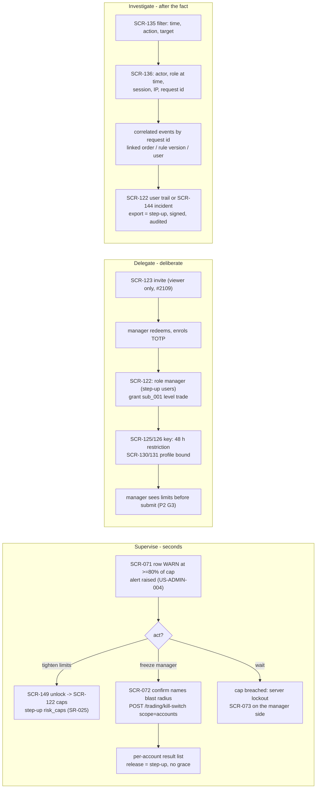

# E42-D01 — UX research: how the owner supervises, delegates and investigates in the admin area

- **Ticket:** E42-D01 (issue #830) · **Status:** Draft, rev 6 of 2026-10-20 (rev 5 of 2026-10-16 folded
  the cross-lane review by hcl-worker-2 on #830, three docs delta reviews and the coordinator's
  recommendations of 2026-10-16 03:42Z; rev 6 folds the Fable design-review round 1 at `d3350f9b`
  after a rebase onto `main` `2fc5ead7`, with every cited fact re-read there), every recommendation
  pending confirmation ·
  **Method:** heuristic evaluation + persona walkthrough against the catalogued screens and the
  contracts (see "Method note"; no live participant sessions were run)
- **Scope:** the admin area as catalogued, SCR-120..149 (`14-screens-catalogue.md` §10) and the global
  states it relies on (SCR-150..159, §11), read through US-ADMIN-001..014 and the P1 Owner, P4 Admin-hat
  and P2 Manager personas. Feeds E42-D02 (#831, wireframes) and E42-D03 (#886, hi-fi shell and users).
- **Out of scope (unchanged):** wireframes and hi-fi (E42-D02..D05); accounts/keys research (E27-D01,
  #732) and profiles research (E28-D01, #820); quantitative usability metrics (the population is one
  owner plus a few managers; this report is qualitative by necessity and says so).
- **Deliverable form (gap, closing):** this file is markdown only. `docs/design/README.md` requires a
  UX-research deliverable to be a research board on the ticket's Penpot page, "not a markdown file
  alone". The Penpot bridge was down in the delivering session and in every fix round so far, so the
  four §1 boards are specified below and their build script is ready; hpe-worker-1 draws and exports
  them the moment the bridge is back, before approval, and no waiver is requested (Deviations, item 1).
  The Mermaid diagrams below are additional, never the only deliverable.

## Acceptance-criteria trace (E42-D01, issue #830)

Status key: **done** = delivered as the ticket words it; **heuristic-only** = delivered through the
ticket's Agent-delivery adaptation (heuristic evaluation, no participants), so it stays a recommendation
pending confirmation; **open** = needs live sessions, Penpot, or an owner decision, and is not claimed.
The ticket stays open until the §10 sessions run (or the owner waives them) and the Penpot boards exist
(or the owner records a waiver on #830; see Deviations).

| Ticket AC or deliverable                                                                                       | Section                                                                                                                 | Status                           |
| -------------------------------------------------------------------------------------------------------------- | ----------------------------------------------------------------------------------------------------------------------- | -------------------------------- |
| AC1: at least three scripted sessions (supervise, delegate, investigate) completed and recorded with consent   | §4 persona walkthroughs (heuristic); §10 protocol, ready to run                                                         | heuristic-only; sessions open    |
| AC2: card sort gives a recommended SCR-120 tile set and grouping, reconciled with the catalogue's stated tiles | §5, reconciliation table (every deviation argued, nothing dropped silently)                                             | heuristic-only                   |
| AC3: every listed vocabulary term has a keep (one-line explanation) or replace (replacement) decision          | §6                                                                                                                      | done, pending owner confirmation |
| AC4: each of the four risk probes has a finding (understood / partially / misunderstood) and the copy change   | §7                                                                                                                      | heuristic-only                   |
| AC5: report merged and linked from E42-D02 and E42-D03; catalogue amendments filed                             | this file; §12 AM-1..AM-10, each with its owner and filing route in §12.1; links on #831 and #886 are added by the lane | open until merge                 |
| AC6: CDO (or delegate) review comment recorded                                                                 | the owner's `approved` comment on #830 (Agent-delivery adaptation)                                                      | open                             |
| Deliverable: prioritised comprehension-risk list feeding E42-D02 and E42-D03 copy                              | §8                                                                                                                      | heuristic-only                   |
| Deliverable: verbatim quotes                                                                                   | none exist and none are invented (§2)                                                                                   | open (sessions)                  |
| Technical note: open-then-closed card sort; teach-back comprehension test                                      | §5 (heuristic run); §10 scenarios 4 and 5                                                                               | heuristic-only; live run open    |
| Accessibility note: at least one keyboard-only session                                                         | §10, keyboard-only pass on scenario 1                                                                                   | open                             |
| Security note: sanitised fixtures only; recording retention stated                                             | §10 "Data handling"                                                                                                     | done (rules stated)              |
| Observability: the list feeds the `empty_state_shown` and `admin.onboarding_abandoned` questions               | §8, "Post-launch signal" column                                                                                         | done                             |
| Research boards in Penpot (mandatory evidence per `docs/design/README.md`)                                     | §1: four boards specified, page `E42-D01`, build script ready; drawn and exported when the bridge is back               | open (bridge down; script ready) |

## Deviations

Recorded in one place so the PR can point here (`docs/design/README.md`; C-4.4; C-4.8).

1. **Deliverable form.** This is a markdown report whose Penpot research boards are specified (§1) but
   not yet drawn: the plugin bridge was down in the delivering session and in both fix rounds. The
   four boards have a ready-to-run build script (page `E42-D01`, boards named `E42-D01 / 01..04`,
   exports under `docs/design/research/img/`), and hpe-worker-1 draws, exports and embeds them before
   approval as soon as the bridge is restored. No waiver is requested; the PR stays Partial until the
   PNGs are committed. The §11 checklist is posted on #830 as a ready-to-post block either way.
2. **Branch name.** The ticket names `design/admin-screens-research`; the branch is
   `design/e42-d01-admin-research`, which carries the epic key in the `<type>/<epic-key>-<slug>` form
   of C-4.4. The deliverable is the same; the PR body names this deviation.
3. **Size (why one file, not several).** The report is 1276 lines against the 289 and 322 of
   the two research precedents (`e09-auth-mental-models.md`, `e13-indicator-mental-models.md`),
   because the ticket covers thirty screens (SCR-120..149) and fourteen stories rather than one
   screen family, and because the review round added a public-comparables table (§2.1) and the
   destructive-action ladder (§9.1) that E42-D02 reads together with the findings they rest on. As
   one new file it counts as 1276 changed LOC, above C-4.8's 400-line preference
   and its 800-line limit, so the PR needs `large-pr-approved` from a CODEOWNER with a written
   justification; this item is that justification. It is not split because the ticket names one report
   as its deliverable; because the acceptance-criteria trace, findings (F-), recommendations (R-),
   decisions (AD-), amendments (AM-), risks (CR-) and open questions (OQ-) cite each other by id and
   are meant to be read in one review; and because §10 fixes the convention that session findings are
   appended here as a dated addendum, never as a new document. The change is documentation only, with
   no code, generated files or lockfiles.
4. **Method.** Moderated sessions are replaced by a heuristic evaluation and a persona walkthrough
   under the ticket's Agent-delivery adaptation (§2); every finding so produced is labelled
   `(heuristic)` and stays a recommendation pending confirmation.

## 1. Research boards (Penpot) — specified, drawn when the bridge is back

No Penpot page exists for this ticket yet: the plugin bridge was down in the delivering session and in
both fix rounds (a read-only probe hung and reported "transport dropped mid-call" on 2026-10-20). The
boards are built by one `execute_code` call from a ready script (`e42-d01-board.js`, kept with the
lane's Penpot scripts; it follows the shared-plugin convention: file-id guard, page `E42-D01` found by
name and created if missing, re-checked after `openPage`, then synchronous creates only, one writer,
idempotent by normalised name, every shape prefixed `E42-D01 / ` and stamped `hpe1ver`). They are
exported with `docs/design/_tools/penpot_export.py` into `docs/design/research/img/` as
`E42-D01-01-journey.png`, `E42-D01-02-card-sort.png`, `E42-D01-03-findings-matrix.png` and
`E42-D01-04-vocabulary.png` (the E13-D01 and E16-D01 precedents live in the same folder), then embedded
here. Every word on a board comes from this report; nothing is drawn that the text does not say.

1. **Journey map, three lanes** (supervise, delegate, investigate) against the catalogued screens, with
   the gates (the admin gate in both D8 variants, SCR-006 step-up, RBAC 403 + audit) and the audit
   emissions marked with their registered codes, from §4.0; the supervise lane marks SCR-071/072/073
   as E39-D01's (#829) and the freeze step as consumed, not drawn, by E42.
2. **Card sort board**: the 26 information cards of §5.1, the open-sort bands of §5.2, the closed sort
   against the catalogue's grouping of §5.3, and the nine-tile result of §5.4 with its "Needs your
   action" strip.
3. **Findings matrix**: F-S1..F-S7, F-D1..F-D8 and F-I1..F-I6 against the heuristic set of §2, with the
   recommendation and the decision (AD-) each feeds, the owner of each (E42-D02/D03/D04/D05, E39-D01,
   a contract ticket, or the owner on #2701) and the §9.1 ladder as its own panel.
4. **Vocabulary board**: the §6 decisions as term → in-product line pairs, for the teach-back test, with
   the conditional rows (OQ-1, OQ-4, OQ-12, OQ-14) marked as such.

Until those PNGs are committed this report is incomplete as a design deliverable (README: "not a
markdown file alone"); the AC table and Deviations above say so. When the boards are drawn they are
embedded here under this section with their page link and ids, and the AC row is updated.

## 2. Method note (Agent-delivery adaptation, owner decision 2026-09-25)

The ticket asks for moderated, think-aloud sessions against a clickable prototype, an open-then-closed
card sort and a teach-back comprehension test. Delivery is a solo AI agent with one human owner and no
prototype (E42-D02 depends on this report), so, per the ticket's **Agent-delivery adaptations** clause and
the E09-D01 and E13-D01 precedents, the sessions are substituted with:

1. A **heuristic evaluation** of SCR-120..149 (plus SCR-071..073 where the supervise scenario starts
   outside the admin area, and SCR-150..159 where a global state is the admin screen's answer) against:
   - Nielsen's ten heuristics, cited as **H1** visibility of system status, **H2** match between the
     system and the real world, **H3** user control and freedom, **H4** consistency and standards,
     **H5** error prevention, **H6** recognition rather than recall, **H7** flexibility and efficiency,
     **H8** aesthetic and minimalist design, **H9** help users recognise, diagnose and recover from
     errors, **H10** help and documentation;
   - the trading-specific heuristics of `05-accessibility-standard.md`: **A-P** (§2 Perceivable: a state
     is never colour-only), **A-O** (§2 Operable and §3.1.4: every destructive gate is keyboard-operable,
     no timing trap), **A-U** (§2 Understandable: errors in plain language, predictable focus);
   - the persona-derived themes of `10-personas.md` §10 that bind this area: **T4** server-enforced
     safety that survives a dead UI, **T5** honest uncertainty, **T7** unmistakable Demo vs Live, **T8**
     secrets never visible, **T10** everything auditable and append-only, **T11** emergency mode is
     separate from configuration mode.
2. A **persona walkthrough** of the three scripted scenarios as P1 wearing the P4 hat, with the P2
   Manager's side of each scenario where the stories give it (§4).
3. A **heuristic card sort**: the information items the catalogue and the contracts put on the admin
   surface, sorted first by the question the owner is asking (open), then checked against the
   catalogue's own grouping (closed) (§5).
4. A **written session protocol** (§10) and an **owner walkthrough checklist** (§11) so the owner can
   turn every heuristic finding into an observed one later.

**Honest limits.** No participant quotes, task timings, success rates or card-sort agreement scores
exist, and none are invented. Every finding is labelled `(heuristic)` and traces to a line of a plan or
contract document, never to observed behaviour. Where the ticket's acceptance criteria want an observed
fact ("can the owner explain hash chain back?"), this report records the **risk** that the heuristic
evaluation can see and defers the fact to §10. All recommendations (R-\*) and decisions (AD-\*) are
therefore **recommendations pending confirmation** by the owner and by the §10 sessions. Confidence is
the strength of the basis, not a measurement: **High** = stated in a locked plan or contract document;
**Med** = sound heuristic reasoning from the catalogue text; **Low** = persona inference only.

**Inputs the ticket names that do not exist yet.** E27-D01 (#732) and E28-D01 (#820) are both open with no
report under `docs/design/research/`, so there is nothing to "read rather than repeat". Where keys and
profiles touch the admin modes, this report cites the E27 and E28 threat models
(`docs/security/threat-models/E27-accounts.md`, `E28-profiles-trade-groups.md`) and defers the rest to
those tickets. The E42 STRIDE model exists since rev 5 was written: `docs/security/threat-models/e42-admin.md`
(E42-X01, #890; Approved 2026-10-18, refreshed at `0cfb12c2` for #3164 and #3221). This report takes
from it D6 (view-as is server-defined or it does not ship), D8 (open, Owner: SCR-149's 15-minute window
against per-action step-up, recorded by the E42-T06 ADR, #1085), AD-E01 (on the server the admin re-auth
is observability only: `reauth_age_s`, never a refusal), AD-F03 and AD-I05 (the view-as records) and
SR-E42-12. The other security constraints below come from `04-security-program.md` (SR rows),
`docs/security/threat-models/e09-auth-rbac.md`, the user-lifecycle appendix
`docs/security/threat-models/e42-user-lifecycle.md` (probe 2 only) and the admin read-model decisions
recorded on #963 (partial results, the kill switch never defaulted, the sub-account tier reported as
`unrecorded` only when the store answered "no row").

### 2.1 Public comparables (documentation only, read 2026-10-20)

No product of CandleViewer's shape publishes an admin area to compare against, so the benchmark is one
public product per pattern, read from its own documentation on 2026-10-20 (URLs in §15). "Stronger" and
"weaker" judge this report's recommendation against the comparable on the owner's stated priorities
(T4 server-enforced safety, T5 honest uncertainty, T10 everything auditable, T11 emergency separate from
configuration); nothing here is an observed behaviour of either product.

| Pattern                              | Public comparable (what its documentation says)                                                                                                                                                                                                                                                                                                                                                                                                                                                                                                                                                                       | CandleViewer as recommended here                                                                                                                                                                                                                                                                                                                                                                                                    | Stronger / weaker, and why                                                                                                                                                                                                                                                                                                                                                                                                                                                                              |
| ------------------------------------ | --------------------------------------------------------------------------------------------------------------------------------------------------------------------------------------------------------------------------------------------------------------------------------------------------------------------------------------------------------------------------------------------------------------------------------------------------------------------------------------------------------------------------------------------------------------------------------------------------------------------- | ----------------------------------------------------------------------------------------------------------------------------------------------------------------------------------------------------------------------------------------------------------------------------------------------------------------------------------------------------------------------------------------------------------------------------------- | ------------------------------------------------------------------------------------------------------------------------------------------------------------------------------------------------------------------------------------------------------------------------------------------------------------------------------------------------------------------------------------------------------------------------------------------------------------------------------------------------------- |
| Re-authentication for sensitive acts | **GitHub sudo mode.** "GitHub has a two-hour session timeout period before prompting you for authentication again"; "any sensitive action that you perform will reset the timer"; confirm "with your password" or "a passkey, a security key, GitHub Mobile, or a 2FA code"; "Text messages are not supported"; protects deleting the account, adding SSH keys, creating personal access tokens, webhooks, 2FA enforcement and recovery codes.                                                                                                                                                                        | Per-action step-up by class (password + TOTP), a 5-minute grace per class, **no grace** for `live_enablement`, `killswitch` and `backups` (one-shot grants bound to the challenged request, 60 s), plus the SCR-149 area gate, which is observability only on the server until D8 (OQ-14). Copy: "Confirm it's you" / "Unlock admin" (§6).                                                                                          | **Stronger**: the no-grace classes and the request-bound grant mean a stolen elevated session cannot release a kill switch or restore a backup inside a window; GitHub extends one window with every sensitive act. **Weaker**: two gates and three durations (F-D5, CR-6) against GitHub's one visible rule, and one factor pair (no passkey or security-key path; E09's scope). The ladder (§9.1) keeps the no-grace rungs; OQ-14 settles whether the second gate exists at all.                      |
| What an audit record carries         | **AWS CloudTrail `userIdentity`.** `type` (`IAMUser`, `AssumedRole`, `AWSService`, ...), `sessionContext` with `sessionIssuer`, `attributes.mfaAuthenticated` and `creationDate`, `signInSessionArn`, `sourceIdentity`, `invokedBy` ("the name of the AWS service that made the request").                                                                                                                                                                                                                                                                                                                            | `AuditEntry`: actor id and username, action, subject, outcome, severity, `reason`, environment, `session_id`, `ip`, `user_agent`, `request_id`, `detail`; `actor_role` and `actor_type` are follow-up #2763 (F-I1, AM-6), and a `reason` is mandatory by contract on the destructive actions (§9.1).                                                                                                                                | **Weaker today**: no actor type, no role at the time and no "elevated at the time" flag on the record; CloudTrail's `mfaAuthenticated` is the precedent for recording the step-up state with the row, a question this report hands to #2763. **Stronger**: `request_id` correlation across services (R-I4) and a human reason on every destructive action, which CloudTrail does not carry.                                                                                                             |
| Tamper evidence                      | **AWS CloudTrail log file integrity validation.** "SHA-256 for hashing and SHA-256 with RSA for digital signing"; every hour a digest file "contains a hash of each" log file, is signed, and "also contains the digital signature of the previous digest file"; validation tells "whether a log file was modified, deleted, or unchanged"; the files can be protected with S3 MFA Delete.                                                                                                                                                                                                                            | A per-entry chain (`entry_hash` over the canonical row, `prev_hash` to the entry before), `UPDATE`/`DELETE` refused by the store trigger (C-5.7), a nightly verifier that raises a `critical` event, and a signed NDJSON export with a detached Ed25519 signature and a `prev_hash` anchor; on screen: "Tamper check: verified to ..." (R-I3, AD-8).                                                                                | **Stronger**: linkage per entry rather than per hour, refusal of change at the store rather than detection after it, and a named on-screen failure state that reads as an incident. **Weaker**: the chain is a fingerprint until an export is verified offline (SR-063; CloudTrail signs at delivery), and SCR-136 has no hash view yet (R-I7, AM-13).                                                                                                                                                  |
| How long the record lives            | **Okta System Log.** "Your Okta org maintains a 90-day sliding window of system logs"; older records must be downloaded "for external processing or archiving before they pass the 90-day window".                                                                                                                                                                                                                                                                                                                                                                                                                    | Audit rows are kept forever, exported nightly to the cold tier and included in every backup (`24-internal-schemas.md` §15.5); the log states on screen that records can only be added (AD-8).                                                                                                                                                                                                                                       | **Stronger**: no window, so an investigation months later reads the same log the owner saw. Parity: Okta's per-event target and transaction structure is what `subject_*` plus `request_id` give (R-I4).                                                                                                                                                                                                                                                                                                |
| Seeing the app as another user       | **Okta Support access.** An admin grants, per case, "read-only admin access to your org for 24 hours" from Settings → Account. **Auth0 impersonation (filed by Auth0 as legacy).** "Obtain an impersonation URL to login as another user. Useful for troubleshooting"; the impersonated user's profile carries `impersonated` and `impersonator` properties.                                                                                                                                                                                                                                                          | View-as as contracted by #3164 (D6 of the E42 threat model): read-only decided by the server from the HTTP method, 30 minutes that nothing extends, Owner targets refused, a mandatory reason recorded only in `admin.view_as_started` and never shown to the target, the target notified with the viewer's name and the window, every refusal recorded within its own budget. User story still missing (OQ-4); SCR-124 copy in §6. | **Stronger**: a shorter window, a notified target, and read-only enforced by the server rather than by a flag or a profile marker (Auth0's model is an acting session, exactly what D6 forbids). **Weaker**: no story yet names when the owner needs it, the server slice is owed (#3085), and the alternative that answers "who can do what" without entering view-as, an effective-permissions view, does not exist (R-D9).                                                                           |
| Flatten and kill controls            | **Bookmap.** In the Trading Configuration Panel behind the lock icon: "Cancel All" and "Flatten" ("immediately exit all open positions and cancel all pending orders"); "One-Click Trading is OFF when you first open" the panel; "By default, a confirmation window pops up after sending orders", switchable off per order type under Settings → Orders Confirmation. **Sierra Chart Trade Window.** "Flatten and Cancel" ("Flattens the position and Cancels all the working orders for the symbol"); per-chart "Confirm Flatten/Reverse" and "Confirm Cancel All"; a global "Disable Order Confirmations" switch. | CMP-211: engage is one keyboard-operable confirm that names counts (hold with a discrete-press fallback, 05 §3.1.4) and can never be switched off; the contract's `reason` is a one-key preset or optional on engage (AM-2); release is a no-grace step-up with free text (R-S1, AD-3). Owner of SCR-071/072: E39-D01 (#829).                                                                                                       | **Stronger**: there is no global "disable confirmations" switch and the confirm states the blast radius in numbers; the hold is never the only keyboard path. **Weaker as contracted on `main`**: `SetKillSwitchRequest` requires `reason` (3–280 characters) on engage, which makes the stop slower than either product's single confirm until AM-2 lands. Both products' per-order-type bypass has no CandleViewer equivalent for the panic cluster, on purpose (E10-D02: never a bare single click). |
| Sub-accounts and API keys            | **Bybit v5 API.** A sub-account key is `readOnly` 0 or 1 with permission groups (ContractTrade, Spot, Options, Wallet: AccountTransfer and SubMemberTransferList, Exchange, Earn) and no Withdrawal group; "No ip bound api key will be invalid after 90 days"; "api key without IP bound will be invalid after 7 days once the account password is changed"; renewal keeps the key (edit the IP binding, confirm with e-mail and 2FA); creating a sub UID needs a master key with "Account Transfer", "Subaccount Transfer", "Withdrawal".                                                                           | A key with withdrawal permission is rejected and every stored key is re-verified hourly (C-2.8, `security.key_policy_violation`); key expiry surfaces on the Accounts tile and the "Needs your action" strip at T−14 d (§5.4, §5.6); the 48 h new-key restriction is shown as an absolute time with "Demo works meanwhile" (R-D7); the sub-account tier is a recorded fact, never inferred (AD-7).                                  | **Stronger**: a withdrawal-capable key cannot be stored at all, and key age reaches the landing page rather than a settings screen. **Weaker or equal**: the cap is hand-recorded (US-ADMIN-014), and the 7-day expiry after a password change is on no CandleViewer screen; this report hands that line to the key-health panel's owner (SCR-128, E27-D01 #732) rather than designing it here.                                                                                                         |

## 3. What the three modes have in common (and why one IA will not do)

The ticket's premise holds on the evidence (heuristic): the fourteen stories describe three different
states of mind, and the catalogue's screens already lean three ways.

| Mode            | Trigger and tempo                                                                         | What the owner needs first                                                                         | Screens that carry it                                     | Confirmation posture (`10-personas.md` §5 P4-R vs P4-E)                                                                                   |
| --------------- | ----------------------------------------------------------------------------------------- | -------------------------------------------------------------------------------------------------- | --------------------------------------------------------- | ----------------------------------------------------------------------------------------------------------------------------------------- |
| **Supervise**   | Mid-session, seconds matter (US-ADMIN-004 "at a glance"; P4-E)                            | One true number with a timestamp, one safe action, proof the action landed                         | SCR-071/072/073 (outside admin), SCR-120, SCR-143/144     | One confirm naming the blast radius; **no typed ritual** (the contract's `reason` as a preset, AM-2; owner E39-D01); step-up only to undo |
| **Delegate**    | Outside trading hours, deliberate, reversible (P4-R), except unbind/revoke with positions | The consequence of a grant before it is saved; the preconditions (key, profile, 48 h) in one place | SCR-121/122/123, SCR-125/126, SCR-130/131, flow §4 wizard | Typed confirmation for destructive items; step-up for roles, grants, caps (SR-025)                                                        |
| **Investigate** | After the fact, calm but suspicious (US-ADMIN-009 "investigation is practical")           | Who, when, under what permissions, correlated with what else happened; proof the record is intact  | SCR-135/136, SCR-144, SCR-137, SCR-122 audit trail        | None to read; step-up to export (SR-025, SR-067); reads are themselves audited (SCR-136)                                                  |

Two consequences drive everything below. First, **the landing page must be ordered by tempo**, not by
module: the supervise facts come first because they are the ones read under time pressure (§5). Second,
**the same verb must not mean two things across modes**: "disable", "revoke", "locked" and "kill switch"
each currently carry two meanings in the plan (§6), and the delegate action that behaves like an
emergency (unbind or revoke with open positions) must borrow the emergency vocabulary, as P4-E scenario 9
already says for keys.

## 4. The three modes — persona walkthroughs and findings (all `(heuristic)`)

### 4.0 Journey overview



Every lane starts with a signal the owner did not choose, passes at least one server-side gate the UI
cannot fake (SR-025 step-up, SCR-149 unlock, RBAC 403 + audit) and ends with a record the owner can read
back (T10). The findings below are where the catalogued screens make that walk slower, more ambiguous or
less honest than the stories demand.

### 4.1 Supervise — "a manager's account is approaching its daily loss cap; what do you do?"

**Walkthrough (P1 at the terminal, P4 hat not yet on).** The signal is SCR-071's row for `sub_001` at
95 % of its cap with the state word `WARN` and an alert (US-ADMIN-004 "the row escalates visually with a
text label and an alert is raised"). The owner has four moves. _Wait_: the server enforces the cap
(US-ADMIN-003, `13-user-flows.md` §18.7), flattens per policy and locks the account; the manager sees
SCR-073. _Tighten now_: the cap override lives on SCR-122 (admin area, so SCR-149 unlock, then step-up
class `risk_caps`), and US-ADMIN-003 promises no forced liquidation, new entries blocked, reduce-only
kept. _Freeze_: SCR-071 `FREEZE sub_001` → SCR-072 → `POST /trading/kill-switch` with `scope: accounts`;
the manager's terminal goes read-only within 2 s with a banner naming who and when (P2 scenario 5).
_Talk_: outside the product. The manager's side is specified (SCR-073 copy, lockout until 00:00 UTC,
owner-override path with a typed reason, SCR-071). SCR-071, SCR-072 and SCR-073 are E39-D01's (#829,
in progress: its scope names the two walkthroughs, the SCR-071/072/073 wireframes and the FREEZE copy
deck); the findings below that touch them are handed to #829 as input, E42 consumes its decisions,
and E42-D02 draws none of the three screens.

| #    | Finding `(heuristic)`                                                                                                                                                                                                                                                                                                                                                                                                                                                                                                                                                                                                                                                                                                                                                                                                                                                                                                                                                                                                                                                                                                                                       | Heuristic        | Rec  | Confidence (basis)                                                                                                                                                                                                                                                                                                  |
| ---- | ----------------------------------------------------------------------------------------------------------------------------------------------------------------------------------------------------------------------------------------------------------------------------------------------------------------------------------------------------------------------------------------------------------------------------------------------------------------------------------------------------------------------------------------------------------------------------------------------------------------------------------------------------------------------------------------------------------------------------------------------------------------------------------------------------------------------------------------------------------------------------------------------------------------------------------------------------------------------------------------------------------------------------------------------------------------------------------------------------------------------------------------------------------- | ---------------- | ---- | ------------------------------------------------------------------------------------------------------------------------------------------------------------------------------------------------------------------------------------------------------------------------------------------------------------------- |
| F-S1 | Typed `FREEZE` on engage contradicts the persona rule and the user flow, and two plan documents stand on each side. For it: SCR-071 asks for "hold-to-confirm + typed confirm" and SCR-072 "requires typing `FREEZE`"; `04-security-program.md` §9.1 gives the global kill a "confirm dialog with typed confirmation for live" (it names no confirmation for an account freeze). Against it: `10-personas.md` §5 P4-E says "**no typed confirmation**, because a 15-second typing ritual during a runaway is itself the hazard. Step-up is required to **undo** (unfreeze), never to stop harm"; `13-user-flows.md` §20 says "single click, no typed confirmation since this is a safety action". The catalogue is the one that would be built; changing engage means reconciling 04 §9.1 too. **The merged contract already forces typed text on engage:** `SetKillSwitchRequest` lists `reason` (3–280 characters) among its required fields whether `engaged` is true or false, so "one gesture, never a typed word" is not available as the contract stands; the typed `FREEZE` word is the catalogue's addition on top of a mandatory free-text field. | H7, H5, T11, A-O | R-S1 | High for the conflict (four plan documents, two on each side; two merged design specs and the merged `SetKillSwitchRequest` also bear on it, OQ-1); the resolution is an owner decision (OQ-1, decided with E39-D01 #829), which includes reconciling 04 §9.1 and relaxing the contract's `reason` on engage (AM-2) |
| F-S2 | The freeze dialog's option defaults disagree with the contract. SCR-072: "also cancel working orders" and "also flatten positions" are checkboxes "both default off"; `SetKillSwitchRequest` defaults `cancel_open_orders: true`, `flatten_positions: false`, `disarm_rules: true`. A dialog that shows "off" while the server defaults "on" changes the blast radius silently; `disarm_rules` is not drawn at all. The fourth required field, `reason`, is F-S1's.                                                                                                                                                                                                                                                                                                                                                                                                                                                                                                                                                                                                                                                                                         | H4, H1, H5       | R-S2 | High (SCR-072 text vs `22-api-openapi.yaml`)                                                                                                                                                                                                                                                                        |
| F-S3 | The supervise path has no registered hotkey; the shell control itself is specified. P4-E wants a Safety control "reachable from every screen (rail footer + global hotkey)"; CMP-211 PanicButtons is "always-reachable ... in the top bar and system tray" and SCR-010's component list includes it, so the control is placed. The gap is keymap registration: neither `apps/web/src/keymap/keymap.json` (the single source of the default keymap; `docs/generated/default-keymap.md` is generated from it) nor `05-accessibility-standard.md` §3.2 has a kill-switch, freeze or view-as-exit binding, and SCR-010's hotkey line names none (§3.2 puts Flatten all on `Ctrl+Shift+F`; none of the three carries `Ctrl+Shift+K`, which `04-security-program.md` §9.1 and `17-ux-diagrams.md` already name for the kill switch). SCR-124 requires "a single documented hotkey" for Exit view-as without naming one.                                                                                                                                                                                                                                           | H7, A-O, T11     | R-S3 | Med (an absence in the keymap sources, a registration omission rather than a stated conflict; the control is catalogued in SCR-010); the key is already documented and awaits registration (OQ-7)                                                                                                                   |
| F-S4 | "Approaching the cap" is a tightening decision, but the tightening control is three gates from the signal. SCR-071 carries the signal; the override is on SCR-122 behind the SCR-149 unlock and a `risk_caps` step-up; nothing on SCR-071 links to it. The gates are mandatory (SR-025); the walk is not.                                                                                                                                                                                                                                                                                                                                                                                                                                                                                                                                                                                                                                                                                                                                                                                                                                                   | H7, H3           | R-S4 | Med (catalogue has no link; the gates are plan text)                                                                                                                                                                                                                                                                |
| F-S5 | Freshness and partial results are the supervise tiles' honesty problem. US-ADMIN-004: "every figure carries a freshness timestamp"; `AdminOverview` slices carry `status: ok, error, unavailable` and `generated_at`; #963: the kill switch is never defaulted to `false` when unread, and open positions have no provider yet (`unavailable`). A slice rendered as `0 open positions`, or an empty tile, reads as "all good".                                                                                                                                                                                                                                                                                                                                                                                                                                                                                                                                                                                                                                                                                                                              | T5, H1           | R-S5 | High (contract plus the #963 decision record)                                                                                                                                                                                                                                                                       |
| F-S6 | The owner is told to freeze from the manager's row, but the per-manager row is on SCR-071 and the per-user actions are on SCR-121/122; a freeze is `risk.freeze_manager` (the registered code; SCR-072's `risk.freeze` is not registered, F-I2) on an account scope, a disable is `users.disable` on a person. The two look alike in a menu and differ completely in effect (freeze touches no persisted configuration and unfreeze restores exactly the prior state, P4-E scenario 7; disable revokes sessions and grants).                                                                                                                                                                                                                                                                                                                                                                                                                                                                                                                                                                                                                                | H2, H5           | R-S6 | Med (persona text plus the two screens' menus)                                                                                                                                                                                                                                                                      |
| F-S7 | SCR-143 says the health tiles "subscribe to `system` at 1 Hz", and SCR-120's Health tile is drawn from the same feed; but `system` is an update topic, not a heartbeat: its default throttle is 1 000 ms (`23-ws-protocol.md` §6.2), a `health` frame is published when something changes (kill-switch transitions, flag changes, degraded-data notices, connectivity changes), and each `components[]` entry carries `last_good_at` (§15.9). Silence on the topic cannot be told from "nothing changed", so a tile that renders the last frame as current can read `ok` for a component that stopped reporting. The socket's own heartbeat (`ping` every 15 s, 45 s timeout, §9.1) says the connection is alive, not that the health producer is.                                                                                                                                                                                                                                                                                                                                                                                                          | T5, H1           | R-S7 | High (`23-ws-protocol.md` §6.2, §9.1, §15.9 against SCR-143's and SCR-120's performance notes)                                                                                                                                                                                                                      |

**Recommendations (supervise).**

- **R-S1 — engage is one confirm plus a reason that costs no typing; release is step-up.** SCR-072 names
  the exact blast radius ("Freeze alex (sub_001): 1 account, 2 open positions stay open, 3 working orders
  cancelled, rules disarmed") and confirms with one keyboard-operable gesture: CMP-211 `confirmMode:
"hold"` for pointer users, which E10-D02 already draws, **with the discrete-press keyboard fallback that
  `05-accessibility-standard.md` §3.1.4 requires**: focus starts on Cancel; `Tab` reaches "Freeze alex";
  the first `Enter` or `Space` arms the control and its accessible name changes to "Press again to freeze
  alex"; a second press within the dialog confirms; `Esc` cancels at any point. A hold on `Enter` alone
  (the CMP-211 text) is a timed gesture and is never the only keyboard path: a hold excludes switch
  access and tremor, its progress needs `aria-valuenow`, and under `prefers-reduced-motion` the ring is
  a static percentage text updated at most twice a second (AD-12). `"single"` stays out: it conflicts
  with E10-D02's rule that the panic control is never a bare single click. **The contract's `reason`
  (`SetKillSwitchRequest`, required, 3–280 characters, on engage and release alike) is satisfied without
  free text:** either `reason` becomes optional on engage, or the dialog offers a one-key preset (`1`
  "Loss cap approaching", `2` "Exchange behaving abnormally", `3` "Manager unreachable", `4` "Other",
  free text optional) and sends the preset's sentence as `reason`; the contract change is AM-2's and
  lands interface-first (C-6.1). Release (unfreeze, kill-switch off) keeps step-up with no grace
  (`killswitch` class) plus its own confirm, where free text is required and the typed `FREEZE` moves on
  the coordinator's recommendation (OQ-1). **Owner of SCR-071/072/073 and of this copy: E39-D01 (#829,
  in progress)**; this report hands F-S1 and F-S2 to #829 as input and E42-D02 draws none of the three
  screens. Catalogue amendment **AM-2** (owner #829); owner decision **OQ-1** (decided with #829).
- **R-S2 — the dialog always sends all three options explicitly and shows all three**, including
  "disarm their rules", with one canonical default agreed between SCR-072 and the contract (OQ-1 asks
  which). No option is ever left to a server default the owner cannot see.
- **R-S3 — register the safety bindings; the shell control already exists.** CMP-211 is in SCR-010's
  component list, so D02 draws it where the merged shell wireframes put it (E10-D02: RightRail top,
  hold-to-confirm; CMP-211's own text says top bar and system tray) and adds no new control. Proposal:
  register `Ctrl+Shift+K` for the kill-switch confirm (`04-security-program.md` §9.1
  and `17-ux-diagrams.md` already name it; `apps/web/src/keymap/keymap.json`,
  `05-accessibility-standard.md` §3.2 and `docs/generated/default-keymap.md` do not carry it), a freeze
  binding and, only if view-as survives OQ-4, the Exit view-as key; all of them added to `keymap.json`, the single source
  that the default-keymap document is generated from, and to the §3.2 default map under the §3.3
  conflict rules (a trading-critical binding keeps its modifier). `scripts/keymap_lint.py` checks
  `keymap.json` against the `Interactions/hotkeys` lines of the catalogue: SCR-010's line names no
  kill-switch or freeze key, and SCR-124 has no such line, only the a11y requirement of "a single
  documented hotkey", so both are updated in the same change and the lint passes before D02 asserts any
  key (OQ-7). D02 draws the controls, not the keys, until registered.
- **R-S4 — one link from the signal to the fix.** SCR-071's row menu gets "Tighten limits" deep-linking
  to SCR-122's caps section; the SCR-149 gate appears as an overlay with the destination preserved
  (SCR-149 checklist already requires the expiry-during-edit case); the resulting notice is the one
  E42-D03 scopes: "No positions will be closed. New entries are blocked; reduce-only actions remain
  available."
- **R-S5 — a tile never shows a number it did not receive.** One degraded/stale treatment (the E42-D02
  cross-screen pattern): "unavailable" or "error" in words, the slice's `generated_at` as "as of
  HH:MM:SS", and `kill_switch_engaged` rendered "unknown" whenever the trading slice is not `ok`. This is
  the on-screen form of #963's "never defaulted".
- **R-S6 — Freeze and Disable are never neighbours in one menu.** Freeze lives with the risk controls
  (SCR-071, CMP-211; audited as `risk.freeze_manager`) and says "touches no settings; undo restores
  exactly"; Disable lives in user administration (SCR-121/122) and lists its cascade (§7, probe 1).
- **R-S7 — a health tile says when it last heard, and when it stopped hearing.** Every SCR-143 tile and
  the SCR-120 Health tile show "as of HH:MM:SS" (the latest `health` frame's arrival, or the component's
  `last_good_at` while it is not `healthy`), and when no `health` frame has arrived for longer than the
  producer's publish interval (the backend states the interval; this report proposes twice it) the tile
  degrades in words to "stale since HH:MM:SS", never to a green state carried over. The connection
  heartbeat is shown once, in the chrome (CMP-076), never per tile. SCR-143's "1 Hz" wording and
  SCR-120's performance note are corrected (**AM-12**); AD-2 covers the rendering rule.

### 4.2 Delegate — "onboard a new manager and scope them to one sub-account"

**Walkthrough (P4-R).** SCR-123 invites the person; the contract grants `viewer` only
(`CreateUserRequest.roles` enum `[viewer]`, "Invites grant viewer only (#2109); the owner promotes after
activation"; SR-027). The manager redeems the link, sets a password and enrols TOTP (flow §4). The owner
then opens SCR-122: role `manager` (step-up class `users`), one grant `{sub_001, level: trade}` via
`PUT /users/{userId}/account-access`, the per-user caps override, and `live` per account. Preconditions
live elsewhere: the sub-account and its key on SCR-125/126 (Bybit's 48 h new-key restriction, P2 pain),
and a bound profile on SCR-130/131 ("unbound accounts ... cannot trade until bound"). US-ADMIN-013 (Should)
wraps all of this in a resumable wizard. The manager's test of success is P2 G3: limits visible before the
first submit.

| #    | Finding `(heuristic)`                                                                                                                                                                                                                                                                                                                                                                                                                                                                                                                                                                                                                                                                                                                | Heuristic   | Rec  | Confidence (basis)                                                                                     |
| ---- | ------------------------------------------------------------------------------------------------------------------------------------------------------------------------------------------------------------------------------------------------------------------------------------------------------------------------------------------------------------------------------------------------------------------------------------------------------------------------------------------------------------------------------------------------------------------------------------------------------------------------------------------------------------------------------------------------------------------------------------ | ----------- | ---- | ------------------------------------------------------------------------------------------------------ |
| F-D1 | The invite screen offers a role the contract forbids. SCR-123 lists "username, role, initial account assignments" and validates "role manager requires at least one account assignment"; `CreateUserRequest` allows only `viewer` and the owner promotes after activation. The delegate flow is therefore two deliberate steps, and the catalogue hides the second.                                                                                                                                                                                                                                                                                                                                                                  | H4, H5, H1  | R-D1 | High (SCR-123 vs `22-api-openapi.yaml`, SR-027)                                                        |
| F-D2 | Unbinding is drawn as unticking a checkbox and pressing Save, but the story demands a forced choice and the contract has no field for it. SCR-122's mock is `[x] sub_001 trade [x] live [x]`; US-ADMIN-002 says "unbinding requires an explicit choice: leave positions (owner takes over) or flatten first"; `PUT /users/{userId}/account-access` takes `grants[]` only. The E27 model already has the pattern for keys and accounts (KV-D03 and SR-E27-07: `leave_positions` or `flatten_first`, otherwise 409 with the consequence summary). E42-D03 scopes the dialog; nothing scopes the contract.                                                                                                                              | H5, T4, T11 | R-D2 | High (story, contract and SR-E27-07 text)                                                              |
| F-D3 | Disable sits next to Delete with synonyms and no consequences. SCR-121: "deactivate, delete; bulk deactivate"; SCR-122: "Deactivate", "suspend"; the API and US-ADMIN-001 say "disable" (`status=disabled`; `DELETE /users/{id}` is "Disable a user (soft delete)"); SR-029 adds a positions decision ("flatten or leave their positions with a recorded decision") that no screen mentions.                                                                                                                                                                                                                                                                                                                                         | H2, H5, H6  | R-D3 | High (four documents, three verbs)                                                                     |
| F-D4 | The capacity line can state a tier the system does not know. SCR-121 draws "3 of 5 used (20 with Business KYC)" and "Bybit allows 5 sub-accounts on your tier — you've used 5"; `SubaccountCapacity` returns `tier: null, cap: null` while `tier_source: unrecorded`, and omits `tier_source` when the store is unavailable (#963). US-ADMIN-014 NFR: "the tier is an explicit recorded fact, never inferred".                                                                                                                                                                                                                                                                                                                       | T5, H1      | R-D4 | High (contract plus #963)                                                                              |
| F-D5 | Two gates, three durations, one word. The admin unlock (SCR-149: password + TOTP, 15 min, `auth.session_unlocked`) and the per-action step-up (`/auth/step-up`: password + TOTP, 5-minute grace per class, none for `live_enablement`, `killswitch` and `backups`) are different mechanisms; `12-sitemap.md` §4 still says 30 minutes and "TOTP code (not password)". The delegate flow meets both gates in one sitting (enter admin, change role, change caps). On `main` the web router's own comment says 30 min (`apps/web/src/routes/rbac.ts:27`), the server records `reauth_age_s` and never refuses (threat model AD-E01; `admin/http.py`), and whether the area window exists at all is the open owner decision D8 (#1085). | H4, H1, H6  | R-D5 | High for the inconsistency (four sources); the wording is a proposal and the mechanism is D8's (OQ-14) |
| F-D6 | "Cannot trade until a profile is bound" is a delegation precondition on a different screen from the delegation. SCR-130 flags unbound accounts; SCR-122's account row shows the bound profile name but has no "no profile" state; SCR-120's mock carries "1 account without risk caps (!)" that its checklist does not list. P4 pain: "fat-fingered admin action ... deleting a profile in use".                                                                                                                                                                                                                                                                                                                                     | H1, H5      | R-D6 | Med (inferred from SCR-130 and SCR-122 text)                                                           |
| F-D7 | The 48 h key restriction is a wait the owner cannot shorten, so the flow must say _when_. US-ADMIN-013: "blocked with the exact unlock time and the rest of the flow continues"; SCR-122: granting live inside the window "shows a warning with the exact unlock time". Honoured in the plan; listed so D02 draws the absolute time and "Demo works meanwhile" (P2 scenario 1) rather than a generic warning.                                                                                                                                                                                                                                                                                                                        | H1, H9      | R-D7 | High (plan text; a check for D02, not a defect)                                                        |
| F-D8 | Two plan documents put the admin entry in two places, and D02 cannot draw the shell without one answer. `10-personas.md` §5: P4 is "reached through an 'Admin' section in the web app's left rail, visible only to role `owner`" and lives in the "Admin section of the left rail"; `12-sitemap.md` §1: "Admin is reached via an explicit 'Admin' entry in the account/user menu (not the left rail) ... Admin is a hat, not a persistent nav destination". SCR-010's chrome line names neither. The two documents agree on the Safety control (rail footer plus global hotkey; CMP-211 in the top bar) and disagree only on the Admin entry.                                                                                        | H4, H6      | R-D8 | High for the conflict (two locked documents); the choice is the owner's (OQ-16)                        |

**Recommendations (delegate).**

- **R-D1 — SCR-123 invites a viewer and says so.** Drop the role picker; show "Invited as a viewer. You
  grant manager access and accounts after they sign in and enrol two-factor." Keep the pending-invite list
  with revoke and re-issue. **AM-4** (SCR-123 part).
- **R-D2 — unbind with positions is a consequence-first dialog; what the contract carries is OQ-13.**
  Unticking an account that has open positions, working orders or running algos opens a dialog with
  exactly two named choices (§7, probe 3) and `Esc` meaning "cancel, nothing changed". Today O2 (#965),
  #2658 (merged 2026-10-17) and #2648 (E42-T08, open) say unbind never flattens or cancels: `PUT /users/{userId}/account-access`
  takes only `acknowledge_unknown_positions`, and only while the open-position count is unavailable.
  An explicit `leave_positions` or `flatten_first` choice on that route (409 with the consequence
  summary, the SR-E27-07 shape) would overturn O2 and needs the admin → OMS module edge named in an ADR
  (C-3.4); the coordinator's placement of that contract with E42-T04 (#965; the endpoint is admin's and
  E28 only consumes it; RelayRoom SYNC-4 of 2026-10-16 03:42Z; #2701, #965 and #2658 do not carry this
  placement) presupposes it.
  Keeping O2 needs neither. The owner decides (**OQ-13**); this report recommends keeping O2.
  Interface-first (C-6.1) before E42-D03 draws either as built. **AM-3**, **OQ-2**, **OQ-13**.
- **R-D3 — one verb per lifecycle action.** "Disable" (reversible, lists the cascade), "Delete (keeps
  history)" (typed username + step-up, states what is and is not removed), and "Sign out everywhere" for
  session revocation. No "deactivate", no "suspend". **AM-4** (SCR-121/122 part).
- **R-D4 — three capacity states, never a default cap.** Recorded: "3 of 5 sub-accounts used · Regular
  tier, recorded 2026-09-12 [change]"; unrecorded: "3 sub-accounts in use · Tier not recorded — record it
  to see your cap"; unavailable: "3 in use · cap unavailable right now". The at-capacity copy explains the
  Business KYC path and the isolation trade-off of sharing a sub-account (US-ADMIN-014). **AM-4**.
- **R-D5 — two verbs, and a countdown only if D8 keeps the window.** The action gate is "Confirm it's you"
  and, inside a grace window, reuses E09-D02 §9's "Still trusted for this action · 02:14 remaining";
  neither "re-authentication" nor "step-up" appears in product copy (§6). The area gate is conditional on
  D8 (#1085; OQ-14): **if the owner adopts the server-enforced `admin` window**, it is "Unlock admin" and
  shows "Admin unlocked · 12:40 left" in CMP-087's chrome (the catalogue already requires the indicator,
  and the countdown is then server-issued, never client-trusted: threat model AD-T10); **if the owner keeps
  per-action step-up as the model**, there is no area gate and no countdown, SCR-149 and CMP-087's badge
  are retired by amendment, and the admin chrome shows only the action gate's state. D02 draws **both
  shell variants** and marks them as D8's. `12-sitemap.md` §4 (30 min, "TOTP code (not password)") and
  the router comment at `apps/web/src/routes/rbac.ts:27` ("<=30 min") follow the decision (related
  amendment, §12).
- **R-D6 — the precondition is shown where the grant is made.** SCR-122's account row gets a state "No
  risk profile — alex can't trade this account until one is bound [Create profile]", and SCR-120 carries
  the count (§5).
- **R-D7 — absolute times for the 48 h restriction**, plus "Demo trading works meanwhile", on SCR-122 and
  in the wizard.
- **R-D8 — the admin entry is the user menu plus a palette command; the Safety control stays in the
  chrome.** This report recommends `12-sitemap.md`'s placement (an "Admin" entry in the account/user menu
  and a `Ctrl+K` palette command), because it keeps the left rail for trading, matches the hat framing the
  personas themselves use for P4, and keeps configuration out of the emergency surface (T11); CMP-211
  stays in the rail footer and top bar as `10-personas.md` §5 requires, which both documents agree on.
  The owner confirms (**OQ-16**) and the losing sentence is amended (related amendment, §12); D02 draws
  the user-menu entry and SCR-010's chrome line names it.
- **R-D9 — SCR-122 gets an "Effective permissions" panel.** Per account, the server's answer to the
  four-tuple of `24-internal-schemas.md` §15.2 (permission, account grant with its `trade`/`read` mode,
  `allowed_symbols`, environment enabled), read from `GET /roles`, `GET /permissions`,
  `GET /users/{userId}/account-access` and the bound profile, never computed client-side (C-12.4). It
  answers "who can do what" for delegation and for investigation without entering view-as, and it is the
  measured alternative OQ-4 weighs view-as against. The catalogue has no such view today (SCR-122 lists
  the inputs, not the resolved result); a composed read-model endpoint would be additive (C-6.3) and is
  the owner's choice under OQ-4. **AM-4** (SCR-122 part).

### 4.3 Investigate — "an order was placed that you did not expect; find out who, when and under what permissions"

**Walkthrough (P4, calm).** SCR-135: filter by time range, action (an order submit), target (symbol or
account), severity; open the row; SCR-136 shows actor, "role at the time", session, IP, user agent,
request id, correlated events by request id and linked artefacts (the order, the rule version, the
profile diff). If the actor was a rule, SR-062 wants `actor_type = rule` plus `rule_id` and
`rule_version`. If the session looks wrong, SCR-137's active-sessions and failed-login views; if the
system caused it, SCR-144. Reading the record is itself recorded (`audit.record_viewed`). Export is a
step-up action (SR-025) producing signed NDJSON (`/admin/audit/export`), audited. A manager walks the
same path over their own actions only; a viewer does not walk it at all (`audit:read` is not a viewer
permission: #2083).

| #    | Finding `(heuristic)`                                                                                                                                                                                                                                                                                                                                                                                                                                                                                                                                                                                                                                                                                                                                                                                                                                                                            | Heuristic                                                                        | Rec                               | Confidence (basis)                                                                                                                                                                                        |
| ---- | ------------------------------------------------------------------------------------------------------------------------------------------------------------------------------------------------------------------------------------------------------------------------------------------------------------------------------------------------------------------------------------------------------------------------------------------------------------------------------------------------------------------------------------------------------------------------------------------------------------------------------------------------------------------------------------------------------------------------------------------------------------------------------------------------------------------------------------------------------------------------------------------------ | -------------------------------------------------------------------------------- | --------------------------------- | --------------------------------------------------------------------------------------------------------------------------------------------------------------------------------------------------------- |
| F-I1 | "Under what permissions" is not answerable from the record as contracted. SR-062 requires `role_at_time`; SCR-136 lists "role at the time"; CMP-173's `AuditEntry` has `role`; but neither the OpenAPI `AuditEntry` nor the `audit_log` DDL (`21-database-schema.md` §3.10.1) has a dedicated role or `actor_type` column or field: the DDL is structured (`actor_user_id`, `actor_label`, `object_kind`/`object_id`/`object_label`, `before_state`/`after_state`, `reason`). The jsonb `before_state`/`after_state` and the OpenAPI entry's free-form `detail` object can carry extra keys (the secrets sink already writes `actor_role` into `after_state`, `admin/wiring.py:78`), but that is one writer's convention, not a contract field a screen or filter can rely on. The current role is not the role at the time (US-ADMIN-001 role changes are audited precisely because they move). | H1, T10                                                                          | R-I1                              | High (`22-api-openapi.yaml` and §3.10.1 vs SR-062, SCR-136, CMP-173)                                                                                                                                      |
| F-I2 | The action vocabulary differs between documents, which breaks the "filter by action" step. SCR-135's mock: `order.submitted`, `account.key_rotated`, `risk.lockout_triggered`; the typed registry `audit/actions.py` (seeded from §3.10.1's must-audit list, which is labelled non-exhaustive): `orders.submit`, `api_key.rotate`, `risk.freeze_manager`, `users.disable`; the `/admin/audit` example: `order.place`, `key.rotate`, `killswitch.engage`; SCR-121: `user.deactivated`. None of the catalogue or OpenAPI names listed here is registered; a filter built from any one list misses rows written under another. The freeze alone has five spellings: SCR-072 `risk.freeze`, SCR-071 `risk.freeze                                                                                                                                                                                     | unfreeze`, SCR-010 `session.freeze`, `04-security-program.md`§8.2`account.frozen | unfrozen`and`killswitch.activated | deactivated`; the registry has `risk.freeze_manager`and`risk.unfreeze_manager`(E39's writers) and no code at all for the global kill switch, whose contract promises a`critical` entry without naming it. | H4, H6 | R-I2 | High (four lists, no two equal) |
| F-I3 | The integrity failure must not look like a UI error, and the landing page does not carry it. SCR-135 specifies the critical banner ("this is a security incident, not a UI error"); the nightly verifier raises a `critical` system event (§3.10.1); SCR-120's tile checklist has no audit or integrity item.                                                                                                                                                                                                                                                                                                                                                                                                                                                                                                                                                                                    | H1, H9, T10                                                                      | R-I3                              | High (SCR-135 and §3.10.1 text; SCR-120 checklist)                                                                                                                                                        |
| F-I4 | Jumping from a row to the thing it changed is the investigate accelerator and exists only as prose. SCR-135: "jump from any audit row to the related order, rule or user"; SCR-136: "linked artefacts"; the record carries `subject_type` and `subject_id`. Deleted or anonymised subjects have no live object to jump to.                                                                                                                                                                                                                                                                                                                                                                                                                                                                                                                                                                       | H7, H6                                                                           | R-I4                              | Med (prose requirement; the route map is a proposal)                                                                                                                                                      |
| F-I5 | The manager's view of the same question is deliberately smaller and must say so, and the viewer has none. US-ADMIN-009 still says "owner or viewer", while the owner decided on #2083 that `audit:read` is Owner (raw) and Manager (own events, redacted) only and Viewer gets 403, which `api/audit.py` enforces; SR-067: role-scoped projections, raw payloads owner-only; SCR-154 distinguishes "you lack the role" from "this account is not assigned to you". The manager also has no route: `12-sitemap.md` R-360 makes `/admin/audit` "accessible outside admin-hat in reduced form for O/M", but the §10 preamble, SCR-155's checklist and the web router (`apps/web/src/routes/rbac.ts:23-24`, `denyAs: "404"`) answer 404 to every non-owner under `/admin/**`.                                                                                                                        | H1, H9                                                                           | R-I5                              | High (#2083, `api/audit.py`, `rbac.ts`, three plan texts)                                                                                                                                                 |
| F-I6 | Export is a step-up, signed, audited action drawn as a toolbar button, and the format drifts. SCR-135 shows `[csv]` and "export CSV/JSON"; the contract exports signed NDJSON with a detached signature (`/admin/audit/export`, permission `audit:export`); SR-025 and SR-067 require step-up for export.                                                                                                                                                                                                                                                                                                                                                                                                                                                                                                                                                                                        | H1, H4, A-O                                                                      | R-I6                              | High (SCR-135 vs the contract and SR rows)                                                                                                                                                                |

**Recommendations (investigate).**

- **R-I1 — the record carries the actor's role and type.** `actor_role` (role at the time) and
  `actor_type: human, rule, system` with `rule_id` and `rule_version` on `AuditEntry` and `audit_log`
  (SR-062) are follow-up **#2763** (E42-T02 follow-up, blocked by #2392): a contract plus an additive,
  nullable migration, not folded into E42-T02 (coordinator recommendation, 2026-10-16 03:42Z; owner
  item on #2701). Until it lands SCR-136 shows "Role at the time: not recorded" and never infers from the
  current role. **AM-6**, **OQ-8**.
- **R-I2 — one registered action vocabulary, shown as labels.** The registry is the typed
  `AUDIT_ACTIONS` set in `services/api/candleviewer/audit/actions.py`, seeded from the non-exhaustive
  must-audit list of `21-database-schema.md` §3.10.1 and extended by the PR that first emits a name
  (SR-E27-09 and the E27 model's §8.1: one registered vocabulary). It confirms F-I2: none of SCR-135's
  or SCR-121's codes and none of the OpenAPI examples is registered. SCR-135's filter offers human
  labels mapped from the registry ("Order submitted", "Key rotated"); the raw code is visible in
  SCR-136. SCR-135's mock codes are corrected (**AM-9**) and the OpenAPI example text is listed with the
  related amendments (§12).
- **R-I3 — an Audit tile on SCR-120** with "Tamper check: verified to 2026-09-14 00:00" or "Tamper check
  FAILED at entry 1,204,118 — treat as a security incident", high-severity count for today, and a link
  (§5).
- **R-I4 — `subject_type` → destination map drawn as link affordances**: order → order detail, rule → the
  rule version, user → SCR-122, account → SCR-125, flag → SCR-145, backup → SCR-146. A deleted user
  shows the read-time pseudonym `deleted-user-<short id>` (coordinator recommendation, probe 2) and no
  link; the stored record is not rewritten (append-only), and SCR-136's raw record and hash view (R-I7) follows
  the read-and-export rule `21-database-schema.md` §12 now states (the pseudonym applied by joining
  `users`; how the exported file stays verifiable is E42-T02's, OQ-3).
- **R-I5 — one scoped variant, for the manager, with its scope stated.** The manager's page header says
  "Showing your actions only" and the filtered-to-nothing state says "No actions by you match these
  filters" (SCR-151 class 2). **There is no viewer variant:** `audit:read` is not a viewer permission (owner
  decision #2083: Owner raw, Manager own events redacted, Viewer 403; `api/audit.py` enforces it; the
  C-12.4 wording was reconciled on #2428), so a viewer who reaches an audit route gets SCR-154 naming the
  missing permission without implying the admin area exists (SCR-154 checklist). US-ADMIN-009's "owner or
  viewer" is corrected (**AM-11**). Where the manager's page lives is **OQ-15**: the server already serves
  `GET /admin/audit` to managers scoped to their own actions, but the web router answers 404 to every
  non-owner under `/admin/**` (`apps/web/src/routes/rbac.ts:23-24`, SCR-155, the §10 preamble), while
  `12-sitemap.md` R-360 promises the route "outside admin-hat in reduced form". This report recommends a
  non-admin route, "My activity", under the user menu, so the 404 rule stays whole.
- **R-I6 — export carries the audit-visibility marker** (E42-D02 convention: "recorded · needs your
  confirmation"), names the real format ("Signed export (NDJSON + signature)") and opens the step-up
  dialog. SCR-135's "CSV/JSON" wording is corrected (**AM-9**); CMP-099's `formats` cannot express a
  signed NDJSON export either (AM-14, a proposal under the filing freeze).
- **R-I7 — SCR-136 gets the hash view the vocabulary row promises.** The drawer shows the record's
  `entry_hash` and `prev_hash` with copy controls, the sentence "Each record is linked to the one before
  it", and a "Verified to entry N at HH:MM" marker from the last `/admin/audit/verify` run, so the
  technically literate owner (P4) can check one link by hand. `AuditEntry` carries neither hash today
  (the signed export's entries do), so the drawer needs them added to `AuditEntry` additively (C-6.3) or
  read from the verify result; E42-T02 (#889) decides which (**AM-13**).

## 5. SCR-120 tile set and grouping (heuristic card sort)

### 5.1 The cards

Information items the catalogue (`14-screens-catalogue.md` §10) and the contracts (`AdminOverview`,
`CapacityReport`, `/admin/*`) put within reach of the landing page. Numbers are for the sort only.

| #   | Card                                                     | Source                                                                                            |
| --- | -------------------------------------------------------- | ------------------------------------------------------------------------------------------------- |
| 1   | Users total / active / invited                           | `AdminOverview.users`; SCR-121                                                                    |
| 2   | Users without two-factor                                 | `AdminOverview.users.without_mfa`; SCR-137                                                        |
| 3   | Invites pending                                          | SCR-120 mock; SCR-123                                                                             |
| 4   | Sub-accounts used, cap, tier and its source              | `CapacityReport.subaccounts`; US-ADMIN-014                                                        |
| 5   | Accounts total / enabled                                 | `AdminOverview.accounts`; SCR-125                                                                 |
| 6   | Keys expiring within 30 d / invalid                      | `AdminOverview.accounts.keys_*`; SCR-125/128                                                      |
| 7   | Withdrawal permission verified at                        | SCR-125 footer; C-2.8                                                                             |
| 8   | Accounts without a bound profile / risk caps             | SCR-120 mock; SCR-130                                                                             |
| 9   | Symbols recording / degraded, recorder lag               | `AdminOverview.recorder`; SCR-140                                                                 |
| 10  | Disk used / free, days until full, projection basis      | `AdminOverview.storage`, `CapacityReport.storage`; SCR-140/142                                    |
| 11  | Health overall and per component                         | WS `system` `health` frames (event-driven, ≤1/s, `last_good_at`), `/admin/health`; SCR-143 (F-S7) |
| 12  | Open incidents                                           | `AdminOverview.incidents`; SCR-144                                                                |
| 13  | Rate-budget utilisation per UID                          | `CapacityReport.rate_budget`; SCR-147                                                             |
| 14  | Flags: count, enabled, rollout in progress, gated flag   | `/admin/feature-flags`; SCR-145                                                                   |
| 15  | Safety flags (`is_killswitch`, trading capability) state | `21-database-schema.md` §3.9; US-ADMIN-007                                                        |
| 16  | Last backup time / status / size                         | `/admin/backups`; SCR-146                                                                         |
| 17  | Last restore drill                                       | SCR-146; `21-database-schema.md` §8.4                                                             |
| 18  | Backup verification result                               | `/admin/backups/{id}/verify`; SCR-146                                                             |
| 19  | Audit events today, high-severity count                  | `/admin/audit`; SCR-135                                                                           |
| 20  | Audit chain verified to (tamper check)                   | `/admin/audit/verify`; SCR-135                                                                    |
| 21  | Security findings by severity, last scan                 | `/admin/security/summary`; SCR-137                                                                |
| 22  | Live trading enabled                                     | `AdminOverview.trading.live_enabled`; SCR-137/145                                                 |
| 23  | Kill switch engaged, scope, by whom, since when          | `AdminOverview.trading.kill_switch_engaged`, `KillSwitch`                                         |
| 24  | Open positions across accounts                           | `AdminOverview.trading.open_positions` (no provider yet, #963)                                    |
| 25  | Maintenance mode on (`maintenance.mode`)                 | SCR-148; flag contract in #2592 (E42-T03); the scheduled window is follow-up #2764, not v1        |
| 26  | Active sessions across users                             | SCR-137                                                                                           |

### 5.2 Open sort (heuristic): sorted by the question being asked

| Question (mode)                                               | Cards                             | Band name on SCR-120      |
| ------------------------------------------------------------- | --------------------------------- | ------------------------- |
| "Is anything wrong right now?" (supervise)                    | 22, 23, 24, 25, 11, 12, 9, 10, 13 | **Right now**             |
| "Who can do what?" (delegate)                                 | 1, 2, 3, 4, 5, 6, 7, 8, 26        | **People and access**     |
| "What happened, can I prove it, can I recover?" (investigate) | 19, 20, 21, 16, 17, 18, 14, 15    | **Evidence and controls** |

Reading order is the band order: the first band is the one read under time pressure. The persona basis
is `10-personas.md` §5 (P4 G5 health, G6 audit, G7 live/freeze) and the P4-E table (seconds matter
mid-session); the catalogue basis is SCR-120's own performance note (tiles resolve independently).

### 5.3 Closed sort against the catalogue's grouping

The catalogue groups the admin area as users / accounts / profiles / audit / health / flags / recorder /
security / backups (SCR-121..149 and the §0 navigation map). Checked card by card:

- **Survives as a tile:** users (1, 2, 3, 26), accounts (5, 6, 7, with keys inside), profiles (8),
  audit (19, 20), health (11, 12), flags (14, 15), recorder (9, 10, with storage inside).
- **Survives merged:** security (21, 2) and backups (16, 17, 18) become one tile; both are "is the
  installation safe and recoverable" posture items, both low-frequency, both owner-action-when-red
  (SCR-137 findings, SCR-146 "last-successful-backup age warning"). Each keeps its own route link.
- **Missing from the catalogue grouping:** the trading-safety facts (22, 23, 24, 25). They have an API
  slice (`AdminOverview.trading`) and a #963 decision ("the kill switch stays on the trading tile ... never
  defaulted to `false`") but no tile in SCR-120's checklist.
- **Facts, not areas:** "keys needing rotation" (6) and "storage" (10) are numbers an owner acts on
  from the accounts and recorder screens respectively; as tiles of their own they would send the owner
  to the same destination as their parent tile. They survive as lines on the tile face, not as tiles.

### 5.4 Reconciliation with the catalogue's stated tiles

SCR-120's checklist: "tiles for users, accounts, keys needing rotation, recorder, storage, health, flags
and last backup". Its ASCII mock shows a different eight: Users, Accounts (with key expiry), Profiles,
Recorder (with GB and retention), Health, Flags, Backups, Audit. The two disagree with each other
already; this table reconciles both.

| Stated tile (checklist / mock) | Decision                                           | Argument                                                                                                                                                                                                                                                                                                                                        |
| ------------------------------ | -------------------------------------------------- | ----------------------------------------------------------------------------------------------------------------------------------------------------------------------------------------------------------------------------------------------------------------------------------------------------------------------------------------------- |
| Users                          | **Keep** (band 2)                                  | US-ADMIN-001; `AdminOverview.users`; attention lines: invites pending, users without two-factor.                                                                                                                                                                                                                                                |
| Accounts                       | **Keep** (band 2), absorbs keys                    | `AdminOverview.accounts` already carries `keys_expiring_30d` and `keys_invalid`; SCR-125 is where both accounts and keys are acted on; the catalogue's own mock merges them ("Accounts 4/5 sub-accounts used - 1 key expires in 12 d").                                                                                                         |
| Keys needing rotation          | **Merged into Accounts**, number stays on the face | A separate tile duplicates the destination (SCR-125/127/128). The count and the soonest expiry remain visible on the Accounts tile and in the "Needs your action" strip (§5.6), so nothing is lost; P4 scenario 2 (rotate on schedule, T−14 d warning) is served by the strip.                                                                  |
| Recorder                       | **Keep** (band 1), absorbs storage                 | P4 pain "not knowing that the recorder silently stopped three days ago"; `AdminOverview.recorder`; the mock merges GB and retention into it.                                                                                                                                                                                                    |
| Storage                        | **Merged into Recorder**, both numbers on the face | Disk headroom (`days_until_full`, with its `projection_basis`) answers the same question as recorder state: "will my history keep accruing?" SCR-140 already shows the disk meter on the recorder page; SCR-142 is a page section. The `estimated` basis and `days_until_full = 0` at zero headroom (#963) are shown in words.                  |
| Health                         | **Keep** (band 1), absorbs open incidents          | US-ADMIN-011; fed by WS `system` `health` frames (event-driven, throttled to 1 000 ms, F-S7) plus `/admin/health`, which SCR-120's performance note already allows ("plus `system` for live tiles"); shows "as of" and a stale state in words (R-S7); `AdminOverview.incidents.open` as its attention line.                                     |
| Flags                          | **Keep** (band 3)                                  | US-ADMIN-007 "the current state of every flag ... is listed"; the gated `live` flag and any safety flag off-default are attention lines. Needs `/admin/feature-flags` (small list) or an additive slice, see §5.7.                                                                                                                              |
| Last backup                    | **Keep inside "Security and backups"** (band 3)    | A stale or failed backup is an owner action (SCR-146 checklist); the restore drill date belongs beside it (§8.4 of the schema doc). Merged with security posture, not dropped; the tile links to SCR-146 and SCR-137 separately.                                                                                                                |
| Profiles (mock only)           | **Keep** (band 2) as "Profiles and limits"         | F-D6: an account without a bound profile cannot trade; SCR-130 flags it; the mock carries the count. It is a delegation precondition, so it sits in the delegate band.                                                                                                                                                                          |
| Audit (mock only)              | **Keep** (band 3)                                  | F-I3: the chain-verification state is a security incident when it fails and must not be one click away; US-ADMIN-008 integrity verification; the recent-activity use E42-D03 already assumes (CMP-173 in SCR-120).                                                                                                                              |
| Trading safety (neither)       | **Add** (band 1, first tile)                       | US-ADMIN-004 "supervise at a glance"; P4 G7; `AdminOverview.trading` exists; #963 forbids defaulting the kill switch. Shows live enabled, kill switch (engaged by whom, since when, scope), open positions ("unavailable" until a provider exists), maintenance mode. Without it the landing page cannot answer "is trading on and is it safe". |

Result: **nine tiles in three bands of three**, every stated tile accounted for, three merges argued,
three additions argued (two of them from the catalogue's own mock).

### 5.5 Information architecture


### 5.6 The "Needs your action" strip

SCR-120's checklist asks for "alerts for anything requiring owner action, with the action linked". The
recommendation (**R-IA1**) is one strip above the bands that aggregates every tile's attention item,
ordered by severity then recency, each item a link to the exact control: "Key for sub_002 expires in
12 d → Rotate", "Audit tamper check failed → Open audit log", "alex has no two-factor → Open user", "Tier
not recorded → Record tier". Empty is a sentence, never blank: "Nothing needs your action" (SCR-151).
Items are text-prefixed "Attention:" as SCR-120's A11y line already requires (A-P).

### 5.7 Data sources and the "one call" promise

`AdminOverview` covers users, accounts (with keys), recorder, storage, trading and incidents. Health
comes over WS `system` and `/admin/health`, which the performance note allows. Flags, backups, audit and
security posture are **not** in the overview call; they need `/admin/feature-flags`, `/admin/backups`,
`/admin/audit` (count plus verify state) and `/admin/security/summary`, or additive slices on
`AdminOverview` (additive, C-6.3). SCR-120's statement "aggregates ... in one call plus `system`" is
therefore not true for four of the nine tiles. The amendment (**AM-1**) says either "one overview call plus
`system` plus up to four small reads, each tile independent" or asks E42-T01's successor for the slices;
the choice is **OQ-5**. In both cases each tile shows its own slice's `generated_at` and status (R-S5),
and a slice reported `unavailable` is rendered as that word.

## 6. Vocabulary decision list

The ticket's rule: a term the owner cannot explain back is a copy defect, not a training problem
(`05-accessibility-standard.md` §2 Understandable; a term a user cannot explain cannot be an accessible
name either). Decisions are for **product copy**; API fields, audit codes, statechart names and
documentation keep their technical terms. All decisions pending owner confirmation (**OQ-6**).

| Term                           | Where it appears                                                                | Decision                                                      | In-product line or replacement                                                                                                                                                                                                                                                                                                                                                                                                                                                                                                                                              | Why `(heuristic)`                                                                                                                                                                                                                                                                                                                                                                                |
| ------------------------------ | ------------------------------------------------------------------------------- | ------------------------------------------------------------- | --------------------------------------------------------------------------------------------------------------------------------------------------------------------------------------------------------------------------------------------------------------------------------------------------------------------------------------------------------------------------------------------------------------------------------------------------------------------------------------------------------------------------------------------------------------------------- | ------------------------------------------------------------------------------------------------------------------------------------------------------------------------------------------------------------------------------------------------------------------------------------------------------------------------------------------------------------------------------------------------ |
| **step-up**                    | SR-025, `/auth/step-up`, SCR-006, US-ONB-005, the sitemap                       | **Replace** in copy                                           | Dialog title "Confirm it's you"; body "This action needs your password and a code." Inside a grace window: "Still trusted for this action · 02:14 remaining" (E09-D02 §9). For `live_enablement`, `killswitch` and `backups`: "This always needs a fresh code."                                                                                                                                                                                                                                                                                                             | H2: "step-up" names the mechanism, not what the user does. The title is owned by the shared SCR-005/006 chassis (E09-D02/D06); E42 reuses it and raises any conflict there.                                                                                                                                                                                                                      |
| **re-authentication**          | SCR-149 title, `14-screens-catalogue.md` §10 preamble, CMP-087                  | **Replace** in copy; the row exists only if D8 keeps a window | "Unlock admin" (gate title); chrome badge "Admin unlocked · 12:40 left"; gate body keeps the catalogue sentence "Admin screens need a fresh confirmation" and adds "It stays unlocked for 15 minutes."                                                                                                                                                                                                                                                                                                                                                                      | F-D5: a different mechanism from the action gate needs a different verb; the countdown makes the 15 minutes visible (H1), as SCR-149 already requires. Under D8 (b), per-action step-up only, the gate and the badge are retired and this row goes with them (OQ-14).                                                                                                                            |
| **elevation**                  | `elevated_until`, statechart B16 `auth × elevation`, ADR-0020                   | **Replace**: never user-facing                                | Shown only as the countdown above ("Still trusted for this action ..."); audit rows show "Confirmed with a fresh code at 14:02".                                                                                                                                                                                                                                                                                                                                                                                                                                            | H2; the word has no everyday meaning for the owner's task and collides with "elevation of privilege" in the threat models.                                                                                                                                                                                                                                                                       |
| **impersonation / view as**    | SCR-121 row menu, SCR-124                                                       | **Keep "View as"**, drop "impersonation" everywhere in copy   | Menu: "View as alex (read-only)". Banner: "Viewing as alex (read-only) — you cannot act. alex has been notified. [Exit]". Entry: "Why are you viewing as alex?" (mandatory reason, 1–500 characters, recorded only in `admin.view_as_started` and never shown to alex; 30 minutes that nothing extends; alex is told who is viewing and for how long, not why). The banner countdown follows AD-12; the "you can't view as another owner" and "read-only: that change was refused" states come from the contract's `view_as_owner_target` and `view_as_read_only`.          | SCR-124's own banner wording; "impersonation" implies acting as the person, which is exactly what the mode forbids (H2, H5). The contract landed (#3164, merged 2026-10-17; D6 of the E42 threat model; the server slice is #3085, P1, open) and the user story is still missing (OQ-4, owner item on #2701); the copy applies once the story exists and D02 draws SCR-124 against #3164 (AM-5). |
| **hash chain**                 | US-ADMIN-008, SCR-135 "integrity: chain verified", SCR-136, SR-063              | **Replace** in primary copy, keep in the technical detail     | "Tamper check: verified to 2026-09-14 00:00 UTC" / "Tamper check failed at entry N — treat this as a security incident." Detail line: "Each record is linked to the one before it (hash chain), so any change or gap shows here."                                                                                                                                                                                                                                                                                                                                           | H2; the owner must act on "failed", not on the construction. SCR-136 keeps the raw record and hashes for the technically literate owner (P4 "understands encryption envelopes").                                                                                                                                                                                                                 |
| **append-only**                | US-ADMIN-008, SCR-135 "stated on screen", SCR-136, C-5.7                        | **Replace** in copy                                           | "Records can only be added, never edited or deleted." (SCR-135 page statement and SCR-136 footer).                                                                                                                                                                                                                                                                                                                                                                                                                                                                          | SCR-135/136 already ask for the statement in words; "append-only" is the engineering term for it (H2).                                                                                                                                                                                                                                                                                           |
| **kill switch**                | P4 G7, CMP-211, SCR-071/072, `/trading/kill-switch`, `KillSwitch`               | **Keep**, always with a scope word; never for flags           | Control: "Kill switch — all accounts". Confirm (conditional on OQ-1; written to the coordinator's recommendation of a one-click engage, with the three options drawn and their defaults as the owner decides): "Stops trading on every account: new orders are blocked, working orders are cancelled, rules are disarmed. Positions stay open unless you choose to flatten." Targeted scope is called "Freeze alex (sub_001)", never "kill switch". The contract's `reason` is sent as a one-key preset until AM-2 relaxes it; the confirm copy itself is E39-D01's (#829). | It is the owner's own word (`10-personas.md` P4 G7) and the global control's name across the plan. The flag kind `is_killswitch` is called a "safety flag" in copy (US-ADMIN-007) so the word keeps one meaning (H4).                                                                                                                                                                            |
| **maintenance mode**           | SCR-148, sitemap R-356/R-903                                                    | **Keep**                                                      | "Maintenance mode blocks new orders for everyone while you work. Running algos are cancelled. Recording continues. Exchange-side stop-losses stay active. Managers see a notice." (SCR-148's consequence list and the #2592 contract; SCR-148's Type line says "paused" instead, the conflict AM-8 raises, so the algo sentence is conditional on OQ-12; "Recording continues" holds unless `maintenance.keep_recorder` is `false`, when the line says recording stops.)                                                                                                    | A common term with the right everyday meaning; the one-liner carries the facts that matter for money: orders blocked, algos cancelled rather than paused (a TWAP or iceberg must not resume on its own when maintenance ends), native stops unaffected (C-2.6).                                                                                                                                  |
| **flag**                       | SCR-145, US-ADMIN-007, CMP-095/179                                              | **Keep "feature flag"** in headings; rows speak plainly       | Row: the flag's plain description first ("Shows the liquidation-heat estimate"), the key second; toggles are labelled with the flag name (SCR-145 A11y). Group "Safety flags — these change what trading can do and need a fresh code."                                                                                                                                                                                                                                                                                                                                     | SCR-145 already requires plain descriptions; the heading keeps the term the owner uses (P4 scenario 4 "flips the ... feature flag").                                                                                                                                                                                                                                                             |
| disable / deactivate / suspend | SCR-121/122 ("deactivate", "suspend"), API and US-ADMIN-001 ("disable")         | **One verb: "Disable"**                                       | "Disable alex" with the cascade list (§7, probe 1); "Enable" to reverse.                                                                                                                                                                                                                                                                                                                                                                                                                                                                                                    | F-D3; H2, H4.                                                                                                                                                                                                                                                                                                                                                                                    |
| delete (user)                  | SCR-121/122, US-ADMIN-001, `DELETE /users/{id}?purge=true`                      | **Keep, qualified**: "Delete (keeps history)"                 | §7, probe 2.                                                                                                                                                                                                                                                                                                                                                                                                                                                                                                                                                                | The word alone promises erasure the system does not perform (H2, H5).                                                                                                                                                                                                                                                                                                                            |
| locked                         | SCR-121 "LOCKED (risk lockout)", `UserStatus.locked` (sign-in lockout), SCR-073 | **Split**: "Locked out (sign-in)" vs "Trading locked (risk)"  | Status chip text differs; both carry the until-time.                                                                                                                                                                                                                                                                                                                                                                                                                                                                                                                        | Two states, one word (H4, H5); a sign-in lockout and a risk lockout have different fixes.                                                                                                                                                                                                                                                                                                        |
| revoke                         | sessions (`/me/sessions`), keys (US-ACCT-006), grants (`account-access`)        | **Keep only with its object**                                 | "Sign out everywhere" (sessions), "Revoke key" (keys), "Remove account access" (grants).                                                                                                                                                                                                                                                                                                                                                                                                                                                                                    | Three objects, one verb (H4); the grant case has the open-positions choice attached (§7, probe 3).                                                                                                                                                                                                                                                                                               |
| freeze                         | SCR-071/072, P4-E, `risk.freeze_manager` (the registered code)                  | **Keep**, targeted scope only                                 | "Freeze alex (sub_001)" with the blast radius; "Unfreeze" needs a fresh code and, on the coordinator's recommendation, the typed `FREEZE` (OQ-1, decided with #829).                                                                                                                                                                                                                                                                                                                                                                                                        | R-S1, R-S6; keeps "kill switch" global and "freeze" targeted (H4, T11).                                                                                                                                                                                                                                                                                                                          |
| restore                        | SCR-146, `/admin/backups/{id}/restore`                                          | **Keep, qualified**: "Restore CandleViewer data"              | §7, probe 4.                                                                                                                                                                                                                                                                                                                                                                                                                                                                                                                                                                | The qualifier blocks the "undo my trades" reading (H2, H5).                                                                                                                                                                                                                                                                                                                                      |

## 7. The four risk probes

Each probe states the fact, where the plan puts it, the heuristic finding (**understood / partially
understood / misunderstood risk**: what the evaluation expects the owner's mental model to be, given the
copy as written, not an observation) and the copy change that follows.

### Probe 1 — disabling a user revokes sessions but keeps data

- **Fact.** US-ADMIN-001: sessions revoked within 5 s, rules disarmed, data retained. API:
  `status=disabled`, all sessions and all account grants revoked, rows never hard-deleted. SR-029 adds:
  pending rule actions cancelled, and positions either flattened or left "with a recorded decision".
- **Where it lives.** SCR-121 row menu ("deactivate"), SCR-122 danger zone ("Deactivate"), no consequence
  copy in either entry.
- **Finding `(heuristic)`: partially understood risk.** The owner will expect "deactivate" to stop the
  person signing in (true) but has no cue that grants are removed, that the person's armed rules stop, or
  that open positions on their accounts need a decision (SR-029). The reversible half ("you can enable
  them again; nothing is deleted") is also unstated, so the owner may hesitate when hesitation is the
  hazard.
- **Copy change (R-P1).** Title: **"Disable alex"**. Body, as a list: "Signs alex out everywhere within 5
  seconds. · Removes alex's access to sub_001 and sub_002. · Disarms alex's rules. · Keeps everything:
  journal, rules, settings and audit history stay. · You can enable alex again at any time." If alex's
  accounts hold open positions or working orders, the two-choice block from probe 3 is embedded (SR-029's
  "recorded decision"); its choice B is conditional on OQ-13, because under O2 a disable never flattens.
  Confirm button: "Disable alex". Step-up (`users` class) applies (SR-025).
- **Contract note.** SR-029 allows positions to be flattened or left, with a recorded decision. O2
  (#965, accepted on an interim basis and open to veto on #2701) and #2658 (merged 2026-10-17) choose
  leave: `PATCH` (disable) and `DELETE /users/{userId}` (served since #3291) never flatten or cancel,
  record `positions_decision: leave`,
  and take `acknowledge_unknown_positions` only while the open-position count is unavailable. A flatten
  choice on disable exists only if the owner overturns O2 (**AM-3**, **OQ-13**).

### Probe 2 — deleting keeps anonymised history

- **Fact.** US-ADMIN-001: "audit and journal history is retained under an anonymised reference, and the
  deletion itself is audited." API: `DELETE /users/{id}?purge=true` "anonymises PII after the 90-day
  retention window". E42-T10 (#2650, split from E42-T04): 90 days after the delete `users.email` and
  `users.username` become a stable surrogate, and audit rows "keep the name they were written with" and
  are never updated; `actor_ip` stays in the audit rows (§12).
  `21-database-schema.md` §12 now reads (landed on `main` since rev 5): "Erasing a user never rewrites
  audit rows. `audit_log.actor_label` is retained verbatim in the append-only `audit_log` (C-5.7) ...
  An erased user's label is pseudonymised to the erase surrogate (decision O6: `deleted-user-` plus the
  first 12 hex of SHA-256(`cv-user-surrogate:` + user id)) at read and export time by joining `users` on
  `actor_user_id`." The in-place contradiction rev 5 recorded is gone; E42-T10 (#2650) stays open for
  the purge columns and the reaper. **Coordinator recommendation (2026-10-16 03:42Z, owner item on
  #2701), now recorded in §12:** audit rows stay immutable; `actor_label` is pseudonymised at read time
  by joining to `users` (`docs/security/threat-models/e42-user-lifecycle.md` UL4-T1 and UL-F7). §12
  says read **and** export; what stays open is how the exported file keeps SR-063's chain verifiable
  with a pseudonymised label (contract note).
- **Where it lives.** SCR-121: "deleting a user requires typing their username plus step-up and explains
  what happens to their rules and journal entries (retained, reattributed to 'deleted user')".
- **Finding `(heuristic)`: misunderstood risk.** "Delete" plus "reattributed to 'deleted user'" reads as
  "their name disappears from the history now". Under the recommendation the name disappears only from
  what is **shown**: the log reads `deleted-user-<short id>` from the moment of deletion, the stored rows
  keep the name they were written with, and the login and e-mail are anonymised **after 90 days**. An
  export shows the pseudonym too (§12: "at read and export time") while every `entry_hash` was computed
  over the stored name, so an offline verifier that recomputes from the exported label fails unless the
  pseudonym travels outside the hashed entry or the verifier joins the same way (OQ-3, E42-T02's to
  settle); an owner who compares an older export with the live log sees two labels for one actor and
  may believe the history was altered; an owner who expects the stored row to change may believe the
  deletion failed. The copy must
  state both halves and promise nothing about exports.
- **Copy change (R-P2).** Title: **"Delete alex (keeps history)"**. Body: "alex can't sign in again. ·
  Their journal, rules and audit history are kept. · From now on the audit log shows alex
  as deleted-user-…; the records themselves are never changed, only added. · After 90 days their e-mail
  and login name are anonymised. · This can't be undone." Typed username, step-up (`users` class). The
  90-day figure is the contract's; if the owner wants immediate anonymisation of the `users` row, that is
  a contract change, not copy. The copy says nothing about exports until OQ-3 is decided.
- **Contract note.** Coordinator recommendation (owner item on #2701): the stored `actor_label` is
  untouched (the only reading the append-only trigger permits) and the pseudonym is applied at read time.
  That rule is now what `21-database-schema.md` §12 records (O6: read and export time, by joining
  `users`); #2763 (open, post-GA) carries the role and type columns, not the pseudonym. The export
  mechanics are not settled: #2392 (merged 2026-10-16) builds the file "so every link can be verified
  offline" with entries "exported exactly as stored", while §12 pseudonymises at export time, so the
  pseudonym must travel outside the hashed entry or the verifier must join the same way. E42-T02 (#889)
  and E42-T10 (#2650) settle it, and SCR-136's raw record and hash view (R-I7) follows. The copy above
  promises only what holds either way (**OQ-3**, narrowed).

### Probe 3 — unbinding with open positions forces a choice

- **Fact.** US-ADMIN-002: "unbinding requires an explicit choice: leave positions (owner takes over) or
  flatten first." E27 model for the sibling case (last key, account disable or delete): SR-E27-07,
  explicit `leave_positions` or `flatten_first`, otherwise 409 with the consequence summary. P4-E
  scenario 9: the action "looks routine but behaves like an emergency". The lifecycle lane's recorded
  text says otherwise for unbind: O2 (#965, accepted on an interim basis and open to veto on #2701),
  #2658 (merged 2026-10-17; `setUserAccountAccess`: "Removing an account never flattens positions or
  cancels orders") and #2648 (E42-T08, open; out of scope: flattening on unbind) have unbind never flatten, and flatten-first stays a
  separate OMS action (OQ-13).
- **Where it lives.** SCR-122's account checkboxes and Save; no dialog in the catalogue; E42-D03 scopes
  one ("two named choices, no dismissal that silently picks one"). `PUT /users/{userId}/account-access`
  has no choice field (F-D2).
- **Finding `(heuristic)`: misunderstood risk.** As catalogued, unticking `sub_001` and saving is a
  settings edit. The owner's model will be "alex loses access" and nothing about the positions, which
  stay open on Bybit with their native stop-losses (C-2.6) but with nobody in the app managing them (the
  "orphaned algos" P4-E names). The absence of any field in the contract means the server could not
  refuse the silent path even if the UI wanted it to (under #2658 it refuses only while the
  open-position count is unavailable; OQ-13, sub-question 1).
- **Copy change (R-P3).** On unticking an account with positions, orders or algos, a dialog
  (`role="alertdialog"`, focus on Cancel): "alex has 2 open positions and 3 working orders on sub_001.
  Choose what happens when you remove their access:" — choice A **"Leave positions open — you take over"**:
  "The positions and orders stay as they are on Bybit. Their exchange stop-losses stay active. You manage
  them from now on. Any algos alex was running on this account are stopped." Choice B **"Flatten first,
  then remove access"**: "Closes both positions at market and cancels the 3 orders, then removes alex's
  access. Nothing is left for you to manage." Neither is pre-selected; `Esc` and Cancel mean "nothing
  changed". Step-up (`users` class). Result list per entity (P4-E "fail safe and loud"). Two parts of the
  copy are conditional on OQ-13, the way §6 handles OQ-12. Choice B's first sentence, which ends "...then
  removes alex's access", is the Option B wording: `flatten_first` on the route closes and removes in one
  step. Under Option A, choice B hands off to the contracted OMS flatten action for these positions and
  alex's access is removed only once every position is closed, so the copy adds a line: "If a position
  can't be closed, alex keeps access and nothing changes." Choice A's algo sentence is shown only if
  OQ-13's second sub-question answers that unbind stops the user's algos; neither #2658 nor #2648 says so
  today.
- **Contract note.** What `PUT /users/{userId}/account-access` carries is OQ-13, and this report no
  longer treats the two sources as reconciled. Today O2 (#965), #2658 (merged 2026-10-17; `setUserAccountAccess`:
  "Removing an account never flattens positions or cancels orders") and #2648 say unbind never flattens
  and takes only `acknowledge_unknown_positions`, and only while the open-position count is unavailable.
  The SR-E27-07 choice placed with E42-T04 (#965) (OQ-2; RelayRoom SYNC-4; #2701, #965 and #2658 do not
  carry this placement) is Option B: it overturns O2 for unbind, changes #2658's and #2648's scope, and
  needs an ADR for the admin → OMS edge (C-3.4). Option A keeps O2 and needs none of that (unless OQ-13's
  sub-question 1 is answered "refuse") (**AM-3**, **OQ-2**, **OQ-13**).

### Probe 4 — restore changes nothing on Bybit

- **Fact.** `/admin/backups/{id}/restore`: "Trading is force-disabled for the duration and must be
  re-enabled explicitly afterwards, so a restore can never silently resume order flow against stale OMS
  state." `21-database-schema.md` §8.3: reconciliation after any restore is mandatory and automated;
  unknown exchange orders are adopted as `untracked` for owner review; an audit-chain break blocks
  startup in `live`. SCR-146: "restore is blocked while any position is open unless the owner explicitly
  acknowledges ('You have 2 open positions. A restore does not change anything on Bybit. Continue?')".
- **Where it lives.** SCR-146 restore wizard, impact-preview step.
- **Finding `(heuristic)`: partially understood risk.** The sentence exists, which is why this is not
  "misunderstood", but "does not change anything on Bybit" can be read two ways: as reassurance ("this is
  safe") or as the warning it is meant to be ("your real positions will not follow the rewind"). The
  dangerous model is the first: the owner believes a restore to 08:45 undoes the trades made after
  08:45. It does not; it rewinds CandleViewer's records while Bybit keeps the real state, which is why the
  reconciliation and the forced re-enable exist. The wizard also says "market history is not restored
  from these backups" while the contract's `components` enum includes `questdb` and `parquet`, which are
  the market history, and SCR-146 itself lists a QuestDB snapshot and a Parquet sync per store and shows
  a `questdb snap` row in its mock; the entry contradicts both the contract and itself (**AM-7**).
- **Copy change (R-P4).** Title: **"Restore CandleViewer data from 2026-09-13 04:00"**. Body: "Bybit is
  not affected: your real positions and orders stay exactly as they are now. · This rewinds
  CandleViewer's own records (users, settings, orders as recorded, audit) to 2026-09-13 04:00. Anything
  recorded after that time is replaced. · Trading is switched off during the restore and stays off until
  you turn it back on. · Before you can, CandleViewer re-reads Bybit; anything it no longer recognises is
  listed for you to review." Open-positions variant adds: "You have 2 open positions. They stay open on
  Bybit with their exchange stop-losses." Typed confirmation of the backup date, a fresh code (`backups` is a no-grace class: one code for this
  restore alone), reason field (the contract requires `reason`); rung 4 of the §9.1 ladder.

## 8. Prioritised comprehension-risk list (feeds E42-D02 and E42-D03 copy)

Ranked by (money or trust at stake × likelihood the copy as written produces the wrong model); both are
heuristic judgements. "Feeds" names the artefact that must carry the fix; "Post-launch signal" is what
to watch, per the ticket's observability note.

| #     | Comprehension risk `(heuristic)`                                                                                                                                                                | Severity | Feeds                                                                                                 | Post-launch signal                                                                                                                                     |
| ----- | ----------------------------------------------------------------------------------------------------------------------------------------------------------------------------------------------- | -------- | ----------------------------------------------------------------------------------------------------- | ------------------------------------------------------------------------------------------------------------------------------------------------------ |
| CR-1  | Engaging a freeze needs typed text: the catalogue's `FREEZE` and the contract's `reason` (3–280 characters), so the owner delays or mistypes during a runaway (F-S1, F-S2)                      | High     | E39-D01 (#829): SCR-072 and the `SetKillSwitchRequest` change (AM-2); §9.1 rung 0                     | Time from SCR-072 open to `risk.freeze_manager`; `risk.freeze_manager` with `outcome != success`                                                       |
| CR-2  | Unbinding is a settings edit; positions are orphaned without a decision (F-D2, probe 3; whether the server refuses the silent path is OQ-13)                                                    | High     | D03 unbind dialog; AM-3 contract (OQ-13)                                                              | 409 count on `account-access` (`positions_unknown`, and without the choice if OQ-13 picks Option B); `positions` left `untracked` after a grant change |
| CR-3  | Restore is read as "undo trades" (probe 4)                                                                                                                                                      | High     | D05 (SCR-146) copy; AM-7                                                                              | `backup.restored` followed by `untracked` orders; restores with open positions acknowledged                                                            |
| CR-4  | Delete is read as "erases the stored name from history now"; the log shows the pseudonym while the rows keep the name (probe 2; the read-time rule is in 21 §12, the export mechanics are OQ-3) | Med-High | D03 delete dialog; OQ-3                                                                               | `users.delete` events followed by audit searches for the deleted username (the owner looking for "missing" rows)                                       |
| CR-5  | "Disable" / "deactivate" / "suspend" are read as different things, or Disable is read as Delete (F-D3, probe 1)                                                                                 | Med      | D03 SCR-121/122 (AM-4)                                                                                | `users.disable` reverted by `users.enable` within minutes; `empty_state_shown{surface: users, reason: filtered}`                                       |
| CR-6  | Two gates, three durations: the owner cannot predict when a code will be asked (F-D5)                                                                                                           | Med      | D02 re-auth interruption pattern in both D8 variants (OQ-14); CMP-087 badge; sitemap §4; `rbac.ts:27` | `auth.step_up_failed` and `auth.session_unlocked` rates per admin session; abandoned edits after a gate                                                |
| CR-7  | A tile's `unavailable` or `error` slice is read as zero or "fine" (F-S5)                                                                                                                        | Med      | D02 degraded/stale expression; D03 SCR-120                                                            | Slice `status != ok` frequency vs owner clicks into the degraded area                                                                                  |
| CR-8  | "Kill switch" used for a flag kind, and "freeze" vs "kill switch" blur (§6)                                                                                                                     | Med      | D04 SCR-145 grouping; D02 vocabulary                                                                  | Flag toggles on safety flags reverted within minutes                                                                                                   |
| CR-9  | The sub-account cap is shown as 5 when the tier is unrecorded (F-D4)                                                                                                                            | Med      | D03 capacity line                                                                                     | `settings.change` on `accounts.subaccount_tier`; at-capacity state shown with `tier_source = unrecorded`                                               |
| CR-10 | "Locked" means sign-in lockout and risk lockout (§6)                                                                                                                                            | Med      | D03 SCR-121 status chips                                                                              | Owner opens SCR-122 sessions for a risk-locked user (wrong fix path)                                                                                   |
| CR-11 | The tamper-check failure is read as a UI error (F-I3)                                                                                                                                           | Med      | D04 SCR-135 integrity state; D03 SCR-120 Audit tile                                                   | `audit.viewed` without `security.*` follow-up after a verifier `critical` event                                                                        |
| CR-12 | "Under what permissions" cannot be answered; the owner infers from today's role (F-I1)                                                                                                          | Med      | AM-6 contract; D04 SCR-136                                                                            | SCR-136 opened then SCR-122 opened for the same actor (the owner looking up the role by hand)                                                          |
| CR-13 | "View as" is read as "act as", or the owner does not know the target is told (§6; contract #3164 landed, the story is missing: OQ-4)                                                            | Low-Med  | D03 SCR-124 banner and entry dialog against #3164; OQ-4                                               | Write attempts refused during view-as (`authz.denied` with the view-as session)                                                                        |
| CR-14 | Invite appears to grant "manager" but grants viewer; the owner forgets the second step (F-D1)                                                                                                   | Med      | D03 SCR-123; wizard (D05)                                                                             | `admin.onboarding_abandoned`; invited users still `viewer` with no grants 7 days after redemption                                                      |
| CR-15 | Export looks like a CSV download; the owner is surprised by the code prompt and the NDJSON file (F-I6)                                                                                          | Low      | D04 SCR-135 export affordance                                                                         | `audit.exported` attempts abandoned at step-up                                                                                                         |
| CR-16 | A Health tile reads `ok` from a `system` frame that stopped arriving; silence looks like health (F-S7)                                                                                          | Med      | D02 degraded/stale expression; D03 SCR-120 Health tile; D05 SCR-143 (AM-12)                           | Tiles rendered `healthy` while `last_good_at` is older than the publish interval; incidents opened with no preceding `degraded` frame                  |
| CR-17 | A manager looks for "my actions" under an Admin entry that answers 404 for them (F-I5)                                                                                                          | Low-Med  | sitemap R-360 and the manager route (OQ-15, AM-11); D02 user menu                                     | `error.404_shown{route: /admin/audit}` by managers; manager sessions with no `admin.audit_read` in a week of trading                                   |

`empty_state_shown{surface, reason}` is the generic signal for CR-5, CR-7 and CR-12's "looked in the wrong
place" variants; `admin.onboarding_abandoned` is specific to CR-14 and the wizard. Both are analytics
events already named in the catalogue (SCR-151) and the ticket.

## 9. Recommended decisions AD-1..AD-12 (pending confirmation; testable by E42-D02 and E42-D03)

| #     | Decision                                                                                                                                                                                                                                                                                                                                                                                                                                                                                                                                                                     | Wireframe or hi-fi violates it if...                                                                                                                                                             | Basis                                                                                                                                                                           |
| ----- | ---------------------------------------------------------------------------------------------------------------------------------------------------------------------------------------------------------------------------------------------------------------------------------------------------------------------------------------------------------------------------------------------------------------------------------------------------------------------------------------------------------------------------------------------------------------------------- | ------------------------------------------------------------------------------------------------------------------------------------------------------------------------------------------------ | ------------------------------------------------------------------------------------------------------------------------------------------------------------------------------- |
| AD-1  | SCR-120 is three bands in tempo order (Right now; People and access; Evidence and controls), nine tiles, with the "Needs your action" strip above them                                                                                                                                                                                                                                                                                                                                                                                                                       | tiles are ordered by module, a stated tile is missing without the §5.4 argument, or the strip is absent                                                                                          | §5; High for the trading tile (contract and #963), Med for the bands                                                                                                            |
| AD-2  | A tile never shows a number it did not receive: `unavailable`/`error` in words, `generated_at` shown, kill switch "unknown" when the slice is not `ok`                                                                                                                                                                                                                                                                                                                                                                                                                       | a degraded slice renders `0`, a blank, or a green state                                                                                                                                          | F-S5; High                                                                                                                                                                      |
| AD-3  | Engaging a freeze or the kill switch is one keyboard-operable confirm (a hold with the discrete-press fallback of 05 §3.1.4) naming the blast radius and all three options explicitly; the contract's `reason` is a one-key preset or optional on engage (AM-2); release is step-up with no grace, takes free text and carries the typed `FREEZE` (the coordinator's OQ-1 recommendation). Owner of SCR-071/072: E39-D01 (#829); E42 consumes                                                                                                                                | a typed word or free text is required to engage, an option relies on a server default, the hold has no discrete-press keyboard path, or release has no step-up                                   | F-S1, F-S2; High for the conflict and for the contract's `reason`; owner decision OQ-1 (with #829), which also reaches the E10-D02 and E09-D06 specs and `SetKillSwitchRequest` |
| AD-4  | Unbinding (and, subject to OQ-13, disabling) a user with positions, orders or algos opens the two-choice dialog with no pre-selection and `Esc` = cancel; choice B follows OQ-13                                                                                                                                                                                                                                                                                                                                                                                             | a checkbox plus Save removes a grant while positions exist, or a default choice is pre-selected                                                                                                  | F-D2, probes 1 and 3; High for the dialog, choice B per OQ-13                                                                                                                   |
| AD-5  | Lifecycle verbs are "Disable", "Enable", "Delete (keeps history)", "Sign out everywhere"; status chips split "Locked out (sign-in)" from "Trading locked (risk)"                                                                                                                                                                                                                                                                                                                                                                                                             | "deactivate", "suspend" or a bare "Locked" appears                                                                                                                                               | F-D3, §6; High                                                                                                                                                                  |
| AD-6  | The action gate is "Confirm it's you" with E09-D02 §9's grace wording; **if D8 (#1085) adopts the server-enforced window**, the area gate is "Unlock admin" with a visible server-issued countdown; **if D8 keeps per-action step-up only**, there is no area gate and no countdown and SCR-149/CMP-087 are amended; neither "step-up" nor "re-authentication" appears in copy; D02 draws both shell variants (OQ-14)                                                                                                                                                        | either word appears in product copy, one variant is drawn as if D8 were decided, or a countdown is client-computed                                                                               | F-D5, §6, threat model AD-E01 and D8; wording Med, mechanism open (D8)                                                                                                          |
| AD-7  | Capacity has three drawn states (recorded, unrecorded, unavailable); the cap is never shown unless `tier_source = recorded`                                                                                                                                                                                                                                                                                                                                                                                                                                                  | "5" or "20" is shown with the tier unknown                                                                                                                                                       | F-D4; High                                                                                                                                                                      |
| AD-8  | Audit copy says "Tamper check" and "records can only be added, never edited or deleted"; the failure state names a security incident; SCR-120 carries the check                                                                                                                                                                                                                                                                                                                                                                                                              | "hash chain" or "append-only" is the primary label, or the failure looks like a toast                                                                                                            | F-I3, §6; High                                                                                                                                                                  |
| AD-9  | SCR-136 shows "Role at the time" from the record or "not recorded", never the current role; action filters are labels from the registered vocabulary                                                                                                                                                                                                                                                                                                                                                                                                                         | the current role is displayed as the role at the time, or filter values are raw codes from a non-registered list                                                                                 | F-I1, F-I2; High                                                                                                                                                                |
| AD-10 | Restore copy leads with "Bybit is not affected", states the rewind, the forced trading-off and the reconciliation review                                                                                                                                                                                                                                                                                                                                                                                                                                                     | the dialog leads with the backup list, or omits the reconciliation step                                                                                                                          | probe 4; High                                                                                                                                                                   |
| AD-11 | Every destructive admin action sits on exactly one rung of the §9.1 ladder, and D02 draws that rung's pattern (confirm, step-up class, typed token, blast-radius line, audit marker) rather than a per-screen invention; a rung never lowers a step-up class the contract or `24-internal-schemas.md` §15.2 names                                                                                                                                                                                                                                                            | a destructive action is drawn one rung weaker than §9.1 gives it, a typed token is asked where the rung has none (or none where it has one), or a no-grace action is drawn inside a grace window | §9.1; High where the contract names the class, Med where only the catalogue does                                                                                                |
| AD-12 | Countdowns (admin unlock if D8 keeps it, view-as, step-up grace) and the `system`-fed tiles update as text outside any live region; announcements happen at thresholds only (polite once at 5 min left, assertive once at 1 min and at expiry; a Health component entering `degraded` or `down` assertive once, recovery polite once); "as of" clocks never re-announce; under `prefers-reduced-motion` nothing pulses or loops, the hold-to-confirm progress is a static percentage text updated at most twice a second, and nothing flashes more than three times a second | a countdown tick or a tile refresh sits in a live region, a per-second value is announced, or any admin animation runs under reduced motion                                                      | `05-accessibility-standard.md` §6.2 and §7; SCR-149/CMP-087 (countdown), SCR-124 (30-minute box), SCR-143 (1 Hz tiles), CMP-211 (`aria-valuenow`); High                         |

### 9.1 AD-11 — the destructive-action ladder (one rung per destructive admin action)

E42-D02's acceptance criteria want one rung per destructive action; rev 5 left maintenance, the safety
flags, MFA reset, purge, retention, backup download and delete, and bulk disable unclassified. The rungs
are defined once, from the step-up classes of `POST /auth/step-up` (`keys`, `users`, `live_enablement`,
`killswitch`, `risk_caps`, `recorder`, `flags`, `audit`, `backups`; no grace for `live_enablement`,
`killswitch` and `backups`) and `05-accessibility-standard.md` §3.1.4:

- **Rung 0 — stop harm.** One keyboard-operable confirm naming the blast radius in numbers; no step-up;
  no typed token (the contract's `reason` by one-key preset until AM-2); a hold always has the
  discrete-press fallback (R-S1); focus starts on Cancel.
- **Rung 1 — reversible write.** Step-up of its class (5-minute grace); one confirm stating the effect
  and the way back; no typed token.
- **Rung 2 — reversible with a cascade.** Step-up of its class; the consequence list in full sentences
  (probe 1); where positions, orders or algos are affected, the two-choice block with no pre-selection
  (probe 3, OQ-13); a per-entity result list.
- **Rung 3 — irreversible or data-destroying.** Step-up plus a typed token that is the object's own
  name (username, account label, symbol, backup timestamp), the blast-radius line with counts fetched
  before the dialog renders, and the confirm control disabled until the summary has loaded (SCR-129).
- **Rung 4 — no-grace.** A fresh code for this action alone (`live_enablement`, `killswitch`,
  `backups`), never satisfied by a window, plus the rung-3 token where one exists; the dialog says
  "This always needs a fresh code." (§6).
- **Runbook** — an operator procedure, not a screen.

Reading rules: where the catalogue asks a typed token the contract has no field for (SCR-141, SCR-148),
the token is client-side ceremony and the row says so (AM-8 for maintenance); where no audit code is
registered, the PR that first emits the action registers it (F-I2) and D02 draws the audit-visibility
marker with the registered name only; "unregistered" below means no entry in
`services/api/candleviewer/audit/actions.py` on `main` `2fc5ead7`.

| Action (operation on `main`)                                                                                                                                                               | Rung                                                                                                                                                                   | Step-up class                                                                                        | Typed token                                                                               | Blast-radius line the dialog states                                                                                                                                                     | Audit code (registry on `main`)                                                                                                          |
| ------------------------------------------------------------------------------------------------------------------------------------------------------------------------------------------ | ---------------------------------------------------------------------------------------------------------------------------------------------------------------------- | ---------------------------------------------------------------------------------------------------- | ----------------------------------------------------------------------------------------- | --------------------------------------------------------------------------------------------------------------------------------------------------------------------------------------- | ---------------------------------------------------------------------------------------------------------------------------------------- |
| Engage a freeze (`setKillSwitch`, `engaged: true`, `scope: accounts`)                                                                                                                      | 0                                                                                                                                                                      | none: the code-free emergency engage (`killswitch:write`; a manager for accounts in their own scope) | none; `reason` as a one-key preset until AM-2 lands                                       | "Freeze alex (sub_001): 1 account · 2 open positions stay open · 3 working orders cancelled · rules disarmed"                                                                           | `risk.freeze_manager` (SCR-072's `risk.freeze`: unregistered)                                                                            |
| Engage the global kill switch (`scope: global`, owner only)                                                                                                                                | 0                                                                                                                                                                      | none                                                                                                 | none; preset reason                                                                       | "Stops trading on every account: new orders blocked · N working orders cancelled · M rules disarmed · positions stay open unless you choose to flatten"                                 | unregistered (`04-security-program.md` §8.2 names `killswitch.activated`; the contract promises a `critical` entry without a code)       |
| Release a freeze or the kill switch (`engaged: false`)                                                                                                                                     | 4                                                                                                                                                                      | `killswitch` (no grace)                                                                              | typed `FREEZE` (coordinator recommendation, OQ-1 with #829) plus a free-text reason       | "Trading resumes on N accounts · disarmed rules stay disarmed until re-armed"                                                                                                           | `risk.unfreeze_manager`; the global release: unregistered                                                                                |
| Flatten all (`closeAllPositions`, CMP-211): E39's and E30's control, listed because CMP-211 sits in the admin chrome                                                                       | 4 by `24-internal-schemas.md` §15.2 (step-up listed for "panic-flatten-all"; the operation names no class); SCR-010 adds a hold of 800 ms plus a typed confirm in Live | as 24 §15.2                                                                                          | typed confirm in Live (SCR-010)                                                           | "Closes N positions at market on M accounts · working orders stay unless you also cancel"                                                                                               | `positions.flatten`                                                                                                                      |
| Clear a risk lockout (`overrideRiskLockout`, owner only)                                                                                                                                   | 2                                                                                                                                                                      | step-up required by the contract; class not named on the operation (`killswitch:write`)              | none; free-text reason, mandatory by contract                                             | "Unlocks trading on sub_001 before 00:00 UTC · the cap and today's loss stay as they are"                                                                                               | unregistered (SCR-071 `risk.lockout_overridden`, SCR-073 `risk.lockout_override_requested`: neither registered)                          |
| Maintenance mode on (`setFeatureFlag`, `maintenance.mode` to `true`)                                                                                                                       | 2                                                                                                                                                                      | `flags` (5-minute grace)                                                                             | none in the contract (SCR-148's "typed confirmation" is catalogue text; AM-8)             | "Blocks new orders for everyone · cancels N running algos · recording continues (stops if `maintenance.keep_recorder` is off) · exchange-side stops unaffected · managers see a notice" | `maintenance.enabled` plus `flags.change`                                                                                                |
| Maintenance mode off (`true` to `false`)                                                                                                                                                   | 4                                                                                                                                                                      | `killswitch` (no grace: a kill-switch-class release)                                                 | none                                                                                      | "Order entry reopens for everyone · cancelled algos do not resume"                                                                                                                      | `maintenance.disabled` plus `flags.change`                                                                                               |
| Safety flag engage (an `is_killswitch` flag to `true`)                                                                                                                                     | 2                                                                                                                                                                      | `flags`                                                                                              | none                                                                                      | the flag's plain description · what trading can no longer do                                                                                                                            | `flags.change` (SCR-145's `flag.changed`: unregistered)                                                                                  |
| Safety flag release (an `is_killswitch` flag to `false`)                                                                                                                                   | 4                                                                                                                                                                      | `killswitch` (no grace)                                                                              | none                                                                                      | "<capability> returns for everyone"                                                                                                                                                     | `flags.change`                                                                                                                           |
| Enable live trading (`trading.live_enabled` to `true`)                                                                                                                                     | 4                                                                                                                                                                      | `live_enablement` (no grace)                                                                         | none in the contract; SCR-145's PRR and pen-test gate blocks the toggle until satisfied   | "Real orders can be sent on N live-enabled accounts"                                                                                                                                    | `flags.change` (a user's own environment switch is `env.switch_live`)                                                                    |
| Any other flag write                                                                                                                                                                       | 1                                                                                                                                                                      | `flags`                                                                                              | none                                                                                      | "Affects N users · rollout x %"                                                                                                                                                         | `flags.change`                                                                                                                           |
| Disable a user (`updateUser` with `status: disabled`, or `deleteUser`)                                                                                                                     | 2                                                                                                                                                                      | `users`                                                                                              | none                                                                                      | probe 1's list: signed out within 5 s · access to N accounts removed · rules disarmed · everything kept · can be enabled again; the two-choice block where positions exist (OQ-13)      | `users.disable` plus one `auth.session_revoked` per session                                                                              |
| Delete a user, keeps history (`deleteUser?purge=true`)                                                                                                                                     | 3                                                                                                                                                                      | `users`                                                                                              | the username (SCR-121)                                                                    | probe 2's list · "e-mail and login anonymised after 90 days"                                                                                                                            | `users.disable` (no separate purge code: unregistered)                                                                                   |
| Bulk disable (SCR-121 "bulk deactivate")                                                                                                                                                   | no endpoint on `main` (`updateUser` is per user)                                                                                                                       | —                                                                                                    | —                                                                                         | drawn only as N rung-2 actions with one result list, or dropped (AM-4)                                                                                                                  | `users.disable` × N                                                                                                                      |
| Remove account access (`setUserAccountAccess`)                                                                                                                                             | 2                                                                                                                                                                      | `users`                                                                                              | none                                                                                      | probe 3's two-choice block · "alex keeps access to M other accounts"                                                                                                                    | `users.access_change` (`users.access_change_failed` on a failed commit)                                                                  |
| Change roles (`setUserRoles`)                                                                                                                                                              | 1 on a demotion; 2 on a promotion to manager                                                                                                                           | `users`                                                                                              | none                                                                                      | "alex becomes a viewer: trading and rule arming stop on their next request · grants stay for a later re-promote"                                                                        | `roles.grant` / `roles.revoke`                                                                                                           |
| Sign out one session, or everywhere (`revokeUserSession`)                                                                                                                                  | 1                                                                                                                                                                      | `users`                                                                                              | none                                                                                      | "Ends 1 session (device · IP · since) · the others stay"                                                                                                                                | `users.session_revoked` plus `auth.session_revoked`                                                                                      |
| Reset two-factor (`resetUserMfa`)                                                                                                                                                          | 2                                                                                                                                                                      | `users`                                                                                              | none                                                                                      | "Signs alex out everywhere · next sign-in must enrol a new authenticator · nothing is cancelled or flattened", plus the unknown-positions acknowledgement                               | `auth.mfa_reset_by_owner`                                                                                                                |
| Revoke or re-issue an invite (`revokeInvite`, `reissueInvite`)                                                                                                                             | 1                                                                                                                                                                      | `users:write`; no class named                                                                        | none                                                                                      | "The link stops working now"                                                                                                                                                            | `users.invite_revoked` / `users.invite_reissued`                                                                                         |
| View as (`startViewAs`)                                                                                                                                                                    | 1 (read-only; severity `warning`)                                                                                                                                      | `users`                                                                                              | the reason: free text, 1–500 characters, mandatory by contract, never shown to the target | "For 30 minutes you see what alex sees and cannot act · alex is told now"                                                                                                               | `admin.view_as_started` (`admin.view_as_ended`, `admin.view_as_refused`)                                                                 |
| Purge recorded data (`purgeRecordedData`)                                                                                                                                                  | 3                                                                                                                                                                      | `recorder`                                                                                           | `confirm_symbol` (contract-enforced) plus a reason                                        | "Deletes BTCUSDT from <earliest> to <before>: N partitions · R rows · G GB · DAY partitions shared with other symbols wait for the nightly roll-off"                                    | `retention.purge`                                                                                                                        |
| Shorten retention (`setRetentionPolicies`)                                                                                                                                                 | 3                                                                                                                                                                      | `recorder` (24 §15.2; the operation names none)                                                      | typed confirmation (SCR-141; no contract field)                                           | "Makes N GB covering X to Y eligible at the next sweep (now, with `apply_now`)"                                                                                                         | `retention.change` (SCR-141's `retention.default_changed`, `retention.symbol_override_set`, `retention.pin_changed`: unregistered)       |
| Issue a backup download link (`issueBackupDownload`)                                                                                                                                       | 4                                                                                                                                                                      | `backups` (no grace; one code per link)                                                              | none                                                                                      | "A single-use link, valid 5 minutes, containing encrypted secrets: handle it as a secret"                                                                                               | `backup.downloaded`                                                                                                                      |
| Delete a backup (`deleteBackup`)                                                                                                                                                           | 4 plus the rung-3 token                                                                                                                                                | `backups` (no grace)                                                                                 | the backup timestamp (proposed; SCR-146 names none)                                       | "Removes the artefact of 2026-09-13 04:00 · its row and history stay · N restore points remain"                                                                                         | `backup.deleted`                                                                                                                         |
| Restore a backup (`restoreBackup`)                                                                                                                                                         | 4 plus the rung-3 token                                                                                                                                                | `backups` (no grace)                                                                                 | the backup date (SCR-146) plus a reason (contract)                                        | probe 4's copy                                                                                                                                                                          | `backup.restore` (SCR-146's `backup.restored`: unregistered)                                                                             |
| Disable an exchange account (`updateExchangeAccount`, `enabled: false`)                                                                                                                    | 3                                                                                                                                                                      | `accounts:write` step-up (24 §15.2; the operation names no class)                                    | the account label (SCR-129)                                                               | the `open_exposure` consequence summary (SR-E27-07)                                                                                                                                     | unregistered for the owner path (the registry has `account.disabled_by_policy` only)                                                     |
| Delete an exchange account (`deleteExchangeAccount`)                                                                                                                                       | 3                                                                                                                                                                      | `accounts:write` step-up                                                                             | the account label; `open_exposure=flatten_first` is the only choice                       | "Flattens N positions · cancels M orders · stops K algos · then deletes · history kept"                                                                                                 | unregistered (SCR-129's `account.deleted`)                                                                                               |
| Revoke an API key (`revokeApiKey`)                                                                                                                                                         | 3 when it is the account's last active key, else 1                                                                                                                     | `keys` (24 §15.2)                                                                                    | none in the contract                                                                      | the SR-E27-07 choice · "the key stays valid on Bybit until you delete it there"                                                                                                         | `api_key.revoke`                                                                                                                         |
| KEK re-wrap (`rewrapKek`)                                                                                                                                                                  | runbook                                                                                                                                                                | `keys`                                                                                               | none                                                                                      | "Order entry is read-only until the restart that ends the rotation"                                                                                                                     | `security.kek_rotation_started                                                                                                           | resumed | refused | failed | incomplete`, `security.kek_rotated`, `security.credential_rewrapped` |
| Non-destructive admin writes: run or verify a backup, compact the recorder, import an archive, record the sub-account tier, set a log level, acknowledge an incident, export the audit log | 1, or none                                                                                                                                                             | the class the contract names (`audit` for the export; otherwise the permission alone)                | none                                                                                      | one line stating the effect                                                                                                                                                             | `backup.run`, `backup.verified`, `recorder.compact`, `recorder.import`, `settings.change`, `incident.acknowledged`, `admin.audit_export` |

Three things the table shows that the catalogue does not: the global kill switch, the lockout override and
the owner's account disable and delete have **no registered audit code**, so the marker D02 draws for them
cannot name one until their writers land (F-I2); maintenance mode is **asymmetric** (engage on a grace
class, release on a no-grace class) and SCR-148's "entry and exit flows with their own confirmations"
must say which is which; and two typed confirmations the catalogue asks for (SCR-141, SCR-148) have no
server-side counterpart, so they protect against a slip, not against a client, and the copy must not
imply otherwise.

## 10. Session protocol (ready to run; owner or a future moderator)

**Prototype.** The E42-D02 wireframes as a clickable Penpot prototype (SCR-149 → SCR-120 → each screen),
with the states named in §4 reachable by a moderator switch (degraded tile, integrity failure, open
positions on an account, tier unrecorded).

**Fixtures (sanitised, mandatory).** The E42-Q01 black-box fixture set, or until it exists a hand-made
one with the same rules: fictional users (the catalogue's `alex`, `bea`, `carol`), fictional sub-accounts
and UIDs, the `demo` environment only, synthetic audit rows, no real API key or fingerprint, no real
balance, no real audit entry (C-13.5 for recorded data; the ticket's security note for the rest).

**Participants.** The owner; a manager if one is available (P2). One owner plus one manager is a full
run. Consent for screen and voice recording is recorded on #830 before the first session.

**Scenario 1 — supervise (about 10 min).** Start on the terminal with SCR-071 showing `sub_001` at 95 %
of its cap. Prompt: "A manager's account is approaching its daily loss cap. What do you do?" Observe,
without prompting, where the participant looks first and what they reach for (freeze, tighten, wait).
Then ask: "What did you expect typing `FREEZE` would protect you from?" / "Which of the three options
(cancel orders, flatten, disarm rules) did you believe were on?" / "How would you know the freeze
landed?" Record verbatim. **Run this scenario keyboard-only** (mouse unplugged): the participant must
reach the Safety control, confirm, and read the result list by keyboard alone; note every point where
they could not. The keyboard path under test is the discrete-press one (R-S1: arm, then press again),
never a hold on `Enter`; the freeze step runs on E39-D01's SCR-072 prototype (#829).

**Scenario 2 — delegate (about 15 min).** Prompt: "Onboard a new manager and scope them to sub_001."
Observe the invite step (does the participant look for a role picker?), the grant step, and the
precondition hunt (key, 48 h restriction, profile). Then unbind the account while the fixture shows two
open positions. Ask: "What do you believe just happened to those positions?" / "Who manages them now?"
Record verbatim.

**Scenario 3 — investigate (about 10 min).** Prompt: "An order was placed on sub_002 at 13:58 that you
did not expect. Find out who placed it, when, and under what permissions." Observe the filter path (time,
action, target), whether the participant finds the role at the time, and whether they use the request-id
correlation. Ask: "How sure are you this record was not altered? What on the screen tells you?"

**Scenario 4 — card sort (about 15 min).** _Open:_ the 26 cards of §5.1 as physical or Penpot cards;
"group these as you would want them on the admin home, and name the groups". _Closed:_ the catalogue's
nine groups as labelled piles; "now place each card into one of these". Record both sorts; the §5.2 bands
are the hypothesis under test, not the answer sheet.

**Scenario 5 — teach-back (about 10 min).** For each term in §6, show the control or label in the
prototype and ask: "Explain this to me as if I were a new manager." Score each as explained /
partially / not explained; any "not explained" on a kept term reopens its §6 decision. Then the four
probes of §7 as statements: "Disabling alex deletes their journal — true or false, and why?" and the
three siblings.

**Debrief (about 5 min).** Any workaround stated or demonstrated ("I'd keep a second tab open so the
admin unlock doesn't expire") is recorded verbatim and raised as STRIDE input for E42-X01, not designed
around.

**Data handling.** Recordings (screen and voice) contain PII (`21-database-schema.md` §12 classes P1/P2;
`04-security-program.md` asset A-19). They are stored only on the owner's encrypted host, never in the
repository, Penpot, GitHub, RelayRoom or any chat; transcripts quote the fixture names only. Retention:
until E42-D07 (design QA) signs off, then deleted, with the deletion noted on #830. Findings are appended
to this file as a dated addendum, never as a new document, so the AC table can be completed with
observed facts.

## 11. Owner walkthrough checklist (ready to post on #830)

hpe-worker-1 posts the block below on #830 as one comment; the owner ticks items as they are walked and
answers in the same thread. Answers are appended here as a dated addendum (§10). Fixture names only, no
real data.

```markdown
## E42-D01 owner walkthrough (docs/design/research/e42-admin.md)

Tick what you walked; one line per item on what you saw or expected. Fixture names only, no real data.

- [ ] From the terminal with `sub_001` at 95 % of cap, freeze the manager keyboard-only; say what you
      expected a typed `FREEZE` to add, and whether you knew which of cancel / flatten / disarm were on
- [ ] Open SCR-120 with one tile degraded; say what you believe the trading tile's blank or
      "unavailable" means
- [ ] Invite a user; say what role you believe they will have after they redeem the link
- [ ] Remove a manager's access to an account that holds two open positions; say, before confirming,
      what you expect to happen to the positions and who manages them afterwards
- [ ] Disable a user, then delete a user; say the difference in your own words, and what you expect the
      audit log to show as that person's name afterwards
- [ ] Find an unexpected order in the audit log; say how you would establish the actor's role at the
      time, and what tells you the record was not altered
- [ ] Start a restore with an open position; say what you expect to happen to that position on Bybit
- [ ] Explain back, as if to a new manager: "Confirm it's you", "Tamper check", "Kill switch",
      "Safety flag", "Maintenance mode" ("Unlock admin" only if D8 keeps the window, OQ-14; "View as"
      only once OQ-4 adds its story)
- [ ] Say which of the nine SCR-120 tiles you would remove, and what you looked for and did not find
- [ ] Decide OQ-1 (one-click engage with a preset reason, typed `FREEZE` only to release; with E39-D01
      on #829), OQ-4 (view-as: add a user story or drop it; the contract is in), OQ-12 (maintenance
      cancels or pauses running algos), OQ-13 (unbind and disable never flatten, as O2 says, with a
      hand-off to the OMS flatten action: the recommended default; or the owner overturns O2), OQ-14
      (the admin window: D8 on #1085, server-enforced window or per-action step-up only), OQ-15 (the
      manager's own-actions route and its gate) and OQ-16 (the Admin entry: user menu or left rail) on
      #2701, where they are queued for you, or note them here
- [ ] Comment `approved` on #830, or leave rework notes citing the F-, R-, AD-, AM- and OQ- ids
```

## 12. Catalogue amendments (proposed, minimal; `14-screens-catalogue.md` unless stated)

Raised as proposals, not silently designed around. Each is the smallest text change that makes the
catalogue consistent with the stories, the contracts and the findings above.

| #     | Entry                                                                | Amendment                                                                                                                                                                                                                                                                                                                                                                                                                                                                                                                                                                                                                                                                                                                                                                                                                                                                                                                                                                                                                                                                                                                                                                                                                                                                                                                                                                                                            | From                 |
| ----- | -------------------------------------------------------------------- | -------------------------------------------------------------------------------------------------------------------------------------------------------------------------------------------------------------------------------------------------------------------------------------------------------------------------------------------------------------------------------------------------------------------------------------------------------------------------------------------------------------------------------------------------------------------------------------------------------------------------------------------------------------------------------------------------------------------------------------------------------------------------------------------------------------------------------------------------------------------------------------------------------------------------------------------------------------------------------------------------------------------------------------------------------------------------------------------------------------------------------------------------------------------------------------------------------------------------------------------------------------------------------------------------------------------------------------------------------------------------------------------------------------------- | -------------------- |
| AM-1  | SCR-120                                                              | Replace the tile checklist item with the nine tiles in three bands of §5.4 plus the "Needs your action" strip; change the performance note from "one call plus `system`" to "the overview call plus `system` plus up to four small reads (flags, backups, audit, security), each tile independent" **or** record the additive-slice decision (OQ-5); add "a tile never shows a number it did not receive".                                                                                                                                                                                                                                                                                                                                                                                                                                                                                                                                                                                                                                                                                                                                                                                                                                                                                                                                                                                                           | §5, R-S5             |
| AM-2  | SCR-071, SCR-072 (+ OpenAPI) — **owner: E39-D01 (#829)**             | Handed to E39-D01, which owns SCR-071/072/073, their wireframes and the FREEZE copy deck; E42 consumes. The input: engage: remove "typed confirm" / "requires typing `FREEZE`"; one keyboard-operable confirm (a hold with the discrete-press fallback of 05 §3.1.4; never a bare single click, E10-D02) naming the blast radius; draw all three options (cancel working orders, flatten, disarm rules) with one canonical default aligned with `SetKillSwitchRequest`; **`SetKillSwitchRequest.reason` (required, 3–280 characters) becomes optional on engage or is satisfied by a one-key preset enum beside optional free text**, interface-first (C-6.1), because as merged it forces typed text on every engage. Release: keep step-up (no grace) plus confirm with free text, carrying the typed `FREEZE`. Coordinator recommendation (2026-10-16 03:42Z, owner item on #2701): one-click engage, typed `FREEZE` only to release, SCR-071/072 and the contract defaults aligned to match. Pending OQ-1, decided with #829, which also reconciles `04-security-program.md` §9.1 (related amendments).                                                                                                                                                                                                                                                                                                          | F-S1, F-S2           |
| AM-3  | SCR-122 (+ OpenAPI, ADR)                                             | Unbinding or disabling with open positions, orders or algos opens the consequence-first dialog (probe 3); what it can offer is owner decision OQ-13. O2 (#965, accepted on an interim basis and open to veto on #2701), the open #2658 (`deleteUser`, `updateUser`, `setUserAccountAccess`) and #2648 currently say unbind and disable never flatten or cancel, and flatten-first stays a separate OMS action; this report does not treat the SR-E27-07 choice as reconciled with them. Option A keeps O2: choice B hands off to the contracted OMS flatten action and the unbind then proceeds, with no contract change (unless OQ-13's sub-question 1 is answered "refuse"), no admin → OMS edge and no ADR. Option B overturns O2 for unbind: `PUT /users/{userId}/account-access` gains the SR-E27-07 choice (`leave_positions` or `flatten_first`, otherwise 409 with the consequence summary, anchored to the E27 model's KV-D03), owned by **E42-T04** (#965; the endpoint is admin's and E28 only consumes it; coordinator recommendation 2026-10-16 03:42Z; #2701, #965 and #2658 do not carry this placement, OQ-2); #2658's and #2648's scope changes; and `flatten_first` makes an admin endpoint drive OMS orders: `admin` (M21) may not depend on `oms` (M14) in CONSTITUTION §3, so the edge needs an ADR (C-3.4) before implementation. Contract-first (C-6.1) before E42-D03 draws either as built. | F-D2, probes 1 and 3 |
| AM-4  | SCR-121, SCR-122, SCR-123                                            | Verbs: "Disable" / "Enable" / "Delete (keeps history)" / "Sign out everywhere"; status chips "Locked out (sign-in)" vs "Trading locked (risk)"; capacity line with the three states of R-D4; SCR-123 invites a viewer only (no role picker) and says the manager grant is a second step.                                                                                                                                                                                                                                                                                                                                                                                                                                                                                                                                                                                                                                                                                                                                                                                                                                                                                                                                                                                                                                                                                                                             | F-D1, F-D3, F-D4     |
| AM-5  | SCR-124                                                              | **Contract landed, user story still missing.** #3164 (merged 2026-10-17) added `startViewAs`, `getViewAs` and `endViewAs` (contract-only; the server slice is #3085, P1, open), D6 of the E42 threat model backs it, and `admin.view_as_started                                                                                                                                                                                                                                                                                                                                                                                                                                                                                                                                                                                                                                                                                                                                                                                                                                                                                                                                                                                                                                                                                                                                                                      | ended                | refused`are registered. What is still missing is a user story: SCR-124's story lines (US-ADMIN-007, US-ADMIN-002, US-ADMIN-008) describe flags, roles and the audit log, not viewing as a user. OQ-4: the owner adds the story or drops the entry (C-1.2). Once the story exists, **D02 draws SCR-124 against #3164**: the mandatory reason field (1–500 characters, never shown to the target), the 30-minute server expiry with its countdown (AD-12), the`view_as_owner_target`refusal, the`view_as_read_only`refusal on any write and the C-2.6 carve-out (engaging a freeze on the target's accounts is allowed, releasing it and the global switch are not), the target's notification, and Exit as`DELETE /auth/session/view-as`. The entry's "impersonation" wording goes (§6), its audit line gains `admin.view_as_refused`and its severity reads`warning` as contracted, not "high"; the Exit hotkey registration (R-S3) follows. | §6, OQ-4 |
| AM-6  | SCR-136 (+ OpenAPI, schema)                                          | `AuditEntry` and `audit_log` gain `actor_role` and `actor_type` (human, rule, system) with `rule_id`/`rule_version` (SR-062) as follow-up **#2763**, blocked by #2392 and owned by the audit-writer lane (E42-T02), as a contract plus an additive, nullable migration, not folded into E42-T02 (coordinator recommendation 2026-10-16 03:42Z, owner item on #2701). Because `entry_hash` is computed over the canonical row encoding (§3.10.1; SR-063), #2763 must version that canonical encoding so rows written before it still verify; as a migration touching the audit table it needs security code-owner approval (SR-066); and it replaces the role packing the code does today (`admin/wiring.py:71` writes `actor_label` as `<actor_kind>:<actor_role>`) rather than sitting beside it. SCR-136 shows "Role at the time: not recorded" for rows written before it.                                                                                                                                                                                                                                                                                                                                                                                                                                                                                                                                        | F-I1                 |
| AM-7  | SCR-146                                                              | The entry is inconsistent with itself and with the contract: its Type line lists a QuestDB snapshot and a Parquet sync per store and its mock shows a `questdb snap` row, while its checklist says "market history is not restored from these backups"; the restore `components` enum is `postgres, questdb, parquet, config`. Resolve all three the same way (OQ-10); adopt the probe-4 copy, leading with "Bybit is not affected" and naming the forced trading-off and the reconciliation review.                                                                                                                                                                                                                                                                                                                                                                                                                                                                                                                                                                                                                                                                                                                                                                                                                                                                                                                 | probe 4              |
| AM-8  | SCR-148                                                              | (a) Paused versus cancelled: the Type line says "algos paused" while the a11y consequence list says "Running algos are cancelled"; the merged #2592 contract for `maintenance.mode` (E42-T03, #964; `setFeatureFlag` in `22-api-openapi.yaml`: "Turning it on cancels only running emulated algos", side effects only on a stored value read as `true`) cancels running emulated algos, so "cancelled" is what will be built. Align the Type line to "cancelled" and keep the consequence list; the difference matters for a running TWAP or iceberg, which "paused" implies will resume (OQ-12). (b) Contract and scope: the contract is the flag `maintenance.mode` (`21-database-schema.md` §10.7, added by the merged #2592; audited `maintenance.enabled\|disabled`), not an endpoint (OQ-9 resolved); v1 keeps the on/off only, and the scheduled window and user message are follow-up #2764 (blocked by #964), drawn by D04 as follow-up, not v1. (c) The story reference US-REL-004 does not exist (AM-9).                                                                                                                                                                                                                                                                                                                                                                                                  | §5.1 card 25, §6     |
| AM-9  | SCR-122..149 (traceability)                                          | Two kinds of bad story reference on the first "Stories" line of each entry. Wrong, resolving to unrelated stories: SCR-122 `US-ADMIN-006` (recorder and retention), SCR-123 `US-ADMIN-003` (risk-limit administration), SCR-124 `US-ADMIN-007` (feature flags), SCR-146 `US-ADMIN-013..015` (013 is manager onboarding and 014 sub-account capacity, neither about backups, and 015 does not exist). Absent from `11-user-stories.md`: SCR-145 `US-REL-003`, SCR-148 `US-REL-004`, SCR-149 `US-ADMIN-016`. Correct the first kind (for SCR-146, drop the whole range) and remove the second, keeping each entry's second "Stories" line, which is right; correct SCR-135's action codes to the `audit/actions.py` registry and "CSV/JSON" to the signed NDJSON export; correct SCR-146's `backup.restored` to the registered `backup.restore`, SCR-072's `risk.freeze` to `risk.freeze_manager`, SCR-145's `flag.changed` to `flags.change`, and SCR-121's `user.*` spellings to the registry's `users.*`.                                                                                                                                                                                                                                                                                                                                                                                                           | F-I2, F-I6           |
| AM-10 | SCR-145                                                              | Flag key naming: SCR-145 shows `live_trading_enabled`, the contract's gated example is `trading.live_enabled`; pick one. Group trading-capability flags under "Safety flags" (US-ADMIN-007) and never label a flag "kill switch".                                                                                                                                                                                                                                                                                                                                                                                                                                                                                                                                                                                                                                                                                                                                                                                                                                                                                                                                                                                                                                                                                                                                                                                    | §6                   |
| AM-11 | US-ADMIN-009 (`11-user-stories.md`), `12-sitemap.md` R-360, SCR-154  | The story's "owner or viewer" becomes "owner or manager": `audit:read` is Owner (raw) and Manager (own actions, redacted) and a Viewer gets 403 (owner decision #2083, enforced by `api/audit.py`; the C-12.4 wording was reconciled on #2428). R-360 names the manager's own-actions route outside `/admin/**` (OQ-15; this report proposes "My activity" under the user menu) so the §10 preamble's and SCR-155's 404 rule stays whole; SCR-154's viewer copy names `audit:read` without implying the admin area exists.                                                                                                                                                                                                                                                                                                                                                                                                                                                                                                                                                                                                                                                                                                                                                                                                                                                                                           | F-I5                 |
| AM-12 | SCR-143, SCR-120                                                     | "Health tiles subscribe to `system` at 1 Hz" becomes "Health tiles render the `health` frames of `system` (event-driven, throttled to one per second) and show when the last one arrived"; each tile shows "as of HH:MM:SS" (or the component's `last_good_at`) and degrades in words to "stale since" when no frame has arrived for twice the producer's publish interval; the connection heartbeat is the chrome's, never a tile's. SCR-120's Health tile follows.                                                                                                                                                                                                                                                                                                                                                                                                                                                                                                                                                                                                                                                                                                                                                                                                                                                                                                                                                 | F-S7, R-S7           |
| AM-13 | SCR-136 (+ OpenAPI)                                                  | The checklist gains the hash view: `entry_hash` and `prev_hash` with copy controls, "Each record is linked to the one before it", and a "Verified to entry N at HH:MM" marker from the last verify run. `AuditEntry` carries neither hash (the export's entries do), so E42-T02 (#889) either adds them additively (C-6.3) or the drawer reads the verify result.                                                                                                                                                                                                                                                                                                                                                                                                                                                                                                                                                                                                                                                                                                                                                                                                                                                                                                                                                                                                                                                    | R-I7                 |
| AM-14 | CMP-099 (`15-component-catalogue.md`) — **proposal only, not filed** | CMP-099 PrintExportBar's `formats: ("csv"\|"pdf")[]` cannot express SCR-135's export, which is signed NDJSON with a detached signature behind an `audit` step-up. Either `formats` gains `"ndjson"` with a `signed` marker and the step-up affordance, or SCR-135 drops CMP-099 for a dedicated export control wrapped by CMP-093 (R-I6). Under the owner's filing freeze no issue is filed; the proposal is recorded here and in the PR's follow-ups for the owner's queue (#2701).                                                                                                                                                                                                                                                                                                                                                                                                                                                                                                                                                                                                                                                                                                                                                                                                                                                                                                                                 | F-I6, R-I6           |

**Related amendments outside the catalogue (for their owners):**

- `12-sitemap.md` §4: the step-up TTL (30 min) and mechanism ("TOTP code (not password)") are stale against
  SCR-149 (15 min, password + TOTP) and `/auth/step-up` (password + TOTP, 5-minute per-class grace); name
  the two gates separately (F-D5), or drop the area gate if D8 picks per-action step-up (OQ-14); the
  router comment at `apps/web/src/routes/rbac.ts:27` ("<=30 min") follows the same decision.
- `12-sitemap.md` §1 and `10-personas.md` §5: the Admin entry point is named once (user menu or left
  rail; OQ-16) and SCR-010's chrome line in `14-screens-catalogue.md` names it (F-D8).
- `24-internal-schemas.md` §15.2: the permission matrix marks `killswitch:write` ✘ for the manager, while
  `22-api-openapi.yaml` `x-permissions.manager` lists it, `setKillSwitch` says "Managers may engage the
  switch for accounts in their own scope" and `auth/rbac_seed.json` grants it; the matrix cell becomes
  "✔ (granted accounts, engage only)" to match the contract and the seed, and the manager's SCR-010
  Safety control is drawn with an accounts scope.
- `21-database-schema.md` §12: **landed.** The row now states the read-and-export rule (O6: `actor_label`
  retained verbatim; the erase surrogate `deleted-user-` plus 12 hex applied at read and export time by
  joining `users`); nothing is left to amend here, and the export mechanics are OQ-3 (E42-T02, E42-T10).
- `apps/web/src/keymap/keymap.json` (the single source; `docs/generated/default-keymap.md` is generated
  from it) and `05-accessibility-standard.md` §3.2 default map: add the kill-switch confirm, freeze and,
  if OQ-4 keeps view-as, the Exit view-as bindings under the §3.3 conflict rules, with SCR-010's
  `Interactions/hotkeys` line in `14-screens-catalogue.md` (which `scripts/keymap_lint.py` checks against
  the keymap) and SCR-124's hotkey requirement (OQ-7).
- `04-security-program.md` §9.1: the global-kill row asks for a "confirm dialog with typed confirmation
  for live"; it is reconciled with OQ-1 and amended for engage if the owner confirms one-click engage
  (AM-2).
- `docs/design/E10/E10-D02.md` and `docs/design/E09/E09-D06.md`, only if OQ-1 confirms one-click engage:
  E10-D02's Security notes say CMP-211 "always uses a hold or typed-confirm interaction, never a bare
  single click", so the hold it draws stays and `single` would need that rule amended; E09-D06 §2 item 5
  sends the locked-screen Emergency stop to "SCR-072 (typed FREEZE + reason, nothing pre-sent)" and
  follows SCR-072 once AM-2 is settled.
- `22-api-openapi.yaml`: AM-3 (the account-access choice, only if OQ-13 picks Option B or, under Option
  A, answers sub-question 1 "refuse"), AM-6 (audit role
  and actor type, #2763),
  the `/admin/audit` description's example action codes aligned to the registry (F-I2), the
  `SetKillSwitchRequest` defaults and its `reason` (optional on engage, or a preset enum beside optional
  free text) once OQ-1 is decided (AM-2, owner #829), `AuditEntry.entry_hash` and `prev_hash` if AM-13
  takes the additive route, and nothing for view-as (#3164 is merged; only SCR-124's severity wording
  follows it). AM-8 needs no OpenAPI change: `maintenance.mode` is a flag (#2592).
- `27-adrs/`: only if OQ-13 picks Option B, the admin → OMS dependency edge that `flatten_first` on
  `PUT /users/{userId}/account-access` opens (M21 → M14; C-3.4), raised by E42-T04 before implementation;
  Option A needs no ADR.
- `services/api/candleviewer/audit/actions.py`: the admin names the catalogue uses are registered by the
  PR that first emits each, a per-ticket task rather than a docs change. Registered on `main` `2fc5ead7`:
  `users.create|invited|invite_reissued|invite_revoked|disable|enable|update|session_revoked|access_change`,
  `roles.grant|revoke`, `auth.mfa_reset_by_owner`, `maintenance.enabled|disabled` (E42-T03),
  `flags.change`, `backup.run|restore|verified|downloaded|deleted` (E42-T05), `admin.view_as_started|ended|refused`
  (#3164), `admin.area_entered`, `admin.audit_read|verify|export|denied`, `incident.acknowledged`,
  `retention.change|purge`, `risk.freeze_manager|unfreeze_manager`, `api_key.revoke|rotate|import`,
  `positions.flatten`. Still unregistered: a global kill-switch code (04 §8.2's `killswitch.*`), the
  lockout override, the owner's account disable and delete (SCR-129), a user purge, SCR-141's
  `retention.*` names, SCR-146's `backup.restored` (the registry has `backup.restore`), SCR-072's
  `risk.freeze`, SCR-010's `session.freeze`, 04 §8.2's `account.frozen`, SCR-145's `flag.changed` and
  SCR-121's `user.*` spellings (§9.1 marks each).

### 12.1 Who owns each amendment and how it is filed (AC5)

Catalogue text changes that need no decision go in **one docs PR** from this lane after this report
merges (`docs` scope, `14-screens-catalogue.md`); everything that needs a decision or a contract is
filed where the table says. Nothing here is implemented by E42-D01.

| #     | Owner (ticket or lane)                                                                                                        | Filed as                                                                                                                                                                                                                                                                                                                          | Waits on              |
| ----- | ----------------------------------------------------------------------------------------------------------------------------- | --------------------------------------------------------------------------------------------------------------------------------------------------------------------------------------------------------------------------------------------------------------------------------------------------------------------------------- | --------------------- |
| AM-1  | E42-D02 (#831) draws it; catalogue text by this lane                                                                          | the docs PR; if OQ-5 picks additive `AdminOverview` slices, an issue on the E42 backend lane (the E42-T01 read model, #963)                                                                                                                                                                                                       | OQ-5 (owner)          |
| AM-2  | **E39-D01 (#829)** for SCR-071/072 and the copy deck; the `/trading/kill-switch` contract owner for the defaults and `reason` | #829's wireframe PR and catalogue notes carry the SCR-071/072 text once OQ-1 is decided; a contract PR for the `SetKillSwitchRequest` defaults and `reason`, interface-first (C-6.1); this report is handed to #829 as input and files nothing of its own                                                                         | OQ-1 (owner, on #829) |
| AM-3  | owner (OQ-13, O2 veto list on #2701); E42-T04 (#965), E42-T08 (#2648) if Option B                                             | Option A: the docs PR for the dialog and the hand-off, no contract change (unless OQ-13's sub-question 1 is answered "refuse"). Option B: E42-T04's next contract slice (SR-E27-07 shape; #2658's and #2648's scope changes) plus an ADR for the admin → OMS edge (C-3.4)                                                         | OQ-13 (owner)         |
| AM-4  | E42-D03 (#886) carries the copy; catalogue text by this lane                                                                  | the docs PR; verbs aligned with the #2658 lifecycle names (`users.disable`)                                                                                                                                                                                                                                                       | nothing               |
| AM-5  | owner (OQ-4 on #2701); E42-D02 (#831) draws SCR-124 against #3164 once the story exists                                       | if dropped: the docs PR removes SCR-124, #3085's server slice and E42-S03's view-as PR are re-scoped (C-1.2); if kept: a new user story in `11-user-stories.md` (the contract and the threat-model coverage already exist: #3164, D6, AD-F03), then the docs PR aligns SCR-124's wording, audit line and severity to the contract | OQ-4 (owner)          |
| AM-6  | the audit-writer lane (E42-T02, #889)                                                                                         | filed: **#2763** (contract plus additive migration; its body has the chain versioning and a `security-review` pass; this report also asks, in a comment on #2763, for the SR-063 and SR-066 references and the replacement of the `actor_label` packing, `admin/wiring.py:71`, which its body does not yet list)                  | #2392                 |
| AM-7  | E42-D05 (#960) draws SCR-146; E42-T05 (#966) owns the backups read model                                                      | the docs PR for the SCR-146 text once OQ-10 is decided; the `components` enum is confirmed or changed in E42-T05's contract                                                                                                                                                                                                       | OQ-10 (owner)         |
| AM-8  | E42-T03 (#964; contract #2592) for (a) and (b); E42-D04 (#887) draws it                                                       | (a) the docs PR aligns the Type line to the contract after OQ-12; (b) filed: **#2764** for the window and the message; (c) under AM-9                                                                                                                                                                                             | OQ-12 (owner) for (a) |
| AM-9  | this lane                                                                                                                     | the docs PR (traceability and the SCR-135 codes and export wording); no decision needed                                                                                                                                                                                                                                           | nothing               |
| AM-10 | E42-T03 (#964); E42-D04 (#887) draws SCR-145                                                                                  | the docs PR aligns SCR-145's key to the contract's `trading.live_enabled`; the "Safety flags" grouping is a D04 drawing decision                                                                                                                                                                                                  | nothing               |
| AM-11 | this lane for the story and sitemap text; OQ-15 for the route                                                                 | the docs PR corrects US-ADMIN-009 and SCR-154's viewer copy now; R-360 and the §10 preamble follow OQ-15                                                                                                                                                                                                                          | OQ-15 (owner)         |
| AM-12 | this lane; E42-D05 (#960) draws SCR-143, E42-D02/D03 the Health tile                                                          | the docs PR; the producer's publish interval is stated by the E42 backend lane (the `system` topic's owner) in the same change                                                                                                                                                                                                    | nothing               |
| AM-13 | E42-D04 (#887) draws SCR-136; E42-T02 (#889) owns `AuditEntry`                                                                | the docs PR for the checklist; the additive `AuditEntry` fields or the verify-result read, decided in E42-T02's next contract slice (C-6.3)                                                                                                                                                                                       | E42-T02's choice      |
| AM-14 | owner (filing freeze); E42-D04 (#887) draws SCR-135                                                                           | not filed: a proposal in this report and in the PR body's follow-ups for #2701; the catalogue change waits for the owner's go-ahead                                                                                                                                                                                               | owner (#2701)         |

## 13. Open questions for the owner

Resolved items stay listed with their resolution so the ids cited above remain stable. Owner items are
queued for the owner on #2701: OQ-1, OQ-3, OQ-4 and OQ-8 in the coordinator's list, OQ-12 in
hpe-worker-1's owner item, and OQ-13 as hpe-worker-1's new item; OQ-14 is D8, already queued there by
the E42 threat model (#1085); OQ-15 and OQ-16 are raised by this revision and go on #2701 with this
report's review (no new issue is filed under the owner's filing freeze). OQ-1's `04-security-program.md`
§9.1, design-spec and contract scope is this report's addition to the coordinator's item, which names
none of the three, and OQ-1 is decided with E39-D01 (#829), which owns the screens.

- **OQ-1 (AM-2, OWNER DECISION, on #2701, decided with E39-D01 #829, which owns SCR-071/072/073).**
  Confirm that engaging a freeze or the kill switch needs **no typed word and no free text** (personas
  P4-E and flow §20): the catalogue's `FREEZE` goes, and `SetKillSwitchRequest.reason` (required, 3–280
  characters, on engage and release alike as merged) becomes optional on engage or is satisfied by a
  one-key preset; confirm that SCR-071/072 are amended by #829; and choose the canonical default for
  "cancel working orders" (API: on; SCR-072: off). `04-security-program.md` §9.1
  also asks for "typed confirmation for live" on the global kill, so reconciling §9.1 is part of the
  decision: the one-click-engage recommendation below would need §9.1 amended for engage as well.
  Two merged design specs bear on the same control: `docs/design/E10/E10-D02.md` draws CMP-211 with
  hold-to-confirm and says it "always uses a hold or typed-confirm interaction, never a bare single
  click", so a literal single click conflicts with it and a hold does not; `docs/design/E09/E09-D06.md`
  §2 item 5 sends the locked-screen Emergency stop to "SCR-072 (typed FREEZE + reason, nothing
  pre-sent)", which changes with SCR-072.
  Coordinator recommendation (2026-10-16 03:42Z): engaging is one click, never a typed confirmation to
  stop harm; typed `FREEZE` is required only to release; SCR-071/072 and the `SetKillSwitchRequest`
  defaults change to match. R-S1, R-S2, AD-3 and AM-2 are written to that recommendation. Release keeps
  step-up with no grace either way.
- **OQ-2 (AM-3) — coordinator recommendation (RelayRoom SYNC-4, 2026-10-16 03:42Z), in conflict with
  recorded text.** The recommendation places the explicit open-positions choice on
  `PUT /users/{userId}/account-access` (and on disable) with E42-T04 (#965), in the SR-E27-07 shape
  (`leave_positions` or `flatten_first`); E28 only consumes it. #2701, #965 and #2658 (merged
  2026-10-17) do not carry this placement. What they and #2648 (open) do carry is O2: unbind and disable never flatten or cancel, and
  flatten-first stays a separate OMS action. This report does not treat the two as reconciled; the
  conflict is owner decision OQ-13, and the ADR for the admin → OMS edge (C-3.4) is needed only if the
  owner picks Option B.
- **OQ-3 (probe 2) — narrowed; the read-time rule has landed, the export mechanics stay open for E42-T02
  and E42-T10.** `21-database-schema.md` §12 now records the coordinator's recommendation (O6): audit
  rows stay immutable and the erase surrogate is applied "at read and export time by joining `users`".
  Open: how the exported file stays verifiable. #2392 (merged 2026-10-16) builds the export "so every
  link can be verified offline" with entries "exported exactly as stored", while §12 pseudonymises at
  export time, so the pseudonym must travel outside the hashed entry or the offline verifier must join
  the same way; E42-T02 (#889) and E42-T10 (#2650) decide, SCR-136's raw record and hash view (R-I7)
  follows, and no copy promises what an export shows until then. Still for the owner: is the 90-day
  delay before anonymising the `users` row intended?
- **OQ-4 (AM-5, OWNER DECISION, on #2701).** "View as" (SCR-124): **the contract landed, the user story
  is still missing.** #3164 (merged 2026-10-17) defines `startViewAs`, `getViewAs` and `endViewAs`
  (`users` step-up, 30-minute server expiry, mandatory reason, target notified, read-only by method,
  Owner targets refused), the E42 threat model backs it (D6, AD-F03, AD-I05) and #3085 (P1) owes the
  server slice; no story in `11-user-stories.md` describes it, and its value against the audit log plus
  an effective-permissions view (R-D9, not yet catalogued) is unmeasured. Add the story (then D02 draws
  SCR-124 against #3164) or drop the entry and re-scope #3085 and E42-S03 (C-1.2).
- **OQ-5 (AM-1).** Accept the nine-tile, three-band SCR-120 and the "Needs your action" strip? And:
  additive `AdminOverview` slices for flags, backups, audit and security (C-6.3), or four small reads?
- **OQ-6 (§6).** Confirm the vocabulary decisions, in particular "Confirm it's you" / "Unlock admin" as
  the two gate titles (the SCR-005/006 chassis is E09-D02/D06's; any conflict is raised there), and
  "Tamper check" for the chain verification.
- **OQ-7 (R-S3).** Register the kill-switch confirm (`Ctrl+Shift+K`, which `04-security-program.md` §9.1
  and `17-ux-diagrams.md` already name for it and which `apps/web/src/keymap/keymap.json`,
  `05-accessibility-standard.md` §3.2 and `docs/generated/default-keymap.md` do not carry), a freeze
  binding and, if OQ-4 keeps view-as, the Exit view-as key in `keymap.json` (the single source) and the
  §3.2 default map under the §3.3 conflict rules, with SCR-010's `Interactions/hotkeys` line, which
  `scripts/keymap_lint.py` checks against `keymap.json`, and SCR-124's hotkey requirement, or pick other
  keys. D02 draws the controls without asserting keys until then.
- **OQ-8 (AM-6) — coordinator recommendation (2026-10-16 03:42Z), owner item on #2701.** `actor_role` and
  `actor_type` are follow-up #2763 (contract plus additive, nullable migration; open, labelled `blocked`
  and `post-ga`, so SCR-136 shows "Role at the time: not recorded" through GA), formerly blocked by
  #2392 (merged 2026-10-16) and not folded into E42-T02. This report asks it, in a comment on #2763, to version the SR-063 canonical
  encoding, carry SR-066 approval and replace the `actor_label` role packing (AM-6); its body has the
  chain versioning and a `security-review` pass but does not yet cite SR-063 or SR-066 or list the
  packing replacement.
- **OQ-9 (AM-8) — resolved by the merged #2592 contract (E42-T03, #964).** A flag: `maintenance.mode`,
  added to `21-database-schema.md` §10.7 by #2592 and audited as `maintenance.enabled|disabled`
  (`setFeatureFlag` in `22-api-openapi.yaml`). v1 keeps the on/off only; the scheduled window and the
  user message are #2764.
- **OQ-10 (AM-7).** Restore scope: do the backups restore market history (the `questdb` and `parquet`
  components, and SCR-146's own Type line and mock) or not (SCR-146's checklist)? The probe-4 copy
  depends on it.
- **OQ-11 (§10).** Run the sessions once E42-D02's prototype exists, with a manager if one is available?
  Findings are appended here as a dated addendum so the AC table can be completed with observed facts.
- **OQ-12 (AM-8, OWNER DECISION).** Maintenance mode and running algos: SCR-148's Type line says
  "paused", its consequence list says "cancelled", and the merged #2592 contract cancels running emulated algos
  when `maintenance.mode` turns on. Confirm "cancelled" (the Type line is aligned and the §6 one-liner
  stands), or decide that algos pause and resume on exit, which is a contract change in E42-T03 (#964)
  and a different consequence line. The difference is a running TWAP or iceberg: cancelled, it does not
  resume on its own; paused, it does.
- **OQ-13 (AM-3, OWNER DECISION, queued on #2701 with the O2 veto list).** Does an unbind (and a disable) with open
  positions ever flatten? O2 (#965, accepted on an interim basis; #2701 lists #965 O1–O7 among the
  decisions open to veto), the open #2658 (`deleteUser`, `updateUser` and `setUserAccountAccess`:
  positions and orders are never flattened or cancelled) and #2648 (out of scope: flattening on unbind)
  say never, and flatten-first stays a separate OMS action. US-ADMIN-002 ("flatten first") and SR-029
  ("flatten or leave") both offer it, and the E27 shape (SR-E27-07, KV-D03) is this report's anchor. On
  2026-10-16 the #2417 rulings (#2701, 13:58Z) accepted `flatten_first` for account delete, and #2417
  applies the SR-E27-07 choice to key revoke and account disable too. Unbind differs: it removes one
  user's access only, so the account, its key and the native stop-losses stay managed and the owner can
  still manage or flatten the positions (US-ADMIN-002: "owner takes over"), whereas revoking the last key
  strands them (KV-D03, P4-E scenario 9) and SR-E27-07 treats disabling or deleting the account the same
  way. Choice B's copy (probe 3), AD-4's
  "disabling" and R-P1's embedded block are conditional on the answer, the way §6 handles OQ-12.
  - **Option A (this report's recommended default): keep O2.** Choice B of the dialog becomes a hand-off
    to the contracted OMS flatten action (`closePosition`, `closeAllPositions`; not yet served, E29-T07
    owns them), and the unbind proceeds once the positions are closed. Recommended because it needs no
    admin → OMS edge, no ADR and no change to #2658 or #2648 (unless sub-question 1 is answered
    "refuse"), and "flatten first" stays one deliberate step away.
  - **Option B: overturn O2 for unbind.** `PUT /users/{userId}/account-access` gains the
    `leave_positions` or `flatten_first` choice (409 with the consequence summary), #2658's and #2648's
    scope changes, and the admin → OMS edge (M21 → M14) needs an ADR (C-3.4). A flatten choice on
    disable would need O2 overturned for disable as well.
  - **Sub-question 1 (under A).** #2658 demands an acknowledgement only while the open-position count is
    unavailable, so the server still lets an unbind through when positions are known (CR-2's gap).
    Should the server refuse an unbind that carries no explicit choice from the caller (under O2 the
    server records `positions_decision: leave` itself), or is the dialog enough? Answering "refuse" adds
    a server-side 409 under Option A and changes #2658 and #2648.
  - **Sub-question 2.** What happens to the user's running algos and armed rules on the unbound
    account? Neither #2658 nor #2648 says. Probe 3's choice A line "Any algos alex was running on this
    account are stopped" is shown only if the answer is that they stop.
- **OQ-14 (AD-6, R-D5; OWNER DECISION = D8 on #1085, queued on #2701 by the E42 threat model).** The
  admin elevation model. (a) A server-enforced `admin` window in `admin_area`: SCR-149 as catalogued,
  the countdown real and server-issued, `admin.session_elevated` registered, `test_admin_http.py` flipped;
  or (b) per-action step-up stays the only model: SCR-149, CMP-087's badge, the §10 preamble's "re-auth
  token ≤15 min", `12-sitemap.md` §4 and `apps/web/src/routes/rbac.ts:27` are amended and the threat
  model's AD-E01 residual is accepted. AD-6, R-D5, the §6 "re-authentication" row and CR-6 are written
  conditionally and D02 draws both shells. This report's recommendation, on comprehension grounds alone
  (CR-6: two gates and three durations are the admin area's biggest predictability problem), is (b):
  every dangerous write is already gated by its class, the idle lock covers an unattended session
  (SR-024), and one gate with one rule is what the public comparable shows (§2.1, GitHub). The security
  residual (reads need no fresh code: PII and the raw audit log) is the threat model's to weigh, not this
  report's, and (a) is drawable if the owner takes it.
- **OQ-15 (F-I5, R-I5, AM-11; OWNER DECISION).** Where does a manager read their own actions, and behind
  what gate? The server already answers `GET /admin/audit` to a manager scoped to their own actions
  (`api/audit.py`; threat model AD-R06), but every `/admin/**` web route answers 404 to a non-owner
  (`rbac.ts`, SCR-155, the §10 preamble), and `12-sitemap.md` R-360 promises the route "outside
  admin-hat in reduced form". (a) A non-admin route, "My activity", under the user menu, gated by
  `audit:read` in the manager's scope, with no admin gate and no 404 rule to bend: this report's
  recommendation, because SCR-155's checklist exists so that the admin area's existence is not
  disclosed. (b) An exception to the 404 rule for `/admin/audit`, which discloses it. The viewer has no
  variant either way (#2083).
- **OQ-16 (F-D8, R-D8; OWNER DECISION).** The Admin entry point: the account/user menu (`12-sitemap.md`
  §1, "Admin is a hat") or a left-rail section (`10-personas.md` §5). This report recommends the user
  menu plus a `Ctrl+K` palette command, with the Safety control staying in the rail footer and top bar as
  both documents already agree; the losing sentence is amended and SCR-010's chrome line names the entry.

## 14. Constraints honoured

No recommendation here relaxes: server-side enforcement of RBAC, risk caps and scope (C-2.12, C-12.4,
C-12.5); step-up for the SR-025 action classes including audit export and retention changes; no grace for
`live_enablement`, `killswitch` and `backups`; the native stop-loss invariant stated wherever a position is left
unmanaged (C-2.6); withdrawal permission off and verified (C-2.8); every admin action audited and the
audit table append-only (C-2.9, C-5.7, C-12.8); secrets never rendered (C-2.7, T8); environment-scoped
counts (C-2.11); flags never gating a safety invariant (C-4.14) and statecharts recording while synchronous
code enforces (C-2.21); the hard-404 of admin routes for non-owners (SCR-155 checklist). The release of a
freeze or kill switch keeps its step-up and, on the coordinator's recommendation, carries the typed
`FREEZE`; only the **engage** gesture is proposed to lose the typed word and the free-text reason (a
preset satisfies the contract's `reason` until AM-2 changes it), which is the persona document's own
rule (T11), and the owner decides it with E39-D01 on #2701 and #829 (OQ-1). The view-as contract's
read-only rule, 30-minute cap, Owner-target refusal and recorded refusals (#3164) are not relaxed; the
§9.1 ladder never lowers a step-up class the contract or `24-internal-schemas.md` §15.2 names, and the
no-grace classes stay no-grace in every dialog. WCAG 2.2 AA applies to every admin
screen (C-14.1); every state word proposed above is text, never colour alone (A-P).

## 15. References

`docs/plan/10-personas.md` §2 P1, §3 P2, §5 P4 and P4-R/P4-E, §7, §10 · `11-user-stories.md` §26
US-ADMIN-001..014, US-ONB-005, US-ONB-009, US-ACCT-006 · `14-screens-catalogue.md` §0, §10 SCR-120..149,
§11 SCR-150..159, SCR-071..073 · `15-component-catalogue.md` CMP-087, CMP-093, CMP-095, CMP-099,
CMP-173..179, CMP-210, CMP-211 · `18-traceability-matrix.md` §2.26 · `12-sitemap.md` §2 R-300..R-360,
§4 · `13-user-flows.md` §4, §18.7, §20 · `17-ux-diagrams.md` (hotkey table) · `22-api-openapi.yaml` `/users`, `/users/{userId}`,
`/users/{userId}/account-access`, `/roles`, `/permissions`, `/admin/*`, `/me/sessions`, `/auth/step-up`,
`/trading/kill-switch`, schemas `AdminOverview`, `CapacityReport`, `SubaccountCapacity`, `AuditEntry`,
`KillSwitch`, `SetKillSwitchRequest`, `FeatureFlag`, `CreateUserRequest`, `UserStatus` ·
`23-ws-protocol.md` §6.2, §15.9 · `21-database-schema.md` §3.1, §3.9, §3.10, §8.2–8.4, §10.7, §12 ·
`20-architecture.md` §3.10, §3.11 · `04-security-program.md` SR-025, SR-027, SR-029, SR-055, SR-060..069, §9.1
· `05-accessibility-standard.md` §2, §3.1, §3.2, §3.3, §4, §10 · `docs/generated/default-keymap.md` ·
`27-adrs/ADR-0010-auth-and-rbac.md`, `ADR-0009-secrets-and-key-management.md`,
`ADR-0020-session-access-token-and-revocation-model.md`, `ADR-0025-audit-query-and-index-strategy.md` ·
`docs/security/threat-models/e09-auth-rbac.md`, `E27-accounts.md` (SR-E27-07, SR-E27-09, KV-D03, §8.1),
`E28-profiles-trade-groups.md`, `e42-user-lifecycle.md` (UL4-T1, UL-F7) · issues #963 (admin read-model decisions), #831 (E42-D02), #886
(E42-D03), #887 (E42-D04), #960 (E42-D05), #890 (E42-X01), #889 (E42-T02), #964 (E42-T03), #965 (E42-T04),
#966 (E42-T05), #2648 (E42-T08), #2650 (E42-T10), #732 (E27-D01, open), #820 (E28-D01, open), #2109 (invites grant viewer),
#2392 (E42-T02 audit contract), #2417 (exchange-accounts contract; its rulings on #2701), #2592 (E42-T03 flags contract, merged; `maintenance.mode`), #2658 (E42-T04 S1
lifecycle contract), #2763 (actor role and type follow-up), #2764 (maintenance window and message
follow-up), #2701 (owner queue and decisions) · code `services/api/candleviewer/audit/actions.py`
(`AUDIT_ACTIONS`), `services/api/candleviewer/admin/wiring.py`, `apps/web/src/keymap/keymap.json`,
`scripts/keymap_lint.py` · `CONSTITUTION.md` §3 (M14 `oms`, M21
`admin`), C-1.2, C-3.4, C-4.4, C-4.8 · `docs/design/README.md` · precedents
`docs/design/research/e09-auth-mental-models.md`, `e13-indicator-mental-models.md`, `docs/design/E09/E09-D02.md`
§9, `E09-D06.md` §2 item 5 and `docs/design/E10/E10-D02.md` (SCR-010, Security notes), both on OQ-1 ·
rev 6 additions: `docs/security/threat-models/e42-admin.md` (D6, D8, AD-E01, AD-F03, AD-I05, AD-T10,
SR-E42-12) · `22-api-openapi.yaml` "View-as session", `startViewAs`, `StartViewAsRequest`,
`ViewAsContext`, `x-permissions`, `/auth/step-up` (action classes), `setFeatureFlag`, `deleteBackup`,
`issueBackupDownload`, `purgeRecordedData`, `overrideRiskLockout`, `resetUserMfa`, `deleteExchangeAccount`,
`revokeApiKey`, `closeAllPositions` · `23-ws-protocol.md` §6.2, §9.1, §9.6, §15.9 · `24-internal-schemas.md`
§15.2 (matrix), §15.5 · `04-security-program.md` §8.2 · `05-accessibility-standard.md` §3.1.4, §6.2, §7 ·
code `services/api/candleviewer/api/audit.py`, `admin/http.py`, `auth/rbac_seed.json`,
`apps/web/src/routes/rbac.ts` · issues and PRs #3164 (view-as contract, merged 2026-10-17), #3085 (server
slice, P1), #1085 (E42-T06 ADR, D8), #2083 and #2428 (viewer `audit:read`), #829 (E39-D01), #3291
(`DELETE /users/{userId}` served) · public sources read 2026-10-20 for §2.1:
<https://docs.github.com/en/authentication/keeping-your-account-and-data-secure/sudo-mode>,
<https://docs.aws.amazon.com/awscloudtrail/latest/userguide/cloudtrail-event-reference-user-identity.html>,
<https://docs.aws.amazon.com/awscloudtrail/latest/userguide/cloudtrail-log-file-validation-intro.html>,
<https://developer.okta.com/docs/concepts/monitor/>,
<https://help.okta.com/en-us/content/topics/settings/settings-support-access.htm>,
<https://auth0.com/docs/api/authentication/impersonation-legacy/impersonation>,
<https://bookmap.com/knowledgebase/docs/KB-Trading-Orders-Management>,
<https://www.sierrachart.com/index.php?page=doc/TradeWindow.php>,
<https://bybit-exchange.github.io/docs/v5/user/create-subuid-apikey>,
<https://bybit-exchange.github.io/docs/v5/user/create-subuid>, <https://bybit-exchange.github.io/docs/faq>.

— hpe-worker-1
