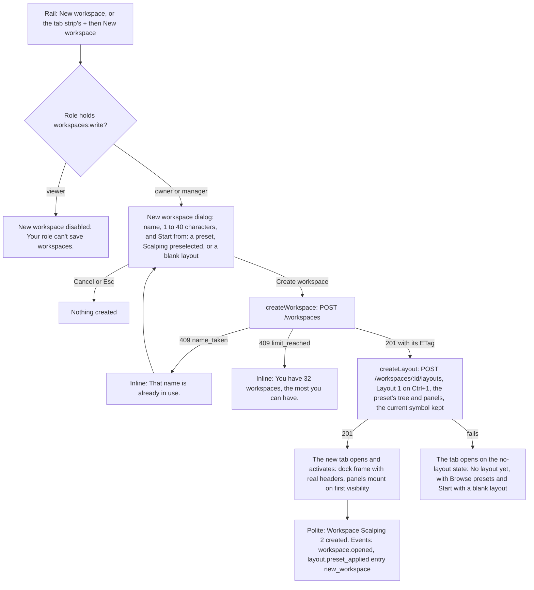
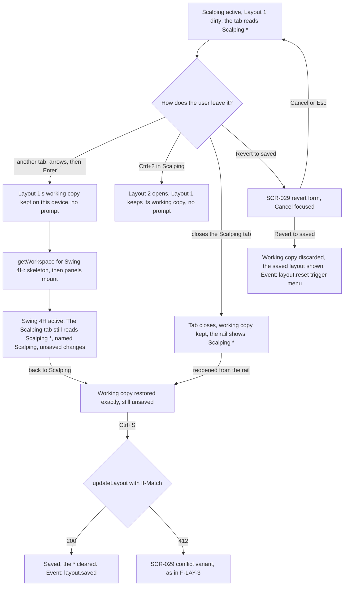
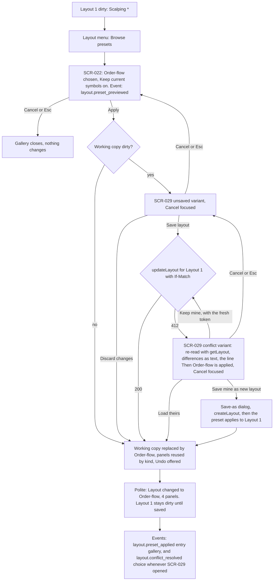
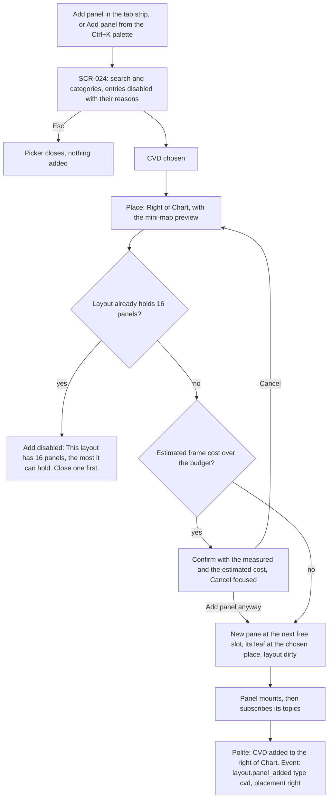
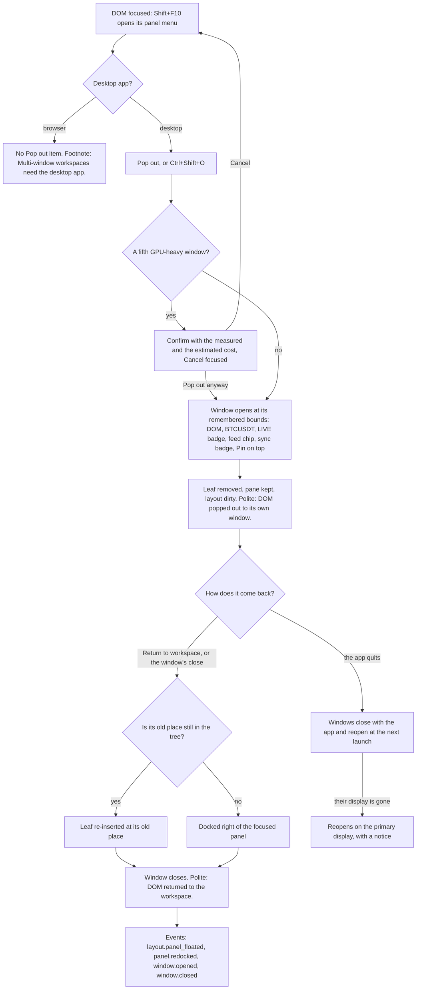
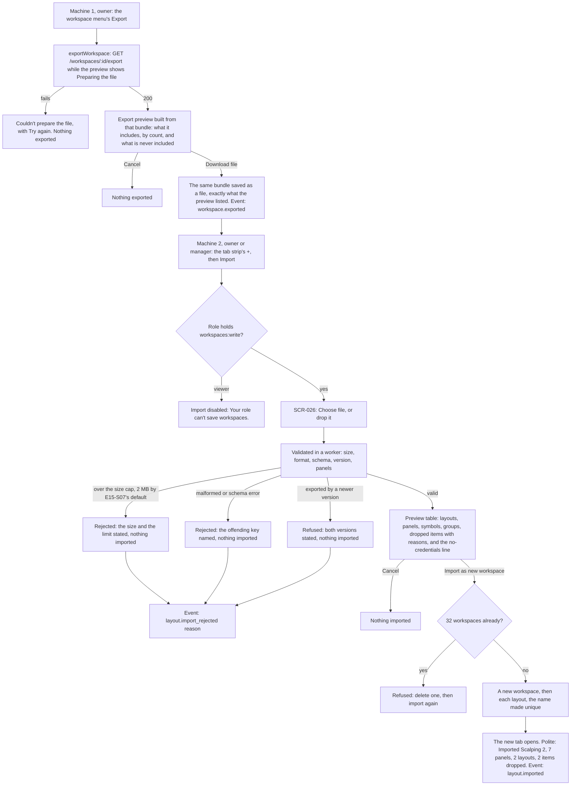

# E15 layout flows — F-LAY-1..6 (E15-D02)

**Actors:** P1 owner and P2 manager; P3 viewer where a frame shows the refusal. No order is placed from these surfaces, and no layout action is audited (layout is user preference). **Route:** `/w/:workspaceId` (SCR-020), with modals as `?modal=<name>` (`docs/plan/14-screens-catalogue.md` §0.3). **Screens:** SCR-011, SCR-020, SCR-021, SCR-022, SCR-024, SCR-025, SCR-026, SCR-027, SCR-028, SCR-029. Frames, copy and decisions: `docs/design/E15/E15-D02.md` (D-n, OQ-A..T); board 25 draws each flow as a frame. Shared rules: a layout change writes nothing until Save (`updateLayout`), the working copy of every layout is kept on the device, SCR-029 opens only before a working copy would be discarded, and focus is never moved by a system event. The calls are the contract's (`docs/plan/22-api-openapi.yaml`); each flow ends with what it needs that the contract does not offer yet.

## F-LAY-1 — Create a workspace

- **Keyboard:** the tab strip's `+` by `Tab` and `Enter`; in the dialog the name field takes focus, `Tab` reaches Start from (the gallery's presets in its order, then Blank layout; spec §5.6), `Enter` creates, `Esc` cancels. The gallery is not a step of this flow.
- **Events:** `workspace.opened`; `layout.preset_applied {presetId, entry, keepSymbols, panelCount}`.
- **Contract:** `createWorkspace` then `createLayout`, two calls and not atomic; a workspace with no layout is legal, hence `K1`. Gaps: the role defaults of E15-D01 AD-1 need workflow presets that `listLayoutPresets` does not serve yet (`services/api/candleviewer/api/workspaces_presets.py` serves six grids), and the order ticket has no pane kind, so Scalping opens it as its drawer (G-06).

## F-LAY-2 — Switch workspace with unsaved changes

- **Keyboard:** the tab strip activates manually (arrows move, `Enter` opens), `Ctrl+1..9` switches layouts, `Ctrl+S` saves.
- **Events:** `workspace.opened`, `layout.saved`, `layout.reset {trigger}`.
- **Contract:** `getWorkspace` returns the workspace with every layout and its token in one request; `updateLayout` with `If-Match` answers `412` when stale. The working copy and the token it started from are client-local by design. This flow replaces `14` SCR-020's "prompt on navigation" (E15-D01 AD-10, E15-D02 A-3).

## F-LAY-3 — Apply a preset over a dirty layout

- **Conflict from a pending preset:** every choice but Cancel settles the save and then applies the preset (spec §5.7): Keep mine after its write, Load theirs at once (the stored version becomes the base the preset replaces, and Undo returns it), Save mine as new layout once the new layout exists; Cancel returns to the unsaved variant.
- **Keyboard:** `[Layout ▾]` by `Tab` and `Enter`; cards by arrows; `Space` toggles Keep current symbols; `Enter` applies; in SCR-029 `Tab` moves between the verbs and `Esc` is Cancel.
- **Events:** `layout.preset_previewed`, `layout.preset_applied`, `layout.conflict_detected`, `layout.conflict_resolved {choice}`.
- **Contract:** `listLayoutPresets` gives a complete `LayoutInput` without symbols; there is no server "apply". `updateLayout` replaces the whole pane set and `docs/plan/21-database-schema.md` §3.8.1 keeps no history, so Undo is the client's. `createLayout` may answer `409 name_taken`, `hotkey_slot_taken` or `limit_reached` (32 layouts).

## F-LAY-4 — Add a panel

- **Keyboard:** typing filters, arrows move through results, `Tab` reaches the Place select, `Enter` adds.
- **Events:** `layout.panel_added {type, placement}` (SCR-024 calls it `panel.added`).
- **Contract:** nothing is written until Save (`updateLayout`); at most 16 panes per layout; a kind must be one of `PaneKind`'s twelve, and the account kinds carry no symbol or interval. The cost estimate is client-side, from E15-K01's measurements.

## F-LAY-5 — Pop out and return (float and re-dock)

- **Keyboard:** `Shift+F10`, arrows, `Enter`; in the window `Tab` reaches Return to workspace first.
- **Events:** `layout.panel_floated` (SCR-027 calls it `panel.floated`), `panel.redocked`, `window.opened`, `window.closed`.
- **Contract:** no layout call: `ShellPort.windows` `float(paneId, route)`, `redock(windowId)`, `saveState`, `restoreState` (`apps/web/src/shell/ShellPort.ts`), and the pane stays in the layout with no leaf ("kept (floating or minimised, placed by the client)", `LayoutGridSpec`). Gaps: the shell's `paneId` against the contract's `slot_index` (G-03); bounds stay on the device, since `/settings/windows` (`docs/plan/12-sitemap.md` §6.2, R-205) is a route with no operation (G-05).

## F-LAY-6 — Export, then import on another machine

- **Keyboard:** the file input is a labelled button reached by `Tab`; the drop zone only adds to it; the preview table is read row by row.
- **Events:** `workspace.exported`, `layout.imported`, `layout.import_rejected {reason: size | parse | schema | version | semantic}`.
- **Contract:** `exportWorkspace` is specified but not yet served (`openapi_pending` in `services/api/tests/unit/architecture/composition_allowlist.json`); its text promises "no credentials, account identifiers or PnL figures". The preview is built from the fetched bundle and Download file saves that same bundle, so what the owner checks is what is sent; a bundle can also carry drawings (with their text labels), chart templates and indicator presets, which the preview counts. No operation takes a bundle yet (`WorkspaceBundle`), and the `POST /workspaces` with `from_bundle` that the export text names has no field in `WorkspaceInput`; done client-side as `createWorkspace` then `createLayout` per layout, the import is not atomic. E15-S07 lands the contract first (G-12), including how a bundle's drawings find their new layout ids and the size cap (its default 2 MB).
