# 13 — User Flows (CandleViewer)

Date: 2026-09-14 · Owner: basiltt · Status: **Baseline for design & backlog**

Scope: web app only, React + custom WebGL engine, Electron shell. All flows below reference personas from `10-personas.md` (P1 Owner, P2 Manager, P3 Viewer, P4 Admin-hat, M1 Rule-author mode) and routes/modals from `12-sitemap.md` (`R-###`, `M-###`). Every flow states its **safety invariants** where relevant (native SL backstop, RBAC, step-up auth, Demo/Live isolation) per `24-owner-decisions.md`.

---

## 1. First-run setup & 2FA enrollment

**Actor:** P1 Owner (bootstrap). **Routes:** R-003 → R-002 → R-100.
**Screens:** SCR-016, SCR-003, SCR-002, SCR-001, SCR-020 (see `14-screens-catalogue.md`).

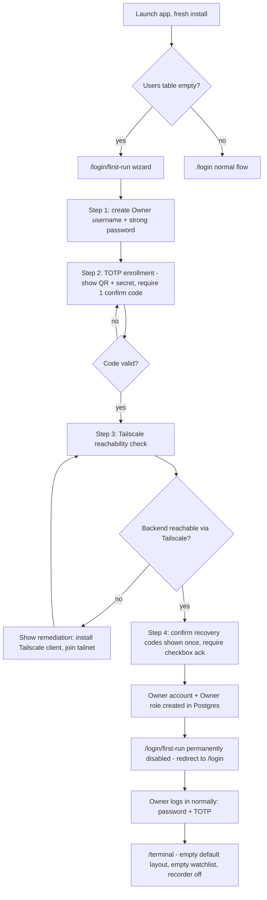

**Notes / edge cases**

- Recovery codes (10 single-use) are shown exactly once at step 4; if the Owner closes the wizard without acknowledging, the wizard resumes at step 4 on next launch (codes are not regenerated silently).
- No Bybit account is configured yet — the Terminal shows an empty state prompting "Add your first Bybit account" (links to flow §2).
- If the wizard is abandoned mid-way (app closed), it resumes at the last completed step; partial Owner records are not left in a usable-but-unenrolled state (TOTP enrollment is transactional with account creation).

---

## 2. Add Bybit account & API key (with permission verification)

**Actor:** P4 Admin-hat. **Routes:** R-310 → R-312 (wizard) → R-320/R-321.
**Screens:** SCR-125, SCR-126, SCR-128, SCR-149 (see `14-screens-catalogue.md`).

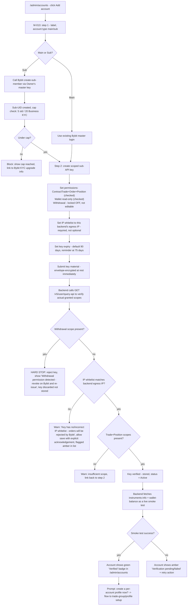

**Safety invariants**

- Withdrawal-capable keys are **never persisted**, even transiently — the verification call happens before the encrypted-store commit is finalized; on hard-stop the plaintext key material is discarded from memory immediately.
- Key material is shown in the UI **exactly once** (at entry) and never re-displayed; `/admin/keys/:keyId` shows metadata only (masked key id suffix, permissions, IP whitelist, expiry) never the secret.
- Every step in this flow writes an audit log entry (key added, verification result, warnings acknowledged).

---

## 3. Create sub-account profile

**Actor:** P4 Admin-hat / P1 Owner. **Routes:** R-330 → R-331.
**Screens:** SCR-130, SCR-131, SCR-132, SCR-133 (see `14-screens-catalogue.md`).

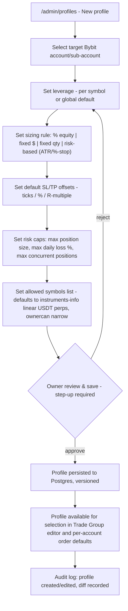

**Notes**

- Profiles are versioned (append new version rather than destructive overwrite) so historical trade-group fan-outs can be traced to the profile version active at execution time (journal traceability).
- Editing a profile that is currently in use by open positions shows a non-blocking warning: "N open positions use this profile — changes apply to new orders only."

---

## 4. Manager onboarding by owner

**Actor:** P4 Admin-hat, creating P2 Manager. **Routes:** R-303.
**Screens:** SCR-121, SCR-123, SCR-122, SCR-017 (see `14-screens-catalogue.md`).

```mermaid
sequenceDiagram
  participant O as Owner (Admin hat)
  participant App as CandleViewer backend
  participant Bybit as Bybit API
  participant M as New Manager

  O->>App: /admin/users/new - enter manager name, contact
  App->>O: Step: select Bybit sub-account (existing or create new, flow #2)
  O->>App: Assign role = manager, grant accounts (1..N sub-accounts)
  App->>O: Step: grant rules:author? (toggle, default off)
  App->>O: Step: risk-limit assignment (feeds Risk Dashboard)
  O->>App: Confirm (step-up TOTP)
  App->>App: Create manager user record, generate Tailscale invite reference
  App-->>O: Show invite instructions (Tailscale ACL entry to be added by owner outside app)
  O->>M: (out of app) Adds manager to Tailscale ACL, shares invite link
  M->>App: First login: set password
  App->>M: Force TOTP enrollment (cannot proceed without it)
  M->>App: Enrolls TOTP, confirms
  App->>M: Terminal loads, scoped to assigned accounts only
  Note over App: If API key for the assigned sub-account has Bybit's 48h new-key restriction, Terminal shows "API key pending - available after <date/time>"; Demo trading remains available meanwhile.
  App->>O: Audit log entry: manager created, accounts granted, timestamp
```

---

## 5. Create trade group & place fan-out order

**Actor:** P1 Owner. **Routes:** R-142 → R-141, then M-001/M-003.
**Screens:** SCR-062, SCR-061, SCR-060, SCR-076 (see `14-screens-catalogue.md`).

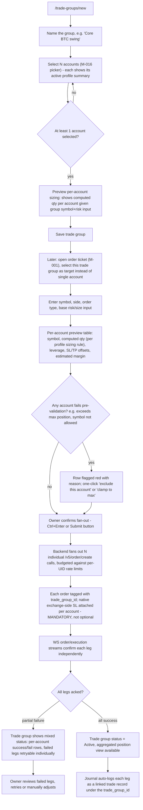

**Safety invariant:** every fanned-out order carries a native exchange-side SL regardless of any rule-engine stop configured later (owner decision, `24-owner-decisions.md` §3).

---

## 6. Chart trading — click-to-order, drag SL/TP

**Actor:** P1/P2. **Route:** R-101 (Terminal), triggers M-001.
**Screens:** SCR-030, SCR-040, SCR-060, SCR-064, SCR-076 (see `14-screens-catalogue.md`).

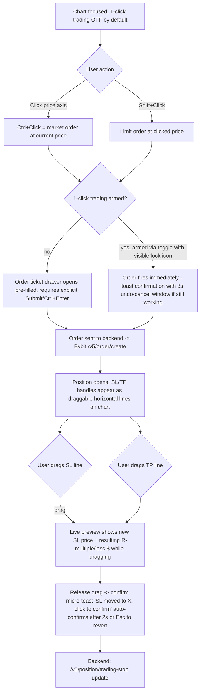

**Accessibility parity:** every drag-based SL/TP adjustment has an exact keyboard equivalent (arrow keys nudge by tick with focus on the handle, Enter confirms) documented in `17-ux-diagrams.md` §8 hotkey map — canvas interactions are never mouse-only (T9 in `10-personas.md`).

---

## 7. DOM ladder trading

**Actor:** P1/P2. **Route:** R-101 pane (Heatmap+DOM Ladder view).
**Screens:** SCR-050, SCR-051, SCR-060, SCR-076 (see `14-screens-catalogue.md`).

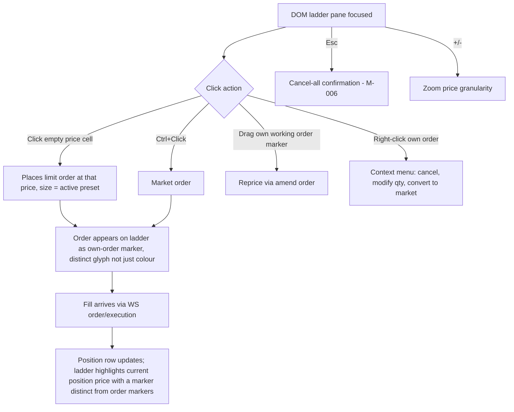

---

## 8. Bracket / scaled order

**Actor:** P1/P2, M-003. **Route:** order ticket "Advanced" toggle.
**Screens:** SCR-060, SCR-069, SCR-065, SCR-064 (see `14-screens-catalogue.md`).

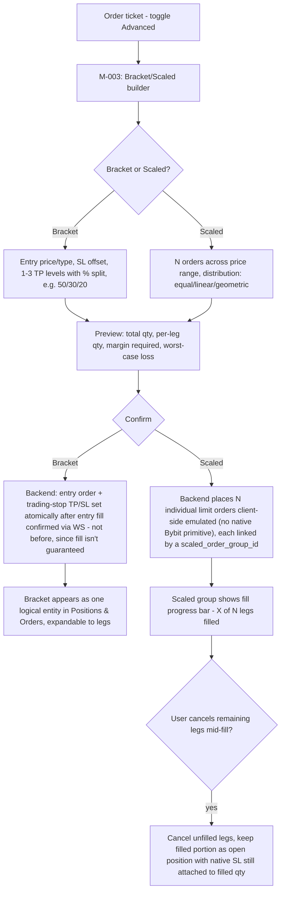

---

## 9. Emulated OCO / TWAP / iceberg lifecycle

**Actor:** P1/P2, M-004. **Route:** order ticket "Algo" toggle. This is the most safety-sensitive emulated-execution flow (per `09-execution-risk-tools.md` §2: none of these are native Bybit API primitives).
**Screens:** SCR-066, SCR-067, SCR-068, SCR-069, SCR-070 (see `14-screens-catalogue.md`).

```mermaid
sequenceDiagram
  participant U as User
  participant FE as Frontend
  participant BE as Backend OMS (algo executor)
  participant WS as Bybit private WS
  participant REST as Bybit REST

  U->>FE: Configure algo (OCO legs / TWAP slices / iceberg display+reserve qty)
  FE->>BE: POST algo config (algo_id, type, params)
  BE->>BE: Register algo state machine: PENDING
  alt OCO
    BE->>REST: Place order A (e.g. TP limit)
    BE->>REST: Place order B (e.g. SL stop)
    REST-->>BE: Both acked
    BE->>BE: state = ARMED (racing)
    WS-->>BE: order A filled
    BE->>REST: Cancel order B immediately
    BE->>BE: state = COMPLETED
    Note over BE: Race window risk: if both fill near-simultaneously (thin liquidity), backend reconciles via execution WS timestamps and treats first-confirmed fill as canonical, immediately cancels the other; a double-fill (both legs execute) is logged as a P1-severity incident and surfaced to the user via M-028 (Emulated-OCO reconciliation notice, `12-sitemap.md` §5), a modal deep-linkable at `?panel=oco-reconcile&groupId=` that shows both fills, net exposure, and a one-click "flatten to intended net position" action - this is a disclosed limitation of emulated OCO.
  else TWAP
    loop each slice, interval T
      BE->>REST: Place slice order (qty = total/N)
      REST-->>BE: Ack
      WS-->>BE: Fill or timeout
      BE->>FE: Update progress (slice i/N)
    end
    BE->>BE: state = COMPLETED when all slices done or user cancels remainder
  else Iceberg
    BE->>REST: Place visible-qty limit order
    WS-->>BE: Fill notification
    BE->>REST: Replace with next visible-qty chunk from reserve
    loop until reserve exhausted or cancelled
      WS-->>BE: Fill
      BE->>REST: Refresh next chunk
    end
  end
  BE->>FE: Live status: state machine diagram (PENDING/ARMED/PARTIAL/COMPLETED/CANCELLED/FAILED)
  U->>FE: Cancel algo at any time
  FE->>BE: Cancel request
  BE->>REST: Cancel all remaining child orders
  BE->>BE: state = CANCELLED
```

**Safety invariant:** the emulated algo runs server-side (backend OMS), **not** in the browser — if the Electron app is closed mid-TWAP/iceberg, the backend continues executing and the native SL (placed at position-open time, independent of the algo) still protects the position. A disconnected UI never leaves a position unprotected (T4 in `10-personas.md`).

---

## 10. Rule creation (form + node editor, shared IR)

**Actor:** M1 Rule author (P1 or P2 with `rules:author`). **Routes:** R-163 → R-161/R-162.
**Screens:** SCR-080, SCR-081, SCR-082, SCR-083, SCR-088, SCR-084, SCR-085 (see `14-screens-catalogue.md`).

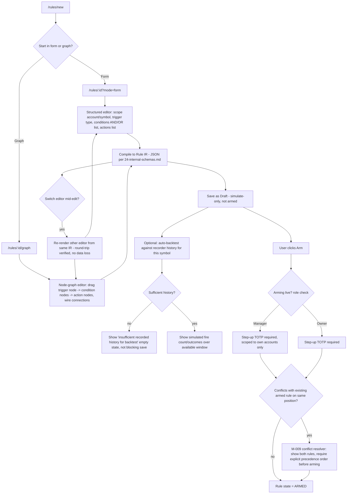

**UX research:** [e36-rules-in-words.md](../design/research/e36-rules-in-words.md) (E36-D01; heuristic, pending owner approval; the route is `/rules/:id?mode=form` as drawn here against `14`'s `/rules/:ruleId/form`, with `form` proposed as the default editor — its C9 / Q7; the "conditions AND/OR list" is "all of" with one any-of level, or a flat "any of", its R3).

---

## 11. Rule firing & native SL backstop

**Actor:** system (rule engine), observed by P1/P2/P3. **Route:** R-164 (history), notifications.
**Screens:** SCR-087, SCR-086, SCR-014, SCR-063, SCR-073 (see `14-screens-catalogue.md`).

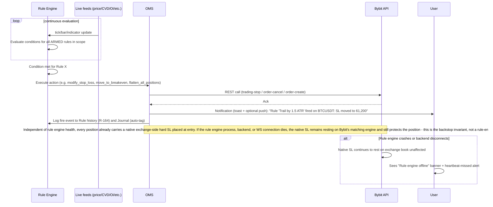

---

## 12. Journal review

**Actor:** P1 Owner (full), P2 Manager (own accounts), P3 Viewer (if granted). **Routes:** R-180 → R-181 → R-182; deep links to/from R-171 (Replay) via `?fromReplay=`/`?fromTrade=`.
**Screens:** SCR-093, SCR-094, SCR-095, SCR-096, SCR-097 (see `14-screens-catalogue.md`).

```mermaid
flowchart TD
  A["/journal - trade list"] --> B[Filter: account, symbol, date range, tag, R-multiple, win/loss]
  B --> C{Trades match filter?}
  C -->|no| D["Empty state: 'No trades recorded yet' or 'No trades match filter' - see 17-ux-diagrams.md §5"]
  C -->|yes| E[Row per closed trade: entry/exit price+time, realized PnL, R-multiple, tags]
  E --> F[Click a row -> "/journal/:tradeId" - R-181]
  F --> G[Trade detail: full timeline, MAE/MFE chart, linked orders/fills, SL/TP history, any rules that fired on this position]
  G --> H[User adds/edits tags and free-text note - M-019 Journal trade quick-note drawer, autosaves]
  G --> I{Want market context at the time of trade?}
  I -->|yes| J["Click 'Open in Replay' -> /replay/:sessionId?fromReplay=... pre-seeded at trade's entry timestamp - R-171"]
  J --> K[Replay loads with a marker at the trade's entry/exit; user scrubs surrounding context]
  K --> L["Click 'Back to trade' -> returns to /journal/:tradeId via fromReplay param"]
  G --> M{Export this trade or filtered set?}
  M -->|yes| N[M-025: Export journal/analytics - choose CSV/PDF, range - RBAC per persona ◑/granted]
  E --> O["Click 'Analytics' tab -> /journal/analytics - R-182"]
  O --> P[Dashboards: win rate, R-distribution, equity curve, tag breakdown, time-of-day heatmap]
  P --> Q{Sufficient closed-trade sample?}
  Q -->|no| R["Empty/insufficient-data state: 'Not enough closed trades for this view yet' - never a broken chart"]
  Q -->|yes| S[Rendered analytics, filterable by same dimensions as trade list]
```

**Notes**

- Journal entries are generated automatically on position close (no manual "create trade" step) from the OMS fill/position-close event stream; manual edits are limited to tags/notes, never to the recorded fill data itself (audit integrity).
- Viewer access to Journal/Analytics is granted per-account by the Owner (`10-personas.md` §7); ungranted accounts are simply absent from the Viewer's filter list, not shown-then-blocked.
- `M-019` (quick-note) and `M-025` (export) are the only modal/drawer surfaces in this flow; everything else is full-page routes.

---

## 13. Switch Demo ↔ Live with safeguards

**Actor:** P1/P2. **Route:** environment badge menu, M-005.
**Screens:** SCR-074, SCR-075, SCR-006 (see `14-screens-catalogue.md`).

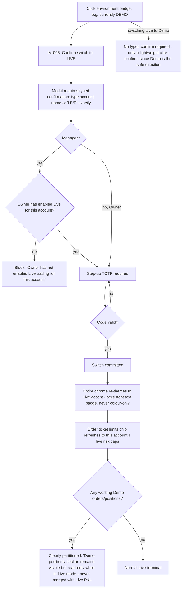

---

## 14. Recording a symbol & auto-record

**Actor:** P1 Owner (config), all personas (observe recording status). **Routes:** R-340 (Admin recorder config), watchlist context menu (M-023).
**Screens:** SCR-140, SCR-141, SCR-142, SCR-100, SCR-103, SCR-047 (see `14-screens-catalogue.md`).

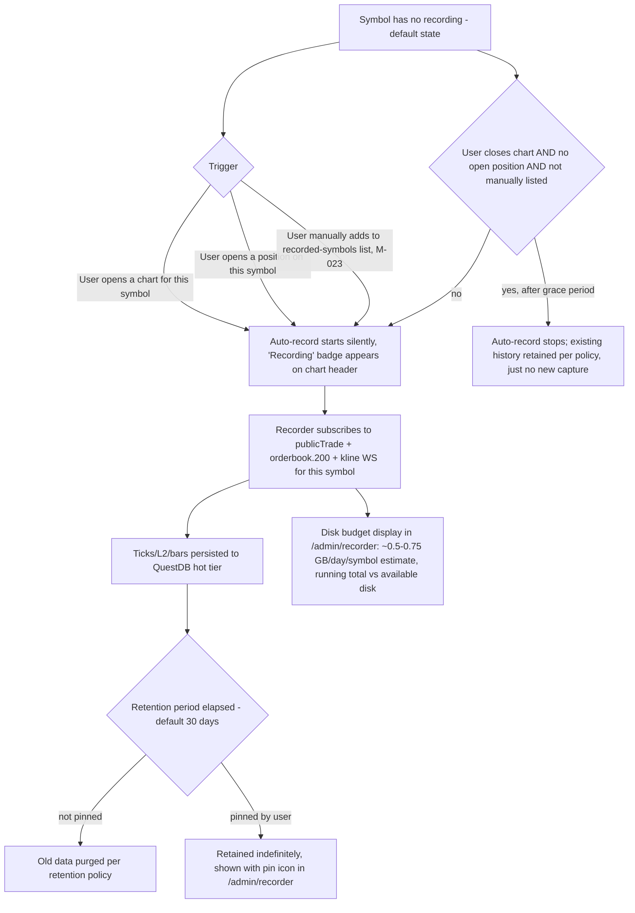

**Empty-history state:** any view depending on recorded history (Profile composite mode, Replay, footprint before recording started) explicitly shows "No recorded history before <start timestamp> for this symbol" rather than a blank/broken chart — see `17-ux-diagrams.md` §6 empty-state matrix.

---

## 15. Replay session

**Actor:** P1/P2/P3. **Routes:** R-170 → R-171.
**Screens:** SCR-098, SCR-097, SCR-099 (see `14-screens-catalogue.md`).

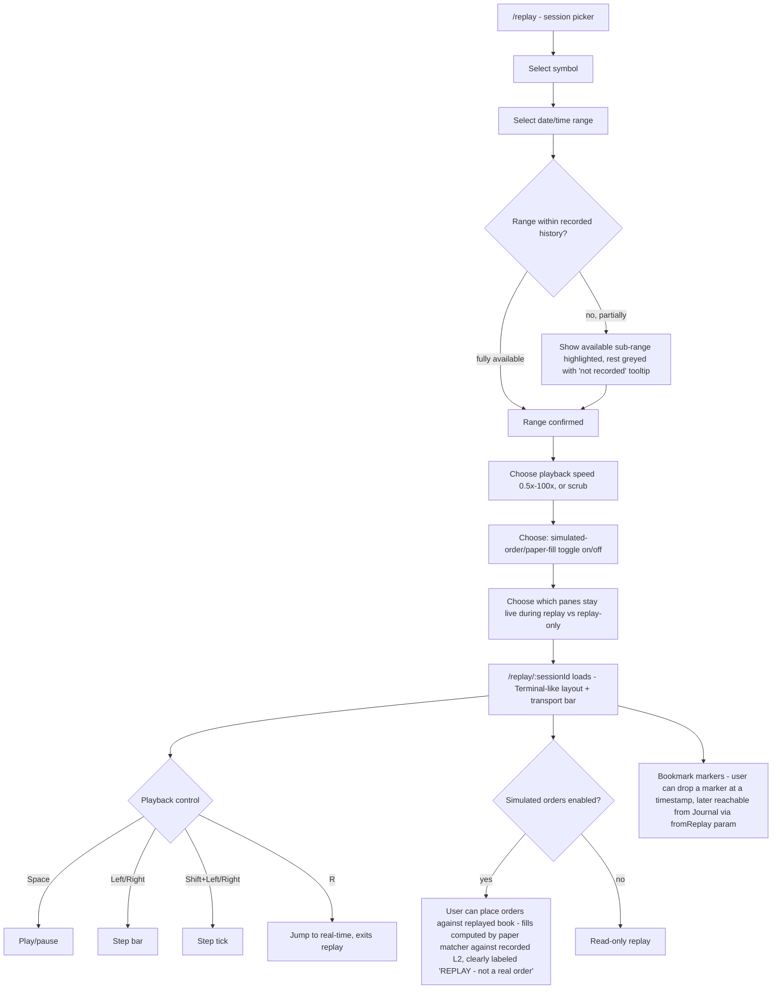

---

## 16. WS disconnect recovery UX

**Actor:** system-triggered, all personas. **Trigger:** any WS channel (public market data, private order/position, or backend↔frontend WS) drops.
**Screens:** SCR-152, SCR-153, SCR-158, SCR-159, SCR-030 (see `14-screens-catalogue.md`).

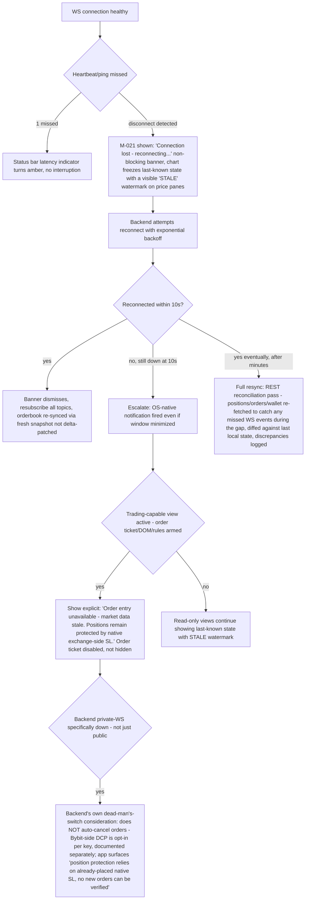

---

## 17. Alert creation & delivery

**Actor:** P1/P2/P3 (view/create), M-022. **Routes:** R-190/R-191.
**Screens:** SCR-090, SCR-091, SCR-092, SCR-014, SCR-115 (see `14-screens-catalogue.md`).

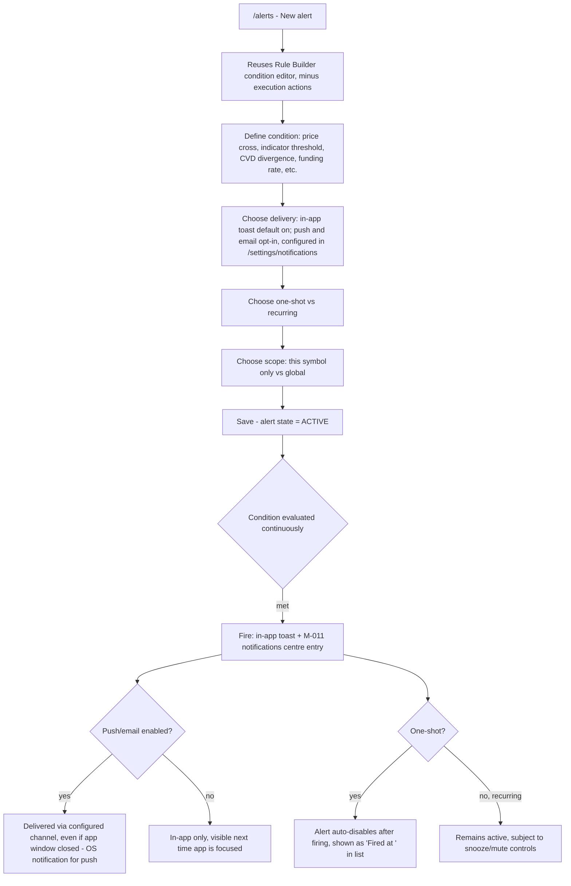

---

## 18. Key rotation

**Actor:** P4 Admin-hat. **Route:** R-322.
**Screens:** SCR-127, SCR-128, SCR-149 (see `14-screens-catalogue.md`).

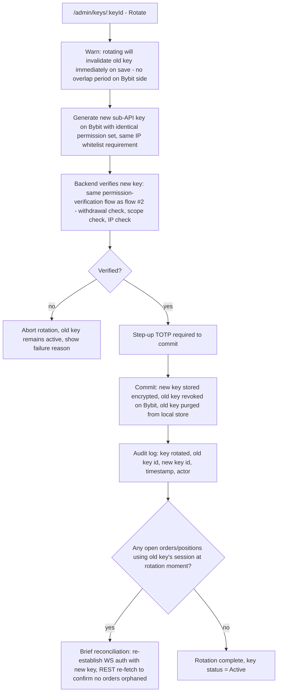

---

## 19. Error / edge flows (consolidated)

### 18.1 Order rejected by Bybit (e.g., rate limit 10018/10006, insufficient margin, invalid tick size)

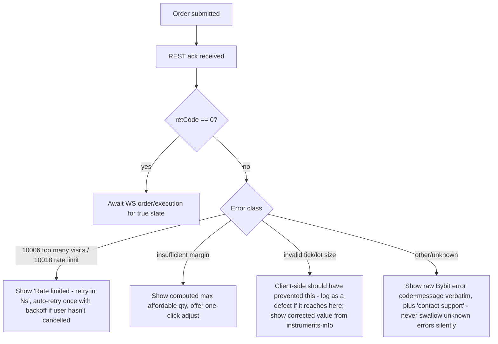

### 18.2 Trade group partial failure (see also flow §5)

- Already covered in flow §5 steps J/K/Q — failed legs are individually retryable, never silently dropped, and the trade group's aggregate view always distinguishes per-leg status.

### 18.3 Exchange 5xx / maintenance

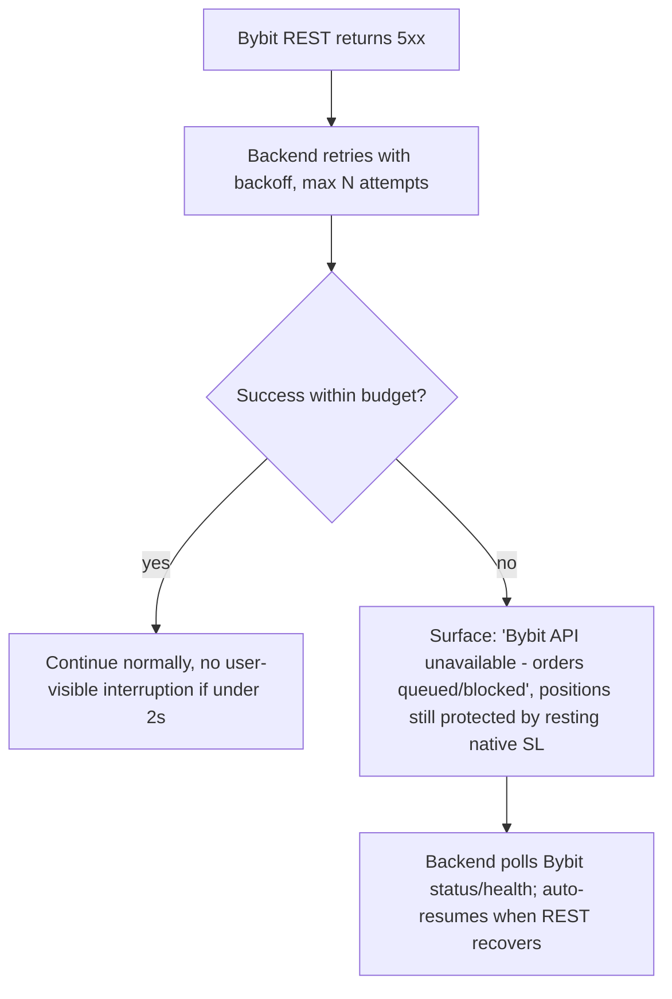

### 18.4 Rule engine conflict (two rules, same position)

- Covered in flow §10 step S/T (M-009 conflict resolver) — arming is blocked until explicit precedence is set.

### 18.5 Recorder disk pressure

```mermaid
flowchart TD
  A[Disk usage approaches configured threshold, e.g. 90%] --> B[Owner-only notification: 'Recorder disk usage at 90% - review retention']
  B --> C{Owner action}
  C -->|reduce retention| D[Applies to non-pinned symbols going forward]
  C -->|prune manually| E[Admin recorder screen: per-symbol size shown, manual delete non-pinned data]
  C -->|no action| F[At hard limit e.g. 98%, recorder auto-stops new capture for lowest-priority unpinned symbols, never deletes pinned data, logs the auto-stop]
```

### 18.6 Session idle timeout / lock

```mermaid
flowchart TD
  A[No input for configured idle period] --> B["/locked shown - R-005"]
  B --> C[Password required to resume - not full re-login, session/WS subscriptions preserved server-side]
  C --> D{Correct password?}
  D -->|yes| E[Resume exactly where left off]
  D -->|no, N attempts| F[Full logout forced, redirect to /login]
```

### 18.7 Manager exceeds risk cap mid-session (daily loss lockout)

```mermaid
flowchart TD
  A[Manager's realized+unrealized loss crosses configured daily cap] --> B[Server-side enforcement fires immediately - independent of any UI state]
  B --> C[Auto-flatten all positions for that account per policy]
  C --> D[Order placement revoked for remainder of lockout period]
  D --> E["M-027 shown to manager: lockout notice, expiry time, 'contact Owner for override' path"]
  E --> F{Owner overrides?}
  F -->|yes, step-up required| G[Lockout lifted early, audit logged with reason]
  F -->|no| H[Lockout expires naturally at next UTC day boundary or configured window]
```

---

## 20. Kill switch (global panic)

**Actor:** P1 Owner (global, every environment); per-account FREEZE: owner, or a manager within their own grants only — never `flatten_positions`, own rules only, owner paged (decision D-1 on #2701, 2026-10-20); release is owner-only. **Route:** Safety control in the app chrome on every screen, hotkey `Ctrl+Shift+K`, SCR-071 row/footer actions, M-018.
**Screens:** SCR-072, SCR-071, SCR-073, SCR-010 (see `14-screens-catalogue.md`). **Statechart:** B18 `kill_switch` (`28-statechart-catalogue.md`). **Security:** `docs/security/threat-models/E39-risk-killswitch.md` SR-E39-05/06/08/13, G-1. **Research:** [E39-D01](../design/E39/E39-D01.md) §7.1 and board `E39-D01 / flow / F20-kill-switch`.

```mermaid
flowchart TD
  A[Owner presses FREEZE or Ctrl+Shift+K - nothing is sent yet] --> B["M-018 / SCR-072: one blast-radius confirm - alertdialog, focus on Cancel, button names the effect, no typed word, no hold, no step-up; cancel working orders default ON, flatten default OFF (API defaults, D-2); global = every environment, account scope = one environment (D-3)"]
  B --> C[Backend immediately blocks new orders in scope - synchronous flag read by the Validator, before any exchange call; the response says whether the engagement is persisted yet]
  C --> D[Cancels working orders and flattens positions only per the request options; disarms armed rules in scope]
  D --> E[All covered managers' terminals switch to read-only within 2s with an explicit banner: 'Trading frozen at <time> - only the owner can release it'; open positions NOT closed unless flatten was requested; native stops unaffected]
  E --> F{Requested actions verified by an exchange read?}
  F -->|yes| G[B18 engaged: completion summary from KillSwitchResult.actions with the verification time; audit per account]
  F -->|flatten residue| H[B18 engaged_incomplete: shown as incomplete, owner paged, RETRY_FLATTEN - never rounded up]
  F -->|cancel failure| H2["B18 today: engaged + critical alert (cancelling error arm); SR-E39-06 / G-1 make it engaged_incomplete in E39-S03"]
  K["Automatic engagement: root KILL - clock drift, credential failure, chain mismatch, restore; working orders: not cancelled - 14 still resting, cancel from the blotter; a new FREEZE is not accepted while engaged (B18 today vs target: SR-E39-06, E39-S03)"] --> H
  G --> I{Owner action to resume}
  H --> I
  H2 --> I
  I -->|Release: owner-only, step-up with a fresh code, typed reason, credential re-verification, residual acknowledgement after incomplete; refused until the engagement is durable| J[Halt lifted per scope after an authoritative re-read; rules stay disarmed until re-armed by hand; audited]
```

**Distinction from per-manager FREEZE (Risk Dashboard, flow implicit in `10-personas.md` §3 scenario 5):** FREEZE targets one manager/account; the global kill switch covers every account in every environment and is Owner-only. Both use the same request (`setKillSwitch`, scope `accounts` vs `global`), the same single confirm and the same options; neither closes positions unless "also flatten" is ticked (`30-release-roadmap.md` §7.2 "stops new risk, does not force-close"). Whether a frozen manager may still send reduce-only closes during the engagement is open (OD-11 in E39-D01: SR-E39-02 vs the #249 ruling's engaged row vs SR-081(5)); until decided the manager's banner promises nothing beyond "ask the owner".

**Breach → lockout → override (B20, per account; extends §18.7):** cap breach or manual lock → `locked` (new entries blocked, flatten only per the account policy, `until` server-computed at lock time; NULL = manual lock, never cleared by a clock; working orders are B20 today vs target — `locked` has no cancel action today, cancelling exposure-opening orders is the SR-E39-06 target, E39-S02) → manager sees SCR-073 with the reason, since/until, what still works, and "Ask the owner for an override" → owner clears it on SCR-071 with a typed reason (≥ 10 characters, server-enforced) and step-up, optionally granting a typed `extra_loss_usd` allowance bounded by `risk_policy.override_extra_loss_max_usd` (default 0; the lock re-arms at the bound or at the window end, decision D-4), audited at high severity → or it expires at the stored end. Board `E39-D01 / flow / breach-lockout-override`.

---

## 21. Auth, session and onboarding — full chain (E09-D02)

**Actors:** all personas (unauthenticated → authenticated), P2/P3 for the invite path.
**Screens:** SCR-001, SCR-002, SCR-003, SCR-004, SCR-005, SCR-006, SCR-010, SCR-017, SCR-019
(`14-screens-catalogue.md`). Structure and states matrix owned by `docs/design/E09/E09-D02.md`; this
diagram is the merged, canonical state machine (adopted decisions AD-1..AD-6 from
`docs/design/research/e09-auth-mental-models.md`, structural decisions in E09-D02 §2).

```mermaid
flowchart TD
  L[SCR-001 Login: idle] -->|submit| Ls[submitting]
  Ls -->|401 generic| Le[error-generic] --> L
  Ls -->|5 failures/15min| Lr[rate-limited, countdown] -->|expires| L
  Ls -->|account.disabled| Ld[account-disabled: terminal, contact owner]
  Ls -->|network down| Lu[server-unreachable, Retry] --> L
  Ls -->|200 + mfaToken| T[SCR-002 TOTP: idle]

  T -->|submit code| Tv[verifying]
  Tv -->|invalid| Ti[invalid-code] --> T
  Tv -->|mfaToken expired| Tx[expired-challenge] --> L
  Tv -->|5th failure| Tl[locked-after-5: recovery link stays live]
  Tv -->|200, first login or forced| E3{needs enrolment or password change?}
  T -->|use recovery code| Tr[recovery-code-entry]
  Tr -->|valid, codes remain| E3
  Tr -->|valid, zero remain, no TOTP| Tlk["recovery-exhausted-lockout: terminal,\ncontact owner (SCR-002)"]
  Tl -->|recovery code path| Tr

  E3 -->|needs TOTP enrolment| S3[SCR-003 enrol: step1-scan]
  E3 -->|needs forced password change| S4[SCR-004: policy-shown]
  E3 -->|neither| SH[SCR-010 App Shell]

  S3 --> S3b[step2-confirm] -->|invalid| S3b
  S3b -->|valid| S3c[step3-codes-shown] -->|I saved them + continue| S3d[step3-completed] --> SH
  S3 -->|re-enrol trigger: owner reset or recovery consumed| S3re[re-enrol-variant] --> S3

  S4 -->|typing| S4t[typing] -->|reused/breached| S4e[server-reject] --> S4t
  S4t -->|valid + confirmed| S4s[success] --> SH

  SH -->|access token cannot refresh| M5[SCR-005 modal: default]
  M5 -->|order ticket open| M5o[expiry-during-order-entry:\nticket echoed read-only, WS paused not torn down]
  M5 -->|sign in again| SH
  M5 -->|sign out instead| L
  M5o -->|sign in again| SH

  SH -->|privileged action| M6[SCR-006 step-up: code-only or code+confirmation]
  M6 -->|active grace window, non-critical action| M6g[remaining-grace: countdown, Confirm] --> SH
  M6 -->|Live-enablement or kill-switch, grace ignored per AD-5| M6f[full dialog forced]
  M6 -->|valid| SH
  M6 -->|3 failures| M6d[three-strike-downgrade: action denied, toast] --> SH

  I[SCR-017 invite link] -->|valid| I1[accept invite] --> I2["SCR-004 embedded:\nset password"] --> I3["SCR-003 embedded:\nenrol TOTP"] --> I4[orientation card] --> SH
  I -->|expired| Ix[invite-expired: terminal, ask owner for new one]
  I -->|already used| Iu[invite-already-used: terminal, ask owner for new one]

  SH -.->|empty workspace / Settings-Help| CL[SCR-019 setup checklist: pending/done/blocked]
```

**Node resolution summary (no dead ends):** every terminal node above (`Ld`, `Tlk`, `Ix`, `Iu`) explicitly
names the owner as the unblock path per the ticket's acceptance criterion; every other leaf either loops
back to a live retry (`Le`→`L`, `Ti`→`T`, `Lu`→`L`, `S4e`→`S4t`, `S3b`→`S3b`) or reaches `SH` (the app
shell). Full per-state detail, the recovery-code-exhaustion frame, and the interruption-preservation
frame are specified in `docs/design/E09/E09-D02.md`.

---

## 22. Bar modes, intervals and chart types — F-BAR-1..5 (E12-D02)

**Actors:** P1, P2, P3; market data only, and no order can be placed from these surfaces. **Route:** R-101, no
route change. **Screens:** SCR-030, SCR-031, SCR-041, SCR-042, SCR-045, SCR-047, SCR-048.
Frames, slots, copy and budgets: `docs/design/E12/E12-D02.md`; state precedence: the SCR-030 entry of
`14-screens-catalogue.md`. Shared rules: the previous series stays drawn until the new one paints (never an empty
pane); a failed or cancelled change keeps the working chart; focus is never moved by a system event.

### 22.1 F-BAR-1 — Switch time interval (cache hit, cache miss, progressive backfill)

```mermaid
flowchart TD
  A1["Chart focused: BTCUSDT 1m, streaming"] --> B1{"Entry point"}
  B1 -->|1..9 favourite hotkey| C1["Target 5m resolved: the pill shows 5m with a pending mark, the legend still names 1m"]
  B1 -->|SCR-042 Time item, Enter| C1
  B1 -->|SCR-041 interval row or tf deep link| C1
  C1 --> D1{"5m series in the client cache?"}
  D1 -->|hit| E1["Re-bind from cache: axes, drawings and toolbar stay mounted, visible time centre kept"]
  E1 --> F1["Painted within 200 ms from cached bars, reconciled with the new snapshot by generation and index, older bars re-read over REST"]
  F1 --> V1["Old bars topic unsubscribed at the swap: the server keeps that series warm for 30 s, so a quick switch back keeps it"]
  D1 -->|miss| G1["1m frame held, never an empty pane, after 600 ms the strip reads Loading 5m"]
  D1 -->|miss on a fresh panel| U1["Skeleton CMP-029 until first data, a failure here is SCR-048"]
  G1 --> H1["Visible window requested first: one REST page of at most 5 000 bars, or the WS snapshot at the live edge"]
  U1 --> H1
  H1 --> I1{"First data"}
  I1 -->|covers the visible window, or reaches a known boundary inside it, budget 600 ms| J1["Swap in one frame, centre kept, a boundary inside the window drawn as such: recording start, start of the built range, a coverage hole"]
  J1 --> V1
  J1 --> K1["Progressive backfill: older windows load leftward behind the frontier tag, each request about one page at the density of the bars held, within the per-request caps"]
  K1 --> L1{"Next older page"}
  L1 -->|fails, after halving any refused or failing window wider than one page| M1["Frontier reads Could not load older bars, Retry, painted bars stay"]
  L1 -->|reaches recording start| P1
  L1 -->|reaches the start of the built range, also where it meets the lookback on a non-time series| X1["SCR-030/built-from with Build earlier bars, never an automatic build"]
  L1 -->|reaches the lookback| N1["SCR-030/lookback-boundary with Load more: the US-CHART-010 lookback, E11-S15 maxBars and memory budget"]
  I1 -->|retryable failure| O1["1m kept, toolbar reverts to 1m, strip offers Retry 5m and Dismiss"]
  I1 -->|refused, not retryable| W1["1m kept, the cause inline with no Retry: a bound, or a setting not available"]
  I1 -->|no bars in the window, or 422 no_data_recorded| P1["F-BAR-5"]
  I1 -->|user picks another interval first| Q1["Latest intent wins, this request is dropped"]
  F1 --> R1["chart.interval_changed, cache hit"]
  J1 --> S1["chart.interval_changed, cache miss, first_paint_ms"]
  O1 --> T1["chart.error_shown, surface inline"]
  W1 --> T1
```

- **Keyboard:** with the chart focused, `1..9` (generated keymap: interval presets); or `Tab` to the toolbar, the
  interval button, `Enter`, `↓` to the Time group, `Enter`. Committing returns focus to the trigger when the menu
  was opened from it, and to the chart region when it was opened by hotkey; never to the page body. The result is
  announced once, politely.
- **Paging:** each older request stays within the per-request caps (time 400 days and 250 000 bars; non-time 31 days
  and about 250 000 bars estimated from the window's prints, about 6 hours of a 1 M-print day for range and Renko)
  and is sized from the density of the bars already held, about one page (≤5 000 bars), as E12-D02 §3 does for a
  historical centre. On `bar_window_too_large`, or a 503 on a window wider than one page's span, the client halves
  the window and retries, without telling the user, before the frontier offers Retry.
- **Events:** `chart.interval_changed {from, to, source, cache, first_paint_ms}`; `chart.error_shown` on a failure.

### 22.2 F-BAR-2 — Switch to a non-time bar mode and enter its parameter

```mermaid
flowchart TD
  A2["Chart on time 1m"] --> B2["Open SCR-042: toolbar interval button, or Alt+I"]
  B2 --> C2["Down to the group Bar modes: the x-axis is not time"]
  C2 --> D2{"Symbol has recorded prints?"}
  D2 -->|none yet| E2["Mode rows disabled with the reason Needs recorded prints"]
  E2 --> F2["Esc closes with no change, or pick a time interval: F-BAR-1"]
  D2 -->|yes| G2{"Commit as shown, or edit the parameter?"}
  G2 -->|Enter on Volume, 50 BTC per bar| H2["Commit volume:50"]
  G2 -->|Right arrow| I2["Inline editor: Volume per bar in BTC, recent values, the G-2 build estimate, Estimating until it arrives, Size not known yet if it fails, and the commit still proceeds"]
  G2 -->|after G-2, Enter on a row that reads Needs a build or has no status yet| I2
  I2 --> J2{"Within the server bounds?"}
  J2 -->|no| K2["Message below the field names the bound, nothing is sent, focus stays"]
  K2 --> I2
  J2 -->|yes, Enter| H2
  H2 --> L2["Menu closes, focus back where the menu was opened from, pill reads Vol 50 BTC with a pending mark"]
  L2 --> M2{"Where is the volume:50 series?"}
  M2 -->|client cache| N2["Swap within 200 ms, axis caption Bar order, not time, drawings keep their timestamps"]
  M2 -->|stored rows cover the window| O2["Load and page older windows as in the F-BAR-1 miss branch, previous frame held, drawings keep their timestamps"]
  M2 -->|zero rows over recorded prints, not built| P2["Build the loaded window: F-BAR-3, never SCR-047. Before G-2: the live series from its first bar, built-from boundary"]
  N2 --> Q2["chart.bar_mode_changed"]
  O2 --> Q2
  N2 --> R2{"Window reaches before recording start, or holds recording gaps?"}
  O2 --> R2
  R2 -->|yes| S2["F-BAR-5"]
```

- **Keyboard:** `Alt+I` (new, OQ-4) or the toolbar path; `↓` into the bar-mode group; `Enter` commits the mode with
  its shown parameter (on a row that reads "Needs a build" or has no status yet, it opens the editor with the
  estimate), or `→` opens the editor, then type and `Enter`. `Esc` in the editor returns to the row.
- **Events:** `chart.bar_mode_changed {from, to, source, cache}` when the new mode paints.

### 22.3 F-BAR-3 — Change a parameter: rebuild, progress, cancel, revert

```mermaid
flowchart TD
  A3["Chart on Volume 50 BTC, the user commits 75 in SCR-042, SCR-031 or a favourite after seeing the G-2 estimate: about 3.1 M prints, about 30 s"] --> B3["Pill reads Vol 75 BTC with a pending mark, Volume 50 stays drawn and live, labelled as shown"]
  B3 --> C3["Server builds volume:75 over the chart's loaded window from recorded prints, at most 250 000 staged bars, a 31-day bound proposed for G-2: chunked, cancellable, published by generation swap, contract G-2"]
  C3 --> V3["chart.bar_rebuild_started"]
  C3 --> D3{"Elapsed time"}
  D3 -->|under 600 ms| E3["No progress UI"]
  D3 -->|600 ms to 2 s| F3["Strip: Building Volume 75 BTC, indeterminate, Esc cancels"]
  D3 -->|over 2 s| G3["Strip: 40 percent, 1.24 M of 3.1 M prints, about 19 s left, Cancel button, an unknown total stays indeterminate"]
  E3 --> H3{"Outcome"}
  F3 --> H3
  G3 --> H3
  H3 -->|done| I3["One-frame swap to the new generation, every bar redrawn, drawings keep their timestamps, focus unchanged"]
  H3 -->|cancel at 40 percent, button or Esc| J3["Cancel sent, Volume 50 is already on screen: no refetch, no empty chart"]
  J3 --> K3["Pill and field revert to 50, strip: Build cancelled at 40 percent, still showing Volume 50, Retry Volume 75, Dismiss"]
  H3 -->|refused or failed| N3["Restore as on cancel. The strip names the cause and the next step: too many bars, choose a larger size or a shorter window, the service is busy, or, for another setting, no memory to stage the build"]
  H3 -->|connection lost| O3["The disconnect cancels the build, Volume 50 frozen with its last-good time, Retry after reconnect"]
  H3 -->|user picks another setting| P3["Superseded: this build is cancelled, the new intent proceeds"]
  I3 --> Q3["chart.bar_rebuild_completed and chart.bar_mode_changed"]
  K3 --> R3["chart.bar_rebuild_cancelled, reason user"]
  N3 --> S3["chart.bar_rebuild_failed"]
  O3 --> T3["chart.bar_rebuild_cancelled, reason disconnect"]
  P3 --> U3["chart.bar_rebuild_cancelled, reason superseded"]
```

- **Keyboard:** after a toolbar commit focus is on the interval button and one `Tab` reaches `Cancel`; after `Alt+I`
  it is on the chart region and `Shift+Tab` reaches it; `Esc` cancels from anywhere in the chart panel when no
  popover or drawing is open. Completion never moves focus, except from a `Cancel` button that disappears, and then
  to the chart region. Announced politely at start and end only.
- **Build earlier bars:** the built-from boundary's action runs this flow over a wider window with the same setting;
  the strip says every bar is redrawn. D-1 holds only until the server's swap, when the old generation stops: from
  then the client stages only the visible window of the new generation, labels the held frame "Updating..." after
  600 ms, and on a staging failure loads the new generation through the F-BAR-1 miss branch with the frame held
  (`chart.error_shown`, not `_failed`: the server's build succeeded). Restore as on cancel applies only before that
  swap, or to another setting, whose staged generation lives in worker memory until the swap: under memory pressure
  that build fails with its cause and never touches the visible window.
- **Events:** `chart.bar_rebuild_started` / `_completed` / `_cancelled {reason, progress_pct, elapsed_ms}` /
  `_failed`; duration is measured against the 10 s per 1 M prints budget (US-CHART-003).
- **Rejected:** an instant Renko repaint with no intermediate state (E12-D02 §9, R-1).

### 22.4 F-BAR-4 — Switch chart type, with the unsupported combination

```mermaid
flowchart TD
  A4["Chart-type control CMP-222, or Alt+C"] --> B4{"Requested type"}
  B4 -->|Heikin-Ashi, footprint off, time bars| C4["Client-side transform within 100 ms, no refetch, drawings stay on real time and price"]
  C4 --> D4["Then Baseline: re-render within 100 ms, no refetch, reference level shown"]
  B4 -->|Heikin-Ashi while footprint is on| E4["Not applied: Candles with footprint keep rendering"]
  E4 --> F4["Inline callout, focus on its first button: footprint needs a real-price bar type"]
  F4 --> G4{"Choice"}
  G4 -->|Keep Candles, the default, or Esc| H4["Callout closes, focus back on the control, nothing changed"]
  G4 -->|Use Heikin-Ashi and turn footprint off| I4["Footprint turned off, and said so, then Heikin-Ashi applied"]
  B4 -->|Heikin-Ashi in a non-time mode| J4["Same callout: Heikin-Ashi is offered on time bars, switch to time bars or keep the mode"]
  K4["Footprint toggled on with F while Heikin-Ashi is active"] --> L4["Mirror callout: switch to Candles with footprint, or keep Heikin-Ashi"]
  C4 --> M4["chart.chart_type_changed, proposed"]
  F4 --> N4["chart.unsupported_combination_shown, proposed"]
```

- **Keyboard:** `Tab` to the chart-type group, `←`/`→` to choose; in the callout `Tab` between its two buttons,
  `Enter` to choose, `Esc` keeps Candles. The callout says why: Heikin-Ashi recomputes each bar's open and close,
  so footprint cells would not line up with traded prices (US-CHART-002). Footprint is never turned off silently.
- **Events:** `chart.chart_type_changed {from, to, source}` and `chart.unsupported_combination_shown {requested,
conflict, choice}`, both proposed in E12-D02 §10.

### 22.5 F-BAR-5 — Insufficient recorded history

```mermaid
flowchart TD
  A5["Series requested or painted: the recording start and /market/data-coverage compared with the window. Coverage counts only inside the span it reports, the last 90 days as built, so an older window is unknown and takes the /market/bars answer: rows, 422 no_data_recorded or not built"] --> Z5{"Instrument trading?"}
  Z5 -->|no| L5["SCR-047 instrument not trading, history still viewable"]
  Z5 -->|yes| B5{"Bar family"}
  B5 -->|time, 1m and longer| C5{"Window before recording start?"}
  C5 -->|no| D5["Normal chart"]
  C5 -->|partly| E5["Dashed boundary with a tag: order flow from the recording start, earlier bars from exchange klines"]
  C5 -->|entirely| F5["Kline bars shown, the strip says this window predates recording and has no order flow"]
  C5 -->|exchange returned no bars| M5["SCR-047 names the first available timestamp"]
  B5 -->|non-time, or sub-minute after OQ-1| G5{"Recorded prints in the window, per data coverage inside its span, else per /market/bars?"}
  G5 -->|all| D5
  G5 -->|part| H5["Requested from the recording start: bars from the boundary on, the region left of it says no recorded prints before that time"]
  G5 -->|none, 422 no_data_recorded or no trades in data coverage inside its span| I5["SCR-047 no data in this range, before recording start or inside a recording gap: Go to recorded data, Switch to time bars"]
  G5 -->|first load with no bars in the window, not built| Q5["Never SCR-047: build the window, F-BAR-3. Before G-2: the live series from its first bar, with the built-from boundary. A backfill page past the built range's start takes the built-from boundary, F-BAR-1"]
  G5 -->|symbol never recorded| J5["SCR-047 not recorded: copy and CTA follow autorecord_enabled and the recorder status refusal, E12-D02 §8"]
  J5 --> K5["Bars build from the live stream either way: the first live bar replaces SCR-047 with the built-from boundary"]
  D5 --> R5{"Reported recording gaps or generation changes inside the window?"}
  E5 --> R5
  H5 --> R5
  R5 -->|yes| S5["Time axis: a hatched, labelled band per gap over its time slots, its kline bars where kline rows fill it, otherwise empty slots, or a seam where no slots exist. Non-time: a seam between the bars that straddle it. A builder cold start adds a seam, a rebuild swap the built-from boundary"]
  I5 --> N5["chart.empty_state_shown, reason no_data_in_range"]
  M5 --> N5
  J5 --> O5["chart.empty_state_shown, reason not_recorded"]
  L5 --> P5["chart.empty_state_shown, reason symbol_delisted"]
```

- **Keyboard:** the data cursor (`←`/`→`) names the boundary at its first bar ("first bar with recorded prints",
  "first built bar; earlier prints are not built yet" or "first loaded bar") and a gap at the bar after it; `Alt+T`
  opens SCR-045, where the boundary and each gap are separator rows; SCR-047's heading, text and buttons are in the
  `Tab` order.
- **Events:** `chart.empty_state_shown {reason}`; the boundary and the gaps are not announced, they are part of the
  chart's accessible description (C-2.14: the true available range is always stated).

---

## 23. Traceability

- All routes/modals referenced (`R-###`, `M-###`) are defined in `12-sitemap.md`.
- State machines referenced (order, rule, algo, connection) are formalized as state diagrams in `17-ux-diagrams.md` §4.
- Screen-level detail (states, hotkeys, a11y) for every screen touched by these flows is in `14-screens-catalogue.md`.
- Rule IR structure referenced in flow §10/§11 is defined in `24-internal-schemas.md`.
