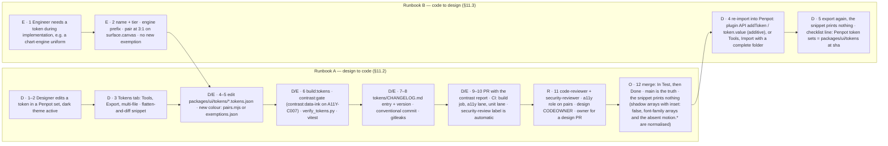

# 16 — Design System Brief (CandleViewer)

Date: 2026-09-14 · Owner: basiltt · Status: **Baseline for design & engineering — single source of truth for tokens, theming, motion, density, a11y, Figma, and handoff**

Scope (locked, see `00-planning-brief.md` + `research/24-owner-decisions.md`): web app only — React + TypeScript, custom WebGL chart engine, Electron desktop shell primary. Dark-first, dense professional trading UI. Desktop-only (no responsive/mobile breakpoints; minimum viewport enforced, see §8). Brand-neutral: this brief defines the _system_, not a final brand skin — colours/logo can be swapped without restructuring tokens.

Upstream: `15-component-catalogue.md` (every CMP-* references the token names defined here), `05-accessibility-standard.md` (binding contrast/motion/density requirements this brief must satisfy), `research/digests/10-frontend-tech.digest.md` (chassis/rendering stack), `research/24-owner-decisions.md` decision #10 (heatmap colour convention, configurable).
Downstream: component implementation (Style Dictionary token build), Figma library, `26-chart-engine-design.md` (engine consumes colour/typography tokens for canvas rendering).

---

## 0. How to read this brief

Sections: 1 Design principles · 2 Token architecture · 3 Density modes · 4 Theming (dark-first + light) · 5 Iconography · 6 Data-viz rules · 7 Motion · 8 Layout grid, docking & responsive minimums · 9 Accessibility requirements (brief-level, cross-refs the standard) · 10 Figma library structure & naming · 11 Handoff spec (tokens JSON → code) · 12 Design QA checklist · 13 Design-ahead process & sign-off definition.

---

## 1. Design principles

CandleViewer's UI serves one owner and a handful of account managers running a professional crypto-derivatives trading operation for years. The system optimises for the following principles, in priority order when they conflict:

1. **Legibility of numbers over decoration.** Every pixel spent on chrome is a pixel not spent on price/qty/PnL. Numeric density and scanning speed beat visual flourish. Monospaced tabular numerics everywhere numbers appear in a column.
2. **Never lie by omission.** Estimated/heuristic values are always labelled `(estimated)`. Demo vs Live is never ambiguous. Disabled controls always say why. This is a safety-critical trading tool — the design system is a safety system as much as an aesthetic one.
3. **Density is a mode, not a compromise.** The default working density is _compact_: professional traders want more information per screen, not more whitespace. Compact must still clear WCAG AA — density is achieved via information architecture and typographic scale, never via silently shrinking hit targets below the accessible minimum (see `05-accessibility-standard.md` §3.4.7 and §3 below).
4. **Dark-first, not dark-only.** The primary working environment (multi-hour chart-watching sessions) is dark to reduce eye strain and let colour-coded signal (buy/sell, heatmap, alerts) pop. Light theme exists for admin/settings/daytime use and is a first-class token swap, not an afterthought.
5. **Consistency over novelty.** One button, one input, one table, one dialog pattern reused everywhere (`15-component-catalogue.md`). A trading terminal's speed advantage comes from muscle memory — the system actively resists one-off bespoke controls per screen.
6. **Keyboard and mouse are equally first-class.** Every mouse-driven interaction (chart drag, node-graph connect, drawing tool) ships a keyboard-operable equivalent, not as a compliance afterthought but because keyboard operation is also _faster_ for a power user once learned (§9, `05-accessibility-standard.md` §3).
7. **The chart engine's visual language IS the design system's visual language.** Because everything (candles, footprint, heatmap, profiles, drawings) is fully custom WebGL, there is no separate "charting library skin" to reconcile — chart colours/typography draw from the exact same token set as the rest of the UI, so a themed screenshot of any panel looks native next to any other.

---

## 2. Token architecture

> Architectural record: [`27-adrs/ADR-0024-design-token-architecture-and-theming.md`](27-adrs/ADR-0024-design-token-architecture-and-theming.md) records the binding decisions in this section and §11 (tier model, Style Dictionary build, theming-as-alias-repointing, density-as-alias-step, WebGL/Electron delivery formats) against the merged E05-T01 implementation, plus the alternatives explicitly rejected.

Three-tier token model (industry-standard "global → alias → component" pattern), authored as source-of-truth JSON and compiled via Style Dictionary (§11):

- **Tier 1 — Global/primitive tokens**: raw values, no semantic meaning (`palette.blue.500 = #2B6CE8`, `size.4 = 4px`). Never referenced directly by components.
- **Tier 2 — Alias/semantic tokens**: meaning-carrying names components actually consume (`color.action.primary = {palette.blue.500}`, `color.buy = {palette.green.500}`). This is the layer `15-component-catalogue.md` entries reference (e.g. `color.buy`, `font.mono`, `space.field.gap`).
- **Tier 3 — Component tokens**: rare, only where a component needs an override the semantic layer doesn't express (`button.primary.background = {color.action.primary}`). Used sparingly to avoid token sprawl; most components consume Tier 2 directly.

Naming convention: `category.subcategory.variant.state` all-lowercase dot-delimited (e.g. `color.text.buy`, `color.surface.overlay`, `color.action.primary.hover`). This maps 1:1 to CSS custom properties (`--color-text-buy`) and to the Figma Variables naming (§10).

### 2.1 Colour

**Dark theme is the source of truth**; light theme (§4) is derived by re-mapping the same semantic token names to a different palette, never by introducing new token names.

- **Neutrals (surface/border/text ladder)**: near-black background (`#0B0E11`, not pure `#000000`, per `05-accessibility-standard.md` §5.5 halation/eye-strain guidance), 4-step surface elevation ladder (`surface.app` → `surface.raised` → `surface.overlay` → `surface.canvas` for chart backgrounds specifically, since charts want a very slightly distinct near-black from chrome panels to visually separate data from UI), off-white primary text (`#E8EAED`, not pure `#FFFFFF`), secondary/tertiary text steps down in opacity-equivalent lightness (not literal alpha, to keep contrast math predictable against varying surface tiers).
- **Semantic buy/sell/neutral (the single most important colour decision in the system)**:
  - `color.buy` (green family) / `color.sell` (red family) / `color.neutral` (grey/blue-grey) drive: SideToggle, PriceInput/QtyInput tint, PnLBadge, candle up/down, CVD, order lines, position rows.
  - Two colour-blind-safe green/red pairs are pre-validated (deuteranopia/protanopia/tritanopia simulation, per `05-accessibility-standard.md` §4.2) and every buy/sell instance in the system additionally carries a non-colour cue (▲/▼ glyph, `+`/`-` sign, or explicit "Buy"/"Sell" text) — colour is reinforcement, never the sole signal. **Confirmed unchanged by E05-D07** (2026-09-25): `color.buy.default`/`color.sell.default` (dark default) and `color.buy.hc`/`color.sell.hc` (high-contrast theme) are the two validated pairs; both heatmap ramps' adjacent stops remain separable under all 3 dichromacies — programmatic evidence in `docs/research/artifacts/E05-D07/cvd_simulation.md`, script at `docs/research/_tools/cvd_simulate.py`.
  - Both `color.buy`/`color.sell` and their AAA-stretch high-contrast variants (`color.buy.hc`, `color.sell.hc`, ≥7:1) are defined; the high-contrast theme toggle (`Ctrl+Shift+H`) swaps to the `.hc` variants app-wide.
- **Heatmap colour ramps (configurable convention, owner decision #10)**: two named ramps ship, `heatmap.convention.green-bid-red-ask` (default: green=bid/buy liquidity, red=ask/sell) and `heatmap.convention.red-bid-green-ask` (alternate, user-selectable in Settings, mirroring the DOM ladder screen's own colour-convention setting per `14-screens-catalogue.md`). Each ramp is a 6-stop sequential scale from `surface.canvas` (zero liquidity) through a mid saturation point to a fully-saturated "hot" stop, independently contrast-validated at every stop against the chart background (`05-accessibility-standard.md` §5.4) via an automated per-stop contrast-check script gated in CI on token-file changes (§12).
- **Status/tone ramp**: `color.status.{success,warning,danger,info}` × `{subtle,default,strong}` — used for banners, badges, connection states, risk lockouts. `danger` and `sell` are deliberately kept apart so "order rejected" (status.danger) is never visually confusable with "you are short" (color.sell) at a glance — this distinction is called out explicitly because both are red-family and is a common trading-UI confusion bug. Today they share the red hue in every theme and are set apart by lightness (`color.status.danger.default` is ≥8 CIE76 ΔE from `color.sell.default` and `color.sell.hover`, checked by `packages/ui/tokens/tests/verify_tokens.py`) and by the label or glyph every danger and sell control carries; whether danger returns to a distinct amber-red hue is owner decision A6 of the E05-D02 spec (#161, PR #3914).
- **Chart-specific**: `color.candle.up/down`, `color.footprint.bid/ask/imbalance`, `color.profile.bar/poc/valuearea`, `color.node.{trigger,condition,action,logic,comment}` (rule node-graph), `color.drawing.default/selected`, `color.order.line`, `color.position.entry/sl/tp`. All independently validated at ≥3:1 against `surface.canvas` per `05-accessibility-standard.md` §5.4.
- **Env accent**: `color.env.demo` (blue) / `color.env.live` (red) — reused nowhere else in the palette to keep the Demo/Live signal visually unambiguous and never confusable with buy/sell or status colours.
- **Focus/interaction**: `color.focus.ring` (≥3:1 against every adjacent surface tier, validated per tier, not just once; in high contrast it is white, ≥20 CIE76 ΔE from the primary and selected fills so it never reads as part of a focused fill). Selection: `color.action.selected` is the fill of a pressed toggle (CMP-002 `aria-pressed`) or a selected segment (CMP-003), a tint ≥5 L\* from every primary state fill under a `color.text.primary` glyph; `color.border.selected` is its 2 px inner outline and carries the ≥3:1 boundary (`tools/contrast/label-on-fill.json`, #3896).

### 2.1a Data-confidence tokens (E08-D04, `docs/design/E08/E08-D01.md` vocabulary)

A dedicated `color.data-confidence.<state>.{text,indicator,surface}` semantic-token group (defined in
`packages/ui/tokens/semantic-{dark,light,hc}.tokens.json`) covers the eight states — `live`, `stale`,
`reconnecting`, `disconnected`, `resyncing`, `gapped`, `backfilling`, `delisted` — that every live-data
surface (watchlist, tape, DOM heatmap, chart series, CVD, positions) must express identically. Per the
research handoff, no new primitive colour values were required: each state aliases an existing
`color.status.*` / `color.text.*` / `color.surface.*` token so theming stays a single re-map. `stale` is
the only state with a distinct `surface` tint (`color.surface.sunken`); the rest carry `text` +
`indicator` only, since the indicator is reinforcing and text is the mandatory primary signal
(`docs/design/E08/E08-D01.md` §7). Contrast for every pair is verified programmatically alongside the
existing token proof (`packages/ui/tokens/tests/verify_tokens.py`).

**Precedence and composition rule**: a surface is in exactly one state at a time (highest-severity wins,
order in §2 of the vocabulary doc above); `estimated` (CMP-227) and a data-confidence state are never
merged into one chip — see CMP-227/CMP-239 in `15-component-catalogue.md`. A later ticket needing a state
outside this set of eight opens a design-system change request against `CMP-239`/this section rather than
inventing a local variant (`02-definition-of-ready-done.md` §3.1).

### 2.2 Typography

- **UI family** (`font.family.ui`): **Inter** (variable, OFL-1.1; https://github.com/rsms/inter) — **locked by owner decision 2026-09-25**. Fallback stack `Inter, system-ui, "Segoe UI", sans-serif`. Chosen for x-height and legibility at the 11–13 px sizes dense trading rows use; also Penpot's default font, so design and code share the exact family.
- **Numeric/mono family** (`font.family.mono`): **JetBrains Mono** (variable, OFL-1.1; https://github.com/JetBrains/JetBrainsMono) — **locked 2026-09-25**. Fallback `"JetBrains Mono", ui-monospace, Consolas, monospace`. Used for **every** price, quantity, PnL, percentage, timestamp, and axis label in the app — this is a hard rule (`15-component-catalogue.md` §0.3 cross-cutting rule 6) because columns of numbers must align digit-for-digit for fast scanning, and mixed-width digits in a proportional font actively slow down a trader reading a ladder or positions grid. Chosen over alternatives for its unambiguous `0/O`, `1/l/I` and slightly narrow advance width (more digits per footprint cell).
- **Files shipped** (`packages/ui/src/fonts/`, self-hosted, no CDN — the app has no public-internet dependency): `InterVariable.woff2`, `InterVariable-Italic.woff2`, `JetBrainsMono[wght].woff2`, `JetBrainsMono-Italic[wght].woff2`. The same variable TTFs are uploaded to the Penpot team fonts (`docs/design/README.md`). Weight tokens map to axes: regular 400 · medium 500 · semibold 600 · bold 700.
- **Type scale**: `font.size.{2xs,xs,sm,base,md,lg,xl,2xl}` (8-step, ~1.125 ratio, tuned for dense UI rather than editorial content — the largest step is used only for page `h1`s, never for chart/data content). Line-height tokens (`font.lineHeight.{tight,normal,relaxed}`) — dense trading rows always use `tight`.
- **Weight**: `font.weight.{regular,medium,semibold,bold}` — bold reserved for critical state (Live badge, danger banners, PnL emphasis), not general headings, to keep bold's alarm value meaningful.
- **Tabular numerals**: `font.feature.tabularNums` applied globally to any element consuming `font.family.mono`; this is enforced at the CMP-020 NumericText component level, not left to per-usage CSS.

### 2.3 Spacing

- 4px base unit, scale `space.{0,1,2,3,4,6,8,12,16,24,32,48,64}` (px), i.e. 0/4/8/12/16/24/32/48/64/96/128/192/256 — a single geometric-ish scale shared by both density modes; density modes (§3) select _which_ scale steps a given component's padding/gap tokens resolve to, rather than defining a second parallel scale, keeping the token count bounded.
- Component-level spacing aliases (`space.button.paddingX`, `space.field.gap`, `space.row.height.compact/comfortable`) resolve to specific scale steps per density mode — this indirection is what makes CMP-* "density-aware" per the component catalogue's cross-cutting rule 2.

### 2.4 Radii

- `radius.{none,xs,sm,md,lg,xl,pill,circle}` — xs/sm for inputs and chips, md for cards/dialogs/dock panels, lg for larger surfaces (settings cards, onboarding), pill for tags/toggles, circle for avatars. A single consistent radius scale reused everywhere avoids the "every team invents its own corner rounding" drift common in ad-hoc dashboards.

### 2.5 Elevation

- `elevation.{0,1,2,3,4,5}` — a combined shadow+z-index+(dark-theme-appropriate) subtle-lightening recipe per step, since drop-shadows alone read poorly on near-black surfaces; each step instead primarily raises `surface` lightness slightly and adds a restrained shadow, keeping elevation legible without a "glowing box" look. 0=flush chrome, 1=cards/panels, 2=dock-panel focused state, 3=popovers/tooltips/toasts, 4=dialogs, 5=full-screen scrims (ReconnectOverlay).

### 2.6 Motion

- `motion.duration.{instant,fast,normal,slow}` (0/100/200/400ms) and `motion.easing.{standard,decelerate,accelerate}` — every animatable token pairs with `motion-safe`/`motion-reduce` alternates (§7). No animation is ever load-bearing for information (i.e. a user with `prefers-reduced-motion` never misses information, only the transition polish).

---

## 3. Density modes

Two supported density modes, selectable globally (Settings → Appearance) and per-panel (DensityToggle, CMP-063):

| Mode                                                    | Row height | Field height | Base spacing step | Default surfaces                                                                                  |
| ------------------------------------------------------- | ---------- | ------------ | ----------------- | ------------------------------------------------------------------------------------------------- |
| **Compact** (default for trading surfaces)              | 24px       | 24px         | `space.2` (8px)   | Chart panels, DOM ladder, footprint, positions grid, order ticket, watchlist                      |
| **Comfortable** (default for admin/onboarding/settings) | 32px       | 32px         | `space.3` (12px)  | Admin screens, onboarding wizard, settings, journal analytics (reading-heavy, not scanning-heavy) |

> **UX-research amendment (E05-D07, 2026-09-25):** row/field heights above are the _final, validated_
> values, revised down from an earlier 24/28px and 36/40px proposal to 24/24px and 32/32px to match the
> `size.row.*` / `size.control.*` primitive tokens already shipped in `packages/ui/tokens/primitives.tokens.json`
> (E05-D01). Compact remains exactly the WCAG 2.2 §2.5.8 minimum (24×24px); comfortable clears it with
> +33% headroom. Full rationale, CVD simulation evidence and the essential-exception list:
> `docs/research/density-legibility-cvd-e05-d07.md`.

Rules:

1. Density changes spacing-token resolution only — never component structure, never which information is shown. A component must render identically in both modes except for the spacing/row-height token values it resolves.
2. Compact mode's minimum interactive target is **24×24px** per WCAG 2.2 §2.5.8 (Target Size Minimum). Where a compact-mode control (e.g. a DOM ladder row's inline buy/sell buttons) cannot reach 24px without breaking the row's information density, the **essential-exception** clause applies (dense financial-data UI is an explicitly cited AA exception category) — but only with a documented compensating control: adjacent spacing that prevents accidental mis-taps, and a larger click-tolerance zone than the visual glyph (invisible padding), never a shrink of the true minimum below what a pointer can reliably hit. This exception must be logged per-component in that component's Storybook a11y notes and reviewed by the Accessibility role at design sign-off (§13).
3. Comfortable mode has no exceptions — it always meets the 24px (in practice 40-44px) minimum cleanly, which is precisely why it is the default for lower-frequency, higher-consequence flows like admin/key-management where a mis-click is costlier per action but less frequent overall.
4. Zoom/text-scale (`Ctrl+=`/`Ctrl+-`, up to 200%) composes with density: at high zoom, compact-mode dense tables reflow toward a card/stacked layout per `05-accessibility-standard.md` §5.7 rather than clipping — this reflow behavior is a required state for every CMP-049-based table, tested explicitly (§12).

---

## 4. Dark-first theming + light theme

- **Dark is canonical.** All component design, all contrast validation, and all Figma component variants are authored dark-first; light is generated by re-pointing the same alias tokens (§2.1) at a light-appropriate primitive palette. No component may ship a light-only visual detail that dark lacks or vice versa — parity is enforced by the visual-regression suite running both themes for every component story (`15-component-catalogue.md` §0.3 rule 7).
- **Three theme presets** ship at v1: `dark` (default), `light`, `high-contrast` (a dark-based AAA-leaning variant per `05-accessibility-standard.md` §5.6, swapping body-text and buy/sell tokens to their `.hc` variants, ≥7:1). Theme selection persists per-user (not per-workspace) and is instant (no reload) via CSS-custom-property re-assignment at the document root — the chart engine's WebGL renderer subscribes to the same theme-change event and re-uploads its colour uniforms on switch (a binding requirement passed to `26-chart-engine-design.md`).
- **Runtime contract (E05-T02, `packages/ui/src/theme/`).** The runtime writes `data-theme` (`dark|light|high-contrast`), `data-density` (`compact|comfortable`), `data-motion` (`safe|reduce`) and `data-text-scale` (`100|112|125|150`) on `document.documentElement` and never on a React-owned wrapper, so a switch is a CSS custom-property swap with no remount. Preferences persist in `localStorage["cv.theme.v1"]`; "match system" is off by default; the in-app reduced-motion override (`system|on|off`) wins over `prefers-reduced-motion` in both directions. Text scale sets the root font size (112%, 125%, 150%), so everything sized in `rem` or `em` follows by itself; a unitless or `px` font size in the tokens must multiply by `--cv-text-scale` (1, 1.12, 1.25, 1.5) to follow. The row and control sizes (`--size-row-*` and `--size-control-*`, 24 or 32 px) are fixed lengths and do not scale, so a dense row must use `min-height` or reflow at 125–150 % (§3 rule 4) rather than a fixed height. No `candleviewer:themechange` event fires for a text-scale-only change, so the chart engine's canvas text cannot follow it yet (tracked in #3283). `apps/web` feeds the server's appearance and accessibility settings to this runtime (`applyAppearance` and the `a11y-preferences` provider call `store.apply(patch, { persist: false, track: false })`, through the mapping in `themeFromSettings.ts`) and writes none of these attributes itself; the legacy `--cv-font-scale`, `data-reduced-motion`, `data-high-contrast` and `data-contrast` are retired (#3139), so `--cv-text-scale` is the only text-scale factor.
- **Composite tokens in the theme CSS (#3422).** A `shadow` token (`elevation.*`) is one custom property holding a valid `box-shadow` list (`--elevation-1: 0px 1px 2px 0px #00000066`: `[inset ]x y blur spread colour`, layers joined by `, `; a length is a bare number, written in px, or a number in px, rem or em). A `typography` token (`type.*`) is one custom property per field (`--type-ui-label-font-family`, `-font-size`, `-font-weight`, `-line-height` and, when the token has one, `-letter-spacing`; a size or a spacing is a bare number, written in px, or a number in px, rem, em or %), and its own name is not written: the `font` shorthand cannot carry `letter-spacing`, and a consumer multiplies a px font size by `--cv-text-scale` (above) anyway. JSON in a custom property is not CSS: esbuild, which minifies the production bundle, warned on each of the 26 composite properties and did not serve them, so `build:tokens` now minifies each theme file with esbuild before writing it and fails (`TOKENS-E004`, §11) on any warning or empty custom property, and on a token the browser would misread although esbuild accepts it.
- **Engine event (binding for E11).** Once per committed change of the resolved theme, density or motion, `document` receives `CustomEvent("candleviewer:themechange", { detail: { theme, density, motion, themeUniforms } })`: `theme` is `dark|light|high-contrast`, `density` is `compact|comfortable`, `motion` is `safe|reduce`, and `themeUniforms` is the constant `"theme-uniforms"` naming the artefact (`build/engine/theme-uniforms.json`, §11.1) the host adapter reloads for `detail.theme`. The event is not fired for the initial state (read `store.getSnapshot()`), except that `connect()` fires it when the OS preference changed since the store was created and match-system or the `system` motion override resolves differently; it is not fired for text-scale-only changes. Events are delivered oldest first, so the last one matches the final state, except when the 100-event cut-off trips (a handler that keeps changing the theme is cut off and reported); a change made from inside a handler of this event is announced after the current handlers have run, so nested changes coalesce into one event for the final state.
- **Pre-paint snippet and CSP.** To avoid a flash of the wrong theme the shell embeds `THEME_PREPAINT_SCRIPT` byte-for-byte as the only inline script and allows it with `script-src 'self' 'sha256-<THEME_PREPAINT_SCRIPT_SHA256>'`; `'unsafe-inline'` is never acceptable (STRIDE `E05-X01` L3). The hash is pinned by a unit test, so a script edit forces a visible CSP change.
- **Light theme is not an inverted dark theme.** Surfaces don't simply invert lightness; the light palette is separately tuned so text/data contrast ratios hold at the same AA (and AAA-stretch for buy/sell) minimums as dark, because naive inversion routinely produces washed-out or over-saturated results, particularly for the heatmap ramps and candle colours which get re-tuned (not just relit) for light backgrounds.
- **System/OS theme following**: optional "match system" mode is available but not the default (a trading terminal should not silently flip to light mid-session because the OS clock hit sunset while the user is mid-position) — explicit user choice is the default, matching the "no surprising context changes" spirit of WCAG 3.2.

---

## 5. Iconography

- Single icon set, outline style at 16/20/24px optical sizes (`size.icon.sm/md/lg`), 1.5px stroke weight, square-ish bounding boxes for grid alignment in toolbars/menus. Brand-neutral placeholder set: a well-established open icon library (e.g. Lucide/Phosphor-equivalent) as the starting point, swappable as a set at brand-application time since every icon is referenced by semantic `IconName` string (`heart`, `close`, `flatten`, `iceberg`, `chase`, etc.), never by raw SVG inline in component code.
- Trading-domain icons requiring custom authorship (not in generic icon sets): flatten-all, chase-limit, iceberg-order, TWAP, one-click-arm, native-SL-shield, estimated/heuristic-badge glyph, node-graph node-type glyphs (trigger/condition/action/logic-gate/comment), heatmap-convention swap. These are drawn to the same 1.5px-stroke grid as the base set and contributed to the same icon registry.
- Every icon is registered with a canonical name + a short semantic description in the icon registry (feeds CMP-019 Icon's completeness test and Figma's icon component page, §10).
- Decorative-vs-meaningful icon usage is a binding rule, not a style guide suggestion: an icon paired with adjacent visible text is `aria-hidden` (decorative); an icon-only control always carries `aria-label` (meaningful) — enforced by CMP-002/CMP-019's lint rules.

---

## 6. Data-viz rules

These rules bind every chart-engine primitive (CMP-180..199) and every non-canvas chart-adjacent component (sparklines, journal equity curve):

1. **Colour is never the sole encoding.** Direction (buy/sell), status (estimated/confirmed), and category (drawing tool type, node type) always pair colour with shape, icon, pattern-fill, or text.
2. **Sequential ramps (heatmap) are perceptually uniform.** Both heatmap conventions (§2.1) use a ramp interpolated in a perceptually-uniform colour space (e.g. OKLCH/CIELAB-based interpolation, not naive RGB lerp) so equal data-steps look like equal visual-intensity steps — this matters specifically for the liquidity heatmap where a trader is judging relative depth by eye.
3. **Diverging data (delta/CVD/imbalance) uses a diverging ramp anchored at zero**, not two independent sequential ramps stitched together — buy-side and sell-side intensity must be visually comparable at equal magnitude.
4. **Every canvas-rendered data view has a table/list equivalent**, reachable via a documented control (not buried), per `05-accessibility-standard.md` §6 — this is a data-viz rule as much as an a11y rule: if a value can't be expressed in a table row, it's not really been designed yet.
5. **Estimated/heuristic series are visually distinguished at the series level**, not just via a chip — dashed vs solid line, or a lower base opacity for the confirmed-vs-estimated portion of a series (e.g. Deep-M-style regime line rendered dashed while confidence is "low").
6. **No 3D, no unnecessary chart-junk.** No 3D bars/pies, no gratuitous gradients on data marks beyond the deliberate heatmap/diverging ramps above, no drop-shadows on data ink. Every non-data pixel in a chart pane is chrome (axis, legend, grid) and is visually subordinate (lower contrast) to data ink.
7. **Gridlines are structural, not decorative**, and therefore must independently meet the 3:1 non-text contrast minimum where they carry meaning (e.g. session boundaries, POC reference lines) — purely aesthetic background gridlines are minimised/removed rather than exempted, following the density principle (§1.3) that undifferentiated chrome competes with data-ink legibility.
8. **Consistent semantic colour across every surface.** `color.buy`/`color.sell` used in the order ticket are the exact same tokens used in candle colouring, CVD, PnL, and position rows — a trader should never have to re-learn "which red means what" between panels.

---

## 7. Motion

- **Purposeful motion only**: transitions communicate state change (panel focus, value update, dialog open/close) — motion is never purely decorative in a dense trading UI where distracting animation actively costs attention during fast markets.
- **Every animated property ships a `motion-safe`/`motion-reduce` pair** (per `05-accessibility-standard.md` §7.4 and `15-component-catalogue.md` §0.3 rule 5): `motion-reduce` either removes the transition (instant state change) or substitutes a non-motion cue (opacity-only pulse instead of scale+rotate for spinners, static tone-shift instead of shimmer for skeletons).
- **No flashing content exceeding 3 times per second**, and no motion lasting more than 5 seconds without a pause control — binding for any looping animation (connection-reconnecting spinner, live-price pulse).
- **Standard motion recipes** (each with explicit safe/reduce pair):
  - Panel focus/mount: `fast` fade+8px slide, reduce → instant opacity swap.
  - Dialog/drawer open: `normal` scale+fade (dialog) / slide (drawer), reduce → instant.
  - Value flash (price tick up/down): `instant`→`fast` background flash decaying to neutral, reduce → no flash, colour-only momentary text tint instead.
  - Toast enter/exit: `fast` slide+fade, reduce → fade only (opacity, no transform; SCR-015, E40-D02 §8).
  - Node-graph edge draw: `fast` line-draw animation, reduce → instant full-line render.
  - Loading shimmer (Skeleton): `slow` looping shimmer, reduce → static two-tone fill, no loop.
- **Respects `prefers-reduced-motion`** at the OS/browser level automatically, plus an explicit in-app override (Settings → Appearance → Reduce Motion) for users on shared/unconfigured machines (Electron shell) where the OS-level signal may not be set.

---

## 8. Layout grid, docking rules, responsive & minimum sizes (desktop-only)

- **No responsive breakpoints below desktop.** This is a desktop-only professional tool (Electron shell primary, browser dev target secondary) — there is no tablet/mobile layout, no hamburger-menu collapse, no Android (locked scope). The system instead defines a **minimum supported viewport**: **1280×800px**, below which the app shows a "increase window size" advisory state rather than attempting a cramped reflow; **recommended/primary target 1920×1080 and above**, with dense multi-pane layouts (footprint + heatmap + positions + ticket simultaneously visible) assuming ≥2560×1440 as the "comfortable multi-pane" reference resolution cited in the performance budget (`14-screens-catalogue.md` §0.5.7: engine ≥58fps at 2560×1440 with footprint+heatmap).
- **Base layout grid**: a 4px spacing grid underlies all component spacing (§2.3); the docking system itself is **not** a fixed column grid (unlike a marketing site) — panels resize freely along a flexible split-pane tree, snapping to the 4px grid for pixel-perfect alignment between adjacent panel edges only.
- **Docking rules** (implemented by CMP-080 DockPanel / CMP-081 DockGrid):
  1. The workspace is a binary split-tree (each split is horizontal or vertical, recursively nestable) — this is the same model used by VS Code/Dockview-style layout managers, chosen because it's well-understood, keyboard-navigable, and serializable to a saved-workspace JSON.
  2. Panels have a documented `minWidth`/`minHeight` (component-level prop, §"CMP-080") below which they refuse to shrink further — the split-tree instead scrolls or the sibling panel absorbs the constraint, never rendering a panel below its legible minimum (e.g. a footprint pane's minimum width is derived from one legible cell-column plus its axis).
  3. Preset layouts (`Ctrl+1..9`) are named, saved split-trees; a user can save any current arrangement as a new preset. Presets are per-workspace, workspaces are per-user (not shared across managers, since each manager's monitor setup/symbol focus differs).
  4. Floating/undocked panels (e.g. a detached DOM ladder on a second monitor) are supported by the same panel component rendered inside a separate OS-level window (Electron `BrowserWindow`) sharing the same app state via the existing WS/state layer — this is a docking-system requirement, not a separate component.
  5. Panel focus (which panel receives global hotkeys like Buy/Sell/Flatten) is always visually indicated (elevation step-up + accent border, never colour-alone) and is keyboard-settable (`Ctrl+Alt+Arrow` cycles panel focus) independent of mouse hover.
- **Multi-window (multi-monitor) support**: explicitly in scope for the Electron shell given the professional multi-monitor trading-desk use case — the workspace model (§ above) is monitor-count-agnostic; a workspace's split-tree can span declared "window" nodes at the tree root, each opening as its own OS window.

---

## 9. Accessibility requirements

This brief is a _design-time enforcement mechanism_ for `05-accessibility-standard.md`, not a duplicate of it — the standard is binding; this section states what the design system specifically contributes:

1. **Conformance target**: WCAG 2.2 AA baseline, AAA-stretch for buy/sell/critical contrast (§2.1) — inherited directly, not re-derived here.
2. **Token-level enforcement**: no colour token may enter the shared palette without passing the automated contrast linter (checks every token pair that co-occurs in a real component — text-on-surface, chart-mark-on-canvas, heatmap-ramp-stop-on-canvas) and the CVD (colour-vision-deficiency) simulation pass. This gate lives in the token build pipeline (§11), not as a manual design-review step, so it can't be skipped under sprint pressure.
3. **Component-level enforcement**: every CMP-* is delivered with its keyboard-interaction table and accessible-name/role table as part of its own Storybook + axe-addon test suite (`15-component-catalogue.md` §0.3 rule 4/7) — this is the Definition-of-Done for a design-system ticket, not a separate a11y ticket bolted on afterward.
4. **Canvas/WebGL is the highest-risk area** (chart engine, footprint, heatmap, node-graph) and is governed by the three-layer strategy owned by `05-accessibility-standard.md` §6 (DOM-mirror, windowed accessibility tree, always-available non-spatial alternative view) — this brief's obligation is to ensure the _visual_ design of every canvas primitive has a design-time-specified DOM-mirror equivalent (stated per component in `15-component-catalogue.md`), so a designer never ships a canvas mockup without its accessible-equivalent counterpart already sketched.
5. **Motion/density/contrast** requirements are stated in §2, §3, §7 above and are binding equally to §1-8 of `05-accessibility-standard.md`.
6. **Design sign-off is the enforcement checkpoint** (§13) — no screen or component moves to "Done" without the Accessibility role's explicit sign-off against the acceptance-criteria template in `05-accessibility-standard.md` §10, attached to the ticket.

---

## 10. Figma library structure & naming

- **File structure** (separate Figma files, linked via published libraries, mirroring the token/component tiers):
  1. `CandleViewer — Foundations` — Figma Variables for every Tier-1/Tier-2 token (§2), organised into Variable Collections: `Color/Dark`, `Color/Light`, `Color/HighContrast` (three modes of one Colour collection, matching the token build's theme-swap model), `Typography`, `Spacing`, `Radius`, `Elevation`, `Motion`. Variables are named identically to the code token names (`color/text/buy`, not a separate design-only naming scheme) so the Figma→code diff is mechanical, not interpretive.
  2. `CandleViewer — Components (Atoms & Molecules)` — one page per catalogue band (`Atoms`, `Molecules`), one Figma component (with variants for every documented Variant/State) per CMP-* ID, named `CMP-0xx / ComponentName` in the layer/component name so the mapping to the catalogue is unambiguous; component descriptions in Figma copy the catalogue's Props/A11y summary verbatim.
  3. `CandleViewer — Components (Organisms & Trading)` — same pattern for the chrome/organism and trading-specific bands; trading components additionally carry a "Data contract" note block linking to the relevant WS/REST topic from `14-screens-catalogue.md` §0.4.
  4. `CandleViewer — Chart Engine Primitives` — static representative frames for CMP-180..199 (since these are rendered, not literally Figma-vector components) — these are annotated reference mockups (one static frame per state: e.g. footprint at 3 zoom levels showing LOD text-hiding) used to brief the engine team, not literal design-to-code components.
  5. `CandleViewer — Screens` — one frame per SCR-* from `14-screens-catalogue.md`, assembled from published components only (no local overrides/detaches permitted outside a documented "spike" page) — this is the enforcement mechanism keeping design and the component library from drifting apart.
  6. `CandleViewer — Rule Engine & Node Graph` — dedicated file for the dual rule-editor UX (form editor + node-graph editor) given its scope, cross-referencing CMP-140..159.
- **Naming conventions**:
  - Figma pages: `00 Cover`, `01 Foundations`, `02 Components`, `03 Patterns`, `04 Screens`, mirroring the doc numbering style used across `docs/plan/`.
  - Component naming: `CMP-0xx · ComponentName / Variant=X, Size=Y, State=Z` using Figma's native variant-property syntax so the variant matrix is inspectable directly in the Figma "Variants" panel, matching the catalogue's Props/Variants/States fields exactly.
  - Auto-layout is mandatory on every component (no absolutely-positioned component internals) so resizing behaviour in Figma matches the CSS flex/grid behaviour in code — this is what makes the density-mode token-swap (§3) demonstrable in Figma via variable-mode switching alone, without separate compact/comfortable component variants.
  - Icons library: one Figma component per `IconName` in the registry (§5), named `icon/{name}`, matching the code registry key 1:1.
- **Worked naming examples** (concrete, so a designer can start a new component file today without a follow-up question):
  1. **CMP-001 Button** (atom): Figma component named `CMP-001 · Button / Variant=Primary, Size=Md, State=Default`, living on page `02 Components` inside file `CandleViewer — Components (Atoms & Molecules)`, frame group `Atoms/Button`. Every documented Variant (`primary/secondary/ghost/danger/buy/sell`) × Size (`sm/md/lg`) × State (`default/hover/focus-visible/active/disabled/disabled-with-reason/loading`) combination is one entry in that single component's Figma variant matrix — not separate top-level components — so the "AllVariants" Storybook story and the Figma variant grid are the same enumeration.
  2. **CMP-107 OrderTicket** (trading organism): Figma component named `CMP-107 · OrderTicket / Env=Live, OrderType=Limit, State=Idle`, living on page `02 Components` inside file `CandleViewer — Components (Organisms & Trading)`, frame group `Trading/OrderTicket`; its description field is copied verbatim from the catalogue's Props/A11y/Data-contract summary, and it carries a red `LIVE` frame-border annotation (matching the code's env-banner treatment) whenever `Env=Live` is selected, so a reviewer scanning the page never mistakes a Live-env mock for a Demo one.
  3. **CMP-193 HeatmapOverlay** (chart-engine primitive): since this is a static representative frame rather than a literal Figma component, it is named `CMP-193 · HeatmapOverlay — ref frame (zoom=1x)`, `CMP-193 · HeatmapOverlay — ref frame (zoom=4x, LOD-hidden-text)`, etc. (one ref-frame per state), living on page `01 Chart Primitives` inside file `CandleViewer — Chart Engine Primitives`; each ref frame's Figma description explicitly restates the CMP-111/CMP-193 responsibility split from `15-component-catalogue.md` so engine-team readers land on the correct owning entry.
- **Interactive prototyping**: key flows (order submission with confirm-gate, Demo→Live switch, rule arm flow, replay scrub) are wired as Figma prototypes for design-review walkthroughs, but prototypes are a review aid, not a spec — the written component entries in `15-component-catalogue.md` remain the binding source of truth for behaviour.

---

## 11. Handoff spec: tokens JSON → code via Style Dictionary

> Architectural record: [`27-adrs/ADR-0024-design-token-architecture-and-theming.md`](27-adrs/ADR-0024-design-token-architecture-and-theming.md) — see §2 above for the cross-link note.
>
> **Design tool.** The owner chose **Penpot, not Figma** (2026-09-25, [`docs/design/README.md`](../design/README.md)). Wherever this brief, §10 or a ticket written before that decision says "Figma Variables", "Tokens Studio" or "Figma library" (the E05-D06 ticket text does), read **Penpot token sets** in the shared **CandleViewer DS** file (`b564c72c-f31f-81ec-8008-b112c6fdc116`), Penpot's own DTCG import/export (Tokens tab → Tools) and the Penpot plugin API. E05-D06 (#163) turned this section into the runbooks in §11.2–§11.7 without changing the ratified E02-D01 contract in §11.1; §11.2 step 0 records where the shipped repository differs from that contract's wording.

This section answers one operational question — _how does a token value get from a designer's hand into every rendered pixel, and back?_ — for a designer or engineer who has never done it. Every step names the file, the command (package scripts of `packages/ui`; repo-level task names live only in `AGENTS.md` §4) and the output to expect. Both directions pass through the same JSON files, the same gates and the same PR review, so there is exactly one source of truth whichever side starts a change.

**Pipeline at a glance.** Both directions in one diagram; step numbers are those of §11.2 and §11.3, and every node starts with the role code of §11.2 that owns the step (D designer, E engineer, R reviewers, O orchestrator / owner).



**Source of truth (shipped).** `packages/ui/tokens/`:

| File                         | Tier / role                                                                                                        | Count (2026-10-20) |
| ---------------------------- | ------------------------------------------------------------------------------------------------------------------ | ------------------ |
| `primitives.tokens.json`     | Tier 1: `palette.*`, `space.*`, `size.*`, `radius.*`, `border.*`, `font.*`, `opacity.*`, `elevation.*`, `motion.*` | 178                |
| `semantic-dark.tokens.json`  | Tier 2, **canonical theme**; also carries every non-colour alias (`space.inset.*`, `size.control.*`, `type.*`)     | 156                |
| `semantic-light.tokens.json` | Tier-2 overlay: the same names re-pointed at `palette.light.*`                                                     | 96                 |
| `semantic-hc.tokens.json`    | Tier-2 overlay for the high-contrast theme                                                                         | 14                 |
| `themes.json`                | Which sets compose `dark` / `light` / `high-contrast` (later sets override earlier); density metadata              | —                  |
| `CHANGELOG.md`               | The tokens' own version history (§11.2 step 7)                                                                     | —                  |
| `tests/verify_tokens.py`     | Stdlib proof: 3 themes resolve, no dangling reference, contrast and hue-separation invariants                      | —                  |

The files are **flat** W3C DTCG — one key per token path, `{ "$type", "$value" }` (optional `$description`), a `$value` that is a literal or a `{token.path}` reference; never a nested object tree:

```json
"palette.green.500": { "$type": "color", "$value": "#2EBD59" },
"color.buy.default": { "$type": "color", "$value": "{palette.green.500}" }
```

The `$type` vocabulary is Penpot's (`color`, `spacing`, `sizing`, `borderRadius`, `borderWidth`, `opacity`, `number`, `fontFamilies`, `fontSizes`, `fontWeights`, `shadow`, `typography`); `duration` and `cubicBezier` (`motion.*`) have no Penpot token type and are **code-only** tokens.

**Build.** `pnpm --filter @candleviewer/ui build:tokens` runs `packages/ui/scripts/build-tokens.mjs`, a driver whose only package dependency is `esbuild` (it checks the written CSS) that composes the theme sets from `themes.json`, resolves every reference, enforces the `TOKENS-E00n` checks and writes the artefacts below through the project-custom formats in `tools/style-dictionary/formats/` (`json-flat-rgba.js`, `json-flat.js`, `typescript-nested.js`). `packages/ui/style-dictionary.config.json` documents the same platform/output shape (kept in sync by hand; a drift is a bug). One run takes about a second, prints one `[tokens:build] theme=<name> total=<n> {…}` line per theme and is byte-deterministic (asserted by `packages/ui/test/tokens-build/build-integration.test.ts`). `packages/ui/build/` is **gitignored — never committed**.

| Target                   | Output path (under `packages/ui/`)           | Format                            | Consumer                                                              |
| ------------------------ | -------------------------------------------- | --------------------------------- | --------------------------------------------------------------------- |
| CSS vars (dark)          | `build/css/tokens.dark.css`                  | `css/variables`                   | React app, `[data-theme="dark"]`                                      |
| CSS vars (light)         | `build/css/tokens.light.css`                 | `css/variables`                   | React app, `[data-theme="light"]`                                     |
| CSS vars (high-contrast) | `build/css/tokens.high-contrast.css`         | `css/variables`                   | React app, `[data-theme="high-contrast"]`                             |
| TS token object          | `build/ts/tokens.ts`                         | custom `typescript/nested-object` | React components, Storybook, type-checked imports                     |
| Engine uniform buffer    | `build/engine/theme-uniforms.json`           | custom `json/flat-rgba`           | WebGL chart-engine shader uniforms (host adapter, E11)                |
| Electron main JSON       | `build/electron/tokens.main.json`            | custom `json/flat`                | Electron main process (title-bar, tray icon, OS theme hint)           |
| Contrast report          | `build/reports/contrast-matrix.json` + `.md` | custom `json`/`markdown`          | CI gate + human review (written by `contrast:gate`, not by the build) |

Each CSS file is one `[data-theme="<name>"]` block of `--category-subcategory-…: value;` properties (`--color-buy-default: #2EBD59;`, `--space-field-gap: 8px;`; a shadow is one `box-shadow` list and a typography token one property per field, §4) followed by the chart colour-mode blocks (`data-palette="cvd-safe"`, `data-convention="inverted"`, E47-S06). `theme-uniforms.json` holds every token under the engine prefixes listed in `json-flat-rgba.js` (`ENGINE_CATEGORY_PREFIXES`: `color.chart.*`, `color.candle.*`, `color.footprint.*`, `color.profile.*`, `color.order.*`, `color.position.*`, `color.drawing.*`, `color.node.*`, `color.grid.*`, `color.axis.*`, `color.crosshair`, `color.heatmap.*`, `color.buy.*`, `color.sell.*`) as `{ "hex", "rgba" }` with sRGB 0..1 floats (§11.1).

**Build-time error codes** (thrown by `build-tokens.mjs`): `TOKENS-E001 missing-theme-parity` (a token present in one theme and absent in another — add the name to `semantic-dark`, which every theme layers on), `TOKENS-E002 unresolved alias reference` (a `{path}` that never resolves, or a cycle — fix the reference), `TOKENS-E003 unknown category for the engine filter` (an engine-prefix token whose resolved value is not a hex colour), `TOKENS-E004 invalid CSS output` (a token that `scripts/token-css.mjs` cannot write: a shadow or typography field it does not know or a missing one, a length that is not a number or a number with a unit §4 allows, an `inset` that is not true or false, an object of another type; a token it will not let the browser misread: a name with a character other than a letter, a digit, `_`, `-` or `.`, or a value with `;`, a brace, a comment delimiter, a control character, a trailing backslash, a `!` or brackets that do not pair up; or a theme's CSS that esbuild warns about or minifies to an empty custom property, checked before `build/css/tokens.<theme>.css` is written; the message names the token or the custom property — fix the token value, or the writer for a new composite type).

**Gates over a token change** (all local, all run again in CI):

| Command (from the repo root)                                  | What it checks                                                                                                                                                                                                                                                                                                                                                                                                                                                                                           | Fails as                                    | Fix lives in                                                                                                                                             |
| ------------------------------------------------------------- | -------------------------------------------------------------------------------------------------------------------------------------------------------------------------------------------------------------------------------------------------------------------------------------------------------------------------------------------------------------------------------------------------------------------------------------------------------------------------------------------------------- | ------------------------------------------- | -------------------------------------------------------------------------------------------------------------------------------------------------------- |
| `pnpm --filter @candleviewer/ui build:tokens`                 | parity, references, engine categories, valid CSS (esbuild)                                                                                                                                                                                                                                                                                                                                                                                                                                               | `TOKENS-E001..E004`                         | the token JSON                                                                                                                                           |
| `pnpm --filter @candleviewer/ui contrast:gate`                | `tools/contrast/generate.mjs`: every pair in `tools/contrast/pairs.mjs` ≥ its threshold (4.5:1 text, 3:1 non-text and chart ink, 7:1 `.hc`), every `color.*` token declared (pair, ramp or `tools/contrast/exemptions.json` entry with `reason` + `owner`), buy/sell and adjacent heatmap stops separable under the three dichromacies; then `data-ink.mjs --check` (3 themes × 2 densities data-ink matrix, `tools/contrast/data-ink-lib.mjs`) and `no-hue-alone.mjs` (`tools/contrast/encodings.json`) | `A11Y-C001`, `C002`, `C003`; `C007`; `C008` | `pairs.mjs` / `exemptions.json`; the checked-in `packages/ui/contrast/data-ink-matrix.{json,md}` (regenerate with `contrast:data-ink`); `encodings.json` |
| `python3 packages/ui/tokens/tests/verify_tokens.py`           | the E05-D01 proof plus the label-on-fill matrix of `tools/contrast/label-on-fill.json` (also run by `pytest scripts/tests/test_e05_d01_token_proof.py`)                                                                                                                                                                                                                                                                                                                                                  | non-zero exit, message on stderr            | the token JSON                                                                                                                                           |
| `pnpm --filter @candleviewer/ui test`                         | the Vitest `unit` project: format unit tests, the real-build integration test (artefacts, determinism, a pinned `color.buy.default` value), chart colour modes, data-ink and no-hue-alone logic, Foundations token tables, the generated token CSS minified with esbuild (`composite-css.test.ts`)                                                                                                                                                                                                       | a named test                                | the test's expectation when a pinned value moved; the token JSON otherwise                                                                               |
| `pnpm --filter @candleviewer/ui storybook` / `storybook:test` | eyeball the Foundations page in 3 themes × 2 densities; axe over every story (serious/critical fail)                                                                                                                                                                                                                                                                                                                                                                                                     | `CI-A11Y-002` in CI                         | the token or the story                                                                                                                                   |

`tools/contrast/data-ink-baseline.json` is empty and **must stay empty** (E47-S06); `tools/contrast/exemptions.json` is printed in full on every gate run so exemptions cannot accumulate quietly.

**Where CI runs them.** The `js` lane's `build` job (`.github/workflows/_job-js.yml`) builds `packages/ui` (which runs `build:tokens`) and then `contrast:gate`, uploading `build/reports/contrast-matrix.{json,md}` as the `contrast-matrix` artifact; the a11y lane (`_job-a11y.yml`) runs `contrast:gate` again, then builds the tokens and the static Storybook and runs every story under axe; the unit lane runs `packages/ui`'s Vitest project. The required-check names are owned by `CONSTITUTION.md` C-9.1 and are not repeated here. Commit messages are checked by commitlint (scope `design-system`), the PR body by `pr-metadata`. Every PR that touches `packages/ui/tokens/*` also receives the `security-review` label **automatically** (`tools/ci/security_review_label.py`, C-10.2's `*token*` file-name rule — the token files are named `*.tokens.json`): it is expected, it is never removed, and it means the second of the two independent reviews (C-10.1) is the `security-reviewer` lens, which gives the C-10.2 security approval under agent delivery.

**Consumers that break on a rename or removal** (grep before a breaking change): `--<name-with-dashes>` custom properties in `packages/ui/src/**` and `apps/web/src/**`; `tokens.<path>` imports from `build/ts/tokens.ts`; the chart-engine host adapter reading `theme-uniforms.json` (E11); the Electron main process reading `tokens.main.json`; `tools/contrast/pairs.mjs`, `data-ink-lib.mjs` and `packages/ui/scripts/chart-color-modes.mjs` (token names as strings); `packages/ui/test/tokens-build/build-integration.test.ts` (pinned value). The Storybook Foundations page (`packages/ui/src/docs/TokenTables.tsx`) renders every group of `tokens.ts` automatically and needs no edit for an added token.

- **Versioning**: `packages/ui/tokens/` is versioned independently of `@candleviewer/ui`'s `package.json` — the version is the newest `## [x.y.z] - <date>` heading of `packages/ui/tokens/CHANGELOG.md` (Keep a Changelog). The tokens are at `0.1.0`, so C-15.5's pre-1.0 scheme applies — `0.MINOR.PATCH`, where MINOR carries breaking changes: **PATCH** for a value retune or an added name (`0.1.1`, `0.1.2`, …), **MINOR** for a rename, removal or meaning change (`0.2.0`; still a breaking commit: `!` plus a `BREAKING CHANGE:` footer, C-4.11, and every consumer above updated in the same PR). From `1.0.0` on, C-7.4 applies: a breaking change bumps MAJOR, an addition MINOR, a retune PATCH. Two token PRs in flight take the next free number on rebase; the heading is a single-writer line like a migration head.
- **Consumption contract**: React components import from the generated `build/ts/tokens.ts` or use the CSS custom properties (never a hex/px literal — ESLint `candleviewer/no-raw-design-values`, `packages/ui/eslint-rules/`); Storybook's Theme/Density/Motion toolbars drive the E05-T02 runtime with the generated CSS bundles, so visual-regression parity across themes (`15-component-catalogue.md` §0.3 rule 7) and the token proof share one input.
- **Penpot ↔ code sync direction**: tokens flow **design → code** as the primary direction (§11.2: the designer edits a Penpot token set, exports, applies the flat JSON, opens a PR) with an occasional **code → design** reverse sync for engineering-driven additions (§11.3: e.g. a chart-engine-only uniform discovered during a WebGL layer's implementation) re-imported into the Penpot token sets. After a merge the JSON on `main` is the truth and Penpot follows it (§11.5).

### 11.1 Handoff contract detail (E02-D01)

The following is the ratified handoff contract agreed ahead of `packages/ui` scaffolding
(`E02-T03`), so E05's authored token values land in a pipeline shaped by agreement, not guesswork.
Full rationale and open questions: `docs/design/E02/E02-D01.md`.

**Directory layout** (`packages/ui/tokens/`): one Tier-1 file (`primitives.tokens.json`), one Tier-2
file per theme (`semantic-dark.tokens.json` — source of truth, `semantic-light.tokens.json`,
`semantic-high-contrast.tokens.json`), one Tier-3 file (`component.tokens.json`), one file per density
mode (`density-compact.tokens.json`, `density-comfortable.tokens.json`), and `themes.json` declaring
which files compose each named theme. A theme file re-maps the _same_ Tier-2 names to different Tier-1
references — it never introduces new token names. A density file overrides only spacing/sizing Tier-2
tokens, never colour or typography; theme and density compose independently.

**Naming edge case**: where a Tier-2 group needs both children and a base value (e.g. `color.buy` needs
`.hover`/`.subtle`/`.hc` _and_ a default), the base leaf is named `color.buy.default` — a token path
cannot be both an object and a value.

**Lint rule (Tier 1 isolation)**: a build-time lint step (`tools/style-dictionary/lint-tier1-refs.*`,
implemented in E02-T03, run in the `packages/ui` package CI) fails the build if any component/screen
spec, Tier-3 file, or generated-`tokens.ts` consumer references a Tier-1 path (`palette.*`, `space.<n>`,
`size.<n>`, `radius.<n>`, `border.<n>`, `font.<n>`, `opacity.<n>`) outside of a Tier-2/Tier-3 `$value`
alias, or hardcodes a hex/px literal where a token exists.

**Engine export shape** (binding on `E02-T03`): `build/engine/theme-uniforms.json` is flat and fully
resolved (no `{alias}` left unresolved); every colour token relevant to the engine
(`color.chart.*`/`color.candle.*`/`color.footprint.*`/`color.heatmap.*`/`color.node.*`/`color.buy.*`/
`color.sell.*`) is an object carrying both a hex string and normalised float RGBA:

```json
{ "color.buy.default": { "hex": "#2EBD59", "rgba": [0.1804, 0.7412, 0.349, 1.0] } }
```

Spacing/typography tokens not needed for canvas rendering are excluded from this export (layout spacing
is a host-adapter/DOM concern). **Theme switching for the engine is a data swap, not a CSS cascade**:
the host adapter loads the resolved uniform file for the active theme and calls the engine's typed
"set theme" API; the engine never reads `data-theme` or any DOM/CSS state (C-2.16). Downstream tickets
(e.g. E11) must not assume a CSS cascade drives engine colour.

**Two worked examples** (Tier 1 → Tier 2 → every output, using the values already shipped in
`packages/ui/tokens/primitives.tokens.json` / `semantic-dark.tokens.json` by E05-D01):

|          | `color.buy`                                                                                                                                              | `space.field.gap`                     |
| -------- | -------------------------------------------------------------------------------------------------------------------------------------------------------- | ------------------------------------- |
| Tier 1   | `palette.green.500 = "#2EBD59"`                                                                                                                          | `space.2 = "8"`                       |
| Tier 2   | `color.buy.default = "{palette.green.500}"` (+ `.hover→palette.green.300 #6BD48A`, `.subtle→palette.green.900 #0E3D1F`, `.hc→palette.green.300 #6BD48A`) | `space.field.gap = "{space.2}"`       |
| CSS      | `--color-buy-default: #2EBD59;` under `[data-theme="dark"]`                                                                                              | `--space-field-gap: 8px;`             |
| TS       | `tokens.color.buy.default === "#2EBD59"`                                                                                                                 | `tokens.space.field.gap === "8"`      |
| Engine   | `{ "hex": "#2EBD59", "rgba": [0.1804, 0.7412, 0.3490, 1.0] }`                                                                                            | not exported (colour/typography only) |
| Contrast | `.default` ≥3:1 on `surface.canvas` (chart data-ink); `.hc` ≥7:1 (AAA stretch, high-contrast theme)                                                      | N/A                                   |

**Accessibility gate**: every semantic colour pair carries its stated minimum ratio per
`05-accessibility-standard.md` §5 (4.5:1 body text / 3:1 large text / 3:1 non-text-UI / 3:1 chart
data-ink / 7:1 buy-sell-hc AAA stretch); the contrast-matrix report (§11 build table) is generated on
every token-file PR and CI fails if a required pair drops below threshold. The high-contrast theme is a
first-class theme file (`semantic-high-contrast.tokens.json`), not an overlay/filter.

**Sign-off** (recorded on issue #88, gating this ticket's own Done per §13.3): CDO or delegate, chart-
engine owner, frontend lead, accessibility specialist.

### 11.2 Runbook A — design → code (one token change, start to merge)

Roles: **D** designer (or the design agent driving Penpot), **E** engineer (optional — a designer can do every step), **R** reviewers (`.github/CODEOWNERS`: `packages/ui/tokens/` is owned by `@CandleViewer/design-system`, `@CandleViewer/design` and the owner), **O** the delivery orchestrator / owner. Preconditions: a ticket that names the change (one issue ⇄ one branch ⇄ one PR, C-4.6; a design-system change request opens one per `02-definition-of-ready-done.md` §3.1), access to the CandleViewer DS file with the MCP plugin connected (`docs/design/README.md` § Session ritual), a repo clone on the Node version `.nvmrc` pins (the root `package.json` `engines` field refuses any other) after `pnpm install --frozen-lockfile`, Python 3.12. Every command below is run from the repo root; the outputs quoted are the ones the E05-D06 dry-run produced on 2026-10-20 (`palette.green.500` `#2EBD59` → `#30BF5B`, reverted).

0. **Know where the shipped repo differs from the §11.1 wording** (E02-D01 was ratified before E05-D01/E05-T01 landed; the contract's intent stands, these are the names in the tree): the high-contrast overlay is `semantic-hc.tokens.json`, not `semantic-high-contrast.tokens.json`; `component.tokens.json` does not exist yet (no Tier-3 token has been needed; the first one creates it); `density-compact.tokens.json` / `density-comfortable.tokens.json` do not exist — density is alias indirection declared in `themes.json` (`size.control.height`, `size.row.height`, `space.row.height.*`, `space.inset.*`, `space.field.gap` carry both resolutions, §2.3); the Tier-1 isolation lint `tools/style-dictionary/lint-tier1-refs.*` was never shipped — the shipped guard is ESLint `candleviewer/no-raw-design-values` on `packages/ui/src/**`, so **a reviewer still checks by eye that no component or spec references `palette.*` or a scale step directly**. The Penpot DS file carries the matching sets `primitives`, `semantic-dark`, `semantic-light`, `semantic-hc` and the `theme/*` themes that layer them exactly as `themes.json` does (`docs/design/E05/E05-D01.md`, "What was built" and "Themes"); any further set the file holds (for example density sets, which E05-D01 chose not to create because density is alias indirection) has no repo counterpart and is ignored by this runbook.
1. **Classify the change (D).** _Retune_ of an existing colour/size → edit the **Tier-1 primitive** in set `primitives`; never fork a semantic token to a literal. _New meaning_ for an existing value → add a **Tier-2 alias** in `semantic-dark` (`category.subcategory.variant.state`, lower-case, dot-delimited; when the path also has children the leaf is `.default`, §11.1); add a line in `semantic-light` / `semantic-hc` only if those themes need a different reference. _New primitive_ → it needs a design-review comment on the ticket saying why no existing step works (token sprawl is the failure mode §2 warns about). _Rename or removal_ → a breaking change (pre-1.0 a MINOR bump, step 7) and the consumer grep in §11 above; prefer adding the new name and deprecating the old one in `$description` for one release.
2. **Edit in Penpot (D).** Tokens tab → the set → edit the value or create the token with the final name; keep `theme/dark` active (plus the density theme if the file has one) while checking (dark is canonical, §4). A value typed in the Penpot UI propagates to bound shapes immediately; one set from the plugin API only re-paints after a theme toggle (`docs/design/README.md` § gotchas). Check the swatch in all three themes (toggle `theme/light`, `theme/high-contrast`) and write down the token name(s) touched.
3. **Export (D).** Tokens tab → Tools → **Export** → _multiple files_: one JSON per set (`primitives.json`, `semantic-dark.json`, `semantic-light.json`, `semantic-hc.json`, plus any set without a repo counterpart) and `$themes.json` / `$metadata.json`. Penpot writes a **nested** tree (`{"color": {"buy": {"default": {"$value": …}}}}`); the repo files are **flat** (§11 above); `$themes.json`, `$metadata.json` and extra sets have no repo counterpart (`themes.json` is maintained by hand). **Never paste a whole export over a token file**: the export also differs from the repo in representation, not only in nesting — Penpot writes one shadow (`elevation.0`–`elevation.5`) as a one-element array whose object carries `"inset": false` (its exporter, `shadow-token->dtcg-token`, always writes the key) where the repo keeps the bare object, one font family (`font.family.ui`, `font.family.mono`) as a one-element array where the repo keeps the string, and it cannot hold the 7 `motion.*` tokens at all (`duration` and `cubicBezier` have no Penpot type). No converter is committed yet (§11.7); flatten, normalise and diff one exported set against its repo file with this stdlib snippet, saved anywhere outside the repo (`python3 -I flatdiff.py <exported-set.json> packages/ui/tokens/<set>.tokens.json` prints one line per token whose type or value really differs, and **nothing on a clean tree** — verified in the E05-D06 dry-run on exports of all four repo sets whose shape was derived from a reviewer's real Penpot export and from Penpot's exporter source (`shadow-token->dtcg-token`); a live re-run on a real export waits on a working plugin bridge):

   ```python
   import json, sys

   SKIP = {"duration", "cubicBezier"}  # motion.*: no Penpot token type, code-only (§11)

   def drop_inset(d):
       # Penpot's exporter writes "inset": false on every shadow (shadow-token->dtcg-token); the repo omits it
       if isinstance(d, dict) and d.get("inset") is False:
           return {k: x for k, x in d.items() if k != "inset"}
       return d

   def norm(t, v):
       # Penpot exports one shadow and one font family as a one-element list; the repo keeps the element
       if t in ("shadow", "fontFamilies") and isinstance(v, list) and len(v) == 1:
           v = v[0]
       if t == "shadow":
           v = [drop_inset(d) for d in v] if isinstance(v, list) else drop_inset(v)
       return v

   def flat(node, path=(), inherited=None):
       t = node.get("$type", inherited) if isinstance(node, dict) else inherited
       if isinstance(node, dict) and "$value" in node:
           yield ".".join(path), {"$type": t, "$value": norm(t, node["$value"])}
           return
       for key, child in node.items():
           if not key.startswith("$"):
               yield from flat(child, path + (key,), t)

   exported = dict(flat(json.load(open(sys.argv[1], encoding="utf-8"))))
   repo = {
       k: {"$type": v.get("$type"), "$value": norm(v.get("$type"), v.get("$value"))}
       for k, v in json.load(open(sys.argv[2], encoding="utf-8")).items()
       if v.get("$type") not in SKIP
   }
   for name in sorted(exported.keys() | repo.keys()):
       if exported.get(name) != repo.get(name):
           print(name, "penpot=" + json.dumps(exported.get(name)), "repo=" + json.dumps(repo.get(name)))
   ```

   The lines it prints are exactly the edits for step 4 (for a one-value change, one line). Anything else it prints is drift between Penpot and `main`: a value that differs because `main` moved since the last re-import is repaired in Penpot (§11.3 step 4: set the token's value to the repo's); a value a designer changed earlier on purpose but never shipped goes into this PR knowingly and is named in the PR body (§11.5 arbitration).

4. **Apply to the repo (D or E).** Branch from fresh `main`: `design/<epic-key>-<slug>` for a design-ticket change, `feat/<epic-key>-<slug>` for an engineering one (C-4.4). Edit `packages/ui/tokens/<set>.tokens.json` by hand: change the `$value`, or append the new key at the end of its group as the four-line object prettier writes (`{`, `"$type"`, `"$value"`, `}` — lint-staged formats the file on commit). Keep `$value` references as `{token.path}` strings. For a new name, `semantic-dark` alone satisfies theme parity because `light` and `high-contrast` layer on it (`themes.json`); for a new primitive, add it to `primitives.tokens.json` and alias it from `semantic-dark`. Do not touch `packages/ui/build/`.
5. **Register a new colour with the gates (D or E, new names only).** A new `color.*` token must appear in `tools/contrast/pairs.mjs` (as `{ fg, bg, threshold }` against the surface it is really drawn on — chart ink against `color.surface.canvas` at `THRESHOLD.NON_TEXT`, text against its surfaces at `THRESHOLD.TEXT`, `.hc` variants at `THRESHOLD.HIGH_CONTRAST`) or in `tools/contrast/exemptions.json` with a written `reason` and `owner` — otherwise `A11Y-C002 undeclared token` fails the gate by design. A new data-ink colour (buy/sell, candle, footprint, heatmap ramp, profile, CVD palette) also needs its row in `tools/contrast/data-ink-lib.mjs`, and a new directional or status **encoding** needs every surface that renders it in `tools/contrast/encodings.json` with a non-colour channel (`A11Y-C008`). A new filled role, label token or state of a button-like control also goes in the label-on-fill registry `tools/contrast/label-on-fill.json` (its label, fills, states and surfaces), which `packages/ui/test/contrast/label-on-fill.test.ts` and `verify_tokens.py` gate; a new state token of an already-registered role is flagged there automatically. An engine-prefix token must resolve to a hex colour (`TOKENS-E003`). These files are owned by `@CandleViewer/devsecops` / `@CandleViewer/security` (`/tools/` in CODEOWNERS): the designer proposes the pair in the PR; the a11y reviewer (§13.3 item 3) confirms the threshold class.
6. **Build and verify locally (D or E).** In this order, each command green before the next:
   - `pnpm --filter @candleviewer/ui build:tokens` → three lines `[tokens:build] theme=dark total=334 {…}` (and `light`, `high-contrast`); then look for the new value: `grep -n "<hex>" packages/ui/build/css/tokens.dark.css packages/ui/build/ts/tokens.ts packages/ui/build/engine/theme-uniforms.json packages/ui/build/electron/tokens.main.json` — the dry-run change showed up in `--color-buy-default`, `--color-candle-up`, `--color-footprint-bid`, `--color-heatmap-bid-3`, `--color-node-action`, `--color-position-tp`, `--color-status-success-default` (everything aliasing `palette.green.500`), and the old hex was gone from all four artefacts.
   - `pnpm --filter @candleviewer/ui contrast:gate` → `[contrast-gate] 0 finding(s); 47 active exemption(s); 321 pair checks, 33 heatmap checks, 81 CVD checks.` then `[data-ink] 540 checks; failing per theme {"dark":0,"light":0,"high-contrast":0}` then `[no-hue-alone] ok`. **Expected on any data-ink colour change:** the second line is followed by `[data-ink] A11Y-C007 stale checked-in matrix; run pnpm --filter @candleviewer/ui contrast:data-ink and commit` and the command exits 1. Do exactly that: `pnpm --filter @candleviewer/ui contrast:data-ink` rewrites `packages/ui/contrast/data-ink-matrix.json` and `.md` (they are generated and prettier-ignored; never edit them by hand), `git status --short packages/ui/contrast` shows both modified, and the gate is green on the second run. Any `A11Y-C001`/`C003` finding names the pair, the theme and the measured ratio: change the value, never the threshold, the baseline or the pair's threshold class. A finding reported for `light` is fixed with a `semantic-light.tokens.json` line that re-points the token at a `palette.light.*` step (add a `palette.light.*` primitive if no step fits) — never by darkening the dark value to make light pass; a `high-contrast` finding is fixed the same way in `semantic-hc.tokens.json`.
   - `python3 packages/ui/tokens/tests/verify_tokens.py` → `OK: 3 themes resolved, 1002 token instances, zero unset variables, all contrast checks pass.`
   - `pnpm --filter @candleviewer/ui test` (heavy; ~5 s once warm) → `Test Files 22 passed`. **Expected when the resolved value of `color.buy.default` moves:** `test/tokens-build/build-integration.test.ts` fails with `expected '<new>' to be '#2EBD59'`. That assertion pins the Electron flattening, not the colour: update the expected hex in that test in the same PR and re-run. Any other failing test is a real consumer break — fix the consumer, not the test.
   - Optional but recommended for a visible change: `pnpm --filter @candleviewer/ui storybook` and read the Foundations token tables in all three themes and both densities; `pnpm --filter @candleviewer/ui storybook:test` runs axe over every story the way CI's a11y lane does.
7. **Changelog and version (D or E).** Add a new heading at the top of `packages/ui/tokens/CHANGELOG.md` — `## [x.y.z] - YYYY-MM-DD` with `### Added` / `### Changed` / `### Removed` — naming every token touched, the old and new value for a retune, the reason, and the ticket. Bump per the §11 rule — pre-1.0 (`0.1.0` today) a retune or an addition is a PATCH (`0.1.1`), a rename, removal or meaning change is a MINOR (`0.2.0`) and its commit carries `!` with a `BREAKING CHANGE:` footer (C-15.5; MAJOR only from `1.0.0`, C-7.4); the dry-run entry was `## [0.1.1]` / `### Changed` / `palette.green.500 #2EBD59 -> #30BF5B … cascades to …`.
8. **Commit (D or E).** Conventional, scope `design-system`: `feat(design-system): retune color.buy.default for … (E05-Dnn)` for a retune or addition, `fix(design-system): …` for a contrast defect, `feat(design-system)!: rename … ` for a breaking change. Stage only `packages/ui/tokens/**`, `packages/ui/contrast/**` (when regenerated), the touched `tools/contrast/*` registry files and any updated test expectation. Run `gitleaks protect --staged --redact` before pushing (§11.6).
9. **Open the PR (D or E).** `.github/PULL_REQUEST_TEMPLATE.md` fully filled, `Closes #N`, labels from the ticket (`design`, `handoff`, `area/design-system`, `a11y` when a pair or exemption changed); CI adds `security-review` by itself because the token file names match C-10.2's `*token*` rule — expected, never removed. Evidence in the body: the first lines of `packages/ui/build/reports/contrast-matrix.md` (the pass/fail table per threshold class), the `git diff --stat` of `packages/ui/contrast/` if regenerated, the CHANGELOG entry, and — because a token change is a design artefact — the Penpot page link and a PNG of the changed swatch exported with `docs/design/_tools/penpot_export.py <shapeId> <out.png>` under `docs/design/<epic>/img/` (`docs/design/README.md` evidence rule) — `<shapeId>` is the board's id: a read-only `execute_code` on the ticket's page returns it (`penpot.currentPage.root.children.map((s) => ({ name: s.name, id: s.id }))`, pick the board by name), and a build script that creates the board returns it too. Status → In Review.
10. **Read CI like this.** Red `build` or a11y step: the log names a `TOKENS-E00n`/`A11Y-C00n` code — the table in §11 above says which file to fix; the `contrast-matrix` artifact holds the full report. Red unit tests: a pinned value (step 6) or a real consumer. Red commitlint or `pr-metadata`: the scope, the header length or the `Closes #N` line. A red check is never answered by lowering a threshold, adding to `data-ink-baseline.json`, adding an exemption without the a11y reviewer, or a `.skip` (`AGENTS.md` §8).
11. **Review and merge (R, O).** Two independent agent reviews (C-10.1): the `code-reviewer` and — because every token PR carries the automatic `security-review` label — the `security-reviewer`, whose pass is the C-10.2 security approval; at least one CODEOWNER of `packages/ui/tokens/`; any change to `pairs.mjs`/`exemptions.json`/`encodings.json` is read by the accessibility role (§13.3 item 3); a design PR merges only with the owner's approval (`docs/design/README.md` § Approval rule), a code PR by the orchestrator once green. Squash-merge moves the ticket to In Test; QA or the owner sets Done (C-10.4).
12. **After merge.** Penpot already holds the value (design-first); confirm it still equals `main` by re-running the step-3 snippet against the merged file — it prints nothing (the snippet already normalises the known representation differences: shadow one-element arrays with `inset: false`, font-family one-element arrays, the absent `motion.*`). Downstream picks the change up on their next build: the app via the token CSS/`tokens.ts`, the chart engine via `theme-uniforms.json` (a data swap, §11.1), Electron via `tokens.main.json`, Storybook on its next `build:tokens`.

### 11.3 Runbook B — code → design (an engineering-discovered token)

When an engineer finds during implementation that a token is missing — the canonical case is a chart-engine-only uniform for a new layer (`color.chart.liquidation.*`, a `color.heatmap.*` stop, a grid or axis tint) or a spacing alias a new component needs — the token still enters through the JSON files and the same PR path; the engineer must not hard-code the value (ESLint `candleviewer/no-raw-design-values`; chart engine: theme arrives as a token object, C-2.16).

1. **Name and tier (E).** Follow §2 naming and §11.2 step 1: alias an existing primitive wherever possible (a new primitive needs the design reviewer's explicit OK in the PR); engine-only colours live under one of the `ENGINE_CATEGORY_PREFIXES` so `json/flat-rgba` exports them, and are declared in `pairs.mjs` against `color.surface.canvas` at 3:1 (`05-accessibility-standard.md` §5.4) — chart ink gets **no new exemption**: the legacy E05-T01 pair exemptions in `tools/contrast/exemptions.json` (34 pairs, 20 of them chart ink on `color.surface.canvas`, each marked "tracked as follow-up") are recorded debt, not precedent. Write a `$description` saying which layer/component consumes it.
2. **Same PR path (E).** Steps 4–11 of §11.2 apply unchanged. The token may ride in the feature PR while the whole diff stays within C-4.8; otherwise, or when another lane will consume the same token, the token lands first in its own small `feat(design-system)` PR (interface-first, `01-sdlc-and-branching.md` §10) and the feature rebases on it. Label the PR `design` + `handoff` so it reaches the design board; CODEOWNERS adds `@CandleViewer/design` automatically for `packages/ui/tokens/`. The CHANGELOG entry says `(engineering, <ticket>)` under `### Added`.
3. **Who reviews (R).** The design CODEOWNER checks name, tier and that no near-duplicate token exists (the **Tokens** field of each `15-component-catalogue.md` entry; §12 consistency); the accessibility role checks the pair/threshold class; the chart-engine CODEOWNER checks an engine token's consumer. The owner's merge or `approved` comment is the CDO sign-off under the agent-delivery adaptations.
4. **Re-import into Penpot (D, after merge).** The Penpot token sets are brought back to `main` so the next design ticket does not export a stale set. Two ways exist today; both are additive:
   - **Plugin API** (the path E05-D01 used to build and verify the sets — `docs/design/E05/E05-D01.md`, "Cascade verified live": a `token.value` set from the API re-paints bound shapes only after a theme toggle; use the shared-plugin convention of `docs/design/README.md` — file-id check, `await penpot.openPage(...)`, then synchronous work only): `penpot.library.local.tokens` is the file's `TokenCatalog`; find the set by name in `catalog.sets` (create a missing one with `catalog.addSet({ name })`); for each repo token of that set, `set.tokens.find(t => t.name === name)` → missing: `set.addToken({ type, name, value })`; present with a different value: assign `token.value`; then re-point `catalog.themes` with `theme.addSet(set)` only when `themes.json` changed, and toggle the active theme off and on so bound shapes re-paint. `motion.*` tokens are skipped (no Penpot type). Never remove a Penpot token from a script; removals are done by the designer in the UI after the breaking-version PR merged.
   - **Penpot UI**: Tokens tab → Tools → **Import** of a folder or ZIP in the multi-file layout (one nested JSON per set, `$themes.json`, `$metadata.json`). Import **replaces the whole token collection**, so it is only safe with a complete, freshly generated folder — which needs the flat→nested converter that is not committed yet (§11.7). Until it exists, prefer the plugin-API path for additions and the UI for single edits.
   - **Verification**: export again (§11.2 step 3) and run the snippet against every set — zero lines. The design ticket that consumes the token records `Penpot token sets = packages/ui/tokens at <merge sha>` in its handoff checklist (§11.4).
5. **Ownership.** No backlog ticket owns a committed Penpot ⇄ JSON converter or sync script (checked in `docs/plan/backlog/all-tickets.json` on 2026-10-20: no ticket names a Penpot ⇄ repo converter or sync script; E02-D01 chose DTCG to avoid a bespoke converter, and E05-D01, E05-X01 and E08-D04 mention exports only). Until one exists the re-import is a manual step on the first design ticket after the token merge, and `docs/design/README.md`'s rule that agents never touch the shared DS library without an explicit ticket applies: the re-import is done under that ticket, with the file switch announced in the lane thread.

### 11.4 Per-component handoff checklist (every CMP-\* design ticket; SCR-\* tickets per §13.3 item 8)

**Scope.** Every `CMP-*` component ticket attaches it. An `SCR-*` screen ticket attaches it only for a component contract it introduces or changes (new variants, states, keyboard or accessible-name behaviour); a screen that only composes published components attaches the §12 checklist and the `05-accessibility-standard.md` §10 template and links the components' own checklists. §13.3 item 8 is the Definition-of-Done anchor and sets the effective date for designs already Done. **Where it lives.** The designer commits it as `docs/design/<epic>/<ticket>-handoff.md` next to the spec (precedent: `docs/design/E09/E09-D03-design-qa-checklist.md`) and pastes the same block as a comment on the component's design ticket when moving it to In Review; §13.3 item 7 then links it from the downstream engineering ticket, whose Definition of Ready requires it (`02-definition-of-ready-done.md` §3.1). **Who enforces it.** The design PR's `code-reviewer` returns `REQUEST_CHANGES` when the file is missing or a line is blank (as for a missing Penpot link or PNG, `docs/design/README.md`); QA or the owner moving the ticket to Done checks that every line is `[x]` or `N/A — <reason>` (§13.3 item 8; `02-definition-of-ready-done.md` §4.2); the engineering ticket's `design-qa` pass (`02` §3.2) compares the build against it. A blank line, or an N/A without a reason, keeps the ticket out of Done.

Copy the block, replace the angle-bracket fields and the example rows (CMP-001 Button; CMP-116 PnLBadge for the live-data row — they show the expected granularity), keep every line:

```markdown
## Handoff checklist — CMP-<nnn> <ComponentName> (<ticket key>, #<issue>)

Rule: every line is `[x]` with its evidence, or `[ ] N/A — <reason>`. No blank line at Done
(docs/plan/16-design-system-brief.md §11.4, §13.3).

- [ ] **Final Penpot link** — file CandleViewer DS, page `<page name>`, component `CMP-<nnn> · <Name>`:
      <https://design.penpot.app/#/workspace?team-id=…&file-id=…&page-id=…>; PNG per state under
      `docs/design/<epic>/img/CMP-<nnn>-<state>.png`
- [ ] **Variants × States matrix** — every Variant × State of the catalogue entry (15 §CMP-<nnn>) is a
      Penpot variant and a Storybook story; table 1 below
- [ ] **Keyboard table** — key → action → where focus lands, per the WAI-ARIA APG pattern (05 §3; 15 §0.3
      rule 4), each key checked against the global map (05 §3.2) and the precedence rules (05 §3.3): no
      view-local override of a global or navigation binding, no single unmodified key for a trading-critical
      action, `Esc` / `Ctrl+K` untouched; table 2
- [ ] **Accessible name / role table** — element → role → name source → states/properties (05 §11.6); table 3
- [ ] **Live data** — for every field bound to a streaming value: politeness (polite / assertive / none),
      cadence (default 1 update per 2 s per field, 05 §6.2), what is coalesced to the latest value; assertive
      only for discrete events (fill, reject, auto-flatten, rule fire, disconnect); table 5; N/A for static
      chrome
- [ ] **Motion pair** — each animated property: motion-safe recipe and its motion-reduce variant (16 §7; 05 §7);
      table 4; "none animated" is a valid N/A reason
- [ ] **Density notes** — compact and comfortable values (row/control height, padding tokens) and the smallest
      hit target in each (≥ 24 px in both modes; compact may log an essential exception below, comfortable
      has none; 16 §3)
- [ ] **Essential-exceptions log** — each exception → compensating control → accessibility reviewer (05 §3.4.7;
      16 §3 rule 2); write `none` when there is none
- [ ] **Tokens used** — Tier-2/Tier-3 names only, equal to the catalogue's "Tokens" field; none invented; Penpot
      token sets = `packages/ui/tokens` at `<sha>`
- [ ] **Data contract confirmed** (trading and chart-primitive components, 16 §13.3 item 5) — WS topic / REST
      shape named; N/A for pure chrome
- [ ] **Contrast and CVD** — every colour pair introduced is in `tools/contrast/pairs.mjs`; gate green; CVD
      simulation attached (05 §4.2)
- [ ] **Design QA checklist (16 §12)** and the **a11y acceptance-criteria template (05 §10)** attached
- [ ] **Sign-off** — owner `approved` comment or merged spec PR: <link>

### Table 1 — Variants × States

| Variant | State | Penpot variant                                           | Story name  | Notes |
| ------- | ----- | -------------------------------------------------------- | ----------- | ----- |
| primary | hover | CMP-001 · Button / Variant=Primary, Size=Md, State=Hover | AllVariants | —     |

### Table 2 — Keyboard

| Key           | Action   | Focus after         | Global conflict?                                    | Notes |
| ------------- | -------- | ------------------- | --------------------------------------------------- | ----- |
| Enter / Space | activate | stays on the button | none (not in the 05 §3.2 map; not trading-critical) | —     |

### Table 3 — Accessible name / role

| Element    | Role            | Accessible name (source)     | States / properties                                                                                  |
| ---------- | --------------- | ---------------------------- | ---------------------------------------------------------------------------------------------------- |
| `<button>` | button (native) | visible label (text content) | aria-busy while loading; aria-disabled + aria-describedby → reason tooltip when disabled-with-reason |

### Table 4 — Motion pair

| Property        | motion-safe                                           | motion-reduce                           | Duration / easing tokens                       |
| --------------- | ----------------------------------------------------- | --------------------------------------- | ---------------------------------------------- |
| loading spinner | rotate loop; label replaced, width locked (no reflow) | opacity-only pulse, no rotation (16 §7) | motion.duration.normal, motion.easing.standard |

### Table 5 — Live data

| Field                             | Politeness | Cadence   | Coalescing        | Notes                    |
| --------------------------------- | ---------- | --------- | ----------------- | ------------------------ |
| CMP-116 PnLBadge · unrealised PnL | polite     | 1 per 2 s | latest value only | never per tick (05 §6.2) |

### Density

| Mode    | Row / control height        | Padding tokens                                       | Smallest target |
| ------- | --------------------------- | ---------------------------------------------------- | --------------- |
| compact | 24 px (size.control.height) | space.inset.* as the entry's Tokens field names them | 24 × 24 px      |

### Essential exceptions

| Exception | Compensating control | Reviewer | Date |
| --------- | -------------------- | -------- | ---- |
| none      | —                    | —        | —    |
```

The four a11y lines (keyboard, name/role, motion pair, exceptions) are the mechanism that carries `05-accessibility-standard.md` into the engineering ticket; they are never N/A for an interactive component.

### 11.5 Change control after sign-off; arbitration

- **Re-open, don't drift (§13.5 made operational).** A change request against a Done design — a new state, a token, a renamed prop, a motion change — is posted as a comment on the design ticket naming the `CMP-*`/`SCR-*` id and the reason; the ticket is re-opened (or a new linked ticket referencing the id is opened) and runs the full §13.3 checklist again, the §11.4 checklist included. The same comment is cross-posted on every downstream engineering ticket that is In Progress or In Review, with the line `re-sync needed: <what changed>`; that engineering ticket must not reach Done until its stories, tests and tables match the re-signed artefact, and its `design-qa` pass (`02-definition-of-ready-done.md` §3.2) is repeated. Nothing is changed in Penpot "quietly" after sign-off.
- **Arbitration when Penpot and shipped code disagree.** For a **component or screen spec** (variants, states, keyboard, names, data), `15-component-catalogue.md` / `14-screens-catalogue.md` and this brief are the arbitration source, pending the next sync PR — which corrects whichever side is wrong and the catalogue itself if the catalogue was wrong, in one reviewed change. For a **token value or name**, the merged `packages/ui/tokens/*.tokens.json` on `main` is the truth, because every change in either direction passes through it: Penpot is re-synced to it (§11.3 step 4), never the reverse. The design CODEOWNER rules on a disputed case; the owner's decision is final.
- **A token PR never re-signs a component.** A retune that changes how a signed-off component looks (e.g. the buy green) is a design-system change, reviewed by the design CODEOWNER, and lands without re-opening every CMP ticket; a change to a component's structure or behaviour always re-opens its ticket.

### 11.6 Security

- **No credential ever belongs in a token file**, `themes.json`, `CHANGELOG.md`, a PNG export, a PR body or this document: the token JSON is bundled into the app and read by every reviewer and agent. A `$description` or `$comment` is a public string.
- Any Penpot access token, MCP user key or CI token used by export or sync automation lives only in the user's local client config or the CI secret store, never in the repository, a ticket, a log or a screenshot (C-12.2; `27-adrs/ADR-0009-secrets-and-key-management.md` for how this project keeps secrets). Today the only automation is `docs/design/_tools/penpot_export.py`, which reads the per-user MCP key from `~/.claude.json` at run time and prints no key; never commit, print or paste `~/.claude.json`, `.mcp.json` or anything under `.claude/relayroom/`.
- Before every push: `gitleaks protect --staged --redact`; CI's secret and dependency scans run on the PR (check names: C-9.1). `style-dictionary` stays a pinned devDependency; the build driver itself imports nothing outside the repo (E05-X01 supply-chain model).

### 11.7 Known gaps (recorded honestly, 2026-10-20)

1. No committed converter between Penpot's nested export and the repo's flat files, and no committed sync script for either direction; the §11.2 step-3 snippet and the §11.3 plugin-API recipe are the documented manual path, and no backlog ticket owns automating them (the owner decides whether to file one; the plan-first rule of 2026-10-19 defers new follow-ups).
2. `packages/ui/tokens/CHANGELOG.md` has no entry for the E47-S06 palette retune (#1774, 2026-10-05); the next token PR adds a back-dated `### Changed` entry for it under its own heading so the history is complete.
3. `packages/ui/style-dictionary.config.json` is documentary: the driver does not load it, so its `platforms` block is kept in sync by hand (its `$comment` says so).
4. The §11.1 names `semantic-high-contrast.tokens.json`, `component.tokens.json`, `density-*.tokens.json` and `lint-tier1-refs.*` are contract wording that the shipped tree realises differently (§11.2 step 0); §11.1 is kept as ratified, and this runbook is the operational truth.

---

## 12. Design QA checklist

Applied to every component ticket and every screen ticket before it can move to Status "Done" (feeds `02-definition-of-ready-done.md`'s design-specific DoD clause):

**Tokens & visual**

- [ ] Uses only published Tier-2/Tier-3 tokens — zero hardcoded hex/px values in the spec or the implementation.
- [ ] Verified in all three themes (dark, light, high-contrast) at both density modes (compact, comfortable) — visual parity confirmed, no theme/density-specific layout breakage.
- [ ] Passes the automated contrast-matrix check for every colour pair it introduces or touches.
- [ ] CVD (colour-blindness) simulation reviewed for any new colour-carrying state.

**Behaviour & states**

- [ ] Every documented State (default/hover/focus/active/disabled/loading/error/empty) has a corresponding Figma variant and Storybook story.
- [ ] Disabled states use the disabled-with-reason pattern (CMP-079), never a bare disabled control, for any RBAC/env-gated action.
- [ ] Loading/empty/error states are explicitly designed, not left as "the same as default but greyed out."

**Accessibility**

- [ ] Keyboard-interaction table completed and matches an implemented, tested keyboard path (not aspirational).
- [ ] Accessible-name/role table completed.
- [ ] For any canvas/WebGL-adjacent component: DOM-mirror/windowed-tree/non-spatial-alternative strategy explicitly specified per `05-accessibility-standard.md` §6, not deferred to "engineering will figure it out."
- [ ] Motion-safe/motion-reduce pair specified for any animated property.
- [ ] Hit targets meet the 24px minimum (compact) / 40-44px (comfortable), or an essential-exception is logged with its compensating control.
- [ ] Accessibility role has signed off (§13).

**Trading-specific safety**

- [ ] Any component touching order placement, position modification, or rule arming states its confirm-gate variant (standard/typed/hold) explicitly and the keyboard-only path for that gate is tested.
- [ ] Any heuristic/estimated value is chip-tagged and links to its methodology InfoPanel.
- [ ] Demo/Live env context is visually unambiguous wherever the component can trigger a trading action.

**Consistency**

- [ ] Reuses an existing CMP-* rather than introducing a near-duplicate (checked against the catalogue index before a new ID is requested).
- [ ] Storybook stories match the full Variants × States matrix stated in the catalogue entry.
- [ ] Component or screen composes only published-library Figma components (no local detached overrides).

---

## 13. Design-ahead process & sign-off definition

Per `00-planning-brief.md` §"Team & cadence": **design runs ahead of engineering by ≥2 sprints; no frontend screen work starts until its design ticket is Status "Done."** This section defines exactly what "Done" means for a design ticket, since that gate is the mechanism enforcing the whole design-ahead rule.

### 13.1 Design ticket lifecycle

`Backlog → Ready → In Progress → In Review → In Test → Done` (same board/statuses as engineering tickets, per the project schema in `00-planning-brief.md` — design and engineering share one Kanban so dependency/blocking relationships between a design ticket and its downstream engineering ticket are visible in one place, not tracked in a separate design tool).

### 13.2 Definition of Ready (a design ticket may enter "In Progress")

- Linked user story/stories (`11-user-stories.md`) with acceptance criteria exist.
- Linked screen entry in `14-screens-catalogue.md` (or component entry in `15-component-catalogue.md`) exists with at least a draft purpose/data/interaction sketch.
- Any research open-question blocking the design (e.g. an unresolved Bybit API behaviour) is either resolved or explicitly flagged as an assumption the design proceeds under.

### 13.3 Definition of Done (a design ticket may move to "Done," unblocking engineering)

A design ticket is **Done** only when **all** of the following are true and attached to the ticket:

1. **Figma artefact** complete: all states/variants for the screen or component, composed only from published-library components (§10, §12 consistency checklist).
2. **Component catalogue / screen catalogue entry updated** to match the final Figma artefact exactly (this document and `15-component-catalogue.md`/`14-screens-catalogue.md` are living documents kept in lockstep with design output, not a one-time snapshot).
3. **Accessibility role sign-off** attached: completed acceptance-criteria template (`05-accessibility-standard.md` §10) plus CVD-simulation review (§4.2 of that standard) — this is the specific, named gate the standard itself declares mandatory (§11.7 of `05-accessibility-standard.md`), restated here as the operational sign-off step.
4. **Design QA checklist (§12) completed** and attached, with any essential-exceptions explicitly logged rather than silently accepted.
5. **Data/API contract confirmed** for trading-specific and chart-primitive components: the Figma spec's data fields match the WS topic/REST endpoint shape named in `14-screens-catalogue.md` §0.4 or the component's own "Data contract"/API sketch in `15-component-catalogue.md` — prevents a design that quietly assumes data the backend doesn't (yet) provide.
6. **Chief Design Officer (or delegated design lead) sign-off** — final design-quality gate, confirming principle alignment (§1) and cross-screen consistency.
7. Ticket's linked downstream engineering ticket(s) are updated with a link to the now-final Figma artefact and catalogue entry, and are moved from "Backlog" to "Ready" (this is the literal unblocking action — engineering's own Definition of Ready, per `02-definition-of-ready-done.md`, requires this link to exist before an engineering ticket can start).
8. **Handoff checklist (§11.4) attached and complete** — for every `CMP-*` component ticket, and for an `SCR-*` screen ticket where it introduces or changes a component contract (variants, states, keyboard, accessible names; a screen that only composes published components links the components' checklists instead): committed as `docs/design/<epic>/<ticket>-handoff.md`, pasted on the ticket, every line `[x]` or `N/A — <reason>`. **Effective date:** design tickets moved to Done on or after the merge of E05-D06 (#163). Designs already Done before that date are not re-opened for it; their checklist is written by the first change request that re-opens them (§13.5, §11.5) or by the downstream engineering ticket's `design-qa` pass (`02-definition-of-ready-done.md` §3.2), whichever comes first.

### 13.4 Spike-first exception

Per `research/24-owner-decisions.md` §2 ("mandatory spikes before design sign-off"), four engineering spikes (WebGL engine core, QuestDB vs TimescaleDB, Bybit WS client, multi-account fan-out latency) must complete **before** the corresponding chart-engine-primitive (CMP-180..199) and trading-critical (CMP-100..139 fan-out-related) component designs can be marked Done — a design ticket in this category carries an explicit `blocked_by: SPIKE-*` dependency and cannot reach "Done" while its spike is open, since the spike's findings (e.g. actual achievable footprint-cell density) are load-bearing inputs to the component's final prop/API surface.

### 13.5 Change control after sign-off

Once Done, a component/screen design is versioned like code: a change request re-opens the ticket (or opens a new linked ticket referencing the CMP-_/SCR-_ ID), goes through the same §13.3 checklist again, and any already-in-progress engineering work is flagged for re-sync rather than silently diverging from an updated Figma artefact — the catalogue documents (`15-component-catalogue.md`, this file) are the arbitration source when Figma and shipped code disagree, pending the next sync PR.

---

## 14. Cross-references

- `15-component-catalogue.md` — every token named here is consumed by a CMP-* entry; the catalogue's "Tokens used" field is the enforcement checkpoint that no component invents its own ad-hoc styling.
- `05-accessibility-standard.md` — binding a11y requirements this brief operationalises into tokens, density rules, and the sign-off gate (§13.3.3).
- `14-screens-catalogue.md` — screens consume components per §10's Figma "Screens" file discipline; §0.4's WS/REST topic table is the data-contract reference for §13.3.5.
- `26-chart-engine-design.md` — receives the theme-uniform token output (§11.2c) and the DOM-mirror/windowed-a11y binding constraints (§9.4).
- `02-definition-of-ready-done.md` — this brief's §13.3 is the design-specific instantiation of that document's cross-discipline Definition of Done.
- `research/24-owner-decisions.md` — heatmap colour convention (decision #10, §2.1 here) and mandatory pre-sign-off spikes (§13.4 here).

### Validated palette status (E47-T03)

The data-ink palette (heatmap bid/ask ramps, delta divergence ramp, profile histogram, liquidation intensity, plus
candle/footprint/buy-sell/imbalance CVD pairs) is validated by `tools/contrast/data-ink.mjs` across 3 themes x 2 densities.
Gradients are sampled at N>=16 stops (`--stops`); high-contrast holds body text to 7:1; compact density raises the
large-text axis label to 4.5:1. CVD transform: Brettel/Vienot dichromacy projection (`tools/contrast/color-math.mjs`,
seeded by `docs/research/_tools/cvd_simulate.py`) with discriminability = CIE76 dE >= `CVD_JND_FLOOR` (5.0).
The matrix (`packages/ui/contrast/data-ink-matrix.{json,md}`) is generated, checked in, and a stale copy fails the
`contrast:gate` (A11Y-C007). Current failures are listed in `tools/contrast/data-ink-baseline.json` and are fixed by
E47-S06; the gate fails on any failure not in that baseline. Palette status: not yet fully conformant (see matrix).
Gradient sampling uses the shared sRGB piecewise-linear ramp until chart-engine layers (E06/E11) export their own.

### E47-S06 palette remediation and no-hue-alone gate

All T03 failing pairs/stops are fixed by token retune (no per-component overrides): heatmap ramps are monotonic and >= 3:1 from the first visible stop in all themes; high-contrast tertiary text, on-action text and primary action reach 7:1; a CVD-safe palette (`color.cvd.*`, blue/orange, selectable on SCR-116) is validated by `tools/contrast/data-ink.mjs`. `tools/contrast/encodings.json` is the encoding inventory; `tools/contrast/no-hue-alone.mjs` fails the build naming surface and encoding (A11Y-C008). The known-failing baseline is now empty.
