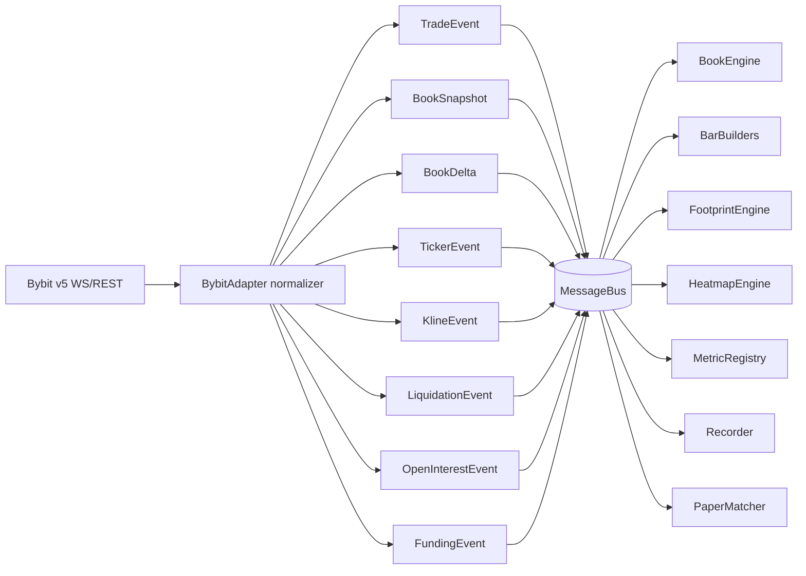
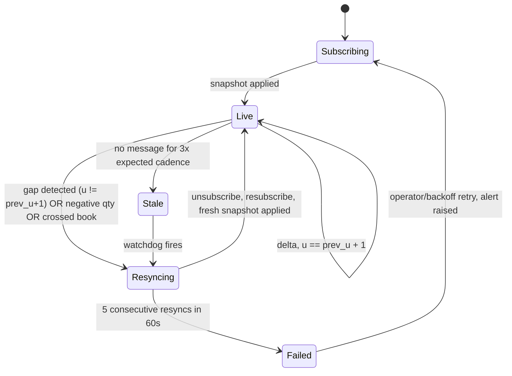
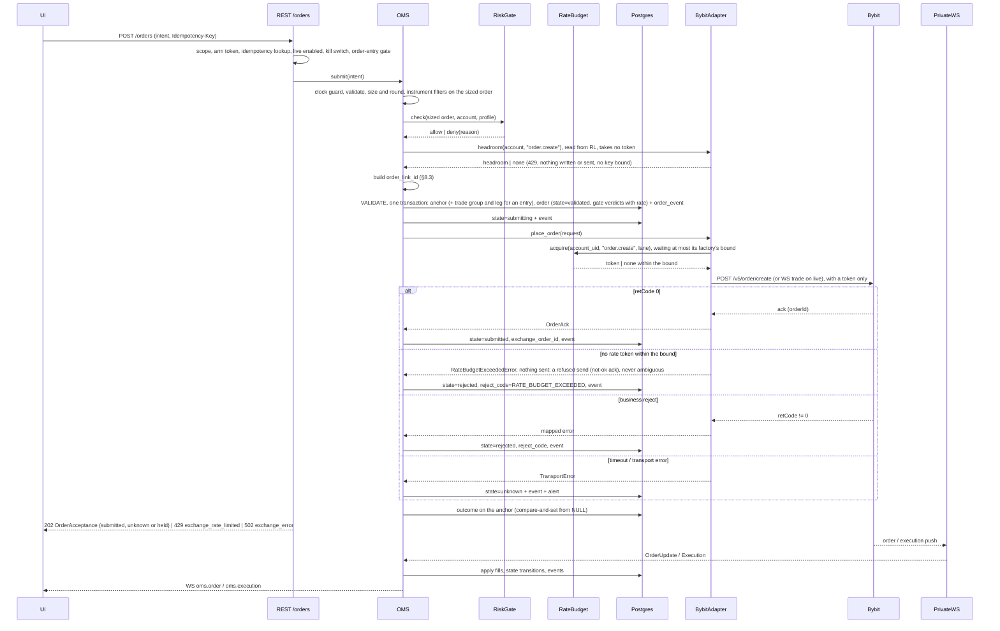
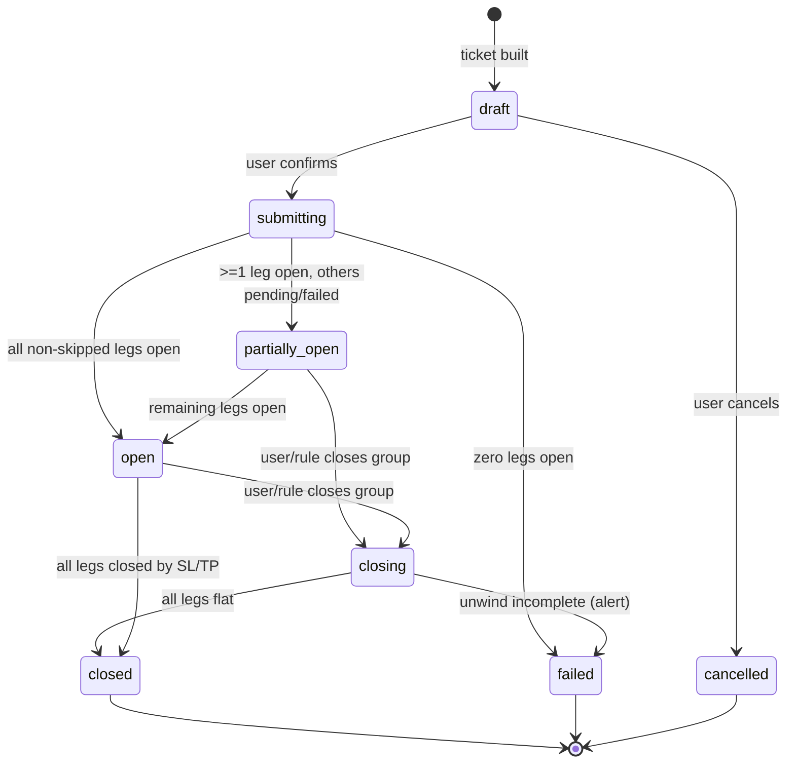
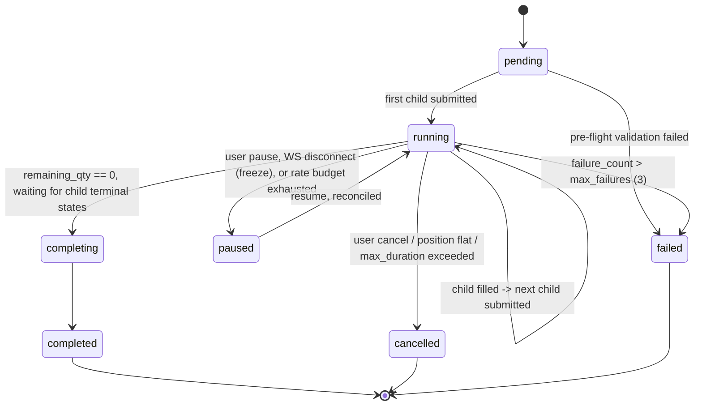
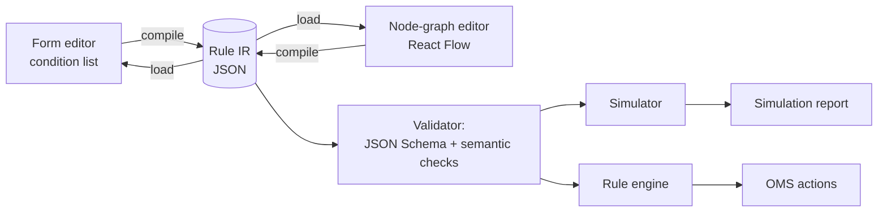
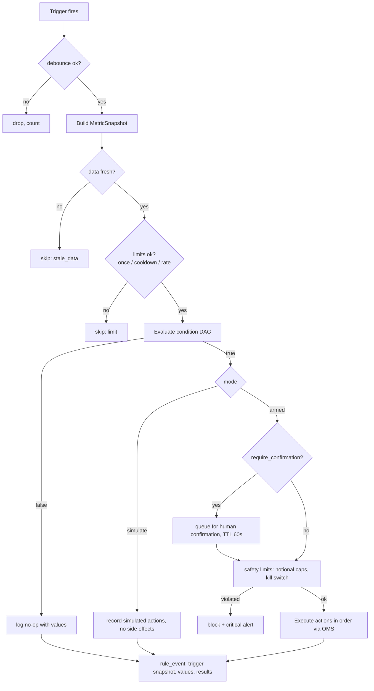
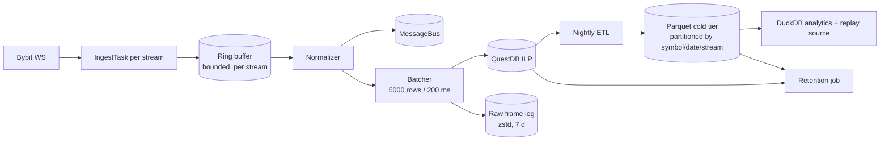

# 24 — Internal Domain Models & Contracts

Status: **binding**. Date: 2026-09-14. Owner: Architect + Backend lead. Scope: web app only (React + custom WebGL engine + Electron shell), Bybit USDT linear perpetuals only, owner/admin screens inside the web app, no Android, no separate admin app.

This document is the single source of truth for every **internal** type in CandleViewer: what flows on the message bus, what the engines compute, what the OMS stores, what the rule engine executes, and what the exchange adapter port looks like. It sits between the wire protocol (`23-ws-protocol.md`), the REST surface (`22-api-openapi.yaml`), persistence (`21-database-schema.md`) and the renderer (`26-chart-engine-design.md`).

| Doc                                        | Relationship                                                                                                                                                                                                                                                                                                                                                                                                                                                        |
| ------------------------------------------ | ------------------------------------------------------------------------------------------------------------------------------------------------------------------------------------------------------------------------------------------------------------------------------------------------------------------------------------------------------------------------------------------------------------------------------------------------------------------- |
| `20-architecture.md`                       | Module boundaries; §9 there sketches the adapter port that §14 here specifies in full                                                                                                                                                                                                                                                                                                                                                                               |
| `21-database-schema.md`                    | Persisted shape of everything modelled here; enum labels are shared verbatim                                                                                                                                                                                                                                                                                                                                                                                        |
| `22-api-openapi.yaml`                      | REST DTOs are serializations of these models (`model_dump(mode="json")`)                                                                                                                                                                                                                                                                                                                                                                                            |
| `23-ws-protocol.md`                        | Wire framing of the events in §2 and aggregates in §3–§6                                                                                                                                                                                                                                                                                                                                                                                                            |
| `26-chart-engine-design.md`                | Renderer-side typed arrays fed from §3–§6                                                                                                                                                                                                                                                                                                                                                                                                                           |
| `27-adrs/ADR-0006`                         | OMS state machine decision; §8 is its normative expansion                                                                                                                                                                                                                                                                                                                                                                                                           |
| `docs/research/06`, `08`, `09`, `11`, `23` | Source research. Each has a short digest at `docs/research/digests/<n>-<slug>.digest.md` and a full document at `docs/research/<n>-<slug>.md`. **Citation convention used throughout this document: a bare citation such as "research 08 §11.3" always refers to the section numbering of the FULL document** (`docs/research/08-crypto-data-metrics.md`), because digests renumber and compress. Where a digest is meant, it is written explicitly as "digest 08". |

## 0. Table of contents

1. [Conventions, primitives and shared types](#1-conventions-primitives-and-shared-types)
2. [Normalized market-data events](#2-normalized-market-data-events)
3. [Bar builders](#3-bar-builders)
4. [Footprint cell model and imbalance algorithms](#4-footprint-cell-model-and-imbalance-algorithms)
5. [Profile model](#5-profile-model)
6. [Heatmap grid model](#6-heatmap-grid-model)
7. [Metric definitions](#7-metric-definitions)
8. [OMS](#8-oms)
9. [Trade groups and fan-out](#9-trade-groups-and-fan-out)
10. [Emulated order algorithms](#10-emulated-order-algorithms)
11. [Rule engine](#11-rule-engine)
12. [Paper matcher](#12-paper-matcher)
13. [Recorder, retention and replay](#13-recorder-retention-and-replay)
14. [Exchange adapter interface](#14-exchange-adapter-interface)
15. [Auth, RBAC and audit](#15-auth-rbac-and-audit)
16. [Configuration and feature flags](#16-configuration-and-feature-flags)
17. [Schema governance, versioning and test obligations](#17-schema-governance-versioning-and-test-obligations)
18. [Traceability matrix](#18-traceability-matrix)
19. [Contract change log](#19-contract-change-log)

---

## 1. Conventions, primitives and shared types

### 1.1 Binding conventions

| #   | Rule                                                                                                                                                                                                                | Rationale                                                                                                                                                    |
| --- | ------------------------------------------------------------------------------------------------------------------------------------------------------------------------------------------------------------------- | ------------------------------------------------------------------------------------------------------------------------------------------------------------ |
| C1  | All models are **pydantic v2** `BaseModel` with `model_config = ConfigDict(frozen=True, extra="forbid", populate_by_name=True)` unless explicitly marked mutable.                                                   | Immutability makes bus fan-out safe without copying; `extra="forbid"` turns an unexpected Bybit field into a loud test failure rather than silent data loss. |
| C2  | **Money and quantity are `Decimal`** end-to-end on the OMS/accounting path. Never `float`.                                                                                                                          | Fee/PnL/qty arithmetic must be exact.                                                                                                                        |
| C3  | **Analytics may use `float`/`numpy`** inside engines (footprint, profile, heatmap, indicators), but any value crossing into OMS, journal or audit is converted at the boundary via `Decimal(str(x)).quantize(...)`. | Analytics needs vectorised speed; accounting needs exactness. The boundary is explicit and tested.                                                           |
| C4  | **Time is integer microseconds since Unix epoch (UTC)**, alias `TsUs = int`. Bybit millisecond fields are ×1000 at the adapter. `datetime` appears only in Postgres rows and human-facing strings.                  | Microseconds preserve trade order within a millisecond batch.                                                                                                |
| C5  | **Prices are carried as `Decimal` and, where a grid or the renderer needs it, as integer ticks** (`price_ticks = round((price - price_origin) / tick_size)`). The integer form is derived, never authoritative.     | Footprint/heatmap grids must key on an exact integer; floats produce phantom price levels.                                                                   |
| C6  | Every bus event carries `schema_version: int`, `event_id: UUID7`, `ts_event: TsUs` (exchange time), `ts_ingest: TsUs` (our receipt time).                                                                           | Version lets consumers reject unknown shapes; the two timestamps give feed latency for free.                                                                 |
| C7  | Enum _values_ are `snake_case` strings identical to the Postgres enum labels in `21-database-schema.md` §1.2. A rename is a migration plus a schema-version bump.                                                   | One vocabulary across DB, API, WS and code.                                                                                                                  |
| C8  | Symbols are the exchange-native uppercase string. Internal identity is `InstrumentKey = (exchange, category, symbol)`; v1 is always `("bybit", "linear", …)`.                                                       | Keeps a future second exchange additive.                                                                                                                     |
| C9  | Field naming is `snake_case`; the adapter owns the mapping from Bybit `camelCase`. No Bybit field name appears outside `candleviewer/exchange/bybit/`.                                                              | Single translation seam, lint-enforced (§17.4).                                                                                                              |
| C10 | Nothing is nullable "just in case". If a field is optional the doc states exactly when it is `None`.                                                                                                                | `Optional` without a stated reason is a bug generator.                                                                                                       |

### 1.2 Primitive aliases

```python
# services/api/candleviewer/domain/primitives.py
from __future__ import annotations
from decimal import Decimal
from typing import Annotated, Literal, NewType, TypeAlias
from uuid import UUID
from pydantic import StringConstraints

TsUs: TypeAlias = int                      # microseconds since epoch, UTC
TsMs: TypeAlias = int                      # milliseconds — adapter boundary only
Ticks: TypeAlias = int                     # integer price levels from price_origin
Px: TypeAlias = Decimal
Qty: TypeAlias = Decimal                   # base units (contracts)
Notional: TypeAlias = Decimal              # quote currency (USDT)
Bps: TypeAlias = Decimal

EventId = NewType("EventId", UUID)         # UUID7 — time-sortable
OrderId = NewType("OrderId", UUID)
GroupId = NewType("GroupId", UUID)
AccountId = NewType("AccountId", UUID)
UserId = NewType("UserId", UUID)
RuleId = NewType("RuleId", UUID)

Symbol = Annotated[str, StringConstraints(pattern=r"^[A-Z0-9]{4,20}$")]
OrderLinkId = Annotated[str, StringConstraints(pattern=r"^[A-Za-z0-9_-]{1,36}$")]
Exchange = Literal["bybit"]
Category = Literal["linear"]               # v1 scope lock
Environment = Literal["live", "demo", "testnet"]          # wire enum: == OpenAPI `Environment` == PG `exchange_env`
ExecutionMode = Literal["exchange", "paper", "replay"]    # internal only; never serialised as `environment`
Side = Literal["buy", "sell"]
```

**`Environment` and `ExecutionMode` are two axes, deliberately not one enum.** `Environment` says _which exchange account and credentials this belongs to_; `ExecutionMode` says _who filled it_. They are orthogonal: a paper fill during a replay of live-recorded data is `environment="live", execution_mode="replay"`, and collapsing that into a single `environment="replay"` would throw away the account the position is attributed to.

`Environment` is the value that crosses the wire. It is identical in all three places — this Python literal, the OpenAPI `Environment` schema, and the Postgres `exchange_env` type — and contract test `enum_parity_environment` asserts that. `ExecutionMode` never crosses the wire under that name; it is persisted as the `is_paper` boolean (`21-database-schema.md` §3.3) and published on the WS as `is_paper` (`23-ws-protocol.md` §13.1), with `replay` distinguished by the frame's own `source: "replay"` marker rather than by a field on the entity.

`paper` and `replay` modes never reach the adapter's network layer, but they run the same code path as `exchange`, so one implementation serves live, paper and replay (research 11 §3: NautilusTrader Backtest/Sandbox/Live parity).

### 1.3 Instrument and precision

Instrument metadata is version-tracked: tick size, lot size and leverage tiers change occasionally (research 08, "version-track instrument metadata"), and a change silently corrupts every historical footprint grid keyed on the old tick size.

```python
class Instrument(BaseModel):
    exchange: Exchange = "bybit"
    category: Category = "linear"
    symbol: Symbol
    base_coin: str                         # "BTC"
    quote_coin: str                        # "USDT"
    settle_coin: str                       # "USDT"
    status: Literal["pre_launch", "trading", "delivering", "closed"]
    contract_type: Literal["linear_perpetual"]
    launch_time: TsUs
    tick_size: Px                          # priceFilter.tickSize
    price_scale: int
    min_price: Px
    max_price: Px
    qty_step: Qty                          # lotSizeFilter.qtyStep
    min_order_qty: Qty
    max_order_qty: Qty                     # limit orders
    max_mkt_order_qty: Qty                 # market orders — different ceiling
    min_notional: Notional                 # lotSizeFilter.minNotionalValue
    max_leverage: Decimal
    min_leverage: Decimal
    leverage_step: Decimal
    funding_interval_min: int              # e.g. 480 = 8 h — NEVER assume 8 h
    upper_funding_rate: Decimal
    lower_funding_rate: Decimal
    copy_trading: bool                     # informational; feature de-scoped
    metadata_version: int                  # bumped when any field above changes
    fetched_at: TsUs
```

**Precision rules** (`InstrumentPolicy`, unit-tested):

1. `round_price(px, side, mode)` — `mode="conservative"` rounds a buy limit _down_ and a sell limit _up_ (never accidentally more aggressive); `"nearest"` for display; `"aggressive"` only for chase algos that explicitly intend to cross.
2. `round_qty(q)` — always **floor** to `qty_step`. Rounding up can exceed available margin or a risk cap.
3. `validate_order(px, qty)` raises `InstrumentFilterError` naming the specific violated filter (`min_order_qty`, `qty_step`, `min_notional`, `max_mkt_order_qty`, `price_scale`, `min_price`, `max_price`) — never a generic message, because the UI renders the filter name.
4. A `metadata_version` bump invalidates cached footprint/profile aggregates for that symbol and schedules a rebuild from raw trades (§13.6).

`E08-S02` implements the subset of the above scoped to `US-MKT-004`: `InstrumentPolicy.round_price(price, *, mode=PriceRoundMode.NEAREST)` (only `"nearest"`, `ROUND_HALF_EVEN`; the side-aware `conservative`/`aggressive` execution modes above are E29/OMS scope, not yet implemented), `round_qty(qty, *, mode=QtyRoundMode.DOWN)` (only `"down"`, matching rule 2 verbatim), and `validate(price, qty) -> list[FilterViolation]` — data, not an exception, so a caller (e.g. the order-ticket UI) can show every violated filter at once; `enforce(price, qty)` is the thin wrapper that raises `InstrumentFilterError` for OMS callers per rule 3. Violation codes (`services/api/candleviewer/exchange/policy.py::FilterViolationCode`, each with a `user_message` naming the exact limit): `PRICE_NOT_TICK_MULTIPLE`, `QTY_NOT_LOT_MULTIPLE`, `QTY_BELOW_MIN`, `QTY_ABOVE_MAX`, `NOTIONAL_BELOW_MIN`, `SYMBOL_NOT_TRADING`. The same rules are published to the web client as `@candleviewer/protocol`'s `policy` export (`packages/protocol/src/rules/policy.ts`, a hand-port proven identical to the Python source via the shared corpus at `packages/fixtures/golden/policy/corpus.json` — see that file's `$schema_note` and `tools/gen/export_instrument_policy_corpus.py`'s module docstring) plus a generated enum-value table (`packages/protocol/src/generated/policy/`, from `tools/gen/export_instrument_policy_rules.py`) so the two can never disagree on a violation code's spelling.

### 1.4 Base envelope

```python
class DomainEvent(BaseModel):
    model_config = ConfigDict(frozen=True, extra="forbid")
    schema_version: int = 1
    event_id: EventId
    ts_event: TsUs                # exchange-stamped
    ts_ingest: TsUs               # our receipt; difference = feed latency
    source: Literal["live", "replay", "paper", "backfill"]

class MarketEvent(DomainEvent):
    exchange: Exchange = "bybit"
    category: Category = "linear"
    symbol: Symbol
```

`ts_event` is **never** synthesized. Where a record lacks its own timestamp the adapter uses the containing push envelope's `ts` and sets `ts_estimated=True` on the subtype that declares that field.

### 1.5 Decimal quantization table

| Quantity                | Quantization           | Enforced in                                                 |
| ----------------------- | ---------------------- | ----------------------------------------------------------- |
| Price                   | `instrument.tick_size` | `InstrumentPolicy.round_price` (nearest, `ROUND_HALF_EVEN`) |
| Quantity                | `instrument.qty_step`  | `InstrumentPolicy.round_qty` (down, `ROUND_DOWN`)           |
| Notional / PnL / equity | 8 dp                   | `Money.q()`                                                 |
| Fees                    | 8 dp, `ROUND_HALF_UP`  | `FeeCalculator`                                             |
| Funding payments        | 8 dp, `ROUND_HALF_UP`  | `FundingCalculator`                                         |
| Percentages / ratios    | 6 dp                   | display layer                                               |
| R-multiples             | 4 dp                   | `MetricRegistry`                                            |

### 1.6 Notification id namespace

`Notification.id = uuid5(NOTIFICATION_NAMESPACE, source_table + source_id)` with the fixed constant
`NOTIFICATION_NAMESPACE = UUID("2def8b5c-e7e2-4686-af54-02c04b8c6a78")`, identical in every service (22-api-openapi.yaml,
`Notification.x-cv-uuid5-namespace`).

---

## 2. Normalized market-data events

Eight event families. All are produced _only_ by the exchange adapter (§14), all are immutable, and all are recorded (§13). The replay engine re-emits the recorded trade and book events field-identical for every recorded field; the fields it derives are deterministic and listed in §13.7 (_Re-emitted events_).



### 2.1 TradeEvent

The tape. Bybit gives the **aggressor side directly** (`S`), so no tick-rule reconstruction is needed (research 08 §2) — this is the single most important simplification in the whole order-flow stack.

```python
class TradeEvent(MarketEvent):
    trade_id: str                 # exchange trade id, unique per symbol
    price: Px
    qty: Qty                      # base units
    side: Side                    # AGGRESSOR side: "buy" = taker lifted the ask
    is_block_trade: bool
    price_ticks: Ticks            # derived, = round((price - price_origin)/tick_size)
    notional: Notional            # derived, price * qty
    seq: int                      # monotonic per (symbol, stream) ingest counter
```

**Bybit v5 mapping — `publicTrade.{symbol}`:**

| Internal         | Bybit | Transform                      | Notes                                                                                                               |
| ---------------- | ----- | ------------------------------ | ------------------------------------------------------------------------------------------------------------------- |
| `ts_event`       | `T`   | `int(T) * 1000`                | ms → µs                                                                                                             |
| `symbol`         | `s`   | identity                       |                                                                                                                     |
| `side`           | `S`   | `"Buy"→"buy"`, `"Sell"→"sell"` | taker/aggressor side                                                                                                |
| `qty`            | `v`   | `Decimal(v)`                   | base coin for linear                                                                                                |
| `price`          | `p`   | `Decimal(p)`                   |                                                                                                                     |
| `trade_id`       | `i`   | identity                       |                                                                                                                     |
| `is_block_trade` | `BT`  | `bool`                         | absent ⇒ `False`                                                                                                    |
| —                | `L`   | dropped                        | tick direction (`PlusTick`/`ZeroPlusTick`/…) — we derive direction from `S`; retained only in the raw recorder blob |
| `notional`       | —     | `price * qty`                  | linear only; inverse would need `qty/price` (out of scope)                                                          |
| `price_ticks`    | —     | computed                       |                                                                                                                     |
| `seq`            | —     | ingest counter                 | not from exchange                                                                                                   |

REST fallback `GET /v5/market/recent-trade` maps identically; **always pass `limit=1000`** (defaults are 60 for linear — research 08 §2). REST-sourced trades carry `source="backfill"`.

**Edge cases.** (a) One WS push may contain many records — each becomes a separate `TradeEvent` with the same `ts_ingest`, ascending `seq`. (b) Duplicate `trade_id` within a 5-minute window is dropped by the dedupe ring and counted in `md_duplicate_trades_total`. (c) Out-of-order `ts_event` (later push with earlier timestamp) is accepted and ordered by `(ts_event, seq)`; if the inversion exceeds 2 s the event is still accepted but `md_out_of_order_total` increments and a warning is logged with both timestamps.

**E08-S04 (as built).** The adapter parses frames into a venue-neutral `TradePrint` (`exchange/base/trade_print.py`; ids capped at 64 chars, non-finite/non-positive numbers and batches > 2 000 rejected); `ingestion/trade_stream.py` builds `TradeEvent`s and publishes on `{env}.md.{symbol}.trade`. Dedupe is a bounded per-symbol ring (50 000 ids ≈ 5 000 prints/s × 10 s) counted in `trade_duplicates_suppressed_total{symbol}` (the name used by the ticket and dashboards; supersedes `md_duplicate_trades_total`). On reconnect (`resubscribing`/`degraded`) or a dropped raw frame a gap opens at the last published print; the first live batch after it triggers one REST recent-trade backfill, merged with that batch by `(ts_event, trade_id)`. Backfilled prints older than the last published print are not republished, so no consumer sees time move backwards. A `GapEvent{symbol, start_us, end_us, recovered, reason}` with a text `label()` (`"No data 12:03:11-12:03:19"`) is published on `{env}.md.{symbol}.gap`; `recovered=false` when the backfill failed, was rate-limited or did not reach back to `start_us` (`trade_gaps_total{symbol,recovered}`). #2715: such a window stays reported (`TradeStream.unrecovered_gaps()`, health `trade_gap_unrecovered`) until a later recent-trade page covers it, the symbol leaves demand, or `UNRECOVERED_RETENTION_S` (15 min) after it closed (its `GapEvent` stays the record). A failed or empty backfill is retried on a 2 s → 60 s equal-jitter backoff through the same REST path and governor; a covering page writes the missing prints to the hot tier only (never re-published, and the window's `GapEvent` is not re-sent), and a window a page no longer reaches back to is not retried again (each window is judged on its own).

### 2.2 BookSnapshot and BookDelta

Bybit sends a snapshot on subscribe and after any server-side reset, then deltas. There is **no checksum** — desync can only be handled by drop-and-resubscribe (research 06 §9, §19).

```python
class BookLevel(BaseModel):
    price: Px
    qty: Qty                      # 0 means delete (delta only)
    price_ticks: Ticks

class BookSnapshot(MarketEvent):
    depth: int                    # 1 | 50 | 200 | 500
    bids: tuple[BookLevel, ...]   # descending price
    asks: tuple[BookLevel, ...]   # ascending price
    update_id: int                # Bybit u
    cross_seq: int                # Bybit seq
    ts_match: TsUs                # Bybit cts — matching-engine time
    reason: Literal["subscribe", "resync", "server_reset", "replay_seek"]

class BookDelta(MarketEvent):
    depth: int
    bids: tuple[BookLevel, ...]   # qty==0 ⇒ delete level
    asks: tuple[BookLevel, ...]
    update_id: int
    prev_update_id: int           # last u we applied; gap ⇒ resync
    cross_seq: int
    ts_match: TsUs
```

**Bybit mapping — `orderbook.{depth}.{symbol}`:**

| Internal    | Bybit         | Transform                                                                                                  |
| ----------- | ------------- | ---------------------------------------------------------------------------------------------------------- |
| event type  | `type`        | `"snapshot"→BookSnapshot`, `"delta"→BookDelta`                                                             |
| `bids`      | `data.b`      | `[[p, q], …]` → `BookLevel`                                                                                |
| `asks`      | `data.a`      | same                                                                                                       |
| `update_id` | `data.u`      | monotonic per symbol; resets to 1 on a server-side reset, which is always accompanied by `type="snapshot"` |
| `cross_seq` | `data.seq`    | cross-topic ordering                                                                                       |
| `ts_match`  | `data.cts`    | ms → µs                                                                                                    |
| `ts_event`  | envelope `ts` | ms → µs                                                                                                    |
| `depth`     | topic suffix  | parsed from `orderbook.200.BTCUSDT`                                                                        |

**Depth/cadence (linear, research 06 §9 / 11 §2.1):** 1 @ 10 ms, 50 @ 20 ms, 200 @ 100 ms, 500 @ 200 ms. v1 subscribes **200** for the heatmap/DOM and **1** for best-bid/ask ticks. Depth `1` is snapshot-only and is re-sent every 3 s even when unchanged (keepalive) — the book engine must not treat an unchanged depth-1 resend as a book event, or the heatmap will show phantom columns.

**Desync protocol (`BookEngine`):**



Rules: the engine keeps `prev_update_id`; any gap discards the local book, emits `BookDesyncEvent` (recorded, alerted, surfaced in the UI as a "book resyncing" badge over the DOM/heatmap) and resubscribes. A **crossed book** (best bid ≥ best ask) after applying a delta is treated as desync, not clamped. Levels are held in two `SortedDict`s keyed by `price_ticks`.

### 2.3 TickerEvent

```python
class TickerEvent(MarketEvent):
    last_price: Px | None
    mark_price: Px | None
    index_price: Px | None
    bid1_price: Px | None
    bid1_qty: Qty | None
    ask1_price: Px | None
    ask1_qty: Qty | None
    open_interest: Qty | None          # base coin for linear
    open_interest_value: Notional | None
    turnover_24h: Notional | None
    volume_24h: Qty | None
    price_24h_pcnt: Decimal | None
    funding_rate: Decimal | None
    next_funding_time: TsUs | None
    is_delta: bool                     # Bybit tickers pushes deltas for linear
```

**Mapping — `tickers.{symbol}` (~100 ms, delta-encoded for linear):** `lastPrice→last_price`, `markPrice→mark_price`, `indexPrice→index_price`, `bid1Price/bid1Size→bid1_price/bid1_qty`, `ask1Price/ask1Size→ask1_price/ask1_qty`, `openInterest→open_interest`, `openInterestValue→open_interest_value`, `turnover24h`, `volume24h`, `price24hPcnt`, `fundingRate`, `nextFundingTime` (ms→µs).

**Critical edge case:** Bybit's linear ticker stream is a **delta** stream — absent fields mean _unchanged_, not _null_. The adapter keeps a per-symbol last-known ticker and emits a **fully-populated** `TickerEvent` with `is_delta=False` downstream, so no consumer ever implements merge logic. The raw delta is what the recorder stores.

**Shipped (E08-S03):** `exchange/bybit/ticker.py` parses frames into a neutral `TickerDelta`; `ingestion/ticker_stream.py` merges (required fields: all except `open_interest_value`, `next_funding_time`) and publishes on `{env}.md.{symbol}.ticker` with `CONFLATE_LATEST`-friendly semantics. Empty-string wire values mean absent; explicit `"0"` is a value. Until a complete state exists the topic is `warming` (health event) and nothing is published; reconnect emits `reconnecting` and rebuilds from the next push.

### 2.4 KlineEvent

Exchange klines are a **cross-check and a cold-start backfill**, not the primary bar source: CandleViewer builds its own bars from trades (§3) so that time/tick/volume/range/delta/renko all share one code path.

```python
class KlineEvent(MarketEvent):
    interval: Literal["1","3","5","15","30","60","120","240","360","720","D","W","M"]
    start: TsUs
    end: TsUs
    open: Px
    high: Px
    low: Px
    close: Px
    volume: Qty
    turnover: Notional
    confirmed: bool          # Bybit `confirm` — MUST gate "bar closed" logic
```

Mapping — `kline.{interval}.{symbol}` and `GET /v5/market/kline`: `start`,`end` ms→µs; `open/high/low/close` → `Decimal`; `volume`, `turnover`; `confirm→confirmed`. REST kline returns a **list-of-lists** `[startTime, open, high, low, close, volume, turnover]` in **descending** time order — the adapter reverses it and pairs `end = start + interval_ms*1000 - 1`.

**Edge case:** never mark a bar closed on `confirmed=False`; Bybit repeatedly repushes the forming bar and the chart will flicker and indicators will repaint (research 06 §19).

### 2.5 LiquidationEvent

```python
class LiquidationEvent(MarketEvent):
    price: Px
    qty: Qty
    side: Side                 # CLOSING order side: "sell" ⇒ a LONG was liquidated
    liquidated_side: Literal["long", "short"]   # derived, unambiguous
    notional: Notional
    batch_index: int           # position within the batched push
    ts_estimated: bool         # True when the record had no own timestamp
```

Mapping — `allLiquidation.{symbol}` (the legacy singular `liquidation` topic is retired and 404s): `T→ts_event` (ms→µs), `s→symbol`, `S→side`, `v→qty`, `p→price`. `liquidated_side = "long" if side == "sell" else "short"`. Because the field is confusingly named at the exchange, **no code outside the adapter may read `side` on this event** — consumers use `liquidated_side` (lint-enforced).

**Edge case:** the topic batches at most one push per symbol per 500 ms with a `data[]` array — the recorder must store every array element, not assume one record per push (research 08 §9).

### 2.6 OpenInterestEvent

```python
class OpenInterestEvent(MarketEvent):
    open_interest: Qty             # base coin (linear)
    open_interest_value: Notional  # USD
    interval: Literal["tick","5min","15min","30min","1h","4h","1d"]
    origin: Literal["ws_ticker", "rest_history"]
```

Live OI arrives on `tickers.{symbol}` (100 ms) → `interval="tick"`, `origin="ws_ticker"`. History comes from `GET /v5/market/open-interest` (`intervalTime` 5min…1d, `limit` 1–200 default 50, cursor-paginated) → `origin="rest_history"`. **Units matter:** for `linear`, `openInterest` is denominated in base coin and must be multiplied by price for USD; `openInterestValue` is already USD. Inverse is USD-denominated — out of scope but the field comment states it so a future adapter does not get it wrong.

### 2.7 FundingEvent

```python
class FundingEvent(MarketEvent):
    funding_rate: Decimal
    funding_interval_min: int       # from instrument metadata, not assumed
    next_funding_time: TsUs
    settled: bool                   # True = historical settlement, False = current accruing
    annualized_rate: Decimal        # derived
```

`annualized_rate = funding_rate * (365*24*60 / funding_interval_min)`. Worked example: interval 480 min ⇒ 1095 periods/yr ⇒ 0.01 % per period ≈ **10.95 %/yr**.

Sources: live accruing rate from `tickers.{symbol}` (`fundingRate`, `nextFundingTime`) with `settled=False`; history from `GET /v5/market/funding/history` (`limit` 1–200, default 200) with `settled=True`. Bybit publishes no distinct "predicted" rate — `fundingRate` _is_ the currently-accruing rate that will apply at `nextFundingTime` (research 08 §7, open Q #8). Intervals vary per symbol (8 h common; 1 h / 2 h / 4 h exist) — always read `instrument.funding_interval_min`.

### 2.8 Derived and control events

| Event                    | Purpose                                                     | Key fields                                                                                     |
| ------------------------ | ----------------------------------------------------------- | ---------------------------------------------------------------------------------------------- |
| `BestQuoteEvent`         | L1 top-of-book for the ticket, DOM header and spread metric | `bid, bid_qty, ask, ask_qty, spread_ticks, spread_bps, mid`                                    |
| `BookDesyncEvent`        | Book resync incident                                        | `symbol, depth, prev_update_id, got_update_id, resync_count`                                   |
| `FeedHealthEvent`        | Per-stream health, 1 Hz                                     | `stream_kind, connected, last_msg_age_ms, latency_p50_ms, latency_p99_ms, msgs_per_s, dropped` |
| `ClockSyncEvent`         | Offset vs `GET /v5/market/time`, 60 s                       | `offset_ms, rtt_ms, drift_rate_ppm, action` (`ok`/`warn`/`block_trading`)                      |
| `InstrumentUpdatedEvent` | Instrument metadata changed                                 | `symbol, metadata_version, changed_fields[]`                                                   |

`ClockSyncEvent.action == "block_trading"` when `abs(offset_ms) > 2000` (40 % of Bybit's 5000 ms default `recv_window`). Order entry is disabled system-wide until it clears; this is the pre-emptive form of Bybit error 10002 (research 11 §2.5 — WSL clocks drift badly after host sleep/resume).

### 2.9 Event catalogue summary

| Event                    | Bybit source                       | Cadence             | Recorded                           | Bus topic                              |
| ------------------------ | ---------------------------------- | ------------------- | ---------------------------------- | -------------------------------------- |
| `TradeEvent`             | `publicTrade.{s}` / `recent-trade` | per match           | yes (hot+cold)                     | `md.trade.{symbol}`                    |
| `BookSnapshot`           | `orderbook.{d}.{s}` type=snapshot  | on subscribe/resync | yes                                | `md.book.{symbol}`                     |
| `BookDelta`              | `orderbook.{d}.{s}` type=delta     | 20–200 ms           | yes (deltas, not re-snapshots)     | `md.book.{symbol}`                     |
| `TickerEvent`            | `tickers.{s}`                      | ~100 ms             | yes (downsampled 1 Hz cold)        | `md.ticker.{symbol}`                   |
| `KlineEvent`             | `kline.{i}.{s}` / REST             | 1–60 s              | yes                                | `md.kline.{symbol}.{interval}`         |
| `LiquidationEvent`       | `allLiquidation.{s}`               | ≤1 push/500 ms      | yes                                | `md.liq.{symbol}`                      |
| `OpenInterestEvent`      | ticker / REST OI                   | 100 ms / 5 min      | yes                                | `md.oi.{symbol}`                       |
| `FundingEvent`           | ticker / REST funding              | 100 ms / settlement | yes                                | `md.funding.{symbol}`                  |
| `BestQuoteEvent`         | derived                            | on change           | no (derivable)                     | `md.quote.{symbol}`                    |
| `BookDesyncEvent`        | derived                            | rare                | yes                                | `sys.md.desync`                        |
| `FeedHealthEvent`        | derived                            | 1 Hz                | metrics only                       | `sys.md.health`                        |
| `ClockSyncEvent`         | `GET /v5/market/time`              | 60 s                | metrics only                       | `sys.clock`                            |
| `BigTradeEvent`          | derived (§2.10)                    | per flagged print   | no (derivable from trades, C-2.15) | `{env}.md.{symbol}.bigtrade`           |
| `TradeClusterEvent`      | derived (§2.10)                    | on cluster close    | no (derivable from trades, C-2.15) | `{env}.md.{symbol}.cluster`            |
| `BigTradeThresholdEvent` | derived (§2.10)                    | ≤ 1 / 5 s           | yes (config echo; not derivable)   | `{env}.md.{symbol}.bigtrade-threshold` |
| `BigTradeAdvisoryEvent`  | derived (§2.10)                    | on over-flag entry  | yes                                | `{env}.md.{symbol}.bigtrade-advisory`  |

**Ingestion health reasons (#1919).** `IngestionService.health()` returns `degraded` (never `down`;
`stopped` before start) with `detail` = comma-joined `HealthReason` tokens, derived from published plain
signals only (C-2.20). Surfaced as `/readyz` check `ingestion` (`ok:false`, `detail`, still HTTP 200), the
`ingestion` health component and `exchange.public_ws` (real WS phase).

| Token                   | Condition                                             | Threshold                                                                  |
| ----------------------- | ----------------------------------------------------- | -------------------------------------------------------------------------- |
| `ws_not_open`           | public WS phase != `open`                             | > 5 s (`WS_GRACE_S`)                                                       |
| `book_out_of_live`      | a desired book not LIVE                               | > 30 s (`RESYNC_BACKOFF_CAP_S`: the longest a healthy backoff cycle waits) |
| `trade_gap_unrecovered` | an open trade gap or a window that closed unrecovered | until a backfill covers it, the symbol leaves demand, or 15 min (#2715)    |
| `catalogue_stale`       | cache never loaded, last refresh failed, past TTL     | until the next successful refresh (#2715), else `ttl_seconds`              |
| `pump_breaker_open`     | frame-pump breaker tripped                            | 30 s (`PUMP_BREAKER_WINDOW_S`)                                             |

**As shipped (E08-T06 reconciliation, 2026-10-05).** Bus topics are `{env}.md.{symbol}.{detail}`
(`bus/models.py` `Topic.key`, e.g. `demo.md.BTCUSDT.trade`), not `md.{detail}.{symbol}` as tabled above;
the table's family→stream mapping is otherwise unchanged. Implemented today: `trade`, `book`
(snapshot + delta + `BookStatus`), `ticker`, `gap` (trade-tape `GapEvent`), feed health
(`{env}.health.feed`), and instrument metadata changes on `{env}.instruments.{symbol}.updated`
(`InstrumentUpdatedEvent`, published by the catalogue refresh since #1633; listed by E08-Q06,
#283).

**Envelope of the E08 control events (#3876, drift D1).** `BookStatus`, `GapEvent` and
`FeedHealthEvent` carry the §1.4 envelope (C6) with `schema_version = 1` and `source = "live"`.
Adding it removes and renames nothing (§17.1), so these first versioned shapes take §1.4's default,
as §2.10's events do; a later shape change bumps it per §17.1. The envelope fields are required as
§1.4 declares them: the events stay in-process (no WS frame, REST body, row or recording carries
them), so no older payload needs a default to be read. `event_id` is a UUID7 stamped with
`ts_event`'s millisecond. `GapEvent.ts_event` is `end_us` (the first live print after the window)
and its `ts_ingest` that batch's receipt time. `BookStatus` and `FeedHealthEvent` are local
observations with no exchange record, so §1.4's rule against a synthesized `ts_event` (written for
exchange records) does not apply: `ts_event` = `ts_ingest` = the producer's injected clock at the
edge (for `BookStatus`, its `ts_us`), and their feed latency reads 0.

**Replay namespace (E26-T03).** A replay session's re-emitted events use the same grammar with `env` =
`replay-{session_id}`, the replay session's UUID in lower-case canonical form (`replay-` then 8-4-4-4-12
lower-case hex digits), e.g. `replay-0b7c5e1a-3f2d-4c8e-9a61-5d0e7b2c4f18.md.BTCUSDT.trade`. `live`, `demo`,
`testnet` and `replay-<uuid>` are the only `env` values: `Topic` refuses any other (`bus/models.py`,
`replay_env` formats the namespace). A replay topic never equals a live one, and no consumer subscribes with
a wildcard `env` (a `TopicPattern` `env` wildcard would match every replay; none exists, and
`tests/unit/architecture/test_no_wildcard_env_subscriber.py` keeps it so), so live consumers never see
replayed events and a replay's consumers subscribe to their own session's namespace only (C-2.11).
The replay book's own `BookStatus` events, which the engine stamps `source = "live"` (above), reach
the session's topic re-stamped `source = "replay"` (`ReplayBooks`, `replay_wiring.py`), so every event
on a replay topic reads `"replay"` (§13.7).
Replay traffic is not counted in the six bus series `bus_published_total`, `bus_delivered_total`,
`bus_subscriber_lag`, `ingest_queue_full_total`, `bus_stream_invalidated_total` and
`bus_conflated_total`, whose labels name no `env` (a replay lane reuses its live twin's subscriber name),
and logs no "bus subscriber lagging" warning: a slow replay consumer is replay's designed backpressure,
measured by the replay clock's own `replay_*` series, and never fires the live
`IngestionNeverDropQueueFull` alert.

Queue policy is chosen **per subscriber** at `Bus.subscribe` (not per topic):
trade consumers must subscribe NEVER_DROP (a full queue awaits and counts
`ingest_queue_full_total{class="trade"}`); state-like consumers use CONFLATE_LATEST or
INVALIDATE_ON_FULL (§4.2 of `20-architecture.md`). Metric mapping per family (all
declared in `ingestion/metrics.py`, exported with `env`, `exchange`): trades/tickers →
`ingest_events_total{stream,symbol}`, `ingest_lag_seconds{stream}`; trade gaps →
`trade_gaps_total{symbol,recovered}`; books → `ingest_book_live{symbol}`,
`ingest_book_resyncs_total{symbol,reason}`; feed health → `ws_topic_staleness_seconds{topic}`,
`ingest_ws_up{socket}`; clock → `exchange_clock_drift_ms`, `clock_offset_age_seconds`.

### 2.10 Big-trade events (E22-T01, contract-first)

Produced by M9 `orderflow/bigtrade.py` (`BigTradeEngine`) from `TradeEvent`s processed in `(ts_event, trade_id)` order. Deadlines are evaluated against print timestamps, never the wall clock, so live and replay take the same path. Duplicate `trade_id`s count once. Per-print evaluation is plain synchronous code that publishes enums. It is **not** a statechart (C-2.20). Decisions recorded as owner item Q on #1778 (★ defaults).

```python
class BigTradeEvent(MarketEvent):          # one per flagged print
    trade_id: str
    price: Px
    qty: Qty
    side: Side
    notional: Notional
    price_ticks: Ticks
    mode: Literal["absolute_size", "notional", "percentile"]
    threshold_abs: Decimal                 # effective threshold in the mode's unit (qty for absolute_size, USDT otherwise)
    capped: bool                           # True while the over-flagging cap is active
    estimated: bool                        # True in percentile mode (threshold is a P² estimate)
    seq: int                               # copied from the source TradeEvent

class TradeClusterEvent(MarketEvent):      # emitted when a cluster closes
    cluster_id: str                        # deterministic: f"{side}:{price_bucket}:{first_trade_id}"
    side: Side
    price_bucket: int                      # floor(price / (tick_size * max(1, tolerance_ticks)))
    anchor_price: Px                       # first print's price (display only; not a merge criterion)
    first_ts_event: TsUs
    last_ts_event: TsUs
    trade_id_count: int                    # exact member count (== cluster_size)
    first_trade_id: str
    last_trade_id: str
    trade_ids: tuple[str, ...]             # first CLUSTER_IDS_MAX (64) members in (ts_event, trade_id) order
    trade_ids_truncated: bool              # True when trade_id_count > CLUSTER_IDS_MAX
    cluster_size: int
    total_qty: Qty
    total_notional: Notional
    vwap: Px
    max_print_qty: Qty
    close_reason: Literal["deadline", "superseded", "evicted", "config_change", "flush"]
    estimated: Literal[True] = True        # SR-E22-12

class BigTradeThresholdEvent(MarketEvent): # on every change; ≤ 1 per 5 s (print time) while stable
    mode: Literal["absolute_size", "notional", "percentile"]
    value: Decimal                         # percentile => 0..100
    percentile_window_ms: int
    cluster_window_ms: int
    cluster_tolerance_ticks: int
    effective_threshold_abs: Decimal       # POST-cap value actually applied; displayed by the UI (US-BIG-002 scenario 2)
    cap_active: bool                       # over-flagging cap in force (recoverable from this stream)
    sample_count: int
    flagged_fraction: Decimal
    estimated: bool                        # True in percentile mode

class BigTradeAdvisoryEvent(MarketEvent):
    reason: Literal["threshold_too_low"]
    mode: Literal["absolute_size", "notional", "percentile"]
    threshold_abs: Decimal                 # the configured effective threshold that over-flagged (reference for suggested_value)
    flagged_fraction: Decimal              # > 0.20 over the trailing window
    suggested_value: Decimal               # in the configured mode's unit
    cap_active: bool
```

| Event                    | Bus topic (`{env}.md.{symbol}.{detail}`, §2.9 as shipped) | Cadence                                              |
| ------------------------ | --------------------------------------------------------- | ---------------------------------------------------- |
| `BigTradeEvent`          | `…bigtrade`                                               | per flagged print                                    |
| `TradeClusterEvent`      | `…cluster`                                                | on cluster close                                     |
| `BigTradeThresholdEvent` | `…bigtrade-threshold`                                     | on every change; ≤ 1 / 5 s (print time) while stable |
| `BigTradeAdvisoryEvent`  | `…bigtrade-advisory`                                      | on entering the over-flag state                      |

Topic details are flat single segments (`bus/models.py` `_SEGMENT_RE` = `[a-zA-Z0-9_-]+`, at most 4 segments). None of them collides with an existing `md` detail (`trade`, `book`, `ticker`, `gap`).

**Envelope.** All four events carry the §1.4 envelope (C6) with `schema_version = 1`. A shape change bumps it (§17). `ts_event` (`TsUs`) is defined per event as follows:

- `BigTradeEvent`: the triggering print's `ts_event`.
- `TradeClusterEvent`: the last member's `ts_event` (equal to `last_ts_event`).
- `BigTradeThresholdEvent` / `BigTradeAdvisoryEvent`: the `ts_event` of the print that triggered the emission. No wall or injected clock is involved, so the output never depends on batch timing.

**Print-time boundaries (replay determinism).** Every window, deadline and refresh boundary is measured in print time (`ts_event` of the processed prints). The threshold refresh fires when the latest print's `ts_event` crosses the next 5 s boundary (`floor(ts_event / 5_000_000)` increments). The trailing percentile and over-flag windows end at the latest print's `ts_event`. **Replay mode:** with `source="replay"` the same engine runs over the recorded trades and recorded config echoes. It **compares** its threshold/advisory output against the recorded `BigTradeThresholdEvent`/`BigTradeAdvisoryEvent` stream (a mismatch is a determinism defect, counted and logged) and does not republish them (C-2.15).

**Rules (binding).**

- **Cluster key.** A cluster is keyed on `(symbol, side, price_bucket)` only. A print merges into the open cluster for its key if `ts_event <= first_ts_event + cluster_window_ms * 1000` (ms → µs, C4). Otherwise that cluster closes (`deadline`) and a new one opens. There is no separate tolerance check against the anchor price. A cluster belongs to the bar containing its `first_ts_event` (US-BIG-004 scenario 3). `cluster_window_ms = 0` disables clustering. A config change recomputes the still-open clusters from the buffered prints under the new config. Open clusters were never published, so **no close is emitted for them before the recompute**: their prints are re-clustered, and clusters closing during or after the recompute carry their normal `close_reason`. `config_change` is emitted only when the new config turns clustering **off** (`cluster_window_ms = 0`), closing the open clusters with nothing to recompute. Invariant: across a reconfigure, every trade id appears in exactly one emitted cluster. Event shapes are unchanged (`schema_version` stays 1).
- **Over-flagging cap.** When more than 20 % of the prints in the trailing window are flagged, the engine emits `BigTradeAdvisoryEvent` and raises the effective threshold to the trailing p80. The p80 comes from a **second** P² estimator over the same trailing window, so state is still fixed-size (two estimators per symbol). It keeps emitting `BigTradeEvent` with `capped=True` and **never suppresses** them.
- **Percentile estimator.** P² behind a trimmed wrapper (SR-E22-14), using fixed-size state. It never stores the window's prints. The accuracy target is a **rank** error of ≤ 1 % against the exact quantile over the same window. The effective threshold refreshes at most every 5 s of print time (above). `BigTradeThresholdEvent` is also emitted immediately on any change of `effective_threshold_abs`, `cap_active` or config. The current, post-cap state is therefore always recoverable from the recorded threshold stream, while `BigTradeAdvisoryEvent` fires on cap entry only.
- **State caps (closes threat-model gap G3; SR-E22-05).** Per symbol: `CLUSTER_KEYS_MAX = 4096` open cluster keys and `PRINTS_BUFFER_MAX = 16384` buffered prints (a floor). The buffer holds **all** evaluated prints (not only flagged ones) inside the active cluster window, so a config change can recompute without a restart. Its effective bound is the asserted constant expression `PRINTS_BUFFER_EFFECTIVE_MAX = max(PRINTS_BUFFER_MAX, cluster_window_ms × 5)` in `orderflow/limits.py`, where 5 = the 5 000 prints/s budget #5 expressed per ms. That means a healthy feed never evicts inside the window: 25 000 at the 5 000 ms REST cap, 10 000 → 16 384 at the 2 000 ms WS cap. It stays bounded because `cluster_window_ms` is capped (SR-E22-04). The oldest entry is evicted (`close_reason="evicted"`) and `bigtrade_state_truncated_total{symbol}` is incremented, never silently. Every bound is imported from `orderflow/limits.py` (E22 threat model §7). No literal copies are allowed elsewhere.
- **Bounded membership.** `trade_ids` is capped at `CLUSTER_IDS_MAX = 64` (`orderflow/limits.py`, asserted), with `trade_ids_truncated` set when the cap applies. The exact count and the first/last ids are always present, so the event size is O(1) on the bus while still giving tape highlighting and determinism tests concrete members. The full membership stays reconstructible from the tape by `(symbol, side, price_bucket, first_ts_event..last_ts_event)`.
- **Input assert (SR-E22-13).** Engine inputs are `Decimal` > 0 and on tick. Anything else is rejected and counted.

---

## 3. Bar builders

One `BarBuilder` protocol, six implementations. Every builder consumes `TradeEvent` only (never klines), so live and replay produce byte-identical bars. Bars are the substrate for footprint (§4), profiles (§5), indicators and the rule engine's `on_bar_close` trigger.

### 3.1 Bar model

```python
class BarSpec(BaseModel):
    kind: Literal["time","tick","volume","range","delta","renko"]
    # exactly one of the following is set, matching `kind`:
    interval_ms: int | None = None       # time
    tick_count: int | None = None        # tick
    volume_threshold: Qty | None = None  # volume  (base units)
    range_ticks: int | None = None       # range, renko (brick size)
    delta_threshold: Qty | None = None   # delta
    # shared options
    price_source: Literal["last","mark"] = "last"
    session_anchor_utc_min: int = 0      # minutes past 00:00 UTC where the session starts
    align_to_epoch: bool = True          # time bars snap to epoch multiples
    renko_wick: bool = False             # renko: keep high/low wicks
    reversal_bricks: int = 2             # renko reversal cost, in bricks

    @model_validator(mode="after")
    def _exactly_one(self) -> "BarSpec": ...   # raises on mismatch

class Bar(BaseModel):
    spec_hash: str                # sha256 of BarSpec canonical JSON — cache key
    symbol: Symbol
    index: int                    # strictly increasing per (symbol, spec_hash) for real bars
    open_time: TsUs               # ts_event of the first trade in the bar
    close_time: TsUs              # ts_event of the last trade (or boundary for time bars)
    open: Px
    high: Px
    low: Px
    close: Px
    volume: Qty
    buy_volume: Qty               # aggressor buy
    sell_volume: Qty
    delta: Qty                    # buy_volume - sell_volume
    min_delta: Qty                # running intrabar delta minimum
    max_delta: Qty                # running intrabar delta maximum
    trade_count: int
    turnover: Notional
    vwap: Px
    closed: bool
    partial: bool                 # True when the bar began before recording started
    gap_before: bool              # True when a data gap precedes this bar
    synthetic: bool = False       # densify() filler (§3.3) — never persisted
```

Shipped in `services/api/candleviewer/bars/` (E12-T01): `spec_hash` = sha256 over canonical JSON
(every `BarSpec` field, defaults included explicitly; keys sorted; separators `,` and `:` with no whitespace;
`ensure_ascii`; Decimals rendered as a plain, non-rounded string: no exponent, no trailing fractional zeros, `-0` as `0`;
this supersedes any "fixed-precision" wording). Spec Decimals are bounded to at most 28 significant digits and
longer values are rejected at validation, so the hash never rounds. `SPEC_HASH_VERSION = 1`: any change to the
canonical form bumps it and moves every hash (persisted keys must be migrated); see ADR-0033 / PR #1968, which
proposes omitting unset fields and would need a coordinated bump. `densify()` index semantics: real bars' `index`
is strictly increasing and is never renumbered; synthetic fillers repeat the preceding real bar's `index`, are
view-only (never persisted or sent on the wire), and consumers key densified views by `open_time`, never by `index` alone;
outside densified views, a bar's persistence and wire identity for every bar kind is `(spec_hash/bar_param, generation, index)` (21 §4.8, 22 `/market/bars`, 23 §8.2; `generation` is ADR-0033's generation/epoch, an opaque u64: a cold start begins a new one (the cold-start time in ms, above any epoch this process or the discarded blob recorded), and `index` restarts at 0 only inside a fresh generation, so no two bars of a series share the identity, barring the clock-regression residual and a restore whose tape lost trades after the watermark (24 §3.5)) because `open_time` is not unique for tick/volume/range/renko/delta bars (#2014, #2662);
golden vectors in `packages/fixtures/golden/bars/`; TS mirror generated into
`packages/protocol/src/generated/bars/`.

`min_delta`/`max_delta` require tracking the running intrabar delta path, not just the endpoint (research 08 §2) — they are the input to exhaustion and absorption reads.

### 3.2 Builder protocol

```python
class BarBuilder(Protocol):
    spec: BarSpec
    def on_trade(self, t: TradeEvent) -> Sequence[BarUpdate]: ...
    def on_clock(self, now_us: TsUs) -> Sequence[BarUpdate]: ...   # time bars only
    def snapshot(self) -> BuilderState: ...
    def restore(self, state: BuilderState) -> None: ...

class BarUpdate(BaseModel):
    kind: Literal["open","update","close"]
    bar: Bar
    amended: bool = False   # True only on a `close` re-emitted by a late trade (§3.3c)
```

An amend re-emits a bar with the same identity `(bar_param/spec_hash, generation, index)`, so persistence upserts on that identity (the `DEDUP UPSERT KEYS` of 21 §4.8) and the amended row replaces the earlier one (landed, migration 0004, #2016: the deployed DEDUP keys are `(ts, symbol, bar_param, generation, index)`). An amended re-emit from the same source replaces the earlier row; `SourceOverwriteRefused` applies only to a lower-ranked source. The WS publisher must forward `amended`: the 23 §14.3 bar item carries it in its structured form only, and kind 4 has no amended bit, so an amended close is always sent structured, even on a binary subscription (23 §3.4).

`snapshot()`/`restore()` exist so a restart or a replay seek resumes mid-bar without replaying the whole day. `BuilderState` is a builder-owned blob persisted every 60 s per `(symbol, spec_hash)`. It is versioned orjson JSON (Decimals as strings) with `STATE_VERSION = 1`, checked on `restore()` and rejected with a typed error on mismatch. orjson is used rather than msgpack because msgpack is not a backend dependency and adding one needs a security review.

### 3.3 Per-kind specifications and edge cases

**Time bars.** Boundary `floor((ts_event - anchor) / interval_ms) * interval_ms + anchor`. Edge cases: (a) **empty intervals** emit no bar by default (`fill_gaps=false`); the renderer draws a visual gap and `gap_before=True` on the next bar. Consumers that need a continuous index (indicators) call `BarSeries.densify()` which synthesizes flat bars with `volume=0, open=high=low=close=prev.close, synthetic=True` — never persisted. (b) A bar closes on `on_clock` even if no trade arrives, so `on_bar_close` rules fire on schedule in a dead market. (c) A trade whose `ts_event` falls into an already-closed bar (late arrival) is applied to that historical bar and re-emits a `close` update with `amended=True`; the UI re-renders that bar. The 60 s window is measured against the builder's **watermark** (the highest trade `ts_event` or clock time seen so far), not wall clock, so replay stays deterministic. If the bar closed more than 60 s before the watermark the trade is dropped and counted in `bars_late_trade_dropped_total{reason=late_window}`. A late trade whose interval has no bar (an empty interval) is also dropped, counted as `reason=empty_interval`, because creating a bar there would break the strictly increasing index of bars already emitted.

**Tick bars.** Close after exactly `tick_count` **trade events** (not aggregated prints). Edge case: one Bybit push containing 50 records still produces 50 tick increments; batch boundaries are irrelevant. Block trades count as one tick, and are flagged so a tick-bar series can optionally exclude them (`exclude_block_trades`, default false).

**Volume bars.** Accumulate `qty` until `>= volume_threshold`. A trade that would overshoot is **split**: the bar takes exactly the remaining quota, the remainder opens the next bar at the same price and timestamp, both parts carry `split_from_trade_id`. Splitting preserves the total-volume invariant, which matters because profiles are built off the same trades. Consecutive overshoot (a single huge print spanning N thresholds, N at most 1 000, SR-E12-15) produces N bars of identical OHLC — this is correct and is rendered as a stack of flat bars.

**Shipped tick/volume behaviour (E12-S02, `bars/activity_builders.py`).** `open_time`/`close_time` are the first/last trade's `ts_event` (event order `(ts_event, seq)`). Block trades count as one tick and their volume always counts (BI-1 holds); `exclude_block_trades` is not yet a `BarSpec` field (needs a spec-hash bump, tracked on the PR). A split trade adds 1 to `trade_count` of **every** bar holding a part of it, so for volume bars `trade_count` over-counts distinct trades (sum over bars > number of trades); its remainder keeps the trade's side, so `delta` is split by quantity. Closed activity bars are final: a late or out-of-order trade goes into the open bar (never re-splits closed bars) — pending ratification (#2013). A print that would close more than 1 000 bars (`MAX_BRICKS_PER_TRADE`, SR-E12-15) is refused before any state changes: the builder raises `BarsError` and, on the live path, the set quarantines the series, as for renko. `gap_before` is always `False` and `on_clock` is a no-op. The first bar of a fresh builder carries `partial=True` and its `open_time` is where the tape begins. `split_from_trade_id` rides on the emission (`ActivityBarUpdate`) until the `bars_volume` row and `/market/bars` payload gain the field (contract-first follow-up, #2012). **WARNING:** activity bars may share `open_time` (an N-threshold print yields N bars with one timestamp; two tick bars can open in the same ms); stores and the wire must key non-time bars by `index`, not `open_time` — pending #2014. `tick_count` ≥ 1 for a builder and 100..1 000 000 for a subscribable series (`MIN_SUBSCRIBABLE_TICK_COUNT`, SR-E12-03 / BR-29 in `docs/security/threat-models/E12-bars.md`, enforced by E12-T05/T06).

**Range bars.** Close when `high - low >= range_ticks * tick_size`. The closing trade's price becomes `close`; the next bar opens at that same price (no gap). Edge case: a single trade that jumps more than one range beyond the current bar closes the current bar at that price and opens **one** new bar (we do not synthesize intermediate phantom range bars, which would invent volume that never traded). `gap_before=True` marks the jump.

**Delta bars.** Close when `abs(delta) >= delta_threshold`. The running delta resets each bar. Edge case: delta oscillating around the threshold cannot "un-close" a bar — closure is evaluated after each trade and is final. A trade that pushes delta past the threshold is **not** split (unlike volume bars) because splitting an aggressor's fill across two delta bars misrepresents the aggression; the overshoot carries into the bar's final `delta`.

**Shipped range/delta behaviour (E12-S03, `bars/threshold_builders.py`).** Range semantics below (inclusive close, next open = previous close with the bar created only by the next real trade, jump = span >= 2 widths, `gap_before=True` with a possibly over-width closed bar) are **pending ratification in #2023**. Range: width `range_ticks * tick_size` in exact `Decimal`; closure is inclusive (`high - low >= width`) and evaluated after each trade, and the closing trade belongs to the bar it closes. The next bar's `open` is that close price but the bar is created only by the next real trade, so a bar always holds at least one trade and a gap never yields a synthetic bar. A _jump_ is a closing trade leaving `high - low >= 2 * width`: the next bar gets `gap_before=True` (`bar_range_jump_gaps_total`), and the closed bar's span may exceed the width. `open_source_ts` rides on `RangeBarUpdate` until the `bars_range` row gains the column (tracked by #2024, blocks the E12-T02 range row mapping). An unknown symbol or non-positive tick size raises `BarSpecError` at construction. Delta: closure on `abs(delta) >= delta_threshold`, final, never split; `gap_before` is always `False`. Both follow the activity-bar late-trade rule (closed bars final, a late trade joins the open bar; pending #2013). Subscribable floors per SR-E12-03 (`range` 2..100 000 ticks, `delta` >= 10 `qty_step`s and <= 10^12) are exposed as `MIN_/MAX_SUBSCRIBABLE_*` constants and enforced by E12-T05/T06.

**Renko.** Brick size `range_ticks * tick_size`, computed from `price_source`. A new brick forms when price moves a full brick from the last brick's close; reversal requires `reversal_bricks` (default 2) bricks against the trend. Edge cases: (a) a single trade that moves N bricks emits N bricks with identical timestamps and `index` incrementing — volume is allocated to the **last** brick only, and every brick carries `volume_allocated=False` except that one, so profile consumers do not double-count. (b) With `renko_wick=True` the wick records the actual extreme trade price within the brick. (c) Renko bars have no fixed time width — the renderer spaces them by index, and any time-based indicator over a renko series is disabled in the UI with an explanatory tooltip.

### 3.4 Determinism and shared invariants

| Invariant | Statement                                                                                                              | Test                                        |
| --------- | ---------------------------------------------------------------------------------------------------------------------- | ------------------------------------------- |
| BI-1      | `sum(bar.volume for bar in bars) == sum(trade.qty for trade in trades)` for every builder (with volume-bar splitting). | Property test, 1 M synthetic trades         |
| BI-2      | `bar.delta == bar.buy_volume - bar.sell_volume` always.                                                                | Unit                                        |
| BI-3      | `min_delta <= delta <= max_delta` and both are attained on the intrabar path.                                          | Property                                    |
| BI-4      | Replaying the same trade sequence twice yields identical `Bar` objects including `spec_hash`.                          | Golden-file test against a recorded fixture |
| BI-5      | `restore(snapshot())` at any point yields the same final series as an uninterrupted run.                               | Property with random cut points             |
| BI-6      | `vwap == turnover / volume` to 8 dp, or `open` when `volume == 0`.                                                     | Unit                                        |

**Shipped harness (E12-T04, `services/api/bench/bar_determinism/`).** One shared harness checks BI-1…BI-6 for all six builders over a standard spec matrix: a seeded, offline `TradeEvent` generator (volatility, size distribution, taker skew; adversarial N-threshold prints, exact-threshold/boundary hits, rapid reversals, silences, late arrivals, duplicate ids); an independent, naive reference implementation written from §3.3 (`reference.py`), compared on every field; a plain-text comparator (`bar <i> field <f>: expected <x> actual <y>`); and a mutation set (time-bar off-by-one, endpoint-only `min_delta`, missing volume split, phantom range bars, renko double allocation) each proven caught. BI-1 counts trades a time builder drops (outside the 60 s amend window, or an empty interval) as not applied; BI-3 requires the extremes to equal the arrival-order intrabar path; BI-5 restores into a fresh builder through a JSON round trip of `BuilderState`. A violation names invariant, builder, spec, first offending bar and seed. PR gate: 100k trades in the backend unit run; nightly `bar-determinism-nightly`: 1M trades plus rebuild throughput vs `baseline.json` (warn >10 %, fail >25 % only when the runner OS matches the baseline's; the committed baseline is Windows dev hardware, so CI only WARNs until a Linux baseline is re-recorded on the CI runner, #2167). BI-5 cuts are random plus fixed cuts at the first renko reversal and the first volume split. The mutation set's time-bar off-by-one is injected by shifting boundary timestamps 1 µs (same effect as `<=` for `<`). Renko wick-shape defects are caught only by the reference cross-check, because no BI-n covers bar shape. The golden fixture day is synthesised from documented message shapes (exception #1778 A), not a recorder capture, so roadmap §5.3 exit criterion 4 stays open until E16 records a real day.

### 3.5 Multi-spec efficiency

A symbol typically has 3–8 active specs (1 m, 5 m, 1 h time bars plus a footprint tick/volume series). `BarBuilderSet` fans one `TradeEvent` to all builders for that symbol in a single pass; builders never subscribe to the bus individually. Cost is O(specs) per trade with no allocation in the common path (builders mutate an internal mutable draft and only materialize a frozen `Bar` on emit).

As shipped (E12-T03, `bars/builder_set.py`): the set subscribes `{env}.md.{symbol}.trade` once per symbol with `NEVER_DROP`, so a slow consumer backpressures the trade publisher and nothing is dropped. One owned task per symbol folds each trade into the symbol's builders in registration order and routes every emission through a single `EmitRouter` (the QuestDB `BarWriter` sink persists `close` emissions; the WS publisher, E12-T06, is a second `BarSink`), stamped with the series' `generation`. Specs are leased per consumer and reference-counted; the last release starts a 30 s grace (US-MKT-005), and teardown writes a final blob. Hard caps, enforced on registering a _new_ distinct series and refused with `SpecCapExceeded` (`spec_cap_exceeded`, naming the cap and the active specs): 8 per user, 32 per symbol, 512 process-wide (SR-E12-04). State blobs are written every 60 s to `<root>/<symbol>/<spec_hash>.state.json` (both components pattern-validated) by write-temp, fsync, then rename. Each envelope (v2) carries the builder's `BuilderState`, the watermark (`ts_event` of the last applied trade plus the trade ids at that timestamp) and the series' `generation`; a v1 envelope loads as generation 0. On restore the set replays only tape trades after the watermark. A blob that is over 8 MiB, unparseable, of an unknown version, for another series, has a watermark past the tape head, that the builder refuses, or whose replay meets a print the builder refuses or raises on (`replay_refused`) is counted in `bars_blob_discarded_total{reason}` and logged with its `spec_hash` (a `replay_refused` also with the class of the builder's error, `error_type`), and the spec cold-starts (SR-E12-12); the cold start's floor record overwrites it, so a refused blob is not deleted first and stays, with its floor, if that write fails. A cold start begins a new generation (#2662), `max(now_ms, floor + 1)`, where `floor` is the highest generation this process issued for the series or a blob that still parsed recorded (else −1; a floor at or above 2**52 is refused as corrupt). It writes a floor record at once: the new generation with no watermark, so a restart never restores it, even on a busy lane, and always begins a new generation. A blob with no watermark has no replay point, so it sets the floor but is never restored; periodic and final blobs stay restorable, and a restored series keeps its blob's generation. The one accepted residual is a crash with no readable floor (no blob, or a failed floor write, counted in `bar_state_write_failed_total{stage=cold_start}`) and a wall clock that stepped back: the new generation can then fall at or below an earlier epoch, so consumers treat any change of generation, in either direction, as a swap. An ADR-0033 rebuild swap (E12-S12, not implemented) must allocate above the live epoch.

Failure isolation and limits (E12-T03, #2030 review):

- A builder that raises in `on_trade`/`on_clock` is quarantined: its series is removed, the lane keeps draining for the others, `bar_builder_quarantined_total{reason=builder_error}` is incremented, and health turns DEGRADED (`bar_builder_quarantined`).
- A lane or ticker task that dies is logged. A dead lane is unsubscribed, so the trade publisher never blocks on a queue nobody drains. Health shows `bar_task_failed`.
- Each sink call is bounded by 5 s, per the 20 §4.2 `Bus → bars lane → sinks` row. A timeout is counted (`bar_emit_sink_errors_total{reason=<sink>_timeout}`) and turns health DEGRADED.
- A restored series replays the tape after its watermark and then the lane's bounded recent-trade ring (8192), so trades the lane applied before the async tape write landed are not lost (BI-5).
- "No allocation" is scoped to the fan-out loop itself, which retains nothing per trade × spec. Each emitted update still allocates its `Bar` and one `BarEmission`.
- App wiring (start/stop in the lifespan) is #2031. Until then no production path runs the set.

---

## 4. Footprint cell model and imbalance algorithms

Reference: `docs/research/08-crypto-data-metrics.md` §3. All of this is computed **locally** from `TradeEvent`; Bybit publishes nothing footprint-shaped.

### 4.1 Cell and bar-footprint model

```python
class FootprintCell(BaseModel):
    price_ticks: Ticks            # grid key — integer, never a float price
    price: Px                     # derived for display
    bid_volume: Qty               # aggressor SELL volume traded at this level
    ask_volume: Qty               # aggressor BUY volume traded at this level
    total_volume: Qty             # bid + ask
    delta: Qty                    # ask_volume - bid_volume
    trade_count: int
    buy_count: int
    sell_count: int
    max_trade_qty: Qty            # largest single print in the cell (big-trade shading)
    first_ts: TsUs
    last_ts: TsUs

class ImbalanceFlag(BaseModel):
    price_ticks: Ticks
    direction: Literal["buy","sell"]
    ratio: Decimal                # actual computed ratio
    stacked: bool                 # part of a run of >= min_stack
    stack_id: int | None          # groups a stacked run

class BarFootprint(BaseModel):
    symbol: Symbol
    spec_hash: str
    bar_index: int
    tick_size: Px
    price_origin: Px              # grid anchor; constant per symbol per metadata_version
    aggregation_ticks: int        # cell height in ticks (1 = native)
    cells: tuple[FootprintCell, ...]     # ascending price_ticks, sparse
    imbalances: tuple[ImbalanceFlag, ...]
    poc_ticks: Ticks              # highest-volume cell
    va_high_ticks: Ticks
    va_low_ticks: Ticks
    value_area_pct: Decimal       # 0.70 default
    unfinished_high: bool
    unfinished_low: bool
    total_volume: Qty
    delta: Qty
    min_delta: Qty
    max_delta: Qty
```

**Sparsity.** Cells exist only for traded levels. A bar spanning 400 ticks with 30 traded levels stores 30 cells. The renderer receives the prefix-sum layout of `26-chart-engine-design.md` §8 (`barIndexOffsets`, `cellPriceLevel`, `cellBidVol`, `cellAskVol`, `cellTradeCount`).

**Terminology (fixed, because platforms disagree).** `bid_volume` = volume that traded **at the bid**, i.e. aggressor `sell`. `ask_volume` = traded **at the ask**, aggressor `buy`. Since Bybit gives the aggressor side explicitly, assignment is direct: `if trade.side == "buy": ask_volume += qty else: bid_volume += qty`.

**Price aggregation.** `aggregation_ticks > 1` buckets levels: `bucket = floor_div(price_ticks, aggregation_ticks) * aggregation_ticks`. Aggregation is applied **after** native-tick accumulation, so changing the setting re-buckets from the stored native cells without re-reading trades. Default `aggregation_ticks` is chosen so a bar renders ≤ 60 rows at the current zoom: `max(1, ceil(bar_range_ticks / 60))`, recomputed per viewport and cached per (bar range bucket).

### 4.2 Diagonal imbalance

Compare aggressive buying at a price against aggressive selling one tick **below** — the classic diagonal, because a buyer at P and a seller at P−1 tick are competing for the same fill.

```
buy_imbalance(P)  = ask_volume(P)     / bid_volume(P - tick)
sell_imbalance(P) = bid_volume(P)     / ask_volume(P + tick)
```

Flag `buy` at P when `buy_imbalance(P) >= ratio`; flag `sell` at P when `sell_imbalance(P) >= ratio`.

| Parameter               | Default          | Range                                        | Note                                                                                                |
| ----------------------- | ---------------- | -------------------------------------------- | --------------------------------------------------------------------------------------------------- |
| `ratio`                 | `3.0` (300 %)    | 1.5–10.0                                     | Industry range 3×–5×; some platforms default 500 %                                                  |
| `min_volume`            | `0`              | ≥0                                           | Cells below this are skipped entirely (noise filter)                                                |
| `diagonal_offset_ticks` | `1`              | 1–5                                          | Must scale with `aggregation_ticks`: effective offset = `diagonal_offset_ticks * aggregation_ticks` |
| `zero_policy`           | `"treat_as_min"` | `"treat_as_min"` \| `"skip"` \| `"infinite"` | See below                                                                                           |

**Zero-denominator rule (the classic footprint bug).** When the comparison cell has zero volume the ratio is undefined. Defaults: `treat_as_min` substitutes `min_volume_floor = max(min_volume, smallest_qty_step)` in the denominator, so a genuinely one-sided level _does_ flag but with a bounded ratio; `skip` never flags; `infinite` always flags. The default is `treat_as_min` with `min_volume` defaulting to `qty_step` when the user leaves it at 0 — this stops a single 1-contract print from manufacturing a 300 % imbalance. **Edge levels**: the lowest cell has no `P - tick` neighbour inside the bar and the highest has no `P + tick`; missing neighbours outside the bar's traded range are treated as zero volume and therefore obey `zero_policy`.

### 4.3 Stacked imbalance

```python
def stacked(flags: list[ImbalanceFlag], min_stack: int = 3) -> list[ImbalanceFlag]:
    # group consecutive price_ticks (step == aggregation_ticks) with the SAME direction
    # runs of length >= min_stack get stacked=True and a shared stack_id
```

| Parameter          | Default | Note                                                                  |
| ------------------ | ------- | --------------------------------------------------------------------- |
| `min_stack`        | `3`     | Consecutive same-direction diagonal imbalances                        |
| `allow_gaps`       | `false` | When true, one untraded level may interrupt a run without breaking it |
| `min_stack_volume` | `0`     | Total volume across the run must reach this to qualify                |

Gaps: with `allow_gaps=false` (default) an untraded intermediate level breaks the run. With `allow_gaps=true` a single missing level is bridged but the bridged level is not itself flagged. Two adjacent runs of opposite direction never merge.

Stacked imbalances are the primary rule-engine signal `stacked_imbalance_zone` (§7) and are rendered as a bracket beside the cells.

### 4.4 Unfinished auction

A bar closes at its extreme with meaningful two-sided volume still at that extreme tick — no auction-ending single-print — which reads as unfinished business and often gets revisited.

```
unfinished_high = (bar.high_ticks == max_cell_ticks)
                  and cell(high).bid_volume >= min_side_volume
                  and cell(high).ask_volume >= min_side_volume
unfinished_low  = (bar.low_ticks == min_cell_ticks)
                  and cell(low).bid_volume >= min_side_volume
                  and cell(low).ask_volume >= min_side_volume
```

| Parameter         | Default                                    | Note                                                                     |
| ----------------- | ------------------------------------------ | ------------------------------------------------------------------------ |
| `min_side_volume` | `qty_step` (i.e. "non-zero on both sides") | Raise to require significance                                            |
| `min_extreme_pct` | `0.0`                                      | Optional: extreme cell volume as a fraction of the bar's max cell volume |

Edge cases: a bar with exactly one traded level is **never** unfinished at both ends (we return `False` for both — it carries no auction information). A bar whose extreme cell is one-sided (only buyers at the high) is a _finished_ auction — that is the textbook opposite signal and is exposed separately as `finished_auction_high/low`.

### 4.5 Per-bar POC and value area

Per-bar POC/VA is a mini volume profile scoped to one bar's cells, using the same algorithm as §5 so that per-bar and session profiles never disagree.

1. `poc_ticks` = cell with maximum `total_volume`. **Tie-break order** (deterministic, tested): (a) the cell closest to the bar's VWAP; (b) if still tied, closest to the bar `close`; (c) if still tied, the lower `price_ticks`.
2. Value area: target `= total_volume * value_area_pct` (default 0.70). Start with the POC's volume, then repeatedly compare the cell immediately above the current VA high with the cell immediately below the current VA low and absorb the larger; ties absorb **both**; when one side is exhausted, continue on the other. Stop when the accumulated volume ≥ target.
3. `va_high_ticks`/`va_low_ticks` are the outermost absorbed levels.

Note (research 08 §4, open Q #9): the textbook TPO algorithm expands **two rows at a time**; our single-step expansion is an accepted approximation. The `value_area_algorithm` setting offers `single_step` (default) and `two_row_tpo` for users who need parity with a reference platform; both are implemented and unit-tested against the same fixture.

### 4.6 Engine behaviour

```python
class FootprintEngine:
    def on_trade(self, t: TradeEvent) -> None: ...
    def on_bar_update(self, u: BarUpdate) -> FootprintUpdate | None: ...
    def recompute_flags(self, bar_index: int, cfg: FootprintConfig) -> BarFootprint: ...
```

- Cells accumulate **at native tick resolution** and are stored that way; aggregation, imbalance ratio, stack size and VA percentage are **display-time** parameters. Changing any of them calls `recompute_flags` over cached cells — no re-read of trades, so the UI control is instant.
- The forming bar's footprint is emitted at most every 100 ms (coalesced) to bound WS bandwidth; the closing update is always sent immediately.
- Memory: a `BarFootprint` is evicted from RAM beyond the 2 000 most recent bars per (symbol, spec) and re-materialized from QuestDB/Parquet on scroll-back.

### 4.7 Footprint configuration

```python
class FootprintConfig(BaseModel):
    aggregation_ticks: int = 1              # 0 = auto (viewport-driven)
    imbalance_ratio: Decimal = Decimal("3.0")
    imbalance_min_volume: Qty | None = None # None ⇒ qty_step
    diagonal_offset_ticks: int = 1
    zero_policy: Literal["treat_as_min","skip","infinite"] = "treat_as_min"
    min_stack: int = 3
    allow_stack_gaps: bool = False
    min_stack_volume: Qty = Decimal(0)
    value_area_pct: Decimal = Decimal("0.70")
    value_area_algorithm: Literal["single_step","two_row_tpo"] = "single_step"
    unfinished_min_side_volume: Qty | None = None
    unfinished_min_extreme_pct: Decimal = Decimal("0")
    cell_display: Literal["volume","bid_ask","delta","delta_total"] = "bid_ask"
    noise_filter_volume: Qty = Decimal(0)
```

These field names are identical to `FootprintOptions` in `26-chart-engine-design.md` §8 where they overlap; the backend is authoritative and the engine mirrors.

---

## 5. Profile model

Volume profile, TPO and VWAP share one period abstraction so a user can switch representation without re-selecting the range.

### 5.1 Period and level model

```python
class ProfilePeriod(BaseModel):
    kind: Literal["session","fixed_range","visible_range","composite","bar","rolling"]
    start: TsUs
    end: TsUs                     # exclusive; == now for a live session
    anchor_utc_min: int = 0       # session start, minutes past 00:00 UTC
    composite_of: tuple[str, ...] = ()   # period ids merged into this composite
    rolling_bars: int | None = None

class ProfileLevel(BaseModel):
    price_ticks: Ticks
    volume: Qty
    buy_volume: Qty
    sell_volume: Qty
    delta: Qty
    trade_count: int
    tpo_count: int                # number of TPO periods that touched this level

class VolumeProfile(BaseModel):
    symbol: Symbol
    period: ProfilePeriod
    tick_size: Px
    price_origin: Px
    aggregation_ticks: int
    levels: tuple[ProfileLevel, ...]      # ascending, sparse
    poc_ticks: Ticks
    va_high_ticks: Ticks
    va_low_ticks: Ticks
    value_area_pct: Decimal
    total_volume: Qty
    total_delta: Qty
    hvn_ticks: tuple[Ticks, ...]
    lvn_ticks: tuple[Ticks, ...]
    naked_poc_ticks: tuple[Ticks, ...]    # prior-period POCs not yet retraded
    developing_poc: tuple[tuple[TsUs, Ticks], ...]   # POC path over time
    profile_type: Literal["volume","delta","tpo"]
    complete: bool                # False while the session is still developing
```

### 5.2 Algorithms

**POC** — max-volume level; same tie-break chain as §4.5 (closest to period VWAP → closest to last price → lower ticks).

**Value area** — identical expansion algorithm to §4.5 at period scope, `value_area_pct` default 0.70 (68 % and 80 % are offered presets).

**HVN/LVN** — peak/trough detection on the volume-by-price histogram after a centred moving-average smoothing of `smoothing_levels` (default 3) levels. A level is an **HVN** if it is a local maximum of the smoothed series and its raw volume ≥ `hvn_min_pct` (default 0.5) of the POC volume; an **LVN** if it is a local minimum and its raw volume ≤ `lvn_max_pct` (default 0.25) of the POC volume. Adjacent peaks within `merge_ticks` (default `3 * aggregation_ticks`) merge into the higher one.

**Naked / virgin POC** — a prior period's POC that no later bar's `[low, high]` range has covered. Maintained incrementally: on every bar close, any naked POC inside the bar's range flips to `tested` with `tested_at`. Naked POCs are retained for `naked_poc_lookback_periods` (default 20) and rendered as horizontal rays.

**Composite** — sum `levels` element-wise across the sub-periods **before** computing POC/VA. Composites never average; they accumulate.

**Developing POC/VA** — recomputed every `developing_interval_ms` (default 60 000) and appended to `developing_poc`, giving the "developing value area" ribbon.

**TPO** — `tpo_period_min` (default 30) buckets; each bucket that touches a level increments `tpo_count` by 1 regardless of volume. Letters are assigned `A, B, …, Z, a, …, z, AA, …` by bucket index. TPO POC/VA use `tpo_count` in place of `volume`. TPO and volume profiles can disagree (one huge print vs. many periods at a level) — this is a feature, and the UI can overlay both.

**VWAP family** (research 08 §5) — all computed from trades, not bar typical prices:

| Variant       | Definition                                                              | Parameters                                                          |
| ------------- | ----------------------------------------------------------------------- | ------------------------------------------------------------------- |
| Session VWAP  | `Σ(p·v)/Σv` from session anchor                                         | `anchor_utc_min` (default 0; presets 00/08/16 UTC to match funding) |
| Anchored VWAP | same, from a user-picked bar/time                                       | `anchor_ts`                                                         |
| Rolling VWAP  | fixed trailing window, never resets                                     | `window_bars` or `window_ms`                                        |
| SD bands      | volume-weighted variance `σ² = Σ(v·(p−vwap)²)/Σv`, bands at `vwap ± kσ` | `k ∈ {1,2,3}`, up to 3 band pairs                                   |

Edge cases: VWAP with `Σv == 0` returns `None` (no line drawn, not zero). Anchored VWAP anchored to the future is rejected with a validation error. Rolling VWAP over `window_ms` uses a deque with O(1) amortized eviction; the running sums are `Decimal`-free (`float`) internally and quantized on emit, since a VWAP line is analytics, not accounting (C3).

### 5.3 Storage and incremental update

Profiles are maintained incrementally in RAM per active period and flushed to QuestDB every 5 s as `(symbol, period_id, price_ticks, volume, buy_volume, sell_volume, trade_count, tpo_count)`. On restart a live session profile is rebuilt from QuestDB in one query, then topped up from trades since the last flush. A `metadata_version` bump (tick size change) invalidates all stored periods for the symbol and triggers a rebuild job.

---

## 6. Heatmap grid model

The DOM liquidity heatmap is a 2-D grid (time × price) of **resting** book size — the visual history of what depth-200 looked like over the last hours. Colour convention is locked by owner decision #10: **green = bid, red = ask**, user-configurable, with a colour-blind-safe blue/orange alternative.

### 6.1 Model

```python
class HeatmapColumn(BaseModel):
    ts: TsUs                       # column time (bucket start)
    price_origin_ticks: Ticks      # row 0 price level
    price_step_ticks: int          # row height
    rows: int                      # len(bid_sizes) == len(ask_sizes) == rows
    bid_sizes: tuple[float, ...]   # analytics float (C3)
    ask_sizes: tuple[float, ...]
    best_bid_ticks: Ticks
    best_ask_ticks: Ticks
    estimated: bool                # True when built from a partial/resyncing book
    samples: int                   # book states aggregated into this column

class HeatmapGridSpec(BaseModel):
    column_ms: int = 100           # matches depth-200 cadence
    price_step_ticks: int = 1      # 0 = auto from viewport
    rows: int = 512                # renderer cap (26-chart-engine-design §8)
    aggregation: Literal["last","mean","max","time_weighted"] = "time_weighted"
    depth: int = 200
    trail_ms: int = 14_400_000     # 4 h retained for scroll-back
    scale: Literal["linear","log"] = "log"
    clip_percentile: float = 0.99  # colour normalization ceiling
```

### 6.2 Construction algorithm

1. The `BookEngine` holds the live L2 book. Every `column_ms` the `HeatmapEngine` samples it.
2. `time_weighted` aggregation (default) integrates each level's size over the column's duration: `size_twa(level) = Σ(size_i * dt_i) / column_ms`. This is the honest representation — a level that existed for 5 ms of a 100 ms column should not paint as bright as one that rested the whole column. `last` samples the final state (cheapest), `mean` averages samples, `max` shows peak resting size (useful for spotting flashed liquidity).
3. Rows are windowed around the mid: `price_origin_ticks = mid_ticks - (rows//2) * price_step_ticks`. When `price_step_ticks > 1`, sizes within a bucket are **summed**.
4. Levels outside the window are dropped from the column but their total is kept in `off_window_bid_qty` / `off_window_ask_qty` (rendered as edge gutters so the user knows depth exists beyond view).
5. Colour normalization uses the `clip_percentile` of non-zero sizes over the visible columns, recomputed on viewport change, so one 10 000-contract wall does not black out everything else. `log` scale is the default because resting depth is heavy-tailed.

### 6.3 Edge cases

| Case                                        | Behaviour                                                                                                                                                  |
| ------------------------------------------- | ---------------------------------------------------------------------------------------------------------------------------------------------------------- |
| Book resyncing                              | Columns produced during `Resyncing` are marked `estimated=True`, rendered at 40 % opacity with a hatch, and excluded from any rule-engine liquidity metric |
| Price gap larger than the window            | Window re-centres on the new mid; the intervening columns are emitted as empty (`samples=0`) rather than stretched                                         |
| `price_step_ticks` change                   | Re-bucketing is done from stored native-step columns when the stored step divides the new one; otherwise the range is rebuilt from recorded book deltas    |
| Very wide instrument range at deep zoom-out | `rows` cap forces `price_step_ticks` up via auto mode; the UI shows the effective step in the legend                                                       |
| Missing column (engine stall)               | Emitted with `samples=0`; the renderer draws a vertical grey stripe. `heatmap_missing_columns_total` alerts above 1 %/min                                  |

### 6.4 Liquidation heatmap (realized)

Same grid geometry, different source: cumulative liquidated notional per `(price bucket, time bucket)` from `LiquidationEvent`, with optional exponential decay `w = exp(-Δt / half_life_ms)` (default half-life 30 min) so recent liquidations dominate. Split into `long_liq_notional` / `short_liq_notional` per cell. This is **realized** liquidation history; predicted/estimated liquidation levels (Coinglass-style) are explicitly a later research/design phase (research 08 open Q #6) and are **not** in v1.

---

## 7. Metric definitions

The `MetricRegistry` is a single named registry. Every metric is addressable by name from the rule engine (§11), the alert system, the journal and the UI. This is what makes the rule vocabulary and the indicator list the same list.

### 7.1 Metric descriptor

```python
class MetricDescriptor(BaseModel):
    name: str                       # "atr", "cvd", "stacked_imbalance_zone"
    title: str                      # human label
    unit: Literal["price","qty","notional","ratio","pct","bps","count","ms","zscore","enum","bool"]
    value_type: Literal["number","bool","enum","series"]
    enum_values: tuple[str, ...] = ()
    scope: Literal["symbol","position","account","global"]
    inputs: tuple[Literal["trades","book","bars","positions","orders","wallet","liquidations","oi","funding"], ...]
    params: dict[str, MetricParam]  # name -> type/default/range
    warmup_bars: int                # bars needed before the value is valid
    cadence: Literal["on_trade","on_book","on_bar_close","on_timer","on_fill"]
    nullable_when: str              # prose: exactly when the value is None
    deterministic: bool             # replay-reproducible
    confidence: Literal["exact","estimated"]   # heuristics are ALWAYS "estimated"
```

`confidence="estimated"` is mandatory for every heuristic (iceberg, stop-run, absorption, exhaustion, regime). The UI must render estimated metrics with the "estimate" affordance defined in `15-component-catalogue.md`; presenting a heuristic as a certainty is a defect (research 08/09 recommendation).

### 7.2 Metric catalogue

**Order flow**

| Name                                | Definition                                                            | Params (defaults)                                                 | Confidence |
| ----------------------------------- | --------------------------------------------------------------------- | ----------------------------------------------------------------- | ---------- |
| `delta`                             | Bar `buy_volume - sell_volume`                                        | —                                                                 | exact      |
| `cvd`                               | Running Σ signed volume from anchor                                   | `anchor=session`\|`utc_day` (no `since_load`, `custom_ts` yet)    | exact      |
| `cvd_slope`                         | Least-squares slope of CVD over N bars                                | `n=10`                                                            | exact      |
| `min_delta`/`max_delta`             | Intrabar delta extremes                                               | —                                                                 | exact      |
| `delta_divergence`                  | Price makes new N-bar extreme, CVD does not                           | `n=10`, `pivot_lookback=3`                                        | estimated  |
| `cvd_divergence`                    | Pivot-based swing comparison price vs CVD                             | `n=10`                                                            | estimated  |
| `buy_sell_ratio`                    | `buy_volume / max(sell_volume, qty_step)`                             | —                                                                 | exact      |
| `stacked_imbalance_zone`            | Price is within a stacked-imbalance run from the last `n` bars        | `n=20`, footprint config                                          | exact      |
| `unfinished_auction_above`/`_below` | Nearest unfinished extreme within `n` bars                            | `n=50`                                                            | exact      |
| `absorption`                        | Large volume at a level with price failing to move `>= k` ticks       | `min_volume_z=2.0`, `k=2`                                         | estimated  |
| `exhaustion`                        | Bar extreme cell one-sided with volume < `pct` of bar max cell        | `pct=0.25`                                                        | estimated  |
| `big_trade_notional`                | Largest print notional in window                                      | `window_ms=1000`                                                  | exact      |
| `big_trade_zscore`                  | Z-score of print size vs rolling mean                                 | `window=500 trades`, `z_threshold=3.0`                            | exact      |
| `tape_speed`                        | Trades/second                                                         | `window_ms=1000`                                                  | exact      |
| `tape_speed_zscore`                 | Fast window vs baseline                                               | `fast_ms=1000`, `base_ms=300000`, alert `>3.0`                    | exact      |
| `trade_cluster`                     | Prints within `window_ms` at same price/side treated as one aggressor | `window_ms=50`                                                    | estimated  |
| `iceberg_present_at_level`          | Repeated resting-size refills at a level                              | `min_reload_count=3`, `size_tolerance_pct=0.2`, `window_ms=60000` | estimated  |
| `iceberg_executed_volume`           | Volume traded through a detected iceberg level                        | same                                                              | estimated  |
| `stop_run_detected`                 | Aggressive sweep consuming a liquidity cluster then reversing         | `cluster_min_z=2.0`, `follow_through_bars=2`                      | estimated  |
| `in_stop_hunt_zone`                 | Price within `k` ticks of a detected stop cluster                     | `k=5`                                                             | estimated  |
| `distance_to_liquidity_cluster`     | Ticks to nearest heatmap cluster ≥ z                                  | `z=2.0`                                                           | estimated  |

**Book / microstructure**

| Name                         | Definition                                        | Params | Confidence         |
| ---------------------------- | ------------------------------------------------- | ------ | ------------------ |
| `spread_ticks`, `spread_bps` | `ask1 - bid1`                                     | —      | exact              |
| `mid`                        | `(bid1 + ask1)/2`                                 | —      | exact              |
| `microprice`                 | `(bid1*ask_qty + ask1*bid_qty)/(bid_qty+ask_qty)` | —      | exact              |
| `dom_imbalance_ratio`        | `Σbid_qty(n) / Σask_qty(n)` over top n levels     | `n=10` | exact              |
| `book_pressure`              | `(Σbid−Σask)/(Σbid+Σask)`, range −1..1            | `n=20` | exact              |
| `queue_position_estimate`    | Same-side resting size ahead of our order         | —      | estimated          |
| `slippage_estimate`          | Cost of walking the book for a given qty          | `qty`  | exact (given book) |
| `book_staleness_ms`          | Age of last applied book update                   | —      | exact              |

**Price / volatility / regime**

| Name                     | Definition                                                    | Params                                       | Confidence |
| ------------------------ | ------------------------------------------------------------- | -------------------------------------------- | ---------- |
| `price`                  | Last trade price                                              | `source=last\|mark\|index`                   | exact      |
| `atr`                    | Wilder ATR                                                    | `n=14`                                       | exact      |
| `ema`, `sma`, `rsi`      | EMA and SMA of the close; Wilder RSI (§7.4)                   | `n` (`ema` 21, `sma` 20, `rsi` 14)           | exact      |
| `swing_high`/`swing_low` | Confirmed pivot, `depth` bars either side (ZigZag, §7.4)      | `depth=5`, `deviation_pct=0`                 | exact      |
| `realized_vol`           | Close-close log-return stdev × √periods                       | `n=20`                                       | exact      |
| `parkinson_vol`          | `σ²=(1/(4N ln2))Σ[ln(H/L)]²`                                  | `n=20`                                       | exact      |
| `garman_klass_vol`       | `σ²=(1/N)Σ[0.5(ln(H/L))²−(2ln2−1)(ln(C/O))²]`                 | `n=20`                                       | exact      |
| `adx`                    | Wilder ADX                                                    | `n=14`; trending >25, ranging <20            | exact      |
| `hurst`                  | R/S analysis slope                                            | `window=512`; >0.55 trend, <0.45 mean-revert | estimated  |
| `market_regime`          | enum `trending\|ranging\|volatile\|mixed` from ADX+Hurst+ATR% | thresholds above                             | estimated  |

Regime rule: `adx>25 and hurst>0.55 → trending`; `adx<20 and hurst<0.5 → ranging`; `atr_pct_of_price > volatile_threshold (default 0.02) → volatile` (evaluated first, it overrides); otherwise `mixed`.

**Kernel-bound rows (E13-T02).** `sma`, `ema`, `rsi`, `atr`, `adx`, `swing_high`, `swing_low`, `vwap`, `vwap_band_sigma`, `cvd`, `delta` and `bar_volume` are computed by the M9 indicator kernels (§7.4) from closed bars, and their registry rows are derived from the indicator catalogue (`GET /indicators`): `cadence="on_bar_close"`, the unit of the indicator output they read, the params and `params_schema` of that indicator, `warmup_bars` at its defaults (`sma` 20, `ema` 21, `rsi` 15, `atr` 14, `adx` 28, the swings 11, the rest 1) and the kernel's `nullable_when`. Their `inputs` are `("bars",)`, and `("bars", "trades")` for `delta`, `cvd`, `bar_volume`, `vwap` and `vwap_band_sigma`: those values come from the aggressor split and the traded volume of bars built from a symbol's recorded trades, so they keep `requires_recording`, and for a symbol off the recorded-symbol list `GET /rules/vocabulary` reports them unavailable with the recorder action, as before E13-T02. That overrides the live-bar cadence the tables below give `vwap`, `vwap_band_sigma`, `delta` and `bar_volume`: as rule metrics they are closed-bar values. `swing_high` and `swing_low` take ZigZag's `depth` (default 5) and `deviation_pct` (default 0, the plain pivot) where their rows had `n=5` before E13-T02. The 19 `client_worker` indicators of the catalogue are not rule metrics (ADR-0034 rule 2). The kernel-bound rows' values come from the indicator engine's shared instances (§7.4 **Engine**), which S08's resolver will read.

**Derivatives**

| Name                                                       | Definition                                                      | Params                   |
| ---------------------------------------------------------- | --------------------------------------------------------------- | ------------------------ |
| `open_interest`, `open_interest_value`                     | Latest OI                                                       | —                        |
| `open_interest_delta`                                      | `OI(close) − OI(open)` per bar                                  | —                        |
| `oi_price_quadrant`                                        | enum `long_buildup\|short_covering\|short_buildup\|long_unwind` | —                        |
| `funding_rate`, `funding_annualized`, `time_to_funding_ms` | §2.7                                                            | —                        |
| `basis`, `premium_pct`                                     | `last − index`, `basis/index*100`                               | `source=last\|mark`      |
| `liquidation_notional`                                     | Per-bar liquidated notional                                     | `side=long\|short\|both` |

OI-price quadrant table (research 08 §6): price↑ OI↑ = long build-up; price↑ OI↓ = short covering; price↓ OI↑ = short build-up; price↓ OI↓ = long liquidation/unwind.

**Deep Stats rows (per-bar statistics strip)**

These are the metrics backing the Deep-Stats row strip under the main chart (research 23 §2; DeepCharts "Deep Stats" / On-Candle Stats). Every row the strip can display is a first-class `MetricDescriptor` with `scope="symbol"`, `cadence="on_trade"` (live bar) recomputed authoritatively `on_bar_close`, `inputs=("trades",)`, `warmup_bars=0`, `deterministic=True`, `confidence="exact"` unless noted. They are derived entirely locally from `publicTrade.{symbol}` aggregated per bar — no REST dependency.

| Row label (UI)   | Metric name                                    | Definition                                                             | Unit     | Params           | Confidence |
| ---------------- | ---------------------------------------------- | ---------------------------------------------------------------------- | -------- | ---------------- | ---------- |
| Total Volume     | `bar_volume`                                   | `buy_volume + sell_volume` of the bar                                  | qty      | —                | exact      |
| Total Notional   | `bar_notional`                                 | `Σ(px × qty)` of the bar                                               | notional | —                | exact      |
| Bid Volume       | `bar_sell_volume`                              | Volume executed on the bid (aggressive sellers)                        | qty      | —                | exact      |
| Ask Volume       | `bar_buy_volume`                               | Volume executed on the ask (aggressive buyers)                         | qty      | —                | exact      |
| Delta            | `delta`                                        | `buy_volume − sell_volume`                                             | qty      | —                | exact      |
| Max Delta        | `max_delta`                                    | Highest value the intrabar running delta reached                       | qty      | —                | exact      |
| Min Delta        | `min_delta`                                    | Lowest value the intrabar running delta reached                        | qty      | —                | exact      |
| Delta %          | `delta_pct`                                    | `delta / max(bar_volume, qty_step) × 100`, range −100..100             | pct      | —                | exact      |
| Delta Divergence | `bar_delta_divergence`                         | Bar closes up with negative delta (or down with positive delta)        | bool     | —                | exact      |
| Cumulative Delta | `cvd`                                          | Running Σ signed volume from anchor (see Order flow table)             | qty      | `anchor`         | exact      |
| CumΔ Change      | `cvd_bar_change`                               | `cvd(close) − cvd(open)` for the bar (== `delta`, kept for row parity) | qty      | —                | exact      |
| # Trades         | `bar_trade_count`                              | Number of prints in the bar                                            | count    | —                | exact      |
| Avg Trade Size   | `bar_avg_trade_size`                           | `bar_volume / max(bar_trade_count, 1)`                                 | qty      | —                | exact      |
| Buy/Sell Trades  | `bar_buy_trade_count` / `bar_sell_trade_count` | Print counts by aggressor                                              | count    | —                | exact      |
| Speed            | `tape_speed`                                   | Trades/second over the bar's duration (see Order flow table)           | count    | `window_ms`      | exact      |
| Volume Imbalance | `bar_volume_imbalance_ratio`                   | `bar_buy_volume / max(bar_sell_volume, qty_step)`                      | ratio    | —                | exact      |
| Bar POC          | `bar_poc_price`                                | Price of the bar's highest-volume footprint cell (§4.5)                | price    | footprint config | exact      |
| Bar VA           | `bar_vah_price` / `bar_val_price`              | Intrabar value-area bounds (§4.5)                                      | price    | `va_pct=0.70`    | exact      |
| OI Δ             | `open_interest_delta`                          | Per-bar OI change (see Derivatives table)                              | qty      | —                | exact      |
| Range            | `bar_range_ticks`                              | `(high − low)` in ticks                                                | count    | —                | exact      |

Row-strip presentation rules (colour thresholds, row ordering, sparkline toggles) are UI config, specified in `15-component-catalogue.md`; the metric values themselves are exactly the descriptors above so a rule, an alert and a Deep-Stats row always read the same number.

**Imbalance tracker**

The imbalance tracker (brief feature) is a stateful, symbol-scoped panel listing live and historical footprint imbalance zones and their subsequent behaviour. Its metrics:

| Name                              | Definition                                                                           | Params                            | Confidence |
| --------------------------------- | ------------------------------------------------------------------------------------ | --------------------------------- | ---------- |
| `imbalance_zone_count`            | Number of active (unmitigated) stacked-imbalance zones in the lookback               | `n=50` bars                       | exact      |
| `nearest_imbalance_zone_distance` | Signed ticks from price to the nearest active zone edge                              | `n=50`, `side=above\|below\|both` | exact      |
| `imbalance_zone_side`             | enum `buy\|sell\|none` of the nearest active zone                                    | —                                 | exact      |
| `imbalance_zone_strength`         | Zone run length × mean cell ratio, z-scored over the lookback                        | `n=50`                            | exact      |
| `imbalance_zone_mitigated`        | True once price has traded fully through the zone                                    | —                                 | exact      |
| `imbalance_zone_retest_count`     | Times price re-entered the zone without full mitigation                              | —                                 | exact      |
| `imbalance_hold_rate`             | Fraction of the last `k` zones that held (price rejected) — the tracker's scoreboard | `k=20`                            | estimated  |
| `diagonal_imbalance_at_price`     | Whether the current price's cell is diagonally imbalanced in the live bar (§4.2)     | ratio threshold (default 3.0)     | exact      |

Zones are produced by the footprint engine (§4.3) and carry `(bar_id, price_lo_ticks, price_hi_ticks, side, run_len, created_at, mitigated_at)`. Zone lifetime is bounded by the footprint lookback window; expired zones leave the tracker and the metric set.

**Profile / structure** (values published by §5; all `scope="symbol"`, `cadence="on_bar_close"`, `inputs=("trades",)`)

| Name                                            | Definition                                             | Params                                                         | Confidence |
| ----------------------------------------------- | ------------------------------------------------------ | -------------------------------------------------------------- | ---------- |
| `profile_poc`                                   | POC price of the named profile period                  | `period_id` (`session`\|`day`\|`composite`\|`visible`\|custom) | exact      |
| `profile_vah` / `profile_val`                   | Value-area high/low of that period                     | `period_id`, `va_pct=0.70`                                     | exact      |
| `profile_in_value_area`                         | Price is between VAL and VAH                           | `period_id`                                                    | exact      |
| `profile_hvn_distance` / `profile_lvn_distance` | Signed ticks to nearest HVN / LVN                      | `period_id`, `side`                                            | exact      |
| `profile_single_print_present`                  | A single-print (one-TPO) range exists within `n` ticks | `n=20`                                                         | exact      |
| `naked_poc_distance`                            | Ticks to nearest untested prior-period POC             | `lookback_periods=20`                                          | exact      |
| `vwap`                                          | Session VWAP of the typical price, closed bars (§7.4)  | `anchor=session`                                               | exact      |
| `vwap_band_sigma`                               | Signed distance of the close from VWAP in σ units      | `anchor=session`                                               | exact      |
| `developing_va_width`                           | `VAH − VAL` of the developing period, in ticks         | `period_id`                                                    | exact      |

**Heatmap / liquidity** (read the `HeatmapColumn` series of §6)

| Name                               | Definition                                                                   | Params                       | Confidence                                              |
| ---------------------------------- | ---------------------------------------------------------------------------- | ---------------------------- | ------------------------------------------------------- |
| `heatmap_cluster_z`                | Z-score of a cell's resting size vs the visible-window non-zero distribution | `window_columns=600`, `side` | exact (estimated if any source column `estimated=True`) |
| `distance_to_liquidity_cluster`    | Ticks to nearest cell with `heatmap_cluster_z ≥ z`                           | `z=2.0`, `side`              | estimated                                               |
| `liquidity_cluster_notional`       | Notional resting at that cluster                                             | `z=2.0`                      | estimated                                               |
| `liquidity_cluster_persistence_ms` | How long the cluster has survived across columns                             | `z=2.0`                      | estimated                                               |
| `liquidity_pulled`                 | Cluster disappeared without a matching traded volume (spoof-ish behaviour)   | `z=2.0`, `tolerance_pct=0.1` | **estimated**                                           |
| `liquidation_cluster_distance`     | Ticks to nearest realized-liquidation cluster (§6.4)                         | `half_life_ms=1_800_000`     | estimated                                               |

**Replay / session control** (`scope="global"`, only defined inside a replay session; `None` live)

| Name                  | Definition                                                  | Confidence |
| --------------------- | ----------------------------------------------------------- | ---------- |
| `replay_position_ms`  | Current virtual clock offset from the session start         | exact      |
| `replay_speed`        | Active playback multiplier                                  | exact      |
| `replay_integrity_ok` | All required streams for the window passed §13.3 gap checks | exact      |

**Position / account / risk**

| Name                                                                   | Definition                                                                                     |
| ---------------------------------------------------------------------- | ---------------------------------------------------------------------------------------------- |
| `position_open`, `position_side`, `position_qty`, `position_notional`  | Current position                                                                               |
| `avg_entry_price`, `liq_price`, `unrealised_pnl`, `unrealised_pnl_pct` | From position state                                                                            |
| `unrealised_r_multiple`                                                | `(mark − entry) / abs(entry − stop)`, signed by side; `None` when no stop                      |
| `realised_pnl_today`                                                   | Sum of realized PnL since 00:00 UTC (account scope)                                            |
| `time_in_trade_ms`                                                     | `now − position_opened_at`                                                                     |
| `open_positions_count`, `open_orders_count`                            | Counts                                                                                         |
| `account_equity`, `available_margin`, `margin_ratio`, `leverage`       | Wallet/position                                                                                |
| `daily_loss_pct`                                                       | `realised_pnl_today / equity_at_day_start`                                                     |
| `adl_risk_proxy`                                                       | `unrealised_pnl_pct × effective_leverage` (Bybit's documented ADL ranking basis) — `estimated` |

#### 7.2.1 Brief-feature → metric coverage check (binding)

Every order-flow feature named in the planning brief must resolve to at least one descriptor above. This table is CI-checked: a test asserts each `metric_name` listed here exists in `MetricRegistry` with the stated confidence.

| Brief feature                   | Backing metrics                                                                                                                                             | Confidence        |
| ------------------------------- | ----------------------------------------------------------------------------------------------------------------------------------------------------------- | ----------------- |
| Footprint                       | `stacked_imbalance_zone`, `unfinished_auction_above/_below`, `bar_poc_price`, `bar_vah_price`, `bar_val_price`, `diagonal_imbalance_at_price`               | exact             |
| Volume/delta profiles           | `profile_poc`, `profile_vah`, `profile_val`, `profile_hvn_distance`, `profile_lvn_distance`, `profile_single_print_present`, `vwap`, `vwap_band_sigma` (§5) | exact             |
| Deep-Stats rows                 | Full Deep Stats table above (21 rows)                                                                                                                       | exact             |
| Big trades                      | `big_trade_notional`, `big_trade_zscore`, `trade_cluster`                                                                                                   | exact / estimated |
| CVD                             | `cvd`, `cvd_slope`, `cvd_bar_change`, `cvd_divergence`, `delta_divergence`                                                                                  | exact / estimated |
| DOM liquidity heatmap           | `distance_to_liquidity_cluster`, `dom_imbalance_ratio`, `book_pressure`, `heatmap_cluster_z`, `liquidation_notional`                                        | exact             |
| Speed of tape                   | `tape_speed`, `tape_speed_zscore`                                                                                                                           | exact             |
| Imbalance tracker               | Imbalance tracker table above (8 metrics)                                                                                                                   | exact / estimated |
| Iceberg detector (_estimated_)  | `iceberg_present_at_level`, `iceberg_executed_volume`                                                                                                       | **estimated**     |
| Stop-run detector (_estimated_) | `stop_run_detected`, `in_stop_hunt_zone`                                                                                                                    | **estimated**     |
| Market regime                   | `market_regime`, `adx`, `hurst`, `atr`, `realized_vol`, `parkinson_vol`, `garman_klass_vol`                                                                 | estimated / exact |
| Tick replay                     | `replay_position_ms`, `replay_speed`, `replay_integrity_ok` (§13.7 control metrics)                                                                         | exact             |
| Absorption / exhaustion         | `absorption`, `exhaustion`                                                                                                                                  | **estimated**     |
| Derivatives context             | `open_interest`, `open_interest_delta`, `oi_price_quadrant`, `funding_rate`, `funding_annualized`, `basis`, `premium_pct`                                   | exact / estimated |
| Risk & journal                  | `unrealised_r_multiple`, `daily_loss_pct`, `realised_pnl_today`, `margin_ratio`, `adl_risk_proxy`                                                           | exact / estimated |

Heatmap-derived descriptors referenced above and specified in §6: `heatmap_cluster_z` = z-score of a heatmap cell's resting size against the visible-window distribution; `distance_to_liquidity_cluster` = ticks to the nearest cell with `heatmap_cluster_z ≥ z`. Both read the `HeatmapColumn` series and are `estimated` whenever any contributing column has `estimated=True`.

### 7.3 Evaluation guarantees

- Every metric declares `warmup_bars`; before warmup it returns `None`, and a rule condition referencing a `None` metric evaluates to **false** and records `skipped_reason="warmup"` (never throws, never silently treats `None` as 0).
- Metrics are computed once per cadence per (symbol, params) and memoized; ten rules referencing `atr(14)` cost one computation.
- `deterministic=True` metrics must produce identical values in replay; a nightly job replays a recorded day and diffs every deterministic metric against the live-recorded values (tolerance 0 for exact, 1e-9 for float).

### 7.4 Indicator kernels (E13-T02, ADR-0034)

The backend kernel in M9 (`services/api/candleviewer/orderflow/indicators/`) computes the `compute: server` indicators of the catalogue (ADR-0034: `sma`, `ema`, `rsi`, `atr`, `adx`, `vwap`, `cvd`, `volume`, `zigzag`) from closed bars (§3). The chart engine's worker mirror (E13-T01) must give the same float64 for every value, so this section is the contract both sides follow. Each kernel's module docstring records its exact operation order and may only add detail to it.

**Identity.** An instance's `spec_hash` is the lowercase hex sha256 of the canonical JSON of `{"v": INDICATOR_SPEC_VERSION, "indicator": <id>, "params": {...}, "bar_spec_hash": <§3.1 spec_hash>, "source": "tape"}`, in §3.1's canonical form: keys sorted at every level, separators `,` and `:` with no whitespace, `ensure_ascii`. `params` holds every parameter of the descriptor, defaults written out. Every number, integers included, is a JSON string of its plain decimal digits (`"n":"21"`): the shortest round-trip digits of a binary64, no exponent, no trailing fractional zeros, `-0` as `"0"`, at most 40 significant digits and a magnitude of 0 or from 1e-64 to below 1e65 (every bounded parameter is far inside both), so `ema(21)` and `ema(21.0)` hash alike. Enum values are JSON strings and booleans JSON booleans. `source` is where the bars come from: `tape` (bars built from the recorded trades, §3) is the only value in v1. It is not the price a kernel reads (`close`, or `hlc3` for VWAP), which no identity holds, nor an indicator's applied-price parameter (E13-S02's `source`), which is a param. `INDICATOR_SPEC_VERSION = 1`, and any change to the canonical form bumps it. The memo, the WS instance `key` (23 §14.10) and the UI instance agree on this one hash; the symbol is not in it, so the memo keys on `(symbol, spec_hash)`. E13-T02 commits vectors for the mirror in `packages/fixtures/golden/indicators/spec_hash_vectors.json`.

**Parameters.** Every numeric parameter's `params_schema` bounds (22 `IndicatorDescriptor`) come from one constants module, `orderflow/indicators/limits.py` (SR-E13-01), and the server's `validate_params` refuses a value outside them, never clamping it. A fractional parameter's `multipleOf` is a decimal step: `0.3` is a multiple of `0.1`. Check it in decimal, as `validate_params` does on the value's shortest round-trip digits: a binary64 division refuses legal values (a stock JSON Schema validator does, and so does Ajv without `multipleOfPrecision`). A kernel reads a fractional parameter as the binary64 nearest its decimal value.

**Inputs and gaps.** A kernel reads a `BarInput` of `t, o, h, l, c, v, delta, synthetic`, each value converted from the bar's `Decimal` once at the boundary with `float()` (the same float64 as JavaScript `Number(str)`). A time-bar series is densified before the kernel sees it (`BarSeries.densify()`, §3.3): a filler advances the state but publishes no value, because it shares the previous real bar's index. A non-time series is never densified, and a session-anchored parameter refuses a renko series.

**Operation order (parity, ADR-0034).** IEEE-754 binary64 throughout, each expression evaluated left to right as written here. The only operations are `+ − × ÷ sqrt min max floor` and comparisons; `|x|` is exact, and a zero a branch produces is `+0`. `pow`, `exp` and `log` are banned, and so are reassociated forms (prefix sums, pairwise or vectorised sums) and one-pass variance. No kernel uses numpy. The orders, as built (each kernel's docstring repeats its own, and `packages/fixtures/golden/indicators/` holds its float64 outputs):

- **SMA:** a running window sum: once the window is full, subtract the value that leaves it, then add the one that enters; the value is `sum / n`.
- **EMA:** the seed is the sum of the first `n` inputs, added oldest first from `0`, divided by `n`; then `(x − prev) × α + prev`, with `α = 2 / (n + 1)`.
- **Wilder smoothing** (ATR, RSI's average gain and loss, ADX): the seed is the plain mean of the first `n` values, as for EMA; then `(prev × (n − 1) + x) / n`. It is never EMA with `α = 1/n`.
- **ATR:** the true range is `h − l` on the first bar, then `max(h, prev_c) − min(l, prev_c)`; ATR is its Wilder average, first defined on bar `n`.
- **RSI:** from the second bar, `d = c − prev_c`; `up = d` when `d > 0`, else `0`; `down = −d` when `d < 0`, else `0`. Each feeds its own Wilder average, `gain` and `loss`. Once both are seeded (bar `n + 1`), `rsi = 100 × gain / (gain + loss)`, and `None` while `gain + loss = 0`.
- **ADX:** from the second bar, `up = h − prev_h` and `down = prev_l − l`; `+DM = up` when `up > down` and `up > 0`, else `0`; `−DM = down` when `down > up` and `down > 0`, else `0`; `TR` as for ATR. Three Wilder averages, `atr`, `plus` and `minus`, take `TR`, `+DM` and `−DM` and are seeded on bar `n + 1`. Then `plus_di = 100 × plus / atr` and `minus_di = 100 × minus / atr` when `atr > 0`, else both `0`; `dx = 100 × |plus_di − minus_di| / (plus_di + minus_di)` when that sum is `> 0`, else `0`; ADX is the Wilder average of `dx`, first defined on bar `2n`.
- **VWAP:** a session starts at `anchor + k × 1 day`, computed in integer µs as `floor((t − anchor) / day) × day + anchor`, with `anchor` the series' `session_anchor_utc_min`; it starts with `w_sum = mean = s = 0`. A bar with volume `w > 0` updates, with the typical price `x = (h + l + c) / 3`: `w_sum = w_sum + w`; `d = x − mean`; `mean = mean + (w / w_sum) × d`; `s = s + w × d × (x − mean)`, with the new `mean`, then `s = 0` if `s < 0` (rounding makes it negative when one bar's volume dwarfs the session's and the price moves more than twofold). A zero-volume bar changes nothing. While `w_sum > 0`: VWAP is `mean`, West's running mean, never a quotient of two running sums (which differs in the last bits); `σ = sqrt(s / w_sum)`, never `E[x²] − m²`; the bands are `vwap + k × σ` and `vwap − k × σ` for `k = 1, 2, 3`; and `band_sigma = (c − vwap) / σ` when `σ > |vwap| × 2⁻⁴⁰`, else `None`, because a smaller σ is rounding noise. E13-T02 supports the `session` anchor; E13-S07 adds the others.
- **CVD:** `cvd = cvd + delta`, from `0` at the start of each anchor period: `session` (as for VWAP) or `utc_day` (00:00 UTC).
- **ZigZag** (`depth`, `deviation_pct`): bar `c` is a pivot high when its high is strictly above each of the `depth` highs before it and at or above each of the `depth` highs after it (a flat top keeps its first bar); a pivot low mirrors it with lows. A pivot is confirmed on bar `c + depth`, so a published swing never repaints, and the provisional leg is never published. It is accepted when no swing of the other kind exists yet, or when `|p − other| × 100 ≥ deviation_pct × other`, `other` being the last accepted swing of the other kind. On one bar the high is tested first, so a high accepted there is the `other` of that bar's low. `swing_high` and `swing_low` are the last accepted swing of each kind. With `deviation_pct = 0` every pivot is accepted: with `depth = n` that is §7.2's swing, a pivot with `n` bars either side.

**Warmup and missing values.** Each kernel declares `warmup_bars(params)`, counted on the densified series. Before it, and wherever an operation has no value (a zero divisor), an output is `None`: never `0`, and never NaN on the wire, where it is `null` (23 §14.10). The descriptor's `nullable_when` names the bar count and the reason. ADX is the one exception, reading no range as no directional movement: with no true range (`atr = 0`) `plus_di` and `minus_di` are `0`, and while both are `0` DX is `0`, so a flat market reads ADX `0` after its warmup, not `None`; its `nullable_when` says so.

**State.** `snapshot()` returns a versioned orjson blob `{"v": STATE_VERSION, "indicator", "build_version", "params", "source", "context", "state"}`: `params` in the canonical form of **Identity**, `source` the price the kernel reads (`close`, `hlc3`, or `null` for fixed bar fields) and `context` the series facts it reads (`session_anchor_utc_min`). `STATE_VERSION = 1`, and `None` and NaN are written as `null`. `restore()` refuses a blob whose header differs in any field, or whose state is malformed, with a typed `IndicatorStateError`, as `BuilderState` does (§3.2), and keeps its state. Incremental updates and a full recompute are the same fold, so restoring at any bar and going on gives the values an uninterrupted run gives.

**`build_version`.** Each kernel has an integer `build_version`, at least 1. It goes up with any change to the operation order or the semantics, and the golden vectors are regenerated with it. The golden test pins each kernel's output digest beside its `build_version`, so a changed output fails until a reviewed diff bumps it. Every read carries it, and so does every WS instance (IR-20).

**Engine (as built).** `orderflow/indicators/engine.py` runs the instances: one per `(symbol, spec_hash)`, shared by every consumer (§7.3's memo), leased under the SR-E13-03 caps of `limits.py` (8 distinct instances a user holds, 32 a symbol, 128 the process; a released one is kept 30 s and still counts toward the symbol and the process) and IR-31's bound on churn (24 a user holds and released whose grace has not ended and that no one holds again: past it a subscribe is refused until a grace ends; a WS `ctl` that replaces instances stops at once those no other consumer holds, so a retune leaves none in a grace, and they count toward no cap when the `ctl` is checked), and updated once per bar close as a `BarSink` after the WS bars publisher (20 §4.2). A new instance folds the closed bars of the series' current generation that the WS series store holds (up to 1 000). Priming is counted in kernel updates, a time series' fillers included: a sparse series' 1 000 stored closes can take a million per instance. When its warmup plus the history a subscription asks for needs more bars and the generation has them (the store's oldest bar has an index above 0), a full recompute reads the older bars of a time series from storage, on one of 2 slots (refused when both are busy, never queued), over a window of at most 250 000 bars, within 5 s; a read that fails, runs out of time or is incomplete (a page that withheld rows, a bar of the generation it cannot fold, bars that skip an index or stop short of the store's oldest) primes from the store alone. When the store's bars suffice but folding them takes more than 8 000 kernel updates for the new instances together, a full recompute folds them, on a slot as well; a smaller prime runs at once. The recompute reads pages of at most 1 000 rows and folds 512 kernel updates at a time (one bar's fillers, at most 1 000, are never split), yielding to the event loop after each (C-2.17); the instance is not ready meanwhile, and the closes that land are held back, at most 1 000, and folded in order before it is, in chunks too (up to 512 kernel updates of new bars, or one amended close alone, whose replay also restores a checkpoint, with a yield between), while a generation change, a store repair, a held close it cannot place or more closes than that meanwhile prime it from the store alone. A prime that must run at once and would pass that budget folds only the newest bars within it: a re-prime with both slots busy within 8 000 kernel updates for the series' instances together, split evenly, and the end of a recompute that a generation change, a store repair, a close it cannot place or too many closes interrupted within 8 000 for each instance, one instance at a time. The kernel starts at the oldest of those bars, as after a restart, and a new warmup follows. A non-time series primes from the store alone. A session-anchored instance (`vwap`, `cvd`) never serves a value of a period it did not fold from that period's start. Its read reaches back to the start of the period holding the oldest bar it needs (a day more at most, counted in the 250 000-bar window), and a fold holds a period whole from the generation's first bar (index 0), a read's window start or just past the newest bar a budget left out, else only from its own first bar (a non-time series, no free slot, a failed or incomplete read) or, after a kernel restart, from the bar it restarted at, or from that bar's period start when the gap began in an earlier period. A value of a period it does not hold whole is `null` (`read`: `warmup`) until the next period begins, never a partial session's. A run of more than 1 000 empty time slots restarts the kernel at the bar after it (a new warmup follows) instead of folding that many fillers. An amended close (time bars, within the builder's 60 s window) restores a time-series instance's newest checkpoint at or before the bar (a `snapshot()` before every 8th real bar, kept for the bars that window reaches at the series' interval, plus 8), folds forward with the corrected bar and its regenerated fillers, and re-publishes each point whose value changed. Its replay is bounded like a close (C-2.17): at most 1 008 kernel updates for the bars from the checkpoint on, fillers included (one filled gap and a checkpoint's spacing of bars), and at most 25 000 for the replays of the series' instances together, the checkpoint each restores and those it re-takes after the bar counted by size (a kernel update for each 24 bytes restored and each 192 re-taken), decided before any instance replays. An older amendment, one whose replay would take more (on a sparse series the checkpoint can lie several filled gaps back, and many deeply windowed instances restore large checkpoints), a close the instance cannot place, a generation change or a store repair re-primes every instance of the series. A re-primed or restarted instance gives what a fold of the bars it holds gives: for a whole session, exactly what a continuous instance gives; for SMA, the same within the running sum's rounding (about 1e-14 relative); EMA, RSI, ATR and ADX carry the weight of the seed of their own window, so they differ from a continuous instance by an amount that decays with the distance from the window's first bar and can be large on the oldest points of a snapshot; and ZigZag with a deviation measures from the swings found in its window. An instance keeps the depth it was primed with until it re-primes, then with the most history any of its admissions asked: a later subscription asking more history of a running instance gets the points it holds (23 §6.1). `read` returns the newest value with its `(generation, index)` and `build_version`, or a typed unavailable: `missing`, `parity_flagged`, `stale` (more than 2 closes behind the series, or another generation), `warmup` or `nan`. Instance state stays in memory: a restart re-primes, and no state blob is written.

**Decimal boundary (C3, §1).** `to_decimal(x, quantum)` is `Decimal(str(x)).quantize(quantum)`, with the instrument quantum of §1.5. It is the only path from a kernel value into the OMS, journal or audit. `None` and NaN never cross it: they become a typed unavailable result with its reason.

---

## 8. OMS

Normative expansion of `27-adrs/ADR-0006`. The OMS is the only module allowed to talk to `TradingPort`.

### 8.1 Order model

```python
class OrderIntent(BaseModel):
    """What the user/rule asked for — pre-sizing, pre-validation, account-agnostic."""
    intent_id: UUID
    symbol: Symbol
    side: Side
    order_type: Literal["market","limit"]
    qty_mode: Literal["explicit","profile"]     # profile ⇒ sized per account (§9.3)
    qty: Qty | None                              # required when qty_mode == "explicit"
    price: Px | None                             # required for limit
    time_in_force: Literal["gtc","ioc","fok","post_only"] = "gtc"
    reduce_only: bool = False
    close_on_trigger: bool = False
    trigger_price: Px | None = None
    trigger_by: Literal["last","mark","index"] = "last"
    trigger_direction: Literal["rise","fall"] | None = None
    take_profit: Px | None = None
    stop_loss: Px | None = None
    tp_trigger_by: Literal["last","mark","index"] = "last"
    sl_trigger_by: Literal["last","mark","index"] = "mark"
    tpsl_mode: Literal["full","partial"] = "full"
    algo: "AlgoSpec | None" = None               # §10
    origin: Literal["ticket","chart","dom","hotkey","rule","algo_child","api"]
    origin_ref: str | None                        # rule_id, parent order id, hotkey name
    purpose: Literal["entry","stop_loss","take_profit","scale_in","scale_out",
                     "flatten","reverse","algo_child"] = "entry"

class Order(BaseModel):
    model_config = ConfigDict(frozen=False)       # OMS aggregate root — mutable
    order_id: OrderId
    order_link_id: OrderLinkId                    # idempotency key, §8.3
    exchange_order_id: str | None                 # bound once, as §8.3 rule 7 lists: ack, full match,
                                                  #   adoption or a recorded stop's materialisation
    account_id: AccountId
    trade_group_id: GroupId | None
    trade_group_leg_id: UUID | None
    parent_order_id: OrderId | None               # algo children, bracket legs
    environment: Environment
    symbol: Symbol
    side: Side
    order_type: Literal["market","limit"]
    qty: Qty
    price: Px | None
    time_in_force: Literal["gtc","ioc","fok","post_only"]
    reduce_only: bool
    close_on_trigger: bool
    position_idx: Literal[0, 1, 2]                # 0 one-way, 1 hedge-long, 2 hedge-short
    trigger_price: Px | None
    trigger_by: Literal["last","mark","index"] | None
    trigger_direction: Literal["rise","fall"] | None
    take_profit: Px | None
    stop_loss: Px | None
    tpsl_mode: Literal["full","partial"]
    state: "OrderState"
    filled_qty: Qty = Decimal(0)
    leaves_qty: Qty
    avg_fill_price: Px | None
    cum_fee: Notional = Decimal(0)
    fee_currency: str = "USDT"
    reject_code: str | None                       # internal taxonomy code
    reject_message: str | None                    # exchange text, verbatim
    created_at: TsUs
    submitted_at: TsUs | None
    acked_at: TsUs | None
    terminal_at: TsUs | None
    last_exchange_update: TsUs | None
    amend_seq: int = 0
    submit_attempts: int = 0
    purpose: Literal[...]                          # as OrderIntent.purpose
    origin: Literal[...]
    origin_ref: str | None
    algo_id: UUID | None
    provenance: Literal["placed","reconciliation","recorded_stop"] = "placed"  # how its row came to exist (21 §3.3.4)
```

```python
class Execution(BaseModel):        # immutable fill record
    exec_id: str                   # exchange execId — dedupe key
    exchange_order_id: str         # the exchange's orderId: B1 pairs a fill on it (SR-E29-03)
    order_id: OrderId
    order_link_id: OrderLinkId     # the paired row's id (§8.3 rule 7); the adapter's is a hint (§14.2 rule 11)
    account_id: AccountId
    symbol: Symbol
    side: Side
    price: Px
    qty: Qty
    fee: Notional
    fee_rate: Decimal
    fee_currency: str
    is_maker: bool
    exec_type: Literal["trade","funding","adl_trade","bust_trade","settle"]
    closed_pnl: Notional | None    # present on reducing fills
    ts_exec: TsUs
    ts_ingest: TsUs
    seq: int

class Position(BaseModel):
    account_id: AccountId
    symbol: Symbol
    position_idx: Literal[0, 1, 2]
    side: Side | None              # None when flat
    qty: Qty
    avg_entry_price: Px | None
    mark_price: Px | None
    liq_price: Px | None
    bust_price: Px | None
    leverage: Decimal
    position_value: Notional
    unrealised_pnl: Notional
    cum_realised_pnl: Notional
    take_profit: Px | None
    stop_loss: Px | None
    trailing_stop_distance: Px | None    # Bybit trailing is a PRICE DISTANCE, not %
    trailing_active_price: Px | None
    tpsl_mode: Literal["full","partial"]
    adl_rank: int | None                 # 1..5
    opened_at: TsUs | None
    updated_at: TsUs
```

### 8.2 Order state machine

> **Statechart contract:** [`28-statechart-catalogue.md` §B1](28-statechart-catalogue.md#b1--order) — the two-region `lifecycle` × `protection` chart, plus `quarantined` as the landing state for a faulted action. The contract is normative for the _behaviour_; this section remains the owner of the state enum, field types and persistence schema (`CONSTITUTION.md` §16.5). Governed by [`27-adrs/ADR-0016-statechart-runtime.md`](27-adrs/ADR-0016-statechart-runtime.md).

```mermaid
stateDiagram-v2
  [*] --> Draft
  Draft --> Validated: risk + instrument filters pass
  Draft --> Rejected: validation failure (local)
  Draft --> Untracked: reconciliation found an exchange order no local row is bound to (S9, §8.5 step 3c)
  Draft --> Submitted: a recorded stop's TP/SL order first seen, bound to its orderId, nothing sent (§8.3 rule 7)
  Validated --> Submitting: transport send begins
  Submitting --> Submitted: exchange ack (retCode 0)
  Submitting --> Submitted: duplicate id, full match with the row (SR-E29-03)
  Submitting --> Held: duplicate id held by an order that does not match the row
  Submitting --> Unknown: duplicate id not verified (no full match yet, §8.3 rule 3)
  Submitting --> Rejected: business reject (retCode != 0, deterministic)
  Submitting --> Unknown: timeout / connection loss / ambiguous response
  Submitted --> PartiallyFilled: execution, leaves_qty > 0
  Submitted --> Filled: execution, leaves_qty == 0
  Submitted --> CancelPending: cancel requested
  Submitted --> AmendPending: amend requested
  Submitted --> Expired: IOC/FOK unfilled, or exchange expiry
  Submitted --> Triggered: conditional order trigger fired
  Submitted --> Cancelled: cancelled on the exchange
  Submitted --> Held: the order under our id does not match the row
  Submitted --> Unknown: transport fault after the send
  Submitted --> Quarantined: an action faulted (FAULT)
  Triggered --> PartiallyFilled
  Triggered --> Filled
  Triggered --> CancelPending
  Triggered --> Expired
  Triggered --> Cancelled: cancelled on the exchange
  PartiallyFilled --> PartiallyFilled: further partial execution
  PartiallyFilled --> Filled: leaves_qty == 0
  PartiallyFilled --> CancelPending
  PartiallyFilled --> AmendPending
  PartiallyFilled --> Expired
  PartiallyFilled --> Cancelled: cancelled on the exchange
  PartiallyFilled --> Quarantined: an action faulted (FAULT)
  CancelPending --> Cancelled: cancel ack
  CancelPending --> Filled: race - filled before cancel landed
  CancelPending --> PartiallyFilled: partial fill during cancel
  CancelPending --> Cancelled: cancelled on the exchange
  CancelPending --> Submitted: cancel refused (retCode != 0)
  CancelPending --> PartiallyFilled: cancel refused on a partially filled order
  CancelPending --> Unknown: transport failure
  AmendPending --> Submitted: amend ack (prior order updated)
  AmendPending --> PartiallyFilled: amend ack on a partially filled order
  AmendPending --> Submitted: amend rejected - PRIOR ORDER STAYS LIVE (S2)
  AmendPending --> PartiallyFilled: amend rejected on a partially filled order
  AmendPending --> Cancelled: cancelled on the exchange
  AmendPending --> Unknown: transport failure
  Unknown --> Submitted: reconciliation found it live
  Unknown --> PartiallyFilled: reconciliation found partial
  Unknown --> Filled: reconciliation found filled
  Unknown --> Cancelled: reconciliation found cancelled
  Unknown --> Rejected: 2 consecutive reconciliation passes found nothing
  Unknown --> Unknown: one reconciliation pass found nothing
  Unknown --> Held: the order under our id does not match the row
  Quarantined --> Submitted: reconciliation found it live
  Quarantined --> PartiallyFilled: reconciliation found partial
  Quarantined --> Filled: reconciliation found filled
  Quarantined --> Cancelled: reconciliation found cancelled
  Quarantined --> Held: the order under our id does not match the row
  Untracked --> Submitted: adopted under management (adoption_allowed, D6)
  Untracked --> Cancelled: reconciliation found it cancelled, or 2 passes found nothing
  Untracked --> Untracked: one reconciliation pass found nothing
  Untracked --> Filled: reconciliation found it filled
  Held --> Rejected: the operator resolves it (OPERATOR_RESOLVED, never an adopt)
  Filled --> [*]
  Cancelled --> [*]
  Rejected --> [*]
  Expired --> [*]
  Killed --> [*]
  note right of Killed : KILL from any non-terminal state but CancelPending, Untracked and Held
  note left of Submitted : a recorded stop's row is never killed: each live state audits its KILL and sends nothing
```

**Binding transition rules.**

| #   | Rule                                                                                                                                                                                                                                                                                                                                                                                                            |
| --- | --------------------------------------------------------------------------------------------------------------------------------------------------------------------------------------------------------------------------------------------------------------------------------------------------------------------------------------------------------------------------------------------------------------- |
| S1  | `Unknown` is entered on **any** post-send transport failure. There is **no blind resubmission** from `Unknown` — resolution comes only from reconciliation (§8.5).                                                                                                                                                                                                                                              |
| S2  | An amend rejection leaves the prior order live and unchanged. The UI is told explicitly, because a user who believes a stop moved when it did not is in danger.                                                                                                                                                                                                                                                 |
| S3  | A fill arriving for an order in `CancelPending` wins: cancel lost the race, state becomes `PartiallyFilled`/`Filled`.                                                                                                                                                                                                                                                                                           |
| S4  | Executions are deduped by `exec_id`; a repeated `exec_id` never double-counts `filled_qty`.                                                                                                                                                                                                                                                                                                                     |
| S5  | Out-of-order private-WS pushes are ordered by `(ts_exec, seq)`; a push describing a state older than `last_exchange_update` is ignored except for fills, which are always applied (they are additive and dedupe-protected) once they pair with their row through its bound `exchange_order_id`: a push or fill that comes before the bind waits for it (§8.3 rule 7).                                           |
| S6  | Terminal states are immutable. A post-terminal exchange push raises `ReconcileAnomaly`, is audited and alerted, and does not mutate the order.                                                                                                                                                                                                                                                                  |
| S7  | Postgres is authoritative. If Postgres is unavailable, order entry is blocked — we never accept an order we cannot durably record.                                                                                                                                                                                                                                                                              |
| S8  | Every transition writes an append-only `order_events` row before the in-memory state changes (write-ahead), so a crash mid-transition is recoverable.                                                                                                                                                                                                                                                           |
| S9  | `untracked` is a distinct state for exchange orders that no local row is bound to (manual Bybit-app order, pre-existing, ours whose row was lost, or one under an id a live row holds whose full match fails, §8.3 rule 3). They are displayed, adoptable by the user, but never auto-managed by rules.                                                                                                         |
| S10 | An event the current state does not handle (a fill while `Submitting` or `AmendPending` awaits the exchange) is deferred (`onUnhandled: "defer"`), up to the runtime's `DEFER_MAX` (1000 per machine); past it the oldest is evicted, which pages on the order lane (`CvErrorHooks`). Every delivered fill is applied, consumed with an audit record (a fill for a held or final order, S6), or still deferred. |
| S11 | No action half-applies a transition: under `actionErrorPolicy: "rollback"` an action that raises (a failed `order_events` write included) aborts the step and restores the prior state and context (S7, S8), and pages.                                                                                                                                                                                         |

**Who sends a command (S9, SR-E29-12, E29-T03).** `OrderMachines.command` takes each command with its source (`actor`) and refuses, before anything is sent (`IllegalTransition`), one its source may not send: `OPERATOR_RESOLVED` and `ADOPT` only from a user (the operator's decision on a hold, and an adoption, D6, E45-S01); what reconciliation found (`RECON_FOUND_*`, `RECON_MISS`), `MISMATCH` and `TRANSPORT_FAULT` only from the system, as E29-T04, E29-T05 and E29-T06 send them; and no command from a rule, an algo or a group to an `untracked` order.

**Persisted state (E29-T03, revision `0034_order_vocabulary`).** `orders.state` (`order_state`, `21-database-schema.md` §1.2) stores each `lifecycle` state of the chart as the value below, and `orders.lifecycle_state` stores the chart state itself, so no reader of `orders` inverts this table; the `protection` region is not persisted there. The `ord_lifecycle` CHECK (`21-database-schema.md` §3.3.4) admits only the pairs below, so the two columns never disagree. `order_events.from_state` and `to_state` hold the `order_state` value alone, so a reader of events (E29-T03's rebuild from `order_events`) maps it back through this table, which, being one to one, inverts exactly (`21-database-schema.md` §3.3.5). The mapping is total and one to one, so it has no many-to-one cases. Six names differ and the other eleven are the same word; `submitted` names a different state on each side. Where §8.4 writes a state (`state=validated`, for example), it is the chart state: the row stores it in `lifecycle_state` and its value from this table in `state`. REST `OrderState` and the WS `orders` frame's `state` carry the `order_state` value, and their `lifecycle_state` the chart state; both are open-ended for readers, who show an order in a state they do not know as live.

| Chart state (`lifecycle_state`) | `orders.state` (`order_state`) |
| ------------------------------- | ------------------------------ |
| `draft`                         | `new`                          |
| `validated`                     | `pending_submit`               |
| `submitting`                    | `submitted`                    |
| `submitted`                     | `accepted`                     |
| `triggered`                     | `triggered`                    |
| `partially_filled`              | `partially_filled`             |
| `cancel_pending`                | `pending_cancel`               |
| `amend_pending`                 | `pending_amend`                |
| `unknown`                       | `unknown`                      |
| `quarantined`                   | `quarantined`                  |
| `untracked`                     | `untracked`                    |
| `held`                          | `held`                         |
| `filled`                        | `filled`                       |
| `cancelled`                     | `cancelled`                    |
| `rejected`                      | `rejected`                     |
| `expired`                       | `expired`                      |
| `killed`                        | `killed`                       |

**Event kinds (E29-T03, `oms.order_steps.event_kind`).** Each step's `order_events` row records the kind and source of its trigger, which `oms_state_transitions_total{source}` counts too and hydration reads back (Recovery, below). A payload's `source` (§8.1) replaces the default source of an exchange fact (`ws_private`, `reconcile`). The service results and fills are not in the table: a `place` result is `ack` into `submitted` and `reject` otherwise, from `rest`; a service that raised is `error` from `local` (S1); an `EXEC` is `fill` into `filled` and `partial_fill` otherwise, from `ws_private` unless its payload names another source; a reconciliation finding that carries its `execution` is the same fill kind, from `reconcile`. `MATERIALISED`, a recorded stop's first row (§8.3 rule 7), is the exchange fact that its TP/SL order exists: `exchange_push` from `ws_private`, or from `reconcile` when reconciliation materialises it and its payload names that source; it is the one first row into `submitted`, so recovery tells it apart.

| Trigger                 | `kind`           | `source`     |
| ----------------------- | ---------------- | ------------ |
| `VALIDATE`              | `local_create`   | `local`      |
| `DISCOVERED`            | `adopt`          | `reconcile`  |
| `MATERIALISED`          | `exchange_push`  | `ws_private` |
| `SEND`                  | `submit_attempt` | `local`      |
| `CANCEL`                | `cancel_request` | `local`      |
| `AMEND`                 | `amend_request`  | `local`      |
| `TRIGGERED`             | `exchange_push`  | `ws_private` |
| `EXPIRE`                | `expire`         | `ws_private` |
| `REMOTE_CANCELLED`      | `exchange_push`  | `ws_private` |
| `AMEND_REJECTED`        | `amend_ack`      | `ws_private` |
| `MISMATCH`              | `reconcile_diff` | `reconcile`  |
| `RECON_FOUND_LIVE`      | `reconcile_diff` | `reconcile`  |
| `RECON_FOUND_PARTIAL`   | `reconcile_diff` | `reconcile`  |
| `RECON_FOUND_FILLED`    | `reconcile_diff` | `reconcile`  |
| `RECON_FOUND_CANCELLED` | `reconcile_diff` | `reconcile`  |
| `RECON_MISS`            | `reconcile_diff` | `reconcile`  |
| `TRANSPORT_FAULT`       | `error`          | `local`      |
| `FAULT`                 | `error`          | `local`      |
| `ADOPT`                 | `adopt`          | `local`      |
| `OPERATOR_RESOLVED`     | `reconcile_diff` | `local`      |
| `KILL`                  | `kill`           | `local`      |
| `done.invoke.cancel`    | `cancel_ack`     | `rest`       |
| `done.invoke.amend`     | `amend_ack`      | `rest`       |

**Recovery (E29-T03, A7).** `orders` is a projection of `order_events` (threat model OM-T03). `oms.recovery.rebuild` folds an order's events, in `seq` order, into the columns its steps write: the state, each `to_state` read back through the table above (`LIFECYCLE_STATE_OF`); the identity and terms the first event's order names; the exchange order id a place ack or a reconciliation finding bound, or the one the first event's order names (`DISCOVERED`'s, and `MATERIALISED`'s, which binds a recorded stop's row from its first row); the terms an accepted amend changed; the fill totals, each execution applied again through `apply_execution`; `leaves_qty`; and the reject columns, which a step into `rejected` takes from its event's `ret_code` and `ret_msg` and no other step sets. The result must equal the row. A gap in `seq`, a step that does not follow the state before it or that leaves a final state, a first event B1 did not write, an edited row or a forged event refuses the order's recovery, which is logged and pages (`OrderHistoryRefused`).

After a restart the OMS facade hydrates each non-final order an account holds (`OrderMachines.hydrate`, which E29-T04's composition root calls for `list_open`'s orders and for the `held` and `untracked` ones, which `OPEN_STATES` leaves out): it checks the fold against the row, then replays each recorded step on a fresh B1 machine, the trigger read off B1's static table from the step's states, kind and source; an `AMEND_REJECTED` and an `amend` result, written alike, are told apart by the fact's closed schema. A replayed step writes no row (the persist port answers the recorded `seq` once the step matches its row) and audits, notifies and publishes nothing, and an invoke answers the outcome its next row recorded. An invoke the record does not answer (a crash mid-request) runs once the replay ends, as a request this process did not begin: a `place` looks the id up before it sends (S1, SR-E29-15), and a `cancel` or an `amend` is sent again under its attempt key, the same `orderLinkId` (C-2.10). A final order gets no machine (MUST-11): S6 reads its row. What the events do not hold is not rebuilt. The `protection` region restarts in `not_required`, and for an order whose fills call for its stop (`b01_order.starts_protection`: `partially_filled`, `filled`, or an order holding a fill, never a reduce-only one, INV-B1-o) the facade sends `FIRST_FILL` again, so the stop is confirmed from an exchange read (§8.8 rule 2, INV-B1-f). The S5 watermark is the facade's process memory, per order (`last_update_ms`): the chart's `last_exchange_update` is not written, and after a restart or a rebuild the first `orders` push of an order is taken whatever its time. It moves only once the order took a push (one B1's closed schema or a rolled-back step refused moves nothing), and never further than `MAX_PUSH_LEAD_MS` (60 s) ahead of the facade's clock, so a push stamped far ahead, from a skewed or hostile stream, cannot hide the pushes after it; B1's schemas bound every exchange time to what a `datetime` holds (OM-T04). A protection reading's exchange time (`SL_OBSERVED`, `SL_LOST`) is capped at the same lead before B1 sees it, never dropped, so a reading stamped far ahead decides the `protection` region for that long at most (INV-B1-f); a time past what the schemas hold is refused, never capped. An internal arm's effect (a `KILL` that reused an in-flight cancel, a fact `untracked` consumed, or a fill a held order took as an S6 anomaly, which started its stop when the fill pairs with the order and otherwise handed the position to B8, `request_fallback_sl`, INV-B1-o) is in the `CvAuditPlugin` record and the audit log only. Hydration rebuilds neither that stop nor that hand-off, nor the outbox: its newest notice stays in context only as the next one's `seq` anchor, a replayed step's after hydration, and no notice is sent again. Reconciliation re-syncs the exchange on startup, a position without its stop included (§8.5 step 5).

**An unknown outcome (S7, E29-T03).** `persist_event` bounds each write by `CV_PERSIST_TIMEOUT` (1 s), shorter than the order store's statement cap (2 s, #845), so a COMMIT in flight may land after the binding gave up. A write that does not answer in time raises `StepOutcomeUnknown`, and one that meets a row which moved on raises `StaleOrderState`, as does a fill whose execution the order holds already (the machine counted it as new, so the row is ahead of it): B1 rolls the step back either way, so the machine may be behind its row. The facade then pages (`oms_step_outcome_unknown`), closes the machine and hydrates the order from its events as above, under the order's lock, so the row decides. The old machine's command attempts go with it (`b01_order.begin_replay` forgets them), so the rebuilt machine resumes as after a restart: an invoke the record does not answer runs as one this process did not begin (a `place` looks its id up before it sends), and a fill the row holds starts the stop, attached and read back afresh, so a stop the exchange lost is never read as present from an earlier read-back (INV-B1-f). The pushes, notices and refusals the old machine held pass to the new one. A caller that waited on the order meanwhile, or comes before the new machine is built, follows the order to it. So does `kill`: a KILL reaches the rebuilt machine, and an order a resync left with no machine, whose machine is still being built, or whose hydration, which the KILL waited on, refused its history (a live row that no machine holds) is answered and paged. The caller gets `OrderStepUnknown`, never `OrderStepRefused` (whose write was refused, with nothing written). A command's caller reads the order's state again rather than resending; a push's caller delivers the push again once, as the facade keeps no copy of it and a repeat changes nothing the first one did (S4, S5), and leaves it to reconciliation (§8.5 step 2) if that is answered `OrderStepUnknown` too. A fill whose `exec_id` the account holds for another order's execution is no row moving on: it is refused with nothing written (`OrderStepRefused`), and nothing is rebuilt (OM-T04). The read of which order holds the `exec_id` has its own bound (`HOLDER_READ_TIMEOUT`, a quarter of `CV_PERSIST_TIMEOUT`), so a read that stalls refuses the fill with nothing written or rebuilt rather than running out the step's budget into an unknown outcome, but as `HolderNotRead`, not a refusal of the fill's own data: a later delivery may meet a read that answers, and a held fill waits for a later turn, `MAX_RELEASES` times at most, never answered as a hostile one; were the execution the order's own, the machine stays behind its row until one of its writes meets the row, as below. A row that is now final gets no machine; if it holds fills and the stop was not confirmed, the position goes to B8 (`request_fallback_sl`, C-2.6). Residuals: a `KILL` whose `killed` row committed while its machine rolled the step back has sent no cancel, and no machine is rebuilt for the final row: `kill` reports the order and pages, and B18's cancel-all and reconciliation settle the exchange side (INV-B1-h). A COMMIT that lands after the rebuild read the row leaves the rebuilt machine behind its row until one of its writes meets the row (`StaleOrderState`, a redelivered fill included), which rebuilds it again; the compare-and-set keeps the row right meanwhile, so only timeliness suffers, as a stop then waits for the next event, reconciliation or B8. A connection lost mid-COMMIT (`StorageTierUnavailable`) is in doubt too, but is answered `OrderStepRefused`: the same error stands for a connection the store never got, with nothing written, and rebuilding every order through an outage would leave each with no machine. When such a COMMIT landed, the machine is behind its row and heals as above once one of its writes meets the row, with two exceptions. A self-loop (`RECON_MISS` in `unknown` or `untracked`) passes the compare-and-set, so the machine counts the next miss as the first and writes a second row, and the next hydration of that history refuses it and pages (`oms_order_history_refused`), so the order has no machine until the operator resolves it. A `SEND` whose `submitting` row landed leaves the machine `validated`, as its caller was told, until a restart, whose hydration resumes the place (looking the id up first, SR-E29-15) and sends the order its caller was told did not go.

**A step refused for its own data (S7, OM-T04, E29-T03).** A step the store refuses for its own data, which every delivery meets again (`OrderStepRefused.deterministic`: a `ValueError`, a `FillRefused`, a named constraint, or a statement the database refused with a data-class SQLSTATE, 22 or 23), is not waited out as an outage is: a held push leaves the reorder buffer (a fill is answered as a hostile one, with `FAULT`, or a page where the order's state takes none; any other push pages), and a service's result whose step the store refuses so (a place ack naming an exchange order id that another order of the account holds, which `ux_orders_exch_id` refuses) fails its attempt (`b01_order.fail_attempt`), so the invoke the rollback re-arms lands in `unknown` once (S1), where reconciliation binds the order's own id after its SR-E29-03 full match; the same result is never answered into the same refusal until the runtime cuts the chain with nothing running. B1 keeps no id holding a control character (`b01_order.text_id`): an `exec_id` or a fee currency holding one (NUL, which no Postgres text column holds, among them) is refused by its admission as hostile before the store meets it, and an exchange order id holding one is never bound.

**Not in E29-T03.** B1 arms its deadlines as absolute `*_us` values (A2), and nothing in this ticket fires them: the 2 s stop deadline (`SL_DEADLINE`, §8.8 rule 2) waits for E32-T02's deadline enforcement and watchdog, and the 60 s unknown-order page (§8.5) for E29-T08's stuck- and unknown-order detection; until then the watchdog's alert (§8.8 rule 3) and reconciliation (§8.5 step 5) bound a stop that is never confirmed. The trace spans are the two ADR-0014 §5 names (`oms.validate`, `private_ws.fill`), not one per transition, and an S6 anomaly is counted in `oms_reconcile_anomaly_total` and raised to the pager as an `alert` (a ticket, not a page) by the facade itself, once its record is written (a pager that raises is contained and logged at `CRITICAL`, so the record and the caller's answer stand); the counter's Prometheus rule (alert above 0) is E29-T08's to register.

### 8.3 Idempotency — `orderLinkId` scheme

Bybit deduplicates `orderLinkId` within its retention window, which makes it a genuine idempotency primitive. Limit: **≤36 chars**, alphanumeric plus `-` and `_`.

```
order_link_id = "{prefix}{env}-{group22}-{acct4}-{seq2}{suffix}"
```

| Segment   | Width | Content                                                                                         |
| --------- | ----- | ----------------------------------------------------------------------------------------------- |
| `prefix`  | 2     | `cv` — namespace, so a manual Bybit-app order is never confused with ours                       |
| `env`     | 1     | `l` live, `d` demo, `t` testnet, `p` paper                                                      |
| `group22` | 22    | base62 of the trade-group UUID as a 128-bit integer, zero-padded left to 22                     |
| `acct4`   | 4     | `base62(crc32(str(account_id).lower()) mod 62^4)`, zero-padded to 4 — diagnostic tag only       |
| `seq2`    | 2     | base62 leg/child sequence, 0–3843                                                               |
| `suffix`  | 2     | purpose tag: `en` entry, `sl` stop, `tp` take-profit, `sc` scale, `fl` flatten, `ac` algo child |

Base62 digits are `0-9A-Za-z` in value order. `crc32` is `zlib.crc32` over the ASCII bytes of `str(account_id).lower()`. A full crc32 needs up to six base62 digits, so `mod 62^4` keeps the low four: `acct4` only labels the account for diagnostics, and uniqueness comes from `group22`, `seq2` and the collision check (rule 5). An order that joins no trade group (a reduce-only `placeOrder`, 22 `OrderAcceptance`) takes `group22` from its own `id`, a server-minted UUID as the group's is.

`env` comes from the order, never from a process-wide setting: `ExecutionMode` `exchange` takes the letter of the account's `Environment` and `paper` takes `p`, so a paper order and a demo order for the same group differ. `replay` has no letter, so generation raises a typed `OmsError` ([#846 ruling Q4](https://github.com/CandleViewer/CandleViewer/issues/846#issuecomment-6204432470)).

`OrderIntent.purpose` (§8.1) maps to `suffix` as follows: `entry` and `reverse` → `en` (a reverse opens the new side, so it carries the native SL, C-2.6); `stop_loss` → `sl`; `take_profit` → `tp`; `scale_in` and `scale_out` → `sc`; `flatten`, including the §9.5.1 unwind close, → `fl`; `algo_child` → `ac`. There is no seventh tag.

Total `2+1+1+22+1+4+1+2+2 = 36` including three `-` separators. A 128-bit value needs 22 base62 digits and its leading digit is at most `7` (62^21 < 2^128 ≤ 8·62^21), so every id matches `^cv[ldtp]-[0-7][0-9A-Za-z]{21}-[0-9A-Za-z]{4}-[0-9A-Za-z]{2}(en|sl|tp|sc|fl|ac)$`, the first arm of `ord_link_fmt` (`21-database-schema.md` §3.3.4), called `OUR_ID` below. In-process validators apply both arms with `re.fullmatch`, because `re.match` with `$` also accepts a trailing newline and Postgres `~` does not. Example: live, trade group `0f8e2b6c-3d4a-4b5c-9e7f-1a2b3c4d5e6f`, account `5b1c9d2e-7f30-4a6b-8c4d-2e3f4a5b6c7d`, `seq2` 0, entry → `cvl-0TLr6mSAQFGvyfsJ0nLDCh-d0hb-00en` (the group value has 21 base62 digits, so padding adds one leading `0`).

**Adopted rows.** Reconciliation adopts an exchange order that no local row is bound to (§8.5 step 3c) under its own `orderLinkId` when that is an `OUR_ID` that no row holds (an order of ours whose row was lost, for example by a restore, `21-database-schema.md` §8.3), and otherwise under `ext_key(orderId)`: for a foreign or empty `orderLinkId`, as the adapter normalised it (§14.2 rule 11), and for an `OUR_ID` that a live row of the account holds but whose order this is not (it fails that row's full match, rule 3, or the row is already held or bound to another order), in place of the id rule 11 gives it, so the order coexists with that row on `ux_orders_link` (SR-E29-03, §8.5 steps 3a to 3c). An `OUR_ID` held only by a terminal row or by another account's row is a `ReconcileAnomaly`, never adopted (§8.5 step 3c). A foreign or empty `orderLinkId` is never stored: it may be empty and is unique only within one account (`04-security-program.md` SR-057). `ext_key(orderId)` is `ext-` plus 32 lowercase hex digits, which are Bybit's `orderId`, lowercased and without its hyphens, when it is a UUID in canonical `8-4-4-4-12` form, and otherwise the first 32 hex digits of `sha256` over its UTF-8 bytes, with a lone surrogate encoded as its own three bytes (Python `errors="surrogatepass"`), so the key is defined for every `str`. That is the second `ord_link_fmt` arm, `^ext-[0-9a-f]{32}$`, called `EXT_ID` below. The key is 36 chars, so it satisfies `OrderLinkId` (§1.2) and every 36-char REST and WS `order_link_id` field. It depends only on the Bybit `orderId`, so one Bybit order always gets the same key; a clash would surface as a `ReconcileAnomaly` (§8.5 step 3c) instead of merging two orders. A generated id never starts with `ext-`, and Bybit never sees an `ext-` key: it knows that order by `orderId` alone. `OUR_ID`, `EXT_ID` and `ext_key` live in `candleviewer.domain` beside `OrderLinkId` (§1.2), because the Bybit adapter (M4) applies them and may not import the OMS (M14, `CONSTITUTION.md` §3).

Rules:

1. Generated **once, before the first send**, by the server from the segments above (no client-supplied string, such as the HTTP `Idempotency-Key`, goes into it), persisted in Postgres, and reused **unchanged** on every retry of that logical order. A replayed placement reaches the same ids through an anchor instead, so a replay after a crash finds its order rows before any send rather than minting new ids. `createTradeGroup`, and an entry `POST /orders` through its one-leg group, reach them through the group's `client_group_ref`: the server stores the request's `Idempotency-Key` there, in the one format `tg_ref_fmt` admits (the key's canonical lower-case UUID text, `str(UUID(key))`), with the request's fingerprint as the 24 h record keeps it (`client_body_sha256`), unique per creator (`21-database-schema.md` §3.3.2). `placeOrder` reaches them through its own request-level anchor for every placement, reduce-only included, unique per creator and operation with the fingerprint and the stored outcome, of which the one-leg group's `client_group_ref` is the entry-only twin ([ruling R3 on #913](https://github.com/CandleViewer/CandleViewer/issues/913#issuecomment-6303723669); #913's contract PR lands the table in `21-database-schema.md`). Each anchor is read by (`created_by`, ref), the request-level one with its operation, never by the ref alone (SR-E29-07): another user's key is answered exactly as a missing one, as a fresh key (never their group, never a conflict); the caller's own key with another fingerprint is a `409 idempotency_key_reuse` at any age, after the 24 h record has gone too; and a replay is admitted as a first submission is, by the checks of `22-api-openapi.yaml` Idempotency (binding point), which run before the 24 h record or the anchor is read: a grant withdrawn since the first request refuses it as it refuses a first submission (a `403`, `account_scope_denied` for an account in the body that the caller no longer holds), and nothing stored is read or returned. An admitted replay is answered from the 24 h record while that still holds the key, and otherwise (expired, evicted or lost at a restart) from its anchor, with the `202` and `Idempotency-Replayed: true` of a cached replay, and nothing is sent: the group's current state as `getTradeGroup` returns it to the caller, or the outcome the request-level anchor stores.
2. It is the correlation key everywhere: logs, metrics exemplars, audit, journal, reconciliation, UI deep links. It is not an ownership proof: whether an order belongs to a group is decided by its row's relations (§9.5.1), and whether an exchange order under it is the row's by the full match of rule 3 and then the bound `exchange_order_id` (rule 7), since anyone with exchange-level access to the UID can place an order under a predicted id (SR-E29-03).
3. A duplicate-id rejection from the exchange (retCode 10001 with a duplicate message, or 110072) is **not** an error: the OMS immediately queries `GET /v5/order/realtime` + `/v5/order/history` for that id and adopts the true state once the order it finds passes the full match below. This is the "success-after-lookup" rule from `20-architecture.md` §9; the adapter only reports the duplicate (§14.2 rule 2). If neither lookup returns that id, nothing is adopted (`Unresolved`): the order moves to `Unknown` (§8.2 S1), only reconciliation (§8.5) resolves it, and the OMS never re-sends it under a new id. **The full match (SR-E29-03, extending SR-E28-18):** a found order is the row's only when it carries an exchange `orderId` and equals the persisted row on `order_link_id`, account, symbol, side, quantity, order type (`limit` exactly when the row has a price), price and trigger price (each equal, or both absent), reduce-only and the attached stop (`stop_loss`, equal or both absent), money compared by value as `Decimal`. B1's `is_duplicate_link_id_full_match` is this comparison on a `place` result (`28-statechart-catalogue.md` §B1.5). The OMS runs it wherever a result is found by `order_link_id`: on this lookup, before the duplicate-id arm leaves `submitting`; on the lookup before any re-send (§8.6, order creates); and in reconciliation (§8.5 steps 3a and 3b). A match binds the row's `exchange_order_id` (rule 7). A lookup that found an order under the id that does not match holds the order (`Held`, P1: B1's `held`, gap G-3, takes no exchange state from any lookup or push and is ended only by an operator's `OPERATOR_RESOLVED`); the lookup has already handed the order it found to the next reconciliation pass through `oms_handovers` (rule 7: appended before the lookup answers, so before the hold), which records it `untracked` under `ext_key(orderId)`, open or not (§8.5 step 3c; Adopted rows, above); a failed, empty or partial lookup moves it to `Unknown` like a lookup that found nothing.
4. Amends never change the id. Cancel-and-replace algos (chase, §10.4) allocate a **new** id with an incremented `seq2` and record `replaces_order_id`.
5. A collision check runs at generation: if any local row, in any state, already has the id (`ux_orders_link` is unique over all rows, and Bybit deduplicates whatever our local state is), `seq2` increments and both ids are logged at `warning`. After 16 increments, and never past `seq2` = 3843, a typed `OrderLinkIdExhausted` is raised ([#846 ruling Q1, Q6](https://github.com/CandleViewer/CandleViewer/issues/846#issuecomment-6204432470)). Practically impossible given the UUID content, but a silent collision would be catastrophic, so it is checked.
6. **Demo retains orders only 7 days** — the reconciler treats an id older than 6 days as unresolvable-by-history on demo and closes it as `Rejected` with `reject_code=DEMO_RETENTION_EXPIRED`.
7. **Pairing through the bound id (SR-E29-03).** A row binds an exchange `orderId` once, as its `exchange_order_id`: by the success ack of its own create (§8.4), by the full match of rule 3 (after a duplicate-id lookup, or in reconciliation, §8.5 steps 3a and 3b), or, for a row reconciliation records, by that adoption (§8.5 steps 3a to 3c), and for a recorded stop's row by its materialisation (below); `ux_orders_exch_id` keeps one Bybit order to one row of its account. A success ack always carries the `orderId`: an `ok` reply to a create without one is an ambiguous outcome, so the row goes to `unknown`, never `submitted` (§8.6, order creates). G-8 (#2877) enforces this in the adapter (§14.2 rule 2) and E29-T04's first slice pins it on B1's intake, so a `submitted` row is always bound and B1 needs no `RECON_FOUND_*` arm in `submitted`. A stop the OMS recorded (§8.8 rule 6) is requested with no `orders` row, so the TP/SL order that matches a recorded side gets one when it first appears (on the order push that follows the request, §8.9, or in §8.5 step 3c or 3d): E29-T05 materialises an `orders` row bound to that order's `orderId`, with provenance `recorded_stop`, the recorded side as its purpose (`stop_loss` or `take_profit`), its order's trigger price and quantity as the push or read that first shows the order reports them (the record's size serves only a Partial-mode match, as a Full-mode side never matches on size, and a native trail matches as §8.8 rule 6 says: a Full-mode stop's order closes the whole position at its trigger, so the row takes that order's quantity, never the record's, and its closing fill fits it), the side's `positionIdx`, `reduce_only` and `close_on_trigger` set (a TP/SL only closes its position, so its fills start no `protection` region, INV-B1-o), no trade group, and the id "Adopted rows" (above) gives an adoption. Materialising is idempotent on (account, `orderId`): the consumer and reconciliation may both meet the order, and the second finds the row (`ux_orders_exch_id`) and adds nothing. Two contract deltas came first, both in E29-T04's contract PR (#4006, merged), ahead of E29-T05's code even though E29-T05 is in an earlier sprint (contract before code, C-6.1). One is a new order field, `provenance` (`OrderProvenance = placed | reconciliation | recorded_stop`), separate from `Order.origin`, which already names the caller source (§8.1 lists seven `OrderIntent.origin` values); `21-database-schema.md` §3.3.4's `orders` and 22 carry it. The other is a B1 entry for an OMS-owned row that enters outside the placement path: `28-statechart-catalogue.md` §B1, its machine JSON, the chart version and `machine_hash`, `machine_hashes.lock`, and §8.2's diagram and event kinds, which tests pin to the chart and the step writer. Before it B1 had none, as a first row entered only `validated`, the placement path's, or `untracked`, which S9 keeps for an order no row is bound to (`28-statechart-catalogue.md` §B1.3); the entry is `MATERIALISED`, into `submitted` (INV-B1-p, chart version 4). That PR named the row's entry and lifecycle state; this section designs neither, but requires them to settle five things, and E29-T05's contract-first PR a sixth (below): the entry sends nothing (no `place`); the row takes a live state whatever the exchange status of its order when first seen (a fired Full-mode stop is closed already), so its fills apply as steps, never as S6 anomalies; each fill is stored as a live row's is (`commit_fill`: an `executions` row and an order event); `KILL` never cancels it (C-2.6, INV-B1-i, INV-B1-p: an exception to INV-B1-h's cancel, as INV-B1-n's states are), and a `CANCEL` or `AMEND` reaches it only as §8.8 rule 6 allows; and recovery accepts its first `order_events` row (§8.2 Recovery). The sixth: the row's terms follow its order's: a push or read of its order that shows the trigger price or quantity changed in place (a `trading-stop` call, or an amend that keeps its `orderId`, `[O-4]`) updates the row's, as exchange truth, in a step written ahead like any other, so §8.5 step 5 compares what the exchange holds (§8.8 rule 6) and a fill is checked against the quantity the exchange holds. B1's version-4 entry (#4006) stamps the terms only at `MATERIALISED` (`record_materialised`), so E29-T05's contract-first PR adds that step to the entry before its code (C-6.1). With that entry, the row is inserted with its first `order_events` row and moves only by steps written ahead like any order's (§8.2 S8), and its fills write `executions` rows and its order events like any row's, so a recorded stop's fills are audited on the normal order path (C-2.9). An execution or a private-stream order push applies to a row only when its exchange order id equals that row's bound id, and is sent to B1 with the row's `order_id` and `order_link_id`, so a stored execution carries the id of the row it paired with (`21-database-schema.md` §3.3.6); the normalised `order_link_id` (§14.2 rule 11) only names the row to wait for. One that comes before that row is bound waits in the row's S5 reorder buffer until the row is bound, held or final, and then goes to the row bound to its own exchange order id: the waiting row only when that row's bind named it, never a `held` row, so a squatter's fills reach the `untracked` row recorded for its order and never the row whose id it squatted. A recorded stop's fill is OMS intent, never unpaired, paged or frozen on, and pairs through its row's bound id alone, never on symbol, side or closing direction, which a foreign reduce-only order shares. A trade execution that no row is bound to, and whose normalised id names no live row of the account that is unbound and not held, is kept for the next reconciliation pass, whose step 3d pairs it once its order is recorded, bound or materialised (§8.5 steps 3c and 3d) or lists it as unpaired; so is one whose waiting row ends held, final or bound to another order while no row is bound to its own. An order push that no row takes is first offered to the recorded stops (a match materialises its row, above), then dropped from the row path, as that pass reads the order afresh. An order or a trade execution has OMS intent only through a row bound to it, a recorded stop's materialised row included, decided after that offer (for an execution whose order no row is bound to yet, on that order read by its `orderId` and matched as §8.5 step 3c matches, `[O-4]`; a read that fails decides nothing, and neither does a first read that finds no order, as order history can lag the execution: the execution is kept for the next pass, its empty read counted on its entry, and a second empty read, in a later pass at least 30 s after the first, decides), and a non-trade execution (funding, ADL, bust, settle) has no order and is no finding (§8.5 step 2, §8.10). One with none opens the account's freeze through the one setter of §8.10 (SR-E27-19), except an exchange-placed order and the trade fills of one, which §8.10 audits and pages without the freeze: the private-stream consumer (E29-T05) calls it on the first push it keeps for the pass or drops with no OMS intent, after its bounded hand-over check (whether a row or a recorded stop takes the push; E29-T05 sets the bound, within the seconds SR-E27-19 allows), and reconciliation (E29-T06) on what it finds (§8.5). These executions, and every order a duplicate-id lookup or a §8.5 step 3a or 3b mismatch finds, reach that pass through `oms_handovers`: a Postgres table, never process memory only, so they survive a restart. An entry holds the normalised order or execution and its raw exchange message, redacted as `order_events.payload` is (`21-database-schema.md` §3.3.5), and E29-T06's contract-first PR classifies that column (C-5.9). Its writer appends before the step that depends on the entry (the lookup before it answers, the pass before the hold), so a crash between the two leaves a row that the next lookup or pass matches again, never a held row whose order nobody records; an entry is idempotent on (account, `exec_id`) or (account, `orderId`), counts the empty reads of its fill's order and stamps the first (§8.5 step 3d), and is pruned once its fill is paired or its order has a row (§8.5 steps 3c and 3d), an unpaired fill staying until the Owner resolves it, marked decided so that later passes list it without reading its order again. The table is bounded per account and never drops an entry silently (C-2.18 also bounds the in-process queue in front of it): E29-T06 owns it and lands it in `21-database-schema.md` before its code, with the bound and its overflow policy (C-6.1), and E29-T04 defines the port it is written through. The private-stream consumer (E29-T05) and reconciliation (E29-T06) pair alike, so no fill or push ever moves a row on its `order_link_id` alone.

### 8.4 Submission pipeline



The synchronous REST response is an **accept acknowledgement, not a fill confirmation** — the private WS `order`/`execution` streams are the source of truth (research 06 §5, §19).

**Order of the checks and the answers (E29-T04; rulings R2, R8 and R12 on [#913](https://github.com/CandleViewer/CandleViewer/issues/913#issuecomment-6303723669)).**

1. After authentication, CSRF, the session state and RBAC, the route checks in this order: account scope (`403 account_scope_denied`), the arm token (`403 session_not_armed`), the idempotency lookup, live trading enabled, the B18 kill switch and the order-entry gate (each `403 trading_disabled`, only the gate's with a `reason`, §8.10). The lookup comes after authorisation, so a caller who has lost access reads no outcome back, and before the `trading_disabled` checks: the exact repeat of an accepted request (same principal, key and fingerprint) is answered with its stored outcome, never refused (C-2.10), and the same key with another body is `409 idempotency_key_reuse`. A refused request binds no key. `amendOrder` checks in the same order (its scope is the order id's `404`); the amends §8.10 exempts skip the arm token and the `trading_disabled` checks.
2. The OMS refuses while order entry is halted for clock drift (`503 clock_drift` with `Retry-After`: `10002` in §8.6, or the clock guard's `block_trading` in §2.8), then validates and sizes: the native stop and the intent rule (SR-E29-01), size and round, and the instrument filters on the sized order (`tick_size_violation`, `lot_size_violation`).
3. Risk checks the sized and rounded order, never the raw intent (SR-E29-04): `403 risk_limit_breached`.
4. B1's `rate` verdict, recorded with the other gates at `VALIDATE`, reads the account's headroom through the trading port, a figure that takes no token, until E34-T02's `reserve()` replaces it ([#2877 ruling 4](https://github.com/CandleViewer/CandleViewer/issues/2877#issuecomment-6305045660)): with none, the request is refused with `429 exchange_rate_limited` (`RATE_BUDGET_EXCEEDED`) and `Retry-After` before anything is written or sent, and the key is not bound (`22-api-openapi.yaml` Idempotency), so the same key and body after `Retry-After` are a first submission. The token itself is taken once, by the trading port as the create leaves (step 6), never by a governor call from `oms` (C-2.2).
5. The write-ahead persist is one transaction, B1's `VALIDATE` step: the idempotency anchor (`21-database-schema.md` §3.3.10), for an entry the one-leg trade group and its leg, and the order's `validated` row with its event, under the `order_link_id` generated before it (§8.3). So an anchor never exists without its order, and a transaction that does not commit leaves nothing: a repeat is then a first submission. An allocation that spends its bound (`OrderLinkIdExhausted`, §8.3 rule 5) sends nothing and answers `500 internal_error`, which pages. An entry whose stop request collides with one still in flight on the same position (the recorded stop, `21-database-schema.md` §3.3.11, which lands with E29-T04's slice 2a) commits nothing: after a bounded retry it is refused with `409 stop_request_in_flight` and `Retry-After`, and the key is not bound.
6. The send's outcome is the answer, recorded on the anchor by compare-and-set from NULL before the request answers, for every later repeat: an acknowledgement is `202` with the order `submitted`; an id the exchange already holds `202` with the order adopted after its full match or `held` (§8.3 rule 3); a business rejection `502 exchange_error` (code-only, §8.6), `10002` included, which also starts the clock-drift halt; an ambiguous result `202` with the order `unknown`, its event and an alert, and it is never re-sent (§8.2 S1, C-2.10); and a create that gets no rate token `429 exchange_rate_limited` with `Retry-After`. The trading port takes that token once, in the order's lane, waiting at most the bound its factory sets (for an entry `CV_FANOUT_ADMIT_WAIT_MS`, 750 ms, `20-architecture.md` §4.3) and never queueing past it (§8.7), then raises `RateBudgetExceededError` with nothing sent; B1's command port answers it as a refused send (a not-ok ack), never as an ambiguous outcome, so the order ends `rejected` with `RATE_BUDGET_EXCEEDED` (§8.6) and never reaches `unknown`; the request answers `429 exchange_rate_limited`, the slug the anchor stores as its `outcome_code` (`21-database-schema.md` §3.3.10), and a repeat at any age gets that `429` and sends nothing: placing the order again takes a new key. It is not retryable under its key: the repeat carries `Idempotency-Replayed: true` and no `Retry-After` (`22-api-openapi.yaml` `placeOrder`).

A request that ends without recording its answer (a crash, or a store failure after the send) leaves its anchor undecided. A repeat is `409 idempotency_in_flight` only within `CV_OMS_INFLIGHT_STUCK_S` (30 s, E29-T08's in-flight threshold) of the anchor's `created_at`, longer than the submission's own bounds; past it, the repeat decides the anchor, `202` with the rows in their current state, recorded by compare-and-set from NULL (an order still `validated` was never sent). A repeat never sends: only the first request starts its order's send (B1's `SEND`, after its live, kill-switch and gate checks), and only B1 resumes a send that had begun, after a restart (§8.2 Recovery).

A store that cannot be reached before the send refuses the request with `503 store_unavailable`, and nothing reaches the exchange (S7). A store failure after the send is never a `503`: the request answers its outcome, `202` with the order's last known state or the `502`.

**8.4.1 Account checks of the order-entry gate (E27-T04, decision Q5 on #837).** Submit routes
ask one composed synchronous gate before any OMS work (C-2.21). Its kernel is
`candleviewer.domain.order_entry` (E42-T03, #964). Section 8.10 owns the gate's scope and the
closed `reason` set of its `403 trading_disabled` problem; this section owns only the account
side. `AccountHealthCheck` (`candleviewer.accounts.order_gate`)
fills an account slot of `OrderEntryGate(maintenance, *account_checks)`, after the global
maintenance check. It reads only in-memory state, never an interpreter or the network, and
refuses with the first of:

1. `account_disabled_by_policy`: the account is switched off or its trading is not armed
   (`trading_enabled` false, as the self-check's force-disable leaves it), one of its keys failed
   a rule of the key verifier (E27-T03: by the rule's own reason when it is a key-policy one,
   otherwise `account_disabled`, as the self-check disarms the account on every failure), or a
   signed call's credential was refused with `permission_denied` or `ip_not_allowed` (§8.6); each
   is a closed `DisabledReason`;
2. `no_active_key`: no usable key of the account (`active` or `rotating`) has a recorded pass
   inside the self-check's window, a signed call's credential was refused as unknown or expired
   (§8.6), or its standing is unknown (the last good tracking read did not list the account, or
   is older than `TRACKING_FAULT_AFTER_S`, 60 s);
3. `account_unhealthy`: the account is not `healthy` or `degraded` (it is `down`, unmonitored, or
   in a state this check does not list), derived from its evidence on every read.

The key standing (`candleviewer.accounts.key_standing`, #837 W3) answers the first two from memory,
over the accounts and usable keys of the account-health tracking read (every 15 s). Once its last
good read is older than `TRACKING_FAULT_AFTER_S` (60 s) on the monotonic clock, it refuses every
account, so reads that keep failing never admit on a frozen list. That is also the tracking loop's
fault threshold, but `/readyz` reports the loop degraded only at its fourth failed pass in a row:
at those same 60 s when reads fail at once, up to about 100 s after the last good read when each
read hangs to its 10 s timeout. The gate refuses first, the safe direction. Freshness is the
self-check's own rule, `selfcheck.is_fresh` (one interval plus 15 minutes, SR-E27-18), at each
read, so a stalled check job cannot keep a key active. A rejected credential refuses the next
order at once, held before it is logged, reported by the signed call that met it (the wallet
reconciliation now; the submit pipeline's §8.6 branch with #913, which owns the durable reaction).
Only a later recorded pass of one of the account's keys clears it, never health evidence, and
never a pass the standing knew when it arrived. A check already in flight then, dated after it by
a wall-clock step back, can clear it once, until the next signed call meets the refusal again:
the residual accepted under Option A. A restart forgets it, and the boot self-check judges the key
afresh. The routes that switch an account off, delete it or revoke a key (#898, E27-S04) must tell
the standing synchronously, before they return, as `credential_rejected` does, so the next order
is refused without waiting for the next read; a tracking read already in flight then must not
undo it. `create_app` builds the one gate, `OrderEntryGate(maintenance, account_check)`, so every
caller of it reads the account check.

Each reason has one fixed `detail` sentence. It never names an id, a secret, exchange-supplied
text or the key-policy rule that failed: the 403 also reaches callers without `keys:read`, so that
cause is shown only where `keys:read` is checked. Each refusal is audited write-ahead, before the
403 is returned (C-2.9). The submit route that consults the gate owns that write, because it holds
the actor, role and request context: one `account.disabled_by_policy` record with actor, role,
account, `reason` and traceId. That obligation, with `test_a_refused_order_is_audited_before_the_403`
and a forbidden-role and a cross-account case that RBAC refuses first, disclosing no gate `reason`,
is #2780 in the E29-T04 lane.

Key age never refuses (US-ACCT-005). A stale wallet does not refuse an order either: risk-based
sizing reads `AccountHealthCheck.risk_sizing_available(account_id)` before any wallet figure (§9.3
step 4). The answer is `false`, which makes risk-based sizing unavailable for that account
(US-ACCT-008), for a missing snapshot, and for one older than 10 s whose last REST reconciliation
attempt failed: a failed or rejected read, or a read that cannot run (no credentials loaded, no
exchange connection). A snapshot not refreshed for the 60 s reconciliation period counts as a failed
attempt too, so sizing never uses one older than that. The 10 s `balance_stale` flag is for display
and does not decide it (the ruling on #837, Option B). So sizing may use a balance up to one
reconciliation period (60 s) old while the private wallet stream is silent and the reconciliation
succeeds (E27 threat model KV-T13); each decision on a snapshot older than that period is refused,
logged with `wallet_snapshot_age_seconds` and counted in `cv_wallet_sizing_old_snapshot_total`.
The flag is a necessary condition only: fan-out sizing still needs a snapshot at most 2 s old, or
one refreshed first (§9.4 rule 2), so the 60 s above bounds what the flag lets through, not the
freshness a sizing path may rely on.

### 8.5 Reconciliation algorithm

> **Statechart contract:** [`28-statechart-catalogue.md` §B19](28-statechart-catalogue.md#b19--reconciliation-job) — the fetch → diff → remediate → report pipeline, plus `stale_lockout`. The contract is normative for the _behaviour_; this section remains the owner of the algorithm, the Bybit endpoints used and the divergence taxonomy (`CONSTITUTION.md` §16.5). Governed by [`27-adrs/ADR-0016-statechart-runtime.md`](27-adrs/ADR-0016-statechart-runtime.md).

Runs: **on startup**, **on every private-WS reconnect**, **every 30 s**, and **on demand** from the admin screen.

```python
# OUR_ID, EXT_ID (§8.3): the adapter has normalised every remote order_link_id to one of
# the two (§14.2 rule 11), so ids compare whole, never by prefix. A normalised id only names
# a row to look at: an order or fill is a row's through the exchange_order_id bound to it
# (§8.3 rule 7), which the row's own ack, the full match (§8.3 rule 3), its adoption or, for a
# recorded stop's row, its materialisation binds (the list is rule 7's).
# o.state is the persisted OrderState (§8.2): the chart's draft, validated and submitting are
# stored as NEW, PENDING_SUBMIT and SUBMITTED; held, unknown, quarantined, untracked as named.
async def reconcile(account: AccountRef, gap_from: TsUs) -> ReconcileReport:
    # 1. Authoritative snapshots
    remote_open = await port.open_orders(account)           # GET /v5/order/realtime
    recs        = oms.recorded_stops(account)               # §8.8 rule 6, copied before the positions
    remote_pos  = await port.positions(account)             # GET /v5/position/list
    remote_exec = await port.executions(account, gap_from, now())  # GET /v5/execution/list
    report = ReconcileReport(account_id=account.id)

    # 2. Apply each trade execution (additive, deduped by exec_id) to the row bound to its
    #    exchange order id, with that row's ids, never to a row its order_link_id names; the
    #    rest wait for step 3d. No fill resolves an Unknown order (INV-B1-e).
    waiting = oms.handovers(account, "execution")      # fills the stream could not pair (§8.3 rule 7)
    for e in sorted(remote_exec, key=lambda x: (x.ts_exec, x.seq)):
        if e.exec_type != "trade":
            oms.record_execution(e)                    # funding, ADL, bust, settle: no order machine
        elif o := oms.order_by_exchange_id(account, e.exchange_order_id):  # ux_orders_exch_id: any state
            oms.apply_execution(o, e)
        else:
            waiting.append(e)

    # 3. This account's non-terminal rows, held and untracked included (list_open leaves both
    #    out): a bound row keyed by its exchange_order_id, one with none bound by its order_link_id
    rows = oms.non_terminal_orders(account)
    bound = {o.exchange_order_id: o for o in rows if o.exchange_order_id}
    unbound = {o.order_link_id: o for o in rows if not o.exchange_order_id}
    paired, rest = set(), []                           # rows an open order paired with; 3c's orders

    def record(r, key, listed):                        # adopt_untracked raises ReconcileAnomaly on a clash
        try:                                           #   or an order the table cannot hold [O-4]: one
            listed.append(oms.adopt_untracked(r, key)) #   order never ends the pass (3d to 5 still run)
        except ReconcileAnomaly:
            oms.flag_anomaly(r)                        # audited and alerted (S6), no mutation
            report.anomalies.append(r.order_link_id)

    def mismatch(o, r):                                # r is under o's id but fails o's full match
        oms.flag_no_intent(account, r)                 # SR-E27-19 first: audited, paged, lockout (§8.10)
        oms.hand_over(account, r)                      # persisted before the hold: if the pass dies
        oms.hold(o, r)                                 #   after it, 3c records r (§8.3 rule 7)
        report.held.append(o.order_link_id)            # MISMATCH: held, P1, takes nothing from r
        record(r, ext_key(r.exchange_order_id), report.untracked)

    # 3a. Present both sides: a bound row takes exchange state; an unbound row in Unknown or
    #     Quarantined takes it only after the full match (§8.3 rule 3)
    for r in remote_open:
        if o := bound.get(r.exchange_order_id):
            paired.add(o)
            if diff := oms.apply_remote(o, r):         # RECON_FOUND_* where B1 takes one
                report.corrected.append(diff)
        elif (o := unbound.get(r.order_link_id)) and o.state in (OrderState.UNKNOWN,
                                                                 OrderState.QUARANTINED):
            paired.add(o)
            if full_match(o, r):                       # binds r's orderId to o
                report.corrected.append(oms.apply_remote(o, r))
            else:
                mismatch(o, r)
        else:
            rest.append(r)

    # 3b. Local non-terminal, absent remotely (Held waits for the operator, Draft, Validated and
    #     Submitting for their own send)
    for o in rows:
        if o in paired or o.state in (OrderState.HELD, OrderState.NEW,
                                      OrderState.PENDING_SUBMIT, OrderState.SUBMITTED):
            continue
        lid = o.order_link_id
        if o.exchange_order_id:                        # by its orderId: an ext- row has no other key (§8.3)
            hist = await port.order_history(account, exchange_order_id=o.exchange_order_id)
        else:
            hist = await port.order_history(account, order_link_id=lid)
        if hist and (o.exchange_order_id or full_match(o, hist)):
            oms.apply_remote(o, hist)                  # filled/cancelled/rejected while we were away
            report.resolved_from_history.append(lid)
        elif hist:                                     # under its id, but not its order
            mismatch(o, hist)
        elif o.state is OrderState.UNTRACKED:          # adopted, unmanaged: never Unknown
            o.unknown_passes += 1                      # passes that found no record of it
            if o.unknown_passes >= 2 or expired_from_history(o):         # §14.3
                oms.transition(o, OrderState.CANCELLED, reason="missing_remote")
                report.abandoned.append(lid)
        elif o.state is OrderState.UNKNOWN:
            o.unknown_passes += 1
            if o.unknown_passes >= 2:
                oms.transition(o, OrderState.REJECTED, reject_code="UNRESOLVED_AFTER_RECONCILE")
                report.abandoned.append(lid)
        else:
            oms.transition(o, OrderState.UNKNOWN, reason="missing_remote")
            report.newly_unknown.append(lid)

    # 3c. Open orders that no live row is bound to and no unbound row of this account takes, and
    #     the orders a lookup or a mismatch handed over (§8.3 rules 3 and 7), open or not
    for r in rest + oms.handovers(account, "order"):
        b = oms.order_by_exchange_id(account, r.exchange_order_id)
        if b and not (b.is_terminal and r in rest):
            continue                                   # recorded already: 3a, 3b, 3c or an earlier pass
        stop = r.position_tpsl and not b               # a TP/SL claim, never proof [O-4]
        if stop and oms.matches_recorded_stop(account, r):  # in force, or pending and open (§8.8 rule 6)
            oms.materialise_recorded_stop(account, r)  # ours: E29-T05's recorded_stop row, bound to
            continue                                   #   its orderId (§8.3 rule 7)
        o = oms.order_by_link(r.order_link_id)         # any state, any account (ux_orders_link)
        if b or (o and (o.is_terminal or o.account_id != account.id)):
            key = None                                 # S6: bound to a final row, or an id only a final
        elif o is None:                                #   or another account's row holds
            key = r.order_link_id                      # foreign (its ext- key), or ours whose row was lost
        elif o.state is OrderState.HELD or o.exchange_order_id:
            key = ext_key(r.exchange_order_id)         # not that row's order: recorded beside it
        else:                                          # Draft, Validated or Submitting: its own send
            continue                                   #   decides (§8.3 rule 3); the next pass sees it
        if not b:                                      # no OMS intent: page, and lock out unless
            oms.flag_no_intent(account, r)             #   r.exchange_placed (§8.10), before any write
                                                       #   that can raise (SR-E27-19)
        if key is None:
            oms.flag_anomaly(r)                        # ReconcileAnomaly (S6): audited, alerted, no mutation
            report.anomalies.append(r.order_link_id)
        else:                                          # never rule-managed
            record(r, key, report.foreign_stops if stop else report.untracked)
        # An accepted row (chart `submitted`) is never unbound here: its success ack carried the
        # orderId (§8.3 rule 7).

    # 3d. Executions step 2 found no bound row for (§8.3 rule 7), once each and in order (S4, S5)
    reads, failed, kept = {}, set(), set()             # each order read once a pass, whatever its fills
    for e in sorted({w.exec_id: w for w in waiting}.values(), key=lambda x: (x.ts_exec, x.seq)):
        if o := oms.order_by_exchange_id(account, e.exchange_order_id):  # bound or recorded in 3a-3c
            oms.apply_execution(o, e)
        elif o := oms.unbound_live_row(account, e.order_link_id):  # not held, nothing bound yet
            oms.wait_for_bind(o, e)                    # S5 reorder buffer
        elif oms.is_unpaired(account, e):              # decided by an earlier read: listed, not re-read
            report.unpaired.append(e.exec_id)
        else:                                          # read its order by exchange order id [O-4]
            oid = e.exchange_order_id
            if oid not in reads and oid not in failed:
                try:
                    reads[oid] = await port.order_history(account, exchange_order_id=oid)
                except ExchangeError:                  # any adapter failure (§8.6), a rate limit too
                    failed.add(oid)
            if oid in failed:                          # a failed read decides nothing: the fill
                oms.hand_over(account, e)              #   stays in oms_handovers for the next pass
            elif (r := reads[oid]) and r.position_tpsl and oms.matches_recorded_stop(account, r):
                oms.apply_execution(oms.materialise_recorded_stop(account, r), e)  # OMS intent, as in 3c
            elif not r and not oms.empty_read_decides(account, e):  # history can lag the fill:
                oms.hand_over(account, e, empty_read=True)  #   an empty read only counts until one
                kept.add(e.exec_id)                    #   counted 30 s earlier exists (a cadence)
            else:                                      # no row, no recorded stop: no OMS intent
                oms.flag_no_intent(account, e, order=r)  # audited, paged, lockout unless
                oms.mark_unpaired(account, e)          #   r.exchange_placed (§8.10; no order read:
                                                       #   not exempt); decided: later
                report.unpaired.append(e.exec_id)      #   passes list it, never re-read it

    # 4. Positions: exchange is truth
    for p in remote_pos:
        if drift := oms.apply_position(p):
            report.position_drift.append(drift)

    # 5. Safety invariant re-check (ADR-0008) against the recorded stop (§8.8 rule 6) [O-4]
    for p in remote_pos:
        rec = recs.in_force(p)                         # its side's record (a pending one this pass's
                                                       #   reads show is in force), or None
        if p.qty == 0 or recs.raced(p):
            continue                                   # a stop request in flight at the copy, or since
        cur = rec and oms.exchange_stop(account, p, rec)  # Full: p's stop; Partial: its row's, whose
                                                       #   terms follow its order (§8.3 rule 7) [O-4]
        if p.stop_loss is None and not oms.paired_partial_stops(account, p):  # no stop at all
            await oms.attach_protective_sl(p, rec, reason="reconcile_missing_sl")  # rec, else §8.8 rule 3's
            report.sl_repaired.append(p.symbol)
        elif cur and looser(cur, rec, p.side):         # further from the market, or a smaller size
            sent = await oms.restore_recorded_sl(p, rec)  # re-reads; while still looser, sends
                                                       #   protective(re-read, rec): each term's
                                                       #   tighter value (§8.8 rule 5); None: the
                                                       #   re-read is no longer looser
            if sent:                                   # a stop write: passes the freeze, not a cancel
                report.sl_restored.append(p.symbol)
            elif sent is False:                        # refused: the foreign stop and the record stay
                oms.page_once("oms_stop_restore_refused", p)
                report.sl_restore_refused.append(p.symbol)
        elif cur and tighter(cur, rec, p.side) and not rec.trail_moved(p):  # no term looser, one tighter
            oms.page_once("oms_stop_tighter_than_recorded", p)  # stays: restoring would loosen it
            report.sl_tighter.append(p.symbol)         # never the OMS's own tightening (§8.8 rule 6)

    # 6. End the records a flat read ended (§8.8 rule 6), at the latest at the end of the first
    #    complete pass after that read: one whose reads all answered (3d failed none) and that
    #    kept no fill for another read (a kept fill may be a record's own closing fill)
    if not failed and not kept:
        oms.end_flat_records(account)                  # each key a complete read showed flat or absent

    report.gap_window = (gap_from, now())
    audit.emit("oms.reconcile", report)
    return report
```

Guarantees and operational rules:

- **Executions pair through the bound id, never on their own id (§8.3 rule 7, SR-E29-03).** Step 2 applies, before any order diff, each fill whose exchange order id a row is bound to, so a fill that arrived while we were disconnected is counted without a history lookup; no fill resolves an `unknown` order, which only a 3a or 3b finding does (INV-B1-e). Only a `trade` execution goes to an order's machine; the others are stored with none and are no finding (§8.10). Step 3d takes the rest, with the fills the private stream handed over in `oms_handovers` (§8.3 rule 7), once 3a to 3c have bound or recorded their orders: a fill whose order is now a row's goes to that row; one whose normalised id names a live row of the account that is not held and has no id bound yet waits in that row's reorder buffer; a fill of a stop the OMS recorded goes to the row materialised for its order, in 3c or once its order, read from history by its `orderId`, matches as there, and is OMS intent (§8.3 rule 7); any other, once a read succeeds (its id is held only by a terminal or another account's row, or its order is neither a row's nor a recorded stop's), goes to no row, is audited and paged, opens the account's lockout unless its order is exchange-placed (§8.10), and is listed in `report.unpaired` until the Owner resolves it, an execution with no OMS intent (SR-E27-19), marked decided so that later passes list it without reading its order again. A read that finds no order is not yet such a finding, as order history can lag the execution list: the first hands the fill over again, its empty read counted on its `oms_handovers` entry (§8.3 rule 7), and a second, in a later pass at least one cadence (30 s) after the first, decides it, as step 3b closes a row only on its second pass with no record; a pass that keeps such a fill is not complete for §8.8 rule 6's end (step 6), since the fill may be a recorded stop's own closing fill. Step 3d reads each order's history once a pass, however many of its fills wait, and a read that raises `ExchangeError` (the base of the adapter's error taxonomy, `exchange/base/errors.py`, §8.6; a rate limit included) decides nothing: the fill is kept in `oms_handovers` for the next pass, and the pass goes on to steps 4 and 5.
- **Ids are compared whole, never by prefix, and an id alone never pairs.** The adapter normalises the `order_link_id` of every `Order` and `Execution` it returns or publishes to an `OUR_ID` or an `EXT_ID` (§14.2 rule 11). That id only names the row to look at: an open order pairs with the row bound to its `orderId` (3a) and binds an unbound row only through the full match (§8.3 rule 3), and its fills pair through that bound id (steps 2 and 3d). A squatter's order under one of our ids, and its fills, therefore belong to the `untracked` row recorded under `ext_key(orderId)`, never to the row that holds the id (E29 threat model N3, AC-11).
- **An open exchange order bound to a terminal row (a killed row whose cancel was lost, §8.2 "An unknown outcome"), or whose id is held only by a terminal row or by another account's row, is a `ReconcileAnomaly`** (as S6): 3c audits and alerts it, lists it in `report.anomalies`, and neither mutates nor adopts anything; the second kind has no OMS intent, so it also opens the account's lockout (§8.10). `order_by_exchange_id` reads `ux_orders_exch_id` in any state, so steps 2 and 3d reach a final row (S6), and a closed order handed over whose recorded row has closed since is recorded already, not an anomaly. `adopt_untracked` never merges silently either: when `ux_orders_exch_id` already holds that Bybit order, it inserts nothing and raises `ReconcileAnomaly`, as it does for an order the `orders` table cannot hold (a stop with no quantity, `[O-4]`); the pass catches it per order and lists it in `report.anomalies`, so one order never ends the pass.
- **An open exchange order under the id of a live row of this account that is not that row's order is recorded beside it, never adopted as ours (SR-E29-03).** For a row in `unknown` or `quarantined` with no id bound, 3a runs the full match, and 3b runs it on an order the history lookup found under the id. A mismatch sends the row `MISMATCH`: B1's `held` (gap G-3) pages at P1, takes no exchange state from any lookup or push and ends only by an operator's `OPERATOR_RESOLVED`; it is never looked up again, so later passes neither page again nor record twice. Before the hold the pass opens the account's lockout (the order has no OMS intent, §8.10) and hands the order over (§8.3 rule 7), so a pass that dies after the hold leaves it for 3c to record, open or closed. The remote order is recorded `untracked` under `ext_key(orderId)` (§8.3 Adopted rows), bound to its `orderId`, so it coexists with the held row on `ux_orders_link`, pairs in 3a while it is open and is never counted missing; 3c records the same way an order under the id of a row that is held already or bound to another order (a reuse outside Bybit's deduplication window), and the order a success-after-lookup mismatch found, which the lookup hands over through `oms_handovers` open or not, so that its fills reach that row in step 3d. A `submitted` row is always bound, since its success ack carried the `orderId` (§8.3 rule 7), so no unbound `submitted` row reaches 3a or 3c. A row in `draft`, `validated` or `submitting` is left to its own send, whose duplicate-id result runs the same match (§8.3 rule 3), so a pass never races a create whose ack is in flight.
- **Untracked rows (S9, §8.3) are never `Unknown`.** One that is still open lands in 3a. Once it has left the open orders, 3b looks it up in the order history by its bound `exchange_order_id`, as it does every row with an id bound (a keyword-only `order_history` filter added in the PR that builds the Bybit `TradingPort`, as [#846 ruling Q5](https://github.com/CandleViewer/CandleViewer/issues/846#issuecomment-6204432470) does for `open_orders`). Two passes with no record of it, or §14.3's `expired_from_history`, close it as `Cancelled` (`untracked → cancelled`, `21-database-schema.md` §3.3.1; `order_events.source = 'reconcile'`, audited), which also ends the lookups. An `ext-` row adopted under management (E45-S01) follows the B1 lifecycle like any order and is still looked up by `exchange_order_id`.
- **What a finding sends to B1 (E29-T03, `OrderMachines.command`).** A reconciliation event (`RECON_FOUND_*`, `RECON_MISS`, `MISMATCH`) carries the message that justifies it (`pass_id`, and `exchange_order_id` where it names the order): the write-ahead step refuses an empty one (OM-R02), which rolls the step back and pages. A finding carries an `execution` only when the order has not applied it yet: step 2 applies first every execution that pairs with a bound row, and the step writer refuses a finding whose execution is stored already (`commit_fill` finds it), so such a finding is sent without one. `RECON_FOUND_FILLED` carries the execution that completes the order, as the store refuses `filled` without one. `RECON_FOUND_*` reaches a row only through its bound id (bound as §8.3 rule 7 says, so no terms are compared again: an amend may have changed them) or, for a row with no id bound, after the full match; only 3a and 3b send `MISMATCH`. `28-statechart-catalogue.md` INV-B1-m and §B1.8 (h) still put every `RECON_FOUND_*` after the full match, and INV-B19-c diffs by `orderLinkId`: E29-T04's contract PR (#913's) amends the three to "by the bound id, or after the full match", text only, contract before code, and this section governs until it lands (§19.19).
- **A TP/SL order is the OMS's by what the OMS recorded, never by its flags (SR-E29-06, `[O-4]`).** An open order the adapter reports as a position TP/SL (`position_tpsl`, from Bybit's `stopOrderType`, which the PR that builds the Bybit `TradingPort` adds to the normalised `Order` once E29-K01 confirms its values) and that no row is bound to is the OMS's only when it matches what the OMS recorded for that position (§8.8 rule 6): then E29-T05 materialises its `recorded_stop` row, bound to its `orderId` (§8.3 rule 7), so it is never recorded `untracked` or paged, and it and its fills count as OMS intent for SR-E27-19. Any other is foreign, whatever its `stopOrderType` or `tpslMode` says, since anyone who can call `trading-stop` on the UID sets those: 3c records it `untracked` under the id §8.3 "Adopted rows" gives any adoption (`report.foreign_stops`; an id only a final or another account's row holds, or a stop the `orders` table cannot hold, such as one reported with no quantity, makes it a `ReconcileAnomaly` instead, `[O-4]`), it pages and freezes the account per SR-E27-19 before any write that can raise, it is never paired with the position's protection, and the OMS never cancels it on its own (the Owner decides). The freeze is the risk lockout of §8.10 (`reconciliation_foreign_order`): the risk module's one setter opens it for the private-stream consumer or for reconciliation, whichever meets the order first, only the Owner releases it, and it is a synchronous refusal (C-2.21), so the C-2.6 carve-out of §8.10 binds it: cancels, closes, quantity-reducing amends and a stop attach, restore or tightening still pass. A manual dashboard order, a TP/SL among them, freezes too (E27's D8, §8.10).
- **Step 5 tests the recorded stop, not only that a stop exists (SR-E29-06 (i), `[O-4]`).** A position with no exchange-side stop (no position stop and no Partial-mode stop row) gets its recorded stop attached, or §8.8 rule 3's fallback where none is recorded. In Full mode a position has one exchange-side stop, so a `trading-stop` call made outside the OMS can replace the recorded stop while an exchange read still shows one; in Partial mode such a call, or an amend that keeps the stop's `orderId`, changes its materialised row in place (the row's terms follow its order's, §8.3 rule 7, which step 3a applies from step 1's read), and step 5 tests that row's trigger price and size the same way (§8.8 rule 6). Where that stop is looser than the recorded one (further from the market: lower for a long, higher for a short, compared as `Decimal` on the tick grid; in Partial mode a smaller size too), step 5 puts the recorded stop back on the reconcile cadence above: a stop attach at `critical` priority (§8.7), which passes the freeze and the gate (§8.10), is audited as `sl.modified` with both values, and is not a cancel of the foreign order (`report.sl_restored`). A Partial-mode stop that is tighter in one term and looser in the other (nearer the market on a smaller size) gets each term's tighter value instead, the nearer trigger with the larger size, so the restore loosens no part of the cover (§8.8 rule 5): `protective()`, which the restore computes from its own re-read, so a stop that moved since step 1 is never loosened either. A tighter one (no term looser and at least one tighter: `tighter()`, the twin of `looser()`) stays and pages once per value (`report.sl_tighter`): putting the recorded stop back would loosen it, which needs §8.8 rule 5's audited confirmation; a stop moved by a native trail the OMS recorded (§10.7) is the recorded one while the position still reports that trail. Rule-engine trails and breakeven write through the recorded stop (§8.8 rule 6), so step 5 never pages on the OMS's own tightenings. Step 5 tests a position only against the record in force for its side, and skips one whose key had a stop request in flight when the pass copied the records, or one written since (§8.8 rule 6), as 3b leaves a create in flight to its send. A restore the exchange refuses leaves the foreign stop and the prior record in force: it pages once per value (`report.sl_restore_refused`) and does not end the pass, and every later pass tests the position again and re-sends it until the stop is no longer looser or the position is flat; nothing else repairs it meanwhile, as the position still holds a native stop. The §8.8 rule 3 watchdog is not this repair: it acts only on a position with no native stop for over 10 s, and attaches a fallback at `profile.fallback_sl_offset`, not the recorded stop. Cancelling a foreign TP/SL that is the position's only exchange-side stop is the OMS cancel service's (SR-E29-06 (ii), E29-T04), never step 5's.
- `gap_from = min(last_private_ws_message_ts, last_successful_reconcile_ts) - 5s` (a 5 s safety overlap; dedupe makes overlap free).
- **`oms_unknown_orders > 0` for 60 s pages the operator.** An unknown order is an incident, not a background condition.
- Reconciliation is idempotent; running it twice back to back produces an empty second report, except for `anomalies`, `unpaired`, `sl_tighter` and `sl_restore_refused`, which repeat, with no second page, until the Owner resolves them.
- Position drift beyond `qty_step` is alerted at `critical` — it means our fill accounting disagrees with the exchange.
- Every report is persisted and shown on the admin "System health → OMS" screen.

### 8.6 Error mapping — Bybit retCodes → internal taxonomy

```python
class OmsErrorCode(StrEnum):
    AUTH_ERROR = "AUTH_ERROR"
    PERMISSION_DENIED = "PERMISSION_DENIED"
    IP_NOT_ALLOWED = "IP_NOT_ALLOWED"
    CLOCK_DRIFT = "CLOCK_DRIFT"
    RATE_LIMITED = "RATE_LIMITED"
    RATE_BUDGET_EXCEEDED = "RATE_BUDGET_EXCEEDED"     # local budget, never sent
    INSUFFICIENT_MARGIN = "INSUFFICIENT_MARGIN"
    INSTRUMENT_FILTER = "INSTRUMENT_FILTER"
    REDUCE_ONLY_VIOLATION = "REDUCE_ONLY_VIOLATION"
    POSITION_MODE_MISMATCH = "POSITION_MODE_MISMATCH"
    LEVERAGE_ERROR = "LEVERAGE_ERROR"
    RISK_LIMIT_EXCEEDED = "RISK_LIMIT_EXCEEDED"
    ORDER_NOT_FOUND = "ORDER_NOT_FOUND"
    DUPLICATE_CLIENT_ID = "DUPLICATE_CLIENT_ID"
    ORDER_CAP_EXCEEDED = "ORDER_CAP_EXCEEDED"
    MARKET_CLOSED = "MARKET_CLOSED"
    PRICE_OUT_OF_BOUNDS = "PRICE_OUT_OF_BOUNDS"
    TRANSPORT_ERROR = "TRANSPORT_ERROR"
    SERVICE_UNAVAILABLE = "SERVICE_UNAVAILABLE"
    UNKNOWN_STATE = "UNKNOWN_STATE"
    EXCHANGE_UNKNOWN = "EXCHANGE_UNKNOWN"
```

**OMS codes (E29-T03).** The OMS raises five codes itself, never mapped from a retCode, so they are not members of the exchange-boundary `OmsErrorCode` above (`candleviewer/exchange/base/errors.py`, held to that block by a unit test): `ILLEGAL_TRANSITION` (a command B1 does not list for the state), `POST_TERMINAL_PUSH` (S6: an exchange push for a terminal order), `NATIVE_STOP_REQUIRED` (§8.8: a position-opening order with no stop), `UNRESOLVED_AFTER_RECONCILE` (§8.5: two passes found nothing) and `DEMO_RETENTION_EXPIRED` (§8.3 rule 6; already a constant of `oms/order_link_resolution.py`). The OMS's own `oms/errors.py` defines each, with the E29-T03 change that first raises it.

| Bybit retCode      | Meaning                                                                   | Internal                                                                                        | Retryable         | OMS behaviour                                                                                                                                                                                                                                                                |
| ------------------ | ------------------------------------------------------------------------- | ----------------------------------------------------------------------------------------------- | ----------------- | ---------------------------------------------------------------------------------------------------------------------------------------------------------------------------------------------------------------------------------------------------------------------------- |
| `0`                | OK                                                                        | —                                                                                               | —                 | Proceed                                                                                                                                                                                                                                                                      |
| `10001`            | Parameter error                                                           | `INSTRUMENT_FILTER` (`DUPLICATE_CLIENT_ID` only on an order create whose text says "duplicate") | no                | Reject; the duplicate variant, an order create's only (#2877 R9), triggers success-after-lookup (§8.3 rule 3)                                                                                                                                                                |
| `10002`            | Request timestamp outside `recv_window`                                   | `CLOCK_DRIFT`                                                                                   | no                | **Block all order entry system-wide**, raise distinct alert, force a clock resync before resuming                                                                                                                                                                            |
| `10003`            | Invalid API key                                                           | `AUTH_ERROR`                                                                                    | no                | Mark key `invalid`, disable the account, alert owner                                                                                                                                                                                                                         |
| `10004`            | Sign error                                                                | `AUTH_ERROR`                                                                                    | no                | Same                                                                                                                                                                                                                                                                         |
| `10005`            | Permission denied for key scope                                           | `PERMISSION_DENIED`                                                                             | no                | Disable trading on that account, alert                                                                                                                                                                                                                                       |
| `10006`            | Too many visits (per-UID)                                                 | `RATE_LIMITED`                                                                                  | yes, with backoff | Feed the token bucket; requeue only if the order is still useful (§8.7)                                                                                                                                                                                                      |
| `10010`            | Unmatched IP                                                              | `IP_NOT_ALLOWED`                                                                                | no                | Disable account, alert — IP allowlist is browser-only config since Feb 2026, so this needs a human                                                                                                                                                                           |
| `10016`            | Internal server error                                                     | `SERVICE_UNAVAILABLE` (`TRANSPORT_ERROR` for a create)                                          | yes               | Retry with backoff; after 3 attempts → `Unknown`. An order create that has left is never resent: its result is ambiguous (order creates, below)                                                                                                                              |
| `10018`            | Exceeded IP rate limit                                                    | `RATE_LIMITED`                                                                                  | yes               | Global IP-level backoff ≥10 min per Bybit guidance; all accounts throttled. Design (#1908): hold ≥600 s, capped at 900 s (header untrusted); gates all REST paths incl. stop/cancel/SL; kill switch unaffected (C-2.21, sync check); gauge `bybit_ip_hold_remaining_seconds` |
| `10019`            | Service restarting                                                        | `SERVICE_UNAVAILABLE` (`TRANSPORT_ERROR` for a create)                                          | yes               | Reconnect on a fresh connection (WS trade). An order create that has left is never resent: its result is ambiguous (order creates, below)                                                                                                                                    |
| `10403`            | WS-trade IP rate >3000 req/s                                              | `RATE_LIMITED`                                                                                  | yes               | Drop to REST transport, alert                                                                                                                                                                                                                                                |
| `10404`            | Unknown op/category (WS trade)                                            | `INSTRUMENT_FILTER`                                                                             | no                | Bug — reject and alert at `error`                                                                                                                                                                                                                                            |
| `10429`            | System frequency protection                                               | `RATE_LIMITED`                                                                                  | yes               | Backoff                                                                                                                                                                                                                                                                      |
| `20006`            | Duplicate reqId (WS trade)                                                | `DUPLICATE_CLIENT_ID` on an order create; on any other call unmapped                            | no                | Success-after-lookup (§8.3 rule 3: the full match first)                                                                                                                                                                                                                     |
| `33004`            | "(Derivatives) Your api key has expired"                                  | `AUTH_ERROR`                                                                                    | no                | Same as `10003`: the key is past its expiry (E27's `key_expired`, #2877)                                                                                                                                                                                                     |
| `110001`           | Order does not exist                                                      | `ORDER_NOT_FOUND`                                                                               | no                | On cancel: treat as already-terminal, reconcile; on amend: reject                                                                                                                                                                                                            |
| `110003`           | Order price exceeds limits                                                | `PRICE_OUT_OF_BOUNDS`                                                                           | no                | Reject with the filter name                                                                                                                                                                                                                                                  |
| `110004`           | Insufficient wallet balance                                               | `INSUFFICIENT_MARGIN`                                                                           | no                | Reject; leg-failure policy applies (§9.5)                                                                                                                                                                                                                                    |
| `110007`           | Insufficient available balance                                            | `INSUFFICIENT_MARGIN`                                                                           | no                | Same                                                                                                                                                                                                                                                                         |
| `110012`/`110014`  | Insufficient margin / add-margin failure                                  | `INSUFFICIENT_MARGIN`                                                                           | no                | Same                                                                                                                                                                                                                                                                         |
| `110013`           | "Cannot set leverage due to risk limit level."                            | `RISK_LIMIT_EXCEEDED` (filter `risk_limit_tier`)                                                | no                | Reject; surface the tier and required margin                                                                                                                                                                                                                                 |
| `110016`           | #3005: quantity exceeds risk limit                                        | `RISK_LIMIT_EXCEEDED` (filter `risk_limit_tier`)                                                | no                | Same as `110013`                                                                                                                                                                                                                                                             |
| `110017`           | "orderQty will be truncated to zero" (the reduce-only family)             | `REDUCE_ONLY_VIOLATION`                                                                         | no                | Reject; re-derive the true position and refresh. A reduce-only order is truncated or rejected, never increases a position (§10.2 OCO step 1)                                                                                                                                 |
| `110020`           | Exceeds max open orders per symbol                                        | `ORDER_CAP_EXCEEDED`                                                                            | no                | Reject; scaled/iceberg algos cap children at 450 to stay under Bybit's 500                                                                                                                                                                                                   |
| `110024`           | "You have an existing position, so the position mode cannot be switched." | `POSITION_MODE_MISMATCH` (filter `position_mode_switch_open_position`)                          | no                | Reject; surface the exchange's reason and keep the current mode (US-POS-007); `updateExchangeAccount` fails with `conflict`. **Never auto-switch mode**                                                                                                                      |
| `110025`           | "Position mode has not been modified."                                    | `POSITION_MODE_MISMATCH` (filter `position_mode_not_modified`)                                  | no                | Informational, as `110043`: treat as success if the current position mode already equals the target                                                                                                                                                                          |
| `110026`           | "Cross/isolated margin mode has not been modified."                       | `INSTRUMENT_FILTER` (filter `margin_mode_not_modified`; no margin-mode code exists)             | no                | Informational, as `110043`: treat as success if the current margin mode already equals the target                                                                                                                                                                            |
| `110028`           | "You have existing open orders, so the position mode cannot be switched." | `POSITION_MODE_MISMATCH` (filter `position_mode_switch_open_orders`)                            | no                | Same as `110024`                                                                                                                                                                                                                                                             |
| `110031`           | #3005: non-existing risk limit info                                       | `RISK_LIMIT_EXCEEDED` (filter `risk_limit_tier`)                                                | no                | Same as `110013`                                                                                                                                                                                                                                                             |
| `110036`/`110038`  | #3005, one text for both: leverage change refused in cross / PM mode      | `LEVERAGE_ERROR` (filter `leverage_refused_margin_mode`)                                        | no                | Reject; surface the exchange's reason; the leverage stays                                                                                                                                                                                                                    |
| `110043`           | Leverage not modified                                                     | `LEVERAGE_ERROR`                                                                                | no                | Informational; treat as success if the current leverage already equals the target                                                                                                                                                                                            |
| `110044`           | "Available margin is insufficient."                                       | `INSUFFICIENT_MARGIN`                                                                           | no                | Reject; leg-failure policy applies (§9.5), as `110007`                                                                                                                                                                                                                       |
| `110045`           | No official text in #3005 or S15; #3005 classes it with `110007`/`110012` | `INSUFFICIENT_MARGIN`                                                                           | no                | Same as `110044`                                                                                                                                                                                                                                                             |
| `110047`/`110048`  | #3005, one text for both: risk limit cannot be adjusted                   | `RISK_LIMIT_EXCEEDED` (filter `risk_limit_tier`)                                                | no                | Same as `110013`                                                                                                                                                                                                                                                             |
| `110072`           | `orderLinkId` duplicate                                                   | `DUPLICATE_CLIENT_ID` on an order create; on any other call unmapped                            | no                | Success-after-lookup (§8.3 rule 3: the full match first)                                                                                                                                                                                                                     |
| `110073`           | "Set margin mode failed"                                                  | `INSTRUMENT_FILTER` (filter `margin_mode_switch_failed`; no margin-mode code exists)            | no                | Reject; surface the exchange's reason and keep the current margin mode. **Never auto-switch mode**                                                                                                                                                                           |
| `110079`           | Order processing / not yet final                                          | `UNKNOWN_STATE`                                                                                 | yes               | Poll then reconcile. An order create is never resent (order creates, below)                                                                                                                                                                                                  |
| `110086`           | #3005: order leverage exceeds the tier                                    | `RISK_LIMIT_EXCEEDED` (filter `risk_limit_tier`)                                                | no                | Same as `110013`                                                                                                                                                                                                                                                             |
| `110089`           | #3005: exceeds the maximum risk limit level                               | `RISK_LIMIT_EXCEEDED` (filter `risk_limit_tier`)                                                | no                | Same as `110013`                                                                                                                                                                                                                                                             |
| `170xxx`           | Spot-specific                                                             | `EXCHANGE_UNKNOWN`                                                                              | no                | Should be unreachable (linear-only); alert as a bug                                                                                                                                                                                                                          |
| `3400139`          | #3005: positions+orders exceed the risk limit                             | `RISK_LIMIT_EXCEEDED` (filter `risk_limit_tier`)                                                | no                | Same as `110013`                                                                                                                                                                                                                                                             |
| any other non-zero | —                                                                         | `EXCHANGE_UNKNOWN`                                                                              | no                | Reject, store `retCode` + `retMsg` verbatim, alert at `warning`, and open a ticket-worthy log entry                                                                                                                                                                          |

Transport-level: HTTP 403 → `IP_NOT_ALLOWED` (or geo-block); HTTP 429 → `RATE_LIMITED`; HTTP 5xx → `SERVICE_UNAVAILABLE`; `asyncio.TimeoutError`/connection reset after send → `TRANSPORT_ERROR` → order to `Unknown`.

**Order creates (SR-E29-15, #3866).** Once an order create (`POST /v5/order/create` or `/v5/order/create-batch`, under any endpoint class) has left the process, a timeout, a transport error, an HTTP 5xx, an answer the client cannot read (over the body cap, undecodable, not JSON or nested too deep to parse, or with no usable `retCode`: an integer, non-zero on an HTTP error), `10016` or `10019` leaves its outcome unknown. The REST client raises `AmbiguousResultError`, a `TRANSPORT_ERROR` with `retryable` false that carries the `order_link_id`, and never resends the create, so the order reaches `unknown` through the `onError` of B1's `place` invoke (the runtime's `error.platform.place`; [`28-statechart-catalogue.md` §B1.4](28-statechart-catalogue.md#b14-invoked-services)). `110079`, or a code the mapping does not list, is never `retryable` for a create either. A success reply that carries no `orderId` is ambiguous too, never a success (§8.3 rule 7; G-8, #2877, enforces it in the adapter): the order reaches `unknown`, never `submitted`. Only a connect error, a connect timeout or a pool timeout proves that nothing left; such a create is retried under the same `order_link_id` (C-2.10). Amend, cancel and `trading-stop` keep the retries above: a resend sets the same values or meets an order that is already gone, and the stop and cancel paths must stay reliable (C-12.7). `unknown` never re-sends (S1). Any later re-send of an ambiguous create, such as a restart re-driving its row, first looks the id up in realtime, then in history, and adopts what it finds only after the full match, holding the order on a mismatch (§8.3 rule 3); it re-sends once, under the same id, only when neither shows it and history still covers the id (§8.3 rule 6), and never after a failed lookup (`adopt_or_resend` in `oms/order_link_resolution.py`).

**Duplicates (#2877 ruling R9).** Only an order create can meet a duplicate `orderLinkId`, so the adapter maps `110072`, `20006`, and a `10001` whose text says "duplicate", to `DUPLICATE_CLIENT_ID` on a create alone; on a cancel or an amend `10001` stays the parameter error and the other two are unmapped, and the call's answer is a rejection (§14.2 rule 2). The exact text of a duplicate `10001` is assumed until E29-K01 records one.

**Code-only rule (SR-E29-09; #913 ruling R8):** a business rejection reaches the caller as CandleViewer's own code and text with the exchange's `retCode` (`OrderExchangeProblem`, whose `exchange` holds `ret_code` only); the exchange's `retMsg` never reaches an order route's answer. It is kept only in the call's stored record (`order_events`, redacted before insert, `21-database-schema.md` §3.3.5) and served only by the audited diagnostics read (`getOrderDiagnostics`).

**Re-verification (#3005).** Quoted Meaning text is the official v5 error table, <https://bybit-exchange.github.io/docs/v5/error> (page dated 2026-10-14), as verified by main-orchestrator for #2893 S15; text after "#3005:" is that table in #3005's words, not verbatim. `110017`'s observed `retMsg` values are "Reduce-only rule not satisfied" (2023) and "current position is zero, cannot fix reduce-only order qty" (2025). S15 also confirmed the readings of the unchanged `10002`, `10004` and `10005` rows; no other uncited row was re-verified. To re-verify, re-read that page, compare every cited row's code and text, record the page date here, and change `exchange/bybit/mapping.py`, `tests/unit/exchange/bybit/test_mapping.py` and this table in one PR.

### 8.7 Rate budgeting

Bybit's REST rate limit is **per-UID, shared across API keys**, so the budget lives per UID and not per key (research 06 §13).

```python
class RateBudget(BaseModel):
    uid: str                       # Bybit UID, shared by all keys on the account
    endpoint_class: Literal["order.create","order.amend","order.cancel",
                            "order.cancel_all","batch","position.read",
                            "account.read","market.read"]
    capacity: int                  # tokens
    refill_per_s: float
    reserved_for_protective: int = 2   # tokens never spendable by non-protective orders
    reserve_fraction: float = 0.10     # >=10% of capacity held for protective/unwind traffic
```

**Request priority classes.** Every outbound request carries `priority ∈ {critical, normal, background}`:

| Priority     | Used by                                                                                             | Bucket behaviour                                                                                                       |
| ------------ | --------------------------------------------------------------------------------------------------- | ---------------------------------------------------------------------------------------------------------------------- |
| `critical`   | stop-loss attach, flatten, `all_or_none` unwind steps (§9.5.1), panic button, any reduce-only close | May draw from the reserve slice; preempts queued `normal` work for that UID; throttled only by the hard exchange limit |
| `normal`     | user entries, amends, TP ladder, group fan-out                                                      | Soft-throttled at 80 % of capacity to preserve headroom                                                                |
| `background` | history backfill, reconciliation sweeps, OI/funding polls                                           | Yields to everything; paused entirely while any unwind plan is `running`                                               |

Queued items age with a **2 s priority boost** so no request starves behind a busier class; within a class, ties break by descending order notional.

**Lanes (G-8, #2877 rulings R3 and T04's rate step).** A request names its lane, the per-account bucket of `20-architecture.md` §4.3, which is this table's class: `critical` is `critical`, `entry` is `normal` and `poll` is `background` (`RateLane`, §14.4). The adapter's governor takes the lane on every acquisition and, until E34-T02 builds the reserve behind it, serves every lane alike. The adapter takes the tokens (the OMS takes none, C-2.2): each attempt of a request takes its own, a retry included. The lane's wait is a deadline from the request's start that bounds the whole request: every attempt's token wait (its queue behind other takers of the bucket included), its time on the network, a clock re-measure after a `10002` and every pause before a retry count against it, so an attempt slow to answer leaves no time for a retry: `entry` up to a bound its factory sets, `critical` up to the 5 s below and `poll` up to 5 s. A token wait past it (an IP hold included) before anything has been sent fails with `RATE_BUDGET_EXCEEDED`, nothing sent. A retry whose pause (a backoff, the venue's reset time or a `10018` hold) or token wait would end past it is not made, and the last attempt's own outcome is returned instead, so a rate-limit answer is a retryable `RATE_LIMITED` rejection whatever the retry count. Until E34-T02's `reserve()`, B1's `rate` verdict reads a headroom figure that takes no token: `RateHeadroomPort.headroom(account, lane)` (§14.1), on the order class for `critical` and `entry` and the account-reads class for `poll`, whose `wait_s` the lane's next request meets, refused with nothing sent once it passes the lane's wait.

- Defaults: `order.create` 10/s, `order.amend` 10/s, `order.cancel` 10/s, `order.cancel_all` 1/s (linear), reads 50/s, global IP 600 req/5 s.
- The bucket is **corrected from response headers** `X-Bapi-Limit`, `X-Bapi-Limit-Status`, `X-Bapi-Limit-Reset-Timestamp` on every call — self-throttling proactively rather than discovering 10006.
- `reserved_for_protective` guarantees that a stop-loss placement or a flatten can always get a token even when an algo is saturating the budget. Protective orders (`purpose in {stop_loss, flatten}`) draw from the reserve.
- When the budget is exhausted, submission fails fast with `RATE_BUDGET_EXCEEDED` rather than queueing past usefulness — except protective orders, which **queue** with a 5 s deadline and then escalate to `cancel_all` + market flatten.
- Fan-out across N accounts multiplies read/write cost; §9.4 defines the budget check that runs before a group is accepted.

### 8.8 Safety invariant — native stop-loss

> **Statechart contract:** [`28-statechart-catalogue.md` §B8](28-statechart-catalogue.md#b8--position-protection--native-sl-invariant) — the two-region `sl` × `watchdog` chart, in which `protected` is reachable **only** from an exchange read. The contract is normative for the _behaviour_; this section remains the owner of the invariant text, the deadline value and the Bybit request mapping (`CONSTITUTION.md` §16.5). Governed by [`27-adrs/ADR-0016-statechart-runtime.md`](27-adrs/ADR-0016-statechart-runtime.md).

Binding (owner decision; ADR-0008): **every position opened by CandleViewer carries a native exchange-side stop-loss**, regardless of any rule-engine or emulated stop on top. Emulated stops die with the backend; native stops live in Bybit's matching engine.

1. Entry orders are submitted **with `stopLoss` attached** wherever the exchange accepts it (Bybit `POST /v5/order/create` supports attached TP/SL) — one round trip, no window of exposure.
2. If an entry must be placed without an attached SL (e.g. an algo child that would over-attach), the OMS places the position-level SL via `POST /v5/position/trading-stop` **immediately** on the first fill, within a 2 s deadline.
3. A watchdog scans every open position every 5 s; a position without a native SL for >10 s raises a `critical` alert and the OMS auto-attaches a fallback SL at `profile.fallback_sl_offset` (default 2 % or 3×ATR(14), whichever is tighter). This fallback is not §8.5 step 5's restore of the recorded stop (rule 6): the watchdog acts only on a position with no native stop.
4. Reconciliation re-checks the invariant against the recorded stop (rule 6, §8.5 step 5): it attaches a missing stop and puts the recorded stop back over a looser stop set outside the OMS (a Full-mode stop, or a Partial-mode stop's row changed in place), each term at its tighter value where a Partial-mode stop is tighter in one term (rule 5), while a tighter one stays and pages.
5. Smarter stops (ATR trail, structure trail, breakeven) are layered **on top** and may only ever **tighten** the native stop, never loosen or remove it, unless the user explicitly overrides with a confirmation dialog that is audited (`sl.loosened`). Putting the recorded stop back over a looser stop set outside the OMS tightens the stop and is not that override; over a tighter one it would loosen it, so nothing does that without the confirmation. In Partial mode a stop changed outside the OMS can be tighter in one term and looser in the other (a trigger nearer the market on a smaller size): putting the recorded stop back would then loosen the part it still covers, so the restore (§8.5 step 5) sends each term's tighter value instead, the nearer trigger with the larger size, which loosens no part of the cover, and records that (audited `sl.modified` with both values, rule 6).
6. **The recorded stop (SR-E29-06, `[O-4]`).** Per position (account, symbol, `positionIdx`), the OMS records every stop it requests (the stop attached to an entry, rule 1; each `trading-stop` call, rules 2, 3 and 5, §8.9, the trails of §10.7; each §8.5 step 5 restore), and for each side it sets (the stop-loss and the take-profit, which §8.9 writes together) its mode (Full or Partial), side, trigger price, size and `positionIdx`, with a native trail's distance and activation price. The record is written before the request leaves (write-ahead, as S8) and audited (`sl.attached`, `sl.modified`, `sl.loosened`, and `tp.modified` for a take-profit side, §15.5); a request the exchange refuses, or an entry that ends unfilled, leaves the prior record in force. A record is the stop of one position, not of its key, which outlives a close (and a one-way reversal changes side in one order): it holds that position's side, is pending from its write until a read shows its stop (the position's stop for a Full-mode side, its order's materialised row for a Partial one) and in force from then. It ends when a complete position read the OMS applies (a push, or §8.5 step 4) shows the key flat or absent, or holding a position of the other side (a one-way reversal, a new position on the key), once the trade executions that account for the position's reduction since the record's write are paired or listed (§8.5 steps 2 and 3d), and at the latest at the end of the first complete pass after that read (one whose reads all answered); a position that non-trade executions closed (a liquidation, an ADL or a settlement, which have no order, §8.5 step 2) ends it at the flat read. A closing execution that takes the position to zero, or a read whose instance marker differs from the record's (`[O-4]`, E29-K01), ends it as such a read does; the record keeps the marker of the position it protects, set once, by the `trading-stop` writer's position read or by the read that puts it in force. A Full-mode stop's order appears only at the trigger that flattens the position, and its push may come after the position's, so until then the record stays matchable for that order and its fills, in §8.5 step 1's copy too. A flat read ends no pending record. A pending record ends only once its request is known not to have placed the stop: the exchange refused it, or its entry ended unfilled (above); the recovery after a restart (S8) finds that it never left; or, for a request with no recorded outcome (unanswered, ambiguous, or cut off by a restart: one in flight), a complete read after the request's timeout shows neither the stop nor an order that matches it nor a resting entry that carries it (the position, and for a Partial side the open orders and the order history since the request). The prior record then stays in force, as above. A pending record that none of these has ended is open: §8.5 step 3c matches TP/SL orders against in-force records and open pending ones; step 5 tests only the record in force for a position of its side (a pending one is in force once a read of the pass shows its stop), and skips a key with a stop request in flight when the pass copied the records, or one written since. In Full mode the stop it tests is the position's; in Partial mode it is the trigger price and size of the record's materialised row, which a `trading-stop` or an amend that keeps its `orderId` changes in place, the row taking that as exchange truth (§8.3 rule 7), so step 5 compares that row with the record as it compares a Full-mode stop, a smaller size being looser too. A restore re-reads that stop (the position, or the row's order), sends only while it is still looser, and writes its record only if the one it read is still in force (a lost race waits for the next pass); it sends both sides (§8.9), the recorded stop-loss (with its size in Partial mode) and the take-profit the re-read shows (none if none), never the recorded one, and records only the stop-loss, so a take-profit it passed through never becomes the OMS's. A TP/SL-flagged exchange order is the OMS's only when it matches a recorded side on those fields: in Partial mode through the order push that follows the request that set it (its `trading-stop` call, or the fill of the entry it was attached to), in Full mode through the stop or take-profit the position row reads back from the exchange. Its `stopOrderType` and `tpslMode` prove nothing, since anyone who can call `trading-stop` on the UID sets them (OM-S05). Such an order gets the `recorded_stop` row E29-T05 materialises, bound to its `orderId` (§8.3 rule 7), so it and its fills count as OMS intent for SR-E27-19, and it is never `untracked` (§8.5 step 3c); a stop the OMS recorded is also refused by `cancelOrder` and `cancel-all` while its position is open, and changes only through its record, by a tightening, which nothing gates (§8.10), or rule 5's audited loosening: `amendOrder` on its row is refused before any send (`order_not_amendable`, `22-api-openapi.yaml`), never sent as a plain amend, and the change goes through §8.9's stop write (`setPositionTpSl`). The recorded stop is the single source of truth for the position's protective stop: rule-engine trails and breakeven (rule 5, §10.7) always write through it, so §8.5 step 5 never pages on the OMS's own tightenings. Its storage is E29-T04's: the order path writes the record (the `trading-stop` path first) and reads it (the OMS cancel service of SR-E29-06 (ii)), the private-stream consumer (E29-T05) and reconciliation (E29-T06) match orders and fills against it, E32 consumes it, and E29-T04's contract-first PR lands it in `21-database-schema.md` before any of that code (C-6.1). The Bybit shapes this rests on (a TP/SL order's flag and `orderId`, the order push that follows a `trading-stop` call, a fired Full-mode stop whose position push comes before its order push, and whether a Partial-mode stop changed in place keeps its `orderId`) are the E29 threat model's open input O-4, which E29-K01 (#843) confirms with a fixture of each; E29-T05's tests apply the position push first, and E29-T06's tests restore over a Partial-mode stop changed in place; the text tagged `[O-4]` here and in §8.5 and §8.9 follows its answer.

### 8.9 Bybit request mapping

`PlaceOrderRequest` → `POST /v5/order/create`:

| Internal                          | Bybit                         | Notes                                                     |
| --------------------------------- | ----------------------------- | --------------------------------------------------------- |
| `category`                        | `category`                    | always `"linear"`                                         |
| `symbol`                          | `symbol`                      |                                                           |
| `side`                            | `side`                        | `"buy"→"Buy"`                                             |
| `order_type`                      | `orderType`                   | `"market"→"Market"`, `"limit"→"Limit"`                    |
| `qty`                             | `qty`                         | string, floored to `qty_step`                             |
| `price`                           | `price`                       | string, omitted for market                                |
| `time_in_force`                   | `timeInForce`                 | `gtc→GTC`, `ioc→IOC`, `fok→FOK`, `post_only→PostOnly`     |
| `order_link_id`                   | `orderLinkId`                 | ≤36 chars                                                 |
| `reduce_only`                     | `reduceOnly`                  |                                                           |
| `close_on_trigger`                | `closeOnTrigger`              |                                                           |
| `position_idx`                    | `positionIdx`                 | 0 one-way, 1 hedge-long, 2 hedge-short                    |
| `trigger_price`                   | `triggerPrice`                | conditional                                               |
| `trigger_by`                      | `triggerBy`                   | `last→LastPrice`, `mark→MarkPrice`, `index→IndexPrice`    |
| `trigger_direction`               | `triggerDirection`            | `rise→1`, `fall→2`                                        |
| `take_profit` / `stop_loss`       | `takeProfit` / `stopLoss`     | attached bracket                                          |
| `tp_trigger_by` / `sl_trigger_by` | `tpTriggerBy` / `slTriggerBy` | SL defaults to `MarkPrice` (avoids wick-driven stop-outs) |
| `tpsl_mode`                       | `tpslMode`                    | `full→Full`, `partial→Partial`                            |

`TradingStopRequest` → `POST /v5/position/trading-stop`: `take_profit→takeProfit`, `stop_loss→stopLoss` (`"0"` cancels), `trailing_distance→trailingStop` (**price distance, not percent** — a %-trailing UX must be translated client-side), `active_price→activePrice`, `tpsl_mode→tpslMode` (`full→Full`, `partial→Partial`), `tp_size`/`sl_size` (Partial mode, must match position size rules), `tp_limit_price`/`sl_limit_price`, `tp_order_type`/`sl_order_type`, `positionIdx`.

**Caveat (documented in code):** one-sided TP/SL modification via `trading-stop` breaks Bybit's OCO pairing. Our UX therefore always writes **both** TP and SL in a single `trading-stop` call, sending the unchanged side's current value explicitly.

**Recorded stops (SR-E29-06, `[O-4]`).** Each `trading-stop` request is recorded as its position's stop before it leaves (§8.8 rule 6). A Partial-mode stop is a conditional order with its own `orderId` and, until it appears, no `orders` row: the private-stream consumer identifies it on the order push that follows the call, or reconciliation does (§8.5 steps 3c and 3d), and either materialises its `recorded_stop` row bound to that `orderId` (§8.3 rule 7), so its fills are OMS intent; it is never `untracked`, and `amendOrder` never moves it (§8.8 rule 6).

### 8.10 Order-entry gate — refusal reasons (closed set)

_Added for E42-T03 and E27-T04 (#837 Q5)._ One composed synchronous gate is consulted at the single OMS submission choke point, before any OMS work, for every submission that opens or increases exposure: REST order and trade-group submits, rule and paper legs, and emulated-algo child orders. A trade-group submit consults it once per leg's account, as each leg is sent: a refused leg is a failed leg, so the group's `leg_failure_policy` applies (§9.5). An `all_or_none` unwind, like any reduce-only close, goes as the reduce-only MARKET close of §9.5.1 and B3 `reduce_only_close`, never as a gated `placeOrder`. Risk-increasing amends (quantity up, stop loosened, trigger re-armed) are refused the same way. Cancels, `closePosition` and `closeAllPositions`, quantity-reducing amends and stop-tightening amends are never gated, so they keep working while order entry is paused (C-2.6). Attaching a missing native SL, tightening a stop, or re-arming a protective trigger is never gated; "trigger re-armed" means an exposure-increasing (entry) trigger. An amend with any risk-increasing component is gated. A take-profit change is never a risk-increasing component. The SL component of a `trading-stop` write is never refused when it adds, keeps or tightens protection; loosening or clearing it is classified like a stop-loosening amend. The operations that attach or re-arm a protective stop are `trading-stop` and the SL fields of an amend; a protective stop is never sent as a gated `placeOrder`. A `placeOrder` with `reduce_only` is a submission and is gated; closing goes through the close routes. The gate never inspects the order: `refusal(account_id)` sees only the account, and the caller classifies the operation. The gate runs after authentication, RBAC and account-scope resolution, so an account outside the caller's scope never reaches it and gets a `404`. The B18 kill switch (FREEZE) and the live-not-enabled refusal are separate synchronous checks ahead of the gate; they too run after authentication, RBAC and account-scope resolution, and the C-2.6 carve-out binds every synchronous refusal, not just the gate. The gate's checks run in a fixed order, the global maintenance gate first, then the account checks; the first refusal wins. A check is synchronous and O(1), does no I/O and never queries an interpreter; it reads a plain bool or enum that its monitor publishes on transition (C-2.20). The gate is a safety invariant: no flag gates it (C-4.14).

A refusal is the `403 trading_disabled` problem with a `reason` extension member (`TradingDisabledProblem` in `22-api-openapi.yaml`). The set is closed; adding a reason is a contract change to this table and to `OrderEntryRefusalReason`:

| `reason`                     | Raised by                      | Meaning                                                                                                                                                         |
| ---------------------------- | ------------------------------ | --------------------------------------------------------------------------------------------------------------------------------------------------------------- |
| `maintenance`                | `MaintenanceGate` (E42-T03)    | maintenance mode or the order-entry kill switch (the `killswitch.order_entry` flag, not the B18 kill switch) is on, or their state cannot be read (fail closed) |
| `account_disabled_by_policy` | account checks (E27-T04, #837) | a deployment policy has disabled order entry on the target account                                                                                              |
| `no_active_key`              | account checks (E27-T04, #837) | the target account has no active API key                                                                                                                        |
| `account_unhealthy`          | account checks (E27-T04, #837) | the target account's health check refuses order entry                                                                                                           |

`detail` is human text for the operator; it never carries an id or a secret.

_Added for G-6 (#2876)._ Putting a position's recorded stop back over a looser one (§8.5 step 5, §8.8 rule 6) tightens the stop, so it is never gated either. The risk lockout check (E39, `RiskRefusal.account_locked`, §8.11) is a synchronous check ahead of the gate, like the B18 kill switch and the live-not-enabled refusal, under the same C-2.6 carve-out, and the account freeze of SR-E27-19 is such a lockout, not a mechanism of its own: a `risk_lockouts` row with the reason `reconciliation_foreign_order`, account scope (`user_id` null) and no `until`, so no clock releases it. It covers every order and every trade execution (a fill) with no OMS intent, one no row is bound to (§8.3 rule 7), whoever placed it: a foreign order on the account means a compromised key or manual trading, which is what SR-E27-19 exists for. A funding, ADL, bust or settle execution has no order and is no finding (§8.5 step 2). An order the exchange itself places on the account is neither a key holder's nor a manual trader's, so it skips the freeze, and only the freeze: it is still a finding with no OMS intent, audited, paged at P1 and listed for the Owner like any other (§8.3 rule 7, §8.5 steps 3c and 3d). The class is closed and rests on one field, Bybit's order-creation type (`createType`), which no order or `trading-stop` call can set: an order is exchange-placed exactly when the adapter sets the normalised `Order.exchange_placed` from a `createType` it maps as exchange-placed: a bool that defaults to false and exists before E29-T05 and E29-T06 read it (the first contract-first change to need it adds it), which only the PR that maps `createType` sets. `flag_no_intent(account, finding, *, order=None)` reads it from the order, when one was read; a finding whose order was not read is not exempt. Those are at most `CreateByLiq`, `CreateByTakeOver_PassThrough`, `CreateByAdl_PassThrough` and `CreateByAdminClosing`, each once E29-K01 (#843) confirms it with a fixture (`[O-4]`). Bybit's v5 enum (`bybit-exchange/docs`, `docs/v5/enum.mdx` at `9557c61f`) describes the first three as the liquidation engine's laddered and takeover orders and the auto-deleveraging order, but names `CreateByAdminClosing` without describing it, so E29-K01 must establish who places such an order, not only that it occurs, before it is mapped. Any other value, one the adapter does not map, or none freezes like any other order. The carve-out leaves a residual the freeze no longer covers: a key holder can cause an exempt order without placing one (raising leverage or changing the margin mode until the liquidation engine acts), which pages at P1 while the OMS keeps trading until an E39 loss lockout engages. The exemption follows the order to its trade fills: a trade execution whose order, read by its `orderId` (§8.5 step 3d, or the private-stream consumer's read, §8.3 rule 7), is exchange-placed is audited and paged the same way and opens no freeze; until that read answers, the fill is kept like any whose order is unread. Among the orders a key holder can place, a recorded stop's TP/SL order is the one exclusion, as its materialised `recorded_stop` row makes it OMS intent (§8.3 rule 7, §8.8 rule 6); a manual dashboard order freezes too, since E27's D8, an Owner decision still open, says that until it is recorded SR-E27-19 applies as written. One setter opens it, owned by the risk module and idempotent (opening it where it is open already changes nothing), with two callers: the private-stream consumer (E29-T05), on the first push with no OMS intent once its bounded hand-over check has run, so within seconds, and reconciliation (E29-T06), on each such finding (§8.5 steps 3a to 3d). E29-T04 defines the port both callers use. It opens once per finding, keyed by the order's `orderId` or the fill's `exec_id`, so the Owner's release sticks while a fill or anomaly kept for a human stays listed until the Owner resolves it. An open that fails pages and ends neither the push's handling nor the pass (steps 4 and 5 still run), and the next sighting tries again. Only the Owner releases it, through E39's lockout release path (`overrideRiskLockout`), never automatically; opening and releasing it are audited (C-2.9) with the lockout actions E39 registers (E39 threat model SR-E39-12). A client is refused with the same 403 problem as any risk lockout (`account_locked`, E39-S01), with that reason. It is not B19's `stale_lockout`, the reconciliation job's own lock on new orders when it cannot reconcile the account, which an operator's `OPERATOR_RESOLVED` clears (`28-statechart-catalogue.md` §B19): each refuses on its own, and clearing one leaves the other. E29-T06's contract-first PR, with E39, defines the table and the flow: it adds the reason to `LockoutReason` (§8.11), `rl_reason` (`21-database-schema.md` §3.11), the lockout `reason` of `RiskSummary` (`22-api-openapi.yaml`) and the B20 chart that opens risk lockouts (`28-statechart-catalogue.md` §B20, its machine JSON and `machine_hashes.lock`) before that code (C-6.1), and makes the freeze hold beside any other lockout of the account and end only by its own release: `ux_risk_lockout_active` admits one active row per account and manager, so as the table stands an account already locked for daily loss could not take the freeze, which would be lost when that lockout ends.

### 8.11 Risk state and the gate's verdict (E39)

_Added for E39-T02 (#882)._ The domain objects of `services/api/candleviewer/risk/models.py`: frozen pydantic v2,
`extra="forbid"`. Each persisted one mirrors its table in `21-database-schema.md` §3.11 and refuses what the table's
CHECKs refuse. Money and measured values are `Decimal` (a `float` is refused); every timestamp is timezone-aware UTC.
Threat model: `docs/security/threat-models/E39-risk-killswitch.md` (E39-X01).

| Type              | Fields                                                                                                                                                                                                   | Rules                                                                                                                                                                                                                                                                                                                                                                                                                                    |
| ----------------- | -------------------------------------------------------------------------------------------------------------------------------------------------------------------------------------------------------- | ---------------------------------------------------------------------------------------------------------------------------------------------------------------------------------------------------------------------------------------------------------------------------------------------------------------------------------------------------------------------------------------------------------------------------------------- |
| `RiskDecision`    | `allowed`, `code: RiskRefusal \| None`, `message`, `cap: str \| None`, `limit`, `actual` (`Decimal \| None`), `evaluated_at`                                                                             | Allowed has no `code` and names no cap; a refusal has exactly one `code`. `message` names only the caller's own account's figures. `limit` and `actual` are any finite `Decimal`: never persisted, so not bounded to a column. For a portfolio-level cap they are portfolio figures: E39-S01 returns them to the Owner only and names only the limit kind to anyone else (E39-X01 SR-E39-14)                                             |
| `RiskRefusal`     | `risk_limit_breached`, `account_locked`, `trading_disabled`, `risk_state_unavailable`, `symbol_not_allowed`                                                                                              | The internal set E39-T01 evaluates; the codes a client sees are registered in `22-api-openapi.yaml` by E39-S01                                                                                                                                                                                                                                                                                                                           |
| `LockoutState`    | One `risk_lockouts` row: `id`, `exchange_account_id`, `user_id`, `reason: LockoutReason`, `threshold`, `actual_value`, `since`, `until`, `released_at`, `released_by`, `release_reason`, `actions_taken` | `manual` has no `until` (`rl_manual`); `until` after `since`; a release is a person's (`released_by` and `release_reason` together) or the clock's (neither, at or after a stored `until`) (`rl_release`), never before `since` (`rl_released`); `release_reason` 3..280, 3 after trimming; `threshold` and `actual_value` fit `numeric(38,18)`, so a writer quantizes a computed figure first. `is_active` while `released_at` is unset |
| `LockoutReason`   | `daily_loss`, `consecutive_losses`, `max_positions`, `manual`                                                                                                                                            | `RiskSummary.accounts[].lockout.reason`                                                                                                                                                                                                                                                                                                                                                                                                  |
| `KillSwitchState` | One `kill_switch_state` row: `id`, `scope: KillSwitchScope`, `exchange_account_id`, `engaged`, `engaged_at`, `engaged_by`, `reason`, `options`, `updated_at`                                             | `global` names no account and `accounts` names one; an engaged row has its time and reason; `reason` 3..280, 3 after trimming                                                                                                                                                                                                                                                                                                            |
| `KillSwitchScope` | `global`, `accounts`                                                                                                                                                                                     | `KillSwitch.scope`                                                                                                                                                                                                                                                                                                                                                                                                                       |

The `jsonb` keys, closed sets each:

- `risk_lockouts.actions_taken` (`LockoutActions`): `orders_cancelled`, `positions_flattened`, non-negative counts
  of what the lockout did when it opened.
- `kill_switch_state.options` (`KillSwitchOptions`): `cancel_open_orders` (default `true`), `flatten_positions`
  (`false`) and `disarm_rules` (`true`), the `SetKillSwitchRequest` options with their defaults.
- `risk_policy.breach_behaviour`: one key per limit column of `risk_policy` (`max_total_notional_usd`,
  `max_daily_loss_usd`, `max_drawdown_pct`, `max_open_positions`, `max_leverage`, `max_orders_per_minute`,
  `per_symbol_concentration_pct`), each `warn`, `block` or `flatten`; `rp_behaviour` refuses a missing key, another
  key and any other value.

`risk_policy.override_extra_loss_max_usd` bounds the loss allowance an override may grant (E39-X01 D-4, default 0);
the allowance and the override's grace window are E39-S02's. A lockout's `released_at` is written when the release
happens, never scheduled ahead.

---

## 9. Trade groups and fan-out

One ticket → N accounts, each sized and protected by its own profile. The group is the unit the UI, the journal and the rule engine reason about.

### 9.1 Model

```python
GroupOrigin = Literal["manual","hotkey","dom_click","chart_click","rule","alert","replay_sim"]   # 21 tg_origin
EntryType = Literal["market","limit","conditional"]          # columns Market / Limit / Conditional
TriggerBy = Literal["last","mark","index"]                   # columns LastPrice / MarkPrice / IndexPrice
AlgoKind = Literal["none","oco","iceberg","twap","chase","scaled","bracket"]
type JsonValue = None | bool | int | str | list[JsonValue] | dict[str, JsonValue]   # no float; a Decimal travels as its string

class TradeGroup(BaseModel):                     # one trade_groups row (21 §3.3.2), all but client_body_sha256
    group_id: GroupId                            # id
    client_group_ref: UUID                       # the Idempotency-Key (§8.3 rule 1), unique per created_by
    definition_id: UUID | None                   # set when fired from a definition; write-once
    environment: Environment                     # env; write-once
    symbol: Symbol
    side: Side
    status: Literal["draft","submitting","partially_open","open","closing","closed","failed","cancelled"]
    leg_failure_policy: Literal["best_effort","all_or_none","abort_on_first"]   # §9.5 (21 tg_policy); write-once, named by every draft
    algo: AlgoKind
    algo_params: dict[str, JsonValue] | None     # checked per kind by E32/E33 before the write
    note: str | None                             # intent_note; never logged
    origin: GroupOrigin
    rule_id: RuleId | None                       # origin_rule_id; None once the rule is deleted
    rule_run_id: UUID | None                     # origin_rule_run_id
    requested_qty_mode: Literal["fixed_qty","fixed_notional","pct_equity","risk_based"]   # the request, never authority
    requested_qty_value: Decimal | None
    entry_type: EntryType
    entry_price: Px | None                       # > 0 when limit (tg_limit_px)
    trigger_price: Px | None                     # > 0, with trigger_by, when conditional (tg_cond_px)
    trigger_by: TriggerBy | None
    sl_price_hint: Px | None                     # hints, never authority (SR-E28-05)
    tp_price_hint: Px | None
    is_paper: bool                               # ExecutionMode persisted (§1.2); orthogonal to environment
    submitted_at: TsUs | None                    # the first leg sent
    opened_at: TsUs | None                       # the first fill
    closed_at: TsUs | None                       # >= opened_at (tg_times)
    created_by: UserId
    created_at: TsUs
    updated_at: TsUs

class TradeGroupLeg(BaseModel):                  # one trade_group_legs row (21 §3.3.3), all but profile_snapshot
    leg_id: UUID
    group_id: GroupId                            # trade_group_id
    account_id: AccountId                        # exchange_account_id
    account_profile_id: UUID | None              # None only once its profile row is gone
    profile_version: int                         # >= 1; the snapshot's version
    status: Literal["pending","submitted","rejected","open","partially_filled",
                    "filled","cancelled","closed","error"]
    sequence_no: int                             # 0..100, fan-out order
    target_qty: Qty                              # > 0
    filled_qty: Qty                              # 0..target_qty
    avg_entry_price: Px | None
    avg_exit_price: Px | None
    resolved_leverage: Decimal                   # 1..100, 2 places
    resolved_sl_price: Px | None                 # > 0 unless rejected, cancelled or error (tgl_sl_px)
    resolved_tp_price: Px | None                 # the entry's one native take-profit
    native_sl_confirmed: bool
    native_sl_confirmed_at: TsUs | None          # set whenever native_sl_confirmed (tgl_sl_conf)
    risk_usd: Notional | None
    realised_pnl: Notional
    fees_paid: Notional                          # >= 0
    rejection_code: str | None                   # taxonomy code (writers bound it to 1..64; read as stored), redacted at insert; never logged
    rejection_message: str | None                # exchange text, redacted at insert; never logged
    submitted_at: TsUs | None
    closed_at: TsUs | None
    created_at: TsUs
    updated_at: TsUs

class TakeProfitLeg(BaseModel):                  # a resolved TakeProfitRung (§9.2); not stored
    price: Px                                    # > 0
    qty_pct: Decimal                             # fraction of the leg's filled size, 0 < v <= 1; a ladder sums to <= 1
    reduce_only: Literal[True] = True

class TradeGroupAggregate(BaseModel):            # computed by E34-T01; not stored
    target_qty: Qty                              # sum of the legs' target_qty
    filled_qty: Qty                              # sum of the legs' filled_qty
    weighted_avg_entry: Px | None                # None while filled_qty is 0
    total_notional: Notional
    unrealised_pnl: Notional                     # from positions, not from legs
    realised_pnl: Notional
    total_fees: Notional
    total_funding: Notional                      # from funding executions, not from legs
    legs_ok: int
    legs_failed: int
    legs_skipped: int                            # from the fan-out outcome: a skip has no leg row
```

**As built (E28-T01, #905).** The models live in `candleviewer.accounts.trade_groups` (M13) and mirror `trade_groups` and `trade_group_legs` (`21-database-schema.md` §3.3.2, §3.3.3) as §9.2's `AccountProfile` mirrors its table: every column is a field except two. `client_body_sha256`, the replay anchor's request fingerprint (G-6(b)), stays in M10: the store compares it in SQL and never returns it. `profile_snapshot` is read on demand by `leg_profile_snapshot`, which validates it as the `AccountProfile` it was written from and checks that it names its leg's account, profile and version (`tgl_snapshot`); one validation costs about 0.15 ms and no REST or WS shape carries the snapshot, so lists and frames never pay it. `group_from_row`, `leg_from_row`, `group_values` and `leg_values` are the one adapter: they rename (`id` to `group_id` or `leg_id`, `env` to `environment`, `intent_note` to `note`, `origin_rule_id` to `rule_id`, `origin_rule_run_id` to `rule_run_id`, `trade_group_id` to `group_id`, `exchange_account_id` to `account_id`), map the Bybit-cased labels to §1.2's (`Buy`/`Sell`, `Market`/`Limit`/`Conditional` and `LastPrice`/`MarkPrice`/`IndexPrice` to `buy`/`sell`, `market`/`limit`/`conditional` and `last`/`mark`/`index`) and turn `timestamptz` into `TsUs`; no column of either table is a percent, so nothing is scaled. The models refuse what the tables refuse (`tg_*`, `tgl_*`; SR-E28-08), a `float` anywhere (C2) and a value its column would round, so a valid group or leg round-trips with `Decimal` equality. The write models `TradeGroupDraft` and `LegDraft` add what the database cannot state: a draft names its `leg_failure_policy`, because the column default is only §9.5's manual-ticket default (§9.5's default for each origin is the fan-out's to apply); a leg is built from the one `AccountProfile` it was sized from, which gives its account, `account_profile_id`, `profile_version` and the snapshot (`model_dump(mode="json")`: decimals and ids as strings, never a float); a `note` has at most 280 characters; `algo_params` is absent when `algo` is `none` and holds no fractional JSON number; a `replay_sim` group is `is_paper`; only a `rule` origin carries rule ids. `TakeProfitLeg` and `TradeGroupAggregate` are values that nothing stores.

**Reads and writes (E28-T01, #905).** `candleviewer.accounts.trade_group_repository` holds the M13 facades over the M10 `TradeGroupStore` and `TradeGroupReads` (`storage/repositories/trade_groups_sqlalchemy.py`), whose statements are capped like the order store's (2 s). `TradeGroupRepository` takes no principal and no route reaches it (an architecture test pins its callers): the OMS, the lifecycle and the safety monitor use it after admission. `create` writes a group with all its legs in one transaction and awaits the caller's write-ahead record (C-2.9) before the commit; it locks the legs' accounts, their profiles and any definition `FOR SHARE`, so a soft-deleted account or definition reads as missing and a profile no longer at the leg's `profile_version` refuses `profile_changed` (SR-E28-15). The replay anchor is read only by `(created_by, client_group_ref)` (G-6(b), SR-E29-07): `find_replay`, and a `create` that meets an existing anchor, answer that group when the request fingerprint matches and raise `TradeGroupKeyReuseError` when it does not, writing nothing; another user's ref reads as missing. A replay racing a first create that holds the anchor past the 2 s statement cap (the write-ahead record alone may take 5 s) fails as the unknown-outcome `StorageQueryFailed` (57014), having written nothing, and the client retries it. `update_leg` and `update_group` write absolute values, optionally only while `status` is the caller's expected one; `submitted_at` and `opened_at` are set once; no update reaches a write-once or create-only column, a `resolved_*` value, `target_qty` or `risk_usd`. `open_groups` and `unprotected_legs` use the predicates of `ix_tg_open` and `ix_tgl_no_sl` and filter no soft delete, so the safety alarm (C-2.6) sees every open leg. `TradeGroupReader.get` is the principal-scoped read, SR-051 in SQL: an Owner sees every group; anyone else sees a group only when it has a leg and every leg's account is live and holds their `can_view` grant that is not frozen, and otherwise reads it as missing (SR-E28-21). Its `shows_private_fields` is true for an Owner or the group's creator only; the projection (E28-T05) drops `created_by`, `note` and `client_group_ref` otherwise. Group definitions have no store yet (E28-T05).

### 9.2 Per-account profile

```python
class TakeProfitRung(BaseModel):
    qty_pct: Decimal          # fraction of the leg's filled size, 0 < v <= 1; the rungs sum to <= 1
    r: Decimal                # R multiple of the resolved stop distance, > 0

class AccountProfile(BaseModel):
    profile_id: UUID
    account_id: AccountId
    name: str                                     # 1..80 characters, unique per account
    is_default: bool                              # the account's ceiling (E28-X01 D7)
    enabled: bool
    trading_enabled: bool                         # every cap below is bounded when true (D11)
    version: int                                  # set by the database: 1, then +1 per update
    # sizing
    sizing_mode: Literal["fixed_qty","fixed_notional","pct_equity","risk_based"]
    fixed_qty: Qty | None
    fixed_notional: Notional | None
    pct_equity: Decimal | None            # 0..1
    risk_pct_equity: Decimal | None       # 0..1, risk_based
    risk_fixed_amount: Notional | None    # risk_based alternative: exactly one of the two
    min_leg_notional: Notional                    # below this the leg is skipped, not rejected
    qty_rounding: Literal["floor"] = "floor"
    # leverage & mode
    leverage: Decimal                             # 1..100
    margin_mode: Literal["cross","isolated"]
    position_mode: Literal["one_way","hedge"]
    # protective offsets: the native stop is mandatory (C-2.6)
    require_native_sl: Literal[True] = True
    sl_offset_value: Decimal                      # distance for ticks / percent (a fraction)
    sl_offset_unit: Literal["ticks","percent","atr"]   # never r_multiple: the stop defines R
    sl_atr_period: int                            # 2..200 (column default 14); atr: distance = ATR(period) * multiple
    sl_atr_multiple: Decimal                      # > 0 (column default 2)
    fallback_sl_offset_pct: Decimal               # 0 < v < 1 (column default 2 %, so 0.02); used when ATR is unavailable
    tp_offset_value: Decimal | None               # set together with its unit
    tp_offset_unit: Literal["ticks","percent","r_multiple","atr"] | None
    tp_ladder: tuple[TakeProfitRung, ...] = ()
    # risk caps (server-enforced, regardless of what the manager asks for; one gate each)
    max_position_notional: Notional | None
    max_position_pct_equity: Decimal | None       # 0..1
    max_daily_loss: Notional | None
    max_daily_loss_pct: Decimal | None            # 0..1
    max_open_positions: int | None                # 1..50
    max_concurrent_orders: int | None             # 1..500
    max_leverage_cap: Decimal | None              # 1..100, >= leverage
    max_orders_per_minute: int                    # 1..600
    # symbols
    all_symbols: bool                             # explicit; then allowed_symbols is empty
    allowed_symbols: tuple[SymbolPattern, ...] = ()    # empty without all_symbols allows nothing
    denied_symbols: tuple[SymbolPattern, ...] = ()     # applied after the allow-list
    # order defaults
    reduce_only_default: bool
    time_in_force_default: Literal["GTC","IOC","FOK","PostOnly"]
    slippage_tolerance_bps: int                   # 0..1000
    updated_at: TsUs
```

Risk caps are **server-side and non-negotiable** — a manager cannot exceed them from the UI, an API call, or a rule (research 09 §10 recommendation). Every profile change is audited with a before/after diff.

**As built (E28-T01, #905).** The model lives in `candleviewer.accounts.profiles` (M13) and repeats the rules of the `account_profiles` CHECKs and triggers (`21-database-schema.md` §3.2.4; SR-E28-08: the floor holds at every layer), so a leg's frozen copy is always a profile the database could hold. It is stricter in two places: a value its column would round, and a symbol entry that is neither a symbol nor an anchored suffix pattern. `profile_from_row` and `profile_values` are the one adapter to the stored row: percentages are percents (0–100) there and fractions here, an offset in `percent` included; a ladder rung's `pct` is `qty_pct`; `denied_symbols` is the column `blocked_symbols`; an empty tuple is a NULL list; `updated_at` is µs. Refusing a value its column would round means every valid profile round-trips with `Decimal` equality (a property test). `SymbolPattern` is a listed symbol or an anchored suffix pattern (`*USDT`, never a bare `*`), expanded against the instrument cache at evaluation time (E28-T04, SR-E28-06). Each cap maps to one enforcing gate in `candleviewer.accounts.profile_caps` (SR-E28-10). A ladder rung is relative (`TakeProfitRung`); `TakeProfitLeg` (§9.1), with its absolute `price`, is the resolved form of a rung; nothing stores it.

**Reads and writes (E28-T01, #905).** `candleviewer.accounts.profile_repository.ProfilesRepository` is the domain facade over the M10 `AccountProfileStore` (`storage/repositories/account_profiles_sqlalchemy.py`): reads take the caller's account scope and writes an owner scope, both applied in SQL (SR-051); a write is addressed by the path's account and profile ids, and a body naming others reads as missing like any path mismatch; it passes the client's `If-Match` as `expected_version` and never writes `version` (the database bumps it and records the revision); only `set_default_profile` moves the default, and the default is never deleted. Each write takes an optional `write_ahead` hook, awaited in the write's transaction before it commits (C-2.9), once per row it changed, with that row before and after in stored units (`profile_from_row` reads them); E28-T02 wires the profile's audit records through it, and its own failure is a typed refusal, since a raw `OSError` from it reads as the database's. `candleviewer.accounts.profile_cache.EffectiveProfiles` is the order path's read: `get_effective_profile(account_id, profile_id | None)` (`None` is the account's default), cached per profile for at most 30 s, loaded single-flight, and invalidated by every write before it returns, so no older version is served after a narrowing write (SR-E28-15); a store failure, a timeout, a stored row that cannot be decoded or a read overtaken twice by writes raises `ProfileUnavailableError`, on which the order path fails closed (SR-E28-24). `peek()` is its synchronous, cache-only form.

### 9.3 Sizing algorithm

```python
def size_leg(intent: OrderIntent, profile: AccountProfile,
             wallet: Wallet, inst: Instrument, metrics: MetricSnapshot) -> LegSizing:
    # 1. Gate
    if not profile.enabled or not profile.trading_enabled:
        return LegSizing.skip("profile_disabled")
    if not profile.all_symbols and not matches(intent.symbol, profile.allowed_symbols):
        return LegSizing.skip("symbol_not_allowed")   # an empty allow-list allows nothing (D11)
    if matches(intent.symbol, profile.denied_symbols):
        return LegSizing.skip("symbol_denied")

    # 2. Reference price
    ref = intent.price or metrics.mid or metrics.last_price
    if ref is None:
        return LegSizing.fail("no_reference_price")

    # 3. Stop distance (needed for risk_based and always for the native SL)
    stop = resolve_stop(intent, profile, ref, metrics)      # §9.3.1
    stop_dist = abs(ref - stop)
    if stop_dist <= 0:
        return LegSizing.fail("invalid_stop_distance")

    # 4. Raw quantity
    match profile.sizing_mode:
        case "fixed_qty":       qty = profile.fixed_qty
        case "fixed_notional":  qty = profile.fixed_notional / ref
        case "pct_equity":      qty = (wallet.equity * profile.pct_equity * profile.leverage) / ref
        case "risk_based":
            risk_amt = (profile.risk_fixed_amount
                        if profile.risk_fixed_amount is not None
                        else wallet.equity * profile.risk_pct_equity)
            qty = risk_amt / stop_dist                      # fees added in step 5

    # 5. Fee-aware risk correction (risk_based only): the real loss at the stop
    #    includes entry + exit taker fees, so shrink qty to keep true risk <= budget.
    if profile.sizing_mode == "risk_based":
        fee_per_unit = ref * (fee.taker * 2)
        qty = risk_amt / (stop_dist + fee_per_unit)

    # 6. Clamp to caps (each clamp is recorded, so the UI can explain the number)
    qty = clamp_to_caps(qty, profile, wallet, ref, inst)

    # 7. Exchange rounding — ALWAYS floor
    qty = inst.round_qty(qty)

    # 8. Viability
    if qty < inst.min_order_qty or qty * ref < max(inst.min_notional, profile.min_leg_notional):
        return LegSizing.skip("below_min_notional")
    if qty * ref > wallet.available_margin * profile.leverage * Decimal("0.98"):
        return LegSizing.fail("insufficient_margin")

    return LegSizing.ok(qty=qty, stop=stop, tps=resolve_tps(...), clamps=clamps)
```

**9.3.1 Stop resolution.** `ticks` → `ref ± value*tick_size`; `percent` → `ref * (1 ∓ value)`; `atr` → `ref ∓ atr(period)*multiple`; `r_multiple` is invalid for the stop itself (it _defines_ R) and raises a validation error at profile save time. Sign follows side (long: stop below). The resolved stop is rounded conservatively (further from entry, never closer) so the actual risk never exceeds the budget. If ATR is unavailable (warmup), the resolver falls back to `fallback_sl_offset_pct` and flags `stop_fallback=True` on the leg.

**9.3.2 Clamp order** (deterministic, each recorded): `max_leverage_cap` → `max_position_pct_equity` → `max_position_notional` → remaining headroom under `max_daily_loss` → `inst.max_order_qty`/`max_mkt_order_qty` → available margin × 0.98. Applying clamps in a fixed order makes the resulting size explainable: the UI shows "reduced from 1.2 to 0.8 by max_position_notional".

**9.3.3 Take-profit resolution.** The `tp_ladder` rungs' `qty_pct` must sum to ≤ 1; any remainder is left to be managed by stop/rules. `r_multiple` TPs are computed from the resolved stop distance. Each TP leg becomes a `reduce_only` limit order after the entry fills, sized `floor(filled_qty * qty_pct)` with the **last** leg absorbing the rounding remainder so the TP ladder always totals exactly the filled quantity.

### 9.4 Fan-out algorithm

```mermaid
sequenceDiagram
  participant UI as Ticket (N accounts selected)
  participant TG as TradeGroupService
  participant RG as RiskGate
  participant RB as RateBudget
  participant OMS
  participant EX as Bybit (per UID)

  UI->>TG: create(intent, account_ids, policy)
  TG->>TG: load profiles + wallets + instrument
  loop per account
    TG->>TG: size_leg -> ok | skip | fail
    TG->>RG: check caps (daily loss, open positions, symbol)
  end
  TG->>UI: preview (per-leg qty, stop, TP, clamps, skips)  [dry-run]
  UI->>TG: confirm
  TG->>RB: budget check across all UIDs
  alt budget insufficient
    RB-->>TG: deny
    TG-->>UI: RATE_BUDGET_EXCEEDED (nothing submitted)
  end
  TG->>TG: status=submitting, persist group + legs
  par per account (bounded concurrency = 5)
    TG->>OMS: submit entry WITH attached SL
    OMS->>EX: POST /v5/order/create
    EX-->>OMS: ack | reject | timeout
  end
  TG->>TG: evaluate leg_failure_policy
  TG-->>UI: group result + per-leg status
  Note over TG,OMS: on each first fill, attach TP ladder; verify native SL present
```

Rules:

1. **Dry-run preview is mandatory** in the UI before a multi-account submit. The preview is the same code path as execution (`dry_run=True`), so what is previewed is what is sent.
2. **Sizing happens per account against that account's own wallet snapshot** (≤2 s old, else refreshed).
3. **Concurrency is bounded at 5 in-flight submissions** and ordered by descending leg notional, so the largest, most consequential leg goes first and a partial failure leaves the smallest legs unfilled.
4. **Rate budget is checked across all UIDs before the first send.** Limits are per-UID, so N accounts genuinely have N budgets — but the shared IP limit (600 req/5 s) is global and is also checked.
5. **Every leg's entry carries an attached native SL** (§8.8). A leg that cannot attach one is aborted rather than opened naked.
6. Legs are submitted independently; one leg's failure never blocks another's send unless the policy says so (§9.5).
7. The group's `status` is derived: any leg open → `partially_open`; all legs open/filled → `open`; all terminal with ≥1 ok → `closed`; zero ok → `failed`.

### 9.5 Leg failure policy

> **Statechart contract:** [`28-statechart-catalogue.md` §B3](28-statechart-catalogue.md#b3--tradegroupleg) — the leg chart including the nested `unwinding` compound state (`cancel_children` → `close_position` → `verify_flat` → `verify_sl`). The contract is normative for the _behaviour_; this section remains the owner of the policy definitions, the leg model and the sizing inputs (`CONSTITUTION.md` §16.5). Governed by [`27-adrs/ADR-0016-statechart-runtime.md`](27-adrs/ADR-0016-statechart-runtime.md).

| Policy           | Behaviour                                                                                                                                | Default for                   |
| ---------------- | ---------------------------------------------------------------------------------------------------------------------------------------- | ----------------------------- |
| `best_effort`    | Failed legs are recorded and reported; successful legs stay open.                                                                        | Default for manual tickets    |
| `all_or_none`    | If any leg fails to reach `open`, all successfully opened legs are **unwound** by reduce-only market orders and the group ends `failed`. | Opt-in; correlated strategies |
| `abort_on_first` | Stop submitting further legs after the first failure; already-open legs stay open (no unwind).                                           | Rule-originated groups        |

#### 9.5.1 `all_or_none` compensating-unwind algorithm (normative)

The unwind is a **compensating transaction across N independent accounts**, each with its own UID rate-limit budget, its own WS session and its own network latency. It is therefore specified as an explicit, restartable, idempotent state machine rather than "cancel and close". This is the highest-risk code path in the OMS: a half-done unwind means naked or mismatched exposure.

```python
class UnwindPlan(BaseModel):
    unwind_id: UUID
    group_id: UUID
    reason: Literal["all_or_none_failure","user_abort","risk_halt"]
    created_at: TsUs
    deadline_at: TsUs                 # created_at + unwind_deadline_ms (default 30_000)
    steps: tuple["UnwindStep", ...]   # ordered; see sequencing rules
    status: Literal["running","completed","incomplete","aborted"]

class UnwindStep(BaseModel):
    step_id: UUID
    leg_id: UUID
    account_id: AccountId
    uid: str                          # rate-limit key
    phase: Literal["cancel_children","close_position","verify_flat","verify_sl"]
    order_link_id: OrderLinkId | None # §8.3 generator, purpose flatten -> fl
    attempt: int = 0
    max_attempts: int = 3
    status: Literal["pending","in_flight","done","failed","skipped"]
    last_error_code: str | None
    finished_at: TsUs | None
```

**Trigger condition.** The unwind starts only when the group's submission wave has _quiesced_: every leg is in a terminal submission state (`open`, `rejected`, `failed`, `skipped`) **or** `submit_timeout_ms` (default 10 000 ms) has elapsed for that leg. We never begin unwinding while a leg's `place_order` is still in flight with an unknown outcome — that is the classic double-exposure bug. A leg whose outcome is still unknown at quiesce time is force-resolved first by an `order_link_id` lookup (`GET /v5/order/realtime` then `/v5/order/history`, §8.5), which adopts what it finds only after the full match (§8.3 rule 3; on a mismatch the leg's order is held and the leg has no open order of its own); only after it resolves to open-or-not does it enter the plan.

**Sequencing across accounts.**

1. Steps are grouped **per account**, and within an account they are strictly ordered `cancel_children → close_position → verify_flat → verify_sl`. Ordering within an account is mandatory: cancelling the TP ladder before the reduce-only close prevents a TP fill racing the close and flipping the position to the opposite side.
2. Across accounts, groups run **concurrently** — a slow or rate-limited account must never delay unwinding a fast one. Concurrency is bounded at `min(5, n_accounts)` account-workers.
3. Accounts are started in **descending open notional** order, so the largest exposure gets the first slot and the earliest scheduler wakeup under contention.
4. **Rate-limit budgets are per-UID and independent** (§8.7): each account-worker draws only from its own UID bucket, plus the shared per-IP bucket (600 req/5 s). Unwind requests are issued at `priority="critical"`, which (a) preempts queued non-critical work for that UID, (b) is exempt from the soft per-UID throttle down to the hard exchange limit, and (c) may consume the **reserve slice** (10 % of every UID bucket, reserved exclusively for reduce-only/close/cancel traffic — see §8.7). Because the reserve exists, an account that exhausted its budget placing entries can still always unwind.
5. If the shared **IP** bucket is the binding constraint, workers are served in the same descending-notional order via a priority queue; no worker starves because critical items age with a 2 s priority boost.
6. There is **no global barrier** between phases. Account A may reach `verify_flat` while account B is still cancelling. Correctness does not depend on cross-account ordering, only on per-account ordering.

**Per-account procedure.**

```
cancel_children: cancel-all for (uid, symbol) filtered to this leg's children
                 (TP ladder, algo children, working entries remnant).
                 Prefer POST /v5/order/cancel-all with symbol filter; fall back to
                 per-order cancels if any non-group order exists for that symbol
                 (never cancel orders we do not own: an order is this group's only
                 when a local orders row is bound to its orderId (§8.3 rule 7) and
                 that row's trade_group_leg_id is one of this group's legs, or its
                 parent_order_id chain reaches such a row. The relation decides,
                 never the id text: an ext- row bound to the group by adoption
                 under management (E45-S01) is the group's, an unbound untracked
                 row never is, and a §8.3 group22 is a cross-check, not the test).
                 Treat retCode 110001 "order does not exist" as SUCCESS (already gone).
close_position:  read authoritative filled_qty (position qty from /v5/position/list,
                 NOT our local fill accumulator), then submit reduce-only MARKET
                 close for exactly that qty with a deterministic order_link_id.
                 reduce_only=True guarantees we can never overshoot into a reversal.
verify_flat:     poll /v5/position/list for that (uid, symbol) with backoff
                 (200 ms, 400 ms, 800 ms, ... capped 2 s) until size == 0 or deadline.
verify_sl:       only reached on failure paths — assert a native SL still protects
                 any residual size (§8.8); re-attach if missing.
```

**Idempotency and restart.** Every `UnwindStep` that sends an order carries an `order_link_id` from the §8.3 generator (purpose `flatten` → `fl`), allocated once and stored in the step, so a retry or a process restart re-sends the identical id; Bybit rejects the duplicate and the step resolves by lookup rather than double-closing. The plan is persisted before the first request and after every step transition, so a crash mid-unwind resumes from the exact step list. On startup, `UnwindResumer` picks up any plan with `status="running"` before the OMS accepts new orders.

**Per-step failure handling.**

| Failure                                                  | Handling                                                                                                                                                                                         |
| -------------------------------------------------------- | ------------------------------------------------------------------------------------------------------------------------------------------------------------------------------------------------ |
| Transport error / timeout on cancel                      | Retry up to 3× with jittered backoff; then proceed to `close_position` anyway (reduce-only close is safe even with a live TP, and the TP itself is reduce-only so worst case is an earlier flat) |
| Transport error / timeout on close                       | Retry up to 3× using the **same** `order_link_id`; between retries, look up by id to see whether the first attempt landed                                                                        |
| `INSUFFICIENT_MARGIN` on close                           | Impossible for reduce-only in UTA; if returned, escalate immediately to `unwind_incomplete` + `critical` alert                                                                                   |
| Position already flat                                    | `verify_flat` short-circuits, step `skipped`, not an error                                                                                                                                       |
| Position **larger** than expected (external/manual fill) | Close the **actual** exchange qty, not the expected qty; record `qty_drift` on the step and audit `order.adopted_untracked`                                                                      |
| Reduce-only rejected because side flipped                | Re-read position, recompute side, retry once; if still inconsistent, mark incomplete                                                                                                             |
| Account API key revoked / auth failure mid-unwind        | Step fails permanently; `critical` alert naming the account; residual position retains its native SL                                                                                             |
| Deadline (`unwind_deadline_ms`) exceeded                 | Remaining steps stop being _initiated_; in-flight steps are allowed to finish; plan → `incomplete`                                                                                               |

**Terminal outcomes.** The plan is `completed` only when every account reached `verify_flat` with size 0. Otherwise the group ends `failed` with `unwind_incomplete=True`, a `critical` alert fires naming **each** account that is not flat and its residual qty, the group view shows a persistent red banner with a one-click "Retry unwind" (re-runs the persisted plan, skipping `done` steps), and — the invariant that overrides everything — **every residual position keeps its native SL.** We never leave a position unprotected in order to satisfy a policy, and we never loop retries unboundedly against a failing exchange.

**Partial-success interaction.** Legs that were `partially_filled` are unwound at their exchange-reported position size (not `sized_qty`, not the local `filled_qty` accumulator) — this is the same authoritative read as above and is what makes the algorithm correct when a fill arrives _during_ the unwind. A fill that lands after `close_position` was sent is caught by `verify_flat`, which re-issues one additional reduce-only close (max 2 close attempts per leg) before giving up.

**Observability.** Metrics: `unwind_plans_total{reason,outcome}`, `unwind_step_duration_ms{phase}`, `unwind_incomplete_total` (alerts at ≥1), `unwind_qty_drift_total`. Audit: one `trade_group.unwound` event for the plan plus one `position.closed` per leg, correlated by `unwind_id`.

**Partial success handling.** A leg that is `partially_filled` when the group is evaluated is treated as **success** (it is an open, protected position) and continues to be managed. Its `sized_qty` vs `filled_qty` gap is shown in the group view. For `all_or_none`, a partially filled leg is unwound at its `filled_qty`.

**Skips vs failures** are distinct and never conflated: a skip (`symbol_not_allowed`, `below_min_notional`, `profile_disabled`) is an expected, non-alarming outcome shown in grey; a failure (`INSUFFICIENT_MARGIN`, `TRANSPORT_ERROR`) is red, audited and counted toward the policy.

### 9.6 Group lifecycle

> **Statechart contract:** [`28-statechart-catalogue.md` §B2](28-statechart-catalogue.md#b2--tradegroup) — the supervisor chart in which group status is a pure function of the leg counters in context. The contract is normative for the _behaviour_; this section remains the owner of the group model, the policy enum and the persistence schema (`CONSTITUTION.md` §16.5). Governed by [`27-adrs/ADR-0016-statechart-runtime.md`](27-adrs/ADR-0016-statechart-runtime.md).



Group-level actions fan out the same way as entries: **Close group** submits reduce-only market closes per leg; **Move stop** issues a `trading-stop` per leg with each leg's own price (offsets are per-profile, so the prices differ); **Cancel working orders** issues per-account cancels. Each fan-out action is itself audited as one action with N results.

---

## 10. Emulated order algorithms

Bybit natively supports market/limit/post-only, conditional orders, attached TP/SL and server-side trailing stops. It does **not** expose OCO, iceberg (`displayQty`), TWAP or scaled orders through the public v5 API (research 09 §6). Those are emulated by the `AlgoSupervisor`, driven by `ExchangeCapabilities` (§14) rather than `if exchange == "bybit"`.

### 10.1 Common model

```python
class AlgoSpec(BaseModel):
    algo_id: UUID
    kind: Literal["oco","iceberg","twap","chase","scaled","bracket"]
    account_id: AccountId
    trade_group_leg_id: UUID | None
    symbol: Symbol
    side: Side
    total_qty: Qty
    params: "OcoParams | IcebergParams | TwapParams | ChaseParams | ScaledParams | BracketParams"
    max_children: int = 450            # stays under Bybit's 500 active orders/symbol
    max_duration_ms: int = 86_400_000
    on_disconnect: Literal["cancel_children","freeze","cancel_all_and_alert"] = "freeze"
    cancel_on_position_flat: bool = True
    created_by: UserId
    rule_id: RuleId | None

class AlgoState(BaseModel):
    algo_id: UUID
    status: Literal["pending","running","paused","completing","completed",
                    "cancelled","failed"]
    filled_qty: Qty
    remaining_qty: Qty
    child_order_ids: tuple[OrderId, ...]
    active_child_ids: tuple[OrderId, ...]
    slices_done: int
    slices_total: int | None
    avg_fill_price: Px | None
    started_at: TsUs
    next_action_at: TsUs | None
    last_error: str | None
    failure_count: int
```



**Universal rules.** (1) Every algo persists its state transactionally with each child submission, so a restart resumes exactly where it stopped. (2) `on_disconnect="freeze"` (default) stops issuing new children but leaves existing ones working — the native SL still protects the position. (3) Algos never place unprotected exposure: an entry algo's first fill triggers the native SL attach (§8.8). (4) Children inherit the parent's `order_link_id` group segment with an incrementing `seq2` and the `ac` suffix. (5) Algo children are never themselves managed by rules (`origin="algo_child"` is excluded from rule scopes) to prevent feedback loops.

### 10.2 OCO (one-cancels-other)

> **Statechart contract:** [`28-statechart-catalogue.md` §B4](28-statechart-catalogue.md#b4--emulatedalgo---oco) — the racing chart with `overshoot` as a named state for the genuine double-fill case. The contract is normative for the _behaviour_; this section remains the owner of the parameter model and the Bybit request mapping (`CONSTITUTION.md` §16.5). Governed by [`27-adrs/ADR-0016-statechart-runtime.md`](27-adrs/ADR-0016-statechart-runtime.md).

Bybit's OCO is UI-only and explicitly unavailable via API. We emulate by racing two orders and cancelling the loser.

```python
class OcoParams(BaseModel):
    leg_a: OrderIntent               # e.g. take-profit limit
    leg_b: OrderIntent               # e.g. stop-market
    mode: Literal["cancel_other","reduce_other"] = "reduce_other"
    reduce_only: bool = True
```

Algorithm:

1. Submit both legs. Both must be `reduce_only` when the OCO protects a position (the default), which makes a double-fill self-limiting at the exchange: the second fill would increase the position and is rejected with 110017.
2. On any fill on leg A of qty `q`: if `mode="cancel_other"` and A is fully filled, cancel B; if `mode="reduce_other"` (default), **amend** B down by `q`. Amending rather than cancel/replace keeps B's queue position and avoids a naked window.
3. If the amend is rejected because B is already filled/gone, reconcile and settle.
4. **Double-fill race** (both fill before either cancel lands): detected as `position_qty` overshooting; the supervisor immediately submits a reduce-only market order for the excess, raises a `warning` alert, and journals the event. `reduce_only` makes this rare; the handler exists because "rare" is not "never".
5. If B's cancel/amend fails 3 times, the algo goes `failed`, a `critical` alert fires, and the native SL remains — the failure mode is "an extra working order", not "an unprotected position".

**Preferred alternative, stated explicitly:** for the plain "TP + SL on a position" case, use Bybit's **native attached TP/SL** (`trading-stop` with both sides in one call) rather than emulated OCO. Emulated OCO is for cases native brackets cannot express — e.g. two entry orders at different prices where only one should fill.

### 10.3 Iceberg

> **Statechart contract:** [`28-statechart-catalogue.md` §B5](28-statechart-catalogue.md#b5--emulatedalgo---iceberg) — the slicing chart; slice counting routes through distinct states, and every deadline is an absolute `*_us` timestamp in context. The contract is normative for the _behaviour_; this section remains the owner of the parameter model (`CONSTITUTION.md` §16.5). Governed by [`27-adrs/ADR-0016-statechart-runtime.md`](27-adrs/ADR-0016-statechart-runtime.md).

```python
class IcebergParams(BaseModel):
    display_qty: Qty                       # visible slice
    total_qty: Qty
    price_mode: Literal["fixed","peg_best","peg_offset"] = "fixed"
    price: Px | None                       # fixed
    peg_offset_ticks: int = 0              # peg modes
    reprice_threshold_ticks: int = 1       # re-peg only when drift >= this
    randomize_pct: Decimal = Decimal("0.2")   # slice size jitter, 0..0.5
    min_slice_qty: Qty | None              # default = instrument.min_order_qty
    refill_delay_ms: int = 250             # anti-pattern jitter base
    refill_jitter_ms: int = 250
    post_only: bool = True
    max_slices: int = 450
```

Algorithm: submit one visible child of `display_qty` (jittered by `±randomize_pct`, floored to `qty_step`, at least `min_slice_qty`). On full fill, wait `refill_delay_ms + U(0, refill_jitter_ms)` and submit the next slice. On partial fill, leave the child working; only refill after it terminates. Track `remaining_qty`; the final slice is exactly the remainder, and if that remainder is below `min_order_qty` it is **merged into the previous slice** (so the algo never strands an unsendable dust quantity).

Edge cases: (a) `post_only=True` slices rejected for crossing are retried once at the new best; two consecutive post-only rejections pause the algo for 1 s. (b) In `peg_best` mode the price is re-evaluated per slice, not continuously — continuous repricing is what `chase` is for. (c) Randomization is on by default because a perfectly regular refill is trivially detectable by other participants' iceberg detectors — the same heuristic we implement in §7.

### 10.4 TWAP

> **Statechart contract:** [`28-statechart-catalogue.md` §B6](28-statechart-catalogue.md#b6--emulatedalgo---twap) — the slice-schedule chart; `slice_deadlines_us` is precomputed in context and armed by the external `MonotonicScheduler`. The contract is normative for the _behaviour_; this section remains the owner of the parameter model (`CONSTITUTION.md` §16.5). Governed by [`27-adrs/ADR-0016-statechart-runtime.md`](27-adrs/ADR-0016-statechart-runtime.md).

```python
class TwapParams(BaseModel):
    duration_ms: int
    slices: int                              # >= 2
    order_type: Literal["market","limit"] = "limit"
    limit_offset_ticks: int = 0              # from same-side best
    randomize_time_pct: Decimal = Decimal("0.25")
    randomize_qty_pct: Decimal = Decimal("0.20")
    catch_up: Literal["none","next_slice","proportional"] = "next_slice"
    max_participation_pct: Decimal | None = None   # cap vs traded volume in the interval
    price_limit: Px | None                   # never buy above / sell below
    abort_on_price_limit: bool = False       # else pause until price returns
```

Algorithm: nominal slice `q = total_qty / slices`, nominal interval `T = duration_ms / slices`. Slice `i` fires at `start + i*T ± U(0, randomize_time_pct*T)` with qty `q ± randomize_qty_pct` (floored). `max_participation_pct` shrinks a slice so the algo never exceeds that share of the volume actually traded since the previous slice — the primary defence against pushing an illiquid book. Unfilled limit slices are handled by `catch_up`: `none` abandons the shortfall; `next_slice` adds it to the next slice; `proportional` redistributes it across all remaining slices. The final slice always carries the exact remainder; if `order_type="limit"` and the final slice is still unfilled at `duration_ms`, `final_market_sweep` (default `true`) converts it to a market order — subject to `price_limit`.

Edge cases: a slice whose qty rounds below `min_order_qty` is skipped and its quantity rolls forward. Exceeding `max_duration_ms` cancels the algo with `remaining_qty` unfilled and raises a `warning`. Price-limit breaches pause (default) rather than abort, because a temporary spike should not abandon an execution.

### 10.5 Chase (pegged limit)

> **Statechart contract:** [`28-statechart-catalogue.md` §B7](28-statechart-catalogue.md#b7--emulatedalgo---chase) — the reprice chart; the interval is a monotonic guard over `last_reprice_us`, never a timer, and the input is bounded to ≤10 Hz. The contract is normative for the _behaviour_; this section remains the owner of the parameter model (`CONSTITUTION.md` §16.5). Governed by [`27-adrs/ADR-0016-statechart-runtime.md`](27-adrs/ADR-0016-statechart-runtime.md).

```python
class ChaseParams(BaseModel):
    mode: Literal["maker","taker","offset"] = "maker"
    offset_ticks: int = 0
    max_chase_ticks: int                      # hard distance cap from the arm price
    reprice_interval_ms: int = 200            # min time between repricings
    reprice_threshold_ticks: int = 1          # only reprice when drift >= this
    max_repricings: int = 200
    timeout_ms: int = 60_000
    on_timeout: Literal["market","cancel","leave"] = "cancel"
    post_only: bool = True
```

Algorithm: place a limit at the target price (`maker` = same-side best ± `offset_ticks`; `taker` = opposite-side best, i.e. crossing; `offset` = best ± fixed offset). On each book update, if the target has drifted ≥ `reprice_threshold_ticks` **and** ≥ `reprice_interval_ms` has elapsed since the last reprice, **amend** the order to the new price. Amend is strongly preferred over cancel/replace: it is one request instead of two (rate budget) and avoids a window with no order in the book.

Hard bounds: never chase beyond `max_chase_ticks` from the arm price (this is the anti-runaway guard — a chase that follows a trending market forever is how accounts get filled at terrible prices); stop after `max_repricings`; stop at `timeout_ms` and apply `on_timeout`. Every reprice consumes an `order.amend` token; when the budget is exhausted the algo pauses rather than queueing stale repricings.

Edge cases: a fill during an in-flight amend is authoritative and the amend's rejection (110001 order not found) is expected and non-alarming. In `maker` mode, if our own order is the sole best quote, the target is computed **excluding our own size**, otherwise the algo chases itself one tick at a time into a self-inflicted spread walk — this is the single most common chase bug and has a dedicated regression test.

### 10.6 Scaled (laddered) orders

```python
class ScaledParams(BaseModel):
    levels: int                                   # 2..50
    price_start: Px
    price_end: Px
    distribution: Literal["equal","linear","geometric","custom"] = "equal"
    skew: Decimal = Decimal("1.0")                # linear/geometric shape factor
    custom_weights: tuple[Decimal, ...] = ()      # custom; normalized to 1
    order_type: Literal["limit"] = "limit"
    post_only: bool = True
    submit_mode: Literal["all_at_once","batched"] = "batched"
    batch_size: int = 10                          # Bybit batch cap is 10/request
```

Prices are `levels` evenly spaced points from `price_start` to `price_end` inclusive, each rounded conservatively; duplicate prices after rounding are **merged** (their quantities summed) so the ladder never contains two orders at the same price. Weights: `equal` → `1/n`; `linear` → weight `i` scaled by `skew` (skew>1 weights the far end, <1 the near end); `geometric` → `skew^i`; `custom` → normalized `custom_weights` (length must equal `levels`). Quantities are `total_qty * weight`, floored, with the **remainder added to the level nearest `price_start`** (the level most likely to fill). Levels below `min_order_qty` are dropped and their quantity redistributed proportionally to the survivors.

Submission uses Bybit's batch endpoint (1–10 orders/request, `linear` supported, **partial success is possible**). Partial batch success is handled per-order from the batch response's per-item `retCode`: successes become working children, failures are recorded with their own error codes, and the algo continues — a ladder is inherently a best-effort structure. Cancelling the algo cancels all working children via `cancel-batch`.

### 10.7 Bracket

```python
class BracketParams(BaseModel):
    entry: OrderIntent
    stop_loss: Px
    take_profits: tuple[TakeProfitLeg, ...]
    move_to_breakeven_at_r: Decimal | None = None
    breakeven_offset_ticks: int = 2               # cover fees
    trail: "TrailSpec | None" = None
```

Prefer native: the entry is submitted with attached `stopLoss` (and `takeProfit` when there is exactly one TP leg and `tpsl_mode="full"`). Multi-leg TP ladders are emulated as reduce-only limit children placed on first fill, sized per §9.3.3. Breakeven and trailing are handled by the rule engine's built-in system rules (§11.8) and may only tighten (§8.8 rule 5).

```python
class TrailSpec(BaseModel):
    kind: Literal["fixed_ticks","percent","atr","structure","ma"]
    value: Decimal                     # ticks / percent / atr multiple / ma period
    atr_period: int = 14
    swing_lookback: int = 5            # structure
    activation_r: Decimal | None = None    # arm only after this R is reached
    only_tighten: bool = True          # ratchet — binding, cannot be set False
    update_on: Literal["bar_close","tick"] = "bar_close"
```

`fixed_ticks` and `percent` map to Bybit's **native** trailing stop (`trading-stop.trailingStop`), remembering that Bybit's field is a **price distance, not a percentage** — the adapter converts `percent` to a distance at arm time and the rule engine re-issues it as the price moves. `atr`, `structure` and `ma` trails have no native equivalent and are computed per bar and pushed as `trading-stop` updates, always tightening only.

### 10.8 Capability-driven selection

| Requirement                           | Native path (live)              | Emulated path       | Selector                                 |
| ------------------------------------- | ------------------------------- | ------------------- | ---------------------------------------- |
| Stop-loss / take-profit on a position | `trading-stop`                  | —                   | always native                            |
| Fixed/percent trailing                | `trading-stop.trailingStop`     | —                   | `supports_native_trailing`               |
| Conditional entry                     | `order/create` + `triggerPrice` | —                   | `supports_native_conditional`            |
| OCO                                   | —                               | §10.2               | `supports_native_oco == False`           |
| Iceberg                               | —                               | §10.3               | `supports_native_iceberg == False`       |
| TWAP                                  | —                               | §10.4               | `supports_native_twap == False`          |
| Chase                                 | —                               | §10.5               | `supports_native_chase == False`         |
| Scaled                                | batch create                    | §10.6               | always emulated; batch used as transport |
| ATR/structure/MA trail                | —                               | §10.7 + rule engine | always emulated                          |

---

## 11. Rule engine

Owner decision #11: **both** a form/condition-list editor and a visual node-graph editor ship in v1, and **both compile to the same rule IR executed by one engine**, so a rule round-trips between editors without loss.

### 11.1 IR design principles

| #   | Principle                                                                                                                                                                                                                                                                                                                                                  |
| --- | ---------------------------------------------------------------------------------------------------------------------------------------------------------------------------------------------------------------------------------------------------------------------------------------------------------------------------------------------------------- |
| R1  | The IR is **data, not code**. No `eval`, no expression strings that get parsed at runtime, no user Python. This is a security boundary as much as a design choice.                                                                                                                                                                                         |
| R2  | The IR is a **DAG of typed nodes** with a stable `id` per node. The form editor emits a restricted linear subset (a flat AND/OR tree); the node editor emits the general DAG. Any form-authored rule is a valid graph; a graph is downgradeable to form view only when it fits the subset, and the UI says so explicitly rather than silently mangling it. |
| R3  | Evaluation is **pure**: conditions read a `MetricSnapshot` and produce booleans with no side effects. Only `actions` have effects, and only through the OMS.                                                                                                                                                                                               |
| R4  | Every evaluation is **logged** — including no-ops — with the values of every metric that was read. Without this, a rule that fires wrongly is un-debuggable.                                                                                                                                                                                               |
| R5  | Rules are **versioned and immutable once armed**. Editing an armed rule creates a new version; the old version's history stays intact.                                                                                                                                                                                                                     |
| R6  | Every action is **idempotent or guarded** (`once`, dedupe key, cooldown), so a reconnect replay cannot double-fire.                                                                                                                                                                                                                                        |

### 11.2 Rule IR — pydantic model

```python
class Rule(BaseModel):
    rule_id: RuleId
    version: int
    name: str
    description: str
    enabled: bool
    mode: Literal["disabled","simulate","armed"]
    scope: "RuleScope"
    trigger: "Trigger"
    conditions: "ConditionNode"                  # root of the boolean DAG
    actions: tuple["Action", ...]
    limits: "RuleLimits"
    editor: Literal["form","graph"]              # authoring surface of record
    graph_layout: dict | None                    # node positions; ignored by the engine
    created_by: UserId
    created_at: TsUs
    updated_at: TsUs
    ir_version: int = 1

class RuleScope(BaseModel):
    level: Literal["global","account","symbol","position","trade_group"]
    account_ids: tuple[AccountId, ...] = ()      # empty = all permitted accounts
    symbols: tuple[Symbol, ...] = ()             # empty = all
    applies_to: Literal["open_positions","pending_orders","account","any"] = "any"
    environments: tuple[Environment, ...] = ("demo",)   # SAFE DEFAULT: demo only
    exclude_algo_children: bool = True

class Trigger(BaseModel):
    type: Literal["on_price_update","on_bar_close","on_order_fill","on_position_open",
                  "on_position_close","on_position_update","on_timer","on_metric_change","on_signal",
                  "on_schedule","pre_trade_check","on_book_update","on_liquidation"]
    timeframe: str | None = None        # on_bar_close: "1m","5m","1h", or a spec_hash
    interval_ms: int | None = None      # on_timer
    cron: str | None = None             # on_schedule, 5-field UTC cron
    metric: str | None = None           # on_metric_change
    debounce_ms: int = 0
```

**Condition nodes** (discriminated union on `op`):

```python
class MetricRef(BaseModel):
    metric: str                       # MetricRegistry name
    params: dict[str, Any] = {}       # e.g. {"n": 14}
    symbol: Symbol | None = None      # None = scope symbol
    account_id: AccountId | None = None
    timeframe: str | None = None

Operand = MetricRef | Literal_ | ArithmeticNode     # Literal_ wraps a constant

class Comparison(BaseModel):
    node_id: str
    op: Literal["gt","gte","lt","lte","eq","neq","between","outside",
                "crosses_above","crosses_below","changed","is_true","is_false",
                "in_set","not_in_set"]
    left: Operand
    right: Operand | None = None
    right2: Operand | None = None      # between/outside upper bound
    set_values: tuple[str, ...] = ()   # in_set/not_in_set
    tolerance: Decimal | None = None   # eq on floats

class ArithmeticNode(BaseModel):
    node_id: str
    op: Literal["add","sub","mul","div","abs","min","max","neg","pct_of"]
    operands: tuple[Operand, ...]

class BooleanNode(BaseModel):
    node_id: str
    op: Literal["all_of","any_of","none_of","n_of"]
    children: tuple["ConditionNode", ...]
    n: int | None = None               # n_of

class TemporalNode(BaseModel):
    node_id: str
    op: Literal["sustained_for","occurred_within","count_within","stable_for"]
    child: "ConditionNode"
    window_ms: int
    min_count: int = 1

ConditionNode = Comparison | BooleanNode | TemporalNode
```

**Actions:**

```python
class Action(BaseModel):
    node_id: str
    type: Literal[
        "place_order","modify_stop_loss","modify_take_profit","cancel_order",
        "cancel_all_orders","move_to_breakeven","scale_out","scale_in",
        "flatten_position","flatten_all_positions","reverse_position",
        "halt_new_orders","resume_new_orders","reduce_leverage","widen_stop",
        "tighten_stop","arm_chase_limit","start_iceberg_slice","start_twap",
        "send_notification","log_journal_tag","set_variable","emit_signal",
        "pause_rule","enable_rule"]
    params: dict[str, Any]             # validated against a per-type JSON Schema
    on_error: Literal["abort_remaining","continue","retry_once"] = "abort_remaining"
    targets: Literal["scope_accounts","originating_account","all_accounts"] = "scope_accounts"
    dry_run_only: bool = False

class RuleLimits(BaseModel):
    once: bool = False                       # fire at most once per scope instance
    once_per: Literal["position","day","group","rule_lifetime"] | None = None
    cooldown_ms: int = 1000
    max_fires_per_hour: int = 60
    max_fires_per_day: int = 500
    max_actions_per_fire: int = 10
    max_notional_per_fire: Notional | None = None
    max_daily_notional: Notional | None = None
    require_confirmation: bool = False       # armed rules may require a human click
    evaluation_timeout_ms: int = 250
    kill_switch_on_error_count: int = 5
```

> **Implementation note (E35-T01).** Shipped as `candleviewer.rules.ir` (`services/api/candleviewer/rules/ir/`). Deviations from the listing above: `description`, `editor`, `limits` default when omitted; `created_by/created_at/updated_at` are optional metadata and, with `graph_layout`/`editor`, are excluded from `ir_hash`; `Literal_` accepts `bool|int|Decimal|str`; the committed schema is `rule-ir.json` beside the models, drift-guarded by `scripts/generate_rule_ir_schema.py --check`.

> **Action budget (SR-104, #3232).** `max_fires_per_hour` and `max_fires_per_day` bound how often one scope instance fires; at either limit the evaluator skips the fire. For a rule, a value above its default needs the Owner role and a value above its hard cap is refused, at save and again at arming; a rule armed above a cap before the caps existed is disarmed, never clamped. The caps live in `candleviewer.rules.limits`, mirrored by the contract's `x-cv-limit-caps` on `RuleIr`. Alerts reuse `RuleLimits` without either check.

### 11.3 JSON Schema (shared by both editors)

Both editors validate against this before save; the backend re-validates on `POST /rules`. Abbreviated to the structural core — the full document is generated from the pydantic models at build time and published at `/api/v1/schemas/rule-ir.json` (see §17.3).

```json
{
  "$schema": "https://json-schema.org/draft/2020-12/schema",
  "$id": "https://candleviewer.local/schemas/rule-ir-v1.json",
  "title": "CandleViewer Rule IR",
  "type": "object",
  "required": [
    "rule_id",
    "version",
    "name",
    "enabled",
    "mode",
    "scope",
    "trigger",
    "conditions",
    "actions",
    "limits",
    "ir_version"
  ],
  "additionalProperties": false,
  "properties": {
    "rule_id": { "type": "string", "format": "uuid" },
    "version": { "type": "integer", "minimum": 1 },
    "ir_version": { "const": 1 },
    "name": { "type": "string", "minLength": 1, "maxLength": 120 },
    "description": { "type": "string", "maxLength": 2000 },
    "enabled": { "type": "boolean" },
    "mode": { "enum": ["disabled", "simulate", "armed"] },
    "editor": { "enum": ["form", "graph"] },
    "graph_layout": { "type": ["object", "null"] },
    "scope": {
      "type": "object",
      "required": ["level"],
      "additionalProperties": false,
      "properties": {
        "level": { "enum": ["global", "account", "symbol", "position", "trade_group"] },
        "account_ids": { "type": "array", "items": { "type": "string", "format": "uuid" } },
        "symbols": {
          "type": "array",
          "items": { "type": "string", "pattern": "^[A-Z0-9]{4,20}$" }
        },
        "applies_to": {
          "enum": ["open_positions", "pending_orders", "account", "any"],
          "default": "any"
        },
        "environments": {
          "type": "array",
          "items": { "enum": ["live", "demo", "testnet"] },
          "default": ["demo"]
        },
        "exclude_algo_children": { "type": "boolean", "default": true }
      }
    },
    "trigger": {
      "type": "object",
      "required": ["type"],
      "additionalProperties": false,
      "properties": {
        "type": {
          "enum": [
            "on_price_update",
            "on_bar_close",
            "on_order_fill",
            "on_position_open",
            "on_position_close",
            "on_position_update",
            "on_timer",
            "on_metric_change",
            "on_signal",
            "on_schedule",
            "pre_trade_check",
            "on_book_update",
            "on_liquidation"
          ]
        },
        "timeframe": { "type": ["string", "null"] },
        "interval_ms": { "type": ["integer", "null"], "minimum": 100 },
        "cron": { "type": ["string", "null"] },
        "metric": { "type": ["string", "null"] },
        "debounce_ms": { "type": "integer", "minimum": 0, "default": 0 }
      },
      "allOf": [
        {
          "if": { "properties": { "type": { "const": "on_timer" } } },
          "then": { "required": ["interval_ms"] }
        },
        {
          "if": { "properties": { "type": { "const": "on_bar_close" } } },
          "then": { "required": ["timeframe"] }
        },
        {
          "if": { "properties": { "type": { "const": "on_schedule" } } },
          "then": { "required": ["cron"] }
        },
        {
          "if": { "properties": { "type": { "const": "on_metric_change" } } },
          "then": { "required": ["metric"] }
        }
      ]
    },
    "conditions": { "$ref": "#/$defs/conditionNode" },
    "actions": {
      "type": "array",
      "minItems": 1,
      "maxItems": 10,
      "items": { "$ref": "#/$defs/action" }
    },
    "limits": { "$ref": "#/$defs/limits" }
  },
  "$defs": {
    "operand": {
      "oneOf": [
        { "$ref": "#/$defs/metricRef" },
        {
          "type": "object",
          "required": ["const"],
          "additionalProperties": false,
          "properties": { "const": { "type": ["number", "string", "boolean"] } }
        },
        { "$ref": "#/$defs/arithmetic" }
      ]
    },
    "metricRef": {
      "type": "object",
      "required": ["metric"],
      "additionalProperties": false,
      "properties": {
        "metric": { "type": "string", "pattern": "^[a-z][a-z0-9_]{1,48}$" },
        "params": { "type": "object" },
        "symbol": { "type": ["string", "null"] },
        "account_id": { "type": ["string", "null"] },
        "timeframe": { "type": ["string", "null"] }
      }
    },
    "arithmetic": {
      "type": "object",
      "required": ["node_id", "op", "operands"],
      "additionalProperties": false,
      "properties": {
        "node_id": { "type": "string" },
        "op": { "enum": ["add", "sub", "mul", "div", "abs", "min", "max", "neg", "pct_of"] },
        "operands": {
          "type": "array",
          "minItems": 1,
          "maxItems": 8,
          "items": { "$ref": "#/$defs/operand" }
        }
      }
    },
    "conditionNode": {
      "oneOf": [
        { "$ref": "#/$defs/comparison" },
        { "$ref": "#/$defs/boolean" },
        { "$ref": "#/$defs/temporal" }
      ]
    },
    "comparison": {
      "type": "object",
      "required": ["node_id", "op", "left"],
      "additionalProperties": false,
      "properties": {
        "node_id": { "type": "string" },
        "op": {
          "enum": [
            "gt",
            "gte",
            "lt",
            "lte",
            "eq",
            "neq",
            "between",
            "outside",
            "crosses_above",
            "crosses_below",
            "changed",
            "is_true",
            "is_false",
            "in_set",
            "not_in_set"
          ]
        },
        "left": { "$ref": "#/$defs/operand" },
        "right": { "$ref": "#/$defs/operand" },
        "right2": { "$ref": "#/$defs/operand" },
        "set_values": { "type": "array", "items": { "type": "string" } },
        "tolerance": { "type": ["number", "null"] }
      }
    },
    "boolean": {
      "type": "object",
      "required": ["node_id", "op", "children"],
      "additionalProperties": false,
      "properties": {
        "node_id": { "type": "string" },
        "op": { "enum": ["all_of", "any_of", "none_of", "n_of"] },
        "children": {
          "type": "array",
          "minItems": 1,
          "maxItems": 32,
          "items": { "$ref": "#/$defs/conditionNode" }
        },
        "n": { "type": ["integer", "null"], "minimum": 1 }
      }
    },
    "temporal": {
      "type": "object",
      "required": ["node_id", "op", "child", "window_ms"],
      "additionalProperties": false,
      "properties": {
        "node_id": { "type": "string" },
        "op": { "enum": ["sustained_for", "occurred_within", "count_within", "stable_for"] },
        "child": { "$ref": "#/$defs/conditionNode" },
        "window_ms": { "type": "integer", "minimum": 100, "maximum": 86400000 },
        "min_count": { "type": "integer", "minimum": 1, "default": 1 }
      }
    },
    "action": {
      "type": "object",
      "required": ["node_id", "type", "params"],
      "additionalProperties": false,
      "properties": {
        "node_id": { "type": "string" },
        "type": {
          "enum": [
            "place_order",
            "modify_stop_loss",
            "modify_take_profit",
            "cancel_order",
            "cancel_all_orders",
            "move_to_breakeven",
            "scale_out",
            "scale_in",
            "flatten_position",
            "flatten_all_positions",
            "reverse_position",
            "halt_new_orders",
            "resume_new_orders",
            "reduce_leverage",
            "widen_stop",
            "tighten_stop",
            "arm_chase_limit",
            "start_iceberg_slice",
            "start_twap",
            "send_notification",
            "log_journal_tag",
            "set_variable",
            "emit_signal",
            "pause_rule",
            "enable_rule"
          ]
        },
        "params": { "type": "object" },
        "on_error": {
          "enum": ["abort_remaining", "continue", "retry_once"],
          "default": "abort_remaining"
        },
        "targets": {
          "enum": ["scope_accounts", "originating_account", "all_accounts"],
          "default": "scope_accounts"
        },
        "dry_run_only": { "type": "boolean", "default": false }
      }
    },
    "limits": {
      "type": "object",
      "additionalProperties": false,
      "properties": {
        "once": { "type": "boolean", "default": false },
        "once_per": { "enum": ["position", "day", "group", "rule_lifetime", null] },
        "cooldown_ms": { "type": "integer", "minimum": 0, "default": 1000 },
        "max_fires_per_hour": { "type": "integer", "minimum": 1, "default": 60 },
        "max_fires_per_day": { "type": "integer", "minimum": 1, "default": 500 },
        "max_actions_per_fire": { "type": "integer", "minimum": 1, "maximum": 10, "default": 10 },
        "max_notional_per_fire": { "type": ["number", "null"] },
        "max_daily_notional": { "type": ["number", "null"] },
        "require_confirmation": { "type": "boolean", "default": false },
        "evaluation_timeout_ms": {
          "type": "integer",
          "minimum": 10,
          "maximum": 5000,
          "default": 250
        },
        "kill_switch_on_error_count": { "type": "integer", "minimum": 1, "default": 5 }
      }
    }
  }
}
```

### 11.4 Form editor ↔ node editor round-trip



**Form subset** (`form_compatible == true`): trigger + a **two-level** boolean tree (`all_of` of `any_of` of comparisons) + a flat action list + limits. Arithmetic operands are allowed only as a metric with parameters (no nested arithmetic), and temporal nodes only as `sustained_for` directly wrapping a comparison.

**Round-trip guarantees.** (1) `load(compile(form_rule))` is byte-identical after canonicalization. (2) A graph rule outside the subset opens the form editor in read-only mode with a banner "this rule uses graph-only features (nested arithmetic, n_of, multi-level nesting) — edit it in the node editor". (3) `graph_layout` (node x/y) is persisted but excluded from the canonical hash, so re-arranging boxes does not create a new rule version. (4) The canonical form is JSON with sorted keys, `node_id`s renumbered in DFS order, and `graph_layout` dropped; its sha256 is the rule's content hash used for dedupe and audit.

### 11.5 Evaluation semantics

> **Statechart contract:** [`28-statechart-catalogue.md` §B9](28-statechart-catalogue.md#b9--rule-instance-lifecycle-only) — the rule **lifecycle** only. Per-tick condition evaluation is a compiled Python predicate and **must never be a statechart** (MUSTNOT-01). The contract is normative for the _behaviour_; this section remains the owner of the IR, the evaluation rules E1–E13 and the vocabulary (`CONSTITUTION.md` §16.5). Governed by [`27-adrs/ADR-0016-statechart-runtime.md`](27-adrs/ADR-0016-statechart-runtime.md).

| #   | Rule                                                                                                                                                                                                                                                                                 |
| --- | ------------------------------------------------------------------------------------------------------------------------------------------------------------------------------------------------------------------------------------------------------------------------------------ |
| E1  | **Trigger-driven, never polled.** The engine subscribes to the bus; `on_timer`/`on_schedule` use a monotonic scheduler. A rule only evaluates when its trigger fires.                                                                                                                |
| E2  | **One `MetricSnapshot` per evaluation.** All metrics are read once into an immutable snapshot at evaluation start, so no condition can see a different market state than its sibling.                                                                                                |
| E3  | **`None` is false.** A condition referencing an unavailable metric (warmup, no position, feed stale) evaluates to false and records `skipped_reason`. It never throws and never coerces to 0.                                                                                        |
| E4  | **Short-circuit with full logging.** `all_of` short-circuits for speed, but the evaluation log records which children were _not_ evaluated, so the trace is never misleading.                                                                                                        |
| E5  | **Deterministic order.** Children evaluate in array order; actions execute in array order. Same snapshot ⇒ same outcome, always (required for simulation parity).                                                                                                                    |
| E6  | **Per-scope instances.** A symbol-scoped rule over 3 symbols is 3 independent instances with independent `once`/cooldown state.                                                                                                                                                      |
| E7  | **Stale-data guard.** If any metric in the snapshot is older than `max_data_age_ms` (default 5 000, or 3× the stream cadence, whichever is larger), the evaluation is **skipped** with `skipped_reason="stale_data"` and counted. Rules must never act on a frozen feed.             |
| E8  | **Timeout.** An evaluation exceeding `evaluation_timeout_ms` is aborted, counted as an error, and contributes to `kill_switch_on_error_count`.                                                                                                                                       |
| E9  | **Actions are transactional per fire.** With `on_error="abort_remaining"` (default), a failed action stops the remaining actions in that fire; everything already done is recorded, nothing is rolled back (you cannot un-place a filled order), and the partial outcome is alerted. |
| E10 | **Reconnect replay safety.** After a disconnect, the engine does not replay missed triggers. It re-evaluates current state once, and `once`/dedupe keys prevent duplicates. Missed-trigger counts are exposed as a metric.                                                           |
| E11 | **No rule may act on another rule's algo children** (`exclude_algo_children`, default true).                                                                                                                                                                                         |
| E12 | **Live requires explicit opt-in.** `scope.environments` defaults to `["demo"]`; adding `"live"` requires the `rules:arm_live` permission, a confirmation dialog, and produces a high-severity audit entry.                                                                           |

Evaluation pipeline per trigger:



### 11.6 Vocabulary

**Triggers** — `on_price_update` (per trade, debounce recommended), `on_bar_close` (per timeframe), `on_order_fill`, `on_position_open`, `on_position_close`, `on_timer` (fixed interval), `on_schedule` (UTC cron), `on_metric_change` (a named metric's value changed), `on_signal` (another rule's `emit_signal`), `pre_trade_check` (synchronous veto before any order submission), `on_book_update` (throttled to 10 Hz), `on_liquidation`.

**Conditions** — every metric in §7.2, compared with the operators in §11.2. `crosses_above`/`crosses_below` require the previous snapshot and are false on the first evaluation after warmup or restart (no phantom crosses).

**Actions** — the action list in §11.2. Parameter schemas per action type:

| Action                                                   | Required params                                                                                                           | Notes                                                                         |
| -------------------------------------------------------- | ------------------------------------------------------------------------------------------------------------------------- | ----------------------------------------------------------------------------- |
| `place_order`                                            | `side`, `order_type`, `qty_mode`, `qty`\|`profile`, optional `price`, `stop_loss`, `take_profits`, `algo`                 | Goes through the full trade-group path, including sizing and native SL        |
| `modify_stop_loss`                                       | `mode` (`absolute`\|`offset_from_entry`\|`offset_from_price`\|`atr`\|`structure`), `value`, `only_tighten` (default true) | `only_tighten=false` requires `rules.loosen_stop` permission                  |
| `modify_take_profit`                                     | same shape                                                                                                                |                                                                               |
| `move_to_breakeven`                                      | `offset_ticks` (default 2)                                                                                                | Never loosens                                                                 |
| `scale_out`                                              | `qty_pct`\|`qty`, `order_type`                                                                                            | reduce-only enforced                                                          |
| `scale_in`                                               | `qty_pct`\|`qty`, subject to profile caps                                                                                 |                                                                               |
| `flatten_position` / `flatten_all_positions`             | optional `symbols`                                                                                                        | reduce-only market                                                            |
| `cancel_order` / `cancel_all_orders`                     | optional `purpose` filter                                                                                                 |                                                                               |
| `halt_new_orders`                                        | `scope`, `until` (`next_utc_day`\|`duration_ms`\|`manual`)                                                                | Circuit breaker                                                               |
| `reduce_leverage`                                        | `target` or `by`                                                                                                          |                                                                               |
| `arm_chase_limit` / `start_iceberg_slice` / `start_twap` | the matching `*Params`                                                                                                    | §10                                                                           |
| `send_notification`                                      | `channel`, `severity`, `template`, `vars`                                                                                 |                                                                               |
| `log_journal_tag`                                        | `tag`, optional `note`                                                                                                    | Closes the rule↔outcome loop                                                  |
| `set_variable`                                           | `name`, `value`, `ttl_ms`                                                                                                 | Rule-scoped variable store                                                    |
| `emit_signal`                                            | `signal_name`, `payload`                                                                                                  | Chains rules                                                                  |
| `pause_rule` / `enable_rule`                             | `rule_id`                                                                                                                 | Cannot target itself except `pause_rule` (self-disable is allowed and useful) |

### 11.7 Safety limits and kill switches

> **Statechart contract:** [`28-statechart-catalogue.md` §B18](28-statechart-catalogue.md#b18--killswitch) — the kill switch, and [§B20](28-statechart-catalogue.md#b20--risklockout) the risk lockout. Both **record and orchestrate only**: enforcement is a synchronous flag consulted by the `Validator` (MUSTNOT-05). The contract is normative for the _behaviour_; this section remains the owner of the limit definitions, scopes and the `until` semantics (`CONSTITUTION.md` §16.5). Governed by [`27-adrs/ADR-0016-statechart-runtime.md`](27-adrs/ADR-0016-statechart-runtime.md).

| Layer               | Control                                                                                                                                                                                                                                                                           |
| ------------------- | --------------------------------------------------------------------------------------------------------------------------------------------------------------------------------------------------------------------------------------------------------------------------------- |
| Per rule            | `once`/`once_per`, `cooldown_ms`, `max_fires_per_hour`/`per_day`, `max_actions_per_fire`, `max_notional_per_fire`, `max_daily_notional`, `evaluation_timeout_ms`                                                                                                                  |
| Per rule health     | `kill_switch_on_error_count` consecutive errors → rule auto-disabled, `critical` alert, requires human re-arm                                                                                                                                                                     |
| Per account         | Profile risk caps (§9.2) are enforced by the OMS **after** the rule engine, so no rule can exceed them                                                                                                                                                                            |
| Global              | `rules_global_enabled` feature flag; a single **Panic** control in the UI disables every armed rule and (optionally) flattens everything                                                                                                                                          |
| Live gate           | `scope.environments` must explicitly include `"live"`; guarded by permission + confirmation + audit                                                                                                                                                                               |
| New-rule gate       | A newly created or edited rule **cannot be armed directly**. It must run in `simulate` for `min_simulation_fires` (default 5) or `min_simulation_hours` (default 24), whichever comes first, before `armed` is selectable. Overridable only by the owner, with an audited reason. |
| Feedback-loop guard | Actions do not re-enter the same rule's trigger within `cooldown_ms`; a rule whose own action would re-trigger it is rejected at save time by static analysis                                                                                                                     |
| Disconnect guard    | While the private WS is disconnected or reconciliation is running, armed rules are **paused** (emulated stops cannot be trusted on stale state); the native SL keeps protecting positions, and the UI shows "rules paused — feed degraded"                                        |

**Per-rule budgets, two layers (SR-104).** The `limits` fields above are the evaluation budget, counted per scope instance: only the Owner may raise `max_fires_per_hour` or `max_fires_per_day` above the default, and no one above the hard cap (§11.2). The order budget of 04 SR-104 is counted per rule, across its scope instances and target accounts, at dispatch, where exceeding it trips the circuit breaker. Per scope instance and target account, a rule dispatches at most `max_fires_per_day × max_actions_per_fire` actions a day, and about `min(max_fires_per_hour, 60 000 / cooldown_ms) × max_actions_per_fire` in one minute.

### 11.8 Built-in system rules

Shipped, non-deletable, individually toggleable. They exist so the dangerous basics are correct out of the box rather than hand-built by every user.

| Id                         | Purpose                                                                                        | Default                   |
| -------------------------- | ---------------------------------------------------------------------------------------------- | ------------------------- |
| `sys.native_sl_watchdog`   | Position without a native SL >10 s → attach fallback + critical alert                          | always on, cannot disable |
| `sys.daily_loss_lockout`   | `realised_pnl_today <= -max_daily_loss` → `halt_new_orders` until next UTC day + notify        | on, per-profile threshold |
| `sys.max_positions_guard`  | `open_positions_count >= max_open_positions` → veto new entries (`pre_trade_check`)            | on                        |
| `sys.clock_drift_block`    | `ClockSyncEvent.action == block_trading` → halt order entry                                    | on, cannot disable        |
| `sys.stale_feed_block`     | Book/trade feed stale >5 s → `pre_trade_check` veto                                            | on                        |
| `sys.breakeven_at_1r`      | `unrealised_r_multiple >= 1` → `move_to_breakeven(2 ticks)`, `once_per=position`               | off by default            |
| `sys.time_stop`            | `time_in_trade_ms > max` and `unrealised_r < 0.2` → flatten + tag                              | off                       |
| `sys.funding_flip_flatten` | Funding flips against the position beyond a bps threshold after a minimum hold → flatten + tag | off                       |

### 11.9 Simulation mode

`mode="simulate"` runs the full pipeline and records what _would_ have happened, executing nothing. This is the mandatory on-ramp to `armed` (§11.7).

```python
class SimulatedAction(BaseModel):
    action_type: str
    params: dict
    would_target_accounts: tuple[AccountId, ...]
    estimated_qty: Qty | None
    estimated_notional: Notional | None
    estimated_price: Px | None           # from the book at snapshot time
    estimated_fee: Notional | None
    blocked_by: str | None               # cap/permission that would have blocked it
    blocked_detail: str | None

class RuleEvent(BaseModel):
    event_id: EventId
    rule_id: RuleId
    rule_version: int
    scope_instance: str                  # e.g. "BTCUSDT@acct-3f2a"
    mode: Literal["simulate","armed"]
    trigger_type: str
    ts: TsUs
    fired: bool
    skipped_reason: str | None           # warmup|stale_data|cooldown|once|rate_limit|...
    condition_trace: tuple["NodeTrace", ...]
    metric_values: dict[str, Any]        # every metric read, with params
    actions_planned: tuple[SimulatedAction, ...]
    actions_executed: tuple["ActionResult", ...]
    duration_us: int
    error: str | None

class NodeTrace(BaseModel):
    node_id: str
    op: str
    result: bool | None                  # None = not evaluated (short-circuit)
    left_value: Any = None
    right_value: Any = None
```

Simulation also runs against **replay** (§13.7): point a rule at a recorded window and get the same `RuleEvent` stream you would have got live, because the metrics are deterministic and the engine reads the same bus. Simulation reports summarize fire count, hypothetical PnL (using the paper matcher's fill model, §12), max concurrent exposure, and every `blocked_by` that would have stopped an action.

---

## 12. Paper matcher

Paper trading runs against **Bybit demo** (a real matching engine with its own UID, REST-only order entry, 7-day order retention) for realistic execution, **plus** a local `PaperMatcher` used for replay-based simulation, rule backtesting and instant what-if fills where demo cannot help (replay of a past day). Both present the identical `Order`/`Execution`/`Position` models, so every consumer above the OMS is environment-blind.

| Path          | Environment       | Matching            | Use                                                                       |
| ------------- | ----------------- | ------------------- | ------------------------------------------------------------------------- |
| Bybit demo    | `demo`            | Bybit's real engine | Default paper trading; order entry **must** be REST (no WS trade on demo) |
| Local matcher | `paper`, `replay` | `PaperMatcher`      | Replay simulation, rule simulation reports, offline development           |

### 12.1 Fill model

The model follows NautilusTrader's `FillModel`, the strongest publicly documented blueprint (research 09 §9), extended with our L2 book.

```python
class FillModelConfig(BaseModel):
    mode: Literal["book_walk","probabilistic","conservative"] = "book_walk"
    use_queue_position: bool = True
    prob_fill_on_touch: float = 0.35      # limit at the touched level, not crossed
    prob_slippage: float = 0.0            # extra 1-tick adverse slip (L1-only mode)
    latency_submit_ms: int = 60           # our->exchange
    latency_cancel_ms: int = 60
    latency_market_data_ms: int = 30      # exchange->us
    partial_fill_enabled: bool = True
    max_book_levels: int = 200
    reject_if_book_exhausted: bool = True
    maker_fee_bps: Decimal | None = None  # None ⇒ live GET /v5/account/fee-rate
    taker_fee_bps: Decimal | None = None
    apply_funding: bool = True
    slippage_floor_ticks: int = 0
```

**Market orders — book walk.** Walk the opposite side of the live/replayed L2 book from best, consuming `min(level_qty, remaining)` at each level, producing one `Execution` per level consumed (`is_maker=False`). The average price is the volume-weighted result, which is what makes slippage real instead of a single-price fiction. If the book is exhausted before the quantity is filled: with `reject_if_book_exhausted=True` (default) the remainder is rejected with `INSUFFICIENT_LIQUIDITY`; otherwise it fills at the last level plus `slippage_floor_ticks`.

**Limit orders — crossing.** A limit that crosses on arrival fills immediately as a taker against the book, capped at the limit price; any remainder rests. `post_only` that would cross is **rejected**, exactly as the exchange does.

**Limit orders — resting, with queue position.** On acceptance, snapshot the same-side displayed size at that price as `queue_ahead`. Then:

1. Each same-side **trade print** at that price decrements `queue_ahead` by the printed quantity.
2. Only once `queue_ahead == 0` does our order become fill-eligible, and only the volume **beyond** the cleared queue fills us in that tick.
3. If price moves **away** from the level, the queue estimate is cleared (the book re-forms); if price moves **toward** and through, we are filled.
4. If price returns to the level, `queue_ahead` is re-capped at the newly displayed size (never worse than reality, never optimistically zero).
5. A book **cancellation** ahead of us cannot be attributed to a specific queue slot; we use the conservative assumption that cancels reduce the queue only pro-rata: `queue_ahead *= (new_level_size / old_level_size)` when the level shrinks without a trade print. This is the single most important honesty knob in the whole simulator.

With `use_queue_position=False`, a resting limit fills with probability `prob_fill_on_touch` when the level trades, and always when the level is traded **through**.

**Partial fills** mirror real prints: each consuming print produces its own `Execution`, so the simulated execution stream has the same shape (and the same `exec_id` cardinality) as a live one.

**Latency.** Orders become live at `submit_ts + latency_submit_ms`; cancels take effect at `cancel_ts + latency_cancel_ms` (so a cancel can lose the race, exactly as in production); market data used for decisions is delayed by `latency_market_data_ms`. Without modelled latency, simulated results are systematically optimistic.

### 12.2 Fees

Fees are never guessed. `GET /v5/account/fee-rate` is called per account per symbol at startup and cached with a 24 h TTL (the public fee schedule is unscrapable — research 06 §17).

```
fee = notional * (maker_rate if is_maker else taker_rate)
```

- `is_maker` is true only for a resting limit that was filled by an incoming aggressor. A crossing limit is a taker.
- Fees are debited in USDT (linear/UTA), quantized to 8 dp `ROUND_HALF_UP`, accumulated on `Order.cum_fee` and the journal.
- Negative maker rates (rebates) are supported and add to equity.
- If the fee-rate call fails, the matcher uses the last cached value; if there is none it uses conservative defaults (maker 2 bps / taker 5.5 bps) and marks every resulting `Execution` with `fee_estimated=True` so the journal can flag it.

### 12.3 Funding

Perpetual funding is a real P&L component and a simulator that ignores it lies about carry-heavy strategies.

At each `next_funding_time` for a symbol with an open simulated position:

```
funding_payment = position_notional_at_settlement * funding_rate      # signed
# long pays when rate > 0; short receives. Sign convention:
#   payment = -side_sign * position_value * funding_rate
#   side_sign = +1 for long, -1 for short
```

The payment is recorded as an `Execution` with `exec_type="funding"`, `qty=0`, and the amount in `closed_pnl`, so funding flows through exactly the same accounting path as trades. The rate used is the real `FundingEvent` for that timestamp (live-recorded or from `GET /v5/market/funding/history`), and the interval comes from `instrument.funding_interval_min` — never assumed to be 8 h.

### 12.4 Margin, liquidation and ADL

> **Statechart contract:** [`28-statechart-catalogue.md` §B15](28-statechart-catalogue.md#b15--paper-account-liquidation-fsm) — the paper-account liquidation FSM, edge-triggered on band change. The fill model, queue estimator and fee/funding arithmetic are **not** statecharts (MUSTNOT-01). The contract is normative for the _behaviour_; this section remains the owner of the margin formulae, the tier model and the ADL rules (`CONSTITUTION.md` §16.5). Governed by [`27-adrs/ADR-0016-statechart-runtime.md`](27-adrs/ADR-0016-statechart-runtime.md).

The simulator models cross/isolated margin using Bybit's tiered risk-limit data (`GET /v5/market/risk-limit`, fetched and version-tracked, never hardcoded):

- `initial_margin = position_value / leverage`; `maintenance_margin = Σ over spanned tiers` (margin owed is cumulative across tiers).
- `liq_price` for a long ≈ `entry * (1 − 1/leverage + mmr)`; for a short ≈ `entry * (1 + 1/leverage − mmr)`, refined per tier.
- When mark price crosses `liq_price`, the position is liquidated: closed at the liquidation price with the insurance-fund haircut modelled as an extra `liq_fee_bps` (default 60 bps), and a `LiquidationEvent`-shaped journal entry is written. The simulator **does not** pretend a stop would have saved a position that gapped through it.
- ADL is **not** simulated as an event (it depends on other participants), but `adl_risk_proxy` (§7.2) is computed so the same warning surfaces as in live.

### 12.5 Divergence checking

The paper matcher's honesty is verified, not assumed: a nightly job replays a recorded day through the matcher while comparing against the **demo account's real fills** for the same period where they overlap. Reported metrics: mean and p95 slippage difference, fill-rate difference for resting limits, fee difference. A p95 slippage divergence >1 tick or a fill-rate divergence >10 pp opens a defect ticket against the fill model. Results are shown on the admin "Paper fidelity" panel.

---

## 13. Recorder, retention and replay

Bybit offers no historical tick, L2 or footprint data beyond a tiny recent-trades window. **Everything we will ever want to analyse must be recorded from the moment we start** (research 08 §1, 06 §15). The recorder is therefore foundational, not a feature.

### 13.1 Recording policy model

> **Statechart contract:** [`28-statechart-catalogue.md` §B11](28-statechart-catalogue.md#b11--recordingsession) — the recording chart, which adds `lingering` and expresses “an open position cannot stop recording” as a guard. The contract is normative for the _behaviour_; this section remains the owner of the policy model, the retention rules and the disk-budget thresholds (`CONSTITUTION.md` §16.5). Governed by [`27-adrs/ADR-0016-statechart-runtime.md`](27-adrs/ADR-0016-statechart-runtime.md).

Per owner decision #4: the recorded-symbols list is **user-managed and empty by default**, plus automatic recording of any symbol with an open chart or open position.

```python
class RecordingPolicy(BaseModel):
    symbol: Symbol
    enabled: bool
    reasons: tuple[Literal["manual","chart_open","position_open",
                           "rule_dependency","alert_dependency"], ...]
    streams: tuple[Literal["trades","orderbook_delta","orderbook_snapshot","tickers",
                           "klines","liquidations","open_interest","funding"], ...]
    book_depth: int = 200
    snapshot_interval_s: int = 300           # periodic full snapshot for seekable replay
    retention_days: int = 30                 # owner default
    pinned: bool = False                     # pinned ⇒ never deleted
    cold_after_days: int = 2                 # QuestDB -> Parquet
    downsample_after_days: int | None = None
    priority: int = 100                      # eviction order under disk pressure
    created_by: UserId
    created_at: TsUs

class RecordingState(BaseModel):
    symbol: Symbol
    state: Literal["idle","starting","recording","degraded","stopping","stopped","error"]
    streams_healthy: dict[str, bool]
    msgs_per_s: float
    bytes_per_s: float
    last_msg_ts: dict[str, TsUs]
    gap_count_24h: int
    error: str | None
    started_at: TsUs | None
    lingering: bool = False               # B11 `lingering` (stop grace window); `state` is unchanged
    linger_until: TsUs | None = None      # B11 `linger_until_us`, the deadline; set iff `lingering`
    refusal: Literal["symbol_cap","disk_pressure","chart_open","position_open"] | None = None
```

**Recorder status closed sets** (E16-D02, #323). The server decides `refusal` and the storage `write_gate_reason` that the recorder status contract carries (`23-ws-protocol.md` §15.8); clients never derive them, and readers tolerate a value they do not know (C-6.3). `refusal` holds one value: with both stop refusals it is `position_open`. The two start refusals are `RecorderCapRefused.cause`; E16-T08 serves the stop refusals from the policy's trigger refs.

| Value            | Field               | Raised by                   | Meaning                                                                           |
| ---------------- | ------------------- | --------------------------- | --------------------------------------------------------------------------------- |
| `symbol_cap`     | `refusal`           | `RecordingPolicy` (E16-T02) | an auto-start is refused at `CV_RECORDER_MAX_SYMBOLS` and retried every tick      |
| `disk_pressure`  | `refusal`           | `RecordingPolicy` (E16-T07) | a chart-open start is refused from disk level 2, or on a refused volume           |
| `chart_open`     | `refusal`           | `RecordingPolicy` (E16-T08) | a stop is refused while a chart of the symbol is open                             |
| `position_open`  | `refusal`           | `RecordingPolicy` (E16-T08) | a stop is refused while a position is open (INV-B11-a)                            |
| `disk_halt`      | `write_gate_reason` | `DiskBudget` (E16-T07)      | the write gate is closed at level 3                                               |
| `volume_refused` | `write_gate_reason` | `DiskBudget` (E16-T07)      | the write gate is closed because the volume was refused at boot (SR-096, §13.4.1) |

**Auto-record lifecycle.** Opening a chart adds `chart_open` to `reasons` and starts recording within 2 s. Closing the last chart for that symbol removes the reason; if `reasons` becomes empty, recording continues for a `linger_minutes` grace period (default 15) before stopping, so a quick chart close/reopen does not punch a hole in the data. A symbol with an open position **cannot** stop recording while the position is open, regardless of chart state.

**`RecorderSetChanged`** (E16-T02, bus topic `{env}.recorder.set_changed`, consumed by `StreamWriter` E16-T03). Published by `recorder.policy.RecordingPolicy` whenever a symbol enters or leaves the effective set or its top reason changes. A symbol in the stop grace window (B11 `lingering`) is still in the set. Timings now follow ADR-0015 and E16-T02: chart-open start delay `CV_RECORDER_AUTOSTART_DELAY_S` (60 s), linger `CV_RECORDER_AUTOSTOP_GRACE_S` (1800 s). These override the "2 s" and "15 min" figures above.

```python
class RecorderSetChanged(BaseModel):          # frozen, extra="forbid"
    symbol: Symbol
    change: Literal["added", "removed", "reason_changed"]
    reason: Literal["manual", "position_open", "chart_open"]   # precedence, highest first
    reasons: tuple[Literal["manual", "position_open", "chart_open"], ...]
    priority: int            # manual 300 > position_open 200 > chart_open 100 (E16-T07 ladder)
    auto_evictable: bool     # False for manual: exempt from auto-eviction
    ts_event: TsUs
```

### 13.2 What is recorded

| Stream               | Storage                                    | Format                      | Notes                                                                                            |
| -------------------- | ------------------------------------------ | --------------------------- | ------------------------------------------------------------------------------------------------ |
| `trades`             | QuestDB hot → Parquet cold                 | columnar, one row per trade | Full fidelity, never downsampled                                                                 |
| `orderbook_delta`    | QuestDB hot → Parquet cold                 | one row per level change    | **Store deltas, not re-snapshots** — the single biggest storage decision                         |
| `orderbook_snapshot` | QuestDB + Parquet                          | full book                   | On subscribe, on resync, and every `snapshot_interval_s` — these are the seek anchors for replay |
| `tickers`            | QuestDB (full) → Parquet (1 Hz downsample) |                             | 100 ms live is far more than any analysis needs after a few days                                 |
| `klines`             | QuestDB                                    |                             | Cross-check only; our bars are built from trades                                                 |
| `liquidations`       | QuestDB + Parquet                          | one row per array element   | Never one row per push                                                                           |
| `open_interest`      | QuestDB                                    |                             | Tick from ticker + REST history backfill                                                         |
| `funding`            | Postgres + QuestDB                         |                             | Low volume, high value                                                                           |
| raw frames           | Parquet, zstd, 7-day retention             | gzip'd JSON lines           | Forensic only, secrets redacted, used to debug adapter mapping bugs                              |

Planning-level sizing: ~0.5–0.75 GB/day/symbol compressed at 200-depth. **These numbers are estimates, not measurements** (research 08 open Q #5) — the recorder is instrumented from day one with `recorder_bytes_written_total{symbol,stream}` and the admin storage panel replaces the estimate with the real figure within the first week.

### 13.3 Gap detection and integrity

```python
class DataGap(BaseModel):
    symbol: Symbol
    stream: str
    gap_start: TsUs
    gap_end: TsUs
    reason: Literal["ws_disconnect","resync","process_restart","backpressure_drop",
                    "rate_limit","unknown"]
    backfilled: bool
    backfill_source: Literal["rest_recent_trade","rest_kline","bulk_csv","none"] | None
    records_recovered: int
```

Detection: per-stream watchdog on `last_msg_ts` (threshold = 5× expected cadence, floor 5 s); book `update_id` gaps; process-restart bracketing (`shutdown_ts` → `startup_ts`). Every gap is persisted, exposed in the API, **rendered on the chart as a hatched region**, and marks every derived bar with `gap_before=True`. Backfill: trades from `GET /v5/market/recent-trade` (≤1000 records — only helps for gaps of seconds), klines from `GET /v5/market/kline` (OHLCV only, no order flow), and the public bulk CSV archive at `public.bybit.com/trading/{SYMBOL}/` for whole-day gaps. **Order-book gaps cannot be backfilled at all** — the UI must say so plainly rather than showing an interpolated lie. Note the CSV timestamp-unit trap: derivatives files use fractional seconds, spot files use integer ms; the importer branches on it and the fixture suite covers both.

#### 13.3.1 `CoverageService` (E16-T04) — the interface downstream consumers call

`candleviewer.recorder.coverage.CoverageService` is the single source for "what exists" before
any historical render. Consumers: E18 footprint, E19 profiles, E23 CVD, E26 replay.

```python
async def coverage(symbol: str, streams: Sequence[str], from_us: int, to_us: int
                   ) -> list[StreamCoverage]          # one per requested stream, in order
async def recording_started_at_us(symbol: str) -> int | None   # min(first_event_ts) of sessions

StreamCoverage(stream: str, intervals: tuple[CoveredInterval, ...], gaps: tuple[GapInterval, ...])
CoveredInterval(lo: int, hi: int, tier: Literal["questdb", "parquet"])   # half-open µs
GapInterval(lo: int, hi: int, cause: str, backfilled: bool, backfill_source: str | None)
```

Covered = session windows − gaps, merged with `COVERAGE_MERGE_TOLERANCE_MS = 1000` (never
across a gap row). Tier from the E16-T05 roll-off watermark: older → `parquet`, newer →
`questdb`, split at the watermark. A `backfilled` (kline) gap stays a gap: tick coverage is
never reconstructed from bars. DB `cause` → REST `reason`: `ws_disconnect`, `exchange_outage`
1:1; `process_restart`→`backend_restart`; `seq_jump`, `backpressure_drop` 1:1 (#2216). `reason` is
open-ended for readers; a cause with no contract value is omitted, never relabelled.
`GET /market/data-coverage` is
capped server-side to the last 90 days (cache horizon) until the contract adds `from`/`to`
(#2216). A `stale` feed topic (resubscribed on the live socket, no per-topic `healthy`) writes
its observed silent window as a `ws_disconnect` gap; the session continues. Crash gaps start at
`last_event_ts` once the writer's event bounds are polled, else at `started_at` (overstates).
Venue topics reach the recorder already normalised (`exchange.base.ports.StreamForTopic`).

### 13.4 Retention

```python
class RetentionRule(BaseModel):
    scope: Literal["global","symbol","stream"]
    symbol: Symbol | None
    stream: str | None
    hot_days: int = 2
    warm_days: int = 30                 # owner default retention
    action_after_warm: Literal["drop","archive_parquet","downsample","pin"] = "drop"
    downsample_spec: str | None = None  # e.g. "trades->1s_ohlcv_delta"
    pinned: bool = False
    min_free_disk_pct: float = 15.0     # emergency threshold
```

Daily retention job (03:00 UTC): move hot→cold past `hot_days`; apply `action_after_warm` past `warm_days`; never touch pinned data; never delete a period referenced by an unexported journal trade, a saved replay session or an open investigation. Under disk pressure (<`min_free_disk_pct` free) an emergency pass evicts by ascending `priority` then oldest-first, always skipping pinned data, and raises a `critical` alert **before** deleting anything. Every deletion writes an audit entry with symbol, stream, range and freed bytes. The admin storage screen shows current usage, projected days-to-full at the measured rate, and per-symbol cost.

#### 13.4.1 `DiskBudget` (E16-T07) — measured growth, projection, disk-pressure ladder

`candleviewer.recorder.budget.DiskBudget` measures the recording volume (`statvfs`) and the per-tier /
per-symbol bytes every `CV_DISK_SAMPLE_INTERVAL_S` (60 s) on one supervised task; a request never
measures (SCR-142), it reads the last report (the OpenAPI `StorageUsage` shape, whose `level` is the
effective step: 3 whenever the write gate is closed, as on the level gauge; `DiskBudget.level` and
`DiskPressureChanged.level` are the ladder's own). One point per 10 min
is committed to a rolling series kept for the fit window. It never deletes anything: deletion
authority stays with retention (E16-T06).

- **Growth** = least-squares bytes/day over the last 7 days (the last 24 h while less history
  exists; no figure below 1 h), with one intercept per contiguous run. Points inside a
  `recording_gaps` window are dropped and a run restarts across a gap or a sampling hole, so an
  outage never depresses the rate. The top-level `daily_growth_bytes` is the net trend of the
  recorded bytes (QuestDB + Parquet); a `symbols[]` run also restarts at every size drop
  (retention, roll-off), so the per-symbol figure is the measured write rate.
- **Projection:** `projected_full_at` = now + min(cap − used, volume free) / growth; days of runway
  are the same quotient; `null` when growth is unknown, ≤ 0 or the wall is over 100 years out,
  `now` when a wall is reached.
- **Ladder.** `used` = recorded bytes / `CV_DISK_CAP_GB`, `free` = volume free / total. A level
  engages at its trigger and re-arms only past its release (5 points on the safe side):

| Level        | Engages when                                      | Releases when                          | Effect                                                                         |
| ------------ | ------------------------------------------------- | -------------------------------------- | ------------------------------------------------------------------------------ |
| 1 `WARN`     | used ≥ `CV_DISK_WARN_PCT` (80) or runway ≤ 7 d    | used < 75 % and runway > 8 d (or none) | WARNING `recorder.disk_budget_warning`: projected date and actions             |
| 2 `AUTOSTOP` | used ≥ `CV_DISK_AUTOSTOP_PCT` (90) or free < 15 % | used < 85 % and free ≥ 20 %            | new auto-record starts refused; `accelerate_retention` on                      |
| 3 `HALT`     | used ≥ `CV_DISK_HALT_PCT` (95) or free < 5 %      | used < 90 % and free ≥ 10 %            | write gate: no-position symbols dropped as gaps; CRITICAL `recorder.disk_halt` |

`accelerate_retention` engages with level 2 and holds until used < 75 % and free > 25 %
(`21-database-schema.md` §6). Events name actions as codes (`reduce_depth`, `shorten_retention`,
`unpin`) and carry symbols and numbers only, never host paths; the level-3 event names the largest
consumer and whether it is pinned. Order placement never reads the budget (SR-096). Free space
(`statvfs`) is read first and alone drives the free-space path; the per-tier / per-symbol
breakdown is best effort (own timeout and worker thread, last sizes kept), so a stalled QuestDB
or a slow walk never freezes the ladder. A stale breakdown never commits a series point or
refits; its age is `recorder_disk_budget_breakdown_age_seconds`.

**Deviations (orchestrator decision on #491, 2026-10-13).**

1. _Level 3 does not stop B11 sessions._ INV-B11-a (a symbol with an open position never stops
   recording) outranks ADR-0015's "recording halts". `DiskBudget.halted` closes a
   `StreamWriter` write gate instead: rows of symbols without an open position are dropped into
   `backpressure_drop` gaps (counted, visible in coverage); open positions keep writing. New
   chart-open recording is refused from level 2 (`RecorderCapRefused`, `cause="disk_pressure"`);
   position and manual starts never are. The gate lifts with the level-3 release (used < 90 %,
   free ≥ 10 %). Both hooks are required arguments; `RecordingPolicy.position_open` answers
   True until `positions_reloaded()` (warm-up assumes a position), and a failing gate check
   keeps writing. A gate window is sealed by the next row the gate admits for its (symbol,
   stream), so no gap spans written data (C-2.14). A refused volume reports level 3.
2. _No recorder flag._ None exists, and a safety monitor is never default-off (C-4.14): the
   budget runs whenever `storage_backend=real`.
3. _Free space is the volume under `CV_PARQUET_ROOT`._ The api cannot `statvfs` QuestDB's volume,
   so that tier counts only against the cap (`table_partitions` sizes, measured in parallel with
   the Parquet walk, each in its own budget; a part never measured fails the pass, never reads
   as 0). Per-symbol hot bytes are
   apportioned by `recorder_bytes_written_total`; Parquet bytes are exact (`symbol=` path). A
   recording volume shared with the audit WAL or bars state keeps the gate closed unless
   `CV_ALLOW_SHARED_VOLUME` (testnet only, E16-FR-11). Volume layout: `CV_PARQUET_ROOT` must
   exist; the audit WAL directory and `CV_BARS_STATE_ROOT` live on other filesystems (device
   of the nearest existing parent, every boot); a filesystem error at boot refuses recording
   instead of failing the app. `CV_DISK_CAP_GB` must not exceed QuestDB's data volume, or that
   volume needs its own host disk alert.

**`DiskPressureChanged`** (bus topic `{env}.recorder.disk_pressure`, consumed by `RecordingPolicy`
E16-T02 and `RetentionManager` E16-T06) is published after the system event on every change of
`level` or `accelerate_retention`. Hot-path readers use the plain `DiskBudget.level` /
`DiskBudget.accelerate_retention` (C-2.20), never the bus.

```python
class DiskPressureLevel(IntEnum):              # NORMAL 0, WARN 1, AUTOSTOP 2, HALT 3
class DiskPressureChanged(BaseModel):          # frozen, extra="forbid"
    level: DiskPressureLevel
    previous: DiskPressureLevel
    accelerate_retention: bool
    used_bytes: int        # recorded bytes (QuestDB + Parquet)
    cap_bytes: int         # CV_DISK_CAP_GB
    free_bytes: int        # recording volume
    total_bytes: int
    ts_event: TsUs
```

### 13.5 Recorder architecture



Backpressure policy is explicit per stream, because dropping the wrong thing silently corrupts history: **trades and book deltas are never dropped** — if the ring buffer fills, the ingest task blocks and a `critical` alert fires (the alternative is a permanent hole). Tickers and klines **may** be dropped under pressure (they are downsampled anyway) and the drop is counted and recorded as a gap. Every drop decision is a metric, never a silent `except`.

### 13.6 Rebuild jobs

Derived data (bars, footprints, profiles) is a **cache over the trade tape**. Any of it can be rebuilt deterministically. Rebuild is triggered by: an `instrument.metadata_version` bump (tick size changed), a gap backfill landing new trades in an already-processed window, a footprint/profile algorithm change (tracked by `algo_version` stamped on every stored aggregate), or an operator request. Rebuilds are chunked by day, run at low priority, are resumable, and write to a shadow table that is swapped atomically so the UI never reads a half-rebuilt series.

### 13.7 Replay engine

> **Statechart contract:** [`28-statechart-catalogue.md` §B12](28-statechart-catalogue.md#b12--replaysession) — the transport-control chart. The replayed **data** path never enters a statechart (MUSTNOT-01); parity is measured over delivered event sets. The contract is normative for the _behaviour_; this section remains the owner of the engine model, the determinism clauses and the coverage semantics (`CONSTITUTION.md` §16.5). Governed by [`27-adrs/ADR-0016-statechart-runtime.md`](27-adrs/ADR-0016-statechart-runtime.md).

The replay engine re-emits recorded events onto the **same bus** with the **same types**, so every downstream module (book engine, bar builders, footprint, heatmap, metrics, rule engine, paper matcher, the WS protocol, the chart) runs unmodified. This is the tardis-machine pattern (research 11 §3) and it is the reason replay fidelity is structural rather than aspirational.

**Re-emitted events (E26-T03).** The replay re-emits recorded trade and book events. Each recorded
field keeps its stored value (field-identical); the fields an event needs but the recording does not
hold are derived as tabled below, from stored data, the session's pinned tick size and the session's
identity only, so two replays of one session under the same controls re-emit identical events
(C-2.15). The book's rows are regrouped first: the rows of one `(symbol, depth, update_id)` form one
`BookDelta`, and those of one recorded snapshot one `BookSnapshot` (the recorder stores one row per
level, 21 §4.2). Tickers, liquidations, open interest, funding and klines are not re-emitted until
their derivations are listed here: an injector for a session that reads one is refused at creation.

A derivation never hides a gap. The legacy `prev_update_id` is `update_id - 1`, exactly what the live
adapter emits, so a jump in the recorded `update_id` reaches the replay-scoped `BookEngine` as a
mismatch, as live would. A mismatch in replayed data, like a `ReplayGap` marker on the book stream,
is a recorded gap: the replay-scoped book holds the deltas back and resyncs from the next recorded
snapshot, never from the live feed (§2.2). Every recorded snapshot is a full refresh the replay book
rebuilds from, whatever its state; a live book takes a snapshot while LIVE for a server reset instead.

| Field            | Events                      | Re-emitted value                                                                                                                                                                                                                                                                                                                                                                                                                                                                                                                                                                                                                                                                                            |
| ---------------- | --------------------------- | ----------------------------------------------------------------------------------------------------------------------------------------------------------------------------------------------------------------------------------------------------------------------------------------------------------------------------------------------------------------------------------------------------------------------------------------------------------------------------------------------------------------------------------------------------------------------------------------------------------------------------------------------------------------------------------------------------------- |
| `source`         | all                         | `"replay"`                                                                                                                                                                                                                                                                                                                                                                                                                                                                                                                                                                                                                                                                                                  |
| topic `env`      | all                         | `replay-{session_id}` (§2.9)                                                                                                                                                                                                                                                                                                                                                                                                                                                                                                                                                                                                                                                                                |
| `ts_event`       | all                         | the recorded `ts`                                                                                                                                                                                                                                                                                                                                                                                                                                                                                                                                                                                                                                                                                           |
| `ts_ingest`      | all                         | `ts_event` (replay reads no wall clock)                                                                                                                                                                                                                                                                                                                                                                                                                                                                                                                                                                                                                                                                     |
| `event_id`       | all                         | UUIDv7-shaped, laid out as `orderflow/bigtrade.py` `_event_id` lays out its ids: the 48-bit millisecond of `ts_event`, then the first 80 bits of `blake2b(session_id.bytes + generation.to_bytes(4, "big") + ordinal.to_bytes(8, "big"), digest_size=16)` with the version (7) and RFC 4122 variant bits overwritten, as `_event_id` does. `ordinal` is the event's 0-based position among the session's market events (`ReplayGap` markers excluded) in the read order below, counted from the session's `range_start`; `generation` starts at 0 and grows by one on every seek and every loop restart, so an event re-emitted after a seek or a loop gets a new id, and ids never repeat within a session |
| `price_ticks`    | trade; book levels          | `Decimal(repr(price)) / tick_size`, which must be an exact integer. `tick_size` is the instrument's tick size the session pins when it is created, from the instrument-info cache. An off-grid price (the tick grid changed after the recording, #3806) stops the replay with a typed error at that event, after the events before it were delivered, never with a rounded value. An instrument missing from the cache refuses the session at creation                                                                                                                                                                                                                                                      |
| `prev_update_id` | `BookDelta`                 | the recorded `orderbook_deltas.prev_update_id` (recorded from E26-T03 on); for rows recorded before it, `update_id - 1`                                                                                                                                                                                                                                                                                                                                                                                                                                                                                                                                                                                     |
| `ts_match`       | `BookDelta`, `BookSnapshot` | the recorded value (Bybit `cts`, recorded from E26-T03 on); for rows recorded before it, `ts_event`, as the live adapter defaults it                                                                                                                                                                                                                                                                                                                                                                                                                                                                                                                                                                        |
| `cross_seq`      | book events                 | the recorded value, as an int; NULL takes the row's `update_id`, as the read order below does                                                                                                                                                                                                                                                                                                                                                                                                                                                                                                                                                                                                               |
| `reason`         | `BookSnapshot`              | `replay_seek` for the anchor a seek starts from; `resync` for every other recorded snapshot (the recording holds a full refresh, not its cause)                                                                                                                                                                                                                                                                                                                                                                                                                                                                                                                                                             |
| `is_block_trade` | `TradeEvent`                | the recorded `trades.is_block`; NULL (a Parquet part written before the recorder set it) re-emits `false`                                                                                                                                                                                                                                                                                                                                                                                                                                                                                                                                                                                                   |
| `qty`            | `TradeEvent`; book levels   | the recorded `size`                                                                                                                                                                                                                                                                                                                                                                                                                                                                                                                                                                                                                                                                                         |
| `side`           | `TradeEvent`                | the recorded taker `side`                                                                                                                                                                                                                                                                                                                                                                                                                                                                                                                                                                                                                                                                                   |
| `notional`       | `TradeEvent`                | `price * qty` of the recorded values, as the live tape derives it (linear)                                                                                                                                                                                                                                                                                                                                                                                                                                                                                                                                                                                                                                  |
| `seq`            | `TradeEvent`                | the recorded `trades.seq`, the recorder's ingest counter (§2.1); NULL (a row written before the recorder stored it) re-emits `0`, as the readers read it                                                                                                                                                                                                                                                                                                                                                                                                                                                                                                                                                    |
| `bids`, `asks`   | `BookDelta`, `BookSnapshot` | a delta: the update's recorded rows of that side, one per changed level (size `0` deletes it), best price first (bids descending, asks ascending); a snapshot: its stored sides, in their stored order                                                                                                                                                                                                                                                                                                                                                                                                                                                                                                      |

The `reason` row is the event the injector hands the replay book, which the book's hook sees; on the
book topic the replay book publishes each book it builds with its own `reason`, as the live book does:
`subscribe`, then `resync` once replayed data desynced it, and `subscribe` again after a seek, a loop
restart or a recording gap, each of which starts a fresh book.

```python
class ReplaySession(BaseModel):
    session_id: UUID
    user_id: UserId
    symbols: tuple[Symbol, ...]
    streams: tuple[str, ...]
    range_start: TsUs
    range_end: TsUs
    cursor: TsUs
    speed: float                   # 0 = step mode; 0.1 .. 100; -1 = as-fast-as-possible
    state: Literal["created","buffering","playing","paused","finished","error"]
    loop: bool = False
    paper_account_id: AccountId | None    # enables trading against the replay
    created_at: TsUs
    bookmarks: tuple["ReplayBookmark", ...]

class ReplayBookmark(BaseModel):
    ts: TsUs
    label: str
    note: str | None
```

**Seek algorithm.** (1) Find the latest `orderbook_snapshot` at or before the target (these exist every `snapshot_interval_s`, plus at every subscribe/resync). (2) Load it and rebuild the book. (3) Re-apply book deltas from the snapshot to the target. (4) Rebuild bar/footprint/profile state either from a persisted `BuilderState` checkpoint (written every 60 s) or by replaying trades from the enclosing session anchor. (5) Prime metric warmup by replaying `max(warmup_bars)` bars of history _before_ the target so indicators are valid at t=0 rather than `None`. Seek is bounded at ≤2 s for any point in a recorded day, which is a performance gate in `06-performance-and-load-standard.md`.

> **Measured (E26-K01, synthetic 200-depth, laptop):** at the 300 s default, worst-case seek was 8.6 s p95, outside this bound; 60 s snapshots + collapsed-delta re-apply measured 0.41 s p95 — see [ADR-0035](27-adrs/ADR-0035-replay-source-and-seek.md) (proposed).

**Playback.** A monotonic scheduler emits events preserving inter-event deltas scaled by `speed`. `speed=0` is step mode: `step_event`, `step_ms(n)`, `step_bar`. At `speed=-1` events are emitted as fast as consumers accept (used for rule backtests). Backpressure from a slow consumer slows the clock rather than dropping events — replay must never lose data.

**Determinism guarantees.** (1) Events replay in `(ts_event, seq)` order within one `(symbol, sequence domain)`, identical to the recorded order; `seq` values from different sequence spaces are never compared, and the read order below fixes everything else. (2) All engines are pure functions of the event stream plus their config, so `spec_hash` + event range determines the output exactly. (3) A golden-file test replays a recorded hour and diffs every bar, footprint cell, profile level and deterministic metric against the values recorded live; any difference fails CI. (4) `source="replay"` is set on every event, so the OMS can refuse to route replay events to a live account — structurally, not by convention.

**Session persistence.** A session is one owner-scoped `replay_sessions` row (21 §3.6.4) that mirrors the B12 chart: `state` takes every chart state, the six API values plus transient `stepping` and the final `destroyed`. Only `destroyed` is terminal (`finished` and `error` re-enter via SEEK), so idle reclaim and client destroy both persist it, and the repository (`storage/repositories/replay_sessions.py`) refuses every update to such a row. `cursor_ts` is the throttled (≤1 write/s) restore point, not the live cursor, and writing it leaves `updated_at` alone; `updated_at` is the last _control_ activity (a state or speed change, or an explicit touch) and is what the idle sweep compares. `finished_at` is set while the session is `finished` or `destroyed` and `error_message` only while it is `error`; both clear on exit. `speed` is stored as `numeric(6,2)` inside 0.1–100 (CHECK `rps_speed`); the step (`speed = 0`) and as-fast-as-possible (`speed = -1`) sentinels above become an explicit `mode` (`play|step|unbounded`), a contract correction owned by E26-T03 (the DB CHECK stays 0.1–100). `user_id` is always the authenticated principal, never client-supplied; `paper_account_id` MUST be restricted by the service (E26-T01 slice 3 / E26-T05) to `exchange_accounts` rows with `env = 'demo'` that the user is granted (C-2.11, C-12.5): the repository only enforces the foreign key.

**Session service (E26-T01).** `replay/sessions_service.py` `ReplaySessionService` owns the lifecycle; the B12 chart decides legality and nothing else does. `create` runs, in order: request validation (the `rps_*` CHECKs and the window cap, worded for a person), the paper-account grant (a `demo` account the user holds; until E26-T05/E36 wire that port, paper sessions are refused), the per-user open-session quota (`count_active` plus the user's charts held outside `ix_rps_live`), the recorded-coverage check (no covered interval is `no_data_recorded`; a partly covered window is accepted and every uncovered span, recorder gap or unrecorded time alike, seeds `coverage_gaps`, INV-B12-d), a write-ahead `replay.session.created` audit, the insert in `created`, the chart (`statechart.factory.build("replay", lane="control")`, gateway key `replay:<id>`) and only then the session handles; `PREPARE` (buffers) is a separate call, and every entry into a buffer-holding state (`PREPARE`, or `SEEK` out of `finished`/`error`) re-checks the quota under one lock with its send (no revival bypass, RP-D03). `transition` accepts the client controls `PREPARE PLAY PAUSE STEP SEEK SET_SPEED CANCEL` and the clock's `RANGE_END CONSUMER_SLOW SOURCE_ERROR`, each with a closed payload; an event the settled chart does not handle is refused with `can()` before sending (409, row untouched). A send that races an invoke completion and is held by the chart (`onUnhandled: "defer"`) is refused and counted (`deferred`) too; the held event still runs on the chart's next state change, since the library has no public purge. In B12 only `CANCEL` sent while `buffering` can be held this way: it replays once on the next entry into `buffering` and returns the session to `paused` with the cursor unchanged. The row mirrors the chart on state entry (interpreter `subscribe` plus one tracked mirror task for late invoke completions); `error` is audited as `replay.session.error` with the error token. **Idle reclaim is `DESTROY`** (#624 decision, no idle→`finished` path): every `CV_REPLAY_RECLAIM_INTERVAL_S` (60 s) a bounded sweep destroys sessions with no control call for `CV_REPLAY_IDLE_TTL_S` (2 h, the ticket's "2 h idle"; §13 names no TTL), from `list_idle_since` plus held charts outside `ix_rps_live`. Client destroy and reclaim share one path: `playing` is paused and `buffering` cancelled first (B12.3 handles `DESTROY` only in created/paused/finished/error), `replay.session.destroyed{reason=client|idle_reclaim}` is audited write-ahead, the handles are released exactly once and a second destroy is a no-op (INV-B12-e). The chart is retired even when the row write fails (a retry revives and destroys it), and `on_ended(session_id, user_id, reason)` lets E26-T05 revoke the session's WS subscriptions with `replay_session_ended` (no-op until wired, #2811). Restart (US-RPL-009): at start up to 200 live rows per boot (`MAX_PAGE_LIMIT`, oldest first; any others revive on their owner's next call) are restored from a sealed snapshot through `statechart.persistence` when one exists, else rebuilt from the row in `created` (cursor kept; `coverage_gaps` are not stored, so a rebuilt session has none until E36's seek reports them again). Rows in `created`/`finished`/`error` are not revived at start, so until their owner touches them the quota does not count them and the sweep does not reclaim them (#2795). The ≤1 write/s cursor throttle during playback belongs to the replay clock (E26-T03); this service writes `cursor_ts` only on control-rate facts. Shutdown persists each chart (drain → journal → snapshot → stop) once a snapshot repository is wired (E50-T63), else stops it. Quota keys: `CV_REPLAY_MAX_SESSIONS_PER_USER` (2), `CV_REPLAY_MAX_WINDOW_HOURS` (24); 20 §7.2.

**Read order and sources (E26-T02).** `ReplaySource` reads every `(symbol, stream)` through one recorded-event interface over both tiers (`storage/repositories/recorded.py`; datasets addressed by stream id, symbol and time, never a path, SR-097) and merges them in ascending `(ts_event, rank, symbol ordinal, sequence-domain ordinal, seq, stream ordinal, tiebreak)`. A `seq` is never compared with a `seq` from another sequence space:

- `rank` puts a `ReplayGap` marker before the market events of its instant.
- The symbol ordinal is the position in the session's sorted symbol list.
- A sequence domain is the streams whose `seq` share one sequence space. `orderbook_delta` and `orderbook_snapshot` share their symbol's exchange `cross_seq` and form the book domain; every other stream is a domain of its own. Domains take the `stream_kind` enum order (`21-database-schema.md` §1.2): `trades`, book, `tickers`, `klines`, `liquidations`, `open_interest`, `funding`.
- `seq` is `trades.seq` (the recorder's ingest counter, §2.1), book `cross_seq` (else `update_id`), or 0 for streams that store none. It orders the events of one `(symbol, sequence domain)`, so a delta with `cross_seq` 9 replays after a snapshot with `cross_seq` 8 and before one with 10.
- The stream ordinal splits the book domain on an equal `cross_seq`: the snapshot first, then the delta. Every other domain holds one stream.
- `tiebreak` is the rest of the stream's dedup key (`21-database-schema.md` §4 `DEDUP UPSERT KEYS`), recorded-order column first (`update_id`, `batch_index`). Like `seq`, it is meaningful within one `(symbol, sequence domain)` only. The full key is unique per event. Duplicate rows, such as a re-exported cold part, keep the copy read last.

Every component is stored data, so the order never depends on which tier served a row, on storage order or on heap behaviour. Two reads of one recorded window are byte-identical (C-2.15; chaos scenario 14). Trades recorded without `seq` order by `trade_id` within an instant. `source_tier` `questdb`/`parquet` is an operator override: it reads that one tier as is, without coverage checks, so a span that tier does not hold reads empty. `auto` picks one tier for the whole session and never mixes them (ADR-0035 decision 4). It routes on cold manifest coverage, never on the roll-off watermark: roll-off writes and verifies a partition's manifest before it may drop the hot day (`21-database-schema.md` §5.3), so a span with no manifest was never dropped holding data. Parquet serves the session when every requested `(symbol, stream)` is manifested over the whole range, and QuestDB when none of the range is. Anything else is refused before the first event with `ReplayTierStraddle`, which names the archived spans (C-2.14): replay from one tier, or split the range at the archive edge. Roll-off archives only `trades`, `orderbook_delta`, `tickers` and `liquidations` (`ROLLOFF_STREAMS`, `recorder/rolloff.py`), so this rule refuses every session over a rolled-off range that also reads a stream roll-off never archives: every snapshot-plus-delta book replay older than the hot window, and any session touching `klines`, `open_interest` or `funding` there. A partition with no rows gets no manifest either, so a sparse stream can make a fully archived range look partly archived. A QuestDB session re-checks coverage after every read; a span archived mid-session ends the replay with `ReplaySourceUnavailable` (`archived_during_replay`) after the events already merged, never with an empty stretch. The seek anchor, a single row, is looked up in both tiers under `auto`, and the latest by `(ts_event, seq, tiebreak)` wins. A row a tier returns outside the asked bound (another symbol, depth or stream, or outside the hour before the target) fails the lookup with `ReplaySourceUnavailable` (`anchor_out_of_bounds`) rather than seed a wrong book. Every `recording_gaps` row of a requested stream that intersects the window becomes an in-stream `ReplayGap` control marker at `max(gap_start, from)`. It carries the gap's start, end and cause verbatim and is never published on a market-data topic.

**Gap markers (E26-T02).** A marker sorts on the same key as an event: `rank` 0, then its symbol ordinal, the ordinal of its stream's sequence domain, 0 for `seq`, its stream ordinal and `(gap_start, gap_end, cause)` as the tiebreak. At one instant it therefore precedes every market event; markers order among themselves by symbol, domain and stream; and rows identical in symbol, stream, start, end and cause report once. The gap read is bounded like every event read: the merge asks `RecordingGapReader.recording_gaps` for at most `DEFAULT_MAX_ROWS_PER_READ + 1` (8 193) rows of each symbol in the session's streams, and a symbol with more gap rows of those streams in the window is refused with `ReplayMemoryCeilingExceeded` (no stream, `max_rows` 8 192) instead of being replayed with some of its gaps unreported (C-2.14). The reader filters by stream, so rows of streams the session did not ask for never count toward that ceiling. The markers of a symbol (at most 8 192, estimated at 512 B each: 4 MiB a symbol, 32 MiB for eight) are held outside the per-session byte budget and are built in steps that yield to the event loop (C-2.17). An unreadable gap table fails the replay with `ReplaySourceUnavailable` (tier `recording_gaps`) before the first event.

**Seek anchor (E26-T02).** A tier's anchor lookup reads the 16 newest `orderbook_snapshot` rows of the symbol and depth inside the lookback, newest first, and returns the greatest by the merge key `(ts, seq, tiebreak)`; among identical keys it returns the copy written last, as the merge keeps. The cold tier orders a re-exported snapshot's copies by part and row (`filename`, `file_row_number`); the hot tier holds one copy per key, the last written, because `orderbook_snapshots` declares `DEDUP UPSERT KEYS(ts, symbol, depth, epoch_id)` and two rows with one merge key share that key. Both tiers apply the same rule, so they return the same row. When all 16 rows share the newest instant, the lookup cannot see every candidate: it refuses with its typed read error, which the merge reports as `ReplaySourceUnavailable`, and never guesses.

**Read-ahead and memory ceiling (E26-T02).** `ReplaySource` (`replay/source.py`) runs the merge in one producer task that it owns and hands the batches to its one consumer through a bounded queue. A full queue blocks the producer, so a slow, paused or stalled consumer stops the storage reads and memory stays flat, and no event is dropped: the replay clock slows instead (INV-B12-c). The read-ahead holds at most `readahead_events` events (default 131 072, about 30 s of the busiest dense 200-depth minute E26-K01 measured) and `readahead_bytes` estimated bytes (64 MiB), whichever binds first, and it counts every batch the source keeps for its consumer: the queued ones, the one the producer holds and the one the consumer is iterating, so the queue has two slots fewer than the bounds allow batches. A batch ends at `batch_events` events (at most a third of the read-ahead) or at its share of the bytes less the largest row of the requested depth. `buffered_events` and `replay_readahead_depth` count the queued events. The session's memory ceiling (`memory_ceiling_bytes`, 256 MiB) includes the read-ahead: the merge's cursors share the rest, each read capped at its share in rows and at `DEFAULT_MAX_ROWS_PER_READ` (8 192), so a session too wide or a stream too dense for it ends with `ReplayMemoryCeilingExceeded` (naming the row ceiling when that, not the byte share, bound) after the events already delivered, never with an out-of-memory. Gap markers sit outside it (above). Every byte figure is an estimate (512 B an event, 128 B a snapshot level), not a resident size. The window cap is the request's `max_span_us` (`CV_REPLAY_MAX_WINDOW_HOURS`, at most 24 x 31 h) and nothing else: the source has no cap of its own and re-validates the request it is given, because `model_copy` and `model_construct` skip validation (a seek would derive its request that way). A typed failure (`ReplaySourceUnavailable`, `ReplayTierStraddle`, `ReplayMemoryCeilingExceeded`) reaches the consumer after every event merged before it, any other exception only as `ReplayInternalError` (a fixed text, the original logged by type; RP-I02) after every batch already yielded, and every storage await is bounded by `io_timeout_s`. `aclose` stops the producer (cancellation is never swallowed), waits at most `io_timeout_s` for it (a reader that ignores the cancellation is logged and left, and its producer stops at its next batch), releases every buffer and the gauge, wakes a consumer parked in another task and is idempotent; a producer cancelled by anything else ends the consumer with `ReplayInternalError` rather than a hang. The producer yields to the event loop after every batch (C-2.17); the consumer owns its own yields (`__anext__` suspends only to wait for a batch, and E26-T03's clock is to yield every 256 deliveries). A merge is read once: a second `batches()` call is refused, because resuming would skip the batch in flight, and a source's entries are dropped as soon as it is drained.

**Playback (E26-T03).** `ReplayClock` (`replay/clock.py`) paces one session's `ReplaySource` and hands each market event, in source order, to a `ReplaySink` (the injector). Every event is due at `anchor_wall + (ts_event - anchor_ts) / speed` on the injected monotonic `MonotonicTime` (production: the event loop's clock), never after a sum of per-event sleeps, so oversleep does not accumulate (`replay/pacing.py`). The schedule starts once the first event is read, so a cold source's first read is not lateness. A speed change re-anchors at the schedule's own position; behind schedule, at the pending event's due time (with nothing pending, the next event's, once it is read), so the lateness carries over in wall time instead of being re-scaled to the new speed. A single speed-up while behind therefore delivers up to `max_lag_s` times the new speed of replay time at once. Two or more speed changes inside one stretch with nothing pending collapse into the last speed, applied from the first change's time: an approximation bounded by that stall, so a speed-up can deliver early by up to the stall's length. A change still pending when playback pauses is dropped. Re-sending the current speed is a no-op, and a change before `play()` has anchored its schedule is only recorded. So a speed change never forgives lateness; a skipped gap still does (known issue #2732). A sink that holds the clock back past `max_lag_s` (250 ms) re-anchors it there: the clock slows instead of dropping events or bursting to catch up, and the wall time lost yields the achieved rate per 1 s window (`PlaybackStats.achieved_ratio`). After `yield_slice_s` (2 ms) of work without a wait, playback and steps yield to the event loop (C-2.17). If the sink raises, playback stops (a step raises) with that event still pending, and the next `play()` or step delivers it first. Any exception from the source, a `ReplayError` or anything else `ReplaySource` hands over before it ends, stops playback after every earlier event, and the clock refuses to play or step until a `reposition`. `ReplayGap` markers never reach the sink. Under the session's `gap_policy`, `skip` compresses the gap's empty time and `stop` ends playback or the step at its start. A gap belongs to one (symbol, stream), so under `skip` whatever other streams recorded inside it arrives in one burst, without waits and never dropped. Either way the gap is counted and reported to the `PlaybackObserver`, which is the session's run (below): it forwards stops, gaps and backpressure edges to the session layer, which maps them to B12 events, so the hot path never calls a statechart. Its callbacks are synchronous and must not raise or call back into the clock: a raising `on_stop` fails the playback task, and the session's TaskGroup then exits with an `ExceptionGroup`. Steps deliver at once while paused: `step_events(n)` (or `step_event()`), `step_ms(n)`, and `step_bar()`, which runs until the session's `BarProbe` closes exactly one bar of the active `BarSpec`. `reposition(source, at_us, end_us)` is the seek hook and the loop wrap, and the only way the cursor moves back. Its `now_us()` is the replay "now" for downstream clocks: it never passes an event not yet delivered. Playback runs as a task of the session's `asyncio.TaskGroup`. Destroying the session cancels it, closes the source exactly once and then waits for any old source a `reposition` is still closing, even if the runner is cancelled again meanwhile.

**Session run (E26-T03).** `ReplayRun` (`replay/runner.py`) is one session's playback, built by `replay_wiring.build_replay_run` (E26-T05 calls it for a session). It opens the session's `ReplaySource` at a replay position through a `SourceFactory` (`replay_wiring.replay_source_factory`: the session's request with `start` moved there), wraps it in the regrouping adapter, and composes the clock and the session's injector, the clock's sink. `async with run`, or `serve()`, the session task's body in the replay sessions' TaskGroup (20 §4.1), enters the clock's TaskGroup, which runs playback, and the run's own, which runs its driver: the task that awaits each playback, wraps the loop and reports how playback ended. Leaving it, or `aclose()` (session destroy), cancels and awaits both, closes every source exactly once and leaves no task behind. Steps run in the caller's task and are refused while the driver runs. A session that reads a stream the replay does not re-emit is refused before any source opens, with the injector's `ReplayRequestInvalid`; the session row names no streams, so the create path's refusal belongs to E26-T05's request mapping. The run reports to the session layer through a `ReplayRunPort`, whose notices are synchronous and carry the `PlaybackStats` of that instant: `on_progress`, at most once a second while events flow (the cursor, `events_emitted`, `gap_warnings` and the achieved rate: the ≤1 write/s cursor throttle of the session service paragraph above), `on_gap`, `on_backpressure` (B12 `CONSUMER_SLOW`), `on_loop` and `on_stop` (`range_end` is B12 `RANGE_END`, `error` is `SOURCE_ERROR`, `gap` a stop-at-gap boundary and `paused` a pause or speed 0). **Loop (US-RPL-008):** the row has only `loop_enabled`, so a loop is the whole range. At the range end with the loop on, the driver restarts the injector at the loop start (`restart_loop`: the next `generation`, `ordinal` back to 0, every replay book reset), opens a fresh source at `range_start`, repositions the clock there and plays on, until a pause, a close, speed 0 or `loop_enabled` turned off. A wrap runs whole and playback resumes only if no pause came meanwhile, so `generation` grows by exactly one per wrap whatever a pause's timing; a close cancels it, and every source is still closed once. A range with nothing re-emitted since `range_start` ends as `range_end` instead of spinning, and steps never wrap. **Book gaps:** a `ReplayGap` on a symbol's book stream (`orderbook_delta` or `orderbook_snapshot`) never reaches the injector, so the run resets that symbol's replay book (`ReplayInjector.reset_book`, status reason `recording_gap`) before the next event is re-emitted: a gap whose update ids still chain is never bridged, and the book waits for its next recorded snapshot.

**Trading in replay** routes to the local `PaperMatcher` (§12) with `ExecutionMode` `replay` (§1.2; it is never serialised as `environment`, which stays the paper account's `demo`). It is the mechanism behind trade post-mortems ("step back through the trade against the recorded DOM") and rule backtests.

---

## 14. Exchange adapter interface

The port every exchange must satisfy. Bybit is the only implementation in v1; the interface exists so that a second exchange is additive rather than invasive. This section is the full specification of the sketch in `20-architecture.md` §9.

> **Decisions and evidence:** why this boundary is shaped this way (port split, P3 enforcement, the
> depth-tier default, the invalidate-and-resync rule, environment separation, arithmetic conventions) is
> recorded in [`27-adrs/ADR-0023-exchange-adapter-boundary.md`](27-adrs/ADR-0023-exchange-adapter-boundary.md).
> How much a consumer may trust a value that crosses this boundary is recorded in
> [`25-market-data-trust-contract.md`](25-market-data-trust-contract.md) — read that before writing any
> code that renders or acts on market data from this interface.

### 14.1 Protocols

```python
# services/api/candleviewer/exchange/base.py
from typing import AsyncIterator, Protocol, Sequence, runtime_checkable

@runtime_checkable
class MarketDataPort(Protocol):
    async def instruments(self) -> Sequence[Instrument]: ...
    async def instrument(self, symbol: Symbol) -> Instrument: ...
    async def subscribe_trades(self, symbols: Sequence[Symbol]) -> AsyncIterator[TradeEvent]: ...
    async def subscribe_book(self, symbols: Sequence[Symbol], depth: int
                             ) -> AsyncIterator[BookSnapshot | BookDelta]: ...
    async def subscribe_ticker(self, symbols: Sequence[Symbol]) -> AsyncIterator[TickerEvent]: ...
    async def subscribe_klines(self, symbols: Sequence[Symbol], interval: str
                               ) -> AsyncIterator[KlineEvent]: ...
    async def subscribe_liquidations(self, symbols: Sequence[Symbol]
                                     ) -> AsyncIterator[LiquidationEvent]: ...
    async def fetch_klines(self, symbol: Symbol, interval: str,
                           start: TsUs, end: TsUs, limit: int = 1000) -> Sequence[KlineEvent]: ...
    async def fetch_recent_trades(self, symbol: Symbol, limit: int = 1000
                                  ) -> Sequence[TradeEvent]: ...
    async def fetch_orderbook(self, symbol: Symbol, depth: int = 200) -> BookSnapshot: ...
    async def fetch_open_interest(self, symbol: Symbol, interval: str,
                                  start: TsUs, end: TsUs) -> Sequence[OpenInterestEvent]: ...
    async def fetch_funding_history(self, symbol: Symbol, start: TsUs, end: TsUs
                                    ) -> Sequence[FundingEvent]: ...
    async def fetch_risk_limits(self, symbol: Symbol) -> Sequence[RiskLimitTier]: ...
    async def server_time_us(self) -> TsUs: ...

@runtime_checkable
class TradingPort(Protocol):
    capabilities: "ExchangeCapabilities"
    async def place_order(self, req: PlaceOrderRequest) -> OrderAck: ...
    async def place_batch(self, reqs: Sequence[PlaceOrderRequest]) -> Sequence[OrderAck]: ...
    async def amend_order(self, req: AmendOrderRequest) -> OrderAck: ...
    async def cancel_order(self, req: CancelOrderRequest) -> OrderAck: ...
    async def cancel_all(self, account: AccountRef, symbol: Symbol | None) -> Sequence[OrderAck]: ...
    async def set_trading_stop(self, req: TradingStopRequest) -> OrderAck: ...
    async def set_leverage(self, account: AccountRef, symbol: Symbol, leverage: Decimal) -> None: ...
    async def open_orders(self, account: AccountRef, symbol: Symbol | None = None, *,
                          order_link_id: OrderLinkId | None = None) -> Sequence[Order]: ...
    async def order_history(self, account: AccountRef, *, order_link_id: OrderLinkId | None = None,
                            exchange_order_id: str | None = None,
                            start: TsUs | None = None, end: TsUs | None = None
                            ) -> Sequence[Order]: ...
    async def positions(self, account: AccountRef) -> Sequence[Position]: ...
    async def executions(self, account: AccountRef, start: TsUs, end: TsUs) -> Sequence[Execution]: ...
    async def closed_pnl(self, account: AccountRef, start: TsUs, end: TsUs
                         ) -> Sequence[ClosedPnl]: ...
    async def wallet(self, account: AccountRef) -> Wallet: ...
    async def fee_rate(self, account: AccountRef, symbol: Symbol) -> FeeRate: ...
    async def account_info(self, account: AccountRef) -> AccountInfo: ...
    async def subscribe_private(self, account: AccountRef) -> AsyncIterator[PrivateEvent]: ...

@runtime_checkable
class RateHeadroomPort(Protocol):          # beside TradingPort, not in it: no exchange call
    def headroom(self, account: AccountRef, lane: RateLane) -> RateHeadroom: ...

class ExchangeCapabilities(BaseModel):
    exchange: Exchange
    environment: Environment
    supports_ws_order_entry: bool          # Bybit: True live/testnet, False demo; the venue's,
                                           # v1 builds no trade socket (SR-040a)
    supports_native_oco: bool              # Bybit: False
    supports_native_iceberg: bool          # Bybit: False (no displayQty on public API)
    supports_native_twap: bool             # Bybit: False
    supports_native_chase: bool            # Bybit: False via public API
    supports_native_trailing: bool         # Bybit: True (price distance)
    supports_native_conditional: bool      # Bybit: True
    supports_attached_sl_tp: bool          # Bybit: True
    supports_batch_orders: bool            # Bybit: True for linear (1-10)
    supports_reduce_only: bool             # True
    supports_post_only: bool               # True
    supports_hedge_mode: bool              # True
    supports_dead_mans_switch: bool        # Bybit: inverse only -> False for linear
    max_batch_size: int                    # 10
    max_ws_topics_per_request: int         # 10
    max_orders_per_symbol: int             # 500
    max_conditional_orders_per_symbol: int # 10
    order_link_id_max_len: int             # 36
    order_rate_per_uid_per_s: dict[str, int]
    ip_rate_per_5s: int                    # 600
    book_depths: tuple[int, ...]           # (1, 50, 200, 500)
    book_cadence_ms: dict[int, int]        # {1:10, 50:20, 200:100, 500:200}
    position_modes: tuple[str, ...]        # ("one_way","hedge")
    trigger_sources: tuple[str, ...]       # ("last","mark","index")
    order_retention_days: int | None       # demo: 7; live: None (long)
    has_public_ws: bool                    # demo: uses mainnet public
```

The id filters are keyword-only (#846 ruling Q5, §8.5): an implementation sends them, filters the rows again itself, and refuses an `ext-` key as a filter. The exchange's implementation is `exchange/bybit/trading.py` (G-8, #2877), with capability records for live and demo and none for testnet; `FakeTradingPort` (`exchange/base/fakes.py`) is the in-memory one, and one conformance suite runs against both. `subscribe_private` raises until G-8b (#3963).

`RateHeadroomPort` is a separate small protocol, not a `TradingPort` method: it reads the adapter's local rate budget for an account's lane, takes no token and sends nothing (§8.7; #2877 ruling 4), so the venue-call surface and its conformance suite stay as they are, and E34-T02's `reserve()` can replace it without touching `TradingPort`. The exchange's port and `FakeTradingPort` both satisfy it (the fake answers what a test scripts, else a fresh budget), and the OMS's own `RateHeadroom` port binds to it (E29-T04).

Queried by an id, `open_orders` can return a closed order too, its `state` saying so: the venue ignores its open-only filter then (`GET /v5/order/realtime`). Three venue behaviours are assumed pending E29-K01. Live keeps order history long (`order_retention_days` `None`), but the venue's history read (`GET /v5/order/history`) shows a `Cancelled`, `Rejected` or `Deactivated` order for 24 hours only and an order with no fill for 7 days only, so a live id that history does not show is no proof that the order never reached the venue: E29-T04 and E29-T06 must not read live history as complete. And `fee_rate` answers on demo, though the documented demo endpoint list (`docs/research/06-bybit-api.md`) does not name `/v5/account/fee-rate`. And a `create-batch` item the venue refuses echoes its request's `orderLinkId`, which pairs it with that request (§14.4); no documented example shows a refused item, and one under no id would leave every item of its batch open.

Given one bound, `order_history` reads the venue's own span for it, the 7 days from `start` or the 7 days to `end`, as the venue answers a call with one bound; with both it reads every 7-day window between them, so a caller that needs more than 7 days passes both. `FakeTradingPort` applies a bound as given.

### 14.2 Adapter rules (binding)

> **Statechart contract:** [`28-statechart-catalogue.md` §B13](28-statechart-catalogue.md#b13--exchangeconnection-ws-reconnect--resync) — the WS connection lifecycle (connect → authenticate → subscribe → live → backoff), including `budget_blocked` for the connection-rate limit; and [§B14](28-statechart-catalogue.md#b14--book-health-fsm-data-path-excluded) the book **health** FSM. **The per-delta data path is never a statechart** (MUSTNOT-01): health publishes a plain bool/enum that hot paths read. The contract is normative for the _behaviour_; this section remains the owner of the adapter protocol and the Bybit specifics (`CONSTITUTION.md` §16.5). Governed by [`27-adrs/ADR-0016-statechart-runtime.md`](27-adrs/ADR-0016-statechart-runtime.md).

1. All exchange error codes map to the internal taxonomy (§8.6). No `retCode` integer escapes the adapter package.
2. `place_order` **must** be idempotent on `order_link_id`: the adapter re-sends the same id on retry and surfaces a duplicate rejection as `DuplicateClientIdError` (`DUPLICATE_CLIENT_ID`), which only a create can meet, never as a success (#2877 ruling R9). The OMS, which holds the row, then looks the id up and adopts what it finds only after the full match of §8.3 rule 3 with the persisted row (success-after-lookup, `place_or_adopt`), since an adapter never sees a row (rule 7 below). It never re-sends a create that has left the process: that result is ambiguous (§8.6, order creates), and so is a success reply that carries no `orderId`, which the adapter never reports as a success (G-8, #2877), so a success ack always binds its row (§8.3 rule 7).
3. **Capabilities drive behaviour, not conditionals.** No `if exchange == "bybit"` and no `if env == "demo"` outside the adapter package — lint-enforced (§17.4).
4. Adapters publish **normalized events only**. Raw payloads go to the recorder's raw log for forensics, with secrets redacted.
5. Every adapter ships a contract-test suite run against recorded fixtures, plus an opt-in live smoke test (`pytest -m exchange_smoke`).
6. Adapters own reconnect, resubscribe and heartbeat; consumers see only a continuous event stream plus `FeedHealthEvent`.
7. Adapters never persist and never touch Postgres. They are pure I/O plus mapping.
8. All adapter methods are cancellable (`asyncio.CancelledError` propagates cleanly, connections close).
9. **Adapter metrics (E08-T06).** Adapter series are declared in the ingestion registry
   (`ingestion/metrics.py`, `owner="exchange.bybit"` / `"exchange.base"`) and instantiated in the
   adapter (which may not import `ingestion`); a registry test fails on any drift. As shipped:
   `bybit_rest_requests_total{endpoint,result}`, `bybit_rest_latency_seconds{endpoint}`,
   `bybit_rate_limit_remaining{scope,endpoint_class}` (`scope` ∈ `public|account` — **never a UID**,
   which is an account identifier), `bybit_rate_limited_total{code}`, `exchange_errors_total{class}`,
   `bybit_rows_refused_total{reason}` (a trading read's row set aside, rule 12) and
   `cv_bybit_unknown_fields_total{model}` (reply fields the strict trading models do not know, #2877
   ruling R7). Clock thresholds in §14.3 are unchanged: warn > 500 ms, block > 2000 ms
   (`recv_window/2`).
10. **Ingest-boundary validation (#1889 / #1890 / #1892).** Parsers check market plausibility
    _before_ building a domain event; checks are O(1) per field (no regex per frame, C-2.20).
    Shared primitives live in `exchange/base/frame_guard.py`; a failure raises
    `FrameRejectedError(reason, symbol)` (a `ValueError`), and **no event from that frame is
    emitted**:
    - **Depth limit.** The ingestion frame pump scans `[`/`{` nesting once per frame before any
      `json.loads`; a frame nested deeper than 32 is rejected (`depth_limit`). The parsers map a
      residual `RecursionError` to the same reason. The scan is string-aware (brackets inside JSON
      string literals are ignored, escapes honoured, single O(n) pass, no regex).
    - **Resync backoff.** A rejected book frame resyncs the book, but snapshot requests are
      rate-limited per symbol (250 ms doubling to 30 s, jittered; reset after 5 s stable LIVE).
      A symbol in cooldown stays stale and counts `ingest_book_resyncs_total{reason="backoff"}`.
    - **Numbers.** Prices are finite, `> 0` and `<= 1e12`; quantities are finite, `> 0` (book
      level `"0"` = delete, so `>= 0` there) and `<= 1e12`; ticker aggregates `>= 0`.
    - **Tick grid.** A book price that is not an exact multiple of `tick_size` (Decimal
      `divmod`, remainder `!= 0`) is rejected as `off_tick`. It is **never** quantised.
    - **Ticker.** `bid1Price <= ask1Price` when both are present (`crossed` otherwise).
    - **Time.** An event time is `<= envelope ts + 5 s` and `<=` year 2100. Ingestion also
      enforces `[launchTime − 24 h, now + 5 s]` on the injected wall clock (`EventWindow`).
      Past timestamps are bounded **only** by `launchTime − 24 h` (replay/backfill must be
      accepted); the recorded corpus is replayed through this window in the zero-rejection test.
    - **Kline.** `KlineEvent` enforces `0 < low <= open, close <= high`, `volume, turnover >= 0`
      and `start <= end` as a model invariant.

    Consumers count every rejection in `ingest_rejected_total{stream, reason}` (`reason` is the
    closed `REJECT_REASONS` set) and log one rate-limited line with no payload. A rejected book
    frame invalidates that book (resync, reason `rejected_frame`, C-2.5). A rejected trade frame
    opens a tape gap for backfill. A rejected ticker frame is dropped, and the merged state keeps
    its last plausible values. The pump isolates every per-frame exception (`stream="pump"`). After
    32 consecutive failing frames it resyncs (`pump_breaker`); it never stops.

11. **`order_link_id` normalisation (§8.3, §8.5).** On every `Order` and `Execution` it returns or
    publishes, the adapter sets `order_link_id` to Bybit's `orderLinkId` when that fullmatches
    `OUR_ID`, and otherwise, when it is empty or foreign, to `ext_key(orderId)`; Bybit's own value
    stays in the raw payload only (rule 4). An `EXT_ID` key never goes on the wire: the adapter
    amends or cancels such an order by its `orderId` alone (`exchange_order_id`, which
    `AmendOrderRequest` and `CancelOrderRequest` carry) and refuses the request when that is
    missing, so a `110001` there (§8.6) means the order is gone, never that Bybit did not know the
    key. The normalised id only names a row; it never proves that the order is that row's (§8.3
    rule 2): an order binds a row only through the full match of §8.3 rule 3 and then pairs
    through the bound id (§8.3 rule 7), and one under an `OUR_ID` whose row it does not match is
    recorded under `ext_key(orderId)` (§8.3, Adopted rows). So every `Order` and `Execution` the
    adapter returns or publishes carries Bybit's `orderId` as `exchange_order_id`.

12. **Endpoint classes and lanes (G-8, OM-D09, AC-31).** Create, batch, amend, cancel and
    `cancel-all` go on the order class, `trading-stop` and leverage on the position class, and
    every read on the account-reads class in the `poll` lane, never the order or position
    classes. Cancel, `cancel-all` and `trading-stop` are always `critical`; a create or an amend
    takes its request's `lane` (§14.4), which the OMS sets by effect (SR-E29-01); leverage is
    `entry`. The port's endpoints are a closed table (`ENDPOINTS`, pinned by
    `test_the_endpoint_table_is_closed`): nothing under `/v5/asset/` and no `/v5/user/` call.
    Whatever builds a path, the REST client refuses `/v5/asset/withdraw`, `/v5/asset/transfer`
    and the three key-permission writes of #2877 ruling R14 (`/v5/user/update-api`,
    `update-sub-api` and `create-sub-api`), each with every path under it, at run time, before
    any token or signature (`validate_rest_path`, C-2.8); `cv-withdrawal-endpoint-ban` flags
    them in source. The REST client refuses a create, or a batch item, without an `orderLinkId`,
    and no other call for its lack, so an exit by `orderId` reaches the order class.
    `cancel-all` always sends `orderFilter=Order`, assumed pending E29-K01 to leave a position's
    TP/SL orders alone (SR-E29-06); the OMS cancels conditional entries one by one. A `cancel-all`
    is no proof of a flat book: the venue cancels at most 500 orders a call on futures, picking them
    at random beyond that, and answers only those, so the OMS repeats it until `open_orders` is
    empty (`FakeTradingPort` caps a call the same way, `cancel_all_limit`). A `cancel-all` the venue
    accepts with none of the account's orders cancelled (nothing to cancel, or only another
    account's rows, dropped as below) answers one `ok` ack that names no order and carries the
    call's record, so every cancel-all leaves the adapter's evidence (C-2.9, SR-E29-08), and
    `FakeTradingPort` answers the same. Every row a read returns
    that carries one of our ids (`OUR_ID`) of another environment or account (`acct4`) is dropped
    and counted in `bybit_rows_refused_total` (`reason` `environment` or `account`), never raised
    (SR-E29-02). An execution row is read as an `Execution` when its type has an `exec_type`
    (§14.4: `Trade`, `AdlTrade`, `BustTrade`, `Settle`, and 21 §3.3.6's `SessionSettlePnl`, which
    §8.1 does not list), with the exchange's `orderId` and `feeRate`. A `Funding` fee, set aside
    until E29-K01 records its row, and a classic account's `UNKNOWN` fill no order and are
    counted there as `not_a_fill`; every other documented type (a delisting's `Delivery`,
    `BlockTrade`, `MovePosition`, `FutureSpread` and the four stock-split types) has no
    `exec_type` in §8.1 or 21 §3.3.6 and is counted as `unmapped_type`, never mapped by guess.
    Each is logged by its type, and an undocumented type fails the read. The port reads the USDT
    linear perpetuals (C-1.2 item 3) of a unified trading account in regular or isolated margin.
    A portfolio-margin account is outside that set: `account_info` reports it (`margin_mode`
    `portfolio`), and its position read fails closed (`UnknownStateError`), because the venue
    writes no position leverage there (`""` in `GET /v5/position/list`). A row of another
    instrument, such as a dated future (`BTCUSDT-26DEC25`), fails the reads that name the settle
    coin `USDT` or a symbol (open orders, history, executions and positions) closed as well;
    that they list none is assumed pending E29-K01. The closed-PnL read
    (`GET /v5/position/closed-pnl`) names neither, so it can list any linear contract (its
    documented example is a USDC perpetual's, `ETHPERP`): `closed_pnl` sets aside, before the
    strict parse, a row whose symbol is a contract name that does not end in `USDT` (a USDC
    perpetual, or a dated future such as `BTC-27MAR26`), counted as `not_usdt` and logged with
    its symbol, rather than return it as a USDT record or fail the read on a field of its own.

### 14.3 Bybit implementation notes

**Endpoints.** Base URLs are **configuration, never hardcoded** — Bybit operates regional hosts (`api.bybit.nl/.tr/.kz/.ae/.eu/.id`, `api.bytick.com`) and blocks US/Mainland-China IPs with 403.

| Concern        | Detail                                                                                                                                                                                                                          |
| -------------- | ------------------------------------------------------------------------------------------------------------------------------------------------------------------------------------------------------------------------------- |
| Auth (REST)    | Headers `X-BAPI-API-KEY`, `X-BAPI-TIMESTAMP` (ms), `X-BAPI-RECV-WINDOW` (default 5000, we use 5000 and fix clocks rather than widening), `X-BAPI-SIGN` = HMAC-SHA256 hex over `timestamp + api_key + recv_window + (queryString | jsonBody)` |
| Auth (WS)      | `{"op":"auth","args":[key, expires_ms, HMAC("GET/realtime"+expires)]}`                                                                                                                                                          |
| Clock          | `GET /v5/market/time` every 60 s; offset >2 s blocks trading (§2.8). NTP/chrony on the host is the primary fix; WSL drifts after host sleep                                                                                     |
| Subscriptions  | ≤10 topics per `subscribe` request, ≤~21 000 chars of args — the adapter chunks automatically                                                                                                                                   |
| Connections    | ≤500 new connections/5 min/IP, ≤1000 concurrent/IP per category; exponential backoff with jitter, never reconnect churn                                                                                                         |
| Heartbeat      | `{"op":"ping"}` every 20 s from a **dedicated task**, never inline in the message loop (GC or backpressure must not starve the ping)                                                                                            |
| Private topics | Use the categorised form (`order.linear`, `position.linear`, `execution.linear`, `wallet`); all-in-one and categorised forms cannot be mixed in one subscribe                                                                   |
| Fills          | Prefer `execution.fast` for latency, reconcile against `execution` for completeness; one message may bundle multiple fills                                                                                                      |
| Book           | No checksum → drop-and-resubscribe on any `u` gap (§2.2)                                                                                                                                                                        |
| Kline          | Gate "closed" on `confirm`                                                                                                                                                                                                      |
| Liquidations   | `allLiquidation.{symbol}` only; legacy `liquidation` 404s                                                                                                                                                                       |
| Batch          | 1–10 orders/request, linear supported, **partial success** — handle per-item `retCode`                                                                                                                                          |
| TP/SL          | Always write both sides in one `trading-stop` call (one-sided writes break OCO pairing)                                                                                                                                         |
| Trailing       | `trailingStop` is a **price distance**; `%`-trailing UX is translated client-side                                                                                                                                               |
| Position mode  | Read `positionIdx` requirements at startup; a mismatch is a **hard startup error**, never an auto-switch                                                                                                                        |
| UTA            | Target UTA exclusively; single unified wallet; read margin mode at startup and cache                                                                                                                                            |
| SDK            | `pybit` (official) pinned to an exact version; its WS-trade module is separate from the unified client. Raw payloads are validated against our models in contract tests before we trust the SDK's shapes                        |

**Environment differences.**

| Aspect                       | live                                | demo                                                                                                     | testnet                       |
| ---------------------------- | ----------------------------------- | -------------------------------------------------------------------------------------------------------- | ----------------------------- |
| REST base                    | `api.bybit.com`                     | `api-demo.bybit.com`                                                                                     | `api-testnet.bybit.com`       |
| Public WS                    | `stream.bybit.com/v5/public/linear` | **mainnet public** (no demo public feed)                                                                 | `stream-testnet…`             |
| Private WS                   | `stream.bybit.com/v5/private`       | `stream-demo.bybit.com/v5/private`                                                                       | `stream-testnet…/private`     |
| WS order entry               | supported                           | **NOT supported — REST only**                                                                            | supported                     |
| Batch orders                 | yes                                 | linear/option only                                                                                       | yes                           |
| Order retention              | long                                | **7 days**                                                                                               | long                          |
| Rate limits                  | tier-dependent, raisable            | fixed, non-upgradable                                                                                    | low                           |
| Faucet                       | —                                   | `POST /v5/account/demo-apply-money`                                                                      | testnet faucet                |
| Purpose in CandleViewer      | real trading (post pen-test, R4)    | **paper trading**                                                                                        | connectivity smoke tests only |
| Sub-account demo eligibility | n/a                                 | **unverified** — empirical test required before per-manager demo UX is finalised (research 06 open Q #1) | n/a                           |

`ExchangeCapabilities` is constructed per `(exchange, environment)` at startup, so "demo has no WS order entry" is a data fact the OMS reads, not a branch someone might forget.

**Environment-specific reconciliation differences (normative).** The reconciliation algorithm of §8.5 is one algorithm, but three of its inputs are environment-dependent. These differences are expressed as `ExchangeCapabilities` fields consumed by the reconciler — never as `if env == ...`.

```python
class ReconCapabilities(BaseModel):
    order_history_retention_days: int | None   # None = effectively unbounded
    private_ws_supported: bool                 # a private order/execution stream exists
    private_ws_stability: Literal["production","degraded","best_effort"]
    ws_order_entry: bool
    execution_fast_topic: bool
    batch_orders: bool
    full_sweep_interval_s: int
    unknown_order_grace_s: int                 # how long an unresolved order stays "unknown"
```

| Aspect                         | live          | demo                | testnet                                                                                                                                          |
| ------------------------------ | ------------- | ------------------- | ------------------------------------------------------------------------------------------------------------------------------------------------ |
| `order_history_retention_days` | `None` (long) | **7**               | `None` (long)                                                                                                                                    |
| `private_ws_supported`         | yes           | yes (`stream-demo`) | yes (`stream-testnet`)                                                                                                                           |
| `private_ws_stability`         | `production`  | `production`        | **`best_effort`** — testnet is a shared sandbox with frequent maintenance windows, silent disconnects and occasional multi-minute stream outages |
| `ws_order_entry`               | yes           | **no**              | yes                                                                                                                                              |
| `execution_fast_topic`         | yes           | yes                 | yes, but may lag                                                                                                                                 |
| `full_sweep_interval_s`        | 300           | 300                 | **60**                                                                                                                                           |
| `unknown_order_grace_s`        | 30            | 30                  | **120**                                                                                                                                          |

**How each environment changes the algorithm.**

- **live** — the baseline of §8.5: WS `order`/`execution` is the primary truth, the 5-minute REST sweep is the backstop, and any order older than the retention window is irrelevant because retention is effectively unbounded.
- **demo** — identical to live in mechanism, with two adjustments: (a) because order history is pruned after **7 days**, the "resolve an unknown order by id" step (§8.5 step 3) must treat a `/v5/order/history` miss on an order whose `created_at` is older than 7 days as **`expired_from_history`**, not as `unknown`; such orders are closed out against our own persisted record and flagged `authoritative_source="local"` in the journal rather than raising a divergence alert. (b) Because `ws_order_entry=False`, every submission is REST, so the reconciler never has to match a WS-ack-without-REST-response case.
- **testnet** — testnet exists in CandleViewer **only for connectivity smoke tests** (see the table above and the brief); it never carries user positions, never runs rules, and is never selectable as a trading environment in the UI (enforced by `environment_allowlist` in §16.1). Its reconciliation differences are therefore about _tolerating a flaky sandbox without generating false alarms_, not about protecting capital:
  1. **Private WS is `best_effort`.** The reconciler does not treat a private-WS gap on testnet as a divergence. `FeedHealthEvent(degraded)` on a testnet private stream logs at `info` and raises **no** `critical` alert; the same event on live/demo pages the owner.
  2. **REST is the primary truth on testnet**, inverting the live precedence. The full sweep runs every **60 s** (not 300 s) precisely because the stream cannot be trusted, and the sweep result — not the WS-derived state — wins any conflict. On live and demo, a REST/WS conflict is resolved in favour of the newer `updated_at` and audited as `oms.reconcile`; on testnet the REST snapshot simply overwrites.
  3. **`unknown_order_grace_s` is 120 s** (vs 30 s) so a testnet outage does not immediately mark orders `unknown` and trigger the unknown-order workflow.
  4. **No auto-remediation.** The remediation actions (§8.5 step 5's auto-attach fallback SL and restore of the recorded stop, auto-cancel orphaned children, adopt untracked positions, and the lockout that either caller of §8.10 opens on an order or fill with no OMS intent, the private-stream consumer and reconciliation) are **disabled** on testnet: `capabilities.auto_remediate=False`, which the one setter honours for both callers. A smoke-test environment must report drift, not silently act on it, otherwise a sandbox glitch produces order traffic that pollutes the smoke-test signal. Divergences are recorded to the smoke-test report and fail the CI job; they do not page anyone.
  5. **The native-SL watchdog (§8.8) still runs** on testnet and still reports, but with `auto_attach=False` for the same reason — its purpose there is to prove the invariant is detectable, which is exactly what the smoke test asserts.
  6. **Unwind plans (§9.5.1) are never created on testnet** because trade groups are not enabled there (`trade_groups` feature flag is environment-scoped, §16.2). A testnet smoke test that needs to exercise the unwind path does so against recorded fixtures in the contract-test suite, not against the live sandbox.

**Testnet smoke-test scope (closed list).** Auth handshake (REST + WS), clock offset read, public subscribe/first-message, private subscribe/first-message, one `place_order` → `cancel_order` round trip on the smallest permissible qty, one `set_trading_stop` round trip, error-mapping assertion for one deliberately invalid request (expect `INVALID_PARAM`), and a reconciliation sweep that must return a self-consistent snapshot. Anything beyond this list belongs in demo, not testnet.

### 14.4 Request/response DTOs

```python
class AccountRef(BaseModel):
    account_id: AccountId
    uid: str                       # Bybit UID — the rate-limit key
    environment: Environment
    key_ref: str                   # str(api_keys.id) of the active key (SR-E27-21); a UUID,
                                   # anything else refused; NEVER the key itself

RateLane = Literal["critical","entry","poll"]   # 20-architecture.md §4.3; §8.7 classes

class PlaceOrderRequest(BaseModel):
    account: AccountRef
    symbol: Symbol
    side: Side
    order_type: Literal["market","limit"]
    qty: Qty
    price: Px | None = None
    time_in_force: Literal["gtc","ioc","fok","post_only"] = "gtc"
    order_link_id: OrderLinkId
    reduce_only: bool = False
    close_on_trigger: bool = False
    position_idx: Literal[0,1,2] = 0
    trigger_price: Px | None = None
    trigger_by: Literal["last","mark","index"] | None = None
    trigger_direction: Literal["rise","fall"] | None = None
    take_profit: Px | None = None
    stop_loss: Px | None = None
    tp_trigger_by: Literal["last","mark","index"] = "last"
    sl_trigger_by: Literal["last","mark","index"] = "mark"
    tpsl_mode: Literal["full","partial"] = "full"
    lane: Literal["critical","entry"] = "entry"    # set by the order's effect (SR-E29-01)

class AmendOrderRequest(BaseModel):        # an ext- order by exchange_order_id alone (§14.2 rule 11)
    account: AccountRef
    symbol: Symbol
    order_link_id: OrderLinkId
    exchange_order_id: str | None = None
    qty: Qty | None = None
    price: Px | None = None
    trigger_price: Px | None = None
    take_profit: Px | None = None
    stop_loss: Px | None = None
    lane: Literal["critical","entry"] = "entry"

class OrderAck(BaseModel):
    ok: bool
    order_link_id: OrderLinkId | None      # None only when no order is named: a trading-stop
                                           # write, a refused cancel_all, or the one ack of a
                                           # cancel_all that cancelled none (§14.2 rule 12)
    exchange_order_id: str | None          # Bybit's orderId; always set on an ok create (§14.2 rule 2)
    error_code: OmsErrorCode | None
    exchange_ret_code: int | None
    exchange_ret_msg: str | None
    retryable: bool = False
    latency_ms: int
    transport: Literal["rest","ws"]
    record: ExchangeRecord | None = None   # SR-E29-08, below

class Order(BaseModel):                    # a read's row (§8.5); the OMS aggregate is §8.1's
    order_id: OrderId | None = None        # the OMS's local id: an adapter cannot know it
    order_link_id: OrderLinkId             # normalised, §14.2 rule 11
    exchange_order_id: str                 # the exchange's orderId, never empty
    account_id: AccountId                  # the call's account, never the payload's
    symbol: Symbol
    side: Side
    order_type: Literal["market","limit"]
    qty: Qty
    price: Px | None                       # None for a market order
    state: str                             # the exchange status, snake_case
    filled_qty: Qty
    leaves_qty: Qty
    avg_fill_price: Px | None
    created_at: TsUs
    terminal_at: TsUs | None
    reduce_only: bool = False              # with trigger_price and stop_loss: B1's full match
    trigger_price: Px | None = None
    stop_loss: Px | None = None
    take_profit: Px | None = None
    tpsl_mode: Literal["full","partial"] | None = None
    order_kind: Literal["order","conditional","take_profit","stop_loss","partial_take_profit",
                        "partial_stop_loss","trailing_stop","mm_rate_close"] = "order"
    position_idx: Literal[0,1,2] = 0
    time_in_force: Literal["gtc","ioc","fok","post_only","rpi"] = "gtc"

class Execution(BaseModel):                # a read's row: §8.1's fields, order_id aside
    exec_id: str
    exchange_order_id: str                 # the exchange's orderId, never empty (§8.1)
    order_id: OrderId | None = None        # as on Order; ClosedPnl.order_id likewise
    order_link_id: OrderLinkId             # normalised, §14.2 rule 11
    account_id: AccountId
    symbol: Symbol
    side: Side
    price: Px
    qty: Qty
    fee: Notional
    fee_rate: Decimal                      # numeric(18,10), as 21 §3.3.6 stores it
    fee_currency: str
    is_maker: bool
    exec_type: Literal["trade","funding","adl_trade","bust_trade","settle",
                       "session_settle_pnl"]  # §8.1's five, and 21 §3.3.6's SessionSettlePnl
    closed_pnl: Notional | None
    ts_exec: TsUs
    ts_ingest: TsUs
    seq: int

class AccountInfo(BaseModel):
    account_id: AccountId
    uid: str
    margin_mode: Literal["regular","portfolio","isolated"]
    position_mode: Literal["one_way","hedge"] | None   # None: the venue reports it per position
    unified_margin: bool

class ExchangeRecord(BaseModel):           # 22's ExchangeCallRecord without event_id and at
    transport: Literal["rest","ws_trade","ws_private"]
    method: Literal["GET","POST"] | None = None
    endpoint: str | None = None            # a path, never with a query string
    op: str | None = None
    req_id: str | None = None
    topic: str | None = None
    http_status: int | None = None
    ret_code: int | None = None
    ret_msg: str | None = None
    latency_ms: int | None = None
    request_redacted: ExchangeRecordFields | None = None   # 22's ExchangeRecordFields,
    response_redacted: ExchangeRecordFields | None = None  # field for field

class RateHeadroom(BaseModel):             # §14.1 RateHeadroomPort; read without a token
    lane: RateLane
    tokens: float                          # spare now in the buckets the lane draws, the fewest
    wait_s: float                          # the next request's wait for its token, an IP hold
                                           # included; 0 when one is spare now

class PrivateEvent(BaseModel):
    kind: Literal["order","execution","position","wallet"]
    account_id: AccountId
    payload: Order | Execution | Position | Wallet
    ts_event: TsUs
    ts_ingest: TsUs
    seq: int

class Wallet(BaseModel):
    account_id: AccountId
    coin: str = "USDT"
    equity: Notional
    wallet_balance: Notional
    available_to_withdraw: Notional | None    # None when unreported (deprecated for UTA)
    available_margin: Notional
    used_margin: Notional
    unrealised_pnl: Notional
    cum_realised_pnl: Notional
    account_im_rate: Decimal
    account_mm_rate: Decimal
    updated_at: TsUs

class FeeRate(BaseModel):
    symbol: Symbol
    maker: Decimal
    taker: Decimal
    fetched_at: TsUs
    estimated: bool = False

class RiskLimitTier(BaseModel):
    tier_id: int
    risk_limit_value: Notional
    maintenance_margin_rate: Decimal
    initial_margin_rate: Decimal
    max_leverage: Decimal
```

`RateBudgetExceededError` (`RATE_BUDGET_EXCEEDED`, §8.6) is the adapter's local refusal when no token comes within the lane's wait before anything was sent (§8.7), so the order never becomes `unknown` for it. Error surface (#2877 ruling 11): a venue answer with a return code is `OrderAck(ok=False)`, which B1 records as a rejection, except a create's duplicate (`DuplicateClientIdError`, rule 2) and a create's open outcome (an unmapped code, `110079`, `10016` or `10019`), which raise, and the venue's outage on any other call (`10016` or `10019` after the client's attempts, `SERVICE_UNAVAILABLE`, §8.6, #2863), which raises too because whether the venue applied the call is open: B1 takes a cancel's or an amend's order to `unknown`, and an attach that raises leaves its stop missing; a transport fault and a local refusal raise; a read raises on every failure; `set_leverage`, the one trade call that answers no ack, raises a venue refusal as its taxonomy error, `110043` (leverage not modified) included; and no exception leaves the adapter with its cause, context or traceback, which can hold the signed request, nor with reply content or transport text in its message. Every taxonomy error the adapter raises, a refused token and a reply it cannot read included, is counted in `exchange_errors_total{class}` and logged without reply content. M2's refusal to sign is a local one, nothing sent: a key M2 will not use (`credential_unavailable`, `key_withdraw_permission`, `snapshot_invalid` or any other code) is `AUTH_ERROR`, and the key vault being unavailable (`kek_unavailable`) is a retryable `TRANSPORT_ERROR`, no verdict on the key. A create's success answer that names no order of its id (no `orderId`, no result, or another order's `orderLinkId`) is an open outcome too and raises `AmbiguousResultError`, so an `ok` ack always carries `exchange_order_id` (the orchestrator's ruling 3 on #3972); a position-level stop write, which names no order, is the one `ok` ack without it.

`place_batch` answers one ack per request, in order. Besides a local refusal and a failure before the send, it raises in two cases. A whole-batch duplicate, `110079` or unmapped code raises as a create's does: `DuplicateClientIdError`, or `UnknownStateError` with `retryable` false; neither names an item, so each concerns every item. An open outcome of the whole call (a transport fault after the send, `10016` or `10019`) and an answer that cannot be paired with the requests (a count of items or codes other than theirs, or an item under another id) raise `AmbiguousResultError`, whose `order_link_ids` names every item (a single create's names its one id). Every item, a refused one included, is paired by its echoed `orderLinkId`, which a refused item is assumed to echo pending E29-K01 (§14.1): fail-safe if it does not, as the answer then pairs with nothing. Any other code that answers the whole batch is every item's rejection. An accepted item is `ok`. A duplicate item is `ok=False` with `DUPLICATE_CLIENT_ID`, which the OMS looks up as it does a create's raised duplicate. An item whose outcome is open (`10016`, `10019`, `110079`, an unmapped code, or an acceptance naming no order) is `ok=False` with `retryable` false and `error_code` `TRANSPORT_ERROR` or `UNKNOWN_STATE`, never a rejection: its order goes to `unknown` (§8.6 "Order creates"). Any other item is a rejection. `ExchangeRecord` is built from the request body as it went on the wire and the parsed reply, so it states no field the call did not carry, and its dump leaves an unset field out, never null, as `22`'s `ExchangeCallRecord` requires.

---

## 15. Auth, RBAC and audit

Access is Tailscale-only; there is no public exposure. RBAC is the second layer, and per-account Bybit key scoping (trade+read, **withdrawal always off**, IP whitelist) is the third. No single layer is trusted alone.

### 15.1 Identity model

> **Statechart contract:** [`28-statechart-catalogue.md` §B16](28-statechart-catalogue.md#b16--authsession--step-up) — the two-region `auth` × `elevation` chart, in which `elevated_until` is derived from the elevation region rather than stored independently. The contract is normative for the _behaviour_; this section remains the owner of the identity model, the session fields and the RBAC matrix (`CONSTITUTION.md` §16.5). Governed by [`27-adrs/ADR-0016-statechart-runtime.md`](27-adrs/ADR-0016-statechart-runtime.md).

```python
class User(BaseModel):
    user_id: UserId
    email: str
    display_name: str
    status: Literal["invited","active","disabled","locked"]
    roles: tuple[Literal["owner","manager","viewer"], ...]
    mfa_enrolled: bool
    mfa_methods: tuple[Literal["totp","webauthn","recovery_code"], ...]
    allowed_account_ids: tuple[AccountId, ...]     # empty = all (owner only)
    allowed_symbols: tuple[Symbol, ...]            # empty = all
    failed_login_count: int
    locked_until: TsUs | None
    last_login_at: TsUs | None
    password_changed_at: TsUs
    created_at: TsUs

class Session(BaseModel):
    session_id: UUID
    user_id: UserId
    issued_at: TsUs
    expires_at: TsUs                 # 12 h absolute
    idle_expires_at: TsUs            # 15 min idle by default (5-60 min per session)
    refresh_expires_at: TsUs         # 12 h (bounded by the absolute session lifetime)
    ip: str
    user_agent_hash: str
    device_label: str | None
    mfa_satisfied: bool
    elevated_until: TsUs | None      # step-up window for dangerous actions
    revoked_at: TsUs | None
```

MFA is **mandatory** for `owner` and `manager`. A `viewer` may enrol optionally. Sessions are revocable individually or in bulk from the admin screen; revocation is immediate (checked per request, not just at issue).

### 15.2 Roles and permissions

The `Permission` enum below is **generated** from the `x-rbac.permissions` blocks in `22-api-openapi.yaml`, which is the single canonical registry of the vocabulary (`04-security-program.md` §7.2.0, seeded by `21-database-schema.md` §10.1). Do not hand-edit it; add the permission to the route in the OpenAPI document and re-run `tools/rbac/generate.py`. Contract test `rbac_vocabulary_single_source` fails if this list, the OpenAPI blocks and the database seed diverge.

```python
class Permission(StrEnum):
    """GENERATED from 22-api-openapi.yaml x-rbac.permissions - do not hand-edit."""
    # identity & access
    USERS_READ = "users:read"
    USERS_WRITE = "users:write"
    # accounts & credentials
    ACCOUNTS_READ = "accounts:read"
    ACCOUNTS_WRITE = "accounts:write"
    KEYS_READ = "keys:read"
    KEYS_MANAGE = "keys:manage"
    # instruments
    INSTRUMENTS_READ = "instruments:read"
    INSTRUMENTS_WRITE = "instruments:write"
    # market data
    MARKETDATA_READ = "marketdata:read"
    # recording & replay
    RECORDING_READ = "recording:read"
    RECORDING_WRITE = "recording:write"
    REPLAY_READ = "replay:read"
    REPLAY_WRITE = "replay:write"
    # trading
    ORDERS_READ = "orders:read"
    ORDERS_WRITE = "orders:write"
    POSITIONS_READ = "positions:read"
    POSITIONS_WRITE = "positions:write"
    EXECUTIONS_READ = "executions:read"
    KILLSWITCH_WRITE = "killswitch:write"
    # rules & alerts
    RULES_READ = "rules:read"
    RULES_WRITE = "rules:write"
    RULES_ARM_LIVE = "rules:arm_live"   # dangerous; separate from rules:write
    ALERTS_READ = "alerts:read"
    ALERTS_WRITE = "alerts:write"
    # journal
    JOURNAL_READ = "journal:read"
    JOURNAL_WRITE = "journal:write"
    # workspaces & settings
    WORKSPACES_READ = "workspaces:read"
    WORKSPACES_WRITE = "workspaces:write"
    SETTINGS_READ = "settings:read"
    SETTINGS_WRITE = "settings:write"
    # administration
    ADMIN_READ = "admin:read"
    AUDIT_READ = "audit:read"
    AUDIT_EXPORT = "audit:export"
    FLAGS_READ = "flags:read"
    FLAGS_WRITE = "flags:write"
    BACKUPS_READ = "backups:read"
    BACKUPS_WRITE = "backups:write"


class Scope(StrEnum):
    """The account dimension of the check; mirrors x-rbac.scope in the OpenAPI file."""
    NONE = "none"                          # permission alone decides
    SELF = "self"                          # caller's own records only
    GRANTED_ACCOUNTS = "granted_accounts"  # intersected with user_account_access
```

**Rule ownership** (the `rules:read` and `rules:write` rows below): the Owner role reaches every rule; anyone else reaches only a rule they own, and only while every account any version of it names is still in their grants ("own + bound accounts"), so grants alone never reach another user's rule, whether it names accounts or none (`04-security-program.md` §7.2.2 rows 24 and 25), and a refused change is audited as a denied `rules.scope_denied`.

| Permission group                                                                                        | owner                           | manager                                                                | viewer                                |
| ------------------------------------------------------------------------------------------------------- | ------------------------------- | ---------------------------------------------------------------------- | ------------------------------------- |
| `marketdata:read`, `instruments:read`                                                                   | ✔                               | ✔                                                                      | ✔                                     |
| `replay:read`, `replay:write`, `recording:read`                                                         | ✔                               | ✔                                                                      | ✔ (read only; no `replay:write`)      |
| `recording:write`                                                                                       | ✔ (step-up for purge/retention) | ✘                                                                      | ✘                                     |
| `orders:read`, `positions:read`, `executions:read`                                                      | ✔                               | ✔ (granted accounts)                                                   | ✔ (granted accounts)                  |
| `orders:write`, `positions:write`                                                                       | ✔                               | ✔ (granted accounts with the `trade` mode, and only `allowed_symbols`) | ✘                                     |
| `killswitch:write`                                                                                      | ✔ (step-up)                     | ✘                                                                      | ✘                                     |
| `rules:read`                                                                                            | ✔ (all rules)                   | ✔ (own + bound accounts)                                               | ✔ (own)                               |
| `rules:write`                                                                                           | ✔                               | ✔ (simulate/demo arming only)                                          | ✘                                     |
| `alerts:read`, `alerts:write`, `workspaces:*`, `settings:*`                                             | ✔                               | ✔ (own)                                                                | ✔ (own)                               |
| `journal:read`, `journal:write`                                                                         | ✔                               | ✔ (own)                                                                | `journal:read` only, if granted       |
| `accounts:read`                                                                                         | ✔                               | ✔ (granted accounts)                                                   | ✔ (granted accounts, masked balances) |
| `accounts:write`, `keys:read`, `keys:manage`, `users:*`, `flags:write`, `backups:write`, `audit:export` | ✔ (step-up)                     | ✘                                                                      | ✘                                     |
| `admin:read`                                                                                            | ✔                               | ✘                                                                      | ✘                                     |
| `audit:read`                                                                                            | ✔ (all, raw payloads)           | ✔ (own actions only, redacted)                                         | ✘                                     |

The seed (`services/api/candleviewer/auth/rbac_seed.json`) defines **38 permission strings**. The `viewer` role is **read-only**: it holds only `*:read` permissions (13 in the seed) and no writes, self-scoped or otherwise; the self-scoped write rows above apply to `owner` and `manager` only. **Arming a rule against live is the separate, dangerous `rules:arm_live` permission** (owner only, via the wildcard grant; not held by `manager`), in addition to the environment leg of the check, the `live_trading` flag and an elevated session. Placing a live order remains a single `orders:write` permission gated by environment.

**Authorization is a 4-tuple check** on every trading request: `(permission, account_id ∈ granted accounts, symbol ∈ allowed_symbols, environment enabled)`. All four must pass, and for the capabilities marked `(step-up)` in `04-security-program.md` §7.2.2 the session must additionally be elevated. The check lives in one `authorize()` function; endpoints never hand-roll it. No-grace step-up classes are declared as `NO_GRACE_ACTION_CLASSES` in both `auth/step_up.py` and `statechart/bindings/b16_session.py`, kept equal by `tests/xstate_contract/test_b16.py`. #2751 added `backups` to both. Besides restoring a backup, `backups` gates issuing a backup download link and deleting a backup (E42-T05, `22-api-openapi.yaml`), one fresh code per action; the route slices register the issue and delete routes in `HANDLER_GATED_ROUTES`, as restore is: a no-grace grant binds the request its handler validated, which a path cannot name.

**Step-up authentication** (re-enter MFA via `POST /auth/step-up`, grants a per-action-class 5-minute grace (`live_enablement`/`killswitch`/`backups`: none, fresh code each time)) is required for: enabling live trading, adding/rotating an API key, editing a risk cap or per-account profile, arming a live rule, assigning roles or account grants, purging recorded data, exporting the audit log, restoring, downloading or deleting a backup, clearing a risk lockout, and panic-flatten-all.

### 15.3 API key handling

```python
class ExchangeApiKey(BaseModel):
    key_id: UUID
    account_id: AccountId
    environment: Environment
    label: str
    api_key_masked: str            # "...WxYz" — "..." + the last 4 only (SR-E27-03)
    secret_ciphertext: bytes       # envelope-encrypted; NEVER leaves the vault module
    dek_id: UUID                   # data encryption key id
    permissions_observed: tuple[str, ...]   # from GET /v5/user/query-api
    withdraw_enabled: bool         # MUST be False; True = hard block + critical alert
    ip_whitelist: tuple[str, ...]
    expires_at: TsUs | None
    status: Literal["pending","active","rotating","revoked","expired","invalid"]
    last_verified_at: TsUs
    created_by: UserId
    created_at: TsUs
```

Rules: secrets are envelope-encrypted (DEK per key, KEK from the host keyring/env, never in the database); the plaintext secret exists only inside the signing function's stack frame and is never logged, never returned by any API, and is redacted by a structured-logging filter with a test that asserts redaction. On registration the adapter calls `GET /v5/user/query-api` and **refuses** any key that holds a right outside the permission allow-list (withdrawal, transfer and the fiat, pay and card groups included) or whose IP whitelist is empty, a wildcard or anything other than the deployment egress IP (`createApiKey` steps 2 and 5 in `22-api-openapi.yaml`, C-2.8). Bybit made allowlist configuration browser-only in Feb 2026, so the operator sets it in the dashboard and CandleViewer only reads and compares it. Keys are re-verified at start-up, hourly (C-12.2) and on every auth failure; expiry within 14 days raises the `key_expiring_soon` warning (`KeyVerificationWarning` in `22-api-openapi.yaml`).

### 15.4 Audit event schema

Append-only. Enforced by a `forbid_mutation()` trigger in Postgres (§`21-database-schema.md` 1.4) as well as by application code.

```python
class AuditEvent(BaseModel):
    audit_id: UUID                       # UUID7
    ts: TsUs
    actor_type: Literal["user","system","rule","algo","scheduler"]
    actor_id: str                        # user_id | rule_id | "system:<module>"
    actor_display: str
    session_id: UUID | None
    ip: str | None
    user_agent_hash: str | None
    action: str                          # dotted verb, closed vocabulary (§15.5)
    resource_type: str                   # "order","rule","user","api_key","flag",...
    resource_id: str | None
    account_id: AccountId | None
    symbol: Symbol | None
    environment: Environment | None
    outcome: Literal["success","failure","denied"]
    severity: Literal["debug","info","warning","error","critical"]
    reason: str | None                   # denial reason / error code
    before: dict | None                  # redacted prior state
    after: dict | None                   # redacted new state
    diff_keys: tuple[str, ...]           # which fields changed
    correlation_id: str                  # request id / order_link_id / group_id
    trace_id: str | None                 # OpenTelemetry
    elevated: bool                       # was step-up auth in force
    schema_version: int = 1
    prev_hash: sha256_hex                # hash chain
    hash: sha256_hex                     # sha256(canonical(this) || prev_hash)
```

**Tamper evidence:** each row's `hash` covers its own canonical JSON plus the previous row's hash. A nightly verifier walks the chain and alerts at `critical` on any break. The daily head hash is exported to the backup bundle, so tampering that rewrites the whole chain is still detectable against an offline copy.

**Nightly verification (E09-X04 R-5, #2111).** A supervised scheduled job (`cv-audit-verify`, `21-database-schema.md` §3.10.1) verifies the **whole chain, genesis to head**, once a day, because a forward-only walk never rechecks rows it has already passed (`04-security-program.md` §8.1 owns the control, including the start-up run). The job does not call `AuditQueryService.verify()` itself. Each run resolves the single-flight verify slot (`VerifySlot`, `services/api/candleviewer/audit/verify_slot.py`, #2917) from `AuditService.query.verify_slot` anew, because a restarted `AuditService` builds a new one. It awaits `slot.acquire()` before its `try`, since a wait cancelled inside the `try` would release a slot another run holds. Inside the `try` it calls the verify runner port once, `VerifyRunner.run(VerifyRunRequest) -> VerifyOutcome` (`services/api/candleviewer/audit/verify_runner.py`, #2917), whose request covers the whole chain by contract, and the `finally` releases the slot. The job is `services/api/candleviewer/audit/verify_job.py` (#2111). The real runner (`services/api/candleviewer/api/audit_verify_runner.py`, #2966) is wired on the real storage backend; the fake backend has no job, which `AuditVerifyNotPassing` pages for in `live` (its gauge reads 0). Its two settings are `candleviewer.settings.Settings` fields with the `CV_` env prefix:

- `audit_verify_nightly_hour_utc` (`CV_AUDIT_VERIFY_NIGHTLY_HOUR_UTC`): integer, 0 to 23, default `4`. The UTC hour of the daily run. The verifier reads Postgres only, so only the Postgres backups matter to the slot: `21-database-schema.md` §8.1 starts the full backup at 01:00 and the logical dump at 01:30 (the backups as a whole start between 01:00 and 03:30, but the QuestDB and Parquet lake ones read other stores), so the default 04:00 is 2.5 hours after the later one starts. It also falls after the 03:00 retention job (§13.4 of this document). The loop sleeps to the next slot through an injected clock and sleep, under the start rule below.
- `audit_verify_nightly_deadline_s` (`CV_AUDIT_VERIFY_NIGHTLY_DEADLINE_S`): float, seconds, greater than 0 and at most `21600` (6 h), default `1800`. The deadline of one run, passed to the port as `deadline_s`; the start-up run takes the same deadline as a nightly run. It starts when the run acquires the verify slot, not when it starts waiting for it; the wait is bounded by the holder's own deadline (the loop is sequential, so the holder is an on-demand run). The on-demand `verifyAuditChain` limits (a deadline and a span cap, contracts #2392 and #2446) are sized for one request, not a whole-chain walk: for example, 10 million rows at the E42-T02 target of 100,000 rows/s take about 100 s. Batches stay bounded. The page rule `AuditVerifyNotPassing` (`infra/prometheus/alerts/system_page.yml`) fires when no run has passed for 26 hours: 24 hours (the daily run) plus a deadline of up to `5400` s plus 30 minutes. A deadline above `5400` s needs that threshold raised, in the same change, to 24 hours plus the deadline plus 30 minutes, or the page fires while a run that will pass is still going.

**Start rule.** No run starts earlier than 5 minutes after the process started, so Prometheus has scraped `audit_chain_verification_failures_total` at 0 before it can move (`increase()` cannot fire on a series whose first sample is already 1). The start-up run therefore starts at start + 5 minutes, under the same deadline as every run. The loop is sequential and the verify slot admits one run at a time, and the job queues no second run behind one in flight: after any run it waits for the first slot after that run ended, so a slot that came due earlier, during the start delay or while a run was in flight, is not run again. In particular, a nightly slot that falls inside the first 5 minutes (a process that starts within the 5 minutes before the slot) is served by the start-up run: one run serves both, not two back to back.

**Stopped runs.** A run that hits the deadline, or raises, is a **stopped run**: the job never reports it as a success. So is a run that meets an entry over the per-entry fetch cap. The port's stop reason is `entry_too_large` and the stop record names the entry (`entry_too_large@<id>`, `services/api/candleviewer/audit/verify_runner.py`). The walk stops at that entry: the entry is not checked, and neither is any entry after it. A retry stops at the same entry, so until the per-entry cap is raised every scheduled run stops there, and that entry and every later one stay unchecked by scheduled runs. It is a stopped run, never a pass, and the page rule below covers it.

**What a stop leaves.** Nothing stops silently, but that is a claim about what the job logs and counts, not about a guaranteed record. The job logs every run that ends, with its outcome and, for a stop, its reason, and counts it by result (ok, mismatch or stopped; a runner fault counts as stopped). The records of a run are the runner's, and a stop does not always leave one (`verify_runner.py`): a `record_failed` stop has no stop record (only its `started` record exists, or nothing at all when the `started` record is the one that failed), and a run cancelled mid-walk leaves only its `started` record. So what catches a scheduled run that keeps stopping is the page rule, not a record. The rule covers this and every other repeated stop (a stopped run moves no failure counter, so without that rule it would never page). The rule is `AuditVerifyNotPassing` (`infra/prometheus/alerts/system_page.yml`): it pages when no start-up or nightly run has passed for 26 hours.

A scheduled run that finds the verify slot held waits for it and is never skipped. This section covers detection only: what a detected break does to trading is the Owner's decision (#2904; `04-security-program.md` §8.1).

**Redaction:** `before`/`after` pass through a redactor that removes secrets (`secret`, `api_key`, `password`, `token`, `dek`) and truncates large blobs to a hash. Redaction is unit-tested with a fixture containing every secret-ish key name used in the codebase.

**System events (E42-T05).** `system_events.message` reaches the Owner as an incident's `title` and `detail` (`listIncidents`), so every writer keeps it to a short, fixed description of the condition and never embeds `str(exc)` or raw probe output. Machine detail goes to `details`, which passes through the same redaction serializer as audit (`21-database-schema.md` §12). The one exception is the break-glass reset: its `details` (a target id, two counts and a flag) hold no secret-shaped key and are written as they are, until a composition root builds its repository and passes the serializer to it. The incident read model still passes both fields through `candleviewer.observability.redaction.redact_text`.

### 15.5 Audited action vocabulary (closed set)

`auth.login`, `auth.logout`, `auth.login_failed`, `auth.mfa_enrolled`, `auth.mfa_failed`, `auth.step_up`, `auth.step_up_failed`, `auth.step_up_mismatch`, `auth.session_revoked`, `auth.session_fixation_attempt`, `auth.session_revoke_denied`, `auth.mfa_enrollment_required`, `auth.disabled_user_session_revoked`, `auth.refresh_reuse_detected`, `auth.refresh_reuse_replayed`, `auth.password_changed`, `users.create`, `users.update`, `users.disable`, `users.enable`, `users.delete`, `users.anonymise`, `users.session_revoked`, `users.invite_revoked`, `roles.grant`, `roles.revoke`, `account.created`, `account.updated`, `account.disabled`, `account.tested`, `account.disabled_by_policy`, `apikey.added`, `apikey.rotated`, `apikey.revoked`, `apikey.verify_failed`, `profile.created`, `profile.updated`, `profile.deleted`, `profile.bound`, `profile.unbound`, `profile.save_refused`, `risk_cap.changed`, `order.submitted`, `order.amended`, `order.cancelled`, `order.rejected`, `order.unknown`, `order.adopted_untracked`, `trade_group.created`, `trade_group.previewed`, `trade_group.closed`, `trade_group.unwound`, `trade_group.unwind_incomplete`, `trade_group.unwind_retried`, `algo.started`, `algo.paused`, `algo.resumed`, `algo.cancelled`, `position.closed`, `position.flattened`, `sl.attached`, `sl.modified`, `sl.loosened`, `tp.modified`, `rule.created`, `rule.updated`, `rule.armed`, `rule.disarmed`, `rule.fired`, `rule.blocked`, `rule.kill_switched`, `rule.simulation_started`, `indicator_preset.created`, `indicator_preset.updated`, `indicator_preset.deleted`, `indicator_preset.imported`, `recording.started`, `recording.stopped`, `recording.policy_changed`, `retention.deleted`, `retention.previewed`, `rebuild.started`, `replay.session_created`, `flag.changed`, `flag.override_set`, `config.changed`, `onboarding.checklist_tamper_rejected`, `audit.exported`, `audit.lane_started`, `audit.lane_resumed`, `audit.lane_anomaly`, `backup.run`, `backup.restore`, `backup.verified`, `backup.downloaded`, `backup.deleted`, `incident.acknowledged`, `panic.flatten_all`, `oms.reconcile`, `oms.reconcile_anomaly`, `system.startup`, `system.shutdown`, `system.degraded`.

Adding an action requires a code change plus a test; the set is closed so that dashboards and alerts can be exhaustive.

`oms.reconcile_anomaly` (E29-T03, #847): an exchange push a final or held order did not take (§8.2 S6), or an execution B1 refused as hostile (OM-T04, `docs/security/threat-models/E29-oms.md`). The OMS facade writes it ahead, as `system:oms` with the order as its object; its `reason` is `POST_TERMINAL_PUSH` (§8.6) or the B1 record that refused it. A KILL's per-order records from B1 (`halted_by_kill`, a skipped, failed or lost kill cancel, the retained stop) are written as `orders.cancel` with that record as the `reason`.

The `indicator_preset.*` records (E13-T03) are written ahead of the preset row they describe, with `object_kind` `indicator_preset` and the preset's id; their state carries `indicator_code` and `content_sha256` (the SHA-256 of the canonical preset), never the parameters (E13 threat model IR-19). `.imported` is one record per bundle import (`count`, the minted `preset_ids` and one digest over the items). A write aimed at a built-in or at another user's preset is `rbac.denied` instead, with reason `builtin_immutable:workspaces:write:self` or `not_owner:workspaces:write:self`. Customising a built-in is a `createIndicatorPreset` of a copy, recorded as `indicator_preset.created`: there is no `customised` action (the E13 threat model's IR-19 lists one; E13-T03 does not implement it).

The `profile.*` records (E28-T02, #906) are written ahead of the change they describe, with `object_kind` `account_profile` and the profile's id. `.created`, `.updated` and `.deleted` carry the profile before and after the change (none before a create, none after a delete). Each also carries the profile's `version`, and an `.updated` that raises or removes a cap is labelled relaxing in its diff (SR-E28-01). `.bound` and `.unbound` carry the account's default profile id before and after the move. A `PUT` with `is_default: true` moves the account's default as two records in one transaction: `.unbound` for the profile it replaces, then `.bound` for the new default (decision D7 of the E28 threat model). `.save_refused` is a save refused before anything is stored, outcome `denied`; its `reason` is one of `native_stop_mandatory`, `above_leverage_cap`, `cap_unbounded`, `max_leverage`, `min_order_qty`, `qty_step`, `min_notional` or `symbol_not_listed` (`PROFILE_SAVE_REFUSED_REASONS`): the first is `require_native_stop` set to `false` (SR-E28-08), the second `leverage` above the profile's own `max_leverage_cap`, the third a trading-enabled profile with a loss cap left unbounded, the others are the exchange limits the second validation pass refuses. These are refusals of the profile's risk policy: a body refused only by rules of shape is a plain `422` that nothing audits, and `require_native_stop: false` is audited whatever else the body breaks. `cap_unbounded` arrives as a missing member, but it is a cap removed rather than raised (PF-T02), so it is a policy refusal, unlike the six rules of shape. A save with no live `risk_caps` step-up is not one: the path guard refuses it before the handler runs and B16 writes `auth.step_up_required`. The pre-E28 name `profiles.update` stays registered, and nothing emits it.

`auth.step_up_failed` records two kinds of event, told apart by `outcome` (#2304). A wrong password or code, or a locked account, is outcome `failure` with reason `<action_class>:remaining=<n>` and no object; it counts a strike. A step-up that the service refuses before any factor is checked (`400 validation_failed` from `POST /auth/step-up`) is outcome `denied` with `object_kind` `step_up_challenge`, the presented `challenge_id` (if any) as `object_id` and the refusal rule as reason: `challenge_expired`, `challenge_required`, `challenge_mismatch` or `required`. Only those four are recorded: a body outside the request schema (an unknown member, a malformed `code` or `challenge_id`) is `400` and is decided before the service is called, and an unknown `action_class` is `400` too, decided by the service before any factor is checked; neither writes a record. A recorded refusal counts no strike and is audited within the same per-session refusal budget as `auth.csrf_refused`. It is written ahead of its answer, as is `auth.step_up_mismatch`: when the audit writer cannot write it within 2 s the answer is `503 audit_unavailable`. A query or alert that counts factor failures filters on `outcome = failure`.

**Retention:** audit rows are kept **forever** (they are small), exported nightly to the cold tier, and included in every backup. They are never subject to the data-retention job.

### 15.6 Audit lane journal: frames and drain protocol (ADR-0037)

Binding with ADR-0037, accepted (ratified 2026-10-20 by main-orchestrator under the owner's delegation, #2701). The journal-first audit lane holds the audit records that cv-api writes before they reach `audit_log`. The decision, rollout and threats are `27-adrs/ADR-0037-journal-first-audit-lane.md` and `docs/security/threat-models/e09-auth-rbac.md` §3.6.2; this section owns the on-disk format, the scan and drain rules and the limits, whose values appear nowhere else. Code: `services/api/candleviewer/audit/lane_journal.py` (S1a–S1c), `audit/lane.py` (S2a2, S2b), `audit/lane_lock.py` (S4b-2b) and S2c's release command in `admin/`.

**Entry into the chain.** A drained record enters the audit chain only through `AuditWriter.ingest()` and the `AuditEmission` model, so every existing model rule applies. The lane has no serializer of its own for records and never inserts into `audit_log`. `audit.lane_started` and `audit.lane_resumed` are frames like any other, and only the lane writes them: the façade refuses every `audit.lane_*` action with `LaneNotAdmitted`, and never hands a `LaneNotAdmitted` to `ingest()`. One rule with that: a lane that cannot boot holds (Hold), and a held lane fails closed, so the façade falls back to `ingest()`, and an action whose record the sink refuses too gets what `ingest()` raises: `AuditUnavailable`, or `AuditWriterStopped` once the writer has stopped (C-2.9). The drain builds each `audit.lane_anomaly` row through a package-private builder in `audit/writer.py` (the public `build()` takes no `record_id`, and `emit_keyed()` derives one, version 5, only for an action `KEYED_ACTIONS` lists) and hands it to `AuditWriter.ingest()` like a drained record.

**Directory.**

```text
<dir of CV_AUDIT_WAL_PATH>/lane/    0700, owned by the cv-api uid; absolute, no "..", no symlink
  lane.lock                         flock, held exclusively by the one running cv-api
  link.probe, link.probe.link       the boot's hard-link probe, removed at once (and a crash's by the next)
  seg-<first_seq:020d>.lane         append-only segment files, 0600, at most SEGMENT_MAX_BYTES each
  seg-<first_seq:020d>.lane.new     a new segment's first frame until it is linked; a boot removes it
  confirmed                         the confirmation marker, 0600; replaced, never edited in place
  released                          a MAC'd release note, only after S2c's command ran (see Release)
  quarantine/                       copies of runs' bytes, kept as evidence, never deleted by code
```

Every open uses `O_NOFOLLOW | O_CLOEXEC`. `lane.lock` is taken through descriptors (SEC-REM-03, `audit/lane_lock.py`): the audit directory is opened `O_DIRECTORY | O_NOFOLLOW`, then `lane/` and `lane.lock` relative to it, so no path is checked before its open and a symlink swapped in after one is never followed. A symlink there, or a file where a directory should be (`ELOOP`, `ENOTDIR`), is a lane directory that is not anchored (decision 9); only cv-api makes a missing `lane/` (`0700`, then the audit directory's fsync), and the release command refuses one. Only those three opens are anchored to descriptors: `LaneFiles` and the release command's own file operations still name paths under `lane/`, so whoever swaps `lane/` while they run can redirect them; that takes cv-api's uid or root, the residual RR-01 accepts. A segment planted with that access costs no acknowledged frame (Failures while running). A new segment is published in one step (fsync points): its first frame goes to `.new`, created with `O_CREAT | O_EXCL`, and is linked to the segment's name, which must not exist, so no segment ever starts torn. That name must also be past every existing segment's: the drain reads segments in name order, so a segment named below one it has passed would never be read. Every file operation (open, write, fsync, truncate, rename, unlink) runs in a worker thread under the lane lock, with the writer's rule that a cancelled caller never releases the lock while a thread still runs (#2250). `quarantine/` holds the data class of `audit_log` rows, PII included (`actor_ip`, user and session ids; `0003_audit_log.py:112`): `0600` files on the audit volume, never logged, measured by `cv_audit_lane_quarantine_bytes` (S4a); whether erasure reaches it is ADR-0037 Q8.

**Frame.** A segment is a sequence of frames `<len>\n<body>\n<mac>\n`: `len` is the decimal byte length of `body` (at most 10 digits, no sign, no leading zero) and `mac` is 64 lower-case hex digits. `body` is canonical JSON (keys sorted, no whitespace, ASCII: the encoding `audit/wal.py` uses) of the v1 envelope:

```python
class LaneFrame(BaseModel):             # envelope v1, checked after the MAC; extra="forbid"
    v: int                              # format version; only 1 is known
    lane: UUID                          # lane id, fixed when the lane is created
    seq: int                            # >= 1, contiguous across segments
    prev: str                           # 64 hex: the mac of frame seq-1; 64 zeros for seq 1
    kid: str                            # 16 hex: the id of the key that made `mac`
    cls: Literal["reserved", "shared"]  # the lane class, from LANE_ACTIONS at append time
    rec: dict[str, Any]                 # opaque here; validated as AuditEmission at hand-over
```

- **Parse order.** (1) Framing: `len`, `body` and `mac`. (2) `body` is a JSON object. (3) `v` and `kid` are read from it, and an unknown one holds (Hold). (4) The MAC over the raw `body` under `K[kid]`, never over a re-serialization. (5) `lane`. (6) The rest of the envelope. A failure at (1) or (2) is bytes that do not parse; a failure at (4) to (6) makes the frame `frame_rejected`. A frame that passes (6) is _authentic_; `rec` stays opaque until hand-over, where `AuditWriter.ingest()` validates it as `AuditEmission`. A frame is at most `MAX_FRAME_BYTES`, counting the whole encoded frame, so a `len` that would pass it fails step (1). Types are strict: `len` is plain decimal digits, and `v` and `seq` are JSON integers, never a boolean or a string. At step (3), unknown means well-formed but not configured: a `v` that is an integer other than 1, or a `kid` of exactly 16 lower-case hex digits that no configured key has. An absent or malformed `v` or `kid` fails at step (6), so the frame is `frame_rejected`. The marker takes steps (3) and (4) the same way: a well-formed unknown `v` or `kid` holds (scan row 1), and a marker that fails anything else is not verifiable (row 3).
- `mac = HMAC-SHA256(K[kid], b"cv-audit-lane/v1/frame\n" + body)`. Because `prev` is inside `body`, the MACs form a keyed hash chain: changing, removing or reordering a frame breaks it.
- `kid` is the hex of the first 8 bytes of `HMAC-SHA256(K, b"cv-audit-lane/v1/kid")`, a one-way id that is safe to log. `K` is the key read from `CV_AUDIT_LANE_KEY_FILE`, which makes every new frame, marker and note; the key from `CV_AUDIT_LANE_PREVIOUS_KEY_FILE` only verifies, and is retired only once no frame or marker under its `kid` remains. Both settings join §16.1 in S2b. Each is an absolute path, by default under `/run/secrets`, checked like `CV_TEST_CLOCK_FILE` (no `..`, no symlink in any component; `key_file_path_refusal`) and never under the directory of `CV_AUDIT_WAL_PATH`, so that no key sits on the volume that holds the frames it authenticates; it is opened with `O_NOFOLLOW` and read once at boot, it is a regular file of mode `0400` owned by the cv-api uid (the KEK handle's rule, ADR-0009 Amendment 1), and its content is exactly 64 hex digits, optionally followed by one line feed. Anything else, and a path under that directory, refuses boot. There is no environment form: S2b refuses boot when `CV_AUDIT_LANE_KEY_HEX` or `CV_AUDIT_LANE_PREVIOUS_KEY_HEX` is set, in any case and with any value. A boot that loads the keys logs `audit.lane.key_loaded` with the `kid` of each key (`kid`, `previous_kid`), and nothing else.
- Each accepted append logs `audit.lane.appended` with `seq`, class, action and the first 16 hex digits of `mac`, and nothing else from the record.

**Confirmation marker.** `confirmed` holds `<body>\n<mac>\n`, where `mac = HMAC-SHA256(K[kid], b"cv-audit-lane/v1/marker\n" + body)` and `body` is canonical JSON of the scan state at the end of the last unit (an authentic frame, or a run) whose records are committed to Postgres: `{"v": 1, "lane", "pos": [the segment's first_seq, byte offset], "next_seq", "prev", "anchored", "kid"}`. `prev` is the `mac` of the last authentic frame, even when a run followed it, and `anchored` is as the scan table left it. A new lane writes the marker `pos` `[1, 0]`, `next_seq` 1, `prev` 64 zeros, `anchored` true, then appends `audit.lane_started` as frame 1, the only frame that may carry that action. After every boot's scan that ends without a hold, the lane appends `audit.lane_resumed` with `after_state` `{"head_seq", "head_mac", "anchored"}`: the `seq` and `mac` of the frame it follows (frame 1 on a new lane) and the scan's `anchored` (true on a new lane). `audit_log` then records each lane's head over time, and shows a restart that began unanchored, which no `prev_unverified` can show once the run's row was written. Both records are the lane's own: actor `system:audit-lane`, `object_kind` `audit_lane`, `object_id` the lane id, outcome `success`, severity `warning` for `audit.lane_started` and `info` for `audit.lane_resumed`.

**Versioning.** A reader accepts only the `v` values it knows; an unknown `v` in a frame or the marker holds the drain, and is never rejected or skipped. A new format version ships with the reader for the old one for at least one release. `rec` follows `AuditEmission`: retiring an action, or changing that model incompatibly, while the lane holds records turns them into `record_invalid` rows, so such a deploy requires an empty lane (`07-release-and-prr.md` §4.4).

**Scan.** The drain scans from the marker's `pos`, one segment after another, with the state `next_seq`, `prev` and `anchored` taken from the marker and at most one open run. A frame is _in sequence_ when the hand-over row of the table takes it; everything else is gathered into the open run, which is closed by the next frame handed over, by a hold or by the end of the data, and becomes one anomaly row (Ingest, step 1). The table is normative:

| #   | At the scan position                                                                                                                   | Outcome                                                                                                                                                                                                                                                                                                                                                                                                                                                                                                                                                                                                                                     | State after                                                                                         |
| --- | -------------------------------------------------------------------------------------------------------------------------------------- | ------------------------------------------------------------------------------------------------------------------------------------------------------------------------------------------------------------------------------------------------------------------------------------------------------------------------------------------------------------------------------------------------------------------------------------------------------------------------------------------------------------------------------------------------------------------------------------------------------------------------------------------- | --------------------------------------------------------------------------------------------------- |
| 1   | A marker under an unknown `kid` or `v`                                                                                                 | hold before any frame is read; the remedy is the previous key, or deleting `confirmed`, which makes the next boot a `marker_lost` rescan (row 3). That is enough only if no segment holds frames under that `kid`; otherwise the rescan holds again, and S2c's release applies once an authentic frame has set the lane. A rescan that holds before any has no lane, so no note applies: only restoring the previous key or wiping `lane/` clears it, an operator decision that S1b states                                                                                                                                                  | unchanged                                                                                           |
| 2   | A verifiable marker whose `pos` is past the end of its segment, in a segment newer than any present, or not at a frame boundary        | a `marker_lost` run marked `marker_ahead`, then a scan of every segment from the oldest; every repeat is a no-op                                                                                                                                                                                                                                                                                                                                                                                                                                                                                                                            | `next_seq` = the smaller of the marker's `next_seq` and the first authentic `seq`, `anchored` false |
| 3   | No verifiable marker while segments exist                                                                                              | a `marker_lost` run, then a scan of every segment from the oldest; the first frame that passes steps (1) to (4) and (6) under a configured key sets the lane that step (5) checks from then on (with none: no lane, and the boot holds; Hold)                                                                                                                                                                                                                                                                                                                                                                                               | `next_seq` = the first authentic `seq`, `anchored` false                                            |
| 4   | A marker whose `pos` is in a deleted segment while a newer one exists, and the oldest segment starts after `next_seq`                  | a `seq_gap` run marked `marker_behind`; the chain's `audit.lane_resumed` rows tell a rolled-back marker from deleted frames                                                                                                                                                                                                                                                                                                                                                                                                                                                                                                                 | `anchored` false                                                                                    |
| 5   | A marker whose `pos` is in a deleted segment while a newer one exists, and the oldest segment starts at or before `next_seq`           | no run: the scan continues at the first segment after the marker's, where row 8 records any gap, without `marker_behind` (compaction deletes the marker's own segment once `pos` is at its end)                                                                                                                                                                                                                                                                                                                                                                                                                                             | unchanged                                                                                           |
| 6   | A verifiable marker at `[1, 0]` while no segment exists                                                                                | no run: a new lane before its frame 1 (Crash consistency, first row)                                                                                                                                                                                                                                                                                                                                                                                                                                                                                                                                                                        | unchanged                                                                                           |
| 7   | Hand-over: an authentic frame with `seq` = `next_seq` whose `prev` matches the state's `prev`, or any `prev` while `anchored` is false | close the open run at `seq` − 1, then hand the frame over; when its `prev` differed, the run's row carries `prev_unverified`                                                                                                                                                                                                                                                                                                                                                                                                                                                                                                                | `next_seq` = `seq` + 1, `prev` = its `mac`, `anchored` true                                         |
| 8   | An authentic frame with `seq` > `next_seq`                                                                                             | the run (opened if needed) also covers `next_seq` to `seq` − 1 (`seq_gap`); set `anchored` false, then apply the hand-over row                                                                                                                                                                                                                                                                                                                                                                                                                                                                                                              | as for a hand-over                                                                                  |
| 9   | An authentic frame with `seq` = `next_seq` whose `prev` differs from the state's while `anchored`                                      | the frame joins the run (`frame_rejected`, a chain break)                                                                                                                                                                                                                                                                                                                                                                                                                                                                                                                                                                                   | `anchored` false                                                                                    |
| 10  | An authentic frame with `seq` < `next_seq`                                                                                             | the frame joins the run (`frame_rejected`, a repeated `seq`)                                                                                                                                                                                                                                                                                                                                                                                                                                                                                                                                                                                | `anchored` false                                                                                    |
| 11  | A frame that fails at parse steps (4) to (6)                                                                                           | the frame joins the run (`frame_rejected`); its `seq` is not trusted                                                                                                                                                                                                                                                                                                                                                                                                                                                                                                                                                                        | `anchored` false                                                                                    |
| 12  | A frame with an unknown `kid` or `v` (step 3)                                                                                          | close the open run as at the end of the data, then hold                                                                                                                                                                                                                                                                                                                                                                                                                                                                                                                                                                                     | unchanged                                                                                           |
| 13  | The current hold, with a `released` note whose MAC verifies and whose `hold` is this position                                          | the bytes up to the note's `end` form a `released` run; the scan resumes after them. When that is the end of the data and the newest segment is named at or past `next_seq` (the held frames began it), a `seq_gap` run covers `next_seq` to that name, so the next segment the lane publishes has a free name; when no name follows it, the scan holds at the end of the data instead (row 16)                                                                                                                                                                                                                                             | `anchored` false; after that `seq_gap` run, `next_seq` = that name + 1                              |
| 14  | Bytes that do not parse (steps 1 and 2)                                                                                                | they join the run (`segment_corrupt`); the scan resumes at the next line start whose frame passes steps (1) and (2) and applies this table to it, so an unknown `kid` or `v` there holds                                                                                                                                                                                                                                                                                                                                                                                                                                                    | `anchored` false                                                                                    |
| 15  | An incomplete frame at the end of a segment                                                                                            | it joins the run (`torn_tail`): a partial `len` line, or a `len` whose frame would pass the end, with no line start after it whose frame passes steps (1) and (2)                                                                                                                                                                                                                                                                                                                                                                                                                                                                           | unchanged                                                                                           |
| 16  | The end of the newest segment with a run open; at boot, the end of the data                                                            | the run closes with `to_seq` null; the segment is sealed, and the next append starts a new segment. `sealed` is not kept across a restart, so every boot that does not hold opens a new segment at its first append, its own row (Limits). At boot, with a run open or none: a newest segment named at or past `next_seq` lost its name to damage (no published segment starts torn or empty), so the run, opened if needed, joins `seq_gap` (row 8) and closes with `to_seq` = that name, as a rescan closes it at the boot's own frame (row 8); with no name past it (`seg-` and 20 nines), the scan holds at the end of the data instead | unchanged; at boot, after a run that took a name: `next_seq` = that name + 1, `anchored` false      |

Authentic frames that are not in sequence (a chain break, a repeated `seq`) are quarantined rather than handed over: their MAC proves cv-api wrote them, but that is exactly what a rollback or splice of authentic frames looks like, and handing them over would let it reorder the trail. A run's reason is the most severe it holds: `segment_corrupt`, then `frame_rejected`, `marker_lost`, `seq_gap`, `torn_tail`; `released` and `record_invalid` rows stand alone and never merge with a run. A run's `from_seq` is `next_seq` when it opened and its `to_seq` is the last `seq` it accounts for, so a run that swallows no sequence number has `to_seq` = `from_seq` − 1; both enter the row's id. In row 2 the `marker_lost` run's `from_seq`, like the state's `next_seq`, is the smaller of the marker's `next_seq` and the first authentic `seq`, so any `seq` between them lies in that run (row 8), or after a release in a `seq_gap` row; with no authentic frame it is the marker's `next_seq`. In row 3 it is the first authentic `seq`, and with no authentic frame the lane, `from_seq` and `to_seq` are null, in the row and in its id. In both rows the `marker_lost` run holds the bytes before the first authentic frame, which closes it at its `seq` − 1, unless a hold closes it first. In row 2 step (5) checks the marker's `lane`. Whoever can write the lane directory can steer which frame sets the lane in row 3, but every outcome is a hand-over or quarantine with a critical row, never a silent loss or reorder. A run's bytes, joined across segments when it spans them, are copied to one file, `quarantine/<segment file>.<offset of its first byte>`; a run without bytes (a `seq_gap` alone) writes none, its `quarantined` is null, and its `digest` is the SHA-256 of `b""`. The scan never removes or rewrites a byte of a segment. It accounts for everything: every byte from where it starts up to a hold lies in exactly one handed-over frame or one run's bytes, and every `seq` from the one it starts at (the marker's `next_seq`, or in rows 2 and 3 the `marker_lost` run's `from_seq`) up to the last one handed over is handed over once or lies in exactly one run's `from_seq` to `to_seq` (none when `to_seq` is null), so a frame that damage before its line start swallowed is still accounted for by its `seq`. A row 3 rescan accounts for no `seq` before its first authentic frame; its `marker_lost` row stands for them. A frame that starts intact at a line start before a hold, and that the table would hand over, is handed over. Across scans too: no segment is published at or below an existing segment's name (Failures while running), so every frame the appender writes lies past the drain's position, where a later scan accounts for it.

**Hold.** A hold stops the lane. The drain hands over what came before the hold and moves the marker up to it; from then on every append is refused with `held`, so the façade falls back, and `AuditLaneDrainHeld` alerts (a ticket until the Owner grants its page, #2701). A boot whose scan ends at a hold, or whose segments no authentic frame gives a lane (row 3), holds too: it opens no segment (the exception to row 16), starts no appender and writes no `audit.lane_resumed` row. A boot whose `open()` fails (a file longer than any the lane writes, a symlinked file, or a `quarantine/` that is a link or cannot be read, since S4a reads its size at boot), or whose `lane.lock` cannot be taken for any reason but another holder, or whose volume fails the hard-link probe (Failures while running; each a critical log, and the last two a counter each, S4a's metrics), holds as well and reads nothing, and boot goes on; only decision 9 refuses boot, for a lane directory that is not anchored or a `lane.lock` another process holds. With no lane, the drain hands over the run's row, its lane null, and writes no marker, which needs a lane. A hold ends only at a restart whose scan no longer holds: after the previous key is restored, which clears a hold caused by rotation without losing a frame; after S2c's release, which is for frames no configured key verifies; for a marker that holds (row 1), after an operator deletes `confirmed`; for a newest segment that no name follows (rows 13 and 16), after an operator removes it (a marker in it then reads as ahead, row 2); or, for that marker or a lane that no authentic frame sets (row 3), after an operator wipes `lane/`.

**Ingest.** One drain task per process, under `lane.lock`, in batches of `DRAIN_BATCH` paced by `DRAIN_PAUSE_DEPTH` (Limits); after the boot's scan, each running scan starts at the drain's own position, the end of the last unit it took, a frame boundary it scanned, so nothing before it is parsed again. A run open at the end of the newest segment seals it as at boot (row 16), a segment named at or past the next `seq` stops the lane (Failures while running), and bytes past the last append count toward `LANE_MAX_BYTES`:

1. **Anomaly rows.** A closed run is handed to `AuditWriter.ingest()` before the frame that closed it: action `audit.lane_anomaly`, actor `system:audit-lane`, outcome `failure`, severity `critical` (`warning` for `torn_tail`), `object_kind` `audit_lane`, `object_id` the lane id, `reason` as above (or `record_invalid`, `released`), and `after_state` `{"from_seq", "to_seq", "bytes", "digest", "quarantined", "prev_unverified", "marker_behind", "marker_ahead"}`, plus the note's `operator`, `ticket` and `operator_reason` for `released`: numbers, a SHA-256 of the run's bytes, a file name and the operator's words, never the bytes; `digest` is lower-case hex. Its `record_id` is the first 16 bytes of `HMAC-SHA256(K, b"cv-audit-lane/v1/anomaly\n" + canonical JSON of [lane (its canonical string), reason, from_seq, to_seq, digest])`, with the UUID version (8) and variant bits set by hand, because Python 3.12's `uuid.UUID` accepts no `version=8`. Two rows share an id only when they describe byte-identical runs, and nobody without the key can predict one.
2. **Outcomes.** A token: the unit is handed over. `AuditUnavailable` or `AuditWriterStopped`: transient; the batch ends and the drain retries with backoff (0.5 s, doubling to 30 s), woken early by a new append, and while `AuditWriter.failure` is set it waits for the writer to run again (a restart) instead, re-checking at the backoff's ceiling or on an append. An append that is refused wakes nothing; one whose caller was cancelled wakes the drain, since its frame may still land. `UnknownAuditAction` (an `AuditError`) or a `pydantic.ValidationError` (not one): permanent; the frame's own `record_invalid` row replaces its hand-over and its bytes are quarantined. The frame was authentic and in sequence, so it closed any open run and the scan state is what the hand-over row left. Anything else ends the drain task (Failures while running).
3. **Confirm.** `ingest()` returns a commit token, the record's ordinal in the WAL's append order, and `AuditWriter.committed_through()` returns the highest ordinal the flusher has committed. An ordinal commits when its record's insert returns, and the flusher inserts in WAL order, so every ordinal at or below it is in Postgres. The drain writes the marker at the end of the last unit whose tokens are all committed, then compacts. It never waits for the writer to go idle: while units it handed over wait, it reads `committed_through()` again every `CONFIRM_POLL_S`, and the journal refuses a marker anywhere but the current one or the end of a unit it counted, so the marker never moves back or into a unit. `AuditService.lane.flush(timeout_s)` returns once every frame appended before the call is confirmed, or raises `TimeoutError`; tests await it instead of sleeping.
4. **Restart.** Tokens are process-local, so the drain re-ingests every unit after the marker, including those handed over before the restart; a WAL lost between `ingest()` and the commit is covered. `ON CONFLICT (record_id) DO NOTHING` makes each repeat a no-op, so `audit_log` holds every record exactly once. A crash between handing over the row of a run closed with `to_seq` null and moving the marker can record the same bytes again with a closed range; the two rows then differ in `to_seq`. A boot's run that took a segment's name (row 16) is closed already, its reason `seq_gap` or a more severe one, so its row repeats under the same id.

**Release.** S2c's offline release command, `python -m candleviewer.admin.lane_release` in `admin/` beside `admin/breakglass.py`, takes `lane.lock` exclusively without waiting, so it runs only while cv-api is stopped, and reads `K` only through S2b-1's loader. It scans the lane as a boot would, with no note, and refuses unless that scan holds at a frame (row 12) at the position the operator names; the note's `from_seq` is that scan's `next_seq`. It copies the held frames (from the hold to the next authentic frame, or to the end) to `quarantine/<segment file>.<offset>`, the name the drain's copy of the run takes, and only then writes `released` by fsync point 2 (a boot removes a stray `released.tmp`): `<body>\n<mac>\n`, where `mac = HMAC-SHA256(K, b"cv-audit-lane/v1/released\n" + body)` and `body` is canonical JSON of `{"v": 1, "lane", "hold", "end", "from_seq", "operator", "ticket", "operator_reason"}`, with `hold` and `end` as `[segment, offset]` and the last three self-asserted by the operator: trimmed, printable (`str.isprintable`, the break-glass label's rule) and at most 64, 64 and 280 characters. They reach `audit_log` only in the `released` row, through `build()`, and no log line. The command writes no audit record of its own: the break-glass journal admits only its own actions and a held lane takes no append, so the `released` row is the release's record. A note that fails its MAC, or whose `hold` is not the current hold, is ignored and logged (`note_ignored` on the boot's hold line), and the hold stays. The note has no `kid`, so only the current key verifies it, and it applies only with `v` 1, this lane and an `end` past `hold` that names an existing segment and offset. The `released` run's `from_seq` is the scan's `next_seq` and its `to_seq` is `from_seq` − 1, so the held frames' `seq` values follow as a `seq_gap` row before the next authentic frame, or, when the released bytes end the data in a segment named at or past `next_seq`, before the first frame of the next segment the lane publishes (row 13); otherwise new frames reuse them. The note is deleted once the marker is at or past its `end`, in that marker's own locked operation and only once the marker is durable; a failed deletion stops the lane like a failed marker write. The runbook row is S2c's (`docs/ops/runbooks/auth-rbac.md` §12).

**Failures while running.** A failed `write` truncates the active segment back to its last good boundary and `fsync`s it, refuses the append (`io_error`) and leaves `next_seq` and `prev` unchanged; a new segment's `.new` that cannot be opened or written is refused the same way and removed. If that `truncate` fails, the lane stops. Any failure after that write (its `fsync`, the link, the unlink, the directory's `fsync`) stops the lane, and so does a new segment's name that is taken or passed (a segment is named at or past it), which only damage leaves once segments are published in one step, or that has more digits than the 20 a scan reads: the lane never skips a `seq` on its own, and never writes a frame behind the drain. A passed name is refused as a taken one is: once a running scan has sealed a segment planted past the next `seq`, the drain's position is in it, and a segment published under a lower name would sort before that position, where no running scan reads it; the next boot would pass the planted name as a gap (row 16), and compaction would unlink that segment's acknowledged frames. A running scan that finds a segment named at or past the next `seq` therefore stops the lane too. A boot's scan passes a name that damage took or passed, with its row (row 16), so only one met while the lane runs stops it. Residual: a volume that an earlier build left with frames in a segment named below one the drain had passed is not recovered, since its next boot passes the higher name the same way; a boot that scans such a segment first, as row 2 does, is a carry in ADR-0037's Amendment 1 ledger. No live volume holds such frames: live never ran with the flag on, and the guard (#4005) merged before S4b-1c made the lane take records everywhere. A staging volume that ran with the flag on before #4005 is checked by hand: a segment named below one the marker's segment has passed means a wedge, recovered as §15.6 Hold describes. Publication links `.new` to the segment's name, so the audit volume must support hard links: without them the link fails and the lane stops at the first segment it publishes (frame 1's, a rotation's, or the first after a boot), so a boot first probes for them under `lane.lock` (S2b-2b1) and holds the lane when the probe fails, whatever the error (Hold). A failed `fsync` anywhere stops the lane until a restart: it is never retried on the same file descriptor, because after a failed fsync the kernel may drop the dirty pages and a retry can report success, so the restart's scan reads what is on disk. A drain task that ends with an unexpected error stops the lane too, as does a failed marker write (the drain's, or the one that creates a lane), compaction or quarantine copy, and so does a hold. So, depending on their size, can bytes the appender did not write, met by a running scan: the marker moves only to a unit end the lane counted, so a run that ends inside what the appender counted (foreign bytes shorter than the frames appended after them, or a segment cut below the drain's position, row 2 while running) ends the drain, which fails closed. A stopped lane refuses every append and the façade falls back: with `stopped` after any of these failures or a dead drain task, with `held` after a hold. The refusal reasons are a closed set, the `reason` label of `cv_audit_lane_refused_total`: `full`, `too_large`, `busy`, `io_error`, `stopped`, `held`, and `timeout` when the façade stops waiting.

**fsync points.** An append or a marker change is acknowledged only after these:

1. Append: write the frame, `fsync` the segment, then return. For a new segment: write its first frame to `seg-<first_seq:020d>.lane.new` (`O_CREAT | O_EXCL`), `fsync` it, link it to `seg-<first_seq:020d>.lane`, which fails if that name exists, unlink `.new`, `fsync` the directory, then return.
2. Marker: write `confirmed.tmp`, `fsync` it, rename it over `confirmed`, `fsync` the directory. `released` is written the same way.
3. Compaction: unlink each segment that lies wholly before the marker's `pos`, never the newest segment or the one appends go to (without it the next scan would read the marker as ahead, row 2), then `fsync` the directory. After a boot that read the marker as ahead (row 2), compaction unlinks nothing until the drain first moves the marker.
4. Quarantine: copy the run's bytes to `quarantine/<segment>.<offset>`, then `fsync` that file and the directory. The segment is left as it is.

**Crash consistency.**

| Crash point                                                                 | State at boot                                                  | Result                                                                                                                                               |
| --------------------------------------------------------------------------- | -------------------------------------------------------------- | ---------------------------------------------------------------------------------------------------------------------------------------------------- |
| During lane creation                                                        | the directory, perhaps a marker at `[1, 0]` without frame 1    | the lane is completed: a missing marker gets a new lane id, an existing one keeps its id, and frame 1 is `audit.lane_started`                        |
| During an append, before its `fsync` returned                               | an incomplete last frame, or a complete one that fails its MAC | a `torn_tail` run (warning) or a `frame_rejected` run, which over-reports rather than hides; the segment is sealed and appends continue in a new one |
| After the append's `fsync`, before the caller saw it (cancelled, timed out) | an authentic frame                                             | drained like any other; for an intent whose action then did not happen, the trail shows an intent without an outcome, as a cancelled `emit()` does   |
| After `ingest()` returned, before the marker moved                          | units after the marker already in the WAL or in `audit_log`    | re-ingested; the duplicates are no-ops                                                                                                               |
| During the marker replacement                                               | the old `confirmed`, perhaps a stray `confirmed.tmp`           | the old marker holds and the units are re-ingested; the stray file is removed                                                                        |
| After the marker moved, before compaction                                   | segments wholly before `pos` still present                     | not scanned (the scan starts at `pos`), deleted at the next compaction                                                                               |
| During a new segment's publication (frame 1 or a rotation)                  | a stray `seg-<first_seq:020d>.lane.new`                        | removed at boot: its frame was never acknowledged, and no segment ever starts torn                                                                   |
| During quarantine                                                           | a partial copy                                                 | the scan copies the same bytes again under the same name                                                                                             |
| During the release command's note write                                     | no note, or the earlier one, perhaps a stray `released.tmp`    | the hold stays (or the earlier note applies as before); the stray file is removed at boot                                                            |
| After the marker reached a note's `end`, before the note's deletion         | a marker at or past the note's `end`, and the note             | the note can no longer apply, its hold being behind the marker; the next release overwrites it                                                       |

**Limits.** Constants in `audit/lane_journal.py`, overridable by the constructor in tests only; they are not settings. These are the only copies of the values (C-16.5).

| Constant            | Default                                                                     | Past it                                                      |
| ------------------- | --------------------------------------------------------------------------- | ------------------------------------------------------------ |
| `LANE_MAX_BYTES`    | 32 MiB of frames after the marker                                           | the append is refused (`full`) but for a boot row            |
| `SHARED_MAX_BYTES`  | 16 MiB of those, for class `shared`                                         | a `shared` append is refused (`full`); `reserved` still fits |
| `SEGMENT_MAX_BYTES` | 1 MiB                                                                       | rotate to a new segment                                      |
| `LANE_MAX_SEGMENTS` | 1024 segment files                                                          | a new segment is refused (`full`) but for a boot row         |
| `MAX_FRAME_BYTES`   | 64 KiB                                                                      | refused (`too_large`)                                        |
| Lane lock waiters   | 192 `reserved`, 64 `shared`; `reserved` served first                        | refused at once (`busy`)                                     |
| `APPEND_WAIT_S`     | 1 s, below M2's 2 s audit bound (KV-D04), so a borrow's fallback still fits | the façade falls back to `AuditWriter.ingest()` (`timeout`)  |
| `DRAIN_BATCH`       | 200 frames                                                                  | —                                                            |
| `CONFIRM_POLL_S`    | 50 ms                                                                       | the drain reads `committed_through()` again                  |
| `RETRY_S`           | 0.5 s, doubling to 30 s                                                     | the drain retries a refused hand-over (Ingest step 2)        |
| `DRAIN_PAUSE_DEPTH` | 256 records in `AuditWriter.buffer_depth`                                   | At it: no hand-over until the depth falls below it           |

`DRAIN_PAUSE_DEPTH` paces a catch-up, because the orders path refuses its action on a full WAL: while `AuditWriter.buffer_depth` (the records this process appended to the writer's WAL whose batch is not yet committed; an earlier run's backlog is not counted) is at or above it, the drain starts no batch and stops the one it is in, and it looks again every `CONFIRM_POLL_S` or on an append. A drained record's WAL frame is smaller than its lane frame, so under `MAX_FRAME_BYTES`: the drain's records hold under 16 MiB of the writer's 64 MiB WAL, a quarter, and live `emit()` callers keep the other three quarters, 48 MiB. A paused drain refills within one poll of the flusher's commit, a small gap beside the time 256 single-row inserts take, so pacing barely slows a catch-up. `AuditLane.paused_batches` counts each pause, for S4a's `cv_audit_lane_paused_batches_total`.

The waiter caps are starting values. At about 2 ms per fsync, the last of 192 queued `reserved` appends waits about 0.4 s, about 0.6 s of margin before `APPEND_WAIT_S`, and a `shared` append can wait about 0.5 s behind them and 63 others; ADR-0037 Q3 covers resizing. A refusal never drops an accepted frame and never queues without bound (C-2.18). The façade then falls back to `AuditWriter.ingest()` with the same `record_id`, within the caller's remaining deadline, which is at least 1 s of M2's 2 s bound because the lane wait takes at most `APPEND_WAIT_S`, and only a double refusal reaches the caller.

Every boot that does not hold opens a segment (row 16) with its own rows, frame 1's `audit.lane_started` and its first `audit.lane_resumed`, and neither cap refuses them: a lane that reached a cap before a restart still boots, writes them and starts its drain, which frees room once the sink answers, while every other append is refused `full` until then. So each boot can go past a cap by those two frames at most, and a boot loop while the sink refuses grows the lane by them at every boot; `LaneJournal.boot_overshoot_frames` counts the frames written past a cap, and S4a exports it as `cv_audit_lane_boot_overshoot_frames_total`; each such frame also logs `audit.lane.boot_overshoot` (a warning with its `seq`, class and the count, never the record), which a crash loop that ends before a scrape still leaves behind. A boot row refused all the same (a failed write, say) stops the lane, so a failed boot refuses appends. Compaction frees segments once the marker passes them.

`LANE_MAX_BYTES` counts every byte from the marker's `pos` to the end of the newest segment, a run's bytes too, and `SHARED_MAX_BYTES` counts the authentic `shared` frames among them: a run has no class it can be trusted with. The drain's own file operations (the marker, compaction, quarantine) queue for the lane lock with `reserved`, outside the waiter caps.

### 15.7 Audit export file format (ADR-0039, E42-T02)

Contract-first (#889 S2): S8 writes the file and S10 signs and serves it; until then `exportAuditLog` answers `501` and no file exists. `22-api-openapi.yaml` owns the operation, its limits and the manifest (`AuditExportResult`), and ADR-0039 the signing key's custody; this section owns the file's bytes, the message that is signed and how a file is verified.

**File.** NDJSON in UTF-8 with no byte-order mark: one JSON object per line, every line ending in `\n` (the last one too), and no blank line. Line 1 is the header and the next `row_count` lines are the entries of the chain span, in `id` order. With `compressed`, the file is the gzip (RFC 1952) of those bytes, written deterministically: one member, `MTIME` 0, no name, comment or extra field, OS 255, compression level 9 with the fixed `XFL` it implies (2, per RFC 1952), and the whole plain file compressed as one stream, with no flush between batches. So the same plain bytes always give the same gzip from the same writer build; the header's `head_id`, `head_hash` and key vary by job, and a verifier never regenerates a file: it checks the bytes it downloaded. Every line is compact JSON: members sorted by name (code point order), `,` and `:` with no whitespace, integers in decimal and no floating-point number. A string escapes only `"` as `\"`, `\` as `\\` and the control characters U+0000 to U+001F, as `\b`, `\f`, `\n`, `\r` and `\t` where those exist and `\u00xx` (lowercase hex) otherwise; everything else, `/`, U+007F, U+2028 and U+2029 included, is written as itself, non-ASCII as UTF-8. That is what `json.dumps(value, ensure_ascii=False, separators=(",", ":"), sort_keys=True)` writes.

**Header.** `format` (`cv.audit.export.v1`; a reader refuses any other), `environment` (`live`, `demo` or `testnet`: the process environment whose key signed, so a file signed in one environment never verifies against another environment's pin), `from` and `to` (the requested window, RFC 3339 in UTC as `YYYY-MM-DDTHH:MM:SS.ffffffZ`, microseconds and `Z`), `first_id` and `last_id` (the span; null when it is empty), `anchor_hash` (the first entry's `prev_hash`, 64 zeros at genesis; null for an empty span), `head_id` and `head_hash` (the chain head when the job started), `row_count`, `key_id`, and `public_key` (base64 of the signing key's 32-byte public key). `from` and `to` equal the manifest's as instants, and `first_id`, `last_id`, `row_count`, `key_id` and `public_key` equal the manifest's.

**Entries.** One line per `audit_log` row (`21-database-schema.md` §3.10.1), exported as stored: redaction applied when the entry was written is kept and nothing is re-hydrated. What a row whose redaction class is P0 holds is ADR-0039 Q2, still open; its answer may change this format. An entry has these 21 members, in the order they are written: `action`, `actor_ip`, `actor_label`, `actor_user_id`, `after_state`, `before_state`, `entry_hash`, `env`, `event_ts`, `id`, `in_window`, `object_id`, `object_kind`, `object_label`, `outcome`, `prev_hash`, `reason`, `record_id`, `request_id`, `session_id`, `severity`. Each column `audit_chain()` hashes is under its own name, as the exact text the trigger hashes for it through its casts (so `before_state` and `after_state` are that text, a JSON string, not an object), or null for NULL: `event_ts` is the trigger's `YYYY-MM-DDTHH:MM:SS.ffffff+00` (`tests/integration/audit/test_audit_canonical_pin.py`), which is not RFC 3339, and is the column `22-api-openapi.yaml` serves as `AuditEntry.ts`. `id`, `prev_hash` and `entry_hash` are the row's own; no hash covers `record_id` or `object_label`; and `in_window` is false for an entry of the span whose `event_ts` lies outside `[from, to)`. Anyone holding the file can therefore recompute each `entry_hash` with §3.10.1's `audit_field()` framing and SHA-256, and check each link from the anchor on. S8's worked example, below, is pinned by byte-exact tests (ADR-0039 decision 1 leaves the entry bytes to S8).

**Worked example (S8).** A log that holds one entry, exported over `[2026-10-21T12:00:00Z, 2026-10-21T13:00:00Z)` without `compressed`, naming a test key whose public key is 32 zero bytes. The file is these two lines, 1043 bytes, as `services/api/tests/unit/audit/test_export_writer.py` pins them; the head when the job started is the entry itself:

```text
{"anchor_hash":"0000000000000000000000000000000000000000000000000000000000000000","environment":"demo","first_id":1,"format":"cv.audit.export.v1","from":"2026-10-21T12:00:00.000000Z","head_hash":"7258e4839c214d468e05682582186d1a02cd65c513e992f6a8080e7b79461ab2","head_id":1,"key_id":"cv-audit-export-v1:66687aadf862bd77","last_id":1,"public_key":"AAAAAAAAAAAAAAAAAAAAAAAAAAAAAAAAAAAAAAAAAAA=","row_count":1,"to":"2026-10-21T13:00:00.000000Z"}
{"action":"auth.login","actor_ip":null,"actor_label":"Zoë","actor_user_id":"00000000-0000-4000-8000-0000000000a1","after_state":"{\"mfa\": true}","before_state":null,"entry_hash":"7258e4839c214d468e05682582186d1a02cd65c513e992f6a8080e7b79461ab2","env":null,"event_ts":"2026-10-21T12:00:00.000000+00","id":1,"in_window":true,"object_id":null,"object_kind":null,"object_label":null,"outcome":"success","prev_hash":"0000000000000000000000000000000000000000000000000000000000000000","reason":null,"record_id":"00000000-0000-4000-8000-000000000001","request_id":null,"session_id":null,"severity":"info"}
```

The entry's `entry_hash` is the SHA-256 of the UTF-8 bytes of its `prev_hash` and then its 15 hashed columns in §3.10.1's order, each framed as `audit_field()` frames it: `-` for null, else its length in characters (so `Zoë` is `3:Zoë`), `:` and its text:

```text
64:000000000000000000000000000000000000000000000000000000000000000036:00000000-0000-4000-8000-0000000000a13:Zoë--10:auth.login--7:success4:info--13:{"mfa": true}--29:2026-10-21T12:00:00.000000+00
```

That is `7258e4839c214d468e05682582186d1a02cd65c513e992f6a8080e7b79461ab2`, the entry's own, and the file's SHA-256, which the signed message carries (**Signature**), is `a5c3cb72b08ae1216483a9d68799590a4d49a7f4c0cd0e4106a298b9a9499281`.

**Signature.** The signed message is the 83 ASCII bytes `cv.audit.export.v1:` and the lowercase hex SHA-256 of the file exactly as downloaded (the gzip bytes when `compressed`). The signature is pure Ed25519 (RFC 8032) over that message with the environment's active key; its 64 bytes travel in base64 in `AuditExportResult.signature`, never in the file. The same SHA-256 is `AuditExportResult.sha256` and, in base64, the download's `Repr-Digest`, so `sha256sum` and one Ed25519 check verify a file.

**Verification.** A verifier holds, per environment, each key's full `fingerprint_sha256`, pinned out of band from the record of a rotation the Owner performed (matched to the Owner's own request), `security.audit_signing_key_rotated` and its `active_fingerprint_sha256`, which S7 inserts inside the rotation's own transaction, so it exists only for a rotation that committed; or the first key's generation record, which S6 names (boot generates that key). A `rotated` record the Owner did not perform is an incident, not a pin, until its performer confirms it out of band. It never pins from `listAuditSigningKeys`, a manifest, a rotation's `200` or the 16-hex `key_id`, which only finds a key. That first pin is the trust-on-first-use moment: a key substituted before it is the one pinned. A file is accepted only when every check holds:

1. `sha256sum` of the file equals the manifest's `sha256`.
2. In the header, `key_id` and `public_key` equal the manifest's; `format` is `cv.audit.export.v1`; `environment` is the environment being verified, and the pin is the one held for that environment: the SHA-256 of the decoded `public_key` is the fingerprint pinned there for that `key_id`.
3. The signature verifies over the message above with that key.
4. The key's validity window: a key signs only while it is active, so for a retired key every entry's `event_ts` lies before the key's `valid_until`, the `event_ts` of the rotation record that retired it, compared as instants, not as strings. An entry may be older than the key's `valid_from`: a key signs exports of any earlier range.
5. `row_count` matches the entry lines, and every entry's hash and link recompute as **Entries** says.

**Chain cross-check (the Owner).** Offline verification alone does not detect a file signed with a stolen seed (`docs/security/threat-models/e42-admin.md` AD-T14). The Owner also runs `queryAuditLog` with `action` `security.audit_export_signed` and `q` set to the manifest's `sha256`: M2 writes that record, with `object_kind` `audit_signing_key`, before every signature, naming the file's digest as `sha256` and the key as `key_id` and `fingerprint_sha256` (S6 confirms), names the audit redactor keeps, so `q` finds it and a signature with no record is a forgery. Until #1238 anchors the chain off-box, whoever can also rewrite the chain can add that record, or a rotation or generation record (AD-T02); the residual stays Medium until then.

---

## 16. Configuration and feature flags

### 16.1 Configuration schema

Configuration is typed, validated at startup, and **fails fast**: an invalid config aborts boot rather than degrading silently. Sources, in ascending precedence: built-in defaults → `config/{env}.toml` → environment variables (`CV__SECTION__KEY`) → secrets from the vault → runtime overrides in Postgres (only for keys marked `runtime_editable`).

```python
class AppConfig(BaseSettings):
    model_config = SettingsConfigDict(env_prefix="CV__", env_nested_delimiter="__",
                                      frozen=True, extra="forbid")
    env: Literal["dev","test","staging","prod"]
    instance_name: str
    timezone: Literal["UTC"] = "UTC"
    server: "ServerConfig"
    database: "DatabaseConfig"
    questdb: "QuestDbConfig"
    parquet: "ParquetConfig"
    exchange: "ExchangeConfig"
    recorder: "RecorderConfig"
    engines: "EngineConfig"
    oms: "OmsConfig"
    rules: "RuleEngineConfig"
    paper: "PaperConfig"
    auth: "AuthConfig"
    audit: "AuditConfig"
    observability: "ObservabilityConfig"
    flags: "FlagConfig"

class ServerConfig(BaseModel):
    bind_host: str = "127.0.0.1"          # Tailscale/WSL-internal only, never 0.0.0.0
    bind_port: int = 8080
    ws_max_connections: int = 50
    ws_backpressure_enabled: bool = False # C-4.13 flag, removal #2900; off keeps the 1 024-frame push bound
    ws_queue_bytes: int = 8_388_608       # 23 §8.4 budget; lower only, floor 4 194 304
    ws_queue_frames: int = 2_000          # 23 §8.4 budget; lower only, floor 256
    ws_classify_interval_ms: int = 1_000  # 23 §8.3; 500..10 000
    request_timeout_s: int = 30
    cors_origins: tuple[str, ...] = ()
    trusted_proxies: tuple[str, ...] = ()

class DatabaseConfig(BaseModel):
    dsn: SecretStr
    pool_min: int = 2
    pool_max: int = 20
    statement_timeout_ms: int = 15000
    migrate_on_start: bool = False        # prod: False, migrations are a deploy step

class QuestDbConfig(BaseModel):
    ilp_host: str; ilp_port: int = 9009
    pg_dsn: SecretStr
    batch_rows: int = 5000
    flush_interval_ms: int = 200
    max_pending_batches: int = 10

class ParquetConfig(BaseModel):
    root_path: str
    compression: Literal["zstd","snappy"] = "zstd"
    row_group_size: int = 1_000_000
    partition_by: tuple[str, ...] = ("symbol","date","stream")

class ExchangeConfig(BaseModel):
    exchange: Exchange = "bybit"
    environment: Environment = "demo"
    rest_base_url: str                    # configurable: regional hosts exist
    ws_public_url: str
    ws_private_url: str
    ws_trade_url: str | None
    recv_window_ms: int = 5000
    clock_check_interval_s: int = 60
    clock_block_threshold_ms: int = 2000
    ws_ping_interval_s: int = 20          # public streams; a private stream pings every
                                          # CV_ACCOUNT_HEARTBEAT_S / 2 (5 s) for E27-T04 health
    ws_reconnect_base_ms: int = 500
    ws_reconnect_max_ms: int = 30000
    max_topics_per_subscribe: int = 10
    http_timeout_s: float = 10.0
    http_max_retries: int = 3

class RecorderConfig(BaseModel):
    enabled: bool = True
    default_retention_days: int = 30
    default_book_depth: int = 200
    snapshot_interval_s: int = 300
    linger_minutes: int = 15
    raw_frame_retention_days: int = 7
    ring_buffer_size: int = 100_000
    critical_streams: tuple[str, ...] = ("trades","orderbook_delta")  # never dropped
    min_free_disk_pct: float = 15.0

class EngineConfig(BaseModel):
    default_bar_specs: tuple[str, ...] = ("time:60000","time:300000","time:3600000")
    footprint: FootprintConfig = FootprintConfig()
    heatmap: HeatmapGridSpec = HeatmapGridSpec()
    profile_developing_interval_ms: int = 60000
    max_bars_in_memory: int = 2000
    metric_cache_ttl_ms: int = 100

class OmsConfig(BaseModel):
    reconcile_interval_s: int = 30
    unknown_alert_after_s: int = 60
    protective_reserve_tokens: int = 2
    native_sl_deadline_ms: int = 2000
    native_sl_watchdog_interval_s: int = 5
    max_algo_children: int = 450
    block_on_postgres_unavailable: bool = True   # cannot be disabled in prod

class RuleEngineConfig(BaseModel):
    enabled: bool = True
    max_armed_rules: int = 200
    max_data_age_ms: int = 5000
    default_evaluation_timeout_ms: int = 250
    min_simulation_fires: int = 5
    min_simulation_hours: int = 24
    pause_on_feed_degraded: bool = True

class PaperConfig(BaseModel):
    fill_model: FillModelConfig = FillModelConfig()
    starting_equity: Notional = Decimal("100000")
    divergence_check_enabled: bool = True

class AuthConfig(BaseModel):
    session_absolute_hours: int = 12
    session_idle_minutes: int = 30
    refresh_days: int = 7
    elevated_minutes: int = 15
    require_mfa_roles: tuple[str, ...] = ("owner","manager")
    max_failed_logins: int = 5
    lockout_minutes: int = 15
    password_min_length: int = 14
    argon2_time_cost: int = 3
    argon2_memory_kib: int = 65536

class AuditConfig(BaseModel):             # ADR-0037 decision 6; §15.6 Frame owns the file rules
    lane_key_file: str = "/run/secrets/cv_audit_lane_key"  # CV_AUDIT_LANE_KEY_FILE
    lane_previous_key_file: str | None = None  # CV_AUDIT_LANE_PREVIOUS_KEY_FILE: verify-only

class ObservabilityConfig(BaseModel):
    log_level: Literal["debug","info","warning","error"] = "info"
    log_format: Literal["json","console"] = "json"
    metrics_enabled: bool = True
    metrics_port: int = 9100
    tracing_enabled: bool = True
    otlp_endpoint: str | None = None
    slow_query_ms: int = 500
```

**Validation and safety.** Cross-field validators enforce: `bind_host` must not be `0.0.0.0` when `env == "prod"` (Tailscale-only); `exchange.environment == "live"` requires the `live_trading` flag **and** a recorded pen-test completion date (per the release plan's R4 gate); `recv_window_ms ≤ 10000`; `oms.block_on_postgres_unavailable` cannot be `False` in prod. The WS bounds are single-field bounds (`Field(ge=, le=)`), not a model validator, so that a refusal echoes no other setting (C-12.6): `server.ws_queue_bytes` and `server.ws_queue_frames` may be lowered but never raised above their defaults (the 8 MiB / 2 000-frame budget is both the DoS control and the performance budget, so a raise is a security-reviewed contract change, E17 threat model §6, not a config edit) and not below 4 194 304 bytes and 256 frames (one maximum outbound frame, and above the 200 allowed subscriptions: typo guards that refuse a budget which would close every connection at its first large frame, not a sizing guarantee), and `server.ws_classify_interval_ms` must lie in 500..10 000. The audit lane key files are paths, not secrets: a value that is set must be absolute, without `..` and with no symlinked component, and a blank one counts as unset; the key itself, and the boot refusals around it, are §15.6's and ADR-0037 decision 6's, checked by the composition root that reads the key. Secrets are `SecretStr` and `repr()`-safe; a test asserts that `str(config)` contains no secret value. The effective config (redacted) is dumped to the log at startup and shown on the admin config screen with each value's source (default/file/env/db).

### 16.2 Feature flag schema

```python
class FeatureFlag(BaseModel):
    key: str                              # "^[a-z][a-z0-9_.]{2,63}$"
    kind: Literal["boolean","percentage","variant"]
    description: str
    default_value: bool | int | str
    enabled: bool
    percentage: int | None = None         # kind=percentage, 0..100
    variants: tuple[str, ...] = ()        # kind=variant
    owner: str                            # team/person accountable
    created_at: TsUs
    expires_at: TsUs | None               # temporary flags MUST have one
    kill_switch: bool = False             # true ⇒ flipping off is an emergency action
    requires_permission: Permission = Permission.FLAG_MANAGE
    audit_on_change: bool = True

class FeatureFlagOverride(BaseModel):
    flag_key: str
    scope: Literal["user","role","account","symbol","environment","session"]
    scope_value: str
    value: bool | int | str
    reason: str
    created_by: UserId
    created_at: TsUs
    expires_at: TsUs | None
```

Resolution order (first match wins): session override → user override → role override → account override → symbol override → environment override → percentage rollout (hashed on a stable key) → `default_value`. Evaluation is pure and synchronous from an in-memory cache refreshed on change notification, with a 60 s fallback poll.

**Registered v1 flags**

| Key                                                               | Kind    | Default                      | Kill switch | Purpose                                                               |
| ----------------------------------------------------------------- | ------- | ---------------------------- | ----------- | --------------------------------------------------------------------- |
| `live_trading`                                                    | boolean | `false`                      | ✔           | Master gate for any live order. Off until the R4 pen-test gate passes |
| `trading.enabled`                                                 | boolean | `true`                       | ✔           | Global halt of all order entry (demo included)                        |
| `trading.trade_groups`                                            | boolean | `true`                       | ✘           | Multi-account fan-out                                                 |
| `trading.algos.oco` / `.iceberg` / `.twap` / `.chase` / `.scaled` | boolean | `false`                      | ✘           | Per-algo rollout                                                      |
| `rules.enabled`                                                   | boolean | `true`                       | ✔           | Rule engine master switch                                             |
| `rules.arm_live`                                                  | boolean | `false`                      | ✔           | Allows a rule to include `live` in scope                              |
| `rules.node_editor`                                               | boolean | `true`                       | ✘           | Node-graph editor surface                                             |
| `chart.webgl_engine`                                              | boolean | `true`                       | ✘           | Custom engine; off ⇒ Lightweight-Charts fallback path                 |
| `chart.footprint` / `.heatmap` / `.profile` / `.tpo`              | boolean | `true`/`true`/`true`/`false` | ✘           | Order-flow layers                                                     |
| `metrics.iceberg_detector` / `.stop_run_detector` / `.absorption` | boolean | `false`                      | ✘           | Heuristics behind flags until thresholds are tuned                    |
| `recorder.enabled`                                                | boolean | `true`                       | ✔           | Emergency stop for ingestion writes                                   |
| `recorder.auto_record_on_chart_open`                              | boolean | `true`                       | ✘           | Owner decision #4 behaviour                                           |
| `replay.enabled`                                                  | boolean | `true`                       | ✘           |                                                                       |
| `paper.local_matcher`                                             | boolean | `true`                       | ✘           | Local matcher vs demo-only                                            |
| `admin.feature_flags_ui`                                          | boolean | `true`                       | ✘           |                                                                       |
| `ws.binary_framing`                                               | boolean | `true`                       | ✘           | Binary vs JSON wire encoding                                          |
| `ui.density`                                                      | variant | `comfortable`                | ✘           | `comfortable`\|`compact`\|`dense`                                     |
| `ui.colorblind_palette`                                           | boolean | `false`                      | ✘           | Blue/orange liquidity palette                                         |

Every flag change is audited with before/after and reason. Temporary flags without `expires_at` fail a CI lint. A flag past `expires_at` raises a weekly reminder to delete the flag and its dead branch.

### 16.3 Admin-screen → config/flag knob map (exhaustive, binding)

The owner/admin screens live **inside the web app** (no separate admin application). This table is the complete inventory: every knob each admin screen exposes, the model field or flag behind it, whether it is editable at runtime, and the permission and audit action it requires. A screen may expose nothing that is not listed here; adding a knob means adding a row plus a test.

| Admin screen                | Knob (UI label)                                                                              | Backing field / flag                                                                        | Runtime editable | Permission                                     | Audit action                                                                         |
| --------------------------- | -------------------------------------------------------------------------------------------- | ------------------------------------------------------------------------------------------- | ---------------- | ---------------------------------------------- | ------------------------------------------------------------------------------------ |
| **Users & roles**           | Create/disable user                                                                          | `User` rows                                                                                 | ✔                | `USER_MANAGE`                                  | `user.created`, `user.disabled`                                                      |
|                             | Assign role                                                                                  | `User.roles`                                                                                | ✔                | `USER_MANAGE`                                  | `user.role_assigned`                                                                 |
|                             | Require MFA for role                                                                         | `AuthConfig.require_mfa_roles`                                                              | ✔                | `USER_MANAGE`                                  | `config.changed`                                                                     |
|                             | Session absolute / idle lifetime                                                             | `AuthConfig.session_absolute_hours`, `.session_idle_minutes`                                | ✔                | `SYSTEM_CONFIG_EDIT`                           | `config.changed`                                                                     |
|                             | Refresh-token lifetime                                                                       | `AuthConfig.refresh_days`                                                                   | ✔                | `SYSTEM_CONFIG_EDIT`                           | `config.changed`                                                                     |
|                             | Step-up (elevated) window                                                                    | `AuthConfig.elevated_minutes`                                                               | ✔                | `SYSTEM_CONFIG_EDIT`                           | `config.changed`                                                                     |
|                             | Lockout policy                                                                               | `AuthConfig.max_failed_logins`, `.lockout_minutes`                                          | ✔                | `SYSTEM_CONFIG_EDIT`                           | `config.changed`                                                                     |
|                             | Password policy                                                                              | `AuthConfig.password_min_length`                                                            | ✔                | `SYSTEM_CONFIG_EDIT`                           | `config.changed`                                                                     |
|                             | Argon2 cost parameters                                                                       | `AuthConfig.argon2_time_cost`, `.argon2_memory_kib`                                         | ✘ (boot)         | `SYSTEM_CONFIG_EDIT`                           | `config.changed`                                                                     |
|                             | Revoke session                                                                               | — (action)                                                                                  | ✔                | `USER_MANAGE`                                  | `auth.session_revoked`                                                               |
| **Accounts & API keys**     | Add/disable account                                                                          | `Account` rows                                                                              | ✔                | `ACCOUNT_MANAGE`                               | `account.created`, `account.disabled`                                                |
|                             | Environment for account                                                                      | `Account.environment` + `environment_allowlist`                                             | ✔                | `ACCOUNT_MANAGE`                               | `account.updated`                                                                    |
|                             | Add/rotate/revoke API key                                                                    | key vault handle (`AccountRef.key_ref`)                                                     | ✔                | `APIKEY_MANAGE` + elevated                     | `apikey.added`, `apikey.rotated`, `apikey.revoked`                                   |
|                             | Key permission verification                                                                  | — (action; asserts read/trade scopes, no withdrawal scope)                                  | ✔                | `APIKEY_MANAGE`                                | `apikey.verify_failed` on failure                                                    |
|                             | IP allowlist reminder                                                                        | display only (Bybit-side setting)                                                           | n/a              | `ACCOUNT_MANAGE`                               | —                                                                                    |
|                             | Per-account profile (sizing, leverage, offsets)                                              | `AccountProfile` (§9.2)                                                                     | ✔                | `PROFILE_EDIT`                                 | `profile.updated`                                                                    |
| **Risk caps**               | Daily loss cap, max open positions, max notional, symbol allowlist, per-symbol cap           | `RiskCaps` (§9.2)                                                                           | ✔                | `RISK_CAP_EDIT` + elevated                     | `risk_cap.changed`                                                                   |
|                             | Fallback SL offset                                                                           | `AccountProfile.fallback_sl_offset`                                                         | ✔                | `RISK_CAP_EDIT`                                | `profile.updated`                                                                    |
|                             | Panic / flatten-all                                                                          | — (action)                                                                                  | ✔                | `PANIC_FLATTEN` + elevated                     | `panic.flatten_all`                                                                  |
| **Exchange & connectivity** | REST/WS base URLs (regional host)                                                            | `ExchangeConfig.rest_base_url`, `.ws_public_url`, `.ws_private_url`, `.ws_trade_url`        | ✘ (boot)         | `SYSTEM_CONFIG_EDIT`                           | `config.changed`                                                                     |
|                             | `recv_window_ms`                                                                             | `ExchangeConfig.recv_window_ms`                                                             | ✔                | `SYSTEM_CONFIG_EDIT`                           | `config.changed`                                                                     |
|                             | Clock-check interval / block threshold                                                       | `.clock_check_interval_s`, `.clock_block_threshold_ms`                                      | ✔                | `SYSTEM_CONFIG_EDIT`                           | `config.changed`                                                                     |
|                             | WS ping interval, reconnect backoff bounds                                                   | `.ws_ping_interval_s`, `.ws_reconnect_base_ms`, `.ws_reconnect_max_ms`                      | ✔                | `SYSTEM_CONFIG_EDIT`                           | `config.changed`                                                                     |
|                             | HTTP timeout / retries                                                                       | `.http_timeout_s`, `.http_max_retries`                                                      | ✔                | `SYSTEM_CONFIG_EDIT`                           | `config.changed`                                                                     |
|                             | Capability matrix (read-only view)                                                           | `ExchangeCapabilities` (§14.3)                                                              | ✘                | `SYSTEM_HEALTH_VIEW`                           | —                                                                                    |
| **OMS & rate limits**       | Reconcile interval, unknown-alert delay                                                      | `OmsConfig.reconcile_interval_s`, `.unknown_alert_after_s`                                  | ✔                | `SYSTEM_CONFIG_EDIT`                           | `config.changed`                                                                     |
|                             | Protective reserve tokens / reserve fraction                                                 | `RateBudget.reserved_for_protective`, `.reserve_fraction`                                   | ✔                | `RISK_CAP_EDIT`                                | `config.changed`                                                                     |
|                             | Native-SL deadline & watchdog interval                                                       | `OmsConfig.native_sl_deadline_ms`, `.native_sl_watchdog_interval_s`                         | ✔                | `RISK_CAP_EDIT`                                | `config.changed`                                                                     |
|                             | Max algo children                                                                            | `OmsConfig.max_algo_children`                                                               | ✔                | `SYSTEM_CONFIG_EDIT`                           | `config.changed`                                                                     |
|                             | Unwind deadline                                                                              | `unwind_deadline_ms` (§9.5.1)                                                               | ✔                | `RISK_CAP_EDIT`                                | `config.changed`                                                                     |
|                             | Force reconcile now                                                                          | — (action)                                                                                  | ✔                | `SYSTEM_CONFIG_EDIT`                           | `oms.reconcile`                                                                      |
| **Recording & storage**     | Recorder on/off                                                                              | `recorder.enabled` flag                                                                     | ✔                | `RECORDING_MANAGE`                             | `recording.started`, `recording.stopped`                                             |
|                             | Auto-record on chart open                                                                    | `recorder.auto_record_on_chart_open` flag                                                   | ✔                | `RECORDING_MANAGE`                             | `flag.changed`                                                                       |
|                             | Per-symbol recording policy (streams, depth, retention)                                      | `RecordingPolicy` (§13.1)                                                                   | ✔                | `RECORDING_MANAGE`                             | `recording.started`                                                                  |
|                             | Default retention days                                                                       | `RecorderConfig.default_retention_days`                                                     | ✔                | `RECORDING_MANAGE`                             | `config.changed`                                                                     |
|                             | Raw-frame retention                                                                          | `.raw_frame_retention_days`                                                                 | ✔                | `RECORDING_MANAGE`                             | `config.changed`                                                                     |
|                             | Book depth default                                                                           | `.default_book_depth`                                                                       | ✔                | `RECORDING_MANAGE`                             | `config.changed`                                                                     |
|                             | Snapshot interval, linger window                                                             | `.snapshot_interval_s`, `.linger_minutes`                                                   | ✔                | `RECORDING_MANAGE`                             | `config.changed`                                                                     |
|                             | Ring-buffer size, critical streams                                                           | `.ring_buffer_size`, `.critical_streams`                                                    | ✘ (boot)         | `SYSTEM_CONFIG_EDIT`                           | `config.changed`                                                                     |
|                             | Min free disk %                                                                              | `.min_free_disk_pct`                                                                        | ✔                | `RECORDING_MANAGE`                             | `config.changed`                                                                     |
|                             | Run retention job now / preview deletions                                                    | — (action; dry-run first)                                                                   | ✔                | `RECORDING_MANAGE` + elevated                  | `retention.deleted`                                                                  |
|                             | Parquet root, compression, row-group size, partitioning                                      | `ParquetConfig.*`                                                                           | ✘ (boot)         | `SYSTEM_CONFIG_EDIT`                           | `config.changed`                                                                     |
|                             | QuestDB batching                                                                             | `QuestDbConfig.batch_rows`, `.flush_interval_ms`, `.max_pending_batches`                    | ✔                | `SYSTEM_CONFIG_EDIT`                           | `config.changed`                                                                     |
|                             | Trigger rebuild job                                                                          | — (action, §13.6)                                                                           | ✔                | `RECORDING_MANAGE`                             | `config.changed`                                                                     |
| **Engines & indicators**    | Default bar specs                                                                            | `EngineConfig.default_bar_specs`                                                            | ✔                | `SYSTEM_CONFIG_EDIT`                           | `config.changed`                                                                     |
|                             | Footprint config (imbalance ratio, stack length, aggregation, unfinished-auction rules)      | `FootprintConfig` (§4.7)                                                                    | ✔                | `SYSTEM_CONFIG_EDIT`                           | `config.changed`                                                                     |
|                             | Heatmap grid spec (column ms, step, rows, aggregation, depth, trail, scale, clip percentile) | `HeatmapGridSpec` (§6.1)                                                                    | ✔                | `SYSTEM_CONFIG_EDIT`                           | `config.changed`                                                                     |
|                             | Profile developing interval, VA %                                                            | `EngineConfig.profile_developing_interval_ms`, `ProfileSpec.value_area_pct`                 | ✔                | `SYSTEM_CONFIG_EDIT`                           | `config.changed`                                                                     |
|                             | Max bars in memory, metric cache TTL                                                         | `.max_bars_in_memory`, `.metric_cache_ttl_ms`                                               | ✔                | `SYSTEM_CONFIG_EDIT`                           | `config.changed`                                                                     |
|                             | Heuristic detector thresholds (iceberg, stop-run, absorption, regime)                        | `MetricDescriptor.params` overrides (§7.1)                                                  | ✔                | `SYSTEM_CONFIG_EDIT`                           | `config.changed`                                                                     |
| **Rule engine admin**       | Engine on/off, arm-live gate, node editor                                                    | `rules.enabled`, `rules.arm_live`, `rules.node_editor` flags                                | ✔                | `RULES_EDIT` + elevated for `arm_live`         | `flag.changed`                                                                       |
|                             | Max armed rules, max data age, evaluation timeout                                            | `RuleEngineConfig.max_armed_rules`, `.max_data_age_ms`, `.default_evaluation_timeout_ms`    | ✔                | `RULES_EDIT`                                   | `config.changed`                                                                     |
|                             | Simulation gate (min fires, min hours)                                                       | `.min_simulation_fires`, `.min_simulation_hours`                                            | ✔                | `RULES_EDIT`                                   | `config.changed`                                                                     |
|                             | Pause on degraded feed                                                                       | `.pause_on_feed_degraded`                                                                   | ✔                | `RULES_EDIT`                                   | `config.changed`                                                                     |
|                             | Kill switch (disarm all rules)                                                               | — (action, §11.7)                                                                           | ✔                | `RULES_EDIT`                                   | `rule.kill_switched`                                                                 |
| **Paper trading**           | Starting equity                                                                              | `PaperConfig.starting_equity`                                                               | ✔                | `SYSTEM_CONFIG_EDIT`                           | `config.changed`                                                                     |
|                             | Fill model parameters                                                                        | `FillModelConfig` (§12.1)                                                                   | ✔                | `SYSTEM_CONFIG_EDIT`                           | `config.changed`                                                                     |
|                             | Divergence check on/off                                                                      | `.divergence_check_enabled`                                                                 | ✔                | `SYSTEM_CONFIG_EDIT`                           | `config.changed`                                                                     |
|                             | Local matcher vs demo-only                                                                   | `paper.local_matcher` flag                                                                  | ✔                | `SYSTEM_CONFIG_EDIT`                           | `flag.changed`                                                                       |
|                             | Demo faucet top-up                                                                           | — (action, `/v5/account/demo-apply-money`)                                                  | ✔                | `ACCOUNT_MANAGE`                               | `account.updated`                                                                    |
| **Feature flags**           | Flag list, enable/disable, percentage, variant, overrides, expiry, owner                     | `FeatureFlag`, `FeatureFlagOverride`                                                        | ✔                | `FLAG_MANAGE`; kill-switch flags need elevated | `flag.changed`                                                                       |
| **Server & observability**  | Bind host/port                                                                               | `ServerConfig.bind_host`, `.bind_port`                                                      | ✘ (boot)         | `SYSTEM_CONFIG_EDIT`                           | `config.changed`                                                                     |
|                             | WS max connections                                                                           | `.ws_max_connections`                                                                       | ✔                | `SYSTEM_CONFIG_EDIT`                           | `config.changed`                                                                     |
|                             | WS outbound queue bytes and frames (lower only, floored)                                     | `.ws_queue_bytes`, `.ws_queue_frames`                                                       | ✘ (boot)         | `SYSTEM_CONFIG_EDIT`                           | `config.changed`                                                                     |
|                             | WS classify interval (500..10 000 ms), backpressure flag                                     | `.ws_classify_interval_ms`, `.ws_backpressure_enabled`                                      | ✘ (boot)         | `SYSTEM_CONFIG_EDIT`                           | `config.changed`                                                                     |
|                             | Request timeout, CORS origins, trusted proxies                                               | `.request_timeout_s`, `.cors_origins`, `.trusted_proxies`                                   | ✘ (boot)         | `SYSTEM_CONFIG_EDIT`                           | `config.changed`                                                                     |
|                             | Log level / format                                                                           | `ObservabilityConfig.log_level`, `.log_format`                                              | ✔                | `SYSTEM_CONFIG_EDIT`                           | `config.changed`                                                                     |
|                             | Metrics & tracing toggles, OTLP endpoint, slow-query threshold                               | `.metrics_enabled`, `.metrics_port`, `.tracing_enabled`, `.otlp_endpoint`, `.slow_query_ms` | ✔ (except ports) | `SYSTEM_CONFIG_EDIT`                           | `config.changed`                                                                     |
|                             | DB pool sizes, statement timeout, `migrate_on_start`                                         | `DatabaseConfig.*`                                                                          | ✘ (boot)         | `SYSTEM_CONFIG_EDIT`                           | `config.changed`                                                                     |
| **Backup & restore**        | Create backup, list backups, restore, verify audit hash chain                                | — (actions)                                                                                 | ✔                | `BACKUP_MANAGE` + elevated for restore         | `backup.run`, `backup.restore`                                                       |
|                             | Verify a backup, issue a download link, delete a backup artefact                             | — (actions)                                                                                 | ✔                | `BACKUP_MANAGE` + elevated for link, delete    | `backup.verified`, `backup.downloaded`, `backup.deleted`                             |
| **System health**           | Feed health, clock offset, reconcile status, degraded-mode banner, shutdown/restart          | read-only + `system.*` actions                                                              | ✔                | `SYSTEM_HEALTH_VIEW`                           | `system.degraded`, `system.shutdown`, `system.startup`                               |
| **Audit log viewer**        | Filter/search/export audit events                                                            | read-only                                                                                   | ✘                | `AUDIT_VIEW`                                   | — (viewing is not audited; exporting is, as `config.changed`-class `audit.exported`) |

**Runtime-editable rule.** A field is runtime editable only if its model declares `json_schema_extra={"runtime_editable": True}`; the admin UI is generated from that metadata, so a field that is not marked cannot be edited at runtime even if someone adds a form control. Boot-only fields are shown read-only with an explanatory "requires restart" badge. A CI test asserts the set of `runtime_editable` fields exactly equals the ✔ rows above.

**Environment allowlist.** `environment_allowlist: tuple[Environment, ...] = ("demo",)` in `ExchangeConfig` gates which environments an account may use. `live` enters the list only when `live_trading` is on and the pen-test gate is recorded; `testnet` is allowed only for accounts flagged `smoke_test_only=True`, which cannot hold rules, trade groups or journal entries (§14.3).

---

## 17. Schema governance, versioning and test obligations

### 17.1 Versioning

| Artefact                      | Version field                                                       | Compatibility rule                                                                                                                                                                                   |
| ----------------------------- | ------------------------------------------------------------------- | ---------------------------------------------------------------------------------------------------------------------------------------------------------------------------------------------------- |
| Bus events                    | `schema_version`                                                    | Additive fields bump minor and require a default; removals/renames bump `schema_version` and need a migration note                                                                                   |
| Rule IR                       | `ir_version`                                                        | An IR upgrade ships a migration function `upgrade_v{n}_to_v{n+1}` plus a golden-file test per historical rule shape                                                                                  |
| WS protocol                   | `protocol_version` (in `23-ws-protocol.md`)                         | Client and server negotiate at handshake; mismatch ⇒ explicit error, never best-effort                                                                                                               |
| REST API                      | URL `/api/v1`                                                       | Breaking changes ⇒ `/api/v2`; `v1` is supported for one release after `v2` ships                                                                                                                     |
| Persisted aggregates          | `algo_version` on footprint/profile rows                            | A bump triggers a rebuild job (§13.6)                                                                                                                                                                |
| Statechart charts / snapshots | `machine_hash`, `cv_schema_version`, `lib_snapshot_ver ≥ 3` (§17.6) | Chart change ⇒ version bump + registered upcaster + golden-snapshot test (MUST-12); runtime pinned `xstate-statemachine==0.9.1` exactly, bumped only after `run_gate.py` + contract suite (ADR-0016) |
| Instrument metadata           | `metadata_version`                                                  | A bump invalidates dependent caches                                                                                                                                                                  |

### 17.2 Source of truth and code generation

Pydantic models in `services/api/candleviewer/domain/` are the single source. Generated at build time, checked into the repo, and verified unchanged by CI:

1. `docs/plan/generated/json-schema/*.json` — JSON Schema for every public model, including the rule IR.
2. `packages/types/src/generated/*.ts` — TypeScript interfaces for the web app (both editors, the chart engine and the API client consume these).
3. `docs/plan/22-api-openapi.yaml` component schemas — regenerated from the same models.

A CI job regenerates all three and fails on any diff, so drift between this document, the code and the frontend is impossible rather than merely discouraged.

### 17.3 Published schema endpoints

`GET /api/v1/schemas/rule-ir.json`, `/schemas/domain-events.json`, `/schemas/account-profile.json`, `/schemas/feature-flags.json` — served from the generated artefacts so the node editor and any external tooling validate against exactly what the backend enforces.

### 17.4 Lint rules (CI-enforced)

| Rule | Check                                                                                                                |
| ---- | -------------------------------------------------------------------------------------------------------------------- |
| L1   | No Bybit field name (`orderLinkId`, `retCode`, `positionIdx`, `triggerBy`, …) outside `candleviewer/exchange/bybit/` |
| L2   | No `if exchange ==` / `if environment ==` outside the adapter package — use `ExchangeCapabilities`                   |
| L3   | No `float` annotation on any model field in `domain/oms.py`, `domain/accounting.py`, `domain/trade_group.py`         |
| L4   | Every `BaseModel` in `domain/` sets `extra="forbid"`                                                                 |
| L5   | No `eval`/`exec`/`compile` anywhere in the rule-engine package                                                       |
| L6   | `LiquidationEvent.side` is read only inside the adapter; consumers use `liquidated_side`                             |
| L7   | Every `Optional` field in `domain/` has a docstring or comment stating when it is `None`                             |
| L8   | Every registered feature flag has an `owner`; temporary flags have `expires_at`                                      |

### 17.5 Test obligations

| Area                  | Obligation                                                                                                                                                                                                                                                                                                                                                                                                                                                                              |
| --------------------- | --------------------------------------------------------------------------------------------------------------------------------------------------------------------------------------------------------------------------------------------------------------------------------------------------------------------------------------------------------------------------------------------------------------------------------------------------------------------------------------- |
| Mapping               | Contract tests for every Bybit payload → internal event, using recorded fixtures including malformed, partial and delta-ticker cases                                                                                                                                                                                                                                                                                                                                                    |
| Bar builders          | Property tests for BI-1…BI-6 (§3.4) over ≥1 M synthetic trades plus a recorded-day golden file. Shipped (E12-T04; fixture day synthesised from documented shapes, exception #1778 A, until E16 records a real one, so roadmap §5.3 exit criterion 4 stays open): `bench/bar_determinism` — 100k-trade PR gate, 1M nightly, goldens in `packages/fixtures/golden/bars/determinism/` regenerated only by `regen_goldens --write --reason` with a `BUILD_VERSIONS` bump in the same commit |
| Footprint             | Unit tests for zero-denominator, edge levels, stacked gaps, unfinished auction, POC ties; golden file for a recorded hour                                                                                                                                                                                                                                                                                                                                                               |
| Profile               | VA algorithm tested in both `single_step` and `two_row_tpo` modes against a shared fixture                                                                                                                                                                                                                                                                                                                                                                                              |
| OMS                   | Exhaustive state-transition matrix; chaos tests (kill mid-submit, drop private WS 60 s, inject 10002/10018, duplicate acks, out-of-order fills, reconnect storm) proving no duplicate position and no unmanaged order                                                                                                                                                                                                                                                                   |
| Idempotency           | Property test: any retry schedule of the same logical order yields exactly one exchange order                                                                                                                                                                                                                                                                                                                                                                                           |
| Trade groups          | Sizing property tests per mode; all three leg-failure policies including unwind failure; partial-fill-as-success                                                                                                                                                                                                                                                                                                                                                                        |
| Unwind (§9.5.1)       | Restart-mid-unwind resume test; per-account ordering assertion (cancel before close); concurrent unwind across 5 accounts with injected asymmetric latency and one rate-limited UID; fill-arrives-during-unwind; qty-drift adoption; deadline-exceeded → `incomplete` + SL still attached                                                                                                                                                                                               |
| Metric coverage       | CI test asserting every metric named in §7.2.1 exists in `MetricRegistry` with the declared confidence, and every Deep-Stats row label maps to a registered descriptor                                                                                                                                                                                                                                                                                                                  |
| Environment behaviour | Reconciliation tests per environment from the `ReconCapabilities` matrix (§14.3), including demo 7-day history expiry and testnet `auto_remediate=False`                                                                                                                                                                                                                                                                                                                                |
| Admin config          | Test asserting the set of `runtime_editable` fields equals the ✔ rows of §16.3, and that every admin knob has a permission and an audit action in the closed vocabulary (§15.5)                                                                                                                                                                                                                                                                                                         |
| Algos                 | Deterministic simulation tests per algo including the chase self-chasing regression and OCO double-fill race                                                                                                                                                                                                                                                                                                                                                                            |
| Rule engine           | IR round-trip (form↔graph) fuzz; evaluation determinism; every safety limit has a test that proves it blocks; kill-switch test                                                                                                                                                                                                                                                                                                                                                          |
| Paper matcher         | Queue-position unit tests; nightly divergence check vs demo fills (§12.5)                                                                                                                                                                                                                                                                                                                                                                                                               |
| Recorder/replay       | Golden-file replay equality for bars, footprint, profile and deterministic metrics; seek-time performance gate ≤2 s                                                                                                                                                                                                                                                                                                                                                                     |
| Security              | Redaction test over every secret-ish key name; audit hash-chain tamper test; RBAC matrix test covering every permission × role                                                                                                                                                                                                                                                                                                                                                          |
| Statecharts           | `tests/xstate_contract/` (blocking, <60 s): every B1–B20 chart built through `cv.statechart.factory` on the pinned library; golden state/action traces; drain→journal→snapshot→restore→replay-once round-trip (CV-C65′); `chain_trips`/`dropped_receipts` supervision; the four 2026-09-24 chart corrections (B8, B11, B16, B18)                                                                                                                                                        |
| Coverage              | ≥85 % line coverage on `domain/`, `oms/`, `rules/`, `engines/`, `exchange/`                                                                                                                                                                                                                                                                                                                                                                                                             |

### 17.6 Statechart runtime persistence and exposure (`xstate-statemachine==0.9.1`)

_Added 2026-09-24, when ADR-0016 was Accepted._ Every catalogue lifecycle (B1–B20, `28-statechart-catalogue.md`) runs on the pinned library through `cv.statechart.factory`. There is no shim. This section owns the persisted and published shapes the runtime produces. Behaviour is owned by `28`, and the component design by `20` §4.4 and `29` §1.

**Tables** (migration `0033_machine_persistence`, E50-T61, and the `machine_persistence_json` revision, #3857; stores: E50-T62; sink and wiring: E50-T63):

```sql
CREATE TABLE machine_snapshots (
  machine_kind      text        NOT NULL,   -- catalogue id: order, trade_group, leg, ..., risk_lockout
  entity_id         text        NOT NULL,   -- MachineKey.entity_id verbatim (see "Machine key")
  env               text        NOT NULL,
  cv_schema_version int         NOT NULL,   -- persistence.SEAL_LAYOUT_V at write time; diagnostic only
  lib_snapshot_ver  int         NOT NULL,   -- SealedSnapshot.version; CV-C52 minimum_version=3
  machine_hash      sha256_hex  NOT NULL,   -- sha256(canonical_json(chart)); must equal machine_hashes.lock
  snapshot          json        NOT NULL,   -- interpreter.get_persisted_snapshot() (root only; carries chain_trips)
  hmac_key_id       text        NOT NULL,   -- Seal.key_id
  hmac_tag          bytea       NOT NULL,   -- the 32 raw bytes of Seal.tag; input layout owned by 29 §1.3 (CV-C53)
  state_ids         text[]      NOT NULL,   -- denormalised from the blob, query/index only
  chain_trips       int         NOT NULL DEFAULT 0,  -- denormalised; >0 = latched degraded until operator ack (CV-C63)
  updated_at        timestamptz NOT NULL,
  PRIMARY KEY (machine_kind, entity_id, env),
  CONSTRAINT ms_entity  CHECK (entity_id <> ''),
  CONSTRAINT ms_env     CHECK (env IN ('live','demo','testnet')),
  CONSTRAINT ms_schema  CHECK (cv_schema_version >= 1),
  CONSTRAINT ms_lib_ver CHECK (lib_snapshot_ver >= 3),
  CONSTRAINT ms_tag_len CHECK (octet_length(hmac_tag) = 32),
  CONSTRAINT ms_trips   CHECK (chain_trips >= 0)
);

CREATE TABLE machine_drain_journal (          -- CV-C65': drained events, replayed exactly once after restore
  machine_kind  text        NOT NULL,
  entity_id     text        NOT NULL,
  env           text        NOT NULL,
  send_id       text        NOT NULL,         -- stable id (R11-W-1): 32 hex of sha256; de-dup key for re-submits (R14-02)
  lane          text        NOT NULL,
  ordinal       int         NOT NULL,         -- position in drain_pending() output, priority first
  event_type    text        NOT NULL,
  payload       json        NOT NULL,         -- JournalEntry.record (the persist_event output)
  receipt_error text,                         -- Receipt.error class name if set (e.g. InterpreterStoppedError)
  replayed_at   timestamptz,                  -- set once, by replay_once
  PRIMARY KEY (machine_kind, entity_id, env, send_id),
  CONSTRAINT mdj_entity  CHECK (entity_id <> ''),
  CONSTRAINT mdj_env     CHECK (env IN ('live','demo','testnet')),
  CONSTRAINT mdj_send_id CHECK (send_id ~ '^[0-9a-f]{32}$'),
  CONSTRAINT mdj_lane    CHECK (lane IN ('priority','inbox')),
  CONSTRAINT mdj_ordinal CHECK (ordinal >= 0)
);
CREATE INDEX ix_mdj_pending ON machine_drain_journal (machine_kind, entity_id, env, ordinal)
  WHERE replayed_at IS NULL;                  -- list-unreplayed, in replay order

CREATE TABLE machine_events (                 -- append-only, hash-chained; CvAuditPlugin; order_events (§8) specialises it
  seq          bigserial   PRIMARY KEY,
  machine_kind text        NOT NULL,
  entity_id    text        NOT NULL,
  env          text        NOT NULL,
  event_type   text        NOT NULL,
  payload      json        NOT NULL,
  from_states  text[]      NOT NULL,
  to_states    text[]      NOT NULL,
  actions_run  text[]      NOT NULL,          -- from the actual execution list (MUST-02)
  fault        json,                          -- non-null exactly when phase = 'fault'
  occurred_at  timestamptz NOT NULL,
  phase        text        NOT NULL,          -- MachineEventRow.phase: write-ahead row, commit row, or fault row
  prev_hash    sha256_hex  NOT NULL,          -- previous row_hash of the same (machine_kind, entity_id, env); 64 zeros first
  row_hash     sha256_hex  NOT NULL UNIQUE,   -- row_digest(); the idempotency key for WAL replay
  CONSTRAINT me_entity     CHECK (entity_id <> ''),
  CONSTRAINT me_env        CHECK (env IN ('live','demo','testnet')),
  CONSTRAINT me_phase      CHECK (phase IN ('ahead','commit','fault')),
  CONSTRAINT me_fault_phase CHECK ((phase = 'fault') = (fault IS NOT NULL))
);
CREATE INDEX ix_me_machine_seq ON machine_events (machine_kind, entity_id, env, seq);
```

**Machine key.** A machine is `(machine_kind, entity_id, env)`, exactly `persistence.MachineKey`. `entity_id` is never NULL or empty and is built once by the owning module, identically on write and read: the lowercase canonical `str(UUID)` for uuid-keyed kinds (23 §6.4); the symbol for B11; the owning module's canonical string for a composed key such as B14's `(env, symbol, depth)`; the `machine_kind` itself for a singleton (B17, B18). `''` and `entity_id = machine_kind` are different keys. Writers and readers build the `MachineKey` from the row's three columns and never from the envelope: the seal binds all three byte for byte (`_mac_input`), so a different spelling fails closed as a refused seal. `env` is part of the key (C-2.11), so it sits before `seq` in `ix_me_machine_seq`; the index serves the per-machine timeline and the chain-head lookup (`ORDER BY seq DESC LIMIT 1`).

**`cv_schema_version`** is `persistence.SEAL_LAYOUT_V` at write time (the layout of the sealed envelope's MAC input: 3 from E50-T62 (#3793); the code is 2 until then), stored for diagnostics and fleet queries (which rows predate a layout bump). It is neither the library's snapshot version (`lib_snapshot_ver`, the CV-C52 floor, `SealedSnapshot.version`) nor the chart's own `version` (`statechart/lock.py`). No code path reads it to choose a MAC layout or to skip verification: the layout label is fixed inside `_mac_input`, so a row cannot downgrade itself.

**Unsealed columns.** `state_ids`, `chain_trips`, `updated_at` and every other column outside the seal are for query and index only. The seal does not cover them, so a reader decides nothing from them and re-derives from the verified blob (as the inspector does); the one exception is the drain journal's stamp, `replayed_at`, whose residual the sealed drained set states. `hmac_tag` holds the 32 raw bytes of the HMAC-SHA256 tag (`Seal.tag` is their lowercase hex digest; the store converts both ways); `hmac_key_id` is a key reference, never key material.

**Hash chain.** `prev_hash` and `row_hash` are `MachineEventRow`'s: `row_hash` is `sha256` over the canonical JSON of every other field (`row_digest`), `prev_hash` is the previous row's `row_hash` for the same machine key (64 zeros for the first). Within one machine, `seq` order is chain order. Type mapping from `MachineEventRow`: `occurred_at` (ISO-8601 UTC string) to `timestamptz`, `payload` and `fault` (dicts) to `json`, `from_states`, `to_states` and `actions_run` (lists of strings) to `text[]`, `prev_hash` and `row_hash` (hex strings) to `sha256_hex`, and `machine_kind`, `entity_id`, `env`, `event_type` and `phase` (strings) to `text`. The digest covers `occurred_at` as the ISO-8601 UTC string the plugin emitted and `payload` and `fault` as JSON, so a store must return those byte-faithfully (the E50-T62 and E50-T63 integration tests assert it).

**Payload columns are `json`, not `jsonb`** (#3857). `machine_snapshots.snapshot`, `machine_drain_journal.payload`, `machine_events.payload` and `machine_events.fault` are `json`. The seal (CV-C53) covers `canonical_json` of the blob and `row_hash` covers the canonical JSON of the row, so these columns must give back exactly what was written, and `jsonb` does not: it stores numbers as `numeric` and re-renders them, so a float of magnitude 1e16 or more (`1e+16`) reads back as the integer `10000000000000000`, and `-0.0` reads back as `0.0`. Over such a value a restore is refused as a bad seal and the chain stops verifying. `json` keeps the text as written, so reading it back returns the same values. No query reads inside these columns, so `json` lacking `jsonb`'s operators and indexes costs nothing. `json` has no equality operator either, so `trg_mdj_stamp_once` compares `payload` by its text: writing the same text over itself passes, any other change is refused. `0033_machine_persistence` created the four columns as `jsonb`; the `machine_persistence_json` revision (#3857) alters them to `json`. Its downgrade casts them back to `jsonb` only on an empty database: like `0033`'s, it refuses, naming the table, while any of the three holds a row, because the cast would re-render sealed numbers and their seals and row hashes would fail for good.

**Drain journal semantics** (E50-T10, `statechart/persistence.py`): `send_id` is the first 32 hex characters of `sha256(json.dumps([machine_kind, entity_id, env, cv_epoch, cv_generation, ordinal, record], sort_keys=True, separators=(",", ":"), ensure_ascii=True, allow_nan=False).encode("utf-8"))`: the settings of `statechart.schema.canonical_json`, the seal's serializer (which sets `allow_nan=False` from E50-T62), applied to a list, with no `default`, so a value JSON cannot hold, a non-JSON type, a NaN or an infinity, is an error, never a string. `record` is the drained event's `persist_event` record (`JournalEntry.record`). Two sealed values keep the ids of different persists apart, with no column and no clock. `cv_epoch` names a machine's life: a random 128-bit value from the OS CSPRNG (`secrets.token_hex(16)`), 32 lowercase hex characters, minted when a machine starts without a verified snapshot (fresh, after a refused restore, or after a reset), carried unchanged by every later persist of that life; tests inject a seeded source in its place. `cv_generation` counts the persists of a life: 1 for the first, then the restored or last-persisted value plus 1. A persist that fails after draining still consumes its generation, so a retry mints new `send_id`s and the failed attempt's rows are paged; a life's first written snapshot may therefore carry a generation above 1. Both sit in the sealed blob beside `cv_drained`, so they cannot be forged, and restore reads them back from the verified blob. `cv_epoch`, `cv_generation` and `cv_drained` are fixed before any journal row of the drain is written; the write order is 29 §1.3's. An identical event at the same ordinal in a later drain, or in a later life, is a new row, never dropped as a duplicate. An append whose `send_id` already has a row is the retry of one drain only when that row is unreplayed and its `payload` text equals the entry's, and then it is a no-op. Any other conflict, a stamped row or a different `payload` text, is a persist fault (MUST-01): it is paged P1 with the `send_id`, never a silent no-op, and the persist continues, so its snapshot is still written; refusing it would let a planted row block persistence. `cv_app` may insert a row with `replayed_at` already set, as `trg_mdj_stamp_once` guards updates only, so a planted row under a predictable `send_id` surfaces as such a fault. `lane` is `priority` for the first `len(priority_queue)` drained events and `inbox` for the rest; the record carries `"lane": "priority"` for those events and no `lane` key for the rest. `receipt_error` is `InterpreterStoppedError` when a `send(wait=True)` waiter was failed by the drain; each such row is also audited (R14-02). `replay_once` re-enqueues rows in `ordinal` order via the restore hook (engine provenance preserved) and stamps `replayed_at` only after the enqueue, so a crash between them re-delivers rather than drops (the OMS reconciles, C-2.10); stamped rows are never replayed again. (The ticket text calls this table `statechart_drain_journal`; the name here, `machine_drain_journal`, is authoritative.)

**The sealed drained set** (`SEAL_LAYOUT_V = 3`, from E50-T62). Journal rows are an at-rest input that `cv_app` can insert, and `restore_event` keeps their engine provenance, so the seal binds them: the persist writes the sorted `send_id`s it journaled (empty when nothing was drained) into the sealed blob under `cv_drained`, beside `cv_epoch` and `cv_generation`, and the restore removes all three before `from_snapshot`, so the library never sees them. `replay_once` re-enqueues an unreplayed row only when its `send_id` recomputes from the row and the blob's `cv_epoch` and `cv_generation`, is in `cv_drained`, and its `lane` and `event_type` columns agree with its record: `lane` agrees when (`lane == 'priority'`) equals (`record.get("lane") == "priority"`), and `event_type` when it equals `record["type"]`. The lane is taken from the verified record, priority if and only if `record.get("lane") == "priority"`, as the library's own restore reads it, never from the column, so an unverified column cannot raise an event's priority (CV-C42). The stamp, `replayed_at`, stays outside the seal. Any other unreplayed row of the key, stale (an earlier persist's), planted, or one whose columns disagree with its record, is skipped: it is neither re-enqueued nor stamped, and the restore pages P1 with its `send_id`, never its payload. A skipped row stays unreplayed, so each later restore of the key pages it again (the `send_id` only) until the table owner retires it after review; `cv_app` holds no DELETE. The mirror case pages P1 too: a sealed `send_id` with no journal row of the key (removed, or never written). A machine that starts without a verified snapshot (fresh, after a refused restore, or after a reset) runs the same scan: every unreplayed row of its key is skipped and paged, since no sealed set can claim it. Both scans are bounded: more than `LIST_MAX_ROWS` (10 000) unreplayed rows of one key fail the restore, or refuse the start, loudly with `JournalListTooLargeError`, never truncated. Pages are coalesced: one per restore (or start) per key, carrying the count and a bounded list of the `send_id`s, and one per persist for its conflicts. Neither case fails the restore, and with the append's conflict rule above, each sealed `send_id` is replayed exactly once or paged, with one accepted residual: the stamp is unsealed and `cv_app` holds `UPDATE (replayed_at)`, so a sealed row stamped through that grant before its replay is neither replayed nor paged. The restore cannot tell it from a legitimate earlier replay; the same role can already overwrite the snapshot row, which refuses loudly, and the OMS reconciles from the exchange after a restart (C-2.10). Events journaled by a persist whose snapshot write then failed belong to no sealed set, so the next restore skips and pages them instead of replaying them onto an older state: this is fail-safe, and the OMS reconciles from the exchange after a restart (C-2.10). This extends what the seal covers (CV-C53) without moving the boundary: the seal is still the only trust boundary, and the journal is now checked against it before any row is replayed. An envelope of layout 2 is refused at restore and quarantined, as is one whose blob lacks or malforms `cv_epoch` (32 lowercase hex characters), `cv_generation` (an int of at least 1, not a bool) or `cv_drained` (a sorted, duplicate-free list of `send_id`s, each 32 lowercase hex characters); there is no upcaster, because no deployment holds a snapshot.

**Faults.** A context carrying `_fault` is never written to `machine_snapshots`. A `machine_events` row with `phase = 'fault'` and `fault` set records the refusal (persist refused, drain error, restore quarantine) and P1 pages (MUST-01). The order family writes `machine_events` **write-ahead**; the other families write it write-behind.

**Privileges and triggers.** Each statement that names `cv_app` or `cv_ro` runs only where that role exists, as in `0003_audit_log` (the roles come from `infra/scripts/pg_bootstrap.sql`):

| Table                   | `cv_app` may                               | Enforced by                                                                                                                                                                                                                                                                        |
| ----------------------- | ------------------------------------------ | ---------------------------------------------------------------------------------------------------------------------------------------------------------------------------------------------------------------------------------------------------------------------------------- |
| `machine_snapshots`     | `SELECT`, `INSERT`, `UPDATE` (upsert)      | `REVOKE DELETE, TRUNCATE`                                                                                                                                                                                                                                                          |
| `machine_drain_journal` | `SELECT`, `INSERT`, `UPDATE (replayed_at)` | `REVOKE UPDATE`, then `GRANT UPDATE (replayed_at)`; `REVOKE DELETE, TRUNCATE`; `trg_mdj_stamp_once`, a BEFORE UPDATE row trigger (the write-once pattern of `0024` and `0032`) that allows only `replayed_at` going from NULL to a value, once                                     |
| `machine_events`        | `SELECT`, `INSERT`                         | `trg_me_append`, `forbid_mutation()` as a BEFORE UPDATE OR DELETE row trigger, and `trg_me_no_truncate`, `audit_refuse_truncate()` as a BEFORE TRUNCATE statement trigger (the `audit_log` and `order_events` guards); `REVOKE UPDATE, DELETE, TRUNCATE` from `cv_app` and `cv_ro` |

As with `audit_log`, the owning role and superusers can still disable a trigger; the guard is the runtime role's privileges plus the triggers.

**Downgrade.** `0033`'s downgrade locks the three tables in `SHARE` mode and refuses, naming the table, while any of them holds a row: audit history and recovery state are never dropped, so a populated database is fixed forward (C-5.2, C-5.7). When all three are empty it drops them and the one trigger function `0033` created; `sha256_hex`, `forbid_mutation()` and `audit_refuse_truncate()` stay.

**WS projection, topic `machines.{entity}.state`** (owned here; framed per `23-ws-protocol.md` §6.4 and §15.10, which own the entity grammar, the per-entity RBAC and the `context_summary` redaction). It is published by the machine **on state entry** and is never produced by querying an interpreter (MUSTNOT-03):

| Field             | Type        | Notes                                                                                                                                |
| ----------------- | ----------- | ------------------------------------------------------------------------------------------------------------------------------------ |
| `machine_kind`    | string enum | catalogue `id`                                                                                                                       |
| `state`           | string      | the active direct child of the chart root (of the first region for a parallel chart); chart-owned ids, not the owning section's enum |
| `regions`         | object      | parallel charts only: region → its active state                                                                                      |
| `tags`            | string[]    | chart tags of the active states, e.g. `protected`, `naked`, `trading_blocked`, `critical`                                            |
| `degraded`        | bool        | `chain_trips > 0` latch                                                                                                              |
| `machine_hash`    | string      | lets clients and the admin inspector match the Stately JSON                                                                          |
| `environment`     | string enum | the machine's environment                                                                                                            |
| `updated_at_ms`   | int         | time of the reported change                                                                                                          |
| `context_summary` | object      | optional; the closed per-kind allow-list of 23 §6.4                                                                                  |

_Revised 2026-10-14 (E17-T08 contract)._ The topic `ch` names the entity, so `entity_id` is not repeated. Sequencing is the envelope `s` shared by every topic (23 §3.3), so there is no per-entity `seq`. `state` and `regions` replace `state_ids` and `published_enum`: no document maps chart states to the owning sections' enums (`28` §22 records gaps for B1, B10, B11, B19 and B20), and those enums already travel on their own topics (`orders`, `trade_groups`, `rules`, `recorder`, `system`).

**Versioning.** `machine_hash` is fixed per chart. Changing a chart without a version bump and a registered upcaster with a golden-snapshot test fails CI (MUST-12). A no-op upcaster is forbidden (MUSTNOT-09). The library version is pinned exactly: a snapshot whose `lib_snapshot_ver` is below 3 is refused at restore.

---

## 18. Traceability matrix

| Section             | Owner decision / research source                                                                                | Downstream consumers                                 |
| ------------------- | --------------------------------------------------------------------------------------------------------------- | ---------------------------------------------------- |
| §1 conventions      | research 11 §2.5 (clock, precision)                                                                             | all                                                  |
| §2 market events    | research 06 §4/§9, 08 §2–§9, 11 §2.1                                                                            | 21 §3 (QuestDB), 23 (WS topics), 26 (renderer)       |
| §3 bar builders     | research 08 §2, 11 §3 (Nautilus aggregation)                                                                    | 26 §3.3, rule engine `on_bar_close`                  |
| §4 footprint        | research 08 §3, 05 (DeepCharts)                                                                                 | 26 §4, 14-screens (footprint chart), rule metrics    |
| §5 profiles         | research 08 §4–§5                                                                                               | 26 §4, 14-screens (profile panels)                   |
| §6 heatmap          | research 05, 08 §11.3, owner decision #10 (green=bid)                                                           | 26 §3.8, DOM screens                                 |
| §7 metrics          | research 08 §2–§17 (all), 09 §6b/§7, 23 §2 (Deep-Stats rows), 23 §9 (imbalance tracker), 23 §10 (market regime) | rule engine, alerts, journal, indicators UI          |
| §8 OMS              | ADR-0006, research 06 §5/§11/§13/§19                                                                            | 21 (orders/executions), 22 (REST), 23 (oms topics)   |
| §9 trade groups     | owner decision #5, research 09 §10                                                                              | 14-screens (ticket, group view), 21 (trade_groups)   |
| §10 algos           | research 09 §2/§6                                                                                               | ticket UI, rule actions                              |
| §11 rule engine     | owner decision #11, research 09 §4/§7                                                                           | both editors, 22 `/rules`, journal tags              |
| §12 paper matcher   | research 09 §9 (NautilusTrader FillModel), 06 §2 (demo)                                                         | replay, rule simulation, journal                     |
| §13 recorder/replay | owner decision #4, research 08 §1, 06 §15, 11 §3                                                                | 21 (retention), admin storage screen, replay UI      |
| §14 adapter         | 20-architecture §9, research 06 all, 11 §2                                                                      | OMS, ingestion, paper/live parity                    |
| §15 auth/RBAC/audit | research 09 §10, brief (RBAC, append-only audit)                                                                | 21 (users/audit), admin screens, 04-security-program |
| §16 config/flags    | brief (release gates), 20-architecture §7, 23 §20–§21 (env switcher, admin screens)                             | deployment, admin screens, 07-release-and-prr        |
| §17 governance      | brief (SDLC, testing strategy)                                                                                  | CI, 03-testing-strategy                              |

### Explicitly out of scope for v1 (stated so no one designs against it)

Spot, inverse and options categories; Bybit Copy Trading; grid/DCA/martingale bot wrappers; options Greeks and GEX; **estimated/predicted** liquidation-level modelling (realized liquidation heatmap only); a second exchange adapter; Android or any mobile client; a separate admin application; WS order entry on demo (unsupported by Bybit); and any public network exposure.

---

## 19. Contract change log

Records the cross-document reconciliation pass of **2026-09-14**. Its purpose was to make the entity names, endpoints, topics, enums and RBAC vocabulary identical across `14-screens-catalogue.md`, `20-architecture.md`, `21-database-schema.md`, `22-api-openapi.yaml`, `23-ws-protocol.md`, `24-internal-schemas.md`, `26-chart-engine-design.md` and `04-security-program.md`, so that a developer reading any one of them builds something that links against the others.

Every change below is a **contract change**: it alters a name, a shape or an enum that code will be generated from. Nothing here is cosmetic.

### 19.1 Canonicity rules established

The pass had to resolve the same concept being defined in several places. The following ownership rules are now binding; when two documents disagree, the owner wins and the other is regenerated.

| Concern                                                     | Canonical source                      | Consumers                                                  |
| ----------------------------------------------------------- | ------------------------------------- | ---------------------------------------------------------- |
| REST operations, paths, request/response shapes             | `22-api-openapi.yaml`                 | 14 (screens), backend routers, generated TS/Python clients |
| RBAC permission vocabulary (38 strings) and scope semantics | `22-api-openapi.yaml` `x-rbac`        | 04 §7.2, 21 §10.1 seed, 24 §15.2 enum                      |
| WS topics, options, framing, sequencing                     | `23-ws-protocol.md` §6                | 14 §0.4, chart engine, frontend stores                     |
| Relational storage, column names, PG enums                  | `21-database-schema.md`               | 22 schemas (via `x-db-enum`), 24 models                    |
| Domain models, rule IR, OMS state machine, metric registry  | `24-internal-schemas.md`              | 22 (projection), rule editors, engine                      |
| Error-code slugs                                            | `22-api-openapi.yaml` `x-error-codes` | 23 §10.2 (partition of the same registry)                  |

### 19.2 REST endpoint coverage (14 ↔ 22)

`14-screens-catalogue.md` referenced **102 method+path combinations that did not exist** in the OpenAPI document. Coverage is now **100 %** (verified mechanically: every `VERB /api/v1/...` in doc 14 resolves to an operation in doc 22).

**Operations added to `22-api-openapi.yaml`** because the screens genuinely needed them and no equivalent existed:

| Area                    | Added operations                                                                                                                                  |
| ----------------------- | ------------------------------------------------------------------------------------------------------------------------------------------------- |
| Session identity        | `getMe`, `getMyPreferences`, `updateMyPreferences`, `listMySessions`, `revokeMySession`, `getMyLimits`, `getMyKeymap`                             |
| Auth                    | `authStepUp`, `authMfaRecovery`                                                                                                                   |
| Onboarding              | `getOnboardingChecklist`, `completeOnboarding`, `getInvite`, `setSessionEnvironment`                                                              |
| Notifications           | `listNotifications`                                                                                                                               |
| Market selection        | `listWatchlists`, `createWatchlist`, `updateWatchlist`, `deleteWatchlist`, `runScanner`, `listIndicators`, `listLayoutPresets`, `exportWorkspace` |
| Trading transparency    | `getOrderDiagnostics`, `previewTradeGroup`, `getRiskSummary`, `overrideRiskLockout`                                                               |
| Order-flow transparency | `getDetectorConfig`, `setDetectorConfig`, `getDetectorMethodology`, `explainRegime`, `recomputeFootprint`                                         |
| Rules                   | `getRuleVocabulary`, `compileRule`                                                                                                                |
| Journal                 | `getJournalTradeContext`                                                                                                                          |
| Admin                   | `getBuildInfo`, `getAdminOverview`, `getCapacity`, `listIncidents`, `getSecuritySummary`, `compactRecorder`, `purgeRecordedData`, `restoreBackup` |

**New component schemas** backing these: `Me`, `EffectiveLimits`, `OnboardingChecklist`, `Notification`, `Watchlist`, `WatchlistInput`, `ScannerRow`, `IndicatorDescriptor`, `LayoutPreset`, `WorkspaceBundle`, `OrderDiagnostics`, `TradeGroupPreview`, `RiskSummary`, `DetectorConfig`, `DetectorMethodology`, `RegimeExplanation`, `RuleVocabulary`, `JournalTradeContext`, `BuildInfo`, `AdminOverview`, `CapacityReport`, `Incident`, `SecuritySummary`.

**71 references in `14-screens-catalogue.md` were rewritten** to the canonical spelling. These were aliases, not gaps — the screens had invented a parallel URL vocabulary. Representative corrections:

| Doc 14 used                                                                                      | Canonical                                                                                                                                |
| ------------------------------------------------------------------------------------------------ | ---------------------------------------------------------------------------------------------------------------------------------------- |
| `/bars`, `/footprint`, `/profile`, `/cvd`, `/open-interest`, `/funding-history`, `/trades/stats` | `/market/bars`, `/market/footprint`, `/market/profile`, `/market/metrics`, `/market/open-interest`, `/market/funding`, `/market/metrics` |
| `/symbols`                                                                                       | `/instruments`                                                                                                                           |
| `/fills`                                                                                         | `/executions`                                                                                                                            |
| `/accounts`, `/admin/accounts`                                                                   | `/exchange-accounts`                                                                                                                     |
| `/admin/users`, `/admin/users/{id}/assignments`                                                  | `/users`, `/users/{userId}/account-access`                                                                                               |
| `/admin/flags`, `/features`                                                                      | `/admin/feature-flags`                                                                                                                   |
| `/audit`, `/system/health`                                                                       | `/admin/audit`, `/admin/health`                                                                                                          |
| `/admin/recorder*`, `/recorder/symbols`                                                          | `/recording/*`, `/admin/recorder/*`                                                                                                      |
| `/algos`, `/algos/twap`, `/algos/scaled`                                                         | `/orders` with an `algo` block                                                                                                           |
| `/risk/freeze`                                                                                   | `/trading/kill-switch`                                                                                                                   |
| `/positions/{symbol}:flatten`, `/positions/{id}/trading-stop`, `/positions/{id}/tp-ladder`       | `/positions/{positionId}/close`, `/positions/{positionId}/tpsl`                                                                          |
| `/rules/{id}/fires`, `/rules/{id}/events`, `/rules/{id}/arm`                                     | `/rules/{ruleId}/runs`, `/rules/runs/{runId}/events`, `/rules/{ruleId}/mode`                                                             |
| colon-suffix verb forms (`:purge`, `:restore`, `:run`, `:apply-preset`)                          | path segments (`/purge`, `/restore`, …)                                                                                                  |

Nine verb corrections were also applied where doc 14 named the wrong method (e.g. `POST /auth/password` → `PUT`, `GET /admin/audit/verify` → `POST`, `PATCH /workspaces/{id}` → `PUT`, `POST /rules/{ruleId}/mode` → `PUT`).

### 19.3 WebSocket topics (14 ↔ 23)

Doc 14 used a per-entity topic vocabulary that the protocol does not implement. **86 topic references were rewritten** and §0.4 of doc 14 was replaced with an index that defers to `23-ws-protocol.md` §6.

| Doc 14 used                                                                                                              | Canonical                                                                   | Why                                                                                                                                                                                                                            |
| ------------------------------------------------------------------------------------------------------------------------ | --------------------------------------------------------------------------- | ------------------------------------------------------------------------------------------------------------------------------------------------------------------------------------------------------------------------------ |
| `orders.{accountId}`, `executions.{accountId}`, `positions.{accountId}`, `wallet.{accountId}`                            | `orders`, `executions`, `positions`, `wallet`                               | Private topics are flat and scoped by the `exchange_account_ids` **option**, which the server intersects with the caller's grants. Per-account topics would multiply subscriptions and leak the account list into topic names. |
| `tradegroup.{groupId}`                                                                                                   | `trade_groups`                                                              | Same; also fixes the `tradegroup` / `trade_group` spelling split.                                                                                                                                                              |
| `rules.{ruleId}`, `alerts.{userId}`                                                                                      | `rules`, `alerts`                                                           | Scoped by `rule_ids` / ownership.                                                                                                                                                                                              |
| `cvd.{symbol}.{interval}`, `tapespeed.{symbol}`, `imbalance.{symbol}.{interval}`, `regime.{symbol}`, `detector.{symbol}` | `metrics.{symbol}`                                                          | One engine output family, one subscription, selected by the `metrics[]` option. Five topics for five columns of the same table was the original error.                                                                         |
| `system.health`, `risk.{scope}`                                                                                          | `system`                                                                    | One auto-subscribed control topic carrying health, flags, kill-switch and risk/freeze transitions.                                                                                                                             |
| `recorder.status`                                                                                                        | `recorder`                                                                  | Registry spelling.                                                                                                                                                                                                             |
| `book.{symbol}`                                                                                                          | `book.{symbol}.{depth}`                                                     | Depth is part of state identity, not an option.                                                                                                                                                                                |
| `bars.{symbol}.{interval}`, `footprint.{symbol}.{interval}`                                                              | `bars.{symbol}.{bar_type}.{param}`, `footprint.{symbol}.{bar_type}.{param}` | `interval` cannot express tick/volume/range/renko/P&F bars.                                                                                                                                                                    |
| `profile.{symbol}.{periodId}`                                                                                            | `profile.{symbol}.{kind}`                                                   | `kind` ∈ {volume, delta, tpo}.                                                                                                                                                                                                 |
| `replay.{sessionId}`                                                                                                     | _(removed)_                                                                 | Replay re-uses the **same** market-data topics with `replay_session_id` on `sub` (§11). A separate topic family would have forced a second rendering path.                                                                     |

### 19.4 Entity and field alignment

**`trade_group_legs` (21) ↔ `TradeGroupLeg` (22) ↔ `TradeGroupUpdate` (23).** The API and WS leg shapes were missing most of the persisted columns and renamed others. All three now carry the same field set:

- Added to `TradeGroupLeg` and the WS leg payload: `trade_group_id`, `sequence_no`, `target_qty`, `avg_exit_price`, `native_sl_confirmed`, `native_sl_confirmed_at`, `risk_usd`, `fees_paid`, `submitted_at`, `closed_at`, `created_at`, `updated_at`.
- Renamed `profile_id` → **`account_profile_id`** (matches the FK column).
- Renamed leg `avg_fill_price` → **`avg_entry_price`** in the API and WS (matches the column). Note `Order.avg_fill_price` is _unchanged_ — an order has one fill price, a leg has entry and exit; these are different fields and the similar names were previously hiding that.
- `LegError` documented as the serialised form of `rejection_code` / `rejection_message`.
- `ResolvedLegParams` documented against the `resolved_leverage` / `resolved_sl_price` / `resolved_tp_price` columns and the `profile_snapshot` JSONB.

`native_sl_confirmed` reaching the wire matters: the native-stop safety invariant (arch P4) was previously unobservable by a client, so no UI could have surfaced a filled leg without a stop.

**PnL spelling.** Doc 24 used US spelling for field identifiers (`realized_pnl`, `unrealized_pnl`, `cum_realized_pnl`, `realized_pnl_today`, `unrealized_r_multiple`) while 21, 22 and 23 used British. Unified on **British** (`realised_*`, `unrealised_*`) — 18 identifiers in doc 24, 4 in doc 21, 2 in doc 22. The statistical term `realized_vol` is deliberately unchanged; it is a volatility estimator, not a PnL field.

**`rules.editor_kind` → `rules.editor`** in doc 21, matching `Rule.editor` / `RuleInput.editor`.

**`alerts.one_shot` (boolean) → `alerts.trigger_mode`** with a new PG enum `alert_trigger_mode AS ENUM ('once','every_time','once_per_bar')`, matching `AlertInput.trigger_mode`. The boolean could not express `once_per_bar`, which the alerts screen offers. Also added the missing `alerts.expires_at` column (present in `AlertInput`) and an index for its sweep.

### 19.5 Rule IR unification (the largest change)

Docs 22 and 24 described **two structurally different IRs** for the same feature. Both editors and the engine must produce and consume one shape, so the OpenAPI projection was rewritten to match the authoritative pydantic model in §11.2.

| Was (22)                                                             | Now                                                                                           | Reason                                                                                                                                                                                                                                                                                                                      |
| -------------------------------------------------------------------- | --------------------------------------------------------------------------------------------- | --------------------------------------------------------------------------------------------------------------------------------------------------------------------------------------------------------------------------------------------------------------------------------------------------------------------------- |
| `when` / `then` / `else`                                             | `conditions` / `actions`                                                                      | §11.2 key names.                                                                                                                                                                                                                                                                                                            |
| `guards`                                                             | `limits`                                                                                      | §11.2 name; also avoids implying these are the only safety controls.                                                                                                                                                                                                                                                        |
| `RuleExpr` (`const` / `var` / `fn,args` / `expr`)                    | `RuleOperand` (`RuleMetricRef` / `const` / `RuleArithmeticNode`)                              | The dotted-string `var: "position.r_multiple"` form was untypable and unvalidatable; `RuleMetricRef` binds to the metric registry (§7.2) with explicit `params`, `symbol`, `account_id`, `timeframe`.                                                                                                                       |
| Condition tree of `all` / `any` / `none` / `fn,args`                 | `RuleComparisonNode` / `RuleBooleanNode` / `RuleTemporalNode`, each with a **`node_id`**      | Without stable `node_id`s the node-graph editor cannot attach coordinates, so form↔graph round-tripping was impossible — the core requirement of owner decision #11. Also adds `n_of` and the temporal operators (`sustained_for`, `occurred_within`, `count_within`, `stable_for`), which doc 22 could not express at all. |
| 14 action names (`set_stop_loss`, `close_position`, `emit_alert`, …) | The 25 action names of §11.2 (`modify_stop_loss`, `flatten_position`, `send_notification`, …) | One vocabulary. `widen_stop` is now explicitly called out as the only risk-increasing action and is gated separately.                                                                                                                                                                                                       |
| Trigger `on: trade                                                   | bar_close                                                                                     | …`+`throttle_ms`                                                                                                                                                                                                                                                                                                            | `type: on_price_update | on_bar_close | …`+`debounce_ms`, with conditional `required` | §11.2 names, plus the `if`/`then` requirements that make `on_timer` without `interval_ms` invalid at schema level. |
| `RuleIr` carried no identity                                         | Documented as the **executable core only**                                                    | `id`, `name`, `mode`, `scope`, `editor`, `version` live on `Rule` / `RuleInput` and in the `rules` table. Keeping them out of the IR is what lets an IR be hashed and compared — two rules with the same logic now produce the same `ir_hash`.                                                                              |

`AlertConditionIr` was updated in step (`conditions`, no `actions`). All four rule and alert examples in doc 22 were rewritten to the new shape and **validate against their schemas**.

`on_position_update` was added to the trigger enum in both docs — the canonical break-even rule needs it and neither document had it.

### 19.6 Environment vs. execution mode

Doc 24 defined `Environment` with five values (`live`, `demo`, `testnet`, `paper`, `replay`); docs 21, 22 and 23 used the three-value form (plus, in doc 23, a stray `paper`). These are **two orthogonal axes** and are now modelled as such:

- **`Environment = live | demo | testnet`** — which account and credentials the record belongs to. Identical in the pydantic literal, the OpenAPI `Environment` schema and the PG `exchange_env` type; this is the value that crosses the wire.
- **`ExecutionMode = exchange | paper | replay`** — who produced the fill. Internal only; persisted as the existing `is_paper` boolean and published on the WS as `is_paper`. Replay is additionally marked by the frame's `source: "replay"`.

Collapsing them lost information: a paper fill during replay of live-recorded data is `environment="live", is_paper=true`, and `environment="replay"` would have discarded the account attribution. Consequently `is_paper` was added to `Order`, `Position`, `Execution`, `TradeGroup` and `WalletBalance` in doc 22 and to the four private WS payloads that carry `environment`; the rule-scope `environments` enum in §11.3 was narrowed to the wire enum.

### 19.7 RBAC vocabulary (04 ↔ 21 ↔ 22 ↔ 24)

Four documents described four **mutually disjoint** permission vocabularies:

| Document                       | Was                                    | Example                                 |
| ------------------------------ | -------------------------------------- | --------------------------------------- |
| `22-api-openapi.yaml`          | 38 `domain:action` strings on `x-rbac` | `orders:write`                          |
| `21-database-schema.md` §10.1  | 38 dotted codes                        | `orders.submit.live`                    |
| `24-internal-schemas.md` §15.2 | 28 enum members                        | `ORDER_PLACE_LIVE = "order.place_live"` |
| `04-security-program.md` §7.3  | invented examples                      | `order.place.live`                      |

No two matched, and the security matrix could not be implemented as written. **`22-api-openapi.yaml` is now canonical** (it is the only one mechanically bound to routes), and the other three were regenerated from it. All four now contain exactly the same 38 strings — verified mechanically.

- **04 §7.2** rewritten: adds §7.2.0 (the vocabulary, the `scope` semantics, the "permission is necessary but never sufficient" 4-tuple rule), §7.2.1 (role → permission assignment), and a §7.2.2 capability matrix where **every row names the permission and the `operationId` that enforces it**. §7.3 now describes the enum as _generated_ from `x-rbac`, not hand-maintained.
- **21 §10.1** reseeded with the 38 strings and marked generated; three non-obvious assignments are explained (manager has no `keys:*` at all; viewer is read-only; live arming is the separate owner-only `rules:arm_live` permission).
- **24 §15.2** enum regenerated, plus a `Scope` enum mirroring `x-rbac.scope`.

**One capability was removed rather than reconciled.** Row 49 previously granted a Viewer "redacted metadata, granted accounts, if granted" access to the audit log. No such grant exists: `user_account_access` scopes _accounts_, not the audit log, and no audit operation is account-scoped. Rather than invent a grant type to justify the row, Viewer audit access is now **denied**, and the row says so. This is a deliberate narrowing of documented access, made so that §7.2 is implementable exactly as written.

### 19.8 Enum parity

- 31 OpenAPI schemas carrying `x-db-enum` were checked against the `CREATE TYPE` statements in doc 21: **all 31 agree**, once the two documented supersets (`SizingMode` plus `pct_position` and `profile`; `OffsetUnit` plus `price` — both annotated `x-db-enum-superset`, both ticket-level-only values that are never persisted) are accounted for.
- `alert_trigger_mode` added (§19.4).
- `on_position_update` added to the rule trigger enum in 22 and 24.
- `Environment` narrowed to three values in 23 and 24 (§19.6).

### 19.9 Verification performed

Mechanical checks, all passing at the close of the pass:

| Check                                                | Result                              |
| ---------------------------------------------------- | ----------------------------------- |
| `22-api-openapi.yaml` parses as YAML                 | ✔ (155 paths, 224 schemas)          |
| Every internal `$ref` resolves                       | ✔ 0 broken                          |
| No duplicate `operationId`                           | ✔                                   |
| Every `VERB /api/v1/…` in doc 14 exists in doc 22    | ✔ 0 missing (was 102)               |
| Every WS topic in doc 14 exists in doc 23 §6         | ✔ 0 non-canonical (was 20 families) |
| Permission sets in 04 / 21 / 22 / 24 are identical   | ✔ 38 = 38 = 38 = 38                 |
| `x-db-enum` schemas match PG `CREATE TYPE`           | ✔ 31/31                             |
| Every `examples:` block validates against its schema | ✔ 102/102                           |

### 19.10 Follow-up obligations for implementation

These are contract-test obligations created by this pass; they belong in the CI gate described in §17.4 and should be ticketed alongside the first backend sprint.

| Test id                         | Asserts                                                                                                                                                    |
| ------------------------------- | ---------------------------------------------------------------------------------------------------------------------------------------------------------- |
| `rbac_vocabulary_single_source` | The 38 permissions in `x-rbac`, the 21 §10.1 seed and the 24 §15.2 enum are identical, and no route uses an unlisted permission.                           |
| `rbac_matrix_fixture`           | 04 §7.2.2 generates a fixture in which every row's `operationId` exists and carries the stated permission.                                                 |
| `rule_ir_schema_parity`         | The 22 `RuleIr` projection equals the JSON Schema generated from the 24 §11.2 pydantic models.                                                             |
| `rule_ir_round_trip`            | Compiling a rule's form model and its graph model yields the same `ir_hash` (`POST /rules/{ruleId}/compile`).                                              |
| `enum_parity_environment`       | `Environment` is identical in 22, 24 and PG `exchange_env`, and `paper` appears in none of them.                                                           |
| `enum_parity_<type>`            | Each `x-db-enum` schema equals its PG type, minus any declared `x-db-enum-superset`.                                                                       |
| `screens_endpoint_coverage`     | Every `VERB /api/v1/…` in doc 14 resolves to an operation in doc 22.                                                                                       |
| `screens_topic_coverage`        | Every WS topic named in doc 14 exists in the doc 23 §6 registry.                                                                                           |
| `openapi_examples_valid`        | Every `examples:` value validates against its schema.                                                                                                      |
| `native_sl_observable`          | `TradeGroupLeg.native_sl_confirmed` is present on both the REST and WS leg shapes, and is `true` for every filled leg in the fan-out integration fixtures. |

### 19.11 2026-09-24 — statechart runtime = `xstate-statemachine==0.9.1` (ADR-0016 Accepted)

- New §17.6 adds the `machine_snapshots` columns `lib_snapshot_ver`, `hmac_key_id`, `hmac_tag` and `chain_trips`, the new `machine_drain_journal` table (CV-C65′), `machine_events` (write-ahead for orders), and the `machine.state` WS projection. **Follow-up:** register the topic `machines.{entity}.state` in `23-ws-protocol.md` §6 (ticket E17-T08).
- §17.1 gains a versioning row for charts and snapshots. §17.5 gains the `tests/xstate_contract/` obligation.
- All references to an in-house interpreter shim, a dual-runtime conformance harness or `CV_STATECHART_RUNTIME` are withdrawn across 20, 24, 28 and ADR-0016.

### 19.12 2026-10-19 — §17.6 made implementable as written (E50-T61)

- `machine_events` gains `phase`, `prev_hash` and `row_hash`, exactly as `CvAuditPlugin`'s `MachineEventRow` emits them; `row_hash` is `UNIQUE`, the idempotency key for WAL replay, and the section states the type mapping of every field.
- `entity_id` is `text` in all three tables (it was `uuid`; `MachineKey.entity_id` is a `str`, and B11, B14 and the singleton machines have no UUID), with the machine-key convention stated. `machine_hash` uses the `sha256_hex` domain.
- `cv_schema_version` is `persistence.SEAL_LAYOUT_V` at write time, diagnostic only: nothing reads it to choose a MAC layout.
- The named CHECKs, the indexes `ix_mdj_pending` and `ix_me_machine_seq`, the privilege and trigger rules (`machine_events` append-only, the journal stamped once) and the downgrade rule are written into the section.
- The `_fault` sentence: a `machine_events` row with `phase = 'fault'` and `fault` set records the refusal.
- The section names its owners, in place of a migration ticket that never existed: the migration `0033_machine_persistence` (E50-T61), the stores (E50-T62), and the sink and wiring (E50-T63).

### 19.13 2026-10-20 — §17.6 payload columns are `json` (#3857)

- `machine_snapshots.snapshot`, `machine_drain_journal.payload`, `machine_events.payload` and `machine_events.fault` become `json`. `jsonb` re-renders numbers (`1e16` came back an integer, `-0.0` came back `0.0`), so the seal (CV-C53) and `row_hash` over a read-back value stopped verifying. Found by E50-T62's store tests on Postgres 16 (#3857).
- `trg_mdj_stamp_once` compares `payload` by its text, as `json` has no equality operator.
- The `machine_persistence_json` revision (#3857) alters the four columns; the section's table definitions, its `MachineEventRow` type mapping and `db.models` change with it. Its downgrade refuses while any of the three tables holds a row, as `0033`'s does: the cast back to `jsonb` would re-render sealed numbers.

### 19.14 2026-10-20 — §17.6 the drain journal is bound to the seal (E50-T62)

- `send_id` hashes `cv_epoch` and `cv_generation` after `env`, through a named serializer (the settings of `canonical_json`, applied to a list). `cv_generation` counts a life's persists, 1 then the restored or last-persisted value plus 1: without it an identical event at the same ordinal in a later drain collided with an earlier row and was dropped by the append's `ON CONFLICT DO NOTHING`. `cv_epoch`, a random 128-bit value minted when a machine starts without a verified snapshot, keeps a fresh life from re-minting an earlier life's ids. Both are sealed in the blob; no column is added and no clock decides them, as a timestamp can repeat across a backward clock step or at a coarse resolution.
- An append that meets an existing `send_id` is a no-op only as the retry of one drain: the row unreplayed and its `payload` text the entry's. Any other conflict, a stamped row or a different text, is a persist fault paged P1 with the `send_id` (MUST-01), so a row planted with `replayed_at` already set cannot silently swallow a drained event.
- `cv_epoch`, `cv_generation` and `cv_drained` are fixed before any journal row of the drain is written; 29 §1.3 owns the write order.
- `SEAL_LAYOUT_V = 3`, from E50-T62: the sealed blob carries the drained `send_id` set (`cv_drained`), since journal rows are an at-rest input that keeps engine provenance. Replay takes the lane from the verified record, never the column, and skips and pages a stale, planted or column-inconsistent row, again at each later restore until the table owner retires it. The restore pages a sealed `send_id` that has no row. Neither fails the restore, so each sealed `send_id` is replayed exactly once or paged, except a sealed row stamped through `cv_app`'s own `UPDATE (replayed_at)` before its replay: an accepted residual (the stamp is unsealed; the OMS reconciles, C-2.10). A machine that starts without a verified snapshot pages its key's unreplayed rows, and pages are coalesced per restore per key. `cv_epoch` comes from the OS CSPRNG, and the serializer refuses NaN and infinities. Events of a persist whose snapshot write failed are skipped and paged at the next restore (fail-safe; the OMS reconciles, C-2.10). A layout-2 envelope, or a missing or malformed `cv_` key, is quarantined at restore, with no upcaster. The seal stays the one trust boundary (CV-C53).
- E50-T62 (#3793) implements these in `statechart/persistence.py`; #3857 is the defect and the type change.

### 19.15 2026-10-20 — §17.6 E50-T62's implementation choices made explicit (E50-T62)

- A persist that fails after draining still consumes its generation, so a retry mints new `send_id`s and the failed attempt's rows are paged; a life's first written snapshot may therefore carry a generation above 1. Reusing the generation would let the retry's identical event take over the failed attempt's row, and that event would vanish without a page.
- A persist fault on the append (a stamped row, or another `payload` text) is paged P1 and the persist continues, so its snapshot is still written: refusing it would let a planted row block persistence.
- `replay_once` stamps only after the enqueue: a crash between the two re-delivers rather than drops, and the OMS reconciles (C-2.10).
- More than `LIST_MAX_ROWS` (10 000) unreplayed rows of one machine fail its restore loudly with `JournalListTooLargeError`, refused and never truncated, so rows planted in bulk under a key are never held in memory (SR2-E50T62-01); a start without a verified snapshot is refused the same way (E50-T63).

### 19.16 2026-10-20 — §9.2 `AccountProfile` reconciled with its table (E28-T01)

- Every field of §9.2 has an `account_profiles` column and every column a field (`21-database-schema.md` §3.2.4), except `qty_rounding` (always `floor`, so not stored) and the bookkeeping columns `created_by`, `updated_by`, `created_at` and `deleted_at`. New here: `is_default`, `require_native_sl`, `tp_offset_value`, `max_orders_per_minute`, `reduce_only_default`, `time_in_force_default` and `slippage_tolerance_bps`, which the table had and the model lacked. New in the table: the fields the model had and the table lacked, those E28-X01 SR-E28-01 requires (`enabled`, `trading_enabled`, `version`, the four caps), and `all_symbols` (decision D11, below).
- `tp_legs: tuple[TakeProfitLeg, ...]` becomes `tp_ladder: tuple[TakeProfitRung, ...]`: a profile holds relative rungs (`qty_pct`, `r`), and `TakeProfitLeg`'s absolute `price` exists only on a resolved leg (§9.1).
- `sl_offset_unit` drops `r_multiple` (§9.3.1: the stop defines R) and `tp_offset_unit` pairs with `tp_offset_value`.
- Decision D11 (E28-X01 §4.7; decided under the Owner's delegation on 2026-10-20 and recorded on #2701): `all_symbols` is explicit, so an empty allow-list allows nothing, and a trading-enabled profile bounds every cap. §9.3 step 1 reads `all_symbols` and matches patterns. US-PROF-003's scenario "Empty list means all" (`11-user-stories.md`) and `AccountProfileInput.allowed_symbols` (`22-api-openapi.yaml`) still read the old rule until E28-T02's contract step changes them (recorded on #906).

### 19.17 2026-10-20 — §13 recorder status fields (E16-D02, #323; E16-T08, #492)

- `RecordingState` gains `lingering`, `linger_until` and `refusal`, which the recorder status contract (`23-ws-protocol.md` §15.8, `22-api-openapi.yaml`) carries as optional fields; §13.1 lists the closed sets of `refusal` and `write_gate_reason`. `StorageUsage` (§13.4.1) gains `cap_bytes`, `level` (a refused volume reports 3), `write_gate` and `write_gate_reason`, read from the same `DiskBudget` sample (`halted`, `recording_refused`). `DiskPressureChanged` (already has level and cap_bytes) and `RecorderSetChanged` are unchanged.

### 19.18 2026-10-20 — §13 recorder status follow-up (E16-D02, #323; E16-T08, #492; #2216)

- `StorageUsage` gains `accelerate_retention` (§13.4.1's flag: the ladder's own step, on from step 2 until used < 75 % and free > 25 %) and the WS `storage` block gains `used_bytes`, the meter's numerator. The coverage gap `reason` (§13.3) was a closed enum; it is opened for readers on purpose and gains `seq_jump` and `backpressure_drop` (#2216), outside C-6.3's additive list by the orchestrator's ruling of 2026-10-20 (recorded on #323), safe because no client reads data-coverage yet. The recorder `policy` lists its seven fields as required: it is new in §15.8 and no server emits it yet. The `volume_refused` row names every boot refusal and its precedence over `disk_halt`.

### 19.19 2026-10-20 — §8.3, §8.5, §8.8: verify before adopting or pairing, a principal-scoped replay anchor, recorded stops (G-6, #2876)

- §8.3 rule 3 states the full match once (SR-E29-03; B1's guard is the same comparison), and the new rule 7 makes the bound `exchange_order_id` the only pairing key for fills and pushes. §8.2 (its diagram, S5 and S9), §8.5 steps 2 and 3a to 3d, §8.6 (the duplicate-id rows), §14.2 rules 2 and 11 and "Adopted rows" follow: a remote order under one of our ids that fails the match is recorded `untracked` under `ext_key(orderId)` beside the held row (B1's `held` is gap G-3), and `ReconcileReport` gains `held`, `unpaired`, `foreign_stops`, `sl_restored`, `sl_restore_refused` and `sl_tighter`. `20-architecture.md` §3.5, §9, §10.4 and §11.1 and `21-database-schema.md` §3.3.1, §3.3.4 and §3.3.6 repeat the rule and change with it.
- §8.3 rule 1 (SR-E29-07): the anchor is read by (`created_by`, ref) only, in the one format `tg_ref_fmt` admits, a foreign key reads as a missing one, another fingerprint is a 409 at any age, and a replay is re-authorised against current grants. The DDL landed with E28-T01 (#3934); the `createTradeGroup` example in `22-api-openapi.yaml` now shows a UUID ref.
- §8.8 rule 6 defines the recorded stop (SR-E29-06, `[O-4]`); §8.5 step 3c pairs a TP/SL order with its position only by what the OMS recorded, and step 5 restores the recorded stop over a looser Full-mode stop and pages on a tighter one (SR-E29-06 (i)). §8.8 rules 3 to 5, §8.9, §8.10 and §14.3 say so where they repeat the rule.
- The orchestrator's rulings on #3972 (2026-10-21) settle what the draft left open. An `ok` create ack carries the `orderId`, so a `submitted` row is always bound (G-8, #2877, in the adapter; E29-T04 on B1's intake; §8.3 rule 7, §8.6, §14.2 rule 2, `OrderAck`). What a pass takes over, a fill the stream could not pair or the order a success-after-lookup mismatch found, is kept in `oms_handovers`, a bounded per-account Postgres table that E29-T06 owns and writers reach through E29-T04's port (§8.3 rules 3 and 7, §8.5). The SR-E27-19 freeze is a risk lockout with the new reason `reconciliation_foreign_order`, which only the Owner releases (§8.5, §8.10; §8.10's gate paragraph keeps its words, and the restore and the lockout check get a paragraph of their own). The recorded stop's storage is E29-T04's, and rule-engine trails and breakeven write through it (§8.5 step 5, §8.8 rule 6). §9.5.1's `cancel_children` counts an order as the group's only through a row bound to its `orderId` (§8.3 rule 7).
- The round-1 review of #3972. A stop the OMS recorded pairs through its TP/SL order's `orderId` (on the order push after the request, or in step 3c), so its fills are OMS intent (§8.3 rule 7, §8.8 rule 6, §8.9), and an order push no row takes is first offered to the recorded stops. Every order or execution reconciliation finds with no OMS intent opens the account's lockout before any write that can raise (§8.5 steps 3a to 3d, §8.10), and the lockout must hold beside any other (`ux_risk_lockout_active`; E29-T06 with E39). Step 3c picks one adoption id for every branch and flags an open order bound to a final row; a mismatch hands its order over before the hold (§8.3 rules 3 and 7); state tests use the persisted names (§8.2); step 5 tests only the record in force for the position's side, skips a key with a stop request in flight, restores after a re-read with the take-profit passed through, and lists a refused restore (§8.8 rule 6). §8.3 rule 1 says how a replay is admitted and answered, and cites ruling R3 on #913 for `placeOrder`'s request-level anchor, whose table #913's contract PR lands in 21. §8.1, §9.5.1, §14.2 rule 2 and §14.3 item 4 follow, and so do `21-database-schema.md` §3.3.4, `03-testing-strategy.md` §9 and `.claude/rules/22-exchange-adapter.md`. `28-statechart-catalogue.md` INV-B1-m and §B1.8 (h) (every `RECON_FOUND_*` after the full match) and INV-B19-c (diffs by `orderLinkId`) still state the earlier rule: their text-only amendment ("by the bound id, or after the full match"), which alone changes no chart, version or hash, rides in E29-T04's contract PR (#913's), contract before code, and until it lands §8.3 rule 7 and §8.5 govern.
- The orchestrator's rulings in RelayRoom [LANE-10], 2026-10-21 05:46Z, with the delta reviews of the round-1 fold. When a recorded stop's TP/SL order first appears, E29-T05 materialises an `orders` row bound to its `orderId` with provenance `recorded_stop`, a value of the new `provenance` field (`OrderProvenance = placed | reconciliation | recorded_stop`, not `Order.origin`, which names the caller source) that E29-T04's contract PR (#913's) adds with the row's B1 entry (next bullet), so `Execution.order_id` stays required and, once that entry exists, the stop's fills are audited on the normal order path (§8.1, §8.3 rule 7, §8.5 steps 3c and 3d, §8.8 rule 6, §8.9; C-2.9). The freeze covers every order or fill with no OMS intent, a recorded stop's being the one exclusion; one idempotent setter in the risk module opens it, once per finding, for two callers, E29-T05 within seconds and E29-T06 on each pass, and §8.10 adds B20 to the surfaces E29-T06 amends and sets the freeze apart from B19's `stale_lockout` (§8.3 rule 7, §8.5, §8.10). A flat read ends a record only once its closing fills are paired or listed, and a pending record ends once its request is known not to have placed the stop (§8.8 rule 6). Step 3d leaves a fill handed over when its history read fails, `record()` flags an anomaly it catches, and an `oms_handovers` entry holds the normalised order or execution and its redacted raw message (§8.3 rule 7, §8.5). The 28 amendment rides in E29-T04's contract PR (above), and rule 1 links ruling R3.
- The delta-2 review of #3972, and the orchestrator's ruling on its CR-G6-R3-01 (RelayRoom [LANE-11], 2026-10-21 07:14Z). The `recorded_stop` row needs a second contract delta, a B1 entry for an OMS-owned row that enters outside the placement path (28 §B1, its machine JSON, the chart version and hash, `machine_hashes.lock`, and §8.2's diagram and event kinds), which E29-T04's contract PR (#913's) carries with the `provenance` field before E29-T05's code; §8.3 rule 7 says what that entry must settle and designs no chart, and the row is reduce-only and materialised once per `orderId`. That PR lists 28 in `.prettierignore`, as that file lists other generated docs (`tools/statechart/render_catalogue.py` writes 28's machine index), so the pre-commit hook's `prettier --write` does not reflow it. A pending record ends only once its request is known not to have placed the stop, never blind after a restart; step 3c matches open ones; and a record outlives the flat read that ends it by one complete pass at most (§8.8 rule 6). `amendOrder` never moves a recorded stop, and step 5 restores or pages a Partial-mode stop changed in place as it does a Full-mode one (§8.5, §8.8 rules 4 and 6, §8.9). Step 3d reads each order once a pass, a failed read (`ExchangeError`) decides nothing there or on the private stream, and a decided unpaired fill is not read again (§8.3 rule 7, §8.5). The freeze covers orders and trade fills, never non-trade executions, and an order the exchange places freezes until the adapter reports it as exchange-placed (§8.3 rule 7, §8.10). §14.3 item 4 covers both callers of the setter, and §8.10 alone states D8's status.

### 19.20 2026-10-20 — §9.1 `TradeGroup` and `TradeGroupLeg` reconciled with their tables (E28-T01)

- The models live in `candleviewer.accounts.trade_groups` (M13) and mirror `trade_groups` and `trade_group_legs` (`21-database-schema.md` §3.3.2, §3.3.3) as §9.2's `AccountProfile` mirrors its table (§19.16): every column is a field, and `group_from_row`, `leg_from_row`, `group_values` and `leg_values` are the one adapter. Two columns are not fields: `client_body_sha256`, the replay anchor's request fingerprint (G-6(b)), which the store compares and never returns, and `profile_snapshot`, which `leg_profile_snapshot` reads on demand (one `AccountProfile` validation costs about 0.15 ms, and no REST or WS shape carries it).
- New, because the tables have them and §9.1 lacked them. `TradeGroup`: `client_group_ref` (a `UUID`; the `Idempotency-Key`, §8.3 rule 1), `definition_id`, `algo`, `algo_params`, `note` (`intent_note`), `origin`, `rule_run_id` (`origin_rule_run_id`), `requested_qty_mode`, `requested_qty_value`, `entry_type`, `entry_price`, `trigger_price`, `trigger_by`, `sl_price_hint`, `tp_price_hint`, `is_paper`, `opened_at`, `updated_at`. `TradeGroupLeg`: `profile_version`, `sequence_no`, `avg_exit_price`, `resolved_tp_price`, `native_sl_confirmed` and `native_sl_confirmed_at` (§19.10's `native_sl_observable`), `risk_usd`, `submitted_at`, `closed_at`, `created_at`, `updated_at`.
- Renamed to their columns, the names §19.4 gave 22 and 23: `profile_id` to `account_profile_id`, now `UUID | None` (its FK is `ON DELETE SET NULL`; the snapshot keeps the id); `sized_qty` to `target_qty` (B3's context key stays `sized_qty`); `stop_loss` to `resolved_sl_price`, now `Px | None` (`tgl_sl_px`: a `rejected`, `cancelled` or `error` leg may have none); `leverage` to `resolved_leverage`; `fees` to `fees_paid`; `error_code` and `error_message` to `rejection_code` and `rejection_message`. Id fields keep §9.1's role names (`group_id`, `leg_id`, `account_id`, `environment`, `rule_id`).
- `rejection_code` is a `str` its writers bound to 1 to 64 characters (`LegDraft`, `LegUpdate`), not `OmsErrorCode`: M13 may not import `exchange.base`, `Order.reject_code` is a `str` too (§8.1), and the store redacts it before insert (21 §12), so a stored code can read `[redacted]`. `TradeGroupLeg` reads whatever is stored, as the column has no CHECK: a refused row would fail the safety scan closed. Its writer (M14) checks it against §8.6.
- Removed, with where each value lives. `intent`: the request is the group's own columns; the `OrderIntent` fields without a column are resolved per order. `account_ids`: the legs' accounts in `sequence_no` order (`TradeGroupWithLegs.account_ids`). `aggregate`: computed by E34-T01. `tags`: the journal's (21 §3.7). Leg `entry_price_target` and `position_idx`: on the leg's orders (`position_idx` follows the snapshot's `position_mode` and the side). `take_profits`: `resolved_tp_price` is the entry's one native take-profit; a ladder is the leg's reduce-only take-profit orders (§9.3.3, §10.7). `order_ids`: the join on `orders.trade_group_leg_id` (`ix_orders_leg`), read by the projection. `funding`: funding executions and `journal_trades.funding_paid`. `skipped_reason`: see the next item.
- A skipped account has no leg row: `leg_status` has no `skipped`, and a leg needs `target_qty > 0` and a profile revision. A skip, like a sizing failure before a quantity exists, is an outcome of the fan-out, recorded per leg in the audit (SR-E28-20, PF-R02) and counted in B2's `legs_skipped`; `TradeGroupAggregate.legs_skipped` comes from there.
- `leg_failure_policy` is a write-once field of `TradeGroup` and `TradeGroupDraft`: the column `trade_groups.leg_failure_policy` with §9.5's three values (`tg_policy`), frozen by `trg_tg_write_once`, so B2, the unwind and a restart read it from the row, never from a machine snapshot, and no update reaches it. A draft names it, because the column default (`best_effort`) is only §9.5's manual-ticket default: §9.5's default for each origin (`abort_on_first` for a rule-originated group) is the fan-out's to apply (E34-S02), never taken by omission. 22's and 23's two-value `atomicity` is its projection until SR-E28-25 settles one vocabulary.
- `TakeProfitLeg` and `TradeGroupAggregate` are values that nothing stores. `TakeProfitLeg` is a resolved `TakeProfitRung` (§9.2): `price`, `qty_pct` (a fraction of the leg's filled size; a ladder sums to at most 1, checked exactly) and `reduce_only`, now `Literal[True]` (a take-profit that could add exposure is refused). `TradeGroupAggregate.requested_qty` is renamed `target_qty`, as 22's `totals.target_qty`; it is E34-T01's output, and its `unrealised_pnl`, `total_funding` and `legs_skipped` do not come from leg rows.
- `origin` keeps 21's labels (C7). §8.1's `OrderIntent.origin` maps to it in the fan-out (E34-S01): `ticket` to `manual`, `chart` to `chart_click`, `dom` to `dom_click`, `hotkey`, `rule`, and `api` to `manual`; `algo_child` never names a group; `alert` and `replay_sim` are group origins only. `is_paper` is §1.2's `ExecutionMode` persisted, orthogonal to `environment`; a `replay_sim` group is always `is_paper`.
- `algo_params` is a JSON object with no fractional number (a `Decimal` is its string, as `model_dump(mode="json")` renders it), absent when `algo` is `none`. M13 cannot import §10's parameter models, so E32 and E33 check it per kind before the write.
- Contract follow-ups, unchanged here (P-1, E28-T05, E34-T01):
  - 22's `TradeGroup` and 23's frame lack `environment`, `origin`, `definition_id`, `submitted_at` and `opened_at`.
  - Their `intent` and `totals` have no column, or differ from `TradeGroupAggregate`.
  - 22's `TradeGroupLeg.account_profile_id` is null "when the ticket overrode the profile entirely", which `trg_tgl_profile` refuses at insert.
  - `LegError.code` says an `x-error-codes` slug, while the column holds the taxonomy code; `exchange_ret_code` and `retryable` have no column.
  - `ResolvedLegParams` says its derivation is captured in `profile_snapshot`, which holds only the `AccountProfile` projection.
  - ADR-0008's model predates the eight statuses and puts the snapshot on the child order; its dated As-built note records both.

### 19.21 2026-10-21 — §8.6, §8.7, §14 the exchange `TradingPort` (G-8, #2877)

- §14.1: `open_orders` takes a keyword-only `order_link_id` and `order_history` a keyword-only `exchange_order_id` (#846 ruling Q5, §8.5); `supports_ws_order_entry` describes the venue, and v1 builds no trade socket (SR-040a). §14.2 rule 2 now says the adapter surfaces a create's duplicate and the OMS adopts it (#2877 ruling R9); rule 9 lists the two new adapter series; and rule 12 fixes endpoint classes and lanes, the `cancel-all` filter and its 500-order cap, the per-row account check, the execution rows that fill no order, and the account modes and instruments the port reads.
- §14.4: `RateLane` and `lane` on the place and amend requests (ruling R3); `key_ref` is the active key's `api_keys.id` (ruling R13); the read models `Order` and `Execution` are listed, with `order_id` optional on them and on `ClosedPnl` and the fields B1's full match reads (ruling R8); `OrderAck.order_link_id` is optional and the ack carries the allow-listed `ExchangeRecord` (SR-E29-08); `AccountInfo` gains `isolated` and an optional `position_mode`, and `Wallet.available_to_withdraw` is optional, because the venue's account and wallet reads do not report them; `RateBudgetExceededError` and the error surface (ruling 11), with M2's refusals, `place_batch`'s item contract and `AmbiguousResultError.order_link_ids`; the record is built from the wire and dumps no null.
- §8.6: a duplicate is a create's only, and the exact text of a duplicate `10001` is assumed until E29-K01. §8.7: the lanes are the priority classes; each attempt of a request takes its own token, and the lane's wait bounds the whole request, retries included.
- The review fold (G-8b ruling 3, the orchestrator's ruling 3 on #3972 and G-8 ruling 4's headroom figure): §14.4's `Execution` gains `exchange_order_id`, `exec_type` and `fee_rate` as §8.1 names them, with 21 §3.3.6's `SessionSettlePnl`, which §8.1 lacks; `Order.exchange_order_id` is never empty, and an `ok` ack always carries it; rule 12 says which execution types are read and which are set aside (`not_a_fill`, `unmapped_type`); §14.1 adds `RateHeadroomPort` and §14.4 `RateHeadroom`; §8.6 maps `33004` to `AUTH_ERROR`; §8.7 makes the lane's wait a deadline from the request's start; §14.4's error surface adds `set_leverage`, the stripped traceback and the counting; and §14.1 records `open_orders` by id and the live-history and demo fee-rate assumptions.
- The final fold: rule 12 sets aside a closed-PnL row whose symbol does not end in `USDT` (`not_usdt`), since that read takes no settle coin; §14.4 says what `place_batch` raises, a whole-batch duplicate, `110079` or unmapped code as a create's does; and §14.1 says how `order_history` reads one bound.
- The round-3 fold: rule 12 names the closed endpoint table and the REST client's run-time refusal of the C-2.8 paths, says a `cancel-all` that cancels none of the account's orders answers one `ok` ack naming no order with the call's record (`OrderAck` in §14.4 too), and says the closed-PnL read sets another contract's row aside before the strict parse while the other reads fail a dated future closed; §14.1 and §14.4 record that a refused `create-batch` item's echoed `orderLinkId` is assumed pending E29-K01.

### 19.22 2026-10-21 — §8.1, §8.3, §8.5, §8.8, §8.10: G-6 refinements (#4010)

The minors and nits of G-6's last review round (#3972 delta 3: CR-G6-R4-01 to -05, SEC-G6-R4-01 and -02), with the orchestrator's narrowing of ruling 2. This number follows G-8's §19.21 (#2877), which lands first.

- A materialised `recorded_stop` row takes its order's trigger price and quantity, never the record's (whose size serves only the match), and its terms follow its order's in place, a sixth item of §8.3 rule 7's list. So §8.5 step 5's Partial compare reads what the exchange holds, and a Full-mode stop's closing fill, which takes the whole position, fits its row (CR-G6-R4-01).
- A first order-history read that finds no order decides nothing, as history can lag the execution list: §8.5 step 3d and the private-stream consumer's read hand the fill over again with the empty read counted on its `oms_handovers` entry, and a second, in a later pass at least 30 s after the first, decides, as step 3b closes a row; a pass that keeps such a fill ends no flat record at its end (step 6), since the fill may be a recorded stop's own closing fill (CR-G6-R4-02; #4055's review).
- A Partial-mode stop tighter in one term and looser in the other is restored at each term's tighter value, the nearer trigger with the larger size, so no part of the cover loosens without §8.8 rule 5's confirmation (`protective()`, computed by the restore from its own re-read; §8.8 rules 4 and 5, CR-G6-R4-03); and `tighter()`, `looser()`'s twin, decides the page on a tighter stop, as `cur != rec.stop` compared a Partial pair with a price (CR-G6-R4-05 (a), SEC-G6-R4-02).
- The exchange-placed carve-out skips only the freeze: the order is still audited, paged at P1 and listed. It is closed by `createType`, at most four values, each once E29-K01 (#843) confirms it, from Bybit's v5 enum (`bybit-exchange/docs` at `9557c61f`; `CreateByAdminClosing` only once K01 establishes who places it), carried as the normalised `Order.exchange_placed`, and follows the order to its trade fills once the order is read; the E27 threat model's SR-E27-19 and the risk register's RSK-068 note it. §8.3 rule 7 and §8.5 steps 3c and 3d point to it (CR-G6-R4-04, SEC-G6-R4-01).
- Nits (CR-G6-R4-05 (b) to (e)): §8.5 step 6, the end-of-pass hook for §8.8 rule 6's complete pass; the materialised row's `KILL` named as an exception to INV-B1-h's cancel; the binding lists of §8.1 and §8.5 name rule 7's full list; and "by what the OMS recorded" replaces "by provenance", now the name of a field, in §8.5 and §19.19.
- The end of a pending record whose request was answered `ok` and whose position closed before a read showed its stop (CR-G6-R4-05 (f)) lands with #913's slice 2a, which rewrites §8.8 rule 6's end conditions.

### 19.23 2026-10-21 — §15.7 the audit export's file format (E42-T02, #889 S2; ADR-0039)

- New §15.7 owns the export file's bytes: the header line, which names the environment and the signing key, one line per `audit_log` row in the chain's own renderings, the deterministic gzip, the signed message (`cv.audit.export.v1:` and the file's SHA-256) and the verification procedure, with the key's validity window and the Owner's chain cross-check.
- `22-api-openapi.yaml` gains `listAuditSigningKeys`, `rotateAuditSigningKey`, `AuditSigningKey` and the manifest's `public_key`, and names the export's limits as settings, its `503 signing_unavailable` and the codes its job fails with; the `501` stays until S10.
