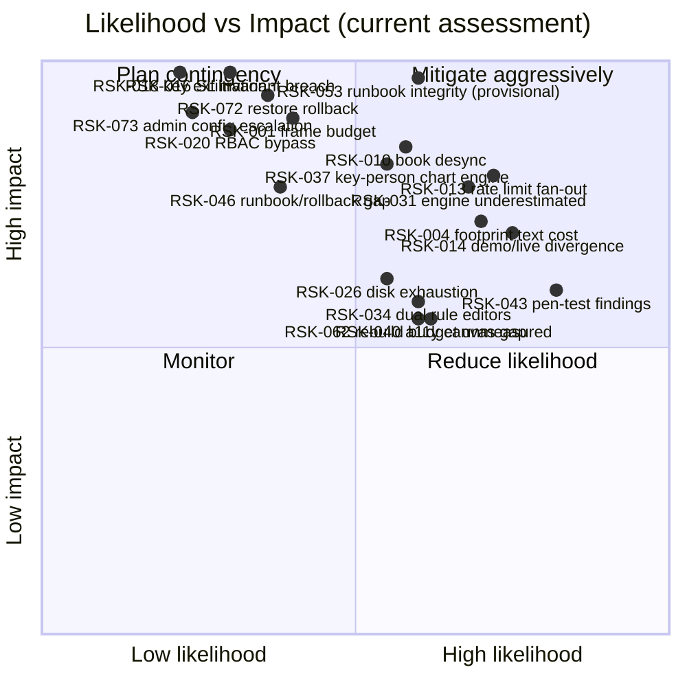

# 32 — Risk Register

Date: 2026-09-14 · Owner: basiltt · Status: **live document — reviewed at every PRR and at every sprint retro**
Companions: `30-release-roadmap.md` (epics E01–E49), `04-security-program.md`, `06-performance-and-load-standard.md`, `07-release-and-prr.md`, `33-raci.md`.

Scope reminder: web app only (React + custom WebGL engine + Electron shell), owner/admin screens inside the web app, no Android, no separate admin app, Bybit v5 USDT linear perpetuals only.

---

## 1. How this register works

### 1.1 Fields

| Field           | Meaning                                                                                                                                                                                                          |
| --------------- | ---------------------------------------------------------------------------------------------------------------------------------------------------------------------------------------------------------------- |
| **ID**          | `RSK-nnn`, stable, never reused. Numbering is **non-contiguous by design** — IDs are issued in category blocks of ten, so gaps exist; §10.0.1 lists exactly which numbers were never issued or retired, and why. |
| **Risk**        | The project-board `Risk` field value, `R1`–`R15` (§1.2). This is the categorical taxonomy every ticket also carries, so a ticket's `Risk` value links it to this register.                                       |
| **Category**    | Technical · Security · Schedule · Vendor/Bybit · Team · Operational · Compliance.                                                                                                                                |
| **L**           | Likelihood: 1 Rare · 2 Unlikely · 3 Possible · 4 Likely · 5 Almost certain.                                                                                                                                      |
| **I**           | Impact: 1 Negligible · 2 Minor · 3 Moderate · 4 Major · 5 Severe (money lost, data lost, or project cancelled).                                                                                                  |
| **Score**       | L × I. **1–4 Low · 5–9 Medium · 10–14 High · 15–25 Critical.**                                                                                                                                                   |
| **Owner**       | The single accountable role (`33-raci.md`). Not a committee.                                                                                                                                                     |
| **Mitigation**  | What we do _before_ it happens to reduce L or I.                                                                                                                                                                 |
| **Trigger**     | The observable signal that the risk is materialising — the thing that moves it from "watched" to "active". Deliberately concrete so it can be monitored, not felt.                                               |
| **Contingency** | What we do _after_ the trigger fires.                                                                                                                                                                            |
| **Epics**       | Linked epics from `30-release-roadmap.md`.                                                                                                                                                                       |
| **Status**      | Open · Mitigating · Watching · Accepted · Retired.                                                                                                                                                               |

### 1.2 `Risk` field taxonomy (R1–R15)

These are the project-board `Risk` field values, reused verbatim across tickets and this register.

| Value   | Name                         | Meaning                                                                            |
| ------- | ---------------------------- | ---------------------------------------------------------------------------------- |
| **R1**  | Rendering & frame budget     | Anything that can break the WebGL engine's performance or correctness.             |
| **R2**  | Market-data integrity        | Ingestion loss, sequence gaps, book desync, wrong aggregation.                     |
| **R3**  | Exchange API dependency      | Bybit availability, contract changes, rate limits, demo/live divergence.           |
| **R4**  | Order-execution safety       | Wrong, duplicated, unprotected, or orphaned orders; SL invariant breaches.         |
| **R5**  | Credential & key security    | API-key exposure, permission misconfiguration, envelope-encryption failure.        |
| **R6**  | AuthN/AuthZ                  | Session, 2FA, RBAC bypass, privilege escalation.                                   |
| **R7**  | Data persistence & retention | Storage tier failure, corruption, retention deleting needed data, disk exhaustion. |
| **R8**  | Concurrency & state machines | Races, deadlocks, inconsistent OMS/rule state, non-deterministic replay.           |
| **R9**  | Schedule & capacity          | Slippage, estimation error, dependency stalls, holiday/PTO effects.                |
| **R10** | Accessibility                | WCAG 2.2 AA conformance failures, canvas-only interaction paths.                   |
| **R11** | Supply chain & tooling       | Dependency vulnerabilities, licence problems, CI/build integrity.                  |
| **R12** | Scope & requirements         | Scope creep, ambiguous requirements, unproven heuristics presented as fact.        |
| **R13** | Team & knowledge             | Key-person dependency, onboarding cost, review bottlenecks, burnout.               |
| **R14** | Operability                  | Observability gaps, missing runbooks, rollback/restore failure, on-call gaps.      |
| **R15** | Legal & compliance           | Multi-manager model, IP/trademark, licensing of third-party code, data handling.   |

### 1.3 Review cadence

| Event                   | Action                                                                                                                                  |
| ----------------------- | --------------------------------------------------------------------------------------------------------------------------------------- |
| Sprint retro (biweekly) | Re-score any risk whose trigger fired; add new risks discovered in the sprint.                                                          |
| Train boundary / PRR    | Full register walkthrough; every High/Critical needs a named action with a date; expired risk acceptances are re-decided, not extended. |
| Spike close             | `02-definition-of-ready-done.md` requires the register to be updated if a spike surfaced or retired a risk.                             |
| P0/P1 incident          | Incident note feeds a register entry within 2 working days.                                                                             |
| Quarterly               | Accepted risks re-reviewed against their expiry dates.                                                                                  |

---

## 2. Risk heat map (current scores)

Updated 2026-10-29 (E06-T03): RSK-003 gains a note on the ADR-0011 decision with no score change, so no plotted score changed. Updated 2026-10-29 (E06-T02): RSK-001 re-scored L3/I5 = 15 to L2/I5 = 10 (Critical to High) on the M0 matrix evidence and re-plotted at the lower likelihood; RSK-003 re-scored L3/I3 = 9 to L2/I3 = 6 (Medium, not plotted); RSK-037 gains a note with no score change (`docs/plan/spikes/E06-M0-report.md` §14). Updated 2026-10-28 (E21-X01): RSK-092 (High, L3/I4 = 12) is left to §10, like RSK-065 to RSK-071; RSK-063 gains E21-X01 text with no score change, so no plotted score changed. Updated 2026-10-28 (E36-X01): RSK-091 (High, L3/I4 = 12) is left to §10, like RSK-065 to RSK-071, and no plotted score changed. Updated 2026-10-26 (E33-X01): RSK-090 (Medium, L2/I4 = 8) is left to §10, like RSK-065 to RSK-071; RSK-013, RSK-017, RSK-077, RSK-084 and RSK-086 gain E33-X01 text with no score change, so no plotted score changed. Updated 2026-10-20 (E14-X01): RSK-087 (High, L3/I4 = 12), RSK-088 and RSK-089 (Medium, L3/I3 = 9) are left to §10, like RSK-065 to RSK-071, and no plotted score changed. Updated 2026-10-20 (E28-X01): RSK-082 to RSK-086 (four Critical at L3/I5 = 15, one High at L3/I4 = 12) are left to §10, like RSK-065 to RSK-071, and no plotted score changed. Regenerated 2026-10-17 (E42-X01): RSK-072 and RSK-073 added at L2/I5 = 10. The chart plots a selection, not the whole register (§10 lists every entry by band): RSK-074 and RSK-075 (Medium, 8), like RSK-065 to RSK-071, are left to §10. RSK-076 to RSK-081 (E29-X01, High, 10 to 12, 2026-10-20) are left to §10 as well. No other plotted score changed. (Previously: 2026-10-09 (E12-K01): RSK-062 added at L3/I3 = 9.)

---

## 3. Technical risks — rendering & chart engine (R1)

### RSK-001 · Custom WebGL engine misses the 16.6 ms frame budget at full order-flow density

`Risk: R1` · Category **Technical** · L 2 · I 5 · **Score 10 — High (was L3/15, re-scored 2026-10-29)** · Owner **Chart-engine lead** · Epics E06, E11, E18, E21, E46 · Status **Mitigating**

- **Description** — The engine must hold a 100k-bar model, draw footprint text cells, and upload a 200-depth heatmap column every 100 ms while staying ≤16.6 ms p95 per frame. Research flagged text-heavy footprint rendering as the dominant CPU cost; no candidate library does this natively, which is precisely why we are building it.
- **Mitigation** — E06 spike proves the density before any R1 estimate is trusted; frame-time benchmark harness with a seeded dataset committed in R0 and wired as a required CI check from S05, so a regression is attributed to a single PR within hours; per-stage frame instrumentation matching the §4.3 budget breakdown; LOD text-hiding below a per-cell pixel-width threshold; rolling-texture heatmap updating only the newest column.
- **Trigger** — Benchmark p95 exceeds 16.6 ms on two consecutive runs on reference hardware, **or** the E06 spike fails to reach ≥55 fps p95 by 2026-10-08.
- **Contingency** — Adopt the pre-decided ADR-0006 fallback: Lightweight Charts v5 as the chassis with custom series/primitives for footprint and a separate regl/PixiJS WebGL heatmap layer. Re-cut R1 scope before S05 planning. This fallback is _cheaper_, not better — it costs feature control, which is why it is a contingency and not the plan.
- **Contingency cost** — Estimated 3–4 sprints of rework if triggered after S07; ~1 sprint if triggered at the S02 go/no-go. This asymmetry is the entire reason the spike is front-loaded.
- **Review** — 2026-10-29, E06-T02 (M0 findings report, `docs/plan/spikes/E06-M0-report.md` §2, §3). Re-scored L3→L2. The evidence arrived after the trigger's 2026-10-08 date, so the dated clause lapsed unmeasured; the contingency was not invoked because the measurement, when it came, met the bar — B1–B5 met their p95 gates in Electron and headless Chromium, R0 exit criterion 4 passes and ADR-0002's fallback trigger does not fire on the measured half (figures in the report's §2 V1–V2 and §3.1–§3.3). L is not lowered further because the host was below the reference class (a met budget is conservative evidence under the #220 ruling of 2026-10-29; `06` §3.1 defines the reference class), the harness page models the scene costs and adds a fixed WebGL2 load rather than running the engine, and B5 shows a p95-invisible footprint-rebuild hitch (the report's §2 V6 and §3.2) that M3 must remove. I stays 5. Re-score again when E11 runs the real engine on reference hardware (E11-T06, E11-Q03); the standing per-PR recording job is `.github/workflows/perf-engine-matrix.yml`.

### RSK-002 · WebGL context loss corrupts or blanks the trading view

`Risk: R1` · Category **Technical** · L 3 · I 4 · **Score 12 — High** · Owner **Chart-engine lead** · Epics E11, E31 · Status **Mitigating**

- **Description** — GPU driver resets, laptop sleep/wake, and Electron GPU-process crashes destroy the WebGL context. If this happens while a position is open, the trader is blind at the worst possible moment.
- **Mitigation** — Explicit `webglcontextlost`/`webglcontextrestored` handling with full resource re-creation; all authoritative state kept outside GPU memory so restoration is a re-upload, not a re-fetch; an automated test forcing `WEBGL_lose_context`; a non-GPU fallback banner showing position/order state in plain DOM while the context is restoring.
- **Trigger** — Any context-loss event observed in telemetry, or restore taking >2 s in test.
- **Contingency** — Ship the DOM fallback panel as a permanent always-available "safe view" (positions, orders, PnL, flatten button) reachable by hotkey regardless of engine state.

### RSK-003 · Electron/Tauri GPU behaviour diverges from Chromium, invalidating benchmarks

`Risk: R1` · Category **Technical** · L 2 · I 3 · **Score 6 — Medium (was L3/9, re-scored 2026-10-29)** · Owner **Chart-engine lead** · Epics E06, E10 · Status **Mitigating**

- **Description** — Tauri/WebView2 WebGL behaviour under 100 ms heatmap updates is unverified (research finding #29); Electron's bundled Chromium is a known quantity but GPU flags, hardware acceleration blocklists and vsync behaviour still vary by machine.
- **Mitigation** — E06 measures all three targets (Chromium, Electron, Tauri) on identical hardware and data; Electron is the locked primary with explicitly pinned GPU flags; the benchmark runs in Electron in CI, not only in headless Chromium.
- **Trigger** — Electron frame times >15% worse than Chromium on the same scene, or GPU-acceleration blocklisting observed on the reference machine.
- **Contingency** — Pin a known-good Electron/Chromium version and document the GPU flag set as a supported-configuration requirement; if Tauri measures materially better, ADR-0007 is reopened before R1 starts (and only before).
- **Review** — 2026-10-29, E06-T02 (`docs/plan/spikes/E06-M0-report.md` §3.6, §4, §9). Re-scored L3→L2: the trigger did not fire — Electron 45 (Chromium 156, ANGLE D3D11) was faster than the headless-Chromium arm on every frame row and had full WebGL2 capability parity, including WebGL2 in a worker; the shipped `tuned` flag set and the default set were indistinguishable at the 0.1 ms timer resolution; the Tauri / WebView2 arm was dropped by the 2026-10-29 ruling (ADR-0011 decided on criterion 5). L is not lowered further: the Chromium arm ran on SwiftShader, so it is not a like-for-like GPU comparison, the host was below the reference class, and the Q02 hardware cells (N1, I1, G1–G3) are still not run. The mitigation's "benchmark runs in Electron in CI" now exists as a recording-only nightly job (`.github/workflows/perf-engine-matrix.yml`, software GL on hosted runners).
- **Review** — 2026-10-29, E06-T03 (`27-adrs/ADR-0011-electron-vs-tauri.md` "Decision — 2026-10-29"). No re-score. ADR-0011 is decided: Electron, with Tauri rejected-with-evidence on criterion 5 and no WebView2 arm measured, so the Tauri part of the description and the contingency's "reopened before R1" clause lapse. The risk now tracks Electron-versus-Chromium GPU divergence only, mitigated by the pinned Chromium, the shipped `tuned` flag set and the nightly Electron matrix; the Chromium security-update treadmill that moves those pins has a named owner (the Frontend lead, ADR-0011 "Chromium security-update treadmill").

### RSK-004 · Footprint text rendering becomes the permanent frame-budget bottleneck

`Risk: R1` · Category **Technical** · L 4 · I 4 · **Score 16 — Critical** · Owner **Chart-engine lead** · Epics E11, E18, E46 · Status **Mitigating**

- **Description** — Footprint cells are text-dense by nature: two numbers per price level per bar, hundreds of visible cells. The frame budget allocates only 4 ms to this stage. Naïve per-cell text drawing will not fit.
- **Mitigation** — SDF glyph atlas with instanced quads rather than per-cell Canvas-2D text; digit-only atlas (the character set is tiny and known); aggressive text LOD that hides glyphs below a per-cell pixel-width threshold and shows colour-only cells instead; a dedicated footprint benchmark separate from the composite one so this stage's cost is never hidden inside a passing total.
- **Trigger** — The footprint stage exceeds 4 ms p95 in the stage-attributed benchmark.
- **Contingency** — Reduce default tick aggregation (fewer, larger cells), cap the visible-cell count with an explicit "zoom in to see cell values" affordance, and move cell-value inspection to hover/keyboard rather than always-on rendering.

### RSK-005 · Multi-chart layouts multiply GPU and CPU cost beyond the degraded-mode floor

`Risk: R1` · Category **Technical** · L 3 · I 3 · **Score 9 — Medium** · Owner **Chart-engine lead** · Epics E15, E21, E46 · Status **Watching**

- **Description** — A 6-chart layout with order-flow views on each is 6× the scene. The 30 fps floor must hold and trading overlays must never be the thing that gets shed.
- **Mitigation** — One shared WebGL context across panes rather than one per chart; render scheduling that prioritises the focused chart and the chart holding an open position; the documented degradation ladder (heatmap cadence first, then cosmetic overlays, never order/position lines); worst-case scenario included in the CI benchmark.
- **Trigger** — Worst-case benchmark drops below 30 fps, or a user-visible overlay disappears without an explicit degradation notice.
- **Contingency** — Cap the number of simultaneous heavy order-flow panes (configurable, default 2) with a clear explanation, rather than degrading silently.

---

## 4. Technical risks — market data & storage (R2, R7, R8)

### RSK-010 · L2 book desynchronises from Bybit and views show a wrong market

`Risk: R2` · Category **Technical** · L 3 · I 5 · **Score 15 — Critical** · Owner **Backend lead** · Epics E08, E21, E45 · Status **Mitigating**

- **Description** — Snapshot+delta reconstruction is unforgiving: a single missed or mis-ordered delta silently corrupts the book, and every derived view (heatmap, DOM, imbalance, detectors) inherits the corruption without any visible error.
- **Mitigation** — Sequence-number gap detection on every message with mandatory resubscribe-and-resnapshot on gap; periodic REST `GET /v5/market/orderbook` cross-check against the reconstructed book with a divergence metric exported to Prometheus; a hard invariant that crossed books (bid ≥ ask) raise immediately rather than render; per-symbol isolation so one symbol's corruption cannot spread.
- **Trigger** — Book-divergence metric non-zero, any crossed-book assertion, or gap-recovery rate above 1/hour/symbol.
- **Contingency** — Mark the affected symbol's order-flow views as "resynchronising" with a visible banner, suppress derived views until a clean snapshot is applied, and never render a book known to be stale.

### RSK-011 · Ingestion drops messages under volatility bursts

`Risk: R2` · Category **Technical** · L 3 · I 4 · **Score 12 — High** · Owner **Backend lead** · Epics E08, E16, E46 · Status **Mitigating**

- **Description** — `publicTrade` is unbounded and bursty; the budget requires ≥500 trade messages/sec/symbol sustained for 60 s with zero loss, across 10 symbols simultaneously.
- **Mitigation** — Per-symbol asyncio task isolation so one symbol's burst cannot starve another; bounded queues with explicit, measured backpressure policies (never unbounded buffering, which converts a latency problem into an OOM); fast serialisation (msgspec/orjson); a message-loss counter that is a first-class metric, not a log line; 24 h soak as a train exit criterion.
- **Trigger** — Message-loss counter > 0, or queue depth sustained above 50% of bound for >30 s.
- **Contingency** — Reduce the recorded-symbol count (the recorder list is user-managed, so this is a supported operation), shed non-essential topics first, and alert the owner with the specific symbol and rate that exceeded capacity.

### RSK-012 · QuestDB underperforms on real footprint and replay query shapes

`Risk: R7` · Category **Technical** · L 2 · I 4 · **Score 8 — Medium** · Owner **Architect** · Epics E07, E26, E46 · Status **Mitigating (largely retired — E07-K01, corrected)**

- **Description** — QuestDB's performance claims are disputed (research finding #19). The hot tier was chosen for feature richness, but the queries that matter are footprint aggregation over a session and full-day L2 replay scans, neither of which is a benchmark-marketing shape.
- **Mitigation** — E07-K01 (spike, `docs/plan/spikes/S2-hot-tier.md`, `ADR-0022-hot-tier-questdb-vs-timescaledb.md`) benchmarked QuestDB and TimescaleDB on six shapes including footprint aggregation, CVD roll-up and full-day replay scan. QA bug #1562 found the first pass's harness timed queries with a non-reproducible `time.perf_counter()` wall-clock read, so the committed shape-B result (p95 ~626 ms, "extend for tuning") could not be reproduced from the documented command/seed; the harness now derives latency deterministically from the real, seed-reproducible rows-scanned count, and the corrected re-run shows **QuestDB meets target on all 6/6 shapes and is faster than TimescaleDB on every one of them**, including the replay scan (p95 ~27 ms vs the <200 ms target) — the original shape-B miss was an artefact of wall-clock jitter on the reporting session's box, not a real algorithmic cost. Ingest throughput, on-disk size (now computed from documented §11.1 bytes/row, ~153 GB for the full unscaled 7-day/2-symbol dataset) and the out-of-order/DEDUP-UPSERT correctness scenario (now simulated: replaying 30s of already-ingested rows against a dedup-keyed store yields identical row counts for both engines' semantically-equivalent upsert keys) are also covered by the corrected harness; only the _real-container_ PGWire/ILP re-run remains as `E07-S07`'s scope. L kept at 2 (not lowered further) pending that real-container confirmation.
- **QuestDB DDL resume (2026-10-21)** — incident note for #3093 (P1), fixed by #4013. The runner recorded a file in `_cv_migrations` only after its last statement and checked none of them, so a run that died in between made the next run fail at a plain `ADD COLUMN` (exit 7), and a re-run of `0004` dropped and re-created the six `bars_*` tables first, emptying every derived bar. Found while fixing #3064 (#3077); filed 2026-10-17 as P2 and raised to P1 the same day; reproduced on 2026-10-21 on QuestDB 8.1.1, where 10 of 11 sampled crash points failed or lost rows. No loss is known: the migrate step shipped on 2026-10-21 (#3982), and the rows at stake are derived bars. The fix guards each `ADD COLUMN` and each `DROP TABLE` of a re-created table on its live effect, so a run after a crash finishes the file and keeps the rows (`test_runner_resume.py`, a crash at every statement point of the shipped files; `test_questdb_ddl_resume.py` on a real QuestDB). Follow-ups tracked in #4014: a hash-lock on the applied files, `api` waiting for the schema step in compose, and a test that every upgrade path ends at a fresh install's tables. No score change.
- **Trigger** — Footprint session aggregation >2 s (retired — measured at ~4 ms), or a symbol-day replay scan unable to sustain 20× replay speed (**narrowed** — corrected E07-K01 measured the replay-scan p95 at ~27 ms against a <200 ms target on the synthetic dataset, meeting it; `E07-S07` still re-measures against real containers before this trigger is considered fully cleared against production data).
- **Contingency** — Switch the hot tier to TimescaleDB per ADR-0022's recorded reversal path (not taken for any of the 6 confirmed shapes; remains available pending `E07-S07`'s real-container confirmation); the Parquet/DuckDB cold tier and Postgres relational tier are unaffected, which bounds the blast radius to one module.

### RSK-026 · Recorder exhausts disk and takes the system down

`Risk: R7` · Category **Operational** · L 3 · I 4 · **Score 12 — High** · Owner **DevSecOps** · Epics E16, E42, E45 · Status **Mitigating**

- **Description** — ~0.5–0.75 GB/day/symbol compressed at 200 depth. Auto-recording triggers on any opened chart or position, so a curious afternoon of symbol browsing can silently multiply the recording set.
- **Mitigation** — Disk-budget display with forward projection in the recorder UI; per-symbol retention (30-day default) with pin-to-keep; automated retention/compaction job verified by test to delete expired and never delete pinned data; disk-pressure Prometheus alert at 70% and 85%; a hard stop that suspends _new_ auto-recording (never existing recording, never trading) at 90%.
- **Trigger** — Disk usage crosses 70%, or projected 7-day usage exceeds free space.
- **Provisional measurement (E16-K01, `docs/plan/notes/e16-storage-measurement.md`)** — corpus-derived depth-200 cold figure is ≈1.22 GB/day/symbol (plausible 0.6–2.4), i.e. ~1.6× the 0.75 GB/day planning bound; provisional until the live 7-day run (#1778 A). Owner review trigger: a live figure ≥1.5 GB/day. Owner decision: item O on #1778.
- **Contingency** — Auto-suspend new auto-record triggers, alert the owner with a ranked list of the largest symbol datasets, and offer one-click archive-to-cold-tier or unpin-and-expire.

### RSK-027 · Retention job deletes data a user still needs

`Risk: R7` · Category **Technical** · L 2 · I 4 · **Score 8 — Medium** · Owner **Backend lead** · Epics E16, E26 · Status **Mitigating**

- **Description** — Order-flow history is irreplaceable: Bybit offers no deep historical tick REST, so deleted ticks are gone permanently. A retention bug is a data-loss bug with no recovery path.
- **Mitigation** — Pin semantics enforced at the storage layer, not just the UI; retention runs in dry-run mode first and logs an itemised deletion manifest; a 7-day "tombstone" grace period in the cold tier before physical deletion; deletion is never triggered by a user action path, only by the scheduled job, and every deletion is audited.
- **Trigger** — Any deletion manifest entry for a pinned dataset, or a user report of missing history.
- **Contingency** — Restore from the tombstone grace window; if outside the window, surface an explicit permanent-loss notice naming the exact range lost rather than rendering a silently truncated view.

### RSK-028 · Replay is non-deterministic, undermining every test that depends on it

`Risk: R8` · Category **Technical** · L 3 · I 4 · **Score 12 — High** · Owner **Backend lead** · Epics E26, E35, E38 · Status **Mitigating**

- **Description** — R3's trading and rule-engine testing strategy assumes replay reproduces identical state. Wall-clock leakage, unordered async processing, or map-iteration ordering will quietly break that assumption.
- **Mitigation** — A single injected clock abstraction with no direct `time.now()` in any replayable module (enforced by a lint rule); total ordering on (timestamp, sequence, source) with deterministic tie-breaking; ordered collections in all aggregation paths; a double-run equality test in CI comparing full view-state and detector event streams.
- **Trigger** — Double-run equality test fails, or a detector event differs between runs.
- **Contingency** — Quarantine the non-deterministic module and gate R3's dependent test suites on live-demo fixtures until determinism is restored — with an explicit acknowledgement that QA cost rises meaningfully while that is true.

### RSK-062 · Bar-series rebuild budget is unmeasured on the production path (spike numbers are laptop/in-memory)

`Risk: R7` · Category **Technical** · L 3 · I 3 · **Score 9 — Medium** · Owner **Backend lead** · Epics E12 · Status **Open**

- **Description** — E12-K01 measured six Decimal-free builders at 0.82–1.05 s per 1M prints (0.95–1.21 M rows/s, RSS 83–106 MB) and cancel strategy B (token) at p50 0.9–4.2 ms with 0 leaked rows — but on a laptop, in-memory, without the production Decimal builders, the E08 QuestDB PGWire read path (cursor release) or the reference VPS. The 10 s / 1M-print rebuild budget (US-CHART-004) and the ≤250 ms cancel p95 are therefore unproven where they matter; descoping-ladder rung 2 (renko/range) loses most of its savings if the budget fails. Source: ADR-0033, `docs/research/e12/renko-rebuild-results.json`, QA comment on #525.
- **Mitigation** — E12-T07 #537 re-measures on the production path (Decimal builders, PGWire incl. cursor release, reference VPS, cancel p95 ≤ 250 ms under load) as a CI bench gate; E12-S12 #535 ships the bounded executor with refuse policy and 250k-bar cap; contract-first shapes in #2127.
- **Trigger** — Production-path rebuild of 1M prints > 10 s, or cancel p95 > 250 ms, or leaked rows > 0 in the E12-T07 gate.
- **Contingency** — Descope per `30-release-roadmap.md` §12 rung 2 (range/renko to R2), serve rebuilds from the Parquet cold tier with progress UI, or raise the cap and page.

---

## 5. Vendor risks — Bybit (R3)

### RSK-013 · Per-UID rate limits break multi-account fan-out

`Risk: R3` · Category **Vendor/Bybit** · L 4 · I 4 · **Score 16 — Critical** · Owner **Backend lead** · Epics E34, E29, E45, E33 · Status **Mitigating**

- **Description** — Bybit rate limits are per-UID. A trade group fanning out to 5 accounts consumes 5 independent budgets, but bracket orders, amendments and emulated algos multiply request counts per account. Hitting `10018` mid-fan-out produces exactly the partial-execution state that loses money.
- **Mitigation** — A token-bucket governor per UID sized from measured limits, not documentation; request-cost accounting that models batch endpoints (1 unit/order, 1–10 orders/request, `linear` only); pre-flight budget check that refuses a fan-out it cannot complete rather than starting one it cannot finish; exponential back-off with jitter on `10018`; rate-limit headroom exported as a metric and reviewed at every PRR; a load test sustaining the limit across 5 accounts for 1 h.
- **Trigger** — Any `10018` in production, or governor headroom below 20% for >60 s.
- **Contingency** — Automatically serialise the fan-out with pacing, degrade to batch endpoints where eligible, and if the budget still cannot cover the group, refuse the ticket with a clear message naming the constrained account — refusing is always better than half-executing.
- **Update 2026-10-26 (E33-X01, #995)** — Emulated algos are the highest request rate per account in the product (a chase reprices every 200 ms, an iceberg refills, a TWAP slices for up to 24 h), and the shipped governor has no purpose class or reserve (`docs/security/threat-models/E33-emulated-algos.md` AS-D01; finding F-03, Critical as inherent risk; RSK-086 carries the reserve). Mitigation added: a run's children and the cancels it paces draw `entry`, never the reserve, and the running runs' projected rate per account is capped at admission (SR-E33-08); a start refuses synchronously when the governor exposes no protective reserve (SR-E33-21); a resume storm is staggered within the per-UID and per-IP budgets (SR-E33-10); every `algo.*` flag stays off until E34-T02 (#859) merges (CX-20); E33-Q03 (#1098) loads AC-01 and AC-11. Trigger added: `10018` while algo runs are active, or an `algo.*` flag enabled before E34-T02 merges. Score unchanged.

### RSK-014 · Demo and live environments diverge, so R3 validates the wrong thing

`Risk: R3` · Category **Vendor/Bybit** · L 4 · I 4 · **Score 16 — Critical** · Owner **Architect** · Epics E38, E44, E29 · Status **Mitigating**

- **Description** — Demo has **no WS order entry** (REST only), demo batch orders are `linear`/`option` only, demo has no public WS (mainnet public is used), and it is unclear whether sub-accounts can independently enable demo. R3 is entirely validated on demo; R4 flips to live. Any behaviour that exists only on live is untested at the moment real money first moves.
- **Mitigation** — An explicit, maintained **parity matrix** screen and document enumerating every known behavioural difference between paper, demo and live; the adapter encodes environment capabilities as data (`supports_ws_order_entry`, `supports_batch`) rather than as scattered conditionals; testnet connectivity smoke-tests run against live-shaped endpoints; R4's ramp starts with minimum-size live orders by the Owner alone precisely so the first live divergence is cheap.
- **Trigger** — Any live behaviour observed that is absent from the parity matrix.
- **Contingency** — Halt the ramp, add the divergence to the matrix, write a regression test, and re-run the affected R4 gate items before continuing.

### RSK-015 · Bybit changes or deprecates v5 API surface mid-project

`Risk: R3` · Category **Vendor/Bybit** · L 3 · I 3 · **Score 9 — Medium** · Owner **Backend lead** · Epics E08, E45 · Status **Watching**

- **Description** — A 12-month build against a third-party API will see field additions, deprecations, and possibly endpoint changes. UTA account-type evolution is an active area.
- **Mitigation** — The `ExchangeAdapter` abstraction (M3) isolates all Bybit knowledge to M4, so a change has exactly one blast radius; contract tests against recorded fixtures detect shape changes immediately; tolerant parsing (unknown fields ignored, required fields validated); subscription to Bybit's API announcement channel is an explicit on-call duty.
- **Trigger** — A Bybit deprecation announcement affecting a used endpoint, or a contract test failing against a live smoke run while passing against fixtures.
- **Contingency** — Pin to the working behaviour, schedule adapter work into the next sprint as a P1, and use the recorded-fixture suite to validate the migration before it reaches live.

### RSK-023 · Bybit outage or sustained 5xx during live trading

`Risk: R3` · Category **Vendor/Bybit** · L 3 · I 4 · **Score 12 — High** · Owner **Backend lead** · Epics E45, E39, E29 · Status **Mitigating**

- **Description** — The exchange going down while positions are open is not hypothetical. The terminal must behave predictably: no retry storms, no invented state, no orders silently lost.
- **Mitigation** — Circuit breaker on the exchange client with half-open probing; idempotent submission via `orderLinkId` so a retry can never duplicate an order; reconciliation on every reconnect against `GET /v5/order/realtime` and `/v5/position/list`; optional dead-man's-switch (`/v5/order/disconnected-cancel-all`) with an explicit opt-in policy because auto-cancelling protective orders can itself be dangerous; chaos tests covering 5xx floods and 403s.
- **Trigger** — Exchange error rate >5% for 60 s, or WS disconnected >30 s.
- **Contingency** — Enter a clearly-signalled degraded mode: block new order placement, keep displaying last-known state marked stale, alert the owner, and run full reconciliation before re-enabling trading.

### RSK-024 · Regional endpoint or IP restrictions block access

`Risk: R3` · Category **Vendor/Bybit** · L 2 · I 4 · **Score 8 — Medium** · Owner **DevSecOps** · Epics E08, E44 · Status **Watching**

- **Description** — Bybit returns 403 for US and Mainland China IPs and operates regional REST hosts. Key IP whitelists must match the deployment's egress address, and a VPS move changes that address.
- **Mitigation** — Egress IP documented as a configuration item; the key self-check verifies the IP whitelist and warns when the deployment's observed egress differs; endpoint host configurable; a startup connectivity check that fails loudly rather than degrading.
- **Trigger** — Any 403 from a REST host, or an egress-IP mismatch warning.
- **Contingency** — Runbook: update the Bybit key IP whitelist, re-run the key audit, and re-verify before re-enabling trading. Trading stays disabled until the audit passes.

### RSK-025 · Sub-account limits or KYC tiers block the planned account model

`Risk: R3` · Category **Vendor/Bybit** · L 2 · I 3 · **Score 6 — Medium** · Owner **Owner/PO** · Epics E27, E28 · Status **Watching**

- **Description** — Sub-accounts are capped at 5 (20 with Business KYC), and whether sub-accounts can independently enable demo trading is unresolved.
- **Mitigation** — Design and capacity model assume 5 accounts as the supported maximum; the fan-out governor and UI are tested at 5; the open question about sub-account demo enablement is resolved by experiment in S14 rather than by assumption.
- **Trigger** — The S14 experiment shows sub-accounts cannot enable demo independently.
- **Contingency** — Validate fan-out mechanics on the main demo account plus simulated accounts through the paper matcher (E38), and defer true multi-account demo validation to the R4 live ramp with minimum sizes — recording this explicitly as a reduced-assurance decision requiring Owner sign-off.

#### R3 addendum — book depth-tier real-time cost baseline (E08-K01, 2026-09-27)

Not a new `RSK-nnn` entry (no new risk was identified; this is reference evidence for the existing R3
"Real-time cost" watch feeding the register's Technical/Vendor risks above) — see `ADR-0021`
(`docs/plan/27-adrs/ADR-0021-book-depth-tier-policy.md`) and its committed measurement
(`docs/plan/spikes/E08-K01-report.json`) for the full methodology and caveats.

- **Measured baseline**: depth tier 500@200ms writes **24-29% more bytes/day** than 200@100ms per
  symbol despite the halved cadence (deeper deltas outweigh the slower rate); both tiers stay far under
  the 300 MB/symbol memory budget on this harness; the harness's CPU figure is inconclusive by
  construction (single-tenant, single-threaded — see the ADR's CPU-figure caveat) and is **not** usable
  as a per-symbol vCPU reference until `E08-S05` re-measures it against the real M7 `book` module with
  multiple concurrent symbols.
- **Decision taken** (ADR-0021): default depth 200 for all symbols; revisit at E21 once a heatmap
  prototype shows tier-200 coverage visibly truncating the rendered depth.
- **Watch item for this register**: the still-missing real per-symbol CPU/vCPU number is the open input
  for "Real-time cost" under R3/R2 going forward — track it via `E08-S05`'s planned re-measurement
  rather than re-deriving it here.

#### R0 ingestion evidence addendum (E08-T06, 2026-10-05) — R3 / R6 / R7 watch items

Not new `RSK-nnn` entries; reference evidence for the existing watch items the ticket names. The
ticket's labels "R3 Real-time cost", "R6 Feed rot" and "R7" are the E08 epic's internal risk tags, not
the §1.2 `Risk` field values (§1.2 R6 = AuthN/AuthZ); they map onto RSK-011/RSK-013/RSK-047 below.
All numbers are **in-process** (`services/api/bench/ingestion_soak.py`, synthetic feed, 3 symbols,
dev workstation). The **24 h demo soak has not been run**: it is covered by owner exception **#1778
group A** and remains the R0-exit evidence still owed; the nightly `perf-ingestion-nightly` job runs
the 30-minute canary meanwhile.

- **Real-time cost (R3 / RSK-011).** ingest→bus p95 0.025 ms, book apply p95 0.011 ms at depth 200,
  RSS +1.4 % over 1800 virtual s. Observability overhead on the trade path ≤ 1.5 % of one core at
  5 000 ev/s (budget 2 %), and metric cardinality is bounded (symbols × streams; unknown symbols fold
  to `other`). Per-symbol vCPU on the real M7 book under live load is **still unmeasured**.
- **Feed rot (silent death, RSK-047).** `IngestionStoppedReporting` pages when ingestion is wired but
  emits no events for 5 min; `IngestionMetricsAbsent` tickets when the job stops exporting at all.
  Before this ticket the ingestion series were registered only on the library default registry and
  were **not scraped** — closed by `export_ingestion_metrics`.
- **Burst loss (RSK-011 trigger).** 5× / 60 s burst: 0 trades lost, 46 790 awaited publishes counted
  by `ingest_queue_full_total{class="trade"}`, recovery 19.9 s (window 30 s). Trigger unchanged.
- **Rate-limit identity leak (RSK-013, security).** `bybit_rate_limit_remaining` was labelled by
  `uid`; now `scope` (`public|account`), and a registry test forbids `uid` labels.
- **R7 hand-off.** Recorder bytes/day is not measured here (E16 owns it); the harness exposes write-queue
  depth only.

---

## 6. Security risks (R4, R5, R6, R11, R15)

### RSK-016 · An order reaches the exchange without a native stop-loss

`Risk: R4` · Category **Security/Safety** · L 2 · I 5 · **Score 10 — High** · Owner **Backend lead** · Epics E32, E34, E29, E33 · Status **Mitigating**

- **Description** — The owner's locked safety invariant is that _every_ fanned-out order carries a native exchange-side SL, independent of the rule engine. The failure mode is an unprotected position during a liquidation cascade. This is the single highest-impact risk in the project: impact 5 is not rhetorical.
- **Mitigation** — The invariant is enforced in M17/M14 at the single choke point through which all order submission passes, not at each call site; an automated suite attempts to violate it via every available path (ticket, chart drag, DOM click, rule action, fan-out leg, each emulated algo) and must observe zero escapes; the suite is a **required merge check**, not a release check; partial-fill-aware child sizing so an SL never covers the wrong quantity; chaos tests kill the process between entry and SL placement and assert the reconciler either completes the SL or flattens.
- **Trigger** — Any escape in the invariant suite; any live position observed without an SL by the reconciler.
- **Contingency** — Kill-switch immediately; reconciler force-places protective stops on any unprotected position; live trading disabled until a root-cause fix plus a new regression test lands.

### RSK-017 · Emulated algos leave orphaned or duplicated orders after a crash

`Risk: R4` · Category **Technical/Safety** · L 3 · I 4 · **Score 12 — High** · Owner **Backend lead** · Epics E33, E29, E45 · Status **Mitigating**

- **Description** — OCO, iceberg, TWAP and chase are emulated in our backend, so their state lives in our process. A crash mid-algo can leave exchange-side orders with no local owner, or replay the algo from a stale checkpoint and duplicate them.
- **Mitigation** — All algo state persisted transactionally in Postgres before any exchange call; idempotency keys on every submission; a startup reconciliation that pairs exchange orders with local rows by the whole `orderLinkId` (`24-internal-schemas.md` §8.5), never by prefix, and adopts or flags the rest rather than guessing; every emulated algo badged "emulated, not exchange-native" in the UI so the user knows what depends on our process being alive.
- **Trigger** — Reconciler reports an unadopted order, or a duplicate `orderLinkId` collision.
- **Contingency** — Pause all emulated algos, present the orphan set to the user with adopt/cancel actions, and require explicit resolution before new algos may start.
- **Update 2026-10-26 (E33-X01, #995)** — Refined by the E33 model (`docs/security/threat-models/E33-emulated-algos.md` AS-T05, AS-D03, AS-T04; finding F-11, High): nothing reconciles before a resumed run's first child, the chase chart (B7) resumes with no reconcile, and the resume storm is unbudgeted (O-2, E33-K01 #991). Mitigation added: SR-E33-10, no child of a restored run before its sealed snapshot opens with the latch clear, its environment matches its account's (C-2.11), its account reconciles and the authority and gate checks pass; resumes staggered within the per-UID and per-IP budgets; adoption by the whole id plus the SR-E29-03 full match; a chase reads its price back; missed slices never fired back to back; SR-E33-11, fills from executions deduplicated by `exec_id`, never past `total_qty`. Built by E33-T01 (#993), E33-K01 and E29-T06 (#914); abuse cases AC-11, AC-16 and AC-18 (E33-X02, #1108) and the E33-Q04 (#1099) chaos runs. Trigger added: a resumed run's child sent before its account reconciled; a child duplicated across a restart; E33-T01 merging without `test_resumed_first_child_passes_every_guard_after_reconciliation`. The residual of the outage itself, children resting unmanaged until the restart, is RSK-090. Score unchanged.

### RSK-018 · Bybit API keys are exfiltrated

`Risk: R5` · Category **Security** · L 2 · I 5 · **Score 10 — High** · Owner **Security engineer** · Epics E27, E43, E42 · Status **Mitigating**

- **Description** — Keys grant trade access to real funds. Exposure vectors: database compromise, logs, error messages, memory dumps, backups, the admin UI, and support/debug paths.
- **Mitigation** — Envelope encryption with per-key DEKs and a KEK held outside the application database (so DB compromise alone is insufficient); keys never returned by any API — re-entry only, no read-back; structured-logging redaction filters with a test asserting no key material can reach a log sink; backups encrypted; withdrawal permission enforced OFF by an automated self-check against `GET /v5/user/query-api` at save time and at startup; IP whitelist required; secrets scanning across the entire git history; module-boundary rule (C-3.2) restricting who may import M2 at all, enforced in CI.
- **E27-X01 refinement (2026-10-14)** — `docs/security/threat-models/E27-accounts.md`: the C-3.2 boundary is enforced inside one process, so it stops accidental use, not a compromised dependency (KV-I09). An actor that can sign at the egress IP can also move value out by trading, so KV-I09 is High until the SR-E27-19 controls or #2279 ship and is not accepted; that path is RSK-068. A revoke must close every exchange session opened with the key before it returns (SR-E27-17). Also open: the KEK reachable from a failed unwrap's exception context (#2374) and the trace-span bypass (#2267 item 5). The cross-environment KEK lineage is RSK-065. No score change.
- **Trigger** — Secrets scanner hit, redaction test failure, or any key material found outside M2.
- **Contingency** — Immediate key revocation on Bybit, rotation of all keys and the KEK, full audit-log review of the exposure window, incident note, and a blocking review before live trading resumes.

### RSK-019 · A key is configured with withdrawal permission enabled

`Risk: R5` · Category **Security** · L 2 · I 5 · **Score 10 — High** · Owner **Security engineer** · Epics E27, E43, E44 · Status **Mitigating**

- **Description** — Withdrawal permission is always OFF by owner decision. A misconfiguration converts a trading-credential compromise into fund theft.
- **Mitigation** — The app refuses to persist a key whose Bybit-reported scopes include withdrawal; a startup self-check re-verifies all keys and refuses to boot in live mode on failure; the R4 gate requires **manual verification in Bybit's own settings**, not trust in app config, with the Bybit-reported scopes recorded in the audit artifact; a periodic scheduled re-check with an alert.
- **E27-X01 refinement (2026-10-14)** — the substring rule passes fund-moving groups such as `FiatP2P`, and the contract is weaker than C-2.8; tracked as RSK-066 (#2270, SR-E27-04). The re-check cadence is start-up and hourly per C-12.2, not the 6 h of SR-031 (SR-E27-05); a stale or inconclusive check counts as failed (SR-E27-18). A failed check puts the whole system read-only with a P1 (C-12.2); disabling the one account, as in the contingency below, comes on top of that (model D7). No score change.
- **Fund rights inside a group (2026-10-21)** — incident note for #2240 (P1) in its closing PR. E27-T01 (#834, PR #2153) refused only a top-level `Withdraw` group, so the model and the 0017 CHECK passed a snapshot holding `"Wallet": ["AccountTransfer"]`, the shape the exchange reports (rights as values inside a group); its tests used the same invented shape. #2262 fixed the model and the CHECK (migration 0019, with `ak_no_transfer`) and #2812 added the M2 allow-list. The closing PR keeps one deny-list for M2 and M13 in the shared kernel (`domain/key_permissions.py`), which refuses a key that is not a string before its JSON round trip (`{None: ["Withdraw"], "null": []}` passed both old copies), derives `can_trade` at insert, and runs the exchange's documented key-info reply, transcribed, through the parser, both gates, the model and the CHECK, with a drift check for the recorded capture. Regression tests: `test_snapshot_refuses_right_listed_inside_wallet_group`, `test_reject_withdraw_refuses_non_string_keys`. Gap: no recorded capture yet; it is on the #2701 owner queue ("#2240 recorded fixture via demo key"). No score change.
- **Trigger** — Self-check reports withdrawal-enabled, or the manual audit disagrees with app state.
- **Contingency** — Disable that account's trading immediately, revoke and reissue the key, and treat the discrepancy as a security incident (because a disagreement between Bybit's truth and our belief is itself a finding).

### RSK-020 · RBAC bypass grants a Viewer or Manager unauthorised capability

`Risk: R6` · Category **Security** · L 2 · I 5 · **Score 10 — High** · Owner **Security engineer** · Epics E09, E42, E43 · Status **Mitigating**

- **Description** — Three roles (Owner/Manager/Viewer) across a large route surface including admin screens. A single route missing its check is a full privilege escalation.
- **Mitigation** — Deny-by-default policy decision point (M18) with route registration requiring an explicit permission declaration — an unannotated route fails to register rather than defaulting open; an automated matrix test covering **every route × every role** asserting 403 + no state change + an audit row for every disallowed combination; RBAC included in the pen-test scope; no client-side-only gating anywhere. Refined by the E09-X01 STRIDE model: single-source RBAC vocabulary (capability enum → OpenAPI `x-rbac` → DB seed) with a CI drift check (SR-052) to prevent U16-style seed drift; `authorize()`/`ScopeResolver` has no permissive default, enforced by the type system, a lint rule and a test (SR-057, U30); the second-layer domain (account-scope) check is verified as a **distinct** control from the capability check, not a duplicate (SR-050, U31).
- **E09-X04 review (2026-10-09; delegated sign-off 2026-10-29, #300 comment 6501580457)** — `docs/security/reviews/e09-auth-review.md`: open items R-2 #2108 (12 h trading-capability freshness not enforced on order paths), R-3 #2109 (Owner item AC on #1778), R-7 (SR-029 disable cascade missing, E42-T04 #965), #2094/#2096 (rules-manager layer-2 checks). Re-examined 2026-10-23: R-3 is fixed (#2124), R-7 by the #965 cascade and #2096 by #2164; R-2 #2108 (it holds by construction; a pin or an explicit check, due 2027-02-04) and #2094 (due 2026-11-26) stay open, and the re-examination adds M2 #2291 (SR-051: `GET /rules` filters after fetching; due 2026-11-05) and L3 #1237 (scope comment 6369101975; U30: `decide()` and `enforce()` default to `Scope.NONE`; due 2027-02-25). The due dates were accepted as proposed on #2701 ledger addendum A, row A12 (comment 6499102601). SR-052 and SR-057 above are provisional ids that collide with registered SRs (#2832). No score change.
- **E27-X01 refinement (2026-10-14)** — the `/exchange-accounts*` rows of `matrix.yaml` record the capability layer only; per-account scope, foreign versus non-existent indistinguishability and `wallet` narrowing are owed by E27-X03 when the routes mount (KV-E01, KV-I12, KV-I13). Account create, patch and delete are not in the step-up registry (SR-E27-02). No score change.
- **E09-X02 abuse cases (2026-10-16)** — `docs/security/abuse-cases/e09-auth.md`: no executed case escalated privilege (AC-AUTHZ-01..07, AC-STEP-01..04, AC-INV-01..08, AC-WS-03/04). F-3 (two invite refusal paths returned 500 with no audit row) is fixed by #2316 and R-3 by #2124 (F-7; #2109 closed 2026-10-16). Open: F-5 #2101 (no session rotation on role change or step-up). The every-route × every-role HTTP sweep and a role change under a live session are env-only (#2105). No score change.
- **E42-X01 refinement (2026-10-17)** — `docs/security/threat-models/e42-admin.md`: deny-by-default and the route matrix keep Viewers out of every admin route and Managers out of every Owner-only one (AD-S06, AD-E05); Managers keep their scoped audit reads (AD-R06) and the recorder compact and import routes (AD-E10); what remains is what the Owner's own session or a database writer can do, now RSK-073 to RSK-075. The SR-029 cascade (R-7) is built (#3062, #3096, #3135) and its route mounts with E42-T04. Owner-only operations declared with `audit:read` need an ownership check (AD-F20, E43-S02). No score change.
- **Trigger** — Any matrix-test failure, any route registered without a declared permission, any 2xx on a should-be-denied combination, any RBAC-vocabulary drift-check failure.
- **Contingency** — P0: disable the affected route via feature flag, audit-log review for exploitation, fix plus regression test before re-enable.

### RSK-021 · Session or 2FA weakness allows account takeover

`Risk: R6` · Category **Security** · L 2 · I 4 · **Score 8 — Medium** · Owner **Security engineer** · Epics E09, E43 · Status **Mitigating**

- **Description** — Even on a Tailscale-only network, a compromised manager device or a stolen session cookie yields trading access.
- **Mitigation** — Argon2id hashing, HttpOnly/SameSite=Strict/Secure cookies (only the desktop shell's origin may get `SameSite=None`, C-12.9), session rotation on privilege change, TOTP 2FA with rate-limited verification and single-use recovery codes, re-authentication for high-risk actions (key changes, risk-cap reset, live enablement), force-logout-everywhere in the admin screens, login-attempt lockout with alerting on failure spikes. Refined by the E09-X01 STRIDE model: TOTP counter tracked per method to reject same-code replay inside the ±1 skew window (U11); invite tokens follow the recovery-code entropy/single-use/hashed-at-rest pattern (SR-024, U12); WS `auth` frames are bound to a live, un-revoked session and validated `Origin` to prevent cross-socket replay (U13); step-up freshness (`mfa_satisfied_at`) and role-change propagation are server-authoritative, never session-cached beyond an explicitly invalidated short-lived cache (U18, U32). The offline break-glass path for total lockout (U10) is modelled as its own trust boundary in `docs/security/threat-models/e09-auth-rbac.md` §3.6.1: its residual risk (host-level compromise defeats it) is accepted as bounded by, not additive to, the existing host/KEK compromise blast radius already covered by RSK-022 and assets A-01/A-02.
- **E09-X04 review (2026-10-09; delegated sign-off 2026-10-29, #300 comment 6501580457)** — `docs/security/reviews/e09-auth-review.md`: SR-013 rotation incomplete on step-up/role change (R-1 #2101); `PUT /auth/password` missing (R-4 #2110). Re-examined 2026-10-23: R-6 (the SR-023 break-glass CLI, Owner item AB on #1778) is fixed under #2119 by #2655, #2647, #2682, #2782, #2867 and #3886 (audit volume: #3290), its drill in the review's §3, and R-5 (the nightly chain verifier, #2111) by #3017, #3059 and #3872; F-1 is fixed (#2238). F-2 is an accepted design decision per #2161's record (2026-10-10, for #2145), signed with review date 2027-01-22 by #2701 ledger addendum A row A8 (2026-10-29, comment 6499102601). Row A12 signs two accepted residuals: U45, the socket-only window of a disabled user (review 2027-02-04, with UL1-E2), and the threat model's §3.6.1 break-glass host-compromise residual (review 2027-02-25). SR-024 above (invite tokens, U12) is a provisional id that collides with a registered SR (#2832). No score change.
- **E09-X02 abuse cases (2026-10-15, updated 2026-10-22)** — `docs/security/abuse-cases/e09-auth.md`: the credential, enumeration, MFA, session, CSRF and WS cases are defended in-process; no takeover path found. F-1 is resolved (#2238) and F-2 is recorded as accepted by #2161 (2026-10-10, for #2145), signed by #2701 ledger addendum A row A8; this supersedes their status in the E09-X04 note above. Decided 2026-10-22 under the #2701 delegation, and confirmed by row A8: F-4 (WS `auth`-frame replay while the session is live) is accepted inside F-2's envelope, review date 2027-01-22, and binding the frame to the connection is R2 hardening, #4202; F-8 (build metadata served without authentication) is fixed for the WS `welcome` by the #298 close-out, with the health probes fixed by #4222 (after #4221) and the metrics endpoint the Owner's call (#4206), while the sha after authentication reaches every authenticated role (U26 relaxed and accepted, same review date). F-6 #2111 (no scheduled audit-chain verifier, P1) is remedied by #3017, #3059 and #3872, which supersedes R-5 in the E09-X04 note above and the verifier residual in the detection-gaps note below. Open: F-5 #2101. SR-014 timing passed locally (ratio 1.0020, z=-0.213) and runs in the `py-perf` lane on every Python PR since #4521 (it ran only on opt-in before, #2498). Env-only cases are tracked in #2105. No score change.
- **E09 detection gaps (2026-10-17)** — `docs/security/reviews/e09-auth-review.md` §1.1, incident note for #2496 (P1). The E09-X04 QA re-run (2026-10-15) found that a recovery-code use (SR-022), an unsafe mesh binding (`net_binding_safe`) and a break-glass use (SR-023) raised no alert, and that the review had marked the detections PASS. Covered by #2660, merged 2026-10-16 (`AuthRecoveryCodeUsed` and `NetBindingUnsafe`, both pages), and by the break-glass alerts of #2496 item 3 (`AuthBreakGlassUsed`, a page while a reset is unresolved; `AuthBreakGlassAttempted`, a page on any CLI run that writes its attempt record, a refused one included, so not a pre-audit refusal, and with the limits in `docs/ops/runbooks/auth-rbac.md` §3; and a ticket if their reader fails), which land with the last PR on #2496. The break-glass CLI has an owning ticket, #2119, and was built under it (R-6, in the E09-X04 note above). Residual: the audit-chain-failure route needs the scheduled verifier (R-5, #2111); a break-glass event cannot be resolved until the Owner resolve route exists (E09-S12, #2710 item 2), so its page is silenced in steps of at most 24 hours until then; and the ticket that says the two break-glass pages, and since #4479 C2 the bootstrap page (`AuthOwnerBootstrapped`), cannot read their state (`AuthBreakGlassStateReadFailing`) is muted in quiet hours (22:00 to 07:00 UTC by default), so the pages can stay blind for up to 9 hours and a failure that heals overnight is never reported (the records stay in `audit_log` and `system_events`, and the pages catch up on the next successful read). That window is accepted as the cost of a ticket, as it is for the `ExpectedMetricMissing*` guards; closing it is the Owner's call. No score change.
- **Re-enrolment lockout (2026-10-18)** — incident note for #2295 (P1) in the PR of its last slice. Found on 2026-10-13 by the independent QA of the E09-K02 runbook (#292): after an Owner TOTP reset the target had no method, so `POST /auth/login` answered 501, and `POST /auth/mfa/enroll` was a 501 stub, so the user could never sign in again; no test chained a reset, a login and an enrolment. Decided 2026-10-15 (interim, on #2295): a user who must enrol gets a 15-minute enrolment-only session that may only enrol and confirm a TOTP. The fix (seven slices) derives the class from the user's state on every HTTP request and WS `auth`, mints that session at sign-in, enrols and confirms in one transaction and rotates to a full session; its reviews made a session that proved a factor its user no longer has expire rather than enrol. Regression test: `test_regression_sign_in_after_an_owner_reset_is_enrolment_only_not_501`. Gap: the Owner page on such a sign-in has no rule yet (#2746), and the session stays RR-15, pending the Owner's acceptance. No score change.
- **Recovery lockout (2026-10-17)** — incident note for #2344 (P1) in the PR of its last slice. Found on 2026-10-13 by the E09-K02 runbook check (#292, PR #2343): `POST /auth/mfa/recovery` spent the code and revoked the TOTP but minted no session, so a recovery locked the user out; no test asserted a session. Decided 2026-10-15 (interim, on #2295): a recovery mints the enrolment-only session. The fix (three slices stacked on #2295) spends the code, satisfies the challenge and revokes every method in one transaction with write-ahead audit and the `security.mfa_recovery_used` event, and its security review added the refusal of a user disabled since the password step (#2911), read again under the user-row lock. Regression tests: `tests/security/auth/test_enrolment_only_endpoints.py`. Gap: the enrolment-only session and its alert stay RR-15, pending the Owner's acceptance. No score change.
- **E42-X01 refinement (2026-10-17)** — the admin area adds two session risks: admin reads need no fresh re-auth while decision D8 is open (RSK-074), and one grace step-up allows further writes of its class for 5 minutes, each recorded as `auth.step_up_grace_used` (AD-E12, acceptance pending on #2701). Rotation on step-up stays #2101 (AD-F11). No score change.
- **C-12.9 amendment (2026-10-20, ADR-0038 S0, #3949)** — once #3949 merges and S4 ships its attribute function behind the `desktop.backend_connection` flag, the desktop shell's origin, `app://candleviewer`, loses the `SameSite` layer: for that listed origin `cv_refresh` and `__Host-cv_csrf` carry `SameSite=None` (C-12.9; when: the contract's CSRF "Cookie" text), and `cv_refresh` persists in the shell's on-disk cookie store for the refresh-token lifetime (E09 U5; S5 encrypts that store with Electron's cookie-encryption fuse, ADR-0038 4g). For that origin the compensating controls are the exact `Origin` allow-list check (SR-042; `null` and `*` are never listed), the session-bound double-submit CSRF token on every unsafe method (SR-041) and the loopback bind (C-12.9, SR-047). Browser sessions keep `Strict`. No score change.
- **Trigger** — Auth-failure spike alert, a session used from an unexpected Tailscale identity, a pen-test finding, or a break-glass CLI invocation appearing in the audit trail.
- **Contingency** — Invalidate all sessions, require 2FA re-enrolment, review the audit log for the exposure window.

### RSK-022 · Tailscale-only assumption is violated and the app is publicly reachable

`Risk: R6` · Category **Security** · L 2 · I 5 · **Score 10 — High** · Owner **DevSecOps** · Epics E03, E43, E44 · Status **Mitigating**

- **Description** — The entire threat model assumes no public exposure. A misconfigured docker port binding, a VPS firewall gap, or a helpful reverse proxy silently invalidates it.
- **Mitigation** — Backend binds to `127.0.0.1`/WSL-internal only, asserted by a startup check and a test; no `0.0.0.0` binding permitted in any compose file (CI lint); Tailscale ACLs per manager; an external reachability probe run from outside the tailnet as part of the deploy pipeline, failing the deploy if anything answers; explicitly in the pen-test scope.
- **Trigger** — The external probe gets any response, or a `0.0.0.0` binding appears in a diff.
- **Contingency** — Take the deployment offline, rotate all credentials (assume exposure), review access logs, and re-run the probe before returning to service.

### RSK-029 · Supply-chain compromise via a dependency

`Risk: R11` · Category **Security** · L 3 · I 4 · **Score 12 — High** · Owner **DevSecOps** · Epics E02, E03, E05, E43 · Status **Mitigating**

- **Description** — A large JS + Python dependency tree, including a node-graph library and WebGL tooling, in a codebase that handles trading credentials.
- **Mitigation** — Lockfiles committed and required; Dependabot, pip-audit and npm audit in CI with Critical/High blocking; CodeQL/Semgrep/Bandit SAST; gitleaks; Trivy on images; SBOM generated and signed per release; a dependency freeze before the R4 pen-test; new dependencies require code-owner approval and a licence check.
- **Transitive `braces` finding cleared (2026-11-01)** — incident note for #1737 (P1) in its closing PR. `lint-staged` 15 pulled `braces@3.0.3` in through `micromatch`, a High npm-audit finding with no patched `braces` release, so it stayed on `main` as the dated exception EX-06 (expiry 2026-12-31) in `security/accepted-risks.yaml`. The closing PR pins `lint-staged` to 16.4.0, the first release without `micromatch` (it uses `picomatch` 4 and needs Node 20.17 or later, inside the repo's engines range), refreshes `pnpm-lock.yaml` and `security/freeze-manifest.sha256`, and removes EX-06; no path to `braces` is left in the lockfile. The registry withdrew that finding on 2026-10-23, so a live `pnpm audit` of the parent no longer lists it; the guard is the security lane's npm-audit gate (`tools/ci/security_gate.py`), which blocks a recorded audit report carrying `braces@3.0.3` now that EX-06 is gone (`test_braces_blocks_on_the_repo_register_since_ex06_was_removed`) and passes the head's live audit. Related instances: the other dated exceptions in that file expire on 2026-11-14 (one), 2026-11-20 (ten) and 2026-12-31 (three) and get the same re-check before their dates. No score change.
- **Trigger** — Any Critical/High advisory against a direct or transitive dependency, or an unexpected lockfile change in a PR.
- **Contingency** — Pin or patch immediately; if a shipped release is affected, hotfix per `07` §8 and re-run the security sweep before the next promotion.
- **Detailed backing analysis** — `docs/plan/threat-models/E03-supply-chain.md` (R0 gate, E03-X01) is the full STRIDE enumeration this entry summarises: build-path elements, per-element STRIDE rows with control/ticket/test mapping, and dated-and-owned R0-accepted residuals (registry/GPU-runner availability, GPU-runner containment depth pending the deferred `E03-K01`). `docs/plan/security/E02-threat-model.md` (R0 gate, E02-X01) is the companion backing analysis for the scaffold/local-dev-stack side of the same supply chain — developer workstation, git/husky hooks, registries, lockfiles, local build, docker-compose stack, and the WSL/host boundary — with its own dated-and-owned R0-accepted residuals (base-image digest pinning + Trivy, full-history gitleaks, both slated for E03/E02-X02 closure). `docs/plan/threat-models/E05-design-system.md` (R0 gate, E05-X01) extends this same analysis to the design-system-specific build path — Style Dictionary token build, Storybook/icon/VR third-party tooling — with two design-system-specific residuals not previously named: Storybook/VR hosting information disclosure (accepted, dated; re-anchored 2026-10-31 by E05-X02, #272: re-reviewed when a Storybook publish target is planned, since `E05-T09` does not exist) and a design-system-specific elevation-of-privilege abuse case (a component relying on the disabled-with-reason CMP-079 RbacGate pattern as sole authorisation, mitigated by E09's server-side enforcement).
- **Update 2026-10-31 (E05-X02, #272)** — The design-system review (`docs/security/reviews/E05-X02-design-system-review.md`, pre-staged while E05-S04 (#267) was in progress; S04 is Done and the review was re-run at its closing sha) inventories the resolved `packages/ui` closure (1 runtime dependency, the rest dev or build tooling), finds no Critical or High advisory on it and records its Medium dev-path advisories as dated accepted-risk entries in `security/accepted-risks.yaml` (expires 2026-11-20; a patch-level fix preferred for three, vite, qs and fast-uri, §13 of the record; approved by the orchestrator's comments 6547596929 and 6555686879). The A4 residual (Storybook hosting) is re-anchored: its re-review trigger names `E05-T09`, which no backlog holds, and no workflow publishes a Storybook build (`scripts/tests/test_e05_x02_design_system_review.py` pins that, and that the dev and VR servers bind loopback). The verdict: no publish target exists; the dev and VR servers bind loopback. A private host would hide nothing the public repo does not already show, so the control that matters is synthetic story data (record §11). A4's re-review trigger is now "when a Storybook publish target is planned", dated 2026-10-31 under the owner's 2026-10-29 delegation (#2701); the owner ratifies. Score unchanged.

### RSK-030 · Third-party licence or trademark problem

`Risk: R15` · Category **Compliance** · L 2 · I 3 · **Score 6 — Medium** · Owner **Architect** · Epics E02, E37, E48 · Status **Watching**

- **Description** — The research explicitly flags DeepCharts trademarked names ("Deep Print", "DeepDOM", "DeepGamma", "AEM") as an IP risk, and candidate libraries carry varied licences — including one candidate (`kline-orderbook-chart`) with unclear terms and inconsistent OSS/commercial signals that research recommended never adopting sight-unseen.
- **Mitigation** — Generic feature naming throughout the UI and code (already reflected in the screens and component catalogues); an automated licence-scan job with an allow-list (MIT/Apache-2.0/BSD/ISC) failing on anything else; Apache-2.0 NOTICE obligations satisfied in an about/settings page; a standing rule that no dependency with an unnamed or ambiguous licence may be added.
- **Trigger** — Licence scan flags a non-allow-listed dependency, or a trademarked term appears in a diff.
- **Contingency** — Replace the dependency or rename the term before merge; no exceptions granted at release time.

### RSK-035 · Multi-manager model creates unreviewed legal exposure

`Risk: R15` · Category **Compliance** · L 2 · I 4 · **Score 8 — Medium** · Owner **Owner/PO** · Epics E27, E28, E42 · Status **Open (Owner decision pending)**

- **Description** — Research finding #26 flags that several people trading accounts through one platform may carry regulatory implications depending on whose funds they are. The owner deferred legal review timing.
- **Mitigation** — Strong audit trail from day one (every action attributed to an actor, role and account, append-only, hash-chained), per-account RBAC, and per-account risk caps — all of which are the technical evidence any review would require. The plan does not depend on the legal answer.
- **Trigger** — Any manager trading funds that are not the Owner's, or the owner deciding to onboard a non-household manager.
- **Contingency** — Legal review before that manager is enabled; the RBAC model can restrict a manager to Viewer or to a specific sub-account without code changes, so the mitigation is configuration, not development.

### RSK-043 · Pen-test finds Critical issues late, blocking the R4 date

`Risk: R6` · Category **Security/Schedule** · L 4 · I 3 · **Score 12 — High** · Owner **Security engineer** · Epics E43, E44 · Status **Mitigating**

- **Description** — A first independent pen-test of a 10-month codebase will find things. The question is whether there is time to fix them.
- **Mitigation** — A **90-pt remediation reserve pre-allocated** in R4 (this is the reserve's entire purpose); a pre-test hardening pass before the test so the tester spends their time on depth rather than on obvious findings; continuous SAST/DAST throughout so the test is not the first security signal the project receives; STRIDE per epic from R0; code freeze 2027-02-11 with the test window booked in advance.
- **Trigger** — Any Critical finding, or more than 5 High findings.
- **Contingency** — Per `07` §6: the release either slips, **or** ships with live trading behind a flag still OFF (demo-only) until resolved. Live enablement is never rushed to hit a calendar date — this is a pre-agreed decision, not one to be made under pressure.

---

## 7. Schedule & scope risks (R9, R12)

### RSK-031 · Custom engine effort is underestimated

`Risk: R9` · Category **Schedule** · L 4 · I 4 · **Score 16 — Critical** · Owner **Owner/PO** · Epics E06, E11, E12 · Status **Mitigating**

- **Description** — Research estimated the Lightweight-Charts route at 11–17 weeks of custom rendering, with a fully-custom engine adding roughly 6–10 weeks. The owner chose the highest-effort path deliberately. E11 is the single largest epic at 89 points, which is itself a signal.
- **Mitigation** — 10% train-level buffer plus a 45-pt holiday allowance already modelled; E06 spike converts unknowns to measurements before R1 estimates are committed; E11 decomposed into ≤8-pt stories with a working vertical slice (one series rendering end-to-end) by the end of S05 rather than a big-bang integration; a pre-agreed descoping ladder (`30-release-roadmap.md` §12).
- **Trigger** — R1 burn-down projects an overrun >1 sprint at the S07 checkpoint.
- **Contingency** — Descope per the ladder starting with renko/range bars and advanced drawing tools; if the overrun exceeds 2 sprints, invoke the ADR-0006 fallback chassis.

### RSK-032 · Design-ahead track falls behind, stalling frontend sprints

`Risk: R9` · Category **Schedule** · L 3 · I 4 · **Score 12 — High** · Owner **CDO** · Epics E05, all frontend epics · Status **Mitigating**

- **Description** — DoR forbids a frontend story entering a sprint unless its design has been Done for ≥2 sprints. A design slip therefore stalls engineering capacity two sprints later, when it is too late to react.
- **Mitigation** — The design calendar (§1.2 of the roadmap) is published for all 18 design sprints up front; design Done is gated by weekly Design Review with CDO sign-off; a "design runway" metric (sprints of Ready design inventory) is reported at every Sprint Review, so the warning arrives two sprints before the stall; design-system v0 front-loaded in R0 so later screens compose rather than invent.
- **Trigger** — Design runway drops below 2 sprints for any upcoming epic.
- **Contingency** — Re-sequence engineering to pull forward backend-only or infrastructure work (there is always some), and surge design capacity onto the critical screen. Never waive the design-ahead rule — waiving it trades a visible schedule problem for an invisible quality one.

### RSK-033 · Holiday sprint S07 under-delivers more than planned

`Risk: R9` · Category **Schedule** · L 4 · I 2 · **Score 8 — Medium** · Owner **Owner/PO** · Epics E11, E16, E13 · Status **Mitigating**

- **Description** — S07 spans 2026-11-06 → 2026-11-12. It is planned at 45 pts, but attendance in that window is historically unpredictable.
- **Mitigation** — Planned at half capacity explicitly rather than optimistically; no critical-path _completion_ milestone is scheduled inside S07; work pulled into S07 is preferentially independent and low-coordination; PTO declared before S06 planning.
- **Trigger** — S07 actual velocity below 30 pts.
- **Contingency** — Absorb into the train buffer; do not compress S08 to compensate, because compressed sprints after a holiday are how quality gates start getting waived.

### RSK-034 · Dual rule editors diverge or the IR cannot represent both

`Risk: R12` · Category **Scope** · L 3 · I 3 · **Score 9 — Medium** · Owner **Frontend lead** · Epics E35, E36, E37 · Status **Mitigating**

- **Description** — The owner requires both a form editor and a node-graph editor compiling to one IR with round-tripping. A graph can express things a linear form cannot (fan-out, shared sub-expressions), so the IR must be designed for the harder editor first or the two will drift apart.
- **Mitigation** — IR designed against the **node-graph** capability set first, with the form editor as a constrained projection of it; a round-trip property test over a corpus of ≥30 rules asserting byte-equal IR serialisation in both directions; the roadmap rule that **both editors merge together or not at all**; any graph a form cannot represent must render in the form editor as a read-only "advanced rule — edit in the node editor" block rather than silently losing structure.
- **Trigger** — A round-trip test failure, or a feature request that only one editor can express.
- **Contingency** — Freeze the IR, treat the form editor explicitly as a subset with a clear UI contract, and document the subset boundary rather than pretending parity.

### RSK-036 · Scope creep from the breadth of the feature catalogue

`Risk: R12` · Category **Scope** · L 4 · I 3 · **Score 12 — High** · Owner **Owner/PO** · Epics all · Status **Mitigating**

- **Description** — 259 stories across 28 domains, built for an owner who is also the product owner and the primary user. The shortest path to a missed GA is a steady trickle of small, reasonable additions.
- **Mitigation** — Epic register and point budget fixed per train in the roadmap; exit criteria immutable once a train starts; new requests enter the backlog and are considered at the next train boundary, never mid-train; the descoping ladder is pre-agreed so cutting is a decision already made, not a negotiation under stress; `11-user-stories.md` §30 lists explicit out-of-scope items (options/GEX, Android, separate admin app, spot/inverse).
- **Trigger** — More than 20 unplanned points pulled into any sprint, or any addition to a train after it has started.
- **Contingency** — Architect and Owner re-plan the train at the boundary; the roadmap's §13 change-control applies.

### RSK-039 · Estimation error compounds across a 26-sprint horizon

`Risk: R9` · Category **Schedule** · L 4 · I 3 · **Score 12 — High** · Owner **Architect** · Epics all · Status **Watching**

- **Description** — A 12-month plan estimated up front will be wrong in detail. The question is whether the error is visible early enough to act on.
- **Mitigation** — Calibration anchors and reference stories re-used at every planning poker session; velocity tracked per discipline, not just in aggregate (a backend-only overrun is a different problem from a frontend one); 10% buffer per train; re-planning at every train boundary with actuals recorded in the roadmap; the ≤8-point split rule keeps individual errors small.
- **Trigger** — Rolling 3-sprint velocity deviates >15% from 90 pts.
- **Contingency** — Re-baseline the affected train's scope against measured velocity rather than against the plan's assumption, and publish the revised allocation at the train boundary.
- **E49-K01 note (2026-10-05)** — The "22-month accumulated defect backlog" assumption behind E49's sizing is refuted at snapshot time: 21 open defects, none P0, queue ~10 days old (`docs/plan/backlog/artifacts/e49-root-cause-clusters.md`, ADR-0030). Re-run `tools/triage/cluster_report.py` at S23 start before sizing the waves; no score change.

---

## 8. Team risks (R13)

### RSK-037 · Key-person dependency on the chart-engine lead

`Risk: R13` · Category **Team** · L 3 · I 5 · **Score 15 — Critical** · Owner **Architect** · Epics E06, E11, E18, E21, E46 · Status **Mitigating**

- **Description** — A bespoke WebGL engine is the most specialised work in the project, concentrated in one role. Illness, departure or burnout at the wrong moment stalls the critical path with no ready substitute.
- **Mitigation** — At least 2 other frontend engineers work inside `packages/chart-engine` from S05 (enforced by rotating story assignment, not by intention); `26-chart-engine-design.md` documents architecture and invariants before implementation, not after; code-owner review on every engine PR spreads knowledge; the benchmark harness encodes performance expectations so a successor can verify their own work; weekly engine design walkthroughs recorded.
- **Trigger** — Engine PRs authored by a single person for 3 consecutive sprints, or planned absence of the lead for >2 weeks.
- **Contingency** — Freeze new engine features, use the documented fallback chassis for any pending scope, and run a knowledge-transfer sprint before resuming.
- **Review** — 2026-10-29, E06-T02: score unchanged. Mitigation added: the M0 findings report (`docs/plan/spikes/E06-M0-report.md`) is the transferable record of what the spike measured and what M1–M8 must budget (§10), its figures regenerate from the committed raw reports by script (`packages/chart-engine/bench/matrix/m0-report.mjs`), and the matrix runs in CI so a successor can re-measure without the spike's author.

### RSK-038 · Review bottleneck — 2 approvals incl. a code-owner throttles throughput

`Risk: R13` · Category **Team** · L 3 · I 3 · **Score 9 — Medium** · Owner **Architect** · Epics E01, all · Status **Watching**

- **Description** — With narrow code ownership (engine, OMS, security-sensitive modules), a single code-owner becomes a serialisation point for an entire area.
- **Mitigation** — ≥2 code-owners per path in `CODEOWNERS` wherever the skill exists, and a named plan to grow the second owner where it does not; PR size ≤400 LOC preferred so reviews are fast; review-latency SLAs (first response 1 working day, re-review 4 working hours, per `CONSTITUTION.md` C-10.7); review latency tracked and reported at retro.
- **Trigger** — Median time-in-review >1.5 days over a sprint, or >5 PRs open in review simultaneously in one area.
- **Contingency** — Temporarily widen code ownership for the affected path with an Architect-designated reviewer, and schedule pairing to build the missing second owner.

### RSK-041 · Burnout from sustained cadence across 26 sprints

`Risk: R13` · Category **Team** · L 3 · I 4 · **Score 12 — High** · Owner **Owner/PO** · Epics all · Status **Watching**

- **Description** — A year at 90 pts/sprint with hard quality gates, a pen-test, and a live-money deadline. Quality gates are the first casualty of a tired team, and they are precisely the gates protecting real funds.
- **Mitigation** — Capacity modelled at ~9 pts/engineer/sprint, which already discounts meetings, review load and PTO; no planned overtime anywhere in the roadmap; buffer absorbs slips instead of people absorbing them; retro action items become real tickets with owners; the holiday sprint is genuinely reduced rather than nominally reduced.
- **Trigger** — Two consecutive sprints of overtime, rising defect-escape rate, or retro themes about pace.
- **Contingency** — Reduce the next train's committed scope rather than the quality gates, and re-plan at the boundary. This ordering is not negotiable.

### RSK-042 · Onboarding cost for a new engineer mid-project

`Risk: R13` · Category **Team** · L 3 · I 2 · **Score 6 — Medium** · Owner **Architect** · Epics E01, E48 · Status **Mitigating**

- **Description** — A custom engine, a modular monolith with 24 enforced module boundaries, and a large plan-doc corpus. A new engineer could take a month to become productive.
- **Mitigation** — `CONSTITUTION.md`, `AGENTS.md` and the plan docs are the onboarding path and are kept current as a DoD item; `import-linter` makes architecture violations a CI failure rather than a tribal-knowledge issue; an onboarding guide is an explicit E48 deliverable; the Storybook and benchmark harness both act as executable documentation.
- **Trigger** — A new joiner's first merged PR takes >2 weeks.
- **Contingency** — Assign a dedicated buddy and a curated starter-ticket set; treat any onboarding friction encountered as a documentation defect and fix the doc.

---

## 9. Accessibility & quality risks (R10, R14)

### RSK-040 · Canvas/WebGL views cannot be made accessible, failing WCAG 2.2 AA

`Risk: R10` · Category **Technical/Compliance** · L 3 · I 3 · **Score 9 — Medium** · Owner **A11y specialist** · Epics E11, E18, E21, E37, E47 · Status **Mitigating**

- **Description** — The core product surfaces — chart, footprint, DOM ladder, heatmap, node-graph editor — are pixels. Pixels have no semantics, no focus order and nothing for a screen reader to read.
- **Mitigation** — The **DOM-mirror layer** is part of E11's core scope and carries a 1 ms frame budget, i.e. it is an engine feature rather than a retrofit; a keyboard data cursor with live-region announcements; a windowed mirror so its cost does not scale with bar count; footprint imbalance encoded by colour **and** outline pattern; the node editor ships a keyboard command palette and a linear tree view as equal-status alternatives; axe-core in CI plus manual NVDA/VoiceOver passes per train.
- **Trigger** — Any axe-core violation on a chart route, or a manual screen-reader pass finding an unreachable function.
- **Contingency** — Provide an equivalent tabular/DOM view for the affected surface before the train closes; a conformance exception requires written Owner acceptance and a dated remediation ticket.
- **E47-K01 finding (2026-10)** — Screen-reader evidence capture (NVDA on the Electron production build) is unvalidated; until the Speech Viewer export is proven repeatable, SR sign-off rests on tester notes. Raise at the R5 gate; Owner acceptance required if still unvalidated then (`docs/plan/spikes/E47-K01.md`).

### RSK-044 · Colour-dependent order-flow encodings fail colour-blind users and contrast checks

`Risk: R10` · Category **Accessibility** · L 3 · I 2 · **Score 6 — Medium** · Owner **A11y specialist** · Epics E05, E18, E21, E47 · Status **Mitigating**

- **Description** — Order flow is conventionally green/red — bid/ask heatmap, delta, aggressor side, imbalance. Green/red is the worst possible pair for the most common colour-vision deficiencies.
- **Mitigation** — Global AC #3: no colour-only meaning anywhere; redundant encodings (pattern, outline, glyph, position) on every order-flow signal; colour-blind-safe and high-contrast themes shipped in design-system v0 rather than added at R5; contrast verified against tokens in CI; user-configurable heatmap colours (owner decision) with safe presets.
- **Trigger** — A design-QA or a11y review finds a colour-only signal.
- **Contingency** — Add the redundant encoding before the view ships; the view does not ship with colour as its only channel.

### RSK-046 · Rollback or restore fails when actually needed

`Risk: R14` · Category **Operational** · L 2 · I 5 · **Score 10 — High** · Owner **DevSecOps** · Epics E03, E45, E48 · Status **Mitigating**

- **Description** — Backups that have never been restored are a belief, not a capability. The same is true of rollback procedures that have only been written down.
- **Mitigation** — PRR requires an **executed restore drill**, not evidence that backups exist — Postgres restored to a scratch environment with the app booting against it, and cold-tier restore validated for at least one symbol's history; rollback rehearsed on staging before R4 and at least once every 2 trains thereafter; migrations required to be reversible or additive/backward-compatible so the previous version still runs; time-to-restore recorded in this register.
- **E42-X01 refinement (2026-10-17)** — a restore that succeeds can still leave the system insecure: it undoes the revocations made after its backup point and erases its own record (RSK-072, #3084). The restore drill must add a session and a key revoked after the backup point and check the audit tail against the pre-restore head (SR-E42-04). No score change.
- **Trigger** — A drill fails, exceeds its target time, or is skipped at a PRR.
- **Contingency** — Block the release. A release that cannot be rolled back is not ready, regardless of how well its features work.

### RSK-047 · Observability gaps hide a live problem until it costs money

`Risk: R14` · Category **Operational** · L 3 · I 4 · **Score 12 — High** · Owner **DevSecOps** · Epics E04, E45, E42 · Status **Mitigating**

- **Description** — The dangerous failures here are quiet ones: a fan-out leg that failed, a rule that stopped evaluating, a book slowly diverging, a recorder that stopped recording.
- **Mitigation** — Observability baseline in R0, before features exist to hide behind; correlation IDs traceable ticket → fan-out → exchange order → account; alerts specifically for the quiet failures (fan-out partial failure, sustained WS disconnect, `10018`, repeated OMS rejections, auth-failure spikes, disk pressure, recorder stall); synthetic alert-firing tested at every PRR so the alerting path itself is verified, not assumed.
- **Residual after E04 (2026-10-02)** — Alert reliability (the register's alert-reliability risk, tracked under RSK-047): every alert has a seven-element runbook and a CI link gate; a dead-man `Watchdog`, `absent()` guards and a `make`-free drill (`alert_drill.py`) cover the pipeline itself. Remaining: runbooks are not yet executed by a non-author against staging, thresholds are untuned until real traffic, and alerts for modules not yet shipped are guards only. Score stays 12 until the first PRR drill passes.
- **Trigger** — Any incident detected by a human before it was detected by an alert.
- **Contingency** — That incident's post-mortem must add the missing alert before the next release; "we'd have noticed eventually" is not an acceptable close-out.

### RSK-048 · Flaky E2E tests erode the value of the quality gates

`Risk: R14` · Category **Quality** · L 4 · I 2 · **Score 8 — Medium** · Owner **QA lead** · Epics E03, all · Status **Watching**

- **Description** — Real-time WebGL trading UIs across web and Electron are a rich source of timing-dependent tests. Flaky gates get ignored, and ignored gates stop protecting anything.
- **Mitigation** — Deterministic fixtures and the injected clock (shared with the replay determinism work); explicit waits on application state rather than on timeouts; a flake-rate dashboard with a quarantine process — a flaky test is quarantined and ticketed within 1 sprint, never re-run until green; visual-regression baselines managed deliberately rather than auto-accepted.
- **Trigger** — Flake rate >2% on any suite, or a re-run culture appearing in PR comments.
- **Contingency** — Quarantine, fix or delete. A test nobody trusts is worse than no test, because it costs time and provides false assurance.

### RSK-049 · Estimated detectors are read as fact and drive real trades

`Risk: R12` · Category **Scope/Quality** · L 3 · I 4 · **Score 12 — High** · Owner **Owner/PO** · Epics E25, E18, E21 · Status **Mitigating**

- **Description** — Bybit publishes no L3/MBO data. Iceberg and stop-run detection are inferences from aggregate data, and CVD aggressor-side attribution is itself an approximation. Presented without qualification, a heuristic becomes a false signal someone risks money on.
- **Mitigation** — Global AC #6: every heuristic view carries an **"(estimated)" badge** with an explanation popover covering the method _and its failure modes_; every detector exposes its inputs and thresholds in an inspector so the user can see why it fired; a QA checklist item per estimated view; a missing badge is classified P1, not cosmetic.
- **Trigger** — Any estimated view found without its badge, or a detector whose thresholds are not user-inspectable.
- **Contingency** — Disable the view via feature flag until the disclosure is correct. An undisclosed heuristic is worse than no heuristic.

### RSK-050 · Journal and exchange PnL disagree, undermining trust in the analytics

`Risk: R8` · Category **Technical** · L 3 · I 3 · **Score 9 — Medium** · Owner **Backend lead** · Epics E41, E29, E45 · Status **Watching**

- **Description** — Fees, funding payments, partial fills, and UTA cash-flow semantics make locally-computed PnL easy to get subtly wrong. A journal that disagrees with the exchange is a journal nobody uses.
- **Mitigation** — Reconcile against `GET /v5/position/closed-pnl` and `GET /v5/account/transaction-log` rather than computing PnL independently; read actual fee rates from `GET /v5/account/fee-rate` rather than hard-coding a schedule; funding payments captured as first-class journal events; a reconciliation report surfacing any discrepancy above a tolerance instead of hiding it.
- **Trigger** — Any per-trade discrepancy above tolerance, or an unexplained equity-curve divergence.
- **Contingency** — Display the exchange figure as authoritative with the local figure shown alongside and the delta explained; fix the computation as a P1.

### RSK-051 · Repository/CI governance surface compromised, defeating downstream controls without touching a runtime asset

`Risk: R11` · Category **Security** · L 2 · I 4 · **Score 8 — Medium** · Owner **Security engineer** · Epics E01, E03 · Status **Mitigating**

- **Description** — Introduced by the E01-X01 STRIDE model (`04-security-program.md` §5.12, Area 11). The repository, CI and board-administration surface is the upstream of every runtime security control: an attacker who merges unreviewed code, tampers with a workflow, or weakens branch protection defeats areas 1–10 without touching a runtime asset. Includes AI coding agents as an actor class (agents obeying tampered `AGENTS.md` content or acting on injected instructions).
- **Mitigation** — CODEOWNERS + 2-approval + `enforce_admins` branch protection removes the direct-push and admin-bypass paths; E01-T07 fail-closed guard credential; E01-T08 least-privilege repo-admin credential with weekly drift detection (E01-Q02); `pull_request_target` with untrusted checkout prohibited outright (SR-165); human approval required on every PR regardless of authorship, including agent-authored PRs.
- **Trigger** — Drift job reports a branch-protection or workflow-permission divergence from committed config; a secrets-scan hit in issue/PR content; an agent reports an anomalous/injected instruction per `AGENTS.md` §9 instead of complying.
- **Contingency** — Treat as a security incident per `SECURITY.md`; restore protection settings from committed source of truth; rotate any credential whose scope is found to have drifted; add a regression test/canary for the specific drift observed.

> **ADR-0017 note (E01-K01 spike, 2026-09-25):** board DoD gates (QA/security/a11y sign-off) were found to
> be enforceable only as **detective** controls (reopen + comment after an out-of-band close), not
> preventive ones — see ADR-0017. Scored L2×I2=4 during drafting, below this register's own Low-band
> inclusion threshold (§10.1.2), so per that rule it is **not** carried as a numbered `RSK-nnn` entry;
> it is recorded here as a standing engineering practice instead: the PR-template + `pr-metadata` CI job
> is the preventive gate, the board reopen-guard is a secondary detective net, and the weekly
> `governance-drift` job closes the remaining silent-failure gap (see ADR-0017 §Observability).

### RSK-052 · Audit full-text search exceeds the 2 s budget if query dispatch picks the wrong form

`Risk: R7` · Category **Technical** · L 3 · I 3 · **Score 9 — Medium** · Owner **Backend lead** · Epics E42 · Status **Open**

- **Description** — Introduced by the E42-K01 spike (`docs/plan/spikes/E42-K01.md`, ADR-0025). CI measurement at 10 M rows (run 37011721464): no single query form meets 2 s for both selective tokens (need CTE+GIN, 31 ms; otherwise 30-36 s) and common tokens (need the keyset walk, 1.6 ms; the CTE form takes 3.4 s).
- **Mitigation** — GIN index (#1710) plus selectivity-aware dispatch on the planner row estimate (#1711), with a statement timeout as a backstop.
- **Trigger** — Any audit search p95 > 2 s in the perf run, or audit_log > 10 M rows without partitioning.
- **Contingency** — Force a time window for full text; monthly range partitioning on `event_ts` if audit_log grows well past 10 M rows.

### RSK-053 · Runbook integrity is review-time only; colluding or compromised approvers bypass the two-key rule

`Risk: R15` · Category **Security** · L 3 · I 5 · **Score 15 — Critical (provisional, was L2/10)** · Owner **Security engineer** · Epics E48 · Status **Accepted** (expires 2027-03-25)

- **Description** — Introduced by the E48-X01 STRIDE model (`docs/plan/security/threat-models/e48-docs-ga.md`). A tampered runbook is only caught by CODEOWNERS review; with a single human owner the second approver is an agent review.
- **Mitigation** — Two approvals plus CODEOWNERS on `docs/runbooks/**`, verified commits, alert on merge with fewer than two approvals (E48-T03); runbook lint for privileged-shortcut patterns.
- **Trigger** — Alert on a `docs/runbooks/**` merge with fewer than two approvals; any runbook step that disables a safety invariant.
- **Contingency** — Revert the change, treat as a security incident per `SECURITY.md`, re-review every runbook changed in the window.
- **Review** — 2026-10-06, E49-T03 (provisional, Security engineer + Architect, pre-Sprint-25 pass; the formal Sprint-25 re-review repeats it). Re-scored L2→L3: the "second approver" is in practice an agent review with a single human owner, and live multi-manager trading (E44) raises the value of a tampered runbook. Score reaches 15, so it is **escalated to the Owner as a GA decision (`escalate: owner`, #1778) rather than silently re-accepted**; the Accepted status and 2027-03-25 expiry are unchanged until the Owner decides. Re-activation trigger: any `docs/runbooks/**` merge with fewer than two approvals, or the first non-owner human approver being onboarded. Evidence: `docs/plan/backlog/artifacts/e49-accepted-risk-inventory.md` §1.

### RSK-054 · Allow-list redaction drops diagnostically useful fields, slowing support

`Risk: R15` · Category **Operational** · L 3 · I 2 · **Score 6 — Medium** · Owner **Owner/PO** · Epics E48 · Status **Accepted** (expires 2027-06-30)

- **Description** — Introduced by E48-X01. Deny-by-default redaction in the support bundle (E48-S01) is chosen over a blacklist; the cost is occasional missing context.
- **Mitigation** — Extend the allow-list by reviewed PR when a field is repeatedly needed.
- **Trigger** — Two support cases blocked by a missing field in a quarter.
- **Contingency** — Add the field to the allow-list with a security review; never relax to a blacklist.
- **Review** — 2026-10-06, E49-T03 (provisional, Owner/PO). Re-accept unchanged (L3/I2 = 6): no support case has yet been blocked by a missing field because E48-S01 is unbuilt. Expiry 2027-06-30 is owner-approved and is not changed here. Re-activation trigger: as the Trigger above (two blocked support cases in a quarter).

### RSK-055 · Manager-role insider sees aggregate non-secret diagnostics for assigned accounts

`Risk: R15` · Category **Security** · L 3 · I 3 · **Score 9 — Medium** · Owner **Security engineer** · Epics E48 · Status **Accepted** (expires 2027-03-25)

- **Description** — Introduced by E48-X01. The support bundle and docs site are available to more roles than admin screens; scoped diagnostics are an accepted disclosure.
- **Mitigation** — Server-side RBAC and account scoping, audit event per bundle (E48-S01).
- **Trigger** — A bundle containing data outside the actor's account scope.
- **Contingency** — Disable bundle generation for the Manager role until fixed; review audit trail.
- **Review** — 2026-10-06, E49-T03 (provisional, Security engineer). Re-accept unchanged (L3/I3 = 9) for the expiry shown. Re-score at E44 live enablement: the first Manager trading real funds moves L and the exposure; that event is the re-activation trigger, and the Owner is asked in #1778 to confirm it is a GA-gate re-review, not a quarterly one.

### RSK-056 · Unattended rule execution drifts from authoring-time permissions or degrades the shared order path

`Risk: R4` · Category **Security** · L 3 · I 4 · **Score 12 — High** · Owner **Security engineer** · Epics E35 · Status **Open**

- **Description** — Introduced by E35-X01 (`docs/security/threat-models/e35-rule-engine.md`). A rule acts with no human present: a grant revoked after authoring (RE-E1), a slow `pre_trade_check` rule (RE-D5) and pathological IR (RE-D1) can respectively act without authority, degrade all order submission, or exhaust the evaluator.
- **Mitigation** — Runtime scope enforcement on every action (E35-S04), ejection of slow rules from the pre-trade path (E35-FR-13), IR bounds and window-memory budget (E35-FR-10); abuse cases AC-01..AC-16 executed by E35-X02/Q05/Q07.
- **Trigger** — Any rule action executed after grant revocation; submit p99 above budget with rules armed; evaluator CPU above cap.
- **Contingency** — Global Panic / `rules.enabled=false`; disarm affected rules; Owner review of the audit trail.

### RSK-057 · Authenticated client exhausts big-trade market-data capacity (availability)

`Risk: R2` · Category **Security** · L 3 · I 3 · **Score 9 — Medium** · Owner **Security engineer** · Epics E22 · Status **Open**

- **Description** — Introduced by E22-X01 (`docs/security/threat-models/E22-big-trades.md`). The surface is public data, so the exposure is availability: unbounded `/market/trades` windows, `min_size=0`, extreme clustering parameters, many `trades.*` subscriptions and bubble-burst render storms can degrade every view. Even with the bounds in place, a legitimate user at the per-user cap on hot symbols still costs real CPU.
- **Mitigation** — Validation constants in one module (SR-E22-01..11), bounded engine and client state, bounded per-client queues (C-2.18), shared per-user subscription budget with E21/E26, bubble cap and 3 Hz flash ceiling; abuse cases AC1-AC19 executed by E22-X02/Q03.
- **Trigger** — Non-zero `bigtrade_state_truncated_total` outside load tests; sustained `ws_subscribe_rejected_total`; API read p95 above 150 ms with E22 enabled.
- **Contingency** — Lower the per-user caps via config; disable `trades.*` option diversity; Owner review.

---

### RSK-058 · A bar served to charts, replay or rules is silently wrong or altered (evidence integrity)

`Risk: R7` · Category **Security** · L 2 · I 4 · **Score 8 — Medium** · Owner **Security engineer** · Epics E12 · Status **Open**

- **Description** — Introduced by E12-X01 (`docs/security/threat-models/E12-bars.md`). Bars feed footprint, CVD, replay, the journal and eventually rule conditions that place orders (security objective O8). Kline backfill overwriting tape-built rows, a rebuild that changes history without a `build_version` bump, divergent bars from out-of-order prints, or a post-write edit of a `bars_*` row would all change decisions without any visible error. The checksum detects an edit but cannot prevent one by an attacker with write access to the trusted host.
- **Mitigation** — Single writer, per-row `source` tag with kline-never-overwrites-tape, row checksum verified on read, generation-swap rebuild with same-version parity (ADR-0033, Accepted), `build_version`/`spec_hash` on every response, golden conformance (E12-Q02/T04), audit of rebuild triggers (SR-E12-10..14).
- **Trigger** — Any non-zero `bars_row_checksum_mismatch_total` or `bars_source_overwrite_refused_total`; a rebuild parity failure; a `build_version` served without a matching commit.
- **Contingency** — Quarantine the affected `(symbol, spec_hash)` generation, rebuild from the tape, list dependants (replay, journal) from the rebuild audit; Owner review.

---

### RSK-059 · Authenticated client exhausts bar-building, backfill or `bars.*` capacity (availability)

`Risk: R2` · Category **Security** · L 3 · I 3 · **Score 9 — Medium** · Owner **Security engineer** · Epics E12 · Status **Open**

- **Description** — Introduced by E12-X01 (`docs/security/threat-models/E12-bars.md`). User-controlled `bar_type`, `param`, `from`, `to`, `limit`, `history` and rebuild requests can drive huge scans (`from=0`), one-bar-per-print specs (`tick:1`), per-trade builder fan-out growth, rebuild storms and Bybit backfill that trips rate limits. The caps are starting values and a legitimate user at the per-user cap on a hot symbol still costs real CPU.
- **Mitigation** — Validation constants in one module (SR-E12-01..05, 07, 08), spec and rebuild caps, bounded executor and write buffer (C-2.18), backfill in the lowest ingestion lane, abuse cases AC-01..AC-14 executed by E12-X02/Q05/Q06.
- **Trigger** — Sustained `api_request_rejected_total{reason="limit_exceeded"}` or `bars_spec_cap_rejected_total`; `bar_rebuild_busy` outside load tests; API read p95 above 150 ms with E12 enabled.
- **Contingency** — Lower the caps via config; disable non-time bar modes; Owner review.

---

### RSK-060 · A display-only or provisional indicator value reaches a rule or stop offset (metric integrity)

`Risk: R7` · Category **Security** · L 3 · I 5 · **Score 15 — Critical (inherent; provisional until the E28-T03/E28-X03 consumer tests and E13-S08 land)** · Owner **Security engineer** · Epics E13 · Status **Open**

- **Description** — Introduced by E13-X01 (`docs/security/threat-models/E13-indicators.md`, IR-11, IR-12, IR-20, IR-45). ATR feeds `sl_offset_unit="atr"` stop sizing and confirmed Zig Zag swings can feed trailing stops; a worker-computed display value or an unconfirmed (repainting) swing used there would size a live stop from a wrong number.
- **Mitigation** — Registry has no client write path; stop sizing reads only the server kernel via `MetricRegistry.resolve()` on closed bars (SR-E13-11), fail-closed on missing/NaN/stale/parity-flagged ATR (SR-E13-12, IR-45: typed `unavailable` by E13-T02/E13-S08, fail-closed sizing by E28-T03, native SL kept at the OMS choke point by E32-T01/T02), static risk/oms import check (SR-E13-13, E13-X02); provisional Zig Zag never published (E13-S05) and re-asserted by E32-S04; `test_atr_stop_offset_source_is_kernel` and `test_atr_unavailable_fails_closed` (E28-T03; E28-X03 re-runs them adversarially); parity pack (E13-Q05); `indicator_parity_mismatch_total` at ERROR. ADR-0034 is Accepted (ratified by the owner 2026-10-09, #1778 item S). The risk itself stays Open and is not accepted until those tests exist; only the two sub-risks below are owner-accepted.
- **Residual** — L 2 x I 4 = **8 (Medium)** once the E28-T03 tests (`test_atr_stop_offset_source_is_kernel`, `test_atr_unavailable_fails_closed`), the fail-closed ATR rule (IR-45), E13-S08 and the E32-S04/E35 swing assertions exist. Consumers of the TB-8 hand-off are E28-T03, E32-T01/T02, E32-S04 and E30-T01/S03 (E13-X01 §5), not E29/E34.
- **E28-X01 refinement (2026-10-20)** — `docs/security/threat-models/E28-profiles-trade-groups.md` (PF-T12, PF-T13, PF-T14, PF-R04; finding F-11, Critical until the tests exist): the TB-8 consumer tests for IR-11, IR-12, IR-20 and IR-45 and the ATR import path are requirements on E28-T03 (#907), which must not merge without them (SR-E28-11 to -13), re-run adversarially by E28-X03 (#976), with SR-E28-14 on E32-S04 (#930) and SR-E28-12 on E32-T02 (#932). The model keeps E13's Medium residual for PF-T12 and PF-T13 (E13's acceptance, not a new one); F-11 is tracked here, not as a separate entry.
- **Accepted sub-risks** — IR-18 (trusted-host edit of `indicator_presets`) and IR-27 (shared kernel memo over public data): Owner accepted as written, #1778 item Y (2026-10-09); expiry 2027-03-25 (GA cut, re-review at E49 quarterly pass; owner and review date per C-12.1). Scored on the inherent risk until then (IR-12 inherent Critical, `E13-indicators.md` §12).
- **Trigger** — Any non-zero `indicator_parity_mismatch_total` or `indicator_provisional_published_total`; a stop-sizing record without `source=kernel`.
- **Contingency** — Fall back `sl_offset_unit` to `ticks`/`percent` for affected profiles; disarm structure-based rules; Owner review.

---

### RSK-061 · Authenticated client exhausts indicator compute, preset storage or worker capacity (availability)

`Risk: R2` · Category **Security** · L 3 · I 3 · **Score 9 — Medium** · Owner **Security engineer** · Epics E13 · Status **Open**

- **Description** — Introduced by E13-X01 (`docs/security/threat-models/E13-indicators.md`, IR-29..IR-35, IR-38). Parameter-driven CPU (`period=5000` x many instances), unbounded `compute: server` subscriptions, far-past `custom_ts` VWAP anchors, oversized preset JSONB and sub-pane creation; the scalar server kernel is 30-40x slower than the worker.
- **Mitigation** — Param bounds, instance/sub-pane/server caps, 2-recompute executor, JSONB size caps (SR-E13-01..10), all starting values to be confirmed by E13-Q03; abuse cases AC-01..AC-24 executed by E13-X02/Q06.
- **Trigger** — Sustained `indicator_cap_rejected_total`; API read p95 above 150 ms with E13 enabled; worker `indicator_output_bytes` above the shared 8 MB cap.
- **Contingency** — Lower the caps via config; disable server-compute for non-rule indicators; Owner review.

---

### RSK-063 · Client WS gateway capacity exhausted by pre-auth sockets or per-user amplification (availability)

`Risk: R2` · Category **Security** · L 3 · I 3 · **Score 9 — Medium** · Owner **Security engineer** · Epics E17 · Status **Mitigating**

- **Description** — Introduced by E17-X01 (`docs/security/threat-models/E17-ws-gateway.md`, WS-S03, WS-D07, WS-D08). Also the E17 "R3 Real-time cost" tag of the ticket (an epic-internal tag, not the §1.2 `Risk` value). Sockets awaiting auth were bounded only by the 10 s auth timeout; since #2155 at most 64 may await auth per process (the next is shed with `1013`) and each `auth` call is bounded at 6 s, so WS-S03 and WS-D07 are Low in the model. What remains: one authenticated user at the caps (8 sockets x 40 symbols of deep book and heatmap) costs real fan-out CPU that is not yet measured, and a per-source share of the cap for WS-D07 was deferred past GA (#3146, closed as not planned on 2026-10-19). The server's WebSocket limits are configured (#3890: `ws_max_size` 260 KiB, deflate per encoding, `limit_concurrency` 256, a 1 024-message bound, handshake and keep-alive timeouts; SR-191), so WS-D11 to WS-D14 are proposed Low in the model (the owner confirms in the E17-X02 review record, §5). Reachability is tailnet-only, so the actor is a device already on the tailnet, and the Low rating holds only while that stays true (model §4).
- **Mitigation** — Auth timeout/attempts, inbound rate limit and frame cap before auth (merged); a cap of 64 sockets awaiting auth per process and a 6 s bound on each `auth` call (merged, #2155), a per-source share of the cap deferred past GA (#3146); server WS limits configured (merged, #2182 and #3890 for #2176, SR-191); outbound budget, throttles and coalescing (E17-T03); k6 profile (E17-Q03). Every limit is also a performance budget and is never relaxed in isolation (model §6).
- **Trigger** — E17-Q03 shows fan-out add-on above budget #6 at the per-user caps; sustained `client_rate_limited` (inbound frame rate), `cv_ws_connect_rate_limited_total` (per-user connect rate), `server_shedding_load` (sockets shed at the cap of 64 awaiting auth) or `auth_timeout` closes outside tests.
- **Contingency** — Lower per-user caps via config; restrict heatmap/deep-book families; Owner review of tailnet device list.
- **Update 2026-10-28 (E21-X01, #607)** — Refined by the E21 model (`docs/security/threat-models/e21-dom-heatmap.md` HM-D01; the heatmap-specific cost is RSK-092): the "per-user cost not yet measured" above is now quantified from `23-ws-protocol.md` §6.1.1 (§4 of the model): at the caps in force a depth-500, 100 ms heatmap subscription is about 156.7 KiB/s of column traffic and 313.4 KiB/s at the 50 ms throttle floor, so one user at 8 sockets x 40 subscriptions can demand about 98 MiB/s, and one snapshot is about 30.6 MiB against an 8 MiB outbound budget. The gateway caps stay as they are; the heatmap quota and spec caps (G-01, G-02) are E21-X02's. Score unchanged.

### RSK-064 · A WS subscription outlives the grant that authorised it (continuous authorisation)

`Risk: R6` · Category **Security** · L 2 · I 4 · **Score 8 — Medium** · Owner **Security engineer** · Epics E17, E09 · Status **Mitigating**

- **Description** — Introduced by E17-X01 (WS-E02, WS-I02). Subscriptions are dropped or narrowed synchronously on every grant, role or kill-switch change, but principal resolution is asynchronous; without snapshot versioning a connection completing `auth` or re-auth during a change could apply an older snapshot (reconnect race). Since #2525 the principal comes from the store, so that race is reachable in production; SR-189 (#2318) closes it.
- **Mitigation** — Synchronous drop/narrow before any send (merged, E17-S02); SR-189 snapshot versioning (merged, E17-S02, #2318); producers route private events by the subscription's scope: account set, or owner for `alerts` (E29/E34); reconnect-race chaos test (E17-Q02) and AC-13/AC-14 (E17-X02).
- **Trigger** — Any private-topic frame for an account after its `revoked`; AC-14 failure.
- **Contingency** — If the trigger fires (a stale snapshot wins; AC-14 failure), close every socket of the affected user on a grant change (forces fresh `auth`) until the version check is fixed; Owner review of the audit trail.

### RSK-065 · Live API keys decryptable outside live KEK custody (shared KEK lineage, environment-held credentials)

`Risk: R5` · Category **Security** · L 2 · I 5 · **Score 10 — High** · Owner **Security engineer** · Epics E27, E38 · Status **Open**

- **Description** — Introduced by E27-X01 (`docs/security/threat-models/E27-accounts.md`, KV-E04, KV-I01, KV-I17). `kek_versions` has no environment, so every process on one Postgres must hold the same KEK, and a dev or demo process may load it from a `file` source with non-fatal hardening. That file plus a database dump decrypts every live key, which defeats "a database leak alone cannot trade" (R3 exit criterion #9) for live rows. Separately, the `CV_BYBIT_API_KEY` and `CV_BYBIT_API_SECRET` settings would put a credential in the environment, outside the vault, the C-2.8 gate and the audit trail.
- **Mitigation** — One KEK lineage per environment, or one database per environment (#2338; gate: before any live key is stored); remove the environment credential fields (#2386); `file` KEK refused in live (merged, E27-T02); restore drill without the KEK (E27-X04, #2151).
- **Trigger** — A non-live process configured against a database that holds live `api_keys` rows; #2338 still open when the first live key is about to be stored; any `CV_BYBIT_API_SECRET` set outside a test.
- **Contingency** — Refuse to store live keys; split the databases; rotate the KEK and every key (C-12.12 key-compromise steps).

### RSK-066 · The key gate as specified is weaker than C-2.8, so a literal implementation stores a key that can move funds

`Risk: R5` · Category **Security** · L 2 · I 5 · **Score 10 — High** · Owner **Security engineer** · Epics E27 · Status **Open**

- **Description** — Introduced by E27-X01 (KV-E05, KV-S08, model §5). The `createApiKey` contract checks only `Withdraw` and its example stores `Wallet: [AccountTransfer]`; its IP check accepts any whitelist that merely contains the egress IP; and the C-2.8 substring rule (`withdraw`, `transfer`) passes fund-moving groups the exchange reports under other names, such as `FiatP2P` and `FiatBitPay`. Contract-first work implements the text it is given.
- **Mitigation** — A contract-first fix before E27-T03 and E27-S02 mount (SR-E27-03, SR-E27-04); an allow-list gate (#2270) proven on a recorded, redacted key-info capture (#2701); a re-check at the borrow (#2267 item 8); hourly re-verification per C-12.2.
- **Trigger** — An E27-T03 or E27-S02 PR merging with the contract text unchanged; any stored `permission_snapshot` with a non-empty group outside the allow-list, or a whitelist entry other than the egress IP.
- **Contingency** — Put the whole system read-only with a P1 (C-12.2, C-2.8; cancel, flatten and SL repair stay allowed), then force-disable the account, revoke the key and re-verify every stored key against the allow-list; trading resumes only after a passing check and an Owner review.
- **Incident note: #5281 (E49-S01, #1337; 2026-11-01)**: found by the E27-Q01 dry run (TC-134). A stored key whose self-check failed, or could not be verified (the key deleted at the venue), kept `status: active`: the job latched order entry and disarmed the account, but the key stayed signable, and the self-check's store port had no status write. Fixed by this note's PR under rulings 6556824520 and 6556905061: such a key becomes `invalid` (`KeyStatus`, SR-032) after its write-ahead `account.tested`, the system stays read-only until the Owner acts, and a restart latches again on any unrevoked `invalid` key. A lapsed but verified key (TC-212, SR-034) becomes `expired` and disables its own account only, with no system latch. Regression tests: one per verdict class (rejected, expired with a failed check, cannot verify), the compliant-key control, the TC-212 distinction, the boot re-latch and a Postgres round trip of the status write. Gap: the plan's DC-04 outcome was never encoded in the store port. No score change.

### RSK-067 · Key verification, the audit dependency or a missing KEK starves risk-reducing signatures

`Risk: R4` · Category **Security** · L 2 · I 4 · **Score 8 — Medium** · Owner **Backend lead** · Epics E27, E29 · Status **Open**

- **Description** — Introduced by E27-X01 (KV-D01, KV-D02, KV-D04). Every signature, stop repair, cancel and flatten included, goes through M2. A verification or test storm can spend the per-UID, per-IP or new-connection budget; a durable audit write gates every borrow; without the KEK nothing can be signed. Positions keep their exchange-side SL (C-2.6), but emulated exits stop.
- **Mitigation** — Verification draws only from the `poll` bucket, with a global cap and a WS-open cap (SR-E27-05); the `test` throttle (E27-T03); per-borrow audit latency measured on the stop path (#2267 item 4); custody runbook and unattended-restart drill (#2151, #2284); E27-Q03 burst and KEK-loss chaos.
- **Trigger** — `critical` tokens below 1 for more than 10 s during a verification run; durable-audit latency on the stop path outside the order-path budget; `cv_kek_degraded_state` at 1 while positions are open.
- **Contingency** — Pause scheduled verification; manage positions from the exchange dashboard; restart through the launcher.

### RSK-068 · Value moved out by trading from the egress IP, which needs no fund right

`Risk: R5` · Category **Security** · L 2 · I 5 · **Score 10 — High** · Owner **Security engineer** · Epics E27, E29, E45 · Status **Open**

- **Description** — Introduced by E27-X01 (KV-E11, KV-I09, model D2). An actor who can sign at the deployment's egress IP (in-process code, a compromised dependency, a host compromise or a coerced Owner) needs no withdrawal or transfer right: wash trades against a counterparty it controls in a thin book, or a deliberate liquidation, move value out. The IP whitelist does not stop it, the C-3.2 boundary is in-process (#2279), and the SR-070 reconciliation is daily, after the fact.
- **Mitigation** — Per SR-E27-19: one sub-UID per manager or strategy (ADR-0009 item 6), funded only with the margin its strategy needs, the excess held on the main account and moved by the Owner in the exchange dashboard; any execution or order with no OMS intent on the private stream raises a P1 and freezes the account within seconds (E29-T05 #848; an order the exchange itself places, a closed `createType` class in 24 §8.10, and its trade fills raise the P1 without the freeze; residual: an attacker-induced liquidation, bounded by the P1 and E39's loss lockouts), and an `untracked` adoption by the 30 s reconciler pages (E29-T06 #914, E29-T08 #916, E45-T02 #1274); each sub-UID on the lowest exchange risk-limit tier that fits its strategy; process isolation of signing (#2279). Manual dashboard orders follow the open Owner decision D8 in the model: no manual orders on key-holding sub-UIDs, page-only on the main account, or a time-boxed, audited manual mode; until it is recorded, SR-E27-19 applies as written.
- **Trigger** — An execution or order with no OMS intent; a sub-UID balance above its strategy's sizing; the first live key about to be stored while neither SR-E27-19 nor #2279 has shipped; D8 still open when E29-T06 (#914) merges.
- **Contingency** — S1 incident under C-12.12: FREEZE, set read-only mode, revoke the key and delete it in the exchange dashboard, rotate the KEK, and audit every order in the exposure window against the exchange.

### RSK-069 · Replay load starves the shared event loop and delays the order path (availability)

`Risk: R8` · Category **Security** · L 3 · I 4 · **Score 12 — High** · Owner **Backend lead** · Epics E26, E29 · Status **Open**

- **Description** — Introduced by E26-X01 (`docs/security/threat-models/E26-replay.md`, RP-D06, RP-D12, RP-D14). Replay speed does not cap CPU: a dense recorded day at 100x cannot keep up, so the replay clock slows instead of dropping events and takes all the time it can on the event loop the OMS shares. A long step, a seek storm or a rule simulation over a replay session adds to it. Nothing bounds a replay turn or the aggregate replay share today.
- **Mitigation** — A replay work budget (#2668, G1): each injector, step or seek turn ≤ 50 ms (C-2.17), yielding between batches, with a deployment-wide replay rate or loop-share cap, or replay in its own process; E26-Q03 measures loop lag and order latency under replay on a recorded day (#2225); rule simulation counts against the same budget (#2677).
- **Trigger** — Event-loop lag or order-path latency above budget while any replay session is playing; E26-Q03 showing a 100x session on the dense day over 50 ms per turn; #2668 still open at the R2 gate.
- **Contingency** — Cap replay speed and concurrent sessions via config; pause replay while orders are working; Owner sign-off in 04 §16 is the only way to ship R2 without G1.

### RSK-070 · A replay-origin order reaches an exchange adapter

`Risk: R4` · Category **Security** · L 2 · I 5 · **Score 10 — High** · Owner **Security engineer** · Epics E26, E29, E38 · Status **Open**

- **Description** — Introduced by E26-X01 (RP-E01, RP-R03; the model rates RP-E01 Critical as inherent risk). Replay presents a trading interface over stale data (E26-S07), but the API contract has no route or field for a replay order and no E29 ticket owns refusing one at the order system. A replay ticket that reuses the live order path, or a client field the server trusts, would send a real order priced on historical data. L 2 reflects that no replay order path exists yet and E26-S07 is unbuilt; the Trigger "E26-S07 starting while #2669 is open" re-scores this entry to L 3, Score 15, Critical.
- **Mitigation** — Contract-first replay order path, with the replay origin bound to server-side session state and refused synchronously at the E29-T04 submission boundary before any adapter call, proven by adapter-method spies (#2669, G2; requirement (b) in the model's section 12); E38-S03's no-transport interlock and routing, re-checked by E38-X02, keep the simulator from reaching a transport but do not refuse a replay-origin order on the live path; the `source="replay"` injection invariant (E26-T03); abuse cases AC-06 and AC-28 in E26-X02.
- **Trigger** — Any adapter call carrying a replay-origin intent (must be zero); E26-S07 starting while #2669 is open.
- **Contingency** — Disable replay trading by config, run the kill switch on the affected account, and audit the exposure window against the exchange.

### RSK-071 · Simulated replay fills feed a real account's risk, reconciliation or grantees

`Risk: R4` · Category **Security** · L 3 · I 4 · **Score 12 — High** · Owner **Security engineer** · Epics E26, E38, E39 · Status **Open**

- **Description** — Introduced by E26-X01 (RP-I04, RP-E05, RP-R01). If replay paper fills are attributed to a real account, its other grantees see them, and its risk caps, reconciliation, rules and alerts act on fills that never happened; without a constrained simulated marker, journals and exports cannot tell them apart.
- **Mitigation** — Replay fills visible only to the session owner and excluded from the real account's consumers, or attributed to a paper ledger (#2671, G4); a CHECKed simulated marker on every replay-originated row and export (#2670, G3); the demo `is_paper` conflict resolved in `21-database-schema.md` and E38-S01.
- **Trigger** — A replay-originated row in any real account's risk, reconciliation or alert input; a journal or export row without the marker; E26-S07 starting while #2671 is open.
- **Contingency** — Stop replay trading; purge the simulated rows from the affected consumers and re-run reconciliation from the exchange.

### RSK-072 · A restore rolls back revocations and erases its own audit record

`Risk: R14` · Category **Security** · L 2 · I 5 · **Score 10 — High** · Owner **Security engineer** · Epics E42, E45, E48 · Status **Open**

- **Description** — Introduced by E42-X01 (`docs/security/threat-models/e42-admin.md`, AD-E07, AD-R05, AD-I11; finding AD-F02). A restore is a whole-database point-in-time recovery, so the sessions, roles, grants and keys revoked after the backup's `covers_to` come back, and the kill switches engaged and the live gate disabled after it are undone; `backup.restore` is written into the database being replaced, so the incident's audit tail goes with it. The only post-restore check, a chain that verifies end to end, also passes for an older prefix, and incident recovery is the likeliest reason to restore. L 2 reflects that the restore route is contract-only and waits on the Owner's decision D7.
- **Mitigation** — #3084 (D7, queued on #2701): restore into staging and re-apply every later revocation, revoking all sessions at cut-over, or refuse unless the Owner acknowledges a server-generated list; the record and the pre-restore head kept outside the database being replaced (SR-E42-04); the artefact's origin and digest checked before any decrypt (SR-E42-05, E42-T05 #966); the restore drill adds a session and a key revoked after the backup point; the SR-068 mirror (#1238) anchors the tail check.
- **Trigger** — E42-T05 mounting `restoreBackup` while #3084 is open (re-score to L 3, Score 15, Critical); a drill whose restored database lacks a revocation recorded after `covers_to`.
- **Contingency** — Revoke every session, re-apply the later revocations from the off-box record, delete at the exchange any key revoked after `covers_to`, and handle it as a security incident.

### RSK-073 · Configuration-plane escalation through the admin area: flags or view-as

`Risk: R6` · Category **Security** · L 2 · I 5 · **Score 10 — High** · Owner **Security engineer** · Epics E42, E09 · Status **Mitigating**

- **Description** — Introduced by E42-X01 (AD-E02, AD-E03, AD-E04, AD-I05; findings AD-F01, AD-F03, AD-F09). The admin area's owner-equivalent outcomes (the live gate, kill-switch releases, maintenance mode, a view-as session) sit behind the Owner's session: a flag write mounted without its step-up class, a flag that gates a security control or is read in a safety module, or a view-as mode held only in the client would each let a stolen session or a defect act as the Owner.
- **Mitigation** — The contract-driven step-up registry and the `flags` class (merged, #3160); the `setFeatureFlag` handler test with its mount (E42-T03 #964), and the `downloadAuditExport` one, mounted with it since #889 S9-1b; the registry's refusal of security-gating definitions (C-4.14), the boot refusal and the Semgrep rule against flag lookups in safety modules (SR-E42-07, E42-X03 #1026); view-as only as a contract-first server context (#3085, SR-E42-03), whose server side has landed (S14b), so it no longer blocks E42-S03's view-as PR (#1134).
- **Trigger** — A flag or view-as route mounting without its handler test or server context; a 2xx on a flag write without a live grant of the class chosen under the row lock.
- **Contingency** — Engage maintenance or the kill switch, unmount the route, review the `flags.change` and `admin.area_entered` records for the window, and revoke the Owner's sessions.

### RSK-074 · Admin reads need no fresh re-auth, exposing PII and the raw audit log to a stolen Owner session

`Risk: R6` · Category **Security** · L 2 · I 4 · **Score 8 — Medium** · Owner **Security engineer** · Epics E42, E09 · Status **Open**

- **Description** — Introduced by E42-X01 (AD-E01, AD-S05; finding AD-F06). SCR-149 promises a re-auth no older than 15 minutes on every `/admin/*` route, but the server records `reauth_age_s` and never refuses on it, so a live Owner session reads user records, the raw audit log with addresses, health and capacity without a fresh factor. Writes stay behind per-class step-up. Refines RSK-021 for the admin area.
- **Mitigation** — Owner decision D8 through the E42-T06 ADR (#1085): a server-enforced `admin` window, or per-action step-up with SCR-149 amended and the residual accepted (SR-E42-12); the idle lock and read-only downgrade (SR-024); `admin.area_entered` records every entry with `reauth_age_s`.
- **Trigger** — E42-S01 merging before D8 is recorded; an `admin.area_entered` trail from a session the Owner does not recognise.
- **Contingency** — Revoke every Owner session and review the audit reads made in the window (`admin.audit_read`).

### RSK-075 · Out-of-band writes to the admin security tables leave no record

`Risk: R6` · Category **Security** · L 2 · I 4 · **Score 8 — Medium** · Owner **Security engineer** · Epics E42 · Status **Open**

- **Description** — Introduced by E42-X01 (AD-T03, AD-T06, AD-R08, AD-E13, AD-I15; findings AD-F08, AD-F23). `cv_app`'s default privileges include UPDATE and DELETE on every table `cv_owner` creates, so code running with its connection (an injection, a compromised dependency) can add an Owner role, widen a grant, set the live gate or repoint a backup with no audit record and no signal; in the database only the owner floor and the audit tables' grants hold. The analytics role reads every identity and audit column.
- **Mitigation** — #3196 (SR-E42-06): change capture into an append-only table `cv_app` cannot alter, or a reconciliation against the last audit record, with a P1 alert; `cv_ro` narrowed to the tables its views read; every new append-only table ships its REVOKE, triggers and privilege test (AD-E13); bound parameters and the raw-SQL Semgrep rule (SR-040); abuse case AC-ADM-31 in E42-X03.
- **Trigger** — A security-table change that no audit record explains; #3196 still open when E42-T03 mounts flag writes.
- **Contingency** — Handle it as a compromise of the API process (P1): engage the kill switch, rotate the database credentials, restore the affected rows from the audit record and review the window.

### RSK-076 · A position opens without a native stop, or the OMS order path removes the stop it relies on

`Risk: R4` · Category **Security** · L 2 · I 5 · **Score 10 — High** · Owner **Security engineer** · Epics E29, E32 · Status **Open**

- **Description** — Introduced by E29-X01 (`docs/security/threat-models/E29-oms.md`, OM-S02, OM-T05; findings F-01 and F-03; the model rates both rows Critical as inherent risk). The contract lets the client's `intent` decide whether an opening order needs a native stop and which rate bucket pays, so an order can open exposure with no stop; and a position's protection can be stripped by an amend, a `cancel-all` whose filter reaches TP/SL orders, or a cancel of an exchange-created stop that 24 §8.5 step 3c adopts as `untracked`. C-2.6 and C-4.14 forbid both. L 2 reflects that no order route is mounted yet (E29-T04 #913 and E29-T07 #915 are open); the Trigger below re-scores this entry to L 3, Score 15, Critical.
- **Mitigation** — G-1 (#3863): contract text that classifies by effect and drops the `intent` and `require_native_stop` conditions (SR-E29-01); E29-T04 and E32-T01 (#931) classify every order by its effect on the exchange-truth position; SR-E29-06: an OMS-recorded stop is paired with its position, refused by `cancelOrder` and `cancel-all` while the position is open, and loosened only through the audited 24 §8.8 rule 5 confirmation (G-6 #2876, G-8 #2877); E29-K01 (#843) captures the stop shapes (O-4); abuse cases AC-08 and AC-14 in E29-X02.
- **Trigger** — An E29-T04 or E29-T07 PR that mounts an order route while G-1 or SR-E29-06 is unbuilt (re-score to L 3, Score 15, Critical); an exchange order that opens exposure with no stop attached; a cancel of a recorded stop that is not refused. Review by 2026-11-15.
- **Contingency** — Engage the kill switch, attach or repair the stop on every exposed position (24 §8.8 rules 2 and 3) or flatten it, and audit the exposure window against the exchange.

### RSK-077 · The OMS adopts, or lets a rule or algo manage, an order it never sent

`Risk: R4` · Category **Security** · L 2 · I 5 · **Score 10 — High** · Owner **Security engineer** · Epics E29, E33, E45 · Status **Open**

- **Description** — Introduced by E29-X01 (OM-E02, OM-S05; findings F-02 and F-10; the model rates OM-E02 Critical as inherent risk). An `untracked` order, whether placed outside the OMS or squatting one of its ids, can be adopted into management or into an algo run without re-running the validator or attaching a stop, and a duplicate-id lookup, a reconciliation step or a private-stream push can bind a foreign order to a local row on the id alone (`place_or_adopt` and `_adopt` adopt on the id alone today). Since #2841 an `untracked` row may carry an `OUR_ID` that names a live group, which no rule, algo or group cancel may treat as the group's.
- **Mitigation** — The B1 contract already holds `untracked` and `held` (#3800, #3825); the rest of G-3 is carried by E29-T03 (#847, B1 v3 turn); the full match before adopting or pairing (SR-E29-03: G-6 #2876, E29-T04, E29-T05, E29-T06); the SR-E29-12 rules, with D6 resolved for v1 by #914's BQ-17 (automatic adoption only, by the reconciliation pass, as an unmanaged `untracked` row audited as `order.adopted_untracked`, and no human adopt action: E45-S01 #1291 offers none, and E45-T12's routes resolve such an order without managing it) and with any later adoption under management re-running the validator and attaching a stop or refusing (E33-S06 #1106, E45-T02 #1274); abuse cases AC-11 and AC-21.
- **Trigger** — An `untracked` row managed, adopted or cancelled by a rule, algo or group cancel; E29-T06 (#914) merging before the B1 v3 turn and G-6; D6 still undecided when E29-T06 merges. Review by 2026-11-15.
- **Contingency** — Hold the order for an operator (`held`, `OPERATOR_RESOLVED` only), page as SR-E27-19 asks, cancel by operator action, and reconcile against the exchange.
- **Update 2026-10-26 (E33-X01, #995)** — Refined by the E33 model (`docs/security/threat-models/E33-emulated-algos.md` AS-E02; finding F-04, Critical as inherent risk; it owns the algo half of E29's F-02): orphan adoption into a run takes a caller-chosen run and any order, an `untracked`, foreign or other run's order or a TP/SL included. Mitigation added: SR-E33-14, adoption binds only an order whose SR-E29-03 full match ties it to a slice of the run its own id names, the run id never from a body, never an `untracked`, foreign, other-run or TP/SL order, and an orphan cancel never removes a native stop (SR-E29-06); D7 (Owner decision, queued on #2701 at approval (2026-10-26, #2701 comment 6418459861)) decides who may adopt an `untracked` order before E33-T02 (#994) mounts the orphan routes; built by E33-T01 (#993), E33-T02 and E33-S06 (#1106), with E45-S01 (#1291); abuse case AC-05 (E33-X02, #1108). Trigger added: an orphan route mounted before D7 or before `test_adoption_refuses_untracked_foreign_and_tpsl_orders`. Score unchanged.

### RSK-078 · A stop attach starves behind cancel, background or another UID's traffic, and no ticket owned the Bybit TradingPort

`Risk: R4` · Category **Security** · L 2 · I 5 · **Score 10 — High** · Owner **Security engineer** · Epics E29, E34 · Status **Open**

- **Description** — Introduced by E29-X01 (OM-D02, OM-D06, OM-D08, OM-D09; findings F-04 and F-19; the model rates OM-D02 and OM-D08 Critical as inherent risk). Background and cancel traffic can exhaust the `critical` bucket so a stop placement, repair or flatten gets no token; the reserve value is written three ways; the shipped per-IP bucket is built per client (`rest.py:195-199`), with no protective share and no priority, so one UID's traffic can starve another's stop; and the shipped client's id guard refuses `cancel-all` and exits by `orderId` on the order class, with no ticket owning the Bybit `TradingPort` that must carry them (#2877). L 2 reflects that no trading client exists yet.
- **Mitigation** — E34-T02 (#859): purpose classes, one reserve value, and one process-wide IP bucket and `hold_ip` holding the SR-071 reserve share and a priority lane with stops ahead of cancels (SR-E29-14); G-8 (#2877): the create-only id guard, exits in the `critical` lane, one injected governor; E29-T06 draws the `poll` bucket only; abuse cases AC-17 to AC-19, AC-30 and AC-31 (E29-Q03 #977, E29-X02).
- **Trigger** — A stop attach or repair waiting past its deadline (24 §8.7); `critical` below 1 for 10 s (the page of model §9.2); E29-T04 (#913) merging before E34-T02 and G-8. Review by 2026-11-15.
- **Contingency** — Shed `poll` and `entry` traffic, keep cancels, flatten and stop attach on the `critical` lane, and reconcile open positions against the exchange.

### RSK-079 · The order path checks risk and account scope against the client's request, not the sized order or the caller's grant

`Risk: R6` · Category **Security** · L 2 · I 5 · **Score 10 — High** · Owner **Security engineer** · Epics E28, E29, E39 · Status **Open**

- **Description** — Introduced by E29-X01 (OM-T02, OM-E01, OM-I01; findings F-06 and F-08; the model rates OM-E01 Critical as inherent risk). The risk gate evaluates the intent before the OMS sizes and rounds it, so an order that sizing and lot rounding push past a cap can pass; and id routes, bulk routes and cursors can reach another account's orders, positions and executions unless every route answers foreign and missing ids alike, refuses a bulk request whole on one out-of-scope id and binds cursors to the caller (`amendOrder` has two refusal shapes, `setPositionLeverage` declares no 404, and `cancelAllOrders` calls partial success normal).
- **Mitigation** — SR-E29-04 (E29-T04, E39-S01 #954): the sized, rounded order is checked after `size` and before the insert, and SR-E28-27 re-checks the gates before each send; SR-E29-13 and G-1 (#3863): one 404 shape, whole-request refusal and scoped cursors, proven by the granted, foreign and missing matrix (E29-T07 #915, E29-X02); abuse cases AC-01 to AC-05 and AC-28.
- **Trigger** — A cross-account read or write that succeeds in the E29-X02 matrix; a cap breached by a sized order whose intent passed; E29-T07 (#915) mounting before G-1. Review by 2026-11-15.
- **Contingency** — Revoke the affected grant or session, review the audit records for the window, and re-run the matrix after the fix.

### RSK-080 · The stored order record keeps a credential or raw exchange text, and fills, adoptions and reconciliation have no registered audit vocabulary

`Risk: R5` · Category **Security** · L 3 · I 4 · **Score 12 — High** · Owner **Security engineer** · Epics E29, E45 · Status **Mitigating**

- **Description** — Introduced by E29-X01 (OM-I05, OM-I06, OM-R01, OM-R03; findings F-05 and F-09). `order_events.payload` is append-only and kept indefinitely, yet keeps the raw exchange message behind deny-list redaction and is served unaudited through `include_events`; a credential stored once cannot be removed. Separately, the OMS audit vocabulary is split three ways, and fills, automatic adoptions and reconciliation are unregistered, so the order path would leave no attributable record of them (C-2.9).
- **Mitigation** — The adapter's allow-listed record (E29-T04, E29-T05) as the primary control, with the fail-closed redactor `redact_exchange_payload()` as the second line (shipped, #3152); closed payload schemas, events without payload and audited diagnostics (G-1 #3863; SR-E29-08, SR-E29-09); one audit vocabulary registered in its first emitter's PR (SR-E29-17: E29-T04 to E29-T07, E45-S01, E45-T03); the seeded-secret property test and Semgrep rule (AC-15, E29-X02).
- **Trigger** — A credential-shaped value in `order_events` or diagnostics; an order action with no registered audit name; E29-T04 merging before its allow-listed record. Review by 2026-11-15.
- **Contingency** — Rotate the exposed key (C-12.12 key-compromise steps), stop serving the payload, and review who read the rows through the audit record.

### RSK-081 · A resent order create duplicates an order

`Risk: R4` · Category **Security** · L 3 · I 4 · **Score 12 — High** · Owner **Security engineer** · Epics E08, E29 · Status **Open**

- **Description** — Introduced by E29-X01 (OM-T10, §5; finding F-07). The merged M4 client re-signs an ORDER-class POST up to three times after a timeout, a transport error, an HTTP 5xx, 10016 or 10019 (`rest.py`, `mapping.py`), under the same id and with no lookup, against E29-T04's own acceptance and ADR-0006 rule 2. If the exchange deduplicates only open orders (O-1), a filled or cancelled order's id can be reused and the exposure doubles. No order route is mounted yet.
- **Mitigation** — G-7 (#3866): an ORDER-class create is never resent once it has left; B1 reaches `unknown` and the OMS looks the id up in realtime and history first (SR-E29-15); #2863 (the 10016 class); E29-K01 (#843) answers O-1; abuse case AC-12 and chaos scenarios 4, 7 and 12 (E29-Q04 #1148).
- **Trigger** — Two creates under one id in the request log; a resend with no preceding lookup; E29-T04 (#913) merging before G-7. Review by 2026-11-15.
- **Contingency** — Cancel the duplicate, reconcile positions against the exchange, and flatten any surplus exposure.

### RSK-082 · A request default, a per-leg override or a group amend widens a leg beyond the account profile, or clears its stop

`Risk: R4` · Category **Security** · L 3 · I 5 · **Score 15 — Critical (the model's inherent rating; Low once SR-E28-03, -04 and -33 ship)** · Owner **Architect** · Epics E28, E34 · Status **Open**

- **Description** — Introduced by E28-X01 (`docs/security/threat-models/E28-profiles-trade-groups.md`, PF-T03, PF-T20; findings F-01 and F-29; design gap #2635). The contract resolves a trade group as "account profile, then request defaults, then `legs[].overrides`, later wins", and an override may name another `profile_id`, so a Manager with `orders:write` can raise leverage or size, widen a stop, or pick the account's widest profile on every leg at once. After admission, `amendTradeGroup` takes per-leg `qty`, a moved `stop_loss` and `stop_loss: null` with neither `amendOrder`'s `native_stop_required` refusal nor a never-widen check, and a `cancelTradeGroup` under `tpsl_mode` Partial can remove the separate SL order (C-2.6). Nothing is built yet.
- **Mitigation** — SR-E28-03 (the bound profile is the ceiling; "later wins" becomes "later narrows"; another account's `profile_id` answers 404), SR-E28-04 (narrowing judged on the resulting leg) and SR-E28-33 (an amend re-enters the resolver, sizer and guard, `stop_loss: null` is refused, a cancel keeps protective orders or flattens first), carried by the contract-first change P-1 (the first step of E28-T02, #906, ruled 2026-10-20), E28-K01 (#968), E28-S05 (#1144), E34-S01 (#999), E34-S02 (#1110) and E34-S03 (#1111); abuse cases AC-04, AC-11 and AC-32 in E28-X03 (#976).
- **Trigger** — E28-T02, E28-T05 or E34-S01 mounting a route before P-1 lands; E34-S03 mounting `amendTradeGroup` or `cancelTradeGroup` without the never-widen and native-stop checks; a leg whose resolved cap exceeds the bound profile.
- **Contingency** — Refuse per-trade overrides and group amends in the validator, run the kill switch on the affected accounts, and audit the exposure window against the exchange.
- **Update 2026-10-25 (E28-K01, #968)** — The override decision table is written (ADR-0040 Decision 1, status `proposed`, owner and Architect sign-off on #2701): every `AccountProfile` field is `never` or `narrow_only`, one resulting-leg comparator decides every narrowing, and the six floor fields take no request value. Score and status are unchanged until E28-S05 (#1144) ships the table as code with its tests. The spike surfaced a residual this entry now carries: the submit does not name the profile versions the ticket previewed, so after a change the trader has not seen, a leg is sized at the new version without a refusal; ADR-0040 Decision 4 asks for the versions on the preview and the submit and a `409 profile_changed` refusal (#906, #1110). Trigger added: E28-S05 or E34-S02 mounting a submit route before that check lands.

### RSK-083 · The profile and group schema allows an uncapped trading profile, an ownerless group definition and a group that spans environments

`Risk: R4` · Category **Security** · L 3 · I 4 · **Score 12 — High (the model's inherent rating; Low once SR-E28-01, -16 and -31 ship)** · Owner **Architect** · Epics E28, E34 · Status **Open**

- **Description** — Introduced by E28-X01 (PF-T02, PF-E02, PF-T16; findings F-03, F-04 and F-05, schema findings raised on E28-T01, #905). In the DDL NULL means "no cap" for every cap but `max_orders_per_minute`, and NULL or an empty `allowed_symbols` means every listed perpetual; four caps, `enabled`, `trading_enabled` and `version` are missing. Group definitions have no table and no contract path, and `POST /trade-groups` is execution, not definition. A group's environment is checked only at create and amend, and `exchange_accounts.env` was mutable in SQL until #2333 made it write-once (`trg_ea_env_write_once`, revision `0041_account_env_write_once`).
- **Mitigation** — SR-E28-01 (every enforced cap stored; loss-bounding caps NOT NULL on a trading-enabled profile; "all symbols" an explicit flag; Owner decision D11 before E28-T01 merges), SR-E28-16 (the leg-environment trigger by name, a definition `env`, a membership trigger, `env` immutable by #2333, built in 0041) and SR-E28-31 (definition tables and contract paths, Owner-only with step-up until the Owner decides D8, before E28-T05 merges); all due before E28-T01 (#905) merges, with SR-E28-07 (write-once revisions and snapshots).
- **Trigger** — E28-T01 merging before SR-E28-01, -16 and -31 are in the migration; D8 or D11 undecided at that merge; a trading-enabled profile with a NULL loss cap or an empty allow-list that means "all".
- **Contingency** — Fix forward with a new migration (C-5.4): add the missing columns and constraints, disable trading on every profile that violates them, and re-check every group's members against the grants and the environment.

### RSK-084 · A deferred, retried or child leg is sent after the kill switch, a lockout, the live gate or a revoked grant has taken effect

`Risk: R4` · Category **Security** · L 3 · I 5 · **Score 15 — Critical (the model's inherent rating; Low once SR-E28-27 ships)** · Owner **Backend lead** · Epics E28, E34, E39, E33 · Status **Open**

- **Description** — Introduced by E28-X01 (PF-E04; finding F-12). Admission checks the gates once, but deferred legs (up to 5 s; `20-architecture.md` §4.3 re-sends them with no re-check), retries, TP ladders and algo children are sent afterwards (C-2.21). The kill switch's drain cancel is asynchronous and covers neither a lockout, the live gate, `trading_enabled` nor a revoked grant. On `main` only the read-only gate is checked per call (`test_assert_order_placement_allowed_refuses_when_read_only`).
- **Mitigation** — SR-E28-27: the kill switch, lockout, live gate, `trading_enabled` and the grant are consulted synchronously before every position-opening adapter call, with a test per kind of send and risk-reducing calls exempt (E34-S02 #1110, E39-S03 #956, E29-T04 #913); SR-E28-28 and E39-S02 (#955) for the lockout override; abuse case AC-17 and the E39-Q02 end-to-end test.
- **Trigger** — A position-opening adapter call after a kill switch, lockout or live-gate change took effect (must be zero); E34-S02 merging without `test_kill_switch_checked_before_every_leg_send`.
- **Contingency** — Engage the kill switch globally, cancel working entries at the exchange if needed, and audit every order sent in the window against the exchange.
- **Update 2026-10-26 (E33-X01, #995)** — Refined by the E33 model (`docs/security/threat-models/E33-emulated-algos.md` AS-S03, AS-E03, AS-R04; findings F-01 and F-02, Critical as inherent risk; it owns E29's OM-E04): an emulated-algo run sends children for up to 24 h on its creator's authority, yet nothing re-resolves that authority before a child or for an idle run, no run follows its rule's lifecycle, and a halt reaches no run (the guards cover child submission only, the charts' `KILL` leaves children working, there is no `halted` state and the maintenance canceller is unwired). Mitigation added: SR-E33-02, the creator re-resolved before every child and every entry amend and on the 30 s reconcile tick, a refusal halting the run (`authority_revoked`, `rule_disarmed`) with its entry children cancelled, protective orders kept, the Owner paged and no resume by itself, the disable and access cascades halting the creator's runs through the supervisor's port; SR-E33-06, one synchronous check before every child against the kill switch, the lockouts, the freeze, the live gate, maintenance, account health and key standing; SR-E33-19, `halted` terminal with its reason; SR-E33-21, a start refusing synchronously without the services; every `algo.*` flag off until E34-T02 (#859), E39-S01 (#954) and E39-S03 (#956) merge (CX-20). Built by E33-T01 (#993); E33-T02 (#994) builds the supervisor's side of the halt port and, as cross-area edits in its lane, the call from the cascades in `admin/user_disable.py` and `admin/account_access.py` and the subscription to E17's projection-revocation event, since E42-T04 (#965) and E42-T08 (#2648) are closed (orchestrator ruling 2026-10-26; model §10.1); abuse cases AC-04 and AC-10 (E33-X02, #1108). Trigger added: any child, amend or reprice of a run after its creator's grant was withdrawn or a halt source took effect (must be zero); E33-T01 merging without `test_revoked_grant_halts_the_run_before_the_next_child` and `test_every_blocking_source_halts_the_run_and_cancels_entry_children`. Score unchanged.
- **Trigger (E33-X01)** — E33-T02 merging with no caller of the supervisor's halt port.

### RSK-085 · A native stop placed beyond the liquidation price never fires first

`Risk: R4` · Category **Security** · L 3 · I 5 · **Score 15 — Critical (the model's inherent rating; Low once SR-E28-26 ships)** · Owner **Backend lead** · Epics E28 · Status **Open**

- **Description** — Introduced by E28-X01 (PF-D06; finding F-15). At high leverage a wide stop, or the 2 % fallback from about 45x, lies past the liquidation price, so the native stop-loss cannot protect the position (C-2.6), and nothing checks the stop against it. A gap that fills a stop-market order beyond its price is a separate residual, proposed for acceptance as part of RR-23 in `04-security-program.md` §16.1.
- **Mitigation** — SR-E28-26: the sizer refuses a leg whose stop is not inside the estimated liquidation distance, with a buffer, at the leg's leverage and margin mode (`stop_beyond_liquidation`), and the validator warns at save (E28-T03 #907, E28-T02 #906); abuse case AC-27; the E28-Q01 (#904) fixtures include a high-leverage wide-stop profile.
- **Trigger** — A leg admitted with a stop at or beyond the estimated liquidation price; E28-T03 merging without `test_stop_beyond_liquidation_is_refused`.
- **Contingency** — Cap leverage by configuration on the affected profiles, flatten any position whose stop lies past liquidation, and review the exposure window.

### RSK-086 · Entry retries drain the stop and cancel reserve, which three documents define three ways

`Risk: R4` · Category **Security** · L 3 · I 5 · **Score 15 — Critical (the model's inherent rating; Low once SR-E28-23 ships)** · Owner **Backend lead** · Epics E34, E29, E28, E33 · Status **Open**

- **Description** — Introduced by E28-X01 (PF-D02; finding F-16; design gap #2637). A fan-out multiplies entry, SL attach and TP ladder across N legs (`max_concurrent_legs` up to 20 from the client). An entry that got `10018` retries "inside the `critical` bucket" (`20-architecture.md` §4.3) and drains the reserve for stops and cancels; a per-IP `10018` back-off of 10 minutes strands a separate SL attach (programme F3a); and the reserve is 30 % (C-12.7), 40 % (ADR-0008, E34-T02) or 10 % (`24-internal-schemas.md` §8.7, §9.5.1). Refines RSK-013.
- **Mitigation** — SR-E28-23: entry retries never draw `critical`; the pre-flight also reserves against the per-IP bucket and keeps a critical share; the server caps concurrency at 5; the SL rides on the entry; one reserve value that meets C-12.7 (E34-T02 #859, E34-S02 #1110, E34-T03 #1183, which also carries the documentation notes (2) and (4) of model §11.3).
- **Trigger** — Any entry retry drawing `critical`; two reserve values in code or documents; `10018` during a fan-out with positions open.
- **Contingency** — Serialise the fan-out with pacing, as RSK-013 prescribes, and send stops and cancels first.
- **Update 2026-10-26 (E33-X01, #995)** — Refined by the E33 model (`docs/security/threat-models/E33-emulated-algos.md` AS-D01; finding F-03, Critical as inherent risk): algo traffic would drain the same reserve, since a reduce-only child or a cancel the run paces would draw `critical`, no reserve exists in code and E33-T01 (#993) does not wait for E34-T02 (#859). Mitigation added: SR-E33-08, a child's create or amend draws `entry` whatever its `reduce_only`, and so does a cancel its run paces, reserved with the create it pairs with, while stop attach and repair, a flatten, a settle cancel and the cancels of a halt or a user's verb stay protective; a run pauses on an empty bucket and never queues; SR-E33-21, a start refuses in every environment when the governor exposes no protective reserve; the clause at SR-E29-01 in the E29 model (revision 19); every `algo.*` flag off until E34-T02 merges (CX-20); abuse case AC-01 (E33-X02, #1108) and E33-Q03 (#1098). Trigger added: an algo child create or amend, or a paced cancel, drawing `critical`; `critical` below 1 for 10 s while runs are active. Score unchanged.

### RSK-087 · Stored drawing text reaches the DOM, the accessible name or the SDF layer unencoded, and a manipulated drawing feeds the order ticket's size

`Risk: R6` · Category **Security** · L 3 · I 4 · **Score 12 — High** · Owner **Security engineer** · Epics E14, E29 · Status **Open**

- **Description** — Introduced by E14-X01 (`docs/security/threat-models/E14-drawings.md`, DR6, DR7, DR8, DR16, DR41; residual RR6, recorded as RR-24 in 04 §16.1). The server stores a drawing's `label`, annotation `text` and template names with control and bidi characters stripped but does not encode them, so safety rests on three render sinks that are not built yet: the DOM (the SCR-036 tree and popover), the accessible-name path and the WebGL SDF text layer. Stored markup that reaches one of them runs in the user's authenticated session. Separately, the long/short position tool (E14-S07) computes a size from drawing geometry and hands it to the order ticket, the first place a chart annotation influences a trading-decision input. Scored at the model's M x H (L 3, I 4); it falls when the sinks ship with their controls.
- **Mitigation** — SR-E14-01 to SR-E14-04 (text nodes or escaped values only, property or attribute APIs for accessible names, text as data in the SDF layer with glyph and font-size clamps, no CSS strings built from `style`) on E14-S08 (#547) and E14-T03 (#358); SR-E14-07 (`Decimal` from validated strings, a labelled estimate, pre-fill never authorises, the server re-validates sizing) on E14-S07 (#546) with E29; SR-E14-10 (no `__cvEngine.projectForTest` in a production bundle) on E14-Q03 (#467) and E14-X03 (#549); verified by E14-X02 (#474) and E14-Q07 (#542). The requests were posted on those tickets on 2026-10-20, except on E14-X02 (#474), which already carried them.
- **Trigger** — A PR that renders stored `label`, `text` or a template name before its SR-E14 control and test exist; a sink merging without the E14-X03 lint or bundle assertion; the position tool sending a size to the ticket before SR-E14-07's tests exist.
- **Contingency** — Hold the sink or tool back behind its feature flag (default off, C-4.13) until its control and E14-X02 case pass. If stored markup is found executing, treat it as a compromise of that user's session (P1): end their sessions, delete the offending rows, review the order audit trail for the window, and engage the kill switch if an order was placed that the user did not make.

### RSK-088 · One user can create drawings without bound and an unthrottled stream of denial records, slowing every chart load and growing the tables

`Risk: R7` · Category **Security** · L 3 · I 3 · **Score 9 — Medium** · Owner **Backend lead** · Epics E14 · Status **Open**

- **Description** — Introduced by E14-X01 (DR32, DR33, DR17; residual RR4, recorded as RR-25 in 04 §16.1). `/drawings` is bounded per call (64 KiB body, 200 operations and 1 MiB per batch, point and text caps) but not in aggregate: an authenticated user can create rows 200 at a time without limit, which slows every chart load for that symbol and grows the table, and each foreign-id probe writes a durable `rbac.denied` record that nothing throttles. The model says this blocks E14 epic sign-off.
- **Mitigation** — #2727 (SR-E14-05): an owner-scoped quota enforced before insert, a per-user write rate limit and a row gauge that exports max and p95 only. The proposals differ (model: 2 000 live drawings per user per symbol; #2727: 500 per symbol, 5 000 per user, 60 writes a minute with a burst of 20) and #2727 carries `post-ga`, so the value and the label are Owner decisions queued on #2701; #2727 (widened 2026-10-20) also carries SR-E14-11's denied, 413/422 and batch-cap counters on `/drawings`, so no new ticket is needed; E14-Q05 supplies the measured numbers and E14-X02 (#474) tests the bounds.
- **Trigger** — A chart-load or `GET /drawings` latency regression traced to row count; table growth outpacing use; a burst of `rbac.denied` records from `/drawings`; E14 epic sign-off requested while #2727 is still open.
- **Contingency** — Remove the abusing user's `workspaces:write` grant until the quota ships, delete the runaway rows and review the audit trail for that account.

### RSK-089 · Drawing writes leave no audit record or history, so a drawing that influenced a trade cannot be traced beyond its owner

`Risk: R6` · Category **Security** · L 3 · I 3 · **Score 9 — Medium** · Owner **Security engineer** · Epics E14 · Status **Open**

- **Description** — Introduced by E14-X01 (DR17; residual RR5, proposed for acceptance as part of RR-26 in 04 §16.1). Drawings are explicitly outside the C-2.9 append-only audit scope (decision record 11 on #357; SCR-037 classes them analytics): attribution stops at `owner_user_id`, `created_at` and `updated_at`, a PUT replaces the row, a soft delete keeps one row and no history is kept, so "who created or changed the drawing that influenced a trade?" cannot be answered afterwards. Only permission denials and foreign-id PUT, DELETE and batch probes are audited (`rbac.denied`). Scored at the model's M x M (L 3, I 3); the Owner's acceptance is pending on #2701.
- **Mitigation** — The decision is enforced as an explicit allow-list: the `audit-write-required` rule is scoped to the three exact drawings routes (#2512), so a new mutating route is still flagged (DR42); a denial whose audit record cannot be made durable is answered 503 with no state change (DR17, DR18); a position-tool pre-fill never authorises an order and the OMS audits the order itself (SR-E14-07, C-2.9); `04-security-program.md` §5.11 and §16.1 state the gap so nobody assumes coverage.
- **Trigger** — A feature that makes a drawing's author or history load-bearing (sharing, a journal or rule input, a pre-fill that is more than an estimate); a new mutating `/drawings*` route outside the three allow-listed routes; a trade that has to be traced back to a drawing edit.
- **Contingency** — Revisit decision record 11 on #357 and put drawing writes in the audit vocabulary with ids and counts only, never `label` or `text` (SR-E14-06); until then attribute from the session and from the order audit trail, which the decision does not touch.

### RSK-090 · Emulated algos stop when the backend stops, and their children rest unmanaged until the restart

`Risk: R4` · Category **Security** · L 2 · I 4 · **Score 8 — Medium (the model's residual after its mitigation set; Owner acceptance pending, queued on #2701 at approval (2026-10-26, #2701 comment 6418459861))** · Owner **Owner/PO** · Epics E33, E32 · Status **Open**

- **Description** — Introduced by E33-X01 (`docs/security/threat-models/E33-emulated-algos.md` §4.2, AS-D05, §11.2; residual recorded as RR-29 in `04-security-program.md` §16.1). Bybit offers no OCO, iceberg, TWAP or chase through its API, so each run lives in our process, and no exchange-side dead-man's switch exists on `linear` (SR-059, 04 §16.1a OQ-04). When the backend stops (crash, deploy, Postgres outage, host sleep), every emulated behaviour stops while its children rest at the exchange: an OCO cannot cancel its loser and an entry OCO can fill both legs, an iceberg stops refilling, a TWAP exit stops reducing, a chase rests at a stale price, and a child that filled inside its 2 s attach window has no stop until the restart repairs it. ADR-0008 calls it the largest correctness risk in the system; `20-architecture.md` §14 rates it Medium likelihood, Critical impact before mitigation. RSK-017 carries the restart's own duplication and orphan risk.
- **Mitigation** — SR-E33-20, the model's mitigation set: a native stop on every child that opens or adds exposure, attached at create or through E32-T01's closed deferral with its `pending_native_sl` row persisted before the send, and the 5 s watchdog with its page (SR-E33-07, C-2.6); `on_disconnect="freeze"` for a lost exchange stream, the only value in R3 (SR-E33-05); the degraded banner, the monitor's stale marking and "last reconciled" time, the emulation caveat and residual note in every builder, spelled out by E33-D01's transparency controls T1 to T12 (E33-S05 #1105, E33-S06 #1106); a page from outside the process when the API is down while runs exist (SR-126); on restart, reconcile, repair stops, then resume (SR-E33-10). Built by E33-T01 (#993); proven by `test_restart_repairs_stops_before_any_resume`, abuse case AC-16 (E33-X02, #1108) and E33-Q04 (#1099) scenario 5.
- **Trigger** — A position without a working native stop after a restart, past the 5 s watchdog; a run resuming before its account reconciled or its stops were repaired; the API down while runs exist with no out-of-process page; an E33-Q04 chaos run failing. Review by 2027-02-04 (R3 gate) after the E33-Q04 runs, and again before any `algo.*` flag goes live (R4, 2027-02-25).
- **Contingency** — Engage the kill switch on the affected accounts, repair or attach every owed stop or flatten (24 §8.8 rules 2 and 3), cancel resting entry children and halt their runs, and keep every `algo.*` flag off on live until the cause is fixed.
- **Owner acceptance** — Owner sign-off pending: queued on #2701 at approval (2026-10-26, #2701 comment 6418459861). Not recorded as accepted.

---

### RSK-091 · Rule text authored or imported by one user reaches another user's browser unencoded, or a rule document freezes the shared renderer

`Risk: R6` · Category **Security** · L 3 · I 4 · **Score 12 — High** · Owner **Security engineer** · Epics E36, E37 · Status **Open**

- **Description** — Introduced by E36-X01 (`docs/security/threat-models/e36-rule-form-editor.md` RA-T03, RA-D01, RA-T04, RA-E03; findings F-01 to F-03). The Owner reads every rule, so a Manager's rule name, description, notification text or comment rendered as markup would run in the Owner's session; an imported or stored document past the parser limits would freeze the renderer the order ticket and the kill-switch control share; a bundle crosses the instance boundary in both directions.
- **Mitigation** — SR-E36-04 (rule content is text on every surface, no HTML highlighter, Semgrep and ESLint rules), SR-E36-13 (the model's §5.1 limits before parse, equal to the server's), SR-E36-05 and SR-E36-18 (import rejects foreign accounts and keeps granted references, never remaps, and says when that widens scope), SR-E36-08 (export privacy scan); abuse cases AC-RA-01 to AC-RA-24 executed by E36-X02.
- **Trigger** — A rules screen rendering stored text through an HTML sink; a client parse of a document past a §5.1 limit; an import that remaps an account or stores a foreign one; an exported byte holding a known account id.
- **Contingency** — Hold the screen or the import route behind its flag (default off, C-4.13) until its control and E36-X02 case pass; if stored markup is found executing, treat it as a compromise of the Owner's session: revoke sessions, disarm rules changed since, and review the audit trail.

---

### RSK-092 · Deep or many heatmap subscriptions, or an oversized backfill, exhaust server CPU, memory and bandwidth for every user (availability)

`Risk: R2` · Category **Security** · L 3 · I 4 · **Score 12 — High** · Owner **Security engineer** · Epics E21, E17, E26 · Status **Open**

- **Description** — Introduced by E21-X01 (`docs/security/threat-models/e21-dom-heatmap.md` HM-D01, HM-D03; the named epic threat). The gateway caps bound sockets, subscriptions and rebuilds, but nothing weights a `heatmap` or deep-book subscription by its depth, bucket and throttle, and nothing caps the distinct grid specs a user can name, so producer state per spec can reach the host's RAM (the model's §4: about 98 MiB/s of demand per user at the caps, a depth-500 snapshot 3.8 times the outbound budget). The `from`/`to` backfill has no maximum window (30 days at 100 ms is about 104 GB at the §6.1.1 reference cell size scaled to depth 500). Neither is reachable on `main` today: the `heatmap` topic has no producer and `GET /market/heatmap` is not mounted, so L is 3 (not 4) on the condition that the producer and route land only with their controls. The model's residual Mediums (HM-T03, HM-R01, HM-D02, HM-D07) are in 04 §5.18.
- **Mitigation** — A cost-weighted heatmap and deep-book quota and caps on distinct producer specs (G-01, G-02), a snapshot bound derived from the outbound budget's bytes (G-03), the heatmap served only with the byte budget on (G-04), a maximum backfill window with a disclosed coarsening clamp and a concurrent-backfill limit (G-05), boundary tests for the option bounds (G-16): E21-X02, E21-T02 and E21-T03; load proof E21-Q03; abuse cases AC-HM-01..AC-HM-19.
- **Trigger** — E21-T02 or E21-T03 reaching review without its gap closed; E21-Q03 or E21-K01 showing a depth-500 subscription above budget; sustained `cv_ws_overflow_total`, `slow_consumer` closes or rebuild-budget refusals while a heatmap is served; resident memory per symbol approaching budget #8.
- **Contingency** — Serve `heatmap` and depth 500 only to the Owner behind a flag (default off, C-4.13) or cap the depth tier at 200 by config; lower the per-user caps; refuse `GET /market/heatmap` windows beyond a config maximum; Owner sign-off in 04 §16 (RR-30) is the only way to ship R2 without G-01, G-02 and G-05.

---

## 10. Register summary

| Score band           | Count  | IDs                                                                                                                                                                                                                                                                                                                                                                    |
| -------------------- | ------ | ---------------------------------------------------------------------------------------------------------------------------------------------------------------------------------------------------------------------------------------------------------------------------------------------------------------------------------------------------------------------- |
| **Critical (15–25)** | 12     | RSK-053, RSK-004, RSK-010, RSK-013, RSK-014, RSK-031, RSK-037, RSK-060, RSK-082, RSK-084, RSK-085, RSK-086                                                                                                                                                                                                                                                             |
| **High (10–14)**     | 40     | RSK-056, RSK-001, RSK-002, RSK-011, RSK-016, RSK-017, RSK-018, RSK-019, RSK-020, RSK-022, RSK-023, RSK-026, RSK-028, RSK-029, RSK-032, RSK-036, RSK-039, RSK-041, RSK-043, RSK-046, RSK-047, RSK-049, RSK-065, RSK-066, RSK-068, RSK-069, RSK-070, RSK-071, RSK-072, RSK-073, RSK-076, RSK-077, RSK-078, RSK-079, RSK-080, RSK-081, RSK-083, RSK-087, RSK-091, RSK-092 |
| **Medium (5–9)**     | 35     | RSK-003, RSK-005, RSK-012, RSK-015, RSK-021, RSK-024, RSK-025, RSK-027, RSK-030, RSK-033, RSK-034, RSK-035, RSK-038, RSK-040, RSK-042, RSK-044, RSK-048, RSK-050, RSK-051, RSK-052, RSK-054, RSK-055, RSK-057, RSK-058, RSK-059, RSK-061, RSK-062, RSK-063, RSK-064, RSK-067, RSK-074, RSK-075, RSK-088, RSK-089, RSK-090                                              |
| **Total entries**    | **87** | RSK-001 … RSK-092 (non-contiguous numbering, grouped by category block; numbers are never reused)                                                                                                                                                                                                                                                                      |

Band arithmetic (corrected by E49-T03; the earlier text said 47 and predated RSK-051…057): 12 Critical + 40 High + 35 Medium = **87**, equal to the 87 `### RSK-nnn` entries in §3–§9 (RSK-053 moved High→Critical on its provisional re-score; RSK-001 moved Critical→High on the E06-T02 re-score of 2026-10-29). There are no Low-band entries: anything that scored ≤4 during drafting was not carried into the register as a tracked risk (see §10.1.2). RSK-012 moved High->Medium in an earlier PR (E07-K01 spike evidence, partial retirement); its narrative was corrected in this PR after QA bug #1562 found the spike's original shape-B result was not reproducible (see §4 entry) — the band/score is unchanged, only the evidence text.

#### 10.0.1 ID allocation — which numbers exist and which never will

IDs are assigned in **category blocks of ten** so a reader can infer a risk's family from its number, which necessarily leaves gaps. The gaps are deliberate, and numbers are never reused or back-filled.

| Number range | Block meaning                                        | Allocated                    | Unused — and why                                                                                                                                                                                                                                                                                                                                                                |
| ------------ | ---------------------------------------------------- | ---------------------------- | ------------------------------------------------------------------------------------------------------------------------------------------------------------------------------------------------------------------------------------------------------------------------------------------------------------------------------------------------------------------------------- |
| 001–009      | Rendering & chart engine (R1)                        | 001–005                      | **006, 007, 008, 009 were never issued.** The block was sized at nine to leave headroom for rendering risks discovered during the E06 spike and E11 build; only five were identified at drafting time. New rendering risks take 006 next.                                                                                                                                       |
| 010–012      | Market data & storage (R2/R7)                        | 010, 011, 012                | none                                                                                                                                                                                                                                                                                                                                                                            |
| 013–015      | Bybit vendor core (R3)                               | 013, 014, 015                | none                                                                                                                                                                                                                                                                                                                                                                            |
| 016–022      | Execution safety, credentials, authN/Z (R4/R5/R6)    | 016–022                      | none                                                                                                                                                                                                                                                                                                                                                                            |
| 023–025      | Bybit vendor availability/access (R3)                | 023, 024, 025                | none                                                                                                                                                                                                                                                                                                                                                                            |
| 026–030      | Persistence, supply chain, legal (R7/R11/R15)        | 026–030                      | none                                                                                                                                                                                                                                                                                                                                                                            |
| 031–039      | Schedule, scope, team (R9/R12/R13)                   | 031–039                      | none                                                                                                                                                                                                                                                                                                                                                                            |
| 040–044      | Accessibility & quality (R10/R14)                    | 040, 041*, 042*, 043*, 044   | none unused; note 041/042 are team risks and 043 is a security risk that were issued from this range before the block boundaries were finalised — they keep their numbers because IDs are immutable.                                                                                                                                                                            |
| 045          | —                                                    | none                         | **045 was never issued.** It was drafted as "Storybook visual-regression flakiness", then merged into RSK-048 (flaky E2E tests) during the first review pass rather than being tracked twice. It is retired permanently.                                                                                                                                                        |
| 046–050      | Operability & analytics trust (R14/R8/R12)           | 046–050                      | none                                                                                                                                                                                                                                                                                                                                                                            |
| 051          | Governance/CI security (R11), added by E01-X01       | 051                          | none — single-entry block added when the E01-X01 STRIDE model identified a category (repository/CI governance) not covered by the original ten blocks; sized at one because a single risk captures the surface at register granularity, with detail living in `04-security-program.md` §5.12.                                                                                   |
| 062          | Market data & storage (R7), added by E12-K01         | 062                          | none — single-entry extension of the market-data/storage block (010–012, 026–030) rather than a new block: the E12-K01 spike evidence gap (production-path rebuild budget) is a Technical/R7 risk, and 013–025 and 026–030 are occupied, so the next free number after 061 is used. 052–061 were issued to other categories by earlier tickets; 062 is the next unallocated ID. |
| 063–064      | Client WS gateway security (R2/R6), by E17-X01       | 063, 064                     | none — two Security entries from the E17-X01 STRIDE model, numbered after 062 because every earlier block is full or reserved                                                                                                                                                                                                                                                   |
| 065–068      | Accounts & key-vault security (R4/R5), E27-X01       | 065, 066, 067, 068           | none — four Security entries from the E27-X01 STRIDE model, numbered after 064 for the same reason                                                                                                                                                                                                                                                                              |
| 069–071      | Replay security (R4/R8), E26-X01                     | 069, 070, 071                | none — three Security entries from the E26-X01 STRIDE model, numbered after 068 for the same reason                                                                                                                                                                                                                                                                             |
| 072–075      | Admin-area security (R6/R14), E42-X01                | 072, 073, 074, 075           | none — four Security entries from the E42-X01 STRIDE model, numbered after 071 for the same reason                                                                                                                                                                                                                                                                              |
| 076–081      | Order-management security (R4/R5/R6), E29-X01        | 076, 077, 078, 079, 080, 081 | none — six Security entries from the E29-X01 STRIDE model, numbered after 075 for the same reason                                                                                                                                                                                                                                                                               |
| 082–086      | Profiles & trade-group security (R4), E28-X01        | 082, 083, 084, 085, 086      | none — five Security entries from the E28-X01 STRIDE model, numbered after 081 for the same reason                                                                                                                                                                                                                                                                              |
| 087–089      | Drawings-persistence security (R6/R7), E14-X01       | 087, 088, 089                | none — three Security entries from the E14-X01 STRIDE model, numbered after 086 for the same reason                                                                                                                                                                                                                                                                             |
| 090          | Emulated-algo security (R4), E33-X01                 | 090                          | none — one Security entry from the E33-X01 STRIDE model (its backend-outage residual), numbered after 089 for the same reason; the model's findings refine RSK-013, RSK-017, RSK-077, RSK-084 and RSK-086                                                                                                                                                                       |
| 091          | Rule-authoring security (R6), E36-X01                | 091                          | none — one Security entry from the E36-X01 STRIDE model, numbered after 090 for the same reason                                                                                                                                                                                                                                                                                 |
| 092          | Heatmap and deep-subscription security (R2), E21-X01 | 092                          | none — one Security entry from the E21-X01 STRIDE model, numbered after 091 for the same reason                                                                                                                                                                                                                                                                                 |

**E49-T03 (2026-10-06):** no ID was retired in the re-review — no risk's mitigation is fully shipped (the storage-writer and unwired-component clusters in `e49-root-cause-clusters.md` are defect clusters, not register entries; RSK-012 stays _largely retired_ until E07-S07). Nothing was reused or back-filled.

**Retired / never-issued numbers in one line:** `RSK-006`, `RSK-007`, `RSK-008`, `RSK-009` were reserved-but-never-issued rendering slots; `RSK-045` was drafted and merged into `RSK-048`. No other number below 050 is missing. A reader scanning for them will find nothing, and that is correct.

### 10.1 Risks by category

Each of the 87 entries appears in **exactly one** category row below — the categories are a partition, not overlapping tags. IDs are listed in ascending order so a reader can verify membership by scanning.

| Category                                                                            | Count  | IDs (ascending)                                                                                                                                                                                                                                    |
| ----------------------------------------------------------------------------------- | ------ | -------------------------------------------------------------------------------------------------------------------------------------------------------------------------------------------------------------------------------------------------- |
| Technical (rendering, market data, storage, concurrency, quality-of-rendering a11y) | 17     | RSK-001, 002, 003, 004, 005, 010, 011, 012, 017, 026, 027, 028, 040, 044, 050, 052, 062                                                                                                                                                            |
| Security                                                                            | 48     | RSK-016, 018, 019, 020, 021, 022, 029, 030, 043, 051, 053, 055, 056, 057, 058, 059, 060, 061, 063, 064, 065, 066, 067, 068, 069, 070, 071, 072, 073, 074, 075, 076, 077, 078, 079, 080, 081, 082, 083, 084, 085, 086, 087, 088, 089, 090, 091, 092 |
| Vendor/Bybit                                                                        | 6      | RSK-013, 014, 015, 023, 024, 025                                                                                                                                                                                                                   |
| Schedule                                                                            | 5      | RSK-031, 032, 033, 036, 039                                                                                                                                                                                                                        |
| Team                                                                                | 4      | RSK-037, 038, 041, 042                                                                                                                                                                                                                             |
| Operational                                                                         | 4      | RSK-046, 047, 048, 054                                                                                                                                                                                                                             |
| Scope & compliance                                                                  | 3      | RSK-034, 035, 049                                                                                                                                                                                                                                  |
| **Total**                                                                           | **87** | —                                                                                                                                                                                                                                                  |

#### 10.1.1 Numeric reconciliation (auditor's check)

This subsection exists so an auditor does not have to re-derive the arithmetic. Three independent partitions of the same 87 entries are published in this document; all three were checked to sum to 87 with **no ID appearing twice within a partition and no ID missing from any partition**:

| Partition                  | Rows                     | Sum                                      | Duplicates within the partition | Entries not covered |
| -------------------------- | ------------------------ | ---------------------------------------- | ------------------------------- | ------------------- |
| Score band (§10)           | 3 (Critical/High/Medium) | 12 + 40 + 35 = **87**                    | none                            | none                |
| Category (§10.1)           | 7                        | 17 + 48 + 6 + 5 + 4 + 4 + 3 = **87**     | none                            | none                |
| `Risk` field value (§10.2) | 15 (R1–R15)              | 5+7+6+16+6+12+8+3+4+2+2+3+4+4+5 = **87** | none                            | none                |

Two specific double-count traps, explicitly cleared:

1. **RSK-001…005 (rendering)** are counted **once**, inside the Technical category row (which totals 17: five rendering + twelve non-rendering; the earlier "15" predated RSK-052 and RSK-062). They are _not_ additionally counted anywhere else in §10.1. Their appearance in §10.3 ("Risks gating each release train") is a **gating reference, not a count** — §10.3 is deliberately non-exhaustive and deliberately repeats IDs across trains (e.g. RSK-013/014 gate both R3 and R4), so §10.3 must never be summed. A note to that effect is repeated at the head of §10.3.
2. **RSK-026 and RSK-044** sit in the Technical category (disk exhaustion is a storage-technical risk; colour-encoding failure is scored as a rendering/technical defect class) while simultaneously carrying `Risk` field values R7 and R10 respectively in §10.2. Category and `Risk` field are **two different axes**; an entry has exactly one of each. Reading a `Risk` value as a category, or vice versa, is the only way to produce an off-by-one here.

The invariant to preserve on every edit: **count of `### RSK-nnn` headings in §3–§9 == 87 == sum of §10 bands == sum of §10.1 categories == sum of §10.2 `Risk` values.** Any PR that adds or retires a risk must update all four places in the same commit; the risk-register review at each train boundary (§1.3) re-checks this equality out loud.

#### 10.1.2 Why there is no Low band

Candidate risks that scored ≤4 (L×I) during drafting were resolved one of three ways rather than being listed: folded into a higher-scoring parent risk (as with the retired RSK-045), converted into a standing engineering practice recorded in `01-sdlc-and-branching.md` or `03-testing-strategy.md`, or judged out of scope (everything Android, multi-exchange, or separate-admin-app shaped — see the scope reminder at the top of this document). If a live risk is ever re-scored down into the Low band it stays in the register with status `Watching`, reviewed quarterly per §11; it is not deleted, because deletion would break the immutability of IDs.

### 10.2 Risks by `Risk` field value

This is the second of the three partitions reconciled in §10.1.1. Each of the 87 entries carries **exactly one** `Risk` field value, and the counts below sum to 87. Note that `Risk` value ≠ Category: e.g. RSK-026 is Category _Technical_ but `Risk` value _R7_.

| Value                           | Count  | IDs                                                                                |
| ------------------------------- | ------ | ---------------------------------------------------------------------------------- |
| R1 Rendering & frame budget     | 5      | RSK-001, 002, 003, 004, 005                                                        |
| R2 Market-data integrity        | 7      | RSK-010, 011, 057, 059, 061, 063, 092                                              |
| R3 Exchange API dependency      | 6      | RSK-013, 014, 015, 023, 024, 025                                                   |
| R4 Order-execution safety       | 16     | RSK-016, 017, 056, 067, 070, 071, 076, 077, 078, 081, 082, 083, 084, 085, 086, 090 |
| R5 Credential & key security    | 6      | RSK-018, 019, 065, 066, 068, 080                                                   |
| R6 AuthN/AuthZ                  | 12     | RSK-020, 021, 022, 043, 064, 073, 074, 075, 079, 087, 089, 091                     |
| R7 Data persistence & retention | 8      | RSK-012, 026, 027, 052, 058, 060, 062, 088                                         |
| R8 Concurrency & state machines | 3      | RSK-028, 050, 069                                                                  |
| R9 Schedule & capacity          | 4      | RSK-031, 032, 033, 039                                                             |
| R10 Accessibility               | 2      | RSK-040, 044                                                                       |
| R11 Supply chain & tooling      | 2      | RSK-029, 051                                                                       |
| R12 Scope & requirements        | 3      | RSK-034, 036, 049                                                                  |
| R13 Team & knowledge            | 4      | RSK-037, 038, 041, 042                                                             |
| R14 Operability                 | 4      | RSK-046, 047, 048, 072                                                             |
| R15 Legal & compliance          | 5      | RSK-030, 035, 053, 054, 055                                                        |
| **Total**                       | **87** | —                                                                                  |

### 10.3 Risks gating each release train

> **Do not sum this table.** Unlike §10.1 and §10.2 it is **not a partition**: IDs deliberately repeat across trains (a risk can gate several gates — e.g. RSK-013/014 gate both R3 and R4), and risks that need no gate reference appear in no row. It is a gate checklist, not a census. The census lives in §10, §10.1 and §10.2.

| Train | Must be closed or actively mitigated before the gate passes                                                                                                                                                                              |
| ----- | ---------------------------------------------------------------------------------------------------------------------------------------------------------------------------------------------------------------------------------------- |
| R0    | RSK-001 (spike result), RSK-012 (hot-tier decision), RSK-003, RSK-029                                                                                                                                                                    |
| R1    | RSK-001, RSK-002, RSK-004, RSK-011, RSK-026, RSK-040, RSK-087                                                                                                                                                                            |
| R2    | RSK-004, RSK-005, RSK-010, RSK-027, RSK-028, RSK-044, RSK-049, RSK-069, RSK-070, RSK-071, RSK-092                                                                                                                                        |
| R3    | RSK-013, RSK-014, RSK-016, RSK-017, RSK-018, RSK-019, RSK-020, RSK-034, RSK-050, RSK-056, RSK-060, RSK-072, RSK-073, RSK-076, RSK-077, RSK-078, RSK-079, RSK-080, RSK-081, RSK-082, RSK-083, RSK-084, RSK-085, RSK-086, RSK-090, RSK-091 |
| R4    | RSK-013, RSK-014, RSK-016, RSK-019, RSK-020, RSK-022, RSK-023, RSK-043, RSK-046, RSK-047, RSK-090                                                                                                                                        |
| R5    | RSK-040, RSK-044, RSK-046, RSK-047, RSK-048, plus every accepted risk re-reviewed against its expiry                                                                                                                                     |

Distinct IDs referenced at least once as a gating item: 52 of 87. The remaining 35 are tracked and reviewed per §1.3 but do not by themselves hold a train gate closed; they are RSK-015, 021, 024, 025, 030, 031, 032, 033, 035, 036, 037, 038, 039, 041, 042, 051, 052, 053, 054, 055, 057, 058, 059, 061, 062, 063, 064, 065, 066, 067, 068, 074, 075, 088, 089 — the schedule, team, scope and vendor-contingency risks, whose consequence is a date or a contingency plan, not a gate (RSK-015, 024, 025, 031–033, 035–039, 041, 042), and the security, technical and operational risks that no train row names (RSK-021, 030, 051–055, 057–059, 061–068, 074, 075, 088, 089). Gates are never waived for dates (`33-raci.md` §10, `07-release-and-prr.md`).

---

## 11. Escalation

| Score             | Escalation                                                                                                                                                                        |
| ----------------- | --------------------------------------------------------------------------------------------------------------------------------------------------------------------------------- |
| Low (1–4)         | Tracked here; reviewed quarterly.                                                                                                                                                 |
| Medium (5–9)      | Owned by the named role; reviewed at every train boundary.                                                                                                                        |
| High (10–14)      | Reviewed at every retro; a named mitigation action with a date must exist at all times.                                                                                           |
| Critical (15–25)  | Standing agenda item at every Sprint Review; the Owner is briefed; an active mitigation must be in the current sprint.                                                            |
| Any trigger fired | Raised at the next standup, scored within 1 working day, and — if the risk touches order execution, keys or RBAC — escalated to the Owner and the Security engineer the same day. |
