# E11 — STRIDE threat model: chart engine and its data plane

Version 1.0 · 2026-10-30 · Document owner: Security engineer · Co-owner: Architect · Approver: basiltt (Owner)
Status: **R0/R1 gate evidence** for E11 (chart engine core, epic #38), ticket E11-X01 (#340). Classification:
**Internal** — not published in release notes (`docs/plan/07-release-and-prr.md` §3).

This document follows the STRIDE-per-boundary format of `docs/plan/threat-models/E03-supply-chain.md` and
`docs/plan/threat-models/E05-design-system.md`, and reuses the actor and trust-boundary vocabulary of
`docs/plan/04-security-program.md` §3/§4 (AC-xx, TB-x) rather than inventing a parallel one. Code facts are pinned
at `origin/main` `fab676af8` (2026-10-30): "built" means present and tested at that commit, "planned" means owned
by a named open ticket and not counted as mitigation.

**Data classification, stated once.** The engine's data plane carries **public market data only**: no PII, no
credentials, no account identifiers, no financial records. One recorded exception: the trading overlays
(`OrderLine`, `26-chart-engine-design.md` §8) bring account-scoped price levels and an optional `accountId` into the
engine (rows CE-I05, CE-I06). The engine holds no secret, performs no I/O (C-2.16) and mutates no server state.

**The framing.** The engine turns bytes off the wire into what a trader believes is true, by indexing typed arrays
with values that came from those bytes. A crash is loud and costs time; a plausible but wrong chart (a wick dropped
by decimation, a "9" drawn as a "0", a price narrowed past int32) can cost money. Tampering and denial of service
are therefore the primary categories. Every Tampering row says whether its failure is **technical** (refused,
visible) or **integrity** (plausible but wrong), and §5 names the integrity controls separately, because they do
not follow from bounds checks.

## 1. Scope

In scope (the ticket's deliverables; `26-chart-engine-design.md` §2, §6, §9):

1. The data plane from the WS shared worker to the GPU: the CVWB decode in the shared worker (an input to this
   model, owned by E17), the feed bindings that turn decoded records into engine columns, the render worker's
   boundary check, the `DataModel` stores, scene / scheduler / cull / LOD / batch, and `GLBackend`.
2. The main-thread ↔ render-worker `postMessage` protocol, with `InputRouter` and the worker restart path.
3. The engine ↔ app boundary: the public API (26 §8), the host adapter (`src/host/mount.ts`, the only DOM code),
   the DOM mirror's write path, and the outputs: `ChartEvents.error`, `takeScreenshot`, the SCR-046 diagnostics
   snapshot's read path and telemetry.
4. The IndexedDB SDF atlas cache (origin storage).
5. The GPU boundary: context acquisition and loss, programs and shaders, buffers and textures.
6. The engine's CI harness: seeded fixtures, the benchmark harness and the golden-image harness.

Out of scope (the ticket): WS authentication, authorisation and topic access (E17, E09); backend threat models;
penetration testing (E43); implementing the controls (the engineering tickets in §6).

**Disposition of the six categories** (acceptance criterion 1; each is argued per row in §4):

| STRIDE                 | Disposition                               | Owner and argument                                                                                                                                                                                                       |
| ---------------------- | ----------------------------------------- | ------------------------------------------------------------------------------------------------------------------------------------------------------------------------------------------------------------------------ |
| Spoofing               | Transferred                               | The engine opens no socket and has no identity of its own; frames are authenticated by E17's handshake and E09's session before they exist in the page (CE-S01 to CE-S04).                                               |
| Tampering              | **In scope, primary**                     | Hostile or corrupt frames, narrowing, bar invariants, ordering, decimation, atlas poisoning, shader injection, the test oracle (CE-T01 to CE-T20).                                                                       |
| Repudiation            | Not applicable, argued                    | The engine records nothing and takes no action; an action started from the chart (an order-line drag) is confirmed, performed and audited by the OMS (C-2.9; E29) (CE-R01 to CE-R03).                                    |
| Information disclosure | **In scope, narrow**                      | The diagnostics snapshot, error messages, screenshots, the DOM mirror and CI artefacts in a public repository (CE-I01 to CE-I09).                                                                                        |
| Denial of service      | **In scope, primary**                     | Allocation from declared lengths, the ceilings, queues, input floods, context-loss storms, LOD loops, GPU memory (CE-D01 to CE-D12).                                                                                     |
| Elevation of privilege | Mostly out of band, with in-scope residue | The worker ↔ host surface, dynamic code, prototype pollution, the C-2.16 DOM boundary and debug surfaces are in scope; a GPU or driver escape is platform; the plugin seam is first-party only in v1 (CE-E01 to CE-E08). |

## 2. Data-flow diagram

```mermaid
flowchart LR
  GW["E1 Backend WS gateway<br/>(E17; TB-4)"] -->|"F1 CVWB frames"| SW["P1 WS shared worker: CVWB decode,<br/>sequence check (E17-T04, E17-T02)"]
  SW -->|"F2 decoded records"| FB["P2 Feed binding: records to typed<br/>columns (E12-S06, E18-S01, E21-T05)"]
  FB -->|"F3 setData, append, prependHistory (TB-C1, TB-C3)"| HOST

  subgraph MAIN["Main thread (app origin)"]
    APP["E2 App: React binding and consumers<br/>(apps/web/src/chart)"]
    HOST["P3 Engine host: worker link, backpressure,<br/>InputRouter capture (src/worker/host.ts)"]
    ADP["P9 Host adapter and DOM mirror<br/>(src/host/mount.ts; E11-S13)"]
  end

  APP -->|"F4 options, theme, commands (TB-C3)"| HOST
  HOST -->|"F5 data, F6 input rows, F7 init, resize, command, sync (TB-C2)"| RT
  RT -->|"F8 ready, frame, viewport, pick, a11y, error, ack, exported (TB-C2)"| HOST
  HOST -->|"F9 mirror rows, textContent only (TB-C3)"| ADP
  HOST -->|"F10 events, error messages, screenshot PNG (TB-C3)"| APP
  APP -->|"F11 diagnostics copy, screenshot attachment"| PUB["Clipboard, issue tracker, journal<br/>(public or account-scoped)"]

  subgraph WORKER["Render worker: dedicated, same-origin module, OffscreenCanvas"]
    RT["P4 Runtime boundary check<br/>(src/worker/runtime.ts, protocol.ts)"]
    DM["P5 DataModel stores<br/>(src/model; E11-T03)"]
    SC["P6 Scene, scheduler, cull, LOD, batch<br/>(src/scene; E11-S01, E11-S12)"]
    GL["P7 GLBackend<br/>(src/gl; E11-S02)"]
    AT["P8 SDF atlas generator<br/>(src/text; E11-S11)"]
  end

  RT -->|"F12 validated mutation"| DM
  DM -->|"F13 views and ranges"| SC
  SC -->|"F14 draw list, sub-range uploads"| GL
  AT -->|"F15 atlas texture"| GL
  AT <-->|"F16 atlas read and write (TB-C4)"| IDB[("DS1 IndexedDB atlas cache<br/>(same-origin writable)")]
  GL -->|"F17 WebGL2 calls, context events (TB-C5)"| GPU["E3 GPU, driver, browser WebGL"]

  subgraph CI["TB-C6 · CI harness (TB-8)"]
    FX["P10 Seeded fixtures<br/>(bench/fixtures)"] -->|"F18 fixture data"| BH["P11 Bench and golden-image harness<br/>(bench/; E11-T06, E11-T08)"]
  end
  BH -->|"F19 results, baselines, goldens"| REPO["E4 Public repository<br/>and CI artefacts"]

  classDef hostile fill:#3b1111,stroke:#a33,color:#fff
  classDef trusted fill:#10261a,stroke:#3a7,color:#fff
  classDef secret fill:#2a2410,stroke:#c9a227,color:#fff
  class GW,IDB,GPU,PUB,REPO hostile
  class SW,FB,APP,HOST,ADP,RT,DM,SC,GL,AT,FX,BH trusted
```

**Text description (accessibility, `docs/plan/05-accessibility-standard.md`):** binary frames from the backend
gateway are decoded in the WS shared worker (E17), turned into typed columns by a feed binding and handed to the
engine's public API on the main thread. The engine host transfers each batch, input rows and commands to one
dedicated render worker, which checks every message before use, applies batches to the `DataModel`, builds a scene
and draws through `GLBackend` on the GPU. The worker answers with events and errors; the host adapter writes the DOM
mirror and the app receives events, error messages and screenshots, some of which leave the app as a pasted
diagnostics snapshot or a journal attachment. The atlas generator reads and writes an IndexedDB cache that any
same-origin code can also write. In CI, seeded fixtures feed the benchmark and golden-image harness, whose outputs
land in a public repository. Untrusted inputs, platform elements and public sinks are drawn hostile.

**Elements.**

- **E1** Backend WS gateway (E17, module M23). Its frames are untrusted input to the client decoder (E17 model §2).
- **E2** The app: `apps/web` (`apps/web/src/chart/Chart.tsx`, a thin binding) and its consumers. First-party, same
  origin.
- **E3** GPU, driver and the browser's WebGL2 implementation: platform, outside the project's control.
- **E4** The public repository and CI artefacts: anything committed or uploaded is public.
- **P1** WS shared worker (E17-T04, #413) running the CVWB decoders (`packages/protocol/src/runtime`, E17-T02,
  #380): exact body length, `assertFits`, the sequence check and resync. An input to this model, owned by E17.
- **P2** Feed binding (planned: E12-S06 #395 bars, E18-S01 #585 footprint, E21-T05 #650 heatmap). It turns decoded
  records (decimal strings at per-frame scales, `23-ws-protocol.md` §3.4) into the engine's columns: `Float64Array`
  µs, `Int32Array` ticks from `priceOrigin`, `Float32Array` volumes. This is 26 §2's `FeedDecoder`; in the code it
  sits outside the engine (package README: "The host decodes the wire and hands the engine typed data").
- **P3** Engine host on the main thread (`src/worker/host.ts`, E11-T02 #338): run mode, the dedicated worker link,
  two-in-flight backpressure with conflation, input capture (the main-thread half of `InputRouter`), the restart
  budget.
- **P4** Render-runtime boundary (`src/worker/runtime.ts`, `src/worker/protocol.ts`): `rejectReason` and
  `layoutBytes` check every inbound message before any typed-array view; `handle()` never throws.
- **P5** `DataModel` (`src/model`, E11-T03 #339): `BarStore`, `FootprintStore`, `HeatmapRing`, each validating a
  whole batch before its first write. Not yet wired to `data` messages (package README BQ-31: E11-S02 / E11-T06 wire
  them).
- **P6** Scene graph, frame scheduler, cull, LOD and batch (`src/scene`, E11-S01 #333; LOD and decimation E11-S12
  #418).
- **P7** `GLBackend` (`src/gl`, E11-S02 #334): resource registry, program cache with static shader sources,
  buffers, textures, submission. Context-loss handling is the open PR3 of #334.
- **P8** SDF atlas generator and cache client (`src/text`, E11-S11 #336, planned).
- **P9** Host adapter and DOM mirror (`src/host/mount.ts`; mirror rows E11-S13 #520, planned): the only engine code
  that touches the DOM.
- **P10** Seeded fixtures (`packages/chart-engine/bench/fixtures`, `rng.mjs`).
- **P11** Benchmark and golden-image harness (`packages/chart-engine/bench`, `.github/workflows/perf-engine-matrix.yml`;
  the required gate E11-T06 #449; goldens E11-T08 #391, planned).
- **DS1** IndexedDB atlas cache, keyed `(fontFamily, weight, hash(glyphSet))` (26 §3.7).

**Flows.** F1 E1 → P1 binary frames over TB-4 (E17). F2 P1 → P2 decoded records. F3 P2 → P3 typed columns through
`SeriesHandle.setData`, `append` and `prependHistory`, packed by `encodeCandles` and transferred. F4 E2 → P3
options, theme, viewport, LOD, drawings, export. F5 P3 → P4 `data` (an `ArrayBuffer` and its `BufferLayout`,
transferred). F6 P3 → P4 `input` packed rows. F7 P3 → P4 `init` (with the `OffscreenCanvas`), `resize`, `command`,
`sync`. F8 P4 → P3 `ready`, `frame`, `viewport`, `pick`, `a11y`, `error`, `ack`, `exported`. F9 P3 → P9 mirror rows
and announcements. F10 P3 → E2 `ChartEvents` (error messages included) and the `takeScreenshot` PNG. F11 E2 →
outside: the SCR-046 snapshot copy and screenshot attachments. F12 P4 → P5 validated mutation. F13 P5 → P6 views
and mutation ranges. F14 P6 → P7 draw list and sub-range uploads. F15 P8 → P7 atlas texture. F16 P8 ↔ DS1 atlas
read and write. F17 P7 → E3 WebGL2 calls, shader compiles, context-loss events. F18 P10 → P11 fixture data. F19 P11
→ E4 results, baselines and golden PNGs.

## 3. Trust boundaries anchored to `04-security-program.md`

| ID (this doc) | Anchor                                                      | Elements and flows            | Why it is a boundary                                                                                                                                                                                                                                                            |
| ------------- | ----------------------------------------------------------- | ----------------------------- | ------------------------------------------------------------------------------------------------------------------------------------------------------------------------------------------------------------------------------------------------------------------------------- |
| TB-C1         | TB-4 (client end), AC-08                                    | P1, P2, P5, P6; F1–F3, F12–13 | Bytes made by the server (and upstream by the exchange, "unreliable, not malicious", 04 §1.2) become typed arrays the engine indexes; every count and value is hostile until validated. E17 owns the socket and the CVWB decoder; E11 owns everything from the feed binding in. |
| TB-C2         | New for E11 (client-internal), AC-15                        | P3, P4; F5–F8                 | The render worker's `postMessage` surface. Only the page's own code can reach a dedicated worker, so the actor is AC-15 or a bug; the boundary's job is that no message, however malformed, stops or corrupts every chart.                                                      |
| TB-C3         | Library/runtime boundary (as E05's TB-D4), AC-15, C-2.16    | E2, P3, P9; F3, F4, F9–F11    | The public API and the DOM: the engine core touches no DOM, network or app state; the host adapter is the one DOM writer; outputs (errors, screenshots, diagnostics) leave the engine for places that may be public.                                                            |
| TB-C4         | Origin storage; AC-15, AC-16; SR-129                        | P8, DS1; F16                  | Same-origin-writable persistent storage whose contents become rendered digits; any same-origin script or a local profile edit can write it, and it outlives the session that wrote it.                                                                                          |
| TB-C5         | Platform boundary (browser WebGL, GPU process), new for E11 | P7, E3; F14, F17              | The engine hands geometry, textures and static shader text to a driver it does not control; contexts are lost at will (RSK-002).                                                                                                                                                |
| TB-C6         | TB-8, TB-9; AC-10, AC-11                                    | P10, P11, E4; F18, F19        | The harness that decides whether a rendering is correct runs PR code, and its outputs land in a public repository.                                                                                                                                                              |

The E17 model labels its browser main ↔ worker boundary "TB-5" locally; that is not 04's TB-5 (backend → key
store), so this document uses TB-C1 and TB-C2 and cites E17's rows by id.

## 4. STRIDE per boundary

Method and risk scale identical to `04-security-program.md` §5: L and I in {L, M, H}, Risk = L × I mapped to Low /
Medium / High / Critical, one row per threat. Columns: T, STRIDE, threat (with its elements and flows),
pre-conditions, impact (**integrity**: plausible but wrong; **technical**: refused, visible or a crash), L, I, Risk,
scope with its argument. A row out of scope carries `—` for L and I and N/A for Risk. Controls, tickets and
verification are in §6; §4.7 shows every element and flow against all six categories.

### 4.1 TB-C1 — Feed to engine: the data plane (P1, P2, P5, P6; F1–F3, F12, F13)

| T      | STRIDE                 | Threat                                                                                                                                                                                                                                                                  | Pre-conditions                                                                                               | Impact                                                                                             | L   | I   | Risk     | Scope                                                                                                                                                                                                                                                                                                          |
| ------ | ---------------------- | ----------------------------------------------------------------------------------------------------------------------------------------------------------------------------------------------------------------------------------------------------------------------- | ------------------------------------------------------------------------------------------------------------ | -------------------------------------------------------------------------------------------------- | --- | --- | -------- | -------------------------------------------------------------------------------------------------------------------------------------------------------------------------------------------------------------------------------------------------------------------------------------------------------------- |
| CE-S01 | Spoofing               | Frames that did not come from the gateway reach the engine as if they had (P1, P2; F1–F3)                                                                                                                                                                               | Page code that can call the WS client or the engine API (AC-15), or a socket accepted without authentication | Integrity: a wrong chart                                                                           | —   | —   | N/A      | Out, transferred: the engine opens no socket (C-2.16) and takes data only from the page's own code; frame authenticity is E17's handshake and E09's session (E17 model WS-S01 to WS-S03; 04 W4). A page-origin attacker already holds the page's authority, so an engine-level origin check would add nothing. |
| CE-T01 | Tampering              | A frame's declared count or length disagrees with its body: truncated, trailing bytes, a count larger than the bytes, overlapping or misaligned columns (P1, P4; F1, F5)                                                                                                | A server, codec or binding defect, or a hostile frame past the gateway                                       | Technical when refused; integrity if read mis-strided                                              | M   | H   | **High** | In. Two layers: the CVWB decoders' exact length and `assertFits` (E17-T02, transferred: E17 WS-T01) and the engine's own check that a `data` buffer's columns tile it exactly before any view (P4).                                                                                                            |
| CE-T02 | Tampering              | NaN, ±Infinity, or a column of the wrong typed array (a float array where int32 ticks are declared) reaches a store (P5; F12)                                                                                                                                           | A decoder or binding defect, or a hostile frame                                                              | Technical when refused; integrity if accepted (a collapsed or wrong scale)                         | M   | M   | Medium   | In.                                                                                                                                                                                                                                                                                                            |
| CE-T03 | Tampering              | A price is narrowed silently when the binding fills `Int32Array` ticks: outside the int32 window from `priceOrigin`, not a whole number of ticks at the frame's own scales (kind 4 scales are per frame, 23 §3.4), or decoded at an earlier frame's scales (P2; F2, F3) | An extreme or tampered price, a tick-size change, a binding that reuses a snapshot's scales                  | **Integrity**: a plausible but wrong price; the store cannot see it, the value is already an int32 | M   | H   | **High** | In: the primary integrity row. The control has to sit where the narrowing happens (P2), not in the store.                                                                                                                                                                                                      |
| CE-T04 | Tampering              | Finite but impossible bars: high below low, open or close outside [low, high], negative volume (P5; F12)                                                                                                                                                                | A server or binding defect, upstream tampering                                                               | **Integrity**: an inverted candle or a missing wick that looks real                                | L   | H   | Medium   | In: at `fab676af8` the store refuses non-finite, unordered and mis-typed bars, not OHLC relations.                                                                                                                                                                                                             |
| CE-T05 | Tampering              | Gaps, duplicates or reordering apply stale or doubled data; a backpressure drop leaves a hole until the resync completes (P1, P3, P5; F1, F5)                                                                                                                           | Lost or reordered frames, a resync race, an overloaded worker                                                | **Integrity**: a missing or doubled bar that looks real                                            | M   | H   | **High** | In for the engine's half: strict time order per store and the resync request after a drop. Gap detection and resync on the socket are E17-T04's (transferred; 23 §7).                                                                                                                                          |
| CE-T06 | Tampering              | A snapshot or batch is half applied, mixing old and new series (P5; F12)                                                                                                                                                                                                | A rejected batch, a worker crash mid-apply                                                                   | **Integrity**: a mixed series                                                                      | L   | H   | Medium   | In.                                                                                                                                                                                                                                                                                                            |
| CE-T07 | Tampering              | Decimation or LOD hides a spike: a wick, a liquidity peak or a footprint extreme disappears when bars or columns merge (P6; F13)                                                                                                                                        | Any zoom-out; a decimation defect                                                                            | **Integrity**: "indistinguishable to the user from a data-feed bug" (E11-S12)                      | M   | H   | **High** | In (a P0 class under E11-X03).                                                                                                                                                                                                                                                                                 |
| CE-T08 | Tampering              | Under load the degradation ladder sheds a trading-critical overlay (an order or stop line) or the mirror's sync (P6)                                                                                                                                                    | Sustained over-budget frames                                                                                 | **Integrity**: no stop shown where one exists                                                      | L   | H   | Medium   | In.                                                                                                                                                                                                                                                                                                            |
| CE-R01 | Repudiation            | Disputed provenance of what the data plane delivered (P1, P5)                                                                                                                                                                                                           | —                                                                                                            | —                                                                                                  | —   | —   | N/A      | Not applicable: the engine records nothing and acts on nothing; stream provenance is E17's sequence numbers (23 §3.3) and the recorder's (E16).                                                                                                                                                                |
| CE-I01 | Information disclosure | Another account's or user's data reaches a chart through the data plane (P1, P2; F1–F3)                                                                                                                                                                                 | A topic-authorisation fault                                                                                  | —                                                                                                  | —   | —   | N/A      | Out, transferred: engine stores hold public market data only and private topics are not engine stores; topic authorisation is E17's and E09's (04 W5).                                                                                                                                                         |
| CE-D01 | Denial of service      | A declared count sizes an allocation before it is checked (P1, P4, P5; F1, F5, F12)                                                                                                                                                                                     | A hostile or corrupt length field                                                                            | Technical: the worker or tab runs out of memory mid-session                                        | M   | H   | **High** | In (SR-128).                                                                                                                                                                                                                                                                                                   |
| CE-D02 | Denial of service      | The `maxBars`, cell and memory ceilings are raised or bypassed: `createChart` accepts any positive `maxBars` and `memoryBudgetMb`, and nothing enforces `memoryBudgetMb` before E11-S15 (P3, P5)                                                                        | A code or configuration change "for performance"                                                             | Technical: memory growth to a crash in a long session                                              | M   | M   | Medium   | In: the ceilings are security controls, not tuning (ticket Performance notes).                                                                                                                                                                                                                                 |
| CE-D03 | Denial of service      | Once the stores are wired, the worker's mutation queue grows without bound: it drains 4 ms per frame and never drops, while the runtime acknowledges a batch on receipt, so the host's two-in-flight rule bounds messages, not the queue (P4, P6; F5, F12)              | Stalled frames (a GPU hang, a background tab) under a steady feed                                            | Technical: memory growth, then a stale chart                                                       | M   | M   | Medium   | In.                                                                                                                                                                                                                                                                                                            |
| CE-E01 | Elevation of privilege | A decoder memory-safety defect yields code execution (P1, P4, P5)                                                                                                                                                                                                       | —                                                                                                            | —                                                                                                  | —   | —   | N/A      | Out, argued: JavaScript typed-array access cannot leave its buffer and there is no native or WASM decoder; a bad index yields a wrong value (CE-T01 to CE-T04) or an exception (the CE-D rows). A browser-engine defect is platform scope (E43).                                                               |

### 4.2 TB-C2 — Main thread ↔ render worker: the `postMessage` boundary (P3, P4; F5–F8)

| T      | STRIDE                 | Threat                                                                                                                                                                                                                        | Pre-conditions                                 | Impact                                                                                         | L   | I   | Risk   | Scope                                                                                                                                                                                                                                              |
| ------ | ---------------------- | ----------------------------------------------------------------------------------------------------------------------------------------------------------------------------------------------------------------------------- | ---------------------------------------------- | ---------------------------------------------------------------------------------------------- | --- | --- | ------ | -------------------------------------------------------------------------------------------------------------------------------------------------------------------------------------------------------------------------------------------------- |
| CE-S02 | Spoofing               | A third party posts into the render worker or reads its replies (F5–F8)                                                                                                                                                       | —                                              | —                                                                                              | —   | —   | N/A    | Out, argued: a dedicated worker receives only from the page that created it and answers only it; the WS shared worker is same-origin by construction (E17 WS-I07, transferred). Same-origin code is AC-15, held by the CSP (SR-112, C-12.10; E10). |
| CE-T09 | Tampering              | A malformed message (an unknown kind, store or op, a non-finite or inverted viewport, a bad LOD, a partial or oversized input batch, a canvas-less `init`) throws in the worker and stops every chart on the page (P4; F5–F7) | A host defect or a hostile same-origin caller  | Technical: every chart down                                                                    | M   | M   | Medium | In.                                                                                                                                                                                                                                                |
| CE-T10 | Tampering              | An option bag or theme object carries unexpected keys or values: an own `__proto__` key from decoded JSON, a non-colour string, bid and ask colours swapped (P4; F4, F7)                                                      | A settings import, an app defect, AC-15        | **Integrity**: a mis-coloured layer (buying read as selling); technical for stray keys         | L   | M   | Low    | In: at `fab676af8` the boundary checks only that each is an object; their consumers are unbuilt (E11-T04 for the theme, the series bindings for option bags).                                                                                      |
| CE-E02 | Elevation of privilege | Prototype pollution: a decoded JSON object reaches a recursive merge in the worker or the host and alters every object of the realm (P3, P4; F4, F7)                                                                          | A deep merge of external objects               | **Integrity** across every chart                                                               | L   | H   | Medium | In: no `JSON.parse` in the engine source; structured clone and object spread create own properties (no `__proto__` setter runs); no deep merge exists. The control is keeping it that way.                                                         |
| CE-E03 | Elevation of privilege | Dynamic code in the engine: `eval`, `Function`, string timers, or a `blob:` worker URL that widens the CSP (P3, P4)                                                                                                           | A code change                                  | Code injection through the feed                                                                | L   | H   | Medium | In (SR-127, C-12.10).                                                                                                                                                                                                                              |
| CE-D04 | Denial of service      | Input floods (240 Hz trackpads, synthetic events) saturate the worker (P3; F6)                                                                                                                                                | —                                              | Technical: worker starvation                                                                   | M   | L   | Low    | In.                                                                                                                                                                                                                                                |
| CE-D05 | Denial of service      | A bursty producer or a stalled worker grows the host's queues (P3; F5)                                                                                                                                                        | Feed bursts                                    | Technical: memory growth                                                                       | M   | M   | Medium | In.                                                                                                                                                                                                                                                |
| CE-D06 | Denial of service      | A crash loop: an input that kills the worker again after every restart (P3, P4)                                                                                                                                               | A deterministic crash input                    | Technical: CPU spin, no chart                                                                  | L   | M   | Low    | In.                                                                                                                                                                                                                                                |
| CE-D07 | Denial of service      | Pathological zoom or pan: a zero or infinite range, LOD flapping, a frame that never ends (P4, P6; F6, F7)                                                                                                                    | Wheel deltas at the float32 limits, rapid zoom | Technical: a frozen or blank chart                                                             | M   | M   | Medium | In.                                                                                                                                                                                                                                                |
| CE-I02 | Information disclosure | A refusal message echoes fields of the rejected message (its kind or store) as received, with no length cap, into `ChartEvents.error` (P4; F8, F10)                                                                           | A hostile same-origin caller or a defect       | Log injection or size amplification if the app forwards `message` to telemetry; nothing secret | L   | L   | Low    | In.                                                                                                                                                                                                                                                |
| CE-R02 | Repudiation            | Disputed origin of a message (F5–F8)                                                                                                                                                                                          | —                                              | —                                                                                              | —   | —   | N/A    | Not applicable: messages carry no actor and the worker acts on nothing but pixels.                                                                                                                                                                 |

### 4.3 TB-C3 — Engine ↔ app: the API, the DOM and the outputs (E2, P3, P9; F3, F4, F9–F11)

| T      | STRIDE                 | Threat                                                                                                                                                                        | Pre-conditions                          | Impact                                                | L   | I   | Risk     | Scope                                                                                                                                                                            |
| ------ | ---------------------- | ----------------------------------------------------------------------------------------------------------------------------------------------------------------------------- | --------------------------------------- | ----------------------------------------------------- | --- | --- | -------- | -------------------------------------------------------------------------------------------------------------------------------------------------------------------------------- |
| CE-S03 | Spoofing               | The app impersonates the engine, or the reverse (F3, F4, F10)                                                                                                                 | —                                       | —                                                     | —   | —   | N/A      | Out, argued: one origin, first-party code, no identity at this boundary (as E05's L1).                                                                                           |
| CE-E04 | Elevation of privilege | Engine code reaches the DOM, the network or app state, breaking C-2.16: a DOM write from `src/core`, a `fetch` from a layer, a React or app import (every P)                  | A code change                           | An unreviewed I/O or XSS path inside the engine       | M   | H   | **High** | In.                                                                                                                                                                              |
| CE-T11 | Tampering              | Formatted values or names are written into the DOM mirror as markup: the engine's only XSS-adjacent surface (P9; F9)                                                          | A hostile symbol name or value string   | Script in the trading origin                          | L   | H   | Medium   | In.                                                                                                                                                                              |
| CE-T12 | Tampering              | Direction-override or look-alike characters reorder or disguise a number in engine-drawn or mirrored text (P8, P9)                                                            | Label text from data                    | **Integrity**: a misread price                        | L   | M   | Low      | In for engine text; drawing text is E14's (its DR8, RR7), transferred.                                                                                                           |
| CE-I03 | Information disclosure | The SCR-046 snapshot, designed to be pasted publicly, carries account, order, position or user data, or more of the machine than diagnosis needs (P3; F10, F11)               | A contributor adds a field              | Public disclosure                                     | M   | M   | Medium   | In.                                                                                                                                                                              |
| CE-I04 | Information disclosure | Error messages carry the unmasked GPU renderer and up to 512 characters of the driver's log (P7; F8, F10)                                                                     | A shader compile failure                | A hardware fingerprint in telemetry and public pastes | M   | L   | Low      | In.                                                                                                                                                                              |
| CE-I05 | Information disclosure | Trading overlays (`OrderLine`, `accountId`) bring account-scoped data into the engine, and it reaches the mirror, a pick or error event, or the snapshot (P3, P6; F4, F8–F11) | The overlay wiring (milestone M6)       | Account-scoped data in a public paste                 | L   | M   | Low      | In.                                                                                                                                                                              |
| CE-I06 | Information disclosure | A `takeScreenshot` PNG carries account-scoped overlays (entry and stop levels) into a journal entry or a bug report (P4; F10, F11)                                            | The user exports                        | Disclosure of trading intent                          | M   | M   | Medium   | In for the engine's half (no I/O; it encodes only on an explicit app call); the consumer's classification is E41's (asset A-12), transferred.                                    |
| CE-R03 | Repudiation            | An action started from the chart (an order-line drag) is disowned (F10)                                                                                                       | —                                       | —                                                     | —   | —   | N/A      | Out, transferred: the engine only emits `orderLineDragged`; the confirmation, arming and audit record belong to the OMS and its UI (C-2.9; E29).                                 |
| CE-D08 | Denial of service      | The DOM mirror grows with the series and stalls the main thread and the accessibility tree (P9; F9)                                                                           | An unwindowed mirror                    | Technical: main-thread stall                          | M   | M   | Medium   | In.                                                                                                                                                                              |
| CE-E05 | Elevation of privilege | A debug surface ships: an engine harness route, a `window.__engine*` global, or the package's `./bench` entry in the production bundle (P3, E2)                               | Build configuration                     | An in-page control or data surface                    | L   | M   | Low      | In.                                                                                                                                                                              |
| CE-E06 | Elevation of privilege | The plugin seam runs untrusted code: series, indicator and overlay plugins run in the worker with the engine's full authority (26 §3.12) (P6)                                 | Opening the plugin API to third parties | Arbitrary code with the page's authority              | —   | —   | N/A      | Out of v1, argued: plugins are first-party only ("third-party-shaped but first-party-used"); a sandbox is a precondition for any untrusted plugin (forward note, residual RR-6). |

### 4.4 TB-C4 — Origin storage: the IndexedDB atlas cache (P8, DS1; F15, F16)

| T      | STRIDE                 | Threat                                                                                                                                                                                                                                           | Pre-conditions                                                          | Impact                                                                        | L   | I   | Risk   | Scope                                                                                                                 |
| ------ | ---------------------- | ------------------------------------------------------------------------------------------------------------------------------------------------------------------------------------------------------------------------------------------------ | ----------------------------------------------------------------------- | ----------------------------------------------------------------------------- | --- | --- | ------ | --------------------------------------------------------------------------------------------------------------------- |
| CE-T13 | Tampering              | A poisoned atlas entry draws one glyph as another ("9" as "0") in footprint cells and labels (P8, DS1; F15, F16)                                                                                                                                 | Same-origin script (AC-15), a local profile edit (AC-16), or corruption | **Integrity**: wrong numbers, the most trading-relevant failure in this model | L   | H   | Medium | In.                                                                                                                   |
| CE-T14 | Tampering              | A checksum stored beside the entry is recomputed by whoever rewrites the entry: an unkeyed checksum in same-origin storage detects corruption, not a same-origin writer, so an atlas planted once outlives the script that planted it (DS1; F16) | AC-15, once                                                             | **Integrity**: persistent misrendering after the XSS itself is fixed          | L   | H   | Medium | In.                                                                                                                   |
| CE-T15 | Tampering              | Version skew: an atlas built by an older generator, font or glyph set is reused (DS1; F16)                                                                                                                                                       | An upgrade                                                              | **Integrity**: missing or misplaced glyphs                                    | M   | M   | Medium | In.                                                                                                                   |
| CE-D09 | Denial of service      | The cache is unavailable (private mode, quota) or its entries oversized (DS1; F16)                                                                                                                                                               | —                                                                       | Technical: a slower cold start (about 40 ms to regenerate, 26 §3.7)           | M   | L   | Low    | In.                                                                                                                   |
| CE-S04 | Spoofing               | Another origin writes the cache (F16)                                                                                                                                                                                                            | —                                                                       | —                                                                             | —   | —   | N/A    | Out, argued: IndexedDB is per origin and the desktop shell's origin is its own (E10); same-origin writers are CE-T13. |
| CE-I07 | Information disclosure | The cache holds sensitive data (DS1)                                                                                                                                                                                                             | —                                                                       | —                                                                             | —   | —   | N/A    | Out, argued: glyph shapes only, no user content; SR-129 forbids sensitive state in IndexedDB.                         |

### 4.5 TB-C5 — Engine ↔ GPU (P7, E3; F14, F17)

| T      | STRIDE                 | Threat                                                                                                                  | Pre-conditions                                              | Impact                                                                                      | L   | I   | Risk     | Scope                                                                                                                                |
| ------ | ---------------------- | ----------------------------------------------------------------------------------------------------------------------- | ----------------------------------------------------------- | ------------------------------------------------------------------------------------------- | --- | --- | -------- | ------------------------------------------------------------------------------------------------------------------------------------ |
| CE-T16 | Tampering              | Shader-source or uniform injection: feed data reaches GLSL text, a uniform name or a non-numeric uniform (P7; F14, F17) | A code change that interpolates values into shader text     | Code injection into a GPU program; misrendering                                             | L   | H   | Medium   | In.                                                                                                                                  |
| CE-T17 | Tampering              | A draw names more instances than its buffer holds, or a sub-range upload lands at the wrong slots (P6, P7; F14, F17)    | A count and data mismatch                                   | **Integrity**: a wrong or missing draw; WebGL validates buffer ranges, so not a memory read | L   | M   | Low      | In.                                                                                                                                  |
| CE-D10 | Denial of service      | Context-loss storms (a driver reset, sleep and wake, a GPU-process crash) and restore loops (P7; F17)                   | Normal events over a session (RSK-002)                      | Technical: a blank chart with a position open; a spinning loop                              | M   | H   | **High** | In.                                                                                                                                  |
| CE-D11 | Denial of service      | GPU memory exhaustion: textures and buffers grow with data and charts, and the browser caps live contexts (P7; F17)     | Many charts, long sessions, probes that keep their contexts | Technical: context loss or a crash                                                          | M   | M   | Medium   | In.                                                                                                                                  |
| CE-I08 | Information disclosure | Pixels or GPU state leak across origins (F17)                                                                           | —                                                           | —                                                                                           | —   | —   | N/A      | Out, argued: no cross-origin image is drawn; readback happens only for the app's own export (CE-I06); the renderer string is CE-I04. |
| CE-E07 | Elevation of privilege | A shader or driver exploit escapes the GPU process (E3)                                                                 | —                                                           | —                                                                                           | —   | —   | N/A      | Out, platform: the browser's GPU-process sandbox and ANGLE; the engine's shaders are static first-party text (CE-T16).               |

### 4.6 TB-C6 — CI harness: fixtures, benchmarks and golden images (P10, P11, E4; F18, F19)

| T      | STRIDE                 | Threat                                                                                                                                                                 | Pre-conditions                              | Impact                                               | L   | I   | Risk   | Scope                                                                                                                                 |
| ------ | ---------------------- | ---------------------------------------------------------------------------------------------------------------------------------------------------------------------- | ------------------------------------------- | ---------------------------------------------------- | --- | --- | ------ | ------------------------------------------------------------------------------------------------------------------------------------- |
| CE-T18 | Tampering              | A golden image or a benchmark baseline is regenerated in a PR so that a rendering or performance regression passes (P11; F19)                                          | A PR author                                 | **Integrity** of the oracle: a wrong chart passes CI | M   | M   | Medium | In.                                                                                                                                   |
| CE-T19 | Tampering              | Fixture drift: the seeded generator changes, and goldens or baselines compare different data (P10; F18)                                                                | A generator edit                            | A false pass                                         | L   | M   | Low    | In.                                                                                                                                   |
| CE-T20 | Tampering              | A compromised dev or test dependency (Playwright, Chromium, vitest) runs at build time, or a runtime dependency enters the engine and runs in the trading origin (P11) | AC-11                                       | Code execution in CI or in the app                   | L   | H   | Medium | In for the engine rule (zero runtime dependencies; C-12.3 requires an ADR); the general supply chain is E03's (RSK-029), transferred. |
| CE-I09 | Information disclosure | Fixtures, goldens or benchmark JSON hold real account, order or session data, published in a public repository and CI artefacts (P10, P11, E4; F18, F19)               | Someone records a real session as a fixture | Public disclosure                                    | L   | H   | Medium | In.                                                                                                                                   |
| CE-E08 | Elevation of privilege | An engine CI job runs PR code with write credentials or on a self-hosted runner (P11)                                                                                  | A workflow change                           | Repository or runner compromise                      | L   | H   | Medium | In for the engine jobs; runner hardening is E03's (its A1, G1), transferred.                                                          |
| CE-D12 | Denial of service      | The benchmark or golden runner is unavailable and blocks engine PRs (P11)                                                                                              | —                                           | —                                                    | —   | —   | N/A    | Out, transferred to E03 (its A5, G3).                                                                                                 |

### 4.7 Coverage matrix: every element and flow, six categories

A cell names the rows that cover it, the owning model for a transfer, or N/A with its reason.

| Element and flows              | S                                   | T                              | R                       | I                       | D                              | E                                               |
| ------------------------------ | ----------------------------------- | ------------------------------ | ----------------------- | ----------------------- | ------------------------------ | ----------------------------------------------- |
| E1 gateway; F1                 | E17 WS-S01 to WS-S03                | E17 WS-T01                     | E17 (denials audited)   | E17 (04 W5)             | E17                            | E17                                             |
| P1 shared worker; F2           | CE-S01                              | CE-T01, CE-T05                 | CE-R01                  | CE-I01                  | CE-D01                         | CE-E01                                          |
| P2 feed binding; F3            | CE-S01                              | CE-T02, CE-T03                 | CE-R01                  | CE-I01                  | CE-D01                         | CE-E01                                          |
| P3 host; F4–F7                 | CE-S02                              | CE-T09, CE-T10                 | CE-R02                  | CE-I02, CE-I05          | CE-D02, CE-D04, CE-D05, CE-D06 | CE-E02, CE-E03, CE-E05                          |
| P4 runtime boundary; F8        | CE-S02                              | CE-T01, CE-T09                 | CE-R02                  | CE-I02, CE-I04          | CE-D01, CE-D03, CE-D07         | CE-E01, CE-E02                                  |
| P5 DataModel; F12              | N/A: inside the worker, no identity | CE-T02, CE-T04, CE-T05, CE-T06 | CE-R01                  | N/A: public market data | CE-D01, CE-D02, CE-D03         | CE-E01                                          |
| P6 scene and LOD; F13          | N/A: inside the worker              | CE-T07, CE-T08, CE-T17         | N/A: records nothing    | CE-I05                  | CE-D07                         | CE-E06                                          |
| P7 GLBackend; F14              | N/A: inside the worker              | CE-T16, CE-T17                 | N/A: records nothing    | CE-I04                  | CE-D10, CE-D11                 | CE-E07                                          |
| E3 GPU; F17                    | N/A: platform                       | CE-T17                         | N/A                     | CE-I08                  | CE-D10, CE-D11                 | CE-E07                                          |
| P8 atlas generator; F15        | N/A: inside the worker              | CE-T12, CE-T13                 | N/A                     | CE-I07                  | CE-D09                         | N/A: the cache yields texture bytes, never code |
| DS1 atlas cache; F16           | CE-S04                              | CE-T13, CE-T14, CE-T15         | N/A: no actor to record | CE-I07                  | CE-D09                         | N/A: data, never code                           |
| P9 host adapter and mirror; F9 | CE-S03                              | CE-T11, CE-T12                 | N/A                     | CE-I05                  | CE-D08                         | CE-E04                                          |
| E2 app; F10, F11               | CE-S03                              | CE-T10                         | CE-R03                  | CE-I03, CE-I05, CE-I06  | CE-D08                         | CE-E04, CE-E05                                  |
| P10 fixtures; F18              | E03 (A6)                            | CE-T19                         | E03 (A4)                | CE-I09                  | E03                            | E03                                             |
| P11 harness, E4; F19           | E03 (B7)                            | CE-T18, CE-T20                 | E03 (A4, G6)            | CE-I09                  | CE-D12                         | CE-E08                                          |

## 5. The integrity argument: technical failures and plausible but wrong charts

A technical failure is loud: the boundary refuses, `ENGINE_DECODE_ERROR` fires, the previous scene stays drawn and
the user sees an error or stale state. It costs time. Bounds and finiteness checks make a corrupt frame fail
loudly; they do nothing for a frame that is well formed and wrong, or for a correct frame that the engine then
misdraws. Those integrity failures need their own controls, named here rather than assumed (acceptance criterion
3):

| Integrity failure                                 | Rows           | Why bounds checks miss it         | Named control                                                                                                                                                    |
| ------------------------------------------------- | -------------- | --------------------------------- | ---------------------------------------------------------------------------------------------------------------------------------------------------------------- |
| A price narrowed past int32 or at the wrong scale | CE-T03         | The store receives a valid int32  | Checked narrowing in the feed binding: the frame's own scales, whole ticks, the int32 window; refused as `ENGINE_DECODE_ERROR` (E12-S06, E18-S01, E21-T05; F-01) |
| Impossible but finite bars                        | CE-T04         | Every field is finite and ordered | An OHLC relation check at the store (F-02)                                                                                                                       |
| A dropped wick, peak or extreme                   | CE-T07         | Decimated output is in range      | Min/max-preserving decimation tested as a property (E11-S12)                                                                                                     |
| A stop line shed under load                       | CE-T08         | Nothing is malformed              | `critical` nodes are never deferred (E11-S01, built)                                                                                                             |
| A hole or a doubled bar                           | CE-T05         | Each batch is valid on its own    | Strict time order and the resync after a drop (built); a visible stale state until the resync completes (F-05)                                                   |
| A digit drawn as another                          | CE-T13, CE-T14 | The texture is valid bytes        | The atlas checksum and the re-derivation of the trading glyphs before first use (E11-S11; F-03)                                                                  |
| A mixed series                                    | CE-T06         | Each column is valid              | Whole-batch validation before the first write; `replace` swaps whole columns (built)                                                                             |
| A swapped colour (buying read as selling)         | CE-T10         | Valid colours                     | Token validation, `ENGINE_THEME_INVALID` (E11-T04); colour is never the only carrier (26 §5 rule 3)                                                              |
| A test oracle that accepts a wrong chart          | CE-T18         | The harness passes                | Goldens reviewed as images; a baseline moves only in its own commit with a stated cause and CODEOWNER approval (E11-T08, E11-T06)                                |

**Security-relevant telemetry.** `ENGINE_DECODE_ERROR` (with `engine.model.rejected_mutations{reason}`),
`ENGINE_MEMORY_PRESSURE` and `ENGINE_ATLAS_CACHE_INVALID` are the codes of a control firing; with
`engine.worker.messages_dropped` and `ENGINE_CONTEXT_LOST` they are security-relevant telemetry. A spike in decode
errors is a potential integrity signal (a binding or upstream fault, or tampering), not feed noise; E11-T07 surfaces
them on SCR-046.

**The ceilings are security controls.** `maxBars` (default 200 000; the store refuses more than 2^26), the 2^26
element cap per `data` message, `maxCells` (2^22), two unacknowledged and four queued batches per store, 256 input
rows per message, three worker restarts, the 4 ms mutation drain, the LOD ladder and the 600 MB budget (R7) are each
a performance mechanism and a denial-of-service mitigation. A change that relaxes one "for performance" weakens a
security control and takes the `security-review` label.

## 6. Control mapping: threat → control → ticket → verification

Every in-scope row of §4. "Built" means present and tested at `fab676af8`; "planned" names the open ticket and is
not counted as mitigation; a control with no verification yet says so (acceptance criterion 4). Test paths are under
`packages/chart-engine/test/`; test names are quoted as they stand.

| T      | Control                                                                                                                                                                                          | Ticket                                                                            | Verifying test, scan rule or manual check                                                                                                                                                                                                                       | Status                                                  | Residual                    |
| ------ | ------------------------------------------------------------------------------------------------------------------------------------------------------------------------------------------------ | --------------------------------------------------------------------------------- | --------------------------------------------------------------------------------------------------------------------------------------------------------------------------------------------------------------------------------------------------------------- | ------------------------------------------------------- | --------------------------- |
| CE-T01 | Every `data` buffer must be tiled exactly by its layout before any view (`layoutBytes`); the CVWB decoders check exact length and `assertFits`                                                   | E11-T02 (#338); E17-T02 (#380), transferred                                       | `worker/protocol.test.ts` "Scenario: A malformed message cannot kill the worker (validation)" (short, overlapping, misaligned, past-the-end columns); `.semgrep/cv-ws-wire-count-alloc-ts.yml` over `packages/protocol/src/runtime/**`                          | Built                                                   | Low                         |
| CE-T02 | The stores refuse a column that is not its declared typed array, and non-finite times, volumes, deltas, origin or tick size; counted per reason, store byte-identical                            | E11-T03 (#339); wiring into `data`: E11-S02 (#334) / E11-T06 (#449), README BQ-31 | `model/bar-store.test.ts` "BarStore rejection matrix: refused whole, counted, store byte-identical", "Scenario: Hostile values are rejected at the store boundary"; `model/footprint-heatmap.test.ts` "FootprintStore rejects a corrupt batch wholesale"        | Built in the stores; not on the `data` path until wired | Low once wired              |
| CE-T03 | Checked narrowing where wire values become ticks: the frame's own scales, whole ticks, the int32 window; refused as `ENGINE_DECODE_ERROR`                                                        | Planned: E12-S06 (#395), E18-S01 (#585), E21-T05 (#650); F-01                     | None yet: a binding test with out-of-window and fractional-tick prices, and E11-X03 case H-04 (§9)                                                                                                                                                              | Planned                                                 | High until built (RR-1)     |
| CE-T04 | An OHLC relation check in the bar store (high ≥ max(open, close) ≥ min(open, close) ≥ low; volume ≥ 0)                                                                                           | F-02 (no owner yet)                                                               | None yet: recorded as unverified                                                                                                                                                                                                                                | Not built                                               | Medium (RR-1)               |
| CE-T05 | Strict time order per store (a duplicate is refused); the host asks for a resync after a drop; socket gap detection and resync (E17-T04); a visible stale state until the resync completes       | E11-T03 (#339), E11-T02 (#338), E17-T04 (#413); the stale state: F-05             | `model/bar-store.test.ts` rejection matrix ("a repeated time in the batch", "append at the last bar's time"); `worker/host.test.ts` "drops the oldest held-back batch beyond the queue bound"                                                                   | Built, except the stale state                           | Medium until F-05 (RR-1)    |
| CE-T06 | Whole-batch validation before the first write; `replace` builds new columns before the swap                                                                                                      | E11-T03 (#339)                                                                    | `model/bar-store.test.ts` "replace keeps the previous view drawable (no blank flash), then serves the new series"; `model/stores.property.test.ts` "property: BarStore mutations match a plain-array model"                                                     | Built                                                   | Low                         |
| CE-T07 | Min/max-preserving decimation (per pixel column: min low, max high, first open, last close), tested as a property                                                                                | Planned: E11-S12 (#418); series: E12-S09                                          | None yet: the 26 §14 property (10 000 cases) and E11-X03 case H-12                                                                                                                                                                                              | Planned                                                 | High until built (RR-1)     |
| CE-T08 | `critical` nodes (order and position lines, the mirror sync) are never deferred                                                                                                                  | E11-S01 (#333)                                                                    | `scene/frame-scheduler.test.ts` "06 §4.4 deferral order; critical nodes never deferred"                                                                                                                                                                         | Built                                                   | Low                         |
| CE-T09 | `rejectReason` runs before dispatch and `handle()` never throws; a refused `data` still releases its backpressure slot                                                                           | E11-T02 (#338)                                                                    | `worker/runtime.test.ts` "survives 10k randomly corrupted messages with zero throws", "rejects the short bars buffer with a recoverable ENGINE_DECODE_ERROR and keeps rendering"; `worker/protocol.test.ts` validation table                                    | Built                                                   | Low                         |
| CE-T10 | Closed schemas for option bags and theme tokens when their consumers land (`ENGINE_THEME_INVALID`); the theme reaches GL only as parsed numbers (`setBackground`), never as text                 | E11-T04 (#390); the series bindings (E12-S06 #395); F-06                          | `api/chart.test.ts` "clears to black when the theme lacks the background token, and survives without 2D"; the schemas: none yet                                                                                                                                 | Partly built                                            | Low                         |
| CE-T11 | `textContent`-only writes into the mirror, asserted by a test; a scan rule over `packages/chart-engine/src/host/**` (today `cv-drawings-text-to-html-sink` covers only `src/layers/drawings/**`) | E11-S13 (#520), E11-X02 (#392); F-07                                              | None yet: the E11-S13 assertion and E11-X03 case H-10                                                                                                                                                                                                           | Planned                                                 | Medium until built          |
| CE-T12 | Engine text comes only from the fixed SDF glyph set, which holds no direction controls; drawing text is cleaned server-side (E14)                                                                | E11-S11 (#336); E14, transferred                                                  | None yet: E11-X03 case H-10 (direction overrides)                                                                                                                                                                                                               | Planned                                                 | Low                         |
| CE-T13 | The atlas checksum is verified before use; a mismatch regenerates from the font (`ENGINE_ATLAS_CACHE_INVALID`)                                                                                   | E11-S11 (#336)                                                                    | None yet: E11-X03 case H-08; E11-Q04 "IndexedDB unavailable"                                                                                                                                                                                                    | Planned                                                 | Medium (RR-2)               |
| CE-T14 | Re-derive the trading glyphs (digits, sign, decimal point, separators) and compare them with the cached ones before first use; or accept the residual                                            | E11-S11 (#336); F-03                                                              | None yet                                                                                                                                                                                                                                                        | Planned                                                 | Medium (RR-2)               |
| CE-T15 | The cache key binds the generator version with the font, weight and glyph-set hash                                                                                                               | E11-S11 (#336)                                                                    | None yet                                                                                                                                                                                                                                                        | Planned                                                 | Low                         |
| CE-T16 | Static shader sources: lint forbids interpolation in `src/gl/shaders/**`; uniforms are numeric setters resolved once at link                                                                     | E11-S02 (#334)                                                                    | `guards/c216-boundary.test.ts` "a shader source may not interpolate: a static string only (E11-S02 Security)"; the shaders block of `packages/chart-engine/eslint.config.mjs`                                                                                   | Built                                                   | Low                         |
| CE-T17 | Instance counts and upload ranges come from the stores' rings through the batch builder; WebGL checks buffer ranges                                                                              | E11-S01 (#333), E11-S02 (#334)                                                    | `gl/buffers.test.ts` "maps logical ranges through the ring head, splits a wrap, and re-uploads a reallocation"; `scene/batch-builder.test.ts` "uploads only the range each store mutation touched, rebased, once per frame"                                     | Built                                                   | Low                         |
| CE-T18 | Golden PNGs reviewed as images, with diff triptychs on failure; a baseline moves only in its own commit with a stated cause and CODEOWNER approval                                               | E11-T08 (#391), E11-T06 (#449)                                                    | Manual check at review (E11-T08); the baseline policy in `packages/chart-engine/README.md`; benchmarks record but do not gate yet (`perf-engine-matrix.yml`)                                                                                                    | Planned (goldens, gate)                                 | Medium (RR-3)               |
| CE-T19 | Fixture hashes pinned; a mismatch fails                                                                                                                                                          | E06 harness, E11-T06 (#449)                                                       | `bench/fixtures-determinism.test.ts` "golden hash for the ticket's canonical seed stays stable (fails loudly on generator drift)"; `bench/negative-guards.test.ts` "negative guard: mismatched fixture hash"                                                    | Built                                                   | Low                         |
| CE-T20 | No runtime dependency in `packages/chart-engine` without an ADR (C-12.3); pinned dev dependencies, frozen lockfile, Dependabot and npm audit                                                     | E11-X02 (#392); E03, transferred (RSK-029)                                        | Manual check: `packages/chart-engine/package.json` declares no `dependencies`; the SCA lane (E03)                                                                                                                                                               | Built (zero dependencies); package policy planned       | Low                         |
| CE-D01 | The element count is capped (2^26) and tied to the real buffer before any view; the stores refuse a count over `maxBars` (≤ 2^26) or `maxCells` (2^22) before allocating                         | E11-T02 (#338), E11-T03 (#339)                                                    | `worker/protocol.test.ts` layout cases; `model/footprint-heatmap.test.ts` "a declared cell count over the ceiling is refused before any allocation"; `model/bar-store.test.ts` "a declared count over maxBars"                                                  | Built                                                   | Low                         |
| CE-D02 | Upper bounds on `maxBars` and `memoryBudgetMb` in `createChart`; the memory governor enforces the budget before allocation; the ceiling constants pinned by a test                               | E11-S15 (#448); F-08                                                              | `api/chart.test.ts` "rejects non-positive maxBars and memoryBudgetMb before mounting anything" (lower bounds only); upper bounds and the governor: none yet                                                                                                     | Partly built                                            | Medium until E11-S15 (RR-3) |
| CE-D03 | Acknowledge a batch after it is applied, or bound the worker's queue with conflation and a resync, when the stores are wired                                                                     | E11-S02 (#334) / E11-T06 (#449) wiring; F-04                                      | None yet: a soak with a stalled frame clock (E11-Q04)                                                                                                                                                                                                           | Planned                                                 | Medium                      |
| CE-D04 | At most 256 rows per input message, moves folded, one flush per frame; the worker refuses partial, oversized or non-finite batches                                                               | E11-T02 (#338)                                                                    | `worker/host.test.ts` "coalesces input rows per kind, resizes and syncs"; `worker/protocol.test.ts` "an oversized input batch"                                                                                                                                  | Built                                                   | Low                         |
| CE-D05 | At most two unacknowledged and four queued batches per store, conflation, the oldest dropped with one resync per episode                                                                         | E11-T02 (#338)                                                                    | `worker/host.test.ts` "keeps at most two batches in flight per store and conflates the overrun", "drops the oldest held-back batch beyond the queue bound"                                                                                                      | Built                                                   | Low                         |
| CE-D06 | Three restarts (1, 2 and 4 s), a fresh budget only after 10 s up, then the final SCR-048 error                                                                                                   | E11-T02 (#338)                                                                    | `worker/host.test.ts` "surfaces the SCR-048 error with a correlation id after three failed restarts", "counts a worker that dies before ready, or soon after it, against the budget"                                                                            | Built                                                   | Low                         |
| CE-D07 | Degenerate and non-finite ranges refused; a step-down after three over-budget frames, with hysteresis; the 4 ms drain; the zoom clamp                                                            | E11-T02 (#338), E11-S01 (#333); clamp E11-S04 (#385); ladder E11-S12 (#418)       | `worker/runtime.test.ts` "ignores degenerate ranges and an empty canvas width"; `scene/frame-scheduler.test.ts` "Scenario: Sustained over-budget frames trigger a step-down", "holds a rung whose shed work was the cost: no oscillation, one LOD step (BQ-38)" | Built (clamp planned)                                   | Low                         |
| CE-D08 | A windowed mirror (60 rows by default, 200 at most), a 500-node cap, one DOM write per frame                                                                                                     | E11-S13 (#520)                                                                    | None yet: the E11-S13 performance assertion                                                                                                                                                                                                                     | Planned                                                 | Low                         |
| CE-D09 | A fixed glyph set and atlas size; regenerate when the cache is missing                                                                                                                           | E11-S11 (#336)                                                                    | None yet: E11-Q04 "IndexedDB unavailable (private mode)"                                                                                                                                                                                                        | Planned                                                 | Low                         |
| CE-D10 | The registry invalidates and recreates every GL object; bounded restore retries (three, with backoff), then `degraded-2d`; the loop never spins                                                  | E11-S02 (#334), PR3 open                                                          | `gl/registry.test.ts` "invalidates every object on loss without a GL call, then recreates in dependency order", "releases every object it created: no leaks across a loss"; the retry policy: none yet (PR3); E11-Q04 repeated loss                             | Partly built                                            | Medium until PR3 (RR-3)     |
| CE-D11 | GPU bytes tracked (`gpuMemoryMbEstimate`); probe contexts released at once; the memory governor steps down                                                                                       | E11-S02 (#334), E11-S15 (#448)                                                    | `gl/capability.test.ts` "probes a throwaway canvas and releases its context at once"; `api/chart.test.ts` "releases the probe's WebGL2 context once it has answered"                                                                                            | Partly built                                            | Medium until E11-S15        |
| CE-I02 | A refusal names the field, not the value received, or caps the echo                                                                                                                              | F-09; E11-X02 (#392)                                                              | None yet                                                                                                                                                                                                                                                        | Not built                                               | Low                         |
| CE-I03 | The snapshot's field set is asserted against an allowlist; copy only on a user gesture; nothing transmitted; the shell's bundle is redacted (SR-177)                                             | E11-T07 (#523), E11-X02 (#392); E10, transferred                                  | None yet: the allowlist test and E11-X03 case H-09                                                                                                                                                                                                              | Planned                                                 | Low once built              |
| CE-I04 | The driver log is cut to 512 characters; the renderer string serves SCR-046 alone, is flagged in copied diagnostics and goes to no third party                                                   | E11-S02 (#334), E11-T07 (#523)                                                    | `gl/program-cache.test.ts` "reports ENGINE_SHADER_COMPILE_FAILED with the program, the renderer and the log", "names the renderer as masked without WEBGL_debug_renderer_info"                                                                                  | Built (cut); the allowlist planned                      | Low (RR-5)                  |
| CE-I05 | Overlay account data is kept out of the mirror, picks, errors and the snapshot (the allowlist)                                                                                                   | E11-T07 (#523); the M6 overlay tickets; F-10                                      | None yet                                                                                                                                                                                                                                                        | Planned                                                 | Low                         |
| CE-I06 | No I/O in the engine; an export only on an explicit app call; the consumer classifies the PNG as A-12                                                                                            | E11-T02 (#338); E41, transferred                                                  | `worker/host.test.ts` "takes a screenshot through the worker's export"; the C-2.16 guards (CE-E04)                                                                                                                                                              | Built (engine half)                                     | Low (RR-4)                  |
| CE-I09 | Seeded synthetic fixtures only; a fixture-content check (no account or order ids, keys or PII); secrets scanning over the package                                                                | E11-X02 (#392), E11-T06 (#449), E11-T08 (#391)                                    | `bench/fixtures-determinism.test.ts`; gitleaks in the pre-commit hook and CI; the fixture-content check: none yet                                                                                                                                               | Partly built                                            | Low                         |
| CE-E02 | No recursive merge of external objects; a scan rule against deep merges and `__proto__` writes in the package                                                                                    | E11-X02 (#392)                                                                    | Manual check at `fab676af8`: no `JSON.parse`, `Object.assign` or deep merge in `packages/chart-engine/src`; the rule: none yet                                                                                                                                  | Manual check; rule planned                              | Low                         |
| CE-E03 | No `eval`, `Function` or string timers; a same-origin module worker URL, never `blob:`                                                                                                           | E11-T02 (#338), E11-X02 (#392)                                                    | `worker/host.test.ts` "loads the bundled worker from a same-origin module URL, never blob:"; the no-dynamic-code rule: none yet                                                                                                                                 | Partly built                                            | Low                         |
| CE-E04 | C-2.16 enforced by ESLint (`no-restricted-globals`, `no-restricted-syntax`), `tsc` with no DOM lib in the core, and dependency-cruiser                                                           | E11-T01 (#337), E11-X02 (#392)                                                    | `guards/c216-boundary.test.ts` (its three scenarios); `.dependency-cruiser.js` `chart-engine-no-react`, `chart-engine-no-exchange`, `chart-engine-core-no-dom-host`, `chart-engine-core-no-gl`, `chart-engine-gl-no-host`, `packages-not-to-apps`               | Built                                                   | Low                         |
| CE-E05 | A build-time assertion: no harness route, no `window.__engine*` global, no `./bench` import in the production bundle                                                                             | E11-X02 (#392)                                                                    | Manual check at `fab676af8`: no `__engine` global in `packages/chart-engine/src` or `apps/web/src`; the assertion: none yet                                                                                                                                     | Planned                                                 | Low                         |
| CE-E08 | Engine CI jobs run on GitHub-hosted runners with `permissions: contents: read`; fork PRs approved before any self-hosted run                                                                     | E11-X02 (#392); E03, transferred (A1, G1)                                         | Manual check: `.github/workflows/perf-engine-matrix.yml` (`ubuntu-latest`, `contents: read`); fork approval: none yet                                                                                                                                           | Partly built                                            | Low                         |

**Traceability summary.**

| Implementing ticket                            | Threats covered                                                        |
| ---------------------------------------------- | ---------------------------------------------------------------------- |
| E11-T01 (#337), merged                         | CE-E04                                                                 |
| E11-T02 (#338), merged                         | CE-T01, CE-T05, CE-T09, CE-D01, CE-D04 to CE-D07, CE-I06, CE-E03       |
| E11-T03 (#339), merged                         | CE-T02, CE-T05, CE-T06, CE-D01                                         |
| E11-S01 (#333), merged                         | CE-T08, CE-T17, CE-D07                                                 |
| E11-S02 (#334), PRs 1–2 merged, PR3 open       | CE-T02 (wiring), CE-T16, CE-T17, CE-D03, CE-D10, CE-D11, CE-I04        |
| E11-T04 (#390), E12-S06 (#395) series options  | CE-T10                                                                 |
| E11-S11 (#336)                                 | CE-T12 to CE-T15, CE-D09                                               |
| E11-S12 (#418), E11-S04 (#385)                 | CE-T07, CE-D07                                                         |
| E11-S13 (#520)                                 | CE-T11, CE-D08                                                         |
| E11-S15 (#448)                                 | CE-D02, CE-D11                                                         |
| E11-T06 (#449), E11-T08 (#391)                 | CE-T02 (wiring), CE-T18, CE-T19, CE-D03, CE-I09                        |
| E11-T07 (#523)                                 | CE-I03, CE-I04, CE-I05                                                 |
| E11-X02 (#392)                                 | CE-T11, CE-T20, CE-I02, CE-I03, CE-I09, CE-E02, CE-E03, CE-E05, CE-E08 |
| E12-S06 (#395), E18-S01 (#585), E21-T05 (#650) | CE-T03                                                                 |
| Transferred: E17, E09, E14, E41, E29, E03, E10 | CE-S01, CE-S02, CE-I01, CE-R03, CE-T12, CE-I06, CE-T20, CE-D12         |
| E11-X03 (#524), E11-Q04 (#516)                 | verify every testable row above (§9)                                   |

No row claims coverage it does not have: a row whose verification says "none yet" or "manual check" is not counted
as machine-verified mitigation.

## 7. Findings that need new work

Acceptance criterion 5: these are filed as tickets by the orchestrator, not folded silently into the tickets above.
Each is a design requirement on code that is not yet wired into the app (the stores, the feed bindings, the mirror
and the atlas cache are unbuilt or unwired at `fab676af8`); none is a defect in a shipped path.

| ID   | Finding                                                                                                                                                                                                     | Rows   | Severity | Proposed owner                                      |
| ---- | ----------------------------------------------------------------------------------------------------------------------------------------------------------------------------------------------------------- | ------ | -------- | --------------------------------------------------- |
| F-01 | The narrowing of wire prices to `Int32Array` ticks has no named check: each feed binding must apply its frame's own scales, require whole ticks and the int32 window, and refuse with `ENGINE_DECODE_ERROR` | CE-T03 | High     | E12-S06, E18-S01, E21-T05 (an acceptance line each) |
| F-02 | The bar store does not check OHLC relations or non-negative volume                                                                                                                                          | CE-T04 | Medium   | A new E11 task (or E11-X03's findings list)         |
| F-03 | An unkeyed checksum in same-origin storage cannot stop a same-origin writer; the trading glyphs should be re-derived and compared before first use, or the residual accepted                                | CE-T14 | Medium   | E11-S11 (an added acceptance line)                  |
| F-04 | The runtime acknowledges a `data` batch on receipt; once the stores are wired, the ack must follow the apply, or the worker's queue must be bounded                                                         | CE-D03 | Medium   | The wiring of README BQ-31 (E11-S02 or E11-T06)     |
| F-05 | No E11 story owns the per-pane stale state that 26 §11 promises after a gap or a backpressure drop; E11-Q04 and E12-Q06 assert it                                                                           | CE-T05 | Medium   | To be named (E11 or E12)                            |
| F-06 | `setSeriesOptions` and `setTheme` payloads are checked only for being objects; closed schemas are needed when their consumers land                                                                          | CE-T10 | Low      | E11-T04 and the series bindings                     |
| F-07 | No HTML-sink scan rule covers `packages/chart-engine/src/host/**`, where the DOM mirror will write                                                                                                          | CE-T11 | Low      | E11-X02                                             |
| F-08 | `createChart` sets no upper bound on `maxBars` or `memoryBudgetMb`, and no test pins the ceiling constants                                                                                                  | CE-D02 | Low      | E11-S15                                             |
| F-09 | A refusal message echoes the rejected message's kind or store as received, with no length cap                                                                                                               | CE-I02 | Low      | E11-X02 or E11-T07                                  |
| F-10 | The engine's overlay model carries `accountId`; the diagnostics allowlist and the mirror must exclude it                                                                                                    | CE-I05 | Low      | E11-T07, the M6 overlay tickets                     |

## 8. Residual-risk statement (for the Owner's sign-off)

Each residual below is what remains after the built and planned controls of §6. They are recorded for the Owner's
sign-off: the orchestrator's delegated approval records it on #340 (owner directive of 2026-10-29), and the Owner's
walkthrough after Done is noted there. Nothing here is accepted silently: RR-1 to RR-3 stay above Low until their
tickets ship and are tracked, not accepted; RR-4 to RR-6 are proposed for acceptance.

| ID   | Residual                                                                                                                                                                                     | Rows                           | Owner               | Rationale                                                                                                                                                                                        | Review date                                                              |
| ---- | -------------------------------------------------------------------------------------------------------------------------------------------------------------------------------------------- | ------------------------------ | ------------------- | ------------------------------------------------------------------------------------------------------------------------------------------------------------------------------------------------ | ------------------------------------------------------------------------ |
| RR-1 | Integrity controls not yet built: checked narrowing (F-01), OHLC relations (F-02), spike-preserving decimation (E11-S12), the visible stale state (F-05). High until built; **not accepted** | CE-T03, CE-T04, CE-T05, CE-T07 | Chart-engine lead   | The data plane is not wired into the app at `fab676af8`, so nothing renders live data yet; each control gates the ticket that wires its path, and R1's charting alpha does not ship without them | 2026-11-05 (end of Sprint 06), then at each wiring PR, before the R1 PRR |
| RR-2 | A same-origin script can rewrite both an atlas entry and its checksum until F-03 ships, so a planted atlas survives reloads                                                                  | CE-T13, CE-T14                 | Security engineer   | Needs code already running in the trading origin (AC-15), which holds more power than this; Medium until F-03, then Low                                                                          | At E11-S11's PR                                                          |
| RR-3 | Planned availability controls: context-loss retry (E11-S02 PR3), the memory governor (E11-S15), the golden gate (E11-T08)                                                                    | CE-T18, CE-D02, CE-D10, CE-D11 | Chart-engine lead   | Availability, not money-moving; each has an open ticket and an E11-Q04 chaos case; Medium until each ships                                                                                       | At each ticket's Done                                                    |
| RR-4 | The screenshot PNG carries account-scoped overlays; the engine cannot know where the app sends it                                                                                            | CE-I06                         | E41 owner (journal) | The engine performs no I/O; classification belongs to the consumer (A-12). Low, accepted at the engine boundary                                                                                  | E41's threat model                                                       |
| RR-5 | The GPU renderer string and a driver log excerpt appear in errors and the SCR-046 snapshot                                                                                                   | CE-I04                         | Security engineer   | Needed to diagnose GPU faults; local and copied only by a user gesture. Low, accepted                                                                                                            | At E11-T07's PR                                                          |
| RR-6 | The plugin seam has no sandbox; it is first-party only in v1                                                                                                                                 | CE-E06                         | Architect           | No third-party plugin exists or is planned for v1; opening the API to untrusted code reopens this row. Accepted as a design constraint                                                           | At the API freeze, E11-T09 (#1404)                                       |

## 9. Hand-offs to E11-X03 (abuse cases) and E11-Q04 (chaos charter)

Ready to paste as a comment on #524 and #516. Each case names its input class and the expected, observable outcome;
none is a recipe beyond the class of input.

| Case | Class                      | Input                                                                                                                                             | Expected outcome                                                                                                  | Rows                     | Owner        |
| ---- | -------------------------- | ------------------------------------------------------------------------------------------------------------------------------------------------- | ----------------------------------------------------------------------------------------------------------------- | ------------------------ | ------------ |
| H-01 | Tampering, hostile frame   | Counts above `maxBars`, counts inconsistent with the body, truncated and overlong bodies, misaligned columns                                      | Refused at the boundary before any allocation or view; `ENGINE_DECODE_ERROR`; the previous scene intact           | CE-T01, CE-D01           | X03, Q04     |
| H-02 | Tampering, poisoned values | NaN, ±Infinity, -0, denormals and extreme magnitudes in times, prices and volumes                                                                 | Refused or handled; the viewport never poisoned; no silently wrong axis                                           | CE-T02, CE-D07           | X03, Q04     |
| H-03 | Tampering, invariants      | Finite bars with high below low, open or close outside [low, high], negative volume                                                               | Refused (after F-02); until then recorded as a known gap                                                          | CE-T04                   | X03          |
| H-04 | Tampering, narrowing       | Prices outside the int32 tick window, fractional ticks, a kind-4 frame at different scales from its snapshot                                      | Refused by the binding; never wrapped or rounded into a plausible price                                           | CE-T03                   | X03          |
| H-05 | Tampering, ordering        | Sequence gaps, duplicate frames, out-of-order frames, a backpressure drop under a burst                                                           | Duplicates and older appends refused; a resync requested; a stale state shown until it completes; no doubled bar  | CE-T05                   | Q04, X03     |
| H-06 | Tampering, partial apply   | A batch refused halfway through validation; a worker crash during a replace                                                                       | The store is byte-identical to before; the previous series still drawn                                            | CE-T06, CE-D06           | Q04          |
| H-07 | Tampering, the protocol    | Unknown kinds, stores and ops; non-finite or inverted viewports; oversized input batches; a long random corpus                                    | No throw out of the worker; a recoverable error per message; rendering continues                                  | CE-T09, CE-I02           | X03          |
| H-08 | Tampering, the atlas cache | A modified atlas with a stale checksum, then with a recomputed one; a cache from an older generator                                               | Rejected and regenerated; after F-03 also the recomputed case; no misrendered digit in any case                   | CE-T13 to CE-T15         | X03          |
| H-09 | Disclosure, diagnostics    | Inspect the copied SCR-046 snapshot and error events with overlays on                                                                             | Only allowlisted fields; no account, order, position or user data; no `accountId`                                 | CE-I03 to CE-I05         | X03          |
| H-10 | Tampering, the DOM mirror  | Symbol names and formatted values holding markup, script tags and direction-override characters                                                   | Rendered as text, never markup; no reordering of digits                                                           | CE-T11, CE-T12           | X03          |
| H-11 | Elevation, debug surfaces  | Inspect a production build for a harness route, `window.__engine*` and the `./bench` entry                                                        | Absent                                                                                                            | CE-E05                   | X03          |
| H-12 | Integrity, decimation      | Series whose naive decimation would hide a spike, at every LOD tier                                                                               | Every extreme survives (min/max preservation)                                                                     | CE-T07                   | X03          |
| H-13 | DoS, memory                | Sustained maximal frames; rapid chart create and dispose (100 cycles); pathological zoom                                                          | The ceilings hold; the governor steps down; no leak; the app stays responsive                                     | CE-D01 to CE-D03, CE-D11 | Q04, X03     |
| H-14 | DoS, a stalled worker      | A steady feed while frames stall (background tab, blocked GPU), after the stores are wired                                                        | The worker's queue stays bounded (F-04); a resync rather than unbounded growth                                    | CE-D03, CE-D05           | Q04          |
| H-15 | DoS, the GPU               | A forced context loss when idle, while panning, during a data storm and during atlas generation; three losses in 10 s; a loss that never restores | A correct scene within 2 s; no spinning loop; `degraded-2d` or SCR-048 after the bounded retries                  | CE-D10                   | Q04          |
| H-16 | DoS, input                 | Input at the 240 Hz trackpad rate and above, with a stalled frame                                                                                 | At most 256 rows per message; moves folded; no starvation                                                         | CE-D04                   | Q04          |
| H-17 | DoS, crash loop            | An input that kills the worker on every restart                                                                                                   | Three restarts, then the final SCR-048 error with a correlation id; no spin                                       | CE-D06                   | Q04          |
| H-18 | Integrity, the oracle      | A PR that regenerates a golden or a baseline alongside a rendering change                                                                         | The diff is reviewed as an image; the baseline change needs its own commit, a stated cause and CODEOWNER approval | CE-T18                   | X03 (review) |
| H-19 | Disclosure, fixtures       | Scan fixtures, goldens and benchmark artefacts for account ids, order ids, keys and PII patterns                                                  | None found; the fixture-content check fails a planted sample                                                      | CE-I09                   | X03          |

Findings are shared between the two tickets rather than duplicated (E11-Q04 Security notes); anything that
produces silent wrongness is P0 under both.

## 10. Adversarial review

The test plan's adversarial review: a security lens attempts to find a threat this model missed. The orchestrator
records the attempt here; a threat found becomes a new row in §4 and §6, or a finding in §7.

| #   | Threat tried | Boundary | Found or not found | Outcome | Model change |
| --- | ------------ | -------- | ------------------ | ------- | ------------ |
|     |              |          |                    |         |              |
|     |              |          |                    |         |              |
|     |              |          |                    |         |              |

## 11. `32-risk-register.md` cross-check

No register entry changes in this PR. The model is backing analysis for existing entries: **RSK-002** (WebGL context
loss blanks the trading view; CE-D10), **RSK-010** (a wrong market shown without a visible error; its client-side
half is CE-T03 to CE-T05 and CE-T07), **RSK-001** and **RSK-005** (frame budget and multi-chart cost; the ceilings in
§5) and **RSK-029** (supply chain; CE-T20). The integrity class of §5, a plausible but wrong chart, has no entry of
its own; RR-1 is the candidate if the orchestrator wants it on the register when the findings are filed.

## 12. Review, sign-off and Definition of Done cross-check

**Security review session.** Drafted 2026-10-30 by an orchestrator deputy for the Security engineer and Architect
roles under the Agent-delivery adaptations; the orchestrator reviews it and runs the adversarial lens (§10).

**Sign-off.** **PENDING.** Recorded on #340 by the orchestrator's delegated approval (owner directive of 2026-10-29);
the Owner's walkthrough after Done is noted there. The residuals of §8 are part of what is signed.

- [x] Data-flow diagram with trust boundaries TB-C1 to TB-C6 (§2, §3), anchored to `04-security-program.md` §3/§4.
- [x] STRIDE per element and per flow; all six categories argued (§1, §4, the coverage matrix §4.7).
- [x] Integrity failures told apart from technical ones, with their own named controls (§5).
- [x] Every in-scope threat mapped to a control, a ticket and a verification, or marked unverified (§6).
- [x] Findings listed for filing, not folded into existing tickets (§7).
- [x] Residuals with owner and review date (§8); the DoS and tampering cases handed to E11-X03 and E11-Q04 (§9).
- [ ] Adversarial review recorded (§10) — the orchestrator's.
- [ ] Security engineer sign-off comment on #340 — pending (above).
