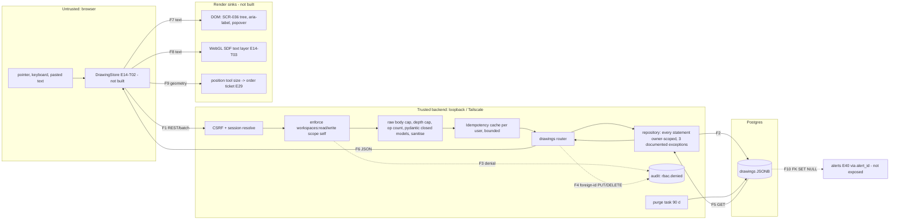

# E14 — STRIDE threat model: drawings persistence, sync and annotation content

- Ticket: E14-X01 (issue #433). Owner: Security engineer (CODEOWNER). Status: **Approved** (2026-10-20; independent
  reviews on PR #2564: sonnet security, sonnet code, sonnet delta security; the Architect review is in the review log
  at the end of §7 and the Fable security pass is recorded on the close-out PR). Owner acceptance of the residuals
  (RR-24 to RR-26 in `04-security-program.md` §16.1) is pending, queued on #2701.
- Method: `docs/plan/04-security-program.md` §5 template (L x I = risk), STRIDE per epic (C-12.1). Format mirrors
  `E22-big-trades.md`. Auth/session mechanics are E09's (`e09-auth-rbac.md`) and consumed as given.
- **Basis: the shipped backend, not the idealised design.** The backend slice of E14-T01 (#357) is described
  as it is in the stack #2406 → #2418 → #2407 → #2404 → #2425 → #2429 → #2480 → #2549 → #2550, read at head
  `98be7c95` of `chore/e14-q04-drawings-contract-batch`, plus the audit allow-list in #2512 (head `789448df`).
  Those PRs were open when this was written: #2512 merged on 2026-10-15 and the stack on 2026-10-16. The QA record of
  2026-10-20 re-checked on `main` that every test name and path cited below exists (Review log). One later change is
  not yet folded into the rows: E15-T01 (#402) added the layouts foreign key `fk_drawings_layout_id_layouts`
  (`0022_workspaces.py`) and `/drawings` now accepts the caller's live `layout_id`, so DR27, RR2 and SR-E14-09 read
  as they did before it; #3055 owns that rewrite. The contract (`22-api-openapi.yaml`, `/drawings*`) and migration
  `0021_drawings` were already on `main`. The **client** (E14-T02 `DrawingStore`, E14-T03 SDF layer, S06
  annotations, S07 position tool, S08 object tree SCR-036, S09 sync) is **not built yet**; its rows are requirements
  (SR-E14-xx), never claimed mitigations.
- **Rule used throughout:** a mitigation is listed as one only if it names the test or rule that enforces it.
  Anything without an enforcing test or rule is a *residual* or a *requirement*.
- **Trust posture:** single-tenant, Tailscale-only deployment with a handful of users. The realistic adversary
  is a lower-privileged internal user (Manager/Viewer) or a compromised browser session, not an internet-scale
  attacker. Controls are proportioned to that; stored XSS is still treated as equally severe.
- Gate note: no live ids, tokens or user data appear in this file.

## 1. Scope

In scope: `GET /drawings`, `POST /drawings`, `PUT|DELETE /drawings/{drawingId}`, `POST /drawings/batch`
(`services/api/candleviewer/api/drawings.py`, `drawings_models.py`), the repository
(`storage/repositories/drawings_sqlalchemy.py`), the `drawings` table (`0021_drawings`), the 90-day soft-delete
purge (`storage/retention/drawings_tasks.py`), the `Idempotency-Key` cache, and the rendering/sync sinks the
data later reaches (modelled as requirements).

Out of scope (per ticket): executing abuse cases (E14-X02), SAST/DAST wiring (E14-X03), E09 session mechanics,
alert delivery (E40) beyond the `alert_id` reference, order authorisation (E29/E34/E39; pre-fill is not
authorisation), implementing controls.

**Deferred surface:** sharing drawings between users is not in R1. Re-model when any route, flag or
role grants a non-owner read of `drawings` (trigger: first `share`/`GET` with a non-self scope, or a Manager
read-grant). The ticket's board `Risk` value R13 "Sharing abuse" is annotated *not yet applicable*, not closed, here
and in the E14 entry of `04-security-program.md`; the register's own R13 is "Team & knowledge"
(`32-risk-register.md` §1.2), so no register row carries the annotation.

## 2. Assets

| Asset | Class | Why |
|---|---|---|
| `geometry`, `style`, `label`, `geometry.text` (levels, notes) | **CONFIDENTIAL user strategy data** | not PII/secret, but disclosure to another deployment user is real harm |
| Position-tool computed size (S07, future) | **integrity-critical** | feeds the order-ticket pre-fill (E29 seam) |
| `drawings` availability and per-chart load time | availability | a dense payload slows every chart load |

## 3. Data-flow diagram and trust boundaries

Boundaries: **TB1→TB2** (all content untrusted; the server derives the owner from the session and never reads
it from the body — `DrawingIn` is `extra="forbid"` and has no owner field); **TB2→TB3** (parameterised static SQL
only); **TB2→SINKS** (stored text is user-controlled and rendered in two different contexts).

## 4. Numeric bounds: contract today, and gaps

| Input | Shipped bound | Enforced by | Gap |
|---|---|---|---|
| Single POST/PUT body | 64 KiB, 413 before parse | `test_request_level_refusals`, `test_body_cap_holds_without_a_content_length` (`tests/drawings/test_drawings_api_edges.py`) | none |
| Batch body / ops | 1 MiB / 200 ops, 413 before per-op validation | `test_batch_limits_are_checked_before_any_operation` (`test_drawings_batch.py`); `test_storage_batch_cap_equals_the_api_cap` (`test_drawings_repository_unit.py`) | none |
| JSON depth | 16 | `test_request_level_refusals` (17-deep body → 422) | none |
| Points per drawing | per tool 1–3 exactly; `brush` 2–500; `polyline` 2–100 | `test_drawing_point_count_bounds_per_tool`, `test_drawing_point_counts_agree_with_the_module_table` (`tests/unit/api/test_drawings_request_models.py`) | none |
| `label` / `geometry.text` | 120 / 1000 code points, raw length checked before sanitising | `test_label_raw_length_over_120_with_control_char_is_string_too_long`, `test_text_raw_length_over_1000_with_control_char_is_string_too_long` | none |
| `levels` / `bands` / `style` | ≤24 / ≤3 / closed keys with ranges | `test_levels_invalid_values_are_rejected_with_rule`, `test_bands_invalid_values_are_rejected_with_rule`, `test_style_invalid_values_and_unknown_keys_are_rejected` | none |
| Duplicate JSON keys / huge numeric literals | Parsed by pydantic-core `model_validate_json`: a duplicate key is **last-wins** (no error; the batch op counter's `json.loads` is also last-wins); an integer literal beyond the digit limit is `json_invalid` 422; `1e999` becomes `inf`, which `levels`/`fill_opacity` refuse (`allow_inf_nan=False`); every literal is bounded by the 64 KiB / 1 MiB body caps. Verified by probing pydantic directly during this review; the duplicate-key case has since been pinned by E14-X02 (#2602) | `test_levels_json_nan_literal_is_rejected`, `test_smallest_subnormal_level_is_refused`, `test_duplicate_keys_in_a_single_body_are_last_wins`, `test_duplicate_keys_in_a_batch_are_last_wins_too` (`tests/drawings/test_drawings_abuse_exhaustion.py`) | none |
| Error amplification | ≤20 field errors; `FailFast` sequences | `test_a_megabyte_of_invalid_points_yields_a_bounded_error_count` | none |
| Idempotency cache | 4096 entries / 32 MiB total; 256 entries / 4 MiB per user; 256 KiB per entry; 24 h TTL | `test_limits_are_the_review_values`, `test_one_user_filling_its_quota_never_evicts_another`, `test_an_oversize_body_is_never_stored` (`test_drawings_idempotency.py`) | in-memory, per process (loss only costs replay, never correctness) |
| List page | `limit` 1–500, default 100; cursor ≤512 B, 1 h TTL, scope-bound | `test_limit_has_the_documented_default_and_bounds`, `test_cursor_is_valid_for_exactly_one_hour` | cursor is unsigned (scope-bound, owner filter still applied) |
| **Drawings per user / per symbol** | **none** | — | **G1 — see DR32 / RR4** |
| Total rows retained after soft delete | 90 days then purged, ≤10 000 rows per batch, ≤100 batches per run | `test_purge_respects_the_90_day_boundary_and_the_limit`, `test_run_is_bounded_by_max_batches` | none |

The ticket's "500-op batch cap" is stale: the contract decision record on #357 (item 6) lowered it to **200**.

## 5. STRIDE table

Risk = L x I. Disposition: **M** mitigated and test/rule-enforced, **R** residual (owner and ticket named in §7),
**Q** requirement on an unbuilt component (SR in §6). Every row names an owning ticket.

| T | STRIDE | Threat | L | I | Risk | Control / enforcing test or rule | Disp. | Owner |
|---|---|---|---|---|---|---|---|---|
| DR1 | S | Client forges `owner_user_id` in a body | M | H | **High** | Owner comes from the session (`SessionAuditPrincipalResolver`); models are `extra="forbid"` so an owner key is a 422: `test_an_undeclared_field_is_422_never_ignored` (`tests/contract/drawings/test_drawings_schema_contract.py`), `test_unknown_keys_are_rejected_at_every_level`; every statement filters `owner_user_id`: `test_every_statement_is_owner_scoped_except_the_unscoped_ones`, `test_only_three_statements_are_unscoped` | M | E14-T01 |
| DR2 | S | Unauthenticated request reaches a route | L | H | Medium | `test_every_route_401_without_a_session`; `test_production_create_app_resolves_callers_from_the_session` (fails closed); matrix `unauthenticated: '401'` in `tests/contract/rbac/matrix.yaml` | M | E14-T01 |
| DR3 | S | Cross-site request writes drawings with a victim's cookie | L | M | Low | CSRF middleware: `test_create_app_serves_drawings_behind_csrf` | M | E09 |
| DR4 | S | Replayed session from another device creates drawings attributed to the victim | L | M | Low | Session theft is E09's boundary (consumed as given). Drawings are not audited (DR12), so such writes are not attributable beyond the session | R | RR5 / E09 |
| DR5 | S | Test-only `__cvEngine.projectForTest` handle ships in a production bundle | L | M | Low | None yet: handle is E14-Q03's. Needs a bundle assertion | Q | SR-E14-10 / E14-X03 |
| DR6 | T | Stored XSS through `label`, `geometry.text` or template name rendered into the DOM | M | H | **High** | Server side: control/bidi stripping only (`test_sanitize_removes_each_listed_character`, `test_label_is_sanitised_and_newline_is_stripped`). **The server does not HTML-encode** (it stores what the user typed): safety lives at the sink | Q | SR-E14-01 / E14-S08, E14-T03, E14-X03 |
| DR7 | T | Same text injected into the **accessible-name path** of SCR-036 (`aria-label` built by string concatenation) | M | H | **High** | Requirement: names are set via DOM property/attribute APIs with a text node, never concatenated markup; E14-Q07 verifies behaviourally | Q | SR-E14-02 / E14-S08, E14-Q07 |
| DR8 | T | Same text injected into the WebGL **SDF text layer** (glyph atlas abuse, bidi spoofing, huge glyph counts) | L | M | Medium | Server strips C0/C1, U+2028/9 and bidi overrides, caps length (rows in §4); layer must treat text as data, clip glyph count, and cap `font_size` (server range 8–48: `test_style_boundaries_are_accepted`) | Q | SR-E14-03 / E14-T03 |
| DR9 | T | `style` value injected into a CSS context | L | M | Low | `style` is a closed model: colours match `^#[0-9a-fA-F]{6}$`, `dash` is a 3-value literal, ints are ranged: `test_style_colour_invalid_is_rejected`, `test_style_invalid_values_and_unknown_keys_are_rejected`. Client must still not build CSS strings from it | M | E14-T01 (server); SR-E14-04 (client) |
| DR10 | T | JSON injection via free-form `geometry`/`style` | M | M | Medium | The contract is closed (**the ticket's "additionalProperties: true on geometry" no longer holds**): `DrawingGeometryIn` is `extra="forbid"`, tool-specific keys enforced: `test_geometry_tool_specific_keys_are_allowed_only_where_specified`; DB `dr_geom` check: `test_dr_geom_rejects_missing_points_and_non_objects` | M | E14-T01 |
| DR11 | T | Crafted numeric precision makes a stored value read back far larger (5e-324 → ~326-char decimal), or float rounding changes a price | L | M | Low | Prices are verbatim decimal strings; non-zero numbers below 1e-6 refused: `test_smallest_subnormal_level_is_refused`, `test_point_prices_round_trip_verbatim_through_db_values`, `test_accepted_level_renders_within_the_bound` | M | E14-T01 (#2480) |
| DR12 | T | Another principal modifies a drawing | M | H | **High** | Owner-scoped UPDATE/DELETE: `test_other_owner_cannot_get_update_or_delete`, `test_idor_single_update_by_other_owner_is_not_found_for_any_token`, `test_idor_batch_update_by_other_owner_with_real_token_changes_nothing`; HTTP matrix `test_idor_matrix` | M | E14-T01 |
| DR13 | T | Lost update: two sessions edit the same drawing | M | M | Medium | PUT `If-Match` → 412; batch `if_match` required → 409; token strictly increases: `test_if_match_conflict_versus_not_found_and_last_write_wins`, `test_token_strictly_increases_on_rapid_updates`, `test_batch_stale_update_token_and_never_existed_target`. PUT without `If-Match` is last-write-wins **by design** (decision record 5). `_if_match` is strict: only the exact six-digit `updated_at` token is accepted (bare, quoted or `W/`-prefixed); any other spelling of the instant, `*` or garbage is 412, so the precondition cannot be bypassed by format: `test_put_accepts_quoted_weak_and_bare_tokens_and_returns_a_fresh_etag`, `test_request_level_refusals`. The `If-Match: *` refusal is by code reading, not a dedicated test | M | E14-T01 |
| DR14 | T | `symbol` or `tool` changed by update to reinterpret a drawing | L | M | Low | `immutable_field` rule: `test_batch_update_cannot_change_symbol_or_tool`, `test_immutable_field_is_never_an_oracle_for_another_owner` | M | E14-T01 |
| DR15 | T | Batch ordering abused (delete+create made to look like an edit) | L | L | Low | Ops apply in order in one transaction, results in op order: `test_batch_applies_in_order_and_reports_each_kind`; a failing op rolls back the whole batch, all or nothing: `test_batch_is_atomic`, `test_one_failing_operation_rolls_the_whole_batch_back`; each id at most once per batch: `test_batch_duplicate_ids_across_op_kinds_are_rejected`. Not audited (DR17), so no trail either way | M | E14-T01 |
| DR16 | T | Position tool: manipulated `geometry` produces a risk size the trader acts on | M | H | **High** | None: S07 unbuilt. Requirement: size is computed from server-validated price strings with `Decimal`, shown as an estimate, pre-fill is never authorisation, server re-validates sizing (C-2.12) | Q | SR-E14-07 / E14-S07 |
| DR17 | R | Drawing writes carry no audit record: "who created the drawing that influenced a trade?" | M | M | Medium | **Decision recorded:** drawings are *explicitly outside* the C-2.9 append-only audit scope (decision record 11 on #357; SCR-037 classes them analytics). Enforced as an explicit allow-list by the `audit-write-required` rule scoped to the three exact routes (#2512, `security/semgrep/auth/audit-write-required.yml`) so a new mutating route is still flagged. Attribution is limited to `owner_user_id`, `created_at`, `updated_at`; **history is not kept** (PUT replaces, soft-delete keeps one row). Permission denials and foreign-id PUT/DELETE probes *are* audited (`rbac.denied`), and so is the failing operation of a batch when its target is foreign or missing (DR18; the batch stops at its first failure of any kind: `test_only_the_failing_operation_of_a_batch_is_audited`). Every such probe writes one durable record, the same class as `enforce()`'s 403 denials, and nothing throttles that volume (RR4). A denial whose `rbac.denied` record cannot be made durable is answered 503 `store_unavailable` with no state change, never 403/404/409; an allowed request on the caller's own rows never reaches the audit writer, while a foreign-id probe does (DR18): `test_a_denial_whose_audit_record_cannot_be_written_is_503_and_changes_nothing`, `test_cross_user_access_is_denied_not_merely_filtered`, `test_idor_matrix` | R | RR5 |
| DR18 | R | Foreign-id probes through the **batch** (`target_unavailable`) leave no audit record | L | M | Medium | Audited: a batch update/delete whose target is not the caller's, another owner's **and** missing alike (so the audit adds no timing difference between them), writes `rbac.denied` (`not_owner:workspaces:write:self`, as a foreign PUT/DELETE does) before the 409, and the 409 stays byte-identical to the one for the caller's own deleted target: `test_a_foreign_target_is_409_and_audited_exactly_once`, `test_a_missing_target_is_audited_like_a_foreign_one`, `test_a_batch_probe_is_recorded_exactly_like_a_foreign_delete`, `test_refusals_are_byte_identical_for_foreign_missing_and_own_deleted_targets`, `test_idor_matrix`. The caller's own rows are never audited (`test_the_callers_own_deleted_target_is_409_but_not_audited`) and a failed audit write fails the request closed (`test_a_failed_audit_write_fails_the_probe_closed`): a denial whose `rbac.denied` record cannot be made durable is answered 503 `store_unavailable` with no state change, never 403/404/409; an allowed request on the caller's own rows never reaches the audit writer, while a foreign-id probe does (`test_a_denial_whose_audit_record_cannot_be_written_is_503_and_changes_nothing`). A `create` id clash (`id_unavailable`) stays unaudited (DR22) | M | E14-T01 (#2407) |
| DR19 | R | Foreign `layout_id` probe (422 on writes, 404 on `GET ?layout_id`) leaves no audit record while Workspaces audits the same probe as `rbac.denied` (D18) | L | L | Low | Not audited; responses are identical for unknown/foreign/deleted: `test_list_holds_both_scopes_and_an_unknown_layout_filter_is_404`, `test_request_level_refusals` (layout case). Residual **`layout_id` gap** | R | RR2 |
| DR20 | I | IDOR: `GET`, `PUT`, `DELETE` of another user's id, `GET ?layout_id` | M | H | **High** | List/get/update/delete all owner-scoped; foreign and missing ids give the **same 404 body**, never 403: `test_cross_user_access_is_denied_not_merely_filtered`, `test_idor_matrix`, `test_exists_for_other_owner_is_false_for_a_deleted_row`, `test_list_holds_both_scopes_and_an_unknown_layout_filter_is_404`. Route-by-route table in §6 | M | E14-T01 |
| DR21 | I | Batch is the highest-risk IDOR: 200 arbitrary ids in one call | M | H | **High** | Update/delete are owner-scoped in SQL (`AND drawings.owner_user_id = …`), foreign/missing/deleted all `target_unavailable` 409: `test_batch_foreign_target_is_target_unavailable_and_stale_is_version_conflict`, `test_idor_other_owners_deleted_row_is_target_unavailable_in_a_batch`, `test_another_users_drawing_is_an_unavailable_target_like_a_missing_one` | M | E14-T01 |
| DR22 | I | Id existence oracle on batch `create` with a client UUID (`id_unavailable`) | L | L | Low | Accepted (decision record 7): the response is identical for any owner/state and reveals only that the id is taken: `test_batch_create_with_another_users_id_is_id_unavailable`, `test_batch_id_unavailable_for_foreign_and_own_deleted_ids` | R | RR3 |
| DR23 | I | Timing/lock side channel: batch snapshot `SELECT … FOR UPDATE` locks rows of any owner; an actor who knows a foreign id can observe a wait | L | L | Low | `_SNAPSHOT` is owner-scoped (`AND owner_user_id = …`), so a batch naming a foreign id takes no row lock on it; a `create` on a foreign id is refused by its INSERT's primary-key collision (`id_unavailable`), and that INSERT can wait on another transaction's uncommitted UPDATE of the id, bounded by `statement_timeout`; the existence oracle this leaves is the accepted DR22: `test_a_batch_naming_a_foreign_id_never_locks_the_victims_row` (real Postgres: the victim's row stays lockable while the batch transaction is open), `test_snapshot_locks_only_the_callers_rows`, `test_every_statement_is_owner_scoped_except_the_unscoped_ones` | M | E14-T01 (#2407) |
| DR24 | I | Foreign-id probe on PUT/DELETE is audited, so it is measurably slower than a missing id (same precedent as alerts) | L | L | Low | Accepted; documented in `drawings.py` module docstring. During an audit outage the PUT/DELETE foreign-live versus missing difference is a status code (503 vs 404), not timing: the same accepted class as before (500 vs 404). Residual R3 (timing half) | R | RR1 |
| DR25 | I | Label/text/geometry leaks into logs, metrics or errors | M | M | Medium | `test_logs_never_carry_drawing_content`; error bodies never echo values: `test_format_errors_entries_have_exactly_field_rule_message_and_never_echo_values`; metrics are `cv_drawings_batch_ops`, `cv_drawings_conflicts_total{rule}` and a per-tool row gauge (counts only): `test_batch_through_the_full_app_increments_both_metrics`, `test_rows_gauge_is_set_per_tool_and_zero_filled`. Control characters in `label` are stripped on write, a second line of defence against log injection: `test_sanitize_removes_each_listed_character` | M | E14-T01 |
| DR26 | I | Annotation text flows into journal snapshots or analytics events (`drawing.created`) | M | M | Medium | None: US-DRAW-006 journal path is unbuilt. Requirement: events carry ids/counts, never text; journal snapshots inherit the owner scope | Q | SR-E14-06 / E14-S06 |
| DR27 | I | Cross-layout leak: a drawing scoped to `layout_id` shown in another layout | L | M | Low | Today **no non-null `layout_id` is accepted at all** (`_layout_owned` returns `False`, 422 `layout_not_found`), so no leak path exists yet. No DB-level same-owner rule or FK. Residual (RR2) | R | RR2 / E15-T01 |
| DR28 | I | Cursor reused across scopes or after expiry | L | L | Low | Scope-bound, 1 h TTL, ≤512 B: `test_a_cursor_from_another_symbols_page_is_rejected_not_reinterpreted`, `test_cursor_is_refused_when_expired_mismatched_or_malformed` | M | E14-T01 |
| DR29 | D | Unbounded `geometry`/`label`/`text` | M | M | Medium | Rows in §4 (64 KiB body; per-tool point caps; text/label caps) | M | E14-T01 |
| DR30 | D | Deeply nested JSON blows parser or index | L | M | Low | Depth ≤16 before pydantic (`test_request_level_refusals`); closed models reject unknown nesting | M | E14-T01 |
| DR31 | D | Oversized or oversized-count batch | M | M | Medium | 1 MiB / 200 ops → 413 before any write: `test_batch_limits_are_checked_before_any_operation`; perf: `test_batch_of_200_creates_p99_under_50ms`, `test_mixed_batch_of_200_p99_under_50ms` (CI-only integration) | M | E14-T01 |
| DR32 | D | **No per-user / per-symbol drawing quota**: one user can create unbounded rows (200 per call, repeatably) and make every chart load slow, or grow the table | M | M | Medium | **None.** Per-call bounds only. Residual RR4; the ticket requires a quota with an owning ticket before sign-off: #2727 is that ticket (open, `post-ga`) and proposes the values (§7) | R | RR4 / #2727 |
| DR33 | D | Retry storm from the optimistic client | M | M | Medium | Server: idempotent replay of POST/batch within a bounded cache (`test_same_key_and_body_replays_the_stored_response`, `test_keys_are_scoped_per_user_and_operation_and_only_successes_are_kept`) and a conflict-safe batch. Client back-off is E14-T02/E14-Q06. **No rate limit on the routes**; #2727 proposes one (§7) | R | RR4 (#2727) / E14-Q06 |
| DR34 | D | Idempotency cache memory exhaustion | L | M | Low | Global + per-user bounds, LRU, TTL (§4): `test_global_bytes_evict_the_least_recently_used_entry`, `test_one_user_filling_its_quota_never_evicts_another` | M | E14-T01 |
| DR35 | D | Soft-deleted rows retained 90 days grow the table | L | L | Low | Supervised daily purge, bounded batches: `test_run_once_loops_until_short_batch_and_counts_total`, `test_start_is_idempotent_and_stop_cancels`; schedule gated by `retention_enabled`: `test_disabled_schedule_never_starts` | M | E14-T01 |
| DR36 | D | List query degrades (seq scan) | L | M | Low | `test_query_uses_the_intended_index`, `test_list_uses_ix_dr_user_symbol_and_p99_under_5ms`, `test_bulk_batch_statements_use_the_pk_index_and_never_seq_scan_drawings` | M | E14-T01 |
| DR37 | D | Batch lock wait delays another user's write (R1) | L | L | Low | A batch locks only its caller's own rows (DR23), so it cannot delay another user's write; one user's concurrent batches still queue, in deterministic id order to avoid deadlock: `test_snapshot_locks_rows_in_a_deterministic_order`, `test_a_batch_naming_a_foreign_id_never_locks_the_victims_row` | M | E14-T01 (#2407) |
| DR38 | E | A Viewer writes drawings | M | M | Medium | `workspaces:write` required; Viewer gets 403 before the store is touched: `test_idor_matrix` (viewer column), `test_the_matrix_refuses_exactly_the_actors_lacking_the_x_rbac_permission`; unknown/wildcard codes grant nothing: `test_wildcard_unknown_and_case_variant_codes_grant_nothing`; replays never bypass RBAC: `test_a_replay_never_bypasses_authentication_or_rbac` | M | E14-T01 |
| DR39 | E | Idempotency key from another user returns the first user's response | L | H | Medium | Keys scoped per user and operation: `test_the_same_key_from_another_user_never_returns_the_first_users_result`. The same key with a different payload is `409 idempotency_key_reuse`, never a replay: `test_same_key_with_another_body_is_409_reuse`, `test_the_same_key_with_another_body_is_409_and_writes_nothing` | M | E14-T01 |
| DR40 | E | `alert_id` set to another user's alert, borrowing its privileges or leaking existence | L | M | Low | `alert_id` is **not exposed**: not in `DrawingIn`, not in the read allow-list: `test_read_allow_list_excludes_internal_columns`, `test_db_values_keys_are_exactly_the_drawing_fields`. FK is `ON DELETE SET NULL`: `test_alert_delete_sets_alert_id_null`. When E40 exposes it, an owner check is mandatory (RR2) | Q | SR-E14-08 / E40 |
| DR41 | E | Pre-fill from a position drawing selects an account the user may not trade | L | H | Medium | None: S07/E29 seam. Pre-fill is not authorisation; E29/E34/E39 enforce server-side | Q | SR-E14-07 / E14-S07, E29 |
| DR42 | E | A future mutating route (share, batch-delete, alert link) lands unaudited and unreviewed | M | M | Medium | Semgrep `audit-write-required` + `audit-write-required-route-scope` flag any new mutating route outside the three allow-listed exact routes (#2512; fixtures include `POST /drawings/{id}/share`) | M | E14-T01 (#2512) |

Tally: 42 rows. By STRIDE: S 5, T 11, R 3, I 9, D 9, E 5. By disposition: M 26, R 8, Q 8 (R = residual with owner in §7, Q = requirement on unbuilt or unowned work, §6.2).

### 5.1 Coverage matrix: every element and flow against every category

Every element and flow of the §3 diagram against S, T, R, I, D and E. A cell names the DR rows that analyse the
category, or states why the category is not applicable. Four shorthands are defined here (the E27 model §3.7 uses
the first three): `N/A·ee`, an external entity, for which STRIDE-per-element weighs spoofing and repudiation only
(its other categories are analysed on the flows it feeds); `N/A·ds`, a data store, which neither acts nor
authenticates (spoofing, repudiation and elevation are analysed on the processes that write it, DR17 for
repudiation); `N/A·df`, a data flow, which carries no identity and takes no action (spoofing, repudiation and
elevation are analysed on its endpoints); `N/A·e40`, ALERT is E40's element and out of scope beyond the `alert_id`
reference edge (§1), which DR40 covers. Every other not-applicable cell gives its reason. The matrix adds no threat,
re-rates none and changes no control: it cites the rows above.

| Element | S | T | R | I | D | E |
|---|---|---|---|---|---|---|
| IN pointer, keyboard, pasted text | DR1, DR4 | N/A·ee | DR17 | N/A·ee | N/A·ee | N/A·ee |
| STORE DrawingStore, E14-T02 (not built) | DR1, DR5 | N/A: runs in the user's own browser, which TB1 treats as untrusted; nothing it holds is relied on and every value it sends is re-validated server-side (DR10, DR29 to DR31) | N/A: records nothing; writes are attributed by session at F1 (DR17) | DR26 | DR33 | N/A: acts with the user's own session and holds no privilege of its own; every check is server-side (DR38) |
| CSRF CSRF and session resolve | DR2, DR3, DR4 | N/A: stateless; transport integrity is the deployment's (loopback or Tailscale, 04 §5.10), not a drawings control | N/A: it resolves the principal that audit attributes (E09 model); drawings add no repudiation surface here (DR17 is at SVC) | N/A: a refusal carries no drawings data and nothing is reachable before it (DR2) | N/A: session cost is E09's (E09 model); a request is refused here before any drawings work | N/A: grants nothing; privilege is decided at RBAC (DR38) |
| RBAC `workspaces:read/write`, scope self | DR2 | DR38 (unknown, wildcard and case-variant codes grant nothing); the permission table itself is E09's | DR17, DR18 (denials are audited as `rbac.denied`, F3) | N/A: a 403 states only the caller's own missing permission and is sent before the store is touched (DR38) | DR17 (RR4: each denial writes one durable record, unthrottled) | DR38 |
| PARSE body, depth and op caps, closed models, sanitise | DR1 | DR6, DR8, DR9, DR10, DR11 | N/A: validation changes no state and records nothing; what is audited is decided at SVC (DR17 to DR19) | DR25 | DR29, DR30, DR31 | N/A: grants nothing; no field of a closed model carries a role or an owner (DR1) |
| IDEM Idempotency cache per user | DR39 | DR39 (the same key with another body is 409, never a replay) | N/A: not a system of record; loss only costs a replay (§4) and the first execution is attributed like any write (DR17) | DR39 | DR33, DR34 | DR38 (a replay never bypasses RBAC), DR39 |
| SVC drawings router | DR1, DR2 | DR12, DR13, DR14, DR15 | DR17, DR18, DR19, DR42 | DR20, DR21, DR25, DR28 | DR31, DR32, DR33 | DR38, DR42 |
| REPO owner-scoped statements, 3 documented exceptions | N/A: the owner comes from the session through SVC, never from the body (DR1) | DR12, DR13, DR14, DR15 | N/A: records no actor beyond the attribution columns `owner_user_id`, `created_at`, `updated_at` (DR17) | DR20, DR21, DR22, DR23, DR27, DR28 | DR32, DR36, DR37 | DR12, DR21 |
| AUD audit, `rbac.denied` | N/A: only the service process writes it and no caller can emit a record (04 §8.1) | N/A: the append-only role and hash chain are the audit design's (04 §8.1, SR-063, SR-066), unchanged by drawings, which add `rbac.denied` writers only | DR17, DR18, DR19, DR42 | DR24, DR25 (the record carries ids and a fixed reason, by code reading of `audit_not_owner`; not test-pinned) | DR17 (RR4: one durable record per probe, unthrottled) | N/A: no drawings path reads audit or writes it with elevated rights; the three allow-listed routes emit `rbac.denied` only (DR17, DR42) |
| PUR purge task, 90 days | N/A: a scheduled in-process task with no caller; it starts only when `retention_enabled` (`test_disabled_schedule_never_starts`) | §4 last row: it takes no input and deletes only rows soft-deleted over 90 days ago, in bounded batches (`test_purge_respects_the_90_day_boundary_and_the_limit`); no attacker-reachable path, so no threat row | N/A: retention by contract, not a user action; nothing to attribute | N/A: it reads out no row content, only a count | DR35 | N/A: runs with the application's database role and holds no more; its `DELETE` is one of the three documented unscoped statements (`test_only_three_statements_are_unscoped`) |
| DB `drawings`, JSONB | N/A·ds | DR10 (the `dr_geom` check), DR11 | N/A·ds | DR22, DR23, DR27 | DR32, DR35, DR36, DR37 | N/A·ds |
| DOM SCR-036 tree, accessible name, popover (not built) | RR7 (look-alike and invisible characters: display text only, accepted) | DR6, DR7, DR9 | N/A: displays only; takes no action and records nothing | N/A: shows the caller's own drawings (DR20); the paths to logs and analytics are DR25 and DR26 | DR32 (a dense payload slows every load; the dense-tree budget is E14-Q05's) | N/A: no privileged action is reachable except through F1 calls, which the server checks (DR38) |
| SDF WebGL text layer, E14-T03 (not built) | RR7, DR8 (bidi spoofing) | DR8, DR9 | N/A: draws only; takes no action and records nothing | N/A: draws the caller's own drawings (DR20) | DR8 (glyph counts), DR29 | N/A: holds no privilege; text is data (SR-E14-03) |
| POS position-tool size to the order ticket (not built) | N/A: no identity crosses this seam; the ticket authenticates the user (E29, E34, E39) | DR16 | N/A: a pre-fill is not an order; the OMS attributes and audits the order itself (C-2.9, E29) | N/A: the size shown is the caller's own (DR20) | N/A: client arithmetic over the per-tool point count the server accepts (§4, DR29) | DR41 |
| ALERT alerts E40, `alert_id` not exposed | N/A·e40 | DR40 (`ON DELETE SET NULL`: `test_alert_delete_sets_alert_id_null`) | N/A·e40 | DR40 (existence leak) | N/A·e40 | DR40 (SR-E14-08) |

Flows: F1 to F10 as drawn, the two unlabelled arrows, and the US-DRAW-009 sync path, which the diagram does not draw.

| Flow | S | T | R | I | D | E |
|---|---|---|---|---|---|---|
| F1 REST and batch calls, STORE to REPO through CSRF, RBAC, PARSE, IDEM, SVC | DR1, DR2, DR3, DR4 | DR6, DR10, DR11, DR12, DR13, DR15 | DR17 | DR20, DR21, DR25 | DR29, DR30, DR31, DR32, DR33 | DR38, DR39 |
| F2 REPO to DB, writes and locks | N/A·df | DR10, DR11, DR12 (parameterised static statements only, TB2 to TB3: Semgrep `cv-storage-sql-construction` on `storage/**`, `test_every_statement_is_owner_scoped_except_the_unscoped_ones`) | N/A·df | DR22, DR23 | DR32, DR36, DR37 | N/A·df |
| F3 RBAC to AUD, permission denial | N/A·df | N/A: an in-process call into the audit writer; record integrity is the audit design's (04 §8.1, SR-063, SR-066) | DR17, DR19 (a foreign `layout_id` probe is refused but not audited) | DR25 | DR17 (RR4) | N/A·df |
| F4 SVC to AUD, foreign-id PUT, DELETE and batch probes | N/A·df | N/A: as F3 | DR17, DR18, DR42 | DR18, DR24 | DR17 (RR4) | N/A·df |
| F5 DB to REPO, reads | N/A·df | DR11 | N/A·df | DR20, DR27, DR28 | DR36 | N/A·df |
| F6 SVC to STORE, JSON and error bodies | N/A·df | DR11 | N/A·df | DR20, DR25, DR28 | DR29 (list `limit` 1 to 500 and the body caps bound a response, §4) | N/A·df |
| F7 STORE to DOM, text | N/A·df | DR6, DR7, DR9 | N/A·df | N/A: the text is the caller's own, read back through the owner-scoped F5 and F6 (DR20) | DR29 (label 120 and text 1000 bound what a sink renders) | N/A·df |
| F8 STORE to SDF, text | N/A·df | DR8, DR9 | N/A·df | N/A: as F7 (DR20) | DR8, DR29 | N/A·df |
| F9 STORE to POS, geometry | N/A·df | DR16 | N/A·df | N/A: the caller's own geometry (DR20) | DR29 (per-tool point caps) | DR41 |
| F10 DB to ALERT, FK `ON DELETE SET NULL` | N/A·df | DR40 | N/A·df | DR40 | N/A: the action nulls one nullable column; how many rows it can touch is DR32's | DR40 |
| IN to STORE (unlabelled) | N/A·df | N/A: stays in the user's browser; content is validated server-side at PARSE (DR10, DR29 to DR31) and encoded at the sinks (DR6 to DR8) | N/A·df | N/A·df | N/A: bounded by what the store forwards (DR33) | N/A·df |
| PUR to DB (unlabelled) | N/A·df | §4 last row (90-day boundary, bounded batches) | N/A·df | N/A·df | DR35 | N/A·df |
| US-DRAW-009 sync (not drawn): F5 and F6 read by a second pane | N/A·df | N/A: nothing is replicated between panes; each pane reads and writes through F5, F6 and F1 | N/A·df | DR20, DR27 (a pane-local drawing must not appear in another layout), DR28 | DR33, DR36 | N/A·df |

Notes. (1) US-DRAW-009 is not a drawn flow because, as designed in E14-S09 (#548), sync is a query-scope choice
(`symbol`, plus `layout_id` for pane-local drawings), not a replication channel: both panes belong to the same
owner, so "never syncs across different symbols" is a correctness rule, not a security boundary. If the built story
adds a channel between panes (for example a cross-tab broadcast), this row is re-modelled. (2) Style templates persist
with chart config (`chart_templates`, E15), not in `drawings` (E14-S09); this model sees template names only as
DOM-sink input (DR6, SR-E14-01). (3) RR7 is a residual in §7, not a DR row; the DOM and SDF cells cite it for
look-alike text.

## 6. Requirements, IDOR route table, and control mapping

### 6.1 IDOR: every route that accepts an id or filter

| Route | Id / filter | Required check | Enforced by |
|---|---|---|---|
| `GET /drawings` | `symbol`, `layout_id`, `cursor` | owner filter in SQL; `layout_id` must be the caller's live layout else 404 | `test_idor_matrix` (`read:list` returns `[]` to others); `test_list_holds_both_scopes_and_an_unknown_layout_filter_is_404` |
| `POST /drawings` | body `layout_id`, no owner field | owner from session; `layout_id` 422 unless caller's | `test_an_undeclared_field_is_422_never_ignored`, `test_request_level_refusals` |
| `PUT /drawings/{id}` | path id | owner-scoped update; foreign id = same 404 as missing, audited | `test_cross_user_access_is_denied_not_merely_filtered`, `test_idor_single_update_by_other_owner_is_not_found_for_any_token` |
| `DELETE /drawings/{id}` | path id | as PUT | same tests |
| `POST /drawings/batch` | `update`/`delete` ids, `create` client ids | owner-scoped in SQL, the snapshot lock included; foreign and missing = `target_unavailable` 409, audited as `rbac.denied`; `create` id clash = `id_unavailable` | `test_idor_matrix` (`write:batch_update`, `delete:batch_delete` → 409 and one audit record), `test_a_foreign_target_is_409_and_audited_exactly_once`, `test_batch_foreign_target_is_target_unavailable_and_stale_is_version_conflict` |

### 6.2 Security requirements (new, on unbuilt or unowned work)

| SR | Requirement | Owner | Test destination |
|---|---|---|---|
| SR-E14-01 | DOM sink: stored text (`label`, `text`, template names) rendered only as text nodes / framework-escaped; no `dangerouslySetInnerHTML`, no markup built by concatenation | E14-S08, E14-T03 | E14-X02 stored-XSS abuse cases; E14-X03 lint rule |
| SR-E14-02 | Accessible-name sink: SCR-036 names and tooltips set via property/attribute APIs from the raw string; never concatenated into markup | E14-S08 | E14-Q07 behavioural check; E14-X02 |
| SR-E14-03 | SDF sink: text is data; glyph count and font size clamped client-side too; no HTML parsing; bidi/control already stripped server-side | E14-T03 | E14-X02; engine unit test |
| SR-E14-04 | Client builds no CSS/inline-style strings from `style`; uses tokens or validated hex | E14-S08/T03 | E14-X03 |
| SR-E14-05 | Per-user drawing quota (see RR4) | #2727 (E14-T01 follow-up) | E14-X02 payload exhaustion; E14-Q05 |
| SR-E14-06 | `drawing.*` analytics events and journal snapshots carry ids/counts, never `label` or `text` | E14-S06 | E14-X02 log/event grep |
| SR-E14-07 | Position tool: size computed with `Decimal` from validated strings, labelled estimate; pre-fill never authorises; server re-validates | E14-S07, E29 | E14-S07 tests; E14-X02 |
| SR-E14-08 | When E40 exposes `alert_id`: same-owner check, identical response for foreign/missing alert | E40 | E40 tests |
| SR-E14-09 | When E15 adds the layouts FK: same-owner rule and composite key so one owner's layout delete cannot cascade into another owner's drawings | E15-T01 (#402; FK added in `0022_workspaces.py`, rewrite of this row: #3055) | E15 migration test |
| SR-E14-10 | Production bundle must not contain `__cvEngine.projectForTest` | E14-Q03, E14-X03 | E14-X03 bundle assertion |
| SR-E14-11 | Telemetry: authorisation-denied counter, oversized-payload rejection and batch-cap rejection counters, per-user drawing count gauge | #2727 (widened 2026-10-20): the per-user gauge (max and p95, no per-user label) and the denied, 413/422 and batch-cap counters on `/drawings` (§7) | metrics catalogue test |

Today the shipped telemetry is `cv_drawings_batch_ops`, `cv_drawings_conflicts_total{rule}` and the live-row gauge by
tool (all users): per-user counts, 413/422 rejection counters and a denied counter on the drawings routes do **not**
exist (`rbac.denied` audit records are the only denial signal). SR-E14-11 is therefore open, not a mitigation.

## 7. Residual risks, owners and review

| ID | Residual | Rating | Owner / ticket | Review date |
|---|---|---|---|---|
| RR1 (**R3**) | A single PUT/DELETE probe of a foreign id is audited and so measurably slower than a missing id (DR24). Batch probes are audited too, foreign and missing alike, so the batch adds no such difference (decided and shipped in #2407); foreign `layout_id` probes are RR2 | Low | hpe-worker-1 (E14-T01, #357) | 2027-03-25 |
| RR2 (**`layout_id` gap**) | Foreign `layout_id` probes (422 writes / 404 list) are refused identically but unaudited, unlike Workspaces D18. And `layout_id` (later `alert_id`) has no same-owner rule or FK in the DB; today every non-null `layout_id` is refused | Low | hpe-worker-1 (E14-T01) for the audit decision; E15-T01 (#402) for FK + same-owner rule (SR-E14-09); E40 for `alert_id` | 2027-03-25 |
| RR3 (R2, R4) | Id-existence oracle on client-minted ids (`id_unavailable`); after the 90-day purge an id can be re-created (no tombstone). R1, the batch snapshot's lock-wait side channel, is closed in #2407: the snapshot is owner-scoped (DR23) | Low | E14-T01 (#357), accepted on #357 | 2026-11-13 |
| RR4 | **No per-user or per-symbol quota and no route rate limit**: bounded per call only, unbounded in aggregate (DR32, DR33); this includes the durable `rbac.denied` records that probes write (a foreign-id PUT/DELETE, or a foreign or missing batch target), one per probe, as 403s do (DR17) | Medium | #2727 (E14-T01 follow-up; SR-E14-05), with E14-Q05 numbers; the owning ticket now exists, the value is an Owner decision (below); **E14 epic sign-off is refused until the quota value is decided** | 2026-11-15, or earlier at #2727's PR, and in any case before E14 epic sign-off |
| RR5 | Drawings are outside the append-only audit scope; no edit history. State this in `04-security-program.md` so nobody assumes coverage | Medium | Security engineer / Owner (accepted by decision record 11) | at sign-off |
| RR6 | Client render sinks, position-tool integrity and the production-handle check are **requirements only** until E14-T02/T03/S06/S07/S08 land | High until built | E14 story owners (E14-T02, T03, S06, S07, S08; requests on #358, #545, #546, #547, #467, #549 and #542 below) | 2026-11-15, or earlier at each story's PR |
| RR7 | **Homoglyph and invisible-character spoofing in labels/text.** The sanitiser strips C0/C1, U+2028/9, LRM/RLM, embeddings and isolates (`drawings_models.py` `_STRIP`), but **not** zero-width characters (U+200B–D, U+2060, U+FEFF) and does **no** NFC normalisation, so look-alike labels are possible. Accepted: labels are display text only and never feed identity, authorisation or order logic | Low | Security engineer (accepted); revisit if labels ever drive an action | at sign-off |

Quota values. The model proposed (to be confirmed against E14-Q05's measured numbers, not invented) a cap of **2 000**
live drawings per user per symbol (10x the Q05 200-drawing drag-FPS scenario) and a write rate limit on `/drawings*`
that keeps one user under the 200-ops-per-call x low single-digit calls per second envelope. The owning ticket #2727
proposes other numbers: **500** per symbol, **5 000** per user, and **60 writes a minute with a burst of 20** (429
with `Retry-After`), and says the values are to be fixed in this model; its scope includes updating DR32, DR33 and
RR4 with them. The two sets disagree and neither is enforced today. The value, and whether `post-ga` (the label
#2727 carries, which keeps it out of every work queue) is acceptable for a control this row says blocks epic
sign-off, are Owner decisions queued on #2701.

Register entries. `04-security-program.md` §16.1 records RR6 as RR-24 (open High until built, not accepted;
`32-risk-register.md` RSK-087, which gates R1), RR4 as RR-25 (RSK-088) and RR1, RR2, RR3, RR5 and RR7 as RR-26 (RR5
also as RSK-089), each with owner sign-off pending, queued on #2701 (RR3 was accepted on #357). SR-E14-11's denied,
413/422 and batch-cap counters are carried by #2727 (widened 2026-10-20), by the orchestrator's ruling under the filing
freeze ([comment](https://github.com/CandleViewer/CandleViewer/issues/2727#issuecomment-6288660955)), alongside the
per-user gauge, so the model has no unfiled gap.

### Sign-off

- Independent security review complete on PR #2564 (sonnet security-reviewer: APPROVE at `8d293d1c`, delta APPROVE
  at `1af40ce8`; sonnet code-reviewer: APPROVE at `8d293d1c`; both carried over at `74867db3`, an identical tree).
  The QA record of 2026-10-20 on #433 is logged below. The Architect review (decision agent, orchestrator-delegated
  per #1778) is logged below; the Fable security pass is recorded on the close-out PR, and the Security-engineer
  sign-off on #433 follows the Fable pass (agent-delivery adaptation, as in E22).
- Owner acceptance of the residuals is pending, queued on #2701. RR1 and RR4 were queued first (the 2026-10-15 item
  there; its RR1 ask also covered the foreign `layout_id` probes now recorded as RR2); the close-out adds RR-24 to
  RR-26 (RR6; RR4; RR1, RR2, RR3, RR5 and RR7) in `04-security-program.md` §16.1.
- **Tabletop walkthroughs** (recorded here and on #433 on 2026-10-20,
  [comment](https://github.com/CandleViewer/CandleViewer/issues/433#issuecomment-6283296790); to be re-run by
  E14-X02): (1) *Malicious Manager reads the Owner's levels:* every read is owner-filtered in SQL, `GET /drawings`
  returns `[]` for another user, `GET ?layout_id` for a foreign layout is 404, foreign ids on write give the same 404
  as a missing id — held at the API (`test_idor_matrix`). Disclosure through the DB or logs is outside this model.
  (2) *Crafted annotation attempting stored XSS:* the API stores the text with control/bidi characters stripped and
  **does not encode it**; the outcome depends entirely on the unbuilt sinks (SR-E14-01..03), so this scenario is
  **open** until E14-S08/T03 land.

### Review log

| Date | Reviewer | Result |
|---|---|---|
| 2026-10-15 | author (hpe-worker-1 worker, E14-X01) | Draft submitted |
| 2026-10-15 | security-reviewer (sonnet, independent; PR #2564; threat completeness and correctness) | APPROVE at `8d293d1c` with 5 MINOR findings; 79 cited tests present at the stack head `98be7c95`, the tallies and about ten controls checked against the code |
| 2026-10-15 | code-reviewer (sonnet, independent; PR #2564; docs accuracy and traceability) | APPROVE at `8d293d1c` with 1 MINOR and 2 NIT findings; rule references checked (`scripts/check_rule_refs.py` exit 0) |
| 2026-10-15 | security-reviewer (sonnet, independent; PR #2564; delta `8d293d1c..1af40ce8`) | APPROVE at `1af40ce8`: all 8 findings fixed and the 8 newly cited tests present; both approvals carried over at `74867db3` (message-only change, tree identical); merged as `c96974be4` |
| 2026-10-20 | QA (sonnet, independent; #433) | FAIL on main `a7583e991` (reviewed files identical to `61533c2e3`): Draft status, an author-only log, no per-element coverage matrix, SR-E14-05 and SR-E14-11 owned by a placeholder, and the requests, tabletop and register entries missing. Open after this amendment: the Owner decisions (RR1, RR4), the Fable row below and the SR-E14-11 counters' owning ticket, which #2727 (widened 2026-10-20) has since taken |
| 2026-10-20 | amendment author (agent) | Approved. Added the §5.1 coverage matrix, cited #2727 (DR32, DR33, RR4, SR-E14-05), laid the two quota proposals side by side and routed the value to the Owner, completed this log, posted the requests (hand-offs below) and the tabletop record (sign-off above) and recorded RR6, RR4 and the accepted residuals as RR-24 to RR-26 in `04-security-program.md` §16.1 and RSK-087, RSK-088 in `32-risk-register.md`. No row is re-rated and no control is changed |
| 2026-10-20 | amendment author (agent), folding the security and code review lenses' findings on the close-out PR and the orchestrator's rulings | Folded: a calendar backstop on RR-24 and RR-25 (review-by 2026-11-15, or earlier at the story's or #2727's PR); #2727 (widened 2026-10-20) carries SR-E14-11's denied, 413/422 and batch-cap counters, so no new ticket is needed; RR5 recorded as RSK-089 (84 register entries); RSK-087 added to the R1 gate row; RR7 worded as proposed for acceptance and RR3 as accepted on #357; the Architect row below completed. No row is re-rated and no control is changed |
| 2026-10-20 | architect (decision agent, orchestrator-delegated per #1778; the close-out PR) | APPROVE at the fix head (the commit after `35a5a1f2` on this PR) |
| pending | security-reviewer (Fable, independent; the close-out PR) | Fable security pass on this PR: record on the PR |

### Requests and hand-offs

The SR-E14 requests were posted on 2026-10-20, each on the ticket that owns the control or its verification (#474,
E14-X02, and #2727 already carried them):

| Ticket | Rows | Requirements | Comment |
|---|---|---|---|
| #547 (E14-S08) | DR6, DR7, DR9 | SR-E14-01, SR-E14-02, SR-E14-04 | [comment](https://github.com/CandleViewer/CandleViewer/issues/547#issuecomment-6283287406) |
| #358 (E14-T03) | DR6, DR8, DR9 | SR-E14-01, SR-E14-03, SR-E14-04 | [comment](https://github.com/CandleViewer/CandleViewer/issues/358#issuecomment-6283287740) |
| #546 (E14-S07) | DR16, DR41 | SR-E14-07 | [comment](https://github.com/CandleViewer/CandleViewer/issues/546#issuecomment-6283288034) |
| #545 (E14-S06) | DR26 | SR-E14-06 | [comment](https://github.com/CandleViewer/CandleViewer/issues/545#issuecomment-6283288365) |
| #467 (E14-Q03) | DR5 | SR-E14-10 | [comment](https://github.com/CandleViewer/CandleViewer/issues/467#issuecomment-6283288663) |
| #549 (E14-X03) | DR5, DR6, DR9 | SR-E14-01, SR-E14-04, SR-E14-10 | [comment](https://github.com/CandleViewer/CandleViewer/issues/549#issuecomment-6283289006) |
| #542 (E14-Q07) | DR7 | SR-E14-02 | [comment](https://github.com/CandleViewer/CandleViewer/issues/542#issuecomment-6283289377) |

SR-E14-08 (E40) and SR-E14-09 (E15-T01, #402, closed) were not part of this posting; SR-E14-09's rewrite is #3055.
