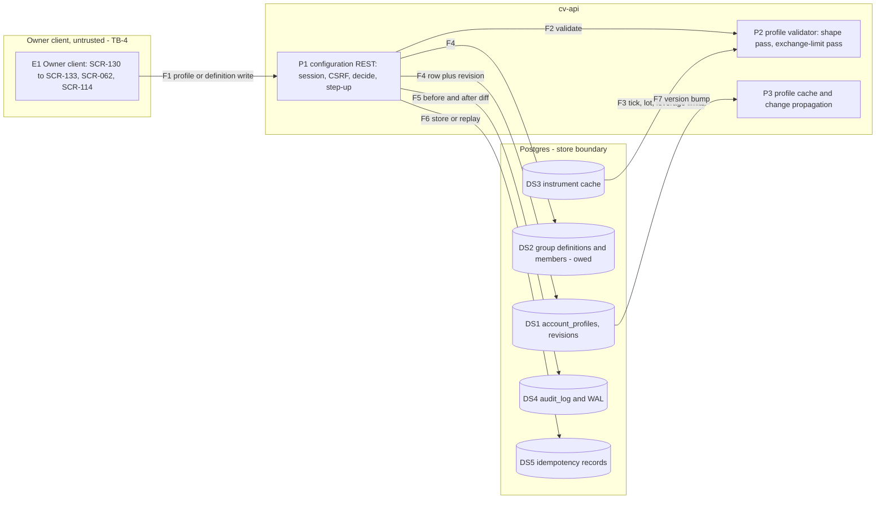
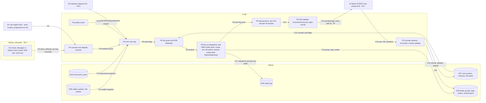
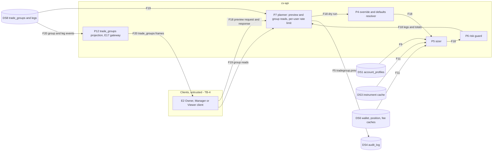

# E28 — STRIDE threat model: Per-account profiles and trade groups

- Ticket: E28-X01 (issue #910). Owner: Security engineer (CODEOWNER). Status: **Draft** for Architect and
  Security-engineer review. It stays Draft until the Owner accepts the residual risks in §11.2 and decides D8 and D11.
- Method: `docs/plan/04-security-program.md` §5 template (L x I = risk), STRIDE per element and per flow (C-12.1),
  in the four-question frame: what are we building (§1, §2), what can go wrong (§3 to §5), what are we going to do
  about it (§6, §9, §10), did we do a good job (§11). Format mirrors `E27-accounts.md`, whose trust boundaries this
  model extends. It consumes the E09 (`e09-auth-rbac.md`, U-rows), E08 (`e08-exchange-boundary.md`), E13
  (`E13-indicators.md`, IR-rows), E17 (`E17-ws-gateway.md`, WS-rows), E27 (KV-rows) and E35 (`e35-rule-engine.md`,
  RE-rows) models; those threats are **referenced, not repeated**.
- Inputs, read at `9bd49e7f`: the E28 epic and its 28 child tickets (`docs/plan/backlog/E28.json`); US-PROF-001 to
  US-PROF-008; `21-database-schema.md` §3.2.4, §3.3.2 to §3.3.4; `24-internal-schemas.md` §8.3, §8.7, §8.8, §9;
  `22-api-openapi.yaml` (profile, trade-group and preview paths with their `x-rbac`); `23-ws-protocol.md` §6.3 and
  §15.5; `20-architecture.md` §3.5 and §4.3; ADR-0006; ADR-0008; `28-statechart-catalogue.md` B2, B3 and B8; the E29,
  E32, E34 and E39 tickets that build the execution side; `candleviewer/auth/rbac_seed.json`,
  `services/api/tests/contract/rbac/matrix.yaml`, `candleviewer/api/step_up.py`, `candleviewer/audit/actions.py`; the
  E13-X01 amendment in PR #2306 (open), whose coordination comment on #910 asks for the TB-8 consumer rows (§5).
- Path: the ticket names `docs/security/e28/threat-model.md`. GOV-008 (`scripts/check_threat_model_ticket_map.py`)
  scans only `docs/security/threat-models/E<nn>-<slug>.md`, so this file is `E28-profiles-trade-groups.md` (D3).
- Timing: design-time. No E28 code is on `main` (§1.1), so this is the model C-12.1 requires before the first
  implementation ticket; it blocks E28-T01, so a finding can still change a column or a constraint (§11.1 marks the
  schema findings). Most rows are requirements (`SR-E28-nn`), each with an owning ticket and a named test.
- Gate note: design-level weaknesses only. No credential, account identifier, UID or exploit detail appears.

## 1. Scope

In scope, the seven surfaces the ticket names: profile CRUD (`/exchange-accounts/{accountId}/profiles*`) with its
templates and symbol matrix (SCR-130 to SCR-133); the sizing path (`size_leg`); the risk-guard path (`guard.check`);
the group definition surface (SCR-062); the preview (`POST /trade-groups/preview`); the override surface (per-trade
overrides, request defaults, user trading defaults on SCR-114); and the `trade_groups` projection (REST reads and the
WS topic). Also, at design level because E28 defines their inputs: the expansion of one intent into N legs across
UIDs, the per-leg native SL, partial fills and leg failures, idempotent retries, demo and live isolation per account,
per-UID rate budgets with the stop and cancel reserve, the audit of the expansion and of every leg, and the kill
switch and risk lockout during a fan-out. E34 (submission, governor, unwind), E29 (OMS), E32 (native-SL enforcement)
and E39 (lockouts, kill switch) build those; their models (E34-X01 #1045, E29-X01 #849, E32-X01 #933, E39-X01 #883)
must consume the rows here.

Out of scope: building any control (the tickets in §10); the review of built code (E28-X02); automating the matrix and
the abuse cases (E28-X03); the drills (E28-X04); pen-testing (E43); the key vault (E27, referenced); the WS gateway
mechanics (E17); the indicator kernel (E13, of which only the consumer side of TB-8 is modelled, §5).

### 1.1 State of the build at review time

| Component                                                             | Status                                  | Evidence                                                                                                                                                                                       |
| --------------------------------------------------------------------- | --------------------------------------- | ---------------------------------------------------------------------------------------------------------------------------------------------------------------------------------------------- |
| `account_profiles`, `trade_groups`, `trade_group_legs`                | not migrated                            | DDL in `21-database-schema.md` §3.2.4, §3.3.2, §3.3.3; E28-T01 (#905) lands it                                                                                                                 |
| Group definitions (named set of accounts, members, per-member enable) | not specified                           | No table in `21-database-schema.md` and no contract path: `POST /trade-groups` is fan-out execution (`createTradeGroup`, E34-S02), yet E28-T05 calls it "definition/creation"                  |
| Profile, trade-group and preview routes                               | contract only                           | `matrix.yaml` rows are `state: not_mounted` and record the capability layer only                                                                                                               |
| M13 `accounts`                                                        | E27 models only                         | No profile code. The tickets place code in `candleviewer/profiles/`, which is not a CONSTITUTION §3 module (C-3.4)                                                                             |
| M14 `oms`                                                             | scaffold                                | Only the read-only gate: `Validator.assert_order_placement_allowed` (E09-T04, `test_assert_order_placement_allowed_refuses_when_read_only` in `services/api/tests/unit/oms/test_validator.py`) |
| M17 `risk`                                                            | scaffold                                | Counters, lockouts and the kill switch are E39                                                                                                                                                 |
| Statechart contracts B2, B3, B8, B18, B20                             | JSON, contract tests, stub bindings     | `services/api/tests/xstate_contract/test_b02_trade_group.py`, `test_b03_leg.py`, `test_b08_position_protection.py`; every binding guard denies (E50-S01)                                       |
| Step-up registry (`api/step_up.py`)                                   | keys, users, lockout override           | No profile or group route; `DANGEROUS_PATH_PATTERN` does not match `/profiles`                                                                                                                 |
| Audit registry (`audit/actions.py`)                                   | `profiles.update`, `trade_group.submit` | The tickets emit other names (§8.1)                                                                                                                                                            |
| `trade_groups` WS topic                                               | registered                              | Topic row in `matrix.yaml`; account narrowing proven for private topics by `test_sub_scope_is_silently_narrowed` (E17, `services/api/tests/unit/ws/test_subscriptions.py`)                     |

A row that rests on unbuilt work names the ticket that must build and test the control. Its rating assumes the ticket
ships it; the review of that ticket (E28-X02) re-triages the row if the control is missing.

### 1.2 Assets and data classification

E28-X01 fixes this classification; every E28 child cites it rather than deciding it again (D1).

| Asset                                                                                                 | Class                                       | Where it lives                                                        | Notes                                                                   |
| ----------------------------------------------------------------------------------------------------- | ------------------------------------------- | --------------------------------------------------------------------- | ----------------------------------------------------------------------- |
| A-08 per-account profiles: sizing rule, leverage, offsets, caps, symbol lists, revisions              | Confidential, integrity-critical            | `account_profiles`, `account_profile_revisions`, the profile cache    | Tampering escalates size or removes a cap (`04-security-program.md` §2) |
| A-09 group definitions and membership                                                                 | Confidential, integrity-critical            | Table owed (F-03)                                                     | Routes orders to accounts                                               |
| Leg snapshots, sizing explanations, preview and group results (equity-derived quantity, margin, risk) | Confidential                                | `trade_group_legs.profile_snapshot`, responses, `trade_groups` frames | Served only inside the caller's grants (§4.2)                           |
| Risk counters, lockouts, kill-switch state                                                            | Internal, integrity-critical (A-18)         | M17 memory, the E39-T02 tables                                        | A wrong counter reopens a breached cap (§4.5)                           |
| Idempotency records (request hash, stored response)                                                   | Confidential                                | E28-T02 store (24 h), `trade_groups.client_group_ref`                 | Each holds a full response                                              |
| Instrument cache, fee rates                                                                           | Internal (fee rates Confidential, E27 §1.2) | `instruments`, the fee-rate cache                                     | Inputs to validation and sizing                                         |
| ATR value and its provenance                                                                          | Internal, integrity-critical                | E13 registry, across TB-8 (§5)                                        | Sets the stop distance, hence the size                                  |
| Audit events                                                                                          | Confidential, append-only                   | `audit_log`                                                           | Redacted before hashing (SR-069)                                        |

No E28 asset is Secret. A profile, a snapshot, a preview or an audit row that carries key material, a key id or an
exchange UID is a defect (§4.6).

### 1.3 Rating

Risk = L x I on the programme scale (Low / Medium / High / Critical):

| L \ I | L      | M      | H        |
| ----- | ------ | ------ | -------- |
| L     | Low    | Low    | Medium   |
| M     | Low    | Medium | High     |
| H     | Medium | High   | Critical |

Impact **H\*** marks an outcome that C-2.6 calls a Severity-1 defect (a position without a working native stop), or a
defect that repeats on every leg of a fan-out; either raises the cell one band (E27's mechanism, new triggers; D2).
Disposition: **Q** a requirement (`SR-E28-nn` or a ticket-body control) that a named ticket must build and a named test
must prove; **C** an existing control on `main`, cited with the test or rule that enforces it; **R** referenced, owned
by another epic's model; **A** accepted (Owner sign-off, §11.2). A mitigation with no enforcing test or rule is a Q or
a residual, never a C (D4). Verification layers follow `04-security-program.md` §6. Row ids are `PF-xnn`.

## 2. Data-flow diagrams and trust boundaries

The three diagrams share element ids; the coverage matrix (§3.7) lists every element once.

### 2.1 DFD-1: configuration save (profile, template or matrix apply, group definition)

The Owner saves a profile, a template-prefilled profile, a matrix change or a group definition (F1). P1 runs the E09
chain (session, CSRF, `decide`, step-up) and hands the body to the validator (F2), which checks shape, then exchange
limits from the instrument cache (F3). The row and a revision are written (F4) with an audit diff (F5); the
idempotency store answers replays (F6); the version bump invalidates the cache and reaches open tickets (F7).

### 2.2 DFD-2: order sizing and fan-out dispatch

A client, or a rule acting with its armer's identity, sends one intent with optional defaults and per-leg overrides
(F8). The resolver merges them with each account's profile snapshot and version (F9); the sizer takes the ATR across
TB-8 (F10) and one wallet and instrument snapshot per fan-out (F11); the guard reads the counters, lockouts and kill
switch (F12). The dispatcher persists the group, legs and orders before any send (F13), takes tokens from the per-UID
and per-IP buckets, and sends each leg through the environment-bound adapter (F14). Acks, fills and positions come back
untrusted (F15) and maintain the counters (F16). The expansion and every leg are audited (F17).

### 2.3 DFD-3: group preview and read projection

The preview runs the same planner as execution in dry-run mode (F18): what it shows is what would be sent. Group reads
(F19) and the `trade_groups` frames (F20) project persisted groups and legs.

Elements: external entities **E1-E5**; processes **P1-P12**; data stores **DS1-DS8**; flows **F1-F20**.

Boundaries (`04-security-program.md` §4.1, E27 model §2):

- **TB-4, client to API** (F1, F8, F18, F19, F20): untrusted until authenticated, RBAC-scoped after. The client
  enforces nothing (C-2.12); the worked example and the send-blocking predicate are advisory copies.
- **Store boundary** (F4 to F6, F13, F16, F17): a database writer is its own integrity domain; E28 adds write-once
  history (SR-E28-07).
- **TB-7** (F14, F15): owned by E08 and E27; E28 adds the per-leg environment check (SR-E28-16) and the budget rules.
- **TB-8 (E13's name)** (F10): only `server`-computed, closed-bar, non-provisional, versioned values cross. It is not
  the programme's TB-8 in `04-security-program.md` §4.1, the supply-chain boundary (D10).
- **E4** runs in-process but is semi-trusted (programme AC-06): its intents take the same P4 to P8 path (PF-E07).

## 3. STRIDE table

Columns: the existing control is what `main` does today, with the test that enforces it; the gap names the mitigation
and its ticket. `SR-E28-nn` are this model's requirements (§9). The programme rows these extend rather than repeat
(`04-security-program.md` §5.2 to §5.4, §5.7; "programme" marks an id that collides with this model's flows and
decisions): O3 → PF-T02 to PF-T07, PF-T10, PF-T20, PF-E08; O4 and programme F6 → PF-T09, PF-T20, PF-D05, PF-D06; O8 →
PF-T17, PF-T18; programme F1 → PF-E01, PF-E02; programme F2 → PF-T11, PF-T15; programme F3 and F3a → PF-D02;
programme F4 → PF-R02; programme F5 → PF-I02; R2 and R3 → PF-E07; programme D4 → PF-T02, PF-R01.

### 3.1 Spoofing

| ID     | Element / flow | Threat                                                                                                                                                                                                                                  | L   | I   | Risk   | Existing control                                                                                                                                                                                                                                                                                                                         | Gap → mitigation                                                                                                                          | Owner                      | Verify                       | Disp. | Residual |
| ------ | -------------- | --------------------------------------------------------------------------------------------------------------------------------------------------------------------------------------------------------------------------------------- | --- | --- | ------ | ---------------------------------------------------------------------------------------------------------------------------------------------------------------------------------------------------------------------------------------------------------------------------------------------------------------------------------------- | ----------------------------------------------------------------------------------------------------------------------------------------- | -------------------------- | ---------------------------- | ----- | -------- |
| PF-S01 | F8, P4, P8     | A client sets `rule_id` on `CreateTradeGroupRequest`, so a manual group is recorded as rule-originated: it takes the rule default policy (`abort_on_first`), is attributed to another user's rule and blurs `actor_type` (programme R6) | M   | M   | Medium | None: the public request schema carries `rule_id`                                                                                                                                                                                                                                                                                        | `rule_id` and the rule origin are set only on M15's internal call path; the public request refuses them (SR-E28-05)                       | P-1, E34-S02               | contract, unit               | Q     | Low      |
| PF-S02 | F1, P1         | A profile or group-definition write without a fresh step-up (a planted or stolen Owner session, or a route mounted ungated)                                                                                                             | L   | H   | Medium | Step-up is server-side per session and class (E09 U18); `test_every_mounted_dangerous_write_route_is_gated` (`services/api/tests/unit/api/test_dangerous_route_registry.py`) fails an ungated mount, but only for routes in `DANGEROUS_ROUTES` or matched by `DANGEROUS_PATH_PATTERN`, and neither covers `/profiles`                    | Register the profile and definition write routes under the existing `risk_caps` class and extend the pattern (SR-E28-02)                  | E28-T02, E28-T05           | unit (registry), integration | Q     | Low      |
| PF-S03 | F14, P10, E3   | Cross-environment signing: a leg for a demo account signed with live credentials or sent to a live host, or the reverse                                                                                                                 | L   | H   | Medium | M2 binds the environment into the AAD and a demo-bound broker never reads a live row (`test_store_refuses_other_environment`, `test_demo_bound_broker_never_reads_a_live_row`, `test_aad_binds_the_sealing_env`, all in `services/api/tests/unit/credentials_m2/test_broker_safety.py`); one immutable client per environment (E08 E8-5) | Defence in depth at the planner: intent, definition, account and process environment agree before sizing and before each send (SR-E28-16) | E27-T02 (shipped), E34-S02 | unit                         | C, Q  | Low      |
| PF-S04 | F8, P8         | A forged arm token, a CSRF-driven submit or a replayed idempotency key re-submits a group                                                                                                                                               | L   | H   | Medium | CSRF double-submit (SR-041) and `SameSite=Strict` (E09); arm toggle and per-request nonce for live (SR-043); `x-idempotency: required` on `createTradeGroup`                                                                                                                                                                             | None new; E34-X01 models the submit path                                                                                                  | E09, E34-S02               | integration                  | R     | Low      |

### 3.2 Tampering

| ID     | Element / flow | Threat                                                                                                                                                                                                                                                                                                                                                                                                                                                                                             | L   | I   | Risk     | Existing control                                                                                                                                                                                                                                                                                                                                                                                                   | Gap → mitigation                                                                                                                                                                                                                                                                                                                                | Owner                                             | Verify                               | Disp. | Residual         |
| ------ | -------------- | -------------------------------------------------------------------------------------------------------------------------------------------------------------------------------------------------------------------------------------------------------------------------------------------------------------------------------------------------------------------------------------------------------------------------------------------------------------------------------------------------- | --- | --- | -------- | ------------------------------------------------------------------------------------------------------------------------------------------------------------------------------------------------------------------------------------------------------------------------------------------------------------------------------------------------------------------------------------------------------------------ | ----------------------------------------------------------------------------------------------------------------------------------------------------------------------------------------------------------------------------------------------------------------------------------------------------------------------------------------------- | ------------------------------------------------- | ------------------------------------ | ----- | ---------------- |
| PF-T01 | F1, P1, DS1    | A Manager edits a profile directly to widen a cap                                                                                                                                                                                                                                                                                                                                                                                                                                                  | L   | H   | Medium   | `accounts:write` is Owner-only: the seed grants Managers none (`rbac_seed.json`) and `matrix.yaml` expects 403 for both Manager actors on every profile write, asserted by `test_cell_outcome_matches_matrix` (`services/api/tests/contract/rbac/test_route_matrix.py`) once the routes mount                                                                                                                      | The per-account domain check (SR-050 second layer) and the "no state change, audit row" cells                                                                                                                                                                                                                                                   | E28-T02, E28-X03                                  | contract                             | C, Q  | Low              |
| PF-T02 | F1, P2, DS1    | A cap is removed rather than raised: set to NULL, an `allowed_symbols` list emptied by a matrix "clear" or bulk action, a template or clone with wider caps, a demo profile cloned onto a live account. In the DDL NULL means "no cap" for every cap but `max_orders_per_minute`, and NULL or empty `allowed_symbols` means every listed perp                                                                                                                                                      | M   | H   | High     | Owner-only writes with step-up (PF-T01, PF-S02)                                                                                                                                                                                                                                                                                                                                                                    | Loss-bounding caps are NOT NULL on a trading-enabled profile; "all symbols" is an explicit flag, never an empty list; a relaxing change is labelled as one in the diff and notifies the Owner (SR-065); a cross-environment clone needs SCR-132's live acknowledgement (SR-E28-01)                                                              | E28-T01 (before merge), E28-T02, E28-S01, E28-S02 | integration (constraints), unit      | Q, A  | Low              |
| PF-T03 | F8, P4         | Per-ticket widening by contract: `createTradeGroup` resolves "account profile → request defaults → `legs[].overrides`, later wins" (so does E34-S01), and an override may name another `profile_id` (alternates are "selectable per ticket"). A Manager with `orders:write` raises leverage, size or the stop, or picks the account's widest profile, on every leg at once                                                                                                                         | M   | H\* | Critical | None (unbuilt); E39-T01 plans "most restrictive" for its own caps                                                                                                                                                                                                                                                                                                                                                  | The account's bound profile is the ceiling: defaults, overrides, user trading defaults and alternate profiles only narrow, field by field; a submitted value beyond a cap is rejected with `risk_limit_breached` and audited (C-12.5, D6); "later wins" becomes "later narrows" in the contract (SR-E28-03)                                     | P-1, E28-K01, E28-S05, E34-S01, E34-S02           | contract, unit, abuse (AC-04, AC-11) | Q     | Low              |
| PF-T04 | F8, P4, P5     | An override that narrows one field widens another: a tighter stop under risk-based sizing raises quantity and notional; a `fixed_qty` override replaces risk sizing; a stop override or a chart-drawn `sl_price_hint` moves the stop further from entry                                                                                                                                                                                                                                            | M   | H   | High     | None                                                                                                                                                                                                                                                                                                                                                                                                               | Narrowing is judged on the resulting leg after the sizer and the clamps re-run: quantity, notional, leverage, margin and risk at the stop may not rise, and the stop may not move away from entry (SR-E28-04)                                                                                                                                   | E28-K01, E28-S05, E28-T03                         | unit, property, abuse (AC-12)        | Q     | Low              |
| PF-T05 | P4             | The override safety floor is incomplete: E28-K01 fixes six never-widen fields and leaves `max_position_pct_equity`, `max_daily_loss_pct`, `max_concurrent_orders`, `max_orders_per_minute`, `blocked_symbols`, risk per trade, `margin_mode`, `trading_enabled`, `fallback_sl_offset_pct`, and every future field, to the spike                                                                                                                                                                    | M   | H   | High     | None; E28-S05 plans a test that fails on an unclassified field                                                                                                                                                                                                                                                                                                                                                     | Deny by default: every field is `never` unless the override ADR names it `narrow_only` with its comparator (SR-E28-04)                                                                                                                                                                                                                          | E28-K01, E28-S05                                  | unit (field coverage)                | Q     | Low              |
| PF-T06 | F8, P5, P6     | Client values treated as authority: a quantity hint, `defaults.sizing`, `requested_qty_value`, a crafted `profile_snapshot` or an "already checked" flag (E28-X03 cases 3 and 10)                                                                                                                                                                                                                                                                                                                  | M   | H\* | Critical | `CreateTradeGroupRequest` sets `additionalProperties: false` (contract only, not built)                                                                                                                                                                                                                                                                                                                            | Every client number is an input to check: the server sizes from the snapshot it took itself, refuses unknown fields and rejects a value beyond a cap instead of clamping it silently (C-12.5) (SR-E28-03, SR-E28-05)                                                                                                                            | E28-T03, E28-T04, E34-S02                         | unit, abuse (AC-03, AC-10)           | Q     | Low              |
| PF-T07 | P6             | A wildcard matches outside the listed linear USDT perps (a substring match, a bare `*`, a pattern that also catches a dated or inverse contract), so the allow-list permits more than the Owner meant                                                                                                                                                                                                                                                                                              | M   | H   | High     | None                                                                                                                                                                                                                                                                                                                                                                                                               | Anchored suffix patterns only, evaluated against listed, trading, linear USDT perpetuals; a bare `*` refused at save; the block list applied after (SR-E28-06)                                                                                                                                                                                  | E28-T04, E28-T02                                  | unit, property, abuse (AC-08)        | Q     | Low              |
| PF-T08 | DS1, DS8       | A database writer edits `account_profile_revisions` or `trade_group_legs.profile_snapshot`, so a past trade is attributed to another version (Q3) or a revision hides a widening                                                                                                                                                                                                                                                                                                                   | L   | H   | Medium   | None: "append-only" is a ticket note; the DDL has no trigger                                                                                                                                                                                                                                                                                                                                                       | Revisions INSERT-only by trigger and grants; the snapshot immutable after insert; the leg records profile id and version; the journal reads the snapshot only (SR-E28-07)                                                                                                                                                                       | E28-T01 (before merge), E41-T02                   | integration                          | Q, A  | Low              |
| PF-T09 | DS1, P2, P5    | A profile, template, override or rule yields a leg with no native SL: `require_native_sl = false`, a stop that cannot resolve, an `r_multiple` stop                                                                                                                                                                                                                                                                                                                                                | L   | H\* | High     | None on `main`; planned `ap_native_sl` CHECK and `sl_offset_value > 0`                                                                                                                                                                                                                                                                                                                                             | CHECK, API 422 `native_stop_mandatory` with an audit row, the `never` class, and a leg whose stop cannot resolve rejected (`no_native_sl_possible`) before any send (SR-E28-08); the OMS choke point is E32-T01                                                                                                                                 | E28-T01, E28-T02, E28-T03, E28-S05, E32-T01       | integration, abuse (AC-01)           | Q     | Low              |
| PF-T10 | P5             | A sizing defect repeats on every leg: float arithmetic, rounding up, a stop rounded towards entry, the fee correction or the 0.98 margin factor dropped                                                                                                                                                                                                                                                                                                                                            | M   | H\* | Critical | None                                                                                                                                                                                                                                                                                                                                                                                                               | `Decimal` end to end, floor rounding, conservative stop rounding, fee-aware risk; frozen golden vectors, ten recomputed by QA; property tests (realised risk at the stop never above budget); the TypeScript port checked against the vectors in CI (SR-E28-09)                                                                                 | E28-T03, E28-Q01, E28-S01                         | unit, property                       | Q     | Low              |
| PF-T11 | P5, P6         | Two authorities: a consumer (E30, E34, E35) re-derives size, or the same cap is enforced by two gates with two counter stores (E28-T04 `guard.check` with its own `AccountRiskState`; E39-S01 `RiskGate` with E39-T01's counters)                                                                                                                                                                                                                                                                  | M   | H   | High     | None                                                                                                                                                                                                                                                                                                                                                                                                               | One sizer; one registry mapping each cap to exactly one gate and test; counters owned by M17; a registry test over command origins and cap fields; the E28-X02 call-site review (SR-E28-10)                                                                                                                                                     | E28-T04, E39-T01, E39-S01, E28-X02, E28-T06       | unit (registry), review              | Q     | Low              |
| PF-T12 | F10, P5        | **TB-8, IR-12.** A worker, client or preset ATR feeds `sl_offset_unit="atr"`                                                                                                                                                                                                                                                                                                                                                                                                                       | M   | H\* | Critical | None in E28; E13 owns the source side                                                                                                                                                                                                                                                                                                                                                                              | SR-E28-11 (§5)                                                                                                                                                                                                                                                                                                                                  | E28-T03, E28-X03                                  | unit, static, abuse                  | Q     | Medium (E13 §12) |
| PF-T13 | F10, P5        | **TB-8, IR-45.** The kernel ATR is missing, NaN, stale or parity-flagged, and the sizer uses a worker, client or cached value, or proceeds without a stop. E28-T03 specifies the fallback for warm-up only                                                                                                                                                                                                                                                                                         | M   | H\* | Critical | None                                                                                                                                                                                                                                                                                                                                                                                                               | SR-E28-12 (§5)                                                                                                                                                                                                                                                                                                                                  | E28-T03, E28-X03, E32-T02                         | unit, abuse                          | Q     | Medium (E13 §12) |
| PF-T14 | F10, P5, P8    | **TB-8, IR-11.** A provisional Zig Zag swing becomes a structure-trailing stop or an `sl_price_hint`                                                                                                                                                                                                                                                                                                                                                                                               | M   | H   | High     | E13-S05 keeps provisional values out of the registry (E13 model)                                                                                                                                                                                                                                                                                                                                                   | SR-E28-14 (§5)                                                                                                                                                                                                                                                                                                                                  | E32-S04, E28-X03                                  | integration                          | R, Q  | Low              |
| PF-T15 | P3, P6, F9     | Race: the Owner narrows a profile while a ticket, a rule or a deferred leg still sizes or checks against the cached older version; with an unlucky cache an order neither version allows passes (E28-X04 drill 1)                                                                                                                                                                                                                                                                                  | M   | H   | High     | None                                                                                                                                                                                                                                                                                                                                                                                                               | The leg records `profile_version`; the OMS compares it with the current version in the leg-insert transaction and refuses with `profile_changed`; a narrowing PUT invalidates the cache before it returns (SR-E28-15)                                                                                                                           | E28-T02, E28-T04, E28-K01, E34-S02                | unit, drill                          | Q     | Low              |
| PF-T16 | DS2, F1        | **Q4.** A group spans environments through a later edit: a member added to a definition later (definitions have no table, so no design check covers them), or `exchange_accounts.env` changed in SQL after the leg check ran; `env` is not yet immutable (#2333)                                                                                                                                                                                                                                   | L   | H\* | High     | The API cannot change `env` (E27 KV-T04); `trg_ea_env_parent` keeps a sub-account in its parent's environment (`test_constraint_matrix` in `services/api/tests/integration/auth/test_0017_exchange_accounts_api_keys_migration.py`). Design (not built): every leg must match the group's `env`, trigger-enforced (`21-database-schema.md` §3.3.2), and E28-T05 plans a database check against each member's `env` | E28-T01 ships the leg trigger under a name, with a constraint test that names it; a definition stores `env` and a membership trigger refuses another environment; `env` immutable (#2333) and refused while the account is a member; the planner re-checks at preview and at every send (C-2.11) (SR-E28-16)                                    | E28-T01 (before merge), E28-T05, #2333, E34-S02   | integration                          | Q     | Low              |
| PF-T17 | F14, P8        | Duplicated legs: one `exchange_account_id` repeated in `legs[]` (up to 25; the contract has no uniqueness rule), or a per-leg "retry C" that starts a new attempt epoch (C-2.10) while the earlier attempt is still `Unknown`. Either opens a second position on that account; each keeps its own native SL                                                                                                                                                                                        | M   | H   | High     | Design (not built): persist before send (`20-architecture.md` §10.2) with `UNIQUE (trade_group_id, exchange_account_id)` (`21-database-schema.md` §3.3.3); no blind resubmission from `Unknown` (ADR-0006 rule 2); the same leg, intent and sequence give the same `orderLinkId` (`21-database-schema.md` §3.3.4)                                                                                                  | A uniqueness rule on `legs` in the contract, checked by the server too (`uniqueItems` cannot see two items that differ only in overrides); C-2.10's attempt epoch gets a resolved-first rule: a leg retry only after the previous attempt resolves terminal by lookup; idempotency keys and `client_group_ref` scoped per principal (SR-E28-17) | P-1, E34-S02, E34-S03, E28-T05, E28-T02           | unit, abuse (AC-15, AC-16)           | Q     | Low              |
| PF-T18 | F14, F15, DS8  | `orderLinkId` is written five ways (C-2.10; ADR-0006; `24-internal-schemas.md` §8.3 and §9.5.1; `21-database-schema.md` §3.3.4). The 32-bit `leg8` form reaches even odds of a collision near 77 000 legs, which the unique index turns into a leg that cannot be placed; uppercase base62 fails `ord_link_fmt`; the unwind form has no `cv-` prefix, so its close cannot be recorded and the unwind stalls; and "success after lookup" adopts whatever order the exchange holds under a reused id | L   | H   | Medium   | None                                                                                                                                                                                                                                                                                                                                                                                                               | One generator (E29-T02) with at least 96 bits of group and leg identity, environment and purpose tags and an alphabet `ord_link_fmt` accepts, used for entries, SL, TP and unwind; adoption first checks account, symbol, side and quantity (SR-E28-18)                                                                                         | E29-T02 (#846), E34-S03, E34-T03                  | unit, property                       | Q     | Low              |
| PF-T19 | F14, P10       | Leverage and margin mode are exchange settings per account and symbol, not per order: a leg's `set-leverage` re-levers an open position on that account, two tickets race to set it, and a profile's `margin_mode` can disagree with the account's                                                                                                                                                                                                                                                 | M   | H   | High     | None                                                                                                                                                                                                                                                                                                                                                                                                               | Leverage changes serialised per account and symbol with placement; never above the profile cap on a symbol with an open position; the guard checks the resulting position at the leverage actually set; profile and account margin mode must match (SR-E28-19)                                                                                  | E29-T04, E34-S02, E28-T04                         | integration, abuse (AC-22)           | Q, A  | Low              |
| PF-T20 | F8, P8         | Post-admission widening and SL removal: `amendTradeGroup` (`orders:write`) takes per-leg `qty`, a moved `stop_loss` and `stop_loss: null`, with neither the `native_stop_required` rule nor the never-widen check of `amendOrder`; `cancelTradeGroup` cancels "every live order", and under `tpsl_mode` Partial the SL is a separate, cancellable order                                                                                                                                            | M   | H\* | Critical | None on `main`; `amendOrder` refuses clearing an open entry's stop (`native_stop_required`, contract only)                                                                                                                                                                                                                                                                                                         | An amend re-enters the resolver, sizer and guard under SR-E28-04's comparator; `stop_loss: null` and a stop moved away from entry refused on the group route as on `amendOrder` (P-1); a cancel keeps protective orders or flattens first (SR-E28-33)                                                                                           | P-1, E34-S03, E28-X03                             | contract, abuse (AC-32)              | Q     | Low              |

### 3.3 Repudiation

| ID     | Element / flow | Threat                                                                                                                                                                                                                                                                                                                                                                                                      | L   | I   | Risk   | Existing control                                                                                                                                                                                                     | Gap → mitigation                                                                                                                                                                            | Owner                                       | Verify                       | Disp. | Residual |
| ------ | -------------- | ----------------------------------------------------------------------------------------------------------------------------------------------------------------------------------------------------------------------------------------------------------------------------------------------------------------------------------------------------------------------------------------------------------- | --- | --- | ------ | -------------------------------------------------------------------------------------------------------------------------------------------------------------------------------------------------------------------- | ------------------------------------------------------------------------------------------------------------------------------------------------------------------------------------------- | ------------------------------------------- | ---------------------------- | ----- | -------- |
| PF-R01 | F1, F5, DS4    | A profile, template, matrix or definition change, or a refusal, leaves no attributable record. The tickets emit `profile.*`, `symbol_permission.*`, `tradegroup.*` and `order.refused_by_profile`; `04-security-program.md` §8.2 names `profile.changed` and `tradegroup.created`; the registry holds only `profiles.update` and `trade_group.submit`, and the writer refuses an unregistered name (no row) | M   | H   | High   | Hash chain and append-only grants (E09 U14, U19, U20); `test_every_literal_audit_action_emitted_is_registered` (`services/api/tests/unit/audit/test_router_actions_registered.py`) fails a literal unregistered name | One registered E28 vocabulary before the first route that emits it mounts, written at the point of decision with the before/after diff (SR-065) (SR-E28-20)                                 | E28-T02, E28-T04, E28-T05, E28-S02, E28-S05 | unit (registry), integration | C, Q  | Low      |
| PF-R02 | F17, P8        | An expansion or a leg outcome (sent, skipped, refused, failed, unwound) has no record of its own, so a disputed leg cannot be explained (C-2.9, SR-064)                                                                                                                                                                                                                                                     | M   | H   | High   | None                                                                                                                                                                                                                 | One parent and one child event per leg, the intent written before the side effect (SR-061), with `orderLinkId`, decision source and profile version; skips recorded as outcomes (SR-E28-20) | E34-S02, E34-S03                            | integration                  | Q     | Low      |
| PF-R03 | F8, P4         | An override is laundered into normal policy                                                                                                                                                                                                                                                                                                                                                                 | M   | M   | Medium | None                                                                                                                                                                                                                 | `tradegroup.row_overridden{field, from, to}` and the journal tag (SR-E28-20)                                                                                                                | E28-S05                                     | integration                  | Q     | Low      |
| PF-R04 | F10, P5        | **TB-8, IR-20.** A disputed stop cannot be tied to the ATR kernel build, parameters and bar that produced it                                                                                                                                                                                                                                                                                                | M   | H   | High   | None                                                                                                                                                                                                                 | SR-E28-13 (§5)                                                                                                                                                                              | E28-T03                                     | integration                  | Q     | Low      |
| PF-R05 | F18, P7        | Previews used to probe accounts leave no trace                                                                                                                                                                                                                                                                                                                                                              | L   | M   | Low    | None                                                                                                                                                                                                                 | `tradegroup.preview` (E28-T05 body), recorded per principal (SR-E28-20)                                                                                                                     | E28-T05                                     | integration                  | Q     | Low      |

### 3.4 Information disclosure

| ID     | Element / flow      | Threat                                                                                                                                                                                                                                                                               | L   | I   | Risk   | Existing control                                                                                                                                                                                 | Gap → mitigation                                                                                                                                                                                                                             | Owner                     | Verify                  | Disp. | Residual |
| ------ | ------------------- | ------------------------------------------------------------------------------------------------------------------------------------------------------------------------------------------------------------------------------------------------------------------------------------ | --- | --- | ------ | ------------------------------------------------------------------------------------------------------------------------------------------------------------------------------------------------ | -------------------------------------------------------------------------------------------------------------------------------------------------------------------------------------------------------------------------------------------- | ------------------------- | ----------------------- | ----- | -------- |
| PF-I01 | F18, P7             | **Q2.** A preview naming an ungranted or non-existent account reveals its existence, sizing or equity. The preview is `orders:read`, and `granted_accounts` "narrows silently on reads" (programme §7.3), so a leg row, a per-leg rejection or `totals.accounts_targeted` can differ | M   | H   | High   | `decide` gives one deny for an absent and a foreign account (E09 U25)                                                                                                                            | A preview naming any account outside the grants is refused whole with one `account_scope_denied` shape, as the write is ("fails in full", programme F1); no per-leg narrowing (SR-E28-21)                                                    | E28-T05, E34-S01, E28-X03 | contract, abuse (AC-06) | Q     | Low      |
| PF-I02 | F19, F20, P12       | A group read or a `trade_groups` frame with a leg outside the grants leaks that leg's status, the whole-group `totals` and another user's `created_by`, `note` or `client_group_ref` (C-12.4: a Manager cannot see other managers)                                                   | M   | H   | High   | Private topics narrow by account (`test_sub_scope_is_silently_narrowed` in `services/api/tests/unit/ws/test_subscriptions.py`) with one `account_scope_denied` (E17 WS-I02, WS-I03)              | A group is visible only when every leg's account is granted (as `/risk/summary` treats a Viewer's partial aggregate), and otherwise looks absent; non-Owners never see another user's `created_by`, `note` or `client_group_ref` (SR-E28-21) | E28-T05, E34-T01, E28-X03 | contract, abuse (AC-29) | Q     | Low      |
| PF-I03 | F18                 | The preview permission is written two ways: the contract says `orders:read` (Viewers included), E34-S01 says `orders:write` because the preview discloses equity-derived sizing                                                                                                      | L   | M   | Low    | None                                                                                                                                                                                             | Decide once, contract-first (SR-E28-22); a granted Viewer can already read the wallet, so either answer stays inside the grant                                                                                                               | P-1, E34-S01              | contract                | Q, A  | Low      |
| PF-I04 | DS8, P5             | **Q6.** Secret material in `profile_snapshot`, a sizing explanation or a preview                                                                                                                                                                                                     | L   | H   | Medium | No serialisable model has a ciphertext field (`test_models_never_expose_secret_columns` in `services/api/tests/unit/accounts/test_account_models.py`); `Secret` refuses serialisation (E27 §4.1) | The snapshot is a projection of `AccountProfile`, never an ORM row joined to accounts or keys, proven by a serialisation test (SR-E28-07)                                                                                                    | E28-T01, E28-X02          | unit                    | C, Q  | Low      |
| PF-I05 | F6, DS5             | An idempotency key replayed by another principal returns the stored response (another account's profile or group), or a `client_group_ref`, unique across all users, is claimed by another user                                                                                      | L   | M   | Low    | None                                                                                                                                                                                             | Idempotency records keyed by principal, route and key; a stored response returned only after the caller is re-authorised; `client_group_ref` unique per creator (SR-E28-17)                                                                  | E28-T02, E34-S02          | unit                    | Q     | Low      |
| PF-I06 | F1, F19, P1, P7     | IDOR and an existence oracle on profile and group ids: a foreign and a missing id answered differently; `matrix.yaml` records `manager_without_grant: allow` on the profile reads (capability layer only)                                                                            | M   | M   | Medium | `decide` per account (E09 U15, U31)                                                                                                                                                              | Per-account cells, foreign versus non-existent, for every E28 route (E28-X03 body); 404 for out-of-scope ids (E34-T01 body)                                                                                                                  | E28-X03                   | contract                | Q     | Low      |
| PF-I07 | P6, P11 (telemetry) | Planned metrics label PnL and positions per account (`cv_account_daily_loss_usd{account}`)                                                                                                                                                                                           | L   | L   | Low    | Bounded labels: Semgrep `cv-obs-metric-label-allowlist`                                                                                                                                          | Internal account ids only (SR-E27-16)                                                                                                                                                                                                        | E28-T04                   | ci-gate                 | C     | Low      |

### 3.5 Denial of service

| ID     | Element / flow | Threat                                                                                                                                                                                                                                                                                                                                                                                                                                                                | L   | I   | Risk     | Existing control                                                                                                                                                                                                                                                                                                                                                                                                                                                                                                                                                                                                                                                                                                                        | Gap → mitigation                                                                                                                                                                                                                             | Owner                              | Verify                           | Disp.   | Residual                       |
| ------ | -------------- | --------------------------------------------------------------------------------------------------------------------------------------------------------------------------------------------------------------------------------------------------------------------------------------------------------------------------------------------------------------------------------------------------------------------------------------------------------------------- | --- | --- | -------- | --------------------------------------------------------------------------------------------------------------------------------------------------------------------------------------------------------------------------------------------------------------------------------------------------------------------------------------------------------------------------------------------------------------------------------------------------------------------------------------------------------------------------------------------------------------------------------------------------------------------------------------------------------------------------------------------------------------------------------------- | -------------------------------------------------------------------------------------------------------------------------------------------------------------------------------------------------------------------------------------------- | ---------------------------------- | -------------------------------- | ------- | ------------------------------ |
| PF-D01 | F18, P7        | Preview amplification: "safe to call on every keystroke", up to 25 legs, and a wallet "≤2 s old or refreshed" (`24-internal-schemas.md` §9.4, E34-S01) turn keystrokes into exchange reads from the `poll` bucket and against the per-IP ceiling; the per-user rate is 20/s (E28-T05) or 5/s (E34-S01)                                                                                                                                                                | M   | H   | High     | None                                                                                                                                                                                                                                                                                                                                                                                                                                                                                                                                                                                                                                                                                                                                    | The preview reads caches only and makes no exchange call (a stale wallet makes the leg `warn`, without risk sizing); at most 20 unique legs; one per-user rate (SR-E28-22)                                                                   | E28-T05, E34-S01                   | unit (adapter call count), load  | Q       | Low                            |
| PF-D02 | F14, P9        | Fan-out amplification against the reserve: N legs times entry, SL attach and TP ladder; `max_concurrent_legs` up to 20 from the client; an entry that got `10018` retries "inside the `critical` bucket" (`20-architecture.md` §4.3) and drains the stop and cancel reserve; a per-IP `10018` back-off of 10 min strands a separate SL attach (programme F3a); the reserve is 30 % (C-12.7), 40 % (ADR-0008, E34-T02) or 10 % (`24-internal-schemas.md` §8.7, §9.5.1) | M   | H\* | Critical | None                                                                                                                                                                                                                                                                                                                                                                                                                                                                                                                                                                                                                                                                                                                                    | Entry retries never draw `critical`; the pre-flight also reserves against the per-IP bucket and keeps a critical share; the server caps concurrency at 5; the SL rides on the entry; one reserve value that meets C-12.7 (SR-E28-23)         | E34-T02, E34-S02, E34-T03          | load, chaos                      | R, Q    | Low                            |
| PF-D03 | P6, DS7        | The guard cannot read its inputs (counters rebuilding, Postgres down, a cold cache, an exception) and either permits (an `except` that falls through) or blocks risk-reducing orders too                                                                                                                                                                                                                                                                              | M   | H   | High     | None                                                                                                                                                                                                                                                                                                                                                                                                                                                                                                                                                                                                                                                                                                                                    | Fail closed for position-opening orders on every error path; cancels, reduce-only closes and flatten never wait on the guard; any `cv_risk_guard_fail_closed_total` increase pages (SR-E28-24)                                               | E28-T04, E28-Q03, E28-X02          | unit, chaos (E28-Q03 scenario 3) | Q       | Low                            |
| PF-D04 | F3, P2         | The instrument cache is unavailable or stale during a save                                                                                                                                                                                                                                                                                                                                                                                                            | L   | M   | Low      | None                                                                                                                                                                                                                                                                                                                                                                                                                                                                                                                                                                                                                                                                                                                                    | Refuse with `instrument_cache_unavailable` and `Retry-After`; single-flight refresh within the 10 req/s ceiling (SR-044b); never save unvalidated (E28-T02 body)                                                                             | E28-T02, E28-Q03                   | chaos (E28-Q03 scenario 4)       | Q       | Low                            |
| PF-D05 | P8, P11, DS8   | Partial execution leaves a position unprotected: a partial fill whose separate SL attach is starved or fails; an algo child (scaled, iceberg) that opens before its position SL; B3's `closing` path ends in `error` on `CLOSE_FAILED` without `verify_sl`. B3's `KILL` also ends a leg in `error`, so the group view loses the order's outcome, although the order itself is resolved (INV-B1-h)                                                                     | M   | H\* | Critical | B1 contract: KILL from a submitted state writes its audit first and sends one cancel under the same `orderLinkId` (INV-B1-h, `test_inv_b1_h_kill_at_most_one_cancel_only_if_submitted` in `services/api/tests/xstate_contract/test_b01_order.py`); B8 contract: `protected` only from an exchange read, and KILL lets an unconfirmed SL attach finish (`test_inv_b8_a_protected_only_from_exchange_read`, `test_b08_kill_during_unconfirmed_sl_lets_attach_finish`, both in `services/api/tests/xstate_contract/test_b08_position_protection.py`). Design: `NativeStopGuard` attaches or closes within 3 s (ADR-0008 rule 2); no blind resubmission, reconciliation by `orderLinkId` (ADR-0006 rules 2 and 4); the `ix_tgl_no_sl` alarm | The SL rides on every leg's entry; a separate attach is reserved before the send; the `closing` path gains `verify_sl`; the leg view takes the order's resolved outcome after a KILL; the watchdog runs whatever the group state (SR-E28-25) | E34-S02, E34-S03, E32-T01, E32-T02 | contract, chaos (E34-Q04)        | C, R, Q | Low                            |
| PF-D06 | P5             | A stop beyond the liquidation price: at high leverage a wide stop, or the 2 % fallback from about 45x, lies past liquidation, so the native SL never fires first. Separately, a gap fills a stop-market order beyond its price                                                                                                                                                                                                                                        | M   | H\* | Critical | None                                                                                                                                                                                                                                                                                                                                                                                                                                                                                                                                                                                                                                                                                                                                    | The sizer refuses a leg whose stop is not inside the estimated liquidation distance, with a buffer, at the leg's leverage and margin mode (`stop_beyond_liquidation`); the validator warns at save (SR-E28-26)                               | E28-T03, E28-T02                   | unit, property, abuse (AC-27)    | Q, A    | Low (gap risk accepted, §11.2) |
| PF-D07 | P8             | The failure policy is written four ways: the contract's `atomicity` with `compensate`; three policies with automatic unwind (`24-internal-schemas.md` §9.5); `fanout_policy` with `Deferred` (`20-architecture.md` §4.3); ADR-0008's states. A user who chose "all or none" can end with an open, asymmetric group                                                                                                                                                    | M   | M   | Medium   | `test_inv_b2_c_all_or_none_never_rests_partially_open` (B2 contract, `services/api/tests/xstate_contract/test_b02_trade_group.py`)                                                                                                                                                                                                                                                                                                                                                                                                                                                                                                                                                                                                      | One policy vocabulary and one state set across the four documents (SR-E28-25)                                                                                                                                                                | E34-T03, E28-T06                   | contract                         | C, Q    | Low                            |
| PF-D08 | DS4            | A flood of refused, audited attempts fills the audit WAL; a stalled WAL then refuses risk-reducing borrows (E27 KV-D04)                                                                                                                                                                                                                                                                                                                                               | L   | M   | Low      | Per-session limits (SR-044); the WAL survives a Postgres outage (E09-T02)                                                                                                                                                                                                                                                                                                                                                                                                                                                                                                                                                                                                                                                               | None new; the E28 routes inherit the per-session limits                                                                                                                                                                                      | E09                                | load                             | R       | Low                            |
| PF-D09 | P12, F20       | `trade_groups` fan-out to slow consumers                                                                                                                                                                                                                                                                                                                                                                                                                              | M   | M   | Medium   | E17 WS-D01 and SR-073; 100 ms conflation                                                                                                                                                                                                                                                                                                                                                                                                                                                                                                                                                                                                                                                                                                | None new                                                                                                                                                                                                                                     | E17                                | load                             | R       | Low                            |

### 3.6 Elevation of privilege

| ID     | Element / flow  | Threat                                                                                                                                                                                                                                                                                                | L   | I   | Risk     | Existing control                                                                                                                                                                                                                                                                                                                                                                                   | Gap → mitigation                                                                                                                                                                                                                                         | Owner                                       | Verify                                              | Disp. | Residual |
| ------ | --------------- | ----------------------------------------------------------------------------------------------------------------------------------------------------------------------------------------------------------------------------------------------------------------------------------------------------- | --- | --- | -------- | -------------------------------------------------------------------------------------------------------------------------------------------------------------------------------------------------------------------------------------------------------------------------------------------------------------------------------------------------------------------------------------------------- | -------------------------------------------------------------------------------------------------------------------------------------------------------------------------------------------------------------------------------------------------------- | ------------------------------------------- | --------------------------------------------------- | ----- | -------- |
| PF-E01 | F8, F18, P7, P8 | A Manager reaches an unassigned account through a group: legs or a definition that include an ungranted account, a grant revoked between preview and send, a rule armed under an old grant (RE-E1)                                                                                                    | M   | H\* | Critical | Capability plus per-account `decide` (E09 U15, U31); `matrix.yaml` rows for every E28 route (capability layer)                                                                                                                                                                                                                                                                                     | The per-leg domain check at send, not only at admission (SR-050); the whole group refused on any gap (programme F1); visibility all or nothing (SR-E28-21); re-checked before every leg send (SR-E28-27)                                                 | E34-S02, E28-T05, E28-X03                   | contract, abuse (AC-06)                             | Q     | Low      |
| PF-E02 | F1, DS2         | Group-definition authorship is undefined (no contract path, no table); if Managers may write definitions, a shared group can gain an ungranted or other-environment member                                                                                                                            | M   | H   | High     | None                                                                                                                                                                                                                                                                                                                                                                                               | Definition CRUD contract-first and Owner-only (`accounts:write`, step-up) until the Owner decides otherwise (D8); membership re-checked against the grants at every use (SR-E28-31)                                                                      | P-1, E28-T01, E28-T05, E28-S03              | contract                                            | Q     | Low      |
| PF-E03 | P6              | A position-opening order passes as reduce-only (`intent: scale_out`, a client `reduce_only`, a hedge-mode `position_idx` on the other side) and skips the symbol and open-position gates                                                                                                              | M   | H   | High     | None                                                                                                                                                                                                                                                                                                                                                                                               | The exemption applies only when the outbound order carries an exchange-enforced `reduceOnly` on the matching side, never on a label; the kill switch and a disabled account are never exempt (SR-E28-30)                                                 | E28-T04, E39-T01                            | unit, abuse (AC-28)                                 | Q     | Low      |
| PF-E04 | P8, DS7         | The kill switch or a lockout is engaged during a fan-out: admission checks once, but deferred legs (up to 5 s; `20-architecture.md` §4.3 re-sends them with no re-check), retries, TP ladders and algo children are sent afterwards (C-2.21)                                                          | M   | H\* | Critical | Design: the fan-out consults E39's validator before any adapter call (E34-S02), and E39-S03 refuses every order and amend path with `trading_disabled` and marks legs `kill_switch_engaged`; B8 keeps the SL path on KILL. On `main` only the read-only gate is checked per call (`test_assert_order_placement_allowed_refuses_when_read_only` in `services/api/tests/unit/oms/test_validator.py`) | "Before any adapter call" must mean every adapter call: kill switch, lockout, live gate, `trading_enabled` and the grant consulted synchronously before each position-opening send, with a test per kind of send; risk-reducing calls exempt (SR-E28-27) | E34-S02, E39-S03, E29-T04                   | unit, e2e (E39-Q02)                                 | Q     | Low      |
| PF-E05 | P1 (E39 route)  | A Manager clears a risk lockout and reopens a breached cap: `overrideRiskLockout` is `killswitch:write` with `scope: none`, Managers hold `killswitch:write`, and `matrix.yaml` records `manager_with_grant: allow` and `manager_without_grant: allow`, while programme §7.2.2 row 34 says Owner only | M   | H   | High     | The route is in `DANGEROUS_ROUTES` (class `risk_caps`); step-up does not stop a Manager                                                                                                                                                                                                                                                                                                            | An explicit Owner check, or an Owner-only permission, on lockout override and kill-switch release; matrix row 34 expects 403 for Managers (SR-E28-28)                                                                                                    | E39-S02, E39-S03, E39-X02, E28-X03          | contract, abuse (AC-18)                             | Q     | Low      |
| PF-E06 | DS7, P11        | **Q5.** Counter desynchronisation reopens a breached cap: two counter stores, a permissive rebuild window, executions missed across a reconnect, a rollover on the wall clock or twice under skew, a breach held only in memory                                                                       | M   | H   | High     | None                                                                                                                                                                                                                                                                                                                                                                                               | One counter owner (M17); the breach persisted before the refusal returns; entries refused until the rebuild completes; reconnect backfill; an idempotent day key from exchange time (SR-E28-10, SR-E28-29; §4.5)                                         | E39-T01, E39-S02, E28-T04, E28-Q03, E28-X04 | chaos, drill                                        | Q     | Low      |
| PF-E07 | E4, P4          | A rule action skips the sizer or the guard, or a rule enlarges size beyond caps (programme R2)                                                                                                                                                                                                        | M   | H   | High     | —                                                                                                                                                                                                                                                                                                                                                                                                  | E35 model RE-E1; SR-102, SR-103; E39-S01's origin registry; rules reach the same P4 to P8 path (SR-E28-10)                                                                                                                                               | E35, E39-S01                                | —                                                   | R     | Low      |
| PF-E08 | P6, DS7         | Concurrent admission (TOCTOU): two commands on one account each read the counters before either's fills update them, so `max_open_positions`, position notional, daily-loss headroom and `max_concurrent_orders` each pass once per command                                                           | M   | H   | High     | None; the order lifecycle names a `pending_submit: validate + reserve risk` step (`21-database-schema.md` §3.3.1) that no ticket builds                                                                                                                                                                                                                                                            | Headroom reserved atomically per account in the admission transaction, released on reject or cancel and converted on fill; a property or chaos test of simultaneous admissions (SR-E28-32)                                                               | E39-S01, E28-T04, E28-Q03, E28-X03          | property, chaos (E28-Q03 scenario 9), abuse (AC-33) | Q     | Low      |

### 3.7 Coverage matrix

Cells list the rows that analyse the category. `n/a·ee`: an external entity, for which STRIDE-per-element weighs
spoofing and repudiation only; its other categories are analysed on its flows. `n/a·ds`: a data store neither acts
nor authenticates; spoofing, repudiation and elevation are analysed on the processes that write it (the audit store
excepted). `n/a·df`: a data flow carries no identity and takes no action; spoofing, repudiation and elevation are
analysed on its endpoints. Rows of other models are cited by their model.

| Element / flow                         | S                                            | T                                                              | R                                          | I                                                                     | D                                                                               | E                                                     |
| -------------------------------------- | -------------------------------------------- | -------------------------------------------------------------- | ------------------------------------------ | --------------------------------------------------------------------- | ------------------------------------------------------------------------------- | ----------------------------------------------------- |
| E1 Owner client                        | PF-S02; E09 model U18                        | n/a·ee                                                         | PF-R01                                     | n/a·ee                                                                | n/a·ee                                                                          | n/a·ee                                                |
| E2 Owner, Manager or Viewer client     | PF-S01, PF-S04                               | n/a·ee                                                         | PF-R02, PF-R05                             | n/a·ee                                                                | n/a·ee                                                                          | n/a·ee                                                |
| E3 Bybit                               | PF-S03; E08 model E8-1                       | n/a·ee                                                         | PF-R02 (exchange outcome recorded per leg) | n/a·ee                                                                | n/a·ee                                                                          | n/a·ee                                                |
| E4 Rule engine                         | PF-S01 (origin)                              | n/a·ee                                                         | E35 model; SR-062 `actor_type`             | n/a·ee                                                                | n/a·ee                                                                          | PF-E07                                                |
| E5 Indicator registry                  | PF-T12 (an ATR from a wrong source)          | n/a·ee                                                         | PF-R04                                     | n/a·ee                                                                | n/a·ee                                                                          | n/a·ee                                                |
| P1 Configuration REST                  | PF-S02                                       | PF-T01, PF-T02, PF-T16                                         | PF-R01                                     | PF-I05, PF-I06                                                        | PF-D04, PF-D08                                                                  | PF-E02, PF-E05                                        |
| P2 Profile validator                   | N/A: in-process, called by P1 only           | PF-T02, PF-T09                                                 | PF-R01 (refusals)                          | N/A: errors name the symbol and the exchange limit, public data       | PF-D04                                                                          | N/A: no authority of its own; P1 decides who may save |
| P3 Profile cache and propagation       | N/A: internal                                | PF-T15                                                         | PF-R01 (version history)                   | N/A: same data as DS1, inside the process                             | PF-T15 (a lagging cache)                                                        | PF-T15                                                |
| P4 Override and defaults resolver      | PF-S01                                       | PF-T03, PF-T04, PF-T05, PF-T06                                 | PF-R03                                     | N/A: no output beyond the caller's own request                        | PF-D01 (through P7)                                                             | PF-T03, PF-E07                                        |
| P5 Sizer                               | N/A: pure function; its inputs are F9 to F11 | PF-T10, PF-T12, PF-T13, PF-T14, PF-T04, PF-T06, PF-T09, PF-T11 | PF-R04                                     | PF-I04                                                                | PF-D06                                                                          | PF-T11                                                |
| P6 Risk guard                          | N/A: pure function over F12                  | PF-T07, PF-T11, PF-T06, PF-T15                                 | PF-R01 (`order.refused_by_profile`)        | PF-I07                                                                | PF-D03                                                                          | PF-E03, PF-E06, PF-E08                                |
| P7 Planner and preview                 | PF-S04                                       | PF-T17                                                         | PF-R05                                     | PF-I01, PF-I02, PF-I03, PF-I06                                        | PF-D01                                                                          | PF-E01                                                |
| P8 Dispatcher and OMS choke point      | PF-S01, PF-S04                               | PF-T15, PF-T17, PF-T18, PF-T14, PF-T20                         | PF-R02                                     | N/A: returns per-leg results to the caller only (PF-I02 covers reads) | PF-D02, PF-D05, PF-D07                                                          | PF-E01, PF-E04                                        |
| P9 Rate governor                       | N/A: in-process library                      | PF-D02 (a borrowed reserve)                                    | PF-R02 (`ratelimit.rejected`)              | N/A: token counts only                                                | PF-D02                                                                          | PF-D02 (entries taking `critical`)                    |
| P10 M4 adapter                         | PF-S03; E08 model E8-5                       | PF-T19                                                         | PF-R02                                     | E08 model; E27 model KV-I16                                           | PF-D02                                                                          | E27 model KV-E14                                      |
| P11 Streams, reconciler, counters      | N/A: inputs are F15                          | PF-T18 (adoption)                                              | PF-R02                                     | PF-I07                                                                | PF-D05                                                                          | PF-E06                                                |
| P12 `trade_groups` projection          | E17 model WS-S01 to WS-S06                   | E17 model WS-T07                                               | E17 model WS-R01                           | PF-I02                                                                | PF-D09                                                                          | PF-E01; E17 model WS-E01, WS-E02                      |
| DS1 Profiles and revisions             | n/a·ds                                       | PF-T02, PF-T08, PF-T01, PF-T09                                 | n/a·ds                                     | PF-I04                                                                | PF-D04 (a save refused)                                                         | n/a·ds                                                |
| DS2 Group definitions                  | n/a·ds                                       | PF-T16, PF-E02                                                 | n/a·ds                                     | PF-I02                                                                | N/A: read at plan time only; Postgres down blocks order entry (ADR-0006 rule 7) | PF-E02                                                |
| DS3 Instrument cache                   | n/a·ds                                       | PF-T07 (the listed universe)                                   | n/a·ds                                     | N/A: public exchange metadata                                         | PF-D04                                                                          | n/a·ds                                                |
| DS4 Audit log and WAL                  | n/a·ds                                       | E09 model U14, U19                                             | PF-R01, PF-R02                             | N/A: redacted before hashing (SR-069)                                 | PF-D08                                                                          | n/a·ds                                                |
| DS5 Idempotency records                | n/a·ds                                       | PF-T17                                                         | n/a·ds                                     | PF-I05                                                                | N/A: bounded by the 24 h window and per-session limits                          | n/a·ds                                                |
| DS6 Wallet, position, fee caches       | n/a·ds                                       | PF-T19 (a stale position)                                      | n/a·ds                                     | PF-I02, PF-I07                                                        | PF-D01 (refresh-on-read)                                                        | n/a·ds                                                |
| DS7 Counters, lockouts, kill switch    | n/a·ds                                       | PF-E06                                                         | n/a·ds                                     | PF-I07                                                                | PF-D03                                                                          | PF-E04, PF-E06, PF-E08                                |
| DS8 Groups, legs, orders, unwind plans | n/a·ds                                       | PF-T08, PF-T17, PF-T18                                         | n/a·ds                                     | PF-I02, PF-I04                                                        | PF-D05                                                                          | n/a·ds                                                |
| F1 Configuration write                 | PF-S02                                       | PF-T02, PF-T16, PF-T01                                         | PF-R01                                     | PF-I06                                                                | PF-D04                                                                          | PF-E02                                                |
| F2 Validate                            | n/a·df                                       | PF-T02                                                         | n/a·df                                     | N/A: in-process call                                                  | N/A: in-process call                                                            | n/a·df                                                |
| F3 Instrument limits                   | n/a·df                                       | PF-T07                                                         | n/a·df                                     | N/A: public data                                                      | PF-D04                                                                          | n/a·df                                                |
| F4 Row plus revision                   | n/a·df                                       | PF-T08                                                         | n/a·df                                     | N/A: inside the store boundary                                        | N/A: one write per save                                                         | n/a·df                                                |
| F5 Audit diff                          | n/a·df                                       | E09 model U19                                                  | PF-R01, PF-R05                             | N/A: redacted (SR-069)                                                | PF-D08                                                                          | n/a·df                                                |
| F6 Idempotency store or replay         | n/a·df                                       | PF-T17                                                         | n/a·df                                     | PF-I05                                                                | N/A: bounded window                                                             | n/a·df                                                |
| F7 Version bump                        | n/a·df                                       | PF-T15                                                         | n/a·df                                     | N/A: ids and versions only                                            | PF-T15 (late delivery)                                                          | n/a·df                                                |
| F8 Intent, defaults, overrides         | PF-S01, PF-S04                               | PF-T03, PF-T04, PF-T06, PF-T20                                 | PF-R03                                     | N/A: the caller's own request                                         | PF-D01                                                                          | PF-E01                                                |
| F9 Profile snapshot and version        | n/a·df                                       | PF-T15                                                         | n/a·df                                     | PF-I04                                                                | N/A: in-process read                                                            | n/a·df                                                |
| F10 ATR across TB-8                    | PF-T12                                       | PF-T12, PF-T13, PF-T14                                         | PF-R04                                     | N/A: derived from public market data                                  | PF-T13 (unavailable)                                                            | n/a·df                                                |
| F11 Wallet and instrument snapshots    | n/a·df                                       | PF-T19                                                         | n/a·df                                     | PF-I01                                                                | PF-D01                                                                          | n/a·df                                                |
| F12 Counters and flags                 | n/a·df                                       | PF-E06                                                         | n/a·df                                     | N/A: in-process read                                                  | PF-D03                                                                          | n/a·df                                                |
| F13 Group, legs, orders                | n/a·df                                       | PF-T08, PF-T17                                                 | n/a·df                                     | N/A: inside the store boundary                                        | N/A: one transaction per transition                                             | n/a·df                                                |
| F14 Per-leg send                       | PF-S03                                       | PF-T18, PF-T19, PF-T17                                         | n/a·df                                     | E08 model                                                             | PF-D02, PF-D05                                                                  | n/a·df                                                |
| F15 Acks, fills, positions             | PF-S03 (wrong environment)                   | PF-T18                                                         | PF-R02                                     | E08 model                                                             | PF-D05                                                                          | n/a·df                                                |
| F16 Counter updates, rebuild           | n/a·df                                       | PF-E06                                                         | n/a·df                                     | N/A: in-process                                                       | PF-D03                                                                          | n/a·df                                                |
| F17 Expansion and per-leg audit        | n/a·df                                       | E09 model U19                                                  | PF-R02                                     | N/A: redacted (SR-069)                                                | PF-D08                                                                          | n/a·df                                                |
| F18 Preview                            | PF-S04                                       | PF-T17                                                         | PF-R05                                     | PF-I01, PF-I03                                                        | PF-D01                                                                          | PF-E01                                                |
| F19 Group reads                        | n/a·df                                       | N/A: read only                                                 | n/a·df                                     | PF-I02, PF-I06                                                        | PF-D01                                                                          | n/a·df                                                |
| F20 `trade_groups` frames              | n/a·df                                       | E17 model WS-T07                                               | n/a·df                                     | PF-I02                                                                | PF-D09                                                                          | n/a·df                                                |

Every category of every element and flow is analysed or marked N/A with its reason. Counts: 53 rows (4 S, 20 T, 5 R,
7 I, 9 D, 8 E). Inherent: 11 Critical, 24 High, 12 Medium, 6 Low. Dispositions (a row may carry two): Q 48, C 7, R 7,
A 5. Residual after the requirements ship: Medium on PF-T12 and PF-T13 (the E13 §12 residual of IR-12 and IR-45),
everything else Low.

## 4. The six questions

### 4.1 Can a Manager widen their own effective caps through any path? (Q1)

**Answer: yes, on paper, by four routes; each has a mitigation with an owner.** The direct route is closed:
`accounts:write` is Owner-only in the seed and in `matrix.yaml` (PF-T01). Templates and the matrix have no write path of
their own; E28-S02 sends both through the same Owner-only, step-up `PUT` (PF-T02). A group edit that adds an account
with a wider profile widens nothing, because each leg is sized by its own account's profile (programme F2) and a group
outside the grants is invisible (PF-E01). The open routes are: (1) the contract's "later wins" resolution of request
defaults, `legs[].overrides` and an alternate `profile_id`, which `orders:write` reaches, and SCR-114's user trading
defaults if they ride the same layer (PF-T03, SR-E28-03); (2) narrowing judged field by field, so a tighter stop raises a
risk-based size (PF-T04, PF-T05, SR-E28-04); (3) the lockout override, which Managers pass at the capability layer
(PF-E05, SR-E28-28); (4) a group amend after admission, which takes per-leg `qty` and a moved or null `stop_loss` with
neither `amendOrder`'s native-stop rule nor a never-widen check, and a group cancel that can take a separate SL
(PF-T20, SR-E28-33). Two commands sent at once can also pass the same headroom (PF-E08, SR-E28-32). The clamp wording
matters too: C-12.5 rejects a leg that violates a cap rather than clamping it silently (D6). Owners: E28-K01, E28-S05,
E34-S01 and P-1 for (1) and (2); E39-S02 and E28-X03 for (3); E34-S03 and P-1 for (4).

### 4.2 Can a preview leak the existence, sizing or equity of an ungranted account? (Q2)

**Answer: yes, as designed today.** The preview is `orders:read`; the programme narrows `granted_accounts` silently on
reads (§7.3), and the preview takes an explicit `legs[].exchange_account_id` list from the client. Depending on how the
narrowing is built, an ungranted leg is dropped, rejected per leg or counted in `totals`, and each of those is an
oracle. Group reads and `trade_groups` frames carry whole-group `totals`, `client_group_ref`, `created_by` and `note`
(PF-I01, PF-I02). Mitigation SR-E28-21: a preview or a group is served only when every leg's account is in the grants,
and otherwise answered with the one shape used for a non-existent account, the rule `/risk/summary` already applies
to a Viewer's partial aggregate. Owner: E28-T05, with E34-S01 and E34-T01; proof: E28-X03 case 6 and AC-29.

### 4.3 Can a profile edit retroactively change an open position's attribution? (Q3)

**Answer: no through any application path, provided SR-E28-07 lands.** Every order has a leg
(`orders.trade_group_leg_id`; NULL only for adopted orders); the leg freezes a full copy of the profile at fan-out
(ADR-0008 rule 3, INV-B3-a, the E28-T01 scenario "Leg snapshot survives a profile edit"); a profile delete sets
`account_profile_id` to NULL and keeps the snapshot; versions bump under `If-Match`. What is missing: nothing makes the
revisions or the snapshot write-once in the database, the leg does not record the version, and the journal (E41) could
read the live row (PF-T08). SR-E28-07 adds INSERT-only revisions, an immutable snapshot, the version on the leg and the
rule that the journal attributes by snapshot. Owner: E28-T01, before it merges.

### 4.4 Can a group come to span environments through a later account edit? (Q4)

**Answer: yes for group definitions as designed; for executed groups, only through a SQL relabel.** The execution
table promises that every leg matches the group's `env`, trigger-enforced (`21-database-schema.md` §3.3.2), and E28-T05
plans a database check against each member's `env`; neither is built, the trigger is named nowhere, and definitions
have no table, so a member added to a definition later is checked by nothing. `exchange_accounts.env` is immutable only
in the API (KV-T04), not in SQL (#2333), so an account relabelled after the check passes (PF-T16). The M2 environment
binding still stops a live key signing in a demo process (PF-S03), so the residual failure is a demo-intended group
placing orders on a live UID in the live process, which C-2.11 forbids. SR-E28-16: E28-T01 ships the leg trigger under a
name and tests it by that name, a definition stores `env` with a membership trigger, `env` becomes immutable and is
refused while the account is a member, and the planner re-checks every environment at preview and at every send. Owner:
E28-T01 (schema, before merge), E28-T05, #2333, E34-S02.

### 4.5 Can the in-memory risk counters be desynchronised to reopen a breached cap? (Q5)

**Answer: yes, through seven paths; analysed with E28-Q03's chaos scenarios.** Each path, its test and the gap:

| Path                                                                                                                    | E28-Q03 scenario or drill   | Gap                                                                             |
| ----------------------------------------------------------------------------------------------------------------------- | --------------------------- | ------------------------------------------------------------------------------- |
| Restart: counters rebuild while entries are admitted                                                                    | Scenario 1; E28-X04 drill 3 | Refuse entries until the rebuild completes (E39-T01's `risk_state_unavailable`) |
| WS reconnect: executions missed in the gap (under-count reopens) or replayed (double count over-refuses, the safe side) | Scenario 2                  | Backfill executions for the gap window before re-admitting (E29-T06)            |
| Postgres unavailable during evaluation                                                                                  | Scenario 3                  | Fail closed for entries only (SR-E28-24)                                        |
| Clock skew of ±90 s across 00:00 UTC                                                                                    | Scenario 5                  | Day key from exchange time, rollover idempotent                                 |
| Two counter stores (E28-T04 and E39-T01) disagree                                                                       | none; add scenario 6        | One owner, M17 (SR-E28-10)                                                      |
| A breach held only in memory, lost on a crash before the lockout row is written                                         | none; add scenario 7        | Persist the lockout before the refusal returns (SR-E28-29)                      |
| Two admissions on one account read the same headroom (PF-E08)                                                           | none; add scenario 9        | Reserve headroom atomically in the admission transaction (SR-E28-32)            |

A Manager clearing the lockout (PF-E05) reopens the cap without any desynchronisation; E28-X03 adds that cell and
E28-Q03 scenario 8 repeats the attempt during a rebuild. Owners: E39-T01, E39-S02, E28-T04, E28-Q03, E28-X04.

### 4.6 Can `profile_snapshot` ever contain secret material? (Q6)

**Answer: no by construction, if the snapshot is built from the domain model.** `AccountProfile`
(`24-internal-schemas.md` §9.2) has no credential, key or UID field; ciphertext columns exist only in M2's internal
type, and no serialisable model carries one (`test_models_never_expose_secret_columns`). The risk is an implementer
snapshotting an ORM row joined to `exchange_accounts` or `api_keys` (PF-I04). SR-E28-07 makes the snapshot a projection
of `AccountProfile` and proves it with a serialisation test over a secret-shaped corpus; E28-X02 re-proves it.

### 4.7 Decisions recorded

The kickoff and review sessions with the Architect and the Owner are replaced, as for E12, E17 and E27, by this
agent-written model, two independent reviews and the Owner's acceptance of residual risk (agent-delivery
adaptation, C-10.1).

- **D1** The classification in §1.2. **D2** The rating in §1.3, including H\*. **D3** The file is
  `E28-profiles-trade-groups.md` (GOV-008 naming).
- **D4** Dispositions Q, C, R, A (§1.3): a control without an enforcing test or rule is a requirement, not a mitigation.
- **D5** Design-time scope: rows on E34, E29, E32 and E39 work are requirements on their tickets and inputs to their
  models, not a substitute for them.
- **D6** C-12.5 wins over the clamp wording: a submitted value beyond a cap is rejected with `risk_limit_breached` and
  audited. The sizer's own policy clamp stays, recorded in the explanation and shown in the preview, so it is never
  silent. SR-052's "clamped or rejected", E28-S05's "clamps and proceeds" and E28-X03 case 3 align to this.
- **D7** The bound (default) profile is each account's ceiling; alternates, templates, overrides, defaults and rules
  only narrow it.
- **D8 (open, Owner)** Group definitions are Owner-only until the Owner decides otherwise, before E28-T05 merges.
- **D9** An accessible path that bypasses a control (a shortcut or a screen-reader action that skips step-up, the diff
  summary, the live acknowledgement or the send-blocking predicate; a hotkey that switches environment, C-2.11) is a
  security finding: E28-Q04 escalates it to Security rather than filing it as a usability bug.
- **D10** TB-8 here means E13's indicator-registry boundary, not the programme's supply-chain TB-8.
- **D11 (open, Owner)** "No cap" is not representable on a trading-enabled profile, and "all symbols" is an explicit
  flag (SR-E28-01); decided before E28-T01 merges, because it changes the DDL.

## 5. TB-8 consumer rows (the E13-X01 hand-off)

E13 guarantees closed, confirmed, kernel-sourced, versioned values at the registry; E28 is the consumer that must read
only those. PR #2306 (open) moves the owning tests from E13-S08 to E28-T03 and E28-X03; until it merges,
`E13-indicators.md` on `main` still names E13-S08. This model takes the consumer side either way. RSK-060 stays Critical
until these tests exist, and E28-T03 must not merge without them (E13 model §12).

| E13 row                 | What crosses TB-8                                                   | E28 row | Requirement | Test, owed by the named ticket                                                                                                                      | E13 abuse case re-run by E28-X03 |
| ----------------------- | ------------------------------------------------------------------- | ------- | ----------- | --------------------------------------------------------------------------------------------------------------------------------------------------- | -------------------------------- |
| IR-12 ATR source        | ATR for `sl_offset_unit="atr"`                                      | PF-T12  | SR-E28-11   | Owed (E28-T03): `test_atr_stop_offset_source_is_kernel`; the E13-X02 static check that `risk`/`oms` import no chart-engine contract or preset model | AC-10, AC-24                     |
| IR-45 fail closed       | `unavailable(reason)` for missing, NaN, stale or parity-flagged ATR | PF-T13  | SR-E28-12   | Owed (E28-T03): `test_atr_unavailable_fails_closed`; E32-T02 repeats it for the watchdog fallback                                                   | AC-23                            |
| IR-20 provenance        | Descriptor `version`, kernel `build_version`, the bar               | PF-R04  | SR-E28-13   | Owed (E28-T03): `test_atr_stop_records_kernel_provenance`                                                                                           | none (integration)               |
| IR-11 provisional swing | Confirmed `swing_high` and `swing_low` only                         | PF-T14  | SR-E28-14   | Owed (E32-S04): `test_trailing_stop_reads_confirmed_swings_only`                                                                                    | AC-11                            |

The module table makes the source rule concrete. CONSTITUTION §3 lets M13 (`accounts`) depend on M1 and M10 only, and
does not let M14 (`oms`) depend on M9 or M15, so neither module may import the registry today. The ATR therefore reaches
`size_leg` as a typed, versioned input that its caller builds through an allowed edge, or an ADR adds the edge (C-3.4).
The sizer never computes ATR itself and never accepts one from a request body.

## 6. Numbers, and what each control costs

Values are proposals for the owning tickets to implement and E28-Q03 to measure. No budget may be met by skipping a
control: the guard's 5 ms, the preview's 300 ms and the fan-out's 50 ms plus 10 ms per account are met with every gate
in place (ticket Performance notes).

| Number                          | Value                                                                                                               | Control        | Status                                                      |
| ------------------------------- | ------------------------------------------------------------------------------------------------------------------- | -------------- | ----------------------------------------------------------- |
| Guard evaluation                | ≤5 ms p95 added to the order path; the first refusal short-circuits, but every gate runs on the allow path          | PF-D03, PF-T11 | E28-T04 body; the gate-order test proves no gate is skipped |
| Preview                         | ≤300 ms p95 at 5 accounts; zero exchange calls; ≤20 unique legs; one per-user rate (5/s or 20/s, decide once)       | PF-D01, PF-T17 | proposal (SR-E28-22)                                        |
| Profile save                    | ≤2 s including revalidation; cache older than 15 min refreshed single-flight                                        | PF-D04         | E28-T02 body                                                |
| Profile propagation             | ≤2 s to open tickets; the version check at submit is the control, the 2 s only the experience                       | PF-T15         | proposal (SR-E28-15)                                        |
| Step-up                         | 5 min, class `risk_caps`                                                                                            | PF-S02         | SR-025                                                      |
| Idempotency window              | 24 h, keyed per principal                                                                                           | PF-I05, PF-T17 | E28-T02 body; proposal                                      |
| Fan-out admission               | Concurrency ≤5 server-side (the contract allows 20); reservation 3000 ms; admit wait 750 ms; defer deadline 5000 ms | PF-D02, PF-E04 | `20-architecture.md` §4.3                                   |
| Stop and cancel reserve         | `critical` share not below C-12.7's 30 % default (ADR-0008 says 40 %); entries never borrow it                      | PF-D02         | to reconcile (E34-T03)                                      |
| Native SL                       | Attached on the entry; `NativeStopGuard` 3 s; watchdog alert at 10 s                                                | PF-D05         | ADR-0008, `24-internal-schemas.md` §8.8                     |
| Fallback stop                   | `fallback_sl_offset_pct` 2 % from the profile snapshot; refused when beyond liquidation                             | PF-T13, PF-D06 | `24-internal-schemas.md` §9.2; proposal                     |
| Margin headroom                 | 0.98 of available margin times leverage                                                                             | PF-T10         | E28-T03 body                                                |
| Legs per group                  | 20 (the Business-KYC ceiling; the contract's `maxItems` 25 to align)                                                | PF-T17         | to reconcile (P-1)                                          |
| Wallet age for execution sizing | ≤2 s, from the private-stream cache                                                                                 | PF-D01         | `24-internal-schemas.md` §9.4                               |

## 7. Abuse cases: one list for E28-X03 and E28-Q01

AC-01 to AC-10 are E28-X03's ten cases in its numbering; the last column names the matching entry of E28-Q01's hostile
catalogue (H) and the E28-X04 drill, so the three tickets share one list. Each runs on a demo stack. M is a Manager
granted account A only, V a Viewer, O the Owner.

| #     | Action                                                                                                                                                             | Expected                                                                                                                  | Rows                           | X03 / Q01 / X04                     |
| ----- | ------------------------------------------------------------------------------------------------------------------------------------------------------------------ | ------------------------------------------------------------------------------------------------------------------------- | ------------------------------ | ----------------------------------- |
| AC-01 | `require_native_sl = false` through create, update, template apply, clone and a raw payload                                                                        | 422 `native_stop_mandatory`, nothing written, audited                                                                     | PF-T09                         | X03 1; H native-SL; drill 4         |
| AC-02 | As M, a crafted order for a symbol not on account A's list                                                                                                         | 403 `profile_forbidden`, no exchange call, audited                                                                        | PF-T07                         | X03 2; H non-allowed symbol         |
| AC-03 | An oversized quantity hint on preview and on submit                                                                                                                | The preview shows the policy size and flags the hint; the submit is rejected with `risk_limit_breached` and audited (D6)  | PF-T06                         | X03 3; H oversized hint; drill 1    |
| AC-04 | An override widening each protected cap in turn                                                                                                                    | Each refused and audited; the widening control is disabled in the UI                                                      | PF-T03, PF-T05                 | X03 4; H widening override; drill 1 |
| AC-05 | A group mixing demo and live; then a group made mixed by a later member or a SQL `env` change                                                                      | Both refused; the trigger fires on the later edit                                                                         | PF-T16                         | X03 5; H mixed group                |
| AC-06 | As M, a preview naming account B; a group read whose group includes B                                                                                              | One `account_scope_denied` shape, identical for a random id; no sizing, equity or count of B                              | PF-I01, PF-I02, PF-E01         | X03 6; H ungranted account; drill 2 |
| AC-07 | A profile write without step-up                                                                                                                                    | 403 `step_up_required`, nothing written, audited                                                                          | PF-S02                         | X03 7                               |
| AC-08 | Wildcards `*`, `*USD`, a pattern matching a dated or inverse contract                                                                                              | Refused at save or matches nothing outside listed linear USDT perps                                                       | PF-T07                         | X03 8                               |
| AC-09 | Idempotency key reused with a different body                                                                                                                       | 409 `idempotency_key_reuse`                                                                                               | PF-T17                         | X03 9; drill 1                      |
| AC-10 | A client-supplied `profile_snapshot`, `atr` or `risk_checked` field on submit                                                                                      | 422 (`extra="forbid"`); the server's own snapshot is used                                                                 | PF-T06, PF-T12                 | X03 10                              |
| AC-11 | As M, `overrides.profile_id` naming account A's widest alternate; `defaults.sizing` above the profile                                                              | Refused field by field against the bound profile; a `profile_id` of another account answers 404, as a missing one does    | PF-T03                         | H widening override; drill 1        |
| AC-12 | A tighter stop override under risk-based sizing                                                                                                                    | Refused when quantity, notional, margin or risk at the stop rises                                                         | PF-T04                         | drill 1                             |
| AC-13 | As O, a matrix "clear" on a row; a profile cap set to NULL                                                                                                         | Refused, or applied only with the explicit all-symbols acknowledgement (after SR-E28-01)                                  | PF-T02                         | drill 1                             |
| AC-14 | `rule_id` set on a manual request                                                                                                                                  | 422                                                                                                                       | PF-S01                         | —                                   |
| AC-15 | One account repeated 25 times in `legs[]`, on preview and on submit                                                                                                | 422 on both                                                                                                               | PF-T17                         | —                                   |
| AC-16 | "Retry C" while C's first attempt is `Unknown`                                                                                                                     | Refused until the lookup resolves it; one position at most                                                                | PF-T17                         | drill 1                             |
| AC-17 | Engage the kill switch, then a lockout, between admission and a deferred leg's send                                                                                | No position-opening send after the engage; SL attaches and cancels still flow                                             | PF-E04                         | E39-Q02                             |
| AC-18 | As M, `overrideRiskLockout` on account A and on account B                                                                                                          | 403 for both, audited                                                                                                     | PF-E05                         | drill 3                             |
| AC-19 | Breach a cap, kill the process, submit an entry during the rebuild                                                                                                 | Refused; the cap is still breached after the rebuild                                                                      | PF-E06                         | Q03 scenario 1; drill 3             |
| AC-20 | Step the clock ±90 s across 00:00 UTC                                                                                                                              | One rollover, keyed on exchange time                                                                                      | PF-E06                         | Q03 scenario 5; drill 3             |
| AC-21 | Narrow a profile while a ticket is open, then submit at the old version                                                                                            | `profile_changed`; nothing sent at the old caps                                                                           | PF-T15                         | drill 1 race                        |
| AC-22 | Two tickets on account A, one symbol, different leverage                                                                                                           | Serialised; the resulting position at or below the profile cap                                                            | PF-T19                         | —                                   |
| AC-23 | 100 previews per second with a stale wallet                                                                                                                        | No exchange call; 429 with `Retry-After` beyond the rate                                                                  | PF-D01                         | H mutating preview                  |
| AC-24 | A 20-leg fan-out with induced `10018`                                                                                                                              | `critical` tokens never below the reserve; no entry retried from `critical`                                               | PF-D02                         | E34-Q03                             |
| AC-25 | A partial fill whose separate SL attach fails                                                                                                                      | Reduce-only close and a critical alert within the deadline; the leg never shows protected without an exchange read        | PF-D05                         | E34-Q04                             |
| AC-26 | E13 AC-10, AC-23 and AC-24 against the E28 sizer; AC-11 on the trailing path once E32-S04 lands                                                                    | As E13 states, with `source=kernel` or `fallback` recorded                                                                | PF-T12, PF-T13, PF-T14, PF-R04 | TB-8                                |
| AC-27 | A 50x profile with a 2 % stop                                                                                                                                      | Leg refused `stop_beyond_liquidation`; the save warns                                                                     | PF-D06                         | drill 4                             |
| AC-28 | An entry labelled `intent: scale_out` on a non-allowed symbol; `reduce_only` on a flat account                                                                     | Refused; no exemption without the exchange-enforced flag                                                                  | PF-E03                         | —                                   |
| AC-29 | As M, read groups and subscribe to `trade_groups` while a group has a leg on B                                                                                     | The group is invisible; no totals; no other user's `created_by` or `note`                                                 | PF-I02                         | drill 2                             |
| AC-30 | As V, preview a granted account                                                                                                                                    | Per the P-1 decision on the preview permission                                                                            | PF-I03                         | —                                   |
| AC-31 | Look for an accessible path past step-up, the diff summary, the live acknowledgement or the send block                                                             | None; any found is a security finding (D9)                                                                                | PF-S02, PF-T02                 | E28-Q04 charter                     |
| AC-32 | As M, `amendTradeGroup` on an open leg: raise `qty`, send `stop_loss: null`, move the stop away from entry; then `cancelTradeGroup` with `tpsl_mode` Partial       | Each amend refused (`risk_limit_breached`, `native_stop_required`) and audited; the cancel keeps the SL or flattens first | PF-T20                         | drill 1                             |
| AC-33 | Two admissions on account A at once, each inside the remaining `max_open_positions`, notional and daily-loss headroom alone but not together, repeated 1 000 times | One admitted and one refused each time; no cap ever exceeded                                                              | PF-E08                         | Q03 scenario 9                      |

## 8. Observability: audit events and detection signals

### 8.1 Audit events (the evidence trail, written at the point of decision)

Every record is hash-chained (SR-063), redacted before hashing (SR-069) and carries ids, never key material.

| Event the model requires                                                                                                | Decision it records                         | Rows                   | Registered today                               | Owner            |
| ----------------------------------------------------------------------------------------------------------------------- | ------------------------------------------- | ---------------------- | ---------------------------------------------- | ---------------- |
| `profile.created`, `profile.updated`, `profile.deleted` with the before/after diff and version                          | A profile save                              | PF-T01, PF-T02, PF-R01 | only `profiles.update`                         | E28-T02          |
| `profile.bound`, `profile.unbound`                                                                                      | Which profile is the account's ceiling (D7) | PF-T03                 | no                                             | E28-T02          |
| `profile.save_refused{reason}` (step-up, `native_stop_mandatory`, a limit)                                              | A refused save                              | PF-S02, PF-T09         | no                                             | E28-T02          |
| `profile.template_applied`, `symbol_permission.changed`, `.bulk_changed`, `.change_refused`                             | Templates and the matrix                    | PF-T02                 | no                                             | E28-S02          |
| `tradegroup.created`, `.updated`, `.deleted`, `.granted` with the before/after membership                               | A definition change                         | PF-E02, PF-T16         | no                                             | E28-T05          |
| `tradegroup.preview`                                                                                                    | Who previewed what                          | PF-R05                 | no                                             | E28-T05          |
| `tradegroup.row_overridden{field, from, to}`, plus a row for every refused widening                                     | An override                                 | PF-R03, PF-T03         | no                                             | E28-S05          |
| `order.refused_by_profile{gate, observed, limit}`                                                                       | A guard refusal                             | PF-T06, PF-T07         | no                                             | E28-T04          |
| Expansion parent and one child per leg with its outcome (programme names `tradegroup.created`, `tradegroup.leg.result`) | A fan-out                                   | PF-R02                 | only `trade_group.submit`                      | E34-S02          |
| `trade_group.unwound`, `position.closed`, `order.adopted_untracked` (`24-internal-schemas.md` §9.5.1)                   | An unwind or an adoption                    | PF-D05, PF-T18         | no                                             | E34-S03          |
| Lockout override and kill-switch release                                                                                | E39                                         | PF-E05                 | `risk.freeze_manager`, `risk.unfreeze_manager` | E39-S02, E39-S03 |
| Cross-account denials                                                                                                   | Scope refusals                              | PF-E01                 | `rbac.denied`, `ws.subscribe.denied`           | E09, E17         |

### 8.2 Metrics and alerts

| Signal                                                                                                                                      | Detects                                        | Status                            |
| ------------------------------------------------------------------------------------------------------------------------------------------- | ---------------------------------------------- | --------------------------------- |
| `cv_risk_guard_fail_closed_total` (pages on any increase)                                                                                   | PF-D03                                         | planned E28-T04                   |
| `cv_risk_guard_refusals_total{gate}`, `cv_sizer_clamped_total{cap}`, `cv_override_clamped_total{field}`, `cv_override_refused_total{field}` | Probing for a widening path (PF-T03 to PF-T06) | planned E28-T03, E28-T04, E28-S05 |
| `cv_sizer_stop_fallback_total`; E13's `indicator_atr_unavailable_total`                                                                     | PF-T13                                         | planned E28-T03; E13              |
| `cv_profile_propagation_seconds`                                                                                                            | PF-T15                                         | planned (E28-K01 follow-up)       |
| `cv_tradegroup_preview_total{outcome}`, `cv_tradegroup_preview_seconds`, a per-user 429 counter                                             | PF-D01                                         | planned E28-T05                   |
| `oms_rate_tokens_available{account,bucket}` (page when `critical` stays below 1 for 10 s)                                                   | PF-D02                                         | `20-architecture.md` §4.3         |
| `ix_tgl_no_sl`: an open leg without a confirmed native SL raises a critical system event within 1 s                                         | PF-D05                                         | DDL                               |
| `unwind_incomplete_total` (alerts at 1)                                                                                                     | PF-D05                                         | `24-internal-schemas.md` §9.5.1   |
| Per-account counter state (`risk_state_unavailable`)                                                                                        | PF-E06                                         | planned E39-T01                   |

Labels use internal account and group ids only (SR-E27-16).

## 9. Requirements added by this model

`SR-E28-nn` are epic-local ids (the convention of `SR-E27-nn`), promoted into `04-security-program.md` numbering when
their owning ticket lands. Test names are proposals that the owning ticket may rename; E28-X02 checks that each
requirement has its test under some name. "Schema" marks a requirement due before E28-T01 merges.

| ID        | Requirement                                                                                                                                                                                                                                                                                                                                                                                                                                                                                                       | Rows                           | Test (owed unless marked)                                                                                                                                                                                                                | Owner                                                         |
| --------- | ----------------------------------------------------------------------------------------------------------------------------------------------------------------------------------------------------------------------------------------------------------------------------------------------------------------------------------------------------------------------------------------------------------------------------------------------------------------------------------------------------------------- | ------------------------------ | ---------------------------------------------------------------------------------------------------------------------------------------------------------------------------------------------------------------------------------------- | ------------------------------------------------------------- |
| SR-E28-01 | Schema: the profile stores every cap the guard enforces (`max_leverage_cap`, `max_position_pct_equity`, `max_daily_loss_pct`, `max_concurrent_orders`) plus `enabled`, `trading_enabled` and `version`, which the DDL lacks; loss-bounding caps are NOT NULL on a trading-enabled profile; "all symbols" is an explicit flag; the auto-created default profile is not trading-enabled; a relaxing change is labelled in the diff and notifies the Owner; a cross-environment clone needs the live acknowledgement | PF-T02                         | owed: `test_trading_enabled_profile_requires_loss_caps`                                                                                                                                                                                  | E28-T01, E28-T02, E28-S01, E28-S02, E28-D03                   |
| SR-E28-02 | `POST`, `PUT` and `DELETE` on the profile paths, and the definition writes, are in `DANGEROUS_ROUTES` (class `risk_caps`); `DANGEROUS_PATH_PATTERN` covers `exchange-accounts/{id}/profiles`                                                                                                                                                                                                                                                                                                                      | PF-S02                         | `test_every_mounted_dangerous_write_route_is_gated` (exists in `services/api/tests/unit/api/test_dangerous_route_registry.py`; it fires once the pattern covers the path); owed: `test_profile_write_without_step_up_is_403_and_audited` | E28-T02, E28-T05                                              |
| SR-E28-03 | The bound profile is the ceiling: request defaults, per-leg overrides, user trading defaults and an alternate `profile_id` narrow it field by field; a submitted value beyond a cap is rejected with `risk_limit_breached` and audited (C-12.5, D6); the contract says "later narrows"; an `overrides.profile_id` that is not one of the leg's account's profiles answers 404, as a missing one does (programme F2)                                                                                               | PF-T03, PF-T06                 | owed: `test_override_cannot_exceed_bound_profile_field_by_field`, `test_submit_beyond_cap_is_rejected_not_clamped`                                                                                                                       | E28-K01, E28-S05, P-1, E34-S01, E34-S02                       |
| SR-E28-04 | Narrowing is judged on the resulting leg after the sizer and clamps re-run (quantity, notional, leverage, margin, risk at the stop; the stop not further from entry); every profile field is `never` unless the override ADR names it `narrow_only` with a comparator                                                                                                                                                                                                                                             | PF-T04, PF-T05                 | owed: `test_narrowing_is_judged_on_the_resulting_leg`, `test_every_profile_field_has_an_override_class`                                                                                                                                  | E28-T03, E28-K01, E28-S05                                     |
| SR-E28-05 | Client values are inputs, never authority: hints, `defaults.sizing`, `requested_qty_value` and `sl_price_hint` are re-derived; `profile_snapshot`, ATR and "already checked" fields are refused (`extra="forbid"`); `rule_id` and the rule origin are set only by M15's internal path                                                                                                                                                                                                                             | PF-S01, PF-T06                 | owed: `test_client_size_hint_is_never_authoritative`, `test_rule_id_refused_on_public_route`                                                                                                                                             | E28-T03, E28-T04, P-1, E34-S02                                |
| SR-E28-06 | Wildcards are anchored suffix patterns over listed, trading, linear USDT perpetuals; a bare `*` is refused; the block list applies after the allow list                                                                                                                                                                                                                                                                                                                                                           | PF-T07                         | owed: `test_wildcard_matches_only_listed_linear_usdt_perps`                                                                                                                                                                              | E28-T02, E28-T04                                              |
| SR-E28-07 | Schema: `account_profile_revisions` INSERT-only (trigger and grants); `trade_group_legs.profile_snapshot` immutable after insert; the leg records profile id and version; the snapshot is a projection of `AccountProfile`; the journal attributes by snapshot only                                                                                                                                                                                                                                               | PF-T08, PF-I04                 | owed: `test_revisions_and_snapshots_are_write_once`, `test_profile_snapshot_carries_no_secret_material`                                                                                                                                  | E28-T01, E41-T02                                              |
| SR-E28-08 | The native-stop floor holds at every layer: `ap_native_sl`; API 422 `native_stop_mandatory` with an audit row; `require_native_sl` and the stop definition classed `never`; a leg whose stop cannot resolve is rejected (`no_native_sl_possible`) before any send                                                                                                                                                                                                                                                 | PF-T09                         | owed: `test_native_sl_false_refused_by_every_path` and the `ap_native_sl` row of the E28-T01 constraint matrix                                                                                                                           | E28-T01, E28-T02, E28-T03, E28-S05                            |
| SR-E28-09 | The sizer is `Decimal` end to end, floors quantity, rounds the stop away from entry, applies the fee correction; frozen golden vectors with ten recomputed by QA; the TypeScript port is checked against them in CI                                                                                                                                                                                                                                                                                               | PF-T10                         | owed: the vector file `tests/golden/sizing/e28_vectors.json`, `test_realised_risk_never_exceeds_budget`                                                                                                                                  | E28-T03, E28-S01, E28-Q01                                     |
| SR-E28-10 | Single authority: one sizer; one registry mapping each cap to exactly one enforcing gate and test (E28-T04 or E39-S01, decided once); counters owned by M17; code placed per CONSTITUTION §3 (M13 for profiles), or an ADR for a new module or edge (C-3.4)                                                                                                                                                                                                                                                       | PF-T11, PF-E06, PF-E07         | owed: `test_every_cap_has_exactly_one_enforcing_gate`                                                                                                                                                                                    | E28-T01, E28-T03, E28-T04, E28-T06, E28-X02, E39-S01, E39-T01 |
| SR-E28-11 | TB-8 (IR-12): `resolve_stop` takes ATR only from the kernel through `MetricRegistry.resolve()` on closed bars, passed in by the caller through an allowed edge; `sl_atr_period` and `sl_atr_multiple` come only from the profile                                                                                                                                                                                                                                                                                  | PF-T12                         | owed: `test_atr_stop_offset_source_is_kernel`                                                                                                                                                                                            | E28-T03, E28-X03                                              |
| SR-E28-12 | TB-8 (IR-45): a missing, NaN, stale or parity-flagged ATR yields `unavailable(reason)`; the leg then uses the profile's `fallback_sl_offset_pct` (re-sized, re-clamped, `stop_fallback` set and audited) or is refused; never a worker, client or cached value; the native SL is attached or the leg rejected                                                                                                                                                                                                     | PF-T13                         | owed: `test_atr_unavailable_fails_closed`                                                                                                                                                                                                | E28-T03, E28-X03, E32-T02                                     |
| SR-E28-13 | TB-8 (IR-20): an ATR-sized stop records `source` (kernel or fallback), descriptor `version`, kernel `build_version`, period, multiple and bar time in the sizing explanation and the audit row                                                                                                                                                                                                                                                                                                                    | PF-R04                         | owed: `test_atr_stop_records_kernel_provenance`                                                                                                                                                                                          | E28-T03                                                       |
| SR-E28-14 | TB-8 (IR-11): a swing-derived stop or hint reads confirmed swings only; E28-X03 re-runs E13 AC-11 on the trailing path                                                                                                                                                                                                                                                                                                                                                                                            | PF-T14                         | owed: `test_trailing_stop_reads_confirmed_swings_only`                                                                                                                                                                                   | E28-X03, E32-S04                                              |
| SR-E28-15 | Version-checked use: the OMS compares the leg's `profile_version` with the current one in the leg-insert transaction and refuses `profile_changed`; a narrowing `PUT` invalidates the cache before it returns                                                                                                                                                                                                                                                                                                     | PF-T15                         | owed: `test_stale_profile_version_is_refused_at_submit`                                                                                                                                                                                  | E28-T02, E28-T04, E28-K01, E34-S02                            |
| SR-E28-16 | Schema: a definition stores `env`; a membership trigger refuses another environment; `exchange_accounts.env` immutable (#2333) and refused while the account is a member; intent, definition, account and process environment re-checked at preview and at every send (C-2.11)                                                                                                                                                                                                                                    | PF-T16, PF-S03                 | owed: `test_group_member_env_mismatch_refused_by_trigger`                                                                                                                                                                                | E28-T01, E28-T05, E34-S02, #2333                              |
| SR-E28-17 | Accounts unique within `legs[]` (422) and at most 20; a leg retry only after the previous attempt resolves terminal by lookup; idempotency records and `client_group_ref` scoped per principal                                                                                                                                                                                                                                                                                                                    | PF-T17, PF-I05                 | owed: `test_duplicate_account_in_legs_is_422`, `test_leg_retry_refused_while_unknown`                                                                                                                                                    | E28-T02, E28-T05, P-1, E34-S02, E34-S03                       |
| SR-E28-18 | One `orderLinkId` generator implementing C-2.10 with at least 96 bits of group and leg identity, environment and purpose tags and an alphabet `ord_link_fmt` accepts, for entries, SL, TP and unwind; adoption first matches account, symbol, side and quantity                                                                                                                                                                                                                                                   | PF-T18                         | owed: `test_order_link_id_single_generator_meets_c210`                                                                                                                                                                                   | E29-T02, E34-S03, E34-T03                                     |
| SR-E28-19 | `set-leverage` serialised per account and symbol with placement; no leverage above the profile cap on a symbol with an open position; the guard checks the resulting position; profile and account margin mode match                                                                                                                                                                                                                                                                                              | PF-T19                         | owed: `test_set_leverage_serialised_per_account_symbol`                                                                                                                                                                                  | E28-T04, E29-T04, E34-S02                                     |
| SR-E28-20 | One registered E28 audit vocabulary (§8.1) before the first route that emits it mounts; parent and per-leg child events for every expansion; events written at the point of decision                                                                                                                                                                                                                                                                                                                              | PF-R01, PF-R02, PF-R03, PF-R05 | `test_every_literal_audit_action_emitted_is_registered` (exists in `services/api/tests/unit/audit/test_router_actions_registered.py`); owed: `test_fanout_writes_parent_and_child_per_leg`                                               | E28-T02, E28-T04, E28-T05, E28-S02, E28-S05, E34-S02, E34-S03 |
| SR-E28-21 | A preview, group read or `trade_groups` frame is served only when every leg's account is granted, otherwise answered as for a non-existent group; non-Owners never see another user's `created_by`, `note` or `client_group_ref`                                                                                                                                                                                                                                                                                  | PF-I01, PF-I02, PF-E01         | owed: `test_preview_with_ungranted_account_refused_whole`, `test_group_with_ungranted_leg_is_invisible`                                                                                                                                  | E28-T05, E28-S03, E28-S04, E28-X03, E34-S01, E34-T01          |
| SR-E28-22 | The preview reads caches only and makes no exchange call; at most 20 unique legs; one per-user rate; one permission, decided contract-first                                                                                                                                                                                                                                                                                                                                                                       | PF-D01, PF-I03                 | owed: `test_preview_makes_no_exchange_call`                                                                                                                                                                                              | E28-T05, E28-Q03, P-1, E34-S01                                |
| SR-E28-23 | Entry retries never draw `critical`; the pre-flight reserves against the per-IP bucket with a critical share; server-side concurrency at most 5; the SL rides on the entry; one reserve value meeting C-12.7                                                                                                                                                                                                                                                                                                      | PF-D02                         | owed: `test_entry_retry_never_draws_critical`                                                                                                                                                                                            | E34-S02, E34-T02, E34-T03                                     |
| SR-E28-24 | The guard fails closed for position-opening orders on every error path and never blocks cancels, reduce-only closes or flatten; fail-closed events page                                                                                                                                                                                                                                                                                                                                                           | PF-D03                         | owed: `test_guard_error_paths_refuse_entries_and_pass_reduce_only`                                                                                                                                                                       | E28-T04, E28-Q03, E28-X02                                     |
| SR-E28-25 | The SL rides on every leg's entry; B3's `closing` path gains `verify_sl` (contract change with a hash bump); a killed in-flight leg is resolved by lookup; one failure-policy vocabulary across the contract, `24-internal-schemas.md`, `20-architecture.md` and ADR-0008                                                                                                                                                                                                                                         | PF-D05, PF-D07                 | owed: `test_closing_failure_runs_verify_sl`                                                                                                                                                                                              | E32-T02, E34-S02, E34-S03, E34-T03                            |
| SR-E28-26 | A leg whose stop is not inside the estimated liquidation distance, with a buffer, at its leverage and margin mode is refused (`stop_beyond_liquidation`); the save warns                                                                                                                                                                                                                                                                                                                                          | PF-D06                         | owed: `test_stop_beyond_liquidation_is_refused`                                                                                                                                                                                          | E28-T02, E28-T03                                              |
| SR-E28-27 | Kill switch, lockout, live gate, `trading_enabled` and the grant are consulted synchronously before every position-opening adapter call, including deferred legs, retries, TP ladders and algo children (C-2.21); risk-reducing calls are exempt                                                                                                                                                                                                                                                                  | PF-E04, PF-E01                 | owed: `test_kill_switch_checked_before_every_leg_send`                                                                                                                                                                                   | E29-T04, E34-S02, E39-S03                                     |
| SR-E28-28 | Lockout override and kill-switch release refuse Managers by an explicit Owner check; matrix row 34 expects 403 for both Manager actors                                                                                                                                                                                                                                                                                                                                                                            | PF-E05                         | `test_cell_outcome_matches_matrix` (exists in `services/api/tests/contract/rbac/test_route_matrix.py`; the `matrix.yaml` outcomes change)                                                                                                | E28-X03, E39-S02, E39-S03, E39-X02                            |
| SR-E28-29 | Counter integrity: the breach persisted before the refusal returns; entries refused until the rebuild completes; reconnect backfill; an idempotent day key from exchange time                                                                                                                                                                                                                                                                                                                                     | PF-E06                         | owed: `test_breach_persisted_before_refusal_returns`; E28-Q03 scenarios 1, 2, 3, 5 and the new 6 to 8                                                                                                                                    | E28-T04, E28-Q03, E28-X04, E39-S02, E39-T01                   |
| SR-E28-30 | The reduce-only exemption needs an outbound, exchange-enforced `reduceOnly` on the matching side; labels never exempt                                                                                                                                                                                                                                                                                                                                                                                             | PF-E03                         | owed: `test_reduce_only_exemption_requires_exchange_flag`                                                                                                                                                                                | E28-T04, E39-T01                                              |
| SR-E28-31 | Schema and contract: group definitions and membership get their own tables and their own contract paths (`POST /trade-groups` stays execution); writes are Owner-only with step-up (D8); membership is re-checked against the grants at every use                                                                                                                                                                                                                                                                 | PF-E02                         | owed: the contract tests of the definition paths                                                                                                                                                                                         | E28-T01, E28-T05, E28-S03, P-1                                |
| SR-E28-32 | Cap headroom is reserved atomically per account in the admission transaction (the `pending_submit: validate + reserve risk` step of `21-database-schema.md` §3.3.1), released on reject or cancel and converted on fill, so concurrent admissions cannot each pass the same headroom                                                                                                                                                                                                                              | PF-E08                         | owed: `test_concurrent_admissions_never_exceed_a_cap` (property), E28-Q03 scenario 9                                                                                                                                                     | E28-T04, E28-Q03, E28-X03, E39-S01                            |
| SR-E28-33 | Group amend and cancel keep the admission rules: an amend re-enters the resolver, sizer and guard per leg under SR-E28-04's comparator; `stop_loss: null` and a stop moved away from entry are refused on `amendTradeGroup` as on `amendOrder` (`native_stop_required`); `cancelTradeGroup` never cancels a leg's protective SL (a separate order under `tpsl_mode` Partial) while its position is open, unless it flattens first; each is audited as one action with a result per leg                            | PF-T20                         | owed: `test_group_amend_cannot_widen_or_clear_the_stop`, `test_group_cancel_keeps_protective_orders`                                                                                                                                     | E28-X03, P-1, E34-S03                                         |

## 10. Control-to-ticket map

Every E28 ticket appears here; a missing ticket is a model defect (GOV-008). Provenance tags: `[ticket body]` means
already in the ticket text; `required by this model` means not yet in it, for the orchestrator to request on the issue.

| Ticket                            | Obligation                                                                                                                                                                                                                                                                                                                                                                                                                                                                                                                                                                                                                                                                                                                                                                                                  |
| --------------------------------- | ----------------------------------------------------------------------------------------------------------------------------------------------------------------------------------------------------------------------------------------------------------------------------------------------------------------------------------------------------------------------------------------------------------------------------------------------------------------------------------------------------------------------------------------------------------------------------------------------------------------------------------------------------------------------------------------------------------------------------------------------------------------------------------------------------------- |
| E28-T01                           | Schema with `ap_native_sl`, `ap_sizing_shape`, the ladder trigger, revisions and the frozen snapshot `[ticket body]`. Required by this model (on #905): SR-E28-01, SR-E28-07, SR-E28-08, SR-E28-10, SR-E28-16 and SR-E28-31; the four schema requirements before it merges                                                                                                                                                                                                                                                                                                                                                                                                                                                                                                                                  |
| E28-T02                           | Profile routes, step-up, field-level errors, versioning, `If-Match`, idempotency, delete guard, audit, propagation, `instrument_cache_unavailable` `[ticket body]`. Required by this model (on #906): SR-E28-01, SR-E28-02, SR-E28-06, SR-E28-08, SR-E28-15, SR-E28-17, SR-E28-20 and SR-E28-26                                                                                                                                                                                                                                                                                                                                                                                                                                                                                                             |
| E28-T03                           | Sizer, stop resolution, rounding, golden vectors `[ticket body]`. Required by this model (on #907): SR-E28-04, SR-E28-05, SR-E28-08, SR-E28-09, SR-E28-10, SR-E28-11, SR-E28-12, SR-E28-13 and SR-E28-26; it must not merge without the TB-8 tests (E13 model §12)                                                                                                                                                                                                                                                                                                                                                                                                                                                                                                                                          |
| E28-T04                           | Guard, wildcard expansion, reduce-only matrix, fail closed, audited refusals `[ticket body]`. Required by this model (on #908): SR-E28-05, SR-E28-06, SR-E28-10, SR-E28-15, SR-E28-19, SR-E28-20, SR-E28-24, SR-E28-29, SR-E28-30 and SR-E28-32; one gate per cap, agreed with E39-S01                                                                                                                                                                                                                                                                                                                                                                                                                                                                                                                      |
| E28-K01                           | Override decision table and propagation `[ticket body]`. Required by this model (on #968): SR-E28-03, SR-E28-04 and SR-E28-15; a free ADR number, since ADR-0016 is the statechart runtime (#2623)                                                                                                                                                                                                                                                                                                                                                                                                                                                                                                                                                                                                          |
| E28-T05                           | Group definitions, preview, `trade_groups` projection, environment guard `[ticket body]`. Required by this model (on #909): SR-E28-02, SR-E28-16, SR-E28-17, SR-E28-20, SR-E28-21, SR-E28-22 and SR-E28-31                                                                                                                                                                                                                                                                                                                                                                                                                                                                                                                                                                                                  |
| E28-T06                           | Documentation and the ADR-0008 amendment `[ticket body]`. Required by this model (on #1027): SR-E28-10; D6, D7 and the amendment notes in §11.3                                                                                                                                                                                                                                                                                                                                                                                                                                                                                                                                                                                                                                                             |
| E28-S01                           | Profile list and editor, step-up, diff before save `[ticket body]`. Required by this model (on #971): SR-E28-01 and SR-E28-09                                                                                                                                                                                                                                                                                                                                                                                                                                                                                                                                                                                                                                                                               |
| E28-S02                           | Templates and the symbol matrix, no direct write path `[ticket body]`. Required by this model (on #972): SR-E28-01 and SR-E28-20                                                                                                                                                                                                                                                                                                                                                                                                                                                                                                                                                                                                                                                                            |
| E28-S03                           | Group manager, environment and intersection guards `[ticket body]`. Required by this model (on #973): SR-E28-21 and SR-E28-31; D8                                                                                                                                                                                                                                                                                                                                                                                                                                                                                                                                                                                                                                                                           |
| E28-S04                           | Preview surface, no client sizing `[ticket body]`. Required by this model (on #974): SR-E28-21                                                                                                                                                                                                                                                                                                                                                                                                                                                                                                                                                                                                                                                                                                              |
| E28-S05                           | Overrides that narrow only, audited and journal-tagged `[ticket body]`. Required by this model (on #1144): SR-E28-03, SR-E28-04, SR-E28-08 and SR-E28-20; reject per C-12.5 instead of the clamp in its acceptance criteria (D6)                                                                                                                                                                                                                                                                                                                                                                                                                                                                                                                                                                            |
| E28-D01                           | UX research: no control; no production data, keys or balances in sessions or stimuli `[ticket body]`                                                                                                                                                                                                                                                                                                                                                                                                                                                                                                                                                                                                                                                                                                        |
| E28-D02                           | Wireframes: required by this model (on #821): no group view hints at an ungranted member                                                                                                                                                                                                                                                                                                                                                                                                                                                                                                                                                                                                                                                                                                                    |
| E28-D03                           | Hi-fi: required by this model (on #839): SR-E28-01; a relaxing change and a cross-environment clone are visibly exceptional                                                                                                                                                                                                                                                                                                                                                                                                                                                                                                                                                                                                                                                                                 |
| E28-D04                           | Motion: no control; motion is never the only sign of a dangerous state `[ticket body]`                                                                                                                                                                                                                                                                                                                                                                                                                                                                                                                                                                                                                                                                                                                      |
| E28-D05                           | A11y review: required by this model (on #841): state D9 in the review                                                                                                                                                                                                                                                                                                                                                                                                                                                                                                                                                                                                                                                                                                                                       |
| E28-D06                           | Handoff pack: required by this model (on #842): the D9 rule and the empty states of an invisible group                                                                                                                                                                                                                                                                                                                                                                                                                                                                                                                                                                                                                                                                                                      |
| E28-D07                           | Design QA: required by this model (on #1141): check for an accessible bypass of a control (D9)                                                                                                                                                                                                                                                                                                                                                                                                                                                                                                                                                                                                                                                                                                              |
| E28-Q01                           | Black-box plan and fixtures `[ticket body]`. Required by this model (on #904): SR-E28-09; §7 is its hostile catalogue; fixtures for a mixed-environment member, a NULL-cap profile, a wider alternate profile and a high-leverage wide-stop profile                                                                                                                                                                                                                                                                                                                                                                                                                                                                                                                                                         |
| E28-Q02                           | E2E suite `[ticket body]`. Required by this model (on #969): AC-13, AC-21, AC-31 and AC-32 in the browser                                                                                                                                                                                                                                                                                                                                                                                                                                                                                                                                                                                                                                                                                                   |
| E28-Q03                           | Performance, load and chaos `[ticket body]`. Required by this model (on #970): SR-E28-22, SR-E28-24, SR-E28-29 and SR-E28-32; scenarios 6 to 9 (§4.5)                                                                                                                                                                                                                                                                                                                                                                                                                                                                                                                                                                                                                                                       |
| E28-Q04                           | A11y audit and charters `[ticket body]`. Required by this model (on #1142): escalate an accessible bypass of a control as a security finding (D9)                                                                                                                                                                                                                                                                                                                                                                                                                                                                                                                                                                                                                                                           |
| E28-Q05                           | Regression pack and QA sign-off; the pack re-runs the X03 cases for SR-052, SR-053, SR-054 and SR-056 `[ticket body]`. Required by this model (on #1143): carry AC-01 to AC-33                                                                                                                                                                                                                                                                                                                                                                                                                                                                                                                                                                                                                              |
| E28-X01                           | This model                                                                                                                                                                                                                                                                                                                                                                                                                                                                                                                                                                                                                                                                                                                                                                                                  |
| E28-X02                           | Security review of sizing, guard and overrides `[ticket body]`. Required by this model (on #975): SR-E28-10 and SR-E28-24; verify every requirement row and its test, and the TB-8 static check                                                                                                                                                                                                                                                                                                                                                                                                                                                                                                                                                                                                             |
| E28-X03                           | RBAC matrix and abuse suite `[ticket body]`. Required by this model (on #976): SR-E28-11, SR-E28-12, SR-E28-14, SR-E28-21, SR-E28-28, SR-E28-32 and SR-E28-33; AC-11 to AC-33 beside its ten; E13 AC-10, AC-11, AC-23 and AC-24 (§5); its case 10 must expect 422 for a client `profile_snapshot`, not "ignored", because `CreateTradeGroupRequest` sets `additionalProperties: false`                                                                                                                                                                                                                                                                                                                                                                                                                      |
| E28-X04                           | Drills and sign-off `[ticket body]`. Required by this model (on #1145): SR-E28-29; drill 1 includes AC-11, AC-21 and AC-32, drill 3 the §4.5 paths, drill 4 AC-27; re-review the §11.2 residuals                                                                                                                                                                                                                                                                                                                                                                                                                                                                                                                                                                                                            |
| E29 / E32 / E34 / E35 / E39 / E41 | Referenced, with requests: E29-T02 (#846) SR-E28-18; E29-T04 (#913) SR-E28-19 and SR-E28-27; E32-S04 (#930) SR-E28-14; E32-T02 (#932) SR-E28-12 and SR-E28-25; E34-S01 (#999) SR-E28-03, SR-E28-21 and SR-E28-22; E34-S02 (#1110) SR-E28-03, SR-E28-05, SR-E28-15, SR-E28-16, SR-E28-17, SR-E28-19, SR-E28-20, SR-E28-23, SR-E28-25 and SR-E28-27; E34-S03 (#1111) SR-E28-17, SR-E28-18, SR-E28-20, SR-E28-25 and SR-E28-33; E34-T01 (#1000) SR-E28-21; E34-T02 (#859) SR-E28-23; E34-T03 (#1183) SR-E28-18, SR-E28-23 and SR-E28-25; E39-S01 (#954) SR-E28-10 and SR-E28-32; E39-S02 (#955) SR-E28-28 and SR-E28-29; E39-S03 (#956) SR-E28-27 and SR-E28-28; E39-T01 (#881) SR-E28-10, SR-E28-29 and SR-E28-30; E39-X02 (#1080) SR-E28-28; E41-T02 (#1020) SR-E28-07; #2333 SR-E28-16; E35 consumes PF-E07 |

### 10.1 Programme controls in scope

Each control the epic names, the ticket that implements it and the automated test that proves it, so none is
implemented but unproven.

| Control                                                         | Ticket                             | Automated test                                                                                                                                                                                                     | Rows           |
| --------------------------------------------------------------- | ---------------------------------- | ------------------------------------------------------------------------------------------------------------------------------------------------------------------------------------------------------------------ | -------------- |
| SR-025 step-up on profile and cap changes                       | E28-T02                            | owed: `test_profile_write_without_step_up_is_403_and_audited`; `test_every_mounted_dangerous_write_route_is_gated` (exists in `services/api/tests/unit/api/test_dangerous_route_registry.py`) once SR-E28-02 lands | PF-S02         |
| SR-052 sizing and caps server-side; client values never trusted | E28-T03, E28-T04                   | owed: `test_client_size_hint_is_never_authoritative`; E28-X03 cases 3 and 10                                                                                                                                       | PF-T03, PF-T06 |
| SR-053 hard ceilings before submission                          | E28-T04                            | owed: `test_guard_gate_order_and_cap_boundaries`                                                                                                                                                                   | PF-T03, PF-T11 |
| SR-054 allowed-symbol list                                      | E28-T04                            | owed: `test_wildcard_matches_only_listed_linear_usdt_perps`; E28-X03 cases 2 and 8                                                                                                                                 | PF-T07         |
| SR-056 native SL at the profile layer                           | E28-T01, E28-T02, E28-T03          | owed: `test_native_sl_false_refused_by_every_path`; E28-X03 case 1                                                                                                                                                 | PF-T09         |
| SR-064 audit of every change, refusal and leg                   | E28-T02, E28-T04, E28-T05, E34-S02 | `test_every_literal_audit_action_emitted_is_registered` (exists in `services/api/tests/unit/audit/test_router_actions_registered.py`); owed: `test_fanout_writes_parent_and_child_per_leg`                         | PF-R01, PF-R02 |
| SR-072 per-leg status                                           | E28-T05 (read projection), E34-S03 | owed: `test_partial_failure_records_every_leg_status`                                                                                                                                                              | PF-D05, PF-D07 |

### 10.2 Issue requested by this model

- **P-1** (contract-first, `22-api-openapi.yaml`): one small PR before E28-T02, E28-T05 and E34-S01 mount their
  routes (C-6.1), carrying SR-E28-03, SR-E28-05, SR-E28-17, SR-E28-22, SR-E28-31 and SR-E28-33: definition paths;
  "later narrows", with another account's `overrides.profile_id` answering 404; no public `rule_id`; at most 20 legs,
  unique accounts; one preview permission; `amendTradeGroup` refusing `stop_loss: null` and a stop moved away from
  entry, as `amendOrder` does; `risk_limit_breached` beyond a cap (D6). The orchestrator files it after review.

## 11. Findings, residual risks, review and sign-off

### 11.1 Findings register

Severity is the finding's own risk: the gap it names, judged with the design controls already planned against it, so
it can sit below its row's inherent rating. "Schema: yes" findings change a column or a constraint and are raised on
E28-T01 (#905) before it merges. Every Critical or High finding is closed, or accepted with the Owner's written sign-off
and an expiry date, before the epic closes (ticket DoD); one still Critical or High after mitigation is a release blocker
(`04-security-program.md` §5.11). The Critical rows PF-T06, PF-T10 and PF-E01 have no finding: their tickets already
require the control (SR-052, the frozen golden vectors, programme F1's fail-in-full rule), so they stay requirements.

| #    | Finding                                                                                                                                                                                                        | Rows                           | Severity | Schema            | Owner (role)      | Due                                      | Tracked                             |
| ---- | -------------------------------------------------------------------------------------------------------------------------------------------------------------------------------------------------------------- | ------------------------------ | -------- | ----------------- | ----------------- | ---------------------------------------- | ----------------------------------- |
| F-01 | Defaults and per-leg overrides resolve "later wins", with a free `profile_id`: per-ticket widening by contract                                                                                                 | PF-T03                         | Critical | no                | Architect         | Before E28-K01 closes and E34-S01 starts | P-1, E28-K01, E28-S05, E34-S01      |
| F-02 | Override narrowing judged per field; the safety floor is incomplete                                                                                                                                            | PF-T04, PF-T05                 | High     | no                | Security engineer | E28-K01                                  | E28-K01, E28-S05                    |
| F-03 | Group definitions have no table and no contract path; `POST /trade-groups` is execution                                                                                                                        | PF-E02, PF-T16                 | High     | yes               | Architect         | Before E28-T01 merges                    | E28-T01, P-1                        |
| F-04 | NULL caps and an empty allow-list mean "unlimited"; the DDL lacks four caps, `enabled`, `trading_enabled` and `version`                                                                                        | PF-T02                         | High     | yes               | Backend lead      | Before E28-T01 merges                    | E28-T01 (D11)                       |
| F-05 | A group's environment is checked only at create and amend; `exchange_accounts.env` is mutable in SQL                                                                                                           | PF-T16                         | High     | yes               | Backend lead      | Before E28-T01 merges                    | E28-T01, #2333                      |
| F-06 | Revisions and snapshots are not write-once; the leg does not record the version                                                                                                                                | PF-T08                         | Medium   | yes               | Backend lead      | Before E28-T01 merges                    | E28-T01                             |
| F-07 | C-12.5 rejects a violating leg; E28-S05, SR-052 and E28-X03 case 3 clamp and proceed                                                                                                                           | PF-T03, PF-T06                 | Medium   | no                | Owner/PO          | Before E28-T03 merges                    | D6                                  |
| F-08 | Previews, group reads and frames leak ungranted members and whole-group totals                                                                                                                                 | PF-I01, PF-I02                 | High     | no                | Security engineer | E28-T05                                  | E28-T05, E34-T01, E28-X03           |
| F-09 | Preview amplification (refresh on read, 25 legs, two rates) and two preview permissions                                                                                                                        | PF-D01, PF-I03                 | High     | no                | Backend lead      | E28-T05                                  | E28-T05, E34-S01, P-1               |
| F-10 | Two cap engines and two counter stores; code placed outside the §3 module table                                                                                                                                | PF-T11, PF-E06                 | High     | no                | Architect         | Before E28-T04 starts                    | E28-T04, E39-T01, E39-S01           |
| F-11 | TB-8 consumer tests (IR-11, IR-12, IR-20, IR-45) and the ATR import path                                                                                                                                       | PF-T12, PF-T13, PF-T14, PF-R04 | Critical | no                | Security engineer | E28-T03 must not merge without them      | E28-T03, E28-X03, E32-S04 (RSK-060) |
| F-12 | "Before any adapter call" (E34-S02) must mean every adapter call, proven by a test: deferred drains (`20-architecture.md` §4.3 re-sends deferred legs with no re-check), retries, TP ladders and algo children | PF-E04                         | Critical | no                | Backend lead      | E34-S02                                  | E34-S02, E39-S03                    |
| F-13 | Managers hold the permission that clears a lockout, and the matrix allows it                                                                                                                                   | PF-E05                         | High     | no                | Security engineer | Before E39-S02 mounts the route          | E39-S02, E39-X02, E28-X03           |
| F-14 | Partial execution: B3's `closing` path ends in `error` without `verify_sl`, a separate SL attach leaves a window, and the leg view loses a killed order's outcome (the order itself is covered by INV-B1-h)    | PF-D05                         | High     | no                | Architect         | E34-S02                                  | E34-S02, E34-S03, E32-T02           |
| F-15 | No check that the stop lies inside the liquidation price                                                                                                                                                       | PF-D06                         | Critical | no                | Backend lead      | E28-T03                                  | E28-T03                             |
| F-16 | The reserve is written three ways; entry retries drain `critical`                                                                                                                                              | PF-D02                         | Critical | no                | Backend lead      | E34-T02                                  | E34-T02, E34-T03                    |
| F-17 | Duplicate legs: the contract has no uniqueness rule on `legs`, and C-2.10's attempt epoch lacks a resolved-first rule for a per-leg retry                                                                      | PF-T17                         | High     | no                | Backend lead      | E34-S02, E34-S03                         | P-1, E34-S02, E34-S03, E28-T05      |
| F-18 | Five `orderLinkId` formats; the 32-bit form collides; adoption unchecked                                                                                                                                       | PF-T18                         | Medium   | no                | Architect         | E29-T02                                  | E29-T02, E34-T03                    |
| F-19 | Leverage and margin mode are account settings; `set-leverage` races                                                                                                                                            | PF-T19                         | High     | no                | Backend lead      | E29-T04                                  | E29-T04, E34-S02                    |
| F-20 | The step-up registry does not cover the profile routes                                                                                                                                                         | PF-S02                         | Medium   | no                | Security engineer | E28-T02                                  | SR-E28-02                           |
| F-21 | The E28 audit vocabulary is unregistered and named three ways                                                                                                                                                  | PF-R01, PF-R02, PF-R03, PF-R05 | High     | no                | Backend lead      | Before the first E28 route mounts        | SR-E28-20                           |
| F-22 | The reduce-only exemption keys on labels                                                                                                                                                                       | PF-E03                         | High     | no                | Backend lead      | E28-T04                                  | SR-E28-30                           |
| F-23 | Wildcard semantics are unspecified                                                                                                                                                                             | PF-T07                         | High     | no                | Backend lead      | E28-T04                                  | SR-E28-06                           |
| F-24 | Clients may set `rule_id`                                                                                                                                                                                      | PF-S01                         | Medium   | no                | Architect         | P-1                                      | SR-E28-05                           |
| F-25 | One deliverable, two owners: the preview (E28-T05, E34-S01), the `trade_groups` projection (E28-T05, E34-T01), persistence (E28-T01, E34-T01), cap enforcement (E28-T04, E39-S01)                              | PF-T11, PF-D01                 | Medium   | yes (persistence) | Architect         | Before E28-T01 merges                    | orchestrator                        |
| F-26 | The override ADR is planned as ADR-0016, the statechart runtime ADR; twelve open ticket titles claim that number, while ADR-0035 is the highest on `main`                                                      | —                              | Low      | no                | Architect         | E28-K01                                  | E28-K01, #2623                      |
| F-27 | A narrowed profile can be outrun by a cached older version at submit                                                                                                                                           | PF-T15                         | High     | no                | Backend lead      | E28-T04                                  | SR-E28-15                           |
| F-28 | Counter desynchronisation paths without a test (scenarios 6 to 8)                                                                                                                                              | PF-E06                         | High     | no                | Backend lead      | E39-T01, E28-T04                         | SR-E28-29, E28-Q03                  |
| F-29 | Group amend and cancel can widen a leg or remove its stop after admission: `amendTradeGroup` lacks `amendOrder`'s native-stop rule and any never-widen check                                                   | PF-T20                         | Critical | no                | Architect         | Before E34-S03 mounts the routes         | P-1, E34-S03, E28-X03               |
| F-30 | Concurrent admissions on one account pass the same cap headroom; no ticket reserves it                                                                                                                         | PF-E08                         | High     | no                | Backend lead      | E39-S01, E28-T04                         | SR-E28-32, E28-Q03                  |

### 11.2 Accepted residual risks

Accepted risks await Owner sign-off (agent-delivery adaptation). Each has an owner, a ticket and a review date; an
expired acceptance is re-decided, not extended (`32-risk-register.md` §1.3).

| Row    | Residual                                                                                                              | Level | Owner             | Ticket  | Review by            |
| ------ | --------------------------------------------------------------------------------------------------------------------- | ----- | ----------------- | ------- | -------------------- |
| PF-T02 | The Owner may widen any cap by design; step-up, the diff and the notification make it deliberate, not impossible      | Low   | Owner/PO          | E28-T02 | 2027-03-25 (GA cut)  |
| PF-D06 | A gap fills a stop-market order beyond its price, so realised loss can exceed the sized risk                          | Low   | Owner/PO          | E28-T03 | 2027-02-04 (R3 gate) |
| PF-I03 | A granted Viewer sees equity-derived sizing in a preview, if P-1 keeps `orders:read`                                  | Low   | Owner/PO          | E34-S01 | 2027-02-04 (R3 gate) |
| PF-T19 | After SR-E28-19, two users on one account still change that account's per-symbol leverage for each other              | Low   | Owner/PO          | E29-T04 | 2027-02-04 (R3 gate) |
| PF-T08 | A writer with database access can still change a current profile row; the hash-chained diff detects it after the fact | Low   | Security engineer | E28-T01 | 2027-03-25 (GA cut)  |

PF-T12 and PF-T13 keep E13's Medium residual (E13 model §12, RSK-060), E13's acceptance, not a new one. No High
residual remains once the requirements ship; until then every Critical or High row is open. Register entries for every
Critical finding and every schema High (F-01, F-03 to F-05, F-11, F-12, F-15, F-16, F-29) follow in a separate change.

### 11.3 Amendment notes owed

E28-T06 and E34-T03 own these documentation fixes: (1) `24-internal-schemas.md` §9.3 and SR-052 clamp where C-12.5
rejects (D6); (2) the reserve is 10 % (`24-internal-schemas.md` §8.7, §9.5.1), 40 % (`20-architecture.md` §4.3,
ADR-0008) and 30 % (C-12.7); (3) five `orderLinkId` formats against C-2.10 (PF-T18); (4) the failure-policy
vocabularies (PF-D07), and `20-architecture.md` §4.3 retrying an entry inside `critical` against ADR-0008 rule 4;
(5) E28-T05 calls `POST /trade-groups` "definition/creation", which the contract makes execution (E34-S02); (6) the
E28 tickets cite `24-internal-schemas.md` "§5 profile model", the volume profile, for §9.2; (7) audit names in the
programme §8.2, `audit/actions.py` and the tickets (F-21); (8) ADR numbering (F-26, #2623).

### Review log

| Date       | Reviewer                                | Result          |
| ---------- | --------------------------------------- | --------------- |
| 2026-10-15 | author (E28-X01 agent for hpe-worker-1) | Draft submitted |
