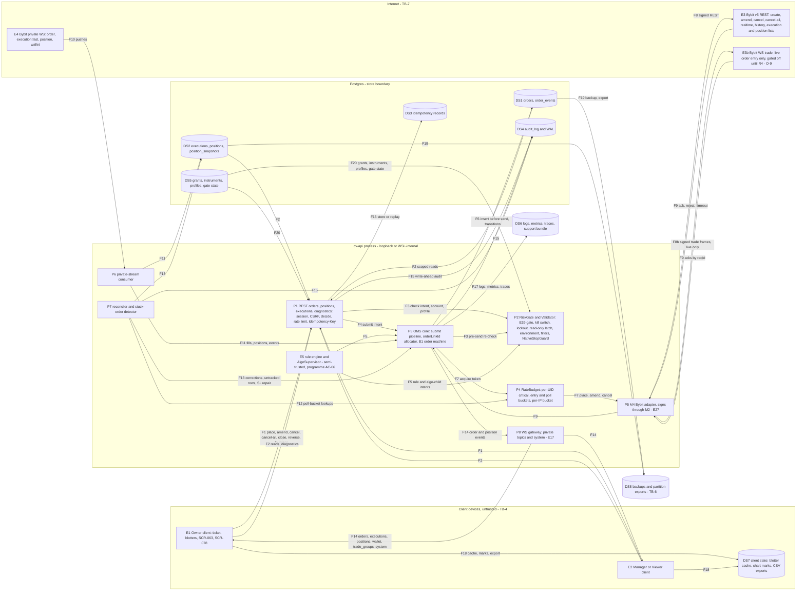

# E29 — STRIDE threat model: OMS core and the order-placement path

- Ticket: E29-X01 (issue #849). Owner: Security engineer (CODEOWNER). Status: **Approved** (2026-10-20; independent
  reviews: Fable security and sonnet code at `2e669fbb`, cross-lane Fable at `65c8c433`, two sonnet code at
  `7ef9abd1`, sonnet code and opus security at `cda871c3`; the Fable security pass on the approval PR is recorded on
  that PR). Open, and not blockers to the model: the §1.4 inputs O-1 to O-4 (E29-K01, #843) and O-9 (E44-X01, E38-T01),
  whose rows re-rate when the answer lands (D4); the Owner decisions D6 and D7; and the Owner's acceptance of the
  §12.2 residuals (RR-18 to RR-21 in `04-security-program.md` §16.1), pending, queued on #2701. Review log: end of §12.
- Method: the `04-security-program.md` §5 template (L x I = risk), STRIDE per element and per flow (C-12.1), in the
  four-question frame (building §1-§2; what can go wrong §3, §5, §6; response §7, §10, §11; review §12), formatted as
  the E27 and E28 models. Their rows and E08's, E09's, E17's and E26's are **referenced, not repeated**.
- Inputs, read at `2ecd8e34`: issue #849 and the E29 epic with its 34 child tickets; `24-internal-schemas.md` §8.1 to
  §8.10, §14.2, §14.3 and §15; `21-database-schema.md` §3.3.1 and §3.3.4 to §3.3.7; `20-architecture.md` §2.2, §3.5,
  §4.3, §9 and §12; ADR-0006; ADR-0008; `28-statechart-catalogue.md` B1, B8 and B19 with `B01.order.machine.json`; the
  `/orders*`, `/positions*` and `/executions*` paths of `22-api-openapi.yaml`; `23-ws-protocol.md` §6.2 to §6.4 and
  §16.1 (WS S4, S5); `04-security-program.md` §2 to §4.1, §5.2 to §5.4, §6.4, §6.6, §6.8 and §6.9; on `main`, the files
  this model cites in `oms`, `domain`, `auth`, `audit`, `observability`, `ws`, `statechart/bindings`, `exchange/base`
  and `exchange/bybit`, with their tests, migration `0003_audit_log` and the RBAC `matrix.yaml`. The #846 docs contract,
  PR #2841, merged on 2026-10-16 at 10:41Z as `36ec4ca4`, amends ruling B2 (comment 6204432470) as comment 6208943196
  asked; every row, section, requirement and seed resting on it carries `[O-8]`, so a later change to 24 §8.3, §8.5 or
  §14.2 re-rates exactly those (§1.4). E29-T02 (#846) is complete since #2879 merged at 13:10Z (§1.1). Re-pinned on
  2026-10-20 at `61533c2e3` for what merged since (§1.1a): no row, rating, id or count changes. Revision 12, after
  the approval, adds OM-E07 with E29-T03 (#847), so the model holds 48 rows (§3). Revision 13 records the G-6
  contract (#2876) and changes no row or rating. Revision 16 adds OM-D10 to OM-D12 and OM-E08 for #913's
  order lane (29 CV-C13), so the model holds 52 rows; revision 18 adds OM-T05b and OM-D13 for #913 slice 4's
  cancel-all fold (S4-F), so it holds 54. Revision 19 records the cancel classification at SR-E29-01 that the
  E33 model settles (CX-08, SR-E33-08; E33-X01's approval PR, #995) and changes no row or rating. Revision 20
  records #913 L2's lane-owned audit writer and sink and changes no row or rating.
- Path: the ticket names `docs/security/e29-oms-threat-model.md`, but GOV-008 scans only
  `docs/security/threat-models/E<nn>-<slug>.md`, so this file is `E29-oms.md` (D3).
- Timing: design-time model, approved while some inputs are open. E27-T02 (#835), E27-X01 (#838), E27-T03 (#836) and
  E27-T04 (#837) are closed (the last two on 2026-10-19); E29-K01 (#843), E27-K01 (#832) and E27-T01 (#834) are open,
  and every row resting on their answers is tagged `[O-n]` (§1.4). E29-T04 (#913) must not merge before this model
  is complete (ticket AC "The model gates the pipeline"), yet E29-X01 is in neither E29-T01's nor E29-T04's
  `blocked_by`: §11 asked for both (C-12.1). Its obligations are posted on every ticket §11 lists (§11.2), and the
  orchestrator's gate on #913, a revision re-pinned to current `main`, is this one.
- Gate note: design-level weaknesses only. No credential, account identifier, UID or exploit detail appears.

## 1. Scope

In scope, the two paths the ticket names: client → REST `/orders` → RiskGate → OMS → RateBudget → BybitAdapter →
Bybit, and Bybit private WS → OMS → Postgres → WS fan-out → client. That covers the OMS routes (`/orders*`,
`/positions*`, `/executions*`, diagnostics), the submission pipeline, the `orderLinkId` allocator, the B1 order machine,
the private-stream consumer, the reconciler and stuck-order detector, the four private topics with `trade_groups` and
`system`, the stores (`orders`, `order_events`, `executions`, `positions`, `position_snapshots`), the idempotency
records, and the audit and telemetry these emit.

Out of scope (ticket): key storage and envelope encryption (E27 model), with the C-2.8 withdrawal-off permission gate
and the Semgrep rule `cv-withdrawal-endpoint-ban` (E27 KV-E05), fan-out unwind (E34), the rule-engine sandbox (E35),
kill-switch bypass (E39), penetration testing (E43). Referenced, not re-modelled: profiles, sizing and risk caps (E28
model), native-SL enforcement and brackets (E32-X01, #933), emulated algos (E33-X01, #995), the reconciliation job
(E45-X01, #1281), the order ticket and arming (E30-X01, #920), live gating (E44-X01, #1249), and the refusal of
replay-origin orders at the E29-T04 boundary (E26-X01 RP-E01, G2 #2669).

### 1.1 State of the build at review time

| Component                                   | Status                  | Evidence                                                                                                                                                                                                                                                                                                                                                                                                                                                                                                                                   |
| ------------------------------------------- | ----------------------- | ------------------------------------------------------------------------------------------------------------------------------------------------------------------------------------------------------------------------------------------------------------------------------------------------------------------------------------------------------------------------------------------------------------------------------------------------------------------------------------------------------------------------------------------ |
| M14 `oms` module                            | scaffold, ids, lookup   | `Validator.assert_order_placement_allowed()` refuses on the process read-only gate (`services/api/tests/unit/oms/test_validator.py`); the §8.3 generator, parser and allocator (`oms/order_link.py`, `oms/order_link_allocator.py`, #2859); success-after-lookup (#2879, E29-T02 3/3): `place_or_adopt` (`oms/order_link_resolution.py:102`) and `_adopt` (`:136-150`) adopt whatever the exchange holds under the id, with no full match (OM-S05)                                                                                         |
| `TradingPort`                               | declared only           | `exchange/base/ports.py`; no implementation, no private-WS client in `exchange/bybit/`                                                                                                                                                                                                                                                                                                                                                                                                                                                     |
| `orders`, `order_events`, `executions`, ... | not built               | No migration; E29-T01 (#845) adds it                                                                                                                                                                                                                                                                                                                                                                                                                                                                                                       |
| B1 order machine                            | contract, stub bindings | `statechart/machines/B01.order.machine.json`, hash-locked; `bindings/b01_order.py` (#2133): deny-all guards, no-op actions and services, permissive event schemas ("E29 tightens them"), and one live KILL arm (`issue_kill_cancel` calls the binding's `cancel_order`; its docstring hands the audited route to E29)                                                                                                                                                                                                                      |
| `/orders*`, `/positions*`, `/executions*`   | not mounted             | `matrix.yaml` rows are `state: not_mounted` and record the capability layer only (`manager_without_grant: allow`)                                                                                                                                                                                                                                                                                                                                                                                                                          |
| Scope decision point                        | merged                  | `auth/scopes.py` `enforce` audits `rbac.denied` and counts `authz_denied_total`; `test_manager_cannot_reach_another_managers_account` (`services/api/tests/unit/auth/test_scopes.py`)                                                                                                                                                                                                                                                                                                                                                      |
| Private topics in the WS gateway            | merged                  | `ws/topics.py` registers `orders` and `executions` (both never throttled), `positions`, `wallet`, `trade_groups`; `ws/sequencing.py` narrows each publish on its account argument; tests in `services/api/tests/unit/ws/`                                                                                                                                                                                                                                                                                                                  |
| Audit writer, hash chain, order actions     | merged                  | `orders.submit`, `orders.cancel`, `orders.amend`, `trade_group.submit`, `positions.flatten` registered in `audit/actions.py`                                                                                                                                                                                                                                                                                                                                                                                                               |
| M2 signing for M4                           | merged                  | M2 returns only the MAC and the key id (#2350); guard rule R10 in `exchange/` (#2352)                                                                                                                                                                                                                                                                                                                                                                                                                                                      |
| REST rate governor                          | merged, no reserve      | `TokenBucketGovernor` (`exchange/bybit/rate_limit.py`, E08-T02), wired in `exchange/bybit/rest.py`: one bucket per (UID, endpoint class) fed back from `X-Bapi-Limit-Status`, a 600-per-5 s IP-wide bucket, and a `10018` hold over every UID of that governor, capped at `MAX_IP_HOLD_S` (900 s). No purpose classes and no `critical` reserve: E34-T02 adds them (§7). Each `BybitRestClient` builds its own governor unless one is injected (`rest.py:195-199`); only the public consumers share one (`PublicRest` in `app.py`; OM-D08) |

A row resting on unbuilt work names the ticket that builds the control; E29-X03 re-triages it if that ticket does not.

### 1.1a Re-pin, 2026-10-20 (`main` at `61533c2e3`)

The table above is the state at review time (2026-10-16). What moved since, checked against the files on `main`; no row,
rating, id or count changes, and each control still owed stays owed.

| Component                                   | On `main` at `61533c2e3`                                                                                                                                                                                                                                                                                                      | Effect on the model                                                                                                                                                                                  |
| ------------------------------------------- | ----------------------------------------------------------------------------------------------------------------------------------------------------------------------------------------------------------------------------------------------------------------------------------------------------------------------------- | ---------------------------------------------------------------------------------------------------------------------------------------------------------------------------------------------------- |
| `orders`, `order_events`, `executions`, ... | Built, E29-T01 (#845) closed 2026-10-17: migration `0029_oms_core` (#3052), the order and event stores and repositories (#3156, #3184, #3187), the execution, position and snapshot stores (#3188, #3282), `redact_exchange_payload()` in `storage/repositories/exchange_payload.py` (#3152); `0034_order_vocabulary` (#3848) | §6 item 2 now describes shipped code. SR-E29-05, SR-E29-08 and the SR-E29-12 `ord_link_fmt` test are not re-proven here: requested on #845 after it closed (§11.2) and re-checked by E29-X03 (#1152) |
| B1 order machine                            | Chart version 2: `untracked`, `held` and the exchange outcomes are contracted (#3800), the stop-loss attach is guarded on its result (#3825); the bindings still carry permissive event schemas (`_ANY_PAYLOAD`, `b01_order.py`)                                                                                              | G-3's contract half is on `main`; the rest is carried by E29-T03 (#847), whose B1 v3 turn is to be built, per its plan comment (§11.1). OM-T04's closed schemas and OM-E02's guard bodies stay owed  |
| M14 `oms` module                            | Adds the fill core and B1 guards, the write-ahead compare-and-set and the in-memory order store (#3803, #3804, #3836); `place_or_adopt` is at `oms/order_link_resolution.py:102` and `_adopt` at `:136-150` (#2978), still adopting on the id alone                                                                           | OM-S05 and F-10 stand: the full match is E29-T04's and G-6's (#2876); the citations in the table above are updated                                                                                   |
| `TradingPort`                               | Unchanged: `exchange/base/ports.py` has no commit since the pin and `exchange/bybit/` has no implementation; G-8 (#2877) is open                                                                                                                                                                                              | OM-D09 and F-19 stand                                                                                                                                                                                |
| `/orders*`, `/positions*`, `/executions*`   | Unchanged: `matrix.yaml` rows are still `state: not_mounted`; E29-T07 (#915) is open                                                                                                                                                                                                                                          | None                                                                                                                                                                                                 |
| REST rate governor                          | `rate_limit.py` and `rest.py` unchanged; E27-T03 adds a dedicated verify governor (`exchange/bybit/key_verify.py:67`, injected at `service.py:234`), not a process-wide one for trading clients; `mapping.py` and `config.py` moved lines                                                                                     | OM-D08 and OM-T10 stand; OM-T10's citations are updated (`mapping.py:40,42`, `config.py:89`)                                                                                                         |
| Scope, topics, audit actions                | `auth/scopes.py` unchanged; `ws/topics.py` and `ws/sequencing.py` changed by other epics only (`orders` and `executions` still never throttled, each publish still narrowed on its account); the five order actions are still registered in `audit/actions.py`                                                                | None. The M2 signing row was not re-read: E27's model owns it and E27-T03 has touched `secrets/` since the pin                                                                                       |

### 1.2 Assets and data classification

E29-X01 fixes the classification for the epic (ticket Security notes); every E29 child cites it.

| Asset                                                                                                     | Class                               | Notes                                                                                                                                                                                |
| --------------------------------------------------------------------------------------------------------- | ----------------------------------- | ------------------------------------------------------------------------------------------------------------------------------------------------------------------------------------ |
| Orders, `order_events` (after redaction), executions, positions, snapshots, wallet projection, closed PnL | **Financial / restricted**          | Programme assets A-05 (order path) and A-06 (positions). Served only inside the caller's grants; never in a metric label or analytics event                                          |
| `order_events.payload` and diagnostics request/response pairs **before redaction**                        | **Secret**                          | May hold `X-BAPI-API-KEY`, `X-BAPI-SIGN` or an `auth` frame, the private stream's (`24-internal-schemas.md` §14.3) or the live trade socket's (F8b). Never leaves M4 unredacted (§6) |
| Exchange `retMsg`, `reject_message`                                                                       | Financial / restricted, untrusted   | Exchange-controlled text: rendered as text, never as HTML, never interpolated into SQL                                                                                               |
| `order_link_id`, `exchange_order_id`, `trade_group_id`, `exec_id`                                         | Internal correlation ids            | Not secrets and not authority (§5); they reveal group structure (OM-I09); never metric labels (`20-architecture.md` §12.1)                                                           |
| Idempotency records (key, body fingerprint, stored response) and the `client_group_ref` replay anchor     | Financial / restricted              | Keyed per principal and operation (SR-E29-07) `[O-8]`                                                                                                                                |
| Order-path availability: the per-UID `critical` budget, the private streams, Postgres                     | Integrity and availability critical | A starved stop is a C-2.6 failure (§7)                                                                                                                                               |

### 1.3 Rating

Risk = L x I on the programme scale (Low / Medium / High / Critical):

| L \ I | L      | M      | H        |
| ----- | ------ | ------ | -------- |
| L     | Low    | Low    | Medium   |
| M     | Low    | Medium | High     |
| H     | Medium | High   | Critical |

Impact **H\*** marks an outcome that lets value leave an account (E27 D2) or leaves a position without a working
native stop, which C-2.6 calls a Severity-1 defect (E28 D2); it raises the cell one band. Disposition: **Q** a
requirement (`SR-E29-nn` or a ticket-body control) that a named ticket must build and a named test must prove; **C** an
existing control on `main`, cited with its test; **R** owned by another epic's model; **A** accepted (Owner sign-off,
§12.2). Row ids are `OM-xnn`; `24 Sn` is rule Sn of `24-internal-schemas.md` §8.2, `WS Sn` of `23-ws-protocol.md` §16.1.

### 1.4 Open inputs

Assumptions a blocker must confirm; rows that depend on one carry its tag and are re-rated if the answer differs.

| Id  | Assumption in this model                                                                                                                                                                                                                                                                                                                                                                                                                                                                                                                                                                                                                                                                                                  | Confirmed by                                                                                                                                                                                                 |
| --- | ------------------------------------------------------------------------------------------------------------------------------------------------------------------------------------------------------------------------------------------------------------------------------------------------------------------------------------------------------------------------------------------------------------------------------------------------------------------------------------------------------------------------------------------------------------------------------------------------------------------------------------------------------------------------------------------------------------------------- | ------------------------------------------------------------------------------------------------------------------------------------------------------------------------------------------------------------ |
| O-1 | Bybit refuses a reused `orderLinkId` with 10001 (duplicate text) or 110072 within a window, including for filled and cancelled orders (`24-internal-schemas.md` §8.3 says only "within its retention window"; demo keeps orders 7 days)                                                                                                                                                                                                                                                                                                                                                                                                                                                                                   | E29-K01 (#843) captures                                                                                                                                                                                      |
| O-2 | A private `execution` can arrive after the `order` transition it caused, and a few fills are seen only through REST backfill, so WS S5 needs a reorder buffer and reconciliation stays mandatory                                                                                                                                                                                                                                                                                                                                                                                                                                                                                                                          | E29-K01 soak                                                                                                                                                                                                 |
| O-3 | REST response headers and private messages may carry account-identifying values, so the stored record is an allow-list, not a copy                                                                                                                                                                                                                                                                                                                                                                                                                                                                                                                                                                                        | E29-K01 captures                                                                                                                                                                                             |
| O-4 | `/v5/order/cancel-all` takes an `orderFilter` (`docs/research/06-bybit-api.md`), and some value reaches TP/SL or conditional stop orders, so the filter decides whether a cancel-all can strip a native stop; a Full- or Partial-mode stop appears in `/v5/order/realtime` with its own `orderId`, `/v5/order/cancel` on that `orderId` removes it, and its order push can be matched to the `trading-stop` call that set it                                                                                                                                                                                                                                                                                              | E29-K01 captures (requested, §11)                                                                                                                                                                            |
| O-5 | Keys are verified withdrawal-off and allow-listed before the OMS signs, and a failed or stale check trips the read-only gate (C-2.8; KV-E05, KV-E12; Semgrep `cv-withdrawal-endpoint-ban` bans the endpoint)                                                                                                                                                                                                                                                                                                                                                                                                                                                                                                              | E27-T03 (#836; its verification judgement merged in #2854); closed 2026-10-19, re-checked by E29-X03                                                                                                         |
| O-6 | Per-account health and the ordering-enabled flag exist for the Validator to consult (KV-T12)                                                                                                                                                                                                                                                                                                                                                                                                                                                                                                                                                                                                                              | E27-T04 (#837); closed 2026-10-19, re-checked by E29-X03                                                                                                                                                     |
| O-7 | The account model (`exchange_accounts.env`, UID, grants) and KEK custody hold as the E27 model states (KV-T04, KV-E04)                                                                                                                                                                                                                                                                                                                                                                                                                                                                                                                                                                                                    | E27-T01 (#834), E27-K01 (#832)                                                                                                                                                                               |
| O-8 | `24-internal-schemas.md` §8.3 is the only id scheme; `ord_link_fmt` has two shape arms, `OUR_ID` (a §8.3 id) and `EXT_ID` (`^ext-[0-9a-f]{32}$`), and no state term; the adapter normalises every remote `order_link_id` to one of them (§14.2 rule 11); an adopted order is stored under its own `orderLinkId` when that fullmatches `OUR_ID` and no row holds it (ours whose row was lost), or otherwise `ext_key(orderId)`, while an id held by a terminal or another account's row is a `ReconcileAnomaly` and is never adopted (§8.5 step 3c); a row in any state is a collision for the generator (rule 5); the `Idempotency-Key` never enters the id and is stored as the group's `client_group_ref` (§8.3 rule 1) | Merged: B2 as amended, approved 2026-10-16 09:22Z, is PR #2841, merged at 10:41Z as `36ec4ca4`. The merged text equals this assumption, so no `[O-8]` item re-rates; the tags now mark what rests on it (§1) |
| O-9 | Live order entry: SR-040a keeps v1 order entry REST-only in both environments, while ADR-0006 rule 5, `20-architecture.md` §9 and E29-T04 select Bybit WS trade (`/v5/trade`) on live through `supports_ws_order_entry`, gated off until R4. The F8b rows assume the path is built but unreachable until E44 enables it                                                                                                                                                                                                                                                                                                                                                                                                   | E44-X01 (#1249), E38-T01 (#1006); E29-K01 excludes WS order entry                                                                                                                                            |

## 2. Data-flow diagram and trust boundaries

The decomposition is `24-internal-schemas.md` §8.4's sequence, not a parallel one: UI → E1, E2; REST `/orders` → P1;
RiskGate → P2; OMS → P3; Postgres → DS1, DS2; RateBudget → P4; BybitAdapter → P5; Bybit → E3, its "or WS trade on
live" branch → E3b (F8b); PrivateWS → E4, P6; "OMS to UI" → P8 (F14); plus the callers, reconciler and stores it omits.

Text alternative to the diagram: a client sends a mutation (F1) or a read (F2) to the REST surface, which runs the E09
chain and the idempotency store (F16). The risk gate checks the intent against grant, profile and gate state (F3, F20);
the OMS sizes, rounds and builds the `orderLinkId` (F4), and rule and algo intents enter the same gate in process (F5).
The OMS writes the order row and first event before any send (F6), takes a budget token (F7) and hands the request to
the adapter, which signs through M2 and calls Bybit (F8; on live after E44, the trade socket, F8b `[O-9]`); answers come
back untrusted (F9). Pushes (F10) become fills, positions and events (F11); the reconciler polls through `poll` (F12)
and applies corrections, `untracked` rows and stop repairs (F13); persisted changes reach clients (F14). Every mutation
is audited write-ahead (F15); telemetry (F17), client caches and exports (F18) and backups (F19) receive copies.

Elements: entities **E1-E5** and **E3b**; processes **P1-P8**; stores **DS1-DS8**; flows **F1-F20**, **F8b** (§3.7).

Boundaries (`20-architecture.md` §2.2, `04-security-program.md` §4.1, E27 model §2):

- **TB-4, client to API** (F1, F2, F14, F18): untrusted until authenticated, RBAC-scoped after; the client enforces
  nothing (C-2.12), and a blotter that hides a button is not a control.
- **Store boundary** (F6, F11, F13, F15, F16, F19, F20): a database writer is its own integrity domain;
  `order_events` and `executions` are the order path's non-repudiation stores beside `audit_log`.
- **TB-7, backend to Bybit** (F8, F8b, F9, F10, F12 through F8): owned by E08 and E27; the exchange is semi-trusted
  (programme AC-08), so every answer is validated and the private stream is reconciled against REST.
- **TB-6** (F19): backups and the 24-month partition export receive whatever `order_events` holds.
- **E5** runs in process but is semi-trusted (programme AC-06): its intents take the P2 and P3 path (OM-E04).
- The **M2 capability boundary** sits inside P5 (E27 model §4.3). B4 (renderer to Electron main) carries no E29 flow.

## 3. STRIDE table

Columns: the existing control is what `main` does today, with its test; the gap names the mitigation and its ticket;
`SR-E29-nn` are this model's requirements (§10). Programme rows extended, not repeated (`04-security-program.md` §5.2,
§5.4): O1 → OM-E01; O2, O11 → OM-S01; O3 → OM-T01 (with E28's PF-T rows); O4 → OM-S02, OM-T05 (with E32); O5 → OM-R01;
O6 → OM-D01, OM-D02, OM-D06; O7 → OM-I01; O8 → OM-T09, OM-T11, §5; O9 → OM-S03, OM-T04; O10 → OM-D05.

### 3.1 Spoofing

| ID     | Element / flow                   | Threat                                                                                                                                                                                                                                                                                                                                                                                                                                                                                                                                                                                                                                                                                                                                                                                                                                                                                                                     | L   | I   | Risk     | Existing control                                                                                                                                                                                                                                                                  | Gap → mitigation                                                                                                                                                                                                                                                                                                                                                                                                                                                                                                                                                                                                                     | Owner                                                                | Verify                        | Disp. | Residual |
| ------ | -------------------------------- | -------------------------------------------------------------------------------------------------------------------------------------------------------------------------------------------------------------------------------------------------------------------------------------------------------------------------------------------------------------------------------------------------------------------------------------------------------------------------------------------------------------------------------------------------------------------------------------------------------------------------------------------------------------------------------------------------------------------------------------------------------------------------------------------------------------------------------------------------------------------------------------------------------------------------- | --- | --- | -------- | --------------------------------------------------------------------------------------------------------------------------------------------------------------------------------------------------------------------------------------------------------------------------------- | ------------------------------------------------------------------------------------------------------------------------------------------------------------------------------------------------------------------------------------------------------------------------------------------------------------------------------------------------------------------------------------------------------------------------------------------------------------------------------------------------------------------------------------------------------------------------------------------------------------------------------------ | -------------------------------------------------------------------- | ----------------------------- | ----- | -------- |
| OM-S01 | E1, E2, F1, P1                   | A planted or stolen session, a cross-site page (CSRF), or an XSS payload or extension in the user's browser submits orders as that user (programme O2, O11)                                                                                                                                                                                                                                                                                                                                                                                                                                                                                                                                                                                                                                                                                                                                                                | M   | H   | High     | Session rotation, refresh-family reuse detection and the fixation audit (E09 U5, U6); CSRF double-submit (SR-041) and `Origin` checks (SR-042); `SameSite=Strict`; strict CSP                                                                                                     | Every mutating E29 route declares `CsrfToken` in the contract; the live arm toggle and per-request `arm_token` (SR-043) are owed by E30-S04 (#1088) and E44; demo needs none (SR-043); `PlaceOrderRequest.arm_token` is required today only for one-click and hotkey entry, so G-1 makes it, or its replacement, mandatory for every live order mutation                                                                                                                                                                                                                                                                             | E09, E30-S04, E44-S03, E29-T07                                       | integration (AC-27)           | R, Q  | Low      |
| OM-S02 | F1, F5, P3, P4, E5               | Spoofed order purpose or origin. `PlaceOrderRequest.intent` is client-chosen, and two controls key on it: the contract makes the native stop mandatory "for entry intents", and `24-internal-schemas.md` §8.7 lets `stop_loss` and `flatten` purposes draw from the protective reserve. An opening order labelled `take_profit`, `stop_loss` or `flatten` skips the stop; labelled `stop_loss` or `flatten` it also spends the reserve (a `take_profit` draws `normal`, §8.7)                                                                                                                                                                                                                                                                                                                                                                                                                                              | M   | H\* | Critical | None (no route). The request schema refuses unknown fields (`additionalProperties: false`), so `origin` and `origin_ref` cannot be sent                                                                                                                                           | Classify by effect, not by label: an order that is not reduce-only, or exceeds the exchange-truth position it reduces, is an entry for NativeStopGuard and for the budget; a mismatched `intent` is refused; `origin` and `origin_ref` come only from the call path (SR-E29-01)                                                                                                                                                                                                                                                                                                                                                      | E29-T04, E32-T01 (#931), E34-T02 (#859)                              | unit, property, E32-Q01 suite | Q     | Low      |
| OM-S03 | E3, E3b, E4, F9, F10             | A spoofed exchange endpoint (REST, or the live trade socket `[O-9]`) or a forged private push or trade ack reports a fill, a cancel or a position that did not happen (programme O9)                                                                                                                                                                                                                                                                                                                                                                                                                                                                                                                                                                                                                                                                                                                                       | L   | H   | Medium   | TLS validation and the per-environment base-URL allow-list (E08 E8-1, E8-2, E8-4); strict response schemas (E8-8)                                                                                                                                                                 | None new: the reconciler compares the stream with REST (E29-T06)                                                                                                                                                                                                                                                                                                                                                                                                                                                                                                                                                                     | E08, E29-T06                                                         | integration                   | R     | Low      |
| OM-S04 | F10, F12, P6, P7                 | Cross-account attribution: a push from account A's stream, or a REST row from A's reconciliation call, is applied to account B's order because the consumer keys on `orderLinkId` or `orderId` alone                                                                                                                                                                                                                                                                                                                                                                                                                                                                                                                                                                                                                                                                                                                       | L   | H   | Medium   | None (no consumer); E29-T06 asserts that every REST row belongs to the requested account `[ticket body]`                                                                                                                                                                          | One consumer per account; every push and REST row is matched on the account of the stream or call that produced it plus the id, and refused with an alert otherwise (SR-E29-02)                                                                                                                                                                                                                                                                                                                                                                                                                                                      | E29-T05, E29-T06                                                     | unit, integration             | Q     | Low      |
| OM-S05 | E3, E4, F9, F10, F12, P3, P6, P7 | Squatted id: an actor with exchange-level access to the UID (a stolen key used from the egress IP, in-process code, a dashboard session) places an order under a predicted future `orderLinkId`. The OMS's own create is refused as a duplicate, B1's duplicate-id arm moves the order to `submitted` (`mark_needs_lookup`) before any lookup, and success-after-lookup adopts the foreign order as its own. The adapter gives the foreign order and its fills our `OUR_ID` (24 §14.2 rule 11), so reconciliation step 2 pairs the fills with our row "on `order_link_id` alone", step 3a pairs the order with it, and the private-stream consumer, which receives the same normalised ids and drives transitions by `orderLinkId` (`20-architecture.md` §3.5), does likewise; step 3c's anomaly branch covers only terminal and other-account rows. The no-intent detection of SR-E27-19 stays quiet (§5) `[O-1]` `[O-8]` | L   | H\* | High     | None. `place_or_adopt` adopts on the id alone (§1.1); B1's `quarantined` is a fault landing whose only exits adopt the remote order (`adopt_recon`) and has no persisted status (`28-statechart-catalogue.md` B1 and §22); #2841 has no mismatch branch in 24 §8.3, §8.5 or §14.2 | Bind only on a full match with the persisted row, checked before the duplicate-id arm reaches `submitted` and wherever a result is found by `order_link_id`, `place_or_adopt` included (SR-E28-18, extended by SR-E29-03); fills and pushes reach a row only through its bound `exchange_order_id`, in reconciliation and in the private-stream consumer alike; a mismatch holds the local order for an operator (a B1 change, G-3), pages, and records the remote order as `untracked` under `ext_key(orderId)` with its fills paired on `exchange_order_id` (a change to 24 §8.5, G-6); a resend looks the id up first (SR-E29-15) | E29-T03 (#847), E29-T04, E29-T05 (#848), E29-T06 (#914), G-6 (#2876) | unit, property, AC-11         | Q, A  | Low      |

### 3.2 Tampering

| ID      | Element / flow      | Threat                                                                                                                                                                                                                                                                                                                                                                                                                                                                                                                                                                                                                                                                                                                                                                                                                                                                                                                        | L   | I   | Risk     | Existing control                                                                                                                                                                                                                                                                                                                                                                                                                                                                                                                                                                                                                                                                                                                                                                                                                                                                                               | Gap → mitigation                                                                                                                                                                                                                                                                                                                                                                                                                                                                                                                                                                                                                                                                                                                                                                                                                                                                                                                                                                                                                                                                                                     | Owner                                                                          | Verify                       | Disp. | Residual |
| ------- | ------------------- | ----------------------------------------------------------------------------------------------------------------------------------------------------------------------------------------------------------------------------------------------------------------------------------------------------------------------------------------------------------------------------------------------------------------------------------------------------------------------------------------------------------------------------------------------------------------------------------------------------------------------------------------------------------------------------------------------------------------------------------------------------------------------------------------------------------------------------------------------------------------------------------------------------------------------------- | --- | --- | -------- | -------------------------------------------------------------------------------------------------------------------------------------------------------------------------------------------------------------------------------------------------------------------------------------------------------------------------------------------------------------------------------------------------------------------------------------------------------------------------------------------------------------------------------------------------------------------------------------------------------------------------------------------------------------------------------------------------------------------------------------------------------------------------------------------------------------------------------------------------------------------------------------------------------------- | -------------------------------------------------------------------------------------------------------------------------------------------------------------------------------------------------------------------------------------------------------------------------------------------------------------------------------------------------------------------------------------------------------------------------------------------------------------------------------------------------------------------------------------------------------------------------------------------------------------------------------------------------------------------------------------------------------------------------------------------------------------------------------------------------------------------------------------------------------------------------------------------------------------------------------------------------------------------------------------------------------------------------------------------------------------------------------------------------------------------- | ------------------------------------------------------------------------------ | ---------------------------- | ----- | -------- |
| OM-T01  | F1, P1              | Quantity, price, side, account or profile changed between client and OMS by a hostile client (TLS covers the hop; the client is the actor)                                                                                                                                                                                                                                                                                                                                                                                                                                                                                                                                                                                                                                                                                                                                                                                    | M   | H   | High     | None (no route); the contract sets `additionalProperties: false` on `PlaceOrderRequest`, `AmendOrderRequest` and `CancelAllRequest`                                                                                                                                                                                                                                                                                                                                                                                                                                                                                                                                                                                                                                                                                                                                                                            | Strict models with `extra="forbid"` and `Decimal` parsing (SR-040); size re-derived from the profile (SR-052; E28 PF-T03 and SR-E28-03 also bind `placeOrder.profile_id`); the account checked as in OM-E01; tick and lot rounding before persistence                                                                                                                                                                                                                                                                                                                                                                                                                                                                                                                                                                                                                                                                                                                                                                                                                                                                | E29-T04, E29-T07, E28-T03                                                      | contract, unit               | Q, R  | Low      |
| OM-T02  | F3, F4, P2, P3      | Time-of-check gap: §8.4 calls `RISK.check(intent, account, profile)` before the OMS sizes, rounds and builds the order, so the gate sees the intent, not the order sent; retries, deferred legs, TP ladders and algo children are sent later with no re-check (E28 PF-E04)                                                                                                                                                                                                                                                                                                                                                                                                                                                                                                                                                                                                                                                    | M   | H   | High     | None                                                                                                                                                                                                                                                                                                                                                                                                                                                                                                                                                                                                                                                                                                                                                                                                                                                                                                           | The gate evaluates the sized, rounded order after `size` and before the INSERT (SR-E29-04); the synchronous gates run again before every position-opening adapter call (SR-E28-27, C-2.21)                                                                                                                                                                                                                                                                                                                                                                                                                                                                                                                                                                                                                                                                                                                                                                                                                                                                                                                           | E29-T04, E39-S01 (#954)                                                        | unit, integration, AC-28     | Q, R  | Low      |
| OM-T03  | DS1, DS2            | A database writer rewrites history: `TRUNCATE order_events`, `UPDATE` or `DELETE` on `executions`, or edits to an `orders` row (quantity, account, state)                                                                                                                                                                                                                                                                                                                                                                                                                                                                                                                                                                                                                                                                                                                                                                     | L   | H   | Medium   | `audit_log` has row triggers, a `BEFORE TRUNCATE` statement trigger and `REVOKE UPDATE, DELETE, TRUNCATE` from `cv_app` and `cv_ro` (migration `0003_audit_log`)                                                                                                                                                                                                                                                                                                                                                                                                                                                                                                                                                                                                                                                                                                                                               | The documented DDL gives `order_events` and `executions` row triggers only, and row triggers do not fire on `TRUNCATE`: copy the 0003 pattern (SR-E29-05); `orders` stays a projection rebuildable from `order_events` (E29-T03) and reconciled against the exchange                                                                                                                                                                                                                                                                                                                                                                                                                                                                                                                                                                                                                                                                                                                                                                                                                                                 | E29-T01 (#845), E29-T03                                                        | integration                  | Q, A  | Low      |
| OM-T04  | F9, F10, F11, P6    | Hostile or malformed exchange data: `filled_qty` above `qty`, a negative fee, a repeated `exec_id`, an out-of-order state or a post-terminal push corrupts the mirror (programme O9, W1)                                                                                                                                                                                                                                                                                                                                                                                                                                                                                                                                                                                                                                                                                                                                      | M   | H   | High     | None; the B1 stub bindings accept any event payload (`_ANY_PAYLOAD` in `b01_order.py`, "E29 tightens them")                                                                                                                                                                                                                                                                                                                                                                                                                                                                                                                                                                                                                                                                                                                                                                                                    | Schema validation (SR-040, E08 E8-8); closed B1 event schemas in place of the stubs (E29-T03); 24 S4 dedupe (`ux_exec_id`, `ON CONFLICT DO NOTHING`), 24 S5 ordering, 24 S6 `ReconcileAnomaly`, INV-1 and INV-B1-b, the `ord_cum` CHECK (E29-T01, E29-T03 `[ticket body]`) `[O-2]`                                                                                                                                                                                                                                                                                                                                                                                                                                                                                                                                                                                                                                                                                                                                                                                                                                   | E29-T01, E29-T03, E29-T05                                                      | unit, property, AC-26        | Q     | Low      |
| OM-T05  | F1, F7, F13, P3, P7 | Protection stripped through a legitimate route: an amend that moves an entry's stop away from the position, `cancel-all` with `exclude_reduce_only: false`, a cancel-all filter that reaches position TP/SL orders, a one-sided TP/SL amend that breaks the exchange's pairing (C-2.6) `[O-4]`, or `cancelOrder` on an exchange-created stop: a Partial-mode SL (`setPositionTpSl` `tpsl_mode: Partial` with `sl_size`; 24 §8.9) is a conditional order with its own `orderId` and no local row until one is materialised for it (24 §8.3 rule 7) `[O-4]`, so, unmatched, 24 §8.5 step 3c adopts it `untracked`, SR-E27-19 pages on our own stop, and a cancel removes it. Classifying by the TP/SL flags instead would let an exchange-level actor's TP/SL, set through `trading-stop` (OM-S05, KV-E11), pass as protection, unpaged and uncancellable. B1's KILL arm cancels outside the audited OMS service and its budget | M   | H\* | Critical | The contract refuses clearing an open leg's stop (`native_stop_required`, worded as conditional on the OpenAPI field `require_native_stop`, §12.3 note 7) and re-sends both TP/SL sides; B1's `issue_kill_cancel` calls the binding's own `cancel_order` stub (`b01_order.py`)                                                                                                                                                                                                                                                                                                                                                                                                                                                                                                                                                                                                                                 | A loosened stop needs the audited confirmation of §8.8 rule 5 (`sl.loosened`); a TP/SL order counts as an OMS-recorded stop by provenance, never by its flags: one matching a stop the OMS requested and recorded write-ahead is paired with the position, never `untracked`, and refused by `cancelOrder` and cancel-all while the position is open, and the OMS's own stop request is OMS intent for SR-E27-19; any other TP/SL order is foreign, pages and freezes the account per SR-E27-19 (cancels, flatten, quantity-reducing amends and stop attach, repair or tightening still pass: the C-2.6 carve-out of 24 §8.10; a manual dashboard TP/SL is E27's D8, an Owner decision still pending, see SR-E29-06), is not paired, and is never cancelled by the OMS unasked `[O-4]`; cancel and cancel-all never remove an open position's native stop, and the adapter sets the cancel-all filter explicitly (SR-E29-06); a KILL-originated cancel goes through the audited, budget-drawing OMS cancel service and obeys SR-E29-06 (the kill switch stays E39's); the E32 choke point and watchdog are the floor | E29-T03, E29-T04, E29-T05, E29-T06, E29-T07, E32-T01, E32-T02 (#932), G-6, G-8 | integration (AC-14), E32-Q01 | Q, R  | Low      |
| OM-T05b | P3, F7              | The cancel-all fold's window (S4-F, 24 §8.7): the venue's `cancel-all` takes every plain order resting on the symbol, so one placed after the venue answered the coverage read and before it runs the call is cancelled with no command record naming an actor; at most 10 s and a round trip after the read (§12.2)                                                                                                                                                                                                                                                                                                                                                                                                                                                                                                                                                                                                          | M   | L   | Low      | None (S4-F, not merged)                                                                                                                                                                                                                                                                                                                                                                                                                                                                                                                                                                                                                                                                                                                                                                                                                                                                                        | S4-F folds only a covered group of two or more (a `poll`-lane read shows every plain order resting there selected), plain orders only (SR-E29-06); a bound row takes the push as `REMOTE_CANCELLED` (24 §8.12), with its step row and audit record, and reconciliation settles the rest (24 §8.6); each order taken is logged (`oms_cancel_all_took_non_member`); the missing command record is accepted (§12.2)                                                                                                                                                                                                                                                                                                                                                                                                                                                                                                                                                                                                                                                                                                     | E29-T04                                                                        | unit (S4-F's coalescer)      | Q, A  | Low      |
| OM-T06  | F1, DS1             | Lost update: two amends race (two clients, or a client and a rule), or an amend lands on an order with a cancel in flight                                                                                                                                                                                                                                                                                                                                                                                                                                                                                                                                                                                                                                                                                                                                                                                                     | M   | M   | Medium   | None                                                                                                                                                                                                                                                                                                                                                                                                                                                                                                                                                                                                                                                                                                                                                                                                                                                                                                           | `If-Match` on amend, a per-order keyed lock and `order_not_amendable` while an operation is in flight (E29-T04, E29-T07 `[ticket body]`)                                                                                                                                                                                                                                                                                                                                                                                                                                                                                                                                                                                                                                                                                                                                                                                                                                                                                                                                                                             | E29-T04, E29-T07                                                               | integration                  | Q     | Low      |
| OM-T07  | F1, P1              | A close or partial close with a client quantity above the position, or with `reduce_only` stripped, reverses or grows the position (E29-X02 list)                                                                                                                                                                                                                                                                                                                                                                                                                                                                                                                                                                                                                                                                                                                                                                             | M   | H   | High     | None                                                                                                                                                                                                                                                                                                                                                                                                                                                                                                                                                                                                                                                                                                                                                                                                                                                                                                           | The server re-derives the close quantity from the exchange-truth position and forces reduce-only on every close and flatten path (E29-T07, E29-S03 `[ticket body]`)                                                                                                                                                                                                                                                                                                                                                                                                                                                                                                                                                                                                                                                                                                                                                                                                                                                                                                                                                  | E29-T07, E29-S03 (#978)                                                        | unit, integration            | Q     | Low      |
| OM-T08  | DS2, F11, F13, P7   | The position, wallet or order projection drifts from the exchange (a missed push, a wrong merge), so the blotter and the risk view show a wrong book (risk R7) or a stop that is not there                                                                                                                                                                                                                                                                                                                                                                                                                                                                                                                                                                                                                                                                                                                                    | M   | H   | High     | None                                                                                                                                                                                                                                                                                                                                                                                                                                                                                                                                                                                                                                                                                                                                                                                                                                                                                                           | Exchange truth wins; reconciliation at start-up, on reconnect and every 30 s; drift beyond `qty_step` alerts critical; the stale-account lockout; the reassurance line gated on the invariant check (E29-T05, E29-T06, E29-S07 `[ticket body]`) `[O-2]`                                                                                                                                                                                                                                                                                                                                                                                                                                                                                                                                                                                                                                                                                                                                                                                                                                                              | E29-T05, E29-T06, E29-S07 (#1028)                                              | chaos (E29-Q04)              | Q     | Low      |
| OM-T09  | DS3, F16            | Idempotency misuse: a record keyed by the client key alone returns one user's response to another, accepts a different body, or lets a replay derive new ids. The permanent replay anchor is `client_group_ref`, where §8.3 rule 1 (#2841) stores the client's `Idempotency-Key`, unique over all `trade_groups` (`21-database-schema.md` §3.3.2): a second principal sending a value the first used reaches the first principal's group (an IDOR) or a uniqueness conflict (an existence oracle), and a different body after the 24 h record expires reaches the old group `[O-8]`                                                                                                                                                                                                                                                                                                                                           | M   | M   | Medium   | Recorder-admin routes key by (actor, key, body hash) (`api/recorder_admin.py`); no OMS store yet                                                                                                                                                                                                                                                                                                                                                                                                                                                                                                                                                                                                                                                                                                                                                                                                               | The 24 h record is a response cache keyed by (principal, operation, key) with a body fingerprint; the anchor is stored principal-scoped, keeps the fingerprint and answers a foreign key as a missing one (a change to 24 §8.3 rule 1 and the DDL, G-6); a replay is re-authorised against current grants (SR-E29-07, §5)                                                                                                                                                                                                                                                                                                                                                                                                                                                                                                                                                                                                                                                                                                                                                                                            | E29-T04, E28-T01 (#905)                                                        | unit, integration, AC-10     | Q     | Low      |
| OM-T10  | F8, F8b, F9, P3, P5 | Duplicate order through a forced or ambiguous resend: an ambiguous REST result (10016, 10019, HTTP 5xx, a timeout before the ack) or, on the live trade socket, a frame with no ack, a socket closed after the send or an ack by `reqId` after a reconnect, followed by a resend without a lookup; 24 §8.6 marks 10016 and 10019 retryable `[O-1]` `[O-9]`                                                                                                                                                                                                                                                                                                                                                                                                                                                                                                                                                                    | M   | H   | High     | None that holds. B1 sends every post-send transport fault to `unknown`, which never resubmits (24 S1, INV-B1-e), but the merged M4 client resends first: `BybitRestClient._request` (`exchange/bybit/rest.py:390-396`, `:413-419`, `:495-501`) re-signs a signed ORDER-class POST up to `max_retries` = 3 (`config.py:89`) after a timeout, a transport error, an HTTP 5xx or a retryable `RateLimitError`, which `mapping.py:40,42` makes of 10016 and 10019 (#2863 tracks the 10016 class, which alone does not stop the resend), under the same `orderLinkId` and with no lookup, by design: the binding adapter rules re-send the same id on retry (24 §14.2 rule 2, `20-architecture.md` §9 rule 2), and `signed_request` refuses an ORDER-class POST without one (its docstring, E08-T02); only a non-JSON body is never retried (`test_non_json_body_on_order_class_stays_unknown_state_without_retry`) | M4 must not auto-resend an ORDER-class create once it has left: it raises an ambiguous-result error, so B1 reaches `unknown` and the OMS looks the id up (G-7, with #2863); a resend after any ambiguity looks the id up first, trade frames included; acks pair by `reqId` and `orderLinkId`, never by arrival order (SR-E29-15). If the Owner keeps M4's retry because Bybit deduplicates the id, its safety rests on O-1 and F-07 stays open                                                                                                                                                                                                                                                                                                                                                                                                                                                                                                                                                                                                                                                                      | E29-T04, E29-K01, G-7                                                          | unit, chaos (AC-12)          | Q     | Low      |
| OM-T11  | F1, F16, DS3, P1    | Late replay on a route without a permanent anchor: only placement stores its key (§5.1), while `amendOrder`, `cancelOrder`, `cancelAllOrders`, `closePosition`, `reversePosition`, `setPositionLeverage` and `closeAllPositions` (each `x-idempotency: required` in `22-api-openapi.yaml`) keep only the 24 h record, so the same key and body after it expires is a new request: `reversePosition` reverses again, `closeAllPositions` flattens positions opened since, and `closePosition` acts on today's position, whose row and id outlive a close (one row per account, symbol and position index)                                                                                                                                                                                                                                                                                                                      | L   | H   | Medium   | The session bounds a captured request: its access handle lives 12 min and its session at most 12 h, which refresh keeps (`ACCESS_TOKEN_TTL`, `ABSOLUTE_LIFETIME` in `auth/session_service.py`; `test_refresh_preserves_the_original_absolute_expiry`), and its CSRF token is bound to the session (SR-041), so the sender holds a current session: the client's own late retry, or OM-S01                                                                                                                                                                                                                                                                                                                                                                                                                                                                                                                      | The order-creating routes `closePosition`, `reversePosition` and `closeAllPositions` keep a permanent, principal-scoped record of their key, as placement does (SR-E29-07). The others stay bounded: `If-Match` on amend, a terminal order's cancel changes nothing, cancel-all never removes an open position's native stop (SR-E29-06), leverage places no order; on E32's `setPositionTpSl` a loosened stop needs the audited confirmation of 24 §8.8 rule 5. On live, SR-043's per-request arm nonce also refuses a stale request once G-1 extends `arm_token` to every live order mutation; demo has no arm nonce                                                                                                                                                                                                                                                                                                                                                                                                                                                                                               | E29-T04, E29-T07                                                               | integration (AC-29)          | C, Q  | Low      |

### 3.3 Repudiation

| ID     | Element / flow       | Threat                                                                                                                                                                                                                                                                                                                                                                                                             | L   | I   | Risk   | Existing control                                                                                                                                                                                                                                               | Gap → mitigation                                                                                                                                                                                                     | Owner                                       | Verify                           | Disp. | Residual |
| ------ | -------------------- | ------------------------------------------------------------------------------------------------------------------------------------------------------------------------------------------------------------------------------------------------------------------------------------------------------------------------------------------------------------------------------------------------------------------ | --- | --- | ------ | -------------------------------------------------------------------------------------------------------------------------------------------------------------------------------------------------------------------------------------------------------------- | -------------------------------------------------------------------------------------------------------------------------------------------------------------------------------------------------------------------- | ------------------------------------------- | -------------------------------- | ----- | -------- |
| OM-R01 | E1, E2, F1, F4, DS4  | A user denies placing, amending or cancelling an order, or a Manager and the Owner dispute who did (programme O5; programme actor AC-14)                                                                                                                                                                                                                                                                           | M   | H   | High   | Hash-chained audit with an off-database checkpoint (E09 U14, U19, U20); `orders.submit`, `orders.cancel`, `orders.amend`, `positions.flatten` registered                                                                                                       | An intent record before the send and an outcome record after, correlated by `orderLinkId` (SR-061) with the SR-062 fields; fills and cancel-all results audited per order (C-2.9); one action vocabulary (SR-E29-17) | E29-T04, E29-T07                            | integration, E29-X02 audit cells | Q     | Low      |
| OM-R02 | DS1, F6, F9, F10, P3 | A transition happens without its `order_events` row (a crash between state change and write), or a transition that claims an exchange source carries nothing that justifies it                                                                                                                                                                                                                                     | L   | H   | Medium | None                                                                                                                                                                                                                                                           | Write-ahead 24 S8 and INV-B1-g; `source` plus the redacted exchange record on every exchange-sourced transition; deterministic replay from events (E29-T03 `[ticket body]`)                                          | E29-T03                                     | unit, chaos                      | Q     | Low      |
| OM-R03 | P7, F13, DS4         | Reconciliation corrections, `untracked` adoptions, abandonments and stop repairs leave no attributable before-and-after record, so an external order or a silent divergence cannot be shown later                                                                                                                                                                                                                  | M   | H   | High   | None; `oms.reconcile` and `order.adopted_untracked` are in `24-internal-schemas.md` §15.5 but not in `audit/actions.py`; E29-T06 and E45-T03 name `oms.reconcile`, and E45-S01, E45-Q03 and E45-X02 name the adoption under management `oms.untracked_adopted` | A persisted report every sweep (INV-B19-f) and an audit record per correction with both values (E29-T06 `[ticket body]`); the actions registered first (SR-E29-17)                                                   | E29-T06, E45-S01, E45-T03 (#1275)           | integration                      | Q     | Low      |
| OM-R04 | E5, F5               | A rule- or algo-originated order is not attributable to the arming user and the rule version (programme R6)                                                                                                                                                                                                                                                                                                        | L   | H   | Medium | Rule actions registered (`rules.arm`, `rules.scope_denied`)                                                                                                                                                                                                    | Owned by the E35 and E33 models; the OMS records `origin` and `origin_ref` from the call path (SR-E29-01)                                                                                                            | E35-X01 (#945), E33-X01                     | integration                      | R     | Low      |
| OM-R05 | DS4, F15             | The audit chain is truncated or rewritten to hide an order action                                                                                                                                                                                                                                                                                                                                                  | L   | H   | Medium | E09 U14, U17, U19, U20: append-only grants, hash chain, checkpoint file, `BEFORE TRUNCATE` trigger                                                                                                                                                             | Nightly chain verifier (E09)                                                                                                                                                                                         | E09                                         | integration                      | R     | Low      |
| OM-R06 | DS6, F17             | Forensic correlation lost: the log redactor replaces any string that contains an alphanumeric word of 18 to 36 characters with `[redacted:key-shape]` (`observability/redaction.py`), and the 22-character group segment of every §8.3 id is such a word, so OMS log lines cannot be joined to `order_events` and audit rows by the correlation key (ADR-0006 rule 1). A blanket field exemption would open a hole | M   | M   | Medium | None                                                                                                                                                                                                                                                           | A typed pass for an `order_link_id` value that fully matches the §8.3 pattern or the `ext-` form; every other value under that key is still scanned (SR-E29-16)                                                      | E29-T08 (#916), with the E04 redactor owner | unit                             | Q     | Low      |

### 3.4 Information disclosure

| ID     | Element / flow            | Threat                                                                                                                                                                                                                                                                                                                            | L   | I   | Risk   | Existing control                                                                                                                                                                                                                                                                                                                                                                                                            | Gap → mitigation                                                                                                                                                                                                                                                                              | Owner                              | Verify                  | Disp. | Residual |
| ------ | ------------------------- | --------------------------------------------------------------------------------------------------------------------------------------------------------------------------------------------------------------------------------------------------------------------------------------------------------------------------------- | --- | --- | ------ | --------------------------------------------------------------------------------------------------------------------------------------------------------------------------------------------------------------------------------------------------------------------------------------------------------------------------------------------------------------------------------------------------------------------------- | --------------------------------------------------------------------------------------------------------------------------------------------------------------------------------------------------------------------------------------------------------------------------------------------- | ---------------------------------- | ----------------------- | ----- | -------- |
| OM-I01 | F2, P1, DS1, DS2          | Cross-account read over REST: a Manager or Viewer reads another account's orders, positions, fills, closed PnL or diagnostics through a filter (`trade_group_id`, `symbol`, an empty account list), an id route, the `aggregate=true` breakdown, or a cursor minted under another scope (programme O7)                            | M   | H   | High   | `decide` denies a foreign and a missing account alike (`auth/scopes.py`; E09 U15, U25, U31); `matrix.yaml` covers every route at the capability layer only                                                                                                                                                                                                                                                                  | Scope at query construction (SR-051; E29-T01 scoped helpers, E29-T07 `[ticket body]`); one 404 shape for foreign and missing ids (SR-E29-13); cursors bound to the caller; the granted, foreign and missing matrix per role (E29-X02)                                                         | E29-T01, E29-T07, E29-X02 (#982)   | contract                | Q     | Low      |
| OM-I02 | F14, P8                   | Cross-account read over WS: frames of an ungranted account reach a subscriber through requested ids, a stale grant or a shared encode buffer, or through the per-order `machines.order:{id}.state` topic (23 §6.4, contracted in #2438), whose scope the owning module binds                                                      | M   | H   | High   | Gateway narrowing and revocation: `test_sub_scope_is_silently_narrowed`, `test_scope_narrowed_mid_stream_revokes_only_the_removed_account` (`services/api/tests/unit/ws/`); `SequencingHub.publish` and `publish_private` narrow on their account argument, and a publish without one reaches no account-scoped subscription (`in_scope`; `test_account_scoped_delta_is_not_widened_by_a_user`); E17 WS-I02, WS-I08, WS-E02 | The OMS publishes every order event through `publish_private` with the order's account (E29-T05), and binds each order machine's `machines` scope from the stored order's account when it builds or restores it (23 §6.4, E29-T03); the dedicated abuse test (E29-T05 `[ticket body]`, AC-06) | E17, E29-T03, E29-T05, E29-X02     | integration             | C, Q  | Low      |
| OM-I03 | F14, P8                   | Account-specific `resyncing` and `stale` notices on the auto-subscribed `system` topic reveal another account's existence and health: `SystemUpdate` has an account list only on its `kill_switch` object, so E29-T05 and E29-T06 would put the account in free text, and `system` is filtered by role only (WS-I05)              | M   | M   | Medium | `system` content filtered by role (E17). Built (#3958, G-2): an `account_notice` names accounts only in `exchange_account_ids`, and a Manager's or Viewer's socket gets it cut to its `account_scope` when queued, or not at all (`23-ws-protocol.md` §15.9)                                                                                                                                                                | Account-scoped notices carry `exchange_account_ids` and reach only connections whose grants intersect; no account label in `message` or `components` (SR-E29-10, contract-first G-2)                                                                                                          | E29-T05, E29-T06, E29-S07          | integration             | Q     | Low      |
| OM-I04 | DS7, F18                  | Blotter rows, chart execution marks or CSV exports show another account's fills: marks built from an unscoped source, a client cache that survives a `revoked` frame, or an account named on a focus card                                                                                                                         | M   | M   | Medium | None                                                                                                                                                                                                                                                                                                                                                                                                                        | Marks only from the scoped `executions` topic or REST (E29-S05 `[ticket body]`); client caches drop an account's rows and marks on `revoked` (SR-E29-11); CSV watermark (E29-S04 `[ticket body]`)                                                                                             | E29-S01, E29-S04, E29-S05, E29-S08 | e2e                     | Q     | Low      |
| OM-I05 | DS1, F6, F8b, F9, F10, P5 | Credentials in `order_events.payload`: the raw exchange message kept for diagnostics carries `X-BAPI-API-KEY`, `X-BAPI-SIGN` or an `auth` frame (the private stream's, or the live trade socket's on F8b `[O-9]`); append-only storage and indefinite retention make one leak permanent and copy it into backups and exports (§6) | M   | H   | High   | M2 returns only the MAC and the key id to M4 (#2350); two deny-list redactors (`audit/redact.py`, `observability/redaction.py`)                                                                                                                                                                                                                                                                                             | The adapter builds an allow-listed record and never hands headers or an `auth` frame to the OMS; a fail-closed redactor before insert (its rule as built and its residual: §6); typed payload schemas; a property test with seeded secrets (SR-E29-08) `[O-3]`                                | E29-T01, E29-T04, E29-T05, E29-X02 | unit, property, ci-gate | Q     | Low      |
| OM-I06 | F2, P1                    | `getOrder?include_events=true` returns `OrderEvent.payload` (`additionalProperties: true`) to every `orders:read` holder, Viewers included, unaudited; diagnostics returns raw request and response pairs to the same set, while SR-067 limits raw payloads in audit reads to the Owner                                           | M   | M   | Medium | None                                                                                                                                                                                                                                                                                                                                                                                                                        | Events served without payload; raw pairs and raw `retMsg` only through audited diagnostics; the Viewer question is decision D7 (SR-E29-09)                                                                                                                                                    | E29-T07                            | contract                | Q     | Low      |
| OM-I07 | DS6, F17                  | Order intent leaks through telemetry: account ids, sizes or prices as labels, or `retMsg` with account details in logs                                                                                                                                                                                                            | M   | M   | Medium | Handler-level redaction (SR-121; `services/api/tests/unit/observability/test_redaction_filter.py`); metric labels never carry order ids (`20-architecture.md` §12.1)                                                                                                                                                                                                                                                        | Labels from closed sets only; `order_link_id` as an exemplar is Internal under D1 (E29-T08 `[ticket body]`)                                                                                                                                                                                   | E29-T08                            | ci-gate                 | C, Q  | Low      |
| OM-I08 | F2, F9                    | An error body echoes the exchange's text with account details (E08 E8-20, E8-21), or a stored `retMsg` is rendered as HTML (stored XSS in a blotter)                                                                                                                                                                              | L   | M   | Low    | A 500 never echoes the exception (`api/error_redaction.py`)                                                                                                                                                                                                                                                                                                                                                                 | `retMsg` reaches only the order's own scope and renders as text (E29-T04, E29-S02 `[ticket body]`)                                                                                                                                                                                            | E29-T04, E29-S02 (#912)            | unit                    | Q     | Low      |
| OM-I09 | F8, E3                    | The id discloses structure: the exchange and any reader of an id learn the group UUID and the leg sequence; a Manager can count other legs of a fan-out group from `seq2`                                                                                                                                                         | L   | L   | Low    | The id holds no secret, user id or account name (E29-T02 `[ticket body]`)                                                                                                                                                                                                                                                                                                                                                   | Accepted (§5.4)                                                                                                                                                                                                                                                                               | E29-T04                            | review                  | A     | Low      |
| OM-I10 | DS8, F19                  | Financial data leaves through a backup, the partition export or a support bundle                                                                                                                                                                                                                                                  | L   | H   | Medium | Backups encrypted with their own key (SR-090 to SR-092); the deny-by-default bundle allow-list (RSK-054)                                                                                                                                                                                                                                                                                                                    | None new; the export inherits redaction before insert (OM-I05)                                                                                                                                                                                                                                | E07, E41                           | drill                   | R     | Low      |

### 3.5 Denial of service

| ID     | Element / flow  | Threat                                                                                                                                                                                                                                                                                                                                                                                                                                                                                                                                                                                                                                                                                                                                                                                                                                                                           | L   | I   | Risk     | Existing control                                                                                                                                                                                                                                                                                                                                                                                                                                                                                                                   | Gap → mitigation                                                                                                                                                                                                                                                                                                                                                                                                                                                                                                                                                                                      | Owner                          | Verify                             | Disp.   | Residual          |
| ------ | --------------- | -------------------------------------------------------------------------------------------------------------------------------------------------------------------------------------------------------------------------------------------------------------------------------------------------------------------------------------------------------------------------------------------------------------------------------------------------------------------------------------------------------------------------------------------------------------------------------------------------------------------------------------------------------------------------------------------------------------------------------------------------------------------------------------------------------------------------------------------------------------------------------- | --- | --- | -------- | ---------------------------------------------------------------------------------------------------------------------------------------------------------------------------------------------------------------------------------------------------------------------------------------------------------------------------------------------------------------------------------------------------------------------------------------------------------------------------------------------------------------------------------- | ----------------------------------------------------------------------------------------------------------------------------------------------------------------------------------------------------------------------------------------------------------------------------------------------------------------------------------------------------------------------------------------------------------------------------------------------------------------------------------------------------------------------------------------------------------------------------------------------------- | ------------------------------ | ---------------------------------- | ------- | ----------------- |
| OM-D01 | F1, P1, P4      | Order flooding by an authenticated client exhausts the UID's `entry` budget, the per-IP ceiling or the exchange's per-symbol order cap, starving other users of the same account (programme O6, F3b, SR-044d)                                                                                                                                                                                                                                                                                                                                                                                                                                                                                                                                                                                                                                                                    | M   | H   | High     | `TokenBucketGovernor` (§1.1) shapes every call of the shipped REST client through one bucket per (UID, endpoint class), fed back from `X-Bapi-Limit-Status`, and a 600-per-5 s IP-wide bucket (`test_bucket_is_shared_across_callers_for_same_uid` in `services/api/tests/unit/exchange/bybit/test_rate_limit.py`, `test_check_reachable_consumes_ip_wide_budget` in `test_rest_client.py`); it has no per-user limit and no purpose classes, so one user's flood still drains the `order` class that every user of the UID shares | Per-user limits on mutating routes (E29-T07 `[ticket body]`); E34-T02 extends the shipped governor, not a second one (SR-044a: one tracker per UID), with per-UID buckets in which `entry` never borrows `critical` (`20-architecture.md` §4.3); local order caps alerting at 80 % (SR-044d); `RATE_BUDGET_EXCEEDED` fails fast                                                                                                                                                                                                                                                                       | E29-T04, E29-T07, E34-T02      | load (E29-Q03)                     | C, Q, R | Low               |
| OM-D02 | P4, F7, F12     | Background traffic (reconciliation sweeps, wallet and position refresh, key verification, admin reads, rule polling) exhausts the UID's budget, so a stop placement, a stop repair or a flatten cannot get a token                                                                                                                                                                                                                                                                                                                                                                                                                                                                                                                                                                                                                                                               | M   | H\* | Critical | `TokenBucketGovernor` (§1.1) keys its buckets on (UID, endpoint class) only: a stop placement and a background call of the same class share one bucket, with no purpose classes and no reserve, so it does not mitigate this row                                                                                                                                                                                                                                                                                                   | E34-T02 adds purpose classes and the reserve to the shipped governor (SR-044a); reconciliation and reads draw only `poll` (E29-T06 `[ticket body]`, SR-E27-05); the bucket follows the order's effect, not its label (SR-E29-01); protective work draws `critical` and queues with a deadline, then escalates (`24-internal-schemas.md` §8.7); one reserve value (§7); a page when `critical` is below 1 for 10 s                                                                                                                                                                                     | E34-T02, E29-T06, E29-X02      | load, AC-17                        | Q       | Low               |
| OM-D03 | E3, F8          | Our own bursts trip the exchange's per-IP limit (`10018`), whose hold gates every REST path, stops included                                                                                                                                                                                                                                                                                                                                                                                                                                                                                                                                                                                                                                                                                                                                                                      | M   | H   | High     | `TokenBucketGovernor`'s 600-per-5 s IP-wide bucket shapes the bursts of its own client (SR-044c; `test_check_reachable_consumes_ip_wide_budget`), and `hold_ip` throttles every UID of that governor after a `10018`, capped at `MAX_IP_HOLD_S` = 900 s (`test_rate_limit_10018_holds_every_uid_for_ten_minutes`, `test_governor_hold_ip_never_extends_beyond_cap` in `services/api/tests/unit/exchange/bybit/test_rest_rate_limit_reset.py`); the hold design in `24-internal-schemas.md` §8.6 (#1908); E08 E8-24                 | The per-IP bucket of SR-044c is shipped per client, and OM-D08 makes it process-wide; E34-T02 adds the self-throttle at the SR-071 reserve that SR-044c also requires, so normal traffic yields before the hold; the native stop already on the exchange is the floor                                                                                                                                                                                                                                                                                                                                 | E08, E34-T02                   | chaos                              | C, R    | Low               |
| OM-D04 | DS1, DS4, P3    | A store outage, in two cases. Postgres down (M): audit is buffered, but order entry stops by design (24 S7) and with it OMS-driven amends, cancels and flattens (24 S8). Audit WAL full or unwritable (L, after a long outage or a disk fault): `AuditUnavailable` refuses every audited action, protective ones included (stop attach, flatten, KILL cancel), and M2 refuses every borrow (E27 KV-D04), so a stop still owed after a fill (24 §8.8 rules 2 and 3) waits: H\*, also High                                                                                                                                                                                                                                                                                                                                                                                         | M   | H   | High     | `AuditWriter` is WAL-first and fail-closed: `emit()` fsyncs to the local WAL before it returns, so a Postgres outage alone does not stop audit, and only a full or unwritable WAL raises `AuditUnavailable`, which callers must treat as a refusal (`audit/writer.py`; `test_writer_wal_full_with_postgres_down_refuses_never_drops`)                                                                                                                                                                                              | Fail closed with 503 before any exchange call (E29-T04 `[ticket body]`). Protective actions are refused on `AuditUnavailable` like every audited action (C-2.9, the writer's contract), never sent on a local record alone: the floor is the stop attached at create (24 §8.8 rule 1), and a stop owed after a fill is the residual the Owner accepts (§12.2); the WAL stays off any volume the recorder can fill (KV-D04, SR-096); failover and full-WAL chaos (C-13.6 scenario 10)                                                                                                                  | E29-T04, E29-Q04 (#1148)       | chaos                              | C, Q, A | Medium (accepted) |
| OM-D05 | E4, F10, P6, P8 | Private-stream loss or a reconnect storm hides fills; a slow client cannot drain `orders` or `executions`, which may not be throttled (WS S4)                                                                                                                                                                                                                                                                                                                                                                                                                                                                                                                                                                                                                                                                                                                                    | M   | H   | High     | Slow consumers disconnected with 4429 (E17 WS-D01). SR-059's dead-man's switch is N/A on `linear` (OQ-04): the contract's `setKillSwitch` description has the OMS arm it for `inverse` only, dead text under C-1.2 that G-1 removes; E45-T05 (#1277) reports it unavailable, and no code calls `disconnected-cancel-all`; SR-059's compensating control is the native stop (C-2.6) plus reconnect reconciliation (SR-058), which OM-T05, OM-T08 and this row own                                                                   | Heartbeat watchdog, `resyncing`, reconciliation on reconnect, backoff with jitter (E29-T05, E29-T06 `[ticket body]`) `[O-2]`                                                                                                                                                                                                                                                                                                                                                                                                                                                                          | E29-T05, E29-T06, E29-Q04, G-1 | chaos (C-13.6 scenarios 2, 11, 12) | Q       | Low               |
| OM-D06 | F1, P4          | A cancel flood drains `critical`: cancels and cancel-all are risk-reducing and draw the reserve (ADR-0008 rule 4, SR-071), so a Manager, a faulty client or a rule spamming them on a shared UID can starve a stop attach                                                                                                                                                                                                                                                                                                                                                                                                                                                                                                                                                                                                                                                        | L   | H\* | High     | None                                                                                                                                                                                                                                                                                                                                                                                                                                                                                                                               | Cancel-all coalesced per account and symbol, per-user limits on cancels, and a stop-attach and repair slice inside `critical` that cancels, KILL-originated ones included (SR-E29-06), cannot spend (SR-E29-14)                                                                                                                                                                                                                                                                                                                                                                                       | E34-T02, E29-T04               | load, AC-18                        | Q       | Low               |
| OM-D07 | E3b, F8b, P5    | On live `[O-9]` the trade socket shares the per-IP WS connection budget with the public and private streams (C-12.7: at most 500 new connections per 5 min and 1000 concurrent per IP), so a market-data reconnect storm can lock out order entry, and a stale trade socket can stall a stop attach                                                                                                                                                                                                                                                                                                                                                                                                                                                                                                                                                                              | L   | H\* | High     | None (no trade socket; SR-040a keeps v1 order entry on REST)                                                                                                                                                                                                                                                                                                                                                                                                                                                                       | Connections admitted through one per-IP budget, the trade socket ahead of market-data reconnects; a protective send never waits on the socket: it falls back to REST with a `critical` token (SR-E29-14, §7)                                                                                                                                                                                                                                                                                                                                                                                          | E29-T04, E34-T02, E44          | chaos (E44)                        | Q       | Low               |
| OM-D08 | P4, P5, F7, F8  | Cross-UID starvation at the per-IP limit. The 600-per-5 s IP bucket and `hold_ip` belong to each `TokenBucketGovernor` (`rate_limit.py:43-69`, `:120-127`), and each `BybitRestClient`, which serves one UID (`rest.py:341`), builds its own unless one is injected (`rest.py:195-199`), so per-account trading clients each meter only their own traffic against the one egress IP, and one client's `10018` holds only its own UID. Even with one shared bucket, `acquire` takes the UID token, then sleep-polls the IP bucket with no priority and no protected share (`rate_limit.py:83-100`), so account A's `entry` and `poll` traffic, a cancel flood (OM-D06) or, once the public clients share the bucket, a kline or funding backfill on `MARKET_DATA` queues account B's stop attach, which already holds its `critical` UID token, up to the 5 s deadline of 24 §8.7 | M   | H\* | Critical | The per-IP bucket exists per governor (`test_check_reachable_consumes_ip_wide_budget`); only the public consumers share one (`PublicRest` in `app.py`, #2599), and the public client builds its own (`exchange/bybit/service.py`)                                                                                                                                                                                                                                                                                                  | One process-wide IP bucket and `hold_ip`, injected into every `BybitRestClient`, with the SR-071 reserve share (the one value of E28 model §11.3 note 2) and a priority lane that no traffic outside `critical` can spend or pass: `entry` and `poll` of any UID and the public clients' `MARKET_DATA` calls (klines, funding, instruments) included, and in which stop attach and repair go ahead of cancels (OM-D06) (SR-044c, SR-071, programme F3a); E34-T02 serves a binding IP bucket by priority class before notional, where its body orders by notional alone (24 §9.5.1 rule 5) (SR-E29-14) | E34-T02, G-8                   | load (AC-30), chaos                | Q       | Low               |
| OM-D09 | P5, F7, F8      | Exits refused by the create guard: the shipped client refuses every ORDER-class POST or PUT without `orderLinkId` in the body (`rest.py:281-291`), so `cancel-all` and a cancel or amend by `orderId` (an adopted `ext-` order, an exchange-created Partial-mode stop) cannot be sent on the order class; sent on another class they leave the order budget and, after E34-T02, its `critical` reserve, so a kill-switch cancel-all or an operator exit fails or waits                                                                                                                                                                                                                                                                                                                                                                                                           | M   | H   | High     | None: the guard protects creates (C-2.10), and no ticket owns the Bybit `TradingPort` (E08 assigns it to E29; #846 ruling Q5 and 24 §8.5 point only to the PR that builds it)                                                                                                                                                                                                                                                                                                                                                      | G-8: the Bybit `TradingPort` applies the id guard to creates only and sends cancel, cancel-all and amend by `orderId` on the order class in the `critical` lane, each tested (SR-E29-14)                                                                                                                                                                                                                                                                                                                                                                                                              | G-8, E34-T02                   | unit (AC-31)                       | Q       | Low               |
| OM-D10 | P3, P5, F7, F15 | The order lane's hops to the serving loop. Since #913 slice 3 (L1b) the OMS runs on its own order lane (29 CV-C13: the order lane runs on a dedicated loop and never shares one with the platform lane; `20-architecture.md` §6.2), but every venue call M2 signs (F7, `ServedPort`) still runs on the serving loop, awaited; the write-ahead audit appends and `machine_events` rows (F15) hopped there too until #913's L2 gave the lane its own writer and sink. A stalled or saturated serving loop therefore delays each order step's send, a stop attach and a KILL's cancels included, up to the hop's bound. SEC-S3E1-01: the order facade on the serving loop is an interim, not a waiver                                                                                                                                                                               | M   | H   | High     | Each awaited hop is bounded and fails closed (`oms_lane.Serving`; `test_order_lane.py`): an awaited call within B1's 10 s command bound, never run once it timed out unbegun; a send past its bound parks the order in `unknown`, never re-sent (C-2.10, 24 S1). Since L2 the lane records through its own `AuditWriter` and `machine_events` WAL sink, on its own loop, one hash chain with the serving loop's under `pg_advisory_xact_lock` (`test_lane_audit_chain_pg.py`). The stop attached at create is the floor (C-2.6)    | L1d signs from the lane through L3b's `LoopSigning` (#4434) with its own credential store                                                                                                                                                                                                                                                                                                                                                                                                                                                                                                             | E29-T04 (#913 L1d, L2)         | unit; L2's stall test (`*.perf`)   | C, Q    | Low               |
| OM-D11 | P3, P2, F3, F15 | The order-entry gate's reads cross the lanes by a blocking hop (`ServedGate`, `Serving.block`), as a persistence bundle's `machine_events` appends did until #913's L2 gave the lane its own sink: each pins the lane's thread up to `BLOCK_TIMEOUT_S` (1 s), so during a serving-loop stall N queued reads freeze the lane N × 1 s in series, and every lane task behind them waits, protective ones included (SEC-S3L1A-03)                                                                                                                                                                                                                                                                                                                                                                                                                                                    | M   | H   | High     | A read not begun within 1 s answers `oms_not_ready`, refused, never open; a begun read is waited out, so a refusal is never lost (C-2.21); since L2 no `machine_events` append hops, so none is dropped (OM-D10); 20 §6.2 names the aggregate as the ruled interim (`test_order_lane.py`, the slice-3 contract test)                                                                                                                                                                                                               | L4: `KeyStandings.standing()` made non-mutating and the gate's reads made safe in place, so the lane reads the gate with no hop; its race test runs a serving-loop `credential_rejected` against the lane's reads (#913 ruling of 2026-10-24 09:02Z)                                                                                                                                                                                                                                                                                                                                                  | E29-T04 (#913 L4)              | unit; L4's race                    | C, Q    | Low               |
| OM-D12 | P3              | A dead order lane: its loop ends without its `stop()`, so its machines freeze, and from this process no KILL cancel, no stop attach or repair, no complete read and no user cancel, amend or cancel-all (`OnLaneExits`) can run until a restart, while open orders on the exchange can still fill, and a begun call is cancelled, its outcome unknown until the restart's sweep. A wedged lane, alive but stuck, as on a begun `block` whose serving-loop call never returns, stops the same work while `OrderLane.dead` stays false                                                                                                                                                                                                                                                                                                                                             | L   | H\* | High     | `OrderLane.dead` refuses every call (`LaneStopped`, a 503 `oms_not_ready`, nothing admitted), one racing its death or stop too, unbegun (L1c, SEC-S3L1A-01, -CD-01); the runtime pages `oms_lane_died` once per death, on its first read of the lane's state, and `oms_lane_stalled` once per stall of a lane alive but unticked for 10 s (L2's heartbeat), each read `degraded` in `/readyz` (SEC-S3L1A-02, CR-S3L1A-02); every order has its native stop from create (C-2.6) (`test_order_lane.py`, `test_oms_runtime.py`)       | The page is the operator's trigger to restart; the restart's startup sweep (20 §6.2 steps 1 to 5) reads every unfinished order and recorded stop again before `ready`. No automatic restart in v1                                                                                                                                                                                                                                                                                                                                                                                                     | E29-T04 (#913 L1c, L2)         | unit; L2's heartbeat stall test    | C, Q    | Low               |
| OM-D13 | P3, F7, F15     | A large cancel-all fold (S4-F): a covered symbol's N orders are commanded together, so N write-aheads meet the store pool and the audit WAL at once; under store latency the fold misses its 1 s gather and is abandoned, and its N members' own cancels then reach the `critical` lane together                                                                                                                                                                                                                                                                                                                                                                                                                                                                                                                                                                                 | M   | L   | Low      | None (S4-F, not merged)                                                                                                                                                                                                                                                                                                                                                                                                                                                                                                            | Ruled (c) (2026-10-25 06:24Z): bounded by the store pool and the WAL (C-2.18), the gather its fail-safe, an abandoned fold's cancels no more than N per-order cancels send; `oms_cancel_all_fold_members{outcome}` counts each fold's size and outcome; a PROPOSED cap M = 32 waits on it (§12.2)                                                                                                                                                                                                                                                                                                     | E29-T04                        | unit (peak 100 of 100; metric)     | Q, A    | Low               |

### 3.6 Elevation of privilege

| ID     | Element / flow   | Threat                                                                                                                                                                                                                                                                                                                                                                                                                                                                                                                                                                                                     | L   | I   | Risk     | Existing control                                                                                                                                                                                                                                                                                                                                                                                                                                                                                                                                          | Gap → mitigation                                                                                                                                                                                                                                                                                                                                                                                                                  | Owner                                              | Verify                         | Disp.   | Residual |
| ------ | ---------------- | ---------------------------------------------------------------------------------------------------------------------------------------------------------------------------------------------------------------------------------------------------------------------------------------------------------------------------------------------------------------------------------------------------------------------------------------------------------------------------------------------------------------------------------------------------------------------------------------------------------- | --- | --- | -------- | --------------------------------------------------------------------------------------------------------------------------------------------------------------------------------------------------------------------------------------------------------------------------------------------------------------------------------------------------------------------------------------------------------------------------------------------------------------------------------------------------------------------------------------------------------- | --------------------------------------------------------------------------------------------------------------------------------------------------------------------------------------------------------------------------------------------------------------------------------------------------------------------------------------------------------------------------------------------------------------------------------- | -------------------------------------------------- | ------------------------------ | ------- | -------- |
| OM-E01 | E2, F1, P1, P3   | A Manager acts on an ungranted account: another account id in the body, an order or position id of another account, `cancel-all` with an empty list or a foreign id, or a `trade_group_id` spanning accounts; a Viewer reaches a mutating route (programme O1, F1; E09 U3, U15, U31)                                                                                                                                                                                                                                                                                                                       | M   | H\* | Critical | `decide` with `requires_trade` (`test_view_only_grant_denies_trade_when_requires_trade`, `test_granted_accounts_requires_object` in `services/api/tests/unit/auth/test_scopes.py`); capability rows in `matrix.yaml`                                                                                                                                                                                                                                                                                                                                      | Two layers (SR-050): the route capability and the OMS domain check before construction; the account resolved from the stored row on id routes; an empty list means the caller's granted set; any out-of-scope id refuses the whole request, on the bulk routes too, where the contract calls partial success normal (G-1); 403, no change and an audit row (SR-E29-13)                                                            | E29-T04, E29-T07, E29-X02                          | contract (matrix), integration | C, Q    | Low      |
| OM-E02 | P7, DS1, E1, E2  | Elevation through the `untracked` path: a user adopts under management an order that never passed RBAC, the risk gate or NativeStopGuard, or adopts one on an account they only read; a rule, an algo or a group cancel acts on an `untracked` order (24 S9), such as one stored under an `OUR_ID` that names a live group (ours whose row was lost, or a squatter's), so a squatter joins the algo. #2841 amended RSK-017's adoption "by `orderLinkId` prefix" and the group-scoped prefix of `20-architecture.md` §3.5 (ids compared whole, ownership by relation: 24 §8.3 rule 2, §8.5, §9.5.1) `[O-8]` | M   | H\* | Critical | None built. B1 has no `untracked` state although 24 S9, E29-T03, the DB enum and `OrderState` have one, so "never auto-managed" has no contract (C-2.19). E45-S01 (#1291) makes adoption under management Owner-only with step-up and audited as `oms.untracked_adopted` (also named in E45-Q03 and E45-X02), Managers read-only. Under #2841 an adopted order keeps the adapter-normalised id for life, its own `OUR_ID` when Bybit reports one and otherwise `ext_key(orderId)`, and `ord_link_fmt` has no state term, so both arms hold after adoption | Adoption is explicit, audited and Owner-only unless D6 decides otherwise; it runs the full validator and attaches a stop or refuses; rules, algos and group cancels never act on `untracked`, whatever group its id names; recovery adopts by exact persisted id only; a test drives an adopted row of each arm through `untracked → accepted` and shows it passes `ord_link_fmt`; the lifecycle gets a contract (SR-E29-12, G-3) | E29-T03, E29-T06, E33-S06 (#1106), E45-S01 (#1291) | unit, integration, E29-X03 AC  | Q       | Low      |
| OM-E03 | P3, P5, F8, F8b  | A demo-scoped session or order reaches live (C-2.11): a demo account routed to a live client, the WS-trade path reachable on demo, or at all while SR-040a keeps v1 order entry on REST `[O-9]`, or live enabled before R4                                                                                                                                                                                                                                                                                                                                                                                 | L   | H\* | High     | One immutable client per environment (E08 E8-5); M2 binds the environment (`test_store_refuses_other_environment`); the SR-040a capability record                                                                                                                                                                                                                                                                                                                                                                                                         | Environment match in the Validator; live unreachable while the R4 gate is off (E29-T04, E29-X03 `[ticket body]`); the trade socket only when `supports_ws_order_entry` and env = live (SR-040a, ADR-0006 rule 5); the id's environment letter checked against the account (E29-T02)                                                                                                                                               | E29-T04, E29-X03 (#1152), E44-T04 (#1247)          | unit, integration              | C, Q, R | Low      |
| OM-E04 | E5, F5           | The rule engine or an algo submits beyond the arming user's scope, or keeps the authority of a withdrawn grant (programme R3; RSK-056)                                                                                                                                                                                                                                                                                                                                                                                                                                                                     | L   | H   | Medium   | Rule scope checked at save time (E35)                                                                                                                                                                                                                                                                                                                                                                                                                                                                                                                     | Owned by the E35 and E33 models (runtime scope, E35-S04 #864); the OMS treats E5 intents like client intents at P2                                                                                                                                                                                                                                                                                                                | E35-X01, E33-X01                                   | integration                    | R       | Low      |
| OM-E05 | P5, F8           | An order is signed with another account's key: M4 signs for whatever key id it is given (KV-E14)                                                                                                                                                                                                                                                                                                                                                                                                                                                                                                           | L   | H   | Medium   | The borrower is minted only for `exchange_adapter`                                                                                                                                                                                                                                                                                                                                                                                                                                                                                                        | M4 takes the key only from the active key of the account the OMS has scope-checked (SR-E27-21)                                                                                                                                                                                                                                                                                                                                    | E29-T04, E27-X03 (#902)                            | contract, unit                 | R, Q    | Low      |
| OM-E06 | P2, F3, F20, DS5 | The OMS omits a synchronous gate on some path (kill switch, lockout, read-only latch, stale account, clock-drift block, `trading_enabled`, the 24 §8.10 order-entry gate), treats unreadable gate state as open, or misclassifies an operation that the §8.10 gate leaves to its caller                                                                                                                                                                                                                                                                                                                    | L   | H\* | High     | `Validator.assert_order_placement_allowed()` refuses on the read-only gate (`test_assert_order_placement_allowed_refuses_when_read_only`)                                                                                                                                                                                                                                                                                                                                                                                                                 | One choke point consulted before every adapter call (SR-E28-27), the 24 §8.10 gate included, which sees only the account, so the OMS classifies the operation by effect (SR-E29-01); unreadable gate state refuses; the gates themselves are E39's, E42-T03's and E27-T04's (out of scope)                                                                                                                                        | E29-T04, E39-S03 (#956)                            | unit, integration              | C, Q, R | Low      |
| OM-E07 | P3, P2           | A kill that stops nothing: KILL on an order in `cancel_pending` reuses its in-flight cancel (INV-B1-h); a partial fill, a refused cancel or a transport fault then takes the order back to a live state, still `halted_by_kill`, with that cancel gone and no other sent, so its remainder keeps working after a B18 flatten (#3804 SL4)                                                                                                                                                                                                                                                                   | L   | H   | Medium   | B18's `cancel_all_working_orders` and reconciliation settle the exchange side (INV-B1-h)                                                                                                                                                                                                                                                                                                                                                                                                                                                                  | The OMS facade sends a new KILL whenever a `halted_by_kill` order is live again, once per committed step and ahead of any push it holds: the order ends `killed` with one cancel through the audited cancel service (SR-E29-06), recorded as `orders.cancel` (`kill_cancel_lost`) and logged at ERROR. A held push the store refuses for its data leaves the buffer, and one an outage refuses is dropped after `MAX_RELEASES`    | E29-T03                                            | unit                           | Q       | Low      |
| OM-E08 | P3, P5, P2, F3   | A lane notice is lost or fails. The lane reports to the serving loop by `Serving.notify`, which waits for nothing: a machine's published state, a ticker ask and, above all, a signed call's credential rejection (`credential_rejected`, 24 §8.6). Lost (the serving loop closed) or failed (its handler raised), a rejection leaves the account admitted by the serving loop's gate, so a revoked key keeps being tried                                                                                                                                                                                  | L   | H   | Medium   | Every lost or failed notice is logged and counted (`oms_lane_notices_failed_total{reason}`, L1a); the lane refuses a rejected account itself until its notice has landed, and keeps one whose notice was lost or failed refused for the process (`ServedStandings`, L1c, SEC-S3L1B-01; `test_order_lane_bridges.py`); the venue refuses the revoked key again in any case                                                                                                                                                                                 | None beyond L1c; L4 keeps the lane-local refusal ahead of its in-place read of the gate                                                                                                                                                                                                                                                                                                                                           | E29-T04 (#913 L1a, L1c, L4)                        | unit                           | C, Q    | Low      |

### 3.7 Coverage matrix

Cells list the rows that analyse the category (other models' rows by model). `n/a·ee`: an external entity, weighed
for spoofing and repudiation only, its other categories on its flows. `n/a·ds`: a store neither acts nor
authenticates, so S, R and E are analysed on the processes that write it (non-repudiation stores excepted).
`n/a·df`: a flow carries no identity and takes no action, so S, R and E are analysed on its endpoints.

| Element / flow                                | S                                                        | T                                                          | R                                                         | I                                          | D                                                                          | E                                                                                                       |
| --------------------------------------------- | -------------------------------------------------------- | ---------------------------------------------------------- | --------------------------------------------------------- | ------------------------------------------ | -------------------------------------------------------------------------- | ------------------------------------------------------------------------------------------------------- |
| E1 Owner client                               | OM-S01                                                   | n/a·ee                                                     | OM-R01                                                    | n/a·ee                                     | n/a·ee                                                                     | n/a·ee                                                                                                  |
| E2 Manager or Viewer client                   | OM-S01; E09 model U1, U2, U5                             | n/a·ee                                                     | OM-R01                                                    | n/a·ee                                     | n/a·ee                                                                     | n/a·ee (OM-E01 on P1)                                                                                   |
| E3 Bybit REST                                 | OM-S03, OM-S05                                           | n/a·ee                                                     | OM-R02 (the exchange's answer recorded per transition)    | n/a·ee                                     | n/a·ee                                                                     | n/a·ee                                                                                                  |
| E3b Bybit WS trade (live, `[O-9]`)            | OM-S03                                                   | n/a·ee                                                     | OM-R02; OM-T10 (acks paired by `reqId`)                   | n/a·ee                                     | n/a·ee                                                                     | n/a·ee                                                                                                  |
| E4 Bybit private WS                           | OM-S03, OM-S05                                           | n/a·ee                                                     | OM-R02                                                    | n/a·ee                                     | n/a·ee                                                                     | n/a·ee                                                                                                  |
| E5 Rule engine and AlgoSupervisor             | OM-S02                                                   | n/a·ee                                                     | OM-R04                                                    | n/a·ee                                     | n/a·ee                                                                     | OM-E04                                                                                                  |
| P1 REST surface                               | OM-S01                                                   | OM-T01, OM-T06, OM-T07, OM-T11                             | OM-R01                                                    | OM-I01, OM-I06, OM-I08                     | OM-D01, OM-D06                                                             | OM-E01                                                                                                  |
| P2 RiskGate and Validator                     | N/A: in process, called by P1, P3 and E5 only            | OM-T02                                                     | OM-R01 (refusals audited; E39 model)                      | N/A: returns a verdict to its caller only  | OM-E06 (unreadable state refuses); OM-D11                                  | OM-E06, OM-E08                                                                                          |
| P3 OMS core                                   | OM-S02, OM-S05                                           | OM-T02, OM-T05, OM-T05b, OM-T10                            | OM-R02                                                    | OM-I05                                     | OM-D04, OM-D10, OM-D11, OM-D12, OM-D13                                     | OM-E01, OM-E03, OM-E07, OM-E08                                                                          |
| P4 RateBudget                                 | N/A: internal; it trusts the purpose P3 assigns (OM-S02) | OM-S02 (a mislabelled purpose)                             | N/A: counts decisions (`oms_rate_reject_total`), no actor | N/A: token counts only                     | OM-D01, OM-D02, OM-D06, OM-D08                                             | OM-S02 (an entry spending `critical`)                                                                   |
| P5 M4 Bybit adapter                           | OM-S03; E08 model E8-1, E8-2                             | E08 model E8-5; KV-T10; OM-T10                             | OM-R02                                                    | OM-I05; KV-I16                             | OM-D03, OM-D07, OM-D08, OM-D09, OM-D10                                     | OM-E03, OM-E05, OM-E08; KV-E05 (C-2.8: withdrawal-off key gate; Semgrep's `cv-withdrawal-endpoint-ban`) |
| P6 Private-stream consumer                    | OM-S04, OM-S05                                           | OM-T04                                                     | OM-R02                                                    | OM-I05                                     | OM-D05                                                                     | N/A: no authority; applies its own stream to its own account (OM-S04)                                   |
| P7 Reconciler and stuck-order detector        | OM-S04, OM-S05                                           | OM-T05 (only a stop the OMS requested is paired), OM-T08   | OM-R03                                                    | OM-I03                                     | OM-D02 (`poll` only)                                                       | OM-E02                                                                                                  |
| P8 WS gateway                                 | E17 model WS-S01 to WS-S06                               | E17 model WS-T03 to WS-T07                                 | E17 model WS-R01, WS-R02                                  | OM-I02, OM-I03                             | OM-D05; E17 model WS-D01                                                   | OM-I02; E17 model WS-E01, WS-E02                                                                        |
| DS1 `orders`, `order_events`                  | n/a·ds                                                   | OM-T03, OM-T06                                             | OM-R02 (a non-repudiation store)                          | OM-I01, OM-I05                             | OM-D04                                                                     | n/a·ds                                                                                                  |
| DS2 `executions`, `positions`, snapshots      | n/a·ds                                                   | OM-T03, OM-T08                                             | OM-R03                                                    | OM-I01                                     | OM-D04                                                                     | n/a·ds                                                                                                  |
| DS3 Idempotency records                       | n/a·ds                                                   | OM-T09, OM-T11                                             | n/a·ds                                                    | OM-T09 (another principal's response)      | OM-D01 (replays answered from the store)                                   | n/a·ds                                                                                                  |
| DS4 Audit log and WAL                         | n/a·ds                                                   | OM-R05; E09 model U14, U17                                 | OM-R01, OM-R03, OM-R05                                    | OM-I05 (before and after redacted, SR-069) | OM-D04                                                                     | n/a·ds                                                                                                  |
| DS5 Grants, instruments, profiles, gate state | n/a·ds                                                   | E09 model U17; E28 model PF-T08; E08 model E8-9            | n/a·ds                                                    | N/A: read by P1 and P2 only                | OM-E06 (unreadable state refuses)                                          | n/a·ds                                                                                                  |
| DS6 Logs, metrics, traces, bundle             | n/a·ds                                                   | E04 observability model                                    | OM-R06                                                    | OM-I07                                     | E04 observability model                                                    | n/a·ds                                                                                                  |
| DS7 Client state                              | n/a·ds                                                   | N/A: untrusted by design; the server re-validates (C-2.12) | n/a·ds                                                    | OM-I04                                     | N/A: client only                                                           | n/a·ds                                                                                                  |
| DS8 Backups and exports                       | n/a·ds                                                   | E07 storage model                                          | n/a·ds                                                    | OM-I10                                     | E07 storage model                                                          | n/a·ds                                                                                                  |
| F1 Mutations                                  | OM-S01, OM-S02                                           | OM-T01, OM-T05, OM-T06, OM-T07, OM-T11                     | n/a·df                                                    | OM-I08                                     | OM-D01, OM-D06                                                             | OM-E01                                                                                                  |
| F2 Reads, diagnostics                         | OM-S01                                                   | N/A: read only                                             | n/a·df                                                    | OM-I01, OM-I06, OM-I08                     | OM-D01 (per-user read limits)                                              | OM-E01                                                                                                  |
| F3 Risk check                                 | n/a·df                                                   | OM-T02                                                     | n/a·df                                                    | N/A: in process                            | OM-E06, OM-D11                                                             | OM-E06, OM-E08                                                                                          |
| F4 Submit intent                              | n/a·df                                                   | OM-T02                                                     | OM-R01 (intent record)                                    | N/A: in process                            | OM-D04                                                                     | OM-E01                                                                                                  |
| F5 Rule and algo intents                      | OM-S02                                                   | OM-S02 (purpose)                                           | OM-R04                                                    | N/A: in process                            | E35 model (rule budgets, SR-104)                                           | OM-E04                                                                                                  |
| F6 Insert before send                         | n/a·df                                                   | OM-R02 (write-ahead)                                       | OM-R02                                                    | OM-I05                                     | OM-D04                                                                     | n/a·df                                                                                                  |
| F7 Token and send                             | n/a·df                                                   | OM-T05, OM-T05b; OM-S02 (the purpose picks the bucket)     | n/a·df                                                    | N/A: internal                              | OM-D02, OM-D06, OM-D08, OM-D09, OM-D10, OM-D13                             | n/a·df                                                                                                  |
| F8 Signed REST                                | OM-S03                                                   | KV-T10; OM-E03; OM-T10 (a resend)                          | n/a·df                                                    | OM-I09; KV-I16                             | OM-D03, OM-D08, OM-D09                                                     | OM-E05; KV-E05 (C-2.8: withdrawal-off permission gate and Semgrep `cv-withdrawal-endpoint-ban`)         |
| F8b Signed trade frames (live, `[O-9]`)       | n/a·df                                                   | OM-E03 (environment); OM-T10 (a resend)                    | n/a·df                                                    | OM-I05 (the `auth` frame)                  | OM-D07                                                                     | OM-E03; KV-E05 (C-2.8)                                                                                  |
| F9 Ack, reject, timeout                       | OM-S03, OM-S05                                           | OM-T04, OM-T10                                             | OM-R02                                                    | OM-I05, OM-I08                             | OM-D03; §5 (an ambiguous result parks the order in `unknown`, which pages) | n/a·df                                                                                                  |
| F10 Private pushes                            | OM-S03, OM-S04, OM-S05                                   | OM-T04                                                     | OM-R02                                                    | OM-I05                                     | OM-D05                                                                     | OM-S04                                                                                                  |
| F11 Fills, positions, events                  | n/a·df                                                   | OM-T04, OM-T08                                             | OM-R02                                                    | N/A: internal                              | OM-D05                                                                     | n/a·df                                                                                                  |
| F12 Poll lookups                              | OM-S04, OM-S05                                           | OM-T04                                                     | OM-R03                                                    | N/A: the account's own data                | OM-D02                                                                     | n/a·df                                                                                                  |
| F13 Corrections                               | n/a·df                                                   | OM-T05, OM-T08                                             | OM-R03                                                    | N/A: internal                              | OM-D02 (a stop repair draws `critical`)                                    | OM-E02                                                                                                  |
| F14 Private frames                            | n/a·df                                                   | E17 model WS-T07                                           | n/a·df                                                    | OM-I02, OM-I03                             | OM-D05                                                                     | OM-I02                                                                                                  |
| F15 Write-ahead audit                         | n/a·df                                                   | E09 model U19                                              | OM-R01, OM-R03, OM-R05                                    | OM-I05 (SR-069)                            | OM-D04, OM-D10, OM-D11, OM-D13                                             | n/a·df                                                                                                  |
| F16 Idempotency store                         | n/a·df                                                   | OM-T09, OM-T11                                             | n/a·df                                                    | OM-T09                                     | OM-D01                                                                     | OM-T09                                                                                                  |
| F17 Telemetry                                 | n/a·df                                                   | E04 observability model                                    | OM-R06                                                    | OM-I07                                     | E04 observability model                                                    | n/a·df                                                                                                  |
| F18 Client caches, exports                    | n/a·df                                                   | N/A: client side, untrusted                                | n/a·df                                                    | OM-I04                                     | N/A: client only                                                           | n/a·df                                                                                                  |
| F19 Backup, export                            | n/a·df                                                   | E07 storage model                                          | n/a·df                                                    | OM-I10                                     | E07 storage model                                                          | n/a·df                                                                                                  |
| F20 Grants, gate state                        | n/a·df                                                   | E09 model U17; E28 model PF-T08                            | n/a·df                                                    | N/A: internal read                         | OM-E06                                                                     | OM-E06                                                                                                  |

Every category is analysed or N/A with its reason. Counts: 54 rows (5 S, 12 T, 6 R, 10 I, 13 D, 8 E), OM-E07 added by
revision 12 after the approval, OM-D10 to OM-D12 and OM-E08, the order lane's, by revision 16, and OM-T05b and OM-D13,
the cancel-all fold's, by revision 18. Inherent: 6 Critical, 25 High, 19 Medium, 4 Low. Dispositions (a row may carry
several): Q 47, C 13, R 14, A 6. Residual after the planned controls: Medium on OM-D04 (an accepted availability
residual, as E27 KV-D02); everything else Low.

## 4. Structural conclusions and decisions

### 4.1 Account and purpose come from the server, never from the client

A request names an account and an intent; both are objects to check, not facts. The account rule is E27's (E27 model
§4.2, C-12.4) and covers every E29 route; id routes read the account from the stored order or position. The purpose
rule is new: NativeStopGuard (a stop "for entry intents") and the budget bucket (protective purposes draw the reserve)
key on it, so a trusted label is both a C-2.6 escape and a reserve drain (OM-S02). The purpose is derived from the
order's effect on the exchange-truth position: anything that opens or grows exposure is an entry (SR-056).

### 4.2 The `untracked` path is a privilege boundary

An order the OMS treats as its own counts as OMS intent, and SR-E27-19's no-intent detection rests on that line. Three
texts differ: 24 S9 (every exchange order with no local row, ours whose row was lost included: displayed, adoptable,
never rule-managed); `21-database-schema.md` §3.3.1 (our timed-out orders go to `untracked`, which may become
`accepted`); and B1, which has no such state. Under #2841 ids compare whole and ownership is a relation, not a prefix
(24 §8.3 rule 2, §8.5, §9.5.1; OM-E02) `[O-8]`. This model's rules: only an order the OMS persisted before sending and
bound by the full match is ours (SR-E29-03); a TP/SL order is paired with its position only if it matches a stop the OMS
requested and recorded (an OMS-recorded stop, which counts as OMS intent, SR-E29-06) `[O-4]`; every other order, a
foreign TP/SL and an `untracked` row under an `OUR_ID` included, is `untracked` and pages; adoption is deliberate,
audited and re-runs the validator (D6); rules, algos and group cancels never act on `untracked` (SR-E29-12, OM-E02).

### 4.3 Decisions recorded

The kickoff session with the Architect and the Security engineer is replaced, as for E27 and E28, by this agent-written
model, two independent reviews and the Owner's acceptance of residual risk (agent-delivery adaptation, C-10.1).

- **D1** The classification in §1.2.
- **D2** The rating scale in §1.3, including H\* for both an outflow of value and an unprotected position.
- **D3** The model file is `E29-oms.md` (GOV-008 naming).
- **D4** The model follows the documented design while blockers are open; each `[O-n]` row re-rates when its input
  lands.
- **D5** The `orderLinkId` is predictable by design (C-2.10). It is defended by scope, persistence and the adoption
  match, not by unpredictability; the residual is accepted with an owner and a review date (§5.4, #846 ruling Q7).
- **D6 (open, Owner decision)** Who may adopt an `untracked` order: (a) the Owner only, with step-up (recommended); (b)
  any `orders:write` holder on the account; (c) nobody: shown and cancelled only (E27 D8: dashboard orders). E45-S01
  (#1291) applies (a) to its Discrepancies view (step-up, `oms.untracked_adopted`, Managers read-only); open: other
  surfaces, and whether adoption re-runs the validator and attaches a stop (SR-E29-12). Decided before E29-T06 merges;
  queued on #2701.
- **D7 (open, Owner decision)** Diagnostics for Viewers and Managers: (a) raw pairs for the Owner only, codes and the
  reconciliation verdict for others, as SR-067 does for audit reads (recommended); (b) the contract as written, pairs
  for every `orders:read` holder on the account, with SR-067 amended. Decided before E29-T07 mounts the route; queued
  on #2701.

## 5. The idempotency key as a security control

This section rests on B2 as amended (#2841) `[O-8]`: `24-internal-schemas.md` §8.3 rule 1 for the replay anchor (§5.1),
and §8.5 with §14.2 rule 11 for the adoption match (§5.2, §5.3).

### 5.1 Three keys, three jobs

| Key                             | Minted by                                                                                                                                                                                                | Scope and lifetime                                                                                              | What it stops                                                                                                                             |
| ------------------------------- | -------------------------------------------------------------------------------------------------------------------------------------------------------------------------------------------------------- | --------------------------------------------------------------------------------------------------------------- | ----------------------------------------------------------------------------------------------------------------------------------------- |
| `Idempotency-Key` header        | the client (UUIDv4, contract)                                                                                                                                                                            | a response cache: stored with the body fingerprint for 24 h (contract); per principal and operation (SR-E29-07) | a retried request inside 24 h receiving anything but the original response; on every other mutating route, the only record (§5.2, OM-T11) |
| `client_group_ref`              | the client: on placement only, the server stores the request's `Idempotency-Key` as the group's ref (§8.3 rule 1, #2841): `createTradeGroup`'s group, or on `POST /orders` the one-leg group's (E29-T04) | permanent; unique per creator, with the body fingerprint (`ux_tg_creator_ref`, #3934; SR-E29-07)                | a replayed placement at any age creating a second group or new ids: it reaches the same group and order rows before any send              |
| `order_link_id` (`orderLinkId`) | the server, once, before the first send (§8.3)                                                                                                                                                           | unique over every `orders` row in any state (#846 Q1); deduplicated by the exchange within its window `[O-1]`   | a retried send creating a second exchange order; the reconciliation join key                                                              |

The contract's `placeOrder` text and its shared `IdempotencyKeyRequired` parameter derive the `orderLinkId` "from" the
`Idempotency-Key`, while §8.3, canonical under #846 ruling B2, derives it from the trade-group UUID, and #2841's rule 1
keeps every client-supplied string out of the id. The group UUID is therefore server-random, and a client cannot
choose an id (E29-T04's contract-first PR aligns the contract text, §11).

For placement, `POST /orders` and `createTradeGroup`, replay protection has two layers. The 24 h record is a
response cache: inside it, the same key and body return the original response and another body is a 409. The
permanent anchor of `createTradeGroup` is `client_group_ref`: #2841's rule 1 stores the key as the group's ref, so a
replay after the cache expires still reaches the same group and order rows before any send. `POST /orders`
(`placeOrder`) keeps the key in #913 ruling R3's request-level anchor (`21-database-schema.md` §3.3.10) for every
placement, reduce-only included, of which an entry's one-leg group's `client_group_ref` is the entry-only twin. So no
window remains after which a replayed placement mints new ids. No other mutating route stores its key, so for those
the 24 h record is the only record (§5.2, OM-T11). Three duties move to the anchors (SR-E29-07):

- **Principal scope.** The ref is a client-chosen string in a column unique over all groups. Looked up by ref alone, a
  second principal who sends a value the first one used receives the first principal's group, an IDOR across
  accounts; inserted under the global UNIQUE, it fails with a conflict that tells the sender the value exists. Scoped
  by principal and operation, a foreign key gets the answer of a missing one.
- **Body binding.** Without the fingerprint, the same key with another body after 24 h finds the old group, not a 409.
- **Current grants.** A replay is admitted as a first submission is, so a grant withdrawn since refuses it; admitted,
  it gets the original response while the 24 h record holds the key and the group's current state otherwise, never
  a response stored under grants since withdrawn (24 §8.3 rule 1).

G-6 (#2876) settled the format: the column holds the key's canonical lower-case UUID text, which `tg_ref_fmt` validates
(#3934, `21-database-schema.md` §3.3.2), the header is a UUID (a UUIDv4 by contract), and the `createTradeGroup` example
shows one.

### 5.2 What a predicting or replaying attacker can and cannot do

| Attempt                                                                                               | Can                                                                                                                                                                                                                                                     | Cannot, and why                                                                                                                                                                                                                                                                                                                                                                                                                                                                                                                                                                                                                                        |
| ----------------------------------------------------------------------------------------------------- | ------------------------------------------------------------------------------------------------------------------------------------------------------------------------------------------------------------------------------------------------------- | ------------------------------------------------------------------------------------------------------------------------------------------------------------------------------------------------------------------------------------------------------------------------------------------------------------------------------------------------------------------------------------------------------------------------------------------------------------------------------------------------------------------------------------------------------------------------------------------------------------------------------------------------------ |
| Replay a captured placement (`POST /orders`, `createTradeGroup`) with the same key and body           | Receive the original response (`Idempotency-Replayed: true`) inside 24 h; after that, the group's current state, within the caller's current grants                                                                                                     | Create a second order or change the first: the cache answers inside 24 h and the anchor finds the same group and order rows before any send after it; another body is a 409 at any age (SR-E29-07); CSRF and the session still apply (OM-S01)                                                                                                                                                                                                                                                                                                                                                                                                          |
| Replay a request on another mutating route after its 24 h record expires                              | Act again on today's book: `reversePosition` reverses the position again, `closeAllPositions` flattens positions opened since, `closePosition` closes the current position on the same `positionId`, and `setPositionLeverage` re-applies the old value | Use a captured request: its access handle lives 12 min and its session at most 12 h, and CSRF is bound to the session (OM-T11, SR-041), so only a current session sends it, the client's own late retry or OM-S01's attacker; on live the per-request arm nonce refuses a stale request once G-1 lands (SR-043); an amend needs a current `If-Match`, a terminal order's cancel changes nothing, cancel-all never removes an open position's native stop (SR-E29-06), and a close stays reduce-only within the position (E29-S03); reverse and close-all, on demo and on live before G-1, are unbounded until they keep a permanent record (SR-E29-07) |
| Replay with a fresh key                                                                               | Submit a new intent, which is a new order with new ids (the group UUID is server-random, §5.1)                                                                                                                                                          | Pass as the victim: this replay is bounded by CSRF, the session and, on live, the per-request arm nonce (programme O8, OM-S01; its contract form is G-1), not by the `orderLinkId`                                                                                                                                                                                                                                                                                                                                                                                                                                                                     |
| Send a key another principal used (learnt from a shared device, a log or a capture)                   | Submit an intent of its own, as with a fresh key                                                                                                                                                                                                        | Reach the other principal's group or learn that the key exists: the anchor is scoped by principal and operation, and a foreign key is answered as a missing one (SR-E29-07)                                                                                                                                                                                                                                                                                                                                                                                                                                                                            |
| Predict the next ids of a group (any id reveals `group22`; `seq2` and the purpose tag are sequential) | Compute the ids of future algo children, TP rungs and repairs                                                                                                                                                                                           | Use them through the OMS: no request field carries an id, the server mints ids only inside the scope-checked account, and the collision check and `ux_orders_link` refuse a reuse                                                                                                                                                                                                                                                                                                                                                                                                                                                                      |
| Squat a predicted id at the exchange (needs exchange-level access to that UID)                        | Make the OMS's own send come back as a duplicate, and stall that child                                                                                                                                                                                  | Have the foreign order adopted as the OMS's, or its fills applied to the child: the full match runs before the duplicate-id arm reaches `submitted` and wherever a result is found by `order_link_id`, fills bind through the bound `exchange_order_id`, and a mismatch holds the local order for an operator and pages (SR-E29-03; B1 and 24 §8.5 changes, G-3 and G-6); the B8 watchdog catches a missing stop. The actor can already trade directly (KV-E11); the increment is concealment, accepted in §5.4                                                                                                                                        |
| Replay a signed exchange request                                                                      | Resend it inside `recv_window`, given a position on TB-7, which TLS denies (E08)                                                                                                                                                                        | Create a second order: the exchange deduplicates the id `[O-1]`, and after `recv_window` the signature is refused                                                                                                                                                                                                                                                                                                                                                                                                                                                                                                                                      |
| Provoke an ambiguous error to force a resend                                                          | Park the order in `unknown`, which pages after 60 s; today also make M4 resend the create up to three times under the same id, which is safe only within O-1 (OM-T10)                                                                                   | Make the OMS resend blindly once M4 stops resending a create that has left (G-7): `unknown` never resubmits (24 S1, INV-B1-e), and a retry after an ambiguous result, trade frames included, looks the id up first (SR-E29-15) `[O-1]`                                                                                                                                                                                                                                                                                                                                                                                                                 |
| Use a known id to reach another account's order (deep link, diagnostics)                              | Nothing                                                                                                                                                                                                                                                 | The id is a correlation key, not authority; every route re-checks scope (SR-E29-13)                                                                                                                                                                                                                                                                                                                                                                                                                                                                                                                                                                    |
| Force a local collision                                                                               | Nothing                                                                                                                                                                                                                                                 | Choose the id: the group UUID is the server's; a collision moves `seq2` at most 16 times, then raises `OrderLinkIdExhausted` (#846 Q6), never a reuse                                                                                                                                                                                                                                                                                                                                                                                                                                                                                                  |

### 5.3 Why the collision check and the persisted-before-send rule bound it

- **Persisted before send.** §8.4 inserts the order row and its first event before the token is taken and any byte
  leaves, so every id the exchange sees from us has one local row; a crash between insert and send leaves an `unsent` or
  `in_flight` row that the reconciler resolves by an id lookup, never a new id. A failed insert sends nothing (24 S7).
- **Collision check over every row** (#846 Q1), as `ux_orders_link` and the exchange's deduplication do: a lookup by
  id returns one local order, and a new intent never inherits a terminal order's exchange history.
- **Together**, the `cv` ids the OMS sends equal its persisted rows unless a row is lost (a restore). An exchange order
  with an `OUR_ID` and no row is foreign, or ours whose row was lost, and becomes `untracked` and pages (§4.2)
  `[O-8]`; one that a row holds but that fails the full match is foreign too (SR-E29-03).
- **Limits.** The bound holds only within the exchange's deduplication window `[O-1]`, on which M4's shipped resend
  also relies (OM-T10), and only if no path sends an id it did not persist: `OrderLinkId` (`domain/primitives.py`) is
  a pattern-checked `str` today, and SR-E29-03 adds a nominal type that only the allocator returns and `place_order`
  alone accepts, with an E29-X02 rule against any other constructor.

### 5.4 Accepted risk: the predictable id (#846 ruling Q7)

The id is deterministic by design (C-2.10); predictability is the price of idempotency. It holds no secret, no user
identifier and no account name, and `acct4` is a diagnostic tag (#846 ruling B3). What remains after SR-E29-03: an
actor who already holds exchange-level access to a UID can squat one future id to stall one child or conceal one
order until the adoption match pages, and readers of an id learn the group structure (OM-I09). Level Low. Owner: the
Owner/PO, on the Security engineer's recommendation; ticket E29-T04 (E29-T02 closed). Review by 2027-02-04 (R3 gate),
and again before the first live order (R4, 2027-02-25), or at once if E29-K01 contradicts O-1 (§12.2).

## 6. `order_events.payload` as a credential-leak channel

**What reaches it.** `21-database-schema.md` §3.3.5 stores the "raw exchange message, redacted of credentials";
E29-T03 requires the raw payload behind every exchange-sourced transition; diagnostics returns request and response
pairs (E29-T07). A signed REST request carries `X-BAPI-API-KEY`, `X-BAPI-SIGN`, `X-BAPI-TIMESTAMP` and
`X-BAPI-RECV-WINDOW`; an `auth` frame carries the key and the MAC as positional `args` (24 §14.3), on the private
stream and the live trade socket (F8b, `[O-9]`); M2 hands M4 the hex MAC and the key id (#2350). Responses and pushes
carry financial data, the exchange's text and headers whose account-identifying content is unconfirmed `[O-3]`.

**Why it is worse than a log leak.** `order_events` is append-only, kept indefinitely (C-12.8), copied into backups and
the 24-month partition export (DS8), and served through `include_events` as an open object to every `orders:read`
holder, unaudited (OM-I06). A credential written once cannot be removed without breaking that guarantee. The key id is
Secret (E27 model §1.2); a stored MAC, useless after `recv_window`, is still credential material (C-12.6, SR-122).

**Why deny-list redaction is not enough.** Both shipped redactors are deny-lists. `audit/redact.py` matches field
names only (`X-BAPI-SIGN`, `X-BAPI-API-KEY`, `sign`, `apikey`, ...) and leaves a non-JSON string unchanged, so an
`auth` frame's positional `args` and a signed query string in a URL pass it. `observability/redaction.py` scans every
string, list elements and URLs included, but its only key shape is an 18-to-36-character alphanumeric word: a
64-character hex MAC (`args[2]`, a query-string signature), the `expires` value and a key of any other length pass.

**Requirement (SR-E29-08).** Classification: Secret before redaction, Financial / restricted after (D1).

1. Allow-list at the source: M4 builds the stored record (method, endpoint, allow-listed body fields, `retCode`,
   `retMsg`, allow-listed result fields, latency; for a trade frame, `op` and `reqId` in place of method and endpoint).
   Headers, both `auth` frames and URLs with a query string never leave M4; the OMS treats the record as opaque (C-2.3).
2. Fail closed before insert: a second pass, `redact_exchange_payload()` (E29-T01), removes anything oversized or of
   an unknown value type (one JSON cannot hold; "unknown" never means a field name). As shipped (#3152, merged on
   2026-10-17 as `0af762fa7`; `storage/repositories/exchange_payload.py` on `main`, re-read at `61533c2e3`), it works on
   names and shapes, not an allow-list: it keeps field names it does not know, with their values,
   and replaces the whole string that holds a credential-shaped run, never just the run. Outside a message field that
   run is 18 or more letters and digits with at least one of each. In a message field (`ret_msg`, through
   `redact_exchange_text(..., message=True)`, and every payload string under a key whose name holds `msg` or `message`)
   it is any run of 18 or more letters and digits that is not all digits, so an API key of letters alone does not pass
   there. Our own order ids are exempt, and so is a run of the USDT-linear symbol shape (A-Z and 0-9 only, ending in
   `USDT`, within the 20 characters of the `symbol_code` domain), in a message too, so a long symbol such as
   `1000000BABYDOGEUSDT` is kept. The message rule is keyed on the field, not on the exchange's return code, which the
   store (M10) may not hold (C-2.2; 24 §14.2 rule 1). What remains: a credential shorter than 18 characters, split by
   separators, made of letters alone outside a message field or of digits alone, or shaped like a USDT-linear symbol,
   under a field name the pass does not know. The adapter's allow-listed record (item 1, E29-T04) is the primary
   control for all of it, and this pass the second line. Sources: the message rule and the first two residual
   cases, #849 comment 6226204533; the symbol exemption, commit `b12db89c`, shipped by #3152; the other cases, that
   file at `b12db89c` and as shipped on `main`, run against each.
3. Typed contract: `OrderEvent.payload` and `exchange_calls[].request_redacted` and `response_redacted` get closed
   schemas instead of open objects (G-1); events are served without payload (SR-E29-09).
4. Proof: a property test seeds fixture keys, MACs, `auth` frames and signed URLs; an exchange error text that echoes
   a letters-only fixture key in `retMsg` and in a message-named payload field; and the known passes of item 2, a
   letters-only and a symbol-shaped fixture key under a field name it does not know, which item 1 must keep out. It
   sends each through every path into `order_events`, diagnostics, audit rows and logs, and finds none of it stored;
   an E29-X02 Semgrep rule fails a write to `order_events.payload` that does not take the adapter's record type.

## 7. Denial of service: the protective reserve is a security control

The `critical` bucket keeps a flood of normal traffic from starving a stop (the per-UID reserve of C-12.7), so who may
draw it is a security decision. The bucket follows the order's effect, never its label (SR-E29-01). Cancels, cancel-all,
reduce-only closes, flattens and stop changes draw it (SR-071, ADR-0008 rule 4, `20-architecture.md` §4.3), so a cancel
flood is one of several that reach it; stop attach and repair hold a slice cancels cannot spend (OM-D06, SR-E29-14).
Reconciliation, refreshes and key verification draw `poll` only (E29-T06, SR-E27-05). E34-T02 builds one reserve value
(written three ways, E28 model §11.3 note 2) into the shipped `TokenBucketGovernor`, which has no purpose classes and no
reserve today, not into a second governor (SR-044a), and the page on `oms_rate_tokens_available{bucket="critical"}`
(`20-architecture.md` §4.3) proves it holds. A `10018` hold gates every REST path, stops included (24 §8.6), so the
native stop already on the exchange is the floor (C-2.6). Only one process-wide per-IP bucket with the SR-071 reserve
share and a `critical` lane (SR-044c, OM-D08) keeps our own bursts from causing the hold and a stop from queueing
behind another UID; `hold_ip` caps a hold at 900 s; exits reach the reserve once the adapter's id guard covers creates
alone (OM-D09); and on live a stop never waits on the trade socket (C-12.7, OM-D07).

Chaos coverage: C-13.6 scenarios 2, 4, 5, 6, 7, 10, 11 and 12 exercise this model's rows; E29-Q04 and E34-Q04 own them.

## 8. Abuse cases for E29-X02

### 8.1 Adversary narratives

**N1. A malicious or coerced Manager**, granted account A only, sharing its UID budget with the Owner's trading, runs
AC-01 to AC-03, AC-05, AC-06, AC-08, AC-18 and AC-21 against account B. Every attempt is refused or narrowed, B is
answered as a missing id, each refusal is audited, the scope-denial spike alerts, a mislabelled opening order is treated
as an entry, and the Owner's stop attaches on A throughout (OM-E01, OM-I01, OM-I02, OM-S02, OM-D06, OM-E02).

**N2. A compromised client** (an XSS payload or an extension with the Owner's session, no step-up, no arm nonce) can
place demo orders inside the caps, each with a native stop, audited and replay-safe; on live the per-request arm nonce
stops it (SR-043, E30, E44) once G-1 makes `arm_token` mandatory for every live order mutation (OM-S01, OM-R01, OM-T09).

**N3. An exchange-level actor** (KV-E11) reads a TWAP's group id from any child id, places an order under the next
child id with the opposite side and a larger size, and another under an unused id of the algo's group before forcing
a restart. Both are `OUR_ID`s, which the adapter keeps (24 §14.2 rule 11), so under #2841 the first is adopted as
the child and its fills pair with it (24 §8.5 step 2), and the second is adopted `untracked` under an id naming the
algo's group `[O-8]`. With SR-E29-03 (after G-3 and G-6) the child is held with a P1 and the first order is recorded
`untracked` under `ext_key(orderId)`; with SR-E29-12 the second stays `untracked` and pages (OM-S05, OM-E02).

**N4. A Viewer hunting for payloads** reads `include_events`, diagnostics, CSV exports, `system` and a support bundle,
and finds no header, MAC, `auth` frame or other account's data (OM-I05, OM-I06, OM-I03, OM-I10).

### 8.2 Seeds

Each seed runs against the fixture-replay mock or a demo stack, never `live`. "M" is a Manager granted account A only;
"V" a Viewer; "O" the Owner. `AC-nn` below are this model's seeds; programme actors are always "programme AC-nn".

| #     | Action                                                                                                                                                                                                                                                                                                                                                                                                                                                                                                                                                                                                                                                                                                                                                                                                                                                                                                                                                                | Expected                                                                                                                                                                                                                                                                                                                                                                                                                                                                                                                                                                                                                                                                                                                                                                                                                                                                                                                                                                                                                                                                                                                                                                                                                                                                                                                                                                                                                                    | Rows               |
| ----- | --------------------------------------------------------------------------------------------------------------------------------------------------------------------------------------------------------------------------------------------------------------------------------------------------------------------------------------------------------------------------------------------------------------------------------------------------------------------------------------------------------------------------------------------------------------------------------------------------------------------------------------------------------------------------------------------------------------------------------------------------------------------------------------------------------------------------------------------------------------------------------------------------------------------------------------------------------------------- | ------------------------------------------------------------------------------------------------------------------------------------------------------------------------------------------------------------------------------------------------------------------------------------------------------------------------------------------------------------------------------------------------------------------------------------------------------------------------------------------------------------------------------------------------------------------------------------------------------------------------------------------------------------------------------------------------------------------------------------------------------------------------------------------------------------------------------------------------------------------------------------------------------------------------------------------------------------------------------------------------------------------------------------------------------------------------------------------------------------------------------------------------------------------------------------------------------------------------------------------------------------------------------------------------------------------------------------------------------------------------------------------------------------------------------------------- | ------------------ |
| AC-01 | As M, `POST /orders` for account B, then for a random account id                                                                                                                                                                                                                                                                                                                                                                                                                                                                                                                                                                                                                                                                                                                                                                                                                                                                                                      | Identical refusals; no exchange call; `rbac.denied` audited                                                                                                                                                                                                                                                                                                                                                                                                                                                                                                                                                                                                                                                                                                                                                                                                                                                                                                                                                                                                                                                                                                                                                                                                                                                                                                                                                                                 | OM-E01             |
| AC-02 | As M, amend, cancel, close, reverse and change leverage on an order or position of B                                                                                                                                                                                                                                                                                                                                                                                                                                                                                                                                                                                                                                                                                                                                                                                                                                                                                  | The same answer as for a missing id; nothing changes; audited                                                                                                                                                                                                                                                                                                                                                                                                                                                                                                                                                                                                                                                                                                                                                                                                                                                                                                                                                                                                                                                                                                                                                                                                                                                                                                                                                                               | OM-E01, OM-I01     |
| AC-03 | As M, `cancel-all` and `POST /positions/close-all` with `[]`, then with `[A, B]`                                                                                                                                                                                                                                                                                                                                                                                                                                                                                                                                                                                                                                                                                                                                                                                                                                                                                      | `[]` reaches A only; `[A, B]` is refused whole and nothing is cancelled or closed                                                                                                                                                                                                                                                                                                                                                                                                                                                                                                                                                                                                                                                                                                                                                                                                                                                                                                                                                                                                                                                                                                                                                                                                                                                                                                                                                           | OM-E01             |
| AC-04 | As V, every mutating E29 route                                                                                                                                                                                                                                                                                                                                                                                                                                                                                                                                                                                                                                                                                                                                                                                                                                                                                                                                        | 403, no state change, an audit row                                                                                                                                                                                                                                                                                                                                                                                                                                                                                                                                                                                                                                                                                                                                                                                                                                                                                                                                                                                                                                                                                                                                                                                                                                                                                                                                                                                                          | OM-E01             |
| AC-05 | As M, list orders, positions (`aggregate=true`), executions and closed PnL with a group spanning A and B, an empty account list, and a cursor issued to O                                                                                                                                                                                                                                                                                                                                                                                                                                                                                                                                                                                                                                                                                                                                                                                                             | A's rows only; the foreign cursor refused                                                                                                                                                                                                                                                                                                                                                                                                                                                                                                                                                                                                                                                                                                                                                                                                                                                                                                                                                                                                                                                                                                                                                                                                                                                                                                                                                                                                   | OM-I01             |
| AC-06 | As M, `sub` the private topics for `[A, B]`, then `[B]`, and `machines.order:{id}.state` for an order of B; O withdraws A while subscribed                                                                                                                                                                                                                                                                                                                                                                                                                                                                                                                                                                                                                                                                                                                                                                                                                            | Narrowed to A, then `account_scope_denied` (B's order machine too), then `revoked`; the client drops A's rows and marks                                                                                                                                                                                                                                                                                                                                                                                                                                                                                                                                                                                                                                                                                                                                                                                                                                                                                                                                                                                                                                                                                                                                                                                                                                                                                                                     | OM-I02, OM-I04     |
| AC-07 | Make account B stale and resyncing while M watches `system`                                                                                                                                                                                                                                                                                                                                                                                                                                                                                                                                                                                                                                                                                                                                                                                                                                                                                                           | No frame names or counts B                                                                                                                                                                                                                                                                                                                                                                                                                                                                                                                                                                                                                                                                                                                                                                                                                                                                                                                                                                                                                                                                                                                                                                                                                                                                                                                                                                                                                  | OM-I03             |
| AC-08 | `POST /orders` with `intent` `take_profit`, `stop_loss` and `flatten`, `reduce_only: false`, no stop                                                                                                                                                                                                                                                                                                                                                                                                                                                                                                                                                                                                                                                                                                                                                                                                                                                                  | Treated as an entry: `native_stop_required`; no `critical` token spent                                                                                                                                                                                                                                                                                                                                                                                                                                                                                                                                                                                                                                                                                                                                                                                                                                                                                                                                                                                                                                                                                                                                                                                                                                                                                                                                                                      | OM-S02             |
| AC-09 | `POST /orders` with `origin`, `origin_ref` or an `order_link_id` field                                                                                                                                                                                                                                                                                                                                                                                                                                                                                                                                                                                                                                                                                                                                                                                                                                                                                                | Refused as an unknown field; nothing persisted. So E29-X02's "forged `order_link_id` replay" has no REST form: a replay at the exchange is AC-11, our own resend AC-12                                                                                                                                                                                                                                                                                                                                                                                                                                                                                                                                                                                                                                                                                                                                                                                                                                                                                                                                                                                                                                                                                                                                                                                                                                                                      | OM-S02, §5         |
| AC-10 | Send one `Idempotency-Key` to `POST /orders` twice with the same body, once with another body, and once from another user; repeat the first two after the 24 h cache expires                                                                                                                                                                                                                                                                                                                                                                                                                                                                                                                                                                                                                                                                                                                                                                                          | One order and `Idempotency-Replayed: true`; 409; the other user's request is answered as with a fresh key, never with the first user's group or a conflict; after expiry, the same body reaches the same group with no new order and another body is still a 409                                                                                                                                                                                                                                                                                                                                                                                                                                                                                                                                                                                                                                                                                                                                                                                                                                                                                                                                                                                                                                                                                                                                                                            | OM-T09 `[O-8]`     |
| AC-11 | Before the OMS sends a child, place an order under that child's id with the other side and a larger size; fill it, then run reconciliation and the private stream                                                                                                                                                                                                                                                                                                                                                                                                                                                                                                                                                                                                                                                                                                                                                                                                     | Duplicate refusal; the lookup mismatches before `submitted`; the child held for an operator (G-3) with a P1; the foreign order `untracked` under `ext_key(orderId)`, although the adapter reports it under the child's id; its fills reach that row on `exchange_order_id` through reconciliation step 2 and the private stream, never the child; no second order                                                                                                                                                                                                                                                                                                                                                                                                                                                                                                                                                                                                                                                                                                                                                                                                                                                                                                                                                                                                                                                                           | OM-S05 `[O-8]`     |
| AC-12 | Time out after send, answer 5xx, 10016 and 10019, and let every retry path run, M4's included                                                                                                                                                                                                                                                                                                                                                                                                                                                                                                                                                                                                                                                                                                                                                                                                                                                                         | No second create from M4 or the OMS (G-7); `unknown`; resolved by lookup (C-13.6 scenarios 4, 7 and 12)                                                                                                                                                                                                                                                                                                                                                                                                                                                                                                                                                                                                                                                                                                                                                                                                                                                                                                                                                                                                                                                                                                                                                                                                                                                                                                                                     | OM-T10, §5, OM-D05 |
| AC-13 | Close with a quantity above the position; close with `reduce_only` stripped                                                                                                                                                                                                                                                                                                                                                                                                                                                                                                                                                                                                                                                                                                                                                                                                                                                                                           | The server re-derives the quantity and forces reduce-only; the position never reverses                                                                                                                                                                                                                                                                                                                                                                                                                                                                                                                                                                                                                                                                                                                                                                                                                                                                                                                                                                                                                                                                                                                                                                                                                                                                                                                                                      | OM-T07             |
| AC-14 | Try to set the profile's `require_native_sl` (OpenAPI `require_native_stop`) to `false` through every path, then by a forced database write (once E28-T01, #905, creates `account_profiles`); clear an open entry's stop; move it away from the position; `cancel-all` with `exclude_reduce_only: false` on an account with a position; `cancelOrder` on the `orderId` of the position's Partial-mode SL; then set a Partial-mode TP/SL on the position through `trading-stop`, outside the OMS; then replace the OMS-recorded Full-mode stop through `trading-stop`, outside the OMS, once with a looser stop and once with a tighter one; with a foreign TP/SL as the position's only exchange-side stop, `cancelOrder` it, once looser and once tighter than the recorded stop, in Partial mode and in Full mode `[O-4]`; then a permitted `cancel-all` (`exclude_reduce_only: true`) on an account whose open position holds a Full-mode and a Partial-mode TP/SL | Every `false` is refused: 422 `native_stop_mandatory` through the API paths, and `ap_native_sl` (`CHECK (require_native_sl = true)`, `21-database-schema.md` §3.2.4) for the forced write (E28 model AC-01, SR-E28-08); the clear, the move, the `cancel-all` and the cancel are refused, with `sl.loosened` only after the audited confirmation; the native stop stays; the OMS-recorded Partial-mode SL is never `untracked` and raises no page; the foreign TP/SL is `untracked`, pages and freezes the account (SR-E27-19; cancels, flatten and stop attach, repair or tightening still pass, 24 §8.10; a manual dashboard TP/SL is E27's D8, an Owner decision still pending, see SR-E29-06), is not paired, and is not cancelled by the OMS; the looser Full-mode stop is replaced by the recorded one in the step 5 repair of the next reconcile pass, which passes the freeze, is audited (OM-R03) and is not a cancel of the foreign order; the tighter one stays and pages; a `cancelOrder` of a looser foreign stop first attaches the recorded stop, then cancels the order in Partial mode and sends nothing more in Full mode, where the attach replaced it; a `cancelOrder` of a tighter one is refused without the §8.8 rule 5 audited confirmation, and that stop stays; the position is never without an exchange-side stop; the permitted `cancel-all` carries the explicit `orderFilter` (G-8) and every TP/SL survives | OM-T05             |
| AC-15 | Feed responses and pushes carrying `X-BAPI-SIGN`, `X-BAPI-API-KEY`, the recv-window header, an `auth` frame and a signed URL; an exchange error text that echoes a letters-only fixture key in `retMsg` and in a message-named payload field; and a letters-only and a symbol-shaped fixture key under a field name §6 item 2 does not know (passes of that redactor, which item 1 must keep out)                                                                                                                                                                                                                                                                                                                                                                                                                                                                                                                                                                     | None of them in `order_events`, `include_events`, diagnostics, audit rows or logs                                                                                                                                                                                                                                                                                                                                                                                                                                                                                                                                                                                                                                                                                                                                                                                                                                                                                                                                                                                                                                                                                                                                                                                                                                                                                                                                                           | OM-I05             |
| AC-16 | As V, `getOrder?include_events=true` and diagnostics                                                                                                                                                                                                                                                                                                                                                                                                                                                                                                                                                                                                                                                                                                                                                                                                                                                                                                                  | No payload in events; raw pairs per D7; the diagnostics read audited                                                                                                                                                                                                                                                                                                                                                                                                                                                                                                                                                                                                                                                                                                                                                                                                                                                                                                                                                                                                                                                                                                                                                                                                                                                                                                                                                                        | OM-I06             |
| AC-17 | Saturate a UID with entries and background polls, then request a stop placement                                                                                                                                                                                                                                                                                                                                                                                                                                                                                                                                                                                                                                                                                                                                                                                                                                                                                       | The stop gets a `critical` token within its deadline; background work waits                                                                                                                                                                                                                                                                                                                                                                                                                                                                                                                                                                                                                                                                                                                                                                                                                                                                                                                                                                                                                                                                                                                                                                                                                                                                                                                                                                 | OM-D02             |
| AC-18 | As M, flood cancels and `cancel-all` on a shared UID while a stop attach is due                                                                                                                                                                                                                                                                                                                                                                                                                                                                                                                                                                                                                                                                                                                                                                                                                                                                                       | The per-user limit trips; the stop attaches                                                                                                                                                                                                                                                                                                                                                                                                                                                                                                                                                                                                                                                                                                                                                                                                                                                                                                                                                                                                                                                                                                                                                                                                                                                                                                                                                                                                 | OM-D06             |
| AC-19 | Flood orders from one client                                                                                                                                                                                                                                                                                                                                                                                                                                                                                                                                                                                                                                                                                                                                                                                                                                                                                                                                          | 429 for that user; other users' orders still admitted; the per-symbol cap alerts at 80 %                                                                                                                                                                                                                                                                                                                                                                                                                                                                                                                                                                                                                                                                                                                                                                                                                                                                                                                                                                                                                                                                                                                                                                                                                                                                                                                                                    | OM-D01             |
| AC-20 | Submit while the account is stale, while Postgres is down, with the audit WAL full, and during a clock-drift block                                                                                                                                                                                                                                                                                                                                                                                                                                                                                                                                                                                                                                                                                                                                                                                                                                                    | Refused before any exchange call; with the WAL full, a due stop attach is refused too and the audit alarm fires (OM-D04)                                                                                                                                                                                                                                                                                                                                                                                                                                                                                                                                                                                                                                                                                                                                                                                                                                                                                                                                                                                                                                                                                                                                                                                                                                                                                                                    | OM-E06, OM-D04     |
| AC-21 | As M, adopt an `untracked` order; arm a rule over it; restart an algo while a foreign order holds an unused id of its group                                                                                                                                                                                                                                                                                                                                                                                                                                                                                                                                                                                                                                                                                                                                                                                                                                           | Adoption per D6; the rule never acts; the foreign order stays `untracked` and is neither adopted into the algo nor cancelled as the group's                                                                                                                                                                                                                                                                                                                                                                                                                                                                                                                                                                                                                                                                                                                                                                                                                                                                                                                                                                                                                                                                                                                                                                                                                                                                                                 | OM-E02 `[O-8]`     |
| AC-22 | Inject a push for account B on A's stream, and a foreign row in A's reconciliation response                                                                                                                                                                                                                                                                                                                                                                                                                                                                                                                                                                                                                                                                                                                                                                                                                                                                           | Refused with an alert; nothing applied                                                                                                                                                                                                                                                                                                                                                                                                                                                                                                                                                                                                                                                                                                                                                                                                                                                                                                                                                                                                                                                                                                                                                                                                                                                                                                                                                                                                      | OM-S04             |
| AC-23 | From a demo-scoped session, submit for a live account; route a demo order to the live transport                                                                                                                                                                                                                                                                                                                                                                                                                                                                                                                                                                                                                                                                                                                                                                                                                                                                       | Refused; live unreachable while the R4 gate is off                                                                                                                                                                                                                                                                                                                                                                                                                                                                                                                                                                                                                                                                                                                                                                                                                                                                                                                                                                                                                                                                                                                                                                                                                                                                                                                                                                                          | OM-E03             |
| AC-24 | Log an `order_link_id`, then a secret under the same key                                                                                                                                                                                                                                                                                                                                                                                                                                                                                                                                                                                                                                                                                                                                                                                                                                                                                                              | The id is intact; the secret is redacted                                                                                                                                                                                                                                                                                                                                                                                                                                                                                                                                                                                                                                                                                                                                                                                                                                                                                                                                                                                                                                                                                                                                                                                                                                                                                                                                                                                                    | OM-R06             |
| AC-25 | As `cv_app`, `TRUNCATE`, `UPDATE` and `DELETE` on `order_events` and `executions`                                                                                                                                                                                                                                                                                                                                                                                                                                                                                                                                                                                                                                                                                                                                                                                                                                                                                     | Refused                                                                                                                                                                                                                                                                                                                                                                                                                                                                                                                                                                                                                                                                                                                                                                                                                                                                                                                                                                                                                                                                                                                                                                                                                                                                                                                                                                                                                                     | OM-T03             |
| AC-26 | Replay fixture pushes with `filled_qty` above `qty`, a negative fee, a repeated `exec_id`, an out-of-order state and a post-terminal update                                                                                                                                                                                                                                                                                                                                                                                                                                                                                                                                                                                                                                                                                                                                                                                                                           | Never more than `qty` filled; the repeat is a no-op; the post-terminal push raises `ReconcileAnomaly`, is audited and alerts                                                                                                                                                                                                                                                                                                                                                                                                                                                                                                                                                                                                                                                                                                                                                                                                                                                                                                                                                                                                                                                                                                                                                                                                                                                                                                                | OM-T04             |
| AC-27 | Call every mutating E29 route without the CSRF token, with a wrong one, with a foreign `Origin` and with `Sec-Fetch-Site: cross-site`                                                                                                                                                                                                                                                                                                                                                                                                                                                                                                                                                                                                                                                                                                                                                                                                                                 | Refused before the handler; no state change, no exchange call                                                                                                                                                                                                                                                                                                                                                                                                                                                                                                                                                                                                                                                                                                                                                                                                                                                                                                                                                                                                                                                                                                                                                                                                                                                                                                                                                                               | OM-S01             |
| AC-28 | Pass the intent check with an order that sizing and lot rounding push past a cap; tighten a cap between check and send; send a deferred TP rung after a lockout                                                                                                                                                                                                                                                                                                                                                                                                                                                                                                                                                                                                                                                                                                                                                                                                       | Each refused before the insert or the send, with the reason audited                                                                                                                                                                                                                                                                                                                                                                                                                                                                                                                                                                                                                                                                                                                                                                                                                                                                                                                                                                                                                                                                                                                                                                                                                                                                                                                                                                         | OM-T02             |
| AC-29 | Replay `reversePosition` and `closeAllPositions` with the same key and body after the 24 h record expires, from a current session; then replay a captured request after its access handle expires                                                                                                                                                                                                                                                                                                                                                                                                                                                                                                                                                                                                                                                                                                                                                                     | The original result and no new order; the captured request is refused before the handler                                                                                                                                                                                                                                                                                                                                                                                                                                                                                                                                                                                                                                                                                                                                                                                                                                                                                                                                                                                                                                                                                                                                                                                                                                                                                                                                                    | OM-T11             |
| AC-30 | Saturate the shared IP bucket with account A's entries, polls and cancels and a public-client kline backfill (`MARKET_DATA`), then request a stop placement on account B under another UID; then answer one of A's calls with `10018`                                                                                                                                                                                                                                                                                                                                                                                                                                                                                                                                                                                                                                                                                                                                 | B's stop takes an IP token within its deadline, ahead of A's and the backfill's queued work; the `10018` holds every client in the process, B's and the public client's included                                                                                                                                                                                                                                                                                                                                                                                                                                                                                                                                                                                                                                                                                                                                                                                                                                                                                                                                                                                                                                                                                                                                                                                                                                                            | OM-D08             |
| AC-31 | Through the Bybit `TradingPort` (fixture-replay mock): `cancel-all`, a cancel by `orderId` of an `ext-` order, and an amend by `orderId` of a Partial-mode SL (the audited loosen of 24 §8.8 rule 5)                                                                                                                                                                                                                                                                                                                                                                                                                                                                                                                                                                                                                                                                                                                                                                  | Each is sent on the order class in the `critical` lane and never refused for a missing `orderLinkId`; a create without one is still refused                                                                                                                                                                                                                                                                                                                                                                                                                                                                                                                                                                                                                                                                                                                                                                                                                                                                                                                                                                                                                                                                                                                                                                                                                                                                                                 | OM-D09             |

## 9. Observability: audit events and detection signals

### 9.1 Audit events

Every record is hash-chained and carries ids, never key material (SR-069).

| Event the model requires                                                             | Rows           | Registered today                                                                                                                                                                                 | Owner                                                                                                         |
| ------------------------------------------------------------------------------------ | -------------- | ------------------------------------------------------------------------------------------------------------------------------------------------------------------------------------------------ | ------------------------------------------------------------------------------------------------------------- |
| Order intent before the send and outcome after, correlated by `orderLinkId` (SR-061) | OM-R01         | `orders.submit` (one name for both)                                                                                                                                                              | E29-T04                                                                                                       |
| Amend, cancel, and each order a `cancel-all` touched                                 | OM-R01         | `orders.amend`, `orders.cancel`                                                                                                                                                                  | E29-T04, E29-T07                                                                                              |
| Fill (C-2.9)                                                                         | OM-R01         | no                                                                                                                                                                                               | E29-T05                                                                                                       |
| `untracked` adoption, reconciliation report, reconciliation anomaly                  | OM-R03, OM-E02 | the anomaly is: `oms.reconcile_anomaly` (E29-T03); else no (`order.adopted_untracked`, `oms.reconcile` in §15.5; E29-T06, E45-T03 name `oms.reconcile`; E45-S01/Q03/X02 `oms.untracked_adopted`) | E29-T06 (automatic adoption, anomaly, report), E29-T03, E45-S01 (adoption under management), E45-T03 (report) |
| Position close, reverse, leverage change                                             | OM-T07         | `positions.flatten` only                                                                                                                                                                         | E29-T07                                                                                                       |
| Diagnostics read                                                                     | OM-I06         | no (E29-T07 names `order.diagnostics_viewed`)                                                                                                                                                    | E29-T07                                                                                                       |
| Stop loosened after confirmation                                                     | OM-T05         | no (`sl.loosened` in §15.5)                                                                                                                                                                      | E32                                                                                                           |
| Scope denials                                                                        | OM-E01, OM-I01 | `rbac.denied`, `ws.subscribe.denied`                                                                                                                                                             | E09, E17                                                                                                      |
| Stuck-order and naked-position incidents                                             | OM-T08, OM-D05 | no                                                                                                                                                                                               | E29-T08                                                                                                       |

24 §15.5 writes `order.*`, the registry `orders.*`, E29-T07 `order.submitted` and E45-S01 `oms.untracked_adopted`;
one vocabulary is registered before the first emitter (SR-E29-17), or the writer refuses the record and the action
with it; the automatic adoption (§8.5 step 3c) and the adoption under management are two acts with two names. E45-S01
says E45-T03's endpoints emit its events, but E45-T03 names only `oms.reconcile`, so E45-S01 registers them.

### 9.2 Metrics and alerts

| Signal                                                                                                                                                                           | Detects                                                                                                                                  | Status                                                                                                                              |
| -------------------------------------------------------------------------------------------------------------------------------------------------------------------------------- | ---------------------------------------------------------------------------------------------------------------------------------------- | ----------------------------------------------------------------------------------------------------------------------------------- |
| `oms_unknown_orders`, page above 0 for 60 s (ADR-0006 rule 3)                                                                                                                    | Ambiguous submissions (§5)                                                                                                               | In the catalogue, but described as "Orders on the exchange unknown to the OMS" and owned by E45: the two meanings split (SR-E29-16) |
| `oms_untracked_orders`                                                                                                                                                           | Foreign orders, foreign TP/SL included, and squatted ones (OM-S05, OM-T05, OM-E02)                                                       | Not in the catalogue; E29-T08 registers it; SR-E27-19 makes it a page                                                               |
| `oms_rate_reject_total`                                                                                                                                                          | Flooding (OM-D01)                                                                                                                        | In the catalogue (E04)                                                                                                              |
| `oms_rate_tokens_available{account,bucket}`, page when `critical` < 1 for 10 s                                                                                                   | Reserve starvation (OM-D02, OM-D06)                                                                                                      | `20-architecture.md` §4.3; E34-T02                                                                                                  |
| `bybit_ip_hold_remaining_seconds` above 0 and `bybit_rate_limited_total{code="10018"}`; an IP-bucket wait by priority class, paging when a `critical` acquisition waits over 1 s | Our own `10018` hold (OM-D03); a stop queued behind another UID at the IP bucket (OM-D08); OM-D09 has no runtime signal, AC-31 proves it | The first two shipped (`exchange/bybit/metrics.py`), with no alert rule; the wait signal and its page planned (E34-T02)             |
| `naked_position_alerts_total`, page                                                                                                                                              | A stop missing (OM-T05, OM-S02)                                                                                                          | In the catalogue (E32)                                                                                                              |
| `authz_denied_total{permission}` with `AuthzDeniedSpike` (ticket)                                                                                                                | Scope probing (OM-E01, OM-I01)                                                                                                           | Merged (E09), with no scope dimension; E29-X02 and E29-X03 name `rbac_denied_total{route,role}`, which does not exist (SR-E29-16)   |
| `oms_api_forbidden_total{route}`                                                                                                                                                 | Denials per order route                                                                                                                  | Planned (E29-T07)                                                                                                                   |
| `oms_illegal_transitions_total`, `oms_reconcile_anomaly_total`, alert above 0                                                                                                    | Hostile exchange data (OM-T04)                                                                                                           | In the catalogue (E29-T03), planned until E29-T04 wires the facade; rules: E29-T08                                                  |
| `oms_missed_executions_total`, alert above 0                                                                                                                                     | Stream loss (OM-D05)                                                                                                                     | Planned (E29-T05)                                                                                                                   |
| `oms_reconcile_corrections_total{kind}`, `oms_account_stale{account}`                                                                                                            | Drift (OM-T08)                                                                                                                           | Planned (E29-T06); internal account ids only                                                                                        |
| `oms_cancel_all_fold_members{outcome}`                                                                                                                                           | A cancel-all fold's size, and folds abandoned (OM-D13)                                                                                   | In the catalogue (E29-T04, #913 slice 4 S4-F)                                                                                       |

Alerts that must reach the Owner out of band (SR-126): an `untracked` order or one held by SR-E29-03, an `unknown` order
past 60 s, a naked position, a starved `critical` bucket or IP lane, and a spike of scope denials on order routes.

## 10. Requirements added by this model

`SR-E29-nn` are epic-local ids, as E27's and E28's are, promoted into programme numbering when their ticket lands.

| ID        | Requirement                                                                                                                                                                                                                                                                                                                                                                                                                                                                                                                                                                                                                                                                                                                                                                                                                                                                                                                                                                                                                                                                                                                                                                                                                                                                                                                                                                                                                                                                                                                                                                                                                                                                                                                                                                                                                                                                                                                                                                                                                                                                                                                                                                                                                                                                                                                                                                                                                                                                                                                                                                                                                                                                                                                                                                                                                                                                                                                                                                                                                                                                                                                                                                                                                                                                                                                                                                                                                                                                                                                                                                                                                                                                                                                                                                                                                                                                                                                                                                                                                                                                                                                                                                                                                                                                                                                                                                                                                               | Rows                           | Verify                                                                          | Owner                                                 |
| --------- | ----------------------------------------------------------------------------------------------------------------------------------------------------------------------------------------------------------------------------------------------------------------------------------------------------------------------------------------------------------------------------------------------------------------------------------------------------------------------------------------------------------------------------------------------------------------------------------------------------------------------------------------------------------------------------------------------------------------------------------------------------------------------------------------------------------------------------------------------------------------------------------------------------------------------------------------------------------------------------------------------------------------------------------------------------------------------------------------------------------------------------------------------------------------------------------------------------------------------------------------------------------------------------------------------------------------------------------------------------------------------------------------------------------------------------------------------------------------------------------------------------------------------------------------------------------------------------------------------------------------------------------------------------------------------------------------------------------------------------------------------------------------------------------------------------------------------------------------------------------------------------------------------------------------------------------------------------------------------------------------------------------------------------------------------------------------------------------------------------------------------------------------------------------------------------------------------------------------------------------------------------------------------------------------------------------------------------------------------------------------------------------------------------------------------------------------------------------------------------------------------------------------------------------------------------------------------------------------------------------------------------------------------------------------------------------------------------------------------------------------------------------------------------------------------------------------------------------------------------------------------------------------------------------------------------------------------------------------------------------------------------------------------------------------------------------------------------------------------------------------------------------------------------------------------------------------------------------------------------------------------------------------------------------------------------------------------------------------------------------------------------------------------------------------------------------------------------------------------------------------------------------------------------------------------------------------------------------------------------------------------------------------------------------------------------------------------------------------------------------------------------------------------------------------------------------------------------------------------------------------------------------------------------------------------------------------------------------------------------------------------------------------------------------------------------------------------------------------------------------------------------------------------------------------------------------------------------------------------------------------------------------------------------------------------------------------------------------------------------------------------------------------------------------------------------------------- | ------------------------------ | ------------------------------------------------------------------------------- | ----------------------------------------------------- |
| SR-E29-01 | The server classifies every order by its effect on the exchange-truth position: an order that is not reduce-only, or whose quantity exceeds the position it reduces, is an entry for NativeStopGuard, which never reads the profile's native-stop flag (column `require_native_sl`, OpenAPI `require_native_stop`: a constant under `CONSTRAINT ap_native_sl CHECK (require_native_sl = true)`, `21-database-schema.md` §3.2.4, E28-T01, SR-E28-08; §12.3 note 7), and draws `entry`, whatever its `intent`; a disagreeing `intent` is refused; only reduce-only orders within the position, stop attach and repair, cancels and flatten are protective, except that an algo child never draws the protective reserve, whatever its `reduce_only`: its create or amend draws `entry`, and so does a cancel its run paces (a replacement, a re-plan, a cancel-and-re-place), with the create it pairs with, while a settle cancel after a fill and the cancels of a halt or of a user's verb stay protective (refines SR-E29-01; E33 model CX-08, SR-E33-08); `origin` and `origin_ref` come only from the call path                                                                                                                                                                                                                                                                                                                                                                                                                                                                                                                                                                                                                                                                                                                                                                                                                                                                                                                                                                                                                                                                                                                                                                                                                                                                                                                                                                                                                                                                                                                                                                                                                                                                                                                                                                                                                                                                                                                                                                                                                                                                                                                                                                                                                                                                                                                                                                                                                                                                                                                                                                                                                                                                                                                                                                                                                                                                                                                                                                                                                                                                                                                                                                                                                                                                                                                       | OM-S02, OM-D02, OM-R04         | unit, property (AC-08), E32-Q01                                                 | E29-T04, E32-T01, E34-T02                             |
| SR-E29-02 | One private-stream consumer per account; a push or a reconciliation row is applied only when its account equals the account of the stream or call that produced it, and is otherwise refused with an alert                                                                                                                                                                                                                                                                                                                                                                                                                                                                                                                                                                                                                                                                                                                                                                                                                                                                                                                                                                                                                                                                                                                                                                                                                                                                                                                                                                                                                                                                                                                                                                                                                                                                                                                                                                                                                                                                                                                                                                                                                                                                                                                                                                                                                                                                                                                                                                                                                                                                                                                                                                                                                                                                                                                                                                                                                                                                                                                                                                                                                                                                                                                                                                                                                                                                                                                                                                                                                                                                                                                                                                                                                                                                                                                                                                                                                                                                                                                                                                                                                                                                                                                                                                                                                                | OM-S04                         | unit, integration (AC-22)                                                       | E29-T05, E29-T06                                      |
| SR-E29-03 | An exchange order binds to a local row only when account, symbol, side, quantity, order type, price or trigger, reduce-only and the attached stop match the persisted row (extends SR-E28-18); the row then records its `exchange_order_id`, which the success ack of its own create also binds. The match runs wherever a result is found by `order_link_id`: success-after-lookup, where it wraps `place_or_adopt` and `_adopt` (`oms/order_link_resolution.py`, which adopt on the id alone today), before the duplicate-id arm leaves `submitting`, and reconciliation steps 3a and 3b. Fills and pushes pair through the bound id: an execution or private-stream push (reconciliation step 2, the private-stream consumer) applies to a row only when its exchange order id equals the row's bound `exchange_order_id`, and one that arrives before the bind waits in the reorder buffer `[O-2]` until the ack or a full match binds the row. On a mismatch the local order is held with a P1 in a B1 state whose only exit is an operator action, never `adopt_recon`, with a persisted status (G-3), and takes no exchange state from any lookup or push; the remote order is recorded `untracked` under `ext_key(orderId)`, not under the `OUR_ID` that 24 §14.2 rule 11 gives it, so it coexists with the local row on `ux_orders_link`, and its executions pair on `exchange_order_id` (G-6). Only the allocator returns the nominal id type that `place_order` alone accepts (a change: today `OrderLinkId` is a pattern-checked `str`) `[O-8]`                                                                                                                                                                                                                                                                                                                                                                                                                                                                                                                                                                                                                                                                                                                                                                                                                                                                                                                                                                                                                                                                                                                                                                                                                                                                                                                                                                                                                                                                                                                                                                                                                                                                                                                                                                                                                                                                                                                                                                                                                                                                                                                                                                                                                                                                                                                                                                                                                                                                                                                                                                                                                                                                                                                                                                                                                                                                               | OM-S05, §5                     | unit, property (AC-11)                                                          | E29-T03, E29-T04, E29-T05, E29-T06, G-6               |
| SR-E29-04 | The risk gate evaluates the sized, rounded order after `size` and before the insert, not the intent; SR-E28-27 re-checks the synchronous gates before each send                                                                                                                                                                                                                                                                                                                                                                                                                                                                                                                                                                                                                                                                                                                                                                                                                                                                                                                                                                                                                                                                                                                                                                                                                                                                                                                                                                                                                                                                                                                                                                                                                                                                                                                                                                                                                                                                                                                                                                                                                                                                                                                                                                                                                                                                                                                                                                                                                                                                                                                                                                                                                                                                                                                                                                                                                                                                                                                                                                                                                                                                                                                                                                                                                                                                                                                                                                                                                                                                                                                                                                                                                                                                                                                                                                                                                                                                                                                                                                                                                                                                                                                                                                                                                                                                           | OM-T02                         | unit, integration                                                               | E29-T04, E39-S01                                      |
| SR-E29-05 | `order_events` and `executions` copy the `0003_audit_log` pattern: a `BEFORE TRUNCATE` statement trigger and `REVOKE UPDATE, DELETE, TRUNCATE` from `cv_app` and `cv_ro`, beside the row triggers                                                                                                                                                                                                                                                                                                                                                                                                                                                                                                                                                                                                                                                                                                                                                                                                                                                                                                                                                                                                                                                                                                                                                                                                                                                                                                                                                                                                                                                                                                                                                                                                                                                                                                                                                                                                                                                                                                                                                                                                                                                                                                                                                                                                                                                                                                                                                                                                                                                                                                                                                                                                                                                                                                                                                                                                                                                                                                                                                                                                                                                                                                                                                                                                                                                                                                                                                                                                                                                                                                                                                                                                                                                                                                                                                                                                                                                                                                                                                                                                                                                                                                                                                                                                                                         | OM-T03                         | integration (AC-25)                                                             | E29-T01                                               |
| SR-E29-06 | Loosening a stop needs the audited confirmation of `24-internal-schemas.md` §8.8 rule 5, and no request clears an open position's stop, whatever the profile's `require_native_sl` holds (`ap_native_sl` admits only `true`). A TP/SL-flagged exchange order is an OMS-recorded stop by provenance, not by its `stopOrderType` or `tpslMode`, which anyone who can call `trading-stop` on the UID sets (OM-S05, KV-E11): only if it matches a stop the OMS requested and recorded write-ahead (mode, side, trigger price, size, `positionIdx`; for a Partial stop, the order push that follows its `trading-stop` call) and, for a Full-mode stop, the stop in the position row read from the exchange `[O-4]`. The OMS's own stop request is OMS intent for SR-E27-19. An OMS-recorded stop is never `untracked`: its TP/SL order gets the `orders` row E29-T05 materialises, provenance `recorded_stop`, bound to its `orderId`, so each of its executions has an `order_id` (24 §8.3 rule 7); it is paired with its position in reconciliation instead of 24 §8.5 step 3c, is refused by `cancelOrder` and `cancel-all` while the position is open, and changes only by a tightening or that audited loosening. Any other TP/SL-flagged order is foreign: step 3c records it `untracked`, it pages and freezes the account per SR-E27-19, it is not paired with the position's protection, and the OMS never cancels it on its own (the Owner decides). Two paths keep the recorded stop. (i) Where a Full-mode foreign stop looser than the OMS-recorded one replaced it, the 24 §8.5 step 5 repair puts the recorded stop back on the reconcile cadence (startup, reconnect, every 30 s, on demand): a stop attach, which passes the freeze and is not a cancel of the foreign order. G-6 (#2876) writes that recorded-stop test into §8.5 first, and E29-T06 builds it. A tighter foreign stop stays and pages, because putting the recorded stop back over it would loosen it, which needs the audited confirmation of §8.8 rule 5. The §8.8 rule 3 watchdog is not this repair: it acts only on a position without a native stop for over 10 s, and attaches a fallback at `profile.fallback_sl_offset`, not the recorded stop. (ii) A requested `cancelOrder` of a foreign TP/SL that is the position's only exchange-side stop is never sent bare: the OMS cancel service, which E29-T06 builds and E29-T07's route calls, first attaches the recorded stop through `trading-stop`, then cancels a Partial-mode order by `orderId`. A Full-mode stop is the position's one stop slot (cleared with `stopLoss` `"0"`, 24 §8.9), so the attach replaces it and nothing follows: a cancel would remove the restored stop if the slot keeps its `orderId` `[O-4]`. Over a looser foreign stop that attach adds or tightens protection, so it is never gated (24 §8.10). Over a tighter one the request loosens the position's stop (in Full mode a `trading-stop` write that 24 §8.10 classes like a stop-loosening amend): without the §8.8 rule 5 audited confirmation it is refused before any send, and the foreign stop stays. With no recorded stop the request is refused. The freeze is a synchronous refusal (C-2.21), so the C-2.6 carve-out of 24 §8.10 binds it: cancels, flatten, quantity-reducing amends and stop attach, repair or tightening still pass. A manual dashboard TP/SL, a human's own stop included, falls under E27's D8, an Owner decision still pending and due before E29-T06 merges: whether manual orders are allowed on a key-holding account and whether they freeze it (E27 model §4.4). This model does not decide it, and until it is recorded SR-E27-19 applies as written. The restore in (i) rests on §8.8 rule 5 (ADR-0008), not on D8, so it also puts back a stop a human loosened on the dashboard, whatever D8 decides: D8 settles whether manual orders are allowed and whether they freeze the account, not whether a stop may be loosened outside the audited confirmation. Letting a human do that under D8's (b) or (c) would amend rule 5, which is the Owner's call, with D8 or apart from it. Cancel and `cancel-all` never remove an open position's native stop, and the adapter sets the cancel-all filter explicitly `[O-4]`; TP/SL amends carry both sides; a KILL-originated cancel (B1 `issue_kill_cancel`) takes the same audited, budget-drawing OMS cancel service | OM-T05, OM-D06                 | integration (AC-14), unit (G-8: the explicit cancel-all `orderFilter`), E32-Q01 | E29-T03, E29-T04, E29-T05, E29-T06, E29-T07, G-6, G-8 |
| SR-E29-07 | Idempotency has two layers `[O-8]`: on every mutating route a 24 h response cache keyed by (principal, operation, key) with a body fingerprint, and for placement a permanent anchor: on `POST /orders` (`placeOrder`) #913 ruling R3's request-level anchor (`21-database-schema.md` §3.3.10) for every placement, reduce-only included, with an entry's one-leg group's `client_group_ref` as its entry-only twin, and on `createTradeGroup` the group's `client_group_ref`, in which §8.3 rule 1 (#2841) stores the key. The anchor is stored principal-scoped (the key namespaced by principal and operation, or unique on (`created_by`, ref) in place of the global UNIQUE), keeps the body fingerprint and answers a foreign key exactly as a missing one, so a replayed placement at any age reaches only the caller's own group and order rows before any send, never derives new ids, and with another body is a 409. The order-creating position routes (`closePosition`, `reversePosition`, `closeAllPositions`) keep the same permanent, principal-scoped record of their key, so a late replay returns the original result instead of acting on the current book (OM-T11). A replayed answer is re-authorised against current grants; the group UUID is server-random, never derived from the client key (§8.3 rule 1, #2841: no client-supplied string goes into the id)                                                                                                                                                                                                                                                                                                                                                                                                                                                                                                                                                                                                                                                                                                                                                                                                                                                                                                                                                                                                                                                                                                                                                                                                                                                                                                                                                                                                                                                                                                                                                                                                                                                                                                                                                                                                                                                                                                                                                                                                                                                                                                                                                                                                                                                                                                                                                                                                                                                                                                                                                                                                                                                                                                                                                                                                                                                                                                                                                                                                                                                   | OM-T09, OM-T11, §5             | unit, integration (AC-10, AC-29)                                                | E29-T04, E29-T07, E28-T01                             |
| SR-E29-08 | The four parts of §6: an allow-listed record built in M4; a fail-closed redactor before insert; closed payload schemas in the contract; the seeded-secret property test and the Semgrep rule                                                                                                                                                                                                                                                                                                                                                                                                                                                                                                                                                                                                                                                                                                                                                                                                                                                                                                                                                                                                                                                                                                                                                                                                                                                                                                                                                                                                                                                                                                                                                                                                                                                                                                                                                                                                                                                                                                                                                                                                                                                                                                                                                                                                                                                                                                                                                                                                                                                                                                                                                                                                                                                                                                                                                                                                                                                                                                                                                                                                                                                                                                                                                                                                                                                                                                                                                                                                                                                                                                                                                                                                                                                                                                                                                                                                                                                                                                                                                                                                                                                                                                                                                                                                                                              | OM-I05                         | unit, property, ci-gate (AC-15)                                                 | E29-T01, E29-T04, E29-T05, E29-X02                    |
| SR-E29-09 | `include_events` serves events without payload; raw request and response pairs and raw `retMsg` only through audited diagnostics, to the roles D7 names                                                                                                                                                                                                                                                                                                                                                                                                                                                                                                                                                                                                                                                                                                                                                                                                                                                                                                                                                                                                                                                                                                                                                                                                                                                                                                                                                                                                                                                                                                                                                                                                                                                                                                                                                                                                                                                                                                                                                                                                                                                                                                                                                                                                                                                                                                                                                                                                                                                                                                                                                                                                                                                                                                                                                                                                                                                                                                                                                                                                                                                                                                                                                                                                                                                                                                                                                                                                                                                                                                                                                                                                                                                                                                                                                                                                                                                                                                                                                                                                                                                                                                                                                                                                                                                                                   | OM-I06                         | contract (AC-16)                                                                | E29-T07                                               |
| SR-E29-10 | Account-scoped `system` notices (`resyncing`, `stale`, desync) carry `exchange_account_ids` and reach only connections whose grants intersect; no account label in free text                                                                                                                                                                                                                                                                                                                                                                                                                                                                                                                                                                                                                                                                                                                                                                                                                                                                                                                                                                                                                                                                                                                                                                                                                                                                                                                                                                                                                                                                                                                                                                                                                                                                                                                                                                                                                                                                                                                                                                                                                                                                                                                                                                                                                                                                                                                                                                                                                                                                                                                                                                                                                                                                                                                                                                                                                                                                                                                                                                                                                                                                                                                                                                                                                                                                                                                                                                                                                                                                                                                                                                                                                                                                                                                                                                                                                                                                                                                                                                                                                                                                                                                                                                                                                                                              | OM-I03                         | integration (AC-07)                                                             | E29-T05, E29-T06, E17 (G-2)                           |
| SR-E29-11 | Client caches of rows, marks and details drop an account's data on `revoked` or a narrowed `sub_ok`; marks come only from the scoped `executions` topic or REST                                                                                                                                                                                                                                                                                                                                                                                                                                                                                                                                                                                                                                                                                                                                                                                                                                                                                                                                                                                                                                                                                                                                                                                                                                                                                                                                                                                                                                                                                                                                                                                                                                                                                                                                                                                                                                                                                                                                                                                                                                                                                                                                                                                                                                                                                                                                                                                                                                                                                                                                                                                                                                                                                                                                                                                                                                                                                                                                                                                                                                                                                                                                                                                                                                                                                                                                                                                                                                                                                                                                                                                                                                                                                                                                                                                                                                                                                                                                                                                                                                                                                                                                                                                                                                                                           | OM-I04                         | e2e (AC-06)                                                                     | E29-S01, E29-S04, E29-S05, E29-S08                    |
| SR-E29-12 | The rules of §4.2: adoption under management per D6 (E45-S01: Owner-only, step-up, `oms.untracked_adopted`), audited, re-running the validator and attaching a stop or refusing; rules, algos and group cancels never act on `untracked`, whatever group its id names (ownership is a relation, 24 §8.3 rule 2 and §9.5.1); recovery adopts only by exact persisted id; an adopted row keeps the id it was adopted under for life (its own `OUR_ID` when Bybit reports one that no row holds, otherwise `ext_key(orderId)`, as for an order that fails a row's full match, SR-E29-03), and a test drives a row of each arm through `untracked → accepted` and shows it passes `ord_link_fmt` (B2 as amended gives the CHECK no state term, so no exemption column is needed); the lifecycle gets a statechart contract (G-3) `[O-8]`                                                                                                                                                                                                                                                                                                                                                                                                                                                                                                                                                                                                                                                                                                                                                                                                                                                                                                                                                                                                                                                                                                                                                                                                                                                                                                                                                                                                                                                                                                                                                                                                                                                                                                                                                                                                                                                                                                                                                                                                                                                                                                                                                                                                                                                                                                                                                                                                                                                                                                                                                                                                                                                                                                                                                                                                                                                                                                                                                                                                                                                                                                                                                                                                                                                                                                                                                                                                                                                                                                                                                                                                      | OM-E02                         | unit, integration (AC-21), E29-X03                                              | E29-T01, E29-T03, E29-T06, E33-S06, E45-T02, E45-S01  |
| SR-E29-13 | Id routes read the account from the stored row and answer foreign and missing ids with one 404 shape (`amendOrder` lists 403 and 404 today, and `setPositionLeverage` declares no 404: G-1); an empty account list means the caller's granted set; any out-of-scope id refuses the whole request, bulk routes included, whose per-account results then report exchange outcomes only (G-1); cursors are bound to the caller and scope; the exit routes' `404` for a real foreign order writes its `rbac.denied` record and a missing id's writes none (Q12), so their timing may differ: an accepted residual, bounded by authentication and `oms_exit_refused_total{code=not_found}`.                                                                                                                                                                                                                                                                                                                                                                                                                                                                                                                                                                                                                                                                                                                                                                                                                                                                                                                                                                                                                                                                                                                                                                                                                                                                                                                                                                                                                                                                                                                                                                                                                                                                                                                                                                                                                                                                                                                                                                                                                                                                                                                                                                                                                                                                                                                                                                                                                                                                                                                                                                                                                                                                                                                                                                                                                                                                                                                                                                                                                                                                                                                                                                                                                                                                                                                                                                                                                                                                                                                                                                                                                                                                                                                                                    | OM-E01, OM-I01                 | contract, integration (AC-01 to AC-05)                                          | E29-T07, E29-T04, E29-X02                             |
| SR-E29-14 | `cancel-all` cancels order by order, and is coalesced into the venue's cancel-all per account and symbol only for an unrestricted request whose open-orders read shows every plain order selected, at most once a second per UID (#913 slice 4 ruling Q1); cancels are limited per user, and stop attach and repair hold a slice of `critical` that cancels cannot spend. One process-wide IP bucket and `hold_ip` are injected into every `BybitRestClient`; the bucket holds the SR-071 reserve share (the one value of E28 model §11.3 note 2) and a priority lane that no traffic outside `critical` can spend or pass, `entry` and `poll` of any UID and the public clients' `MARKET_DATA` calls included, and serves `critical` acquisitions first, stop attach and repair ahead of cancels (SR-044c, SR-071). The Bybit `TradingPort` applies the `orderLinkId` guard to creates only and sends cancel, `cancel-all` and amend by `orderId` on the order class in the `critical` lane (G-8). On live `[O-9]` the trade socket is admitted inside the per-IP WS connection budget ahead of market-data reconnects, and a protective send never waits on it: it falls back to REST with a `critical` token                                                                                                                                                                                                                                                                                                                                                                                                                                                                                                                                                                                                                                                                                                                                                                                                                                                                                                                                                                                                                                                                                                                                                                                                                                                                                                                                                                                                                                                                                                                                                                                                                                                                                                                                                                                                                                                                                                                                                                                                                                                                                                                                                                                                                                                                                                                                                                                                                                                                                                                                                                                                                                                                                                                                                                                                                                                                                                                                                                                                                                                                                                                                                                                                                           | OM-D06, OM-D07, OM-D08, OM-D09 | load (AC-18, AC-30), unit (AC-31), chaos (E44)                                  | E34-T02, E29-T04, G-8                                 |
| SR-E29-15 | M4 never resends an ORDER-class create once the request has left: a timeout, a transport error, an HTTP 5xx, 10016 or 10019 raises an ambiguous-result error, so B1 reaches `unknown` (G-7). A resend after an ambiguous result (those, and on the live trade socket a frame with no ack, a socket closed after the send or an ack by `reqId` after a reconnect) first looks the id up in realtime and history, unless E29-K01 shows the exchange refuses a reused id for terminal orders within the window `[O-1]`; acks pair by `reqId` and `orderLinkId`, never by arrival order                                                                                                                                                                                                                                                                                                                                                                                                                                                                                                                                                                                                                                                                                                                                                                                                                                                                                                                                                                                                                                                                                                                                                                                                                                                                                                                                                                                                                                                                                                                                                                                                                                                                                                                                                                                                                                                                                                                                                                                                                                                                                                                                                                                                                                                                                                                                                                                                                                                                                                                                                                                                                                                                                                                                                                                                                                                                                                                                                                                                                                                                                                                                                                                                                                                                                                                                                                                                                                                                                                                                                                                                                                                                                                                                                                                                                                                       | OM-T10, OM-S05, §5             | unit, chaos (AC-12)                                                             | E29-T04, G-7                                          |
| SR-E29-16 | `oms_unknown_orders` (local `unknown`) and `oms_untracked_orders` (foreign) are separate catalogue entries and both page; scope denials on order routes are countable apart from capability denials and alert; the log redactor passes an `order_link_id` value that fully matches the §8.3 or `ext-` form and scans everything else                                                                                                                                                                                                                                                                                                                                                                                                                                                                                                                                                                                                                                                                                                                                                                                                                                                                                                                                                                                                                                                                                                                                                                                                                                                                                                                                                                                                                                                                                                                                                                                                                                                                                                                                                                                                                                                                                                                                                                                                                                                                                                                                                                                                                                                                                                                                                                                                                                                                                                                                                                                                                                                                                                                                                                                                                                                                                                                                                                                                                                                                                                                                                                                                                                                                                                                                                                                                                                                                                                                                                                                                                                                                                                                                                                                                                                                                                                                                                                                                                                                                                                      | OM-R06, §9                     | unit, alert-rule tests (AC-24)                                                  | E29-T08, with the E04 and E09 owners                  |
| SR-E29-17 | One OMS audit vocabulary (§9.1) is registered in `audit/actions.py` before the first emitter mounts: intent and outcome, fill, every order a `cancel-all` touched, the automatic adoption (§15.5's `order.adopted_untracked`) and the adoption under management (E45-S01's `oms.untracked_adopted`) as two acts with two names, reconciliation, anomalies, position actions and diagnostics reads. Each name is registered in its first emitter's PR: E29-T04 and E29-T07 the order and position actions and diagnostics reads, E29-T05 fills, E29-T06 the automatic adoption and anomalies, E45-S01 the adoption under management, and `oms.reconcile` by E29-T06 or E45-T03, whichever emits first (both bodies name it)                                                                                                                                                                                                                                                                                                                                                                                                                                                                                                                                                                                                                                                                                                                                                                                                                                                                                                                                                                                                                                                                                                                                                                                                                                                                                                                                                                                                                                                                                                                                                                                                                                                                                                                                                                                                                                                                                                                                                                                                                                                                                                                                                                                                                                                                                                                                                                                                                                                                                                                                                                                                                                                                                                                                                                                                                                                                                                                                                                                                                                                                                                                                                                                                                                                                                                                                                                                                                                                                                                                                                                                                                                                                                                                | OM-R01, OM-R03                 | unit (registry), integration                                                    | E29-T04, E29-T05, E29-T06, E29-T07, E45-S01, E45-T03  |

## 11. Control-to-ticket map

Every E29 ticket appears here (GOV-008). `[ticket body]`: already in the ticket text; "required by this model (on
#N)": not in the ticket, and requested there on 2026-10-20 (§11.2). The model's own filings are G-6 (#2876) and G-8
(#2877) from revision 6 and G-1, G-2, G-5 and G-7 from revision 11 (§11.1). One signed comment (no labels) went to every
ticket here and in Other epics that has a "required" item or a Critical or High row in its §3 Owner column, listing
both by id (E29-S03 still gets OM-T07); the Owner columns of §3 and §10 were first checked mechanically against this
table, whose only absentees are E33-X01 and E35-X01, owners of the Medium rows OM-R04 and OM-E04 (disposition R,
owned by their own models). The links are in §11.2 and the Review log.

| Ticket                             | Obligation                                                                                                                                                                                                                                                                                                                                                                                                                                                                                                                                                                                                                                                                                                                                                                                                                                                                                                                                                                                                                                                                                                                                                                                                                                       |
| ---------------------------------- | ------------------------------------------------------------------------------------------------------------------------------------------------------------------------------------------------------------------------------------------------------------------------------------------------------------------------------------------------------------------------------------------------------------------------------------------------------------------------------------------------------------------------------------------------------------------------------------------------------------------------------------------------------------------------------------------------------------------------------------------------------------------------------------------------------------------------------------------------------------------------------------------------------------------------------------------------------------------------------------------------------------------------------------------------------------------------------------------------------------------------------------------------------------------------------------------------------------------------------------------------ |
| E29-K01                            | Measures the demo order path and private-stream parity; captures the duplicate-id, `10018` and `10002` shapes; scrubs fixtures `[ticket body]`. Confirms O-1 to O-4; it excludes WS order entry (unavailable on demo), so it cannot confirm O-9. Required by this model (on #843): duplicate-id captures for a filled and for a cancelled order, the window if one shows; a Full-mode and a Partial-mode stop as `/v5/order/realtime` and the private `order` stream show them (`orderFilter`, `stopOrderType`, `tpslMode`, `orderId`), and what correlates that push with the `trading-stop` request that set it (`parentOrderLinkId` is meaningless for a stop set on a position with none attached, `docs/research/06-bybit-api.md`); `/v5/order/cancel` on such an `orderId`, and a `cancel-all` capture per `orderFilter` value against them (SR-E29-06, O-4); whether a `trading-stop` call that replaces a Full-mode stop keeps its `orderId` (SR-E29-06 (ii), O-4); if Bybit's dead-man's switch reaches `linear`, whether its cancel-all strips conditional TP/SL (O-4)                                                                                                                                                                 |
| E29-T01                            | Unique `order_link_id`, append-only row triggers, `redact_exchange_payload()`, scoped read helpers `[ticket body]`. Required by this model (on #845): SR-E29-05, with its guard and grants written into `21-database-schema.md` §3.3.5 and §3.3.6 in the migration PR (G-4); SR-E29-08 (closed payload schema); the SR-E29-12 test that an adopted row of each arm (its own `OUR_ID`, and `ext_key(orderId)`) passes `ord_link_fmt` through `untracked → accepted` `[O-8]`; E29-X01 added to its `blocked_by` (C-12.1)                                                                                                                                                                                                                                                                                                                                                                                                                                                                                                                                                                                                                                                                                                                           |
| E29-T02                            | Generator, collision check over every row (#846 Q1), success-after-lookup, parser `[ticket body]`. Closed when #2879 merged (2026-10-16 13:10Z), before this model's requests could be made on #846: SR-E29-03's full match around `place_or_adopt` and the nominal id type move to E29-T04 and G-6 (#2876) `[O-8]`; the §5.4 and OM-I09 acceptances go to the Owner with §12.2, tracked under E29-T04; E29-T04's contract keeps every id out of the request (AC-09)                                                                                                                                                                                                                                                                                                                                                                                                                                                                                                                                                                                                                                                                                                                                                                             |
| E29-T03                            | B1 machine, 24 S1 to S9, write-ahead events with `source` and the redacted record, `ReconcileAnomaly` `[ticket body]`. Required by this model (on #847): through G-3 (carried by this ticket; its contract half is on `main`, #3800 and #3825, §11.1), SR-E29-12 (no machine path manages an `untracked` order) and SR-E29-03 (verify before adopt, an operator-exit hold state with a persisted status, the hash and version bump); closed B1 event schemas in place of the stub `_ANY_PAYLOAD`; the KILL arm's cancel through the audited OMS cancel service (SR-E29-06); each order machine's `machines` scope bound from the stored order's account on build and restore (23 §6.4, OM-I02)                                                                                                                                                                                                                                                                                                                                                                                                                                                                                                                                                   |
| E29-T04                            | Submission pipeline, Validator with scope and environment match, `Idempotency-Key`, amend, cancel, cancel-all `[ticket body]`; its contract-first PR aligns the `22-api-openapi.yaml` id-derivation texts (the `listOrders` example, `placeOrder`, `IdempotencyKeyRequired`, `Order.order_link_id`) with §8.3 (its #2841 twin `[O-8]`). Required by this model (on #913): SR-E29-01, SR-E29-03 (as the first caller of `place_or_adopt`, the full match around its `_adopt` after G-6, the nominal id type, no id in any request field), SR-E29-04, SR-E29-06 (KILL-originated cancels included; path (ii), the foreign-stop cancel, is E29-T06's by #913 slice 4 ruling Q8), SR-E29-07, SR-E29-08 (the adapter's allow-listed record), SR-E29-13, SR-E29-14 (the trade socket's REST fallback; exits through G-8's port), SR-E29-15 (trade frames included; M4's own resend removed first by G-7, which its AC needs), SR-E29-17; SR-E27-21; SR-E28-19 and SR-E28-27 (one choke point, the 24 §8.10 gate included); G-8 (#2877), the Bybit `TradingPort`, before its first send; it tracks the §12.2 residuals of §5.4 and OM-I09 (E29-T02 is closed); E29-X01 added to its `blocked_by`                                                        |
| E29-T04, the order lane (slice 3)  | #913 slice 3's L1a to L1d, L2 and L4 (29 CV-C13; `20-architecture.md` §6.2), for OM-D10 to OM-D12 and OM-E08: L1a's bounded hops and counted notices, L1c's lane-local refusal, death-race fix and page, and L2's lane-owned audit writer and machine-event sink (one chain, the two-writer proof), its binding stall test and its lane heartbeat, which the `oms` check reads for OM-D12's wedged lane, shipped with their tests; L1d (the lane's own trading port on L3b's `LoopSigning`, #4434) closes OM-D10; L4 (the order-entry gate read in place) closes OM-D11; SEC-S3E1-01 holds until they ship: the order facade on the serving loop is an interim, not a waiver                                                                                                                                                                                                                                                                                                                                                                                                                                                                                                                                                                     |
| E29-T05                            | Private streams, resync on loss `[ticket body]`. Required by this model (on #848): SR-E29-02, SR-E29-03 (pushes bind through the row's bound `exchange_order_id`, after G-6), SR-E29-06 (the OMS's own recorded stop requests count as OMS intent for SR-E27-19; a foreign TP/SL order pages and freezes, and the freeze lets cancels, flatten and stop attach, repair or tightening pass, 24 §8.10), SR-E29-08, SR-E29-10, SR-E29-17 (fills); SR-E27-17 and SR-E27-19 otherwise as E27 requested                                                                                                                                                                                                                                                                                                                                                                                                                                                                                                                                                                                                                                                                                                                                                |
| E29-T06                            | Reconciliation, `untracked` adoption, stop repair, stale-account lockout, `poll` bucket only `[ticket body]`. Required by this model (on #914): SR-E29-02, SR-E29-03 (the full match in steps 3a and 3b, fills paired through the bound `exchange_order_id` in step 2, after G-6), SR-E29-06 (path (ii), the foreign-stop cancel's attach-first path for a position's only exchange-side stop, moved here from E29-T04 by #913 slice 4 ruling Q8; only a stop the OMS requested and recorded is paired with its position, never step 3c's `untracked`; any other TP/SL order stays `untracked` and pages; our own stops are OMS intent for SR-E27-19; step 5 tests the recorded stop, not `stop_loss is None`, restores it when a looser foreign Full-mode stop replaced it and leaves a tighter one in place, paged, after G-6 (c)), SR-E29-10, SR-E29-12, SR-E29-17 (the automatic adoption and anomalies, and `oms.reconcile` if it emits first)                                                                                                                                                                                                                                                                                              |
| E29-T07                            | REST surface, audited diagnostics, query-layer scope, `If-Match`, per-user limits `[ticket body]`. Required by this model (on #915): SR-E29-06 (cancel and `cancel-all` never remove an open position's native stop, and an OMS-recorded stop's cancel is refused; a `cancelOrder` of a position's only exchange-side stop, a foreign TP/SL, takes the cancel service's attach-first path (ii), and needs the §8.8 rule 5 audited confirmation where that stop is tighter than the recorded one; TP/SL amends carry both sides), SR-E29-07 (a permanent record of the key on `closePosition`, `reversePosition` and `closeAllPositions`, OM-T11), SR-E29-09, SR-E29-13, SR-E29-17, after G-1                                                                                                                                                                                                                                                                                                                                                                                                                                                                                                                                                     |
| E29-T08                            | Stuck-order and naked-position detectors, metric and alert set `[ticket body]`. Required by this model (on #916): SR-E29-16 with G-5; the page on `untracked` that SR-E27-19 asks for                                                                                                                                                                                                                                                                                                                                                                                                                                                                                                                                                                                                                                                                                                                                                                                                                                                                                                                                                                                                                                                            |
| E29-T09                            | Reconciles the plan docs and ADR-0006 with the shipped OMS `[ticket body]`. Required by this model (on #1029): the amendment notes of §12.3, except the texts that notes 2, 7 and 11 give to E29-T04's contract-first PR, G-1 and G-6 (#2876)                                                                                                                                                                                                                                                                                                                                                                                                                                                                                                                                                                                                                                                                                                                                                                                                                                                                                                                                                                                                    |
| E29-T13                            | Outbound `orders`, `executions` and `positions` topics, split from E29-T05 (#4207): account scope enforced server-side on every subscription, no credential in a frame `[ticket body]`. OM-I02's outbound control (§3) applies to it: every order event published through `publish_private` with the order's account, with the dedicated cross-account abuse test                                                                                                                                                                                                                                                                                                                                                                                                                                                                                                                                                                                                                                                                                                                                                                                                                                                                                |
| E29-S01, E29-S04, E29-S05, E29-S08 | S01: server-side narrowing, no client-side security filter; S04: no edit affordance on fills, scoped reads, a watermarked CSV; S05: the focus card respects scope, deep links re-authorise; S08: scoped read, correlation ids only `[ticket body]`. Required by this model (on #911, #979, #980 and #1151): SR-E29-11                                                                                                                                                                                                                                                                                                                                                                                                                                                                                                                                                                                                                                                                                                                                                                                                                                                                                                                            |
| E29-S02                            | `orders:write` scope, cancel-all confirmation and an audit row per order, `retMsg` as text `[ticket body]`. Required by this model (on #912): copy stating that an open leg's stop cannot be cleared (SR-E29-06)                                                                                                                                                                                                                                                                                                                                                                                                                                                                                                                                                                                                                                                                                                                                                                                                                                                                                                                                                                                                                                 |
| E29-S03                            | Server-derived close quantity, reduce-only, `position.closed` with requested and resolved quantities `[ticket body]` (OM-T07)                                                                                                                                                                                                                                                                                                                                                                                                                                                                                                                                                                                                                                                                                                                                                                                                                                                                                                                                                                                                                                                                                                                    |
| E29-S06                            | Scoped PnL; a divergence is audited with both values `[ticket body]`. No new control                                                                                                                                                                                                                                                                                                                                                                                                                                                                                                                                                                                                                                                                                                                                                                                                                                                                                                                                                                                                                                                                                                                                                             |
| E29-S07                            | Reassurance gated on the invariant; the server refuses stale accounts; `order.blocked_offline` `[ticket body]`. Required by this model (on #1028): banners never name another account (SR-E29-10)                                                                                                                                                                                                                                                                                                                                                                                                                                                                                                                                                                                                                                                                                                                                                                                                                                                                                                                                                                                                                                                |
| E29-D01                            | UX research: no control; no real account, key or order data in sessions                                                                                                                                                                                                                                                                                                                                                                                                                                                                                                                                                                                                                                                                                                                                                                                                                                                                                                                                                                                                                                                                                                                                                                          |
| E29-D02, E29-D03                   | D02, the grid: no affordance implying that an open leg's stop can be cleared (SR-E29-06); D03, fills detail and desync states: a desync or stale state never names another account (SR-E29-10)                                                                                                                                                                                                                                                                                                                                                                                                                                                                                                                                                                                                                                                                                                                                                                                                                                                                                                                                                                                                                                                   |
| E29-D04, E29-Q05                   | Design-system contributions and the a11y audit: no control                                                                                                                                                                                                                                                                                                                                                                                                                                                                                                                                                                                                                                                                                                                                                                                                                                                                                                                                                                                                                                                                                                                                                                                       |
| E29-D05, E29-D06, E29-D07          | D05, the a11y review: an unprotected-position danger state is announced, never colour-only; D06 and D07: the handoff restates the E29-D02 and E29-D03 constraints, and design QA checks them on the shipped screens                                                                                                                                                                                                                                                                                                                                                                                                                                                                                                                                                                                                                                                                                                                                                                                                                                                                                                                                                                                                                              |
| E29-Q01                            | Black-box plan, scrubbed fixtures, secret scan on fixtures `[ticket body]`. Required by this model (on #844): fixtures for AC-11, AC-15 and AC-26                                                                                                                                                                                                                                                                                                                                                                                                                                                                                                                                                                                                                                                                                                                                                                                                                                                                                                                                                                                                                                                                                                |
| E29-Q02                            | E2E and contract suites with the RBAC negative matrix `[ticket body]`. Required by this model (on #1147): AC-06's client-side drop                                                                                                                                                                                                                                                                                                                                                                                                                                                                                                                                                                                                                                                                                                                                                                                                                                                                                                                                                                                                                                                                                                               |
| E29-Q03                            | k6 for budget #4 `[ticket body]`. Required by this model (on #977): AC-17, AC-19 and AC-30 under load                                                                                                                                                                                                                                                                                                                                                                                                                                                                                                                                                                                                                                                                                                                                                                                                                                                                                                                                                                                                                                                                                                                                            |
| E29-Q04                            | Chaos for lost acks, reconnect storms and Postgres failover `[ticket body]`. Required by this model (on #1148): AC-12, and the failover and full-WAL evidence that the OM-D04 acceptance waits on                                                                                                                                                                                                                                                                                                                                                                                                                                                                                                                                                                                                                                                                                                                                                                                                                                                                                                                                                                                                                                                |
| E29-Q06                            | Exploratory charters; sign-off checks fixtures and logs for credentials `[ticket body]`. Required by this model (on #1150): the charter "make the OMS show or adopt an order it never sent" (N3)                                                                                                                                                                                                                                                                                                                                                                                                                                                                                                                                                                                                                                                                                                                                                                                                                                                                                                                                                                                                                                                 |
| E29-X01                            | This model                                                                                                                                                                                                                                                                                                                                                                                                                                                                                                                                                                                                                                                                                                                                                                                                                                                                                                                                                                                                                                                                                                                                                                                                                                       |
| E29-X02                            | Abuse suite, route-by-role matrix, Semgrep rules `[ticket body]`. Required by this model (on #982): AC-01 to AC-31, the SR-E29-13 granted, foreign and missing matrix, the SR-E29-08 rule and the SR-E29-01 property test                                                                                                                                                                                                                                                                                                                                                                                                                                                                                                                                                                                                                                                                                                                                                                                                                                                                                                                                                                                                                        |
| E29-X03                            | White-box review and sign-off `[ticket body]`. Required by this model (on #1152): evidence for each Critical and High row of §3; the §12.2 residuals re-decided                                                                                                                                                                                                                                                                                                                                                                                                                                                                                                                                                                                                                                                                                                                                                                                                                                                                                                                                                                                                                                                                                  |
| Other epics                        | Referenced, with requests: E32-T01 (#931) SR-E29-01; E34-T02 (#859) SR-E29-01 (the bucket follows the order's effect), SR-E29-14 and one reserve value, built into the shipped `TokenBucketGovernor` (SR-044a), with one process-wide IP bucket and `hold_ip` that every client is given and, in it, the SR-071 reserve share and a priority lane that no traffic outside `critical`, the public clients' `MARKET_DATA` included, can spend or pass, stops ahead of cancels (OM-D08), and the §9.2 IP-wait signal and its page; E28-T01 (#905) SR-E29-07 (a principal-scoped `client_group_ref`, after G-6); E33-S06 (#1106) and E45-T02 (#1274) SR-E29-12; E45-S01 (#1291) SR-E29-12 (validator and stop on adoption under management, D6) and SR-E29-17 (it registers `oms.untracked_adopted`); E45-T03 (#1275) SR-E29-17 (`oms.reconcile` only, if it emits before E29-T06); E27-X03 (#902) SR-E27-21; E30-S04 (#1088) SR-043; E39-S01 (#954) SR-E29-04; E39-S03 (#956) the gates of OM-E06; E44-X01 (#1249) and E38-T01 (#1006) O-9 and OM-D07; E17, G-2. Without a new requirement, the comment links only the Critical or High rows they own: E28-T03 (#907) OM-T01; E32-T02 (#932) OM-T05; E44-S03 (#1268) OM-S01; E44-T04 (#1247) OM-E03 |

### 11.1 Control gaps (filed or carried)

Controls no ticket owned. G-6 and G-8 were filed with revision 6. G-1, G-2, G-5 and G-7 are filed with revision 11
(2026-10-20), as the exception the orchestrator ruled that day to the filing freeze for security control gaps from an
approved model. G-3 is carried by #847, and G-4 is not a new issue.

- **G-1** #3863 `docs(oms-execution): align the order contract with the E29 threat model`, in `22-api-openapi.yaml`,
  before E29-T04 and E29-T07 mount their routes (C-6.1): `intent` semantics and §12.3 note 7's stop texts (SR-E29-01,
  C-4.14); closed `OrderEvent.payload` and `exchange_calls` schemas (SR-E29-08); events without payload and the
  diagnostics roles (SR-E29-09, D7); one 404 shape for foreign and missing ids on every id route, 403 kept for the
  capability refusal (AC-04) and CSRF, where `amendOrder` also lists `Forbidden`, `setPositionLeverage` has no 404, and
  `cancelOrder`, `closePosition`, `reversePosition` and `setPositionLeverage` declare 403 only as `CsrfTokenInvalid`
  (SR-E29-13); bulk routes refusing the whole request on any out-of-scope id, their `BulkAccountResult` reporting
  exchange outcomes only, where `cancelAllOrders` calls partial success normal (SR-E29-13, AC-03); `arm_token`, today
  required only for one-click and hotkey entry, mandatory or replaced for every live order mutation (SR-043, OM-S01,
  N2); and deleting the dead claim in `setKillSwitch` that the OMS arms DCP for `inverse` (C-1.2; OM-D05).
- **G-2** #3864 `docs(backend-platform): account-scoped system notices in the WS contract`. `SystemUpdate` gains
  `exchange_account_ids` for account-specific kinds and the gateway narrows them (SR-E29-10). Before E29-T05. Built
  by #3958 (2026-10-21), which closed #3864.
- **G-3** Carried by #847 (E29-T03), not a new issue. The contract half is on `main` since slice 1 (#3800, B1 v1) and
  v2 (#3825): `untracked` is entered on `DISCOVERED` and left only by `ADOPT`, through the deny-all `adoption_allowed`
  guard with an unguarded audit arm, ending in `cancelled` on `RECON_FOUND_CANCELLED` or a second consecutive
  `RECON_MISS` (SR-E29-12); the duplicate-id arm parks an unverified duplicate in `unknown` with kill-skip, a full
  match adopts, and `is_link_id_mismatch` or `MISMATCH` from `submitted` or `unknown` goes to `held`, whose only exit
  is `OPERATOR_RESOLVED` (SR-E29-03, OM-S05), with the hash and version bumped and the catalogue B1 entry updated. The
  rest lands in the B1 v3 turn of E29-T03's slices 5 to 7 (to be built, per
  [the #847 plan comment](https://github.com/CandleViewer/CandleViewer/issues/847#issuecomment-6260479921)): the guard
  bodies, the lifecycle-level refusal of `OPERATOR_RESOLVED` and `ADOPT` outside `held` and `untracked` with INV-B1-m
  extended, `untracked` consuming `RECON_FOUND_LIVE` and `RECON_FOUND_PARTIAL` and gaining `RECON_FOUND_FILLED`, and the
  INV-B1-m and B1.8 full-match precondition. Due as in §12.1: F-02 before E29-T03 and E29-T06 merge, F-10 before
  E29-T04, E29-T05 or E29-T06 merges.
- **G-4** Not a new issue: E29-T01's migration PR writes SR-E29-05's `BEFORE TRUNCATE` guard and grant revocation into
  `21-database-schema.md` §3.3.5 and §3.3.6. SR-E29-12 needs no column: under B2 as amended, `ord_link_fmt` has no state
  term and admits both adapter-normalised ids an adopted row keeps for life `[O-8]`.
- **G-5** #3865 `fix(backend-platform): carry order_link_id through the log redactor`. The typed pass of SR-E29-16, with
  a Security review of `observability/redaction.py`. Before E29-T08 asserts that every OMS log line carries the id.
- **G-6** #2876 `docs(oms-execution): G-6 full-match adoption, fill pairing and a principal-scoped client_group_ref`,
  filed because #2841 merged before this model's requests on it could be made `[O-8]`: (a) the full match before adopting or pairing by
  `order_link_id`, fills paired through the bound `exchange_order_id`, and a mismatched remote order adopted `untracked` under
  `ext_key(orderId)` (SR-E29-03, G-3); (b) `client_group_ref` stored principal-scoped with the body fingerprint, in one format (SR-E29-07,
  §5.1); (c) the step 3c provenance branch and the step 5 recorded-stop test, which restores the recorded stop only
  over a looser foreign Full-mode stop and leaves a tighter one in place, paged (SR-E29-06 (i)). Before E28-T01,
  E29-T04, E29-T05 and E29-T06.
- **G-7** #3866 `fix(ingestion): stop the REST client resending an order create after it leaves`, against the E08-T02
  client (`rest.py`, `mapping.py`), owned by the Backend lead: once an ORDER-class create left, a timeout, a transport
  error, a 5xx, 10016 or 10019 raises an ambiguous-result error, not a resend, so B1 reaches `unknown` and the OMS looks
  the id up (SR-E29-15, OM-T10). Before E29-T04 merges; its AC needs it. It cites #2863, which tracks only the 10016
  class.
- **G-8** #2877 `feat(oms-execution): G-8 implement the Bybit TradingPort with its order-path security invariants`,
  filed because no ticket owns it (E08 assigns it to E29; #846 ruling Q5 and 24 §8.5 point only to the PR that builds it). Its invariants:
  the id guard on creates only and exits in the `critical` lane (OM-D09, SR-E29-14), one injected process-wide governor (OM-D08), demo
  REST-only (C-2.11), explicit `category` (SR-054), the explicit cancel-all `orderFilter` that never reaches an open position's TP/SL
  (SR-E29-06, O-4), strict schemas, the per-row account check (SR-E29-02) and the allow-listed record (SR-E29-08). Before E29-T04 merges.

### 11.2 Requests posted

On 2026-10-20 one signed request comment (no labels) was posted on each of the 42 tickets below, in the form
"This ticket owns the control(s) for rows ..., requirements ... (§11, row ...)", with one sentence on what the
control must do and when it is due. E29-T02 (#846) is closed and already cites the model (its rulings route the
predictable-id risk here), so it got none. E29-T01 (#845) closed on 2026-10-17, before the request could be made:
its comment asks whether the obligations were delivered, and E29-X03 (#1152) re-checks them. E29-S06, E29-D01 to
E29-D07 and E29-Q05 have no "required" item (the design tickets carry only the constraints stated in the table
above) and no Critical or High row, so they got none; E33-X01 and E35-X01 own only the Medium rows OM-R04 and
OM-E04 (disposition R).

- E29-K01: [#843](https://github.com/CandleViewer/CandleViewer/issues/843#issuecomment-6283139323)
- E29-T01: [#845](https://github.com/CandleViewer/CandleViewer/issues/845#issuecomment-6283139697)
- E29-T03: [#847](https://github.com/CandleViewer/CandleViewer/issues/847#issuecomment-6283140014)
- E29-T04: [#913](https://github.com/CandleViewer/CandleViewer/issues/913#issuecomment-6283140324)
- E29-T05: [#848](https://github.com/CandleViewer/CandleViewer/issues/848#issuecomment-6283140735)
- E29-T06: [#914](https://github.com/CandleViewer/CandleViewer/issues/914#issuecomment-6283141016)
- E29-T07: [#915](https://github.com/CandleViewer/CandleViewer/issues/915#issuecomment-6283141290)
- E29-T08: [#916](https://github.com/CandleViewer/CandleViewer/issues/916#issuecomment-6283141584)
- E29-T09: [#1029](https://github.com/CandleViewer/CandleViewer/issues/1029#issuecomment-6283141871)
- E29-S01: [#911](https://github.com/CandleViewer/CandleViewer/issues/911#issuecomment-6283142192)
- E29-S04: [#979](https://github.com/CandleViewer/CandleViewer/issues/979#issuecomment-6283142460)
- E29-S05: [#980](https://github.com/CandleViewer/CandleViewer/issues/980#issuecomment-6283142742)
- E29-S08: [#1151](https://github.com/CandleViewer/CandleViewer/issues/1151#issuecomment-6283143041)
- E29-S02: [#912](https://github.com/CandleViewer/CandleViewer/issues/912#issuecomment-6283143353)
- E29-S03: [#978](https://github.com/CandleViewer/CandleViewer/issues/978#issuecomment-6283143682)
- E29-S07: [#1028](https://github.com/CandleViewer/CandleViewer/issues/1028#issuecomment-6283143977)
- E29-Q01: [#844](https://github.com/CandleViewer/CandleViewer/issues/844#issuecomment-6283144309)
- E29-Q02: [#1147](https://github.com/CandleViewer/CandleViewer/issues/1147#issuecomment-6283144660)
- E29-Q03: [#977](https://github.com/CandleViewer/CandleViewer/issues/977#issuecomment-6283144935)
- E29-Q04: [#1148](https://github.com/CandleViewer/CandleViewer/issues/1148#issuecomment-6283145284)
- E29-Q06: [#1150](https://github.com/CandleViewer/CandleViewer/issues/1150#issuecomment-6283145614)
- E29-X02: [#982](https://github.com/CandleViewer/CandleViewer/issues/982#issuecomment-6283145961)
- E29-X03: [#1152](https://github.com/CandleViewer/CandleViewer/issues/1152#issuecomment-6283146386)
- E32-T01: [#931](https://github.com/CandleViewer/CandleViewer/issues/931#issuecomment-6283146715)
- E32-T02: [#932](https://github.com/CandleViewer/CandleViewer/issues/932#issuecomment-6283147057)
- E34-T02: [#859](https://github.com/CandleViewer/CandleViewer/issues/859#issuecomment-6283147375)
- E39-S01: [#954](https://github.com/CandleViewer/CandleViewer/issues/954#issuecomment-6283147631)
- E39-S03: [#956](https://github.com/CandleViewer/CandleViewer/issues/956#issuecomment-6283148048)
- E45-T03: [#1275](https://github.com/CandleViewer/CandleViewer/issues/1275#issuecomment-6283148352)
- E45-S01: [#1291](https://github.com/CandleViewer/CandleViewer/issues/1291#issuecomment-6283148789)
- E33-S06: [#1106](https://github.com/CandleViewer/CandleViewer/issues/1106#issuecomment-6283149162)
- E44-T04: [#1247](https://github.com/CandleViewer/CandleViewer/issues/1247#issuecomment-6283149502)
- E30-S04: [#1088](https://github.com/CandleViewer/CandleViewer/issues/1088#issuecomment-6283149808)
- E28-T01: [#905](https://github.com/CandleViewer/CandleViewer/issues/905#issuecomment-6283150744)
- E28-T03: [#907](https://github.com/CandleViewer/CandleViewer/issues/907#issuecomment-6283151040)
- E44-S03: [#1268](https://github.com/CandleViewer/CandleViewer/issues/1268#issuecomment-6283151324)
- E45-T02: [#1274](https://github.com/CandleViewer/CandleViewer/issues/1274#issuecomment-6283151644)
- E27-X03: [#902](https://github.com/CandleViewer/CandleViewer/issues/902#issuecomment-6283151934)
- E44-X01: [#1249](https://github.com/CandleViewer/CandleViewer/issues/1249#issuecomment-6283152270)
- E38-T01: [#1006](https://github.com/CandleViewer/CandleViewer/issues/1006#issuecomment-6283152536)
- G-6: [#2876](https://github.com/CandleViewer/CandleViewer/issues/2876#issuecomment-6283150120)
- G-8: [#2877](https://github.com/CandleViewer/CandleViewer/issues/2877#issuecomment-6283150414)

## 12. Findings, residual risks, review and sign-off

### 12.1 Findings register

Severity is the risk the finding leaves open today, judged with the controls already planned against it. The R3 gate
is 2027-02-04 (`30-release-roadmap.md` §7.5); no Critical or High finding may be open there (§7.4).

| #    | Finding                                                                                                                                                                                                                                                                                                                                                                                                                             | Rows                           | Severity                                                               | Owner (role)      | Due                                       | Tracked                                                                       |
| ---- | ----------------------------------------------------------------------------------------------------------------------------------------------------------------------------------------------------------------------------------------------------------------------------------------------------------------------------------------------------------------------------------------------------------------------------------- | ------------------------------ | ---------------------------------------------------------------------- | ----------------- | ----------------------------------------- | ----------------------------------------------------------------------------- |
| F-01 | The client's `intent` decides whether an opening order needs a native stop and which bucket pays                                                                                                                                                                                                                                                                                                                                    | OM-S02                         | Critical                                                               | Security engineer | Before E29-T04 merges                     | E29-T04, E32-T01, G-1 (SR-E29-01)                                             |
| F-02 | The `untracked` path had no B1 contract (its contract half is on `main` since #3800 and #3825, the rest is E29-T03's); adoption under management (E45-S01) or into an algo run (E33-S06) neither re-runs the validator nor attaches a stop; #2841 amended RSK-017's prefix adoption, but an `untracked` row may now carry an `OUR_ID` that names a live group, which no rule, algo or group cancel may treat as the group's `[O-8]` | OM-E02                         | Critical                                                               | Architect         | Before E29-T03 and E29-T06 merge          | G-3, E29-T06, E33-S06, E45-S01 (SR-E29-12, D6)                                |
| F-03 | Protection can be stripped by an amend, a `cancel-all`, a filter that reaches TP/SL orders, or a cancel of an exchange-created stop that 24 §8.5 step 3c adopts `untracked`; a rule keyed on TP/SL flags would pass a foreign TP/SL as protection                                                                                                                                                                                   | OM-T05                         | High                                                                   | Backend lead      | Before E29-T04 merges                     | E29-T04, E29-T05, E29-T06, E29-T07, E32-T01, G-6, G-8 (SR-E29-06) `[O-4]`     |
| F-04 | Background and cancel traffic can starve the `critical` bucket; the reserve value is written three ways; the per-IP bucket is per client, with no protective share and no priority, so one UID can starve another's stop                                                                                                                                                                                                            | OM-D02, OM-D06, OM-D08         | High                                                                   | Backend lead      | Before E34-T02 merges                     | E34-T02, G-8 (SR-E29-14)                                                      |
| F-05 | `order_events.payload` keeps raw exchange messages behind deny-list redaction and is served unaudited through `include_events`                                                                                                                                                                                                                                                                                                      | OM-I05, OM-I06                 | High                                                                   | Backend lead      | Before E29-T04 (#913) merges              | G-1 (#3863) primary; E29-X03 (#1152) re-checks E29-T01 (SR-E29-08, SR-E29-09) |
| F-06 | The risk gate checks the intent before sizing                                                                                                                                                                                                                                                                                                                                                                                       | OM-T02                         | High                                                                   | Architect         | Before E29-T04 merges                     | E29-T04 (SR-E29-04)                                                           |
| F-07 | M4 already resends an order create after a timeout, an HTTP 5xx, 10016 or 10019, under the same id and with no lookup (OM-T10), against E29-T04's own AC and ADR-0006 rule 2; a retry after an ambiguous result may resend without a lookup if the exchange deduplicates only open orders; a lost trade-socket ack is the same case `[O-9]`                                                                                         | OM-T10, §5                     | High until G-7 lands, or until O-1 holds if the Owner keeps M4's retry | Backend lead      | Before E29-T04 merges                     | G-7 (the resend), #2863 (the 10016 class), E29-K01, E29-T04 (SR-E29-15)       |
| F-08 | Cross-account reads and writes need the granted, foreign and missing matrix; `amendOrder` has two refusal shapes, `setPositionLeverage` declares no 404, and the bulk routes call partial success normal                                                                                                                                                                                                                            | OM-E01, OM-I01                 | High                                                                   | Security engineer | When the routes mount                     | E29-T07, E29-X02, G-1 (SR-E29-13)                                             |
| F-09 | The OMS audit vocabulary is split three ways; fills, adoptions and reconciliation are unregistered                                                                                                                                                                                                                                                                                                                                  | OM-R01, OM-R03                 | High                                                                   | Backend lead      | Before the first E29 route mounts         | E29-T04, E29-T05, E29-T06, E29-T07, E45-S01, E45-T03 (SR-E29-17)              |
| F-10 | Success-after-lookup, shipped as `place_or_adopt` (#2879), reconciliation (24 §8.5 steps 2 and 3a) and the private stream adopt or pair whatever the exchange holds under the id, which the adapter normalises to ours (§14.2 rule 11), and B1 had no state that can hold a mismatch (`held` is on `main` since #3800; the B1.8 full-match precondition is still owed) `[O-8]`                                                      | OM-S05                         | Medium                                                                 | Security engineer | Before E29-T04, E29-T05 or E29-T06 merges | E29-T03, E29-T04, E29-T05, E29-T06, G-3, G-6 (SR-E29-03, SR-E28-18)           |
| F-11 | Idempotency record scope, a replay anchor (`client_group_ref`) that holds a client string unique over all groups, no permanent record on the order-creating position routes, and contract text deriving the id from the client key `[O-8]`                                                                                                                                                                                          | OM-T09, OM-T11                 | Medium                                                                 | Backend lead      | Before E29-T04 merges                     | E29-T04 and its contract-first PR, E29-T07, E28-T01, G-6 (SR-E29-07)          |
| F-12 | `order_events` and `executions` lacked the TRUNCATE guard and grant revocation of `audit_log`; shipped: `trg_oe_no_truncate`, `trg_exec_no_truncate` and the `REVOKE` in `0029_oms_core` (#3052; `21-database-schema.md` §3.3.5 and §3.3.6)                                                                                                                                                                                         | OM-T03                         | Medium                                                                 | Backend lead      | Met (#3052 merged)                        | E29-T01, G-4, E29-X03 (#1152) re-check (SR-E29-05)                            |
| F-13 | Account notices on the role-filtered `system` topic                                                                                                                                                                                                                                                                                                                                                                                 | OM-I03                         | Medium                                                                 | Backend lead      | Before E29-T05 merges                     | G-2 (SR-E29-10)                                                               |
| F-14 | Detection signals: the meaning of `oms_unknown_orders`, no `oms_untracked_orders`, no scope dimension on denials, a masked `order_link_id` in logs                                                                                                                                                                                                                                                                                  | OM-R06                         | Medium                                                                 | Backend lead      | Before E29-T08 merges                     | E29-T08, G-5 (SR-E29-16)                                                      |
| F-15 | Pushes and reconciliation rows are not bound to their account                                                                                                                                                                                                                                                                                                                                                                       | OM-S04                         | Medium                                                                 | Backend lead      | Before E29-T05 merges                     | E29-T05, E29-T06 (SR-E29-02)                                                  |
| F-16 | Client caches and execution marks outlive a revoked grant                                                                                                                                                                                                                                                                                                                                                                           | OM-I04                         | Medium                                                                 | Frontend lead     | Before E29-S05 merges                     | E29-S01, E29-S05 (SR-E29-11)                                                  |
| F-17 | Diagnostics give raw pairs to every `orders:read` holder, unlike SR-067's audit reads                                                                                                                                                                                                                                                                                                                                               | OM-I06                         | Medium                                                                 | Owner/PO (D7)     | Before E29-T07 mounts the route           | G-1 (SR-E29-09)                                                               |
| F-18 | The live trade socket had no threat analysis: a third `auth`-frame carrier, frame-level ambiguity, a per-IP connection budget shared with market data; SR-040a and ADR-0006 rule 5 disagree on whether v1 uses it                                                                                                                                                                                                                   | OM-D07, OM-T10, OM-I05, OM-E03 | Medium until O-9 is answered                                           | Architect         | Before E44 enables WS order entry         | E29-T04, E44-X01 (SR-E29-08, SR-E29-14, SR-E29-15)                            |
| F-19 | No ticket owns the Bybit `TradingPort`, and the shipped client's id guard refuses `cancel-all` and exits by `orderId` on the order class                                                                                                                                                                                                                                                                                            | OM-D09                         | High                                                                   | Backend lead      | Before E29-T04 merges                     | G-8 (SR-E29-14)                                                               |
| F-20 | The order lane still crosses to the serving loop: venue signing hops, awaited, until L1d, and the order-entry gate's reads block the lane until L4; since L2 its audit appends and machine-event rows stay on the lane (29 CV-C13's interim; SEC-S3E1-01: the order facade on the serving loop is an interim, not a waiver)                                                                                                         | OM-D10, OM-D11                 | Medium                                                                 | Backend lead      | With #913's L1d and L4                    | E29-T04 (#913 L1d, L4)                                                        |

### 12.2 Accepted residual risks

Accepted risks await Owner sign-off (agent-delivery adaptation). Each has an owner, a ticket and a review date; an
expired acceptance is re-decided, not extended (`32-risk-register.md` §1.3).

| Row          | Residual                                                                                                                                                                                                                                                                                                                                                                                                                                                                                                                                                                                                                                                                                                                                                                                                                                                                           | Level  | Owner             | Ticket  | Sign-off and review by                                                                                                    |
| ------------ | ---------------------------------------------------------------------------------------------------------------------------------------------------------------------------------------------------------------------------------------------------------------------------------------------------------------------------------------------------------------------------------------------------------------------------------------------------------------------------------------------------------------------------------------------------------------------------------------------------------------------------------------------------------------------------------------------------------------------------------------------------------------------------------------------------------------------------------------------------------------------------------- | ------ | ----------------- | ------- | ------------------------------------------------------------------------------------------------------------------------- |
| OM-S05, §5.4 | The predictable `orderLinkId` (#846 ruling Q7): an actor with exchange-level access to a UID can squat one future id to stall one child or hide one order until the adoption match pages                                                                                                                                                                                                                                                                                                                                                                                                                                                                                                                                                                                                                                                                                           | Low    | Owner/PO          | E29-T04 | Owner sign-off pending: queued on #2701 (RR-18); 2027-02-04 (R3 gate); again before the first live order (R4, 2027-02-25) |
| OM-I09       | Readers of an id learn the group UUID and the leg sequence                                                                                                                                                                                                                                                                                                                                                                                                                                                                                                                                                                                                                                                                                                                                                                                                                         | Low    | Owner/PO          | E29-T04 | Owner sign-off pending: queued on #2701 (RR-19); 2027-03-25 (GA cut)                                                      |
| OM-D04       | A Postgres outage stops order entry and OMS-driven cancels; a full or unwritable audit WAL refuses every audited action, protective ones included (C-2.9 over a local record, as M2 already refuses, KV-D04), so a stop owed after a fill waits for the WAL; open positions rely on their exchange-side stop                                                                                                                                                                                                                                                                                                                                                                                                                                                                                                                                                                       | Medium | Owner/PO          | E29-T04 | Owner sign-off pending: queued on #2701 (RR-20); 2027-02-04 (R3 gate), after the E29-Q04 failover and full-WAL runs       |
| OM-T03       | A writer with database access can still edit a current `orders` row; reconciliation and the audit chain detect it after the fact                                                                                                                                                                                                                                                                                                                                                                                                                                                                                                                                                                                                                                                                                                                                                   | Low    | Security engineer | E29-T01 | Owner sign-off pending: queued on #2701 (RR-21); 2027-03-25 (GA cut)                                                      |
| OM-T05b      | The cancel-all fold's window (S4-F, 24 §8.7): an order placed on a folded symbol after the venue answered the coverage read and before it runs the venue `cancel-all` is cancelled by that call with no command record naming an actor (no B1 `CANCEL` or `orders.cancel` of its own); a bound row still takes the push as `REMOTE_CANCELLED` (24 §8.12), with its step row and audit record, reconciliation settles the rest as for any cancel B1 did not send (24 §8.6), and the coalescer logs it (`oms_cancel_all_took_non_member`). The window is at most the coverage read's bound (`READ_TIMEOUT_S`, 2 s) before the fold opens, then the gather's 1 s (`GATHER_S`), the spacer's 2 s (`SPACER_WAIT_S`) and the `critical` lane's token wait (`CRITICAL_WAIT_S`, 5 s, its retries' pauses included), plus one round trip: 10 s and a round trip, widest under rate pressure | Low    | Owner/PO          | E29-T04 | Owner sign-off pending: to queue on #2701 at S4-F's merge; 2027-03-25 (GA cut)                                            |
| OM-D13       | The cancel-all fold's size (S4-F; ruled (c) on 2026-10-25 06:24Z): a fold of N runs its N members' write-aheads at once, bounded by the store pool and the audit WAL (C-2.18), the 1 s gather its fail-safe; under store latency a large fold is abandoned, and its N members' own cancels reach the `critical` lane together, as N per-order cancels would. `oms_cancel_all_fold_members{outcome}` counts each fold by size and outcome. PROPOSED, not built: a cap of M = 32 members a fold, a larger group split, once the metric shows abandoned folds                                                                                                                                                                                                                                                                                                                         | Low    | Owner/PO          | E29-T04 | Owner sign-off pending: to queue on #2701 at S4-F's merge; 2027-03-25 (GA cut)                                            |

No High residual remains once the requirements ship; until then every Critical and High row is open.
`04-security-program.md` carries the §5.2 index paragraph and the §5.11 sentence, and its §16.1 the first four residuals
above as RR-18 to RR-21, each with owner sign-off pending (queued on #2701); OM-T05b and OM-D13 take their RR numbers
with their sign-off. The open Critical and High findings are
RSK-076 to RSK-081 in `32-risk-register.md` (§9), one entry per finding class, owned by the Security engineer and
reviewed by 2026-11-15: F-01 and F-03 in RSK-076, F-02 in RSK-077 (F-10, Medium, rides with it), F-04 and F-19 in
RSK-078, F-06 and F-08 in RSK-079, F-05 and F-09 in RSK-080, F-07 in RSK-081. D6 and D7 are queued on #2701 with them.

**The environment lock's fencing grace (#913 L2, SEC-S3L2-01).** A holder whose Postgres session has ended learns it
from its order lane's watchdog, which asks every 1 s within 5 s, so for up to 6 s, plus whatever delays its lane's tick
(a stall past 10 s pages), it may still admit a new submit. A
process that takes the lock waits those 6 s (`ENVIRONMENT_FENCE_GRACE_S`) before its startup sweep and its first admit,
so the two never sweep or admit at once (`20-architecture.md` §6.2). What it leaves, for the Owner's sign-off with the
rows above: a submit the first admitted before its fence runs to its own bounds while the second sweeps, any resume of
it under its own `orderLinkId` (C-2.10) and with its native stop on the create (C-2.6); and a first holder whose lane
is wedged admits nothing while it stays so, and pages its stall (OM-D12). Like the rows above it has a level, an
owner, a ticket and a review date: Low; Owner/PO; E29-T04; Owner sign-off pending on #2701; review by 2027-02-04 (R3
gate), and again before the first live order (R4, 2027-02-25).

### 12.3 Amendment notes owed

E29-T09 (#1029) owns the plan-doc and ADR-0006 fixes, except the texts that notes 2, 7 and 11 give to E29-T04's
contract-first PR, G-1 and G-6 (#2876); the security-programme text moves with the register change.

1. SR-057 says "client-supplied `orderLinkId` ... unique per account"; §8.3, C-2.10 and #846 Q1 make it server-generated
   and unique over all rows. Its dedupe window is Bybit's (O-1) plus the any-state collision check, and its "single-use
   nonce" is SR-043's live arm nonce (G-1), which demo lacks (the `Idempotency-Key` is not single-use): amend SR-057. A
   demo nonce, the cross-lane review's optional D8, is declined in favour of that amendment.
2. `placeOrder`, `IdempotencyKeyRequired` and `Order.order_link_id` derive the id "from" the `Idempotency-Key`, which
   §8.3 rule 1 (#2841) forbids, and the `listOrders` example id is another format: owned by E29-T04's contract-first PR.
3. `21-database-schema.md` §3.3.1 sends a timed-out order to `untracked` and lets `untracked` become `accepted`; 24 S1
   and B1 send it to `unknown`, and B1's `untracked` (on `main` since #3800, G-3) is entered only on `DISCOVERED` and
   left only by `ADOPT` or into `cancelled`.
4. `oms_unknown_orders`: the catalogue counts orders the OMS lacks, ADR-0006 rule 3 local `unknown` ones (SR-E29-16).
5. SR-058 reconciles every 60 s; ADR-0006 rule 4 and E29-T06 every 30 s.
6. E29-X02 and E29-X03 name `rbac_denied_total{route,role}`; the shipped metric is `authz_denied_total{permission}`.
7. `placeOrder` requires a native stop "for entry intents" and `setPositionTpSl` bars clearing it "while
   `require_native_stop` is set", yet SR-056 and C-2.6 key on exposure (SR-E29-01). That field is OpenAPI only
   (`const: true`); the column `require_native_sl` has the CHECK `ap_native_sl`: G-1 drops both conditions (C-4.14).
8. The §8.4 sequence runs `RISK.check(intent, ...)` before the OMS sizes and rounds; SR-E29-04 checks the sized order.
9. §8.6 retries 10016 with backoff and 10019 on a fresh connection, with no lookup (against SR-E29-15), and maps both to
   `SERVICE_UNAVAILABLE`, a timeout after send to `Unknown`. E08-T02 ("Retry with full jitter for `TransportError` and
   5xx"), §14.2 rule 2 and `20-architecture.md` §9 rule 2 (resend the id) and the shipped client, which maps both codes
   to `RateLimitError` and resends a timed-out create, contradict E29-T04's AC "Transport failure lands in Unknown,
   never in a retry" and ADR-0006 rule 2; G-7 owns the resend, #2863 the 10016 class, E29-T09 the plan text.
10. SR-040a keeps v1 order entry on REST; ADR-0006 rule 5, `20-architecture.md` §9 and E29-T04 use WS trade on live.
11. 24 §8.5 step 3c adopts a TP/SL set by `trading-stop` (24 §8.9) `untracked`; it needs a provenance branch, pairing a stop the OMS recorded with its position
    and paging on any other (SR-E29-06), and step 5 tests the recorded stop, not `stop_loss is None`: G-6 (#2876) writes §8.5 first (C-6.1); E29-T06 builds it.
12. 24 S9 calls an `untracked` order "adoptable by the user"; that becomes the D6 outcome (E45-S01: Owner only, step-up,
    `oms.untracked_adopted`), written by E29-T09 once D6 is decided and before E29-T06 merges.

### Review log

| Date       | Reviewer                                                                     | Result                                                                                                                                                                                                                                                                                                                                                                                                                                                                                                                                                                                                                                                                                                                                                                                                                                                                                                                                                                                                                                                                                                                                                                                                                                                                                                                                                                                                                                                                                                                                                                                                                                                                                                                                                                                                                                                                                                                                                                                                                                                                                                                                                                                                                                                                                                                                                                                                                                                                                                                                                                                                                                                                                                                                                                                                                                                                                                                                                                                                                                                                                                                                                                                                                                                                                                                                                                                                                                                                                                                                                                                                                                                                                                                                                                                                                                                                                                                                                          |
| ---------- | ---------------------------------------------------------------------------- | --------------------------------------------------------------------------------------------------------------------------------------------------------------------------------------------------------------------------------------------------------------------------------------------------------------------------------------------------------------------------------------------------------------------------------------------------------------------------------------------------------------------------------------------------------------------------------------------------------------------------------------------------------------------------------------------------------------------------------------------------------------------------------------------------------------------------------------------------------------------------------------------------------------------------------------------------------------------------------------------------------------------------------------------------------------------------------------------------------------------------------------------------------------------------------------------------------------------------------------------------------------------------------------------------------------------------------------------------------------------------------------------------------------------------------------------------------------------------------------------------------------------------------------------------------------------------------------------------------------------------------------------------------------------------------------------------------------------------------------------------------------------------------------------------------------------------------------------------------------------------------------------------------------------------------------------------------------------------------------------------------------------------------------------------------------------------------------------------------------------------------------------------------------------------------------------------------------------------------------------------------------------------------------------------------------------------------------------------------------------------------------------------------------------------------------------------------------------------------------------------------------------------------------------------------------------------------------------------------------------------------------------------------------------------------------------------------------------------------------------------------------------------------------------------------------------------------------------------------------------------------------------------------------------------------------------------------------------------------------------------------------------------------------------------------------------------------------------------------------------------------------------------------------------------------------------------------------------------------------------------------------------------------------------------------------------------------------------------------------------------------------------------------------------------------------------------------------------------------------------------------------------------------------------------------------------------------------------------------------------------------------------------------------------------------------------------------------------------------------------------------------------------------------------------------------------------------------------------------------------------------------------------------------------------------------------------------------- |
| 2026-10-16 | author (E29-X01 agent for hcl-worker-1)                                      | Draft written against `b11174a3`; revision 2 for the code and security reviews, against slice `01fe7505`; revision 3 for the second code review, against slice `38b678a5` (its tip when re-fetched): every slice-dependent item tagged `[O-8]`; idempotency re-derived for the permanent `client_group_ref` anchor; SR-E29-03 extended to fills and pushes (G-6); §3 and §10 owners checked mechanically against §11; the shipped rate governor cited; revision 4 for the third code review: OM-T10 cites M4's shipped resend (G-7); O-8 is pending the #846 answer on B2, whose literal text is the fallback; the `client_group_ref` anchor is scoped to placement, with OM-T11 and AC-29 for the other mutating routes; OM-D04 cites the WAL-first `AuditWriter`; G-1's id-derivation texts move to E29-T04's contract-first PR; the diff is cut to 800 changed lines or fewer; §11 comments not yet posted                                                                                                                                                                                                                                                                                                                                                                                                                                                                                                                                                                                                                                                                                                                                                                                                                                                                                                                                                                                                                                                                                                                                                                                                                                                                                                                                                                                                                                                                                                                                                                                                                                                                                                                                                                                                                                                                                                                                                                                                                                                                                                                                                                                                                                                                                                                                                                                                                                                                                                                                                                                                                                                                                                                                                                                                                                                                                                                                                                                                                                                   |
| 2026-10-16 | author (E29-X01 agent for hcl-worker-1)                                      | Revision 5 after the fourth code and security reviews (both approved, Lows only): re-pinned to `736cc9e8` and to #2841 at `70bc93b7` (`38b678a5` rebased, diff unchanged); O-8 confirmed by B2 as amended, approved 2026-10-16 09:22Z, so no `[O-8]` item re-rates; the OpenAPI line citations follow the new pin; E26 RP-E01 referenced (§1); §7 and OM-T10 take the round-4 Lows, with §12.3 note 9; §11 comments not yet posted                                                                                                                                                                                                                                                                                                                                                                                                                                                                                                                                                                                                                                                                                                                                                                                                                                                                                                                                                                                                                                                                                                                                                                                                                                                                                                                                                                                                                                                                                                                                                                                                                                                                                                                                                                                                                                                                                                                                                                                                                                                                                                                                                                                                                                                                                                                                                                                                                                                                                                                                                                                                                                                                                                                                                                                                                                                                                                                                                                                                                                                                                                                                                                                                                                                                                                                                                                                                                                                                                                                              |
| 2026-10-16 | code-reviewer (sonnet) and security-reviewer (fable), independent; no PR yet | Both APPROVE at `2e669fbb` (round 5, revision 5); the changes they requested in earlier rounds are folded in the author rows above                                                                                                                                                                                                                                                                                                                                                                                                                                                                                                                                                                                                                                                                                                                                                                                                                                                                                                                                                                                                                                                                                                                                                                                                                                                                                                                                                                                                                                                                                                                                                                                                                                                                                                                                                                                                                                                                                                                                                                                                                                                                                                                                                                                                                                                                                                                                                                                                                                                                                                                                                                                                                                                                                                                                                                                                                                                                                                                                                                                                                                                                                                                                                                                                                                                                                                                                                                                                                                                                                                                                                                                                                                                                                                                                                                                                                              |
| 2026-10-16 | security-reviewer (fable, cross-lane: hcl-worker-2, run8 `aa6271c0`)         | REQUEST CHANGES at `2e669fbb`: its nine findings, 3 MAJOR (C-2.6 cancel paths, the per-IP bucket, #2841 merged), 5 MINOR and 1 NIT; record on #849 (issuecomment-6214738138)                                                                                                                                                                                                                                                                                                                                                                                                                                                                                                                                                                                                                                                                                                                                                                                                                                                                                                                                                                                                                                                                                                                                                                                                                                                                                                                                                                                                                                                                                                                                                                                                                                                                                                                                                                                                                                                                                                                                                                                                                                                                                                                                                                                                                                                                                                                                                                                                                                                                                                                                                                                                                                                                                                                                                                                                                                                                                                                                                                                                                                                                                                                                                                                                                                                                                                                                                                                                                                                                                                                                                                                                                                                                                                                                                                                    |
| 2026-10-16 | author (E29-X01 agent for hcl-worker-1)                                      | Revision 6 for the cross-lane review, re-pinned to `80538c05` after #2841 merged as `36ec4ca4`; the review's findings: OMS-recorded TP/SL stops (OM-T05, SR-E29-06, AC-14, §12.3 note 11); OM-D08 and AC-30 (the per-client IP bucket); G-6 filed as #2876; #2863 linked to G-7; SR-059 N/A on `linear` (OM-D05); SR-057, `require_native_stop` and S9 notes. The author's own additions, not among the nine findings: OM-D09 (the create-only id guard), AC-31, F-19 and G-8 (#2877)                                                                                                                                                                                                                                                                                                                                                                                                                                                                                                                                                                                                                                                                                                                                                                                                                                                                                                                                                                                                                                                                                                                                                                                                                                                                                                                                                                                                                                                                                                                                                                                                                                                                                                                                                                                                                                                                                                                                                                                                                                                                                                                                                                                                                                                                                                                                                                                                                                                                                                                                                                                                                                                                                                                                                                                                                                                                                                                                                                                                                                                                                                                                                                                                                                                                                                                                                                                                                                                                           |
| 2026-10-16 | author (E29-X01 agent for hcl-worker-1)                                      | Revision 7 for the code review of `fedac0a7` (sonnet, independent: REQUEST CHANGES, 1 Medium and 6 Low), rebased and re-pinned to `96bc4d6a` after #2879 (E29-T02 3/3) merged and completed E29-T02 (#846), with the OpenAPI line citations moved to that pin: a TP/SL order is an OMS-recorded stop by provenance, not by its flags, and the OMS's own stop request is SR-E27-19 intent, so a foreign TP/SL pages (SR-E29-06, OM-T05, §4.2, AC-14, O-4, note 11, the E29-K01, E29-T05 and E29-T06 requests); SR-E29-03 re-pointed from #846 to E29-T04 and G-6, wrapping `place_or_adopt`; OM-I02 takes 23 §6.4's per-order `machines` topic, and OM-E06 the 24 §8.10 order-entry gate (E42-T03); OM-D08, SR-E29-14 and the E34-T02 request name `MARKET_DATA`; §9.2 adds the IP-hold and IP-wait signals; G-1 deletes the dead DCP claim; §12.2 rows queued on #2701; the cross-lane D8 declined (note 1); revisions 2 to 4 share one row; no net line added; revision 8 after the round-2 code reviews of `278a94f4` (two independent reviewers, both APPROVE; Lows only, which both rounds raised), rebased onto `f61887cc` and re-pinned (the ten commits since `96bc4d6a` change no cited claim: checked by diff): `setKillSwitch`, not `engageKillSwitch` (OM-D05, G-1); AC-14, SR-E29-01, SR-E29-06 and note 7 name the column `require_native_sl` and its `ap_native_sl` CHECK (E28-T01, SR-E28-08), `require_native_stop` being the OpenAPI field only, so AC-14 can be built; the §5.4, OM-I09 and §12.2 residuals move from the closed E29-T02 to E29-T04, dates kept; the freeze on a foreign TP/SL states what still passes (24 §8.10) and that a manual dashboard TP/SL is E27 D8's; "protective" keeps the §7 budget class, and the stop `cancelOrder` refuses is an OMS-recorded stop; the cross-lane row counts its nine findings and the revision 6 row names the author's own additions; OpenAPI citations by operationId or schema name, not line; revision 9 after the cross-lane delta review of `65c8c433` (hcl-worker-2, fable `security-reviewer`: APPROVE with 3 MINOR and 1 NIT; record on #849, issuecomment-6221975575), rebased onto `2ecd8e34` and re-pinned (the 25 commits since `f61887cc` change no cited claim: checked by diff), four net-zero folds: SR-E29-06 has the §8.8 rule 3 repair restore the recorded stop first where a Full-mode foreign stop replaced it or a cancel would leave the position with no exchange-side stop, and note 11 has step 5 test the recorded stop; G-6 (#2876) writes the §8.5 text first as its item (c), and E29-T06 builds it (note 11, C-6.1); G-8 (#2877) owns the explicit cancel-all `orderFilter` (SR-E29-06, O-4); OM-D08 and SR-E29-14 name the SR-071 reserve share, the one value of E28 model §11.3 note 2; revisions 7 to 9 share this row, so again no net line added                                                                                                                                                                                                                                                                                                                                                                                                                                                                                                                                                                                                                                                                                                                                                                                                                                                                                                                                                                                                                                                                                                   |
| 2026-10-16 | code-reviewer (sonnet, two independent; PR #2987)                            | APPROVE ×2 at `7ef9abd1` (the model's first merge, `34d5f3a73`); Lows only, folded in revision 10 (record: #2987 issuecomment-6224850248)                                                                                                                                                                                                                                                                                                                                                                                                                                                                                                                                                                                                                                                                                                                                                                                                                                                                                                                                                                                                                                                                                                                                                                                                                                                                                                                                                                                                                                                                                                                                                                                                                                                                                                                                                                                                                                                                                                                                                                                                                                                                                                                                                                                                                                                                                                                                                                                                                                                                                                                                                                                                                                                                                                                                                                                                                                                                                                                                                                                                                                                                                                                                                                                                                                                                                                                                                                                                                                                                                                                                                                                                                                                                                                                                                                                                                       |
| 2026-10-17 | author (E29-X01 agent for hcl-worker-1)                                      | Revision 10, the follow-up docs change after #2987 merged as `34d5f3a7`; #849 stays open (Partial). It folds the four Lows of the two sonnet code reviews of `7ef9abd1` (both APPROVE; record: #2987 issuecomment-6224850248) and the residual posted on #849 on 2026-10-16 at 22:53Z (issuecomment-6226204533). Low 1: SR-E29-06 cites 24 §8.5 step 5 in place of §8.8 rule 3, restores only against a looser foreign Full-mode stop, leaves a tighter one in place, and says what E27's open D8 leaves to the Owner. Low 2: AC-14 gains the Full-mode replacement and the only-stop cancel, and the E29-T06 request the step 5 recorded-stop test. Low 3, first sentence: G-6 and G-8 join the Owner and Tracked cells of OM-T05, SR-E29-06 and F-03, and the D8 pointers of OM-T05, AC-14 and SR-E29-06 say it is an Owner decision that is still pending and not made here, spelled out once in SR-E29-06. Low 4: "a protective share" becomes the SR-071 reserve share in §7 and in the E34-T02 request. The residual: SR-E29-08 item 2 and OM-I05 record the exchange-answer redactor's rule as built and what remains. Then the round-1 code (sonnet) and security (opus) reviews of `cda871c3` (both APPROVE; 12 Lows between them, several on the same text), each folded: (1) SR-E29-06 gave the cancel trigger to step 5, which runs only on the reconcile cadence, and AC-14's cancel step had no mode or tighter-stop case: path (ii) has the OMS cancel service (E29-T04, called by E29-T07's route) attach the recorded stop before it cancels a Partial-mode order, send nothing after the attach for a Full-mode stop `[O-4]`, and loosen a tighter foreign stop only with the §8.8 rule 5 audited confirmation; AC-14 and the E29-T04 and E29-T07 requests match it, and E29-K01 is asked whether a replacing `trading-stop` call keeps the `orderId`; (2) rule 3 attaches a fallback, not the recorded stop: SR-E29-06 names it as the fallback watchdog, not this repair; (3) the D8 boundary was implicit: the restore in (i) rests on §8.8 rule 5 (ADR-0008) whatever D8 decides, and letting a human loosen a dashboard stop would amend rule 5, the Owner's call; (4) G-6's item (c) lacked the condition, and its #2876 comment of 2026-10-16 still carried the superseded rule 3 wording: item (c) states the condition, and a signed comment on #2876 restates it; (5) Low 2's G-8 part was neither folded nor declined: SR-E29-06's Verify cell names G-8's `orderFilter` unit test, and AC-14 seeds a permitted `cancel-all`; (6) nor was Low 3's second sentence: the §12.3 lead and the E29-T09 row leave notes 2, 7 and 11 to the owners they name; (7) SR-E29-08 item 2 called the symbol exemption pending, cited it to a comment that does not mention it, and understated the residual: it is rewritten from the redactor of slice 1 of the #845 stack (`feat/e29-t01-repos-1` at `b12db89c`, no PR yet), run against each case (the whole string is replaced, `ret_msg` goes through `redact_exchange_text(..., message=True)`, "unknown" means a value type, and the residual adds letters alone outside a message field, digits alone and the symbol shape), with the exemption cited to that commit and comment 6226204533 to the message rule; (8) item 4 and AC-15 had no seed for the message rule or the residual: they seed a letters-only key in `retMsg` and in a message-named field, and the known passes; (9) this row called itself the completing change: it says "follow-up"; (10) the `docs/` branch fails `scripts/check-branch-name.mjs`: it moved to `chore/e29-x01-oms-stride-complete`. No row, rating, id or count changes. Inputs stay read at `2ecd8e34`: 24 §8.5 and §8.8 to §8.10 and E27's D8, which these folds cite, are unchanged on `4fb0ff4e`, but the other inputs are not re-read here (main has since merged the 0029 migration, #3052), so the re-pin waits for the re-rated revision |
| 2026-10-17 | code-reviewer (sonnet) and security-reviewer (opus), independent; PR #3129   | APPROVE ×2 at `cda871c3` (12 Lows between them, folded in revision 10); the delta at `e0f128e1` is recorded in the #3129 comment only; merged as `7c1fca8ec`                                                                                                                                                                                                                                                                                                                                                                                                                                                                                                                                                                                                                                                                                                                                                                                                                                                                                                                                                                                                                                                                                                                                                                                                                                                                                                                                                                                                                                                                                                                                                                                                                                                                                                                                                                                                                                                                                                                                                                                                                                                                                                                                                                                                                                                                                                                                                                                                                                                                                                                                                                                                                                                                                                                                                                                                                                                                                                                                                                                                                                                                                                                                                                                                                                                                                                                                                                                                                                                                                                                                                                                                                                                                                                                                                                                                    |
| 2026-10-20 | QA (independent, Claude Sonnet 5.5; #849 issuecomment-6282560577)            | FAIL on `main` `61533c2e3`: AC1 (coverage), AC4 (idempotency) and the `order_events.payload` scope item PASS; AC2 half met (no request comment on the implementing tickets); AC3 not yet satisfiable (the header said Draft); the Definition of Done short of the register entries, the §12.2 entries on #2701, the delegated Security-engineer sign-off comment and the filed gaps G-1, G-2, G-3, G-5 and G-7; the last Fable pass was at `65c8c433`, and the record asks for one on the final text                                                                                                                                                                                                                                                                                                                                                                                                                                                                                                                                                                                                                                                                                                                                                                                                                                                                                                                                                                                                                                                                                                                                                                                                                                                                                                                                                                                                                                                                                                                                                                                                                                                                                                                                                                                                                                                                                                                                                                                                                                                                                                                                                                                                                                                                                                                                                                                                                                                                                                                                                                                                                                                                                                                                                                                                                                                                                                                                                                                                                                                                                                                                                                                                                                                                                                                                                                                                                                                            |
| 2026-10-20 | author (E29-X01 close-out agent for the main-orchestrator)                   | Revision 11, the approval PR, re-pinned to `61533c2e3` (§1.1a). Status Approved. The 42 request comments are posted (§11.2, with their links). G-1, G-2, G-5 and G-7 are filed as #3863, #3864, #3865 and #3866, and G-3 is recorded as carried by #847 (§11.1). RR-18 to RR-21 are in 04 §16.1 and RSK-076 to RSK-081 in 32; D6, D7 and the §12.2 residuals are queued on #2701. §6 item 2 is refreshed for #3152 (the redactor the 2026-10-17 row calls "no PR yet" shipped as `0af762fa7` on 2026-10-17), the header Timing and the §1.4 notes for E27-T03 and E27-T04 (closed 2026-10-19), and the line citations of §1.1 and OM-T10 moved. No row, rating, id or count changes. The delegated Security-engineer sign-off comment on #849 follows the Fable pass and is the orchestrator's                                                                                                                                                                                                                                                                                                                                                                                                                                                                                                                                                                                                                                                                                                                                                                                                                                                                                                                                                                                                                                                                                                                                                                                                                                                                                                                                                                                                                                                                                                                                                                                                                                                                                                                                                                                                                                                                                                                                                                                                                                                                                                                                                                                                                                                                                                                                                                                                                                                                                                                                                                                                                                                                                                                                                                                                                                                                                                                                                                                                                                                                                                                                                                  |
| 2026-10-20 | Fable security pass on this PR — record on the PR                            | Pending: the orchestrator runs the lenses after the PR opens; the verdict and the reviewed head are recorded on the PR, and this log gains a row only if the text changes                                                                                                                                                                                                                                                                                                                                                                                                                                                                                                                                                                                                                                                                                                                                                                                                                                                                                                                                                                                                                                                                                                                                                                                                                                                                                                                                                                                                                                                                                                                                                                                                                                                                                                                                                                                                                                                                                                                                                                                                                                                                                                                                                                                                                                                                                                                                                                                                                                                                                                                                                                                                                                                                                                                                                                                                                                                                                                                                                                                                                                                                                                                                                                                                                                                                                                                                                                                                                                                                                                                                                                                                                                                                                                                                                                                       |
| 2026-10-20 | author (E29-T03 agent for hcl-worker-1)                                      | Revision 12, after the approval (E29-T03): #847 slice 6, the OMS facade: OM-E07 added (#3804's SL4, a KILL whose cancel a fill outran), with the facade's KILL re-send as its mitigation; `oms.reconcile_anomaly` registered (§9.1) and the two counters catalogued (§9.2)                                                                                                                                                                                                                                                                                                                                                                                                                                                                                                                                                                                                                                                                                                                                                                                                                                                                                                                                                                                                                                                                                                                                                                                                                                                                                                                                                                                                                                                                                                                                                                                                                                                                                                                                                                                                                                                                                                                                                                                                                                                                                                                                                                                                                                                                                                                                                                                                                                                                                                                                                                                                                                                                                                                                                                                                                                                                                                                                                                                                                                                                                                                                                                                                                                                                                                                                                                                                                                                                                                                                                                                                                                                                                      |
| 2026-10-20 | author (E29-T03 agent for hcl-worker-1)                                      | Revision 12, continued: #847 recovery, OM-T03's E29-T03 half: `oms.recovery.rebuild` folds an order's `order_events` into its row's columns, which must equal the row, and `OrderMachines.hydrate` refuses, logs and pages an order whose events do not rebuild its row or do not replay on B1 (`OrderHistoryRefused`); a step's reject columns are its event's (`OrderTransition`), so the replay of OM-R02 restores them too                                                                                                                                                                                                                                                                                                                                                                                                                                                                                                                                                                                                                                                                                                                                                                                                                                                                                                                                                                                                                                                                                                                                                                                                                                                                                                                                                                                                                                                                                                                                                                                                                                                                                                                                                                                                                                                                                                                                                                                                                                                                                                                                                                                                                                                                                                                                                                                                                                                                                                                                                                                                                                                                                                                                                                                                                                                                                                                                                                                                                                                                                                                                                                                                                                                                                                                                                                                                                                                                                                                                  |
| 2026-10-20 | author (G-6 agent for virtarix-worker-4)                                     | Revision 13, the G-6 contract (#2876), no rating changed: §5.1 records the `client_group_ref` format and per-creator scope that #3934 settled, and how a replay is admitted; SR-E29-12 keeps an adopted row's id for life with SR-E29-03's mismatch case (`ext_key(orderId)`), which O-8's adoption clause now states too. The `[O-8]` and SR-E29-06 re-reads against the new 24 §8.3, §8.5, §8.8 and §14.2 text are recorded on the PR                                                                                                                                                                                                                                                                                                                                                                                                                                                                                                                                                                                                                                                                                                                                                                                                                                                                                                                                                                                                                                                                                                                                                                                                                                                                                                                                                                                                                                                                                                                                                                                                                                                                                                                                                                                                                                                                                                                                                                                                                                                                                                                                                                                                                                                                                                                                                                                                                                                                                                                                                                                                                                                                                                                                                                                                                                                                                                                                                                                                                                                                                                                                                                                                                                                                                                                                                                                                                                                                                                                         |
| 2026-10-21 | author (E29-T04 agent for hcl-worker-1)                                      | Revision 14, the #913 contract PR (E29-T04), no rating changed: §5.1 and SR-E29-07 route every `POST /orders` (`placeOrder`) through #913 ruling R3's request-level anchor (`21-database-schema.md` §3.3.10), reduce-only included, with an entry's one-leg group's `client_group_ref` as its entry-only twin, and `createTradeGroup` keeps its group's; OM-T05 and SR-E29-06 give a recorded stop's TP/SL order the `orders` row E29-T05 materialises, provenance `recorded_stop`, bound to its `orderId`, so each of its executions has an `order_id` (ruling C(d) on #3972, 24 §8.3 rule 7); no E29-X03 re-pin (ruling C(f))                                                                                                                                                                                                                                                                                                                                                                                                                                                                                                                                                                                                                                                                                                                                                                                                                                                                                                                                                                                                                                                                                                                                                                                                                                                                                                                                                                                                                                                                                                                                                                                                                                                                                                                                                                                                                                                                                                                                                                                                                                                                                                                                                                                                                                                                                                                                                                                                                                                                                                                                                                                                                                                                                                                                                                                                                                                                                                                                                                                                                                                                                                                                                                                                                                                                                                                                 |
| 2026-10-24 | author (E29-T04 agent for virtarix-worker-4)                                 | Revision 15, the #913 slice-4 contract PR (E29-T04 S4-A), no rating changed: SR-E29-06 (ii), the foreign-stop cancel's attach-first path, moves from E29-T04 to E29-T06 (#913 slice 4 ruling Q8: the `untracked` rows it acts on exist only there), in SR-E29-06 and in the E29-T04 and E29-T06 rows, as `21-database-schema.md` §3.3.11 and `24-internal-schemas.md` §8.5 and §8.8 rule 6 already say; SR-E29-14's coalescing follows ruling Q1 (order by order, the venue's cancel-all only for an unrestricted request a read proves).                                                                                                                                                                                                                                                                                                                                                                                                                                                                                                                                                                                                                                                                                                                                                                                                                                                                                                                                                                                                                                                                                                                                                                                                                                                                                                                                                                                                                                                                                                                                                                                                                                                                                                                                                                                                                                                                                                                                                                                                                                                                                                                                                                                                                                                                                                                                                                                                                                                                                                                                                                                                                                                                                                                                                                                                                                                                                                                                                                                                                                                                                                                                                                                                                                                                                                                                                                                                                       |
| 2026-10-25 | author (E29-T04 agent for virtarix-worker-4)                                 | Revision 16, #913 slice 3's order lane (SEC-S3L1B-03, the Fable lens on L1b; the orchestrator's ruling of 2026-10-25 01:45Z (4): on L1c, under L1c's Fable delta). OM-D10: the lane's awaited hops to the serving loop for the audit and sink appends and M2's signing, until L2 and L1d, with SEC-S3E1-01 stated (the order facade on the serving loop is an interim, not a waiver; 29 CV-C13). OM-D11: `block`'s per-read bound adding up in series (SEC-S3L1A-03), until L4. OM-D12: a dead lane, with L1c's refusal, page and death-race fix (SEC-S3L1A-01, -02). OM-E08: a lost or failed lane notice, with L1a's counter and L1c's lane-local refusal (SEC-S3L1B-01). F-20 registered (Medium, until L1d, L2 and L4); the coverage matrix, the counts, §11 and `04-security-program.md` §5.2's index follow. No existing row or rating changed                                                                                                                                                                                                                                                                                                                                                                                                                                                                                                                                                                                                                                                                                                                                                                                                                                                                                                                                                                                                                                                                                                                                                                                                                                                                                                                                                                                                                                                                                                                                                                                                                                                                                                                                                                                                                                                                                                                                                                                                                                                                                                                                                                                                                                                                                                                                                                                                                                                                                                                                                                                                                                                                                                                                                                                                                                                                                                                                                                                                                                                                                                            |
| 2026-10-25 | author (E29-T04 agent for virtarix-worker-4)                                 | Revision 16, its Fable delta at `1ffaf4f8` (SEC-S3L1CD-02 to -04; L1c's code fold of SEC-S3L1CD-01 answers a call racing the lane's stop or death `LaneStopped`, a 503). OM-D10: a persistence bundle's machine-event sink appends by a blocking hop, within its 1 s begin bound, not awaited. OM-D11: the blocking hops' aggregate names each `machine_events` append (`ServedSink`) until L2, F15 joining its flows and L2 its owners. OM-D12: what a dead lane stops names the user's cancels, amends and cancel-all (`OnLaneExits`), and a wedged lane, alive but stuck on a begun `block` whose serving-loop call never returns, is named, with a heartbeat that the `oms` check reads as its mitigation (CR-S3L1A-02; `C, Q`, #913's, its slice still to be ruled). OM-E08: in the P2 and P5 cells of the coverage matrix, and `C, Q` for L4. Dispositions recounted: Q 45, C 13, R 14, A 4. F-20 and §11's order-lane row follow. No row count or rating changed                                                                                                                                                                                                                                                                                                                                                                                                                                                                                                                                                                                                                                                                                                                                                                                                                                                                                                                                                                                                                                                                                                                                                                                                                                                                                                                                                                                                                                                                                                                                                                                                                                                                                                                                                                                                                                                                                                                                                                                                                                                                                                                                                                                                                                                                                                                                                                                                                                                                                                                                                                                                                                                                                                                                                                                                                                                                                                                                                                                         |
| 2026-10-25 | author (E29-T04 agent for virtarix-worker-4)                                 | Revision 16, its Fable delta 2 at `ba0d9a59` (SEC-S3L1CE-01 to -03; L1c's code fold of SEC-S3L1CE-01 has `ServedSink` page an append the serving loop does not begin within 1 s, once per 5 s window, and still raise it to the audit plugin). OM-D10 and OM-D11: such an append is dropped, logged and paged, and its machine runs on, until L2 moves the writer onto the lane. OM-D12: a begun call is cancelled, its outcome unknown until the restart's sweep, and the wedged lane's heartbeat is #913 slice 3's L2 (the lane writer), its `Q` proven by the lane heartbeat's stall test (L2), as §11's order-lane row now says. No row, rating or disposition changed, so nothing is recounted                                                                                                                                                                                                                                                                                                                                                                                                                                                                                                                                                                                                                                                                                                                                                                                                                                                                                                                                                                                                                                                                                                                                                                                                                                                                                                                                                                                                                                                                                                                                                                                                                                                                                                                                                                                                                                                                                                                                                                                                                                                                                                                                                                                                                                                                                                                                                                                                                                                                                                                                                                                                                                                                                                                                                                                                                                                                                                                                                                                                                                                                                                                                                                                                                                                             |
| 2026-10-25 | author (E29-T05 agent for virtarix-worker-1)                                 | Revision 17, #848's contract PR (E29-T05 C), no row added; no rating, id or count changed: G-2 is built by #3958 (§11.1), whose cut OM-I03's existing control now names; E29-T05's account notice takes its `message` from a closed table and its account ids as canonical lowercase strings (`23-ws-protocol.md` §15.9)                                                                                                                                                                                                                                                                                                                                                                                                                                                                                                                                                                                                                                                                                                                                                                                                                                                                                                                                                                                                                                                                                                                                                                                                                                                                                                                                                                                                                                                                                                                                                                                                                                                                                                                                                                                                                                                                                                                                                                                                                                                                                                                                                                                                                                                                                                                                                                                                                                                                                                                                                                                                                                                                                                                                                                                                                                                                                                                                                                                                                                                                                                                                                                                                                                                                                                                                                                                                                                                                                                                                                                                                                                        |
| 2026-10-25 | author (E29-T04 agent for virtarix-worker-3)                                 | Revision 18, #913 slice 4's cancel-all fold (S4-F), for its Fable look at `a215f255` (M3) and its code look (CR-S4F-06, CR-S4F-19). OM-T05b gains its §3.2 row; its residual's window is bounded from the constants (the coverage read's 2 s, the gather's 1 s, the spacer's 2 s and the `critical` lane's 5 s token wait, plus a round trip: 10 s and a round trip, not 3 s), and its gap is the command record naming the actor, as a bound row's push still lands as `REMOTE_CANCELLED` (24 §8.12). OM-D13 names the fold's size, its concurrency ruled (c), with `oms_cancel_all_fold_members` (§9.2) and a PROPOSED cap M = 32 (§12.2). The coverage matrix, the counts and `04-security-program.md` §5.2 follow. No existing row or rating changed                                                                                                                                                                                                                                                                                                                                                                                                                                                                                                                                                                                                                                                                                                                                                                                                                                                                                                                                                                                                                                                                                                                                                                                                                                                                                                                                                                                                                                                                                                                                                                                                                                                                                                                                                                                                                                                                                                                                                                                                                                                                                                                                                                                                                                                                                                                                                                                                                                                                                                                                                                                                                                                                                                                                                                                                                                                                                                                                                                                                                                                                                                                                                                                                        |
| 2026-10-26 | author (E33-X01 agent, approval PR)                                          | Revision 19, after the approval (E33-X01, #995): #3997 (E33-X01 PR 1, merged as `3aba6578`) made the SR-E29-01 clause that the E33 model settles in CX-08 and SR-E33-08, that an algo child never draws the protective reserve, whatever its `reduce_only`, its create or amend drawing `entry`; E33-X01's approval PR adds the cancel classification: a cancel the run paces (a replacement, a re-plan, a cancel-and-re-place) draws `entry` with the create it pairs with, while a settle cancel after a fill and the cancels of a halt or of a user's verb stay protective. No row, rating, id or count changes                                                                                                                                                                                                                                                                                                                                                                                                                                                                                                                                                                                                                                                                                                                                                                                                                                                                                                                                                                                                                                                                                                                                                                                                                                                                                                                                                                                                                                                                                                                                                                                                                                                                                                                                                                                                                                                                                                                                                                                                                                                                                                                                                                                                                                                                                                                                                                                                                                                                                                                                                                                                                                                                                                                                                                                                                                                                                                                                                                                                                                                                                                                                                                                                                                                                                                                                              |
| 2026-10-25 | author (E29-T04 agent for virtarix-worker-4)                                 | Revision 20, #913 slice 3's L2 (the order lane's own audit writer and machine-event sink, rulings Q12 and Q13; the orchestrator's rulings of 2026-10-25 12:22Z). OM-D10: the write-ahead audit appends and `machine_events` rows no longer hop to the serving loop: the lane records through its own `AuditWriter` and WAL sink on its loop, one hash chain with the serving loop's, which the two-writer integration test proves; the venue calls still hop until L1d, and L2's stall test stays planned. OM-D11: the blocking hop is the order-entry gate's alone until L4; `ServedSink` and its dropped append are gone. F-20 and §11's order-lane row follow. No row, rating or disposition changed, so nothing is recounted                                                                                                                                                                                                                                                                                                                                                                                                                                                                                                                                                                                                                                                                                                                                                                                                                                                                                                                                                                                                                                                                                                                                                                                                                                                                                                                                                                                                                                                                                                                                                                                                                                                                                                                                                                                                                                                                                                                                                                                                                                                                                                                                                                                                                                                                                                                                                                                                                                                                                                                                                                                                                                                                                                                                                                                                                                                                                                                                                                                                                                                                                                                                                                                                                                |
| 2026-10-25 | author (E29-T04 agent for virtarix-worker-4)                                 | Revision 20, #913 slice 3's L2b-1: L2's binding stall test ships (`test_order_lane_isolation.py`, `*.perf`, which CI's `py-perf` job times, and its clock-free twin in `test_order_lane.py`): order turns on the lane commit while the serving loop is blocked. OM-D10's planned controls and §11's order-lane row say so. No row, rating or disposition changed, so nothing is recounted                                                                                                                                                                                                                                                                                                                                                                                                                                                                                                                                                                                                                                                                                                                                                                                                                                                                                                                                                                                                                                                                                                                                                                                                                                                                                                                                                                                                                                                                                                                                                                                                                                                                                                                                                                                                                                                                                                                                                                                                                                                                                                                                                                                                                                                                                                                                                                                                                                                                                                                                                                                                                                                                                                                                                                                                                                                                                                                                                                                                                                                                                                                                                                                                                                                                                                                                                                                                                                                                                                                                                                       |
| 2026-10-25 | author (E29-T04 agent for virtarix-worker-4)                                 | Revision 20, #913 slice 3's L2b-2 (the orchestrator's rulings 2 and 3 of 2026-10-25 12:22Z): the lane heartbeat ships. OM-D12: a lane alive but unticked for 10 s reads `degraded` and pages once per stall, as a dead lane does; its controls, its threat text and §11's order-lane row say so, the heartbeat leaving its planned controls. The environment's advisory lock (SEC-S3N-01), asked again while Postgres cannot answer, its session's keepalives and the watchdog that fences new submits once it is lost are stated in `20-architecture.md` §6.2. No row, rating or disposition changed, so nothing is recounted                                                                                                                                                                                                                                                                                                                                                                                                                                                                                                                                                                                                                                                                                                                                                                                                                                                                                                                                                                                                                                                                                                                                                                                                                                                                                                                                                                                                                                                                                                                                                                                                                                                                                                                                                                                                                                                                                                                                                                                                                                                                                                                                                                                                                                                                                                                                                                                                                                                                                                                                                                                                                                                                                                                                                                                                                                                                                                                                                                                                                                                                                                                                                                                                                                                                                                                                  |
| 2026-10-25 | author (E29-T04 agent for virtarix-worker-4)                                 | Revision 20, #913 slice 3's L2b-2 fold of the Fable lens at 864fa082 (SEC-S3L2-01 to -06): §12.2 states the environment lock's fencing grace, a new holder's 6 s wait before its sweep and first admit, and what it leaves; the fence joins the switches and the route's step 3, as `20-architecture.md` §6.2 and 24 §8.4 say. OM-D12's pages need no reader: the serving loop reads the lane's state every 10 s, and a heartbeat's end pages; an unanswered lock pages once, and nothing a raced composition built outlives a stop (20 §6.2). No row, rating or disposition changed, so nothing is recounted                                                                                                                                                                                                                                                                                                                                                                                                                                                                                                                                                                                                                                                                                                                                                                                                                                                                                                                                                                                                                                                                                                                                                                                                                                                                                                                                                                                                                                                                                                                                                                                                                                                                                                                                                                                                                                                                                                                                                                                                                                                                                                                                                                                                                                                                                                                                                                                                                                                                                                                                                                                                                                                                                                                                                                                                                                                                                                                                                                                                                                                                                                                                                                                                                                                                                                                                                   |
| 2026-10-26 | author (E29-T04 agent for virtarix-worker-4)                                 | Revision 20, #913 slice 3's L2b-2 fold of the Sonnet code delta at 0e67d114 (CR-S3L2X-07): §12.2's fencing-grace residual gets the level, owner, ticket and review dates the table's rows carry, and `20-architecture.md` §6.2 says that a lane that has died keeps the environment's lock until the process exits. No row, rating or disposition changed, so nothing is recounted                                                                                                                                                                                                                                                                                                                                                                                                                                                                                                                                                                                                                                                                                                                                                                                                                                                                                                                                                                                                                                                                                                                                                                                                                                                                                                                                                                                                                                                                                                                                                                                                                                                                                                                                                                                                                                                                                                                                                                                                                                                                                                                                                                                                                                                                                                                                                                                                                                                                                                                                                                                                                                                                                                                                                                                                                                                                                                                                                                                                                                                                                                                                                                                                                                                                                                                                                                                                                                                                                                                                                                              |
