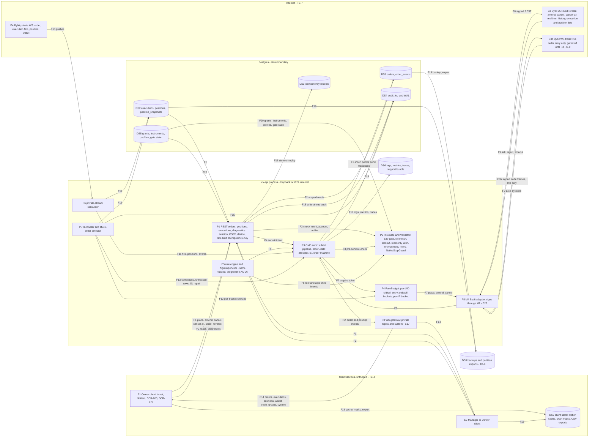

# E29 — STRIDE threat model: OMS core and the order-placement path

- Ticket: E29-X01 (issue #849). Owner: Security engineer (CODEOWNER). Status: **Draft** for Architect and
  Security-engineer review, until its open blockers land (Timing), the §1.4 inputs are confirmed, and the Owner
  decides D6 and D7 and accepts the §12.2 residuals.
- Method: the `04-security-program.md` §5 template (L x I = risk), STRIDE per element and per flow (C-12.1), in the
  four-question frame (building §1-§2; what can go wrong §3, §5, §6; response §7, §10, §11; review §12), formatted as
  the E27 and E28 models. Their rows and E08's, E09's and E17's are **referenced, not repeated**.
- Inputs, read at `b11174a3`: issue #849 and the E29 epic with its 34 child tickets; `24-internal-schemas.md` §8.1 to
  §8.9, §14.3 and §15; `21-database-schema.md` §3.3.1 and §3.3.4 to §3.3.7; `20-architecture.md` §2.2, §3.5, §4.3, §9
  and §12; ADR-0006; ADR-0008; `28-statechart-catalogue.md` B1, B8 and B19 with `B01.order.machine.json`; the
  `/orders*`, `/positions*` and `/executions*` paths of `22-api-openapi.yaml`; `23-ws-protocol.md` §6.2, §6.3 and
  §16.1 (WS S4, S5); `04-security-program.md` §2 to §4.1, §5.2 to §5.4, §6.4, §6.6, §6.8 and §6.9; on `main`, the
  files this model cites in `oms`, `domain`, `auth`, `audit`, `observability`, `ws`, `statechart/bindings`,
  `exchange/base` and `exchange/bybit`, with their tests, migration `0003_audit_log` and the RBAC `matrix.yaml`.
  The #846 docs contract slice (`chore/e29-t02-orderlinkid-contract` at `38b678a5`, no PR yet) departs from
  orchestrator ruling B2 (comment 6204432470), and its owner asked main-orchestrator to amend or overrule B2 (comment
  6208943196, unanswered). This model follows the slice; every row, section, requirement and seed that rests on it
  carries `[O-8]`, so the answer re-rates exactly those (§1.4). Before this model's PR opens, and again before it
  leaves Draft, the #846 thread and the slice tip (or its PR head) are re-read; if B2 is upheld or the tip moved, the
  `[O-8]` items are re-rated and the pin and the Review log updated.
- Path: the ticket names `docs/security/e29-oms-threat-model.md`, but GOV-008 scans only
  `docs/security/threat-models/E<nn>-<slug>.md`, so this file is `E29-oms.md` (D3).
- Timing: design-time draft. E27-T02 (#835) and E27-X01 (#838) are closed; E29-K01 (#843), E27-K01 (#832), E27-T01
  (#834), E27-T03 (#836) and E27-T04 (#837) are open, and every row resting on their answers is tagged `[O-n]` (§1.4).
  E29-T04 (#913) must not merge before this model is complete (ticket AC "The model gates the pipeline"), yet E29-X01
  is in neither E29-T01's nor E29-T04's `blocked_by`: §11 asks for both (C-12.1), its obligations are posted before
  #913 is unblocked, and the orchestrator gates #913 on the re-rated revision.
- Gate note: design-level weaknesses only. No credential, account identifier, UID or exploit detail appears.

## 1. Scope

In scope, the two paths the ticket names: client → REST `/orders` → RiskGate → OMS → RateBudget → BybitAdapter →
Bybit, and Bybit private WS → OMS → Postgres → WS fan-out → client. That covers the OMS routes (`/orders*`,
`/positions*`, `/executions*`, diagnostics), the submission pipeline, the `orderLinkId` allocator, the B1 order machine,
the private-stream consumer, the reconciler and stuck-order detector, the four private topics with `trade_groups` and
`system`, the stores (`orders`, `order_events`, `executions`, `positions`, `position_snapshots`), the idempotency
records, and the audit and telemetry these emit.

Out of scope (ticket): key storage and envelope encryption (E27 model), with the C-2.8 withdrawal-off permission gate
and the Semgrep rule `cv-withdrawal-endpoint-ban` (E27 KV-E05), fan-out unwind (E34), the rule-engine sandbox (E35),
kill-switch bypass (E39), penetration testing (E43). Referenced, not re-modelled: profiles, sizing and risk caps (E28
model), native-SL enforcement and brackets (E32-X01, #933), emulated algos (E33-X01, #995), the reconciliation job
(E45-X01, #1281), the order ticket and arming (E30-X01, #920), live gating (E44-X01, #1249).

### 1.1 State of the build at review time

| Component                                   | Status                  | Evidence                                                                                                                                                                                                                                                                                                                                              |
| ------------------------------------------- | ----------------------- | ----------------------------------------------------------------------------------------------------------------------------------------------------------------------------------------------------------------------------------------------------------------------------------------------------------------------------------------------------- |
| M14 `oms` module                            | scaffold                | `Validator.assert_order_placement_allowed()` refuses on the process read-only gate (`services/api/tests/unit/oms/test_validator.py`)                                                                                                                                                                                                                  |
| `TradingPort`                               | declared only           | `exchange/base/ports.py`; no implementation, no private-WS client in `exchange/bybit/`                                                                                                                                                                                                                                                                |
| `orders`, `order_events`, `executions`, ... | not built               | No migration; E29-T01 (#845) takes the next free slot after the #846 docs contract slice                                                                                                                                                                                                                                                              |
| B1 order machine                            | contract, stub bindings | `statechart/machines/B01.order.machine.json`, hash-locked; `bindings/b01_order.py` (#2133): deny-all guards, no-op actions and services, permissive event schemas ("E29 tightens them"), and one live KILL arm (`issue_kill_cancel` calls the binding's `cancel_order`; its docstring hands the audited route to E29)                                 |
| `/orders*`, `/positions*`, `/executions*`   | not mounted             | `matrix.yaml` rows are `state: not_mounted` and record the capability layer only (`manager_without_grant: allow`)                                                                                                                                                                                                                                     |
| Scope decision point                        | merged                  | `auth/scopes.py` `enforce` audits `rbac.denied` and counts `authz_denied_total`; `test_manager_cannot_reach_another_managers_account` (`services/api/tests/unit/auth/test_scopes.py`)                                                                                                                                                                 |
| Private topics in the WS gateway            | merged                  | `ws/topics.py` registers `orders` and `executions` (both never throttled), `positions`, `wallet`, `trade_groups`; `ws/sequencing.py` narrows each publish on its account argument; tests in `services/api/tests/unit/ws/`                                                                                                                             |
| Audit writer, hash chain, order actions     | merged                  | `orders.submit`, `orders.cancel`, `orders.amend`, `trade_group.submit`, `positions.flatten` registered in `audit/actions.py`                                                                                                                                                                                                                          |
| M2 signing for M4                           | merged                  | M2 returns only the MAC and the key id (#2350); guard rule R10 in `exchange/` (#2352)                                                                                                                                                                                                                                                                 |
| REST rate governor                          | merged, no reserve      | `TokenBucketGovernor` (`exchange/bybit/rate_limit.py`, E08-T02), wired in `exchange/bybit/rest.py`: one bucket per (UID, endpoint class) fed back from `X-Bapi-Limit-Status`, a 600-per-5 s IP-wide bucket, and a `10018` hold over every UID capped at `MAX_IP_HOLD_S` (900 s). No purpose classes and no `critical` reserve: E34-T02 adds them (§7) |

A row resting on unbuilt work names the ticket that builds the control; E29-X03 re-triages it if that ticket does not.

### 1.2 Assets and data classification

E29-X01 fixes the classification for the epic (ticket Security notes); every E29 child cites it.

| Asset                                                                                                     | Class                               | Notes                                                                                                                                                                                |
| --------------------------------------------------------------------------------------------------------- | ----------------------------------- | ------------------------------------------------------------------------------------------------------------------------------------------------------------------------------------ |
| Orders, `order_events` (after redaction), executions, positions, snapshots, wallet projection, closed PnL | **Financial / restricted**          | Programme assets A-05 (order path) and A-06 (positions). Served only inside the caller's grants; never in a metric label or analytics event                                          |
| `order_events.payload` and diagnostics request/response pairs **before redaction**                        | **Secret**                          | May hold `X-BAPI-API-KEY`, `X-BAPI-SIGN` or an `auth` frame, the private stream's (`24-internal-schemas.md` §14.3) or the live trade socket's (F8b). Never leaves M4 unredacted (§6) |
| Exchange `retMsg`, `reject_message`                                                                       | Financial / restricted, untrusted   | Exchange-controlled text: rendered as text, never as HTML, never interpolated into SQL                                                                                               |
| `order_link_id`, `exchange_order_id`, `trade_group_id`, `exec_id`                                         | Internal correlation ids            | Not secrets and not authority (§5); they reveal group structure (OM-I09); never metric labels (`20-architecture.md` §12.1)                                                           |
| Idempotency records (key, body fingerprint, stored response) and the `client_group_ref` replay anchor     | Financial / restricted              | Keyed per principal and operation (SR-E29-07) `[O-8]`                                                                                                                                |
| Order-path availability: the per-UID `critical` budget, the private streams, Postgres                     | Integrity and availability critical | A starved stop is a C-2.6 failure (§7)                                                                                                                                               |

### 1.3 Rating

Risk = L x I on the programme scale (Low / Medium / High / Critical):

| L \ I | L      | M      | H        |
| ----- | ------ | ------ | -------- |
| L     | Low    | Low    | Medium   |
| M     | Low    | Medium | High     |
| H     | Medium | High   | Critical |

Impact **H\*** marks an outcome that lets value leave an account (E27 D2) or leaves a position without a working
native stop, which C-2.6 calls a Severity-1 defect (E28 D2); it raises the cell one band. Disposition: **Q** a
requirement (`SR-E29-nn` or a ticket-body control) that a named ticket must build and a named test must prove; **C** an
existing control on `main`, cited with its test; **R** owned by another epic's model; **A** accepted (Owner sign-off,
§12.2). Row ids are `OM-xnn`; `24 Sn` is rule Sn of `24-internal-schemas.md` §8.2, `WS Sn` of `23-ws-protocol.md` §16.1.

### 1.4 Open inputs

Assumptions a blocker must confirm; rows that depend on one carry its tag and are re-rated if the answer differs.

| Id  | Assumption in this draft                                                                                                                                                                                                                                                                                                                                                                                                                                                                                                                                                                                                                                                                                                  | Confirmed by                                                                                                                                                                                                                                                                                                                                                                                                                                                                                                                                                                                                                   |
| --- | ------------------------------------------------------------------------------------------------------------------------------------------------------------------------------------------------------------------------------------------------------------------------------------------------------------------------------------------------------------------------------------------------------------------------------------------------------------------------------------------------------------------------------------------------------------------------------------------------------------------------------------------------------------------------------------------------------------------------- | ------------------------------------------------------------------------------------------------------------------------------------------------------------------------------------------------------------------------------------------------------------------------------------------------------------------------------------------------------------------------------------------------------------------------------------------------------------------------------------------------------------------------------------------------------------------------------------------------------------------------------ |
| O-1 | Bybit refuses a reused `orderLinkId` with 10001 (duplicate text) or 110072 within a window, including for filled and cancelled orders (`24-internal-schemas.md` §8.3 says only "within its retention window"; demo keeps orders 7 days)                                                                                                                                                                                                                                                                                                                                                                                                                                                                                   | E29-K01 (#843) captures                                                                                                                                                                                                                                                                                                                                                                                                                                                                                                                                                                                                        |
| O-2 | A private `execution` can arrive after the `order` transition it caused, and a few fills are seen only through REST backfill, so WS S5 needs a reorder buffer and reconciliation stays mandatory                                                                                                                                                                                                                                                                                                                                                                                                                                                                                                                          | E29-K01 soak                                                                                                                                                                                                                                                                                                                                                                                                                                                                                                                                                                                                                   |
| O-3 | REST response headers and private messages may carry account-identifying values, so the stored record is an allow-list, not a copy                                                                                                                                                                                                                                                                                                                                                                                                                                                                                                                                                                                        | E29-K01 captures                                                                                                                                                                                                                                                                                                                                                                                                                                                                                                                                                                                                               |
| O-4 | `/v5/order/cancel-all` takes an `orderFilter` (`docs/research/06-bybit-api.md`), and some value reaches TP/SL or conditional stop orders, so the filter decides whether a cancel-all can strip a native stop                                                                                                                                                                                                                                                                                                                                                                                                                                                                                                              | E29-K01 captures (requested, §11)                                                                                                                                                                                                                                                                                                                                                                                                                                                                                                                                                                                              |
| O-5 | Keys are verified withdrawal-off and allow-listed before the OMS signs, and a failed or stale check trips the read-only gate (C-2.8; KV-E05, KV-E12; Semgrep `cv-withdrawal-endpoint-ban` bans the endpoint)                                                                                                                                                                                                                                                                                                                                                                                                                                                                                                              | E27-T03 (#836)                                                                                                                                                                                                                                                                                                                                                                                                                                                                                                                                                                                                                 |
| O-6 | Per-account health and the ordering-enabled flag exist for the Validator to consult (KV-T12)                                                                                                                                                                                                                                                                                                                                                                                                                                                                                                                                                                                                                              | E27-T04 (#837)                                                                                                                                                                                                                                                                                                                                                                                                                                                                                                                                                                                                                 |
| O-7 | The account model (`exchange_accounts.env`, UID, grants) and KEK custody hold as the E27 model states (KV-T04, KV-E04)                                                                                                                                                                                                                                                                                                                                                                                                                                                                                                                                                                                                    | E27-T01 (#834), E27-K01 (#832)                                                                                                                                                                                                                                                                                                                                                                                                                                                                                                                                                                                                 |
| O-8 | `24-internal-schemas.md` §8.3 is the only id scheme; `ord_link_fmt` has two shape arms, `OUR_ID` (a §8.3 id) and `EXT_ID` (`^ext-[0-9a-f]{32}$`), and no state term; the adapter normalises every remote `order_link_id` to one of them (§14.2 rule 11); an adopted order is stored under that normalised id, its own `orderLinkId` when that fullmatches `OUR_ID` (ours whose row was lost) and otherwise `ext_key(orderId)`, while an id held by a terminal or another account's row is a `ReconcileAnomaly` and is never adopted (§8.5 step 3c); a row in any state is a collision for the generator (rule 5); the `Idempotency-Key` never enters the id and is stored as the group's `client_group_ref` (§8.3 rule 1) | Pending: main-orchestrator's answer on #846 to the slice owner's request to amend or overrule B2 (comment 6208943196), then the slice PR. The fallback is B2's literal text (`CHECK (state = 'untracked' OR ...)`; an adopted row stores Bybit's `orderLinkId` verbatim when non-empty), under which OM-E02, OM-S05, SR-E29-03, SR-E29-12, G-4, F-02, F-10, AC-11, AC-21 and N3 re-rate: the exemption ends when a row leaves `untracked` (revision 1, `45486d53`, holds that wording of OM-E02, SR-E29-12 and G-4), and a mismatched order stored verbatim collides with our row, so G-6 needs B2 to allow `ext_key(orderId)` |
| O-9 | Live order entry: SR-040a keeps v1 order entry REST-only in both environments, while ADR-0006 rule 5, `20-architecture.md` §9 and E29-T04 select Bybit WS trade (`/v5/trade`) on live through `supports_ws_order_entry`, gated off until R4. The F8b rows assume the path is built but unreachable until E44 enables it                                                                                                                                                                                                                                                                                                                                                                                                   | E44-X01 (#1249), E38-T01 (#1006); E29-K01 excludes WS order entry                                                                                                                                                                                                                                                                                                                                                                                                                                                                                                                                                              |

## 2. Data-flow diagram and trust boundaries

The decomposition is `24-internal-schemas.md` §8.4's sequence, not a parallel one: UI → E1, E2; REST `/orders` → P1;
RiskGate → P2; OMS → P3; Postgres → DS1, DS2; RateBudget → P4; BybitAdapter → P5; Bybit → E3, its "or WS trade on
live" branch → E3b (F8b); PrivateWS → E4, P6; "OMS to UI" → P8 (F14); plus the callers, reconciler and stores it omits.

Text description (the diagram is not the only carrier): a client sends a mutation (F1) or a read (F2) to the REST
surface, which runs the E09 chain and the idempotency store (F16). The risk gate checks the intent against grant,
profile and gate state (F3, F20); the OMS sizes, rounds and builds the `orderLinkId` (F4), and rule and algo intents
enter the same gate in process (F5). The OMS writes the order row and first event before any send (F6), takes a budget
token (F7) and hands the request to the adapter, which signs through M2 and calls Bybit (F8; on live, once E44 enables
it, the WS trade socket, F8b `[O-9]`); answers come back untrusted (F9). Pushes (F10) become fills, positions and
events (F11); the reconciler polls through `poll` (F12) and applies corrections, `untracked` rows and stop repairs
(F13); persisted changes reach clients (F14). Every mutation is audited write-ahead (F15); telemetry (F17), client
caches and exports (F18) and backups (F19) receive copies.

Elements: entities **E1-E5** and **E3b**; processes **P1-P8**; stores **DS1-DS8**; flows **F1-F20**, **F8b** (§3.7).

Boundaries (`20-architecture.md` §2.2, `04-security-program.md` §4.1, E27 model §2):

- **TB-4, client to API** (F1, F2, F14, F18): untrusted until authenticated, RBAC-scoped after; the client enforces
  nothing (C-2.12), and a blotter that hides a button is not a control.
- **Store boundary** (F6, F11, F13, F15, F16, F19, F20): a database writer is its own integrity domain;
  `order_events` and `executions` are the order path's non-repudiation stores beside `audit_log`.
- **TB-7, backend to Bybit** (F8, F8b, F9, F10, F12 through F8): owned by E08 and E27; the exchange is semi-trusted
  (programme AC-08), so every answer is validated and the private stream is reconciled against REST.
- **TB-6** (F19): backups and the 24-month partition export receive whatever `order_events` holds.
- **E5** runs in process but is semi-trusted (programme AC-06): its intents take the P2 and P3 path (OM-E04).
- The **M2 capability boundary** sits inside P5 (E27 model §4.3). B4 (renderer to Electron main) carries no E29 flow.

## 3. STRIDE table

Columns: the existing control is what `main` does today, with its test; the gap names the mitigation and its ticket;
`SR-E29-nn` are this model's requirements (§10). Programme rows extended, not repeated (`04-security-program.md` §5.2,
§5.4): O1 → OM-E01; O2, O11 → OM-S01; O3 → OM-T01 (with E28's PF-T rows); O4 → OM-S02, OM-T05 (with E32); O5 → OM-R01;
O6 → OM-D01, OM-D02, OM-D06; O7 → OM-I01; O8 → OM-T09, OM-T11, §5; O9 → OM-S03, OM-T04; O10 → OM-D05.

### 3.1 Spoofing

| ID     | Element / flow                   | Threat                                                                                                                                                                                                                                                                                                                                                                                                                                                                                                                                                                                                                                                                                                                                                                                                                                                                                                                     | L   | I   | Risk     | Existing control                                                                                                                                                                                                                      | Gap → mitigation                                                                                                                                                                                                                                                                                                                                                                                                                                                                                                                                                                                     | Owner                                                                   | Verify                        | Disp. | Residual |
| ------ | -------------------------------- | -------------------------------------------------------------------------------------------------------------------------------------------------------------------------------------------------------------------------------------------------------------------------------------------------------------------------------------------------------------------------------------------------------------------------------------------------------------------------------------------------------------------------------------------------------------------------------------------------------------------------------------------------------------------------------------------------------------------------------------------------------------------------------------------------------------------------------------------------------------------------------------------------------------------------- | --- | --- | -------- | ------------------------------------------------------------------------------------------------------------------------------------------------------------------------------------------------------------------------------------- | ---------------------------------------------------------------------------------------------------------------------------------------------------------------------------------------------------------------------------------------------------------------------------------------------------------------------------------------------------------------------------------------------------------------------------------------------------------------------------------------------------------------------------------------------------------------------------------------------------- | ----------------------------------------------------------------------- | ----------------------------- | ----- | -------- |
| OM-S01 | E1, E2, F1, P1                   | A planted or stolen session, a cross-site page (CSRF), or an XSS payload or extension in the user's browser submits orders as that user (programme O2, O11)                                                                                                                                                                                                                                                                                                                                                                                                                                                                                                                                                                                                                                                                                                                                                                | M   | H   | High     | Session rotation, refresh-family reuse detection and the fixation audit (E09 U5, U6); CSRF double-submit (SR-041) and `Origin` checks (SR-042); `SameSite=Strict`; strict CSP                                                         | Every mutating E29 route declares `CsrfToken` in the contract; the live arm toggle and per-request `arm_token` (SR-043) are owed by E30-S04 (#1088) and E44; demo needs none (SR-043); `PlaceOrderRequest.arm_token` is required today only for one-click and hotkey entry, so G-1 makes it, or its replacement, mandatory for every live order mutation                                                                                                                                                                                                                                             | E09, E30-S04, E44-S03, E29-T07                                          | integration (AC-27)           | R, Q  | Low      |
| OM-S02 | F1, F5, P3, P4, E5               | Spoofed order purpose or origin. `PlaceOrderRequest.intent` is client-chosen, and two controls key on it: the contract makes the native stop mandatory "for entry intents", and `24-internal-schemas.md` §8.7 lets `stop_loss` and `flatten` purposes draw from the protective reserve. An opening order labelled `take_profit`, `stop_loss` or `flatten` skips the stop; labelled `stop_loss` or `flatten` it also spends the reserve (a `take_profit` draws `normal`, §8.7)                                                                                                                                                                                                                                                                                                                                                                                                                                              | M   | H\* | Critical | None (no route). The request schema refuses unknown fields (`additionalProperties: false`), so `origin` and `origin_ref` cannot be sent                                                                                               | Classify by effect, not by label: an order that is not reduce-only, or exceeds the exchange-truth position it reduces, is an entry for NativeStopGuard and for the budget; a mismatched `intent` is refused; `origin` and `origin_ref` come only from the call path (SR-E29-01)                                                                                                                                                                                                                                                                                                                      | E29-T04, E32-T01 (#931), E34-T02 (#859)                                 | unit, property, E32-Q01 suite | Q     | Low      |
| OM-S03 | E3, E3b, E4, F9, F10             | A spoofed exchange endpoint (REST, or the live trade socket `[O-9]`) or a forged private push or trade ack reports a fill, a cancel or a position that did not happen (programme O9)                                                                                                                                                                                                                                                                                                                                                                                                                                                                                                                                                                                                                                                                                                                                       | L   | H   | Medium   | TLS validation and the per-environment base-URL allow-list (E08 E8-1, E8-2, E8-4); strict response schemas (E8-8)                                                                                                                     | None new: the reconciler compares the stream with REST (E29-T06)                                                                                                                                                                                                                                                                                                                                                                                                                                                                                                                                     | E08, E29-T06                                                            | integration                   | R     | Low      |
| OM-S04 | F10, F12, P6, P7                 | Cross-account attribution: a push from account A's stream, or a REST row from A's reconciliation call, is applied to account B's order because the consumer keys on `orderLinkId` or `orderId` alone                                                                                                                                                                                                                                                                                                                                                                                                                                                                                                                                                                                                                                                                                                                       | L   | H   | Medium   | None (no consumer); E29-T06 asserts that every REST row belongs to the requested account `[ticket body]`                                                                                                                              | One consumer per account; every push and REST row is matched on the account of the stream or call that produced it plus the id, and refused with an alert otherwise (SR-E29-02)                                                                                                                                                                                                                                                                                                                                                                                                                      | E29-T05, E29-T06                                                        | unit, integration             | Q     | Low      |
| OM-S05 | E3, E4, F9, F10, F12, P3, P6, P7 | Squatted id: an actor with exchange-level access to the UID (a stolen key used from the egress IP, in-process code, a dashboard session) places an order under a predicted future `orderLinkId`. The OMS's own create is refused as a duplicate, B1's duplicate-id arm moves the order to `submitted` (`mark_needs_lookup`) before any lookup, and success-after-lookup adopts the foreign order as its own. The adapter gives the foreign order and its fills our `OUR_ID` (24 §14.2 rule 11), so reconciliation step 2 pairs the fills with our row "on `order_link_id` alone", step 3a pairs the order with it, and the private-stream consumer, which receives the same normalised ids and drives transitions by `orderLinkId` (`20-architecture.md` §3.5), does likewise; step 3c's anomaly branch covers only terminal and other-account rows. The no-intent detection of SR-E27-19 stays quiet (§5) `[O-1]` `[O-8]` | L   | H\* | High     | None. B1's `quarantined` is a fault landing whose only exits adopt the remote order (`adopt_recon`) and has no persisted status (`28-statechart-catalogue.md` B1 and §22); the slice has no mismatch branch in 24 §8.3, §8.5 or §14.2 | Bind only on a full match with the persisted row, checked before the duplicate-id arm reaches `submitted` and wherever a result is found by `order_link_id` (SR-E28-18, extended by SR-E29-03); fills and pushes reach a row only through its bound `exchange_order_id`, in reconciliation and in the private-stream consumer alike; a mismatch holds the local order for an operator (a B1 change, G-3), pages, and records the remote order as `untracked` under `ext_key(orderId)` with its fills paired on `exchange_order_id` (a slice change, G-6); a resend looks the id up first (SR-E29-15) | E29-T02 (#846), E29-T03 (#847), E29-T04, E29-T05 (#848), E29-T06 (#914) | unit, property, AC-11         | Q, A  | Low      |

### 3.2 Tampering

| ID     | Element / flow      | Threat                                                                                                                                                                                                                                                                                                                                                                                                                                                                                                                                                                                                           | L   | I   | Risk     | Existing control                                                                                                                                                                                                                                                                                                                                                                                                                                                                                                                                                                                                                                                                   | Gap → mitigation                                                                                                                                                                                                                                                                                                                                                                                                                                                                                                                                                                                                       | Owner                                              | Verify                   | Disp. | Residual |
| ------ | ------------------- | ---------------------------------------------------------------------------------------------------------------------------------------------------------------------------------------------------------------------------------------------------------------------------------------------------------------------------------------------------------------------------------------------------------------------------------------------------------------------------------------------------------------------------------------------------------------------------------------------------------------- | --- | --- | -------- | ---------------------------------------------------------------------------------------------------------------------------------------------------------------------------------------------------------------------------------------------------------------------------------------------------------------------------------------------------------------------------------------------------------------------------------------------------------------------------------------------------------------------------------------------------------------------------------------------------------------------------------------------------------------------------------- | ---------------------------------------------------------------------------------------------------------------------------------------------------------------------------------------------------------------------------------------------------------------------------------------------------------------------------------------------------------------------------------------------------------------------------------------------------------------------------------------------------------------------------------------------------------------------------------------------------------------------- | -------------------------------------------------- | ------------------------ | ----- | -------- |
| OM-T01 | F1, P1              | Quantity, price, side, account or profile changed between client and OMS by a hostile client (TLS covers the hop; the client is the actor)                                                                                                                                                                                                                                                                                                                                                                                                                                                                       | M   | H   | High     | None (no route); the contract sets `additionalProperties: false` on `PlaceOrderRequest`, `AmendOrderRequest` and `CancelAllRequest`                                                                                                                                                                                                                                                                                                                                                                                                                                                                                                                                                | Strict models with `extra="forbid"` and `Decimal` parsing (SR-040); size re-derived from the profile (SR-052; E28 PF-T03 and SR-E28-03 also bind `placeOrder.profile_id`); the account checked as in OM-E01; tick and lot rounding before persistence                                                                                                                                                                                                                                                                                                                                                                  | E29-T04, E29-T07, E28-T03                          | contract, unit           | Q, R  | Low      |
| OM-T02 | F3, F4, P2, P3      | Time-of-check gap: §8.4 calls `RISK.check(intent, account, profile)` before the OMS sizes, rounds and builds the order, so the gate sees the intent, not the order sent; retries, deferred legs, TP ladders and algo children are sent later with no re-check (E28 PF-E04)                                                                                                                                                                                                                                                                                                                                       | M   | H   | High     | None                                                                                                                                                                                                                                                                                                                                                                                                                                                                                                                                                                                                                                                                               | The gate evaluates the sized, rounded order after `size` and before the INSERT (SR-E29-04); the synchronous gates run again before every position-opening adapter call (SR-E28-27, C-2.21)                                                                                                                                                                                                                                                                                                                                                                                                                             | E29-T04, E39-S01 (#954)                            | unit, integration, AC-28 | Q, R  | Low      |
| OM-T03 | DS1, DS2            | A database writer rewrites history: `TRUNCATE order_events`, `UPDATE` or `DELETE` on `executions`, or edits to an `orders` row (quantity, account, state)                                                                                                                                                                                                                                                                                                                                                                                                                                                        | L   | H   | Medium   | `audit_log` has row triggers, a `BEFORE TRUNCATE` statement trigger and `REVOKE UPDATE, DELETE, TRUNCATE` from `cv_app` and `cv_ro` (migration `0003_audit_log`)                                                                                                                                                                                                                                                                                                                                                                                                                                                                                                                   | The documented DDL gives `order_events` and `executions` row triggers only, and row triggers do not fire on `TRUNCATE`: copy the 0003 pattern (SR-E29-05); `orders` stays a projection rebuildable from `order_events` (E29-T03) and reconciled against the exchange                                                                                                                                                                                                                                                                                                                                                   | E29-T01 (#845), E29-T03                            | integration              | Q, A  | Low      |
| OM-T04 | F9, F10, F11, P6    | Hostile or malformed exchange data: `filled_qty` above `qty`, a negative fee, a repeated `exec_id`, an out-of-order state or a post-terminal push corrupts the mirror (programme O9, W1)                                                                                                                                                                                                                                                                                                                                                                                                                         | M   | H   | High     | None; the B1 stub bindings accept any event payload (`_ANY_PAYLOAD` in `b01_order.py`, "E29 tightens them")                                                                                                                                                                                                                                                                                                                                                                                                                                                                                                                                                                        | Schema validation (SR-040, E08 E8-8); closed B1 event schemas in place of the stubs (E29-T03); 24 S4 dedupe (`ux_exec_id`, `ON CONFLICT DO NOTHING`), 24 S5 ordering, 24 S6 `ReconcileAnomaly`, INV-1 and INV-B1-b, the `ord_cum` CHECK (E29-T01, E29-T03 `[ticket body]`) `[O-2]`                                                                                                                                                                                                                                                                                                                                     | E29-T01, E29-T03, E29-T05                          | unit, property, AC-26    | Q     | Low      |
| OM-T05 | F1, F7, P3          | Protection stripped through a legitimate route: an amend that moves an entry's stop away from the position, `cancel-all` with `exclude_reduce_only: false`, a cancel-all filter that reaches position TP/SL orders, or a one-sided TP/SL amend that breaks the exchange's pairing (C-2.6) `[O-4]`; B1's KILL arm cancels outside the audited OMS service and its budget                                                                                                                                                                                                                                          | M   | H\* | Critical | The contract refuses clearing an open leg's stop (`native_stop_required`) and re-sends both TP/SL sides; B1's `issue_kill_cancel` calls the binding's own `cancel_order` stub (`b01_order.py`)                                                                                                                                                                                                                                                                                                                                                                                                                                                                                     | A loosened stop needs the audited confirmation of §8.8 rule 5 (`sl.loosened`); cancel and cancel-all never remove an open position's native stop, and the adapter sets the cancel-all filter explicitly (SR-E29-06); a KILL-originated cancel goes through the audited, budget-drawing OMS cancel service and obeys SR-E29-06 (the kill switch stays E39's); the E32 choke point and watchdog are the floor                                                                                                                                                                                                            | E29-T03, E29-T04, E29-T07, E32-T01, E32-T02 (#932) | integration, E32-Q01     | Q, R  | Low      |
| OM-T06 | F1, DS1             | Lost update: two amends race (two clients, or a client and a rule), or an amend lands on an order with a cancel in flight                                                                                                                                                                                                                                                                                                                                                                                                                                                                                        | M   | M   | Medium   | None                                                                                                                                                                                                                                                                                                                                                                                                                                                                                                                                                                                                                                                                               | `If-Match` on amend, a per-order keyed lock and `order_not_amendable` while an operation is in flight (E29-T04, E29-T07 `[ticket body]`)                                                                                                                                                                                                                                                                                                                                                                                                                                                                               | E29-T04, E29-T07                                   | integration              | Q     | Low      |
| OM-T07 | F1, P1              | A close or partial close with a client quantity above the position, or with `reduce_only` stripped, reverses or grows the position (E29-X02 list)                                                                                                                                                                                                                                                                                                                                                                                                                                                                | M   | H   | High     | None                                                                                                                                                                                                                                                                                                                                                                                                                                                                                                                                                                                                                                                                               | The server re-derives the close quantity from the exchange-truth position and forces reduce-only on every close and flatten path (E29-T07, E29-S03 `[ticket body]`)                                                                                                                                                                                                                                                                                                                                                                                                                                                    | E29-T07, E29-S03 (#978)                            | unit, integration        | Q     | Low      |
| OM-T08 | DS2, F11, F13, P7   | The position, wallet or order projection drifts from the exchange (a missed push, a wrong merge), so the blotter and the risk view show a wrong book (risk R7) or a stop that is not there                                                                                                                                                                                                                                                                                                                                                                                                                       | M   | H   | High     | None                                                                                                                                                                                                                                                                                                                                                                                                                                                                                                                                                                                                                                                                               | Exchange truth wins; reconciliation at start-up, on reconnect and every 30 s; drift beyond `qty_step` alerts critical; the stale-account lockout; the reassurance line gated on the invariant check (E29-T05, E29-T06, E29-S07 `[ticket body]`) `[O-2]`                                                                                                                                                                                                                                                                                                                                                                | E29-T05, E29-T06, E29-S07 (#1028)                  | chaos (E29-Q04)          | Q     | Low      |
| OM-T09 | DS3, F16            | Idempotency misuse: a record keyed by the client key alone returns one user's response to another, accepts a different body, or lets a replay derive new ids. The permanent replay anchor is `client_group_ref`, where slice rule 1 stores the client's `Idempotency-Key`, unique over all `trade_groups` (`21-database-schema.md` §3.3.2): a second principal sending a value the first used reaches the first principal's group (an IDOR) or a uniqueness conflict (an existence oracle), and a different body after the 24 h record expires reaches the old group `[O-8]`                                     | M   | M   | Medium   | Recorder-admin routes key by (actor, key, body hash) (`api/recorder_admin.py`); no OMS store yet                                                                                                                                                                                                                                                                                                                                                                                                                                                                                                                                                                                   | The 24 h record is a response cache keyed by (principal, operation, key) with a body fingerprint; the anchor is stored principal-scoped, keeps the fingerprint and answers a foreign key as a missing one (a slice and DDL change, G-6); a replay is re-authorised against current grants (SR-E29-07, §5)                                                                                                                                                                                                                                                                                                              | E29-T04, E28-T01 (#905)                            | unit, integration, AC-10 | Q     | Low      |
| OM-T10 | F8, F8b, F9, P3, P5 | Duplicate order through a forced or ambiguous resend: an ambiguous REST result (10016, 10019, HTTP 5xx, a timeout before the ack) or, on the live trade socket, a frame with no ack, a socket closed after the send or an ack by `reqId` after a reconnect, followed by a resend without a lookup; 24 §8.6 marks 10016 and 10019 retryable `[O-1]` `[O-9]`                                                                                                                                                                                                                                                       | M   | H   | High     | None that holds. B1 sends every post-send transport fault to `unknown`, which never resubmits (24 S1, INV-B1-e), but the merged M4 client resends first: `BybitRestClient._request` (`exchange/bybit/rest.py:390-396`, `:413-419`, `:495-501`) re-signs a signed ORDER-class POST up to `max_retries` = 3 (`config.py:65`) after a timeout, a transport error, an HTTP 5xx or a retryable `RateLimitError`, which `mapping.py:37,39` makes of 10016 and 10019, under the same `orderLinkId` and with no lookup, by design (the `signed_request` docstring, E08-T02); only a non-JSON body is never retried (`test_non_json_body_on_order_class_stays_unknown_state_without_retry`) | M4 must not auto-resend an ORDER-class create once it has left: it raises an ambiguous-result error, so B1 reaches `unknown` and the OMS looks the id up (G-7); a resend after any ambiguity looks the id up first, trade frames included; acks pair by `reqId` and `orderLinkId`, never by arrival order (SR-E29-15). If the Owner keeps M4's retry because Bybit deduplicates the id, its safety rests on O-1 and F-07 stays open                                                                                                                                                                                    | E29-T04, E29-K01, G-7                              | unit, chaos (AC-12)      | Q     | Low      |
| OM-T11 | F1, F16, DS3, P1    | Late replay on a route without a permanent anchor: only placement stores its key (§5.1), while `amendOrder`, `cancelOrder`, `cancelAllOrders`, `closePosition`, `reversePosition`, `setPositionLeverage` and `closeAllPositions` (`x-idempotency: required`, `22-api-openapi.yaml` :3792 to :4558) keep only the 24 h record, so the same key and body after it expires is a new request: `reversePosition` reverses again, `closeAllPositions` flattens positions opened since, and `closePosition` acts on today's position, whose row and id outlive a close (one row per account, symbol and position index) | L   | H   | Medium   | The session bounds a captured request: its access handle lives 12 min and its session at most 12 h, which refresh keeps (`ACCESS_TOKEN_TTL`, `ABSOLUTE_LIFETIME` in `auth/session_service.py`; `test_refresh_preserves_the_original_absolute_expiry`), and its CSRF token is bound to the session (SR-041), so the sender holds a current session: the client's own late retry, or OM-S01                                                                                                                                                                                                                                                                                          | The order-creating routes `closePosition`, `reversePosition` and `closeAllPositions` keep a permanent, principal-scoped record of their key, as placement does (SR-E29-07). The others stay bounded: `If-Match` on amend, a terminal order's cancel changes nothing, cancel-all never removes an open position's native stop (SR-E29-06), leverage places no order; on E32's `setPositionTpSl` a loosened stop needs the audited confirmation of 24 §8.8 rule 5. On live, SR-043's per-request arm nonce also refuses a stale request once G-1 extends `arm_token` to every live order mutation; demo has no arm nonce | E29-T04, E29-T07                                   | integration (AC-29)      | C, Q  | Low      |

### 3.3 Repudiation

| ID     | Element / flow       | Threat                                                                                                                                                                                                                                                                                                                                                                                                             | L   | I   | Risk   | Existing control                                                                                                                                                                                                                                               | Gap → mitigation                                                                                                                                                                                                     | Owner                                       | Verify                           | Disp. | Residual |
| ------ | -------------------- | ------------------------------------------------------------------------------------------------------------------------------------------------------------------------------------------------------------------------------------------------------------------------------------------------------------------------------------------------------------------------------------------------------------------ | --- | --- | ------ | -------------------------------------------------------------------------------------------------------------------------------------------------------------------------------------------------------------------------------------------------------------- | -------------------------------------------------------------------------------------------------------------------------------------------------------------------------------------------------------------------- | ------------------------------------------- | -------------------------------- | ----- | -------- |
| OM-R01 | E1, E2, F1, F4, DS4  | A user denies placing, amending or cancelling an order, or a Manager and the Owner dispute who did (programme O5; programme actor AC-14)                                                                                                                                                                                                                                                                           | M   | H   | High   | Hash-chained audit with an off-database checkpoint (E09 U14, U19, U20); `orders.submit`, `orders.cancel`, `orders.amend`, `positions.flatten` registered                                                                                                       | An intent record before the send and an outcome record after, correlated by `orderLinkId` (SR-061) with the SR-062 fields; fills and cancel-all results audited per order (C-2.9); one action vocabulary (SR-E29-17) | E29-T04, E29-T07                            | integration, E29-X02 audit cells | Q     | Low      |
| OM-R02 | DS1, F6, F9, F10, P3 | A transition happens without its `order_events` row (a crash between state change and write), or a transition that claims an exchange source carries nothing that justifies it                                                                                                                                                                                                                                     | L   | H   | Medium | None                                                                                                                                                                                                                                                           | Write-ahead 24 S8 and INV-B1-g; `source` plus the redacted exchange record on every exchange-sourced transition; deterministic replay from events (E29-T03 `[ticket body]`)                                          | E29-T03                                     | unit, chaos                      | Q     | Low      |
| OM-R03 | P7, F13, DS4         | Reconciliation corrections, `untracked` adoptions, abandonments and stop repairs leave no attributable before-and-after record, so an external order or a silent divergence cannot be shown later                                                                                                                                                                                                                  | M   | H   | High   | None; `oms.reconcile` and `order.adopted_untracked` are in `24-internal-schemas.md` §15.5 but not in `audit/actions.py`; E29-T06 and E45-T03 name `oms.reconcile`, and E45-S01, E45-Q03 and E45-X02 name the adoption under management `oms.untracked_adopted` | A persisted report every sweep (INV-B19-f) and an audit record per correction with both values (E29-T06 `[ticket body]`); the actions registered first (SR-E29-17)                                                   | E29-T06, E45-S01, E45-T03 (#1275)           | integration                      | Q     | Low      |
| OM-R04 | E5, F5               | A rule- or algo-originated order is not attributable to the arming user and the rule version (programme R6)                                                                                                                                                                                                                                                                                                        | L   | H   | Medium | Rule actions registered (`rules.arm`, `rules.scope_denied`)                                                                                                                                                                                                    | Owned by the E35 and E33 models; the OMS records `origin` and `origin_ref` from the call path (SR-E29-01)                                                                                                            | E35-X01 (#945), E33-X01                     | integration                      | R     | Low      |
| OM-R05 | DS4, F15             | The audit chain is truncated or rewritten to hide an order action                                                                                                                                                                                                                                                                                                                                                  | L   | H   | Medium | E09 U14, U17, U19, U20: append-only grants, hash chain, checkpoint file, `BEFORE TRUNCATE` trigger                                                                                                                                                             | Nightly chain verifier (E09)                                                                                                                                                                                         | E09                                         | integration                      | R     | Low      |
| OM-R06 | DS6, F17             | Forensic correlation lost: the log redactor replaces any string that contains an alphanumeric word of 18 to 36 characters with `[redacted:key-shape]` (`observability/redaction.py`), and the 22-character group segment of every §8.3 id is such a word, so OMS log lines cannot be joined to `order_events` and audit rows by the correlation key (ADR-0006 rule 1). A blanket field exemption would open a hole | M   | M   | Medium | None                                                                                                                                                                                                                                                           | A typed pass for an `order_link_id` value that fully matches the §8.3 pattern or the `ext-` form; every other value under that key is still scanned (SR-E29-16)                                                      | E29-T08 (#916), with the E04 redactor owner | unit                             | Q     | Low      |

### 3.4 Information disclosure

| ID     | Element / flow            | Threat                                                                                                                                                                                                                                                                                                                            | L   | I   | Risk   | Existing control                                                                                                                                                                                                                                                                                                                                                                                                            | Gap → mitigation                                                                                                                                                                                                                      | Owner                              | Verify                  | Disp. | Residual |
| ------ | ------------------------- | --------------------------------------------------------------------------------------------------------------------------------------------------------------------------------------------------------------------------------------------------------------------------------------------------------------------------------- | --- | --- | ------ | --------------------------------------------------------------------------------------------------------------------------------------------------------------------------------------------------------------------------------------------------------------------------------------------------------------------------------------------------------------------------------------------------------------------------- | ------------------------------------------------------------------------------------------------------------------------------------------------------------------------------------------------------------------------------------- | ---------------------------------- | ----------------------- | ----- | -------- |
| OM-I01 | F2, P1, DS1, DS2          | Cross-account read over REST: a Manager or Viewer reads another account's orders, positions, fills, closed PnL or diagnostics through a filter (`trade_group_id`, `symbol`, an empty account list), an id route, the `aggregate=true` breakdown, or a cursor minted under another scope (programme O7)                            | M   | H   | High   | `decide` denies a foreign and a missing account alike (`auth/scopes.py`; E09 U15, U25, U31); `matrix.yaml` covers every route at the capability layer only                                                                                                                                                                                                                                                                  | Scope at query construction (SR-051; E29-T01 scoped helpers, E29-T07 `[ticket body]`); one 404 shape for foreign and missing ids (SR-E29-13); cursors bound to the caller; the granted, foreign and missing matrix per role (E29-X02) | E29-T01, E29-T07, E29-X02 (#982)   | contract                | Q     | Low      |
| OM-I02 | F14, P8                   | Cross-account read over WS: frames of an ungranted account reach a subscriber through requested ids, a stale grant or a shared encode buffer                                                                                                                                                                                      | M   | H   | High   | Gateway narrowing and revocation: `test_sub_scope_is_silently_narrowed`, `test_scope_narrowed_mid_stream_revokes_only_the_removed_account` (`services/api/tests/unit/ws/`); `SequencingHub.publish` and `publish_private` narrow on their account argument, and a publish without one reaches no account-scoped subscription (`in_scope`; `test_account_scoped_delta_is_not_widened_by_a_user`); E17 WS-I02, WS-I08, WS-E02 | The OMS publishes every order event through `publish_private` with the order's account (E29-T05); the dedicated abuse test (E29-T05 `[ticket body]`, AC-06)                                                                           | E17, E29-T05, E29-X02              | integration             | C, Q  | Low      |
| OM-I03 | F14, P8                   | Account-specific `resyncing` and `stale` notices on the auto-subscribed `system` topic reveal another account's existence and health: `SystemUpdate` has an account list only on its `kill_switch` object, so E29-T05 and E29-T06 would put the account in free text, and `system` is filtered by role only (WS-I05)              | M   | M   | Medium | `system` content filtered by role (E17)                                                                                                                                                                                                                                                                                                                                                                                     | Account-scoped notices carry `exchange_account_ids` and reach only connections whose grants intersect; no account label in `message` or `components` (SR-E29-10, contract-first G-2)                                                  | E29-T05, E29-T06, E29-S07          | integration             | Q     | Low      |
| OM-I04 | DS7, F18                  | Blotter rows, chart execution marks or CSV exports show another account's fills: marks built from an unscoped source, a client cache that survives a `revoked` frame, or an account named on a focus card                                                                                                                         | M   | M   | Medium | None                                                                                                                                                                                                                                                                                                                                                                                                                        | Marks only from the scoped `executions` topic or REST (E29-S05 `[ticket body]`); client caches drop an account's rows and marks on `revoked` (SR-E29-11); CSV watermark (E29-S04 `[ticket body]`)                                     | E29-S01, E29-S04, E29-S05, E29-S08 | e2e                     | Q     | Low      |
| OM-I05 | DS1, F6, F8b, F9, F10, P5 | Credentials in `order_events.payload`: the raw exchange message kept for diagnostics carries `X-BAPI-API-KEY`, `X-BAPI-SIGN` or an `auth` frame (the private stream's, or the live trade socket's on F8b `[O-9]`); append-only storage and indefinite retention make one leak permanent and copy it into backups and exports (§6) | M   | H   | High   | M2 returns only the MAC and the key id to M4 (#2350); two deny-list redactors (`audit/redact.py`, `observability/redaction.py`)                                                                                                                                                                                                                                                                                             | The adapter builds an allow-listed record and never hands headers or an `auth` frame to the OMS; a fail-closed redactor before insert; typed payload schemas; a property test with seeded secrets (SR-E29-08) `[O-3]`                 | E29-T01, E29-T04, E29-T05, E29-X02 | unit, property, ci-gate | Q     | Low      |
| OM-I06 | F2, P1                    | `getOrder?include_events=true` returns `OrderEvent.payload` (`additionalProperties: true`) to every `orders:read` holder, Viewers included, unaudited; diagnostics returns raw request and response pairs to the same set, while SR-067 limits raw payloads in audit reads to the Owner                                           | M   | M   | Medium | None                                                                                                                                                                                                                                                                                                                                                                                                                        | Events served without payload; raw pairs and raw `retMsg` only through audited diagnostics; the Viewer question is decision D7 (SR-E29-09)                                                                                            | E29-T07                            | contract                | Q     | Low      |
| OM-I07 | DS6, F17                  | Order intent leaks through telemetry: account ids, sizes or prices as labels, or `retMsg` with account details in logs                                                                                                                                                                                                            | M   | M   | Medium | Handler-level redaction (SR-121; `services/api/tests/unit/observability/test_redaction_filter.py`); metric labels never carry order ids (`20-architecture.md` §12.1)                                                                                                                                                                                                                                                        | Labels from closed sets only; `order_link_id` as an exemplar is Internal under D1 (E29-T08 `[ticket body]`)                                                                                                                           | E29-T08                            | ci-gate                 | C, Q  | Low      |
| OM-I08 | F2, F9                    | An error body echoes the exchange's text with account details (E08 E8-20, E8-21), or a stored `retMsg` is rendered as HTML (stored XSS in a blotter)                                                                                                                                                                              | L   | M   | Low    | A 500 never echoes the exception (`api/error_redaction.py`)                                                                                                                                                                                                                                                                                                                                                                 | `retMsg` reaches only the order's own scope and renders as text (E29-T04, E29-S02 `[ticket body]`)                                                                                                                                    | E29-T04, E29-S02 (#912)            | unit                    | Q     | Low      |
| OM-I09 | F8, E3                    | The id discloses structure: the exchange and any reader of an id learn the group UUID and the leg sequence; a Manager can count other legs of a fan-out group from `seq2`                                                                                                                                                         | L   | L   | Low    | The id holds no secret, user id or account name (E29-T02 `[ticket body]`)                                                                                                                                                                                                                                                                                                                                                   | Accepted (§5.4)                                                                                                                                                                                                                       | E29-T02                            | review                  | A     | Low      |
| OM-I10 | DS8, F19                  | Financial data leaves through a backup, the partition export or a support bundle                                                                                                                                                                                                                                                  | L   | H   | Medium | Backups encrypted with their own key (SR-090 to SR-092); the deny-by-default bundle allow-list (RSK-054)                                                                                                                                                                                                                                                                                                                    | None new; the export inherits redaction before insert (OM-I05)                                                                                                                                                                        | E07, E41                           | drill                   | R     | Low      |

### 3.5 Denial of service

| ID     | Element / flow  | Threat                                                                                                                                                                                                                                                                                                                                                                                                                                                                                   | L   | I   | Risk     | Existing control                                                                                                                                                                                                                                                                                                                                                                                                                                                                                                                   | Gap → mitigation                                                                                                                                                                                                                                                                                                                                                                                                                                                                     | Owner                     | Verify                             | Disp.   | Residual          |
| ------ | --------------- | ---------------------------------------------------------------------------------------------------------------------------------------------------------------------------------------------------------------------------------------------------------------------------------------------------------------------------------------------------------------------------------------------------------------------------------------------------------------------------------------- | --- | --- | -------- | ---------------------------------------------------------------------------------------------------------------------------------------------------------------------------------------------------------------------------------------------------------------------------------------------------------------------------------------------------------------------------------------------------------------------------------------------------------------------------------------------------------------------------------- | ------------------------------------------------------------------------------------------------------------------------------------------------------------------------------------------------------------------------------------------------------------------------------------------------------------------------------------------------------------------------------------------------------------------------------------------------------------------------------------ | ------------------------- | ---------------------------------- | ------- | ----------------- |
| OM-D01 | F1, P1, P4      | Order flooding by an authenticated client exhausts the UID's `entry` budget, the per-IP ceiling or the exchange's per-symbol order cap, starving other users of the same account (programme O6, F3b, SR-044d)                                                                                                                                                                                                                                                                            | M   | H   | High     | `TokenBucketGovernor` (§1.1) shapes every call of the shipped REST client through one bucket per (UID, endpoint class), fed back from `X-Bapi-Limit-Status`, and a 600-per-5 s IP-wide bucket (`test_bucket_is_shared_across_callers_for_same_uid` in `services/api/tests/unit/exchange/bybit/test_rate_limit.py`, `test_check_reachable_consumes_ip_wide_budget` in `test_rest_client.py`); it has no per-user limit and no purpose classes, so one user's flood still drains the `order` class that every user of the UID shares | Per-user limits on mutating routes (E29-T07 `[ticket body]`); E34-T02 extends the shipped governor, not a second one (SR-044a: one tracker per UID), with per-UID buckets in which `entry` never borrows `critical` (`20-architecture.md` §4.3); local order caps alerting at 80 % (SR-044d); `RATE_BUDGET_EXCEEDED` fails fast                                                                                                                                                      | E29-T04, E29-T07, E34-T02 | load (E29-Q03)                     | C, Q, R | Low               |
| OM-D02 | P4, F7, F12     | Background traffic (reconciliation sweeps, wallet and position refresh, key verification, admin reads, rule polling) exhausts the UID's budget, so a stop placement, a stop repair or a flatten cannot get a token                                                                                                                                                                                                                                                                       | M   | H\* | Critical | `TokenBucketGovernor` (§1.1) keys its buckets on (UID, endpoint class) only: a stop placement and a background call of the same class share one bucket, with no purpose classes and no reserve, so it does not mitigate this row                                                                                                                                                                                                                                                                                                   | E34-T02 adds purpose classes and the reserve to the shipped governor (SR-044a); reconciliation and reads draw only `poll` (E29-T06 `[ticket body]`, SR-E27-05); the bucket follows the order's effect, not its label (SR-E29-01); protective work draws `critical` and queues with a deadline, then escalates (`24-internal-schemas.md` §8.7); one reserve value (§7); a page when `critical` is below 1 for 10 s                                                                    | E34-T02, E29-T06, E29-X02 | load, AC-17                        | Q       | Low               |
| OM-D03 | E3, F8          | Our own bursts trip the exchange's per-IP limit (`10018`), whose hold gates every REST path, stops included                                                                                                                                                                                                                                                                                                                                                                              | M   | H   | High     | `TokenBucketGovernor`'s 600-per-5 s IP-wide bucket shapes our own bursts (SR-044c; `test_check_reachable_consumes_ip_wide_budget`), and `hold_ip` throttles every UID after a `10018`, capped at `MAX_IP_HOLD_S` = 900 s (`test_rate_limit_10018_holds_every_uid_for_ten_minutes`, `test_governor_hold_ip_never_extends_beyond_cap` in `services/api/tests/unit/exchange/bybit/test_rest_rate_limit_reset.py`); the hold design in `24-internal-schemas.md` §8.6 (#1908); E08 E8-24                                                | The per-IP bucket of SR-044c is shipped; E34-T02 adds the self-throttle at the SR-071 reserve that SR-044c also requires, so normal traffic yields before the hold; the native stop already on the exchange is the floor                                                                                                                                                                                                                                                             | E08, E34-T02              | chaos                              | C, R    | Low               |
| OM-D04 | DS1, DS4, P3    | A store outage, in two cases. Postgres down (M): audit is buffered, but order entry stops by design (24 S7) and with it OMS-driven amends, cancels and flattens (24 S8). Audit WAL full or unwritable (L, after a long outage or a disk fault): `AuditUnavailable` refuses every audited action, protective ones included (stop attach, flatten, KILL cancel), and M2 refuses every borrow (E27 KV-D04), so a stop still owed after a fill (24 §8.8 rules 2 and 3) waits: H\*, also High | M   | H   | High     | `AuditWriter` is WAL-first and fail-closed: `emit()` fsyncs to the local WAL before it returns, so a Postgres outage alone does not stop audit, and only a full or unwritable WAL raises `AuditUnavailable`, which callers must treat as a refusal (`audit/writer.py`; `test_writer_wal_full_with_postgres_down_refuses_never_drops`)                                                                                                                                                                                              | Fail closed with 503 before any exchange call (E29-T04 `[ticket body]`). Protective actions are refused on `AuditUnavailable` like every audited action (C-2.9, the writer's contract), never sent on a local record alone: the floor is the stop attached at create (24 §8.8 rule 1), and a stop owed after a fill is the residual the Owner accepts (§12.2); the WAL stays off any volume the recorder can fill (KV-D04, SR-096); failover and full-WAL chaos (C-13.6 scenario 10) | E29-T04, E29-Q04 (#1148)  | chaos                              | C, Q, A | Medium (accepted) |
| OM-D05 | E4, F10, P6, P8 | Private-stream loss or a reconnect storm hides fills; a slow client cannot drain `orders` or `executions`, which may not be throttled (WS S4)                                                                                                                                                                                                                                                                                                                                            | M   | H   | High     | Slow consumers disconnected with 4429 (E17 WS-D01)                                                                                                                                                                                                                                                                                                                                                                                                                                                                                 | Heartbeat watchdog, `resyncing`, reconciliation on reconnect, backoff with jitter (E29-T05, E29-T06 `[ticket body]`) `[O-2]`                                                                                                                                                                                                                                                                                                                                                         | E29-T05, E29-T06, E29-Q04 | chaos (C-13.6 scenarios 2, 11, 12) | Q       | Low               |
| OM-D06 | F1, P4          | A cancel flood drains `critical`: cancels and cancel-all are risk-reducing and draw the reserve (ADR-0008 rule 4, SR-071), so a Manager, a faulty client or a rule spamming them on a shared UID can starve a stop attach                                                                                                                                                                                                                                                                | L   | H\* | High     | None                                                                                                                                                                                                                                                                                                                                                                                                                                                                                                                               | Cancel-all coalesced per account and symbol, per-user limits on cancels, and a stop-attach and repair slice inside `critical` that cancels, KILL-originated ones included (SR-E29-06), cannot spend (SR-E29-14)                                                                                                                                                                                                                                                                      | E34-T02, E29-T04          | load, AC-18                        | Q       | Low               |
| OM-D07 | E3b, F8b, P5    | On live `[O-9]` the trade socket shares the per-IP WS connection budget with the public and private streams (C-12.7: at most 500 new connections per 5 min and 1000 concurrent per IP), so a market-data reconnect storm can lock out order entry, and a stale trade socket can stall a stop attach                                                                                                                                                                                      | L   | H\* | High     | None (no trade socket; SR-040a keeps v1 order entry on REST)                                                                                                                                                                                                                                                                                                                                                                                                                                                                       | Connections admitted through one per-IP budget, the trade socket ahead of market-data reconnects; a protective send never waits on the socket: it falls back to REST with a `critical` token (SR-E29-14, §7)                                                                                                                                                                                                                                                                         | E29-T04, E34-T02, E44     | chaos (E44)                        | Q       | Low               |

### 3.6 Elevation of privilege

| ID     | Element / flow   | Threat                                                                                                                                                                                                                                                                                                                                                                                                                                                                                                                                                                                                        | L   | I   | Risk     | Existing control                                                                                                                                                                                                                                                                                                                                                                                                                                                                                                                                           | Gap → mitigation                                                                                                                                                                                                                                                                                                                                                                                                                  | Owner                                              | Verify                         | Disp.   | Residual |
| ------ | ---------------- | ------------------------------------------------------------------------------------------------------------------------------------------------------------------------------------------------------------------------------------------------------------------------------------------------------------------------------------------------------------------------------------------------------------------------------------------------------------------------------------------------------------------------------------------------------------------------------------------------------------- | --- | --- | -------- | ---------------------------------------------------------------------------------------------------------------------------------------------------------------------------------------------------------------------------------------------------------------------------------------------------------------------------------------------------------------------------------------------------------------------------------------------------------------------------------------------------------------------------------------------------------- | --------------------------------------------------------------------------------------------------------------------------------------------------------------------------------------------------------------------------------------------------------------------------------------------------------------------------------------------------------------------------------------------------------------------------------- | -------------------------------------------------- | ------------------------------ | ------- | -------- |
| OM-E01 | E2, F1, P1, P3   | A Manager acts on an ungranted account: another account id in the body, an order or position id of another account, `cancel-all` with an empty list or a foreign id, or a `trade_group_id` spanning accounts; a Viewer reaches a mutating route (programme O1, F1; E09 U3, U15, U31)                                                                                                                                                                                                                                                                                                                          | M   | H\* | Critical | `decide` with `requires_trade` (`test_view_only_grant_denies_trade_when_requires_trade`, `test_granted_accounts_requires_object` in `services/api/tests/unit/auth/test_scopes.py`); capability rows in `matrix.yaml`                                                                                                                                                                                                                                                                                                                                       | Two layers (SR-050): the route capability and the OMS domain check before construction; the account resolved from the stored row on id routes; an empty list means the caller's granted set; any out-of-scope id refuses the whole request, on the bulk routes too, where the contract calls partial success normal (G-1); 403, no change and an audit row (SR-E29-13)                                                            | E29-T04, E29-T07, E29-X02                          | contract (matrix), integration | C, Q    | Low      |
| OM-E02 | P7, DS1, E1, E2  | Elevation through the `untracked` path: a user adopts under management an order that never passed RBAC, the risk gate or NativeStopGuard, or adopts one on an account they only read; a rule, an algo or a group cancel acts on an `untracked` order (24 S9), such as one stored under an `OUR_ID` that names a live group (ours whose row was lost, or a squatter's), so a squatter joins the algo. The slice amends RSK-017's adoption "by `orderLinkId` prefix" and the group-scoped prefix of `20-architecture.md` §3.5 (ids compared whole, ownership by relation: 24 §8.3 rule 2, §8.5, §9.5.1) `[O-8]` | M   | H\* | Critical | None built. B1 has no `untracked` state although 24 S9, E29-T03, the DB enum and `OrderState` have one, so "never auto-managed" has no contract (C-2.19). E45-S01 (#1291) makes adoption under management Owner-only with step-up and audited as `oms.untracked_adopted` (also named in E45-Q03 and E45-X02), Managers read-only. In the slice an adopted order keeps the adapter-normalised id for life, its own `OUR_ID` when Bybit reports one and otherwise `ext_key(orderId)`, and `ord_link_fmt` has no state term, so both arms hold after adoption | Adoption is explicit, audited and Owner-only unless D6 decides otherwise; it runs the full validator and attaches a stop or refuses; rules, algos and group cancels never act on `untracked`, whatever group its id names; recovery adopts by exact persisted id only; a test drives an adopted row of each arm through `untracked → accepted` and shows it passes `ord_link_fmt`; the lifecycle gets a contract (SR-E29-12, G-3) | E29-T03, E29-T06, E33-S06 (#1106), E45-S01 (#1291) | unit, integration, E29-X03 AC  | Q       | Low      |
| OM-E03 | P3, P5, F8, F8b  | A demo-scoped session or order reaches live (C-2.11): a demo account routed to a live client, the WS-trade path reachable on demo, or at all while SR-040a keeps v1 order entry on REST `[O-9]`, or live enabled before R4                                                                                                                                                                                                                                                                                                                                                                                    | L   | H\* | High     | One immutable client per environment (E08 E8-5); M2 binds the environment (`test_store_refuses_other_environment`); the SR-040a capability record                                                                                                                                                                                                                                                                                                                                                                                                          | Environment match in the Validator; live unreachable while the R4 gate is off (E29-T04, E29-X03 `[ticket body]`); the trade socket only when `supports_ws_order_entry` and env = live (SR-040a, ADR-0006 rule 5); the id's environment letter checked against the account (E29-T02)                                                                                                                                               | E29-T04, E29-X03 (#1152), E44-T04 (#1247)          | unit, integration              | C, Q, R | Low      |
| OM-E04 | E5, F5           | The rule engine or an algo submits beyond the arming user's scope, or keeps the authority of a withdrawn grant (programme R3; RSK-056)                                                                                                                                                                                                                                                                                                                                                                                                                                                                        | L   | H   | Medium   | Rule scope checked at save time (E35)                                                                                                                                                                                                                                                                                                                                                                                                                                                                                                                      | Owned by the E35 and E33 models (runtime scope, E35-S04 #864); the OMS treats E5 intents like client intents at P2                                                                                                                                                                                                                                                                                                                | E35-X01, E33-X01                                   | integration                    | R       | Low      |
| OM-E05 | P5, F8           | An order is signed with another account's key: M4 signs for whatever key id it is given (KV-E14)                                                                                                                                                                                                                                                                                                                                                                                                                                                                                                              | L   | H   | Medium   | The borrower is minted only for `exchange_adapter`                                                                                                                                                                                                                                                                                                                                                                                                                                                                                                         | M4 takes the key only from the active key of the account the OMS has scope-checked (SR-E27-21)                                                                                                                                                                                                                                                                                                                                    | E29-T04, E27-X03 (#902)                            | contract, unit                 | R, Q    | Low      |
| OM-E06 | P2, F3, F20, DS5 | The OMS omits a synchronous gate on some path (kill switch, lockout, read-only latch, stale account, clock-drift block, `trading_enabled`), or treats unreadable gate state as open                                                                                                                                                                                                                                                                                                                                                                                                                           | L   | H\* | High     | `Validator.assert_order_placement_allowed()` refuses on the read-only gate (`test_assert_order_placement_allowed_refuses_when_read_only`)                                                                                                                                                                                                                                                                                                                                                                                                                  | One choke point consulted before every adapter call (SR-E28-27); unreadable gate state refuses; the gates themselves are E39's (out of scope)                                                                                                                                                                                                                                                                                     | E29-T04, E39-S03 (#956)                            | unit, integration              | C, Q, R | Low      |

### 3.7 Coverage matrix

Cells list the rows that analyse the category (other models' rows by model). `n/a·ee`: an external entity, weighed
for spoofing and repudiation only, its other categories on its flows. `n/a·ds`: a store neither acts nor
authenticates, so S, R and E are analysed on the processes that write it (non-repudiation stores excepted).
`n/a·df`: a flow carries no identity and takes no action, so S, R and E are analysed on its endpoints.

| Element / flow                                | S                                                        | T                                                          | R                                                         | I                                          | D                                                                          | E                                                                                                       |
| --------------------------------------------- | -------------------------------------------------------- | ---------------------------------------------------------- | --------------------------------------------------------- | ------------------------------------------ | -------------------------------------------------------------------------- | ------------------------------------------------------------------------------------------------------- |
| E1 Owner client                               | OM-S01                                                   | n/a·ee                                                     | OM-R01                                                    | n/a·ee                                     | n/a·ee                                                                     | n/a·ee                                                                                                  |
| E2 Manager or Viewer client                   | OM-S01; E09 model U1, U2, U5                             | n/a·ee                                                     | OM-R01                                                    | n/a·ee                                     | n/a·ee                                                                     | n/a·ee (OM-E01 on P1)                                                                                   |
| E3 Bybit REST                                 | OM-S03, OM-S05                                           | n/a·ee                                                     | OM-R02 (the exchange's answer recorded per transition)    | n/a·ee                                     | n/a·ee                                                                     | n/a·ee                                                                                                  |
| E3b Bybit WS trade (live, `[O-9]`)            | OM-S03                                                   | n/a·ee                                                     | OM-R02; OM-T10 (acks paired by `reqId`)                   | n/a·ee                                     | n/a·ee                                                                     | n/a·ee                                                                                                  |
| E4 Bybit private WS                           | OM-S03, OM-S05                                           | n/a·ee                                                     | OM-R02                                                    | n/a·ee                                     | n/a·ee                                                                     | n/a·ee                                                                                                  |
| E5 Rule engine and AlgoSupervisor             | OM-S02                                                   | n/a·ee                                                     | OM-R04                                                    | n/a·ee                                     | n/a·ee                                                                     | OM-E04                                                                                                  |
| P1 REST surface                               | OM-S01                                                   | OM-T01, OM-T06, OM-T07, OM-T11                             | OM-R01                                                    | OM-I01, OM-I06, OM-I08                     | OM-D01, OM-D06                                                             | OM-E01                                                                                                  |
| P2 RiskGate and Validator                     | N/A: in process, called by P1, P3 and E5 only            | OM-T02                                                     | OM-R01 (refusals audited; E39 model)                      | N/A: returns a verdict to its caller only  | OM-E06 (unreadable state refuses)                                          | OM-E06                                                                                                  |
| P3 OMS core                                   | OM-S02, OM-S05                                           | OM-T02, OM-T05, OM-T10                                     | OM-R02                                                    | OM-I05                                     | OM-D04                                                                     | OM-E01, OM-E03                                                                                          |
| P4 RateBudget                                 | N/A: internal; it trusts the purpose P3 assigns (OM-S02) | OM-S02 (a mislabelled purpose)                             | N/A: counts decisions (`oms_rate_reject_total`), no actor | N/A: token counts only                     | OM-D01, OM-D02, OM-D06                                                     | OM-S02 (an entry spending `critical`)                                                                   |
| P5 M4 Bybit adapter                           | OM-S03; E08 model E8-1, E8-2                             | E08 model E8-5; KV-T10; OM-T10                             | OM-R02                                                    | OM-I05; KV-I16                             | OM-D03, OM-D07                                                             | OM-E03, OM-E05; KV-E05 (C-2.8: withdrawal-off permission gate and Semgrep `cv-withdrawal-endpoint-ban`) |
| P6 Private-stream consumer                    | OM-S04, OM-S05                                           | OM-T04                                                     | OM-R02                                                    | OM-I05                                     | OM-D05                                                                     | N/A: no authority; applies its own stream to its own account (OM-S04)                                   |
| P7 Reconciler and stuck-order detector        | OM-S04, OM-S05                                           | OM-T08                                                     | OM-R03                                                    | OM-I03                                     | OM-D02 (`poll` only)                                                       | OM-E02                                                                                                  |
| P8 WS gateway                                 | E17 model WS-S01 to WS-S06                               | E17 model WS-T03 to WS-T07                                 | E17 model WS-R01, WS-R02                                  | OM-I02, OM-I03                             | OM-D05; E17 model WS-D01                                                   | OM-I02; E17 model WS-E01, WS-E02                                                                        |
| DS1 `orders`, `order_events`                  | n/a·ds                                                   | OM-T03, OM-T06                                             | OM-R02 (a non-repudiation store)                          | OM-I01, OM-I05                             | OM-D04                                                                     | n/a·ds                                                                                                  |
| DS2 `executions`, `positions`, snapshots      | n/a·ds                                                   | OM-T03, OM-T08                                             | OM-R03                                                    | OM-I01                                     | OM-D04                                                                     | n/a·ds                                                                                                  |
| DS3 Idempotency records                       | n/a·ds                                                   | OM-T09, OM-T11                                             | n/a·ds                                                    | OM-T09 (another principal's response)      | OM-D01 (replays answered from the store)                                   | n/a·ds                                                                                                  |
| DS4 Audit log and WAL                         | n/a·ds                                                   | OM-R05; E09 model U14, U17                                 | OM-R01, OM-R03, OM-R05                                    | OM-I05 (before and after redacted, SR-069) | OM-D04                                                                     | n/a·ds                                                                                                  |
| DS5 Grants, instruments, profiles, gate state | n/a·ds                                                   | E09 model U17; E28 model PF-T08; E08 model E8-9            | n/a·ds                                                    | N/A: read by P1 and P2 only                | OM-E06 (unreadable state refuses)                                          | n/a·ds                                                                                                  |
| DS6 Logs, metrics, traces, bundle             | n/a·ds                                                   | E04 observability model                                    | OM-R06                                                    | OM-I07                                     | E04 observability model                                                    | n/a·ds                                                                                                  |
| DS7 Client state                              | n/a·ds                                                   | N/A: untrusted by design; the server re-validates (C-2.12) | n/a·ds                                                    | OM-I04                                     | N/A: client only                                                           | n/a·ds                                                                                                  |
| DS8 Backups and exports                       | n/a·ds                                                   | E07 storage model                                          | n/a·ds                                                    | OM-I10                                     | E07 storage model                                                          | n/a·ds                                                                                                  |
| F1 Mutations                                  | OM-S01, OM-S02                                           | OM-T01, OM-T05, OM-T06, OM-T07, OM-T11                     | n/a·df                                                    | OM-I08                                     | OM-D01, OM-D06                                                             | OM-E01                                                                                                  |
| F2 Reads, diagnostics                         | OM-S01                                                   | N/A: read only                                             | n/a·df                                                    | OM-I01, OM-I06, OM-I08                     | OM-D01 (per-user read limits)                                              | OM-E01                                                                                                  |
| F3 Risk check                                 | n/a·df                                                   | OM-T02                                                     | n/a·df                                                    | N/A: in process                            | OM-E06                                                                     | OM-E06                                                                                                  |
| F4 Submit intent                              | n/a·df                                                   | OM-T02                                                     | OM-R01 (intent record)                                    | N/A: in process                            | OM-D04                                                                     | OM-E01                                                                                                  |
| F5 Rule and algo intents                      | OM-S02                                                   | OM-S02 (purpose)                                           | OM-R04                                                    | N/A: in process                            | E35 model (rule budgets, SR-104)                                           | OM-E04                                                                                                  |
| F6 Insert before send                         | n/a·df                                                   | OM-R02 (write-ahead)                                       | OM-R02                                                    | OM-I05                                     | OM-D04                                                                     | n/a·df                                                                                                  |
| F7 Token and send                             | n/a·df                                                   | OM-T05; OM-S02 (the purpose picks the bucket)              | n/a·df                                                    | N/A: internal                              | OM-D02, OM-D06                                                             | n/a·df                                                                                                  |
| F8 Signed REST                                | OM-S03                                                   | KV-T10; OM-E03; OM-T10 (a resend)                          | n/a·df                                                    | OM-I09; KV-I16                             | OM-D03                                                                     | OM-E05; KV-E05 (C-2.8: withdrawal-off permission gate and Semgrep `cv-withdrawal-endpoint-ban`)         |
| F8b Signed trade frames (live, `[O-9]`)       | n/a·df                                                   | OM-E03 (environment); OM-T10 (a resend)                    | n/a·df                                                    | OM-I05 (the `auth` frame)                  | OM-D07                                                                     | OM-E03; KV-E05 (C-2.8)                                                                                  |
| F9 Ack, reject, timeout                       | OM-S03, OM-S05                                           | OM-T04, OM-T10                                             | OM-R02                                                    | OM-I05, OM-I08                             | OM-D03; §5 (an ambiguous result parks the order in `unknown`, which pages) | n/a·df                                                                                                  |
| F10 Private pushes                            | OM-S03, OM-S04, OM-S05                                   | OM-T04                                                     | OM-R02                                                    | OM-I05                                     | OM-D05                                                                     | OM-S04                                                                                                  |
| F11 Fills, positions, events                  | n/a·df                                                   | OM-T04, OM-T08                                             | OM-R02                                                    | N/A: internal                              | OM-D05                                                                     | n/a·df                                                                                                  |
| F12 Poll lookups                              | OM-S04, OM-S05                                           | OM-T04                                                     | OM-R03                                                    | N/A: the account's own data                | OM-D02                                                                     | n/a·df                                                                                                  |
| F13 Corrections                               | n/a·df                                                   | OM-T08                                                     | OM-R03                                                    | N/A: internal                              | OM-D02 (a stop repair draws `critical`)                                    | OM-E02                                                                                                  |
| F14 Private frames                            | n/a·df                                                   | E17 model WS-T07                                           | n/a·df                                                    | OM-I02, OM-I03                             | OM-D05                                                                     | OM-I02                                                                                                  |
| F15 Write-ahead audit                         | n/a·df                                                   | E09 model U19                                              | OM-R01, OM-R03, OM-R05                                    | OM-I05 (SR-069)                            | OM-D04                                                                     | n/a·df                                                                                                  |
| F16 Idempotency store                         | n/a·df                                                   | OM-T09, OM-T11                                             | n/a·df                                                    | OM-T09                                     | OM-D01                                                                     | OM-T09                                                                                                  |
| F17 Telemetry                                 | n/a·df                                                   | E04 observability model                                    | OM-R06                                                    | OM-I07                                     | E04 observability model                                                    | n/a·df                                                                                                  |
| F18 Client caches, exports                    | n/a·df                                                   | N/A: client side, untrusted                                | n/a·df                                                    | OM-I04                                     | N/A: client only                                                           | n/a·df                                                                                                  |
| F19 Backup, export                            | n/a·df                                                   | E07 storage model                                          | n/a·df                                                    | OM-I10                                     | E07 storage model                                                          | n/a·df                                                                                                  |
| F20 Grants, gate state                        | n/a·df                                                   | E09 model U17; E28 model PF-T08                            | n/a·df                                                    | N/A: internal read                         | OM-E06                                                                     | OM-E06                                                                                                  |

Every category is analysed or N/A with its reason. Counts: 45 rows (5 S, 11 T, 6 R, 10 I, 7 D, 6 E). Inherent: 5
Critical, 21 High, 17 Medium, 2 Low. Dispositions (a row may carry several): Q 38, C 9, R 14, A 4. Residual after the
planned controls: Medium on OM-D04 (an accepted availability residual, as E27 KV-D02); everything else Low.

## 4. Structural conclusions and decisions

### 4.1 Account and purpose come from the server, never from the client

A request names an account and an intent; both are objects to check, not facts. The account rule is E27's (E27 model
§4.2, C-12.4) and covers every E29 route; id routes read the account from the stored order or position. The purpose
rule is new: NativeStopGuard (a stop "for entry intents") and the budget bucket (protective purposes draw the reserve)
key on it, so a trusted label is both a C-2.6 escape and a reserve drain (OM-S02). The purpose is derived from the
order's effect on the exchange-truth position: anything that opens or grows exposure is an entry (SR-056).

### 4.2 The `untracked` path is a privilege boundary

An order the OMS treats as its own counts as OMS intent, and SR-E27-19's no-intent detection rests on that line. Three
texts draw it differently: 24 S9 (at the slice tip, every exchange order with no local row, ours whose row was lost
included: displayed, adoptable, never rule-managed); `21-database-schema.md` §3.3.1 (our timed-out orders go to
`untracked`, which may become `accepted`); and B1, which has no such state. RSK-017's adoption of orphaned algo orders
"by `orderLinkId` prefix" and the group-scoped prefix of `20-architecture.md` §3.5 are amended by the slice (ids
compared whole, ownership by relation: 24 §8.3 rule 2, §8.5, §9.5.1), or owed by E29-T09 if it does not merge `[O-8]`.
This model's rules: only an order the OMS persisted before sending and bound by the full match is ours (SR-E29-03);
every other order, an `untracked` row under an `OUR_ID` included, is `untracked` and pages; adoption is deliberate,
audited and re-runs the validator (D6); rules, algos and group cancels never act on `untracked` (SR-E29-12, OM-E02).

### 4.3 Decisions recorded

The kickoff session with the Architect and the Security engineer is replaced, as for E27 and E28, by this agent-written
model, two independent reviews and the Owner's acceptance of residual risk (agent-delivery adaptation, C-10.1).

- **D1** The classification in §1.2.
- **D2** The rating scale in §1.3, including H\* for both an outflow of value and an unprotected position.
- **D3** The model file is `E29-oms.md` (GOV-008 naming).
- **D4** The draft follows the documented design while blockers are open; each `[O-n]` row re-rates when its input lands.
- **D5** The `orderLinkId` is predictable by design (C-2.10). It is defended by scope, persistence and the adoption
  match, not by unpredictability; the residual is accepted with an owner and a review date (§5.4, #846 ruling Q7).
- **D6 (open, Owner decision)** Who may adopt an `untracked` order: (a) the Owner only, with step-up (recommended);
  (b) any `orders:write` holder on the account; (c) nobody, so it is only shown and cancelled (E27 D8: dashboard
  orders). E45-S01 (#1291) specifies (a) for its admin Discrepancies view (step-up, `oms.untracked_adopted`, Managers
  read-only); open are any other surface and whether adoption re-runs the validator and attaches a stop (SR-E29-12).
  Decided before E29-T06 merges.
- **D7 (open, Owner decision)** Diagnostics for Viewers and Managers: (a) raw pairs for the Owner only, codes and the
  reconciliation verdict for others, as SR-067 does for audit reads (recommended); (b) the contract as written, pairs
  for every `orders:read` holder on the account, with SR-067 amended. Decided before E29-T07 mounts the route.

## 5. The idempotency key as a security control

This section rests on the slice `[O-8]`: `24-internal-schemas.md` §8.3 rule 1 for the replay anchor (§5.1), and §8.5
with §14.2 rule 11 for the adoption match (§5.2, §5.3).

### 5.1 Three keys, three jobs

| Key                             | Minted by                                                                                                                                                                                          | Scope and lifetime                                                                                              | What it stops                                                                                                                             |
| ------------------------------- | -------------------------------------------------------------------------------------------------------------------------------------------------------------------------------------------------- | --------------------------------------------------------------------------------------------------------------- | ----------------------------------------------------------------------------------------------------------------------------------------- |
| `Idempotency-Key` header        | the client (UUIDv4, contract)                                                                                                                                                                      | a response cache: stored with the body fingerprint for 24 h (contract); per principal and operation (SR-E29-07) | a retried request inside 24 h receiving anything but the original response; on every other mutating route, the only record (§5.2, OM-T11) |
| `client_group_ref`              | the client: on placement only, the server stores the request's `Idempotency-Key` as the group's ref (slice rule 1): `createTradeGroup`'s group, or on `POST /orders` the one-leg group's (E29-T04) | permanent; unique over all `trade_groups` today, principal-scoped under SR-E29-07                               | a replayed placement at any age creating a second group or new ids: it reaches the same group and order rows before any send              |
| `order_link_id` (`orderLinkId`) | the server, once, before the first send (§8.3)                                                                                                                                                     | unique over every `orders` row in any state (#846 Q1); deduplicated by the exchange within its window `[O-1]`   | a retried send creating a second exchange order; the reconciliation join key                                                              |

The contract's `placeOrder` text and its shared `IdempotencyKeyRequired` parameter derive the `orderLinkId` "from" the
`Idempotency-Key`, while §8.3, canonical under #846 ruling B2, derives it from the trade-group UUID, and slice rule 1
keeps every client-supplied string out of the id. The group UUID is therefore server-random, and a client cannot
choose an id (E29-T04's contract-first PR aligns the contract text, §11).

For placement, `POST /orders` (through its one-leg group) and `createTradeGroup`, replay protection has two layers.
The 24 h record is a response cache: inside it, the same key and body return the original response and another body
is a 409. The permanent anchor is `client_group_ref`: slice rule 1 stores the key as the group's ref, so a replay
after the cache expires still reaches the same group and order rows before any send, and no window remains after
which a replayed placement mints new ids. No other mutating route stores its key, so for those the 24 h record is the
only record (§5.2, OM-T11). Three duties move to the anchor (SR-E29-07):

- **Principal scope.** The ref is a client-chosen string in a column unique over all groups. Looked up by ref alone, a
  second principal who sends a value the first one used receives the first principal's group, an IDOR across
  accounts; inserted under the global UNIQUE, it fails with a conflict that tells the sender the value exists. Scoped
  by principal and operation, a foreign key gets the answer of a missing one.
- **Body binding.** Without the body fingerprint, a same-key request with another body after 24 h reaches the old
  group instead of a 409.
- **Current grants.** A replay at any age is answered from the group's current state under the caller's current
  grants, never from a response stored under grants since withdrawn.

The column is a "UI-generated ULID" in `21-database-schema.md` §3.3.2, the header a UUIDv4, and the `createTradeGroup`
example returns `cv-0c000000`: the slice settles which format the column holds and validates (G-6).

### 5.2 What a predicting or replaying attacker can and cannot do

| Attempt                                                                                               | Can                                                                                                                                                                                                                                                     | Cannot, and why                                                                                                                                                                                                                                                                                                                                                                                                                                                                                                                                                                                                                                        |
| ----------------------------------------------------------------------------------------------------- | ------------------------------------------------------------------------------------------------------------------------------------------------------------------------------------------------------------------------------------------------------- | ------------------------------------------------------------------------------------------------------------------------------------------------------------------------------------------------------------------------------------------------------------------------------------------------------------------------------------------------------------------------------------------------------------------------------------------------------------------------------------------------------------------------------------------------------------------------------------------------------------------------------------------------------ |
| Replay a captured placement (`POST /orders`, `createTradeGroup`) with the same key and body           | Receive the original response (`Idempotency-Replayed: true`) inside 24 h; after that, the group's current state, within the caller's current grants                                                                                                     | Create a second order or change the first: the cache answers inside 24 h and the anchor finds the same group and order rows before any send after it; another body is a 409 at any age (SR-E29-07); CSRF and the session still apply (OM-S01)                                                                                                                                                                                                                                                                                                                                                                                                          |
| Replay a request on another mutating route after its 24 h record expires                              | Act again on today's book: `reversePosition` reverses the position again, `closeAllPositions` flattens positions opened since, `closePosition` closes the current position on the same `positionId`, and `setPositionLeverage` re-applies the old value | Use a captured request: its access handle lives 12 min and its session at most 12 h, and CSRF is bound to the session (OM-T11, SR-041), so only a current session sends it, the client's own late retry or OM-S01's attacker; on live the per-request arm nonce refuses a stale request once G-1 lands (SR-043); an amend needs a current `If-Match`, a terminal order's cancel changes nothing, cancel-all never removes an open position's native stop (SR-E29-06), and a close stays reduce-only within the position (E29-S03); reverse and close-all, on demo and on live before G-1, are unbounded until they keep a permanent record (SR-E29-07) |
| Replay with a fresh key                                                                               | Submit a new intent, which is a new order with new ids (the group UUID is server-random, §5.1)                                                                                                                                                          | Pass as the victim: this replay is bounded by CSRF, the session and, on live, the per-request arm nonce (programme O8, OM-S01; its contract form is G-1), not by the `orderLinkId`                                                                                                                                                                                                                                                                                                                                                                                                                                                                     |
| Send a key another principal used (learnt from a shared device, a log or a capture)                   | Submit an intent of its own, as with a fresh key                                                                                                                                                                                                        | Reach the other principal's group or learn that the key exists: the anchor is scoped by principal and operation, and a foreign key is answered as a missing one (SR-E29-07)                                                                                                                                                                                                                                                                                                                                                                                                                                                                            |
| Predict the next ids of a group (any id reveals `group22`; `seq2` and the purpose tag are sequential) | Compute the ids of future algo children, TP rungs and repairs                                                                                                                                                                                           | Use them through the OMS: no request field carries an id, the server mints ids only inside the scope-checked account, and the collision check and `ux_orders_link` refuse a reuse                                                                                                                                                                                                                                                                                                                                                                                                                                                                      |
| Squat a predicted id at the exchange (needs exchange-level access to that UID)                        | Make the OMS's own send come back as a duplicate, and stall that child                                                                                                                                                                                  | Have the foreign order adopted as the OMS's, or its fills applied to the child: the full match runs before the duplicate-id arm reaches `submitted` and wherever a result is found by `order_link_id`, fills bind through the bound `exchange_order_id`, and a mismatch holds the local order for an operator and pages (SR-E29-03; B1 and slice changes, G-3 and G-6); the B8 watchdog catches a missing stop. The actor can already trade directly (KV-E11); the increment is concealment, accepted in §5.4                                                                                                                                          |
| Replay a signed exchange request                                                                      | Resend it inside `recv_window`, given a position on TB-7, which TLS denies (E08)                                                                                                                                                                        | Create a second order: the exchange deduplicates the id `[O-1]`, and after `recv_window` the signature is refused                                                                                                                                                                                                                                                                                                                                                                                                                                                                                                                                      |
| Provoke an ambiguous error to force a resend                                                          | Park the order in `unknown`, which pages after 60 s; today also make M4 resend the create up to three times under the same id, which is safe only within O-1 (OM-T10)                                                                                   | Make the OMS resend blindly once M4 stops resending a create that has left (G-7): `unknown` never resubmits (24 S1, INV-B1-e), and a retry after an ambiguous result, trade frames included, looks the id up first (SR-E29-15) `[O-1]`                                                                                                                                                                                                                                                                                                                                                                                                                 |
| Use a known id to reach another account's order (deep link, diagnostics)                              | Nothing                                                                                                                                                                                                                                                 | The id is a correlation key, not authority; every route re-checks scope (SR-E29-13)                                                                                                                                                                                                                                                                                                                                                                                                                                                                                                                                                                    |
| Force a local collision                                                                               | Nothing                                                                                                                                                                                                                                                 | Choose the id: the group UUID is the server's; a collision moves `seq2` at most 16 times, then raises `OrderLinkIdExhausted` (#846 Q6), never a reuse                                                                                                                                                                                                                                                                                                                                                                                                                                                                                                  |

### 5.3 Why the collision check and the persisted-before-send rule bound it

- **Persisted before send.** In §8.4 the order row and its first event are inserted before the token is taken and any
  byte leaves, so every id the exchange sees from us has one local row; a crash between insert and send leaves an
  `unsent` or `in_flight` row that the reconciler resolves by looking the id up, never by minting a second id. If the
  insert fails, nothing is sent (24 S7).
- **Collision check over every row** (#846 Q1), as `ux_orders_link` and the exchange's deduplication do: a lookup by
  id returns one local order, and a new intent never inherits a terminal order's exchange history.
- **Together**, the `cv` ids the OMS sends equal its persisted rows unless a row is lost (a restore). An exchange order
  with an `OUR_ID` and no row is foreign, or ours whose row was lost, and becomes `untracked` and pages (§4.2)
  `[O-8]`; one that a row holds but that fails the full match is foreign too (SR-E29-03).
- **Limits.** The bound holds only within the exchange's deduplication window `[O-1]`, on which M4's shipped resend
  also relies (OM-T10), and only if no path sends an id it did not persist: `OrderLinkId` (`domain/primitives.py`) is
  a pattern-checked `str` today, and SR-E29-03 adds a nominal type that only the allocator returns and `place_order`
  alone accepts, with an E29-X02 rule against any other constructor.

### 5.4 Accepted risk: the predictable id (#846 ruling Q7)

The id is deterministic by design (C-2.10); predictability is the price of idempotency. It holds no secret, no user
identifier and no account name, and `acct4` is a diagnostic tag (#846 ruling B3). What remains after SR-E29-03: an
actor who already holds exchange-level access to a UID can squat one future id to stall one child or conceal one
order until the adoption match pages, and readers of an id learn the group structure (OM-I09). Level Low. Owner: the
Owner/PO, on the Security engineer's recommendation; ticket E29-T02. Review by 2027-02-04 (R3 gate), and again before
the first live order (R4, 2027-02-25), or at once if E29-K01 shows deduplication behaviour other than O-1 (§12.2).

## 6. `order_events.payload` as a credential-leak channel

**What reaches it.** `21-database-schema.md` §3.3.5 stores the "raw exchange message, redacted of credentials";
E29-T03 requires the raw payload behind every exchange-sourced transition; diagnostics returns request and response
pairs (E29-T07). A signed REST request carries `X-BAPI-API-KEY`, `X-BAPI-SIGN`, `X-BAPI-TIMESTAMP` and
`X-BAPI-RECV-WINDOW`; an `auth` frame carries the key and the MAC as positional `args` (24 §14.3), on the private
stream and the live trade socket (F8b, `[O-9]`); M2 hands M4 the hex MAC and the key id (#2350). Responses and pushes
carry financial data, the exchange's text and headers whose account-identifying content is unconfirmed `[O-3]`.

**Why it is worse than a log leak.** `order_events` is append-only, kept indefinitely (C-12.8), copied into backups
and the 24-month partition export (DS8), and served through `include_events` as an open object to every `orders:read`
holder, unaudited (OM-I06). A credential written once cannot be removed without breaking the append-only guarantee.
The key id is Secret (E27 model §1.2); a stored MAC is useless after `recv_window` but is still credential material
(C-12.6, SR-122).

**Why deny-list redaction is not enough.** Both shipped redactors are deny-lists. `audit/redact.py` matches field
names only (`X-BAPI-SIGN`, `X-BAPI-API-KEY`, `sign`, `apikey`, ...) and leaves a non-JSON string unchanged, so an
`auth` frame's positional `args` and a signed query string in a URL pass it. `observability/redaction.py` scans every
string, list elements and URLs included, but its only key shape is an 18-to-36-character alphanumeric word: a
64-character hex MAC (`args[2]`, a query-string signature), the `expires` value and a key of any other length pass.

**Requirement (SR-E29-08).** Classification: Secret before redaction, Financial / restricted after (D1).

1. Allow-list at the source: M4 builds the stored record (method, endpoint, allow-listed body fields, `retCode`,
   `retMsg`, allow-listed result fields, latency; for a trade frame, `op` and `reqId` in place of method and endpoint).
   Headers, both `auth` frames and URLs with a query string never leave M4; the OMS treats the record as opaque (C-2.3).
2. Fail closed before insert: a second pass, `redact_exchange_payload()` (E29-T01), drops anything oversized or unknown.
3. Typed contract: `OrderEvent.payload` and `exchange_calls[].request_redacted` and `response_redacted` get closed
   schemas instead of open objects (G-1); events are served without payload (SR-E29-09).
4. Proof: a property test seeds fixture keys, MACs, `auth` frames and signed URLs through every path into
   `order_events`, diagnostics, audit rows and logs, and finds none of them; an E29-X02 Semgrep rule fails a write to
   `order_events.payload` that does not take the adapter's record type.

## 7. Denial of service: the protective reserve is a security control

The `critical` bucket keeps a flood of normal traffic from starving a stop (the per-UID reserve of C-12.7), so who
may draw it is a security decision. The bucket follows the order's effect, never its label (SR-E29-01). Cancels and
cancel-all draw it (ADR-0008 rule 4, SR-071), so a cancel flood is the one flood that reaches the reserve, and stop
attach and repair hold a slice cancels cannot spend (OM-D06, SR-E29-14). Reconciliation, refreshes and key
verification draw `poll` only (E29-T06, SR-E27-05). E34-T02 builds one reserve value (written three ways, E28 model
§11.3 note 2) into the shipped `TokenBucketGovernor`, which has no purpose classes and no reserve today, not into a
second governor (SR-044a), and the page on `oms_rate_tokens_available{bucket="critical"}` (`20-architecture.md` §4.3)
proves it holds. A `10018` hold gates every REST path, stops included (`24-internal-schemas.md` §8.6), so the native
stop already on the exchange is the floor (C-2.6); the shipped per-IP bucket (SR-044c) keeps our own bursts from
causing the hold, `hold_ip` caps one at 900 s, and on live a stop never waits on the trade socket (C-12.7, OM-D07).

Chaos coverage: C-13.6 scenarios 2, 4, 5, 6, 7, 10, 11 and 12 exercise this model's rows; E29-Q04 and E34-Q04 own them.

## 8. Abuse cases for E29-X02

### 8.1 Adversary narratives

**N1. A malicious or coerced Manager**, granted account A only, which shares its UID budget with the Owner's trading,
runs AC-01 to AC-03, AC-05, AC-06, AC-08, AC-18 and AC-21 against account B. Every attempt is refused or narrowed, the
answer for B equals the answer for a missing id, each refusal is audited, the scope-denial spike alerts, a mislabelled
opening order is treated as an entry, and the Owner's stop attaches on A throughout (OM-E01, OM-I01, OM-I02, OM-S02,
OM-D06, OM-E02).

**N2. A compromised client** (an XSS payload or an extension with the Owner's session, no step-up, no arm nonce) can
place demo orders inside the caps, each with a native stop, audited and replay-safe; on live the per-request arm nonce
stops it (SR-043, E30, E44) once G-1 makes `arm_token` mandatory for every live order mutation (OM-S01, OM-R01, OM-T09).

**N3. An exchange-level actor** (KV-E11) reads a TWAP's group id from any child id, places an order under the next
child id with the opposite side and a larger size, and another under an unused id of the algo's group before forcing
a restart. Both are `OUR_ID`s, which the adapter keeps (24 §14.2 rule 11), so at the slice tip the first is adopted as
the child and its fills pair with it (24 §8.5 step 2), and the second is adopted `untracked` under an id naming the
algo's group `[O-8]`. With SR-E29-03 (after G-3 and G-6) the child is held with a P1 and the first order is recorded
`untracked` under `ext_key(orderId)`; with SR-E29-12 the second stays `untracked` and pages (OM-S05, OM-E02).

**N4. A Viewer hunting for payloads** reads `include_events`, diagnostics, CSV exports, `system` and a support bundle,
and finds no header, MAC, `auth` frame or other account's data (OM-I05, OM-I06, OM-I03, OM-I10).

### 8.2 Seeds

Each seed runs against the fixture-replay mock or a demo stack, never `live`. "M" is a Manager granted account A only;
"V" a Viewer; "O" the Owner. `AC-nn` below are this model's seeds; programme actors are always "programme AC-nn".

| #     | Action                                                                                                                                                                                            | Expected                                                                                                                                                                                                                                                                                                                                                          | Rows               |
| ----- | ------------------------------------------------------------------------------------------------------------------------------------------------------------------------------------------------- | ----------------------------------------------------------------------------------------------------------------------------------------------------------------------------------------------------------------------------------------------------------------------------------------------------------------------------------------------------------------- | ------------------ |
| AC-01 | As M, `POST /orders` for account B, then for a random account id                                                                                                                                  | Identical refusals; no exchange call; `rbac.denied` audited                                                                                                                                                                                                                                                                                                       | OM-E01             |
| AC-02 | As M, amend, cancel, close, reverse and change leverage on an order or position of B                                                                                                              | The same answer as for a missing id; nothing changes; audited                                                                                                                                                                                                                                                                                                     | OM-E01, OM-I01     |
| AC-03 | As M, `cancel-all` and `POST /positions/close-all` with `[]`, then with `[A, B]`                                                                                                                  | `[]` reaches A only; `[A, B]` is refused whole and nothing is cancelled or closed                                                                                                                                                                                                                                                                                 | OM-E01             |
| AC-04 | As V, every mutating E29 route                                                                                                                                                                    | 403, no state change, an audit row                                                                                                                                                                                                                                                                                                                                | OM-E01             |
| AC-05 | As M, list orders, positions (`aggregate=true`), executions and closed PnL with a group spanning A and B, an empty account list, and a cursor issued to O                                         | A's rows only; the foreign cursor refused                                                                                                                                                                                                                                                                                                                         | OM-I01             |
| AC-06 | As M, `sub` the private topics for `[A, B]`, then `[B]`; O withdraws A while subscribed                                                                                                           | Narrowed to A, then `account_scope_denied`, then `revoked`; the client drops A's rows and marks                                                                                                                                                                                                                                                                   | OM-I02, OM-I04     |
| AC-07 | Make account B stale and resyncing while M watches `system`                                                                                                                                       | No frame names or counts B                                                                                                                                                                                                                                                                                                                                        | OM-I03             |
| AC-08 | `POST /orders` with `intent` `take_profit`, `stop_loss` and `flatten`, `reduce_only: false`, no stop                                                                                              | Treated as an entry: `native_stop_required`; no `critical` token spent                                                                                                                                                                                                                                                                                            | OM-S02             |
| AC-09 | `POST /orders` with `origin`, `origin_ref` or an `order_link_id` field                                                                                                                            | Refused as an unknown field; nothing persisted. So E29-X02's "forged `order_link_id` replay" has no REST form: a replay at the exchange is AC-11, our own resend AC-12                                                                                                                                                                                            | OM-S02, §5         |
| AC-10 | Send one `Idempotency-Key` to `POST /orders` twice with the same body, once with another body, and once from another user; repeat the first two after the 24 h cache expires                      | One order and `Idempotency-Replayed: true`; 409; the other user's request is answered as with a fresh key, never with the first user's group or a conflict; after expiry, the same body reaches the same group with no new order and another body is still a 409                                                                                                  | OM-T09 `[O-8]`     |
| AC-11 | Before the OMS sends a child, place an order under that child's id with the other side and a larger size; fill it, then run reconciliation and the private stream                                 | Duplicate refusal; the lookup mismatches before `submitted`; the child held for an operator (G-3) with a P1; the foreign order `untracked` under `ext_key(orderId)`, although the adapter reports it under the child's id; its fills reach that row on `exchange_order_id` through reconciliation step 2 and the private stream, never the child; no second order | OM-S05 `[O-8]`     |
| AC-12 | Time out after send, answer 5xx, 10016 and 10019, and let every retry path run, M4's included                                                                                                     | No second create from M4 or the OMS (G-7); `unknown`; resolved by lookup (C-13.6 scenarios 4, 7 and 12)                                                                                                                                                                                                                                                           | OM-T10, §5, OM-D05 |
| AC-13 | Close with a quantity above the position; close with `reduce_only` stripped                                                                                                                       | The server re-derives the quantity and forces reduce-only; the position never reverses                                                                                                                                                                                                                                                                            | OM-T07             |
| AC-14 | Clear an open entry's stop; move it away from the position; `cancel-all` with `exclude_reduce_only: false` on an account with a position                                                          | Refused; `sl.loosened` only after the audited confirmation; the native stop stays                                                                                                                                                                                                                                                                                 | OM-T05             |
| AC-15 | Feed responses and pushes carrying `X-BAPI-SIGN`, `X-BAPI-API-KEY`, the recv-window header, an `auth` frame and a signed URL                                                                      | None of them in `order_events`, `include_events`, diagnostics, audit rows or logs                                                                                                                                                                                                                                                                                 | OM-I05             |
| AC-16 | As V, `getOrder?include_events=true` and diagnostics                                                                                                                                              | No payload in events; raw pairs per D7; the diagnostics read audited                                                                                                                                                                                                                                                                                              | OM-I06             |
| AC-17 | Saturate a UID with entries and background polls, then request a stop placement                                                                                                                   | The stop gets a `critical` token within its deadline; background work waits                                                                                                                                                                                                                                                                                       | OM-D02             |
| AC-18 | As M, flood cancels and `cancel-all` on a shared UID while a stop attach is due                                                                                                                   | The per-user limit trips; the stop attaches                                                                                                                                                                                                                                                                                                                       | OM-D06             |
| AC-19 | Flood orders from one client                                                                                                                                                                      | 429 for that user; other users' orders still admitted; the per-symbol cap alerts at 80 %                                                                                                                                                                                                                                                                          | OM-D01             |
| AC-20 | Submit while the account is stale, while Postgres is down, with the audit WAL full, and during a clock-drift block                                                                                | Refused before any exchange call; with the WAL full, a due stop attach is refused too and the audit alarm fires (OM-D04)                                                                                                                                                                                                                                          | OM-E06, OM-D04     |
| AC-21 | As M, adopt an `untracked` order; arm a rule over it; restart an algo while a foreign order holds an unused id of its group                                                                       | Adoption per D6; the rule never acts; the foreign order stays `untracked` and is neither adopted into the algo nor cancelled as the group's                                                                                                                                                                                                                       | OM-E02 `[O-8]`     |
| AC-22 | Inject a push for account B on A's stream, and a foreign row in A's reconciliation response                                                                                                       | Refused with an alert; nothing applied                                                                                                                                                                                                                                                                                                                            | OM-S04             |
| AC-23 | From a demo-scoped session, submit for a live account; route a demo order to the live transport                                                                                                   | Refused; live unreachable while the R4 gate is off                                                                                                                                                                                                                                                                                                                | OM-E03             |
| AC-24 | Log an `order_link_id`, then a secret under the same key                                                                                                                                          | The id is intact; the secret is redacted                                                                                                                                                                                                                                                                                                                          | OM-R06             |
| AC-25 | As `cv_app`, `TRUNCATE`, `UPDATE` and `DELETE` on `order_events` and `executions`                                                                                                                 | Refused                                                                                                                                                                                                                                                                                                                                                           | OM-T03             |
| AC-26 | Replay fixture pushes with `filled_qty` above `qty`, a negative fee, a repeated `exec_id`, an out-of-order state and a post-terminal update                                                       | Never more than `qty` filled; the repeat is a no-op; the post-terminal push raises `ReconcileAnomaly`, is audited and alerts                                                                                                                                                                                                                                      | OM-T04             |
| AC-27 | Call every mutating E29 route without the CSRF token, with a wrong one, with a foreign `Origin` and with `Sec-Fetch-Site: cross-site`                                                             | Refused before the handler; no state change, no exchange call                                                                                                                                                                                                                                                                                                     | OM-S01             |
| AC-28 | Pass the intent check with an order that sizing and lot rounding push past a cap; tighten a cap between check and send; send a deferred TP rung after a lockout                                   | Each refused before the insert or the send, with the reason audited                                                                                                                                                                                                                                                                                               | OM-T02             |
| AC-29 | Replay `reversePosition` and `closeAllPositions` with the same key and body after the 24 h record expires, from a current session; then replay a captured request after its access handle expires | The original result and no new order; the captured request is refused before the handler                                                                                                                                                                                                                                                                          | OM-T11             |

## 9. Observability: audit events and detection signals

### 9.1 Audit events

Every record is hash-chained and carries ids, never key material (SR-069).

| Event the model requires                                                             | Rows           | Registered today                                                                                                                                                                                 | Owner                                                                                                         |
| ------------------------------------------------------------------------------------ | -------------- | ------------------------------------------------------------------------------------------------------------------------------------------------------------------------------------------------ | ------------------------------------------------------------------------------------------------------------- |
| Order intent before the send and outcome after, correlated by `orderLinkId` (SR-061) | OM-R01         | `orders.submit` (one name for both)                                                                                                                                                              | E29-T04                                                                                                       |
| Amend, cancel, and each order a `cancel-all` touched                                 | OM-R01         | `orders.amend`, `orders.cancel`                                                                                                                                                                  | E29-T04, E29-T07                                                                                              |
| Fill (C-2.9)                                                                         | OM-R01         | no                                                                                                                                                                                               | E29-T05                                                                                                       |
| `untracked` adoption, reconciliation report, reconciliation anomaly                  | OM-R03, OM-E02 | no (`order.adopted_untracked`, `oms.reconcile` only in §15.5; E29-T06 and E45-T03 name `oms.reconcile`; E45-S01, E45-Q03 and E45-X02 name the adoption under management `oms.untracked_adopted`) | E29-T06 (automatic adoption, anomaly, report), E29-T03, E45-S01 (adoption under management), E45-T03 (report) |
| Position close, reverse, leverage change                                             | OM-T07         | `positions.flatten` only                                                                                                                                                                         | E29-T07                                                                                                       |
| Diagnostics read                                                                     | OM-I06         | no (E29-T07 names `order.diagnostics_viewed`)                                                                                                                                                    | E29-T07                                                                                                       |
| Stop loosened after confirmation                                                     | OM-T05         | no (`sl.loosened` in §15.5)                                                                                                                                                                      | E32                                                                                                           |
| Scope denials                                                                        | OM-E01, OM-I01 | `rbac.denied`, `ws.subscribe.denied`                                                                                                                                                             | E09, E17                                                                                                      |
| Stuck-order and naked-position incidents                                             | OM-T08, OM-D05 | no                                                                                                                                                                                               | E29-T08                                                                                                       |

24 §15.5 writes `order.*`, the registry `orders.*`, E29-T07 `order.submitted` and E45-S01 `oms.untracked_adopted`;
one vocabulary is registered before the first emitter (SR-E29-17), or the writer refuses the record and the action
with it; the automatic adoption (§8.5 step 3c) and the adoption under management are two acts with two names. E45-S01
says E45-T03's endpoints emit its events, but E45-T03 names only `oms.reconcile`, so E45-S01 registers them.

### 9.2 Metrics and alerts

| Signal                                                                         | Detects                                      | Status                                                                                                                              |
| ------------------------------------------------------------------------------ | -------------------------------------------- | ----------------------------------------------------------------------------------------------------------------------------------- |
| `oms_unknown_orders`, page above 0 for 60 s (ADR-0006 rule 3)                  | Ambiguous submissions (§5)                   | In the catalogue, but described as "Orders on the exchange unknown to the OMS" and owned by E45: the two meanings split (SR-E29-16) |
| `oms_untracked_orders`                                                         | Foreign and squatted orders (OM-S05, OM-E02) | Not in the catalogue; E29-T08 registers it; SR-E27-19 makes it a page                                                               |
| `oms_rate_reject_total`                                                        | Flooding (OM-D01)                            | In the catalogue (E04)                                                                                                              |
| `oms_rate_tokens_available{account,bucket}`, page when `critical` < 1 for 10 s | Reserve starvation (OM-D02, OM-D06)          | `20-architecture.md` §4.3; E34-T02                                                                                                  |
| `naked_position_alerts_total`, page                                            | A stop missing (OM-T05, OM-S02)              | In the catalogue (E32)                                                                                                              |
| `authz_denied_total{permission}` with `AuthzDeniedSpike` (ticket)              | Scope probing (OM-E01, OM-I01)               | Merged (E09), with no scope dimension; E29-X02 and E29-X03 name `rbac_denied_total{route,role}`, which does not exist (SR-E29-16)   |
| `oms_api_forbidden_total{route}`                                               | Denials per order route                      | Planned (E29-T07)                                                                                                                   |
| `oms_illegal_transitions_total`, `oms_reconcile_anomaly_total`, alert above 0  | Hostile exchange data (OM-T04)               | Planned (E29-T03)                                                                                                                   |
| `oms_missed_executions_total`, alert above 0                                   | Stream loss (OM-D05)                         | Planned (E29-T05)                                                                                                                   |
| `oms_reconcile_corrections_total{kind}`, `oms_account_stale{account}`          | Drift (OM-T08)                               | Planned (E29-T06); internal account ids only                                                                                        |

Alerts that must reach the Owner out of band (SR-126): an `untracked` order or one held by SR-E29-03, an `unknown` order
past 60 s, a naked position, a starved `critical` bucket, and a spike of scope denials on order routes.

## 10. Requirements added by this model

`SR-E29-nn` are epic-local ids, as E27's and E28's are, promoted into programme numbering when their ticket lands.

| ID        | Requirement                                                                                                                                                                                                                                                                                                                                                                                                                                                                                                                                                                                                                                                                                                                                                                                                                                                                                                                                                                                                                                                                                                                                                                                                                                                                                                                                                                                                                               | Rows                   | Verify                                 | Owner                                                |
| --------- | ----------------------------------------------------------------------------------------------------------------------------------------------------------------------------------------------------------------------------------------------------------------------------------------------------------------------------------------------------------------------------------------------------------------------------------------------------------------------------------------------------------------------------------------------------------------------------------------------------------------------------------------------------------------------------------------------------------------------------------------------------------------------------------------------------------------------------------------------------------------------------------------------------------------------------------------------------------------------------------------------------------------------------------------------------------------------------------------------------------------------------------------------------------------------------------------------------------------------------------------------------------------------------------------------------------------------------------------------------------------------------------------------------------------------------------------- | ---------------------- | -------------------------------------- | ---------------------------------------------------- |
| SR-E29-01 | The server classifies every order by its effect on the exchange-truth position: an order that is not reduce-only, or whose quantity exceeds the position it reduces, is an entry for NativeStopGuard and draws `entry`, whatever its `intent`; a disagreeing `intent` is refused; only reduce-only orders within the position, stop attach and repair, cancels and flatten are protective; `origin` and `origin_ref` come only from the call path                                                                                                                                                                                                                                                                                                                                                                                                                                                                                                                                                                                                                                                                                                                                                                                                                                                                                                                                                                                         | OM-S02, OM-D02, OM-R04 | unit, property (AC-08), E32-Q01        | E29-T04, E32-T01, E34-T02                            |
| SR-E29-02 | One private-stream consumer per account; a push or a reconciliation row is applied only when its account equals the account of the stream or call that produced it, and is otherwise refused with an alert                                                                                                                                                                                                                                                                                                                                                                                                                                                                                                                                                                                                                                                                                                                                                                                                                                                                                                                                                                                                                                                                                                                                                                                                                                | OM-S04                 | unit, integration (AC-22)              | E29-T05, E29-T06                                     |
| SR-E29-03 | An exchange order binds to a local row only when account, symbol, side, quantity, order type, price or trigger, reduce-only and the attached stop match the persisted row (extends SR-E28-18); the row then records its `exchange_order_id`, which the success ack of its own create also binds. The match runs wherever a result is found by `order_link_id`: success-after-lookup, before the duplicate-id arm leaves `submitting`, and reconciliation steps 3a and 3b. Fills and pushes pair through the bound id: an execution or private-stream push (reconciliation step 2, the private-stream consumer) applies to a row only when its exchange order id equals the row's bound `exchange_order_id`, and one that arrives before the bind waits in the reorder buffer `[O-2]` until the ack or a full match binds the row. On a mismatch the local order is held with a P1 in a B1 state whose only exit is an operator action, never `adopt_recon`, with a persisted status (G-3), and takes no exchange state from any lookup or push; the remote order is recorded `untracked` under `ext_key(orderId)`, not under the `OUR_ID` that 24 §14.2 rule 11 gives it, so it coexists with the local row on `ux_orders_link`, and its executions pair on `exchange_order_id` (G-6). Only the allocator returns the nominal id type that `place_order` alone accepts (a change: today `OrderLinkId` is a pattern-checked `str`) `[O-8]` | OM-S05, §5             | unit, property (AC-11)                 | E29-T02, E29-T03, E29-T04, E29-T05, E29-T06          |
| SR-E29-04 | The risk gate evaluates the sized, rounded order after `size` and before the insert, not the intent; SR-E28-27 re-checks the synchronous gates before each send                                                                                                                                                                                                                                                                                                                                                                                                                                                                                                                                                                                                                                                                                                                                                                                                                                                                                                                                                                                                                                                                                                                                                                                                                                                                           | OM-T02                 | unit, integration                      | E29-T04, E39-S01                                     |
| SR-E29-05 | `order_events` and `executions` copy the `0003_audit_log` pattern: a `BEFORE TRUNCATE` statement trigger and `REVOKE UPDATE, DELETE, TRUNCATE` from `cv_app` and `cv_ro`, beside the row triggers                                                                                                                                                                                                                                                                                                                                                                                                                                                                                                                                                                                                                                                                                                                                                                                                                                                                                                                                                                                                                                                                                                                                                                                                                                         | OM-T03                 | integration (AC-25)                    | E29-T01                                              |
| SR-E29-06 | Loosening a stop needs the audited confirmation of `24-internal-schemas.md` §8.8 rule 5; cancel and `cancel-all` never remove an open position's native stop, and the adapter sets the cancel-all filter explicitly `[O-4]`; TP/SL amends carry both sides; a KILL-originated cancel (B1 `issue_kill_cancel`) takes the same audited, budget-drawing OMS cancel service                                                                                                                                                                                                                                                                                                                                                                                                                                                                                                                                                                                                                                                                                                                                                                                                                                                                                                                                                                                                                                                                   | OM-T05, OM-D06         | integration (AC-14), E32-Q01           | E29-T03, E29-T04, E29-T07                            |
| SR-E29-07 | Idempotency has two layers `[O-8]`: on every mutating route a 24 h response cache keyed by (principal, operation, key) with a body fingerprint, and for placement (`POST /orders`, `createTradeGroup`) the permanent anchor `client_group_ref`, in which slice rule 1 stores the key. The anchor is stored principal-scoped (the key namespaced by principal and operation, or unique on (`created_by`, ref) in place of the global UNIQUE), keeps the body fingerprint and answers a foreign key exactly as a missing one, so a replayed placement at any age reaches only the caller's own group and order rows before any send, never derives new ids, and with another body is a 409. The order-creating position routes (`closePosition`, `reversePosition`, `closeAllPositions`) keep the same permanent, principal-scoped record of their key, so a late replay returns the original result instead of acting on the current book (OM-T11). A replayed answer is re-authorised against current grants; the group UUID is server-random, never derived from the client key (slice rule 1: no client-supplied string goes into the id)                                                                                                                                                                                                                                                                                               | OM-T09, OM-T11, §5     | unit, integration (AC-10, AC-29)       | E29-T04, E29-T07, E28-T01                            |
| SR-E29-08 | The four parts of §6: an allow-listed record built in M4; a fail-closed redactor before insert; closed payload schemas in the contract; the seeded-secret property test and the Semgrep rule                                                                                                                                                                                                                                                                                                                                                                                                                                                                                                                                                                                                                                                                                                                                                                                                                                                                                                                                                                                                                                                                                                                                                                                                                                              | OM-I05                 | unit, property, ci-gate (AC-15)        | E29-T01, E29-T04, E29-T05, E29-X02                   |
| SR-E29-09 | `include_events` serves events without payload; raw request and response pairs and raw `retMsg` only through audited diagnostics, to the roles D7 names                                                                                                                                                                                                                                                                                                                                                                                                                                                                                                                                                                                                                                                                                                                                                                                                                                                                                                                                                                                                                                                                                                                                                                                                                                                                                   | OM-I06                 | contract (AC-16)                       | E29-T07                                              |
| SR-E29-10 | Account-scoped `system` notices (`resyncing`, `stale`, desync) carry `exchange_account_ids` and reach only connections whose grants intersect; no account label in free text                                                                                                                                                                                                                                                                                                                                                                                                                                                                                                                                                                                                                                                                                                                                                                                                                                                                                                                                                                                                                                                                                                                                                                                                                                                              | OM-I03                 | integration (AC-07)                    | E29-T05, E29-T06, E17 (G-2)                          |
| SR-E29-11 | Client caches of rows, marks and details drop an account's data on `revoked` or a narrowed `sub_ok`; marks come only from the scoped `executions` topic or REST                                                                                                                                                                                                                                                                                                                                                                                                                                                                                                                                                                                                                                                                                                                                                                                                                                                                                                                                                                                                                                                                                                                                                                                                                                                                           | OM-I04                 | e2e (AC-06)                            | E29-S01, E29-S04, E29-S05, E29-S08                   |
| SR-E29-12 | The rules of §4.2: adoption under management per D6 (E45-S01: Owner-only, step-up, `oms.untracked_adopted`), audited, re-running the validator and attaching a stop or refusing; rules, algos and group cancels never act on `untracked`, whatever group its id names (ownership is a relation, 24 §8.3 rule 2 and §9.5.1); recovery adopts only by exact persisted id; an adopted row keeps the adapter-normalised id for life (its own `OUR_ID` when Bybit reports one, otherwise `ext_key(orderId)`), and a test drives a row of each arm through `untracked → accepted` and shows it passes `ord_link_fmt` (the slice gives the CHECK no state term, so no exemption column is needed); the lifecycle gets a statechart contract (G-3) `[O-8]`                                                                                                                                                                                                                                                                                                                                                                                                                                                                                                                                                                                                                                                                                        | OM-E02                 | unit, integration (AC-21), E29-X03     | E29-T01, E29-T03, E29-T06, E33-S06, E45-T02, E45-S01 |
| SR-E29-13 | Id routes read the account from the stored row and answer foreign and missing ids with one 404 shape (`amendOrder` lists 403 and 404 today, and `setPositionLeverage` declares no 404: G-1); an empty account list means the caller's granted set; any out-of-scope id refuses the whole request, bulk routes included, whose per-account results then report exchange outcomes only (G-1); cursors are bound to the caller and scope                                                                                                                                                                                                                                                                                                                                                                                                                                                                                                                                                                                                                                                                                                                                                                                                                                                                                                                                                                                                     | OM-E01, OM-I01         | contract, integration (AC-01 to AC-05) | E29-T07, E29-T04, E29-X02                            |
| SR-E29-14 | `cancel-all` is coalesced per account and symbol, cancels are limited per user, and stop attach and repair hold a slice of `critical` that cancels cannot spend; on live `[O-9]` the trade socket is admitted inside the per-IP WS connection budget ahead of market-data reconnects, and a protective send never waits on it: it falls back to REST with a `critical` token                                                                                                                                                                                                                                                                                                                                                                                                                                                                                                                                                                                                                                                                                                                                                                                                                                                                                                                                                                                                                                                              | OM-D06, OM-D07         | load (AC-18), chaos (E44)              | E34-T02, E29-T04                                     |
| SR-E29-15 | M4 never resends an ORDER-class create once the request has left: a timeout, a transport error, an HTTP 5xx, 10016 or 10019 raises an ambiguous-result error, so B1 reaches `unknown` (G-7). A resend after an ambiguous result (those, and on the live trade socket a frame with no ack, a socket closed after the send or an ack by `reqId` after a reconnect) first looks the id up in realtime and history, unless E29-K01 shows the exchange refuses a reused id for terminal orders within the window `[O-1]`; acks pair by `reqId` and `orderLinkId`, never by arrival order                                                                                                                                                                                                                                                                                                                                                                                                                                                                                                                                                                                                                                                                                                                                                                                                                                                       | OM-T10, OM-S05, §5     | unit, chaos (AC-12)                    | E29-T04, G-7                                         |
| SR-E29-16 | `oms_unknown_orders` (local `unknown`) and `oms_untracked_orders` (foreign) are separate catalogue entries and both page; scope denials on order routes are countable apart from capability denials and alert; the log redactor passes an `order_link_id` value that fully matches the §8.3 or `ext-` form and scans everything else                                                                                                                                                                                                                                                                                                                                                                                                                                                                                                                                                                                                                                                                                                                                                                                                                                                                                                                                                                                                                                                                                                      | OM-R06, §9             | unit, alert-rule tests (AC-24)         | E29-T08, with the E04 and E09 owners                 |
| SR-E29-17 | One OMS audit vocabulary (§9.1) is registered in `audit/actions.py` before the first emitter mounts: intent and outcome, fill, every order a `cancel-all` touched, the automatic adoption (§15.5's `order.adopted_untracked`) and the adoption under management (E45-S01's `oms.untracked_adopted`) as two acts with two names, reconciliation, anomalies, position actions and diagnostics reads. Each name is registered in its first emitter's PR: E29-T04 and E29-T07 the order and position actions and diagnostics reads, E29-T05 fills, E29-T06 the automatic adoption and anomalies, E45-S01 the adoption under management, and `oms.reconcile` by E29-T06 or E45-T03, whichever emits first (both bodies name it)                                                                                                                                                                                                                                                                                                                                                                                                                                                                                                                                                                                                                                                                                                                | OM-R01, OM-R03         | unit (registry), integration           | E29-T04, E29-T05, E29-T06, E29-T07, E45-S01, E45-T03 |

## 11. Control-to-ticket map

Every E29 ticket appears here (GOV-008). `[ticket body]`: already in the ticket text; "required by this model (on
#N)": not yet, for the orchestrator to request there. This draft posts nothing, so no ticket references the model yet
(ticket AC "Controls are traceable"). Before #913 is unblocked, one signed comment (no labels) goes to every ticket
here and in Other epics that has a "required" item or a Critical or High row in its §3 Owner column, listing both by
id (E29-S03 still gets OM-T07). The Owner columns of §3 and §10 are first checked mechanically against this table, and
the links go in the Review log; until then the Critical and High rows are not traceable.

| Ticket           | Obligation                                                                                                                                                                                                                                                                                                                                                                                                                                                                                                                                                                                                                                                                                                                                                                                                                                                                                                                       |
| ---------------- | -------------------------------------------------------------------------------------------------------------------------------------------------------------------------------------------------------------------------------------------------------------------------------------------------------------------------------------------------------------------------------------------------------------------------------------------------------------------------------------------------------------------------------------------------------------------------------------------------------------------------------------------------------------------------------------------------------------------------------------------------------------------------------------------------------------------------------------------------------------------------------------------------------------------------------- |
| E29-K01          | Measures the demo order path and private-stream parity; captures the duplicate-id, `10018` and `10002` shapes; scrubs fixtures `[ticket body]`. Confirms O-1 to O-4; it excludes WS order entry (unavailable on demo), so it cannot confirm O-9. Required by this model (on #843): duplicate-id captures for a filled and for a cancelled order, the window if one shows, and a `cancel-all` capture per `orderFilter` value                                                                                                                                                                                                                                                                                                                                                                                                                                                                                                     |
| E29-T01          | Unique `order_link_id`, append-only row triggers, `redact_exchange_payload()`, scoped read helpers `[ticket body]`. Required by this model (on #845): SR-E29-05, with its guard and grants written into `21-database-schema.md` §3.3.5 and §3.3.6 in the migration PR (G-4); SR-E29-08 (closed payload schema); the SR-E29-12 test that an adopted row of each arm (its own `OUR_ID`, and `ext_key(orderId)`) passes `ord_link_fmt` through `untracked → accepted` `[O-8]`; E29-X01 added to its `blocked_by` (C-12.1)                                                                                                                                                                                                                                                                                                                                                                                                           |
| E29-T02          | Generator, collision check over every row (#846 Q1), success-after-lookup, parser `[ticket body]`. Required by this model (on #846): SR-E29-03, with the nominal id type that only the allocator returns; G-6 in the docs contract slice (the full-match and mismatch branch, the principal-scoped anchor and its format) `[O-8]`; the §5.4 acceptance recorded; no request field carries an id                                                                                                                                                                                                                                                                                                                                                                                                                                                                                                                                  |
| E29-T03          | B1 machine, 24 S1 to S9, write-ahead events with `source` and the redacted record, `ReconcileAnomaly` `[ticket body]`. Required by this model (on #847): through G-3, SR-E29-12 (no machine path manages an `untracked` order) and SR-E29-03 (verify before adopt, an operator-exit hold state with a persisted status, the hash and version bump); closed B1 event schemas in place of the stub `_ANY_PAYLOAD`; the KILL arm's cancel through the audited OMS cancel service (SR-E29-06)                                                                                                                                                                                                                                                                                                                                                                                                                                        |
| E29-T04          | Submission pipeline, Validator with scope and environment match, `Idempotency-Key`, amend, cancel, cancel-all `[ticket body]`; its contract-first PR aligns the `22-api-openapi.yaml` id-derivation texts (:3643, :3689-3690, :9412, :11425) with §8.3 (slice twin `[O-8]`). Required by this model (on #913): SR-E29-01, SR-E29-03, SR-E29-04, SR-E29-06 (KILL-originated cancels included), SR-E29-07, SR-E29-08 (the adapter's allow-listed record), SR-E29-13, SR-E29-14 (the trade socket's REST fallback), SR-E29-15 (trade frames included; M4's own resend removed first by G-7, which its AC needs), SR-E29-17; SR-E27-21; SR-E28-19 and SR-E28-27; E29-X01 added to its `blocked_by`                                                                                                                                                                                                                                   |
| E29-T05          | Private streams, causal order, narrowing, slow-consumer close, resync on loss `[ticket body]`. Required by this model (on #848): SR-E29-02, SR-E29-03 (pushes bind through the row's bound `exchange_order_id`, after G-6), SR-E29-08, SR-E29-10, SR-E29-17 (fills); SR-E27-17 and SR-E27-19 stay as E27 requested                                                                                                                                                                                                                                                                                                                                                                                                                                                                                                                                                                                                               |
| E29-T06          | Reconciliation, `untracked` adoption, stop repair, stale-account lockout, `poll` bucket only `[ticket body]`. Required by this model (on #914): SR-E29-02, SR-E29-03 (the full match in steps 3a and 3b, fills paired through the bound `exchange_order_id` in step 2, after G-6), SR-E29-10, SR-E29-12, SR-E29-17 (the automatic adoption and anomalies, and `oms.reconcile` if it emits first)                                                                                                                                                                                                                                                                                                                                                                                                                                                                                                                                 |
| E29-T07          | REST surface, audited diagnostics, query-layer scope, `If-Match`, per-user limits `[ticket body]`. Required by this model (on #915): SR-E29-06 (cancel and `cancel-all` never remove an open position's native stop; TP/SL amends carry both sides), SR-E29-07 (a permanent record of the key on `closePosition`, `reversePosition` and `closeAllPositions`, OM-T11), SR-E29-09, SR-E29-13, SR-E29-17, after G-1                                                                                                                                                                                                                                                                                                                                                                                                                                                                                                                 |
| E29-T08          | Stuck-order and naked-position detectors, metric and alert set `[ticket body]`. Required by this model (on #916): SR-E29-16 with G-5; the page on `untracked` that SR-E27-19 asks for                                                                                                                                                                                                                                                                                                                                                                                                                                                                                                                                                                                                                                                                                                                                            |
| E29-T09          | Reconciles the plan docs and ADR-0006 with the shipped OMS `[ticket body]`. Required by this model (on #1029): the amendment notes of §12.3                                                                                                                                                                                                                                                                                                                                                                                                                                                                                                                                                                                                                                                                                                                                                                                      |
| E29-S01          | Server-side narrowing, no client-side security filter `[ticket body]`. Required by this model (on #911): SR-E29-11                                                                                                                                                                                                                                                                                                                                                                                                                                                                                                                                                                                                                                                                                                                                                                                                               |
| E29-S02          | `orders:write` scope, cancel-all confirmation and an audit row per order, `retMsg` as text `[ticket body]`. Required by this model (on #912): copy stating that an open leg's stop cannot be cleared (SR-E29-06)                                                                                                                                                                                                                                                                                                                                                                                                                                                                                                                                                                                                                                                                                                                 |
| E29-S03          | Server-derived close quantity, reduce-only, `position.closed` with requested and resolved quantities `[ticket body]` (OM-T07)                                                                                                                                                                                                                                                                                                                                                                                                                                                                                                                                                                                                                                                                                                                                                                                                    |
| E29-S04          | No edit affordance on fills, scoped reads, a watermarked CSV `[ticket body]`. Required by this model (on #979): SR-E29-11                                                                                                                                                                                                                                                                                                                                                                                                                                                                                                                                                                                                                                                                                                                                                                                                        |
| E29-S05          | The focus card respects scope; deep links re-authorise `[ticket body]`. Required by this model (on #980): SR-E29-11                                                                                                                                                                                                                                                                                                                                                                                                                                                                                                                                                                                                                                                                                                                                                                                                              |
| E29-S06          | Scoped PnL; a divergence is audited with both values `[ticket body]`. No new control                                                                                                                                                                                                                                                                                                                                                                                                                                                                                                                                                                                                                                                                                                                                                                                                                                             |
| E29-S07          | Reassurance gated on the invariant; the server refuses stale accounts; `order.blocked_offline` `[ticket body]`. Required by this model (on #1028): banners never name another account (SR-E29-10)                                                                                                                                                                                                                                                                                                                                                                                                                                                                                                                                                                                                                                                                                                                                |
| E29-S08          | Scoped read; correlation ids only `[ticket body]`. Required by this model (on #1151): SR-E29-11                                                                                                                                                                                                                                                                                                                                                                                                                                                                                                                                                                                                                                                                                                                                                                                                                                  |
| E29-D01          | UX research: no control; no real account, key or order data in sessions                                                                                                                                                                                                                                                                                                                                                                                                                                                                                                                                                                                                                                                                                                                                                                                                                                                          |
| E29-D02          | Grid: no affordance implying that an open leg's stop can be cleared (SR-E29-06)                                                                                                                                                                                                                                                                                                                                                                                                                                                                                                                                                                                                                                                                                                                                                                                                                                                  |
| E29-D03          | Fills detail and desync states: a desync or stale state never names another account (SR-E29-10)                                                                                                                                                                                                                                                                                                                                                                                                                                                                                                                                                                                                                                                                                                                                                                                                                                  |
| E29-D04, E29-Q05 | Design-system contributions and the a11y audit: no control                                                                                                                                                                                                                                                                                                                                                                                                                                                                                                                                                                                                                                                                                                                                                                                                                                                                       |
| E29-D05          | A11y review: an unprotected-position danger state is announced, never colour-only                                                                                                                                                                                                                                                                                                                                                                                                                                                                                                                                                                                                                                                                                                                                                                                                                                                |
| E29-D06, E29-D07 | The handoff restates the E29-D02 and E29-D03 constraints, and design QA checks them on the shipped screens                                                                                                                                                                                                                                                                                                                                                                                                                                                                                                                                                                                                                                                                                                                                                                                                                       |
| E29-Q01          | Black-box plan, scrubbed fixtures, secret scan on fixtures `[ticket body]`. Required by this model (on #844): fixtures for AC-11, AC-15 and AC-26                                                                                                                                                                                                                                                                                                                                                                                                                                                                                                                                                                                                                                                                                                                                                                                |
| E29-Q02          | E2E and contract suites with the RBAC negative matrix `[ticket body]`. Required by this model (on #1147): AC-06's client-side drop                                                                                                                                                                                                                                                                                                                                                                                                                                                                                                                                                                                                                                                                                                                                                                                               |
| E29-Q03          | k6 for budget #4 `[ticket body]`. Required by this model (on #977): AC-17 and AC-19 under load                                                                                                                                                                                                                                                                                                                                                                                                                                                                                                                                                                                                                                                                                                                                                                                                                                   |
| E29-Q04          | Chaos for lost acks, reconnect storms and Postgres failover `[ticket body]`. Required by this model (on #1148): AC-12, and the failover and full-WAL evidence that the OM-D04 acceptance waits on                                                                                                                                                                                                                                                                                                                                                                                                                                                                                                                                                                                                                                                                                                                                |
| E29-Q06          | Exploratory charters; sign-off checks fixtures and logs for credentials `[ticket body]`. Required by this model (on #1150): the charter "make the OMS show or adopt an order it never sent" (N3)                                                                                                                                                                                                                                                                                                                                                                                                                                                                                                                                                                                                                                                                                                                                 |
| E29-X01          | This model                                                                                                                                                                                                                                                                                                                                                                                                                                                                                                                                                                                                                                                                                                                                                                                                                                                                                                                       |
| E29-X02          | Abuse suite, route-by-role matrix, Semgrep rules `[ticket body]`. Required by this model (on #982): AC-01 to AC-29, the SR-E29-13 granted, foreign and missing matrix, the SR-E29-08 rule and the SR-E29-01 property test                                                                                                                                                                                                                                                                                                                                                                                                                                                                                                                                                                                                                                                                                                        |
| E29-X03          | White-box review and sign-off `[ticket body]`. Required by this model (on #1152): evidence for each Critical and High row of §3; the §12.2 residuals re-decided                                                                                                                                                                                                                                                                                                                                                                                                                                                                                                                                                                                                                                                                                                                                                                  |
| Other epics      | Referenced, with requests: E32-T01 (#931) SR-E29-01; E34-T02 (#859) SR-E29-01 (the bucket follows the order's effect), SR-E29-14 and one reserve value, built into the shipped `TokenBucketGovernor` (SR-044a); E28-T01 (#905) SR-E29-07 (a principal-scoped `client_group_ref`, after G-6); E33-S06 (#1106) and E45-T02 (#1274) SR-E29-12; E45-S01 (#1291) SR-E29-12 (validator and stop on adoption under management, D6) and SR-E29-17 (it registers `oms.untracked_adopted`); E45-T03 (#1275) SR-E29-17 (`oms.reconcile` only, if it emits before E29-T06); E27-X03 (#902) SR-E27-21; E30-S04 (#1088) SR-043; E39-S01 (#954) SR-E29-04; E39-S03 (#956) the gates of OM-E06; E44-X01 (#1249) and E38-T01 (#1006) O-9 and OM-D07; E17, G-2. Without a new requirement, the comment links only the Critical or High rows they own: E28-T03 (#907) OM-T01; E32-T02 (#932) OM-T05; E44-S03 (#1268) OM-S01; E44-T04 (#1247) OM-E03 |

### 11.1 Control gaps to file

Controls no ticket owns yet. Proposed issues, not filed by this draft:

- **G-1** `docs(oms-execution): align the order contract with the E29 threat model`, in `22-api-openapi.yaml`, before
  E29-T04 and E29-T07 mount their routes (C-6.1): `intent` semantics (SR-E29-01); closed `OrderEvent.payload` and
  `exchange_calls` schemas (SR-E29-08); events without payload and the diagnostics roles (SR-E29-09, D7); one 404
  shape for foreign and missing ids on every id route, 403 kept for the capability refusal (AC-04) and CSRF, where
  `amendOrder` also lists `Forbidden`, `setPositionLeverage` has no 404, and `cancelOrder`, `closePosition`,
  `reversePosition` and `setPositionLeverage` declare 403 only as `CsrfTokenInvalid` (SR-E29-13); bulk routes refusing
  the whole request on any out-of-scope id, their `BulkAccountResult` reporting exchange outcomes only, where
  `cancelAllOrders` calls partial success normal (SR-E29-13, AC-03); and `arm_token`, today required only for one-click
  and hotkey entry, mandatory or replaced for every live order mutation (SR-043, OM-S01, N2). Not G-1: the
  id-derivation texts (:3643, :3689-3690, :9412, :11425) are owned by E29-T04's contract-first PR (§11).
- **G-2** `docs(backend-platform): account-scoped system notices in the WS contract`. `SystemUpdate` gains
  `exchange_account_ids` for account-specific kinds and the gateway narrows them (SR-E29-10). Before E29-T05.
- **G-3** `docs(oms-execution): contract the untracked and verify-before-adopt paths in the B1 catalogue entry`. For
  SR-E29-12: the `untracked` state, the adoption event and its guard (D6, E45-S01), no rule or algo binding. For
  SR-E29-03 (OM-S05): the lookup and full match on the duplicate-id arm before `submitted`; a mismatch event from
  `submitting`, `unknown` and `submitted` into a hold state whose exit is an operator action, not `adopt_recon`, and
  its persisted form (an `order_state` value or a `machine_events` marker). Through the contract gate with a
  machine-hash and version bump (C-2.19). Before E29-T03, E29-T04 and E29-T06.
- **G-4** Not a new issue: E29-T01's migration PR writes SR-E29-05's `BEFORE TRUNCATE` guard and grant revocation into
  `21-database-schema.md` §3.3.5 and §3.3.6. SR-E29-12 needs no column: the slice's `ord_link_fmt` has no state term
  and admits both adapter-normalised ids an adopted row keeps for life `[O-8]`.
- **G-5** `fix(backend-platform): carry order_link_id through the log redactor`. The typed pass of SR-E29-16, with a
  Security review of `observability/redaction.py`. Before E29-T08 asserts that every OMS log line carries the id.
- **G-6** Not a new issue: requests on #846 for the docs contract slice, or a follow-up if it merges first `[O-8]`.
  (a) For SR-E29-03: §8.5 step 2 and the private-stream consumer pair an execution with a row only through its bound
  `exchange_order_id`, holding one for an unbound row until its ack or a full match binds it; steps 3a and 3b, §8.3
  rule 3 and §14.2 rule 2 (success-after-lookup) and `20-architecture.md` §9 apply a result found by `order_link_id`
  only after the full match; a remote order whose normalised id a local row holds but which fails the match is adopted
  `untracked` under `ext_key(orderId)`, not the id §14.2 rule 11 gives it, its executions pair on
  `exchange_order_id`, and the local row is held (G-3). (b) For SR-E29-07: rule 1's `client_group_ref` stored
  principal-scoped with the body fingerprint, `21-database-schema.md` §3.3.2 changed to match before E28-T01 lands
  that DDL, and one format for it (§5.1). Before E28-T01, E29-T04, E29-T05 and E29-T06.
- **G-7** `fix(ingestion): stop the REST client resending an order create after it leaves`, a fix against the E08-T02
  client (`exchange/bybit/rest.py`, `mapping.py`) owned by the Backend lead: once an ORDER-class create has left, a
  timeout, a transport error, an HTTP 5xx, 10016 or 10019 raises an ambiguous-result error instead of a resend, so B1
  reaches `unknown` and the OMS looks the id up (SR-E29-15, OM-T10). Before E29-T04 merges; its AC needs it.

## 12. Findings, residual risks, review and sign-off

### 12.1 Findings register

Severity is the risk the finding leaves open today, judged with the controls already planned against it. The R3 gate
is 2027-02-04 (`30-release-roadmap.md` §7.5); no Critical or High finding may be open there (§7.4).

| #    | Finding                                                                                                                                                                                                                                                                                                                                                  | Rows                           | Severity                                                               | Owner (role)      | Due                                       | Tracked                                                                      |
| ---- | -------------------------------------------------------------------------------------------------------------------------------------------------------------------------------------------------------------------------------------------------------------------------------------------------------------------------------------------------------- | ------------------------------ | ---------------------------------------------------------------------- | ----------------- | ----------------------------------------- | ---------------------------------------------------------------------------- |
| F-01 | The client's `intent` decides whether an opening order needs a native stop and which bucket pays                                                                                                                                                                                                                                                         | OM-S02                         | Critical                                                               | Security engineer | Before E29-T04 merges                     | E29-T04, E32-T01, G-1 (SR-E29-01)                                            |
| F-02 | The `untracked` path has no B1 contract; adoption under management (E45-S01) or into an algo run (E33-S06) neither re-runs the validator nor attaches a stop; the slice amends RSK-017's prefix adoption, but an `untracked` row may now carry an `OUR_ID` that names a live group, which no rule, algo or group cancel may treat as the group's `[O-8]` | OM-E02                         | Critical                                                               | Architect         | Before E29-T03 and E29-T06 merge          | G-3, E29-T06, E33-S06, E45-S01 (SR-E29-12, D6)                               |
| F-03 | Protection can be stripped by an amend, a `cancel-all`, or a filter that reaches TP/SL orders                                                                                                                                                                                                                                                            | OM-T05                         | High                                                                   | Backend lead      | Before E29-T04 merges                     | E29-T04, E29-T07, E32-T01 (SR-E29-06) `[O-4]`                                |
| F-04 | Background and cancel traffic can starve the `critical` bucket; the reserve value is written three ways                                                                                                                                                                                                                                                  | OM-D02, OM-D06                 | High                                                                   | Backend lead      | Before E34-T02 merges                     | E34-T02 (SR-E29-14)                                                          |
| F-05 | `order_events.payload` keeps raw exchange messages behind deny-list redaction and is served unaudited through `include_events`                                                                                                                                                                                                                           | OM-I05, OM-I06                 | High                                                                   | Backend lead      | Before E29-T01 merges                     | E29-T01, G-1 (SR-E29-08, SR-E29-09)                                          |
| F-06 | The risk gate checks the intent before sizing                                                                                                                                                                                                                                                                                                            | OM-T02                         | High                                                                   | Architect         | Before E29-T04 merges                     | E29-T04 (SR-E29-04)                                                          |
| F-07 | M4 already resends an order create after a timeout, an HTTP 5xx, 10016 or 10019, under the same id and with no lookup (OM-T10), against E29-T04's own AC and ADR-0006 rule 2; a retry after an ambiguous result may resend without a lookup if the exchange deduplicates only open orders; a lost trade-socket ack is the same case `[O-9]`              | OM-T10, §5                     | High until G-7 lands, or until O-1 holds if the Owner keeps M4's retry | Backend lead      | Before E29-T04 merges                     | G-7, E29-K01, E29-T04 (SR-E29-15)                                            |
| F-08 | Cross-account reads and writes need the granted, foreign and missing matrix; `amendOrder` has two refusal shapes, `setPositionLeverage` declares no 404, and the bulk routes call partial success normal                                                                                                                                                 | OM-E01, OM-I01                 | High                                                                   | Security engineer | When the routes mount                     | E29-T07, E29-X02, G-1 (SR-E29-13)                                            |
| F-09 | The OMS audit vocabulary is split three ways; fills, adoptions and reconciliation are unregistered                                                                                                                                                                                                                                                       | OM-R01, OM-R03                 | High                                                                   | Backend lead      | Before the first E29 route mounts         | E29-T04, E29-T05, E29-T06, E29-T07, E45-S01, E45-T03 (SR-E29-17)             |
| F-10 | Success-after-lookup, reconciliation (24 §8.5 steps 2 and 3a) and the private stream adopt or pair whatever the exchange holds under the id, which the adapter normalises to ours (§14.2 rule 11), and B1 has no state that can hold a mismatch `[O-8]`                                                                                                  | OM-S05                         | Medium                                                                 | Security engineer | Before E29-T04, E29-T05 or E29-T06 merges | E29-T02, E29-T03, E29-T04, E29-T05, E29-T06, G-3, G-6 (SR-E29-03, SR-E28-18) |
| F-11 | Idempotency record scope, a replay anchor (`client_group_ref`) that holds a client string unique over all groups, no permanent record on the order-creating position routes, and contract text deriving the id from the client key `[O-8]`                                                                                                               | OM-T09, OM-T11                 | Medium                                                                 | Backend lead      | Before E29-T04 merges                     | E29-T04 and its contract-first PR, E29-T07, E28-T01, G-6 (SR-E29-07)         |
| F-12 | `order_events` and `executions` lack the TRUNCATE guard and grant revocation of `audit_log`                                                                                                                                                                                                                                                              | OM-T03                         | Medium                                                                 | Backend lead      | Before E29-T01 merges                     | E29-T01, G-4 (SR-E29-05)                                                     |
| F-13 | Account notices on the role-filtered `system` topic                                                                                                                                                                                                                                                                                                      | OM-I03                         | Medium                                                                 | Backend lead      | Before E29-T05 merges                     | G-2 (SR-E29-10)                                                              |
| F-14 | Detection signals: the meaning of `oms_unknown_orders`, no `oms_untracked_orders`, no scope dimension on denials, a masked `order_link_id` in logs                                                                                                                                                                                                       | OM-R06                         | Medium                                                                 | Backend lead      | Before E29-T08 merges                     | E29-T08, G-5 (SR-E29-16)                                                     |
| F-15 | Pushes and reconciliation rows are not bound to their account                                                                                                                                                                                                                                                                                            | OM-S04                         | Medium                                                                 | Backend lead      | Before E29-T05 merges                     | E29-T05, E29-T06 (SR-E29-02)                                                 |
| F-16 | Client caches and execution marks outlive a revoked grant                                                                                                                                                                                                                                                                                                | OM-I04                         | Medium                                                                 | Frontend lead     | Before E29-S05 merges                     | E29-S01, E29-S05 (SR-E29-11)                                                 |
| F-17 | Diagnostics give raw pairs to every `orders:read` holder, unlike SR-067's audit reads                                                                                                                                                                                                                                                                    | OM-I06                         | Medium                                                                 | Owner/PO (D7)     | Before E29-T07 mounts the route           | G-1 (SR-E29-09)                                                              |
| F-18 | The live trade socket had no threat analysis: a third `auth`-frame carrier, frame-level ambiguity, a per-IP connection budget shared with market data; SR-040a and ADR-0006 rule 5 disagree on whether v1 uses it                                                                                                                                        | OM-D07, OM-T10, OM-I05, OM-E03 | Medium until O-9 is answered                                           | Architect         | Before E44 enables WS order entry         | E29-T04, E44-X01 (SR-E29-08, SR-E29-14, SR-E29-15)                           |

### 12.2 Accepted residual risks

Accepted risks await Owner sign-off (agent-delivery adaptation). Each has an owner, a ticket and a review date; an
expired acceptance is re-decided, not extended (`32-risk-register.md` §1.3).

| Row          | Residual                                                                                                                                                                                                                                                                                                     | Level  | Owner             | Ticket  | Review by                                                                |
| ------------ | ------------------------------------------------------------------------------------------------------------------------------------------------------------------------------------------------------------------------------------------------------------------------------------------------------------ | ------ | ----------------- | ------- | ------------------------------------------------------------------------ |
| OM-S05, §5.4 | The predictable `orderLinkId` (#846 ruling Q7): an actor with exchange-level access to a UID can squat one future id to stall one child or hide one order until the adoption match pages                                                                                                                     | Low    | Owner/PO          | E29-T02 | 2027-02-04 (R3 gate); again before the first live order (R4, 2027-02-25) |
| OM-I09       | Readers of an id learn the group UUID and the leg sequence                                                                                                                                                                                                                                                   | Low    | Owner/PO          | E29-T02 | 2027-03-25 (GA cut)                                                      |
| OM-D04       | A Postgres outage stops order entry and OMS-driven cancels; a full or unwritable audit WAL refuses every audited action, protective ones included (C-2.9 over a local record, as M2 already refuses, KV-D04), so a stop owed after a fill waits for the WAL; open positions rely on their exchange-side stop | Medium | Owner/PO          | E29-T04 | 2027-02-04 (R3 gate), after the E29-Q04 failover and full-WAL runs       |
| OM-T03       | A writer with database access can still edit a current `orders` row; reconciliation and the audit chain detect it after the fact                                                                                                                                                                             | Low    | Security engineer | E29-T01 | 2027-03-25 (GA cut)                                                      |

No High residual remains once the requirements ship; until then every Critical and High row is open. The
`04-security-program.md` §5.2 index paragraph is part of this change, as E28's was; register entries for the Critical
and High findings (`32-risk-register.md` §6) follow separately, as E27's did (#2408), owned by the Security engineer
(the E29-X01 author in agent delivery), due with the re-rated revision and before E29-T01 or E29-T04 leaves Ready.

### 12.3 Amendment notes owed

E29-T09 (#1029) owns the plan-doc and ADR-0006 fixes; the security-programme text moves with the register change.

1. SR-057 says "client-supplied `orderLinkId` ... unique per account"; §8.3, C-2.10 and #846 Q1 make it
   server-generated and unique over all rows.
2. `placeOrder`, `IdempotencyKeyRequired` and `Order.order_link_id` derive the id "from" the `Idempotency-Key`, which
   slice rule 1 forbids, and the `listOrders` example id is one more format: owned by E29-T04's contract-first PR.
3. `21-database-schema.md` §3.3.1 sends a timed-out order to `untracked` and lets `untracked` become `accepted`; 24 S1
   and B1 send it to `unknown`, and B1 has no `untracked` state (G-3).
4. The metric catalogue describes `oms_unknown_orders` as exchange orders unknown to the OMS, while ADR-0006 rule 3
   pages on local `unknown` orders (SR-E29-16).
5. SR-058 reconciles every 60 s; ADR-0006 rule 4 and E29-T06 every 30 s.
6. E29-X02 and E29-X03 name `rbac_denied_total{route,role}`; the shipped metric is `authz_denied_total{permission}`.
7. The contract requires a native stop "for entry intents"; SR-056 and C-2.6 key on exposure, as SR-E29-01 does.
8. The §8.4 sequence runs `RISK.check(intent, ...)` before the OMS sizes and rounds; SR-E29-04 checks the sized order.
9. §8.6 retries 10016 with backoff and 10019 on a fresh connection, with no lookup first (against SR-E29-15), and
   maps both to `SERVICE_UNAVAILABLE` and a timeout after send to `Unknown`. E08-T02's body ("Retry with full jitter
   for `TransportError` and 5xx") and the shipped client, which maps 10016 and 10019 to `RateLimitError` and resends a
   timed-out create, contradict E29-T04's AC "Transport failure lands in Unknown, never in a retry" and ADR-0006
   rule 2; the code is G-7's, the plan text E29-T09's.
10. SR-040a keeps v1 order entry on REST; ADR-0006 rule 5, `20-architecture.md` §9 and E29-T04 use WS trade on live.

### Review log

| Date       | Reviewer                                | Result                                                                                                                                                                                                                                                                                                                                                                                                                                                 |
| ---------- | --------------------------------------- | ------------------------------------------------------------------------------------------------------------------------------------------------------------------------------------------------------------------------------------------------------------------------------------------------------------------------------------------------------------------------------------------------------------------------------------------------------ |
| 2026-10-16 | author (E29-X01 agent for hcl-worker-1) | Draft written against `b11174a3`; not yet submitted for review                                                                                                                                                                                                                                                                                                                                                                                         |
| 2026-10-16 | author (E29-X01 agent for hcl-worker-1) | Revision 2 for the code and security reviews, against slice `01fe7505`; §11 comments not yet posted                                                                                                                                                                                                                                                                                                                                                    |
| 2026-10-16 | author (E29-X01 agent for hcl-worker-1) | Revision 3 for the second code review, against slice `38b678a5` (its tip when re-fetched): every slice-dependent item tagged `[O-8]`; idempotency re-derived for the permanent `client_group_ref` anchor; SR-E29-03 extended to fills and pushes (G-6); §3 and §10 owners checked mechanically against §11; the shipped rate governor cited; §11 comments not yet posted                                                                               |
| 2026-10-16 | author (E29-X01 agent for hcl-worker-1) | Revision 4 for the third code review: OM-T10 cites M4's shipped resend (G-7); O-8 is pending the #846 answer on B2, whose literal text is the fallback; the `client_group_ref` anchor is scoped to placement, with OM-T11 and AC-29 for the other mutating routes; OM-D04 cites the WAL-first `AuditWriter`; G-1's id-derivation texts move to E29-T04's contract-first PR; the diff is cut to 800 changed lines or fewer; §11 comments not yet posted |
