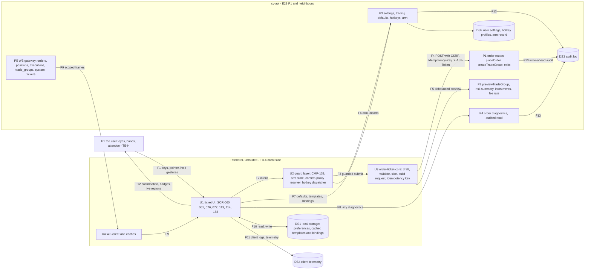

# E30 — STRIDE threat model: the order ticket surface

- Ticket: E30-X01 (issue #920). Owner: Security engineer (CODEOWNER). Status: **Draft for review** (staged
  2026-11-03). The review session (Architect, E30 engineering lead, accessibility lead for §4) waits on E29-K01
  (#843), the one open blocker; the Owner's acceptance of the §11.2 residuals is pending, queued on #2701 when the PR opens.
- Method: the `04-security-program.md` §5 template (L x I = risk), STRIDE per element and per flow (C-12.1), in the
  four-question frame (what we build §1-§2; what can go wrong §3, §4; what we do §5-§9; did we do enough §11),
  formatted as the E28 and E29 models. Their rows, and E09's, E17's and E39's, are **referenced, not repeated**.
- Inputs, read at `b81479ab0`: issue #920 and the E30 epic with its 27 child tickets (`docs/plan/backlog/E30.json`);
  `11-user-stories.md` §17 ORD; `14-screens-catalogue.md` SCR-060, SCR-061, SCR-076, SCR-077, SCR-113, SCR-114,
  SCR-158; `15-component-catalogue.md` CMP-100..107, CMP-119, CMP-121, CMP-122, CMP-130, CMP-139, CMP-158, CMP-229,
  CMP-231, CMP-232; `22-api-openapi.yaml` `placeOrder`, `previewTradeGroup`, `armOneClickTrading`, `ArmToken`, the
  settings and hotkey routes, `/instruments/{symbol}`, `/risk/summary`; `23-ws-protocol.md` §14.8, §15.1 to §15.4;
  `24-internal-schemas.md` §8.8, §8.10, §9.2 to §9.4; `20-architecture.md` §10.2; `04-security-program.md` §5.2
  (O1 to O11) and SR-041 to SR-043; on `main`, the order admission and arm-token reading in `api/`, the registered
  actions in `audit/actions.py`, and `apps/web/src/features/confirm-policy/`.
- Path: the ticket says "filed under `docs/plan/` security artefacts", but GOV-008 scans only
  `docs/security/threat-models/E<nn>-<slug>.md`, so this file is `E30-order-ticket.md` (as E29's D3).
- Sibling: the native stop and the bracket rows are owned by the E32 model, `e32-brackets-native-sl.md` (E32-X01,
  #933); this model cites them (§10.1, request R6) and does not re-rate them.
- Gate note: design-level threats only. No credential, account identifier or reproduction appears here; finding
  detail is held in the restricted security space and referenced by id.

## 1. Scope

In scope, the three trust boundaries the ticket names: the renderer (browser or Electron) to the backend API, the
renderer to its local storage (settings, templates, hotkeys, arm state), and the user to the UI, the human-factors
boundary, where arm/lock and the environment badge live. Surfaces: SCR-060 (ticket), SCR-061 (account and
trade-group selector), SCR-076 (confirmation), SCR-077 (rejection drawer), SCR-113 (trading hotkeys), SCR-114
(trading defaults), SCR-158 (rate-limited state), and the `packages/order-ticket-core` logic behind them.

Out of scope (ticket): the backend OMS (E29 model), the key vault (E27 model), fan-out and rate-limit abuse (E34),
the RBAC matrix (E09, E27-X03), pen-testing (E43). Referenced, not re-modelled: profiles, sizing and the preview
(E28 model), the native stop and brackets (E32 model), kill switch and lockouts (E39 model), the WS gateway (E17
model), live enablement (E44-X01), chart and DOM click-trade arm scopes (E31).

### 1.1 State of the build at review time

| Component                        | Status at `b81479ab0`                                                                                                        |
| -------------------------------- | ---------------------------------------------------------------------------------------------------------------------------- |
| `packages/order-ticket-core`     | Not built (E30-T01, #984)                                                                                                    |
| Ticket screens and CMP-139 guard | Not built (E30-S01 to E30-S07)                                                                                               |
| Confirm-policy resolver (web)    | Built for destructive actions (E47-S08): pure, UX-only, unknown environment resolves to Live rules                           |
| `placeOrder` and the exits       | Mounted (E29-T04, #913 closed); the arm token is read from `X-Arm-Token` on live risk-increasing mutations                   |
| `POST /settings/arm`             | Contracted, not served: no arm record exists yet, so every live mutation that needs a token is refused (fail closed)         |
| `previewTradeGroup`              | Mounted (E28-T05): cached figures only, per-user token bucket, an ungranted leg refuses the whole request                    |
| Ticket audit actions             | `orders.submit`, `hotkey.trading_binding_changed`, `env.switch_live`, `order.diagnostics_viewed` registered; three owed (§8) |

### 1.2 Assets and data classification

Fixed for the epic (ticket Security notes): the surface is **financial, account-scoped**; it handles no secret, and
that is a property to preserve.

| Asset                                                                | Class                      | Notes                                                                           |
| -------------------------------------------------------------------- | -------------------------- | ------------------------------------------------------------------------------- |
| The order intent (side, size, price, stop, target accounts)          | Financial / restricted     | Programme A-05; the ticket builds it, the server judges it                      |
| Arm token                                                            | Session-bound credential   | Memory only, never persisted, never logged; masked wherever it is read          |
| Trading defaults, templates, hotkey bindings, confirmation policy    | User preference, integrity | Server-stored; a change alters what a keystroke does, so integrity matters most |
| Preview, risk summary, wallet and fee figures                        | Financial / restricted     | Account-scoped; never cached across an account switch                           |
| Rejection detail and diagnostics (redacted exchange text)            | Financial / restricted     | Untrusted text: rendered as text, never as HTML                                 |
| The user's correct perception of environment, account, side and size | Safety (human factors)     | The asset of the human-factors boundary (§4)                                    |

### 1.3 Rating

Risk = L x I on the programme scale (`04-security-program.md` §5). Impact **H\*** marks an outcome that can leave a
position without a native stop or place a live order the user did not mean to place; it raises the cell one band.
Disposition: **Q** a requirement (`SR-E30-nn`, §9) that a named ticket builds and a named test proves; **C** an
existing control on `main`; **R** owned by another model; **A** accepted (Owner sign-off, §11.2).

### 1.4 Open inputs

| Id  | Assumption                                                                                                                                                                                                              | Confirmed by                  |
| --- | ----------------------------------------------------------------------------------------------------------------------------------------------------------------------------------------------------------------------- | ----------------------------- |
| O-1 | One arm token serves one-click, hotkey and ticket entry, and it is single-use per request or SR-043's per-request arm nonce is amended (the contract leaves the single-use rule and lifetime to E30-S04)                | E30-S04 (#1088), SR-043 owner |
| O-2 | The token's TTL (contract default 300 s, maximum 3600 s) and SR-043's time box (default 30 min) are two clocks, the shorter wins                                                                                        | E30-S04, SR-043 owner         |
| O-3 | The server counterpart of the LIVE-market confirmation is the arm token on every live submit (`ArmToken`, SR-043); no policy field or refusal is added, and a per-order confirmation distinct from the arm is client UX | Ruled 2026-11-03 (#920)       |
| O-4 | Order acknowledgement and the private-stream timing on demo match the E29 model's O-2 (the ticket's 2 s reconciling threshold)                                                                                          | E29-K01 (#843)                |

## 2. Data-flow diagram and trust boundaries

The backend half is `20-architecture.md` §10.2 as the E29 model decomposes it (E29 §2, P1 to P8); this diagram
draws the ticket's half and joins it at P1.

Text alternative: the user acts on the ticket (F1) and perceives it (F12). The ticket passes an intent to the guard
layer (F2), which alone may call the core's submit (F3); the core posts the request (F4) or a preview (F5). Arming
(F6) and preference writes (F7) go to the settings routes; the rejection drawer reads diagnostics on demand (F8).
Frames arrive scoped from the gateway (F9); the renderer keeps preferences locally (F10) and may emit telemetry
(F11). Every mutation and the diagnostics read are audited (F13).

Elements: H1; U1 to U4; P1 to P5; DS1 to DS4; flows F1 to F13 (§3.7).

Boundaries:

- **TB-4, renderer to API** (F4 to F9): the renderer is untrusted (C-2.12). Every client check is defence in depth
  and has a named server counterpart (§5); a client check without one is a finding.
- **TB-L, renderer to local storage** (F10): anything the renderer stores can be edited by whoever controls the
  device profile, a browser extension or devtools. Nothing read from DS1 is authority; the server copy wins.
- **TB-H, user to UI** (F1, F12): the human-factors boundary. A trader who misreads demo as live, or the target
  account, has been failed by the UI as surely as by a forged request; these threats are mitigated by design
  constraints and verified by E30-Q05 and E30-D07 (§4).
- The Electron main-to-renderer boundary carries no E30 flow; the shell's IPC allow-list is E10's.

## 3. STRIDE table

Columns: the existing control is what `main` or a merged contract does today; the gap names the mitigation and its
ticket. Programme rows extended (`04-security-program.md` §5.2): O1 → OT-E02; O2, O11 → OT-S03; O3 → OT-T04; O4 →
OT-T06; O5 → OT-R01; O6 → OT-D01; O7 → OT-I01.

### 3.1 Spoofing

| ID     | Element / flow  | Threat                                                                                                                                              | L   | I   | Risk     | Existing control (server counterpart)                                                                                                     | Gap → mitigation                                                                                                                                                                        | Owner            | Verify                  | Residual |
| ------ | --------------- | --------------------------------------------------------------------------------------------------------------------------------------------------- | --- | --- | -------- | ----------------------------------------------------------------------------------------------------------------------------------------- | --------------------------------------------------------------------------------------------------------------------------------------------------------------------------------------- | ---------------- | ----------------------- | -------- |
| OT-S01 | F4, F6, P1, P3  | A forged or guessed arm token accompanies a live order from the ticket, a hotkey or a one-click control                                             | L   | H\* | High     | Contract: opaque token, session-bound, issued only by `POST /settings/arm` under a live step-up; refused `403 session_not_armed`, audited | The issuing route and its arm record (SR-E30-01); the token is opaque with at least 128 bits of entropy and compared in constant time                                                   | E30-S04, E44-S03 | E30-X02 AC-01           | Low      |
| OT-S02 | F4, U2, DS2     | A captured arm token is replayed after disarm, session end, lock, kill-switch engagement, a risk breach, or from another session                    | M   | H\* | Critical | Contract: disarm, session end, kill switch and risk breach invalidate it at once; bound to the session                                    | Server-side invalidation on every listed event plus session lock and environment switch (SR-E30-01); the client holds it in memory only (SR-E30-02)                                     | E30-S04, E30-T01 | E30-X02 AC-02, E30-Q04  | Low      |
| OT-S03 | F4, U1          | A planted session, a cross-site page, an XSS payload or an extension submits from the ticket as the user (programme O2, O11)                        | M   | H   | High     | E29 OM-S01: CSRF double-submit, `Origin` checks, `SameSite=Strict`, strict CSP; the live arm step-up                                      | None new beyond OT-S01 and OT-E01; the ticket adds no route                                                                                                                             | E09, E29-T07     | E30-X02 AC-03           | Low      |
| OT-S04 | U1, U2, F12, H1 | A spoofed environment: the ticket shows demo while the target account is live (environment read from a client toggle, a stale store, or a template) | M   | H\* | Critical | One immutable client per environment and the environment match in the Validator (E29 OM-E03); `env.switch_live` audited; C-2.11           | The environment shown is the target account's server environment, read from one shared store; the confirmation restates it from the frozen request (SR-E30-04); unknown renders as Live | E30-S04, E30-S06 | E30-Q05, E30-D07, AC-04 | Low      |
| OT-S05 | U1, F9          | A stale grant: an account revoked mid-session stays selectable, or a template still targets it                                                      | M   | M   | Medium   | Every submit re-authorised (E29 OM-E01, SR-050); the gateway sends `revoked` (E17)                                                        | The selector and templates drop an account on `revoked` and on any `403 account_scope_denied` (SR-E30-06)                                                                               | E30-S06, E30-S07 | E30-X02 AC-05           | Low      |
| OT-S06 | U1, H1          | UI redress: a framing page overlays an armed one-click control so the user's click places an order                                                  | L   | H   | Medium   | `frame-ancestors 'none'` in the one CSP policy (SR-112), sent by the API and the shell (E10)                                              | Re-asserted by a test on the trading routes (E30-S04); the desktop shell never frames a remote origin                                                                                   | E30-S04, E10     | unit, E30-X02           | Low      |

### 3.2 Tampering

| ID     | Element / flow | Threat                                                                                                                                       | L   | I   | Risk     | Existing control (server counterpart)                                                                                                                                                                     | Gap → mitigation                                                                                                                                                                                                                               | Owner                     | Verify                 | Residual           |
| ------ | -------------- | -------------------------------------------------------------------------------------------------------------------------------------------- | --- | --- | -------- | --------------------------------------------------------------------------------------------------------------------------------------------------------------------------------------------------------- | ---------------------------------------------------------------------------------------------------------------------------------------------------------------------------------------------------------------------------------------------- | ------------------------- | ---------------------- | ------------------ |
| OT-T01 | DS1, DS2, F7   | Local or stored settings tampered to disable LIVE confirmation (a local edit, or a crafted settings write)                                   | M   | H   | High     | The web resolver ignores local values below its floor and treats an unknown environment as Live; every live submit needs the session's arm token, issued only under the live step-up (`ArmToken`, SR-043) | The LIVE-market floor holds in the resolver whatever the stored policy says; the server counterpart is the arm token, not a policy refusal (SR-E30-03, `[O-3]`); `trading_defaults.changed` records the after-value; DS1 never holds authority | E30-S04, E30-S07          | E30-X02 AC-06          | Medium (§11.2 A-2) |
| OT-T02 | DS1, DS2, F7   | A tampered hotkey map: a destructive or opening action bound to a bare key, or a binding whose action differs from what the list shows       | M   | H   | High     | `hotkey.trading_binding_changed` registered                                                                                                                                                               | Bindings store a key and an action id from a closed set; semantics come from the app; the server refuses a bare-key destructive binding while the safety option is on (SR-E30-07)                                                              | E30-S05                   | E30-X02 AC-07          | Low                |
| OT-T03 | DS2, F7, U3    | A template pins another account, another environment, or an ungranted trade group                                                            | M   | H   | High     | Every submit re-authorised (SR-050)                                                                                                                                                                       | Templates validated at render and apply; a pinned target outside the grants or the current environment renders disabled, never re-targeted (SR-E30-06)                                                                                         | E30-S07                   | E30-X02 AC-08          | Low                |
| OT-T04 | U3, F4         | A preset ladder, default quantity or sizing rule beyond the profile's caps (programme O3)                                                    | M   | H   | High     | E28 PF-T03, SR-052: size re-derived and capped server-side                                                                                                                                                | None new; client clamps are display only                                                                                                                                                                                                       | E28-T03, E30-S02          | E30-X02 AC-09          | Low                |
| OT-T05 | U2, U3, F4, F5 | The request changes between what the preview priced or the confirmation showed and what is sent (a late edit, a re-size, an injected script) | M   | H\* | Critical | The submit is judged on its own: sized and rounded server-side, the gate on the sized order (SR-E29-04); preview has no authority                                                                         | The confirmation renders from a frozen request object and sends exactly that object; any edit after it invalidates the confirmation (SR-E30-05)                                                                                                | E30-S04, E30-S06, E30-T01 | unit, E30-X02 AC-10    | Low                |
| OT-T06 | F4, U1         | The ticket's stop field stripped, zeroed or moved to the wrong side in the request (programme O4)                                            | M   | H\* | Critical | NativeStopGuard by effect (SR-E29-01): `native_stop_required` before any send                                                                                                                             | Owned by the E32 model (NS-T01, request R6); the ticket never offers a submit without a stop                                                                                                                                                   | E32-T01, E30-S03          | E30-X02 AC-11, E32-Q01 | Low                |
| OT-T07 | U3, F4, P1     | A forced idempotency collision: a key predicted or copied from another session replays or blocks that session's order                        | L   | H   | Medium   | Records keyed per principal and operation (E29 SR-E29-07)                                                                                                                                                 | Keys derived from a session-scoped random seed plus the intent hash, stable across retries of one intent (SR-E30-08)                                                                                                                           | E30-T01, E29-T04          | E30-X02 AC-12          | Low                |
| OT-T08 | U2, DS1        | The renderer's arm store is set to armed with no server token (devtools, an extension)                                                       | M   | M   | Medium   | Live: the server requires the token (OT-S01). Demo: SR-043 needs no arming, so arming there is a client control only                                                                                      | Accepted for demo, which moves no real funds (§11.2 A-1); live is refused server-side                                                                                                                                                          | E30-S04                   | E30-X02 AC-13          | Low (A-1)          |

### 3.3 Repudiation

| ID     | Element / flow | Threat                                                                                                                        | L   | I   | Risk   | Existing control                                                                   | Gap → mitigation                                                                                                                                                                   | Owner            | Verify  | Residual |
| ------ | -------------- | ----------------------------------------------------------------------------------------------------------------------------- | --- | --- | ------ | ---------------------------------------------------------------------------------- | ---------------------------------------------------------------------------------------------------------------------------------------------------------------------------------- | ---------------- | ------- | -------- |
| OT-R01 | F4, DS3        | An order from the ticket with no attributable record, or a dispute over who placed it and in which environment (programme O5) | M   | H   | High   | `orders.submit` write-ahead with actor, role, account and environment (E29 OM-R01) | The entry channel (ticket, hotkey, one-click, template) is recorded as client-asserted context, never as authority (SR-E30-09)                                                     | E29-T04, E30-T01 | E30-X03 | Low      |
| OT-R02 | F6, DS3        | Arming or disarming leaves no attributable record, so a disputed one-click order cannot be tied to an armed session           | M   | H   | High   | None: `order.arm_toggled` is not registered                                        | Register before the first emitter; record environment, TTL, scope and the disarm reason (SR-E30-10)                                                                                | E30-S04          | E30-X03 | Low      |
| OT-R03 | F7, DS3        | A defaults, template or binding change is not attributable, so a changed confirmation policy or binding cannot be traced      | M   | M   | Medium | `hotkey.trading_binding_changed` and `settings.change` registered                  | Register `trading_defaults.changed` with key, before, after, environment; a change that turns LIVE-market confirmation off is a detection signal (§8), never a refusal (SR-E30-10) | E30-S07, E30-S05 | E30-X03 | Low      |
| OT-R04 | F8, P4, DS3    | A rejection's raw detail is viewed with no audit entry, or a speculative prefetch writes reads the user never made            | L   | M   | Low    | `order.diagnostics_viewed` registered; the read is audited server-side             | The drawer renders from received rejection data and fetches diagnostics only on explicit expansion, never prefetched (SR-E30-11)                                                   | E30-T02          | E30-X03 | Low      |
| OT-R05 | F1, F12, H1    | "I confirmed demo, it went live": the user disputes what the confirmation showed                                              | L   | H   | Medium | Every audit record carries the account's environment (C-2.9)                       | The confirmation's content is a pure function of the frozen request (SR-E30-05), so the audit record of that request is what was shown                                             | E30-S04          | E30-Q05 | Low      |

### 3.4 Information disclosure

| ID     | Element / flow | Threat                                                                                                                         | L   | I   | Risk   | Existing control (server counterpart)                                                                                                                                                                                             | Gap → mitigation                                                                                                                                                                                                                                                                                                                                                                                                                                                 | Owner            | Verify        | Residual |
| ------ | -------------- | ------------------------------------------------------------------------------------------------------------------------------ | --- | --- | ------ | --------------------------------------------------------------------------------------------------------------------------------------------------------------------------------------------------------------------------------- | ---------------------------------------------------------------------------------------------------------------------------------------------------------------------------------------------------------------------------------------------------------------------------------------------------------------------------------------------------------------------------------------------------------------------------------------------------------------- | ---------------- | ------------- | -------- |
| OT-I01 | U1, P2, F5     | Account existence learned by an unscoped Manager through the group or template selector, the preview or a disabled-reason text | M   | M   | Medium | The preview refuses an ungranted or missing leg alike, whole (`403 account_scope_denied`, SR-E28-21); a group definition with any ungranted member is not listed, as if it did not exist (`listTradeGroupDefinitions`, SR-E28-21) | The selector renders what the server's group read returns: a definition the read leaves out is absent; a leg the read returns but marks unable to take an order (today `readiness.members[]` with `ready: false` and its `reason`; a not-grantable mark, should the read ever carry one) renders T2 with its reason, never omitted; no group is labelled narrowed and no count is shown; a template's reason says only "an account you cannot trade" (SR-E30-06) | E30-S06, E30-S07 | E30-X02 AC-14 | Low      |
| OT-I02 | U4, P2, F5, F9 | Balances, exposure or a preview from account A shown after a switch to account B (a cache, or a late answer for A)             | M   | M   | Medium | Figures are account-scoped server-side                                                                                                                                                                                            | Every answer is keyed by its account and discarded unless it matches the current selection; in-flight requests aborted on a switch; nothing cached across a switch (SR-E30-12)                                                                                                                                                                                                                                                                                   | E30-S06          | unit, AC-15   | Low      |
| OT-I03 | P4, U1, F11    | Credentials or signatures rendered in the rejection drawer or written to the console or telemetry                              | L   | H   | Medium | Server redaction before storage and on the diagnostics read (E29 OM-I05, OM-I06)                                                                                                                                                  | The client never logs a payload to the console or a telemetry sink; a seeded credential-shaped fixture is asserted absent from the DOM and every analytics call (SR-E30-11)                                                                                                                                                                                                                                                                                      | E30-T02          | E30-X02 AC-16 | Low      |
| OT-I04 | U2, F4, F11    | The arm token is persisted, logged, put in a URL, a crash report, telemetry or a template                                      | L   | H   | Medium | Server reads it masked (`order_admission`)                                                                                                                                                                                        | Header only, memory only, never serialised; the client redactor masks `X-Arm-Token` (SR-E30-02)                                                                                                                                                                                                                                                                                                                                                                  | E30-S04, E30-T01 | unit, AC-17   | Low      |
| OT-I05 | F11, DS4       | Order intent (sizes, accounts, prices) carried in client telemetry or analytics properties                                     | M   | M   | Medium | Server-side label rules (E29 OM-I07)                                                                                                                                                                                              | Client analytics carry closed-set event names and no financial values or account ids (SR-E30-13)                                                                                                                                                                                                                                                                                                                                                                 | E30-T01, E30-S06 | ci-gate       | Low      |
| OT-I06 | U1, F8, F9     | Exchange text in a rejection rendered as markup (stored script in the drawer)                                                  | L   | H   | Medium | E29 OM-I08: `retMsg` scoped to the order                                                                                                                                                                                          | Rendered as text only; no markup sink for exchange or reason text (SR-E30-11)                                                                                                                                                                                                                                                                                                                                                                                    | E30-T02          | unit          | Low      |

### 3.5 Denial of service

| ID     | Element / flow | Threat                                                                                                                                      | L   | I   | Risk   | Existing control (server counterpart)                                                                                           | Gap → mitigation                                                                                                                                                                                                           | Owner            | Verify         | Residual |
| ------ | -------------- | ------------------------------------------------------------------------------------------------------------------------------------------- | --- | --- | ------ | ------------------------------------------------------------------------------------------------------------------------------- | -------------------------------------------------------------------------------------------------------------------------------------------------------------------------------------------------------------------------- | ---------------- | -------------- | -------- |
| OT-D01 | U3, F5, P2     | Preview called on every keystroke, from several tickets or tabs, consuming the per-UID venue budget and starving real orders (programme O6) | M   | H   | High   | The preview reads cached figures only and never calls the venue (SR-E28-22); per-user token bucket with `429` and `Retry-After` | The client floor of §6: debounce at least 80 ms, one request in flight per ticket, aborted on change, paused while hidden (SR-E30-14)                                                                                      | E30-S06, E28-T05 | E30-Q03, AC-18 | Low      |
| OT-D02 | U1, U3         | The held-action queue of SCR-158 grows without limit, then releases a burst on recovery                                                     | M   | H   | High   | Per-user limits on mutating routes (E29-T07); the protective reserve (E34-T02)                                                  | A bounded queue, one entry per action kind and account; holds expire; release only after an explicit confirmation, re-validated, one at a time, risk-increasing actions never automatically (SR-E30-15)                    | E30-T02          | E30-Q04, AC-19 | Low      |
| OT-D03 | U1, F12, H1    | An unthrottled live region announces every tick or countdown step, so a screen-reader user cannot operate the ticket                        | M   | M   | Medium | `05-accessibility-standard.md` live-region rules                                                                                | Polite regions, coalesced; countdowns at most once per 10 s; hold-to-confirm progress at most once per 200 ms (SR-E30-16)                                                                                                  | E30-T02, E30-S05 | E30-Q05        | Low      |
| OT-D04 | U3, F4         | A retry storm: the ticket, or several tabs, resend after `429`, `503` or a timeout                                                          | M   | M   | Medium | Per-user limits; `Retry-After`; server idempotency                                                                              | No automatic resend of a submit; a retry is a user act under the same key, which dedupes HTTP requests only, while the server derives the `orderLinkId` (C-2.10); `Retry-After` honoured (SR-E30-08)                       | E30-T01          | E30-Q04        | Low      |
| OT-D05 | U3, U4, H1     | A lost acknowledgement leaves the ticket "pending", and the user fires again, doubling exposure                                             | M   | H   | High   | Server dedupe on the key (E29 SR-E29-07)                                                                                        | The reconciling state after the 2 s threshold, rebuilt after a reload from a server read of open and in-flight orders; re-submit of the same intent disabled until it resolves; a retry reuses the key (SR-E30-08) `[O-4]` | E30-T01, E30-Q04 | E30-Q04        | Low      |

### 3.6 Elevation of privilege

| ID     | Element / flow | Threat                                                                                                                                                          | L   | I   | Risk     | Existing control (server counterpart)                                                                                                                                                                                                             | Gap → mitigation                                                                                                                                                                 | Owner                     | Verify                  | Residual           |
| ------ | -------------- | --------------------------------------------------------------------------------------------------------------------------------------------------------------- | --- | --- | -------- | ------------------------------------------------------------------------------------------------------------------------------------------------------------------------------------------------------------------------------------------------- | -------------------------------------------------------------------------------------------------------------------------------------------------------------------------------- | ------------------------- | ----------------------- | ------------------ |
| OT-E01 | U2, U3, F3     | A submit dispatched outside CMP-139: a feature slice calling the core directly, a script in the page, an extension                                              | M   | H   | High     | Server: CSRF, RBAC, scope, the live arm token, the risk gate                                                                                                                                                                                      | CMP-139 is a wrapper, the only importer of the core's submit; lint `no-unguarded-order-submit` and a runtime assertion (SR-E30-17)                                               | E30-S04, E30-X02          | lint, unit, AC-20       | Low                |
| OT-E02 | F4, P1         | A Manager submits to an ungranted account: a body id, a template pin, a group with a foreign leg (programme O1)                                                 | M   | H\* | Critical | E29 OM-E01: two layers, out-of-scope ids refuse the whole request, audited                                                                                                                                                                        | None new; the matrix per role over every ticket route (E30-X02)                                                                                                                  | E29-T04, E29-T07, E30-X02 | E30-X02 AC-21           | Low                |
| OT-E03 | U1, P1         | A Viewer, or a view-as session, reaches a mutating route through a ticket rendered for it                                                                       | L   | H   | Medium   | `orders:write` required; the view-as guard refuses writes before the pipeline                                                                                                                                                                     | The ticket renders read-only for a Viewer and in view-as (RbacGate), with the reason                                                                                             | E30-S01, E09              | E30-X02 AC-22           | Low                |
| OT-E04 | U1, F7         | The native-stop "opt-out" reachable from the ticket, or a banner implying one exists                                                                            | L   | H\* | High     | No opt-out exists: C-2.6, C-4.14; the profile's stop requirement is constant and checked (E28 PF-T09)                                                                                                                                             | Closed by the Constitution (C-2.6): the ticket renders no opt-out control and no "invariant disabled" state (SR-E30-18); A-row A-S03 strikes E30-S03's opt-out banner (§11.4)    | E30-S03, E28-T01, E32-T01 | E30-X02 AC-23           | Low                |
| OT-E05 | U2, F7, H1     | The confirmation policy skipped on LIVE: "never when armed" applied to a LIVE market order, a hotkey path that skips confirmation, a preference that relaxes it | M   | H   | High     | The web resolver: unknown environment is Live; no accessibility preference is an input. Server counterpart: the arm token on every live submit (`ArmToken`, SR-043), the deliberate step-up consent that armed entry rests on, so I is H, not H\* | The resolver's LIVE-market floor (SR-E30-03); the dispatcher order arm → environment → confirmation (SR-E30-07); the dialog itself is client UX, not a business rule (§11.2 A-2) | E30-S04, E30-S05, E30-S07 | E30-X02 AC-06, AC-24    | Medium (§11.2 A-2) |
| OT-E06 | F1, U2, H1     | A keystroke fires a trading action while focus is in a text field or a modal that is not the confirmation, or a single key arms Live                            | M   | H   | High     | None (not built)                                                                                                                                                                                                                                  | Focus suppression with a visible indicator; `requires_arm`; arming Live needs a deliberate second action; hotkeys never switch environment (C-2.11) (SR-E30-07)                  | E30-S05, E30-S04          | E30-Q02, E30-Q05, AC-25 | Low (§11.2 A-3)    |

### 3.7 Coverage matrix

Every element and flow against the six categories: a row id, or N/A with the reason.

| Element / flow               | S                | T                      | R                                     | I                    | D                                         | E                                |
| ---------------------------- | ---------------- | ---------------------- | ------------------------------------- | -------------------- | ----------------------------------------- | -------------------------------- |
| H1, F1, F12 (TB-H)           | OT-S04, OT-S06   | OT-T05                 | OT-R05                                | N/A: no data at rest | OT-D03, OT-D05                            | OT-E05, OT-E06                   |
| U1 ticket UI                 | OT-S05           | OT-T03                 | OT-R04                                | OT-I02, OT-I06       | OT-D02                                    | OT-E03, OT-E04                   |
| U2 guard layer               | OT-S02           | OT-T08                 | OT-R02                                | OT-I04               | N/A: no shared budget                     | OT-E01, OT-E05                   |
| U3 order-ticket-core         | OT-S03           | OT-T04, OT-T05, OT-T07 | OT-R01                                | OT-I05               | OT-D01, OT-D04                            | OT-E01                           |
| U4 WS client, caches         | OT-S05           | E17 model (WS-T rows)  | N/A: read only                        | OT-I02               | E17 WS-D01                                | N/A: no write path               |
| DS1 local storage            | N/A: no identity | OT-T01, OT-T02         | N/A: not a record                     | OT-I04               | N/A: local only                           | OT-T08                           |
| F4 submit, P1                | OT-S01, OT-S03   | OT-T05, OT-T06         | OT-R01                                | E29 OM-I01           | OT-D04                                    | OT-E02                           |
| F5 preview, P2               | E09 session      | OT-T05                 | N/A: dry run, `trade_group.previewed` | OT-I01               | OT-D01                                    | OT-E02                           |
| F6 arm, F7 settings, P3, DS2 | OT-S01, OT-S02   | OT-T01, OT-T02, OT-T03 | OT-R02, OT-R03                        | OT-I01               | N/A: user-rate writes                     | OT-E05                           |
| F8 diagnostics, P4           | E09 session      | N/A: read only         | OT-R04                                | OT-I03, OT-I06       | N/A: one read per click                   | E29 OM-I06                       |
| F9 frames, P5                | E17 model        | E17 model              | N/A: read only                        | E29 OM-I02, OM-I03   | E17 WS-D01                                | N/A: read only                   |
| F11 telemetry, DS4           | N/A: outbound    | N/A: not authority     | N/A: telemetry records no action      | OT-I03, OT-I05       | N/A: a client-side sink, no shared budget | N/A: no write path to the server |
| F13 audit, DS3               | E09 model        | E09 U14 to U20         | OT-R01 to R05                         | E29 OM-I10           | E29 OM-D04                                | E09 model                        |

## 4. The human-factors boundary

The user is part of the threat surface here, as the ticket states: a hurried trader who misreads demo as live has
been failed as surely as by a forged request. These threats are met by design constraints, not code alone, and the
constraints must not break the accessibility contract: no CAPTCHA-like friction, no colour-only danger signal.

| HF   | Failure                                       | Design constraint (owner)                                                                                                                                                                        | Verified by      |
| ---- | --------------------------------------------- | ------------------------------------------------------------------------------------------------------------------------------------------------------------------------------------------------ | ---------------- |
| HF-1 | Demo read as live, or live as demo            | The environment badge is always visible, text and shape as well as colour, in every panel from one store; Live never looks like Demo (E30-S04)                                                   | E30-Q05, E30-D07 |
| HF-2 | The wrong target account                      | The armed indicator names the target account(s) and the active size; the confirmation restates them from the frozen request (E30-S04, E30-S06)                                                   | E30-Q05, E30-D07 |
| HF-3 | The wrong side                                | Side carried by label and icon, never colour alone; the confirmation repeats it in words (E30-S01, E30-S04)                                                                                      | E30-Q05          |
| HF-4 | Accidental confirmation                       | No default-focused confirm on a LIVE market order; Enter does not confirm a LIVE market order from the ticket's last field (E30-S04)                                                             | E30-Q02, E30-Q05 |
| HF-5 | Accidental arming                             | Arm is off after every login and restart; Live arming takes a deliberate second action and is announced assertively (E30-S04, CMP-229)                                                           | E30-Q05          |
| HF-6 | A fat-finger size                             | Sizes restated in base units and notional; the binding cap named by authority (CMP-232); the server cap is the control (E30-S02, E28-T03)                                                        | E30-Q02          |
| HF-7 | A stale preview taken as current              | A preview in flight greys the last one and marks stale inputs; risk-based sizing disabled on stale wallet data (E30-S06)                                                                         | E30-Q02          |
| HF-8 | "Protected" assumed while the stop is pending | The distinct "order live, protective stop pending" state, from B8's published protection state, with the watchdog alert as the escalation; never inferred from missing data (E30-S03, E32 model) | E30-Q04          |

Hold-to-confirm and focus suppression are client-only by nature: E30-X02 says so in its tests, and §11.2 records the
residual rather than a test that pretends otherwise.

## 5. Every client check and its server counterpart

| Client check (where)                                              | Server counterpart                                                                 | Status                                     |
| ----------------------------------------------------------------- | ---------------------------------------------------------------------------------- | ------------------------------------------ |
| Tick, lot, min notional, leverage, symbol allowed (`validate.ts`) | Validator on the sized order (E29-T04, SR-E29-04)                                  | Present                                    |
| Mandatory native stop, stop side (`validate.ts`, CMP-119)         | NativeStopGuard by effect (SR-E29-01); E32 model NS-T01                            | Present                                    |
| Reduce-only needs a position                                      | Close quantity from exchange truth, reduce-only forced (E29 OM-T07)                | Present                                    |
| Lockout and kill-switch notices                                   | E39 gate before every send                                                         | Present                                    |
| Profile caps and sizing clamps (`size.ts`)                        | Server sizing and caps (SR-052, E28 PF-T03)                                        | Present                                    |
| Account and group selector                                        | Scope on every request (SR-050, SR-E29-13, SR-E28-21)                              | Present                                    |
| Arm state on live                                                 | `X-Arm-Token` on live risk-increasing mutations (SR-043)                           | Contracted; issuing route owed (SR-E30-01) |
| Arm state on demo                                                 | None by design (SR-043)                                                            | Accepted (§11.2 A-1)                       |
| Confirmation policy floor for LIVE market orders                  | `ArmToken` on every live submit (SR-043); the per-order dialog is client UX        | Contracted; issuing route owed (SR-E30-01) |
| The confirmation dialog, hold-to-confirm, focus suppression       | None possible: the server cannot see a gesture; the arm token and step-up stand in | Accepted (§11.2 A-2, A-3)                  |
| Hotkey binding safety option                                      | Refusal of a bare-key destructive binding (SR-E30-07)                              | **Owed** (F-05)                            |
| Template pin validity                                             | Scope on submit (SR-050)                                                           | Present                                    |
| Idempotency key per intent                                        | Per-principal records (SR-E29-07)                                                  | Present                                    |
| Preview debounce and abort                                        | Per-user token bucket; cached figures only (SR-E28-22)                             | Present                                    |

## 6. Denial of service: the preview floor is a security control

The ticket's preview and its client-side limiting exist for both performance and safety. The values below are
fixed by this model; E30-S06 may not loosen them without revisiting it.

- Debounce **at least 80 ms** after the last input (`CV_TICKET_PREVIEW_DEBOUNCE_MS`, default 80), never lower.
- **One** preview in flight per ticket; a newer input aborts the older request.
- No preview while the ticket is hidden or the window is not visible; none while the user is rate-limited.
- The server bound stays the backstop: the per-user token bucket of `previewTradeGroup`, and the preview never
  reaches the venue, so it draws no per-UID venue budget (SR-E28-22). Real orders' reserve is E34-T02's.

## 7. Abuse cases for E30-X02

Executed against the backend with crafted requests, except where marked client-only. Each names its row.

| AC    | Abuse case                                                                                                                                     | Expected                                                                                                                                                                      | Rows           |
| ----- | ---------------------------------------------------------------------------------------------------------------------------------------------- | ----------------------------------------------------------------------------------------------------------------------------------------------------------------------------- | -------------- |
| AC-01 | A live order with a forged arm token, and one with none                                                                                        | `403 session_not_armed`, audited, nothing sent                                                                                                                                | OT-S01         |
| AC-02 | A token replayed after disarm, lock, session end, kill switch, risk breach, and from another session                                           | Each `403`, audited, nothing sent                                                                                                                                             | OT-S02         |
| AC-03 | A cross-origin submit and one without CSRF                                                                                                     | Refused before the pipeline                                                                                                                                                   | OT-S03         |
| AC-04 | A live account targeted while the client shows demo                                                                                            | The confirmation reads Live from the request; the server matches env                                                                                                          | OT-S04         |
| AC-05 | A revoked account submitted from an open ticket                                                                                                | `403`, no change, audited; the ticket drops the account                                                                                                                       | OT-S05         |
| AC-06 | A settings write that turns LIVE-market confirmation off, then a LIVE market order with and without a valid arm token                          | Without one: `403 session_not_armed`, audited, nothing sent; with one: the confirmation still shows (client e2e, stated); the write is recorded by `trading_defaults.changed` | OT-T01, OT-E05 |
| AC-07 | A bare-key destructive binding with the safety option on                                                                                       | Refused                                                                                                                                                                       | OT-T02         |
| AC-08 | A template pinning an ungranted account and one of the other environment                                                                       | Disabled with the generic reason; a crafted submit refused                                                                                                                    | OT-T03         |
| AC-09 | A preset quantity above the profile cap                                                                                                        | Clamped or refused server-side                                                                                                                                                | OT-T04         |
| AC-10 | A request edited after its confirmation                                                                                                        | Judged on its own; the client invalidates the confirmation (unit)                                                                                                             | OT-T05         |
| AC-11 | A request with no stop, a zero stop, a wrong-side stop                                                                                         | `native_stop_required`, audited                                                                                                                                               | OT-T06         |
| AC-12 | An idempotency key reused across sessions                                                                                                      | No cross-session replay                                                                                                                                                       | OT-T07         |
| AC-13 | A demo one-click with the arm store forced on (client-only, stated as such)                                                                    | Recorded as the accepted residual A-1                                                                                                                                         | OT-T08         |
| AC-14 | A Manager's group and template selectors with an ungranted account in a group, and a granted member the read marks not ready                   | The group is absent, as one that does not exist; the returned member renders T2 with its reason, never omitted; no narrowed label; the preview refuses an ungranted leg whole | OT-I01         |
| AC-15 | An account switch with a preview in flight                                                                                                     | The late answer is discarded (unit)                                                                                                                                           | OT-I02         |
| AC-16 | Credential-shaped strings seeded in a diagnostics fixture                                                                                      | Absent from the DOM, console and analytics                                                                                                                                    | OT-I03         |
| AC-17 | The arm token searched in storage, URLs, logs and telemetry after a session                                                                    | Absent                                                                                                                                                                        | OT-I04         |
| AC-18 | Preview requests from rapid typing in two tickets                                                                                              | The client floor holds; the server bucket answers `429`; orders flow                                                                                                          | OT-D01         |
| AC-19 | Rate-limited actions held, then recovery                                                                                                       | Bounded; nothing risk-increasing released without confirmation                                                                                                                | OT-D02         |
| AC-20 | A submit dispatched outside CMP-139                                                                                                            | Lint failure and a runtime assertion                                                                                                                                          | OT-E01         |
| AC-21 | The role matrix (Owner, Manager with and without grant, Viewer) over every ticket route                                                        | `403` and no state change where denied, audited                                                                                                                               | OT-E02         |
| AC-22 | A Viewer's and a view-as session's submit                                                                                                      | Refused before the pipeline                                                                                                                                                   | OT-E03         |
| AC-23 | The ticket searched for any control or state that disables the native stop                                                                     | None present; a crafted profile write refused (E28)                                                                                                                           | OT-E04         |
| AC-24 | A LIVE market order through each entry channel with the policy at its weakest                                                                  | A confirmation is shown on every channel (client e2e, stated)                                                                                                                 | OT-E05         |
| AC-25 | A trading hotkey with focus in a text field or a modal that is not the confirmation; a single key on Live arming (client-only, stated as such) | Nothing fires; Live arming waits for the second action (client e2e)                                                                                                           | OT-E06         |

## 8. Observability: audit events

The audit events that make the repudiation rows untenable. E30-X03 verifies each is present in the audit chain.

| Event                            | Registered on `main` | Emitter      | Rows           |
| -------------------------------- | -------------------- | ------------ | -------------- |
| `orders.submit`                  | Yes                  | E29-T04      | OT-R01         |
| `order.arm_toggled`              | No: register first   | E30-S04      | OT-R02         |
| `trading_defaults.changed`       | No: register first   | E30-S07      | OT-R03, OT-T01 |
| `hotkey.trading_binding_changed` | Yes                  | E30-S05      | OT-R03, OT-T02 |
| `env.switch_live`                | Yes                  | E30-S04, E44 | OT-S04         |
| `order.diagnostics_viewed`       | Yes                  | E29-T07      | OT-R04         |

`trading_defaults.live_confirmation_disabled`, which E30-S07's text names, is not registered: the server refuses no
policy write (SR-E30-03), so there is no refused attempt to record; `trading_defaults.changed` records every policy
change with its after-value.

Detection signals: a rise in `session_not_armed` refusals per session, a `trading_defaults.changed` record that turns LIVE-market
confirmation off (the UI never offers it), and an
order from an environment other than the one the session last switched to are alerts for E30-X03 to wire.

## 9. Requirements added by this model

| Id        | Requirement                                                                                                                                                                                                                                                                                                                                                                                       | Owner            |
| --------- | ------------------------------------------------------------------------------------------------------------------------------------------------------------------------------------------------------------------------------------------------------------------------------------------------------------------------------------------------------------------------------------------------- | ---------------- |
| SR-E30-01 | The arm record and `POST /settings/arm` are served; the token is opaque, session-bound, at least 128 bits, compared in constant time, and invalidated on disarm, lock, session end, environment switch, kill switch and risk breach; single-use per request, or SR-043's per-request nonce is amended (O-1)                                                                                       | E30-S04          |
| SR-E30-02 | The client holds the arm token in memory only, sends it only as `X-Arm-Token`, and never persists, logs or serialises it                                                                                                                                                                                                                                                                          | E30-S04, E30-T01 |
| SR-E30-03 | The LIVE-market confirmation floor holds in the client resolver whatever the stored policy says (a value below it is ignored, never applied); its server counterpart is the `ArmToken` requirement on every live submit (SR-043), served by SR-E30-01; no policy field or refusal is added to the contract; DEMO and LIVE sets stay separate (§11.3 note 3)                                       | E30-S04, E30-S07 |
| SR-E30-04 | The environment shown is the target account's server environment from one store; unknown renders as Live                                                                                                                                                                                                                                                                                          | E30-S04          |
| SR-E30-05 | The confirmation renders from a frozen request and sends exactly that request; any edit invalidates it                                                                                                                                                                                                                                                                                            | E30-S04, E30-T01 |
| SR-E30-06 | Selectors and templates list only granted accounts of the current environment and the groups the server's read returns, with no narrowed label or count; a returned leg marked unable to take an order renders T2 (CMP-079 with the CMP-019 lock "Not available") with its reason, never omitted; they drop an account on `revoked` or `account_scope_denied` and never name an ungranted account | E30-S06, E30-S07 |
| SR-E30-07 | Bindings store a key and a closed-set action id; the server refuses a bare-key destructive binding under the safety option; the dispatcher checks focus, modal, arm, environment, confirmation in that order                                                                                                                                                                                      | E30-S05          |
| SR-E30-08 | The idempotency key derives from a session-scoped random seed and the intent hash and dedupes HTTP requests only; the server derives each `orderLinkId` (C-2.10); retries of one intent reuse the key; no automatic resend of a submit; after a reload the reconciling state is rebuilt from a server read before re-submit is enabled                                                            | E30-T01          |
| SR-E30-09 | The entry channel is recorded with the order as client-asserted context                                                                                                                                                                                                                                                                                                                           | E30-T01, E29-T04 |
| SR-E30-10 | `order.arm_toggled` and `trading_defaults.changed` are registered before their first emitter                                                                                                                                                                                                                                                                                                      | E30-S04, E30-S07 |
| SR-E30-11 | Exchange and rejection text renders as text only; diagnostics are fetched on explicit expansion only; no payload reaches the console or telemetry                                                                                                                                                                                                                                                 | E30-T02          |
| SR-E30-12 | Account-scoped answers are keyed by account and discarded on mismatch; in-flight requests are aborted on a switch; no cross-switch cache                                                                                                                                                                                                                                                          | E30-S06          |
| SR-E30-13 | Client analytics carry closed-set names and no financial values or account ids                                                                                                                                                                                                                                                                                                                    | E30-T01          |
| SR-E30-14 | The preview floor of §6                                                                                                                                                                                                                                                                                                                                                                           | E30-S06          |
| SR-E30-15 | The held-action queue is bounded, expires holds, and releases only on explicit confirmation, re-validated, one at a time                                                                                                                                                                                                                                                                          | E30-T02          |
| SR-E30-16 | Live regions are polite and coalesced; countdowns at most once per 10 s                                                                                                                                                                                                                                                                                                                           | E30-T02, E30-S05 |
| SR-E30-17 | CMP-139 is the only importer of the core's submit; lint and a runtime assertion prove it                                                                                                                                                                                                                                                                                                          | E30-S04, E30-X02 |
| SR-E30-18 | The ticket renders no control or state that disables or "opts out of" the native stop                                                                                                                                                                                                                                                                                                             | E30-S03          |

## 10. Control-to-ticket map

Every E30 ticket and what it owns or verifies in this model (GOV-008).

| Ticket  | Issue | Role in this model                                                                                           |
| ------- | ----- | ------------------------------------------------------------------------------------------------------------ |
| E30-D01 | #826  | Research input to §4 (time pressure, misreads); closed                                                       |
| E30-D02 | #850  | SCR-060 states the model rates (pending stop, armed, rate-limited); closed                                   |
| E30-D03 | #851  | The confirmation, defaults and selector designs whose behaviour is modelled (HF-1 to HF-7); closed           |
| E30-K01 | #852  | Latency measurement: the submit path's placement that SR-E30-17 constrains                                   |
| E30-D04 | #917  | CMP motion and states, including the non-colour signals of HF-1 and HF-3; closed                             |
| E30-D05 | #918  | Accessibility review that §4's constraints must keep; closed                                                 |
| E30-D06 | #919  | Handoff pack: carries SR-E30-04, -05, -18 into the build                                                     |
| E30-X01 | #920  | This model                                                                                                   |
| E30-Q01 | #983  | Black-box plan: AC-04, AC-10, AC-15, AC-24 as charters                                                       |
| E30-T01 | #984  | SR-E30-02, -05, -08, -09, -13; OT-T05, OT-T07, OT-D04, OT-D05                                                |
| E30-S01 | #1030 | OT-E03 (read-only rendering), HF-3                                                                           |
| E30-S02 | #1031 | OT-T04 (presets beyond caps), HF-6                                                                           |
| E30-T02 | #1032 | SR-E30-11, -15, -16; OT-R04, OT-I03, OT-I06, OT-D02, OT-D03                                                  |
| E30-S03 | #1087 | SR-E30-18; OT-T06, OT-E04, HF-8                                                                              |
| E30-S04 | #1088 | SR-E30-01 to -05, -10, -17; OT-S01, -S02, -S04, -S06, OT-T08, OT-R02, OT-E01, OT-E05, HF-1, HF-2, HF-4, HF-5 |
| E30-S05 | #1089 | SR-E30-07, -16; OT-T02, OT-E06                                                                               |
| E30-S06 | #1090 | SR-E30-06, -12, -14; OT-S05, OT-I01, OT-I02, OT-D01, HF-7                                                    |
| E30-S07 | #1091 | SR-E30-03, -06, -10; OT-T01, OT-T03, OT-R03                                                                  |
| E30-D07 | #1153 | Design QA of HF-1 to HF-8 on the shipped ticket                                                              |
| E30-Q02 | #1154 | E2E: HF-4, HF-6, HF-7, OT-E06, AC-24, AC-25                                                                  |
| E30-Q03 | #1155 | Load: the §6 preview floor and OT-D01                                                                        |
| E30-Q04 | #1156 | Chaos: in-flight orders, lost acks, revoked arming (OT-S02, OT-D02, OT-D04, OT-D05, HF-8)                    |
| E30-Q05 | #1157 | Accessibility audit: §4, OT-D03, OT-E06                                                                      |
| E30-Q06 | #1158 | Exploratory charters over §4 and the regression pack                                                         |
| E30-T03 | #1405 | Reconciles the plan docs; carries the §11.3 notes                                                            |
| E30-X02 | #1159 | The §7 abuse cases, the role matrix and the SAST rule of SR-E30-17                                           |
| E30-X03 | #1160 | Review: every §7 mapping executed, every §8 event present in the chain, §11.1 closed before the R3 gate      |

### 10.1 Requests to other tickets and models

| R   | To              | Request                                                                                                                                                                                                                           |
| --- | --------------- | --------------------------------------------------------------------------------------------------------------------------------------------------------------------------------------------------------------------------------- |
| R1  | E30-X02 (#1159) | Re-run the role matrix E29-T07 (#915, closed) shipped for the order routes over every route the ticket calls (OT-E02, AC-21)                                                                                                      |
| R2  | E28-T05         | Keep the preview's whole-request refusal for an ungranted or missing leg (OT-I01); E30-S06 builds on it                                                                                                                           |
| R3  | E44-S03 (#1268) | The live step-up on arming that OT-S01 relies on                                                                                                                                                                                  |
| R4  | E34-T02 (#859)  | The protective reserve that OT-D02 and OT-D04 assume                                                                                                                                                                              |
| R5  | E17             | `revoked` frames that SR-E30-06 consumes                                                                                                                                                                                          |
| R6  | E32-X01 (#933)  | The E32 model owns the order-submit stop rows: OT-T06 and OT-E04 rest on its NS-T01, NS-E05 and the choke point (§4 there); HF-8's pending state reads B8's published protection state, with its watchdog alert as the escalation |
| R7  | E39             | The lockout and kill-switch invalidation of the arm token (OT-S02)                                                                                                                                                                |

## 11. Findings, residual risks, review and sign-off

### 11.1 Findings register

Ranked by inherent risk. Critical and High findings are linked to their verification and must close before the R3
train gate (`30-release-roadmap.md` §7.4). Detail beyond this pattern level is held in the restricted security
space under the same ids, which are stable: F-02 sits in the High band since its 2026-11-03 regrade. The model is
indexed in `04-security-program.md` §5.2 and §5.11; at approval the open Critical findings F-01, F-03 and F-04 go to
`32-risk-register.md` and §16.1, as the E33 and E39 rows did.

| F    | Finding                                                                                                                                                                                | Rows                   | Inherent | Control              | Verify               | Closes before                 |
| ---- | -------------------------------------------------------------------------------------------------------------------------------------------------------------------------------------- | ---------------------- | -------- | -------------------- | -------------------- | ----------------------------- |
| F-01 | The arm token's lifecycle is contracted but has no issuing route or arm record yet                                                                                                     | OT-S01, OT-S02, OT-R02 | Critical | SR-E30-01, -10       | E30-X02 AC-01, AC-02 | E30-S04 merge                 |
| F-03 | The request sent can differ from the request confirmed                                                                                                                                 | OT-T05, OT-R05         | Critical | SR-E30-05            | E30-X02 AC-10, unit  | E30-S04 merge                 |
| F-04 | The environment shown can come from client state rather than the target account                                                                                                        | OT-S04                 | Critical | SR-E30-04            | E30-Q05, AC-04       | E30-S04 merge                 |
| F-02 | The LIVE-market confirmation is a client control; its server counterpart is the arm token on every live submit (regraded from Critical: armed live entry rests on the step-up consent) | OT-T01, OT-E05         | High     | SR-E30-03, SR-E30-01 | E30-X02 AC-06, AC-24 | E30-S04 merge                 |
| F-05 | The binding safety option is a client rule only                                                                                                                                        | OT-T02                 | High     | SR-E30-07            | E30-X02 AC-07        | E30-S05 merge                 |
| F-06 | A planned deliverable surfaced a native-stop opt-out that C-2.6 forbids                                                                                                                | OT-E04                 | High     | SR-E30-18            | E30-X02 AC-23        | Closed by C-2.6 (A-row A-S03) |
| F-07 | Two ticket audit actions are unregistered                                                                                                                                              | OT-R02, OT-R03         | High     | SR-E30-10            | E30-X03              | First emitter                 |
| F-08 | The held-action queue has no stated bound or release rule                                                                                                                              | OT-D02                 | High     | SR-E30-15            | E30-Q04, AC-19       | E30-T02 merge                 |
| F-09 | The ticket's display rule for groups with ungranted members differs from the server's list                                                                                             | OT-I01                 | Medium   | SR-E30-06            | E30-X02 AC-14        | E30-S06 merge                 |
| F-10 | Arm-token TTL and the inactivity disarm are two clocks with different defaults `[O-2]`                                                                                                 | OT-S02                 | Medium   | SR-E30-01            | E30-Q04              | E30-S04 merge                 |

### 11.2 Accepted residual risks

Owner acceptance pending, queued on #2701 when the PR opens. Each has an owner and a review date; an expired
acceptance is re-decided, not extended (`32-risk-register.md` §1.3). At approval the rows are recorded as one RR entry
in `04-security-program.md` §16.1, as the E28, E29 and E33 residuals were.

| A   | Residual                                                                                                                                 | Why accepted                                                                         | Detection                                                   | Level  | Owner    | Review by                                   |
| --- | ---------------------------------------------------------------------------------------------------------------------------------------- | ------------------------------------------------------------------------------------ | ----------------------------------------------------------- | ------ | -------- | ------------------------------------------- |
| A-1 | On demo, arming is a client control only (SR-043 exempts demo)                                                                           | Demo moves no real funds; live is refused server-side                                | None needed; AC-13 states it                                | Low    | Owner/PO | 2027-02-25 (R4), before live enablement     |
| A-2 | The confirmation dialog cannot be proven server-side; a scripted page can skip it on demo, and on live still needs the step-up arm token | The arm token on every live submit bounds live (SR-043); a gesture is not observable | `trading_defaults.changed` after-values; arm-token refusals | Medium | Owner/PO | 2027-02-04 (R3 gate), after E30-S07 merges  |
| A-3 | Hold-to-confirm and focus suppression are client-only                                                                                    | Human-factors controls by nature; the server re-authorises                           | E30-Q05; AC-24 and AC-25 client-only                        | Low    | Owner/PO | 2027-02-04 (R3 gate), after the E30-Q05 run |

### 11.3 Amendment notes owed (to E30-T03 and the owners)

1. Closed by the Constitution: C-2.6 and C-4.14 admit no owner-disabled native stop, so E30-S03's opt-out banner has
   nothing to surface (F-06). A-row A-S03 (§11.4) strikes it from E30-S03's text before E30-S03 starts. US-ORD-013
   scenario 3 rests on the same premise and is the PO's (raised on #920).
2. E30-S06's "groups containing ungranted accounts shown with those legs omitted and labelled as narrowed", and its
   narrowed-group Storybook state, give way to the server's read (F-09). A definition with any member outside the
   caller's grants is not returned (SR-E28-21, `listTradeGroupDefinitions`), so it is absent, as a group that does
   not exist. A leg the read returns but marks unable to take an order (`readiness.members[]`, `ready: false`, with
   its `reason`; a not-grantable mark, should the read ever carry one) renders T2 (G-T2: CMP-079 with the CMP-019
   lock "Not available") with its reason, never omitted. No group is labelled narrowed: the label would itself tell
   a Manager that an ungranted account exists. The Storybook state becomes a T2-leg state; E30-T03 carries it.
3. No contract change backs the LIVE-market confirmation (F-02): its server counterpart is the arm token on every
   live submit (`ArmToken`, SR-043), which SR-E30-01 serves; a per-order confirmation distinct from the arm is
   client UX, not a business rule. E30-T03 reconciles E30-S07's "enforced server-side" sentence and its
   `trading_defaults.live_confirmation_disabled` event to this; E30-S07 keeps its priority.
4. SR-043's time box (30 min) and the arm route's 300 s default are reconciled in one place, with the per-request
   nonce answered by a single-use rule or an SR-043 amendment (F-10, O-1, O-2).

### 11.4 A-rows (copy-ready; E30-T03 applies them verbatim to the issue and `E30.json` before E30-S03 starts)

Old is verbatim at `b81479ab0`; a cell of several fragments separates them with " · ", and "…" marks text kept as is.

| A     | Target          | Field (`file`:line)                                                             | Old                                                                                                                                                                                                                                                                                                                                                                                                                                                                      | New                                                                                  | Source                               |
| ----- | --------------- | ------------------------------------------------------------------------------- | ------------------------------------------------------------------------------------------------------------------------------------------------------------------------------------------------------------------------------------------------------------------------------------------------------------------------------------------------------------------------------------------------------------------------------------------------------------------------ | ------------------------------------------------------------------------------------ | ------------------------------------ |
| A-S03 | E30-S03 (#1087) | Scope, Gherkin, Tests, Security notes, Audit (`docs/plan/backlog/E30.json`:198) | `- Opt-out surfacing: when the owner has disabled the invariant for an account, the ticket shows a persistent warning banner on that account and states that every order will be journaled as unprotected (US-ORD-013 scenario 3)` … · `Scenario: Explicit opt-out is loud (US-ORD-013)` with its two steps · `opt-out banner rendering;` · `The opt-out must never be togglable from the ticket;` · ``; `order.unprotected_submitted` when an opt-out account submits`` | struck · struck · struck · `No native-stop opt-out exists (C-2.6, C-4.14);` · struck | C-2.6; F-06; ruled 2026-11-03 (#920) |

### Review log

- 2026-11-03: drafted; pending the review session with the Architect, the E30 engineering lead and the
  accessibility lead (§4), and the Owner's sign-off of §11.2. To complete before E30-S04 (#1088) starts.
- 2026-11-03: security lens round 1 (2 Major, 6 Minor, 3 Nit) folded: the selector shows only what the server
  lists (F-09), §11.2 carries level, owner and review date, and the `04` index entry is added.
- 2026-11-03: the orchestrator's rulings folded: the opt-out is closed by the Constitution (C-2.6, A-row A-S03); the
  LIVE-market confirmation's server counterpart is the arm token on every live submit, so no contract is added and
  F-02 is regraded High (5 Critical, 15 High); the selector follows the server's read, a group absent when not
  returned and a returned leg that cannot take an order rendered T2, never a narrowed label.
