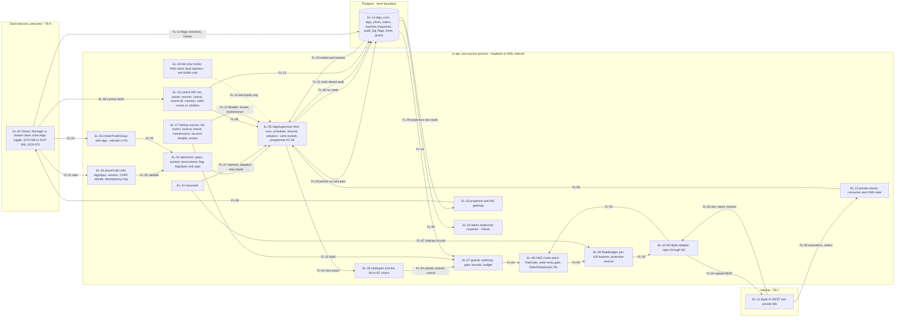

# E33 — STRIDE threat model: the emulated-algo supervisor

- Ticket: E33-X01 (issue #995). Owner: Security engineer (CODEOWNER). Status: **Draft** (revision 3; the delivery
  orchestrator runs the security lens and signs off under the Owner's 2026-10-20 delegation on #2701, as for E39).
  Open, and not blockers to the model: the §1.4 inputs, the Owner decisions D6 to D8 (§4.3) and the Owner's acceptance
  of the §11.2 residuals, queued on #2701 by the orchestrator (2026-10-21). Review log: end of §11.
- Method: the `04-security-program.md` §5 template (L x I = risk), STRIDE per element and per flow (C-12.1), in the
  four-question frame (building §1-§2; what can go wrong §3, §4, §6; response §5, §7 to §10; review §11), formatted as
  the E29 model. E27's, E28's, E29's, E35's, E39's, E17's and E08's rows are **referenced, not repeated**.
- Inputs, read at `2feb1210` (2026-10-21): issue #995 and the E33 epic (#65) with its 26 child tickets;
  `24-internal-schemas.md` §8.4, §8.7, §8.8, §8.10, §10, §15.5 and §16; `28-statechart-catalogue.md` B4 to B7 with the
  four committed charts and their stub bindings; `29-statechart-adoption-plan.md` §1.3 and §4c; the `placeOrder`,
  `createTradeGroup` and `AlgoSpec` parts of `22-api-openapi.yaml`; `23-ws-protocol.md` §6.4; `21-database-schema.md`
  §3.3 and §12; `20-architecture.md` §4.3 and §14; ADR-0008; `04-security-program.md` §5.2 to §5.4, §6.4, §6.5, §6.8,
  §6.15 and §7.2.2; `32-risk-register.md` RSK-013, RSK-016, RSK-017, RSK-056, RSK-077 and RSK-084; the E27, E28, E29,
  E35 and E39 models; on `main`, the code this model cites in `oms`, `statechart`, `admin`, `auth`, `audit`, `ws`,
  `rules` and `exchange/bybit`, with their tests. Revision 3 is re-pinned at `22064fc8` (2026-10-21) for the 15
  commits merged since, #3997 among them: no claim of revision 2 changes (§11 review log). It also reads B14 in
  `28-statechart-catalogue.md`, the E08 model (W2, E8-6, E8-7, E8-13), programme A-20 (`04-security-program.md`
  §3), `ingestion/clock.py` (`ClockGuard`) and `admin/account_access.py`.
- Path: the ticket asks for the model "with the other epic threat models"; GOV-008 naming makes it
  `E33-emulated-algos.md` (D3).
- Timing: design-time. No supervisor, scheduler, state store or `/algos` route exists (§1.1). E33-T01 (#993) and
  E33-T02 (#994) wait for this model, so its requirements (§9) are written as their acceptance criteria and tests.
  E33-X01 is `blocked_by` E33-D01 (#857, open); the orchestrator waived that under the Owner's #2701 delegation, and the
  rows resting on D01's binding copy carry `[O-1]`, re-read when #857 lands.
- Gate note: design-level weaknesses only. No credential, account identifier, UID or exploit detail appears.

## 1. Scope

In scope, the two paths the ticket names: client → `placeOrder` with an `AlgoSpec` → validation → `AlgoSupervisor` →
strategy → guards (authority, kill switch, lockout, budget, caps) → OMS → adapter → Bybit; and private executions →
supervisor → state store → projection → SCR-070. With them: the control surface (the `/algos*` verbs, cancel-all, orphan
adopt and cancel, and the order routes where they reach a child), restart and resume, the halting paths, the stores,
the audit, the configuration and flags that bound a run, and the test-only hooks.

Out of scope (ticket): executing the abuse cases (E33-X02), the final sign-off (E33-X03), key management (E27,
ADR-0009), fan-out (E34). Referenced, not re-modelled: the order path (E29 model), profiles and caps (E28), the gate,
the kill switch and lockouts (E39), the native-SL machinery (E32-X01, #933), the rule engine (E35), the WS gateway
(E17), the admin area (E42), and the inputs a strategy reads: the book with its health (B14; E08 model W2, E8-6 and
E8-7), the trade stream that sizes a TWAP slice (E08) and the clock (`ClockGuard`, E08 model E8-13; the host clock,
programme A-20). How a run acts on them is modelled here (AS-D02, AS-D06, SR-E33-22). E29's OM-R04, OM-E04 and the
algo half of its F-02 are owned here (§3).

### 1.1 State of the build at review time

| Component                                                            | Status                      | Evidence                                                                                                                                                                                                                                                                                 |
| -------------------------------------------------------------------- | --------------------------- | ---------------------------------------------------------------------------------------------------------------------------------------------------------------------------------------------------------------------------------------------------------------------------------------- |
| `AlgoSupervisor`, scheduler, state store, `algo_runs`, `algo_slices` | not built                   | No algo module in `oms/`, no migration                                                                                                                                                                                                                                                   |
| B4 to B7 charts                                                      | contract, stub bindings     | `statechart/machines/B04.oco` to `B07.chase.machine.json`, hash-locked; deny-all guards, no-op actions, permissive event schemas; the root `KILL` ends in `failed` with a no-op `audit_kill`; B7 goes `paused` → `RESUME` → `working` with no reconcile, B5 and B6 through `reconciling` |
| `placeOrder`, `createTradeGroup`; `/algos*`                          | not mounted; not contracted | `matrix.yaml` rows `state: not_mounted`; no `/algos` path in `22-api-openapi.yaml`                                                                                                                                                                                                       |
| Wire `AlgoSpec`                                                      | contract, generated model   | `22-api-openapi.yaml`, `api/_generated/openapi_models.py`; bounds weaker than 24 §10 (§6 CX-07)                                                                                                                                                                                          |
| Flags `algo.twap`, `.chase`, `.iceberg`, `.scaled`, `.oco`           | built                       | `admin/flags/catalogue.py`: default false, rollout category, per-user and per-role overrides allowed                                                                                                                                                                                     |
| Maintenance cancel of runs                                           | port only                   | `AlgoCanceller` (`admin/flags/maintenance.py`); `flags_wiring.py` builds the controller without it, so entering maintenance logs `maintenance_algo_cancel_unavailable` and cancels nothing                                                                                               |
| Order-entry gate                                                     | built, no consumer          | `OrderEntryGate` (`domain/order_entry.py`); its scope text names algo children (`api/order_entry_gate.py`)                                                                                                                                                                               |
| Kill switch (B18), lockouts (B20), caps                              | stubs and tables            | E39 model §1                                                                                                                                                                                                                                                                             |
| Rate governor                                                        | built, no reserve           | `TokenBucketGovernor` (`exchange/bybit/rate_limit.py`): one FIFO bucket per (UID, endpoint class) and an IP bucket; no purpose class, priority or reserve (E34-T02)                                                                                                                      |
| Authority                                                            | per request                 | `PrincipalSnapshot` (`auth/scopes.py`); no production loader grants `can_trade` (`ws_wiring.py`); the disable and access cascades leave orders and have no algo step (`admin/user_disable.py`)                                                                                           |
| Audit                                                                | built, no algo action       | `audit/actions.py` registers no `algo.*`; `orders` and `order_events` carry no actor or algo column                                                                                                                                                                                      |
| WS `machines.algo:{id}.state`                                        | built                       | `ws/topics.py`: `orders:read` on granted accounts, scope from the owning module's record (`statechart/plugins/state_feed.py`), no `context_summary` keys (23 §6.4)                                                                                                                       |
| Statechart persistence                                               | library code, unwired       | HMAC seal, restore and the `chain_trips` latch (`statechart/persistence.py`); `Persister` and `Restorer` are built nowhere (`statechart_wiring.py`)                                                                                                                                      |
| `trade_groups.algo`, `.algo_params`                                  | migrated                    | `0039_trade_groups`: `algo_params` P1, outside `trg_tg_write_once`                                                                                                                                                                                                                       |

A row resting on unbuilt work names the ticket that builds the control; E33-X03 re-triages it if that ticket does not.

### 1.2 Assets and data classification

E33-X01 fixes the classification for the epic; every E33 child cites it (D1).

| Asset                                                                                                   | Class                                           | Notes                                                                                                    |
| ------------------------------------------------------------------------------------------------------- | ----------------------------------------------- | -------------------------------------------------------------------------------------------------------- |
| A run: `algo_runs` (kind, account, symbol, side, total, `created_by`, `env`, status)                    | Financial / restricted, integrity-critical      | The row is the run's standing authority: write-once (SR-E33-04)                                          |
| Its parameters and planned schedule (`algo_runs.params`, the planned `algo_slices`), any persisted seed | Financial / restricted, P1                      | Reveal hidden size and intent (AS-I01); never logged or labelled, as `trade_groups.algo_params` (21 §12) |
| Child orders, executions, positions                                                                     | Financial / restricted                          | Programme A-05, A-06 (E29 D1)                                                                            |
| B4 to B7 snapshots and drain journal                                                                    | Integrity-critical, P1                          | HMAC-sealed (29 §1.3); a forged one restarts a run                                                       |
| Per-UID budgets and the protective reserve, B1 machine slots, the audit WAL                             | Integrity and availability critical             | A starved stop is a C-2.6 failure (§5)                                                                   |
| Audit records of runs and children                                                                      | Confidential, append-only                       | Carry the creator and the parameters (P1)                                                                |
| Test seeds and fault hooks                                                                              | Internal in test builds; absent from production | A production seed is P1 (AS-T03)                                                                         |

### 1.3 Rating

Risk = L x I on the programme scale (Low / Medium / High / Critical):

| L \ I | L      | M      | H        |
| ----- | ------ | ------ | -------- |
| L     | Low    | Low    | Medium   |
| M     | Low    | Medium | High     |
| H     | Medium | High   | Critical |

Impact **H\*** marks an outcome that lets value leave an account (E27 D2), leaves a position without a working native
stop, which C-2.6 calls a Severity-1 defect (E28 D2), or is itself an order the order path never authorised (E26's
trigger; here, one sent under a withdrawn grant, the kill switch, a lockout or a freeze); it raises the cell one band
(D2). Disposition: **Q** a requirement (`SR-E33-nn` or a ticket-body control) that a named ticket must build and a
named test must prove; **C** an existing control on `main`, cited with its test; **R** owned by another epic's model;
**A** accepted (Owner sign-off, §11.2); none is given yet, it is queued on #2701 by the orchestrator (2026-10-21). A
control with no enforcing test or rule is a Q, never a C; a residual assumes the owning ticket ships the control. Row
ids are `AS-xnn`.

### 1.4 Open inputs

Assumptions a blocker must confirm; rows that depend on one carry its tag and re-rate if the answer differs (D4).

| Id  | Assumption in this model                                                                                                              | Confirmed by                                                                    |
| --- | ------------------------------------------------------------------------------------------------------------------------------------- | ------------------------------------------------------------------------------- |
| O-1 | The binding emulation caveat and disconnect message make the residual of §4.2 visible; users expect `freeze` on a disconnect          | E33-D01 (#857, open; X01's `blocked_by` waived by the orchestrator under #2701) |
| O-2 | The seam is persist-then-submit with the deterministic `orderLinkId`, and a crashed child is recovered by its whole id                | E33-K01 (#991)                                                                  |
| O-3 | E34-T02 builds purpose classes and one protective reserve value into the shipped governor                                             | E34-T02 (#859; RSK-086)                                                         |
| O-4 | The kill switch, a lockout and a freeze reach a run through one synchronous gate keyed on (environment, account, acting user, origin) | E39-S01 (#954), E39-S03 (#956); E39 model §5                                    |
| O-5 | Who may adopt an `untracked` order is E29's open D6, which this model's D7 extends                                                    | D7, queued on #2701 by the orchestrator (2026-10-21); E29's D6                  |
| O-6 | ADR-0031 (reserved for E45-K01, #1252) fences test-only hooks out of the release image                                                | E45-K01                                                                         |
| O-7 | E32-T01's closed allow-list (`algo_child_over_attach`) persists a `pending_native_sl` row before a deferred child is sent             | E32-X01 (#933), E32-T01 (#931)                                                  |

### 1.5 Controls already decided in the docs

The ticket asks that existing design decisions be recorded as such. These controls were decided before this model, in
the plan docs, ADRs and ticket bodies; the requirements that build them (§9) cite them and add only what each lacks.
Every other control in §9 is this model's.

| Decided control                                                                                                                                                | Decided in                                                                         | Built through                   |
| -------------------------------------------------------------------------------------------------------------------------------------------------------------- | ---------------------------------------------------------------------------------- | ------------------------------- |
| Runs live on the server, and each declares its crash policy, resume or cancel, never a third thing                                                             | ADR-0008; the E33 epic                                                             | SR-E33-10, SR-E33-20            |
| A run persists its state with each child; `on_disconnect="freeze"`; children take the group segment with `seq2` and the `ac` suffix and are never rule-managed | 24 §10.1 rules 1, 2, 4 and 5                                                       | SR-E33-05, SR-E33-10, SR-E33-12 |
| A native stop on every position a child opens: attached at create, or within 2 s of the first fill on E32-T01's closed deferral list; the 5 s watchdog         | C-2.6; 24 §8.8 rules 1 to 3, §10.1 rule 3; E32-T01                                 | SR-E33-07, SR-E33-20            |
| The protective reserve is never drawn by algo traffic, and a run pauses on an empty bucket                                                                     | 24 §8.7; `20-architecture.md` §4.3; ADR-0008; E33-T01's AC "Rate budget exhausted" | SR-E33-08                       |
| `max_children` 450, `max_duration_ms` 24 h, and `failure_count > 3` ends a run `failed`                                                                        | 24 §10.1; E33-T01                                                                  | SR-E33-09                       |
| Persist, then submit with a deterministic `orderLinkId`; adoption by the whole id, never a prefix                                                              | 24 §8.3; RSK-017; E33-K01                                                          | SR-E33-10, SR-E33-14            |
| Executions are authoritative, deduplicated by `exec_id`; no replacement after a fill; an OCO overshoot is corrected reduce-only                                | 24 §10.2, §10.5; INV-B4-c, INV-B5-a, INV-B6-a; E33-S01, E33-S04                    | SR-E33-11                       |
| `max_chase_ticks` from the arm price, `max_repricings` and the 200 ms reprice floor                                                                            | 24 §10.5; E33-S04                                                                  | SR-E33-18; §5                   |
| Iceberg jitter on by default; a TWAP never fires missed slices back to back                                                                                    | 24 §10.3; E33-S03                                                                  | SR-E33-03, SR-E33-10            |
| A TWAP's `created_by` re-checked at each slice                                                                                                                 | E33-S03                                                                            | SR-E33-02                       |
| The order-entry gate covers algo children; a kill switch or a lockout halts a run, which never resumes by itself                                               | 24 §8.10; the ACs of E33-T01, E33-S02 and E33-S03                                  | SR-E33-06                       |
| Every transition audited with actor, account, parameters and reason; each order logged as intent and outcome                                                   | C-2.9; SR-061; E33-T01                                                             | SR-E33-16                       |
| Snapshots HMAC-sealed, an altered one refused; the `machines` topic scoped from the owning module, with no summary keys for B4 to B7                           | 29 §1.3; 23 §6.4                                                                   | SR-E33-10, SR-E33-15            |
| Group-level algos deferred to E34; `algo.*` flags default off, live off until R4                                                                               | the E33 epic; `admin/flags/catalogue.py`                                           | SR-E33-01; CX-02                |

## 2. Data-flow diagram and trust boundaries

Elements are EL-01 to EL-19 and flows FL-01 to FL-15.

Text alternative to the diagram: a client starts a run through `placeOrder` with an `AlgoSpec`, or through
`createTradeGroup`, which R3 refuses (FL-01); admission checks the grant, symbol, environment, flag, the spec and the
caps (FL-02) and hands the run to the supervisor, which persists the run and its plan (FL-03). For each action the
strategy proposes, the guards check the creator's authority, the gate, the bounds and the budget, and the child takes
the OMS choke point, the rate budget and the adapter to Bybit (FL-04); answers return untrusted (FL-05), executions
drive the run (FL-06), and the reconciler finds orphans and owed stops (FL-07). Control verbs (FL-08) and projections
and reads (FL-09) cross TB-4; restarts resume from the stores (FL-10); halting sources reach the guards and the
supervisor (FL-11, FL-12); every act is audited ahead (FL-13); the Owner sets flags and limits (FL-14); test hooks exist
only in test builds (FL-15).

Elements: entities **EL-01** and **EL-11**; store **EL-14**; processes **EL-02** to **EL-10**, **EL-12**, **EL-13** and
**EL-15** to **EL-19**; flows **FL-01** to **FL-15** (§3.7). The strategies' inputs, the book with its B14 health, the
trade stream and the clock, are referenced (§1), not drawn: AS-D02 and AS-D06 analyse how a run acts on them.

Boundaries (`04-security-program.md` §4.1; E29 model §2):

- **TB-4, client to API** (FL-01, FL-08, FL-09, FL-14): untrusted until authenticated, RBAC-scoped after; builder
  validation and the projected request rate are UX only (C-2.12).
- **Time, the boundary this epic adds.** A run is authorised once (FL-01) and acts for up to 24 h; every FL-04 crosses
  from the authority recorded at the start to the authority that holds now, so the check sits on FL-04 (§4.1).
- **Store boundary** (FL-03, FL-06, FL-10, FL-13, FL-14): a database writer is its own integrity domain, and
  `algo_runs` carries a run's authority and parameters.
- **TB-7, backend to Bybit** (FL-04 to FL-07): E08's and E27's; the exchange is semi-trusted (programme AC-08).
- **EL-05** runs in process but is semi-trusted, as the rule engine is (programme AC-06; E29 DFD E5): its children
  take the path a client order takes (SR-E33-07). **EL-18** exists only in test builds (SR-E33-17).

## 3. STRIDE table

Columns as E29 §3: the existing control is what `main` does today, with its test; the gap names the mitigation and
its ticket; `SR-E33-nn` are this model's requirements (§9). A mitigation that §1.5 lists is a design decision already
recorded, which its ticket builds; the rest are this model's. Programme rows extended, not repeated
(`04-security-program.md` §5.2, §5.3): O1 → AS-S01, AS-E01; O2, O11 → AS-S02; O3 → AS-T01; O4 → AS-E04; O5 → AS-R01,
AS-R02; O6 → AS-D01; O7 → AS-I02; O10 → AS-D05; R3 → AS-S03; R4 → AS-D01, AS-D02, AS-D06; R6 → AS-R02. Owned from
E29: OM-R04 → AS-R02, OM-E04 → AS-S03 and AS-E03 (their E35 halves stay with E35-X01, #945), F-02's algo half →
AS-E02. Consumed: E28 PF-E04 and PF-D05, E39 RK-E01, E27 KV-D03.

### 3.1 Spoofing

| ID     | Element / flow                    | Threat                                                                                                                                                                                                                                                                                                                                                                                                                                                                                                                                                                                                                         | L   | I   | Risk     | Existing control                                                                                                                                                                                                                                                                                                                          | Gap → mitigation                                                                                                                                                                                                                                                                                                                                                                                                                       | Owner                                                              | Verify                       | Disp.   | Residual                       |
| ------ | --------------------------------- | ------------------------------------------------------------------------------------------------------------------------------------------------------------------------------------------------------------------------------------------------------------------------------------------------------------------------------------------------------------------------------------------------------------------------------------------------------------------------------------------------------------------------------------------------------------------------------------------------------------------------------ | --- | --- | -------- | ----------------------------------------------------------------------------------------------------------------------------------------------------------------------------------------------------------------------------------------------------------------------------------------------------------------------------------------- | -------------------------------------------------------------------------------------------------------------------------------------------------------------------------------------------------------------------------------------------------------------------------------------------------------------------------------------------------------------------------------------------------------------------------------------- | ------------------------------------------------------------------ | ---------------------------- | ------- | ------------------------------ |
| AS-S01 | EL-01, EL-02, EL-03, EL-04, FL-01 | Who may start what: a Viewer, a Manager without a trade grant on the account (a view-only grant, a frozen manager), or a start for a symbol outside the account's allowed list or an environment not enabled; checked once at the route, the start then authorises every child (programme O1; E29 OM-E01)                                                                                                                                                                                                                                                                                                                      | M   | H\* | Critical | `decide` refuses an ungranted and a view-only account alike (`test_manager_cannot_reach_another_managers_account`, `test_view_only_grant_denies_trade_when_requires_trade` in `services/api/tests/unit/auth/test_scopes.py`); no route is mounted, and no production loader grants `can_trade` yet                                        | The route checks `orders:write`, the account in the grants with trade mode and not frozen, the symbol, the environment and the `algo.<kind>` flag; the supervisor re-checks them from the stored run before the first child (SR-050, SR-E33-01)                                                                                                                                                                                        | E29-T04 (#913), E33-T01 (#993), E33-T02 (#994)                     | unit, contract, AC-03, AC-09 | R, Q    | Low                            |
| AS-S02 | EL-01, EL-02, EL-15, FL-01, FL-08 | A stolen or planted session, a cross-site page or an XSS payload starts a run or sends a verb, or a captured request is replayed; one forged request becomes a generator of up to 450 children over 24 h (programme O2, O11; E29 OM-S01, OM-T11)                                                                                                                                                                                                                                                                                                                                                                               | M   | H   | High     | CSRF double-submit (SR-041), session rotation and reuse detection (E09); `Idempotency-Key` replay is a bounded in-memory cache on which "correctness never depends" (`api/idempotency.py`)                                                                                                                                                | A start is anchored by its one-leg group's principal-scoped `client_group_ref` (SR-E29-07); every verb is idempotent in effect (SR-E33-13); on live, SR-043's per-request arm nonce (E29 G-1) and D8                                                                                                                                                                                                                                   | E29-T04, E33-T02, E30-S04 (#1088)                                  | integration, AC-07           | R, Q, A | Low (acceptance queued, §11.2) |
| AS-S03 | EL-05, EL-07, EL-17, FL-04, FL-12 | **Standing authorisation.** A run acts on its creator's authority long after the request and session: the grant is revoked (`can_view` and `can_trade` set false), the user disabled, the role expired, the manager frozen or locked out, or the rule that started the run disarmed, disabled or deleted, and the run keeps sending children, amends and refills under authority that no longer exists; a run with nothing pending (a parked chase, an entry OCO's resting legs, a paused run's resting slices) checks nothing, so its entry legs can fill hours after the authority ended (programme R3; RSK-056; E29 OM-E04) | M   | H\* | Critical | None for runs: `PrincipalSnapshot` is per request; the cascades leave orders (`POSITIONS_DECISION = "leave"`) with no algo step; only the rule engine re-reads grants per tick (`test_check_soft_revoked_rows_hold_no_grant_and_freeze_nothing` in `services/api/tests/rules/test_scope_state.py`), and not `can_trade` or `orders:write` | Re-resolve the creator before every child of any kind and every amend of an entry child, and on the 30 s reconcile tick for a run holding entry children; a rule's run needs its rule armed; on a refusal halt the run: no further child, its entry children cancelled, its reduce-only children and protective orders kept, the Owner paged, never a resume by itself; the cascades halt the creator's runs as well (§4.1, SR-E33-02) | E33-T01, E33-T02, E33-S03 (#1103), E42-T04 (#965), E42-T08 (#2648) | unit, integration, AC-04     | Q       | Low                            |
| AS-S04 | EL-02, EL-04, EL-05, FL-01        | Spoofed run identity: a body setting the run's `created_by`, `rule_id`, `algo_id`, `origin`, `max_children` or `on_disconnect` (fields of 24 §10.1's model), or `intent: algo_child`, attributes a run to another user, borrows a rule's authority, raises a cap, or makes an order pass as a child (rule-excluded, gate-classified)                                                                                                                                                                                                                                                                                           | L   | H   | Medium   | Contract only: `PlaceOrderRequest` and the wire `AlgoSpec` refuse unknown fields, and `placeOrder` refuses a client `algo_child` (`intent_mismatch`)                                                                                                                                                                                      | These fields come from the principal and the call path only; `rule_id` only on M15's internal path; `on_disconnect` takes `freeze` only in R3 (SR-E33-05)                                                                                                                                                                                                                                                                              | E33-T02, E33-T01                                                   | contract, unit               | Q       | Low                            |

### 3.2 Tampering

| ID     | Element / flow                    | Threat                                                                                                                                                                                                                                                                                                                                                                                                                                                                                                                                                                                                                 | L   | I   | Risk   | Existing control                                                                                                                                                                                                                | Gap → mitigation                                                                                                                                                                                                                                                                                                                                                                                                                                 | Owner                                                    | Verify                               | Disp.   | Residual |
| ------ | --------------------------------- | ---------------------------------------------------------------------------------------------------------------------------------------------------------------------------------------------------------------------------------------------------------------------------------------------------------------------------------------------------------------------------------------------------------------------------------------------------------------------------------------------------------------------------------------------------------------------------------------------------------------------- | --- | --- | ------ | ------------------------------------------------------------------------------------------------------------------------------------------------------------------------------------------------------------------------------- | ------------------------------------------------------------------------------------------------------------------------------------------------------------------------------------------------------------------------------------------------------------------------------------------------------------------------------------------------------------------------------------------------------------------------------------------------ | -------------------------------------------------------- | ------------------------------------ | ------- | -------- |
| AS-T01 | EL-04, FL-01, FL-02               | Client `AlgoSpec` fields exceed the intended exposure: a total above the profile caps while each child stays under the per-order cap, an iceberg `display_qty` below the lot, negative or above the total, a `kind` naming one sub-object and carrying another, a TWAP of 500 slices in 10 s or of more slices than `max_children` (CX-22), an offset (`limit_offset_ticks`, the chase's `offset_ticks`, the iceberg's `peg_offset_ticks`) that moves a limit child through the book, a taker with no price limit, iceberg jitter 0 (a regular refill other detectors spot); the wire is weaker than 24 §10 (§6 CX-07) | M   | H   | High   | None; the wire bounds are contract only                                                                                                                                                                                         | Every field re-validated against the instrument filters and the bound profile, offsets included: one that moves a limit child toward the other side of the book needs a market slice's price limit or participation cap; caps on the run's total and on the sum of an OCO's entry legs, at admission and per child at send; rejected, never clamped (C-12.5); the wire raised to §5 contract-first (SR-E33-03)                                   | E33-T02, E33-T01, E39-S01 (#954)                         | contract, unit, AC-02                | Q       | Low      |
| AS-T02 | EL-14, EL-15, FL-03, FL-08        | A running run is changed: extend or compress (E33-S03), resume with a smaller slice or convert the remainder (E33-S02), a verb body carrying parameters, or a database write to `algo_runs.params` (`trade_groups.algo_params` is outside `trg_tg_write_once` too), widening a bound or changing side, size or account without the create's checks                                                                                                                                                                                                                                                                     | M   | H   | High   | None                                                                                                                                                                                                                            | The run's identity and parameters are write-once by trigger and grants; a change is a new audited version that re-runs SR-E33-01 and SR-E33-03 and only narrows: nothing rises, an extend stays inside the original `max_duration_ms` and a compress never raises the rate (SR-E33-04)                                                                                                                                                           | E33-T01, E33-T02                                         | integration (migration), unit, AC-13 | Q       | Low      |
| AS-T03 | EL-14, EL-18, FL-15               | The test-only RNG-seed override (`oms.algo.rng_seed`, a config key as E33-Q02 first wrote it) or the fault hook at the persistence seams reaches a production build: predictable jitter defeats an iceberg, a fault armed at a seam duplicates or orphans children; a seed persisted with the run (E33-S02) predicts the rest of it to anyone who reads the row `[O-6]`                                                                                                                                                                                                                                                | L   | H   | Medium | Precedents only: the dev fixture transport is refused outside demo and confined to `cvdev` (`test_dev_module_confined.py`); exporter breakpoints refuse unless pytest is loaded                                                 | Hooks are code seams present only in test builds, refused at settings load, never a config key or request field, pinned by an architecture test and audited at boot; the override is absent from any production build, as the orchestrator confirmed (2026-10-21), so E33-Q02's E2E runs on a test build and its refusal on live is a second line only; production jitter from the OS CSPRNG; a persisted seed is P1 and server-only (SR-E33-17) | E33-T01, E33-S02 (#1102), E33-Q04 (#1099)                | ci-gate, AC-06                       | Q       | Low      |
| AS-T04 | EL-05, EL-12, FL-05, FL-06        | Run state from intent, not executions: a duplicated, reordered or late execution, a fill during an in-flight amend, or a local accumulator completes a run early or submits past `total_qty`; a replacement after a fill doubles the position; an OCO double fill reverses it                                                                                                                                                                                                                                                                                                                                          | M   | H   | High   | None built; INV-B4-c, INV-B5-a and INV-B6-a are contract only                                                                                                                                                                   | Fills from `executions`, deduplicated by `exec_id`; never more than `total_qty` submitted; no replacement after a fill; an overshoot corrected reduce-only (SR-E33-11)                                                                                                                                                                                                                                                                           | E33-T01, E33-S01 (#992), E33-S04 (#1104), E29-T05 (#848) | unit, property, AC-18                | Q, R    | Low      |
| AS-T05 | EL-05, EL-13, EL-14, FL-07, FL-10 | Restart integrity: a crash at a seam replays a run from a stale point and sends a child twice, adopts a resting order by prefix or by id alone, or restores a run whose snapshot or row was edited; B7 resumes to `working` without reconciling `[O-2]` (RSK-017)                                                                                                                                                                                                                                                                                                                                                      | M   | H   | High   | The sealed restore refuses an altered snapshot and latches a machine with `chain_trips > 0` (`statechart/persistence.py`; for B1, `test_a_chain_trip_latched_order_refuses_order_path_commands`); nothing restores B4 to B7 yet | Persist before submit with the deterministic `orderLinkId`, reused on resume; adoption by whole id plus the SR-E29-03 full match; the run row write-once; `RESUME` sent only after the run's children are reconciled (SR-E33-04, SR-E33-10)                                                                                                                                                                                                      | E33-K01 (#991), E33-T01, E29-T06 (#914)                  | chaos (E33-Q04), AC-11               | C, Q, R | Low      |
| AS-T06 | EL-08, EL-15, FL-08               | A child is changed outside its run: a manual amend, cancel or cancel-all on it, or a rule acting on it (`exclude_algo_children` defaults on, but no emitter passes `is_algo_child`, `rules/scope.py`), so run and user fight: a chase re-places what the user cancelled                                                                                                                                                                                                                                                                                                                                                | M   | M   | Medium | None                                                                                                                                                                                                                            | A child belongs to its run: a manual amend is refused unless it only reduces or protects, a manual cancel pauses the run, rules never act on a child (SR-E33-12)                                                                                                                                                                                                                                                                                 | E33-T01, E33-T02, E35-S04 (#864)                         | unit, AC-12                          | Q       | Low      |
| AS-T07 | EL-07, EL-14, FL-14               | A floor optimised away: the protective reserve (`RateBudget.reserved_for_protective`, `RISK_CAP_EDIT`), `OmsConfig.max_algo_children` (`SYSTEM_CONFIG_EDIT`), the stop-attach deadline, the 200 ms reprice floor or the duration cap set past its bound by an admin knob (24 §16.3), a config key or a later performance change                                                                                                                                                                                                                                                                                        | M   | H   | High   | None: the knobs carry no floor or ceiling                                                                                                                                                                                       | §5's limits are code constants; config load and every admin write refuse a value past them and audit the attempt (SR-E33-09)                                                                                                                                                                                                                                                                                                                     | E33-T01                                                  | unit, AC-17                          | Q       | Low      |

### 3.3 Repudiation

| ID     | Element / flow                    | Threat                                                                                                                                                                                                                                                                                                                                                                          | L   | I   | Risk   | Existing control                                                                                                                                                            | Gap → mitigation                                                                                                                                                                                                                 | Owner                     | Verify                              | Disp. | Residual |
| ------ | --------------------------------- | ------------------------------------------------------------------------------------------------------------------------------------------------------------------------------------------------------------------------------------------------------------------------------------------------------------------------------------------------------------------------------- | --- | --- | ------ | --------------------------------------------------------------------------------------------------------------------------------------------------------------------------- | -------------------------------------------------------------------------------------------------------------------------------------------------------------------------------------------------------------------------------- | ------------------------- | ----------------------------------- | ----- | -------- |
| AS-R01 | EL-01, EL-05, EL-15, FL-08, FL-13 | "I never started that TWAP": a create, pause, resume, cancel, adoption, cancel-all, parameter change or refused attempt leaves no record with actor, role, session, account and the full validated parameters; no `algo.*` action is registered and the writer refuses unregistered ones; the names are split (24 §15.5 has four, the E33 tickets about forty, SCR-070 its own) | M   | H   | High   | Hash-chained, append-only audit (E09 U14, U19); `test_every_literal_audit_action_emitted_is_registered` (`services/api/tests/unit/audit/test_router_actions_registered.py`) | The §8.1 set in one registered vocabulary before the first emitter, written ahead of the act; refused attempts recorded (SR-E33-16)                                                                                              | E33-T02, E33-T01          | unit (registry), integration, AC-19 | C, Q  | Low      |
| AS-R02 | EL-08, EL-14, FL-04, FL-13        | A child is not attributable to its run, its creator and the parameter version: `orders` and `order_events` hold no actor or algo column, the OMS facade audits as `system:oms`, and the `trade_groups.origin` CHECK has no `algo_child` (E29 OM-R04; programme R6)                                                                                                              | M   | H   | High   | None                                                                                                                                                                        | Each child's intent and outcome records (SR-061) carry `actor_type` algo, the run id, the seq, the creator and the parameter version; `origin` and `origin_ref` persisted on the order from the call path (SR-E29-01, SR-E33-16) | E33-T01, E29-T04          | integration, AC-19                  | Q     | Low      |
| AS-R03 | EL-05, EL-06, FL-13               | Sampled order audit: `algo.iceberg_slice_replaced` is "sampled" (E33-S02) and `algo.chase_repriced` "sampled/aggregated" (E33-S04), so the amends and cancels behind them may go unrecorded, against C-2.9                                                                                                                                                                      | M   | M   | Medium | None                                                                                                                                                                        | The OMS record of every child submit, amend and cancel is never sampled; only an algo-level summary may be (SR-E33-16, §6 CX-11)                                                                                                 | E33-S02, E33-S04, E29-T04 | integration, AC-19                  | Q     | Low      |
| AS-R04 | EL-07, EL-17, FL-11, FL-12        | A halt leaves no record: the charts' root `KILL` runs a no-op `audit_kill`, "halted by risk control" has no state, and `KillSwitchResult.actions` counts no algo, so a kill cannot be shown to have stopped a run                                                                                                                                                               | M   | M   | Medium | None                                                                                                                                                                        | One `algo.halted` record per run with its reason and the children cancelled and kept; the kill switch's record counts the runs it halted (SR-E33-06, SR-E39-12)                                                                  | E33-T01, E39-S03 (#956)   | integration, AC-10                  | Q, R  | Low      |

### 3.4 Information disclosure

| ID     | Element / flow                    | Threat                                                                                                                                                                                                                                                                                                                                                | L   | I   | Risk   | Existing control                                                                                                                                                                                                                                                                                                     | Gap → mitigation                                                                                                                                                                  | Owner                                     | Verify                 | Disp. | Residual |
| ------ | --------------------------------- | ----------------------------------------------------------------------------------------------------------------------------------------------------------------------------------------------------------------------------------------------------------------------------------------------------------------------------------------------------- | --- | --- | ------ | -------------------------------------------------------------------------------------------------------------------------------------------------------------------------------------------------------------------------------------------------------------------------------------------------------------------- | --------------------------------------------------------------------------------------------------------------------------------------------------------------------------------- | ----------------------------------------- | ---------------------- | ----- | -------- |
| AS-I01 | EL-14, EL-16, EL-19, FL-09, FL-13 | Parameters reveal hidden size and intent: an iceberg's total, a TWAP's planned schedule or a chase's bounds reach a co-granted Manager or a Viewer (E33-T02's `algo_run` serves `params` to "users with access to the account"), a log line, a metric label, a trace or an export; `algo_runs` and `algo_slices` are unclassified                     | M   | M   | Medium | `trade_groups.algo_params` is P1, "never logged" (0039); B4 to B7 send no `context_summary` keys (23 §6.4); the inspector is Owner-only and exports chart structure (E42 model)                                                                                                                                      | Parameters, the planned schedule and any seed are P1, never logged or labelled, and served per D6 (SR-E33-15)                                                                     | E33-T02, E33-T01, E33-T03 (#1107)         | unit, AC-14            | Q     | Low      |
| AS-I02 | EL-02, EL-15, FL-08, FL-09        | Cross-account reads: `GET /algos` filters (`account_id`, `include_orphans`), another account's run id, cancel-all's per-run results, or a 403 for a foreign run beside a 404 for a missing one (E33-T02) reveal another account's runs and orphans, or another manager's runs on a co-granted account (C-12.4: a Manager "cannot see other managers") | M   | H   | High   | `decide` denies a foreign and a missing account alike (`test_manager_cannot_reach_another_managers_account`)                                                                                                                                                                                                         | Scope at query construction (SR-051); one 404 shape for foreign and missing runs (SR-E29-13); orphans of granted accounts only; other users' runs per D6 (SR-E33-13, SR-E33-15)   | E33-T02, E33-S06 (#1106), E33-X02 (#1108) | contract, AC-03, AC-14 | C, Q  | Low      |
| AS-I03 | EL-16, FL-06, FL-09               | The projection leaks runs: an `algo_run` record published on the `orders` topic without the run's account, a `machines.algo` scope bound from machine context, or a subscription that outlives a revoked grant (§6 CX-04)                                                                                                                             | L   | H   | Medium | `machines.algo:{id}.state` is `orders:read` on granted accounts, its scope bound from the owning module's record and an unscoped entry refused (`test_unknown_unscoped_and_foreign_entities_get_one_refusal` in `services/api/tests/unit/ws/test_machines.py`); grant changes re-evaluate subscriptions (E17 WS-E02) | Whatever carrier E33-T02 contracts, each record goes out with the run's account read from `algo_runs`, never from machine context, and carries parameters only per D6 (SR-E33-15) | E33-T02, E17                              | integration, AC-14     | C, Q  | Low      |

### 3.5 Denial of service and denial of wallet

| ID     | Element / flow                    | Threat                                                                                                                                                                                                                                                                                                                                                                                                                                                                                                                                                                                                                                   | L   | I   | Risk     | Existing control                                                                                                                                                                                                              | Gap → mitigation                                                                                                                                                                                                                                                                                                                                                                                                                                                | Owner                                             | Verify                 | Disp. | Residual                          |
| ------ | --------------------------------- | ---------------------------------------------------------------------------------------------------------------------------------------------------------------------------------------------------------------------------------------------------------------------------------------------------------------------------------------------------------------------------------------------------------------------------------------------------------------------------------------------------------------------------------------------------------------------------------------------------------------------------------------- | --- | --- | -------- | ----------------------------------------------------------------------------------------------------------------------------------------------------------------------------------------------------------------------------- | --------------------------------------------------------------------------------------------------------------------------------------------------------------------------------------------------------------------------------------------------------------------------------------------------------------------------------------------------------------------------------------------------------------------------------------------------------------- | ------------------------------------------------- | ---------------------- | ----- | --------------------------------- |
| AS-D01 | EL-06, EL-09, FL-04               | Reprice and refill storms starve protective orders: a chase at the 200 ms floor amends five times a second against an `entry` budget of 4 a second (`20-architecture.md` §4.3), icebergs refill every 250 ms, several runs share one UID; today one FIFO bucket per UID and class serves stops and algos alike; a reduce-only child (an OCO leg, a TWAP exit) would draw `critical` by its label, and a cancel the algo paces (an iceberg's replacement, a TWAP's re-plan, a chase's cancel-and-re-place) as a cancel; a `10018` then holds every REST call for 10 to 15 min, stops included `[O-3]` (C-12.7; programme O6, R4; RSK-013) | M   | H\* | Critical | `TokenBucketGovernor`: one bucket per (UID, endpoint class) and an IP bucket, no reserve, no purpose class                                                                                                                    | The reserve exists before any algo sends (E34-T02, which E33-T01 does not wait for: every `algo.*` flag stays off until it merges, CX-20, F-03), and a start refuses while the governor exposes none (SR-E33-21); algo creates and amends, and the cancels the algo paces, draw `entry` whatever their `reduce_only`; a run pauses on an empty bucket and never queues; the running runs' projected rate per account is capped at admission (SR-E33-08, SR-071) | E34-T02 (#859), E33-T01, E33-S04                  | load (E33-Q03), AC-01  | Q, R  | Low                               |
| AS-D02 | EL-05, EL-06, EL-08, FL-03, FL-04 | Unbounded runs: no cap on concurrent runs per account or user; a paused run has no clock exit (B5 to B7 take `MAX_DURATION` or `TIMEOUT` in working states only); 450 children per run against 4096 B1 machines per process (a full table refuses a reduce-only order too), 3843 `seq2` values per group and Bybit's 500 open orders per symbol (`110020`), and a TWAP planned past `max_children` ends `completed` with its remainder unfilled (CX-22); a backward wall-clock jump extends a run, a forward one fires missed slices back to back; every child costs two audit records through one advisory lock and a 64 MiB WAL        | M   | H   | High     | `MAX_MACHINES` and the `seq2` limit refuse past their bound (`test_a_full_registry_refuses_a_new_order_and_keeps_every_live_one`, `test_replacing_seq2_3843_is_exhausted_without_a_lookup` in `services/api/tests/unit/oms/`) | §5's bounds as code constants; the duration counts paused time and never moves with the wall clock; concurrent runs capped per account and per user; admission refuses a plan with more children than `max_children`, and a run whose children could pass the per-symbol, `seq2` or machine headroom, keeping a protective share (SR-E33-09, SR-E33-22)                                                                                                         | E33-T01, E33-T02, E29-T03 (#847)                  | unit, load, AC-02      | C, Q  | Low                               |
| AS-D03 | EL-05, EL-13, FL-07, FL-10        | Resume storm: after a restart every run resumes within the same 5 s, each looking up its children, a chase reading its price back, a TWAP re-planning, against the per-UID and per-IP budgets, while the order-entry gate opens only after the flags, heartbeats and key self-check; a `10018` there holds every stop for 10 to 15 min `[O-2]`                                                                                                                                                                                                                                                                                           | L   | H\* | High     | None                                                                                                                                                                                                                          | Resumes staggered within the per-UID and per-IP budgets, their reads on `poll`; no child before its account's reconciliation; missed slices never fire back to back (SR-E33-10)                                                                                                                                                                                                                                                                                 | E33-T01, E33-K01, E33-Q03 (#1098)                 | load, chaos, AC-11     | Q     | Low                               |
| AS-D04 | EL-15, FL-08                      | Cancel-all as a griefing tool: a Manager calls `POST /algos/cancel-all` with no account (every granted account) or on a co-granted one and stops another user's runs, or uses `cancel_and_flatten` to close what that user opened; a cancel flood also drains `critical` (E29 OM-D06)                                                                                                                                                                                                                                                                                                                                                    | M   | H   | High     | None; 04 §7.2.2 row 13 makes cancelling another user's order Owner-only                                                                                                                                                       | Verbs reach the caller's own runs, another user's run the Owner's only; an empty account list means the caller's own runs; an out-of-scope id refuses the whole request; `cancel_and_flatten` closes at most the run's own filled quantity (SR-E33-13, SR-E29-14)                                                                                                                                                                                               | E33-T02, E33-S06                                  | contract, AC-08        | Q     | Low                               |
| AS-D05 | EL-05, EL-12, FL-06, FL-10        | **The residual that defines the epic:** emulated algos stop when the backend stops (crash, deploy, Postgres outage, host sleep): no settlement, refill, slice or reprice while children rest unmanaged; an entry OCO can fill both legs; a chase rests at a stale price; a TWAP exit stops reducing (ADR-0008: "the single largest correctness risk in the whole system") `[O-1]`                                                                                                                                                                                                                                                        | M   | H   | High     | The native stop (C-2.6) lives on the exchange; B1's protection region attaches a stop owed after a fill within 2 s (`SL_DEADLINE_US`, `bindings/b01_order.py`)                                                                | The accepted mitigation set of §4.2: a native stop on every child that opens exposure, `on_disconnect="freeze"`, stops repaired before any resume, the degraded banner, the monitor, the builders' residual note and a page from outside the process (SR-E33-20)                                                                                                                                                                                                | E33-T01, E33-S05 (#1105), E33-S06, E32-T01 (#931) | chaos (E33-Q04), AC-16 | Q, A  | Medium (acceptance queued, §11.2) |
| AS-D06 | EL-04, EL-06, FL-02, FL-04        | Denial of wallet: a run follows the market without a bound: a chase with no `max_slippage_ticks` (optional on the wire; `max_chase_ticks` is required in 24 §10.5) or whose `bound_exceeded` converts to market (B7 `market_converting`), TWAP market slices with no price limit (an omitted `limit_offset_ticks` means market slices, and the wire has no `price_limit`), a final market sweep into a thin book, or any action priced from a book that is not live (B14 `desynced` or `snapshot_pending`); the loss repeats on every slice                                                                                              | M   | H   | High     | None                                                                                                                                                                                                                          | `max_chase_ticks` required, measured from the arm price; a bound never converts to market, only an explicit timeout opt-in does; market slices need a price limit or a participation cap; no action on a book that is not live or an unhealthy clock (SR-E33-18, SR-E33-03, SR-E33-22)                                                                                                                                                                          | E33-S04, E33-S03, E33-T02, E33-T01                | unit, property, AC-02  | Q     | Low                               |

### 3.6 Elevation of privilege

| ID     | Element / flow                                  | Threat                                                                                                                                                                                                                                                                                                                                                                                                                                                                                                                                         | L   | I   | Risk     | Existing control                                                                                                                                                                                                                    | Gap → mitigation                                                                                                                                                                                                                                                                                                                                                                                                                                                                 | Owner                                      | Verify                   | Disp.   | Residual |
| ------ | ----------------------------------------------- | ---------------------------------------------------------------------------------------------------------------------------------------------------------------------------------------------------------------------------------------------------------------------------------------------------------------------------------------------------------------------------------------------------------------------------------------------------------------------------------------------------------------------------------------------- | --- | --- | -------- | ----------------------------------------------------------------------------------------------------------------------------------------------------------------------------------------------------------------------------------- | -------------------------------------------------------------------------------------------------------------------------------------------------------------------------------------------------------------------------------------------------------------------------------------------------------------------------------------------------------------------------------------------------------------------------------------------------------------------------------- | ------------------------------------------ | ------------------------ | ------- | -------- |
| AS-E01 | EL-05, EL-15, FL-08                             | A Viewer or an out-of-scope Manager sends a verb (pause, resume, cancel, `cancel_and_flatten`, adopt, cancel-all), or a Manager controls another user's run on a co-granted account; a resume revives children under authority the caller does not hold (programme O1; 04 §7.2.2 rows 13 and 16)                                                                                                                                                                                                                                               | M   | H\* | Critical | None (no route)                                                                                                                                                                                                                     | Two layers: the route's `orders:write` and scope, then the supervisor against the stored run's account, never the body; Viewer 403; a Manager's own runs only; a resume is the creator's or the Owner's and re-runs the creator's check; 403 or the one 404, no change, an audit row (SR-E33-13)                                                                                                                                                                                 | E33-T02, E33-T01, E33-X02                  | contract (matrix), AC-03 | Q       | Low      |
| AS-E02 | EL-05, EL-13, EL-15, FL-07, FL-08               | Orphan adoption takes control of an order the run never sent: `adopt(order_id, algo_id)` with a caller-chosen run, another user's manual order, an `untracked` or foreign order (an exchange-level squatter's, E29 OM-S05 and N3) or a position's TP/SL; the run then amends, re-places or cancels it with its creator's authority, and orphan-cancel can strip a stop `[O-5]` (E29 OM-E02, F-02)                                                                                                                                              | M   | H\* | Critical | B1's `ADOPT` is user-only and deny-all (`adoption_allowed`); rules, algos and groups never act on `untracked` (`test_s9_no_rule_algo_or_group_acts_on_an_untracked_order` in `services/api/tests/unit/oms/test_order_machine.py`)   | Adopt only an order whose SR-E29-03 full match binds it to a slice of the run its own id names; never an `untracked`, foreign, other-run or TP/SL order; adopting an `untracked` one per D7; orphan-cancel never removes a native stop (SR-E33-14, SR-E29-06, SR-E29-12)                                                                                                                                                                                                         | E33-T01, E33-T02, E33-S06, E45-S01 (#1291) | unit, integration, AC-05 | C, Q    | Low      |
| AS-E03 | EL-06, EL-07, EL-17, FL-04, FL-10, FL-11, FL-12 | **A halt that halts nothing.** The guards run before "child submission" only (E33-T01), not before a reprice, a refill, a market conversion or a resumed run's first child; the root `KILL` ends a chart in `failed` without cancelling children, so resting entry children fill after the halt; maintenance cancels runs through an unwired port; `killswitch.order_entry`, a freeze, a lockout, an account disable and a last-key revoke reach no run; a budget pause auto-resumes into a block `[O-4]` (E39 RK-E01, E28 PF-E04, E27 KV-D03) | H   | H\* | Critical | `OrderEntryGate` covers algo children in its text and has no consumer; `test_entering_maintenance_cancels_algos_and_notifies_once` passes only with a canceller injected (`services/api/tests/unit/admin/test_flag_maintenance.py`) | One synchronous check before every child and every amend of an entry child; on any block the run halts with its reason, its entry children cancelled through the audited cancel service, protective orders kept, never auto-resumed; the supervisor implements `AlgoCanceller`; every `algo.*` flag stays off until E39-S01 and E39-S03 merge, and a live start refuses synchronously with no risk policy or lockout service (SR-E33-06, SR-E33-19, SR-E33-21, SR-E39-01; CX-20) | E33-T01, E39-S01, E39-S03, E33-Q04         | unit, chaos, AC-10       | Q, R    | Low      |
| AS-E04 | EL-05, EL-08, FL-04                             | A privileged path for children: a child skips a check a human order passes (RiskGate, the order-entry gate, NativeStopGuard, the budget), or an entry child opens exposure without its stop because the `algo_child_over_attach` deferral keys on a label, or the backend dies inside the 2 s attach window `[O-7]` (programme O4; SR-102 for rules; E28 PF-D05)                                                                                                                                                                               | L   | H\* | High     | `OrderMachines.start` records `native_stop` FAILED for a non-reduce-only order with no stop, whatever its gates (`test_an_opening_order_with_no_stop_is_rejected_though_every_gate_passed`)                                         | Children take the one choke point; only the supervisor creates `algo_child` orders; an entry child carries an attached stop, or E32-T01's closed deferral with its `pending_native_sl` row persisted before the send and repaired before any resume (SR-E33-07)                                                                                                                                                                                                                  | E33-T01, E32-T01, E33-X02                  | unit, ci-gate, AC-16     | C, Q, R | Low      |
| AS-E05 | EL-03, FL-01                                    | Group-level algos are reachable: `createTradeGroup` and `TradeGroup` carry `algo` (an example sends a TWAP exit) and 24 §10.1 a `trade_group_leg_id`, but E33 defers group algos to E34 and no ticket refuses them, so a multi-account run escapes the per-account budget and authority checks                                                                                                                                                                                                                                                 | M   | H   | High     | None                                                                                                                                                                                                                                | In R3, `algo` is refused on `createTradeGroup`, with a `trade_group_leg_id` and across accounts, until E34-X01 models it (SR-E33-01)                                                                                                                                                                                                                                                                                                                                             | E33-T02, E34-X01 (#1045)                   | contract, AC-15          | Q       | Low      |

### 3.7 Coverage matrix

Cells list the rows that analyse the category (other models' rows by model). `n/a·ee`: an external entity, weighed
for spoofing and repudiation only, its other categories on its flows. `n/a·ds`: a store neither acts nor
authenticates, so S, R and E are analysed on the processes that write it (non-repudiation stores excepted).
`n/a·df`: a flow carries no identity and takes no action, so S, R and E are analysed on its endpoints.

| Element / flow                       | S                                                                        | T                                                 | R                                | I                                        | D                        | E                                    |
| ------------------------------------ | ------------------------------------------------------------------------ | ------------------------------------------------- | -------------------------------- | ---------------------------------------- | ------------------------ | ------------------------------------ |
| EL-01 Clients                        | AS-S01, AS-S02                                                           | n/a·ee                                            | AS-R01                           | n/a·ee                                   | n/a·ee                   | n/a·ee (AS-E01 on EL-15)             |
| EL-02 `placeOrder` with `AlgoSpec`   | AS-S01, AS-S02, AS-S04                                                   | AS-T01                                            | AS-R01                           | AS-I02                                   | E29 model OM-D01         | AS-S01                               |
| EL-03 `createTradeGroup` with `algo` | AS-S01                                                                   | AS-T01                                            | AS-R01                           | E28 model PF-I01, PF-I02                 | E28 model PF-D01         | AS-E05                               |
| EL-04 Admission                      | AS-S01, AS-S04                                                           | AS-T01                                            | AS-R01 (refusals)                | N/A: returns a verdict to its caller     | AS-D02, AS-D06           | AS-S01                               |
| EL-05 `AlgoSupervisor`               | AS-S03, AS-S04                                                           | AS-T04, AS-T05                                    | AS-R01, AS-R03                   | AS-I01                                   | AS-D02, AS-D03, AS-D05   | AS-E01, AS-E02, AS-E03, AS-E04       |
| EL-06 Strategies, B4 to B7           | N/A: driven by EL-05 only                                                | AS-T04                                            | AS-R03                           | N/A: no `context_summary` keys (23 §6.4) | AS-D01, AS-D02, AS-D06   | AS-E03                               |
| EL-07 Guards                         | AS-S03                                                                   | AS-T07                                            | AS-R04                           | N/A: verdicts only                       | AS-D01; E39 model RK-D02 | AS-E03                               |
| EL-08 OMS choke point                | E29 model OM-S02                                                         | AS-T06                                            | AS-R02                           | E29 model OM-I05                         | AS-D02; E29 model OM-D04 | AS-E04                               |
| EL-09 RateBudget                     | N/A: internal                                                            | AS-D01 (a bucket chosen by label)                 | N/A: counts decisions            | N/A: token counts                        | AS-D01, AS-D03           | AS-D01 (a child spending `critical`) |
| EL-10 M4 adapter                     | E29 model OM-S03                                                         | E29 model OM-T10                                  | E29 model OM-R02                 | E29 model OM-I05                         | E29 model OM-D03, OM-D08 | E29 model OM-E05                     |
| EL-11 Bybit                          | E29 model OM-S03, OM-S05                                                 | n/a·ee                                            | E29 model OM-R02                 | n/a·ee                                   | n/a·ee                   | n/a·ee                               |
| EL-12 Private-stream consumer        | E29 model OM-S04                                                         | AS-T04                                            | E29 model OM-R02                 | E29 model OM-I02                         | AS-D05; E29 model OM-D05 | N/A: no authority                    |
| EL-13 Reconciler                     | E29 model OM-S05                                                         | AS-T05                                            | E29 model OM-R03                 | N/A: the account's own data              | AS-D03                   | AS-E02                               |
| EL-14 Stores                         | n/a·ds                                                                   | AS-T02, AS-T03 (a persisted seed), AS-T05, AS-T07 | AS-R02 (a non-repudiation store) | AS-I01                                   | E29 model OM-D04         | n/a·ds                               |
| EL-15 Control API                    | AS-S02                                                                   | AS-T02, AS-T06                                    | AS-R01                           | AS-I02                                   | AS-D04                   | AS-E01, AS-E02                       |
| EL-16 Projection, WS gateway         | E17 model WS-S01, WS-S06                                                 | E17 model WS-T07                                  | E17 model WS-R01                 | AS-I01, AS-I03                           | E17 model WS-D01         | AS-I03; E17 model WS-E02             |
| EL-17 Halting sources                | AS-S03 (an authority withdrawn but still used); E39 model RK-S01, RK-S02 | E39 model RK-T05                                  | AS-R04                           | N/A: role-filtered by E39 (SR-E39-15)    | E39 model RK-D03         | AS-S03, AS-E03                       |
| EL-18 Test-only hooks                | N/A: a code seam, no identity                                            | AS-T03                                            | AS-T03 (boot audit)              | AS-T03 (a predictable seed)              | AS-T03 (a fault armed)   | AS-T03                               |
| EL-19 Admin inspector                | E42 model AD-E01                                                         | N/A: read only                                    | E42 model (audited admin router) | AS-I01; E42 model AD-I10                 | N/A: Owner reads only    | E42 model AD-E01                     |
| FL-01 Start                          | AS-S01, AS-S02, AS-S04                                                   | AS-T01, AS-S04                                    | n/a·df                           | N/A: the caller's own request            | E29 model OM-D01         | AS-E05                               |
| FL-02 Validate                       | n/a·df                                                                   | AS-T01                                            | n/a·df                           | N/A: in process                          | AS-D02, AS-D06           | n/a·df                               |
| FL-03 Persist run and plan           | n/a·df                                                                   | AS-S04, AS-T02                                    | AS-R01 (the create record)       | N/A: inside the store boundary           | AS-D02                   | n/a·df                               |
| FL-04 Child to Bybit                 | AS-S03 (the acting user)                                                 | AS-E04                                            | AS-R02                           | E29 model OM-I09                         | AS-D01, AS-D02, AS-D06   | AS-E03, AS-E04                       |
| FL-05 Ack, reject, timeout           | E29 model OM-S03                                                         | AS-T04; E29 model OM-T10                          | E29 model OM-R02                 | E29 model OM-I08                         | E29 model OM-D03         | n/a·df                               |
| FL-06 Executions to the run          | E29 model OM-S04                                                         | AS-T04                                            | E29 model OM-R02                 | AS-I03                                   | AS-D05                   | n/a·df                               |
| FL-07 Reconcile, orphans             | E29 model OM-S05                                                         | AS-T05                                            | E29 model OM-R03                 | N/A: internal                            | AS-D03                   | AS-E02                               |
| FL-08 Control verbs                  | AS-S02                                                                   | AS-T02, AS-T06                                    | AS-R01                           | AS-I02                                   | AS-D04                   | AS-E01, AS-E02                       |
| FL-09 Projection, reads              | n/a·df                                                                   | E17 model WS-T07                                  | n/a·df                           | AS-I01, AS-I02, AS-I03                   | E17 model WS-D01         | AS-I03                               |
| FL-10 Restart, resume                | n/a·df                                                                   | AS-T05                                            | AS-R01 (resume recorded)         | N/A: internal                            | AS-D03, AS-D05           | AS-E03 (the first child)             |
| FL-11 Risk halts                     | E39 model RK-S01                                                         | E39 model RK-E08                                  | AS-R04                           | N/A: internal                            | E39 model RK-D03         | AS-E03                               |
| FL-12 Disable, revoke, maintenance   | AS-S03                                                                   | N/A: carries ids only                             | AS-R04                           | N/A: internal                            | N/A: one call per change | AS-S03, AS-E03                       |
| FL-13 Write-ahead audit              | n/a·df                                                                   | E09 model U19                                     | AS-R01, AS-R02, AS-R03           | AS-I01; E29 model OM-I05                 | AS-D02; E29 model OM-D04 | n/a·df                               |
| FL-14 Flags and limits               | E42 model AD-E02                                                         | AS-T07; E42 model AD-T03                          | E42 model AD-R08                 | N/A: Owner only                          | AS-T07                   | E42 model AD-E03                     |
| FL-15 Test hooks                     | n/a·df                                                                   | AS-T03                                            | AS-T03                           | AS-T03                                   | AS-T03                   | AS-T03                               |

Every category is analysed or N/A with its reason. Counts: 29 rows (4 S, 7 T, 4 R, 3 I, 6 D, 5 E). Inherent: 6
Critical, 16 High, 7 Medium. Dispositions (a row may carry several): Q 29, C 7, R 8, A 2. Residual after the planned
controls: Medium on AS-D05, the residual of §4.2, and Low on AS-S02, the demo residual of §11.2, whose acceptances are
queued on #2701 by the orchestrator (2026-10-21); everything else Low.

## 4. Structural conclusions and decisions

### 4.1 The standing authorisation: a run whose creator loses access

A run is authorised once, by one request (FL-01), and then acts for up to 24 h (`max_duration_ms`), a paused run for
ever (AS-D02), long after the 12-minute access token and the 12-hour session that started it. Its authority is a fact
recorded at the start (`created_by`, the account) that every child re-uses (FL-04). The session is not that authority,
and its end does not halt a run, which is meant to outlive it; the creator's standing grant is, read again per child.
How a long-lived process notices a revoked grant on `main` today:

- **A request** loads its `PrincipalSnapshot` once (`auth/scopes.py`). A revoke is a soft `UPDATE` that sets
  `can_view` and `can_trade` false, never a delete, and a disabled user has no permission at the next read
  (`storage/repositories/account_access_sqlalchemy.py`, `scope_sqlalchemy.py`).
- **A socket** is re-evaluated on `grants_changed`, which narrows or revokes its subscriptions (E17).
- **The rule engine**, the only long-lived actor built, re-reads grants and freeze for every rule owner on each tick
  and re-resolves scope before each action, failing closed (`rules/service.py`, `rules/scope.py`); it reads
  `can_view`, `frozen` and permissions, not `can_trade` or `orders:write`.
- **The cascades** of user disable and the account-access write leave positions and orders
  (`POSITIONS_DECISION = "leave"`); their steps close sockets, sweep sessions, refresh scope and disarm rules, with no
  algo step, and the `running_algos` count of the disable consequence has no provider.

A run therefore notices nothing unless it re-reads. Required behaviour (SR-E33-02, E35 §5 as the model):

1. **Re-check per child.** Before every child of any kind (an entry, a reduce-only slice, a refill or a replacement)
   and every amend of an entry child, the supervisor resolves the creator fresh, from no cache older than the action:
   the user active and the role unexpired; `orders:write`; the run's account in the grants with trade mode
   (`can_trade`) and not frozen; no active lockout on the account or on the creator there; the symbol allowed; the
   environment enabled; for a run a rule started (`rule_id`), the rule armed, neither disabled nor deleted. Unreadable
   means refused. A cancel is never a re-check point.
2. **Halt on revocation.** A refusal halts the run, not only the child: `halted` with reason `authority_revoked`
   (`rule_disarmed` when the refusal is the run's rule). After it no run child of any kind is sent, entry or
   reduce-only; its working entry children are cancelled through the audited OMS cancel service, and its working
   reduce-only children and protective orders are kept, since a reduce-only order can only reduce the position. The
   Owner is paged out of band for `authority_revoked` (SR-126), `algo.halted` is written, and the run never resumes by
   itself. E33-X02 case 4 once accepted "or is prevented from issuing further children", which is not enough (a refused
   child whose siblings still rest is a run that still trades); the ticket now requires this halt, aligned
   contract-first in revision 2 (§10).
3. **Push, pull and a tick.** The disable cascade and the account-access write call the supervisor, through a port it
   implements as it implements `AlgoCanceller` for maintenance (M21 may not import M14, C-3.1), to halt the creator's
   affected runs and report them as `running_algos`. A run with nothing pending re-checks nothing, so the reconcile tick
   (every 30 s, E33-T01's `oms.algo.reconcile_interval_s`) runs step 1's resolution for every non-terminal run holding
   working entry children (a parked chase, an entry OCO's resting legs, a paused run's resting slices): an authority
   that ends by time, as a role's expiry does, or by a change no push reaches halts such a run within one tick. The
   per-child check stays the control for a run that acts and the tick for one that waits; the push only shortens the
   window.
4. **Only the halt's own work is exempt.** After the halt the run only cancels its entry children (step 2) and
   attaches, repairs or tightens the stops its positions are owed; those, and the Owner's close routes, are never
   refused for authority. That is the carve-out of 24 §8.10: "Cancels, `closePosition` and `closeAllPositions`,
   quantity-reducing amends and stop-tightening amends are never gated, so they keep working while order entry is
   paused (C-2.6)", and "Attaching a missing native SL, tightening a stop, or re-arming a protective trigger is never
   gated". A reduce-only child is not exempt: "A `placeOrder` with `reduce_only` is a submission and is gated; closing
   goes through the close routes" (24 §8.10). A revoked creator's run therefore sends no reduce-only child either, and
   the position is closed, if at all, through the close routes.
5. **A resume re-authorises.** It is the creator's or the Owner's and re-runs step 1 for the creator. The creator of a
   run never changes (SR-E33-04): the Owner takes a run over by cancelling it and starting a new one.

Assigned: E33-T01 builds 1, 2, 4, 5 and the tick of 3 (tests `test_revoked_grant_halts_the_run_before_the_next_child`,
one case per refusal reason, `test_the_reconcile_tick_halts_an_idle_run_whose_creator_lapsed` and
`test_a_rule_spawned_run_halts_when_its_rule_is_disarmed`); E33-T02 builds the push of 3, the supervisor's side of the
port, with E42-T04 (#965) and E42-T08 (#2648), which own `admin/user_disable.py` and `admin/account_access.py` and add
the call (C-4.9); E33-S03's per-slice re-check moves into the framework; E33-X02 case 4 (AC-04) and E33-Q06 charter 4
attack it. SR-103 is the rule engine's twin.

### 4.2 The residual that defines the epic: emulated algos stop when the backend stops

Bybit offers no OCO, iceberg, TWAP or chase through its API (24 §10), so each run lives in our process; ADR-0008 calls
that "the single largest correctness risk in the whole system", and `20-architecture.md` §14 rates it Medium
likelihood, Critical impact. When the backend stops (crash, deploy, Postgres outage, host sleep), every emulated
behaviour stops while its children rest unmanaged: an OCO cannot cancel its loser and an entry OCO can fill both legs,
an iceberg stops refilling, a TWAP exit stops reducing, a chase rests at a stale price, and a child that filled inside
its 2 s attach window has no stop until the restart repairs it (AS-E04). No exchange-side dead-man's switch exists on
`linear` (SR-059, 04 §16.1a OQ-04).

The accepted mitigation, the ticket's set, made testable by SR-E33-20:

1. **A native stop is always present.** A child that opens or adds exposure is created with an attached `stopLoss`, or,
   on E32-T01's closed deferral list, with its `pending_native_sl` row persisted before the send; a restart attaches
   every owed stop before any run resumes; the 5 s watchdog and its page stay (C-2.6, 24 §8.8). Each leg of an entry
   OCO carries its stop, so a double fill is a larger protected position, and its caps count both legs (SR-E33-03).
2. **`on_disconnect="freeze"`** for a lost exchange stream: no new children, existing ones keep working, the native
   stop protects (24 §10.1 rule 2). It covers stream loss while the process lives; process death is this residual.
3. **Visibility.** The degraded banner (`role="status"`), the monitor's stale marking after 30 s and its "last
   reconciled" time, the emulation caveat and the residual note in every builder `[O-1]`, and a page from outside the
   process when the API is down while runs exist (SR-126): today the absent-metric guards only open a ticket after
   15 min (`infra/prometheus/alerts/metric_guards.yml`).
4. **Restart order.** Reconcile, repair stops, then resume (SR-E33-10).

Residual after the mitigation: Medium (AS-D05), Owner/PO, ticket E33-T01, review by 2027-02-04 (R3 gate) after the
E33-Q04 chaos runs. Owner sign-off pending: queued on #2701 by the orchestrator (2026-10-21). This model does not
record it as accepted: the approval PR adds the register entry and the §16.1 row, and the Owner's acceptance only once
the Owner gives it.

### 4.3 Decisions recorded

The kickoff session with the Architect and the Security engineer is replaced, as for E27, E28 and E29, by this
agent-written model, two independent reviews and the Owner's acceptance of residual risk (agent-delivery adaptation,
C-10.1).

- **D1** The classification in §1.2. **D2** The rating in §1.3: E29's scale with H\* for value leaving an account or
  an unprotected position, plus E26's trigger for an order the order path never authorised, so these rows compare with
  E29's (two of which this model owns), E28's and E26's; E39's plain grid reaches Critical for its RK-E01 by H x H.
  **D3** The file is `E33-emulated-algos.md` (GOV-008 naming).
- **D4** The model follows the documented design while inputs are open; each `[O-n]` row re-rates when its input lands.
- **D5** The rulings of §6 marked "Settled" are this model's; each becomes a requirement or an amendment note, and
  reversing one is a model revision.
- **D6 (open, Owner decision)** Who sees a run's parameters and planned schedule: (a) its creator and the Owner; others
  with account access see kind, status, progress and halt reason (recommended, C-12.4); (b) every reader of the
  account, as E33-T02 writes. Decided before E33-T02 mounts `GET /algos`;
  queued on #2701 by the orchestrator (2026-10-21).
- **D7 (open, Owner decision, extending E29's D6)** Adopting an `untracked` order into a run: (a) the Owner only, with
  step-up, the validator and a stop, as E45-S01 does for its view (recommended); (b) the run's creator too; (c) nobody:
  orphans are shown and cancelled only. Full-match recovery of a run's own child is not adoption (SR-E33-14). Decided
  before E33-T02 mounts the orphan routes; queued on #2701 by the orchestrator (2026-10-21).
- **D8 (open, Owner decision)** A live start: (a) SR-043's per-request arm nonce plus a typed confirmation of the run's
  worst case (children, duration, notional) (recommended); (b) the arm nonce alone. Decided before any `algo.*` flag
  is enabled on live (R4); queued on #2701 by the orchestrator (2026-10-21).

## 5. Performance limits are security controls

Values are the tickets' and 24 §10's unless marked new. No budget may be met by skipping a control (E28 §6): each
limit is a code constant that config load and every admin write enforce (SR-E33-09), so moving one is a security
change judged against this table, never a tuning.

| Number                      | Value                                                                                                                                            | What it stops                                                               | Rows           | Enforced by               |
| --------------------------- | ------------------------------------------------------------------------------------------------------------------------------------------------ | --------------------------------------------------------------------------- | -------------- | ------------------------- |
| Reprice floor               | 200 ms per chase run, not overridable downward; the wire minimum (50 ms) raised to it                                                            | More than five amends a second per run                                      | AS-D01, AS-T07 | E33-S04, E33-T02          |
| Repricings                  | `max_repricings` default 200, cap 500                                                                                                            | Unbounded amend traffic                                                     | AS-D01, AS-D06 | E33-S04                   |
| Chase distance              | `max_chase_ticks` required, from the arm price; a bound never converts to market                                                                 | Denial of wallet                                                            | AS-D06         | E33-S04, E33-T02          |
| Protective reserve          | One value (C-12.7's default 30 %, written three ways: RSK-086), never drawn by an algo create or amend                                           | Stops starved by algos                                                      | AS-D01         | E34-T02, E33-T01          |
| Empty bucket                | The run pauses and never queues; it resumes from that pause only, through the guards                                                             | Stale actions after a stall                                                 | AS-D01, AS-E03 | E33-T01                   |
| Per-account algo rate (new) | The running runs' projected requests a minute stay within a profile share of `entry`; E33-Q03 measures                                           | Several runs saturating one UID                                             | AS-D01         | E33-T01                   |
| Children per run            | `max_children` 450, a server constant (Bybit refuses past 500 open orders per symbol, `110020`); admission refuses a plan with more (CX-22)      | Order-count exhaustion                                                      | AS-D02         | E33-T01                   |
| Duration                    | `max_duration_ms` 24 h of wall time, paused time included; a backward clock jump never extends it (SR-E33-22)                                    | Runs that never end                                                         | AS-D02         | E33-T01                   |
| Input health (new)          | No reprice, refill, slice or market conversion while the book is not `live` (B14) or the clock is unhealthy (`ClockGuard`, A-20); the run pauses | Orders priced from a stale book; a run stretched or bunched by a clock jump | AS-D06, AS-D02 | E33-T01                   |
| TWAP                        | slices 2 to `max_children` (450; the wire's 500 lowered, CX-22), at least 1 s apart (`min_slice_interval_ms`)                                    | 500 slices in 10 s; a plan that cannot finish                               | AS-D02         | E33-S03, E33-T02, E33-T01 |
| Iceberg                     | `max_slices` 450, slices at least the instrument minimum, refill 250 ms + U(0, 250) ms, jitter 20 % by default                                   | Refill storms; a refill others detect                                       | AS-D02, AS-I01 | E33-S02                   |
| Failures                    | `failure_count > 3` ends the run `failed`                                                                                                        | Retry loops                                                                 | AS-D02         | E33-T01                   |
| Concurrent runs (new)       | Capped per account and per user; the value is E33-T01's, measured by E33-Q03                                                                     | Slots, budgets, audit volume                                                | AS-D02, AS-D03 | E33-T01                   |
| Resume                      | 5 s hard, p95 below 2 s at 100 runs, staggered within the per-UID and per-IP budgets, after reconciliation                                       | A resume storm                                                              | AS-D03         | E33-T01, E33-K01          |
| Authority re-check          | Per child of any kind and per amend of an entry child, from fresh grants; every 30 s for a run holding entry children                            | A revoked creator's run                                                     | AS-S03         | E33-T01                   |
| Stop attach                 | Attached at create; a deferral (E32-T01's list) persisted first, 2 s deadline (24 §8.8 rule 2), 10 s watchdog page                               | An unprotected child                                                        | AS-E04, AS-D05 | E32-T01                   |
| Projection                  | Coalesced to at most 2 Hz                                                                                                                        | Fan-out load                                                                | AS-I03         | E33-T02                   |

## 6. Contradictions in the inputs and how this model settles them

| #     | The inputs disagree                                                                                                                                                                                                                                                            | Settled here, or the finding and its owner                                                                                                                                                                                                                                                                                                                                                                                                                                                                                                                                                                                                                                         | Rows           |
| ----- | ------------------------------------------------------------------------------------------------------------------------------------------------------------------------------------------------------------------------------------------------------------------------------ | ---------------------------------------------------------------------------------------------------------------------------------------------------------------------------------------------------------------------------------------------------------------------------------------------------------------------------------------------------------------------------------------------------------------------------------------------------------------------------------------------------------------------------------------------------------------------------------------------------------------------------------------------------------------------------------- | -------------- |
| CX-01 | The E33 tickets' `risk` field says "R11 Alert reliability" (the backlog schema's enum); the register's R11 is "Supply chain & tooling"                                                                                                                                         | Settled: a register entry for this model takes the register's taxonomy, never the ticket field: `Risk: R4` for order-execution safety (as RSK-017, RSK-076 and RSK-082 to RSK-086), R6 for authorisation (as RSK-079)                                                                                                                                                                                                                                                                                                                                                                                                                                                              | —              |
| CX-02 | Flags `algo.<kind>` (`admin/flags/catalogue.py`, 21, E33-T02) and `trading.algos.<kind>` (24 §16.2)                                                                                                                                                                            | Settled: `algo.<kind>` as shipped; 24 amended (note 3). A flag is rollout only and never a safety control (C-4.14): turning one off refuses new starts and resumes and does not halt a running run, and an unreadable flag store refuses starts without stopping runs. The kill switch (B18) is the halt mechanism (SR-E33-06). For the Owner, as information and not as a decision (the orchestrator's ruling, 2026-10-21): to stop running runs, engage the kill switch; switching a flag off does not stop them                                                                                                                                                                 | AS-S01, AS-E03 |
| CX-03 | E33-T02's `/algos*` routes are on no contract; 24 §19.2 maps `/algos*` to `/orders` with an `algo` block; the brief names `/algos/*`                                                                                                                                           | Settled for creation (`placeOrder` with `algo` only); the control routes are E33-T02's contract-first delta (C-6.1) carrying SR-E33-13 and SR-E33-14                                                                                                                                                                                                                                                                                                                                                                                                                                                                                                                               | AS-E01, AS-E02 |
| CX-04 | The projection: an `algo_run` record on `orders`, a topic never throttled although E33-T02 coalesces it to 2 Hz; `machines.algo.state` (E33-T02, 29 §4c); `machines.algo:{id}.state` with no summary keys (23 §6.4); an `algos` topic (the brief)                              | Finding F-13: E33-T02 contracts one carrier before E33-S06 starts; either way SR-E33-15 binds it (the account from `algo_runs`, parameters per D6, no quantity on `machines`)                                                                                                                                                                                                                                                                                                                                                                                                                                                                                                      | AS-I01, AS-I03 |
| CX-05 | "DCP where appropriate" (`30-release-roadmap.md` §7.2) against DCP being inverse-only (SR-059, OQ-04)                                                                                                                                                                          | Settled: no exchange-side dead-man's switch on `linear`; the native stop and reconciliation compensate (SR-059); note 2                                                                                                                                                                                                                                                                                                                                                                                                                                                                                                                                                            | AS-D05         |
| CX-06 | The reserve is 10 % (24 §8.7), 30 % (C-12.7) or 40 % (`20-architecture.md` §4.3, ADR-0008)                                                                                                                                                                                     | Carried: one value from E34-T02 (RSK-086); this model cites "the reserve"                                                                                                                                                                                                                                                                                                                                                                                                                                                                                                                                                                                                          | AS-D01         |
| CX-07 | The wire `AlgoSpec` against 24 §10: `repricing_interval_ms` min 50 (floor 200), `max_slippage_ticks` optional (`max_chase_ticks` required), iceberg jitter default 0 (0.2), TWAP minimum 10 s (the UI: 1 min), no `price_limit`, no `required` lists, `kind` not cross-checked | Finding F-06: E33-T02's contract delta raises the wire to §5 (SR-E33-03, SR-E33-18)                                                                                                                                                                                                                                                                                                                                                                                                                                                                                                                                                                                                | AS-T01, AS-D06 |
| CX-08 | 24 §8.7 and `20-architecture.md` §4.3 put any reduce-only close in `critical`, SR-E29-01 calls a reduce-only order within the position and every cancel protective, and E33-T01 keeps algo traffic off the reserve                                                             | Settled for algos: a child's create or amend draws `entry` whatever its `reduce_only`, its pace being the algo's choice, and so does a cancel the algo paces (an iceberg's replacement, a TWAP's re-plan, a chase's cancel-and-re-place), reserved from `entry` with the create it pairs with; stop attach and repair, a flatten, a settle cancel after a fill (an OCO's loser) and the cancels of a halt or of a user's verb stay protective and draw `critical` (SR-E33-08; note 7, a clause at SR-E29-01 in the E29 model)                                                                                                                                                      | AS-D01         |
| CX-09 | SR-081 and the roadmap's kill switch disable rules and name no algo; `KillSwitchResult` and B18 have no algo part; the flag catalogue's maintenance mode cancels algos; the gate's scope names algo children                                                                   | Settled: every blocking source halts runs (SR-E33-06); E39-S03 gives B18 and `KillSwitchResult` the halt (F-02); SR-081 amended (note 1)                                                                                                                                                                                                                                                                                                                                                                                                                                                                                                                                           | AS-E03         |
| CX-10 | "Halted by risk control" has no home: `AlgoState` has no `halted`, the root `KILL` ends in `failed`, and the lint makes every `KILL` target final                                                                                                                              | Settled: a terminal `halted` with `halt_reason`, distinct from `failed`, contract-first by E33-T01 (C-2.19, hash bump); "re-arm" means a new run or a resume that passes SR-E33-02 (SR-E33-19)                                                                                                                                                                                                                                                                                                                                                                                                                                                                                     | AS-E03, AS-R04 |
| CX-11 | E33-S02 and E33-S04 sample two audit events; C-2.9 audits every submit, amend and cancel                                                                                                                                                                                       | Settled: the per-order record is never sampled (SR-E33-16)                                                                                                                                                                                                                                                                                                                                                                                                                                                                                                                                                                                                                         | AS-R03         |
| CX-12 | E33-T02 answers 403 for another account's run; SR-E29-13 answers foreign and missing ids alike                                                                                                                                                                                 | Settled: one 404 shape for foreign and missing runs, 403 for a capability refusal (SR-E33-13)                                                                                                                                                                                                                                                                                                                                                                                                                                                                                                                                                                                      | AS-I02, AS-E01 |
| CX-13 | E33-T01, E33-T02 and E33-S06 let "owner/manager" adopt; 24 S9 and SR-E29-12 keep algos off `untracked`; E29's D6 is open; E33-K01 recovers a child "by order_link_id alone"                                                                                                    | Owner decision D7; until it is recorded, only SR-E33-14's full-match recovery                                                                                                                                                                                                                                                                                                                                                                                                                                                                                                                                                                                                      | AS-E02         |
| CX-14 | `on_disconnect` has three values in 24 §10.1, one chart arm (freeze), no wire field, and a "disconnect behaviour" control on SCR-066                                                                                                                                           | Settled for R3: `freeze` only; the others refused until a chart implements them (SR-E33-05)                                                                                                                                                                                                                                                                                                                                                                                                                                                                                                                                                                                        | AS-D05         |
| CX-15 | `ux_algo_one_live_child` covers every kind (E33-T01), but an OCO has two live legs and a TWAP may rest several slices                                                                                                                                                          | Settled: scoped to the single-live kinds, chase (E33-S04, US-ALGO-007) and iceberg (INV-B5-b); E33-T01's migration scopes the index and tests it (§10, §11.3 note 4)                                                                                                                                                                                                                                                                                                                                                                                                                                                                                                               | AS-T04         |
| CX-16 | Group-level algos: `createTradeGroup` carries `algo` and 24 §10.1 a `trade_group_leg_id`; E33 defers them to E34                                                                                                                                                               | Settled: refused in R3 (SR-E33-01)                                                                                                                                                                                                                                                                                                                                                                                                                                                                                                                                                                                                                                                 | AS-E05         |
| CX-17 | E33-K01, E33-T01 and E33-T03 cite ADR-0016 (the statechart runtime) for the seam, and E33-T03 writes ADR-0030 (taken)                                                                                                                                                          | Finding F-16: a free number, as E28's F-26                                                                                                                                                                                                                                                                                                                                                                                                                                                                                                                                                                                                                                         | —              |
| CX-18 | The brief's `machines/emulated-algo.machine.json` and events `ARM`, `TICK`, `ADOPT`, `CRASH_RESUME`; `build('algo_supervisor')` (E33-T01, E33-T02) against `build('oco')` (E33-S01)                                                                                            | Settled: B4 to B7 as committed are the contract (C-2.19); note 5                                                                                                                                                                                                                                                                                                                                                                                                                                                                                                                                                                                                                   | —              |
| CX-19 | CMP-118 takes its data from "the client-side emulated-algo execution engine" and SCR-067 says "emulated client-side", yet the runs are server-side                                                                                                                             | Finding: transparency copy that misstates the residual defeats it; E33-D04 and E33-T03 correct it `[O-1]` (note 6)                                                                                                                                                                                                                                                                                                                                                                                                                                                                                                                                                                 | AS-D05         |
| CX-20 | E33-T01 waits for neither E34-T02 (the reserve) nor E39-S01 and E39-S03 (the gate and kill switch its guards call)                                                                                                                                                             | Settled by the orchestrator's ruling (2026-10-21), tracked as findings F-02 and F-03: E33-T01's `blocked_by` is not extended and it may build; every `algo.*` flag stays off until E34-T02, E39-S01 and E39-S03 have merged (SR-E33-06, SR-E33-08), and the live-start path refuses synchronously when no risk policy or lockout service is present, failing closed whatever any flag says (C-4.14); E33-T01 owns that refusal and its test (SR-E33-21), which revision 3 extends to a governor with no protective reserve, in every environment, as the orchestrator confirmed (2026-10-21 11:27Z): the refusal names the missing reserve, never the environment (§11 review log) | AS-D01, AS-E03 |
| CX-21 | The stop-attach deadline is 2 s (24 §8.8, B1) or 3 s (ADR-0008, settings)                                                                                                                                                                                                      | Carried to E32 (E32-T01)                                                                                                                                                                                                                                                                                                                                                                                                                                                                                                                                                                                                                                                           | AS-E04         |
| CX-22 | TWAP `slices` run 2 to 500 (E33-S03, the wire) and `max_children` is 450 (24 §10.1); E33-T01's "Child cap" ends a run at 450 children `completed` with its remainder unfilled, so a TWAP of 451 to 500 slices, an exit included, under-executes with no refusal                | Settled: admission refuses a plan with more children than `max_children` (a TWAP's `slices`; an iceberg needing more than `max_slices` at its smallest jittered slice), so a TWAP takes 2 to 450 slices and E33-T02's contract delta lowers the wire maximum (CX-07); the Child cap stays a run-time backstop whose remainder is reported (SR-E33-09)                                                                                                                                                                                                                                                                                                                              | AS-D02, AS-T01 |

## 7. Abuse cases for E33-X02

### 7.1 Adversary narratives

**N1. A malicious Manager**, granted account A, which the Owner also trades, and not account B, runs AC-03, AC-05,
AC-08 and AC-14: every verb on a run of B, or on the Owner's runs on A, is refused or answered as a missing run; no
parameter of another user's run is served; adopting the Owner's order fails; each refusal is audited (AS-E01, AS-E02,
AS-D04, AS-I02).

**N2. A revoked Manager's TWAP.** The Owner removes M's grant on A while M's 200-slice TWAP runs; no child of any kind
leaves after the change, its working entry children are cancelled and its working reduce-only children and protective
orders kept, the Owner is paged, and a resume is refused (AC-04, AS-S03).

**N3. A crash mid-run.** The process dies with a chase resting, an iceberg slice resting and an entry child filled
inside its attach window; on restart the stop attaches first, every account reconciles, the runs resume staggered, the
chase reads its price back, and no child is duplicated (AC-11, AC-16; AS-T05, AS-D03, AS-E04).

### 7.2 Seeds

AC-01 to AC-09 are E33-X02's nine cases in its order; AC-10 onwards are this model's additions. Each runs on a demo
stack, never `live`. M is a Manager granted account A only, V a Viewer, O the Owner. Programme actors are always
"programme AC-nn".

| #     | Action                                                                                                                                                                                                                                                                                                                                                                                                                                                                    | Expected                                                                                                                                                                                                                                                                                                                    | Rows                   |
| ----- | ------------------------------------------------------------------------------------------------------------------------------------------------------------------------------------------------------------------------------------------------------------------------------------------------------------------------------------------------------------------------------------------------------------------------------------------------------------------------- | --------------------------------------------------------------------------------------------------------------------------------------------------------------------------------------------------------------------------------------------------------------------------------------------------------------------------- | ---------------------- |
| AC-01 | A chase at the 200 ms floor against a flapping book, and an iceberg at the minimum slice, on one UID; then a stop placement and a flatten                                                                                                                                                                                                                                                                                                                                 | Both get tokens within their deadlines; no algo create or amend draws the reserve; the runs pause, never queue                                                                                                                                                                                                              | AS-D01, AS-T07         |
| AC-02 | `AlgoSpec` bodies past the filters and caps: 501 slices, a 451-slice TWAP (above `max_children`), a display size below the lot, negative and above the total, no or a huge `max_slippage_ticks`, a negative, huge or book-crossing offset (`limit_offset_ticks`, the chase's `offset_ticks`, the iceberg's `peg_offset_ticks`) with no price limit, a 50 ms reprice, 500 slices in 10 s, a mismatched `kind`, a non-freeze `on_disconnect`, a total above the profile cap | Each refused before persistence and before any exchange call, and audited                                                                                                                                                                                                                                                   | AS-T01, AS-D02, AS-D06 |
| AC-03 | As V and as M on account B's run: create, pause, resume, cancel, `cancel_and_flatten`, cancel-all, adopt, orphan cancel; amend and cancel a child through the order routes                                                                                                                                                                                                                                                                                                | 403 for V, the 404 of a missing run for M; no state change; an audit row each                                                                                                                                                                                                                                               | AS-E01, AS-S01, AS-I02 |
| AC-04 | Revoke M's grant, then separately disable M, freeze M, lock M out, expire M's role, while M's TWAP runs; expire M's role while M's chase is parked, M's entry OCO rests both legs and M's paused TWAP rests slices, with no action pending; disarm, disable and delete the rule behind a run it started                                                                                                                                                                   | No child of any kind after the change; the run `halted` with its reason (`authority_revoked`, `rule_disarmed`); working entry children cancelled, working reduce-only children and protective orders kept; the idle runs halted within one reconcile tick (30 s); the Owner paged for `authority_revoked`; a resume refused | AS-S03                 |
| AC-05 | Adopt another user's run's order, an `untracked` order, a position's TP/SL and an order on account B, with a run id in the body                                                                                                                                                                                                                                                                                                                                           | Refused; nothing changes; audited                                                                                                                                                                                                                                                                                           | AS-E02                 |
| AC-06 | On a production build, set the RNG-seed override (config key, environment variable, request field) and arm the fault hook                                                                                                                                                                                                                                                                                                                                                 | Absent, or refused at boot; the attempt logged                                                                                                                                                                                                                                                                              | AS-T03                 |
| AC-07 | Replay verbs with one `Idempotency-Key`: the same body, another body, another user; again after 24 h; replay a start after 24 h                                                                                                                                                                                                                                                                                                                                           | One effect; 409 for another body; a foreign key treated as unknown; no second run or exchange action                                                                                                                                                                                                                        | AS-S02                 |
| AC-08 | As M, cancel-all with no account, with a co-granted account, and `cancel_and_flatten` on another user's run there                                                                                                                                                                                                                                                                                                                                                         | Only M's own runs touched; nothing of the other user's flattened; O can                                                                                                                                                                                                                                                     | AS-D04, AS-E01         |
| AC-09 | With `algo.chase` off: a chase through `placeOrder` and through `createTradeGroup`; a resume of a paused chase                                                                                                                                                                                                                                                                                                                                                            | `algo_flag_disabled` before any exchange call, audited                                                                                                                                                                                                                                                                      | AS-S01, AS-E05         |
| AC-10 | Kill switch, lockout, freeze, maintenance, account disable, last-key revoke during each strategy                                                                                                                                                                                                                                                                                                                                                                          | No child, reprice or refill after; entry children cancelled; protective orders pass; runs `halted` with the reason; no auto-resume                                                                                                                                                                                          | AS-E03, AS-R04         |
| AC-11 | 100 runs, SIGKILL, restart                                                                                                                                                                                                                                                                                                                                                                                                                                                | No child before its account reconciles; budgets hold, no `10018`; each first child passes every guard                                                                                                                                                                                                                       | AS-D03, AS-T05         |
| AC-12 | Amend and cancel a child by hand; point a rule at a child                                                                                                                                                                                                                                                                                                                                                                                                                 | The amend refused unless it reduces or protects; the run pauses and never re-places the cancelled child; the rule never acts                                                                                                                                                                                                | AS-T06                 |
| AC-13 | Through a verb: extend a TWAP past its original `max_duration_ms`, compress one so its rate rises, widen `max_chase_ticks`, raise a slice, change side or quantity; then extend a TWAP inside its `max_duration_ms`; `UPDATE algo_runs SET params` as `cv_app`                                                                                                                                                                                                            | Each widening refused and audited; the extend inside the bound passes as a re-validated, audited version; the trigger refuses the write                                                                                                                                                                                     | AS-T02                 |
| AC-14 | As V and as M without a grant, subscribe to a run's projection and list runs with filters; as a co-granted M, read another user's run                                                                                                                                                                                                                                                                                                                                     | Refused or narrowed with one shape; parameters per D6                                                                                                                                                                                                                                                                       | AS-I01, AS-I02, AS-I03 |
| AC-15 | An algo through `createTradeGroup` across two accounts, and one with a `trade_group_leg_id`                                                                                                                                                                                                                                                                                                                                                                               | Refused in R3                                                                                                                                                                                                                                                                                                               | AS-E05                 |
| AC-16 | An entry child fills; kill the backend inside its 2 s attach window                                                                                                                                                                                                                                                                                                                                                                                                       | On restart the stop attaches before any resume; the watchdog pages if not                                                                                                                                                                                                                                                   | AS-E04, AS-D05         |
| AC-17 | Lower every §5 limit through each admin knob and config path                                                                                                                                                                                                                                                                                                                                                                                                              | Refused past the bound, audited                                                                                                                                                                                                                                                                                             | AS-T07                 |
| AC-18 | Duplicated and reordered executions; a fill during an in-flight chase amend                                                                                                                                                                                                                                                                                                                                                                                               | Filled once from executions; no replacement after the fill; never past `total_qty`                                                                                                                                                                                                                                          | AS-T04                 |
| AC-19 | Run every verb and every halt; read the audit log                                                                                                                                                                                                                                                                                                                                                                                                                         | Each §8.1 record present with actor, role, account, run id and parameter version; each child's records carry the run and creator; none sampled                                                                                                                                                                              | AS-R01 to AS-R04       |
| AC-20 | Desync the book (a sequence gap) while a chase reprices, an iceberg refills and a TWAP reaches its final sweep; step the host clock back 1 h, then forward across two slice times                                                                                                                                                                                                                                                                                         | No reprice, refill, slice or market conversion until the book is `live` and the clock healthy; the backward step leaves every deadline where it was; after the forward one the missed slices are re-planned, never fired back to back                                                                                       | AS-D06, AS-D02         |

## 8. Observability: the minimum audit set and detection signals

### 8.1 Audit events (non-repudiation; E33-T01 and E33-T02 implement, E33-Q01 verifies)

Every record carries the SR-062 fields, is hash-chained and holds ids, never key material (SR-069); parameters are P1
in it, read per SR-067.

| Event the model requires                                                                                                                                         | Beyond SR-062                                                                                                  | Rows           | Registered today                                  | Owner              |
| ---------------------------------------------------------------------------------------------------------------------------------------------------------------- | -------------------------------------------------------------------------------------------------------------- | -------------- | ------------------------------------------------- | ------------------ |
| `algo.created`, written before the first child                                                                                                                   | Kind, symbol, side, total, the full validated parameters, version, run id, environment                         | AS-R01         | no (24 §15.5 lists `algo.started`)                | E33-T02, E33-T01   |
| `algo.create_refused`                                                                                                                                            | The refusal reason (validation, flag, scope, cap, no risk policy, lockout service or protective reserve)       | AS-R01, AS-S01 | no                                                | E33-T02            |
| `algo.paused`, `algo.resumed`, `algo.cancelled` (with `flatten`), `algo.params_changed`                                                                          | Actor, reason, before and after                                                                                | AS-R01, AS-T02 | `paused`, `resumed`, `cancelled` in 24 §15.5 only | E33-T02, E33-T01   |
| `algo.halted`                                                                                                                                                    | Reason (risk control, `authority_revoked`, `rule_disarmed`, maintenance, account), children cancelled and kept | AS-R04, AS-S03 | no                                                | E33-T01            |
| `algo.completed`, `algo.failed`                                                                                                                                  | Outcome, error class                                                                                           | AS-R01         | no                                                | E33-T01            |
| `algo.control_refused`, with `rbac.denied`                                                                                                                       | Verb, run id, reason                                                                                           | AS-R01, AS-E01 | `rbac.denied` only                                | E33-T02            |
| `algo.orphan_adopted`, `algo.orphan_cancelled`                                                                                                                   | Order id, run id, the match result                                                                             | AS-E02         | no                                                | E33-T02, E33-S06   |
| `algo.cancel_all`                                                                                                                                                | One action, a result per run                                                                                   | AS-D04         | no                                                | E33-T02            |
| Each child's intent and outcome (`orders.submit`, `orders.amend`, `orders.cancel`), never sampled                                                                | `actor_type` algo, run id, seq, creator, parameter version                                                     | AS-R02, AS-R03 | the names only, no emitter                        | E29-T04, E33-T01   |
| Strategy summaries (`algo.oco_race_resolved`, `algo.oco_residual_detected`, `algo.twap_replanned`, `algo.chase_limit_reached`, `algo.chase_fell_back_to_market`) | May aggregate; never replace a per-order record                                                                | AS-R03         | no                                                | E33-S01 to E33-S04 |

One vocabulary is registered before the first emitter, or the writer refuses the record and the act with it (SR-E29-17's
rule); 24 §15.5's four names, the tickets' and SCR-070's reconcile there (SR-E33-16).

### 8.2 Metrics and alerts

| Signal                                                                                             | Detects                          | Status                             |
| -------------------------------------------------------------------------------------------------- | -------------------------------- | ---------------------------------- |
| `oms_algo_guard_refusals_total{reason}`                                                            | Probing; halts; revoked creators | Planned (E33-T01)                  |
| A page on every `algo.halted` with `authority_revoked`, and on any child sent after its run halted | AS-S03, AS-E03                   | Required (SR-E33-02, SR-E33-06)    |
| `oms_rate_tokens_available{bucket="critical"}`, page when below 1 for 10 s                         | AS-D01                           | `20-architecture.md` §4.3; E34-T02 |
| `oms_algo_resume_seconds`, `oms_algo_active{kind,status}`                                          | AS-D03; runs nobody sees         | Planned (E33-T01, E33-K01)         |
| The age of the oldest paused run                                                                   | AS-D02                           | Required (SR-E33-09)               |
| `naked_position_alerts_total`, page                                                                | AS-E04, AS-D05                   | In the catalogue (E32)             |
| A page from outside the process when the API is down while runs exist                              | AS-D05                           | Missing (SR-E33-20)                |

Labels come from closed sets (kind, status, reason), never account or run ids (SR-E27-16).

## 9. Requirements added by this model

`SR-E33-nn` are epic-local ids, as E29's are, promoted into programme numbering when their ticket lands. "Becomes"
names the E33-T01 or E33-T02 acceptance criterion or test that proves the requirement, for the cross-reference check;
test names are proposals the ticket may rename, and E33-X03 checks that each exists.

| ID        | Requirement                                                                                                                                                                                                                                                                                                                                                                                                                                                                                                                                                                                                                                                                                                                                                                                                                                                                                                                                                                                   | Rows                           | Becomes                                                                                                                                                                                                                                                                                                                                                                                                                                                                            | Owner                              |
| --------- | --------------------------------------------------------------------------------------------------------------------------------------------------------------------------------------------------------------------------------------------------------------------------------------------------------------------------------------------------------------------------------------------------------------------------------------------------------------------------------------------------------------------------------------------------------------------------------------------------------------------------------------------------------------------------------------------------------------------------------------------------------------------------------------------------------------------------------------------------------------------------------------------------------------------------------------------------------------------------------------------- | ------------------------------ | ---------------------------------------------------------------------------------------------------------------------------------------------------------------------------------------------------------------------------------------------------------------------------------------------------------------------------------------------------------------------------------------------------------------------------------------------------------------------------------- | ---------------------------------- |
| SR-E33-01 | A start is authorised at two layers: the route checks `orders:write`, the account in the grants with trade mode and not frozen, the symbol, the environment and the `algo.<kind>` flag, and the supervisor re-checks them from the stored run before the first child (SR-050); `createTradeGroup` with `algo`, a `trade_group_leg_id` or more than one account is refused in R3                                                                                                                                                                                                                                                                                                                                                                                                                                                                                                                                                                                                               | AS-S01, AS-E05                 | T02: AC "Disabled feature flag", `test_algo_start_needs_trade_grant_symbol_environment_and_flag`, `test_group_level_algo_is_refused`; T01: `test_supervisor_rechecks_the_start_before_the_first_child`                                                                                                                                                                                                                                                                             | E33-T02, E33-T01                   |
| SR-E33-02 | The standing authority of §4.1: re-resolve the creator before every child of any kind and every amend of an entry child, and on the 30 s reconcile tick for every non-terminal run holding working entry children; a run a rule started also needs its rule armed, neither disabled nor deleted; a refusal halts the run (`authority_revoked`, or `rule_disarmed`): no further child of any kind, its working entry children cancelled, its working reduce-only children and protective orders kept, the Owner paged for `authority_revoked`, never a resume by itself; the cascades halt the creator's runs through the supervisor's port and report `running_algos`                                                                                                                                                                                                                                                                                                                         | AS-S03                         | T01: `test_revoked_grant_halts_the_run_before_the_next_child` (revoked, disabled, expired role, frozen, locked out, unreadable; an entry and a reduce-only child alike), `test_the_reconcile_tick_halts_an_idle_run_whose_creator_lapsed` (a parked chase, an entry OCO's resting legs, a paused run's resting slices), `test_a_rule_spawned_run_halts_when_its_rule_is_disarmed` (disarmed, disabled, deleted); T02: `test_access_change_and_user_disable_halt_the_creators_runs` | E33-T01, E33-T02, E42-T04, E42-T08 |
| SR-E33-03 | Every `AlgoSpec` field re-validated against the instrument filters and the bound profile; `kind` matches its sub-object; caps on the run's total and on the sum of an OCO's entry legs, at admission and per child at send; rejected, never clamped (C-12.5); jitter on by default; market slices need a price limit or a participation cap, and so does a limit child whose offset (`limit_offset_ticks`, the chase's `offset_ticks`, the iceberg's `peg_offset_ticks`) moves it toward the other side of the book (a chase's bound is `max_chase_ticks`, SR-E33-18); the wire raised to §5 contract-first                                                                                                                                                                                                                                                                                                                                                                                   | AS-T01, AS-D06                 | T02: `test_algospec_past_its_bounds_is_refused_unsent` (offsets included); T01: `test_caps_apply_to_the_run_total_and_each_child`                                                                                                                                                                                                                                                                                                                                                  | E33-T02, E33-T01                   |
| SR-E33-04 | Run identity (`kind`, account, symbol, side, total, `created_by`, `rule_id`, `env`) and parameters write-once by trigger and grants; a change is a new audited version that re-runs SR-E33-01 and SR-E33-03 and only narrows: against the version it replaces nothing rises, not the total or the remaining quantity, a slice's size, the rate (children, requests and quantity per unit of time) or the participation, and no bound widens (a price limit, `max_chase_ticks`, `max_slippage_ticks`, `max_repricings`, `max_participation_pct`); an extend (E33-S03) is allowed only inside the original `max_duration_ms`, which it never moves, and a compress is refused when it raises the rate or the participation; an iceberg's convert-remainder (E33-S02) ends the run and sends the remainder as a new order through the create's checks, never as a change of the run; a strategy's own re-plan of missed slices (SR-E33-10) is not a change and stays inside its version's bounds | AS-T02, AS-T05                 | T01: `test_run_identity_and_params_are_write_once` (migration); T02: `test_a_running_change_only_narrows_and_reauthorises` (an extend inside and past the original `max_duration_ms`, a compress that raises the rate, a raised slice or bound)                                                                                                                                                                                                                                    | E33-T01, E33-T02                   |
| SR-E33-05 | `algo_id`, `created_by`, `rule_id`, `origin`, `origin_ref`, `max_children` and `on_disconnect` never come from a body; `rule_id` only on M15's path; `on_disconnect` takes `freeze` only in R3                                                                                                                                                                                                                                                                                                                                                                                                                                                                                                                                                                                                                                                                                                                                                                                                | AS-S04, AS-D05                 | T02: `test_public_body_cannot_set_server_assigned_run_fields`                                                                                                                                                                                                                                                                                                                                                                                                                      | E33-T02, E33-T01                   |
| SR-E33-06 | Before every child and every amend of an entry child, one synchronous check with (environment, account, acting user = creator, origin = algo, run id) consults the kill switch, the account's and the creator's lockouts, the freeze, the live gate, maintenance, account health and key standing, and `trading_enabled` (SR-E39-01); a block halts the run with its reason, cancels its entry children through the audited OMS cancel service, keeps protective orders and never auto-resumes; the supervisor implements `AlgoCanceller`; the kill switch's record counts the runs it halted; no `algo.*` flag is enabled before E39-S01 and E39-S03 merge (CX-20)                                                                                                                                                                                                                                                                                                                           | AS-E03, AS-R04                 | T01: AC "Kill-switch blocks new children", widened by `test_every_blocking_source_halts_the_run_and_cancels_entry_children`, `test_a_halted_run_never_resumes_by_itself`, `test_maintenance_reaches_the_supervisor`                                                                                                                                                                                                                                                                | E33-T01, E39-S01, E39-S03          |
| SR-E33-07 | Children take the one OMS choke point (RiskGate, order-entry gate, NativeStopGuard, budget) with no privileged path; only the supervisor creates `algo_child` orders; an entry child carries an attached stop, or E32-T01's closed deferral with its `pending_native_sl` row persisted before the send; an emulated stop (an OCO leg) never counts as the position's native stop (C-2.6); the supervisor's no-principal reads are pinned to it by an architecture test, as `test_effective_profile_reads_callers.py` pins the profile cache's                                                                                                                                                                                                                                                                                                                                                                                                                                                 | AS-E04                         | T01: `test_algo_children_take_the_order_choke_point`, architecture `test_only_the_supervisor_creates_algo_child_orders`                                                                                                                                                                                                                                                                                                                                                            | E33-T01, E32-T01                   |
| SR-E33-08 | A child's create or amend draws `entry` whatever its `reduce_only`, never the reserve, and so does a cancel the run paces (an iceberg's replacement, a TWAP's re-plan, a chase's cancel-and-re-place), reserved from `entry` together with the create it pairs with; stop attach and repair, a flatten, a settle cancel after a fill (an OCO's loser) and the cancels of a halt or of a user's verb stay protective and draw `critical`; a run pauses on an empty bucket, before a paced cancel and never between it and its create, and never queues; the running runs' projected rate per account is capped at admission; no `algo.*` flag is enabled before E34-T02's reserve exists (CX-20)                                                                                                                                                                                                                                                                                               | AS-D01                         | T01: AC "Rate budget exhausted", `test_algo_children_never_draw_the_protective_reserve`, `test_a_paced_cancel_draws_entry_with_its_create`                                                                                                                                                                                                                                                                                                                                         | E33-T01, E34-T02                   |
| SR-E33-09 | §5's limits are code constants that config load and every admin write enforce, audited when refused; the duration counts paused time; concurrent runs capped per account and per user; admission keeps a protective share of the per-symbol, `seq2` and machine headroom and refuses a plan with more children than `max_children` (a TWAP's `slices`, an iceberg needing more than `max_slices`; CX-22)                                                                                                                                                                                                                                                                                                                                                                                                                                                                                                                                                                                      | AS-D02, AS-T07                 | T01: AC "Child cap", `test_limits_are_constants_config_cannot_cross`, `test_paused_time_counts_towards_max_duration`, `test_concurrent_runs_are_capped`, `test_a_plan_past_max_children_is_refused_at_admission`                                                                                                                                                                                                                                                                   | E33-T01                            |
| SR-E33-10 | No child of a restored run before its sealed snapshot opens with the latch clear, its environment matches its account's (C-2.11), its account reconciles and SR-E33-02 and SR-E33-06 pass; resumes staggered within the per-UID and per-IP budgets; adoption by whole id plus the SR-E29-03 full match; `RESUME` only after the run's children reconcile; a chase reads its price back; missed slices never fire back to back, after a restart or a forward clock jump (SR-E33-22)                                                                                                                                                                                                                                                                                                                                                                                                                                                                                                            | AS-T05, AS-D03                 | T01: AC "Resume after a hard kill", `test_resumed_first_child_passes_every_guard_after_reconciliation`, `test_resumes_are_staggered_within_budget`                                                                                                                                                                                                                                                                                                                                 | E33-T01, E33-K01                   |
| SR-E33-11 | Fills from `executions`, deduplicated by `exec_id`, never an accumulator; never more than `total_qty` submitted; no replacement after a fill; an overshoot corrected reduce-only                                                                                                                                                                                                                                                                                                                                                                                                                                                                                                                                                                                                                                                                                                                                                                                                              | AS-T04                         | T01: AC "Resume after a hard kill" (filled recomputed), `test_duplicate_execution_never_overfills_a_run`                                                                                                                                                                                                                                                                                                                                                                           | E33-T01, E33-S01, E33-S04          |
| SR-E33-12 | A child belongs to its run: a manual amend is refused unless it only reduces or protects, a manual cancel pauses the run, rules never act on a child (`is_algo_child` passed on every rule action path)                                                                                                                                                                                                                                                                                                                                                                                                                                                                                                                                                                                                                                                                                                                                                                                       | AS-T06                         | T01: `test_manual_cancel_of_a_child_pauses_its_run`; T02: `test_manual_amend_of_an_algo_child_is_refused`                                                                                                                                                                                                                                                                                                                                                                          | E33-T01, E33-T02, E35-S04          |
| SR-E33-13 | Verbs at two layers, the account from the stored run; Viewer 403; a Manager acts on own runs, another user's run is the Owner's (04 §7.2.2 row 13); a resume re-runs SR-E33-02; cancel-all's empty account means the caller's own runs and an out-of-scope id refuses the whole request; `cancel_and_flatten` closes at most the run's own filled quantity, reduce-only, through the OMS; one 404 shape for foreign and missing runs; every verb idempotent in effect; a view-as session (#3085, read-only by 22 "View-as session") issues no algo verb: every state-changing algo request answers `403 view_as_read_only` before any effect                                                                                                                                                                                                                                                                                                                                                  | AS-E01, AS-D04, AS-I02, AS-S02 | T02: AC "RBAC", with the one 404, `test_manager_cannot_control_another_users_run`; AC "Cancel-all reports per item", `test_cancel_all_reaches_only_the_callers_runs`; `test_a_view_as_session_issues_no_algo_verb`                                                                                                                                                                                                                                                                 | E33-T02, E33-S06                   |
| SR-E33-14 | Adoption binds only an order whose SR-E29-03 full match ties it to a slice of the run its own id names; the run id never comes from a body; never an `untracked`, foreign, other-run or TP/SL order (D7 for `untracked`); orphan-cancel never removes a native stop (SR-E29-06)                                                                                                                                                                                                                                                                                                                                                                                                                                                                                                                                                                                                                                                                                                               | AS-E02                         | T01: AC "Orphan adoption", `test_adoption_refuses_untracked_foreign_and_tpsl_orders`; T02: `test_adopt_route_takes_no_run_id_from_the_body`                                                                                                                                                                                                                                                                                                                                        | E33-T01, E33-T02, E33-S06          |
| SR-E33-15 | Parameters, the planned schedule and any seed are P1, never logged or labelled, served per D6; each projected record carries the run's account from `algo_runs`, never from machine context; orphans of granted accounts only                                                                                                                                                                                                                                                                                                                                                                                                                                                                                                                                                                                                                                                                                                                                                                 | AS-I01, AS-I02, AS-I03         | T02: `test_params_are_served_per_d6`, `test_projection_scope_comes_from_the_run_row`; T01: `test_params_never_reach_logs_or_labels`                                                                                                                                                                                                                                                                                                                                                | E33-T02, E33-T01                   |
| SR-E33-16 | The §8.1 set in one registered vocabulary before the first emitter, written ahead of the act; each child's records carry the run, the creator and the parameter version; the per-order record never sampled; refused attempts recorded                                                                                                                                                                                                                                                                                                                                                                                                                                                                                                                                                                                                                                                                                                                                                        | AS-R01 to AS-R04               | T01: `test_every_transition_writes_a_registered_algo_action`, `test_child_records_carry_run_creator_and_version`; T02: AC "Control verbs work and are idempotent", `test_a_refused_verb_is_audited`                                                                                                                                                                                                                                                                                | E33-T01, E33-T02, E29-T04          |
| SR-E33-17 | The RNG-seed override and the fault hooks are code seams in test builds only: absent from any production build (confirmed by the orchestrator, 2026-10-21, so E33-Q02's E2E runs on a test build), refused at settings load in a production build whatever the environment (E33-Q02's live-only refusal is not enough), never a config key or request field, pinned by an architecture test, audited at boot; production jitter from the OS CSPRNG; a persisted seed P1 and server-only                                                                                                                                                                                                                                                                                                                                                                                                                                                                                                       | AS-T03                         | T01: `test_algo_test_hooks_are_absent_from_a_release_build`; E33-Q04's inert assertion                                                                                                                                                                                                                                                                                                                                                                                             | E33-T01, E33-S02, E33-Q04          |
| SR-E33-18 | `max_chase_ticks` required on the wire, measured from the arm price; `bound_exceeded` (distance or repricings) never converts to market; only `timing_out` with an explicit `on_timeout=market` may, within the distance bound                                                                                                                                                                                                                                                                                                                                                                                                                                                                                                                                                                                                                                                                                                                                                                | AS-D06                         | T02: `test_chase_spec_requires_its_bounds` (contract); E33-S04: `test_a_bound_never_converts_to_market` (B7 change, hash bump)                                                                                                                                                                                                                                                                                                                                                     | E33-T02, E33-S04                   |
| SR-E33-19 | `halted` is a terminal state with `halt_reason`, distinct from `failed`, contracted for B4 to B7 (C-2.19); a paused run ends at `max_duration_ms`; the monitor shows both                                                                                                                                                                                                                                                                                                                                                                                                                                                                                                                                                                                                                                                                                                                                                                                                                     | AS-E03, AS-R04, AS-D02         | T01: `test_halted_is_terminal_with_a_reason`, `test_a_paused_run_expires`                                                                                                                                                                                                                                                                                                                                                                                                          | E33-T01, E33-S06                   |
| SR-E33-20 | §4.2's mitigation set: a stop on every child that opens exposure (SR-E33-07); `freeze` on stream loss; stops repaired before any resume; the degraded banner, the monitor and the builders' residual note `[O-1]`; an out-of-process page when the API is down while runs exist                                                                                                                                                                                                                                                                                                                                                                                                                                                                                                                                                                                                                                                                                                               | AS-D05                         | T01: `test_restart_repairs_stops_before_any_resume`, an alert-rule test for the page; E33-Q04 scenario 5                                                                                                                                                                                                                                                                                                                                                                           | E33-T01, E33-S05, E33-S06          |
| SR-E33-21 | The start path refuses synchronously, in the start call and before any run row or exchange call (C-2.21): on the live path when no risk policy or lockout service is present (E39 model C6 and C3), that is, not wired or not readable, and in every environment when the rate governor exposes no protective reserve (E34-T02's `RateBudget` reserve, O-3), since SR-E29-14 makes the IP bucket and its `10018` hold one per process, injected into every REST client, so a demo run's storm would hold live stops too; it fails closed whatever any `algo.*` flag says, since a flag never gates a safety invariant (C-4.14), and the refusal is recorded as `algo.create_refused` (SR-E33-16) with a reason naming what is missing (`no_risk_policy`, `no_lockout_service` or `no_protective_reserve`), never the environment; every `algo.*` flag also stays off until E34-T02, E39-S01 and E39-S03 have merged (SR-E33-06, SR-E33-08, CX-20)                                             | AS-E03, AS-D01                 | T01: `test_start_refuses_synchronously_without_a_risk_policy_lockout_service_or_reserve` (on live, each service absent and unreadable; in every environment, a governor with no protective reserve; every `algo.*` flag on and off; no run row, no exchange call, one refusal record)                                                                                                                                                                                              | E33-T01                            |
| SR-E33-22 | A run acts only on healthy inputs: no reprice, refill, slice or market conversion (a chase's `on_timeout=market`, a TWAP's final sweep) while the symbol's book is not `live` (B14 `snapshot_pending` or `desynced`) or the clock is unhealthy (`ClockGuard` refusing, or a host wall-clock step it detects; programme A-20), each read as the plain flag its owner publishes (C-2.20), through a port, as M14 imports neither M6 nor M7 (C-3.1); the run pauses as on an empty bucket and resumes through the guards; a run's deadlines (`max_duration_ms`, slice deadlines, `next_action_at`) run on a clock that never goes back: the monotonic clock within the process, as `MonotonicScheduler` and B6's `slice_deadlines_us` do, and across a restart the later of the wall clock and the last time the run persisted, so a backward jump never extends a run, and a forward one re-plans the missed slices instead of firing them back to back (SR-E33-10)                             | AS-D06, AS-D02                 | T01: `test_no_action_on_a_book_that_is_not_live_or_an_unhealthy_clock`, `test_a_wall_clock_jump_neither_extends_a_run_nor_bunches_its_slices`                                                                                                                                                                                                                                                                                                                                      | E33-T01, E33-S02, E33-S03, E33-S04 |

## 10. Control-to-ticket map

Every E33 ticket appears here (GOV-008). `[ticket body]`: already in the ticket text; "required by this model": not yet
in it, requested on the issue when the model is approved (§10.1).

| Ticket           | Obligation                                                                                                                                                                                                                                                                                                                                                                                                                                                                                                                                                                                                                                                                                                                                                                                                                                                                   |
| ---------------- | ---------------------------------------------------------------------------------------------------------------------------------------------------------------------------------------------------------------------------------------------------------------------------------------------------------------------------------------------------------------------------------------------------------------------------------------------------------------------------------------------------------------------------------------------------------------------------------------------------------------------------------------------------------------------------------------------------------------------------------------------------------------------------------------------------------------------------------------------------------------------------- |
| E33-K01          | Seam, scheduler and adoption spike; findings on the naked-position guarantee `[ticket body]`. Required by this model (on #991): keep persist-then-submit with the deterministic id and recovery by whole id (O-2); measure the resume storm against the per-IP budget (AS-D03); a free ADR number (CX-17)                                                                                                                                                                                                                                                                                                                                                                                                                                                                                                                                                                    |
| E33-T01          | Supervisor, state store, scheduler, resume, adoption, guards `[ticket body]`. Required by this model (on #993): SR-E33-01 to SR-E33-12, SR-E33-14 to SR-E33-17 and SR-E33-19 to SR-E33-22, with the tests of §9 added to its acceptance criteria; its `blocked_by` is not extended (CX-20, the orchestrator's ruling of 2026-10-21): it may build, every `algo.*` flag stays off until E34-T02, E39-S01 and E39-S03 merge, and its start path refuses synchronously with no risk policy or lockout service on live, or no protective reserve anywhere, with its own test (SR-E33-21); admission refuses a plan with more children than `max_children` (CX-22); `ux_algo_one_live_child` scoped to the single-live kinds, chase and iceberg, so an OCO's second leg and a TWAP's resting slices stay valid, with its migration test (CX-15); §11.3 note 4 in its migration PR |
| E33-T02          | Control API, projection, flags, audit `[ticket body]`. Required by this model (on #994): SR-E33-01, SR-E33-02 (the cascades, through the supervisor's port), SR-E33-03 to SR-E33-05 and SR-E33-12 to SR-E33-18 in its contract-first delta and tests, the wire's TWAP `slices` capped at `max_children` (CX-22); D6 before `GET /algos` mounts, D7 before the orphan routes; one projection carrier (CX-04)                                                                                                                                                                                                                                                                                                                                                                                                                                                                  |
| E33-T03          | ADR and plan-doc reconciliation; the register text "a backend outage suspends emulated algos" `[ticket body]`. Required by this model (on #1107): the §11.3 notes 3, 5 and 6; a free ADR number (CX-17)                                                                                                                                                                                                                                                                                                                                                                                                                                                                                                                                                                                                                                                                      |
| E33-S01          | OCO `[ticket body]`. Required by this model (on #992): SR-E33-03 (caps on both entry legs), SR-E33-11; each entry leg carries its own stop (§4.2)                                                                                                                                                                                                                                                                                                                                                                                                                                                                                                                                                                                                                                                                                                                            |
| E33-S02          | Iceberg `[ticket body]`. Required by this model (on #1102): SR-E33-16 (no sampled order record), SR-E33-17 (the seed); jitter on by default (SR-E33-03); convert-remainder a new order through the create's checks, never a change of the run (SR-E33-04); a replacement's cancel drawn from `entry` with its create (SR-E33-08); no refill or re-peg on a book that is not live (SR-E33-22)                                                                                                                                                                                                                                                                                                                                                                                                                                                                                 |
| E33-S03          | TWAP; per-slice `created_by` re-check `[ticket body]`. Required by this model (on #1103): the re-check moves into SR-E33-02; an extend only inside the original `max_duration_ms`, a compress only when it raises neither the rate nor the participation (SR-E33-04); at most `max_children` slices (CX-22); a price limit for market slices (SR-E33-03); no slice or sweep on a book that is not live, and deadlines a clock jump cannot move (SR-E33-22)                                                                                                                                                                                                                                                                                                                                                                                                                   |
| E33-S04          | Chase; 200 ms floor, three caps `[ticket body]`. Required by this model (on #1104): SR-E33-18 (B7 change), SR-E33-08 (a cancel-and-re-place drawn from `entry`), SR-E33-16 (no sampled amend record); the price read-back before any resend (SR-E33-10); no reprice or market conversion on a book that is not live (SR-E33-22)                                                                                                                                                                                                                                                                                                                                                                                                                                                                                                                                              |
| E33-S05          | Builders; the server re-validates `[ticket body]`. Required by this model (on #1105): the emulation caveat and residual note true to §4.2 `[O-1]`; the projected rate is advisory, the server refuses                                                                                                                                                                                                                                                                                                                                                                                                                                                                                                                                                                                                                                                                        |
| E33-S06          | Monitor, orphans, bulk controls `[ticket body]`. Required by this model (on #1106): SR-E33-13, SR-E33-14 (D7 in the adopt control), the `halted` and stale rows (SR-E33-19); E29 already asked it for SR-E29-12                                                                                                                                                                                                                                                                                                                                                                                                                                                                                                                                                                                                                                                              |
| E33-D01          | UX research `[ticket body]`: open input O-1; its binding copy is re-read against §4.2 when #857 lands                                                                                                                                                                                                                                                                                                                                                                                                                                                                                                                                                                                                                                                                                                                                                                        |
| E33-D02, E33-D03 | Builders and monitor hi-fi: no "unlimited" affordance, Viewer variants with controls absent `[ticket body]`; the halted and authority-revoked states drawn (SR-E33-19)                                                                                                                                                                                                                                                                                                                                                                                                                                                                                                                                                                                                                                                                                                       |
| E33-D04          | Design-system contribution: `emulated: true` never hidden on CMP-118 `[ticket body]`; CMP-118's "client-side" copy corrected (CX-19)                                                                                                                                                                                                                                                                                                                                                                                                                                                                                                                                                                                                                                                                                                                                         |
| E33-D05          | A11y review: no out-of-scope account in an accessible name `[ticket body]`; no control                                                                                                                                                                                                                                                                                                                                                                                                                                                                                                                                                                                                                                                                                                                                                                                       |
| E33-D06, E33-D07 | Handoff and design QA: the security UI rules carried verbatim and audited as blocking `[ticket body]`; no new control                                                                                                                                                                                                                                                                                                                                                                                                                                                                                                                                                                                                                                                                                                                                                        |
| E33-Q01          | Black-box plan; every step names its audit event `[ticket body]`. Required by this model (on #1042): verify the §8.1 set                                                                                                                                                                                                                                                                                                                                                                                                                                                                                                                                                                                                                                                                                                                                                     |
| E33-Q02          | E2E on a test build, the seed override absent from any production build and refused on live as a second line `[ticket body]`, aligned in revision 2 (SR-E33-17); its absence from a production build is proved by E33-T01's release-build test, E33-Q04 and E33-X02 case 6                                                                                                                                                                                                                                                                                                                                                                                                                                                                                                                                                                                                   |
| E33-Q03          | Load: reprice storm, resume storm `[ticket body]`. Required by this model (on #1098): AC-01 and AC-11 under load; values for §5's new limits                                                                                                                                                                                                                                                                                                                                                                                                                                                                                                                                                                                                                                                                                                                                 |
| E33-Q04          | Chaos; hooks inert outside test builds `[ticket body]`. Required by this model (on #1099): AC-10, AC-11, AC-16 and AC-20                                                                                                                                                                                                                                                                                                                                                                                                                                                                                                                                                                                                                                                                                                                                                     |
| E33-Q05          | A11y audit: no leaked account labels `[ticket body]`; no control                                                                                                                                                                                                                                                                                                                                                                                                                                                                                                                                                                                                                                                                                                                                                                                                             |
| E33-Q06          | Charters: RBAC changes mid-run, manual interference `[ticket body]`. Required by this model (on #1101): charters 2 and 4 cover AC-12 and AC-04; charter 3's slice maximum is `max_children`, 450, and one beyond it 451 (CX-22)                                                                                                                                                                                                                                                                                                                                                                                                                                                                                                                                                                                                                                              |
| E33-X01          | This model                                                                                                                                                                                                                                                                                                                                                                                                                                                                                                                                                                                                                                                                                                                                                                                                                                                                   |
| E33-X02          | The nine abuse cases, Semgrep and DAST rules `[ticket body]`; case 4 (standing authorisation) requires the halt of SR-E33-02 and AC-04, aligned contract-first in revision 2; case 3 and its RBAC-matrix scenario answer an out-of-scope Manager with the one 404 of a missing run (CX-12, AC-03), aligned contract-first in revision 3. Required by this model (on #1108): AC-01 to AC-20; Semgrep rules for SR-E33-07 (only the supervisor creates `algo_child` orders) and SR-E33-17                                                                                                                                                                                                                                                                                                                                                                                      |
| E33-X03          | White-box review, control-coverage matrix `[ticket body]`. Required by this model (on #1109): the matrix of §3 and §9, the resume path (SR-E33-10) and the §5 floors                                                                                                                                                                                                                                                                                                                                                                                                                                                                                                                                                                                                                                                                                                         |
| Other epics      | Referenced, with requests at approval: E34-T02 (#859) SR-E33-08; E39-S01 (#954) and E39-S03 (#956) SR-E33-06 (the halt interface, `KillSwitchResult`); the three gate every `algo.*` flag (CX-20); E32-T01 (#931) SR-E33-07; E29-T04 (#913) SR-E33-16 (attribution); E29-T03 (#847) the protective share of machine slots (SR-E33-09); E29-T06 (#914) SR-E33-10; E35-S04 (#864) SR-E33-12; E45-S01 (#1291) D7; E34-X01 (#1045) group-level algos (AS-E05); E29-T05 (#848) SR-E33-11 (executions deduplicated by `exec_id`); E30-S04 (#1088) SR-043's arm nonce for a live start (AS-S02, D8); E17 the projection's revocation (AS-I03); E42-T04 (#965) and E42-T08 (#2648), which own the disable cascade and the account-access write, the call to the supervisor's port (SR-E33-02, §4.1 item 3)                                                                           |

### 10.1 Requests to post at approval

As for E28 and E29, one signed comment per ticket above that has a "required" item, listing its rows and
requirements, is posted when the model is approved; the links are recorded in the approval PR.

## 11. Findings, residual risks, review and sign-off

### 11.1 Findings register

Severity is the risk the finding leaves open today, with the controls already planned. The R3 gate is 2027-02-04
(`30-release-roadmap.md` §7.5); no Critical or High finding may be open there.

| #    | Finding                                                                                                                                                                                                                                                                        | Rows                           | Severity | Owner (role)      | Due                                                                               | Tracked                                                              |
| ---- | ------------------------------------------------------------------------------------------------------------------------------------------------------------------------------------------------------------------------------------------------------------------------------ | ------------------------------ | -------- | ----------------- | --------------------------------------------------------------------------------- | -------------------------------------------------------------------- |
| F-01 | Nothing re-resolves a run's authority, before a child or for an idle run, and no run follows its rule's lifecycle; the cascades leave runs, with no algo step and no `running_algos` provider                                                                                  | AS-S03                         | Critical | Security engineer | Before E33-T01 merges                                                             | E33-T01, E33-T02, E42-T04, E42-T08 (SR-E33-02)                       |
| F-02 | A halt does not halt: guards on child submission only, `KILL` leaves children working, no `halted` state, the maintenance port unwired, no kill-switch interface; E33-T01 waits for neither E39-S01 nor E39-S03                                                                | AS-E03, AS-R04                 | Critical | Architect         | Before E33-T01 merges; the flags stay off until E39-S01 and E39-S03 merge (CX-20) | E33-T01, E39-S01, E39-S03 (SR-E33-06, SR-E33-19, SR-E33-21)          |
| F-03 | No reserve in code, E33-T01 does not wait for E34-T02, and a reduce-only child or a cancel the algo paces would draw `critical`                                                                                                                                                | AS-D01                         | Critical | Backend lead      | Before any `algo.*` flag is enabled                                               | E34-T02, E33-T01 (SR-E33-08, SR-E33-21)                              |
| F-04 | Adoption takes a caller-chosen run and any order, `untracked` and TP/SL included                                                                                                                                                                                               | AS-E02                         | Critical | Architect         | Before E33-T02 mounts the orphan routes                                           | E33-T01, E33-T02, E33-S06, E45-S01 (SR-E33-14, D7)                   |
| F-05 | Starts and verbs reach what the caller may not: a start is checked once, at the route, and no production loader grants `can_trade`; verbs reach other users' runs; a 403 and a 404 for foreign and missing runs; a resume re-arms authority; `cancel_and_flatten` is unbounded | AS-S01, AS-E01, AS-D04, AS-I02 | Critical | Security engineer | When E33-T02 mounts its routes                                                    | E33-T02, E33-T01, E33-S06, E33-X02 (SR-E33-01, SR-E33-13)            |
| F-06 | The wire `AlgoSpec` is weaker than 24 §10, caps ignore the run's total, and offsets are unbounded                                                                                                                                                                              | AS-T01, AS-D06                 | High     | Backend lead      | Before E33-T02's contract PR merges                                               | E33-T02, E33-T01 (SR-E33-03)                                         |
| F-07 | Run identity and parameters are mutable, in the database and through a verb                                                                                                                                                                                                    | AS-T02                         | High     | Backend lead      | Before E33-T01's migration merges                                                 | E33-T01, E33-T02 (SR-E33-04)                                         |
| F-08 | The floors are admin-editable with no bound                                                                                                                                                                                                                                    | AS-T07                         | High     | Backend lead      | Before E33-T01 merges                                                             | E33-T01 (SR-E33-09)                                                  |
| F-09 | No `algo.*` vocabulary; children unattributable; order records sampled                                                                                                                                                                                                         | AS-R01 to AS-R04               | High     | Backend lead      | Before the first algo emitter                                                     | E33-T01, E33-T02, E29-T04 (SR-E33-16)                                |
| F-10 | No concurrency cap; paused runs with no clock exit; no protective share of machine slots; a TWAP planned past `max_children`; deadlines that move with the wall clock                                                                                                          | AS-D02                         | High     | Backend lead      | Before E33-T01 merges                                                             | E33-T01, E29-T03 (SR-E33-09, SR-E33-22)                              |
| F-11 | No reconcile before a resumed run's first child; B7 resumes without one; the storm is unbudgeted `[O-2]`                                                                                                                                                                       | AS-T05, AS-D03                 | High     | Architect         | Before E33-T01 merges                                                             | E33-T01, E33-K01 (SR-E33-10)                                         |
| F-12 | Group-level algos are reachable                                                                                                                                                                                                                                                | AS-E05                         | High     | Architect         | Before E33-T02's contract PR merges                                               | E33-T02 (SR-E33-01)                                                  |
| F-13 | The projection is contracted three ways, and `params` reach every reader of the account                                                                                                                                                                                        | AS-I01, AS-I03                 | Medium   | Owner/PO (D6)     | Before E33-S06 starts                                                             | E33-T02 (SR-E33-15)                                                  |
| F-14 | A chase bound converts to market; market slices have no price limit; a run acts on a book that is not live                                                                                                                                                                     | AS-D06                         | High     | Backend lead      | Before E33-S04 merges                                                             | E33-S04, E33-S03, E33-T02, E33-T01 (SR-E33-18, SR-E33-03, SR-E33-22) |
| F-15 | Test hooks planned as config keys, and a seed persisted with the run `[O-6]`                                                                                                                                                                                                   | AS-T03                         | Medium   | Security engineer | Before E33-T01 merges                                                             | E33-T01, E33-S02 (SR-E33-17)                                         |
| F-16 | ADR numbers (ADR-0016, ADR-0030) and the briefs' machine names                                                                                                                                                                                                                 | —                              | Low      | Architect         | E33-T03                                                                           | E33-T03, E33-K01                                                     |
| F-17 | Manual and rule interference with children; `is_algo_child` unplumbed                                                                                                                                                                                                          | AS-T06                         | Medium   | Backend lead      | Before E33-T01 merges                                                             | E33-T01, E35-S04 (SR-E33-12)                                         |

AS-S01 joins F-05 in revision 3, which takes AS-E01's Critical. The other High rows need no finding of their own:
AS-T04's and AS-E04's controls are decided in the docs (§1.5) and built through SR-E33-11 and SR-E33-07; AS-S02 rests
on E29's SR-E29-07 and SR-043, with its demo residual in §11.2; AS-D05 is §4.2's residual, also in §11.2.

### 11.2 Accepted residual risks

Accepted risks await Owner sign-off (agent-delivery adaptation), queued on #2701 by the orchestrator (2026-10-21); none
is recorded as accepted. Each has an owner, a ticket and a review date; an expired acceptance is re-decided, not
extended (`32-risk-register.md` §1.3).

| Row          | Residual                                                                                                                               | Level  | Owner    | Ticket  | Sign-off and review by                                                                                                                                                                  |
| ------------ | -------------------------------------------------------------------------------------------------------------------------------------- | ------ | -------- | ------- | --------------------------------------------------------------------------------------------------------------------------------------------------------------------------------------- |
| AS-D05, §4.2 | Emulated algos stop when the backend stops; children rest unmanaged until the restart, and the native stop is the only live protection | Medium | Owner/PO | E33-T01 | Owner sign-off pending: queued on #2701 by the orchestrator (2026-10-21); 2027-02-04 (R3 gate), after the E33-Q04 chaos runs; again before any `algo.*` flag goes live (R4, 2027-02-25) |
| AS-S02       | On demo, with no arm nonce, a stolen session can start a run inside the caps; each child carries its stop and is audited               | Low    | Owner/PO | E30-S04 | Owner sign-off pending: queued on #2701 by the orchestrator (2026-10-21); 2027-02-25 (R4)                                                                                               |

No High residual remains once the requirements ship; until then every Critical and High row is open. The approval PR
records the Critical and High findings in `32-risk-register.md` (in the register's taxonomy, CX-01), refining existing
entries rather than opening twins where one fits (F-01 and F-02 RSK-084, F-03 RSK-086 and RSK-013, F-04 RSK-077, F-11
RSK-017), and these residuals in `04-security-program.md` §16.1, each with Owner sign-off pending, queued on #2701 by
the orchestrator (2026-10-21); E33-T03 adds the register text its body names.

### 11.3 Amendment notes owed

The approval PR owns notes 1 and 2, E33-T01's migration PR note 4, and E33-T03 (#1107) notes 3, 5 and 6. Note 7 was
made by #3997 (revision 2); revision 3 extends it to the cancels a run paces and records it in the E29 model's log.

1. SR-081: the kill switch also halts every emulated algo (CX-09).
2. `30-release-roadmap.md`: §7.4's R3 security gate names E33, which the ticket holds to that bar; §7.2's E33 row
   drops "DCP where appropriate" (CX-05).
3. `24-internal-schemas.md` §10.1: `halted` with `halt_reason` (CX-10) and `on_disconnect` `freeze` only in R3 (CX-14);
   §16.2's flag names (CX-02); §15.5's algo vocabulary (SR-E33-16).
4. `21-database-schema.md`: `algo_runs.params`, the planned `algo_slices` rows and any seed classed P1 (§12),
   `orders.origin` and `origin_ref` (AS-R02), and `ux_algo_one_live_child` scoped to the single-live kinds, chase and
   iceberg, so an OCO's second leg and a TWAP's resting slices stay valid (CX-15; the index needs the run's kind on
   `algo_slices`, since a partial index reads one table), in E33-T01's migration PR.
5. The E33 briefs: machine names, events and ADR numbers (CX-17, CX-18).
6. CMP-118 and SCR-067: server-side, not client-side (CX-19), with E33-D04.
7. SR-E29-01: an algo child is never protective by its `reduce_only` flag, nor is a cancel its run paces (CX-08); the
   E29 model carries it as a clause at SR-E29-01 (SR-E33-08), made by #3997, extended in revision 3 and recorded as
   the E29 model's revision 14.

### Review log

| Date       | Reviewer                                                          | Result                                                                                                                                                                                                                                                                                                                                                                                                                                                                                                                                                                                                                                                                                                                                                                                                                                                                                                                                                                                                                                                                                                                                                                                                                                                                                                                                                                                                                                                                                                                                                                                                                                                                                                                                                                                                                                                                                                                                                                                           |
| ---------- | ----------------------------------------------------------------- | ------------------------------------------------------------------------------------------------------------------------------------------------------------------------------------------------------------------------------------------------------------------------------------------------------------------------------------------------------------------------------------------------------------------------------------------------------------------------------------------------------------------------------------------------------------------------------------------------------------------------------------------------------------------------------------------------------------------------------------------------------------------------------------------------------------------------------------------------------------------------------------------------------------------------------------------------------------------------------------------------------------------------------------------------------------------------------------------------------------------------------------------------------------------------------------------------------------------------------------------------------------------------------------------------------------------------------------------------------------------------------------------------------------------------------------------------------------------------------------------------------------------------------------------------------------------------------------------------------------------------------------------------------------------------------------------------------------------------------------------------------------------------------------------------------------------------------------------------------------------------------------------------------------------------------------------------------------------------------------------------ |
| 2026-10-21 | author (E33-X01 agent for virtarix-worker-4)                      | Revision 1, Draft, written against `2feb1210`: 29 rows, SR-E33-01..20, AC-01..19, CX-01..21, F-01..17                                                                                                                                                                                                                                                                                                                                                                                                                                                                                                                                                                                                                                                                                                                                                                                                                                                                                                                                                                                                                                                                                                                                                                                                                                                                                                                                                                                                                                                                                                                                                                                                                                                                                                                                                                                                                                                                                            |
| 2026-10-21 | author (E33-X01 agent for virtarix-worker-4)                      | Revision 2 folds the orchestrator's six rulings of 2026-10-21 07:40Z: (1) D6 to D8 and the acceptance of AS-D05 and AS-S02 are queued on #2701 by the orchestrator (2026-10-21), none recorded as decided; (2) CX-20: E33-T01's `blocked_by` not extended, the flags off until E34-T02, E39-S01 and E39-S03 merge, the live start refusing without a risk policy or lockout service (new SR-E33-21); (3) E33-X02 case 4 aligned to the halt (SR-E33-02, AC-04), a contract-first alignment in `E33.json` and its twin `all-tickets.json`; (4) the seed override is absent from any production build, so E33-Q02 runs on a test build (AS-T03, SR-E33-17); (5) CX-08: a clause at SR-E29-01 in the E29 model; (6) CX-02: a flag is not a safety control, noted for the Owner as information. 29 rows, SR-E33-01..21, AC-01..19, CX-01..21, F-01..17                                                                                                                                                                                                                                                                                                                                                                                                                                                                                                                                                                                                                                                                                                                                                                                                                                                                                                                                                                                                                                                                                                                                               |
| 2026-10-21 | code-reviewer (sonnet) and security-reviewer (fable), independent | APPROVE ×2 at `933fa0e0` on #3997, round 1: 11 minor and 6 nit findings (CR-995-01 to CR-995-10, SEC-995-01 to SEC-995-07), none blocker or major, deferred to the approval PR; #3997 merged as `3aba6578`                                                                                                                                                                                                                                                                                                                                                                                                                                                                                                                                                                                                                                                                                                                                                                                                                                                                                                                                                                                                                                                                                                                                                                                                                                                                                                                                                                                                                                                                                                                                                                                                                                                                                                                                                                                       |
| 2026-10-21 | author (E33-X01 agent for virtarix-worker-4)                      | Revision 3, the round-1 findings of #3997, folded ahead of the approval PR. Re-pinned at `22064fc8`: no claim changes, though G-6 (#3972) rewrote 24 §8.3, §8.5, §8.8 and §8.10 and E17-T08 (#3988) hardened the machines feed. Folded: after `authority_revoked` no child of any kind, working reduce-only children kept, §4.1 item 4 limited to the halt's own work with 24 §8.10 quoted (CR-995-01); narrowing defined, an extend inside the original `max_duration_ms`, a compress never raising the rate (CR-995-02); CX-15's scoping in E33-T01's obligations and §11.3 note 4 (CR-995-03); CX-22, admission refusing a plan past `max_children` (CR-995-04); offsets in AS-T01, SR-E33-03 and AC-02 (CR-995-05); E33-X02 case 3 and its RBAC-matrix scenario aligned to the one 404, contract-first in `E33.json` and `all-tickets.json` (CR-995-06); the book, its B14 health and the clock referenced, with SR-E33-22 and AC-20 (CR-995-07, SEC-995-07); AS-S02 accepted, A 2, carried to 04's AL15 and §5.11, AS-S01 in F-05 rated Critical, the High rows without a finding explained (CR-995-08, SEC-995-05); §1.5, the controls decided in the docs (CR-995-09); the re-pin, §4.1 item 3's port with E42-T04 and E42-T08, the Q06 pairing (CR-995-10); the reconcile tick for idle runs and AC-04's variant (SEC-995-01); a cancel the run paces draws `entry` in CX-08, SR-E33-08 and the SR-E29-01 clause (SEC-995-02); SR-E33-21 refuses a start with no protective reserve in every environment, which extends the CX-20 ruling and which the orchestrator confirmed (RelayRoom [LANE-13], 2026-10-21 11:27Z; the refusal names the missing reserve, never the environment) (SEC-995-03); the orchestrator also confirmed SEC-995-02's cancel classes and added SR-E33-13's view-as clause; the E29 model's revision 14 records its SR-E29-01 clause (SEC-995-04); a rule's run halts with `rule_disarmed` (SEC-995-06). 29 rows, SR-E33-01..22, AC-01..20, CX-01..22, F-01..17 |
