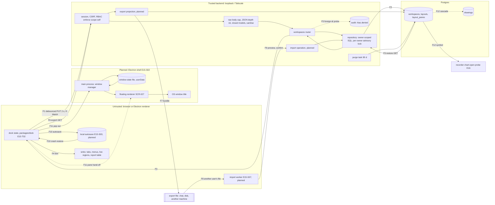

# E15 — STRIDE threat model: workspaces, layout persistence and exchange

- Ticket: E15-X01 (issue #437). Owner: Security engineer (CODEOWNER). Status: **Draft**, pending review by the
  Security engineer and the Architect (the ticket's Definition of Done). Review log: end of §11.
- Method: the `04-security-program.md` §5 template (L x I = risk), STRIDE per element and per trust boundary
  (C-12.1), formatted as `E14-drawings.md` and `e36-rule-form-editor.md`. Row ids are `LY-xnn` (x = the STRIDE
  letter); requirements are `SR-E15-nn`, epic-local, promoted to `04` §6 when their ticket lands; findings are
  `F-nn`, decisions needed `O-n`, abuse-case seeds `AC-LY-nn`.
- Inputs, read at `main` `85b6b6c1c`: issue #437 and the E15 epic (#41) with its child tickets
  (`docs/plan/backlog/E15.json`); `11-user-stories.md` US-LAY-002, US-LAY-005, US-LAY-007; `14-screens-catalogue.md`
  SCR-020, SCR-021, SCR-025, SCR-026, SCR-027, SCR-028; `21-database-schema.md` §3.8.1 and §3.8.2; the `workspaces` tag
  of `22-api-openapi.yaml`; `24-internal-schemas.md` §15 (permission codes, lines 5212–5257); the view-as session
  (#3085, `22` "View-as session"). Contract anchors name the `operationId` or schema first; a `22:nnnn` or `24` line
  number is the line at the commit above, secondary, because line numbers drift with every contract PR;
  the design text `docs/design/E15/E15-D09.md` (its G-rows D09-G1..G15) and `E15-D10.md`; and on `main` the files
  under `services/api/candleviewer/` (written `cv/`) with their tests. Planned client surfaces are read from the open
  E15-T02 work (`packages/dock`, #403, not merged) and the E15-S02 blocking-question list on #435.
- Path: the ticket names `docs/security/threat-models/e15-layouts-workspaces.md`; GOV-008
  (`scripts/check_threat_model_ticket_map.py`) matches `E<nn>-*.md` case-insensitively, so the ticket's path is kept
  and the control-to-ticket map is §10.
- Risk mapping: the ticket says "R13 Sharing abuse". In the register R13 is _Team & knowledge_
  (`32-risk-register.md` §1.2). The sharing half of this model (a file exchanged between users) belongs under **R6**
  AuthN/AuthZ, as E36-X01 mapped its bundles (RSK-091); the register entry is made at approval (§11.2).
- **Basis: the shipped backend, then the planned client.** The `/workspaces*` routes, `0022_workspaces` and the
  retention purge are built (E15-T01, #402) and their rows cite enforcing tests. The export route is in the contract
  but not mounted, no operation takes a bundle, and the dock, autosave, import worker and floating windows are not
  built: their rows are requirements (`SR-E15-xx`), never claimed mitigations.
- **Rule used throughout:** a mitigation is listed as one only if it names the test or rule that enforces it.
  Anything without one is a _requirement_ (Q) or a _residual_ (R).
- Gate note: design-level threat modelling of planned surfaces. No credential, live identifier or exploit detail
  appears; deny-lists are described as patterns, not literals.

## 1. Scope

In scope, the flows the ticket names: browser dock state → debounced `PUT /workspaces/{workspaceId}/layouts/{layoutId}`
→ API → Postgres (`workspaces`, `layouts`, `layout_panes`; `chart_templates` as a reference target only); export
`GET /workspaces/{workspaceId}/export` → file → another user's import → validation → dock state; the local autosave
used for crash-restore; and, as a planned flow, the floating panel window (SCR-027) with its shell bridge, its
cross-window pane hand-off and its window-state file. Side effects in scope: the chart-open probe the recorder reads
from `layout_panes.symbol` and the soft-delete cascade into `drawings`.

Out of scope (ticket): auth and session design (E09, consumed as the assumptions in §1.3), WS transport security
(E17), the content of the panels themselves (footprint, DOM, order ticket and the rest: their epics). Referenced, not
repeated: `E14-drawings.md` (drawings rows and the `layout_id` foreign key), `e16-recorder.md` R-D2 (auto-record),
`docs/plan/security/E10-threat-model.md` (the Electron shell, SR-173..SR-182).

### 1.1 State of the build at review time

| Component                                                      | Status on `main`                          | Evidence                                                                                                          |
| -------------------------------------------------------------- | ----------------------------------------- | ----------------------------------------------------------------------------------------------------------------- |
| `/workspaces*`, `/workspaces/{id}/layouts*`, `/layout-presets` | served                                    | `cv/api/workspaces.py` (router docstring lines 1–11: RBAC, D18 404, D20 writes not audited, D13 evaluation order) |
| Request models (closed, sanitised, bounded)                    | served                                    | `cv/api/workspaces_models.py:61-71` (caps), `tests/unit/api/test_workspaces_models.py`                            |
| Repository (owner-scoped, advisory lock per owner)             | served                                    | `cv/storage/repositories/workspaces_sqlalchemy.py:66`, `tests/unit/storage/test_workspaces_sqlalchemy_unit.py`    |
| Tables, composite same-owner FKs (D27)                         | migrated (`0022_workspaces`)              | `tests/integration/storage/test_workspaces_migration.py`                                                          |
| 90-day purge of soft-deleted rows                              | served (when `retention_enabled`)         | `cv/storage/retention/workspaces_tasks.py`, `tests/unit/storage/retention/test_workspaces_tasks.py`               |
| `exportWorkspace`                                              | **contract only, not mounted**            | `22-api-openapi.yaml:14641-14660`; absent from the router                                                         |
| Import (any operation taking a bundle)                         | **does not exist**                        | `22-api-openapi.yaml:14650` names a `from_bundle` field no input schema has (D09-G1)                              |
| `packages/dock` tree, `toLayoutInput` / `fromLayout`           | open PR (E15-T02, #403), not on `main`    | `packages/dock/src/serialise.ts`, `errors.ts`, `test/serialise.test.ts` on the #403 branch                        |
| Autosave, crash restore, switcher, conflict dialog             | not built (E15-S03, #476)                 | —                                                                                                                 |
| Import worker, preview, report, export UI                      | not built (E15-S07, #560; design E15-D09) | —                                                                                                                 |
| Floating windows, shell bridge for windows                     | not built (E15-S02, #435; design E15-D10) | the shell's window port is declared but its preload and main handlers do not exist (BQ-06 on #435)                |
| View-as (#3085): `/workspaces*` reads answer as the target     | served                                    | view-as policy (SR-E15-19), `test_a_foreign_workspace_read_while_viewing_is_recorded_as_the_viewers`              |
| Sibling controls on other routers (reuse for SR-E15-04, -20)   | served                                    | `DrawingsWriteLimiter` (#2727, `cv/api/drawings_limiter.py`); `DenialBudget` (`cv/api/alert_deliveries.py`)       |

### 1.2 Assets and data classification

| Asset                                                                      | Class                                                          | Why                                                                                                                        |
| -------------------------------------------------------------------------- | -------------------------------------------------------------- | -------------------------------------------------------------------------------------------------------------------------- |
| Workspace and layout rows: names, grid tree, pane kinds, symbols, settings | **user-confidential** (`21` classes the columns P0, line 5472) | they reveal which symbols a trader watches and how they trade; harm on disclosure to another deployment user               |
| A workspace export file                                                    | **user-confidential**, public-by-assumption once it leaves     | it ends up in a chat or on another machine; its content must be safe if it does, and its owner should know it is sensitive |
| Layout integrity (what mounts, where, bound to what)                       | integrity                                                      | a tampered layout decides which components mount and which windows open                                                    |
| The DEMO/LIVE indicator in every window                                    | **safety control** (SR-179)                                    | acting in a detached window without knowing its environment is a trading-safety failure                                    |
| API and Postgres availability                                              | availability                                                   | the workspace store shares the database and process with the OMS                                                           |
| Local autosave and the window-state file                                   | user preference, device-local                                  | read back at boot without a server in the loop                                                                             |

### 1.3 Assumptions inherited from E09 and the view-as session (a change re-opens this model)

| A   | Assumption                                                                                                                                                                                                                                                                                                                                                                                                                                                                 | Owner / evidence                                                                                                                                                                                                             |
| --- | -------------------------------------------------------------------------------------------------------------------------------------------------------------------------------------------------------------------------------------------------------------------------------------------------------------------------------------------------------------------------------------------------------------------------------------------------------------------------- | ---------------------------------------------------------------------------------------------------------------------------------------------------------------------------------------------------------------------------- |
| A1  | Every request carries an authenticated session resolved server-side (`SessionAuditPrincipalResolver`); the router fails closed with no resolver (401)                                                                                                                                                                                                                                                                                                                      | E09; `test_production_create_app_resolves_callers_from_the_session`                                                                                                                                                          |
| A2  | RBAC is deny-by-default through `auth.scopes.enforce()`; `workspaces:read` / `workspaces:write` with scope `self`; a Viewer holds no write (#1778 Z)                                                                                                                                                                                                                                                                                                                       | `24` lines 5212–5257; `04` §7.2.1 rows for `workspaces:*`; `test_idor_matrix_on_workspaces`                                                                                                                                  |
| A3  | State-changing requests require the CSRF pair (SR-041)                                                                                                                                                                                                                                                                                                                                                                                                                     | `test_every_unsafe_route_refuses_a_request_without_a_csrf_pair`                                                                                                                                                              |
| A4  | The audit log is append-only and hash-chained (SR-063, SR-066); `rbac.denied` is written for each denial                                                                                                                                                                                                                                                                                                                                                                   | E09 model (`e09-auth-rbac.md`), `04` §8.1                                                                                                                                                                                    |
| A5  | Single-tenant, Tailscale-only deployment with a handful of users; the realistic adversary is a lower-privileged internal user or a compromised session                                                                                                                                                                                                                                                                                                                     | `04` §3                                                                                                                                                                                                                      |
| A6  | View-as (#3085): workspace writes are refused while viewing by the app-wide view-as guard, fail-closed by default (`cv/api/view_as_guard.py`: every non-safe method not registered as protective is refused); the export GET is refused once #5435 adds it to the view-as policy's refused set and `22`'s `exportWorkspace` text (O-4 RULED: data egress is write-class); #5435 owns the per-route evidence; every record the session causes names the viewer as the actor | `test_a_foreign_workspace_read_while_viewing_is_recorded_as_the_viewers`; `test_live_write_refused_one_record`, `test_every_other_write_is_still_refused_with_the_cancels_registered`; per-route evidence: SR-E15-19 (#5435) |

A change to A1–A4 or A6 (a new role, a non-self scope on `workspaces:*`, an admin read of other users' workspaces, a
sharing route, a `/workspaces*` operation exempted from the view-as refusal) is a trigger to re-model; so is
any route other than view-as (A6, modelled in LY-I10) that lets one user read another's workspace (R5 collaboration).

### 1.4 Rating

Likelihood and impact are L / M / H; risk = L x I on the programme matrix (`E29-oms.md` §1.3; `04` §5 names the levels): L·L, L·M = Low; M·M, L·H = Medium; M·H, H·M =
High; H·H = Critical. Inherent risk is rated without the control; **Residual** is the rating once the named control
holds. Disposition: **M** mitigated and test-enforced on `main`, **Q** requirement on unbuilt work, **R** residual
recorded in §11.2, **O** open finding with no shipped control (§11.1).

## 2. Data-flow diagram and trust boundaries

Trust boundaries:

- **TB1→TB2** (`04` TB-4): every body, path id and header is untrusted; the owner is the session's, never the body's.
- **TB2→TB3**: parameterised static statements only (`test_no_statement_interpolates_values`).
- **TB2→FILE→TB1 of another user**: the export leaves every control the server has; the import is fully untrusted
  input even when it came from a colleague.
- **TB1↔TB1 (device-local)**: the autosave and the window-state file are read back at boot without the server.
- **TBF (planned)**: the renderer → main bridge and the main window → floating window hand-off. Channel names and
  payload rules are the E15-S02 PR's (BQ-06 on #435) and are not modelled here; this model fixes what crosses.

| Flow | What crosses                                                | Boundary     | Built?                   |
| ---- | ----------------------------------------------------------- | ------------ | ------------------------ |
| F1   | `LayoutInput` (≤128 KiB) / `WorkspaceInput` (≤4 KiB) writes | TB1→TB2→TB3  | server yes, client no    |
| F2   | repository statements                                       | TB2→TB3      | yes                      |
| F3   | `WorkspaceDetail` / `Layout` reads into `fromLayout`        | TB3→TB2→TB1  | server yes, client #403  |
| F4   | names and setting strings into DOM sinks                    | TB1          | no                       |
| F5   | `rbac.denied` for a live foreign id                         | TB2          | yes                      |
| F6   | `exportWorkspace`                                           | TB1→TB2      | no (contract only)       |
| F7   | `WorkspaceBundle` to a file                                 | TB2→outside  | no                       |
| F8   | a file from anyone into the import worker                   | outside→TB1  | no                       |
| F9   | validated document to a server import operation             | TB1→TB2→TB3  | no (no operation exists) |
| F10  | dock state to and from device storage                       | TB1 local    | no                       |
| F11  | pop out, pane hand-off, window state, OS title              | TBF          | no                       |
| F12  | pane symbols to the recorder; soft delete into `drawings`   | TB3→E16, TB3 | yes                      |

## 3. Numeric bounds: contract today, and the ones this model sets

| Input                                                                                                                                                                                                                                                                                                      | Bound                                                                                                                                                                                                | Enforced by                                                                                                                                                                          | Status       |
| ---------------------------------------------------------------------------------------------------------------------------------------------------------------------------------------------------------------------------------------------------------------------------------------------------------- | ---------------------------------------------------------------------------------------------------------------------------------------------------------------------------------------------------- | ------------------------------------------------------------------------------------------------------------------------------------------------------------------------------------ | ------------ |
| Workspace / layout body                                                                                                                                                                                                                                                                                    | 4 KiB / 128 KiB, 413 before parse (`22:9989`, `22:10189`)                                                                                                                                            | `test_request_level_refusals`, `test_body_cap_holds_without_a_content_length`, `test_layout_body_cap_is_128_kib_and_workspace_cap_does_not_apply`                                    | M            |
| JSON depth                                                                                                                                                                                                                                                                                                 | 16, before pydantic                                                                                                                                                                                  | `test_request_level_refusals`                                                                                                                                                        | M            |
| Dock tree                                                                                                                                                                                                                                                                                                  | depth 6, 64 nodes, 16 leaves (`22:22623-22639`)                                                                                                                                                      | `test_invalid_pane_set_is_422_with_pane_fields_and_stores_nothing`, `test_grid_child_errors_name_the_failing_child_without_union_labels`; client `fromLayout_tooDeep_rejects` (#403) | M (server)   |
| Panes / layouts / workspaces                                                                                                                                                                                                                                                                               | 16 per layout, 32 live per workspace, 32 live per user (`22:9984`, `22:10184`)                                                                                                                       | `test_limits_are_enforced_under_the_lock`, `test_layout_conflicts_name_hotkey_and_cap`, `test_name_conflicts_and_the_cap_are_409_with_the_rule_named`                                | M            |
| `pane_config`                                                                                                                                                                                                                                                                                              | 4096 bytes canonical, 32 settings keys, strings 256, arrays 32, numbers ±1e15 (`22:22739-22772`)                                                                                                     | `test_pane_config_over_4096_bytes_is_too_large`, `test_settings_over_32_keys_rejected`, `test_setting_string_256_boundary_is_raw_length`                                             | M            |
| Names                                                                                                                                                                                                                                                                                                      | 40 characters as sent, control/bidi stripped (`22:22539-22558`)                                                                                                                                      | `test_name_raw_length_over_40_with_control_char_is_string_too_long`, `test_name_is_sanitised_then_trimmed`                                                                           | M            |
| Writes per user Control absent: a per-user write rate limit (SR-E15-04; owner #5449 (RULED)). Set here: a bucket of 30, refilled at 120 a minute, over every `/workspaces*` write; past it `429 rate_limited` with `Retry-After`; built on `DrawingsWriteLimiter`'s token bucket (#2727) with these values | —                                                                                                                                                                                                    | **O** (F-01)                                                                                                                                                                         |
| Foreign-id denial records                                                                                                                                                                                                                                                                                  | Control absent: a budget on denial records (SR-E15-20; owner #5435)                                                                                                                                  | —                                                                                                                                                                                    | **O** (F-08) |
| Soft-deleted rows retained                                                                                                                                                                                                                                                                                 | Control absent: a per-user bound on retained soft-deleted rows (SR-E15-05; owner #5449 (RULED)). Set here: capped at 4x the live caps, oldest purged first in the deleting transaction               | —                                                                                                                                                                                    | **O** (F-02) |
| Import file (client)                                                                                                                                                                                                                                                                                       | 2 MiB before parse; parse depth 16; 10 000 values; then the root `kind`, schema, version, registry (E15-S07, D09 BQ-5)                                                                               | E15-S07 tests (planned)                                                                                                                                                              | Q            |
| Import operation (server)                                                                                                                                                                                                                                                                                  | body 2 MiB before parse, depth 16, the same per-layout models and caps as `createLayout`, layouts ≤ the user's remaining 32                                                                          | E15-S07 tests (planned)                                                                                                                                                              | Q            |
| Import validation cost                                                                                                                                                                                                                                                                                     | 2 MiB validated in ≤500 ms in a worker (SCR-026); the main thread never blocks more than 500 ms                                                                                                      | E15-S07 perf test (planned)                                                                                                                                                          | Q            |
| Floating windows                                                                                                                                                                                                                                                                                           | a fixed cap (SR-180; 6 proposed in BQ-10 on #435)                                                                                                                                                    | E15-S02 unit test (planned)                                                                                                                                                          | Q            |
| Local autosave                                                                                                                                                                                                                                                                                             | one document per user, at most the 128 KiB layout cap, written only after `toLayoutInput` passes; a failed or over-cap write keeps the previous autosave and never evicts another device-local store | E15-S03 unit test (planned)                                                                                                                                                          | Q            |

The write-rate value is chosen to protect both sides of the 2-second debounce: four windows each saving a layout every
2 s (120 a minute) never meet the limit, and a scripted storm is held to two writes a second per user, at most 256 KiB/s
of layout bodies. E15-X02 tests both sides (AC-LY-07, AC-LY-08); the value is confirmed against E15-Q04's measured
save rates. The drawings bucket (#2727: burst 20, 60 a minute) is the implementation to reuse, not the values: at 60 a
minute it would refuse the legitimate four-window case above, which needs 120. Each router keeps its own bucket, so a
user's drawing writes and layout writes never spend each other's budget.

## 4. STRIDE table

Columns: **S** the STRIDE letter; **Asset / flow** from §1.2 and §2; L, I and Risk are inherent; **Mitigation** names
the control, its status and its owning ticket; **Residual** is the rating once it holds; **Verified by** is the test or
check. Every row has an owning ticket; no pending owner markers remain (O-2 and O-3 are RULED).

### 4.1 Spoofing

| ID     | S   | Asset / flow                   | Threat                                                                                                                                                | L   | I   | Risk     | Mitigation (status; owner)                                                                                                                                                                                                                                                                                                                                | Residual         | Verified by                                                                                                                                                                                                                                                             |
| ------ | --- | ------------------------------ | ----------------------------------------------------------------------------------------------------------------------------------------------------- | --- | --- | -------- | --------------------------------------------------------------------------------------------------------------------------------------------------------------------------------------------------------------------------------------------------------------------------------------------------------------------------------------------------------- | ---------------- | ----------------------------------------------------------------------------------------------------------------------------------------------------------------------------------------------------------------------------------------------------------------------- |
| LY-S01 | S   | rows; F1, F2                   | A client asserts another user's ownership: an owner field in a body, or a nested path (`/workspaces/{mine}/layouts/{theirs}`)                         | M   | H   | **High** | Shipped: no owner field and `extra="forbid"`; owner from the session; every statement owner-scoped; composite same-owner FKs (D27); ownership columns never updated (E15-T01)                                                                                                                                                                             | Low (M)          | `test_idor_matrix_on_layouts`, `test_layout_under_another_workspace_of_the_same_owner_is_not_found`, `test_d27_layout_owner_must_match_workspace_owner`, `test_no_update_writes_an_ownership_column`, `test_pane_writes_re_check_that_the_layout_belongs_to_the_caller` |
| LY-S02 | S   | F1                             | Unauthenticated or cross-site request writes a layout with a victim's cookie                                                                          | L   | H   | Medium   | Shipped: 401 without a session, CSRF on every unsafe route (A1, A3; E09, E15-T01)                                                                                                                                                                                                                                                                         | Low (M)          | `test_every_route_401_without_a_session`, `test_create_app_serves_workspaces_and_layouts_behind_csrf`, `test_every_unsafe_route_refuses_a_request_without_a_csrf_pair`                                                                                                  |
| LY-S03 | S   | F8, F9                         | An imported file claims a workspace id, an owner or user id, a template's `shared` or `is_builtin`, or another user's template or preset ids          | M   | H   | **High** | Planned: ids are **regenerated, never honoured**; an item carrying an id, an owner, `shared` or `is_builtin` is refused; default flags are ignored (the new workspace is never the user's default; a layout's flag applies only inside the new workspace); the importer owns everything created (SR-E15-08; E15-S07). Today unreachable: no import exists | Low once E15-S07 | E15-S07 unit tests; AC-LY-01, AC-LY-02 (E15-X02)                                                                                                                                                                                                                        |
| LY-S04 | S   | F8                             | A file claims a format version it does not satisfy, or an app version it was not made by                                                              | L   | M   | Low      | Planned: the version is a claim, never a credential; the whole document is validated against the schema of the version it states; `app_version` is display-only (SR-E15-09; E15-S07)                                                                                                                                                                      | Low              | E15-S07 version matrix test; AC-LY-04                                                                                                                                                                                                                                   |
| LY-S05 | S   | F11 floating window, DEMO/LIVE | A floating window shows a stale or missing environment, or its title is made to read as the other environment (a name containing an environment word) | M   | H   | **High** | Planned: each window takes its badge from the WS `system` topic and shows "unconfirmed" on loss (SR-179); the OS title is composed from the pane kind label, the validated symbol and the environment word, last and never shortened, with no user-authored name in it; the badge state is exposed to assistive technology (SR-E15-13; E15-S02)           | Low once E15-S02 | E15-S02 Electron e2e "environment badge present in every floating window" and the title assertion; AC-LY-12                                                                                                                                                             |
| LY-S06 | S   | F11 pane hand-off              | Another same-origin context (a second app tab) posts a forged pane descriptor to a floating window                                                    | L   | M   | Low      | Planned: the descriptor carries no authority (the window runs its own session bootstrap and RBAC); it is schema-checked through the same boundary as `fromLayout`; a bad descriptor shows the panel's error state (SR-E15-13; E15-S02, BQ-07 on #435)                                                                                                     | Low              | E15-S02 unit test on the descriptor check                                                                                                                                                                                                                               |
| LY-S07 | S   | F4 sinks, names                | A workspace or layout name uses look-alike or invisible characters to pass for another of the user's workspaces, or for a system label                | L   | L   | Low      | Accepted: names never drive an action, a privilege or an environment (the OS title carries no user-authored name, SR-E15-13); names are unique per owner as stored (E15-T01); the server-side name sanitiser: owner #5449 (RULED)                                                                                                                         | Low (R, RR4)     | `test_name_is_sanitised_then_trimmed`; `test_name_conflicts_and_the_cap_are_409_with_the_rule_named`                                                                                                                                                                    |

### 4.2 Tampering

| ID     | S   | Asset / flow            | Threat                                                                                                                                                               | L   | I   | Risk     | Mitigation (status; owner)                                                                                                                                                                                                                                                                                                                                                                     | Residual                  | Verified by                                                                                                                                                                                                                                                                      |
| ------ | --- | ----------------------- | -------------------------------------------------------------------------------------------------------------------------------------------------------------------- | --- | --- | -------- | ---------------------------------------------------------------------------------------------------------------------------------------------------------------------------------------------------------------------------------------------------------------------------------------------------------------------------------------------------------------------------------------------- | ------------------------- | -------------------------------------------------------------------------------------------------------------------------------------------------------------------------------------------------------------------------------------------------------------------------------- |
| LY-T01 | T   | F1, F3                  | A crafted layout injects unknown pane kinds, oversized grids, deeply nested trees, duplicate slots or leaves, or an unknown preset                                   | M   | H   | **High** | Shipped server: closed models, tree and pane caps (§3), DB CHECKs mirror the enums. Planned client boundary: `fromLayout` refuses `unknown_kind`, `unknown_preset`, `tree_too_deep`, `tree_too_large`, `duplicate_slot`, `empty_dock` with bounded descent (E15-T02, #403)                                                                                                                     | Low (M server; Q client)  | `test_invalid_pane_set_is_422_with_pane_fields_and_stores_nothing`, `test_pane_kind_outside_enum_rejected`, `test_check_constraints_reject_out_of_domain_values`; dock `fromLayout_tooDeep_rejects`, `fromLayout_unknownKind_rejects`, `fromLayout_unknownPreset_rejects` (#403) |
| LY-T02 | T   | F8, F9                  | The same crafted document through the import path, plus fields the live routes never see (a bundle's own keys)                                                       | M   | H   | **High** | Planned: the import is validated in order (size, parse limits, a fixed root `kind` so another CandleViewer file type is refused `wrong-type` by construction, closed schema with no extra keys at any level, version, per-pane registry, then the server's `createLayout` models) before any of it reaches state (SR-E15-08, SR-E15-11; E15-S07). `WorkspaceBundle` is not closed today (F-04) | Low once E15-S07 and F-04 | E15-S07 fuzz corpus; AC-LY-01, AC-LY-03                                                                                                                                                                                                                                          |
| LY-T03 | T   | F9                      | **Partial application**: a newer or unknown version applied in part, or an import built from many client calls that stops half-way                                   | M   | M   | Medium   | Planned: a newer, an older unsupported or an absent version is refused with both versions stated, nothing created, on the client **and** the server; the import is one server operation that creates everything or nothing (D09-G1; SR-E15-08, SR-E15-09; E15-S07)                                                                                                                             | Low once E15-S07          | E15-S07 "newer schemaVersion refused" scenario; AC-LY-04                                                                                                                                                                                                                         |
| LY-T04 | T   | F1, F9                  | `chart_template_id` or `indicator_preset_ids` point at another user's template or preset                                                                             | M   | H   | **High** | Shipped: every non-null template id and non-empty preset list is refused (`chart_template_not_found`, `indicator_preset_not_found`). Planned: when resolution lands, an owner-or-built-in check in the query, the same refusal for foreign and missing (SR-E15-16; #2411, E13)                                                                                                                 | Low (M today)             | `test_chart_template_and_indicator_presets_are_refused`                                                                                                                                                                                                                          |
| LY-T05 | T   | F9                      | An imported chart template sets `shared` or carries an open `config`, turning an import into a publishing path or a blob store                                       | M   | M   | Medium   | Planned: `shared` is never honoured and an imported template is private; `ChartTemplateInput` closed (D09-G4; SR-E15-08; E15-S07 with #2411). Today unreachable                                                                                                                                                                                                                                | Low once built            | E15-S07 unit test; AC-LY-02                                                                                                                                                                                                                                                      |
| LY-T06 | T   | F1                      | A stale window clobbers a newer arrangement, or a 412 turns into a blind overwrite                                                                                   | M   | M   | Medium   | Shipped: `If-Match` → 412, one winner. Planned: the client never retries a 412 blindly; it shows SCR-029 (E15-S03)                                                                                                                                                                                                                                                                             | Low                       | `test_put_layout_is_412_when_stale_and_keeps_the_stored_panes`, `test_two_puts_with_one_token_give_exactly_one_winner`; E15-S03 conflict test                                                                                                                                    |
| LY-T07 | T   | F1, F2                  | A replace that fails half-way leaves a mixed pane set                                                                                                                | L   | M   | Low      | Shipped: layout and pane set replaced in one transaction                                                                                                                                                                                                                                                                                                                                       | Low (M)                   | `test_failed_replace_rolls_back_leaving_the_old_pane_set`, `test_duplicate_slot_in_one_set_is_refused_whole`                                                                                                                                                                     |
| LY-T08 | T   | F4 sinks                | Stored XSS through workspace and layout names or setting strings rendered in tabs, menus, live-region announcements, accessible names, the import preview and report | M   | H   | **High** | Server side: control and bidi stripping only, never HTML encoding (`test_name_is_sanitised_then_trimmed`). Planned: text-only rendering at every sink, accessible names set from the raw string, never markup built by concatenation (SR-127; SR-E15-12; E15-S02, E15-S03, E15-S07; rule E15-X03)                                                                                              | Low once built            | E15-X03 sink rule; AC-LY-05                                                                                                                                                                                                                                                      |
| LY-T09 | T   | F11, F7 non-React sinks | The OS window title (not React) and the export file name built from a user name: markup, control characters or path segments                                         | L   | M   | Low      | Planned: the title is set through the plain-text window API from SR-E15-13's composition, length-capped; the file name follows the slug rule (lower-cased, ASCII-folded, every other character a hyphen, capped: D09 BQ-8, D09-G14) (SR-E15-12; E15-S02, E15-S07)                                                                                                                              | Low                       | E15-S02 title test with a markup name; E15-S07 slug unit test                                                                                                                                                                                                                    |
| LY-T10 | T   | F8 worker               | Prototype-pollution-shaped keys or duplicate keys change what the preview shows versus what the server applies                                                       | M   | M   | Medium   | Planned: parse into structures with no prototype or into `Map`s, never merge parsed objects into application objects before the closed schema passes; refuse duplicate keys rather than pick one, on both sides (SR-E15-11; E15-S07)                                                                                                                                                           | Low                       | E15-S07 fuzz corpus with the reserved-key and duplicate-key shapes; AC-LY-03                                                                                                                                                                                                     |
| LY-T11 | T   | F10 autosave            | The local autosave is edited (another same-origin script, a hand-edited desktop profile) to inject a layout at the next crash restore                                | L   | M   | Low      | Planned: the autosave is read through `fromLayout`, never trusted for authority, and saved only through `PUT` with `If-Match` and the server's validation; a restore older than the server's `updated_at` defers to the server and is not offered (SR-E15-14; E15-S03)                                                                                                                         | Low                       | E15-S03 unit test with a tampered autosave                                                                                                                                                                                                                                       |

### 4.3 Repudiation

| ID     | S   | Asset / flow | Threat                                                                                                                    | L   | I   | Risk   | Mitigation (status; owner)                                                                                                                                                                                                                                                                                                                                                                             | Residual            | Verified by                                                                             |
| ------ | --- | ------------ | ------------------------------------------------------------------------------------------------------------------------- | --- | --- | ------ | ------------------------------------------------------------------------------------------------------------------------------------------------------------------------------------------------------------------------------------------------------------------------------------------------------------------------------------------------------------------------------------------------------ | ------------------- | --------------------------------------------------------------------------------------- |
| LY-R01 | R   | rows; DELETE | A workspace delete (which also stamps its layouts and drawings deleted) is not attributable after the fact                | M   | M   | Medium | **Open (F-03).** Control absent: an audit record for workspace delete (SR-E15-17 delete half; owner #5449 (RULED)). Required: `workspace.deleted` in the append-only audit, written ahead, carrying ids and counts, never names; a record that cannot be written is 503 with no state change (SR-E15-17)                                                                                               | Low once built      | E15-X02 AC-LY-10; audit catalogue test                                                  |
| LY-R02 | R   | F6, F7       | An export (a confidential file leaving the system, possibly while viewing as another user, LY-I10) leaves no audit record | M   | M   | Medium | Planned: `workspace.exported` in the append-only audit with ids, counts and a digest of the bundle, never its content, naming the actor (`actor_id`) and, while viewing, the subject whose workspace it is (SR-E15-17; E15-S07; D09-G10)                                                                                                                                                               | Low once built      | E15-S07 test; AC-LY-10                                                                  |
| LY-R03 | R   | F1           | Layout writes and dock events are analytics-only (SCR-021, D20): nothing security-relevant may hide in them               | L   | L   | Low    | Confirmed by reading: layout writes decide nothing about privilege; the only security events on these routes are denials (`rbac.denied`, F5). The catalogue's other audit lines, `workspace.opened` and `workspace.renamed` (SCR-020) and `workspace.updated` (SCR-025), are ruled analytics under D20 and the `14` correction routed (F-03). Analytics events carry enums and counts only (SR-E15-18) | Low (accepted, RR1) | `test_router_requires_an_audit_emitter`; SR-E15-18 event schema test (E15-S02, E15-S07) |
| LY-R04 | R   | F9           | An import creates a workspace with no record of where it came from                                                        | L   | M   | Low    | Decision O-2 (RULED: audited): a `workspace.imported` record with counts and the file digest, owner #5449 (RULED)                                                                                                                                                                                                                                                                                      | Low once E15-S07    | E15-S07 import audit test; AC-LY-10 (per O-2)                                           |

### 4.4 Information disclosure

| ID     | S   | Asset / flow          | Threat                                                                                                                                                           | L   | I   | Risk     | Mitigation (status; owner)                                                                                                                                                                                                                                                                                                                                                                                                 | Residual         | Verified by                                                                                                                                                                                                                                                                                      |
| ------ | --- | --------------------- | ---------------------------------------------------------------------------------------------------------------------------------------------------------------- | --- | --- | -------- | -------------------------------------------------------------------------------------------------------------------------------------------------------------------------------------------------------------------------------------------------------------------------------------------------------------------------------------------------------------------------------------------------------------------------- | ---------------- | ------------------------------------------------------------------------------------------------------------------------------------------------------------------------------------------------------------------------------------------------------------------------------------------------ |
| LY-I01 | I   | rows; F3              | A cross-user `workspaceId` / `layoutId` probe tells existence apart (403 versus 404, deleted versus foreign)                                                     | M   | H   | **High** | Shipped: missing, deleted and foreign are the same 404 (D18); a Viewer's write is 403 before the store is touched, whatever the id, so a 403 reveals only the caller's own permission                                                                                                                                                                                                                                      | Low (M)          | `test_idor_matrix_on_workspaces`, `test_idor_matrix_on_layouts`, `test_deleted_workspace_is_404_and_unaudited_for_everyone`, `test_a_foreign_probe_that_races_a_delete_is_still_404`                                                                                                             |
| LY-I02 | I   | F5                    | Response timing tells a live foreign id from a missing one                                                                                                       | L   | L   | Low      | Accepted as for drawings (E14 DR24): it confirms an id the caller already holds; the timing check: owner #5449 (RULED)                                                                                                                                                                                                                                                                                                     | Low (R, RR3)     | code reading of the router's `not_found` and `miss`                                                                                                                                                                                                                                              |
| LY-I03 | I   | F6, F7 export         | Secrets, tokens, account, sub-account, trade-group or user ids, balances or P&L leak into an export through a future column, a free-text setting or a row spread | M   | H   | **High** | Planned: the allow-list projection of §5, a CI test that fails when any column of the exported tables is neither allow-listed nor denied, and an output guard that drops any id-shaped value from setting strings and reports it (SR-E15-06; E15-S07)                                                                                                                                                                      | Low once E15-S07 | E15-S07 column-drift test and the "export contains no secrets under inspection" scenario; AC-LY-09                                                                                                                                                                                               |
| LY-I04 | I   | F7 file               | The file reveals trading intent (symbols, intervals, layouts, the user's whole preset library, drawings) while the contract calls it safe to share               | M   | M   | Medium   | Planned: the file is classed user-confidential and the export preview lists what travels (E15-D09 §2); the projection is scoped to this workspace (only presets its panes use; no drawings in R1, O-1); the contract's sharing claim is corrected (F-05; SR-E15-07; E15-S07 with `22`'s owner)                                                                                                                             | Low              | E15-S07 test on the projection's scope; contract diff                                                                                                                                                                                                                                            |
| LY-I05 | I   | logs, errors, metrics | Names, `pane_config`, `grid_spec` or bodies reach logs, error bodies or metric labels                                                                            | M   | M   | Medium   | Shipped: logs carry ids, counts and outcomes; error entries carry field, rule and message, never values; driver text is stripped. Planned client: `DockError` messages never echo stored values (E15-T02)                                                                                                                                                                                                                  | Low (M)          | `test_logs_never_carry_workspace_names`, `test_logs_never_carry_names_pane_config_grid_spec_or_bodies`, `test_layout_logs_carry_counts_and_ids_never_content`, `test_settings_bad_key_is_invalid_setting_key_without_echo`, `test_database_outages_are_503_with_retry_after_and_class_name_only` |
| LY-I06 | I   | analytics             | `layout.*`, `panel.*`, `window.*` and import events carry names, symbol lists or file content                                                                    | M   | L   | Low      | Planned: event payloads are enums, ordinals, booleans and counts (SCR-027's PROPOSED payloads; SR-E15-18; E15-S02, E15-S07)                                                                                                                                                                                                                                                                                                | Low              | event schema unit test                                                                                                                                                                                                                                                                           |
| LY-I07 | I   | F10 autosave          | The autosave holds session data, or one user's autosave is restored for another user on the same browser profile or desktop install                              | L   | M   | Low      | Planned: no credential, token or `/me` data in device storage (SR-129, SR-178); the autosave is keyed by user and cleared on sign-out and on a user switch (SR-E15-14; E15-S03)                                                                                                                                                                                                                                            | Low              | E15-S03 unit test; AC-LY-11                                                                                                                                                                                                                                                                      |
| LY-I08 | I   | F9 preview, report    | The import preview or report names an account, or a reason, that the importer cannot see                                                                         | L   | M   | Low      | Planned: account-scoped elements are dropped and listed with a fixed reason, never remapped and never named (D09 BQ-3 RULED; SR-E15-10; E15-S07)                                                                                                                                                                                                                                                                           | Low              | E15-S07 "manager importing an owner's workspace" scenario                                                                                                                                                                                                                                        |
| LY-I09 | I   | Copy panel link       | The copied link carries a token, an account or user id                                                                                                           | L   | M   | Low      | Planned: a route reference only (SR-175; E15-S02)                                                                                                                                                                                                                                                                                                                                                                          | Low              | E15-S02 unit test                                                                                                                                                                                                                                                                                |
| LY-I10 | I   | F3, F6, F7 view-as    | While viewing as another user (A6), the viewer reads that user's workspaces, and the user-confidential export file could leave the system                        | M   | M   | Medium   | Shipped: reads as the target are the sanctioned view-as purpose; every record names the viewer; workspace writes are refused while viewing by the view-as guard's fail-closed default (`cv/api/view_as_guard.py`). Required: the export GET refused while viewing (owner #5435: the view-as policy's refused set and `22`'s `exportWorkspace` text; O-4 RULED); `workspace.exported` carries actor and subject (SR-E15-17) | Low once #5435   | `test_a_foreign_workspace_read_while_viewing_is_recorded_as_the_viewers`, `test_live_write_refused_one_record`; AC-LY-14 (E15-X02)                                                                                                                                                               |

### 4.5 Denial of service

| ID     | S   | Asset / flow        | Threat                                                                                                                                                                                                           | L   | I   | Risk     | Mitigation (status; owner)                                                                                                                                                                                                                                                                  | Residual       | Verified by                                                                                                                                                            |
| ------ | --- | ------------------- | ---------------------------------------------------------------------------------------------------------------------------------------------------------------------------------------------------------------- | --- | --- | -------- | ------------------------------------------------------------------------------------------------------------------------------------------------------------------------------------------------------------------------------------------------------------------------------------------- | -------------- | ---------------------------------------------------------------------------------------------------------------------------------------------------------------------- |
| LY-D01 | D   | F1                  | Huge layout bodies or deeply nested JSON                                                                                                                                                                         | M   | M   | Medium   | Shipped: body caps and depth 16 before parse; the API lists at most 20 field errors (`cv/api/workspaces.py:314`)                                                                                                                                                                            | Low (M)        | `test_layout_body_cap_is_128_kib_and_workspace_cap_does_not_apply`, `test_body_cap_holds_without_a_content_length`, `test_array_with_many_bad_items_reports_one_error` |
| LY-D02 | D   | rows                | Unbounded pane, layout or workspace counts                                                                                                                                                                       | M   | M   | Medium   | Shipped: 16 / 32 / 32 counted under the per-owner lock; a violation is 409 or 422, never 500                                                                                                                                                                                                | Low (M)        | `test_limits_are_enforced_under_the_lock`, `test_unique_violations_map_by_constraint_name`                                                                             |
| LY-D03 | D   | F1, API and DB      | A write storm against layout persistence degrades the API and the shared database                                                                                                                                | M   | H   | **High** | **Open (F-01).** Control absent: a per-user write rate limit (SR-E15-04; owner #5449 (RULED), client half E15-S03 (#476) (RULED)). Required: the write bucket of §3 with `429 rate_limited` and `Retry-After`; the client coalesces to the latest state on 429 and never queues (SR-E15-04) | Low once built | AC-LY-07, AC-LY-08 (E15-X02)                                                                                                                                           |
| LY-D04 | D   | DB disk             | Create and delete churn grows the retained soft-deleted rows on the database disk                                                                                                                                | M   | H   | **High** | **Open (F-02).** Control absent: a per-user bound on retained soft-deleted rows (SR-E15-05; owner #5449 (RULED)). Required: the §3 cap, oldest purged first; the purge itself is bounded per run                                                                                            | Low once built | `test_run_is_capped_per_run` (purge); AC-LY-08                                                                                                                         |
| LY-D05 | D   | F8 worker           | Import zip-bomb equivalents: a 50 MB file, a truncated file, 10 000 nested nodes, huge strings                                                                                                                   | M   | M   | Medium   | Planned: size checked before parse, depth and value counts during it, all in a worker; the UI thread never blocks more than 500 ms; a pathological file stalls a worker, not the trading UI (SR-E15-11; E15-S07)                                                                            | Low            | E15-S07 "malformed or oversized file" and "2 MB validates without blocking" scenarios                                                                                  |
| LY-D06 | D   | F9 import operation | The server import validates a large bundle and writes many layouts in one transaction, as an amplifier                                                                                                           | M   | M   | Medium   | Planned: body cap before parse, the per-layout caps, the user's remaining layout and workspace caps checked first, the per-owner lock, the write bucket (SR-E15-04, SR-E15-08; E15-S07)                                                                                                     | Low            | E15-S07 tests; AC-LY-06                                                                                                                                                |
| LY-D07 | D   | F3 restore          | A maximum-size workspace (32 layouts x 16 panes of GPU-heavy kinds) freezes the client at boot                                                                                                                   | L   | M   | Low      | Planned: only the active layout mounts; the pane budget prompt from E15-K01's measured curve (E15-S03, E15-S06, E15-K01)                                                                                                                                                                    | Low            | E15-Q04 restore benchmark                                                                                                                                              |
| LY-D08 | D   | F11                 | A stored or imported layout opens windows without bound                                                                                                                                                          | L   | M   | Low      | Planned: windows open only on a user action; floating state is not persisted server-side (a reload restores floating panes minimised, #403 README); a fixed window cap (SR-180; E15-S02)                                                                                                    | Low            | E15-S02 cap unit test                                                                                                                                                  |
| LY-D09 | D   | idempotency cache   | Replay storage grows with keyed writes                                                                                                                                                                           | L   | M   | Low      | Shipped: this router's own bounded LRU, keys scoped per user and per router (ruling Q5 on #402)                                                                                                                                                                                             | Low (M)        | `test_keys_are_scoped_per_user`, `test_a_key_stored_by_one_router_is_never_replayed_by_the_other`                                                                      |
| LY-D10 | D   | F12 recorder, E17   | Stored or imported pane symbols (`PaneConfig`/pane `symbol`, `22:22788`) drive the recorder's chart-open probe, and up to 16 market-data subscriptions and bar fetches at mount, toward many or invented symbols | L   | M   | Low      | Shipped (E16): per-session auto-record admission caps and the global auto-record cap (E16-FR-01, #1738). Hand-off to E17: an unknown-symbol subscription is refused once, and the client never retries it (§10); the server-side symbol catalogue check: owner #5449 (RULED)                | Low (M)        | `test_auto_cap_holds_against_200_chart_opens_in_5_minutes`, `test_recorder_probe_uses_ix_lp_symbol_without_seq_scan`; the E17 refusal test                             |
| LY-D11 | D   | F5, audit store     | Denial audits on workspace reads add write load on the shared audit store                                                                                                                                        | M   | M   | Medium   | **Open (F-08).** Control absent: a budget on denial audits (SR-E15-20; owner #5435). Required: denial audits are budgeted; write-path denials are bounded by SR-E15-04 once it ships                                                                                                        | Low once built | `test_foreign_workspace_collections_are_404_and_audited_once_each`; AC-LY-13                                                                                           |
| LY-D12 | D   | F10 autosave        | A runaway autosave (an unbounded dock state before `toLayoutInput` runs) fills the device storage quota and breaks the other device-local stores (window state, preferences)                                     | L   | M   | Low      | Planned: the autosave is written only after `toLayoutInput` passes, capped at the 128 KiB layout cap, one document per user; a failed or over-cap write keeps the previous autosave (§3; SR-E15-14; E15-S03)                                                                                | Low            | E15-S03 unit test with an over-cap state                                                                                                                               |

### 4.6 Elevation of privilege

| ID     | S   | Asset / flow     | Threat                                                                                                                          | L   | I   | Risk     | Mitigation (status; owner)                                                                                                                                                                                                                                                                                                                                                      | Residual | Verified by                                                                                                                                                                             |
| ------ | --- | ---------------- | ------------------------------------------------------------------------------------------------------------------------------- | --- | --- | -------- | ------------------------------------------------------------------------------------------------------------------------------------------------------------------------------------------------------------------------------------------------------------------------------------------------------------------------------------------------------------------------------- | -------- | --------------------------------------------------------------------------------------------------------------------------------------------------------------------------------------- |
| LY-E01 | E   | F1               | A Viewer writes or imports a workspace                                                                                          | M   | M   | Medium   | Shipped: `workspaces:write` required, Viewer 403 before the store is touched; an import is a write (D09 BQ-14)                                                                                                                                                                                                                                                                  | Low (M)  | `test_idor_matrix_on_workspaces` (viewer column), `test_idor_matrix_on_layouts`                                                                                                         |
| LY-E02 | E   | `scope: self`    | "Own" is enforced in a handler after the read instead of in the query, so a nested id bypasses it                               | M   | H   | **High** | Shipped: every statement filters the owner, the unscoped ones are pinned by name, and the database refuses a cross-owner parent (D27)                                                                                                                                                                                                                                           | Low (M)  | `test_every_statement_is_owner_scoped_except_the_unscoped_ones`, `test_unscoped_statements_are_exactly_the_documented_seven`, `test_d27_drawing_cannot_reference_another_owners_layout` |
| LY-E03 | E   | F3, F9 mount     | An imported or restored layout makes a Manager or Viewer mount a panel kind reserved for the Owner                              | M   | M   | Medium   | Planned: the registry's role and permission predicate is re-checked at mount for every pane, stored or imported, not only in the picker; the panel's data reads stay server-RBAC'd by their epics (SR-E15-15; E15-S02, E15-S03)                                                                                                                                                 | Low      | E15-S03 restore test with an Owner-only kind as a Manager; AC-LY-02                                                                                                                     |
| LY-E04 | E   | F9 accounts      | A pane binds, through an import, to an account the importer cannot read                                                         | L   | H   | Medium   | Shipped: no layout field holds an account; `PaneConfig` forbids account ids (`22:22755-22772`); account panes carry no symbol (`test_account_pane_with_symbol_or_interval_is_not_allowed`). Planned: account-scoped settings dropped and reported, never remapped (SR-E15-10; E15-S07; F-06)                                                                                    | Low      | E15-S07 scenario "a manager importing an owner's workspace"                                                                                                                             |
| LY-E05 | E   | F11 shell bridge | A floating renderer, or a value read from the window-state file, reaches a main-process capability or a window security setting | L   | H   | Medium   | Planned: windows built by the hardened factory; a fixed, typed, allow-listed preload API with arguments validated in preload and in main (SR-111, ADR-0011), each channel scoped to the minimum capability (SR-181); window state never feeds a security setting and falls back to defaults when malformed (SR-176); no window from unvalidated input (SR-E15-13; E15-S02, E10) | Low      | E15-S02 preload and window-state unit tests; `security-review` on the E15-S02 PR                                                                                                        |

Tally: 49 rows. By STRIDE: S 7, T 11, R 4, I 10, D 12, E 5. Inherent: 12 High, 19 Medium, 18 Low; none Critical. By
disposition today: M 14, Q 28, R 3, O 4 (LY-R01, LY-D03, LY-D04, LY-D11). Re-lettered in review: the recorder row
LY-T12 is LY-D10 and the denial-record row LY-R05 is LY-D11 (both are availability threats).

### 4.7 Coverage matrix

Every element and flow of §2 against S, T, R, I, D and E; a cell names the rows that analyse it or states why the
category does not apply. Shorthands as in `E14-drawings.md` §5.1: `N/A·ds` (a data store: spoofing, repudiation and
elevation are analysed on the processes that write it), `N/A·df` (a data flow: spoofing, repudiation and elevation are
analysed on its endpoints).

| Element / flow                       | S                              | T                                              | R                                | I                                | D                      | E                       |
| ------------------------------------ | ------------------------------ | ---------------------------------------------- | -------------------------------- | -------------------------------- | ---------------------- | ----------------------- |
| DOCK dock state (browser)            | LY-S01                         | LY-T01, LY-T06                                 | LY-R03                           | LY-I05, LY-I10                   | LY-D07                 | LY-E03                  |
| AUTO local autosave                  | N/A·ds                         | LY-T11                                         | N/A·ds                           | LY-I07                           | LY-D12                 | N/A·ds                  |
| WRK import worker                    | LY-S03, LY-S04                 | LY-T02, LY-T10                                 | LY-R04                           | LY-I08                           | LY-D05                 | LY-E03                  |
| SINK DOM sinks                       | LY-S05, LY-S07                 | LY-T08                                         | N/A: displays only               | LY-I06                           | LY-D07                 | N/A: holds no privilege |
| EDGE session, CSRF, RBAC             | LY-S02                         | N/A: stateless; bodies are checked at PARSE    | LY-R02 (actor while viewing, A6) | LY-I01, LY-I10                   | LY-D03, LY-D11         | LY-E01, LY-E02          |
| PARSE caps and closed models         | LY-S01                         | LY-T01, LY-T04                                 | N/A: records nothing             | LY-I05                           | LY-D01                 | LY-E02                  |
| SVC router                           | LY-S01                         | LY-T06, LY-T07                                 | LY-R01, LY-R03                   | LY-I01, LY-I02, LY-I10           | LY-D02, LY-D03, LY-D11 | LY-E01                  |
| EXP export projection                | LY-S01                         | LY-T05                                         | LY-R02                           | LY-I03, LY-I04, LY-I10           | LY-D06                 | LY-E04                  |
| IMP import operation                 | LY-S03                         | LY-T02, LY-T03, LY-T05                         | LY-R04                           | LY-I08                           | LY-D06                 | LY-E03, LY-E04          |
| REPO repository                      | LY-S01                         | LY-T07                                         | N/A: attribution columns only    | LY-I01                           | LY-D02, LY-D04         | LY-E02                  |
| AUD audit                            | N/A: only the server writes it | N/A: SR-063, SR-066                            | LY-R01, LY-R02                   | LY-I02                           | LY-D11                 | N/A: no path reads it   |
| PUR purge                            | N/A: no caller                 | N/A: no input                                  | N/A: retention                   | N/A: counts only                 | LY-D04                 | N/A: app role           |
| DB tables                            | N/A·ds                         | LY-T01, LY-T07                                 | N/A·ds                           | LY-I01                           | LY-D02, LY-D04         | N/A·ds                  |
| FILE export file                     | LY-S03, LY-S04                 | LY-T02, LY-T10                                 | LY-R02                           | LY-I03, LY-I04                   | LY-D05                 | LY-E04                  |
| MAIN, WSF, FLOAT, TITLE (planned)    | LY-S05, LY-S06                 | LY-T09                                         | LY-R03                           | LY-I09                           | LY-D08                 | LY-E05                  |
| REC recorder probe (E16)             | N/A: E16's                     | N/A: symbols pattern-checked at PARSE (LY-T01) | N/A: E16's                       | N/A: symbols only                | LY-D10                 | N/A: E16's              |
| F1 debounced PUT                     | LY-S01, LY-S02                 | LY-T01, LY-T06, LY-T07                         | LY-R03                           | LY-I05                           | LY-D01, LY-D03         | LY-E01, LY-E02          |
| F2 repository statements             | N/A·df                         | LY-T07                                         | N/A·df                           | LY-I01                           | LY-D02, LY-D04         | LY-E02                  |
| F3 restore                           | N/A·df                         | LY-T01                                         | N/A·df                           | LY-I01                           | LY-D07                 | LY-E03                  |
| F4 text to sinks                     | N/A·df                         | LY-T08, LY-T09                                 | N/A·df                           | LY-I06                           | LY-D07                 | N/A·df                  |
| F5 foreign-id denial record          | N/A·df                         | N/A: server-generated, SR-063, SR-066          | N/A·df                           | LY-I02                           | LY-D11                 | N/A·df                  |
| F6, F7 export                        | N/A·df                         | LY-T05                                         | LY-R02                           | LY-I03, LY-I04, LY-I10           | LY-D06                 | N/A·df                  |
| F8, F9 import                        | LY-S03, LY-S04                 | LY-T02, LY-T03, LY-T10                         | LY-R04                           | LY-I08                           | LY-D05, LY-D06         | LY-E03, LY-E04          |
| F10 autosave                         | LY-I07                         | LY-T11                                         | N/A·df                           | LY-I07                           | LY-D12                 | N/A·df                  |
| F11 floating window                  | LY-S05, LY-S06                 | LY-T09                                         | N/A·df                           | LY-I09                           | LY-D08                 | LY-E05                  |
| F12 recorder probe, drawings cascade | N/A·df                         | LY-T01                                         | N/A·df                           | N/A: cascade is same-owner (D27) | LY-D10                 | LY-E02                  |

## 5. The export allow-list and the denial rule

The export is built by an **allow-list projection**: fields are copied in by name, never by spreading a row, so a future
column cannot leak by default (E15-S07 Scope). This table is the allow-list E15-S07 implements and cites (SR-E15-06).

| Object    | Exported (by name)                                                                                                                                                                                                                     | Never exported                                                                                                                                                   |
| --------- | -------------------------------------------------------------------------------------------------------------------------------------------------------------------------------------------------------------------------------------- | ---------------------------------------------------------------------------------------------------------------------------------------------------------------- |
| bundle    | `kind` (a fixed root discriminator naming the workspace file type, §6 step 3), `schema_version` (an integer, F-04), `exported_at`, `app_version` (display only), the export report (dropped elements by kind and fixed reason, counts) | anything identifying the exporter, the session or the device                                                                                                     |
| workspace | `name`, `icon_token`                                                                                                                                                                                                                   | `id`, `user_id`, `is_default` (an import ignores it: SR-E15-08), `sort_order`, `layout_count`, timestamps, `deleted_at`                                          |
| layouts   | `name`, `grid_preset`, `grid_spec`, `crosshair_sync`, `level_sync`, `symbol_sync`, `hotkey_slot`, `is_default` (on import it picks the default layout inside the new workspace only)                                                   | `id`, `workspace_id`, `owner_user_id`, timestamps, the `ETag` token, `deleted_at`                                                                                |
| panes     | `slot_index`, `pane_kind`, `symbol`, `interval_code`, `scale_mode`, `pane_config.sync_group`, `pane_config.settings` keys on the pane registry's exportable list for that kind                                                         | `id`, `layout_id`, `chart_template_id`, `indicator_preset_ids` (replaced by the by-value presets below), settings off the exportable list (dropped and reported) |
| presets   | only the caller's presets that this workspace's panes use, by value, through `IndicatorPresetInput` (D09-G15)                                                                                                                          | built-ins, other users' presets, the rest of the library                                                                                                         |
| templates | none until #2411 decides chart templates                                                                                                                                                                                               | —                                                                                                                                                                |
| drawings  | none in R1 unless the Owner decides otherwise (O-1)                                                                                                                                                                                    | —                                                                                                                                                                |

**Denial rule.** No exported field name or value may be: a credential, key, secret, signature or token of any kind; an
id of a user, account, sub-account, trade group, order, position, session, key, alert or rule; a balance, P&L,
position or order figure; an environment binding. Enforced three ways: (1) the projection names its fields; (2) a CI
test enumerates every column of `workspaces`, `layouts` and `layout_panes` (and of `chart_templates` when it ships) and
fails when one is neither on the allow-list nor on the never-exported list; (3) an output guard scans the produced
bundle by pattern (id-shaped strings, credential-shaped field names) and drops a matching setting value with a report
row, failing the export closed if the match is in a field the projection itself wrote. The patterns live in the test,
not in this document.

## 6. Import: validation order and the version rule

Order (cheap first, nothing reaches state before the last step; E15-S07 Scope, D09 BQ-5):

1. **Size** before parse: 2 MiB; refused with the limit stated.
2. **Parse** in a worker with depth 16 and 10 000 values; duplicate keys refused; no prototype-bearing merge.
3. **Kind, then schema**: the fixed root `kind` first, so an indicator-preset export (E13), a rule bundle (E36) or any
   other JSON is refused `wrong-type` before its keys are read (D09-G13's reason set); then a closed JSON Schema (`additionalProperties: false` at every level), string lengths and numeric ranges
   as the live routes (§3).
4. **Version**: `schema_version` against the versions this build reads. Equal: continue. Older and supported: migrated
   forward, the migration reported. **Newer, older unsupported, absent or malformed: refused with both versions stated
   and nothing created.** Partial application is a tampering risk (LY-T03), never a degraded success.
5. **Registry**: each pane kind against this build's registry and each setting against its kind's list; unknown kinds
   dropped and named; account-scoped elements dropped and listed, never remapped (D09 BQ-3 RULED; F-06).
6. **Preview** as a table; nothing is created until the trader confirms.
7. **Server**: one operation, all or nothing, that re-runs steps 1, 3 (kind and schema), 4 and the `createLayout` models, mints every id,
   creates a new workspace with a disambiguated name, never overwrites, refuses an item carrying an id, an owner,
   `shared` or `is_builtin`, and ignores default flags: the new workspace is never the user's default, and a layout's
   `is_default` applies only inside it (D09-G1).

Steps 1 to 6 are usability and containment; step 7 is the control. A client check that the server does not repeat is not
a control (the API is callable directly).

## 7. Security requirements added by this model

| SR        | Requirement                                                                                                                                                                                                                                                                                                                                                                                                                                                    | Owner                                             | Verified by                                   |
| --------- | -------------------------------------------------------------------------------------------------------------------------------------------------------------------------------------------------------------------------------------------------------------------------------------------------------------------------------------------------------------------------------------------------------------------------------------------------------------- | ------------------------------------------------- | --------------------------------------------- |
| SR-E15-01 | The owner of every row comes from the session and every statement filters it; ownership columns are never written after insert (built; keep)                                                                                                                                                                                                                                                                                                                   | E15-T01 (built)                                   | LY-S01, LY-E02 tests                          |
| SR-E15-02 | Missing, soft-deleted and foreign ids give the same 404; a live foreign id writes one `rbac.denied` (built; keep)                                                                                                                                                                                                                                                                                                                                              | E15-T01 (built)                                   | LY-I01 tests                                  |
| SR-E15-03 | Closed models and the §3 caps on every write; violations are 409/422, never 500 (built; keep)                                                                                                                                                                                                                                                                                                                                                                  | E15-T01 (built), E15-T02                          | LY-T01, LY-D01, LY-D02 tests                  |
| SR-E15-04 | A per-user write bucket on every `/workspaces*` write and on the import (burst 30, 120 a minute, `429 rate_limited`, `Retry-After`), built on `DrawingsWriteLimiter`'s token bucket (#2727) with its own state; the client coalesces to the latest state and never queues or blind-retries                                                                                                                                                                     | #5449 (RULED); client half E15-S03 (#476) (RULED) | AC-LY-07, AC-LY-08                            |
| SR-E15-05 | A per-user cap on retained soft-deleted workspaces and layouts (proposed 4x the live caps), oldest purged first in the deleting transaction                                                                                                                                                                                                                                                                                                                    | #5449 (RULED)                                     | AC-LY-08                                      |
| SR-E15-06 | Export by the §5 allow-list, with the column-drift test and the output guard                                                                                                                                                                                                                                                                                                                                                                                   | E15-S07                                           | E15-S07 tests; AC-LY-09                       |
| SR-E15-07 | The export is classed user-confidential; the contract drops the sharing claim; the projection is scoped to the workspace                                                                                                                                                                                                                                                                                                                                       | E15-S07, `22`'s owner                             | contract diff; E15-S07 test                   |
| SR-E15-08 | Import is one server operation, all or nothing, under the §3 caps, minting every id, refusing an item carrying an id, owner, `shared` or `is_builtin`, ignoring default flags (never the user's default workspace; a layout flag applies inside the new workspace), and refusing a root `kind` other than the workspace file's `wrong-type`; it creates a new workspace and never overwrites                                                                   | E15-S07 (contract first, C-6.1)                   | AC-LY-01, AC-LY-02, AC-LY-06                  |
| SR-E15-09 | A newer, older unsupported, absent or malformed `schema_version` is refused with both versions stated and nothing created, on the client and on the server                                                                                                                                                                                                                                                                                                     | E15-S07                                           | AC-LY-04                                      |
| SR-E15-10 | Account-scoped elements are dropped and listed with a fixed reason, never remapped and never naming an account the importer cannot see                                                                                                                                                                                                                                                                                                                         | E15-S07                                           | E15-S07 manager-import scenario               |
| SR-E15-11 | The client parses imports in a worker, size before parse, depth and value caps, duplicate keys refused, no prototype-bearing merge, the root `kind` checked before the schema; 2 MiB in ≤500 ms                                                                                                                                                                                                                                                                | E15-S07                                           | AC-LY-03; E15-S07 perf test                   |
| SR-E15-12 | Output encoding at every sink: React text, accessible names from the raw string, live-region text, the report table, the OS window title through the plain-text API, the export file-name slug                                                                                                                                                                                                                                                                 | E15-S02, E15-S03, E15-S07                         | E15-X03 sink rule; AC-LY-05                   |
| SR-E15-13 | Floating windows: badge per window from the `system` topic with the unconfirmed state (SR-179), environment word last in an OS title with no user-authored name; descriptors schema-checked and carrying no authority; the preload allow-list (SR-111, ADR-0011), SR-176, SR-180, SR-181                                                                                                                                                                       | E15-S02 (with E10)                                | E15-S02 Electron e2e; AC-LY-12                |
| SR-E15-14 | The autosave holds no credential, token or `/me` data; it is keyed by user, cleared on sign-out and user switch, written only after `toLayoutInput` passes and capped at the 128 KiB layout cap (a failed or over-cap write keeps the previous one), read through `fromLayout`, and saved only through `PUT` with `If-Match`; a crash restore is disclosed with its time, and one older than the server's `updated_at` defers to the server and is not offered | E15-S03                                           | AC-LY-11                                      |
| SR-E15-15 | Each pane's role and permission predicate is re-checked at mount for stored and imported layouts                                                                                                                                                                                                                                                                                                                                                               | E15-S02, E15-S03                                  | E15-S03 restore test                          |
| SR-E15-16 | When template and preset references resolve, an owner-or-built-in check in the query, the same refusal for foreign and missing                                                                                                                                                                                                                                                                                                                                 | #2411, E13                                        | the resolving ticket's IDOR test              |
| SR-E15-17 | `workspace.deleted` and `workspace.exported` are written ahead to the append-only audit with ids, counts and a digest, never names or content, naming the actor (`actor_id`) and, in a view-as context, the subject; a record that cannot be written is 503 with no state change                                                                                                                                                                               | #5449 (RULED)                                     | AC-LY-10                                      |
| SR-E15-18 | Import refusals emit `layout.import_rejected{reason}` with one bounded reason set (D09-G13); the server counts its refusals by reason with no per-user label and logs the user id per refusal, so repeated refusals by one user show on the ops dashboard; analytics events carry enums and counts only                                                                                                                                                        | E15-S07, E15-S02                                  | event schema test; dashboard query in E15-X03 |
| SR-E15-19 | View-as (A6): workspace writes are refused while viewing by the app-wide view-as guard's fail-closed default (`cv/api/view_as_guard.py`, shipped); the export GET is refused while viewing (O-4 RULED: data egress is write-class), added by #5435 to the view-as policy's refused set and `22`'s `exportWorkspace` text; #5435 owns the per-route evidence for every `/workspaces*` operation                                                                 | #5435 (guard shipped)                             | AC-LY-14                                      |
| SR-E15-20 | Denial audits on workspace reads are budgeted (owner #5435); write-path denials are bounded by SR-E15-04                                                                                                                                                                                                                                                                                                                                                       | #5435                                             | AC-LY-13                                      |

## 8. Abuse cases for E15-X02 and checks for E15-X03

| AC       | Narrative                                                                                                                                                              | Expected                                                                                                                         | Rows                   |
| -------- | ---------------------------------------------------------------------------------------------------------------------------------------------------------------------- | -------------------------------------------------------------------------------------------------------------------------------- | ---------------------- |
| AC-LY-01 | A file names a workspace id and an owner id belonging to the Owner, imported by a Manager                                                                              | refused or the ids ignored; a new workspace owned by the Manager; the Owner's rows untouched                                     | LY-S03, LY-T02         |
| AC-LY-02 | A file carries a template with `shared` set, a built-in flag, foreign preset ids and an Owner-only pane                                                                | each refused or dropped and reported; nothing shared; the pane does not mount for a Manager                                      | LY-S03, LY-T05, LY-E03 |
| AC-LY-03 | Fuzz corpus: reserved prototype keys, duplicate keys, 10 000 nested nodes, a 50 MB file, a truncated file, an indicator-preset export and a rule bundle                | each refused with its reason (the other file types `wrong-type`), no side effect, the UI thread never blocked over 500 ms        | LY-T02, LY-T10, LY-D05 |
| AC-LY-04 | A file with a higher `schema_version`, then one with none, sent to the client and straight to the API                                                                  | both refused with both versions stated; no workspace, layout or pane created                                                     | LY-T03, LY-S04         |
| AC-LY-05 | Names and setting strings with markup, event-handler text and bidi controls, through every sink                                                                        | rendered as literal text; bidi controls stripped by the server                                                                   | LY-T08, LY-T09         |
| AC-LY-06 | An import that would take the user past 32 workspaces or carries 33 layouts                                                                                            | refused whole before any write                                                                                                   | LY-D06                 |
| AC-LY-07 | Legitimate side: four sessions each `PUT` a layout every 2 s for 10 minutes                                                                                            | no 429                                                                                                                           | LY-D03                 |
| AC-LY-08 | Abusive side: 100 writes in a second, then create-delete churn of 1 000 layouts                                                                                        | 429 after the burst with `Retry-After`; retained soft-deleted rows stay under the cap                                            | LY-D03, LY-D04         |
| AC-LY-09 | Export of a workspace whose user has accounts and keys, and whose settings hold an id-shaped string                                                                    | no credential, account, trade-group or user id in the file; the guarded value reported as dropped                                | LY-I03                 |
| AC-LY-10 | Delete and export a workspace, then read the audit chain                                                                                                               | one `workspace.deleted` and one `workspace.exported`, ids and counts only                                                        | LY-R01, LY-R02         |
| AC-LY-11 | User A autosaves, signs out; user B signs in on the same browser profile after a crash; then an autosave older than the server's layout, and a dock state over the cap | B never sees A's layout; the stale autosave is not offered; the over-cap state is not written and the previous autosave stays    | LY-I07, LY-T11, LY-D12 |
| AC-LY-12 | Pop out a pane, then drop the WS; name a workspace with an environment word                                                                                            | every window shows "unconfirmed", announced; the OS title's environment word is the system's                                     | LY-S05                 |
| AC-LY-13 | Cross-user probe: a Manager walks the Owner's workspace and layout ids on every route                                                                                  | the same 404 as a missing id; denial audits stay within the SR-E15-20 budget                                                     | LY-I01, LY-D11         |
| AC-LY-14 | The Owner views as a Manager and lists and opens the Manager's workspaces, then attempts workspace writes and the export                                               | reads answer as the Manager with records naming the Owner as actor; writes and export refused (SR-E15-19 / O-4), nothing changed | LY-I10, LY-R02         |

E15-X03 checks: a sink rule in the E14-X03 form over the workspace, import and floating-window components (no markup
built from names or settings, no string-built accessible names, plain-text window titles); a test that the export
projection spreads no row; the column-drift test of §5; schemathesis on the export and import operations once they are
in the contract.

## 9. Observability

- **Audit** (append-only, A4): `rbac.denied` for live foreign ids (built; budgeted by SR-E15-20, owner #5435); `workspace.deleted`
  and `workspace.exported` (SR-E15-17); `workspace.imported` per O-2; view-as refusals (A6). SCR-025's
  Audit line already names `workspace.deleted` and `workspace.exported` (`14` SCR-025); the delete record is SR-E15-17
  (F-03, D20 on #402), which also rules the catalogue's `workspace.opened`, `workspace.renamed` and `workspace.updated`
  analytics.
- **Analytics** (never audit, never security decisions): `layout.*`, `panel.*`, `window.*`, `layout.imported`,
  `layout.import_rejected{reason}` with one bounded reason set (D09-G13 lists two today).
- **Metrics** (built): `cv_workspace_conflicts_total{resource}`, `cv_layout_panes`, `cv_workspace_request_seconds{operation}`
  and the purge counters; 403 denials through `authz_denied_total` (counted in `enforce()`). To add: probes counted in `authz_denied_total` as drawings does, a 429 counter for
  SR-E15-04, the held-denial count of SR-E15-20 and the server import-refusal counter by reason (SR-E15-18); the server-side denial metric: owner #5449 (RULED).

## 10. Control-to-ticket map

| Ticket                                                                                                  | Role in this model                                                                                                                                                                                                                              |
| ------------------------------------------------------------------------------------------------------- | ----------------------------------------------------------------------------------------------------------------------------------------------------------------------------------------------------------------------------------------------- |
| E15-T01 (#402)                                                                                          | built the server controls cited as M (SR-E15-01..03); closed                                                                                                                                                                                    |
| E15-T02 (#403)                                                                                          | the client import boundary `fromLayout` and its typed refusals (LY-T01, LY-I05)                                                                                                                                                                 |
| E15-S02 (#435)                                                                                          | floating windows and the shell bridge (LY-S05, LY-S06, LY-T09, LY-D08, LY-E05; SR-E15-12, 13, 15, 18)                                                                                                                                           |
| E15-S03 (#476)                                                                                          | autosave, crash restore, conflict handling, mount re-check (LY-T06, LY-T11, LY-I07, LY-E03; SR-E15-04 client half, coalesce to latest on 429; SR-E15-14, 15)                                                                                    |
| #5449 (workspaces hardening pass 2)                                                                     | server-side workspace hardening, RULED 2026-11-02 (O-2, O-3): SR-E15-04 server half, SR-E15-05, the delete half of SR-E15-17, the `workspace.imported` record; LY-D03, LY-D04, LY-R01, LY-R04, LY-S07, LY-I02, LY-D10, the §9 denial-metric row |
| E15-S07 (#560)                                                                                          | export and import only (§5, §6; SR-E15-06..12; the `workspace.exported` half of SR-E15-17; SR-E15-19 export refusal contract text with #5435); SR-E15-19 per-route evidence and SR-E15-20: #5435                                                |
| E15-X02 (#562)                                                                                          | executes AC-LY-01..14                                                                                                                                                                                                                           |
| E15-X03 (#563)                                                                                          | the sink rule, the projection test and schemathesis (§8)                                                                                                                                                                                        |
| E15-X04 (#564)                                                                                          | security review and sign-off against SR-E15-01..20                                                                                                                                                                                              |
| E15-C01 (#550)                                                                                          | documents the workspace file format and the sharing rules from §5 and §6                                                                                                                                                                        |
| E15-K01 / Q04                                                                                           | the pane budget curve and the restore and save-rate measurements that confirm §3's values (LY-D03, LY-D07)                                                                                                                                      |
| E15-Q01 / Q02 / Q03 / Q05 / Q06 / Q07 / Q08                                                             | QA packs: Q05 chaos covers storage failure and crash restore (LY-T11); Q06 the accessibility of the security messages; Q08 rolls up the evidence                                                                                                |
| E15-S01 / S04 / S05 / S06 / S08                                                                         | presets, sync, scaling, the grid panel and the responsive layout: no new trust boundary; their panes pass LY-T01's boundary and LY-E03's mount check                                                                                            |
| E15-T03 (#436)                                                                                          | the SyncBus: cross-window sync uses SR-E15-13's descriptor rules (BQ-08 on #435)                                                                                                                                                                |
| E15-D01 / D02 / D03 / D04 / D05 / D06 / D07 / D08 / D09 / D10 / D11 / D12 / D13 / D14 / D15 / D16 / D17 | design: D09 (import/export, G-rows cited as F-04..F-07) and D10 (the floating window, LY-S05) carry the security-relevant decisions; the others add no boundary                                                                                 |
| E15-X01 (#437)                                                                                          | this model                                                                                                                                                                                                                                      |
| #2411, E13                                                                                              | template and preset resolution (SR-E15-16)                                                                                                                                                                                                      |
| E16-T02 (E16-FR-01, #1738)                                                                              | the auto-record caps cited by LY-D10                                                                                                                                                                                                            |
| E10                                                                                                     | the hardened window factory and SR-173..SR-182 consumed by LY-E05                                                                                                                                                                               |
| E17                                                                                                     | the WS gateway: an unknown-symbol subscription refused once, never retried by the client (LY-D10)                                                                                                                                               |
| #3085 (view-as)                                                                                         | the view-as policy and the actor/subject split consumed by A6, LY-I10 and SR-E15-19                                                                                                                                                             |
| #2727                                                                                                   | `DrawingsWriteLimiter`, the implementation SR-E15-04 reuses                                                                                                                                                                                     |

## 11. Findings, residual risks, review and sign-off

### 11.1 Findings register

| F    | Finding                                                                                                                                                                                                                                                                                                                                                                                                                                     | Rows           | Severity | Owner (proposed)                                                          |
| ---- | ------------------------------------------------------------------------------------------------------------------------------------------------------------------------------------------------------------------------------------------------------------------------------------------------------------------------------------------------------------------------------------------------------------------------------------------- | -------------- | -------- | ------------------------------------------------------------------------- |
| F-01 | Control absent: a per-user write rate limit on `/workspaces*` (SR-E15-04); the drawings router's `DrawingsWriteLimiter` (#2727) is the shipped implementation to reuse, with §3's values                                                                                                                                                                                                                                                    | LY-D03         | High     | #5449 (RULED); client half E15-S03 (#476) (RULED)                         |
| F-02 | Control absent: a per-user bound on retained soft-deleted rows (SR-E15-05)                                                                                                                                                                                                                                                                                                                                                                  | LY-D04         | High     | #5449 (RULED)                                                             |
| F-03 | Control absent: an audit record for workspace delete (SR-E15-17; D20 on #402 ruled writes analytics), while SCR-025 and this ticket require it; `workspace.exported` has no specified record. The catalogue's other audit lines, `workspace.opened` and `workspace.renamed` (SCR-020) and `workspace.updated` (SCR-025), decide no privilege and move no data: ruled analytics under D20, the `14` correction routed to its owner as F-06's | LY-R01, LY-R02 | Medium   | #5449 (RULED) for the delete record; E15-S07 (#560) for the export record |
| F-04 | `WorkspaceBundle` is not closed, `schema_version` is a free string, it has no root `kind` and no report field, its `workspace` reuses `WorkspaceInput` (which carries `is_default`, never exported by §5), and no operation takes a bundle (`WorkspaceBundle`, `exportWorkspace`; `22:24519-24544`, `22:14650`; D09-G1, G2, G4, G8)                                                                                                         | LY-T02, LY-T03 | High     | E15-S07 with `22`'s owner (C-6.1)                                         |
| F-05 | `exportWorkspace` says the bundle "is safe to share" (`22:14650`) while the data is user-confidential (D09-G11); the bundle carries the whole preset library (D09-G15) and a drawings array                                                                                                                                                                                                                                                 | LY-I04         | Medium   | E15-S07 with `22`'s owner                                                 |
| F-06 | SCR-026 says inaccessible account references "remap to the user's default account", against US-LAY-007's drop rule and D09 BQ-3 RULED (D09-G3)                                                                                                                                                                                                                                                                                              | LY-E04, LY-I08 | Medium   | `14`'s owner through E15-S07                                              |
| F-07 | `exportWorkspace` lists no 401 or 422 response, unlike every other `/workspaces*` operation (`22:14652-14660`)                                                                                                                                                                                                                                                                                                                              | LY-S02         | Low      | E15-S07 with `22`'s owner                                                 |
| F-08 | Control absent: a budget on denial audits for workspace reads (SR-E15-20; owner #5435)                                                                                                                                                                                                                                                                                                                                                      | LY-D11         | Medium   | #5435                                                                     |

### 11.2 Residuals and the High gate

Gate (ticket AC 3): **E15 cannot reach Done while a High row has neither a shipped control nor an Owner-accepted risk
with a review date.** Open Highs: LY-D03 and LY-D04 (owner #5449 (RULED), O-3) and the planned Highs LY-S03,
LY-S05, LY-T02, LY-T08 and LY-I03, each owned by an open E15 ticket (§10). At approval they go to
`04-security-program.md` §16.1 and `32-risk-register.md` under R6, as E36-X01's did.

| RR  | Residual                                                                                                                                 | Rating                           | Owner                               | Review date                             |
| --- | ---------------------------------------------------------------------------------------------------------------------------------------- | -------------------------------- | ----------------------------------- | --------------------------------------- |
| RR1 | Layout writes are analytics-only, no history (D20, LY-R03)                                                                               | Low                              | Security engineer; Owner acceptance | at sign-off                             |
| RR2 | Control absent: a budget on denial audits (SR-E15-20; owner #5435); write-path denials bounded by SR-E15-04 once it ships (LY-D11, F-08) | Medium until SR-E15-20, then Low | #5435                               | at SR-E15-20's PR, at latest 2026-12-15 |
| RR3 | Response timing tells a live foreign id from a missing one (LY-I02)                                                                      | Low                              | Security engineer; Owner acceptance | at sign-off                             |
| RR4 | Look-alike and invisible characters in names (as E14 RR7); names never drive an action (LY-S07)                                          | Low                              | Security engineer; Owner acceptance | at sign-off                             |

### 11.3 Decisions needed

| O   | Question                                                                                                                                                         | Proposed                                                                                                                                                                                                                                                                                                                                                                                                                                                 |
| --- | ---------------------------------------------------------------------------------------------------------------------------------------------------------------- | -------------------------------------------------------------------------------------------------------------------------------------------------------------------------------------------------------------------------------------------------------------------------------------------------------------------------------------------------------------------------------------------------------------------------------------------------------- |
| O-1 | Do drawings travel in an R1 export?                                                                                                                              | No: E15-S07 Out of scope excludes foreign references, and drawings carry free text                                                                                                                                                                                                                                                                                                                                                                       |
| O-2 | Is an import audited, or analytics only?                                                                                                                         | **RULED (2026-11-02):** audited: one `workspace.imported` with counts and the file digest, written by the import operation; owner #5449 (RULED)                                                                                                                                                                                                                                                                                                          |
| O-3 | Which open ticket owns the server-side write bucket (SR-E15-04), the retained-deletes cap (SR-E15-05) and the delete audit (SR-E15-17), under the filing freeze? | **RULED (2026-11-02):** SR-E15-04 server half, SR-E15-05 and the delete half of SR-E15-17 (with LY-D03, LY-D04, LY-R01, F-01..F-03) to #5449 ("workspaces hardening pass 2"), reusing `DrawingsWriteLimiter` and `DenialBudget` rather than building new components; the client half of SR-E15-04 (coalesce to latest on 429) stays with E15-S03 (#476); E15-S07 (#560) owns export and import only; verified by E15-X02 (#562), gated by E15-X03 (#563) |
| O-4 | Is `exportWorkspace` refused in a view-as context, or permitted and audited with actor and subject?                                                              | **RULED (refused):** data egress is write-class under the view-as policy; #5435 adds the export GET to the policy's refused set and `22`'s `exportWorkspace` text (SR-E15-19, owner #5435)                                                                                                                                                                                                                                                               |

### 11.4 Tabletop walkthroughs (to be re-run by E15-X02)

1. _Malicious import._ A Manager receives a file built to name the Owner's ids, carry a shared template, nest deeply
   and claim a newer version. Predicted: refused at the worker (version, depth) and again at the server (SR-E15-08,
   SR-E15-09); were it to pass, ids are minted and flags ignored (LY-S03, LY-T05). **Open** until E15-S07: today no
   import exists, so the attack has no entry point.
2. _Cross-user probe._ A Manager walks the Owner's ids on every route. Predicted and held on `main`: the same 404 as a
   missing id, a denial audit for a live foreign id, nested ids refused by the query and the database (LY-I01, LY-E02).
3. _Layout write-storm._ A scripted write storm and create-delete churn against layout persistence. Predicted:
   held once SR-E15-04 and SR-E15-05 ship (F-01, F-02; owner #5449 (RULED)); **open** until then.
4. _View-as._ The Owner views as a Manager, opens the Manager's workspaces, tries each write and the export.
   Predicted: reads answer as the Manager, recorded with the Owner as actor; writes refused by the view-as guard's
   fail-closed default (held on `main`); the export refused once #5435 adds it to the view-as policy's refused set
   (SR-E15-19 / O-4); **open** for the export until #5435 lands.

### Sign-off

- Security engineer: pending. Architect: pending. Owner acceptance of RR1..RR4 and the O-decisions (O-1..O-4): pending, to be
  queued on #2701 at approval.
- Hand-offs at approval: the SR-E15 list to E15-X02 (#562) and E15-X03 (#563); §5 and §6 to E15-S07 (#560); SR-E15-13
  to E15-S02 (#435); SR-E15-14 and SR-E15-15 to E15-S03 (#476); the link from the E15 epic (#41).

### Review log

| Date       | Reviewer                         | Result                                                                                                                                                                                                                                                                                                                                                                                                                                                                          |
| ---------- | -------------------------------- | ------------------------------------------------------------------------------------------------------------------------------------------------------------------------------------------------------------------------------------------------------------------------------------------------------------------------------------------------------------------------------------------------------------------------------------------------------------------------------- |
| 2026-11-02 | author (agent, E15-X01)          | Draft submitted                                                                                                                                                                                                                                                                                                                                                                                                                                                                 |
| 2026-11-02 | security review (agent)          | Request changes, folded: view-as assumption A6 with LY-I10, SR-E15-19 and O-4 (RULED, refused); the denial-audit row re-lettered LY-D11 (was LY-R05) with F-08 and SR-E15-20; the recorder row re-lettered LY-D10 (was LY-T12) with the E17 hand-off; default flags ignored on import; the root `kind`; LY-S07, LY-D12; F-01 and F-03 widened; tally 49                                                                                                                         |
| 2026-11-02 | security review (agent), round 2 | Request changes, folded: view-as and denial-budget owners moved to #5435 (SR-E15-19, SR-E15-20, F-08, RR2); export refusal RULED (O-4); tally 49                                                                                                                                                                                                                                                                                                                                |
| 2026-11-02 | public-wording pass (C-12.13)    | Rows on shipped code state the gap at pattern level only (control absent, SR id, owner), as `04` RR-25 does; no sequence, sizing or present-tense result for an open gap                                                                                                                                                                                                                                                                                                        |
| 2026-11-02 | security review (agent), round 3 | Request changes, folded: LY-D03, LY-D04, LY-R01, LY-S07, LY-I02, LY-D10, LY-D11, §3, F-01..F-03, F-08, RR2..RR4 and tabletop 3 reworded at pattern level; O-2 and O-3 owners proposed; A6, LY-I10, SR-E15-19 and tabletop 4 name the view-as guard's fail-closed default as the shipped write refusal, #5435 owning the export refusal and per-route evidence; SR-111 and ADR-0011 cited in LY-E05 and SR-E15-13; §4.7 rows F2 and F5 added, PARSE's E cell corrected; tally 49 |
| 2026-11-02 | orchestrator ruling (08:01Z)     | Ownership RULED (binding): LY-D03, LY-D04, LY-R01 (F-03 delete half), LY-R04 (O-2), LY-S07, LY-I02, LY-D10 and the §9 denial-metric row to #5449; client write-bucket half stays E15-S03 (#476); E15-S07 (#560) owns export and import only; O-2 and O-3 RULED; no pending owner markers; tally 49                                                                                                                                                                              |
