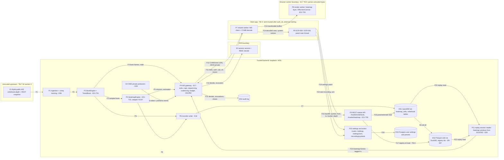

# E21 — STRIDE threat model: DOM ladder and liquidity heatmap

- Ticket: E21-X01 (issue #607). Owner: Security engineer (CODEOWNER). Status: **Draft**, pending sign-off by the
  Security engineer with the Architect present (the ticket's Definition of Done). Review log: end of §11.
- Method: `docs/plan/04-security-program.md` §5 template (L x I = risk), STRIDE per element and per flow (C-12.1).
  Format, columns and dispositions mirror `E17-ws-gateway.md`; the rating matrix is the one `E29-oms.md` §1.3 and
  `e36-rule-form-editor.md` §1.4 use (§1.3). The E17 gateway model (`WS-` rows), the E08 exchange-boundary model,
  the E16 recorder model (`R-` rows), the E07 storage model and the E42 admin model are **referenced, not
  repeated**. Row ids are `HM-xnn`; gaps `G-nn`; abuse-case seeds `AC-HM-nn`; accepted-risk candidates `AR-n`.
- Inputs, read at `d52336de`: issue #607 and the E21 epic with its 37 child tickets (`docs/plan/backlog/E21.json`);
  `23-ws-protocol.md` §1.1 (G4, G5), §3.4, §3.6, §6.1, §6.1.1, §6.3, §8, §9.5, §16.2, §16.3; `22-api-openapi.yaml`
  `getHeatmap`, `getOrderbookSnapshot`, `updateSettings`, `armOneClickTrading`; `24-internal-schemas.md` §6;
  `26-chart-engine-design.md` §2, §3.8, §9; `06-performance-and-load-standard.md` §2, §4.2, §6.2, §9, §10;
  `30-release-roadmap.md` §6.4; and on `main` the gateway under `services/api/candleviewer/ws/`, `book/`,
  `storage/`, the web client under `apps/web/src/lib/ws/` and `packages/protocol/src/runtime/`, with their tests.
  Test paths below are relative to `services/api/` unless they start with `packages/`, `apps/` or `infra/`.
- **Data classification (per flow, §2.2).** Market data (book, heatmap columns, recorded book history): **internal**
  (asset A-10, C=1 in `04-security-program.md`, as E17 labels it; it is served only to authenticated users, so a low
  confidentiality class never means "no authentication needed"). `orders`, `positions`, `executions`
  rows and the own-order column: **account-scoped financial** (E17: confidential). Settings and presets:
  **user-scoped**. Access tokens: **secret**.
- **Headline** (`30-release-roadmap.md` §6.4): "unbounded subscription depth as a DoS vector". §4 quantifies it from
  `23-ws-protocol.md` §6.1.1's own reference, scales it to the caps in force and names the test behind each cap.
  The two protocol goals this epic must not break are G4 (a slow or backgrounded client can never grow server
  memory) and G5 (server-authoritative, revocable authorisation).
- Gate note: design-level weaknesses only. No credential, host, account identifier or exploit detail appears.

## 1. Scope

In scope: the path the ticket names, Bybit → ingestion → book engine → heatmap engine → WS gateway → shared worker →
render worker → SCR-050 panel; the REST backfill path (`GET /market/heatmap`, `GET /market/orderbook`) over the
QuestDB hot tier and the Parquet/DuckDB cold tier; the own-order and position column (US-DOM-006, E21-S06); the
SCR-051 settings dialog's persistence; and the two action surfaces the panel exposes, the empty state's "start
recording" and the arm toggle.

Out of scope: implementing controls (E21-X02 and the owner tickets in §10); the R4 pen-test (E43); OMS and order
placement (E29, E31, E32); the gateway's own transport, handshake and audit design (E17 model, referenced); upstream
Bybit connection security (E08 model); recorder policy (E16 model).

### 1.1 State of the build at review time

Rows marked **O** (§3) rate a control that is specified but not built, or built without a verifying test.

| Surface                                    | State on `main` at `d52336de`                                                                                                                                    |
| ------------------------------------------ | ---------------------------------------------------------------------------------------------------------------------------------------------------------------- |
| `book.{symbol}.{depth}` topic, book engine | Served; depth tiers 1/50/200/500 (`ws/topics.py` `DEPTHS`); `TieredBook` atomic tier change (`book/tiers.py`)                                                    |
| `heatmap.{symbol}` topic                   | Registered with its option bounds; no producer: `ws_wiring.PENDING_ADAPTERS` maps `heatmap` to #2197, so a `sub` stays `snapshot_pending` until E21-T02 lands it |
| `GET /market/orderbook`                    | Mounted (`api/orderbook.py`); RBAC matrix row executed                                                                                                           |
| `GET /market/heatmap`                      | Specified in `22-api-openapi.yaml`; not mounted (RBAC matrix row `not_mounted`); E21-T03                                                                         |
| `PATCH /settings`, `POST /settings/arm`    | Specified; not mounted (RBAC matrix rows `not_mounted`)                                                                                                          |
| Outbound byte budget and ladder            | Built behind `CV_WS_BACKPRESSURE_ENABLED`, **off by default**; with it off the bound is a 1 024-frame push bound with no byte budget (`23-ws-protocol.md` §8.4)  |
| Web WS client (shared worker)              | Built (E17-T04, #413): `apps/web/src/lib/ws/`; heatmap decode in `packages/protocol/src/runtime/`                                                                |
| Render worker heatmap layer, SCR-050/051   | Not built (E21-T05, E21-S01..S09)                                                                                                                                |

Observation for the coordinator: `Settings.max_ws_topics_per_conn = 64` (`settings.py`) is read by nothing; the cap in
force is `ws/limits.py` `MAX_SUBSCRIPTIONS = 200`. It is not a control and this model cites only the latter.

### 1.2 Actors

A1 an authenticated Viewer; A2 a Manager granted some accounts; A3 the Owner, including view-as (§9.6 of
`23-ws-protocol.md`); A4 a device on the tailnet without a session; A5 a hostile or faulty upstream (Bybit feed, E08).
Reachability is tailnet-only (SR-045, SR-047), so every DoS row assumes an authenticated A1 or A2, or a legitimate
power user who reaches the same load by accident.

### 1.3 Rating

Risk = L x I on the programme scale, the matrix of `E29-oms.md` §1.3: H x H Critical; M x H and H x M High; M x M,
L x H and H x L Medium; the rest Low. Disposition: **M** mitigated by a control on `main` (or a named ticket) with a
named verifying test; **O** open item: the control is specified or named but not built, or has no verifying test,
so it is not counted as a control (ticket test plan); **A** accepted, pending Owner sign-off (§11); **R** referenced,
owned by another epic's model; **N/A** with a reason.

## 2. Data-flow diagram and trust boundaries

Text description: the public order-book feed (F1) is checked for sequence integrity by ingestion (SR-038) and
maintained by the book engine (F2), which publishes `book.{symbol}.{depth}` with a `stale` flag (F4) and is sampled
every `column_ms` by the heatmap engine (F3), which publishes columns marked `estimated` while the book resyncs (F5).
Both feed the recorder (F6, F7), whose hot tier rolls off to Parquet (F8). Account-scoped `orders` and `positions`
events come from the OMS (F9). The gateway checks every `sub` with E09's `decide` and re-evaluates on grant changes
(F10). The client's shared worker sends control frames (F11), receives frames (F12), hands binary columns to the
render worker as transferables (F13) and decoded rows and notices to the panel (F14). Scroll-back reads the stores
through REST (F15-F17). The panel writes settings (F18) and offers two action surfaces (F19). The gateway writes its
audit rows (F21). A replay session reads the same recorded history from DS1 and DS2 (F22) and hands the gateway
`rs`-tagged heatmap frames (F23), which the gateway serves like live ones (E26 model, referenced, not repeated).

### 2.1 Trust boundaries

- **TB-7, Bybit → backend** (F1): all upstream content untrusted; owned by the E08 model and SR-038/SR-040.
- **TB-4, client → backend** (F11, F15, F18, F19): untrusted until `auth_ok` or a valid session; afterwards
  authenticated and RBAC-scoped, and every option, parameter and settings value is hostile input. The client
  enforces nothing: hiding a button is not a control (C-12.4).
- **Backend → client** (F12, F14): the server's own frames are untrusted input to the client decoder (E17 §2).
- **TB-W, shared worker ↔ render worker** (F13; E17 calls the decode boundary TB-5): same origin, but the workers
  parse bytes; a decoder fault must stay in the worker.
- **TB-A, request parameters → archive root** (F17): no request value may become a filesystem path (SR-097).
- **Gateway → E09** (F10): the gateway consumes `decide`; it holds no copy of the rules.

### 2.2 Data classification per flow

| Flow     | Data                                                            | Classification                                        |
| -------- | --------------------------------------------------------------- | ----------------------------------------------------- |
| F1-F8    | Order book, heatmap columns, recorded book history              | Market data: internal (A-10, C=1)                     |
| F9       | `orders`, `positions`, `executions` events                      | Account-scoped financial                              |
| F10      | Principal snapshot, grants, revocations                         | User-scoped identity (confidential in E17)            |
| F11      | Access token in `auth`; subscription options                    | Token: secret; options: user-supplied                 |
| F12      | Public topics; private topics after account filtering           | Internal; account-scoped financial                    |
| F13      | Heatmap and book typed arrays                                   | Market data: internal (A-10, C=1)                     |
| F14      | Decoded private rows for the own-order column; `system` notices | Account-scoped financial; user-scoped                 |
| F15-F17  | Backfill parameters; recorded history                           | Parameters: user-supplied; data: internal (A-10, C=1) |
| F18, F20 | Settings and presets (`chart_presets.heatmap`, user settings)   | User-scoped                                           |
| F19      | Start-recording and arm actions                                 | User-scoped action (owner/manager only)               |
| F22-F23  | Recorded history read for a replay session; `rs` frames         | Market data: internal (A-10, C=1)                     |
| F21      | Audit rows                                                      | Confidential, append-only (C-2.9)                     |

## 3. STRIDE table

Columns as in `E17-ws-gateway.md` §3. "Verify" names the existing test where one exists; "pending" names the ticket
whose test is still to be written, which makes the row **O**.

### 3.1 Spoofing

| ID     | Flow / element | Threat                                                                                                                                                       | L   | I   | Risk   | Control                                                                                                                                                                                                                        | Owner                    | Verify                                                                                                                                                                                                                                                                                                                                    | Disp. | Residual |
| ------ | -------------- | ------------------------------------------------------------------------------------------------------------------------------------------------------------ | --- | --- | ------ | ------------------------------------------------------------------------------------------------------------------------------------------------------------------------------------------------------------------------------ | ------------------------ | ----------------------------------------------------------------------------------------------------------------------------------------------------------------------------------------------------------------------------------------------------------------------------------------------------------------------------------------- | ----- | -------- |
| HM-S01 | F11, P4        | A hand-crafted `sub` frame names another account's `orders` or `positions` to fill the own-order column, bypassing the panel                                 | M   | H   | High   | Family permission and a per-account `decide` on every `sub`; requested accounts narrowed silently to the grant; one generic `account_scope_denied` for foreign and unknown ids; audited `ws.subscribe.denied` (SR-074, SR-151) | E17-S02 (built), E21-X02 | integration: `tests/security/ws/test_account_scope.py::test_x02_ac_05_a_sub_naming_another_account_is_denied_on_every_family`, `::test_x02_ac_05_a_sub_naming_a_and_b_is_narrowed_to_a_and_b_data_never_reaches_m1`; contract: `tests/contract/rbac/matrix.yaml` topic row `orders` (ungranted Manager and Viewer `account_scope_denied`) | M     | Low      |
| HM-S02 | F11, P4        | Session replay on reconnect: a captured `auth` frame or access token replayed on a new socket to resume the victim's subscriptions                           | L   | H   | Medium | Short-lived token checked on every `auth`; a reconnect re-authenticates and re-evaluates every subscription afresh (§9.3); logout, session revocation and token expiry close every socket of the session (WS-S01)              | E17-S01, E09             | `tests/security/auth/test_ws_abuse.py::test_ac_ws_02_auth_frame_replayed_on_second_socket_accepted_while_session_is_live` (pins the window: only while the session lives); `tests/security/auth/test_revocation_closes_sockets.py`; chaos `tests/chaos/ws/test_s5_token_expiry_outage.py`                                                 | M, R  | Low      |
| HM-S03 | F11, P7        | After a grant is withdrawn, the shared worker's reconnect resubscribes the cached account set (private topics first, §9.3) and regains the withdrawn account | M   | H   | High   | Every `sub` is decided against the current grants; SR-189 snapshot versioning keeps a newer principal; the withdrawn account is refused or narrowed                                                                            | E17-S02                  | chaos `tests/chaos/ws/test_s6_revocation_reconnect_race.py::test_s6_withdrawn_account_is_refused_on_resubscribe_and_never_emitted`, `::test_s6b_grant_withdrawn_during_the_new_sockets_auth_is_not_reapplied`                                                                                                                             | M     | Low      |
| HM-S04 | F11, P7        | The shared worker serves every tab of the origin over one socket; a tab signed in as another user keeps receiving frames authorised for the earlier identity | L   | H   | Medium | Logout revokes the session and closes its sockets; an in-place re-`auth` must keep the same user, and a snapshot of another user is refused (WS-S04)                                                                           | E17-T04, E09             | `tests/unit/ws/test_snapshot_user_guard.py::test_apply_snapshot_of_another_user_is_refused_and_changes_nothing`; `tests/security/auth/test_revocation_closes_sockets.py`                                                                                                                                                                  | M     | Low      |

### 3.2 Tampering

| ID     | Flow / element | Threat                                                                                                                                                                                                                                                    | L   | I   | Risk   | Control                                                                                                                                                                                                                                                                                                                                                                | Owner                 | Verify                                                                                                                                                                                                                                                                                                                                                                                                                                                                                                   | Disp.   | Residual          |
| ------ | -------------- | --------------------------------------------------------------------------------------------------------------------------------------------------------------------------------------------------------------------------------------------------------- | --- | --- | ------ | ---------------------------------------------------------------------------------------------------------------------------------------------------------------------------------------------------------------------------------------------------------------------------------------------------------------------------------------------------------------------- | --------------------- | -------------------------------------------------------------------------------------------------------------------------------------------------------------------------------------------------------------------------------------------------------------------------------------------------------------------------------------------------------------------------------------------------------------------------------------------------------------------------------------------------------- | ------- | ----------------- |
| HM-T01 | F12-F13, P7    | A tampered or malformed kind-6 frame whose `row_count` disagrees with its body causes an out-of-bounds read or an allocation sized from the wire count in the decoder                                                                                     | M   | M   | Medium | Client `decodeHeatmapColumn` refuses a `record_count` other than 1, a body shorter than its prefix, and a `row_count` whose rows do not fit the remaining bytes, before the loop (SR-128); one typed `BinaryFrameError`; the server decoder refuses `record_count` other than 1; fuzz corpus (SR-155). Not yet bounded: `row_count` against the grid's 512 rows (G-07) | E17-T02, E21-X02      | unit: `packages/protocol/test/runtime-binary.test.ts` (`decodeHeatmapColumn`: "rejects a column shorter than its fixed prefix"); fuzz: `packages/protocol/test/cvwb-fuzz.fuzz.test.ts` ("every wire count that cannot fit is rejected up front (SR-128), per site and seed"); `tests/unit/ws/test_cvwb_binary.py::test_decode_heatmap_column_with_a_record_count_other_than_one_is_malformed`, `::test_decode_max_u32_count_rejects_without_proportional_allocation`; the 512-row bound: pending E21-X02 | M, O    | Low               |
| HM-T02 | F12-F14, P8    | A column with a zero or negative `price_step` or an overflowing `price_min` paints liquidity at the wrong prices, so the trader reads a wall that is not there                                                                                            | L   | M   | Low    | One server encoder (E17-T02) and one grid model (`24-internal-schemas.md` §6.1); a client check that `price_step > 0` and that the column's price span is representable is not specified (G-07)                                                                                                                                                                        | E21-T02, E21-X02      | pending E21-X02 (decoder hardening)                                                                                                                                                                                                                                                                                                                                                                                                                                                                      | O       | Low               |
| HM-T03 | F18, F20, DS3  | Manipulated settings persisted as arbitrary jsonb: `SettingsPatch` is a deep-merge object with `additionalProperties: true`, so unknown keys, oversized values or a non-colour string bound for the shader (`orderflow.heatmap_bid_colour`) can be stored | M   | M   | Medium | Contract today: `settings:write`, scope self; `trading.one_click_armed` refused here (arm route only). Missing: a closed schema per key, a size bound and a colour pattern, validated server-side before the write (G-11)                                                                                                                                              | E21-S09, E21-X02      | pending: the route is not mounted (RBAC matrix `PATCH /settings` `not_mounted`)                                                                                                                                                                                                                                                                                                                                                                                                                          | O       | Medium until G-11 |
| HM-T04 | F1-F5, P1-P3   | A malformed, crossed or out-of-sequence upstream delta yields a wrong book that drives the ladder and the heatmap (SR-038)                                                                                                                                | M   | H   | High   | `u`/`seq` tracking, drop and rebuild from snapshot on any gap, a crossed delta treated as desync, never clamped; `book` snapshots carry `stale`; heatmap columns built while resyncing carry `estimated` (24 §6.3); trading affordances disabled while stale (SR-038)                                                                                                  | E08, E21-T01, E21-T02 | `tests/unit/book/test_book_engine.py::test_sequence_break_invalidates_and_requests_snapshot`, `::test_crossed_delta_is_treated_as_desync_not_clamped`; `tests/contract/ws/test_ws_stale_upstream_create_app.py::test_book_snap_goes_stale_when_the_book_stalls_past_the_watchdog_limit_and_clears_on_resume`; heatmap `estimated` and the client affordance: pending E21-T02, E21-Q04 scenario 1, E21-Q05                                                                                                | M, R, O | Low               |
| HM-T05 | F15-F16, P5    | Query injection through backfill `symbol`, `from`, `to` into the QuestDB or DuckDB read                                                                                                                                                                   | L   | H   | Medium | Contract `Symbol` pattern `^[A-Z0-9]{2,20}USDT$`, RFC 3339 times; parameterised query builders with bind-count guards; the Semgrep raw-SQL rule                                                                                                                                                                                                                        | E07, E21-T03          | `tests/unit/storage/questdb/test_reader_query_builders.py::test_build_read_heatmap_trail_filters_symbol_and_since_ts`; `tests/unit/storage/questdb/test_bind_count_guards.py`; route level: pending E21-T03                                                                                                                                                                                                                                                                                              | M, O    | Low               |

### 3.3 Repudiation

| ID     | Flow / element | Threat                                                                                                                                                                                                                                          | L   | I   | Risk   | Control                                                                                                                                                                                                                                                                                                                                                                                                                                                     | Owner            | Verify                                                                                                                                                                                                                                                                             | Disp. | Residual          |
| ------ | -------------- | ----------------------------------------------------------------------------------------------------------------------------------------------------------------------------------------------------------------------------------------------- | --- | --- | ------ | ----------------------------------------------------------------------------------------------------------------------------------------------------------------------------------------------------------------------------------------------------------------------------------------------------------------------------------------------------------------------------------------------------------------------------------------------------------- | ---------------- | ---------------------------------------------------------------------------------------------------------------------------------------------------------------------------------------------------------------------------------------------------------------------------------- | ----- | ----------------- |
| HM-R01 | F12, F14, P4   | A shed or degradation event (the classifier holds `heatmap` to 1 000 ms, the §8.4 ladder drops a topic, the client sheds depth 500 to 200) leaves no attributable trail, so a trader's claim that "the app hid liquidity" cannot be adjudicated | M   | M   | Medium | In force: the `system` `connection_quality` notice with `degraded_topics` reaches the user (§8.3); `cv_ws_overflow_total{reason}` and `cv_ws_connection_class{state}` count it per process, with no identity; a `slow_consumer` close is audited (`ws.connection.closed`, `warning`, with its `trigger`). Missing: a per-connection record of class changes and drops (who, topic, from and to, when) and the client's shedding record (E21-S05 NFR) (G-10) | E21-X02, E21-S05 | the degradation itself: `tests/unit/ws/test_pacing.py::test_pacer_class_multiplies_throttles_and_degrades_heatmap`; the close audit: `tests/unit/ws/test_pipeline_ladder.py::test_orders_backlog_over_budget_closes_4429_with_hint_and_warning_audit`; the record: pending E21-X02 | O     | Medium until G-10 |
| HM-R02 | F11, F21       | A refused market-data `sub` (`subscription_limit`, `forbidden` on a public family) writes no audit row, so a user probing the caps is attributable only by counters and logs                                                                    | M   | L   | Low    | Every refusal is counted in `cv_ws_subscribe_total{topic,result}`; refused private-family entries are one `ws.subscribe.denied` record per frame within 20 records a connection a minute (WS-R01, WS-D15). Read-only market data needs no audit row (precedent: E22 D8)                                                                                                                                                                                     | E17-S02          | `tests/security/ws/test_limits_abuse.py::test_x02_ws_d04_a_private_topic_refused_at_the_cap_is_one_audited_denial`                                                                                                                                                                 | A     | Low               |
| HM-R03 | F15, P5        | A clamped or refused backfill is not attributable                                                                                                                                                                                               | L   | L   | Low    | Request log with `traceId` and user (C-12.6); a counted clamp (G-09)                                                                                                                                                                                                                                                                                                                                                                                        | E21-T03, E21-X02 | pending E21-X02 ("Oversized backfill": the clamp is counted)                                                                                                                                                                                                                       | O     | Low               |
| HM-R04 | F21, DS4       | A WS audit write fails and the record is lost                                                                                                                                                                                                   | L   | M   | Low    | Best effort, bounded and counted (`cv_ws_audit_failures_total`, `WsAuditWriteFailed`); owner-accepted as WS-R04 (#1778). Valid only because no order, auth-credential or key action rides the WS                                                                                                                                                                                                                                                            | E17-T06          | E17 model WS-R04                                                                                                                                                                                                                                                                   | R     | Low               |

### 3.4 Information disclosure

| ID     | Flow / element | Threat                                                                                                                                                                                                       | L   | I   | Risk   | Control                                                                                                                                                                                                                                                                                                                                                      | Owner                 | Verify                                                                                                                                                                                                                                                                      | Disp. | Residual |
| ------ | -------------- | ------------------------------------------------------------------------------------------------------------------------------------------------------------------------------------------------------------ | --- | --- | ------ | ------------------------------------------------------------------------------------------------------------------------------------------------------------------------------------------------------------------------------------------------------------------------------------------------------------------------------------------------------------ | --------------------- | --------------------------------------------------------------------------------------------------------------------------------------------------------------------------------------------------------------------------------------------------------------------------- | ----- | -------- |
| HM-I01 | F9, F12, F14   | Account-scoped markers leak through aggregate counts: the own-order column's per-row count or a trade group's markers include accounts outside the viewer's grant, or reveal another account's average entry | M   | H   | High   | The server sends only rows of the subscription's account set (WS-I02) and never shares a private frame buffer (WS-I08, SR-190); `machines.trade_group` stays `deny_pending_decision` for non-Owners (W6). Requirement: the `OwnOrderProjection` (E21-S06) aggregates only rows it received, never a server total, and keys every marker by account id (G-12) | E17-S02, E21-S06      | `tests/security/ws/test_account_scope.py::test_x02_ac_27_two_users_on_one_symbol_never_see_each_others_account`; the projection: pending E21-S06, E21-X02                                                                                                                   | M, O  | Low      |
| HM-I02 | F12, P4        | The slow-consumer `bye.hint.most_expensive_topics` leaks other users' activity                                                                                                                               | L   | M   | Low    | The hint is ranked from the closing connection's own outbound queue (`ws/outbound.py`), names at most five channel names, no sizes and no user; channels are public names. Not yet asserted: two users' hints are disjoint (G-13)                                                                                                                            | E17-T03, E21-X02      | `tests/unit/ws/test_outbound.py::test_backpressure_close_hint_names_at_most_five_topics_largest_first`, `::test_backpressure_close_hint_is_ranked_when_the_overflow_began`; cross-user: pending E21-X02                                                                     | M, O  | Low      |
| HM-I03 | F15, F17, TB-A | Archived-path traversal: a backfill `symbol`, date or dataset value crafted to escape the archive root                                                                                                       | M   | H   | High   | The contract `Symbol` pattern admits no separator or dot; the cold tier addresses data by registry id, never a path, and refuses symlinked partitions (SR-097). Not yet: the heatmap route's own corpus (G-06)                                                                                                                                               | E07, E21-T03, E21-X02 | `tests/security/storage/test_sr097_path_traversal.py::test_sr097_hostile_symbol_refused_with_no_fs_access_outside_root`, `::test_sr097_symlinked_partition_dir_is_refused_and_never_read`, `::test_sr097_registry_has_no_path_accepting_api`; route corpus: pending E21-X02 | M, O  | Low      |
| HM-I04 | F12, P3-P4     | A shared heatmap producer serving several subscribers echoes another user's options in `sub_ok.effective`, a `connection_quality` notice or an error                                                         | L   | L   | Low    | `effective` is built from the caller's own request; `degraded_topics` names the connection's own topics; errors are per caller (§5.2, §8.3)                                                                                                                                                                                                                  | E17-S02               | `tests/unit/ws/test_topics.py::test_effective_defaults_per_topic`                                                                                                                                                                                                           | M     | Low      |
| HM-I05 | F12, P4        | Timing side channel: a warm shared upstream lease (30 s grace) answers a `sub` at once where a cold one stays `snapshot_pending`, revealing that another user had the symbol open                            | L   | L   | Low    | None by design: encode-once and shared leases are the performance model (§6.2 as built). Proposed accepted risk AR-1 (§11)                                                                                                                                                                                                                                   | Owner                 | review                                                                                                                                                                                                                                                                      | A     | Low      |
| HM-I06 | F14, F19, P9   | The empty state's "no recorded history" or the recorder status reveals which symbols the Owner records (trading interest)                                                                                    | M   | M   | Medium | `recording:read` limited by role; auto-record entries derived from positions shown to the Owner and scoped Managers only (E16 R-I2, E16-FR-07)                                                                                                                                                                                                               | E16                   | E16 model R-I2                                                                                                                                                                                                                                                              | R     | Low      |

### 3.5 Denial of service

| ID     | Flow / element     | Threat                                                                                                                                                                                                                                                                                                                                                                                                                                                  | L   | I   | Risk   | Control                                                                                                                                                                                                                                                                                                                                                                                                                                                                                                                                                                        | Owner                     | Verify                                                                                                                                                                                                                                                                                                                                                                                                                                                                            | Disp. | Residual                 |
| ------ | ------------------ | ------------------------------------------------------------------------------------------------------------------------------------------------------------------------------------------------------------------------------------------------------------------------------------------------------------------------------------------------------------------------------------------------------------------------------------------------------- | --- | --- | ------ | ------------------------------------------------------------------------------------------------------------------------------------------------------------------------------------------------------------------------------------------------------------------------------------------------------------------------------------------------------------------------------------------------------------------------------------------------------------------------------------------------------------------------------------------------------------------------------ | ------------------------- | --------------------------------------------------------------------------------------------------------------------------------------------------------------------------------------------------------------------------------------------------------------------------------------------------------------------------------------------------------------------------------------------------------------------------------------------------------------------------------- | ----- | ------------------------ |
| HM-D01 | F5, F11-F12, P3-P4 | **The named epic threat.** Unbounded or deep subscriptions: depth 500 x 100 ms bucket x 50 ms throttle x 900 s window x many symbols, across 8 sockets, each with its own grouping. §4: up to about 98 MiB/s of demand per user, snapshots 3.8x the outbound budget, and producer state per distinct spec that reaches the host's RAM. L=M is conditional on the producer being served (E21-T02, #2197): no `heatmap` frame is produced on `main` today | M   | H   | High   | In force: `marketdata:read`; 200 subscriptions, 40 symbols and 50 topics a frame per connection; one live subscription per channel; 8 connections and 20 new ones a minute per user; `window_seconds` 10-900; the 2 000-column snapshot cap; the rebuild budget (5 per stream, 400 per connection, 1 600 per user a minute); the 50 ms throttle floor; the outbound budget and classifier (flag). Missing: a heatmap and deep-book quota, cost-weighted by depth and bucket, per connection and per user across connections (G-01), and caps on distinct producer specs (G-02) | E17-S02, E21-X02, E21-T02 | caps: §4.3 (every cap with its test); quota: pending E21-X02 ("Quota enforced and explained"); load: pending E21-Q03                                                                                                                                                                                                                                                                                                                                                              | M, O  | High until G-01 and G-02 |
| HM-D02 | F12, P4            | A heatmap snapshot larger than the outbound budget (a depth-500, 100 ms, 2 000-column snapshot is about 30.6 MiB on the wire, §4.1) is built, dropped and rebuilt until the three-redrop close: CPU spent on frames that are never delivered                                                                                                                                                                                                            | M   | M   | Medium | The redrop close bounds the loop per subscription (§8.4 step 3) and the rebuild budget bounds the rate. Missing: a snapshot bound derived from the budget's bytes, applied at the producer read rather than at framing (G-03)                                                                                                                                                                                                                                                                                                                                                  | E21-T02, E21-X02          | the redrop close: `tests/unit/ws/test_pipeline_outbound.py::test_the_byte_budget_alone_closes_slow_consumer`; the byte-derived cap: pending E21-X02                                                                                                                                                                                                                                                                                                                               | O     | Medium until G-03        |
| HM-D03 | F15-F17, P5        | Oversized `from`/`to` backfill: 30 days at 100 ms is 25 920 000 columns, about 104 GB at the §6.1.1 reference cell size, read and densified into one response. L=M is conditional on the route mounting (E21-T03): `GET /market/heatmap` is not mounted on `main` today                                                                                                                                                                                 | M   | H   | High   | None in the contract: `From`/`To` have no maximum span and `time_bucket_ms` accepts 100. Required: a maximum window per request, a coarsening clamp with the effective resolution disclosed, a limit on concurrent backfills per user, validation before any query (G-05)                                                                                                                                                                                                                                                                                                      | E21-T03, E21-X02          | pending E21-X02 ("Oversized backfill") and E21-T03                                                                                                                                                                                                                                                                                                                                                                                                                                | O     | High until G-05          |
| HM-D04 | F12, P4            | A slow or backgrounded consumer grows server memory (G4)                                                                                                                                                                                                                                                                                                                                                                                                | H   | M   | High   | The gateway control inherited from E17 WS-D01. Flag on: 8 MiB or 2 000 frames, the §8.4 ladder and the `slow_consumer` close (`4429`); the classifier holds `heatmap` to 1 000 ms when `saturated`; sent-column memory bounded at 2 000 buckets. Flag off (default): the 1 024-frame push bound, which counts frames, not bytes; the heatmap topic must ship with the byte budget in force (G-04)                                                                                                                                                                              | E17-T03, E21-T02          | chaos `tests/chaos/ws/test_s2_slow_consumer.py::test_s2_sleeping_client_stays_in_its_budget_and_costs_the_others_nothing`; `tests/unit/ws/test_outbound_queue_bound.py::test_a_full_data_part_still_takes_the_slow_consumer_close_and_nothing_after`; `tests/unit/ws/test_pacing.py::test_pacer_saturated_holds_a_fast_heatmap_to_one_frame_a_second`; `tests/unit/ws/test_coalescing.py::test_coalescer_heatmap_sent_memory_is_bounded`; heatmap leg: pending E21-Q04 scenario 5 | M, O  | Low, contingent on G-04  |
| HM-D05 | F5, F12, P3-P4     | Heatmap column storms: forming-column updates at the 50 ms throttle floor, a desync storm that re-snapshots, or a price gap that re-centres the window and emits a run of empty columns                                                                                                                                                                                                                                                                 | M   | M   | Medium | Per-column last-write-wins; a complete bucket is never sent again (§8.2); the 50 ms floor; 5 resyncs per stream a minute; empty columns emitted as `samples=0`, never stretched (24 §6.3)                                                                                                                                                                                                                                                                                                                                                                                      | E17-T03, E21-T02          | `tests/unit/ws/test_pipeline_pacing.py::test_a_window_of_whole_heatmap_frames_never_regresses_a_complete_bucket`; `tests/unit/ws/test_coalescing.py::test_coalescer_whole_heatmap_frame_loses_its_sent_columns_only`; `tests/contract/ws/test_ws_rebuild_budget.py::test_a_resync_loop_is_revoked_and_its_topic_cannot_restart_within_the_window`; producer side: pending E21-T02, E21-Q04 scenario 1                                                                             | M, O  | Low                      |
| HM-D06 | F13-F14, P7-P8     | Client exhaustion: a large snapshot or `row_count` decoded in the shared worker and uploaded to textures breaks budgets #1 and #7                                                                                                                                                                                                                                                                                                                       | M   | M   | Medium | Decode in the worker (E17-T04); 4 MiB frame cap with chunked snapshots; the renderer's 512-row rings and `MemoryGovernor` (26 §3.8, §9); the trail memory guard (E21-S04)                                                                                                                                                                                                                                                                                                                                                                                                      | E21-T05, E21-S04, E21-K01 | pending E21-K01 (500-depth ring), E21-Q03                                                                                                                                                                                                                                                                                                                                                                                                                                         | O     | Low                      |
| HM-D07 | F15, P5            | One user runs many backfills at once (scroll-back while switching symbols), each reconstructing from recorded deltas                                                                                                                                                                                                                                                                                                                                    | M   | M   | Medium | Required: a per-user concurrent-backfill limit and cancellation on symbol switch (E21-S08 AbortController) (G-05)                                                                                                                                                                                                                                                                                                                                                                                                                                                              | E21-T03, E21-S08, E21-X02 | pending E21-X02                                                                                                                                                                                                                                                                                                                                                                                                                                                                   | O     | Medium until G-05        |
| HM-D08 | F1-F2, P1          | Depth 500 multiplies upstream ingestion per symbol                                                                                                                                                                                                                                                                                                                                                                                                      | M   | M   | Medium | One shared upstream lease per (symbol, family), released 30 s after the last consumer; bounded ingress queues and backoff (E08)                                                                                                                                                                                                                                                                                                                                                                                                                                                | E08                       | E08 model                                                                                                                                                                                                                                                                                                                                                                                                                                                                         | R     | Low                      |

### 3.6 Elevation of privilege

| ID     | Flow / element | Threat                                                                                                          | L   | I   | Risk   | Control                                                                                                                                                                                                                     | Owner        | Verify                                                                                                                                                                                                                                      | Disp. | Residual |
| ------ | -------------- | --------------------------------------------------------------------------------------------------------------- | --- | --- | ------ | --------------------------------------------------------------------------------------------------------------------------------------------------------------------------------------------------------------------------- | ------------ | ------------------------------------------------------------------------------------------------------------------------------------------------------------------------------------------------------------------------------------------- | ----- | -------- |
| HM-E01 | F19, P10       | A `viewer` starts recording through the panel's empty-state action                                              | L   | M   | Low    | `POST /recording/symbols` needs `recording:write`, which a Viewer lacks; the UI omitting the action (E21-S02) is not the control                                                                                            | E16, E21-S02 | contract: `tests/contract/rbac/test_route_matrix.py::test_cell_outcome_matches_matrix` (row `POST /recording/symbols`, viewer `403`, executed)                                                                                              | M     | Low      |
| HM-E02 | F11, P6        | A `viewer`'s open heatmap chart starts auto-recording through the chart-open trigger, without `recording:write` | M   | M   | Medium | Triggers derive server-side; a per-session cap on distinct auto-record symbols (E16-FR-01); the disk budget pauses auto-record at 90 %                                                                                      | E16          | E16 model R-S1                                                                                                                                                                                                                              | R     | Low      |
| HM-E03 | F19, P10       | A `viewer` reaches trading through the panel's arm toggle or ladder actions                                     | L   | H   | Medium | `POST /orders` needs `orders:write` on a granted account (viewer `403`, executed); `POST /settings/arm` needs `orders:write` but is not mounted, so its viewer cell is not executed (G-14). Order entry is REST only (§1.2) | E30-S04, E29 | contract: `tests/contract/rbac/test_route_matrix.py::test_cell_outcome_matches_matrix` (row `POST /orders`); the arm row: pending E30-S04                                                                                                   | M, O  | Low      |
| HM-E04 | F11, F19, P4   | An Owner viewing as a Viewer acts through the panel                                                             | L   | M   | Low    | A viewing session is read-only: REST writes refused, WS action frames answered `view_as_read_only` (§9.6)                                                                                                                   | E42          | `tests/security/auth/test_view_as_http.py::test_every_write_refused_except_own_and_protective`; E42 model AD-E04                                                                                                                            | R     | Low      |
| HM-E05 | F11, P4        | A `book` or `heatmap` subscription survives the loss of `marketdata:read`, or is taken by a role without it     | L   | L   | Low    | Topic permission matrix, checked at `sub` and re-evaluated on every grant or role change (§9.5)                                                                                                                             | E17-S02      | `tests/contract/rbac/test_route_matrix.py::test_topic_matrix_is_total_over_the_ws_registry_and_agrees_with_it`; `tests/security/auth/test_ws_abuse.py::test_ac_ws_03_socket_held_across_grant_revocation_loses_and_cannot_regain_the_topic` | M     | Low      |

### 3.7 Coverage matrix

| Element / flow                      | S        | T            | R        | I        | D             | E             |
| ----------------------------------- | -------- | ------------ | -------- | -------- | ------------- | ------------- |
| E1 Bybit, P1 ingestion (F1-F2)      | R (E08)  | T04          | N/A      | —        | D08           | —             |
| P2 BookEngine (F2-F4)               | —        | T04          | —        | —        | D01           | —             |
| P3 HeatmapEngine (F3, F5)           | —        | T04          | R01      | I04      | D01, D02, D05 | —             |
| P4 WS gateway (F9-F12, F21)         | S01-S03  | —            | R01, R02 | I01-I05  | D01-D05       | E02, E04, E05 |
| P5 REST market API (F15-F17)        | —        | T05          | R03      | I03      | D03, D07      | —             |
| P6 recorder, DS1, DS2 (F6-F8, F17)  | —        | T05, R (E07) | —        | I03, I06 | D03           | E02           |
| P7 shared worker (F11-F14)          | S03, S04 | T01          | —        | —        | D06           | —             |
| P8 render worker (F13)              | —        | T01, T02     | N/A      | —        | D06           | —             |
| P9 panel (F14, F18, F19)            | —        | T03          | R01      | I01, I06 | —             | E01, E03, E04 |
| P10 settings and action routes      | —        | T03          | —        | —        | —             | E01, E03      |
| P11 replay session reader (F22-F23) | R (E26)  | R (E26)      | R (E26)  | R (E26)  | R (E26)       | R (E26)       |
| DS4 audit (F21)                     | —        | R (E09)      | R02, R04 | —        | R (WS-D15)    | —             |

Counts: 32 rows. S 4, T 5, R 4, I 6, D 8, E 5. Inherent High: HM-S01, HM-S03, HM-T04, HM-I01, HM-I03, HM-D01, HM-D03,
HM-D04; none Critical. Residual High: HM-D01 and HM-D03, until G-01, G-02 and G-05 close. Residual Medium: HM-T03,
HM-R01, HM-D02, HM-D07.

## 4. The named epic threat: deep subscriptions, quantified

Every figure below is computed from a number in the docs or the code, with the arithmetic shown. Where a number is
not specified anywhere, the text says so and §6 records it as a gap.

### 4.1 Worst-case cost per subscription

**The reference** (`23-ws-protocol.md` §6.1.1): BTCUSDT, depth 200, `price_grouping` 1, `window_seconds` 900, binary
kind 6, about 400 populated price rows per column at 4 B.

- Bytes per column: 400 x 4 B = 1 600 B.
- At 100 ms: 10 columns/s x 1 600 B = 16 000 B/s, about 15.6 KiB/s (the doc's "~16 KiB/s").
- Window: 900 s / 0.1 s = 9 000 columns; 9 000 x 1 600 B = 14.4 MB, about 13.7 MiB (the doc's "~14 MiB"); capped at
  2 000 columns, 3.2 MB, about 3.05 MiB.

**Extrapolated to depth 500 at 100 ms.** Rows scale with depth: 400 x 500 / 200 = 1 000 rows. Two cell sizes are
shown, because the documents disagree (G-07b): the §6.1.1 reference's 4 B per row, and the wire layout of §3.4
kind 6, a 24 B header, a 24 B column prefix (`u32 ts_offset_ms`, `i64 price_min`, `i64 price_step`, `u32 row_count`; `packages/protocol/cvwb-layout.json` kinds[5]) and 16 B per row (`u64 bid_size`, `u64 ask_size`).

| Quantity                                | Reference cell size (4 B/row)             | Wire layout (§3.4 kind 6)                                    |
| --------------------------------------- | ----------------------------------------- | ------------------------------------------------------------ |
| Bytes per column                        | 1 000 x 4 = 4 000 B                       | 24 + 24 + 1 000 x 16 = 16 048 B                              |
| Columns per second (bucket 100 ms)      | 10                                        | 10                                                           |
| Bytes per second, column cadence        | 10 x 4 000 = 40 000 B/s, about 39.1 KiB/s | 10 x 16 048 = 160 480 B/s, about 156.7 KiB/s                 |
| Frames per second at the throttle floor | 1 000 / 50 = 20                           | 20                                                           |
| Bytes per second at the throttle floor  | 20 x 4 000 = 80 000 B/s, about 78.1 KiB/s | 20 x 16 048 = 320 960 B/s, about 313.4 KiB/s                 |
| Columns per window (900 s)              | 9 000                                     | 9 000                                                        |
| Snapshot at the 2 000-column cap        | 2 000 x 4 000 = 8.0 MB, about 7.63 MiB    | 2 000 x 16 048 = 32.1 MB, about 30.6 MiB (8 chunks of 4 MiB) |
| Whole window, uncapped                  | 9 000 x 4 000 = 36.0 MB, about 34.3 MiB   | 9 000 x 16 048 = 144.4 MB, about 137.7 MiB                   |

The throttle floor applies because a `heatmap` subscription's throttle defaults to its bucket but a client may ask
for less, down to the 50 ms floor (`ws/topics.py` `effective_options`, pinned by
`tests/unit/ws/test_topics.py::test_effective_defaults_per_topic`), and each window re-sends the forming column.
The grid model's `rows: int = 512` (`24-internal-schemas.md` §6.1, "renderer cap") would bound a column at 512 rows
(2 048 B at 4 B/row, 8 240 B on the wire), but it is a default of an unbuilt producer, not an enforced bound (G-07).

**Server memory per subscription.**

- Sent-column memory: at most 2 000 bucket keys (`ws/coalescing.py` `SENT_COLUMNS_MEMORY`), measured at 150 to
  210 KB (E17 model §6, #2552).
- Queued frames and the pending window: inside the connection's outbound budget, not on top of it (§8.6).
- Producer state: **not specified.** If the heatmap engine keeps one 900 s window per distinct grid spec (symbol,
  depth, grouping, bucket), one depth-500, 100 ms spec holds the uncapped window: about 36.0 MB at the reference
  cell size, about 144.4 MB at wire row size. Budget #8 (`06` §2: at most 300 MB resident per recorded symbol) is
  reached by about 8 such specs at the reference size (8 x 36.0 = 288 MB) or 2 at wire size (2 x 144.4 = 288.8 MB).

### 4.2 Scaled to the caps in force

**Per connection.** Live `heatmap` subscriptions: at most 40, one per `heatmap.{symbol}` channel (a second `sub` of a
channel is `duplicate_subscription`) under the 40-symbol cap; with replay twins, the 200-subscription cap bounds it
(E17 model §6).

| Quantity                                  | Reference cell size                                    | Wire layout                                  |
| ----------------------------------------- | ------------------------------------------------------ | -------------------------------------------- |
| Demand at the throttle floor, 40 subs     | 40 x 78.1 = 3 125 KiB/s, about 3.05 MiB/s              | 40 x 313.4 = 12 536 KiB/s, about 12.2 MiB/s  |
| Snapshots requested on attach, 40 subs    | 40 x 7.63 = 305 MiB                                    | 40 x 30.6 = 1 224 MiB                        |
| One snapshot against the 8 MiB budget     | 7.63 MiB: fits, but not the 4 MiB left while draining  | 30.6 MiB: 3.8x the budget, never deliverable |
| Snapshot builds a minute (rebuild budget) | 40 streams x 5 = 200 (under 400): 200 x 7.63 = 1.5 GiB | 200 x 30.6 = 6.0 GiB                         |

Memory, flag on: the 8 MiB budget (8.39 MB) plus 40 x 210 KB of sent-column memory (8.4 MB), about 16.8 MB; with 200
replay twins, 8.39 + 200 x 0.21 = about 50.4 MB. Flag off: the 1 024-frame push bound has no byte bound; 1 024
column deltas of 16 048 B are 16.4 MB, and each queued snapshot chunk can be up to the 4 MiB frame cap.

**Per user** (8 connections, `MAX_CONNECTIONS_PER_USER`; `Settings.ws_max_connections_per_user` may lower it, never
raise it, `le=8`):

| Quantity                                       | Reference cell size                                                | Wire layout                         |
| ---------------------------------------------- | ------------------------------------------------------------------ | ----------------------------------- |
| Live heatmap subscriptions                     | 8 x 40 = 320                                                       | 320                                 |
| Demand at the throttle floor                   | 320 x 78.1 KiB/s, about 24.4 MiB/s                                 | 320 x 313.4 KiB/s, about 97.9 MiB/s |
| Snapshot builds a minute (1 600 per user)      | 1 600 x 7.63 MiB, about 11.9 GiB                                   | 1 600 x 30.6 MiB, about 47.8 GiB    |
| Gateway memory (flag on)                       | 8 x 16.8 = about 134 MB; 8 x 50.4 = about 403 MB with replay twins | same                                |
| Producer state if every subscription is a spec | 320 x 36.0 MB, about 11.5 GB                                       | 320 x 144.4 MB, about 46.2 GB       |

The last row is the epic's DoS vector in one number: nothing today stops one user from naming 320 distinct grid specs
(40 symbols per socket, and per symbol any of 4 depths x 5 buckets x 1 000 groupings), and the provisioned host has
8 to 16 GB of RAM (`06` §10.2). Whether the producer keeps state per spec is not specified (G-02); the row is the
consequence if it does.

### 4.3 Caps, where they live, and the test that proves each

| Cap                                       | Value                                               | Doc                       | Code                                              | Test                                                                                                                                                                                                                               |
| ----------------------------------------- | --------------------------------------------------- | ------------------------- | ------------------------------------------------- | ---------------------------------------------------------------------------------------------------------------------------------------------------------------------------------------------------------------------------------- |
| Subscriptions per connection              | 200                                                 | 23 §3.6, §16.2            | `ws/limits.py` `MAX_SUBSCRIPTIONS`                | `tests/unit/ws/test_subscriptions.py::test_sub_limit_200_leaves_existing_untouched`; `tests/security/ws/test_limits_abuse.py::test_x02_ws_d04_a_full_cap_refuses_the_next_topic_and_the_socket_keeps_serving`                      |
| Symbols per connection                    | 40                                                  | 23 §16.2                  | `ws/limits.py` `MAX_SYMBOLS_PER_CONNECTION`       | `tests/unit/ws/test_subscriptions.py::test_sub_symbol_limit_40_per_connection`                                                                                                                                                     |
| One live subscription per channel         | 1                                                   | 23 §5.4 (`ctl` to retune) | `ws/permissions.py` (`duplicate_subscription`)    | `tests/unit/ws/test_subscriptions.py::test_sub_duplicate_is_rejected_with_ctl_advice`                                                                                                                                              |
| Topics per `sub` frame                    | 50                                                  | 23 §3.6                   | `ws/limits.py` `MAX_TOPICS_PER_SUB`               | `tests/unit/ws/test_sub_entry_cap.py::test_sub_over_the_cap_is_refused_whole_with_too_many_topics`                                                                                                                                 |
| Connections per user                      | 8                                                   | 23 §3.6                   | `ws/lifecycle.py` `MAX_CONNECTIONS_PER_USER`      | `tests/security/ws/test_limits_abuse.py::test_x02_ac_15_the_ninth_socket_of_a_user_closes_the_oldest_idle_one_across_sessions`                                                                                                     |
| New connections per user                  | 20 a minute                                         | 23 §16.2                  | `ws/lifecycle.py` `MAX_AUTHS_PER_USER_PER_MIN`    | `tests/security/ws/test_limits_abuse.py::test_x02_ac_15_the_21st_first_auth_of_a_user_in_a_minute_is_refused_across_sessions`                                                                                                      |
| `window_seconds`                          | 10-900                                              | 23 §6.1                   | `ws/topics.py` heatmap `Opt("int", 10, 900)`      | `tests/contract/ws/test_ws_spec_parity.py::test_16_2_rows_are_the_constants_that_enforce_them` (the "Replay `history` caps" row); a 900/901 boundary test: pending (G-16)                                                          |
| `time_bucket_ms`                          | {100..5000}                                         | 23 §6.1                   | `ws/topics.py` heatmap `Opt`                      | `tests/unit/ws/test_topics.py::test_validate_options_boundaries` (heatmap: 1000 accepted, 999 refused)                                                                                                                             |
| `depth`, `price_grouping`                 | {1, 50, 200, 500}; 1-1000                           | 23 §6.1                   | `ws/topics.py` (`DEPTHS`, `_GROUPING`)            | pending (G-16): no boundary test covers either; a single off-set `depth` 7 is refused in `tests/unit/ws/test_sub_option_field.py` and `test_ctl_option_field.py`, which is not the set or its edges, and `price_grouping` has none |
| Snapshot columns                          | 2 000 most recent                                   | 23 §6.1.1                 | `ws/sequencing.py` `HEATMAP_SNAPSHOT_MAX_COLUMNS` | `tests/unit/ws/test_sequencing.py::test_heatmap_snapshot_keeps_most_recent_2000_columns`                                                                                                                                           |
| Sent-column memory                        | 2 000 buckets                                       | 23 §8.6                   | `ws/coalescing.py` `SENT_COLUMNS_MEMORY`          | `tests/unit/ws/test_coalescing.py::test_coalescer_heatmap_sent_memory_is_bounded`                                                                                                                                                  |
| Outbound budget (flag on)                 | 8 MiB or 2 000 frames                               | 23 §8.4                   | `ws/outbound.py` `QUEUE_BYTES`, `QUEUE_FRAMES`    | `tests/unit/ws/test_pipeline_outbound.py::test_the_byte_budget_alone_closes_slow_consumer`; chaos `tests/chaos/ws/test_s2_slow_consumer.py`                                                                                        |
| Push bound (flag off, the default)        | 1 024 frames                                        | 23 §8.4 rollout           | `ws/` push bound (E17 model §6)                   | `tests/unit/ws/test_outbound_queue_bound.py::test_a_full_data_part_still_takes_the_slow_consumer_close_and_nothing_after`                                                                                                          |
| Max outbound frame                        | 4 MiB, snapshots chunked                            | 23 §3.6                   | `ws/limits.py` `MAX_OUTBOUND_FRAME_BYTES`         | `tests/contract/ws/test_ws_spec_parity.py::test_16_2_rows_are_the_constants_that_enforce_them`                                                                                                                                     |
| Rebuild budget                            | 5 / stream, 400 / connection, 1 600 / user a minute | 23 §7.5, §16.2            | `ws/limits.py` `REBUILD_MAX_PER_*`                | `tests/contract/ws/test_ws_rebuild_budget.py::test_ac31_a_user_s_sockets_share_one_rebuild_limit_that_outlives_them`                                                                                                               |
| Throttle floor                            | 50 ms                                               | 23 §16.2                  | `ws/limits.py` `MIN_THROTTLE_MS`                  | `tests/unit/ws/test_topics.py::test_effective_defaults_per_topic`                                                                                                                                                                  |
| Classifier degrades `heatmap`             | 1 000 ms when `saturated`                           | 23 §8.3                   | `ws/pacing.py`                                    | `tests/unit/ws/test_pacing.py::test_pacer_saturated_holds_a_fast_heatmap_to_one_frame_a_second`                                                                                                                                    |
| Bar series lease cap (not heatmap)        | 8 per user, 32 per symbol, 512 per server           | 23 §6.1 (SR-E12-03)       | `bars/limits.py`                                  | E12 model; **no heatmap equivalent exists** (G-02)                                                                                                                                                                                 |
| Heatmap or deep-book quota, cost-weighted | not specified                                       | —                         | —                                                 | pending E21-X02 (G-01)                                                                                                                                                                                                             |
| Backfill window, concurrency              | not specified                                       | 22 `getHeatmap` has none  | —                                                 | pending E21-X02, E21-T03 (G-05)                                                                                                                                                                                                    |

### 4.4 What the numbers say against the budgets

- **Bandwidth.** `06` holds no WS bandwidth budget; `23-ws-protocol.md` §16.3 holds it (method in `06`): under
  350 KiB/s sustained for the reference workspace, hard fail above 1 MiB/s. At column cadence a depth-500, 100 ms
  subscription is 39.1 KiB/s (reference) or 156.7 KiB/s (wire): 9 such subscriptions (352 KiB/s) or 3 (470 KiB/s)
  pass the target, 27 (1 055 KiB/s) or 7 (1 097 KiB/s) the hard fail. At the throttle floor one wire-layout
  subscription alone is 313.4 KiB/s, 90 % of the target. The reference workspace has no heatmap, so the heatmap's
  share of that budget is **not specified** (G-01).
- **Frame time and cadence.** Budgets #1 and #14 are specified for a **200-depth** heatmap at 100 ms. Depth 500 has no
  budget of its own: **not specified**; E21-K01 (#603) is the spike that measures it.
- **Memory.** Budget #8 (300 MB per recorded symbol) is the bound the producer's per-spec state must respect (§4.1);
  budget #7 (1.5 GB per chart workspace) is the client's (HM-D06).
- **Snapshot.** The 2 000-column cap was chosen against the §16.3 re-snapshot budget (700 KiB) at 1 000 ms and the
  reference row count. At depth 500 and 100 ms it does not keep a snapshot inside the outbound budget (7.63 MiB at
  the reference size against the 4 MiB a snapshot gets while the client drains; 30.6 MiB on the wire against
  8 MiB). A count cap cannot do that job: the bound has to be derived from bytes (G-03).

## 5. Mitigation mapping to existing controls

| Control                                             | Rows          | Where                                            | Verifying test                                                                              | Status                                                                  |
| --------------------------------------------------- | ------------- | ------------------------------------------------ | ------------------------------------------------------------------------------------------- | ----------------------------------------------------------------------- |
| `marketdata:read` on `book` and `heatmap` topics    | E05, D01      | 23 §6.3; `ws/permissions.py`                     | the RBAC topic matrix (`heatmap` row: viewer `sub_ok`, unauthenticated `not_authenticated`) | Control                                                                 |
| `marketdata:read` on `GET /market/heatmap`          | E05, I03      | 22 `x-rbac`                                      | RBAC matrix row `not_mounted`                                                               | Open (E21-T03)                                                          |
| Per-account scoping of `orders` and `positions`     | S01, S03, I01 | 23 §6.2, §9.5; `ws/permissions.py`               | `tests/security/ws/test_account_scope.py`; chaos S6                                         | Control                                                                 |
| Per-connection and per-user caps                    | D01           | §4.3                                             | §4.3                                                                                        | Control                                                                 |
| `window_seconds` 10-900                             | D01           | §4.3                                             | constant pinned; boundary test missing                                                      | Control (boundary test open, G-16)                                      |
| `depth` and `price_grouping` option bounds          | D01           | §4.3                                             | `time_bucket_ms` only; depth and grouping boundary tests missing                            | Control (boundary tests open, G-16)                                     |
| 2 000-column snapshot cap                           | D01, D02      | §4.3                                             | `test_heatmap_snapshot_keeps_most_recent_2000_columns`                                      | Control, insufficient at depth 500 (G-03)                               |
| Classifier and the `slow_consumer` close            | D04, R01      | 23 §8.3, §8.4                                    | `test_pacing.py`, `test_pipeline_outbound.py`, chaos S2                                     | Control, inherited from E17 WS-D01; byte budget behind the flag (G-04)  |
| SR-038 stale-book rule                              | T04           | 04 §6; `book/`; 23 §6, §7.2                      | `test_book_engine.py`; `test_ws_stale_upstream_create_app.py`                               | Control server-side; client affordance open (E21-S01, E21-S06, E21-Q05) |
| Audit: denials, revocations, `slow_consumer` closes | S01, R02, D04 | E17 model §8                                     | `test_limits_abuse.py`, `test_pipeline_ladder.py`                                           | Control                                                                 |
| Audit or record of degradation                      | R01           | —                                                | none                                                                                        | Open (G-10)                                                             |
| SR-097 path safety on the cold tier                 | I03           | `storage/cold/layout.py`                         | `tests/security/storage/test_sr097_path_traversal.py`                                       | Control; route corpus open (G-06)                                       |
| Replay heatmap stream (F22-F23)                     | all           | E26 model RP-S01..RP-E08 (referenced)            | E26 abuse cases; twins count against the 200 cap                                            | Referenced (E26)                                                        |
| Decoder bounds (SR-128, SR-155)                     | T01           | `packages/protocol/src/runtime/`; `ws/binary.py` | `runtime-binary.test.ts`, `cvwb-fuzz.fuzz.test.ts`, `test_cvwb_binary.py`                   | Control; `row_count` upper bound open (G-07)                            |
| Settings validation                                 | T03           | 22 `updateSettings`                              | none (not mounted)                                                                          | Open (G-11)                                                             |
| Backfill window, clamp, concurrency                 | D03, D07, R03 | —                                                | none                                                                                        | Open (G-05, G-09)                                                       |

## 6. Gaps

Every gap links E21-X02 (issue #652), the epic's control ticket. Where a gap does not fit E21-X02's scope as written,
the row says so and names the proposed owner; the coordinator decides (§11.2). No gap is left unassigned.

| Gap  | Rows     | Gap                                                                                                                                                                                                             | Tracked in                                                                           | Fits E21-X02 as written                                                |
| ---- | -------- | --------------------------------------------------------------------------------------------------------------------------------------------------------------------------------------------------------------- | ------------------------------------------------------------------------------------ | ---------------------------------------------------------------------- |
| G-01 | D01      | No `heatmap` or deep-book quota: per connection and per user across connections, cost-weighted by depth, bucket and throttle; no share of the §16.3 bandwidth budget                                            | E21-X02 (#652)                                                                       | Yes ("per-connection and per-user subscription quotas", cost-weighted) |
| G-02 | D01      | No cap on distinct heatmap grid specs per user, per symbol and per server (the bars precedent: SR-E12-03); producer state per spec not specified                                                                | E21-X02 (#652); producer bound E21-T02 (#605)                                        | Partly: needs a scope line for spec caps                               |
| G-03 | D01, D02 | The snapshot bound is a column count applied when the frame is built; it must be derived from the outbound budget's bytes and applied at the producer read                                                      | E21-X02 (#652); E21-T02 (#605)                                                       | Partly: needs a scope line                                             |
| G-04 | D04      | The heatmap topic must not be served while the byte budget is off: the default bound counts frames, and heatmap frames are large                                                                                | E21-X02 (#652) verifies; E21-T02 (#605) gates                                        | Yes (verification), with an Architect decision (§11.2)                 |
| G-05 | D03, D07 | `GET /market/heatmap`: no maximum window, no coarsening clamp with disclosed resolution, no concurrent-backfill limit                                                                                           | E21-X02 (#652); E21-T03 (#606)                                                       | Yes ("Backfill limits")                                                |
| G-06 | I03      | No path-traversal corpus against the heatmap route itself                                                                                                                                                       | E21-X02 (#652)                                                                       | Yes ("Path safety")                                                    |
| G-07 | T01, T02 | (a) `row_count` not bounded by the grid's rows on either side, and `price_step > 0` not checked by the client. (b) `23-ws-protocol.md` §6.1.1 sizes a row at 4 B, §3.4 at 16 B                                  | (a) E21-X02 (#652); (b) E21-X02 (#652) scope addition, proposed owner E21-T02 (#605) | (a) Yes ("Decoder hardening"); (b) No: a contract text fix             |
| G-08 | R02, D01 | No alert rule on subscribe refusals (`subscription_limit`, `forbidden`, `account_scope_denied`)                                                                                                                 | E21-X02 (#652)                                                                       | Yes ("Audit/telemetry")                                                |
| G-09 | R03      | No backfill clamp counter                                                                                                                                                                                       | E21-X02 (#652); E21-T03 (#606)                                                       | Yes                                                                    |
| G-10 | R01      | No attributable record of a shed or degradation event, server or client                                                                                                                                         | E21-X02 (#652) scope addition; E21-S05 (#705)                                        | No: its telemetry list omits degradation                               |
| G-11 | T03      | `SettingsPatch` accepts any keys; no closed schema, size bound or colour pattern                                                                                                                                | E21-X02 (#652) scope addition; proposed owner E21-S09 (#709)                         | No                                                                     |
| G-12 | I01      | The own-order projection's aggregation rule and its cross-account test                                                                                                                                          | E21-X02 (#652) ("RBAC assertions"); E21-S06 (#706)                                   | Yes                                                                    |
| G-13 | I02      | No test that two users' `bye.hint` lists are disjoint                                                                                                                                                           | E21-X02 (#652)                                                                       | Yes (abuse cases)                                                      |
| G-14 | E03      | `POST /settings/arm` not mounted, so its viewer `403` is not executed                                                                                                                                           | E21-X02 (#652) scope addition; proposed owner E30-S04 (#1088)                        | No: an E30 route                                                       |
| G-15 | D06      | Client cost of a depth-500 column at 100 ms unmeasured                                                                                                                                                          | E21-X02 (#652) (load leg); E21-K01 (#603), E21-Q03 (#698)                            | Yes ("Load")                                                           |
| G-16 | D01      | No boundary test for the live heatmap's `window_seconds` (900 accepted, 901 refused), `depth` (1, 50, 200 and 500 accepted; 0, 2 and 501 refused) or `price_grouping` (1 and 1000 accepted; 0 and 1001 refused) | E21-X02 (#652) ("parameter validators"); E21-Q01 (#647)                              | Yes                                                                    |

## 7. Abuse cases for QA

Handed to E21-X02 (#652) and QA. E21-Q04 (#699) scenario 5 already covers the slow consumer, and scenario 1 the
desync storm; they are referenced, not repeated. E21-Q05 (#700) owns the non-visual perception of stale and degraded
states. "M1" is a Manager granted account A only; "V" a Viewer; "O" the Owner.

| #        | Action                                                                                                                                          | Expected                                                                                                                | Rows     | Owner              |
| -------- | ----------------------------------------------------------------------------------------------------------------------------------------------- | ----------------------------------------------------------------------------------------------------------------------- | -------- | ------------------ |
| AC-HM-01 | As M1, hand-craft `sub positions` and `sub orders` naming [B], then [A, B]                                                                      | `account_scope_denied` for [B]; [A, B] narrowed to [A]; no B row on the socket; one `ws.subscribe.denied` row           | S01      | E21-X02 (exists)   |
| AC-HM-02 | Withdraw B from a Manager granted [A, B] while the shared worker is reconnecting with its cached set                                            | Resubscribe narrowed to [A]; no B frame after the change                                                                | S03      | E21-X02 (chaos S6) |
| AC-HM-03 | Replay a captured `auth` frame after logout, and after token expiry                                                                             | Refused; `4401`                                                                                                         | S02      | E21-X02            |
| AC-HM-04 | Fuzz kind 6 on both decoders: `row_count` 0, fit, fit + 1, 513, 2^32 − 1; `record_count` 0 and 2; truncated prefix; `price_step` 0 and negative | Typed error or a decoded column within the grid bound; no read past the buffer; no allocation from the wire count first | T01, T02 | E21-X02            |
| AC-HM-05 | `PATCH /settings` with unknown keys, a 1 MiB body, a non-hex `heatmap_bid_colour`, `trading.one_click_armed`                                    | `422` before any write                                                                                                  | T03      | E21-S09, E21-X02   |
| AC-HM-06 | Drive a connection to `saturated`, then to a §8.4 drop                                                                                          | An attributable record (connection, user, topic, class from and to, time) exists for each                               | R01      | E21-X02            |
| AC-HM-07 | Two users overflow at once with different topic sets; compare their `bye.hint` lists                                                            | Each names only its own topics                                                                                          | I02      | E21-X02            |
| AC-HM-08 | `GET /market/heatmap` with `symbol` = `../`, `%2e%2e%2f`, `BTCUSDT/..`, a NUL byte, non-ASCII digits; malformed `from` and `to`                 | `422` before any filesystem or query access (filesystem spies, as the SR-097 suite does)                                | I03, T05 | E21-X02            |
| AC-HM-09 | A trade group with legs on A (granted) and B (not); render the ladder as M1                                                                     | Markers and the per-row count come from A alone                                                                         | I01      | E21-S06, E21-X02   |
| AC-HM-10 | 8 sockets x 40 `heatmap.*` at depth 500, bucket 100, throttle 50, window 900; then `book.*.500` on top                                          | Typed quota refusal past the quota, counted, explained in the UI; other users' budgets #3 and #6 hold                   | D01      | E21-X02, E21-Q03   |
| AC-HM-11 | One symbol subscribed across sockets with every depth, bucket and grouping 1 to N                                                               | Spec cap refusal past the cap; producer memory within budget #8                                                         | D01      | E21-X02, E21-T02   |
| AC-HM-12 | One depth-500, 100 ms, 900 s snapshot on a client that reads promptly                                                                           | Delivered whole within the budget; no redrop close                                                                      | D02      | E21-X02, E21-T02   |
| AC-HM-13 | `GET /market/heatmap` spanning 30 days at 100 ms                                                                                                | Clamped, effective resolution disclosed, clamp counted (E21-X02 "Oversized backfill")                                   | D03, R03 | E21-X02            |
| AC-HM-14 | One user issues backfills for 10 symbols at once, then switches symbol                                                                          | Concurrent limit enforced; switched-away requests aborted and their buffers released                                    | D07      | E21-X02, E21-S08   |
| AC-HM-15 | Slow consumer: E21-Q04 scenario 5                                                                                                               | As E21-Q04 states (bounded memory, classified, degraded, `slow_consumer`)                                               | D04      | E21-Q04            |
| AC-HM-16 | Desync storm: E21-Q04 scenario 1                                                                                                                | As E21-Q04 states; heatmap columns `estimated`                                                                          | T04, D05 | E21-Q04            |
| AC-HM-17 | As V: the empty state's start recording; the arm toggle; a ladder order action                                                                  | `403` on each, at the API; the UI shows the explanation                                                                 | E01, E03 | E21-X02            |
| AC-HM-18 | As V, keep a heatmap open past the auto-record delay on 50 symbols                                                                              | Auto-record bounded by E16-FR-01 and the disk budget                                                                    | E02      | E16 (referenced)   |
| AC-HM-19 | A stale book on a screen reader                                                                                                                 | Stale state announced; trading affordances disabled (SR-038's accessible corollary)                                     | T04      | E21-Q05            |

## 8. Security telemetry required

Each signal must be countable and alertable. Metrics carry no user label (label allow-list); attribution comes from
the audit row or the capped log line beside them.

| Signal                       | Existing series                                                                                                                                                                                        | Audit or log                                                                     | Alert                                                                                                                    | Status                                                |
| ---------------------------- | ------------------------------------------------------------------------------------------------------------------------------------------------------------------------------------------------------ | -------------------------------------------------------------------------------- | ------------------------------------------------------------------------------------------------------------------------ | ----------------------------------------------------- |
| Subscription-cap rejections  | `cv_ws_subscribe_total{topic,result="subscription_limit"}`; `cv_ws_client_topics_depth`                                                                                                                | Private families: `ws.subscribe.denied` (20 a connection a minute); public: none | none                                                                                                                     | Counted; alert missing (G-08); quota series with G-01 |
| Permission-denied subscribes | `cv_ws_subscribe_total{result="forbidden"\|"account_scope_denied"}`; `cv_ws_subscribe_narrowed_total`; `cv_ws_subscribe_denied_unaudited_total`                                                        | `ws.subscribe.denied`                                                            | none                                                                                                                     | Counted and audited; alert missing (G-08)             |
| Publish-time denied deltas   | `cv_ws_publish_denied_total{topic}`                                                                                                                                                                    | —                                                                                | —                                                                                                                        | Pending #4862                                         |
| Slow-consumer closures       | `cv_ws_closes_total{reason="slow_consumer"}`; `cv_ws_overflow_total{reason}` (`close_budget`, `close_redrop`, `close_flush_deadline`)                                                                  | `ws.connection.closed`, `warning`, with `trigger`                                | `WsSlowConsumerClosed` (`infra/prometheus/alerts/ws_gateway.yml`, tested in `infra/prometheus/tests/ws_alerts.test.yml`) | Control                                               |
| Shedding and degradation     | `cv_ws_overflow_total{reason="drop"\|"resnapshot"}`; `cv_ws_connection_class{state}` (per process); `cv_ws_resync_total{reason}`; client `dom_shedding_events_total` (E21-Q04 names it; not on `main`) | none                                                                             | none                                                                                                                     | Open (G-10)                                           |
| Backfill clamps              | none (route not mounted)                                                                                                                                                                               | none                                                                             | none                                                                                                                     | Open (G-09)                                           |
| Heatmap producer stalls      | `heatmap_missing_columns_total` (24 §6.3; not on `main`)                                                                                                                                               | —                                                                                | above 1 % a minute (24 §6.3)                                                                                             | Open with E21-T02                                     |
| Stale topics                 | `cv_ws_stale_topics_in_use`                                                                                                                                                                            | —                                                                                | none                                                                                                                     | Counted                                               |
| WS audit write failures      | `cv_ws_audit_failures_total{reason}`                                                                                                                                                                   | —                                                                                | `WsAuditWriteFailed`                                                                                                     | Control (E17)                                         |

## 9. Cross-references

- **E17** (`E17-ws-gateway.md`): WS-E01, WS-I02, WS-I03, WS-I08 (S01, I01); WS-S01, WS-S04 (S02, S04); WS-D01, WS-D04,
  WS-D08 (D01, D04); WS-D15 (R02); WS-R04 (R04). WS-D08's residual Medium (RSK-063) is this model's HM-D01 seen from
  the gateway; G-01 and G-02 are what lowers both.
- **E22** (`E22-big-trades.md` §8): the subscription budget is meant to be one gateway mechanism, parameterised per
  family, not a cap per epic; G-01 is E21's share of it.
- **E26**: replay heatmap windows are bounded by the same `window_seconds` (23 §16.2) and their twins count against
  the 200-subscription cap; the replay read of DS1 and DS2 and its `rs` frames (F22-F23, P11) are E26's model, not
  repeated here.
- **E16** R-S1 and R-I2 (E02, I06); **E07** SR-097 (I03) and DS1/DS2 at-rest tampering (P6, T); **E08** W2 and SR-038 (T04, D08); **E42** AD-E04 (E04).

## 10. Control-to-ticket map

Every E21 ticket appears here (GOV-008, `scripts/check_threat_model_ticket_map.py`).

| Ticket                                            | Obligation                                                                                                                                                                                                                                                                   |
| ------------------------------------------------- | ---------------------------------------------------------------------------------------------------------------------------------------------------------------------------------------------------------------------------------------------------------------------------- |
| E21-T01                                           | Book engine and ladder publisher: SR-038 sequencing and `stale` (T04); depth tiers behind the quota (D01)                                                                                                                                                                    |
| E21-T02                                           | HeatmapEngine and the `heatmap` producer (#2197 adapter): `estimated` columns (T04); bounded per-spec state within budget #8 (G-02); byte-derived snapshot (G-03); ships with the byte budget on (G-04); `row_count` within the grid (G-07); `heatmap_missing_columns_total` |
| E21-T03                                           | `GET /market/heatmap` and `/market/orderbook` backfill: validation before query, maximum window, clamp with disclosed resolution, concurrency limit (G-05, G-09); registry reads only (I03)                                                                                  |
| E21-T04                                           | LiquidityTracker: no control; its state per symbol counts against budget #8 like the producer's                                                                                                                                                                              |
| E21-T05                                           | Render-worker heatmap layer: bounded rings and memory governor (D06)                                                                                                                                                                                                         |
| E21-T06                                           | Colour scale and LUT: no control; colour values come only from validated settings (T03)                                                                                                                                                                                      |
| E21-T07                                           | ADR-0016 shedding policy: the policy must name the record each shed writes (G-10)                                                                                                                                                                                            |
| E21-S01                                           | DOM ladder: stale state disables trading affordances (SR-038, T04)                                                                                                                                                                                                           |
| E21-S02                                           | Heatmap surface: permission state on a refused `sub`; empty-state action gated server-side, not by hiding (E01)                                                                                                                                                              |
| E21-S03                                           | Colour-scale controls: no control                                                                                                                                                                                                                                            |
| E21-S04                                           | Trail and client memory guard (D06)                                                                                                                                                                                                                                          |
| E21-S05                                           | Depth tiers and automatic shedding: shedding decisions recorded and counted (R01, G-10)                                                                                                                                                                                      |
| E21-S06                                           | Own-order column: projection aggregates only received in-scope rows (I01, G-12)                                                                                                                                                                                              |
| E21-S07                                           | Deep liquidity scan: no control                                                                                                                                                                                                                                              |
| E21-S08                                           | Progressive backfill: cancellation and buffer release on symbol switch (D07)                                                                                                                                                                                                 |
| E21-S09                                           | Settings dialog: server-validated, closed settings schema (T03, G-11, proposed)                                                                                                                                                                                              |
| E21-K01                                           | 500-depth ring spike: the client cost at depth 500 (D06, G-15)                                                                                                                                                                                                               |
| E21-Q01                                           | Black-box plan: boundary tables for `window_seconds`, `depth`, `price_grouping`, backfill parameters (G-16)                                                                                                                                                                  |
| E21-Q02                                           | E2E: permission and degraded states visible on SCR-050 and SCR-051                                                                                                                                                                                                           |
| E21-Q03                                           | Load: AC-HM-10 and the false-positive check on quotas (G-01, G-15)                                                                                                                                                                                                           |
| E21-Q04                                           | Chaos: scenarios 1 and 5 (AC-HM-15, AC-HM-16)                                                                                                                                                                                                                                |
| E21-Q05                                           | Stale and degraded states perceivable non-visually (AC-HM-19)                                                                                                                                                                                                                |
| E21-Q06                                           | Exploratory charter: include AC-HM-07 and AC-HM-09                                                                                                                                                                                                                           |
| E21-Q07                                           | QA sign-off: no control of its own; consumes §7 results                                                                                                                                                                                                                      |
| E21-X01                                           | This model                                                                                                                                                                                                                                                                   |
| E21-X02                                           | Builds and proves G-01 to G-16 and executes §7 (with the scope additions of §11.2)                                                                                                                                                                                           |
| E21-X03                                           | Verifies every row is implemented and tested, or accepted with Owner sign-off                                                                                                                                                                                                |
| E21-D01 / D02 / D03 / D04 / D05 / D06 / D07 / D08 | Design: no control; designs a permission state, a degraded-mode notice that names what was reduced, and a stale state that never reads as live                                                                                                                               |
| E17 / E08 / E16 / E07 / E09 / E42 / E30 / E26     | Referenced: gateway, upstream, recorder, cold-tier path safety, sessions, view-as, the arm route (G-14), the replay read (P11)                                                                                                                                               |

## 11. Residual risks, review and sign-off

### 11.1 Residuals

- **Residual High:** HM-D01 (deep subscriptions) until G-01 and G-02 close, and HM-D03 (oversized backfill) until
  G-05 closes. The heatmap topic is not served and the route is not mounted today, so neither is reachable on `main`;
  both are release blockers for E21-T02 and E21-T03 under the `04-security-program.md` §5.11 rule.
- **Residual Medium:** HM-T03 (G-11), HM-R01 (G-10), HM-D02 (G-03), HM-D07 (G-05).
- **Contingent Low:** HM-D04 holds only with the byte budget in force (G-04), as WS-D01 does.
- **Rolled up** under the `04-security-program.md` §5.11 rule: §5.18 (Area 17, HM1 to HM6: the two residual Highs and
  the four residual Mediums), §5.11's closing notes, and §16.1 (RR-30 for the Highs, RR-31 for the Mediums, AR-1 and
  AR-2); `32-risk-register.md` RSK-092 (new, High) and a refinement of RSK-063.

### 11.2 Decisions needed

| #   | Decision                                                                                                          | Who                        |
| --- | ----------------------------------------------------------------------------------------------------------------- | -------------------------- |
| 1   | Scope additions to E21-X02 for G-02, G-03, G-07b, G-10, G-11, G-14, or other owners for them                      | Coordinator, Owner         |
| 2   | The form of the degradation record (G-10): an audit row capped per connection, or a capped log line plus a metric | Security engineer          |
| 3   | The heatmap topic ships only with `CV_WS_BACKPRESSURE_ENABLED` on (G-04)                                          | Architect                  |
| 4   | Which row size is normative for §6.1.1's reference (G-07b)                                                        | Architect (protocol owner) |
| 5   | Accept AR-1 and AR-2 below                                                                                        | Owner                      |

### 11.3 Accepted risks (Owner sign-off required)

| ID   | Row    | Risk                                                                                              | Rationale                                                                                                                                   | Review date | Owner sign-off |
| ---- | ------ | ------------------------------------------------------------------------------------------------- | ------------------------------------------------------------------------------------------------------------------------------------------- | ----------- | -------------- |
| AR-1 | HM-I05 | A warm shared lease reveals that another user had a symbol open in the last 30 s                  | Market data with no secrecy requirement beyond the login (A-10, C=1); a small private team on a tailnet; removing it would undo encode-once | 2027-01-15  | pending        |
| AR-2 | HM-R02 | A refused market-data `sub` writes no audit row; it is counted and, for private families, audited | Read-only market data needs no audit record (E22 D8); a row per refusal would feed WS-D15                                                   | 2027-01-15  | pending        |

WS-R04 (best-effort WS audit, HM-R04) is already owner-accepted (#1778) and is not re-accepted here.

### 11.4 Sign-off

| Role                              | Name | Date | Result |
| --------------------------------- | ---- | ---- | ------ |
| Security engineer (sign-off)      |      |      |        |
| Architect (present at sign-off)   |      |      |        |
| Owner (accepted risks AR-1, AR-2) |      |      |        |

Nothing in this section is signed by the author.

### Review log

| Date       | Reviewer               | Result          |
| ---------- | ---------------------- | --------------- |
| 2026-10-28 | author (E21-X01 agent) | Draft submitted |
