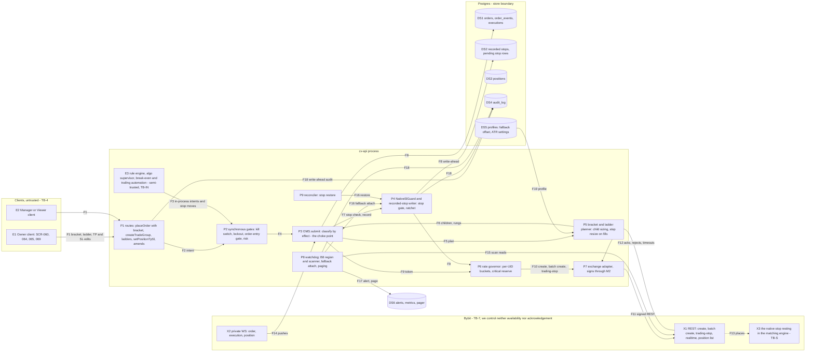

# E32 — STRIDE threat model: brackets, ladders and the native stop-loss invariant

- Ticket: E32-X01 (issue #933). Owner: Security engineer (CODEOWNER). Status: **Draft for review** (staged
  2026-11-03). The review session (Architect, OMS lead, Owner) waits on E29-K01 (#843), the one open blocker; the
  Owner's sign-off of the §10.2 accepted risks is pending, queued on #2701 when the PR opens.
- Method: the `04-security-program.md` §5 template (L x I = risk), STRIDE per element and per trust boundary
  (C-12.1), formatted as the E28, E29 and E33 models. Their rows are **referenced, not repeated**; where E29 already
  owns a native-stop row (OM-S02, OM-T05, OM-D02, OM-D04, OM-D06, OM-D08, OM-E06) this model cites it and adds only
  what brackets, ladders, trailing and the watchdog change.
- Inputs, read at `b81479ab0`: issue #933 and the E32 epic with its 31 child tickets (`docs/plan/backlog/E32.json`);
  `11-user-stories.md` §18 ALGO; `14-screens-catalogue.md` SCR-064, SCR-065, SCR-069; `15-component-catalogue.md`
  CMP-118 to CMP-120, CMP-130, CMP-158, CMP-227, CMP-228; `20-architecture.md` §3.5, §4.3, §9, P4;
  `21-database-schema.md` (orders, events, executions, positions, profiles, recorded stops); `22-api-openapi.yaml`
  `/orders`, `/trade-groups`, `/trade-groups/preview`, `/positions/{positionId}/tpsl`; `23-ws-protocol.md` topics
  `orders`, `positions`, `executions`, `trade_groups`, `system`; `24-internal-schemas.md` §8.7 to §8.10, §9.3,
  §10.1, §10.6, §10.7; ADR-0006, ADR-0008, ADR-0016; `28-statechart-catalogue.md` B1 and B8; `32-risk-register.md`
  RSK-016; on `main`, the OMS classification, stop gate, stop ratchet and reconciliation stop writer, the B8
  bindings, and the registered audit actions.
- Path: `docs/security/threat-models/e32-brackets-native-sl.md`, as the ticket names it.
- Confidentiality: the ticket keeps the model internal-confidential. This file is the pattern-level version that may
  be referenced from public tickets; finding detail is held in the restricted security space under the same ids.
- Sibling: the order-ticket surface is the E30 model, `E30-order-ticket.md` (E30-X01, #920); its stop-field and
  opt-out rows (OT-T06, OT-E04) rest on this model's NS-T01 and NS-E05 (§8.1, request R6).
- The question every row answers: **does this leave a position protected only by something we control?** A native
  stop lives in the venue's matching engine and survives our backend; everything else (the watchdog, emulated
  stops, rules, the reconciler) dies with it. Column "Floor" says whether the venue-side stop still stands.

## 1. Scope

In scope, the paths the ticket names: client → API → `OMS.submit` → NativeSlGuard → exchange adapter → Bybit; the
watchdog loop; the `trading-stop` write path; the batch ladder path; the rule-engine entry point. Features:
first-class brackets with partial-fill-aware child sizing (E32-S01), partial take-profit ladders that resize the stop
(E32-S02), scaled and DCA entry ladders with a shared stop (E32-S03), percentage and ATR trailing stops (E32-S04),
break-even automation (E32-T03), and the three screens (SCR-064, SCR-065, SCR-069).

Out of scope (ticket): implementing controls (the engineering tickets), penetration testing (E43), key management
(E27 model). Referenced: the OMS core (E29 model), profiles and sizing (E28 model), emulated algos (E33 model), the
governor and fan-out (E34), the rule engine (E35 model), the kill switch and lockouts (E39 model), the order ticket
(E30 model).

### 1.1 State of the build at review time

| Component                                    | Status at `b81479ab0`                                                                                   |
| -------------------------------------------- | ------------------------------------------------------------------------------------------------------- |
| Classification by effect and NativeStopGuard | Built (E29-T04): an order not shown to reduce is an entry and must carry a stop                         |
| Stop-request gate and recorded-stop writer   | Built (E29-T04, E29-T06): every stop request is recorded write-ahead before it leaves                   |
| Stop ratchet on amends                       | Built for amends; the full rule-5 check at the writer, for every writer, is SR-E32-03's (NS-T02)        |
| Reconciliation's stop restore                | Built (E29-T06): a missing recorded stop is attached, a looser outside stop put back                    |
| B8 position-protection machine               | Contract and bindings; the watchdog scanner, fallback attach and paging are E32-T02's (#932), not built |
| Protective rate reserve                      | Not built: the governor has no purpose classes or `critical` reserve until E34-T02 (#859)               |
| Brackets, TP ladders, scaled and DCA ladders | Not built (E32-S01 to E32-S03); no batch ladder path exists yet                                         |
| `sl.loosened`, `sl.loosen_refused`           | Named in 24 §8.8, not registered in the audit vocabulary                                                |

### 1.2 Assets

| Asset                                                     | Class                               | Notes                                                                  |
| --------------------------------------------------------- | ----------------------------------- | ---------------------------------------------------------------------- |
| The native stop on the venue for every open position      | Integrity and availability critical | The asset of C-2.6; the only protection that survives our backend      |
| The recorded stop (the stop in force, per position)       | Integrity critical                  | What "looser" is measured against; written ahead of every stop request |
| Bracket, ladder and trailing definitions; child plans     | Financial / restricted              | Decide stop size and price; integrity matters more than secrecy        |
| The protective `critical` budget per UID                  | Availability critical               | A starved stop is a C-2.6 failure (E29 §7)                             |
| Naked-position alerts, watchdog state, attach diagnostics | Financial / restricted              | Name accounts and sizes; scoped like orders                            |

### 1.3 Rating

As the E29 model: Risk = L x I; impact **H\*** marks an outcome that leaves a position without a working native
stop (C-2.6, Severity-1) and raises the cell one band. Disposition **Q** requirement (`SR-E32-nn`, §7), **C**
existing control, **R** another model's row, **A** accepted with the Owner's sign-off and a detection control.

### 1.4 Open inputs

| Id  | Assumption                                                                                                                                  | Confirmed by     |
| --- | ------------------------------------------------------------------------------------------------------------------------------------------- | ---------------- |
| O-1 | The venue's cancel-all filter and its Partial-mode stop behaviour are as the E29 model's O-4 states                                         | E29-K01 (#843)   |
| O-2 | An attached stop on create and a `trading-stop` after the first fill differ in latency and failure modes as E32-K01 will measure            | E32-K01 (#856)   |
| O-3 | A batch create may succeed per item, so each rung is judged and stopped on its own, never the batch as a whole                              | E32-K01, E32-S03 |
| O-4 | Whether the venue keeps a fixed stop beside an active trail (24 §8.8 rule 5)                                                                | E29-K01          |
| O-5 | The attach deadline is 2 s: 24 §8.8 owns the value (B8 notes, C-16.5); ADR-0008's 3000 ms default is stale, amended by A-row A-ADR8 (§10.4) | `24` §8.8 rule 2 |

## 2. Data-flow diagram and trust boundaries

Text alternative: clients send bracket, ladder and stop edits (F1); the routes pass intents to the synchronous gates
(F2), as do the in-process callers (F3). `OMS.submit` classifies each order by effect (F4) and asks the planner for
children and rungs (F5, F6). Every position-opening order and every stop request passes NativeSlGuard and the
recorded-stop writer (F7), which records the stop before anything leaves (F8); a budget token is taken (F9) and the
adapter sends (F10, F11). Answers return untrusted (F12); the venue holds the native stop (F13); pushes update the
mirror (F14). The watchdog reads positions from the venue (F15) and, like the reconciler, writes only through the
same writer (F16); it pages (F17). Every mutation is audited write-ahead (F18); profiles feed sizing (F19).

Elements: E1 to E3; P1 to P9; DS1 to DS6; X1 to X3; flows F1 to F19.

Boundaries:

- **TB-4, client to API**: untrusted; RBAC and scope on every route; the client enforces nothing (C-2.12).
- **TB-IN, in-process callers to the choke point**: the rule engine, algos, fan-out and automation are code we
  wrote but treat as semi-trusted (programme AC-06): they reach the venue only through P3 and P4.
- **Store boundary**: DS2 is the reference for "looser"; a writer that could edit it could change what counts as
  loosening (E29 OM-T03 owns the store controls).
- **TB-7, backend to Bybit**: the venue is semi-trusted; we control neither its availability nor its
  acknowledgement semantics. A sent stop whose answer is lost is unknown until a read shows it.
- **TB-S, our process to the resting stop**: once X3 holds the stop, protection no longer depends on us. Every
  window before that is protected only by something we control.

## 3. STRIDE table

Columns as the E29 model, plus **Floor**: Y when the venue-side stop still stands while the threat plays out, N
when the position is protected only by our process.

### 3.1 Spoofing

| ID     | Element / flow   | Threat                                                                                                                                | L   | I   | Risk     | Floor | Existing control                                                                                    | Gap → mitigation                                                                                                                             | Owner                     | Verify         | Residual |
| ------ | ---------------- | ------------------------------------------------------------------------------------------------------------------------------------- | --- | --- | -------- | ----- | --------------------------------------------------------------------------------------------------- | -------------------------------------------------------------------------------------------------------------------------------------------- | ------------------------- | -------------- | -------- |
| NS-S01 | E1, E2, F1, P1   | A caller acts for an account or position it does not own: a bracket, ladder or stop edit on a foreign account or position id          | M   | H\* | Critical | Y     | E29 OM-E01: scope decided on the stored row, foreign and missing ids answer alike, audited          | None new; every E32 route joins the role and IDOR matrix (SR-E32-11)                                                                         | E29-T07, E32-S07, E32-X02 | E32-X02 AC-01  | Low      |
| NS-S02 | F1, F3, P3       | A spoofed purpose: an opening order labelled protective (take-profit, stop, reduce-only) to avoid the stop or spend the reserve       | M   | H\* | Critical | N     | Classification by effect (SR-E29-01, built); E29 OM-S02                                             | E32-T01 proves it for every new order kind: bracket children, ladder rungs, batch items (SR-E32-01)                                          | E32-T01, E29-T04          | E32-Q01, AC-02 | Low      |
| NS-S03 | E3, F3, P7       | An internal caller impersonates the OMS: a module reaches the adapter's create or `trading-stop` directly, so no guard sees it        | L   | H\* | High     | N     | Module boundaries (import-linter); the adapter's write methods are called from the OMS command path | The single choke point of §4, an architecture test that only it calls the adapter's write methods, and a Semgrep rule (SR-E32-02)            | E32-T01, E32-X02          | E32-Q01, AC-03 | Low      |
| NS-S04 | X1, X2, F12, F14 | A spoofed "protected": a successful attach answer, a stale or forged push, or a cached position read taken as proof of a resting stop | M   | H\* | Critical | N     | B8 contract: `protected` only from a completed exchange read (INV-B8-a)                             | The watchdog reads the venue itself, independent of the attach path; its miss counter resets only on an observed stop (INV-B8-e) (SR-E32-05) | E32-T02                   | unit, E32-Q05  | Low      |
| NS-S05 | X3, P9, DS2      | A foreign stop counted as ours: a stop set outside the OMS on the venue is taken as the protection the OMS recorded                   | L   | H   | Medium   | Y     | Provenance pairing and the foreign-order freeze (E29 OM-T05, SR-E29-06, SR-E27-19)                  | None new                                                                                                                                     | E29-T06                   | E29 AC-14      | Low      |

### 3.2 Tampering

| ID     | Element / flow   | Threat                                                                                                                                                                       | L   | I   | Risk     | Floor       | Existing control                                                                                     | Gap → mitigation                                                                                                                                                              | Owner                     | Verify                | Residual |
| ------ | ---------------- | ---------------------------------------------------------------------------------------------------------------------------------------------------------------------------- | --- | --- | -------- | ----------- | ---------------------------------------------------------------------------------------------------- | ----------------------------------------------------------------------------------------------------------------------------------------------------------------------------- | ------------------------- | --------------------- | -------- |
| NS-T01 | F1, F3, P4       | Payload manipulation strips a stop: omitted, zero or non-positive, on the wrong side of entry, unparseable, or on a size that covers nothing                                 | M   | H\* | Critical | N           | NativeStopGuard refuses `native_stop_required` before any send; no port sends a non-positive stop    | Extended to every bracket child, ladder rung and batch item, each judged alone (SR-E32-01) `[O-3]`                                                                            | E32-T01, E32-S01, E32-S03 | E32-Q01, AC-04        | Low      |
| NS-T02 | F1, F3, P4, DS2  | Payload manipulation widens a stop: a farther trigger, a smaller cover, a trail added, lengthened or armed later, a Partial-mode term loosened                               | M   | H\* | Critical | Y           | The ratchet on amends covers part of 24 §8.8 rule 5; the owner-only override is contracted           | One loosening check at the recorded-stop writer covering every term of rule 5, every writer, every mode; the owner's override under a per-request step-up (SR-E32-03) `[O-4]` | E32-T01, E32-S07          | E32-Q01, AC-05, AC-06 | Low      |
| NS-T03 | F1, P5, P3       | A preview different from what is submitted: the ladder or bracket priced in the preview is not the one sent, or the client re-sizes after the preview                        | M   | H   | High     | Y           | The submit is judged on its own (SR-E29-04); the preview has no authority (E28)                      | The server derives the plan from the submitted spec at submit, and stop cover from that plan, never from a client plan (SR-E32-04)                                            | E32-S01, E32-S03, E28-T03 | AC-07                 | Low      |
| NS-T04 | P5, F14, DS2     | Child sizing drifts from the position: after partial fills or filled TP legs the stop covers less than the position, or a resize lands late                                  | M   | H\* | Critical | N           | The cover rule of 24 §8.8: a cover below the position is looser                                      | Partial-fill-aware sizing; the stop resized on every fill within the 2 s deadline through the writer; a property test that cover ≥ position after any fill order (SR-E32-06)  | E32-S01, E32-S02          | property, E32-Q05     | Low      |
| NS-T05 | P5, F6           | Ladder rungs and the shared stop disagree: a rung priced beyond the stop, or later rungs filling after the stop was sized for earlier ones                                   | M   | H\* | Critical | N           | None (not built)                                                                                     | Every rung on the protected side of the shared stop at plan time; cover recomputed per rung fill (SR-E32-06)                                                                  | E32-S03                   | property, AC-08       | Low      |
| NS-T06 | E3, P4, F3       | Trailing translation: a percentage or ATR trail turned into a zero or negative distance (which the venue reads as removing the trail), or ATR from an untrusted source       | M   | H   | High     | N until O-4 | The port never sends a zero trail (24 §8.9); E28 SR-E28-12 and SR-E28-14 on ATR and confirmed swings | Server-side translation only, with a minimum distance (a change to 24 §8.9, §10.3 note 4); ATR from the kernel path, failing closed (SR-E32-07)                               | E32-S04                   | unit, AC-09           | Low      |
| NS-T07 | E3, P4           | Break-even or a trail moves the stop the wrong way (a short's stop lowered), or an automation writes outside the writer                                                      | L   | H\* | High     | Y           | None (not built); the B8 `tightens_only` guard is deny polarity                                      | Every automation writes through the same writer and is held to only-tighten (SR-E32-03)                                                                                       | E32-T03, E32-S04          | property, AC-10       | Low      |
| NS-T08 | F1, P3           | A cancel or cancel-all removes the native stop of an open position                                                                                                           | M   | H\* | Critical | N           | E29 OM-T05 and SR-E29-06                                                                             | None new                                                                                                                                                                      | E29-T04, E29-T07          | E29 AC-14, E32-Q01    | Low      |
| NS-T09 | P3, P7, F10, F12 | A batch create of rungs partly succeeds and is retried with fresh ids, so accepted rungs are sent again and exposure doubles (each rung keeps its stop; the sizing does not) | M   | H   | High     | Y           | C-2.10: an `orderLinkId` derived deterministically and reused on retry; no batch path exists yet     | Each rung's `orderLinkId` derives from (group, account, rung index, attempt epoch); per-item outcomes are reconciled by `orderLinkId` before any resend (SR-E32-13) `[O-3]`   | E32-S03, E32-T01          | AC-18                 | Low      |

### 3.3 Repudiation

| ID     | Element / flow | Threat                                                                                                                    | L   | I   | Risk   | Floor | Existing control                                                             | Gap → mitigation                                                                                                                  | Owner            | Verify         | Residual     |
| ------ | -------------- | ------------------------------------------------------------------------------------------------------------------------- | --- | --- | ------ | ----- | ---------------------------------------------------------------------------- | --------------------------------------------------------------------------------------------------------------------------------- | ---------------- | -------------- | ------------ |
| NS-R01 | F18, DS4       | A stop loosened with no attributable audit row, or a refused loosening not recorded                                       | M   | H   | High   | Y     | `sl.attached` and `sl.modified` registered                                   | Register `sl.loosened` and `sl.loosen_refused`; write the loosening ahead with actor, role, account, before and after (SR-E32-08) | E32-S07, E32-T04 | E32-X03, AC-06 | Low          |
| NS-R02 | P8, F16, DS4   | A watchdog or fallback attach cannot be attributed: which stop, which reason (record in force or fallback), which attempt | M   | H   | High   | N     | `sl.attached` with a reason exists for reconciliation's restore              | The watchdog writes the same record with its own reason and attempt count (SR-E32-08)                                             | E32-T02          | E32-X03        | Low          |
| NS-R03 | P5, DS1, DS2   | A bracket or ladder resize after fills leaves no before-and-after trail                                                   | M   | M   | Medium | Y     | `order_events` write-ahead (E29)                                             | Each resize writes `sl.modified` with both values (SR-E32-08)                                                                     | E32-S01, E32-S02 | integration    | Low          |
| NS-R04 | E3, F3         | An automated stop move (trail, break-even, rule) is attributed to the user, or the user denies a move the automation made | L   | M   | Low    | Y     | `origin` from the call path (SR-E29-01)                                      | None new; automation records its rule or feature as origin                                                                        | E32-T03, E35     | integration    | Low          |
| NS-R05 | X1, F12        | A stop request was sent and the venue's answer was lost: we cannot show what rests on the venue                           | M   | H   | High   | N     | The request is recorded write-ahead; B8 reaches `protected` only from a read | Cannot be prevented (TB-7). Accepted with detection: the read-back, the watchdog page and reconciliation (§10.2 A-1)              | E32-T02, E29-T06 | E32-Q05        | Medium (A-1) |

### 3.4 Information disclosure

| ID     | Element / flow | Threat                                                                                                                                | L   | I   | Risk   | Floor | Existing control                                                                                                   | Gap → mitigation                                                                                                    | Owner            | Verify | Residual |
| ------ | -------------- | ------------------------------------------------------------------------------------------------------------------------------------- | --- | --- | ------ | ----- | ------------------------------------------------------------------------------------------------------------------ | ------------------------------------------------------------------------------------------------------------------- | ---------------- | ------ | -------- |
| NS-I01 | P8, F17, DS6   | Naked-position alerts and attach diagnostics carry account identifiers or sizes across RBAC: on `system`, in a page, in metric labels | M   | M   | Medium | Y     | Account notices reach only granted connections (SR-E29-10); closed-set metric labels (E29 OM-I07)                  | Watchdog alerts are account-scoped notices; pages carry closed fields; no account id or size as a label (SR-E32-09) | E32-T02          | AC-11  | Low      |
| NS-I02 | P1, F1         | A ladder or bracket preview over a group shows legs of accounts outside the caller's grants                                           | M   | M   | Medium | Y     | The preview refuses an ungranted or missing leg alike, whole (SR-E28-21)                                           | None new                                                                                                            | E32-S06, E28-T05 | AC-12  | Low      |
| NS-I03 | P1, DS1        | Saved bracket and ladder presets readable by another user                                                                             | L   | M   | Low    | Y     | Settings are self-scoped: `getSettings` and `updateSettings` are `scope: self`, a query parameter refused (SR-026) | Presets stored per user and never shared by default                                                                 | E32-S05, E32-S06 | unit   | Low      |
| NS-I04 | F12, P1        | The venue's text on a refused stop echoed with account detail, or rendered as markup                                                  | L   | M   | Low    | Y     | E29 OM-I08                                                                                                         | None new                                                                                                            | E29-T04          | unit   | Low      |

### 3.5 Denial of service

| ID     | Element / flow | Threat                                                                                                                                      | L   | I   | Risk     | Floor | Existing control                                                                       | Gap → mitigation                                                                                                                                                                                                                                                                  | Owner            | Verify         | Residual        |
| ------ | -------------- | ------------------------------------------------------------------------------------------------------------------------------------------- | --- | --- | -------- | ----- | -------------------------------------------------------------------------------------- | --------------------------------------------------------------------------------------------------------------------------------------------------------------------------------------------------------------------------------------------------------------------------------- | ---------------- | -------------- | --------------- |
| NS-D01 | P5, P6, F10    | A 50-level ladder, or several, exhausts the per-UID budget so a protective order cannot be placed                                           | H   | H\* | Critical | N     | The governor meters per UID and class, with no reserve yet (E29 OM-D02, OM-D08)        | Rungs draw `entry`, never `critical`; a ladder is admitted only within the projected budget, with a rung cap; stop attach, repair and the `naked_unrecoverable` reduce-only close keep a slice of `critical`, and cancels and flatten the rest of the reserve (C-12.7, SR-E32-10) | E34-T02, E32-S03 | E32-Q06, AC-13 | Low             |
| NS-D02 | X1, F11, F12   | The venue is unavailable or slow in the window between a fill and the stop attach (a deferred child, a rung filling before its cover grows) | M   | H\* | Critical | N     | Attached-at-create where the venue accepts it (24 §8.8 rule 1)                         | Attach at create on every entry where possible; a closed deferral list with its pending row persisted first; the 2 s deadline then the watchdog (SR-E32-01, SR-E32-05) `[O-2]`; residual accepted                                                                                 | E32-T01, E32-T02 | E32-Q05        | Medium (A-2)    |
| NS-D03 | P8             | The watchdog itself stops: a blocked event loop, a dead order lane, or a scan that keeps failing, so no one notices a missing stop          | M   | H   | High     | Y     | Lane death and heartbeat pages (E29 OM-D12)                                            | A watchdog liveness signal and a page when a scan is overdue; the scan never shares a budget with background reads (SR-E32-05)                                                                                                                                                    | E32-T02          | E32-Q05        | Low             |
| NS-D04 | P8, F17        | Alert fatigue: the naked-to-verifying loop pages on every lap, so the one page that matters is lost                                         | M   | M   | Medium   | N     | INV-B8-f bounds the loop                                                               | Pages deduplicated per position and episode (SR-E32-09)                                                                                                                                                                                                                           | E32-T02          | unit           | Low             |
| NS-D05 | DS4, P4        | The audit store refuses, so protective writes are refused with every audited action                                                         | L   | H\* | High     | Y     | E29 OM-D04 (accepted residual there)                                                   | None new                                                                                                                                                                                                                                                                          | E29-T04          | chaos          | Medium (E29 RR) |
| NS-D06 | X1, P8         | The fallback attach is refused again and again (the market is through the stop, a minimum distance), so the position stays unprotected      | L   | H\* | High     | N     | B8: `naked_unrecoverable` pages the owner and considers a reduce-only close (INV-B8-d) | The reduce-only close is attempted, never only considered: C-2.6 requires the attempt, INV-B8-d admits no exception, ADR-0008 closes the leg (SR-E32-05); INV-B8-d's wording follows by G-row G-B8 (§10.4)                                                                        | E32-T02          | E32-Q05, AC-14 | Low             |

### 3.6 Elevation of privilege

| ID     | Element / flow | Threat                                                                                                                                                               | L   | I   | Risk     | Floor | Existing control                                                                    | Gap → mitigation                                                                                                                             | Owner                     | Verify         | Residual |
| ------ | -------------- | -------------------------------------------------------------------------------------------------------------------------------------------------------------------- | --- | --- | -------- | ----- | ----------------------------------------------------------------------------------- | -------------------------------------------------------------------------------------------------------------------------------------------- | ------------------------- | -------------- | -------- |
| NS-E01 | E2, F1, P1     | A Viewer or view-as session mutates protective state: a stop edit, a bracket amend, a break-even or trail toggle                                                     | L   | H\* | High     | Y     | `positions:write` and `orders:write` required; the view-as guard refuses writes     | Every E32 route in the role matrix (SR-E32-11)                                                                                               | E32-S07, E09              | AC-15          | Low      |
| NS-E02 | E3, F3, P3     | An internal caller goes around the choke point: a new entry path (chart drag, DOM click, rule action, fan-out leg, algo child, ladder batch) sends without the guard | M   | H\* | Critical | N     | The guard runs on the submit pipeline (E29-T04)                                     | §4: one choke point, proven by the architecture test, the Semgrep rule and E32-Q01's zero-escape suite as a required merge check (SR-E32-02) | E32-T01, E32-Q01, E32-X02 | E32-Q01        | Low      |
| NS-E03 | E2, F1, P4     | A Manager uses the owner-only loosening override                                                                                                                     | L   | H\* | High     | Y     | Contracted: owner only, per-request step-up, refused and audited for any other role | Built and tested at the writer (SR-E32-03)                                                                                                   | E32-S07, E32-T01          | AC-06          | Low      |
| NS-E04 | E3, F3         | A rule action loosens a stop (`modify_stop_loss` without only-tighten, `widen_stop`)                                                                                 | L   | H\* | High     | Y     | Refused at the writer whatever the rule holds (24 §8.8 rule 5)                      | None new beyond SR-E32-03                                                                                                                    | E35, E32-T01              | AC-10          | Low      |
| NS-E05 | DS5, P3        | A flag, profile, environment or "advanced mode" disables the invariant (the profile's stop requirement false, a demo exemption, a feature flag)                      | L   | H\* | High     | N     | C-2.6, C-4.14; the profile requirement is constant and checked (E28 PF-T09)         | No E32 setting reads as an exemption; E32-Q01 runs on demo and live configurations alike (SR-E32-12)                                         | E32-T01, E28-T01          | E32-Q01, AC-16 | Low      |
| NS-E06 | E3, P3         | The deferred-stop allow-list is widened: another origin uses the algo-child deferral to send an entry without an attached stop                                       | L   | H\* | High     | N     | Closed allow-list, pending row persisted before the send (E33 model, SR-E33-07)     | The list is a closed set in code, its membership tested; any other origin attaches at create (SR-E32-01)                                     | E32-T01, E33-T01          | AC-17          | Low      |

### 3.7 Coverage matrix

Every element and boundary against the six categories: a row id, or N/A with the reason.

| Element / boundary          | S                                      | T                      | R                                                         | I                          | D                                         | E                  |
| --------------------------- | -------------------------------------- | ---------------------- | --------------------------------------------------------- | -------------------------- | ----------------------------------------- | ------------------ |
| TB-4, E1, E2, P1            | NS-S01                                 | NS-T01, NS-T03         | NS-R01                                                    | NS-I02, NS-I04             | E29 OM-D01                                | NS-E01, NS-E03     |
| P2 synchronous gates        | E39 model                              | E39 model              | E39 model                                                 | N/A: no output             | E39 model                                 | E29 OM-E06         |
| P3 choke point, TB-IN       | NS-S02, NS-S03                         | NS-T08, NS-T09         | NS-R04                                                    | N/A: no output             | NS-D01                                    | NS-E02, NS-E05     |
| P4 guard and writer, DS2    | NS-S05                                 | NS-T01, NS-T02, NS-T07 | NS-R01                                                    | N/A: internal              | NS-D05                                    | NS-E03, NS-E04     |
| P5 planner                  | N/A: no identity                       | NS-T03, NS-T04, NS-T05 | NS-R03                                                    | N/A: internal              | NS-D01                                    | NS-E06             |
| P6 governor                 | E29 OM-S02                             | N/A: no data           | N/A: a token draw is no user action; refusals are metrics | N/A: holds no account data | NS-D01                                    | E29 OM-D08         |
| P7 adapter, TB-7, X1, X2    | NS-S04                                 | E29 OM-T04             | NS-R05                                                    | NS-I04                     | NS-D02                                    | E29 OM-E05         |
| X3 resting stop, TB-S       | NS-S05                                 | NS-T02, NS-T08         | NS-R05                                                    | N/A: venue                 | NS-D02, NS-D06                            | NS-E05             |
| P8 watchdog                 | NS-S04                                 | NS-T07                 | NS-R02                                                    | NS-I01                     | NS-D03, NS-D04, NS-D06                    | NS-E02             |
| P9 reconciler               | NS-S05                                 | E29 OM-T08             | E29 OM-R03                                                | N/A: internal              | E29 OM-D02                                | E29 OM-E02         |
| E3 automation, rules, algos | NS-S02                                 | NS-T06, NS-T07         | NS-R04                                                    | N/A: internal              | E33 AS-D01                                | NS-E04, NS-E06     |
| DS1, DS3, DS4 stores        | N/A: no identity                       | E29 OM-T03             | E09 U14 to U20                                            | NS-I03                     | NS-D05                                    | N/A: no caller     |
| DS5 profiles                | N/A: no identity; the planner reads it | E28 PF-T rows          | E28 model                                                 | E28 model                  | N/A: read once per plan, no shared budget | NS-E05             |
| DS6 alerts and pager        | N/A: outbound only                     | N/A: not authority     | NS-R02                                                    | NS-I01                     | NS-D04                                    | N/A: no write path |

## 4. Enforcement placement: one choke point (decision for E32-T01)

**Decision.** The invariant is enforced at **one synchronous choke point**: the OMS command path immediately before
the adapter's write methods. Every position-opening venue call (a ticket order, a bracket child, a ladder rung or
batch item, a fan-out leg, an algo child, a rule action, a chart or DOM order) and every stop request passes one
NativeSlGuard and one recorded-stop writer there, after classification by effect and the synchronous gates (C-2.21).
The watchdog and reconciliation are **detection and repair**, never enforcement, and they too write only through
that writer. The resting native stop is the floor.

**Rejected: checks at each call site.** N copies drift; a new entry point ships without its copy; a zero-escape
suite can enumerate the choke point but not call sites nobody has written yet; RSK-016's mitigation already rules
it out.

**Rejected: enforcement in the adapter.** The adapter has no position, profile or recorded stop, and must stay
venue-specific (C-2.2). It keeps one structural assertion as a last line: it refuses to send a non-positive stop,
and refuses an entry create that carries neither a stop nor a deferral marker the choke point issued.

**Rejected: the B8 machine as the enforcement point.** Statecharts record; synchronous code enforces (C-2.21). B8
records protection and orchestrates repair; it never decides whether an order may leave.

**Proof obligations handed to E32-T01 and E32-Q01:**

1. An architecture test: only the choke point's module calls the adapter's create, batch create and `trading-stop`.
2. A Semgrep rule on the same calls outside that module (E32-X02).
3. E32-Q01 drives every entry path in the RSK-016 list and observes zero escapes, as a required merge check.
4. A mutation run: disabling the guard turns E32-Q01 red (recorded once by E32-X02).

## 5. Abuse cases for E32-X02

| AC    | Abuse case                                                                                               | Expected                                                                                  | Rows           |
| ----- | -------------------------------------------------------------------------------------------------------- | ----------------------------------------------------------------------------------------- | -------------- |
| AC-01 | Bracket, ladder and stop edits on a foreign account and a foreign position id, per role                  | `403` or `404` alike, no change, audited                                                  | NS-S01         |
| AC-02 | An opening order labelled take-profit, stop or reduce-only with no position to reduce                    | Classified as an entry; stop required; `entry` budget                                     | NS-S02         |
| AC-03 | A code path that calls the adapter's write methods outside the choke point                               | Architecture test and Semgrep fail                                                        | NS-S03, NS-E02 |
| AC-04 | Each bracket child, ladder rung and batch item with no stop, a zero stop, a wrong-side stop              | Each refused alone, nothing sent for it                                                   | NS-T01         |
| AC-05 | Loosening by every term: trigger, cover, trail added, trail longer, trail armed later, Partial-mode term | Refused `risk_limit_breached`, audited `sl.loosen_refused`                                | NS-T02         |
| AC-06 | The owner's loosening without a step-up, with a reused step-up, and a Manager's attempt                  | Refused; only a fresh owner step-up passes, audited `sl.loosened`                         | NS-T02, NS-E03 |
| AC-07 | A ladder submitted with a plan different from its preview                                                | The server's own plan is sent; cover from that plan                                       | NS-T03         |
| AC-08 | Rungs priced beyond the shared stop; fills in every order                                                | Refused at plan; cover ≥ position after every fill (property)                             | NS-T04, NS-T05 |
| AC-09 | A trail that translates to zero or below; ATR unavailable                                                | Refused; fails closed                                                                     | NS-T06         |
| AC-10 | Break-even, a trail and a rule action that would move a stop outward                                     | Refused at the writer                                                                     | NS-T07, NS-E04 |
| AC-11 | A Manager's socket during another account's naked-position alert                                         | Nothing for the ungranted account                                                         | NS-I01         |
| AC-12 | A group ladder preview with an ungranted leg                                                             | Whole request refused, same answer as a missing account                                   | NS-I02         |
| AC-13 | A 50-rung ladder on several accounts of one UID while a stop attach is due                               | The attach gets its token within the deadline                                             | NS-D01         |
| AC-14 | A fallback attach the venue keeps refusing                                                               | `naked_unrecoverable` pages; the reduce-only close is attempted                           | NS-D06         |
| AC-15 | A Viewer and a view-as session on every E32 mutation                                                     | Refused before the pipeline                                                               | NS-E01         |
| AC-16 | E32-Q01 under demo and live configurations, every profile value                                          | Zero escapes in both                                                                      | NS-E05         |
| AC-17 | A non-algo origin presenting the deferral marker                                                         | Refused; stop required at create                                                          | NS-E06         |
| AC-18 | A batch of rungs in which some items are refused, then retried                                           | Accepted rungs keep their `orderLinkId`, are reconciled and not resent; no duplicate rung | NS-T09         |

## 6. Observability: detection controls

Findings that need detection, not only prevention. These are E32-T01's and E32-T02's observability requirements.

| Signal                                                        | Kind                                            | For rows                       | Owner   |
| ------------------------------------------------------------- | ----------------------------------------------- | ------------------------------ | ------- |
| Position in `naked` past the 2 s attach deadline              | P1 alert (INV-3)                                | NS-S04, NS-D02, NS-R05, NS-T04 | E32-T02 |
| Position without a native stop for more than 10 s             | Critical alert and auto-attach (24 §8.8 rule 3) | NS-S04, NS-D02, NS-D03         | E32-T02 |
| `naked_unrecoverable` entered                                 | Owner page                                      | NS-D06                         | E32-T02 |
| Watchdog scan overdue, or no successful scan in two intervals | Page                                            | NS-D03                         | E32-T02 |
| Attach latency from fill to observed stop, per path           | Histogram                                       | NS-D02, O-2                    | E32-T01 |
| `critical` reserve below one token for 10 s                   | Page (E29 §9.2)                                 | NS-D01                         | E34-T02 |
| Loosening refused, loosening allowed                          | Audit and alert                                 | NS-T02, NS-R01, NS-E03         | E32-S07 |
| Guard refusals by origin                                      | Counter, closed set                             | NS-S02, NS-E02, NS-E06         | E32-T01 |

## 7. Requirements added by this model

| Id        | Requirement                                                                                                                                                                                                                                                        | Owner                     |
| --------- | ------------------------------------------------------------------------------------------------------------------------------------------------------------------------------------------------------------------------------------------------------------------ | ------------------------- |
| SR-E32-01 | Every position-opening order of every kind (bracket child, ladder rung, batch item) is classified by effect and judged alone; it carries a stop at create, or is on the closed deferral list with its pending row persisted first                                  | E32-T01                   |
| SR-E32-02 | One choke point (§4), proven by an architecture test, a Semgrep rule and E32-Q01 as a required merge check                                                                                                                                                         | E32-T01, E32-Q01, E32-X02 |
| SR-E32-03 | One loosening check at the recorded-stop writer covering every term of 24 §8.8 rule 5 in both modes, for every writer; the owner's override only under a per-request step-up                                                                                       | E32-T01, E32-S07          |
| SR-E32-04 | Bracket and ladder plans, and the stop cover, are derived server-side from the submitted spec at submit                                                                                                                                                            | E32-S01, E32-S03          |
| SR-E32-05 | The watchdog reads the venue independently, attaches the record in force or the fallback through the writer, pages when overdue, and attempts the reduce-only close on `naked_unrecoverable`                                                                       | E32-T02                   |
| SR-E32-06 | Cover follows the position after every fill within the attach deadline; every rung on the protected side of the shared stop                                                                                                                                        | E32-S01, E32-S02, E32-S03 |
| SR-E32-07 | Trailing distances are translated server-side, never zero or below a minimum; ATR fails closed                                                                                                                                                                     | E32-S04                   |
| SR-E32-08 | `sl.loosened` and `sl.loosen_refused` registered; every stop write audited ahead with actor, origin, reason and both values                                                                                                                                        | E32-S07, E32-T02          |
| SR-E32-09 | Protection alerts are account-scoped, deduplicated per position and episode, with closed-set labels                                                                                                                                                                | E32-T02                   |
| SR-E32-10 | Ladder rungs draw `entry` and are admitted within the projected budget with a rung cap; stop attach, repair and the `naked_unrecoverable` reduce-only close keep a slice of `critical`, and cancels and flatten the rest of the C-12.7 reserve; E34-T02 sizes both | E34-T02, E32-S03          |
| SR-E32-11 | Every E32 route joins the role and IDOR matrix                                                                                                                                                                                                                     | E32-X02                   |
| SR-E32-12 | No E32 setting acts as an exemption; E32-Q01 runs on demo and live configurations                                                                                                                                                                                  | E32-T01, E32-Q01          |
| SR-E32-13 | Each batch rung's `orderLinkId` derives from (group, account, rung index, attempt epoch) (C-2.10); per-item outcomes are reconciled by `orderLinkId` before any resend                                                                                             | E32-S03, E32-T01          |

## 8. Control-to-ticket map

Every E32 ticket and what it owns or verifies in this model (GOV-008).

| Ticket  | Issue | Role in this model                                                                      |
| ------- | ----- | --------------------------------------------------------------------------------------- |
| E32-D01 | #827  | Research on mandatory-stop mental models: input to the human-facing rows; closed        |
| E32-D02 | #855  | Wireframes of the three screens; closed                                                 |
| E32-K01 | #856  | O-2 and O-3: attach latency and failure modes on demo; feeds NS-D02                     |
| E32-D03 | #923  | SCR-069 and CMP-119: the non-removable stop floor in the builder; closed                |
| E32-D04 | #924  | SCR-065: the ladder preview table that NS-T03 and NS-T05 constrain; closed              |
| E32-D05 | #925  | SCR-064 and CMP-120: the stop editor that NS-T02 constrains; closed                     |
| E32-D06 | #926  | CMP-158 and the native-stop affordance                                                  |
| E32-D07 | #927  | A11y review and handoff pack; closed                                                    |
| E32-S01 | #928  | SR-E32-04, -06; NS-T03, NS-T04, NS-R03                                                  |
| E32-S02 | #929  | SR-E32-06; NS-T04, NS-R03                                                               |
| E32-S04 | #930  | SR-E32-07; NS-T06, NS-T07                                                               |
| E32-T01 | #931  | §4 and SR-E32-01, -02, -03, -12; NS-S02, NS-S03, NS-T01, NS-T02, NS-E02, NS-E05, NS-E06 |
| E32-T02 | #932  | SR-E32-05, -08, -09; NS-S04, NS-R02, NS-I01, NS-D02, NS-D03, NS-D04, NS-D06             |
| E32-X01 | #933  | This model                                                                              |
| E32-Q01 | #985  | The zero-escape suite: AC-02 to AC-04, AC-16, and §4 proof obligation 3                 |
| E32-Q02 | #986  | Black-box plan for brackets, TP ladders and trailing: AC-05, AC-08, AC-09               |
| E32-T03 | #987  | Break-even as only-tighten: NS-T07, NS-R04                                              |
| E32-Q05 | #1039 | Chaos at the crash seams: NS-S04, NS-T04, NS-R05, NS-D02, NS-D03, NS-D06                |
| E32-S05 | #1040 | The bracket builder with a non-removable stop floor: NS-I03                             |
| E32-S07 | #1041 | SR-E32-03, -08; NS-S01, NS-T02, NS-R01, NS-E01, NS-E03                                  |
| E32-S03 | #1093 | SR-E32-04, -06, -10, -13; NS-T01, NS-T05, NS-T09, NS-D01 and the batch path `[O-3]`     |
| E32-S06 | #1094 | The ladder builder: NS-I02, NS-I03                                                      |
| E32-T04 | #1095 | Contract changes: the audit actions of SR-E32-08, the trail minimum of SR-E32-07        |
| E32-D08 | #1167 | Design QA: the stop floor is never removable on the shipped screens                     |
| E32-Q03 | #1168 | Black-box plan for scaled and DCA ladders: AC-07, AC-08, AC-13, AC-18                   |
| E32-Q04 | #1169 | E2E on demo for the three screens: AC-04, AC-05                                         |
| E32-Q06 | #1170 | Perf and load for budget #4 and NS-D01 (AC-13)                                          |
| E32-Q07 | #1171 | Accessibility audit of the three screens                                                |
| E32-Q08 | #1172 | Exploratory charters and the regression pack over §5                                    |
| E32-X02 | #1173 | §5 abuse cases, the role matrix (SR-E32-11), the Semgrep rule of §4, the mutation run   |
| E32-X03 | #1174 | Review: every §9.1 finding closed with its test before the R3 gate; §6 signals present  |

### 8.1 Requests to other tickets and models

| R   | To              | Request                                                                                                                                                                                           |
| --- | --------------- | ------------------------------------------------------------------------------------------------------------------------------------------------------------------------------------------------- |
| R1  | E34-T02 (#859)  | Purpose classes and the `critical` reserve with the protective slice of SR-E32-10                                                                                                                 |
| R2  | E32-S07 (#1041) | The owner's step-up on `setPositionTpSl` and the full loosening check at the writer (SR-E32-03); E29-T07 (#915, closed) shipped the route                                                         |
| R3  | E29-K01 (#843)  | O-1 and O-4: cancel-all filter, Partial-mode stops, trail beside a fixed stop                                                                                                                     |
| R4  | E33-T01 (#993)  | Keep the deferral list closed and the pending row written first (NS-E06)                                                                                                                          |
| R5  | E28-T03 (#907)  | ATR and confirmed swings for the trail (NS-T06)                                                                                                                                                   |
| R6  | E30-X01 (#920)  | The E30 model's OT-T06 and OT-E04 rest on NS-T01 and NS-E05; its "protective stop pending" state (HF-8) reads B8's published protection state, with this model's watchdog alert as the escalation |
| R7  | E39             | The kill switch never cancels a protective stop and never stops the watchdog (INV-B8-g)                                                                                                           |

## 9. Ranked findings

### 9.1 Findings register

Ranked by inherent risk. Each Critical or High finding names its control, the ticket that builds it and the test
that proves it; all close before the R3 train gate (`30-release-roadmap.md` §7.4).

| F    | Finding                                                                                          | Rows                   | L   | I   | Inherent | Required control        | Ticket           | Verifying test                                                 |
| ---- | ------------------------------------------------------------------------------------------------ | ---------------------- | --- | --- | -------- | ----------------------- | ---------------- | -------------------------------------------------------------- |
| F-01 | No protective reserve: a large ladder can take the budget a stop attach needs                    | NS-D01                 | H   | H\* | Critical | SR-E32-10               | E34-T02, E32-S03 | `test_ladder_never_spends_critical` (E32-Q06 AC-13)            |
| F-02 | The choke point is not yet proven to be the only path for every new order kind                   | NS-S03, NS-E02         | M   | H\* | Critical | SR-E32-02               | E32-T01          | `test_only_the_choke_point_calls_adapter_writes`, E32-Q01      |
| F-03 | The loosening check must cover every rule-5 term at the writer, for every writer                 | NS-T02, NS-T07, NS-E03 | M   | H\* | Critical | SR-E32-03               | E32-T01, E32-S07 | `test_every_loosening_term_is_refused` (AC-05, AC-06)          |
| F-04 | No independent watchdog yet: protection is believed, not observed, between reconciliation passes | NS-S04, NS-D03         | M   | H\* | Critical | SR-E32-05               | E32-T02          | `test_protected_only_after_exchange_read`, E32-Q05             |
| F-05 | Cover after partial fills and ladder rungs is unproven                                           | NS-T04, NS-T05         | M   | H\* | Critical | SR-E32-06               | E32-S01, E32-S03 | `test_cover_at_least_position_after_any_fill_order` (property) |
| F-06 | New order kinds (children, rungs, batch items) must each be judged alone                         | NS-T01, NS-S02         | M   | H\* | Critical | SR-E32-01               | E32-T01, E32-S03 | E32-Q01 AC-02, AC-04                                           |
| F-07 | Loosening audit actions are unregistered                                                         | NS-R01, NS-R02         | M   | H   | High     | SR-E32-08               | E32-S07, E32-T02 | `test_loosening_writes_audit_ahead`                            |
| F-08 | `naked_unrecoverable` only "considers" a reduce-only close                                       | NS-D06                 | L   | H\* | High     | SR-E32-05 (C-2.6); G-B8 | E32-T02          | E32-Q05 AC-14                                                  |
| F-09 | Trail translation can reach a distance the venue reads as removal                                | NS-T06                 | M   | H   | High     | SR-E32-07               | E32-S04          | `test_trail_distance_never_below_minimum`                      |
| F-10 | A partly accepted rung batch retried with fresh ids would duplicate rungs                        | NS-T09                 | M   | H   | High     | SR-E32-13               | E32-S03, E32-T01 | `test_batch_retry_reuses_rung_order_link_ids` (AC-18)          |
| F-11 | Protection alerts can carry account detail across grants                                         | NS-I01                 | M   | M   | Medium   | SR-E32-09               | E32-T02          | AC-11                                                          |

### 9.2 Abuse-case list handed to E32-X02

§5's AC-01 to AC-18 are E32-X02's input list, each tied to its rows.

## 10. Residual risks, review and sign-off

### 10.1 What remains protected only by us

The windows in which the floor column reads N are: a deferred child before its stop attaches; a rung fill before
the cover grows; a fallback attach that keeps failing; any moment the venue's answer is lost. Each has a deadline
and a page; none has a venue-side floor. That is the residual this epic exists to keep small.

### 10.2 Accepted risks (never downgraded to make the table look clean)

Owner acceptance pending, queued on #2701 when the PR opens. Each has an owner and a review date; an expired
acceptance is re-decided, not extended (`32-risk-register.md` §1.3). At approval the rows are recorded as one RR entry
in `04-security-program.md` §16.1, as the E28, E29 and E33 residuals were.

| A   | Residual                                                                                    | Why it cannot be fully mitigated                                     | Detection control                                                                   | Level  | Owner    | Review by                                 |
| --- | ------------------------------------------------------------------------------------------- | -------------------------------------------------------------------- | ----------------------------------------------------------------------------------- | ------ | -------- | ----------------------------------------- |
| A-1 | Venue-side acknowledgement loss: a stop sent whose result is unknown                        | We control neither the venue's availability nor its acknowledgements | Read-back to `protected`; watchdog page; reconciliation                             | Medium | Owner/PO | 2027-02-04 (R3 gate), after E32-Q05       |
| A-2 | The window between a fill and the stop attach on the closed deferral path and on rung fills | The venue offers no atomic attach for these cases `[O-2]`            | Attach latency histogram; P1 at the 2 s deadline (INV-3); critical alert after 10 s | Medium | Owner/PO | 2027-02-04 (R3 gate), after E32-K01 (O-2) |
| A-3 | Our process is down while a position is open: only the resting native stop protects it      | By design: emulated and rule stops die with the backend              | Restart sweep re-reads every recorded stop before ready                             | Low    | Owner/PO | 2027-02-25 (R4), before live enablement   |

### 10.3 Amendment notes owed

1. ADR-0008's 3000 ms default is stale: 24 §8.8 owns the 2 s deadline (O-5). A-row A-ADR8 (§10.4) amends it in one
   line; the value is not E32-T04's to decide.
2. B8's "considers a reduce-only close" becomes "attempts" (F-08, C-2.6) by G-row G-B8 (§10.4), in its own small
   contract PR, not this one; wording-only while B8's transition table is unchanged.
3. `32-risk-register.md` RSK-016 is updated in this PR with the modelled paths.
4. 24 §8.9 says a percent trail is translated client-side; SR-E32-07 moves the translation server-side, a change
   E32-T04 carries with the trail minimum.

### 10.4 Rows for other documents (copy-ready; this PR applies neither)

Old is verbatim at `b81479ab0`.

| Row    | Target   | Field (`file`:line)                                      | Old                                                                      | New                                                                                                                                       | Delivered by                                                                                                                                                                                                                                                   |
| ------ | -------- | -------------------------------------------------------- | ------------------------------------------------------------------------ | ----------------------------------------------------------------------------------------------------------------------------------------- | -------------------------------------------------------------------------------------------------------------------------------------------------------------------------------------------------------------------------------------------------------------- |
| A-ADR8 | ADR-0008 | Decision 2 (`27-adrs/ADR-0008-trade-group-fanout.md`:45) | `CV_NATIVE_SL_DEADLINE_MS` (default 3000 ms)                             | A one-line amendment: `CV_NATIVE_SL_DEADLINE_MS` defaults to 2000 ms, the 2 s deadline `24-internal-schemas.md` §8.8 rule 2 owns (C-16.5) | ADR-0008's next amendment, a one-line docs PR once this model is approved                                                                                                                                                                                      |
| G-B8   | `28` B8  | INV-B8-d (`28-statechart-catalogue.md`:4731)             | `naked_unrecoverable` pages the owner and considers a reduce-only close. | `naked_unrecoverable` pages the owner and attempts a reduce-only close.                                                                   | Its own small contract PR (`28`, Refs #933): wording-only while the transition table and the `consider_reduce_only_close` action name stay as they are, so no `machine_hash` change; a renamed action would be a machine change with its hash and version bump |

### Review log

- 2026-11-03: drafted; the enforcement-placement decision (§4) is delivered to E32-T01 and the abuse-case list
  (§5) to E32-X02 at approval. Pending: the review session with the Architect, the OMS lead and the Owner, and the
  Owner's sign-off of §10.2.
- 2026-11-03: security lens round 1 (2 Major, 7 Minor, 2 Nit) folded: no exception to the reduce-only close (F-08),
  §10.2 carries level, owner and review date, and the batch retry row NS-T09 is added.
- 2026-11-03: the orchestrator's rulings folded: B8's "considers" becomes "attempts" by G-row G-B8 in its own
  contract PR; the 2 s deadline stays `24` §8.8's, and ADR-0008's stale 3000 ms is amended by A-row A-ADR8 (§10.4).
