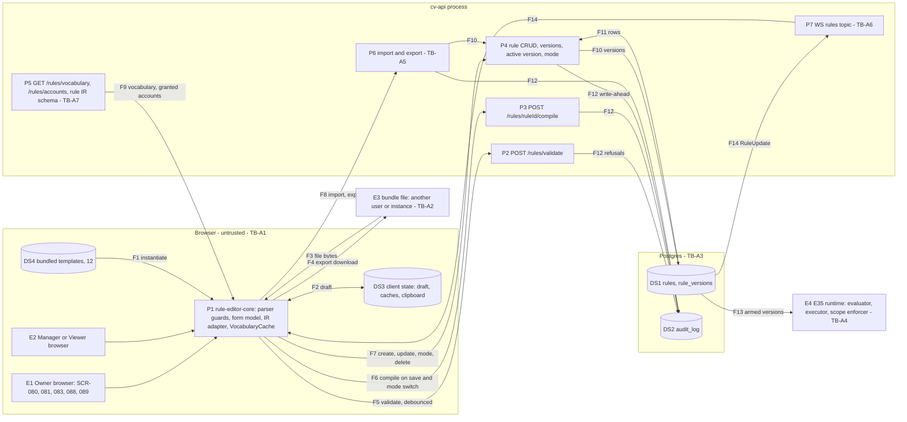

# E36 — STRIDE threat model: the rule authoring surface

- Ticket: E36-X01 (issue #948). Owner: Security engineer (CODEOWNER). Status: **Draft**, pending review by the
  Security engineer and the Architect (the ticket's Definition of Done). Review log: end of §11.
- Method: the `04-security-program.md` §5 template (L x I = risk), STRIDE per element and per trust boundary
  (C-12.1), formatted as `E29-oms.md`. The E35 model (`e35-rule-engine.md`, rows `RE-`), the E39 model
  (`E39-risk-killswitch.md`, rows `RK-`) and the E29 model are **referenced, not repeated** (§6). Row ids are
  `RA-xnn` (rule authoring); requirements are `SR-E36-nn`, epic-local, promoted when their ticket lands; findings
  are `F-nn`, gaps `G-n`, open inputs `O-n`, abuse-case seeds `AC-RA-nn`.
- Inputs, read at `43c5ebdd`: issue #948 and the E36 epic with its 22 child tickets (`docs/plan/backlog/E36.json`);
  `11-user-stories.md` US-RULE-001, 003, 006 and 007; `14-screens-catalogue.md` SCR-080, 081, 083, 088, 089; the
  design packs `docs/design/E36/E36-D02.md`, `E36-D03.md`, `E36-D05.md` (owner approval pending); the `rules` tag of
  `22-api-openapi.yaml` (lines 7585 to 8189, 13416 to 13492); `23-ws-protocol.md` §15.6; `24-internal-schemas.md`
  §11; and on `main` the files cited below under `services/api/candleviewer/` (written `cv/`) with their tests.
- Path: the ticket's Agent brief names `rule-authoring.md`, but GOV-008 scans only `E<nn>-<slug>.md`
  (`scripts/check_threat_model_ticket_map.py:23`), so this file follows the ticket's Technical notes.
- Risk mapping: the ticket says "R4 Script sandbox, R13 Sharing abuse". In the register R4 is _Order-execution
  safety_ and R13 _Team & knowledge_ (`32-risk-register.md` §1.2). This model maps the sandbox half to R4 through
  RSK-056 (E35) and RSK-034 (R12, editor divergence), and the sharing half (bundles, cross-user text) to **R6** through
  the new RSK-091 (§11.1). Nothing here belongs under R13.
- Gate note: design-level weaknesses only. No credential, account identifier or exploit detail appears. Findings that
  are exploitable defects on `main` were routed to the private advisory process (`SECURITY.md`, C-12.13); §11.2
  names them by id and severity only.

## 1. Scope

In scope, the authoring path the ticket names: browser → `POST /rules/validate` → `POST /rules/{ruleId}/compile` →
`POST|PUT /rules` → `rules` / `rule_versions` → the E35 runtime, with the import/export side channel, the vocabulary
and account reads, the WS `rules` topic as the list consumes it, the templates gallery and bulk disarm. E36 evaluates
nothing and places no order: every validity, hash and authority decision is E35's or E09's, made on the server.

Out of scope (ticket): the runtime model (E35), the key vault (E27), the pen-test (E43). Referenced: RBAC and sessions
(E09), the WS gateway (E17), the kill switch and risk caps (E39), the OMS and native stop (E29, E32), the node editor's
canvas surface (E37-X01).

### 1.1 State of the build at review time

| Component                                             | Status on `main`          | Evidence                                                                                                                                                                                                       |
| ----------------------------------------------------- | ------------------------- | -------------------------------------------------------------------------------------------------------------------------------------------------------------------------------------------------------------- |
| Rule CRUD, versions, active version, mode             | served                    | `cv/api/rules_crud.py:142-330`; `cv/rules/manager.py:574-860`                                                                                                                                                  |
| Validate, compile, vocabulary, accounts, IR schema    | served                    | `cv/api/rules.py:146-300`                                                                                                                                                                                      |
| Body ceiling and document bounds                      | served                    | 2,000,000 B and depth 66 before parse (`cv/api/rule_body.py:23,26`); 20,000 values, depth 64, 1,000 graph nodes, 4,000 edges before any walk (`cv/rules/compiler/common.py:17-20`; `manager.py:519-525`)       |
| Export and import                                     | manager methods, no route | `manager.py:379-409`, called only by tests; `22` has no import or export operation                                                                                                                             |
| WS `rules` topic                                      | subscribe and viewer gate | `cv/ws/topics.py:432-442`; frames gated by `rule_visible` (`manager.py:1063`, `cv/ws_wiring.py:286`); no producer is wired for the bus domain `rules`, so no frame flows yet                                   |
| Rule audit actions                                    | registered                | `rules.arm`, `rules.scope_denied`, `rules.live_scope_armed`, `rules.disarm`, `rules.version_create`, `rules.simulate`, `rules.delete` (`cv/audit/actions.py:196-202`), mapped in `cv/api/rules_actor.py:49-66` |
| Rule editor UI and `packages/rule-editor-core`        | not built                 | `apps/web/src/features/` holds no `rules` slice; the routes are only in `apps/web/src/routes/manifest.ts:66-75`                                                                                                |
| Request and refusal-record budgets on the rule routes | assigned (G-2)            | §5.2 sets them (SR-E36-15); the E35 model's RE-D8                                                                                                                                                              |

A row resting on unbuilt work names the ticket that builds the control; E36-X03 re-triages it if that ticket does not.

### 1.2 Assets and data classification

| Asset                                                                         | Class                              | Notes                                                                                                                                                                                                                                                                                |
| ----------------------------------------------------------------------------- | ---------------------------------- | ------------------------------------------------------------------------------------------------------------------------------------------------------------------------------------------------------------------------------------------------------------------------------------ |
| Rule content: IR, name, description, action params, presentation block, notes | **Internal-confidential** (ticket) | Untrusted text wherever it is rendered: another user may have written it (RA-T03). The save's `note` and the mode change's `reason` also land in audit records (`manager.py:737`; `:988-989` as `override_reason`, which the route fills from `reason`, `rules_crud.py:338`; RA-D04) |
| Account bindings inside a rule (any `*_account_id(s)` key at any depth)       | **Sensitive** (ticket)             | They connect a user to tradable capital; never leave the instance in a bundle (RA-I01)                                                                                                                                                                                               |
| Rule authority: owner, version author, arming actor                           | Integrity critical                 | Comes from the session on the server, never from the document (RA-S02)                                                                                                                                                                                                               |
| Bundles (`cv-rule-bundle/1`)                                                  | Internal-confidential, untrusted   | Inbound bytes are hostile until the server has checked them (§4)                                                                                                                                                                                                                     |
| Editor client state: drafts, VocabularyCache, clipboard copy                  | Internal-confidential              | Memory only (SR-E36-12; SR-129)                                                                                                                                                                                                                                                      |
| The trading window's availability                                             | Availability critical              | The editor shares a renderer with the order ticket and the kill-switch control: a frozen editor is a frozen terminal (RA-D01)                                                                                                                                                        |

### 1.3 Attackers

A1 a lower-privileged user (a Viewer, or a Manager outside their grants); A2 a compromised browser session; A3 a hostile
bundle or a crafted IR sent straight to the API; A4 a well-meaning author; A5 a malicious Manager targeting the Owner,
who reads every rule (`manager.py:317-318`). As in the E35 model (its §1), the product is reachable only over Tailscale.

### 1.4 Rating

Risk = L x I on the programme scale (Low / Medium / High / Critical), the matrix of `E29-oms.md` §1.3: H x H Critical;
M x H and H x M High; M x M, L x H and H x L Medium; the rest Low. Disposition: **Q** a requirement a named ticket
builds and a named test proves; **C** a control on `main`, cited with its test; **R** owned by another epic's model.
The register's 5 x 5 score is given only for RSK-091.

### 1.5 Open inputs

| Id  | Open input                                                                                                                                                                                                                                                                                                                                           | Rows   | Owner                      |
| --- | ---------------------------------------------------------------------------------------------------------------------------------------------------------------------------------------------------------------------------------------------------------------------------------------------------------------------------------------------------- | ------ | -------------------------- |
| O-1 | US-RULE-003 says a Manager without live-arming permission gets order-placing actions "only in simulate mode"; `24-internal-schemas.md` §15.2 (line 4902) and `main` let such a Manager arm on demo with `orders:write`. This model takes `24`'s reading, under which live stays unreachable (RA-E02); the Owner decides whether demo is also refused | RA-E02 | Owner, recorded by E36-T02 |
| O-2 | E35-S09 and E36-S06 both claim SCR-089. This model assigns the route, its contract and its audit to E36-S06 and leaves `export_rule` / `import_rule` with E35 (G-3)                                                                                                                                                                                  | §4     | E36-S06, E35-S09           |

## 2. Data-flow diagram and trust boundaries

Text alternative: the editor core (P1) runs in the user's browser and holds the draft (DS3). It reads bundled
templates (F1) and bundle files (F3), and downloads exports (F4). It sends the document to validate (F5) and to
compile (F6), and saves through the CRUD routes (F7) or the import route (F8). It reads the permission-shaped
vocabulary and the granted accounts (F9). The server stores versions (F10, F11) and audits every write and refusal
ahead of the change (F12). The runtime loads armed versions (F13); list state returns over the `rules` topic (F14).

Elements: entities **E1 to E4**; processes **P1 to P7**; stores **DS1 to DS4**; flows **F1 to F14** (analysed on
their boundary, §3.7). Trust boundaries:

- **TB-A1, browser to API** (F5 to F9, F14; programme TB-4; the E35 model's TB-R1): everything the browser sends is
  untrusted, and the browser decides nothing (C-2.12). A hidden button is not a control.
- **TB-A2, file to browser** (F3, F4): bundle bytes enter the browser's parser before any server check; an export
  leaves the instance for people and places outside it.
- **TB-A3, API to the rule store** (F10 to F12): a database writer is its own integrity domain.
- **TB-A4, rule store to the E35 runtime** (F13; E35 TB-R3): owned by E35 (§6).
- **TB-A5, server import intake** (F8; E35 TB-R9): the second entry path for IR (§4).
- **TB-A6, WS `rules` egress** (F14; E35 TB-R8): owned by E35 and E17; E36 consumes it.
- **TB-A7, vocabulary** (F9): permission-shaped reads that the client caches.

## 3. STRIDE table

Columns: the existing control is what `main` does today, with its test; the gap names the mitigation, its ticket and
the target sprint (all in R3, S14 to S19, `31-sprint-plan.md`). Programme rows extended, not repeated
(`04-security-program.md` §5.3): R2 → RA-T01; R3 → RA-E01; R7 → RA-T05; R8 → RA-T04, §4.

### 3.1 Spoofing

| ID     | Element / boundary | Threat                                                                                                                                                                                                                                                                   | L   | I   | Risk   | Existing control                                                                                                                                                                                                                                                                                            | Gap → mitigation                             | Owner (sprint)                    | Verify       | Disp. | Res. |
| ------ | ------------------ | ------------------------------------------------------------------------------------------------------------------------------------------------------------------------------------------------------------------------------------------------------------------------ | --- | --- | ------ | ----------------------------------------------------------------------------------------------------------------------------------------------------------------------------------------------------------------------------------------------------------------------------------------------------------- | -------------------------------------------- | --------------------------------- | ------------ | ----- | ---- |
| RA-S01 | E1, E2, P1, TB-A1  | Session reuse across tabs: a draft, a cached vocabulary or an in-flight call made under one session is sent or shown after the tab's session changed (logout and login as another user, view-as started or ended elsewhere), so a rule is saved under the wrong identity | M   | M   | Medium | Bearer and CSRF token checked per request (`cv/api/csrf.py`, mounted at `cv/app.py:3150`); actor re-derived per request (`rules_actor.py:143-200`); view-as refuses every non-GET (`cv/api/view_as_guard.py:1-30`); live arming consumes a one-shot step-up bound to the request (`rules_actor.py:166-190`) | SR-E36-01                                    | E36-T01, E36-S02 (S17)            | AC-RA-01     | Q     | Low  |
| RA-S02 | P4, DS1, E1        | A rule attributed to the wrong author: the IR's `created_by` is client-supplied, outside the hash and stored as sent (`cv/rules/ir/models.py:331-333`; `ir/canonical.py:33`), so a Manager's rule can name the Owner as author wherever a screen reads the IR            | M   | M   | Medium | Row owner and version author come from the actor (`manager.py:584`, `:557-566`; `cv/rules_store_pg.py:49`); audit records name the actor (`rules_actor.py:118-126`)                                                                                                                                         | SR-E36-02 (server half G-4, assigned to E35) | E35 (G-4); E36-S03, E36-S05 (S17) | AC-RA-02     | Q     | Low  |
| RA-S03 | E3, P6, TB-A2      | A bundle claims an author, owner, environment or armed state                                                                                                                                                                                                             | M   | M   | Medium | Export drops `created_by`, `armed_by`, `id` and forces demo and disabled (`manager.py:379-390`); import ends in `create()`, which forces disabled (`:409`, `:576`) (`test_ac_k_import_lands_disabled_and_never_remaps_accounts`); import keeps a bundle's `created_by` (RA-S02)                             | SR-E36-02, SR-E36-05; E35 RE-S4              | E36-S06 (S17)                     | AC-RA-02, 08 | C, Q  | Low  |

### 3.2 Tampering

| ID     | Element / boundary   | Threat                                                                                                                                                                                                                                                                                                                | L   | I   | Risk   | Existing control                                                                                                                                                                                                                                                                                                                                                                                                                                                                                                                                                                                                                                                              | Gap → mitigation                                                                                                        | Owner (sprint)                                    | Verify       | Disp. | Res. |
| ------ | -------------------- | --------------------------------------------------------------------------------------------------------------------------------------------------------------------------------------------------------------------------------------------------------------------------------------------------------------------- | --- | --- | ------ | ----------------------------------------------------------------------------------------------------------------------------------------------------------------------------------------------------------------------------------------------------------------------------------------------------------------------------------------------------------------------------------------------------------------------------------------------------------------------------------------------------------------------------------------------------------------------------------------------------------------------------------------------------------------------------- | ----------------------------------------------------------------------------------------------------------------------- | ------------------------------------------------- | ------------ | ----- | ---- |
| RA-T01 | P2, P3, P4, TB-A1    | A crafted IR sent straight to the API, past every client check: an ungranted account at any depth, `targets: all_accounts`, a loosened or missing native stop, a budget above its default or cap, a `sys.` name, `mode: armed`                                                                                        | M   | H   | High   | The server decides: bounds before parse and walk (`rule_body.py:23,26`; `common.py:17-20`); route scope (`rules_crud.py:78-105`); grants over the whole document (`manager.py:330-351`); stop and native-stop rules (`cv/rules/validator.py:192-209`); owner-only budget (`manager.py:353-367`); reserved names (`:77-81`, `:580`); create forces disabled (`:576`). Tests: `test_save_refuses_a_rule_that_could_loosen_a_stop_for_every_role`, `test_create_and_update_reject_ungranted_account`, `test_non_owner_create_with_metric_account_outside_grants_is_refused`, `test_ac_f_all_accounts_needs_widest_grant`, `test_ac_o_manager_cannot_raise_a_rules_action_budget` | None on the server. A raw-API suite that ignores the client, so a client refactor is never taken for a control (C-2.12) | E36-X02 (S17)                                     | AC-RA-03     | C     | Low  |
| RA-T02 | P1, DS1, DS3, TB-A1  | The presentation block (`graph_layout`, `editor`, comment text) or an opaque region used as a smuggling channel: content outside the hash that a later reader takes as meaning, or that a form save rewrites or drops                                                                                                 | M   | M   | Medium | Outside the hash (`canonical.py:32`) and never read by the evaluator (E35 RE-T2, E35-FR-05); `to_form_model` carries it untouched (`cv/rules/compiler/form.py:86-87`); bounded only by the document bounds                                                                                                                                                                                                                                                                                                                                                                                                                                                                    | SR-E36-03                                                                                                               | E36-T01, E36-S03 (S17)                            | AC-RA-04     | Q, R  | Low  |
| RA-T03 | E1, P1, DS1, TB-A2   | Rule text executes in another user's browser: a name, description, notification text, node id, comment, or a validator message echoing them, rendered as HTML by the list, editor, inspector highlighter, import preview or a toast. A Manager's rule then runs script in the Owner's session, which reads every rule | M   | H   | High   | React escapes text by default; strict CSP (C-12.10); SR-127 (`04` §6.12)                                                                                                                                                                                                                                                                                                                                                                                                                                                                                                                                                                                                      | SR-E36-04                                                                                                               | E36-S01, E36-S03, E36-S05, E36-S06, E36-X02 (S17) | AC-RA-05     | Q     | Low  |
| RA-T04 | E3, P6, TB-A2, TB-A5 | A tampered bundle: hostile IR, foreign accounts, armed state, a newer `ir_version`, a wrong `format`                                                                                                                                                                                                                  | M   | H   | High   | `import_rule` checks bounds first, refuses ungranted accounts whole, drops the rest, forces demo, then runs every save check in `create()` (`manager.py:392-409`; `test_import_refuses_a_rule_that_could_loosen_a_stop_and_stores_nothing`, `test_import_rule_over_a_bound_is_refused_before_the_bundle_is_walked`); `ir_version` is `Literal[1]` (`models.py:335`). `format` is never checked (`manager.py:395-396`)                                                                                                                                                                                                                                                         | SR-E36-05 (§4); E35 RE-T4                                                                                               | E36-S06 (S17)                                     | AC-RA-06..08 | C, Q  | Low  |
| RA-T05 | E1, P1, P3           | Round-trip divergence: what the form shows is not what compiles (a graph-only construct, an opaque region dropped, a mismatch resolved silently), so the reviewed rule is not the armed rule (`04` R7, RSK-034)                                                                                                       | M   | H   | High   | One compiler; compile reports `round_trip` and never reconciles (`rules.py:283-297`; `test_compile_round_trip_match_and_divergence_reported_never_reconciled`); `rule_roundtrip_divergence_total` (`cv/app.py:1398`)                                                                                                                                                                                                                                                                                                                                                                                                                                                          | SR-E36-06, SR-E36-03                                                                                                    | E36-S03 (S17)                                     | AC-RA-09     | Q     | Low  |

### 3.3 Repudiation

| ID     | Element / boundary | Threat                                                                                                                                                                                                                                 | L   | I   | Risk   | Existing control                                                                                                                                                                                                                                                                                                                                                         | Gap → mitigation                                                          | Owner (sprint)         | Verify   | Disp. | Res. |
| ------ | ------------------ | -------------------------------------------------------------------------------------------------------------------------------------------------------------------------------------------------------------------------------------- | --- | --- | ------ | ------------------------------------------------------------------------------------------------------------------------------------------------------------------------------------------------------------------------------------------------------------------------------------------------------------------------------------------------------------------------ | ------------------------------------------------------------------------- | ---------------------- | -------- | ----- | ---- |
| RA-R01 | P4, DS2, TB-A3     | A rule edit with no attributable record, or a refusal that leaves no trace                                                                                                                                                             | L   | H   | Medium | Write-ahead records for create, update, delete, arm, disarm and every scope, import and system-rule refusal, failing closed with 503 (`rules_actor.py:49-66`; `rules_crud.py:102-104`; C-2.9) (`test_a_create_whose_scope_refusal_cannot_be_recorded_is_503_and_saves_nothing`). A role refusal at the route gate (`rules_crud.py:117`, `rules.py:112`) writes no record | Decision D-3 (§8): role refusals on rule routes are counted, not recorded | E36-X02 (S17), G-11    | AC-RA-10 | C, Q  | Low  |
| RA-R02 | P6, DS2            | Import or export leaves no record: `rule.imported` and `rule.exported` have no writer and no registered action; an import shows only as `rule.created` with notes `imported` (`manager.py:409`), an export writes nothing (`:379-390`) | M   | M   | Medium | `rule.import_refused` is audited (`manager.py:399-402`)                                                                                                                                                                                                                                                                                                                  | SR-E36-07                                                                 | E36-S06 (S17)          | AC-RA-10 | Q     | Low  |
| RA-R03 | E1, DS2            | Client-written "audited" events (`rule.saved`, `rule.validated`, `rule.roundtrip_verified`, `rule.roundtrip_mismatch_resolved`, `E36-D05.md:428`) are forged or omitted by a hostile client                                            | M   | M   | Medium | None (no such writer exists)                                                                                                                                                                                                                                                                                                                                             | Decision D-2, §8                                                          | E36-S02, E36-S03 (S17) | AC-RA-10 | Q     | Low  |
| RA-R04 | E4, DS1, DS2       | An armed rule whose authorship cannot be established                                                                                                                                                                                   | L   | H   | Medium | Owner and version author from the actor; the arming record carries actor, `ir_hash`, environments and scope (`manager.py:975-992`); E35 RE-S1, RE-R4                                                                                                                                                                                                                     | RA-S02                                                                    | E35                    | E35      | R     | Low  |

### 3.4 Information disclosure

| ID     | Element / boundary | Threat                                                                                                                                                                                                                                                                                     | L   | I   | Risk   | Existing control                                                                                                                                                                                                                                                                                                            | Gap → mitigation                       | Owner (sprint)                                   | Verify   | Disp. | Res. |
| ------ | ------------------ | ------------------------------------------------------------------------------------------------------------------------------------------------------------------------------------------------------------------------------------------------------------------------------------------ | --- | --- | ------ | --------------------------------------------------------------------------------------------------------------------------------------------------------------------------------------------------------------------------------------------------------------------------------------------------------------------------- | -------------------------------------- | ------------------------------------------------ | -------- | ----- | ---- |
| RA-I01 | P6, P4, E3, TB-A2  | An exported bundle carries account ids or bindings, armed state or identity; or the quarantined rule's repair copy does: `export_json` is the stored IR as written (`manager.py:462-473`), returned on get and list and offered as Export JSON on the quarantined frame (`E36-D03.md:146`) | M   | M   | Medium | Export removes every key matching `^(?:.*_)?account_?ids?$` at any depth and drops identity and armed state (`cv/rules/ir/accounts.py:15,58-63`; `manager.py:379-390`) (`test_ac_j_export_leaks_no_account_id_or_armed_state`, `test_export_strips_metric_and_action_param_account_ids`). The walker matches key names only | SR-E36-08; G-6, G-15 (assigned to E35) | E36-S03, E36-S06, E36-X02 (S17); E35 (G-6, G-15) | AC-RA-11 | C, Q  | Low  |
| RA-I02 | E2, P3, P4, TB-A1  | The IR inspector or the version history shows another user's rule                                                                                                                                                                                                                          | L   | M   | Low    | An invisible rule answers the missing 404 on get and versions (`manager.py:308-321,424-432`; `rules_crud.py:254,269`) (`test_route_of_a_rule_the_manager_does_not_own_is_the_unseen_404`); compile reads no stored rule, it compiles the posted model and never looks `ruleId` up (`rules.py:249-266`)                      | SR-E36-09                              | E36-S03 (S17)                                    | AC-RA-12 | C, Q  | Low  |
| RA-I03 | P5, DS3, TB-A7     | The vocabulary or the scope picker reveals accounts or symbols the user may not see, or a cached copy outlives a revoked grant                                                                                                                                                             | L   | M   | Low    | `/rules/accounts` lists only granted, unfrozen accounts (`cv/rules/scope.py:181-185`); the vocabulary holds no account; its ETag covers the permission set with `Vary: Authorization` (`rules.py:182-183`); E35 RE-I3                                                                                                       | SR-E36-10                              | E36-T01, E36-S01 (S17)                           | AC-RA-13 | C, Q  | Low  |
| RA-I04 | P2, P3, P4, TB-A1  | Error bodies leak internals (wiring states at `rules.py:106,123`, the permission name at `rules_crud.py:117`, field paths) or another user's data                                                                                                                                          | L   | M   | Low    | 422 and 500 bodies pass the secret redactor (`cv/api/error_redaction.py`); one 403 for unknown and ungranted accounts (`scope.py:171-179`)                                                                                                                                                                                  | SR-E36-11; PF-1, PF-2 routed (§11.2)   | E36-S02 (S17); private                           | AC-RA-14 | Q     | Low  |
| RA-I05 | E1, DS3            | Client state keeps rule content or account bindings past the session: a draft in browser storage, the unstripped "Copy IR" (`E36-D03.md:135`), a stale cache                                                                                                                               | M   | M   | Medium | SR-129                                                                                                                                                                                                                                                                                                                      | SR-E36-12                              | E36-T01, E36-S02, E36-S03 (S17)                  | AC-RA-15 | Q     | Low  |
| RA-I06 | E2, P4, P7         | The conflict banner (CMP-159 on SCR-080) names both rules of a conflict the server detects at save and arm time (`E36-D03.md:127,172`); when the other rule is another user's, a Manager learns its name and existence (contrary to E35 RE-I5)                                             | M   | M   | Medium | None: conflict detection is not on `main` (SCR-086, E35)                                                                                                                                                                                                                                                                    | SR-E36-23; G-14 (assigned to E35)      | E35 (G-14); E36-S05 (S17)                        | AC-RA-23 | Q     | Low  |

### 3.5 Denial of service

| ID     | Element / boundary | Threat                                                                                                                                                                                                                                                                                                       | L   | I   | Risk   | Existing control                                                                                                                                                                             | Gap → mitigation                                                                 | Owner (sprint)                     | Verify   | Disp. | Res. |
| ------ | ------------------ | ------------------------------------------------------------------------------------------------------------------------------------------------------------------------------------------------------------------------------------------------------------------------------------------------------------ | --- | --- | ------ | -------------------------------------------------------------------------------------------------------------------------------------------------------------------------------------------- | -------------------------------------------------------------------------------- | ---------------------------------- | -------- | ----- | ---- |
| RA-D01 | E1, P1, TB-A2      | A pathological document (deep nesting, an enormous literal set, a 50 MB file, 10,000 rules, a very wide condition tree) blocks the renderer. It arrives by import, or as a stored rule a Manager saved and the Owner opens; the editor shares its renderer with the order ticket and the kill-switch control | M   | H   | High   | The server refuses past 2,000,000 B and depth 66 before parsing and past 20,000 values or depth 64 before walking (`rule_body.py:23,26`; `common.py:17-18`), so no stored rule exceeds those | SR-E36-13 (§5.1)                                                                 | E36-T01 (S17)                      | AC-RA-16 | Q     | Low  |
| RA-D02 | P2, P3, DS2, TB-A1 | Validation storms: an un-debounced editor, many tabs or a scripted client floods validate and compile, and the refusals they provoke flood the audit chain                                                                                                                                                   | M   | M   | Medium | Body ceiling and bounds per request; compile budget (`test_perf_100_node_compile_and_validate_budget`)                                                                                       | SR-E36-14 (client, §5.2); SR-E36-15 (G-2, E35); PF-3 (§11.2)                     | E36-S02 (S17); E35 (G-2)           | AC-RA-17 | Q     | Low  |
| RA-D03 | P7, P1, TB-A6      | The list's `rules` subscription and per-row detail reads overload the client or the server                                                                                                                                                                                                                   | L   | M   | Low    | 250 ms coalescing and `rule_ids` at most 100 (`cv/ws/topics.py:432-442`; `23-ws-protocol.md` line 831); E35 RE-D9                                                                            | At most 60 detail reads in flight (`E36-D03.md:109`); virtualised list (SCR-080) | E36-S05 (S17)                      | E36-Q04  | R, Q  | Low  |
| RA-D04 | P4, DS2, TB-A3     | User text carried into write-ahead audit records (the save's and the activation's `note`, the mode change's `reason`) inflates the hash-chained store that order-path records share                                                                                                                          | M   | M   | Medium | `22` bounds both at 280 characters (`22-api-openapi.yaml:19981`, `:8141`); the server must hold them to it (SR-E36-22)                                                                       | SR-E36-22; G-13 (assigned to E35); PF-4 (§11.2)                                  | E35 (G-13); E36-S02, E36-S03 (S17) | AC-RA-24 | Q     | Low  |
| RA-D05 | P4, DS1            | Many stored rules (disabled ones included) slow create and list for every user: both load every row and its versions (`manager.py:581`, `:600`); the armed-rule cap (E35 RE-D2) does not bound stored rules                                                                                                  | L   | M   | Low    | None                                                                                                                                                                                         | G-16 (assigned to E35)                                                           | E35 (G-16)                         | E35      | R     | Low  |

### 3.6 Elevation of privilege

| ID     | Element / boundary | Threat                                                                                                                                                                                                                                                                     | L   | I   | Risk | Existing control                                                                                                                                                                                                                                                                                                                                                                  | Gap → mitigation                                | Owner (sprint)            | Verify             | Disp. | Res. |
| ------ | ------------------ | -------------------------------------------------------------------------------------------------------------------------------------------------------------------------------------------------------------------------------------------------------------------------- | --- | --- | ---- | --------------------------------------------------------------------------------------------------------------------------------------------------------------------------------------------------------------------------------------------------------------------------------------------------------------------------------------------------------------------------------- | ----------------------------------------------- | ------------------------- | ------------------ | ----- | ---- |
| RA-E01 | E2, P4, TB-A1      | A rule scoped to an account the user cannot trade, offered by the UI or sent in a crafted request                                                                                                                                                                          | M   | H   | High | Route scope check and whole-document grant check, each audited (`rules_crud.py:78-105`; `manager.py:330-351`); runtime re-check on every action (E35 RE-E1, RE-E2; `scope.py:142`, `:302`). Tests: `test_create_and_update_reject_ungranted_account`, `test_active_version_and_arm_reject_ungranted_scope`, `test_ac_g_act_after_grant_revoked_post_arming_is_denied_and_audited` | SR-E36-16                                       | E36-S01, E36-S02 (S17)    | AC-RA-18           | C, Q  | Low  |
| RA-E02 | E2, P4             | A Manager writes an order-placing rule without live-arming permission and gets it to act live (US-RULE-003)                                                                                                                                                                | M   | H   | High | Live needs `rules:arm_live` and a fresh step-up, order actions need `orders:write` on every account (`cv/rules/arming.py:96-120`); no Manager holds `rules:arm_live` (`cv/auth/rbac_seed.json:213-247`). Tests: `test_ac_d_live_needs_arm_live_permission_and_fresh_step_up`, `test_arming_an_order_rule_needs_orders_write`                                                      | SR-E36-17; O-1                                  | E36-S01, E36-S02 (S17)    | AC-RA-19           | C, Q  | Low  |
| RA-E03 | E3, P6, TB-A5      | Import introduces a scope the UI would not offer: a foreign account, or a narrow rule that lands applying to every account the importer can trade                                                                                                                          | M   | H   | High | §4                                                                                                                                                                                                                                                                                                                                                                                | SR-E36-05, SR-E36-18                            | E36-S06 (S17)             | AC-RA-06, AC-RA-07 | C, Q  | Low  |
| RA-E04 | DS4, P1            | A bundled template arrives with a scope, mode, account or author the user did not choose                                                                                                                                                                                   | L   | M   | Low  | Create forces disabled; scope defaults to demo (`manager.py:576`; `models.py:263`)                                                                                                                                                                                                                                                                                                | SR-E36-19                                       | E36-S04 (S17)             | AC-RA-20           | Q     | Low  |
| RA-E05 | E1, P4             | Bulk disarm acts on a rule the user cannot reach, on a protected system rule, or leaves no per-rule record                                                                                                                                                                 | L   | M   | Low  | One `PUT /rules/{id}/mode` per rule, idempotency key required, audited per rule (`manager.py:832-860`); an invisible rule is the audited 404; protected rules refused (`manager.py:369-377`; `test_ac_i_system_builtins_cannot_be_disabled`)                                                                                                                                      | SR-E36-20                                       | E36-S05 (S17)             | AC-RA-21           | C, Q  | Low  |
| RA-E06 | E2, P4, TB-A1      | A save stores a scope other than the one its author chose, so the armed rule can act on accounts the author did not pick: every account a client sends must reach the stored rule or the save must be refused. The same widening import has (§4), on the primary save path | M   | H   | High | Grants are checked over the whole stored document (`manager.py:330-351`), so any widening stays inside the caller's own grants; create lands disabled (`:576`)                                                                                                                                                                                                                    | SR-E36-21; G-12 (assigned to E35); PF-5 (§11.2) | E35 (G-12); E36-S02 (S17) | AC-RA-22           | Q     | Low  |

### 3.7 Coverage matrix

Every element and every boundary against all six categories. Cells name the rows that analyse the category, or say
why it does not apply. "E35 RE-xn" means the E35 model owns it (§6).

| Element / boundary       | S                                                                       | T                                                                                      | R                                                                                                                | I                                                                                                                                                                          | D                                                         | E                                                                        |
| ------------------------ | ----------------------------------------------------------------------- | -------------------------------------------------------------------------------------- | ---------------------------------------------------------------------------------------------------------------- | -------------------------------------------------------------------------------------------------------------------------------------------------------------------------- | --------------------------------------------------------- | ------------------------------------------------------------------------ |
| E1 Owner browser         | RA-S01                                                                  | RA-T03 (as victim)                                                                     | RA-R03                                                                                                           | RA-I05                                                                                                                                                                     | RA-D01                                                    | RA-T03 (script acts with the Owner's rights); RA-E01                     |
| E2 Manager or Viewer     | RA-S01                                                                  | RA-T01 (as actor)                                                                      | RA-R01                                                                                                           | RA-I02, RA-I03, RA-I06                                                                                                                                                     | RA-D02                                                    | RA-E01, RA-E02, RA-E06                                                   |
| E3 Bundle file           | RA-S03                                                                  | RA-T04                                                                                 | RA-R02                                                                                                           | RA-I01                                                                                                                                                                     | RA-D01                                                    | RA-E03                                                                   |
| E4 E35 runtime           | E35 RE-S1                                                               | E35 RE-T1                                                                              | RA-R04; E35 RE-R1                                                                                                | E35 RE-I1, RE-I2                                                                                                                                                           | E35 RE-D1, RE-D2, RE-D5                                   | E35 RE-E1 to RE-E10                                                      |
| P1 rule-editor-core      | n/a: holds no identity of its own, it sends the session's (RA-S01)      | RA-T02, RA-T05                                                                         | n/a: writes nothing durable; the server records every change (RA-R03)                                            | RA-I05                                                                                                                                                                     | RA-D01                                                    | n/a: it decides no authority; every decision is the server's (C-2.12)    |
| P2 validate              | RA-S01                                                                  | RA-T01                                                                                 | n/a: stores nothing and changes nothing; its scope refusals are audited, its role refusals counted (RA-R01, D-3) | RA-I04                                                                                                                                                                     | RA-D02                                                    | n/a: it can grant nothing; its scope check only refuses (`rules.py:243`) |
| P3 compile               | RA-S01                                                                  | RA-T01, RA-T05                                                                         | n/a: stores nothing and changes nothing                                                                          | RA-I02, RA-I04                                                                                                                                                             | RA-D02                                                    | n/a: stores nothing and never reads the stored rule                      |
| P4 CRUD, versions, mode  | RA-S01, RA-S02                                                          | RA-T01                                                                                 | RA-R01, RA-R04                                                                                                   | RA-I02, RA-I04, RA-I06                                                                                                                                                     | RA-D02, RA-D04, RA-D05                                    | RA-E01, RA-E02, RA-E05, RA-E06                                           |
| P5 vocabulary, accounts  | RA-S01                                                                  | n/a: server-generated, read-only; its one input, `symbol`, is checked (`rules.py:169`) | n/a: a read changes nothing                                                                                      | RA-I03                                                                                                                                                                     | RA-D02                                                    | n/a: availability is advisory; arming enforces it (RA-E02)               |
| P6 import and export     | RA-S03                                                                  | RA-T04                                                                                 | RA-R02                                                                                                           | RA-I01                                                                                                                                                                     | RA-D01, RA-D02                                            | RA-E03                                                                   |
| P7 WS `rules` topic      | E35 RE-S5                                                               | n/a: server-to-client only; sub options are validated (`cv/ws/topics.py:432-442`)      | n/a: it delivers and decides nothing; E17 audits sub denials                                                     | E35 RE-I2; RA-I06 (conflict payloads)                                                                                                                                      | RA-D03                                                    | n/a: egress grants nothing                                               |
| DS1 rules, rule_versions | n/a: a store authenticates nothing; P4 writes it                        | RA-T02; E35 RE-T1                                                                      | RA-R01                                                                                                           | RA-I02                                                                                                                                                                     | RA-D05 (stored-rule count); armed-rule caps are E35 RE-D2 | n/a: holds no authority; owner fields come from the actor (RA-S02)       |
| DS2 audit_log            | n/a: written only by the server                                         | n/a: append-only, no UPDATE or DELETE (C-5.7)                                          | RA-R02, RA-R03                                                                                                   | RA-D04: the save's `note` and the mode change's `reason` are rule content in records (`rules_actor.py:118-126`); otherwise ids and hashes; the Owner alone reads the chain | RA-D02 (refusal records), RA-D04 (user text)              | n/a: a record grants nothing                                             |
| DS3 client state         | n/a: a store authenticates nothing                                      | RA-T02                                                                                 | n/a: client state is never evidence (RA-R03)                                                                     | RA-I05                                                                                                                                                                     | RA-D01                                                    | n/a: the server ignores client state                                     |
| DS4 bundled templates    | n/a: shipped in the app bundle; its integrity is the build's (E02, E43) | RA-E04                                                                                 | n/a: instantiation is audited as `rule.created`                                                                  | n/a: holds no account or symbol (SR-E36-19)                                                                                                                                | n/a: twelve small fixed documents, validated in CI        | RA-E04                                                                   |
| TB-A1 browser to API     | RA-S01                                                                  | RA-T01                                                                                 | RA-R01, RA-R03                                                                                                   | RA-I04, RA-I06                                                                                                                                                             | RA-D02, RA-D04                                            | RA-E01, RA-E02, RA-E06                                                   |
| TB-A2 file to browser    | RA-S03                                                                  | RA-T03, RA-T04                                                                         | RA-R02                                                                                                           | RA-I01, RA-I05                                                                                                                                                             | RA-D01                                                    | RA-E03                                                                   |
| TB-A3 API to rule store  | n/a: one service identity writes; database auth is E07's                | RA-T02; E35 RE-T1                                                                      | RA-R01                                                                                                           | n/a: parameterised SQL in process; nothing leaves (`cv/rules_store_pg.py:1-25`)                                                                                            | RA-D04 (user text per record), RA-D05 (stored-rule count) | n/a: the store holds no authority (RA-S02)                               |
| TB-A4 store to runtime   | E35 RE-S1                                                               | E35 RE-T1                                                                              | E35 RE-R1                                                                                                        | E35 RE-I1                                                                                                                                                                  | E35 RE-D2                                                 | E35 RE-E1                                                                |
| TB-A5 import intake      | RA-S03                                                                  | RA-T04                                                                                 | RA-R02                                                                                                           | RA-I01                                                                                                                                                                     | RA-D01, RA-D02                                            | RA-E03                                                                   |
| TB-A6 WS `rules` egress  | E35 RE-S5                                                               | n/a: egress only                                                                       | n/a: E17 audits sub denials                                                                                      | E35 RE-I2; RA-I03 (the client's cache)                                                                                                                                     | RA-D03                                                    | n/a: egress grants nothing                                               |
| TB-A7 vocabulary         | RA-S01                                                                  | n/a: server-generated content                                                          | n/a: a read                                                                                                      | RA-I03                                                                                                                                                                     | RA-D02                                                    | n/a: advisory; enforced at arming (RA-E02)                               |

## 4. Import: where account references are rejected or kept

Decision D-1: **no account reference is ever remapped; a reference the importer is granted is kept; nothing else
lands.** Remapping is the escalation: a rule its author wrote for account X would act on the importer's account Y
without either of them choosing it. Keeping a granted reference is strictly narrower than dropping it, which widens
the rule to every granted account (below). `14-screens-catalogue.md`
SCR-089 (line 2002) and E36-S06's ticket text say "remap"; both are superseded (§11.3).

The one place the decision is made is `RulesManager.import_rule` (`cv/rules/manager.py:392-409`), which the import
route E36-S06 adds must call, and nothing else (SR-E36-05). In order:

1. Bounds first, before any copy or walk (`:395`, `check_document`, `:519-525`).
2. Every account reference at any depth is collected: scope, metric refs, action params (`:397`; `ir/accounts.py`).
3. **Reject.** A non-Owner importer with any reference outside their grants gets `403 forbidden` "The bundle
   references an account you cannot access.", audited `rule.import_refused` with a count, never the ids; nothing is
   stored (`:398-403`).
4. **Keep.** Otherwise every reference stays as written, each one granted by step 3, and the environments are forced
   to `["demo"]`. `main` drops them instead (`:404-407`); E35 changes that (G-10), and
   `test_import_with_granted_metric_account_lands_without_it` becomes its keep test in the same PR.
5. `create()` runs every save check (validator, grants, owner-only budget, reserved name, unique name) and stores the
   rule disarmed (`:409`, `:574-590`).

The client's pre-check (SCR-089 step 1) predicts these outcomes and decides none of them.

A bundle with no account reference still widens: a rule with none applies at runtime to every account its owner is
granted (`cv/rules/scope.py:122-126`), and every exported bundle has none (RA-I01). Until G-10 lands, step 4's drop
widens a bound bundle the same way. Either lands on demo and disarmed. SR-E36-18 makes that visible before and after
import; the primary save path must add no widening of its own (RA-E06); the simulate-first gate and the
arming restatement (E35 RE-E5, RE-E6) stand between it and any action.

Tests that prove it: on `main`, `test_import_with_ungranted_metric_account_is_refused_and_audited`
(`services/api/tests/rules/abuse/test_security_review_fixes.py:136`), `test_import_keeps_its_cross_account_refusal`
(`tests/rules/test_rule_never_loosens_a_stop.py:186`), `test_import_with_granted_metric_account_lands_without_it`
(`test_security_review_fixes.py:145`, the drop on `main` until G-10) and `test_ac_k_import_lands_disabled_and_never_remaps_accounts`
(`tests/rules/abuse/test_abuse_cases.py:234`). Through the route once it exists:
`test_x02_import_route_foreign_account_is_403_audited_and_stores_nothing` (AC-RA-06) and the widening e2e (AC-RA-07).

## 5. Parser limits and the validate budget (decided here)

### 5.1 Limits rule-editor-core enforces (SR-E36-13)

Checked in this order, each before the step it protects; a refusal names its reason and nothing past it runs.

| Limit                                | Value                                                                                                              | Checked                                                                                                                                                                                                                                            | Server                                                                                                                                                                                                                                                                                           | Rationale                                                                                                                                                                                                                                                                                              |
| ------------------------------------ | ------------------------------------------------------------------------------------------------------------------ | -------------------------------------------------------------------------------------------------------------------------------------------------------------------------------------------------------------------------------------------------- | ------------------------------------------------------------------------------------------------------------------------------------------------------------------------------------------------------------------------------------------------------------------------------------------------ | ------------------------------------------------------------------------------------------------------------------------------------------------------------------------------------------------------------------------------------------------------------------------------------------------------ |
| Files in one import                  | 100                                                                                                                | On the selection, before any file is read                                                                                                                                                                                                          | One bundle per call (G-3)                                                                                                                                                                                                                                                                        | E36-Q04's budget is 100 rules in 2 s; E36-X02's 10,000-rule case is refused by count                                                                                                                                                                                                                   |
| Bytes in one import selection        | 20,000,000                                                                                                         | Sum of file sizes, before any read                                                                                                                                                                                                                 | —                                                                                                                                                                                                                                                                                                | Ten documents at the per-document ceiling; real rules are a few kilobytes. A 50 MB file is refused unread                                                                                                                                                                                              |
| Bytes in one request body            | 2,000,000 (UTF-8)                                                                                                  | Measured on what the server measures: the encoded request body for a save, validate or compile (`ir` with `name`, `scope` and `note`), before sending; for an import, the file, which the route posts as its body (SR-E36-05), before `JSON.parse` | Equal: `MAX_RULE_BODY_BYTES` per HTTP body (`rule_body.py:23`), 413                                                                                                                                                                                                                              | Equal limits on the same bytes: the client never sends a body the server refuses. A stored `ir` near the ceiling can still be refused when the rest of the body pushes it over; the client says so before sending. The server's figure fits the densest rule at the value bound (`rule_body.py:20-22`) |
| Nesting depth                        | 65 levels of objects and arrays in `ir` (its root counted as level 1); 66 in a bundle file, whose wrapper adds one | Linear, string-aware scan before `JSON.parse`, as `cv/ws/limits.py:222` (counting `[` and `{` levels)                                                                                                                                              | Equal: `check_bounds` counts the root at 0 and refuses past index 64 (`common.py:18,53`), so `ir` may hold 65 levels; a scalar leaf counts as a level (`common.py:50-53`), so at the limit the 65th level is an empty container; the body prescan allows 66 (`MAX_DEPTH + 2`, `rule_body.py:26`) | Bounds every recursive walker and the component tree; equal to the server's on containers, so a stored rule always reopens; at the edge the server is stricter (a scalar at level 66 is refused), the safe direction                                                                                   |
| Values in `ir`                       | 20,000                                                                                                             | Counted iteratively after parse, before any walk                                                                                                                                                                                                   | Equal: `MAX_ITEMS` (`common.py:17`)                                                                                                                                                                                                                                                              | The server's bound                                                                                                                                                                                                                                                                                     |
| Actions per rule                     | 10                                                                                                                 | Form model; an eleventh row is not offered                                                                                                                                                                                                         | Equal: `MAX_ACTIONS` (`models.py:37`)                                                                                                                                                                                                                                                            | The schema's bound                                                                                                                                                                                                                                                                                     |
| Children of one boolean node         | 32                                                                                                                 | Form model                                                                                                                                                                                                                                         | Equal: `MAX_BOOLEAN_CHILDREN` (`models.py:35`)                                                                                                                                                                                                                                                   | The schema's bound                                                                                                                                                                                                                                                                                     |
| Condition nodes per rule, all levels | 200 editable in the form; 1,000 storable                                                                           | Form model build; over 200 the rule opens read-only (the graph-only banner path, `E36-D02.md:144`) with JSON export                                                                                                                                | **New**: 1,000 per rule (G-2, assigned to E35)                                                                                                                                                                                                                                                   | A form row per node: 200 rows keep the editor inside its frame budget, and anything larger is a graph-editor rule. 1,000 equals `MAX_GRAPH_NODES` (`common.py:19`), so either editor can store what it can draw                                                                                        |

### 5.2 Validate and compile budget (SR-E36-14, SR-E36-15)

- Validate fires 300 ms after the last edit (`E36-D02.md:120`) or on the Validate button.
- One validate in flight per editor: a newer request aborts the older one, and a response is applied only when its
  request id is the latest (E36-S02's notes).
- The client gives up after 5 s and shows "Not verified"; it does not retry by itself; the next edit retries.
- A 429 or 503 waits `max(Retry-After, 2 s)` before the next request.
- Compile runs on save and on an editor-mode switch only, never per keystroke.
- No validate or compile while viewing as (the view-as guard refuses them) or after the tab's session changed (SR-E36-01).
- Server (G-2, assigned to E35): validate and compile share a per-user limit of 10 requests a second with a burst of
  20, answered `429 rate_limited`; scope-refusal records are budgeted per caller, as `cv/api/audit_budget.py` does.
  Rationale: one typist at a 300 ms debounce sends at most 3.3 a second, three tabs 10.

## 6. The E35 and E39 boundary

E36 does **not** defend against the following; the named model owns each, and E36 relies on it.

| Threat                                                                   | Owner                                |
| ------------------------------------------------------------------------ | ------------------------------------ |
| Code execution from IR; evaluation sandboxing (no `eval`, IR is data)    | E35 RE-E9, SR-100                    |
| Execution-time and memory budget; `pre_trade_check` ejection; rule caps  | E35 RE-D1, RE-D2, RE-D5              |
| Grants re-checked on every action; permission drift; `all_accounts`      | E35 RE-E1 to RE-E3 (its §5 criteria) |
| Arming gates: simulate first, step-up, live permission, budget at arming | E35 RE-E5, RE-E10, RE-S2             |
| Stored-version immutability and the hash re-check at load                | E35 RE-T1, RE-T3                     |
| Firing log; `rules` frame filtering and topic ACL                        | E35 RE-R1, RE-I2, RE-S5              |
| Kill switch, risk caps, lockouts, disarm on engage                       | E39 RK-E01, RK-T06, RK-E05           |
| OMS caps and the native stop after a rule acts (C-2.6)                   | E29, E32                             |

Threats that neither model owned, assigned in writing (the ticket's gap scenario):

| Gap  | Threat                                                                                                                               | Assigned to                                                                                                                                                                                        |
| ---- | ------------------------------------------------------------------------------------------------------------------------------------ | -------------------------------------------------------------------------------------------------------------------------------------------------------------------------------------------------- |
| G-1  | Rule text rendered as markup in any authoring screen (the E35 model hands it to E36, its §10)                                        | **E36**: E36-S01, S03, S05, S06; rules by E36-X02 (RA-T03)                                                                                                                                         |
| G-2  | Server-side condition-node cap, per-user validate/compile limit, denial-record budget                                                | **E35** (#4834, S16): filed as E35-T04 follow-up work, target S16 so E36-X02 (S17) can assert it; AC-RA-17's server leg stays WAITING until #4834 lands (RA-D01, RA-D02)                           |
| G-3  | Import and export HTTP route, bundle contract in `22`, `format` check, their audit records                                           | **E36**: E36-S06's interface-first PR; `export_rule` / `import_rule` stay E35's (O-2)                                                                                                              |
| G-4  | Client-supplied `created_by` / `created_at` / `updated_at` stored in the IR                                                          | **E35** (#4835, S16): server overwrites them on save (E35-S01 follow-up); E36 reads authorship from the server (RA-S02)                                                                            |
| G-5  | Which authoring events are audit and who writes them                                                                                 | **E36**: decision D-2 (§8); registry entries in E36-S06                                                                                                                                            |
| G-6  | The account walker matches key names only; a param naming an account any other way escapes both the grant check and export stripping | **E35** (#4836, S16): catalogue naming rule and a walker-coverage test over every action's `params_schema` (E35-T03 follow-up)                                                                     |
| G-7  | Tab and session coherence; client persistence of rule content                                                                        | **E36**: E36-T01, E36-S02 (RA-S01, RA-I05)                                                                                                                                                         |
| G-8  | Template integrity                                                                                                                   | **E36**: E36-S04 (RA-E04)                                                                                                                                                                          |
| G-9  | Bulk disarm authorisation and records                                                                                                | **E36**: E36-S05 (RA-E05)                                                                                                                                                                          |
| G-10 | Scope widening when import drops account references                                                                                  | **E35** (#4836, S16): `import_rule` keeps granted references (D-1, §4); **E36**: E36-S06 shows the widening of a bundle with none (SR-E36-18)                                                      |
| G-11 | Server counters for the authoring signals of §8, the role-refusal counter of D-3 included                                            | **E36**: added in E36-X02's PR, which must assert them                                                                                                                                             |
| G-12 | One place in `22` and the save route for a rule's accounts, and refusal of body keys the server does not store (C-12.10)             | **E35** (#4835, S16): settle that place in an interface-first PR and refuse unknown body keys (RA-E06); **E36**: E36-S02 (SR-E36-21)                                                               |
| G-13 | The 280-character bound `22` sets on `note` and `reason`                                                                             | **E35** (#4834, S16): the server holds `note` and `reason` to that bound (RA-D04); **E36**: E36-S02, E36-S03 cap the fields (SR-E36-22)                                                            |
| G-14 | Conflict payloads naming another user's rule                                                                                         | **E35** (#4836, S16): conflicts are reported to a caller only for rules `rule_visible` lets them read (`manager.py:1063`); **E36**: E36-S05 renders only what the server sends (RA-I06, SR-E36-23) |
| G-15 | The quarantined rule's `export_json` holds the stored IR unstripped                                                                  | **E35** (#4836, S16): `_view` strips it as `export_rule` does; **E36**: the quarantined Export JSON goes through the export route (RA-I01, SR-E36-08)                                              |
| G-16 | Stored-rule count per user                                                                                                           | **E35** (#4834, S16): a per-user stored-rule cap or store-side pagination for create and list (RA-D05)                                                                                             |

## 7. Abuse cases for E36-X02

The seeds AC-RA-01 to AC-RA-24, each with its rows, expected result and the test that proves it, are in
`docs/security/abuse-cases/e36-rule-authoring.md`. A claim of this model with no test there is not an accepted
mitigation (the ticket's test plan).

## 8. Observability: audit events and alertable signals

Decision D-2: the audit chain is written by the server only. Client events are telemetry.

Decision D-3: a role refusal on a rule route (403 at the route gate, `rules_crud.py:117`, `rules.py:112`) is counted,
not recorded, so refusal records stay bounded (RA-D02, SR-E36-15). If E09's `rbac.denied` gains a
per-caller budget, E35 may record them there.

| Event                                                                                              | Registered action (`cv/audit/actions.py`)                         | Writer                                                                             | Owner          |
| -------------------------------------------------------------------------------------------------- | ----------------------------------------------------------------- | ---------------------------------------------------------------------------------- | -------------- |
| `rule.created`, `rule.updated` (save, activate)                                                    | `rules.version_create`                                            | `manager.py:589`, `:664`; `rules_actor.py:51-52`                                   | on `main`      |
| `rule.deleted`, `rule.armed`, `rule.disarmed`                                                      | `rules.delete`, `rules.arm`, `rules.disarm`                       | manager                                                                            | on `main`      |
| `rule.scope_refused`, `rule.import_refused`, `rule.system_rule_refused`, route `rule_scope_denied` | `rules.scope_denied` (outcome denied)                             | `manager.py:323-328,399-402,373-376`; `scope.py:176-178`; `cv/admin/wiring.py:477` | on `main`      |
| `rule.imported` {rule_ids, skipped, reasons, count, bundle sha-256}                                | `rules.import` (new)                                              | the import route, write-ahead                                                      | E36-S06        |
| `rule.exported` {rule_ids, count}                                                                  | `rules.export` (new)                                              | the export route, write-ahead                                                      | E36-S06        |
| Mismatch choice (`roundtrip_mismatch_resolved`)                                                    | none: carried in the save's `note`, so it lands in `rule.updated` | server                                                                             | E36-S03        |
| `rule.saved`                                                                                       | none: it is `rule.updated`                                        | —                                                                                  | E36-S02        |
| `rule.validated`, `roundtrip_verified`, `template_*`, `ir_viewed`, `ir_copied`                     | none: telemetry, not audit                                        | client                                                                             | E36-S02 to S04 |

Alertable signals (to the Owner out of band, SR-126):

| Signal                                  | Source                                                                                                                                              | Threshold                                                                     |
| --------------------------------------- | --------------------------------------------------------------------------------------------------------------------------------------------------- | ----------------------------------------------------------------------------- |
| Repeated 403s on rule routes            | `rules.scope_denied` records; new `rule_authoring_scope_denied_total{route,reason}` and `rule_authoring_permission_denied_total{route}` (D-3, G-11) | 5 scope refusals from one user in 10 min; 20 role refusals a minute for 5 min |
| A spike in `rule_ir_invalid`            | `rule_compile_total{result="invalid"}` (`cv/app.py:1395`); new `rule_ir_invalid_total{route}` for save, import and validate `valid:false` (G-11)    | 30 a minute for 5 min, or 10 times the 7-day baseline                         |
| Imports with foreign account references | `rule.import_refused` (reason `ungranted_account`); new `rule_import_account_refs_total{outcome="refused"\|"kept"}` (G-11)                          | any refused                                                                   |
| Form and graph divergence               | `rule_roundtrip_divergence_total` (`cv/app.py:1398`)                                                                                                | any                                                                           |

Metric labels never carry a user, rule or account id (`20-architecture.md` §12.1); the per-user threshold is an
audit query.

## 9. Requirements added by this model

| ID        | Requirement                                                                                                                                                                                                                                                                                                        | Rows           | Owner                           |
| --------- | ------------------------------------------------------------------------------------------------------------------------------------------------------------------------------------------------------------------------------------------------------------------------------------------------------------------ | -------------- | ------------------------------- |
| SR-E36-01 | The editor binds its draft, caches and in-flight calls to the session it opened with; on a session change (a cross-tab signal, a 401, view-as start or end) it aborts in-flight calls, drops caches and reloads from the server, and never resends a draft                                                         | RA-S01         | E36-T01, E36-S02                |
| SR-E36-02 | The server overwrites IR `created_by` / `created_at` / `updated_at` with the actor and time on every save and import; every screen reads authorship from the version's `author` or the row owner, never from the IR                                                                                                | RA-S02, RA-S03 | E35 (G-4); E36-S03, E36-S05     |
| SR-E36-03 | The presentation block and opaque regions pass through the form editor byte-identical, are never parsed into the form model and are rendered only as text; a property test over the E35-Q02 corpus                                                                                                                 | RA-T02, RA-T05 | E36-T01, E36-S03                |
| SR-E36-04 | Rule content is text on every surface: React text nodes or `textContent`; the inspector highlighter returns token ranges, never HTML; accessible names through attributes; no rule text in `href`, `src`, `style` or a URL; Semgrep and ESLint rules over the rules slice and `packages/rule-editor-core` (SR-127) | RA-T03         | E36-S01, S03, S05, S06; E36-X02 |
| SR-E36-05 | The import route calls `import_rule` and nothing else, refuses a `format` other than `cv-rule-bundle/1` before reading `ir`, returns per-file results, and is in `22` before it is built (C-6.1)                                                                                                                   | RA-T04, RA-E03 | E36-S06                         |
| SR-E36-06 | E36 shows only server results: the round-trip state derives from the compile response; a mismatch blocks Save and Arm; the user's choice travels in the save's `note`                                                                                                                                              | RA-T05         | E36-S03                         |
| SR-E36-07 | `rules.import` and `rules.export` registered; `rule.imported` and `rule.exported` written ahead by the routes; a file name is user text, recorded hashed or length-capped                                                                                                                                          | RA-R02         | E36-S06                         |
| SR-E36-08 | The export route returns only `export_rule` output, and is the only download: the quarantined rule's Export JSON calls it, never offers `export_json` as returned; E36-X02 scans every exported byte, and every `export_json`, for every account id known to the fixture                                           | RA-I01         | E36-S03, E36-S06, E36-X02       |
| SR-E36-09 | The inspector compiles only the model the editor holds and reads its stamps from the version route                                                                                                                                                                                                                 | RA-I02         | E36-S03                         |
| SR-E36-10 | The vocabulary cache and the account list are keyed by session and dropped on a session change, a 403 or 404, or a `revoked` frame; the scope picker offers only `GET /rules/accounts`                                                                                                                             | RA-I03         | E36-T01, E36-S01                |
| SR-E36-11 | The client renders a refusal by its `code` and path, never a raw `detail` holding rule text; no client log carries a rule body                                                                                                                                                                                     | RA-I04         | E36-S02                         |
| SR-E36-12 | No rule content in `localStorage`, `sessionStorage`, IndexedDB or a service-worker cache; "Copy IR" copies the export-stripped form; logout and a session change wipe memory                                                                                                                                       | RA-I05         | E36-T01, E36-S02, E36-S03       |
| SR-E36-13 | The §5.1 limits, in that order, before the step each protects                                                                                                                                                                                                                                                      | RA-D01         | E36-T01                         |
| SR-E36-14 | The §5.2 client budget                                                                                                                                                                                                                                                                                             | RA-D02         | E36-S02                         |
| SR-E36-15 | The §5.2 server limit and denial-record budget; the 1,000 condition-node bound                                                                                                                                                                                                                                     | RA-D01, RA-D02 | E35 (G-2)                       |
| SR-E36-16 | The scope picker offers only granted accounts; a refused save shows the server's 403 at the account; no client-only gate                                                                                                                                                                                           | RA-E01         | E36-S01, E36-S02                |
| SR-E36-17 | Order-placing actions stay pickable and savable for every role; the arming restriction is shown with its reason and decided only by the server                                                                                                                                                                     | RA-E02         | E36-S01, E36-S02                |
| SR-E36-18 | The import preview names every account reference that is kept, and the preview and the imported rule's editor say when a rule with none applies to every granted account, until accounts are bound                                                                                                                 | RA-E03         | E36-S06                         |
| SR-E36-19 | Templates hold no account, symbol, mode, `enabled` or author; a CI test validates all twelve through `POST /rules/validate` and asserts that                                                                                                                                                                       | RA-E04         | E36-S04                         |
| SR-E36-20 | Bulk disarm is one call per rule, each with its own idempotency key, results per rule from the server; protected rules are skipped before any call                                                                                                                                                                 | RA-E05         | E36-S05                         |
| SR-E36-21 | The editor sends a rule's accounts only in `ir.scope.account_ids`, never in a field outside the IR; after every save it checks that the saved version's scope echoes them and, if not, shows an error and offers no arm; the server refuses a body whose accounts it would not store (G-12)                        | RA-E06         | E36-S02; E35 (G-12)             |
| SR-E36-22 | `note` and `reason` are at most 280 characters: the server refuses longer (G-13) and E36-S02, E36-S03 cap the fields                                                                                                                                                                                               | RA-D04         | E35 (G-13); E36-S02, E36-S03    |
| SR-E36-23 | A conflict is reported to a caller only for rules they can read; the banner renders only server-sent names (G-14)                                                                                                                                                                                                  | RA-I06         | E35 (G-14); E36-S05             |

## 10. Control-to-ticket map

Every E36 ticket appears here (GOV-008); none is retired. "Required by this model" marks an obligation that is not in
the ticket text and is posted on the ticket by the orchestrator when this model merges.

| Ticket  | Obligation                                                                                                                                                                                            |
| ------- | ----------------------------------------------------------------------------------------------------------------------------------------------------------------------------------------------------- |
| E36-D01 | No security control (research).                                                                                                                                                                       |
| E36-D02 | No control of its own; the frozen safety strings it registers are reviewed by this model's owner before rewording (`E36-D05.md` FS-1 to FS-9).                                                        |
| E36-D03 | Required by this model: "Copy IR" copies the export-stripped form (SR-E36-12); SCR-089's preview names kept references and widening (SR-E36-18).                                                      |
| E36-D04 | The accessibility of security-relevant confirmations and T2 reasons (E35 RE-E6's restatement on the form side).                                                                                       |
| E36-D05 | Carries D-1, D-2 and the §5 numbers into the handoff pack.                                                                                                                                            |
| E36-D06 | Design QA checks the restriction and refusal copy against SR-E36-11 and SR-E36-17.                                                                                                                    |
| E36-T01 | Parser size and depth guards before parse `[ticket body]`; the §5.1 numbers (SR-E36-13); required by this model: SR-E36-01, SR-E36-03, SR-E36-10, SR-E36-12.                                          |
| E36-T02 | Required by this model: correct `14` SCR-089 "remaps" and E36-S06's remap text (D-1); record O-1; link this model from the epic and `04`.                                                             |
| E36-S01 | Scope picker from granted accounts only, server 403 shown `[ticket body]`; SR-E36-04, SR-E36-16, SR-E36-17.                                                                                           |
| E36-S02 | Debounce and cancel `[ticket body]`; crafted-scope 403 `[ticket body]`; SR-E36-01, SR-E36-11, SR-E36-12, SR-E36-14, SR-E36-16, SR-E36-17, SR-E36-21, SR-E36-22; D-2 (`rule.saved` is `rule.updated`). |
| E36-S03 | Read-only opaque regions, inspector as text `[ticket body]`; SR-E36-02 (stamps), SR-E36-03, SR-E36-04, SR-E36-06, SR-E36-08 (quarantined export), SR-E36-09, SR-E36-12, SR-E36-22.                    |
| E36-S04 | Templates reference no account or symbol `[ticket body]`; SR-E36-19.                                                                                                                                  |
| E36-S05 | Per-rule disarm records `[ticket body]`; SR-E36-02 (author column), SR-E36-04, SR-E36-20, SR-E36-23.                                                                                                  |
| E36-S06 | Export stripping, import preview `[ticket body]`; required by this model: D-1 (reject or keep, never remap), SR-E36-05, SR-E36-07, SR-E36-08, SR-E36-18; G-3.                                         |
| E36-Q01 | The black-box plan covers AC-RA-01 to AC-RA-24.                                                                                                                                                       |
| E36-Q02 | E2E legs of AC-RA-01, 05, 07, 09, 15, 21.                                                                                                                                                             |
| E36-Q03 | No security control (accessibility audit).                                                                                                                                                            |
| E36-Q04 | The AC-RA-16 timing leg and the 100-file import budget.                                                                                                                                               |
| E36-Q05 | Exploratory charter: cross-tab session tricks and stale-version replay (AC-RA-01).                                                                                                                    |
| E36-X01 | This model.                                                                                                                                                                                           |
| E36-X02 | Builds every seed of `docs/security/abuse-cases/e36-rule-authoring.md`, the SR-E36-04 rules and the G-11 counters (D-3's included).                                                                   |
| E36-X03 | Verifies every row and F-nn; its audit-completeness list follows D-2 (§11.3).                                                                                                                         |

Other epics: E35 receives G-2, G-4, G-6, G-10 and G-12 to G-16 (filed by the orchestrator at merge); E35-S09 shares
SCR-089 (O-2).

## 11. Findings, risk register and sign-off

### 11.1 Findings register

| Id   | Rows                   | Severity (unmitigated) | Owning ticket (sprint)                        | Note                                                  |
| ---- | ---------------------- | ---------------------- | --------------------------------------------- | ----------------------------------------------------- |
| F-01 | RA-T03                 | High                   | E36-S01, S03, S05, S06, X02 (S17)             | RSK-091                                               |
| F-02 | RA-D01                 | High                   | E36-T01 (S17)                                 | RSK-091                                               |
| F-03 | RA-T04, RA-E03, RA-R02 | High                   | E36-S06 (S17)                                 | G-3, G-10; §4                                         |
| F-04 | RA-T05                 | High                   | E36-S03 (S17)                                 | RSK-034                                               |
| F-05 | RA-T01, RA-E01, RA-E02 | High                   | E36-X02, E36-S01, E36-S02 (S17)               | Controls on `main`; the client never becomes one; O-1 |
| F-06 | RA-S02, RA-S03         | Medium                 | E35 #4835 (G-4, S16); E36-S03, E36-S05 (S17)  |                                                       |
| F-07 | RA-D02                 | Medium                 | E36-S02 (S17); E35 #4834 (G-2, S16)           | PF-3                                                  |
| F-08 | RA-I01                 | Medium                 | E36-S06, E36-X02 (S17); E35 #4836 (G-6, S16)  |                                                       |
| F-09 | RA-S01, RA-I05         | Medium                 | E36-T01, E36-S02 (S17)                        |                                                       |
| F-10 | RA-R03                 | Medium                 | E36-S02, E36-S03 (S17)                        | D-2                                                   |
| F-11 | RA-E06                 | High                   | E35 #4835 (G-12, S16); E36-S02 (S17)          | PF-5                                                  |
| F-12 | RA-D04                 | Medium                 | E35 #4834 (G-13, S16); E36-S02, E36-S03 (S17) | PF-4                                                  |
| F-13 | RA-I06                 | Medium                 | E35 #4836 (G-14, S16); E36-S05 (S17)          |                                                       |
| F-14 | RA-R01                 | Medium                 | E36-X02 (S17)                                 | D-3                                                   |
| F-15 | RA-D05                 | Low                    | E35 #4834 (G-16, S16)                         |                                                       |

Every High has its mitigation, ticket and sprint (S17) inside R3; none is Critical. The E35 gaps are filed as #4834 (G-2,
G-13, G-16), #4835 (G-4, G-12) and #4836 (G-6, G-10, G-14, G-15), each with target S16 (§6); E36-X03 holds a row
open until its ticket lands. RSK-091 (R6, Security, L3 x I4 =
12, High) is added to `32-risk-register.md`: no entry carried rule content crossing between users (RSK-056 is runtime
authority, RSK-034 editor divergence, RSK-087 drawings).

### 11.2 Routed to the private advisory process

Five findings about code on `main` went to the private advisory process (`SECURITY.md`; C-12.13) and are tracked
there: PF-1 and PF-2 (information disclosure across users, Low, under RA-I04), PF-3 (availability, Medium, under
RA-D02), PF-4 (availability, Medium, under RA-D04) and PF-5 (integrity, High, under RA-E06). The public rows carry
their mitigations' requirements only.

### 11.3 Amendment notes owed

- `14-screens-catalogue.md` SCR-089 and E36-S06: "remap" becomes "reject or keep, never remap" (D-1); E36-T02.
- `e35-rule-engine.md`: RE-R5 names `rule.import` / `rule.export`, this model `rule.imported` / `rule.exported`
  (`04` §8.2 already lists `rule.imported`); RE-I4 says scopes export as "symbolic placeholders", `main` strips them;
  RE-D8's per-user limit is delivered by G-2 (SR-E36-15); RE-D2 bounds armed rules, not stored ones (G-16).
- E36-X03's audit-completeness list and the epic's Observability: D-2.
- `30-release-roadmap.md` §7.4 lists E35 but not E36 among the R3 STRIDE gates; E36-X03 is this epic's gate.

### Review log

- 2026-10-28: drafted at `43c5ebdd` by E36-X01's author. Pending the Security engineer's and the Architect's review.
- 2026-10-28: round 1 of the agent review folded: RA-E06, RA-I06, RA-D04, RA-D05, D-3, G-12 to G-16, PF-4 and PF-5
  added; RA-I01, RA-R01, RA-D02, §1.1, §4 (D-1 keeps granted references) and §5.1 (limits on the bytes and levels
  the server measures) corrected.
- 2026-10-28: round 2 folded: RA-E06, RA-D04, G-12 and G-13 carry requirements only (mechanism stays in PF-4 and
  PF-5, §11.2); D-1's "reject or keep" carried to §8, §10 and §11.3; coverage matrix rows E2 and TB-A3; the abuse
  seeds' depth cases aligned with §5.1.
- 2026-10-28: after merge, the E35 gap tickets #4834, #4835 and #4836 written into §6, §11.1 and AC-RA-17.
