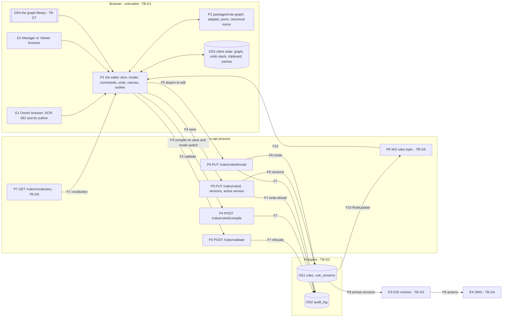

# E37 — STRIDE threat model: the node-graph editor and its compile and save path

- Ticket: E37-X01 (issue #1073). Owner: Security engineer (CODEOWNER). Status: **Draft**, pending review by the
  Security engineer and the Architect (the ticket's Definition of Done; under the agent-delivery adaptation the owner's
  approval stands in for both, as for E35-X01). Review log: end of §11.
- Method: the `04-security-program.md` §5 template (L x I = risk), STRIDE per element and per trust boundary
  (C-12.1), rated on the matrix of `E29-oms.md` §1.3 (§1.4) and formatted as `e36-rule-form-editor.md`. The E35 model
  (`e35-rule-engine.md`, rows `RE-`) and the E36 model (rows `RA-`) are **referenced, not repeated** (§7), as are the
  E09 and E29 models. Row ids are `RG-xnn` (rule graph); requirements are `SR-E37-nn`, epic-local, promoted when their
  ticket lands; findings are `F-nn`, gaps `G-n`, open inputs `O-n`, abuse-case seeds `AC-RG-nn`.
- Inputs, read at `main` `bd7a73a69`: issue #1073 and the E37 epic with its 23 tickets (`docs/plan/backlog/E37.json`);
  `14-screens-catalogue.md` SCR-082 (`:1934-1975`) and SCR-085 (`:2019-2040`); the design packs
  `docs/design/E37/E37-D02.md` and `E37-D04.md`; the `rules` operations of `22-api-openapi.yaml` (`updateRule`
  `:8825-8865`, `setRuleMode` `:9133-9198`, `compileRule` `:15115-15181`, `RuleIr` `:22171-22220`, `RuleInput`
  `:22262-22303`); `24-internal-schemas.md` §11.4 (`:3694-3715`); `packages/rule-graph`; and the files cited below
  under `services/api/candleviewer/` (written `cv/`) with their tests. The editor's model core (#1067 PR 3a,
  `apps/web/src/features/rule-builder-graph/model/`) is read on the branch this model is built on.
- Path: the ticket's Agent brief names `rule-graph.md`, but GOV-008 scans only `E<nn>-<slug>.md`
  (`scripts/check_threat_model_ticket_map.py:23`), so this file is `e37-rule-graph-editor.md` (BQ-1).
- Risk mapping: the ticket says "R5 Scope". In the register R5 is _Credential & key security_ and scope is R12
  (`32-risk-register.md` §1.2). This model maps the divergence half to R12 through RSK-034 and the rendered-text and
  renderer half to R6 through RSK-091, with no new register entry (§11.1). Nothing here belongs under R5.
- Classification: internal. Design-level weaknesses only; no credential, account identifier or exploit detail. A
  finding raised through the private advisory process (`SECURITY.md`, C-12.13) is named in §11.2 by id and severity
  only.

## 1. Scope

In scope, the path the ticket names: the browser editor's state → `POST /rules/{ruleId}/compile` →
`POST /rules/validate` → `PUT /rules/{ruleId}` → `rules` / `rule_versions` → (later) `PUT /rules/{ruleId}/mode` → the
E35 runtime → the OMS, with the vocabulary read and the WS `rules` topic as the editor consumes them. E37 evaluates
nothing and places no order: every validity, hash and authority decision is E35's or E09's, made on the server
(C-2.12). What E37 adds is client-side: an editor model with an undo stack, a converter from the graph to the compile
model, a presentation block stored with the rule, a canvas drawn by a third-party graph library, and an outline.

Out of scope (ticket): the runtime model (E35), the OMS and fan-out models (E29, E34), the pen-test (E43) and the
abuse-case execution (E37-X02). Referenced: RBAC and sessions (E09), the form editor's surface (E36), the kill switch
(E39).

### 1.1 State of the build at review time

| Component                                                                             | Status                                                             | Evidence                                                                                                                                                  |
| ------------------------------------------------------------------------------------- | ------------------------------------------------------------------ | --------------------------------------------------------------------------------------------------------------------------------------------------------- |
| Compile, validate, vocabulary                                                         | served                                                             | `cv/api/rules.py:316-367` (compile), `:47` (`rules:read`), `:53-57` and `:164-175` (the shared bucket)                                                    |
| Save, versions, active version, mode                                                  | served                                                             | `cv/api/rules_crud.py:252-287` (save); `cv/rules/manager.py:971-1012` (update), `:1087-1123` (activation); `cv/rules/arming.py:60-127` (the arming gates) |
| Bounds                                                                                | served                                                             | `cv/api/rule_body.py:23,26`; `cv/rules/compiler/common.py:17-23,76-94`; `cv/rules/compiler/graph.py:91`                                                   |
| `packages/rule-graph` (E37-T01)                                                       | merged                                                             | adapter, typed ports and the canonical mirror (`24` §11.4, `:3713`)                                                                                       |
| Editor model core: placement, insertion, tiers, the layout read at load (#1067 PR 3a) | the base of this branch, not on `main`                             | `apps/web/src/features/rule-builder-graph/model/`                                                                                                         |
| Commands and undo stack, compile model, canvas, screen, outline, save flow            | not built                                                          | E37-S01 (#1067's later PRs), E37-S02 to E37-S05                                                                                                           |
| Graph library (`@xyflow/react`, ADR-0029)                                             | not a dependency yet                                               | #1067 PR 5a adds it                                                                                                                                       |
| Flag `rules.graph_editor`                                                             | registered, default on; SR-E37-16 has it default off (C-4.13; O-5) | `cv/admin/flags/catalogue.py:82`                                                                                                                          |

A row resting on unbuilt work names the ticket that builds the control (§9, §10); E37-X02 re-triages it if that
ticket does not.

### 1.2 Assets and data classification

| Asset                                                                                                   | Class                                                                        | Notes                                                                                                         |
| ------------------------------------------------------------------------------------------------------- | ---------------------------------------------------------------------------- | ------------------------------------------------------------------------------------------------------------- |
| The rule IR: trigger, conditions, actions, scope, limits                                                | Integrity critical                                                           | What the runtime executes; hash-bound at arming (E35 RE-T1)                                                   |
| The presentation block: `graph_layout` (positions, collapsed ids, comments, any other key) and `editor` | Internal-confidential; carries no meaning, but the reviewed view rests on it | Outside the hash (`cv/rules/ir/canonical.py:32-35`); a reviewer reads the canvas it lays out (RG-T03, RG-T04) |
| Comment, node and rule text                                                                             | Internal-confidential, untrusted                                             | Another user may have written it (RG-T08)                                                                     |
| Editor client state: the graph, the undo stack, the clipboard copy, the cached vocabulary               | Internal-confidential                                                        | Memory only (SR-E37-08; SR-129)                                                                               |
| The renderer                                                                                            | Availability critical                                                        | Shared with the order ticket and the kill-switch control: a frozen editor is a frozen terminal (RG-D02)       |

### 1.3 Attackers

As in the E35 and E36 models: A1 a lower-privileged user (a Viewer, or a Manager outside their grants); A2 a
compromised browser session; A3 a crafted IR or graph model sent straight to the API; A4 a well-meaning author; A5 a
malicious Manager targeting the Owner, who reads every rule (`cv/rules/manager.py:569-583`). The graph library's supply
chain is the programme's TB-8 actor (RG-T09). The product is reachable only over Tailscale (E35 §1).

### 1.4 Rating

Risk = L x I on the programme scale (Low / Medium / High / Critical), the matrix of `E29-oms.md` §1.3: H x H Critical;
M x H and H x M High; M x M, L x H and H x L Medium; the rest Low. Disposition: **Q** a requirement a named ticket
builds and a named test proves; **C** a control on `main`, cited with its test; **R** owned by another epic's model.
"Res." is the residual once the disposition's work lands.

### 1.5 Open inputs

Built on the defaults of the build questions posted on #1073 (BQ-1 to BQ-10); none was ruled when this was written. A
ruling replaces the matching line.

| Id  | Open input                                                                                                                                                                                                                                                                                           | Rows                           | Owner |
| --- | ---------------------------------------------------------------------------------------------------------------------------------------------------------------------------------------------------------------------------------------------------------------------------------------------------- | ------------------------------ | ----- |
| O-1 | BQ-4: role refusals on the rule routes are recorded through #5379's per-user budget (G-2), or stay counted, not recorded, as E36's D-3 has them, with E37-S01 AC 4, E37-X02 cases 1 and 2 and E37-Q01's E37-TC-G05 amended to "counted"                                                              | RG-R04                         | Owner |
| O-2 | BQ-5: the ticket's four event names map onto `rule.updated`, the save's `note` and telemetry (D-2, §8), or become server audit actions with a structured choice on `updateRule` (an E35 contract change)                                                                                             | RG-R02, RG-R03                 | Owner |
| O-3 | BQ-6: the editor's one mode call is "Disarm to edit" (`disabled`), or it calls no mode route and links to SCR-080's Disarm                                                                                                                                                                           | RG-E03                         | Owner |
| O-4 | BQ-7: G-1 is non-blocking (Medium), or blocking against E35 and E37-T01                                                                                                                                                                                                                              | RG-T03                         | Owner |
| O-5 | SR-E37-16: `rules.graph_editor` defaults off and the client reads it until SR-E37-01, SR-E37-07, SR-E37-09 and SR-E37-11 land and E37-X02's cases pass. It is registered default on (`cv/admin/flags/catalogue.py:82`), and C-4.13 has a multi-PR feature ship behind a typed flag that defaults off | RG-S01, RG-T08, RG-D02, RG-E03 | Owner |

## 2. Data-flow diagram and trust boundaries

Text alternative: the editor slice (P1) runs in the user's browser over the editor model and rule-graph (P2), holds
its state in memory (DS3) and draws through the graph library (DS4). It reads the vocabulary (F1), validates (F2),
compiles on save and on a mode switch (F3), saves through `updateRule` (F4) and makes one mode call, "Disarm to edit"
(F5). The server stores versions and modes (F6) and writes its records ahead of each change and refusal (F7). The
runtime loads armed versions (F8) and acts through the OMS (F9); list and mode state returns over the `rules` topic
(F10).

Elements: entities **E1 to E4**; processes **P1 to P8**; stores **DS1 to DS4**; flows **F1 to F10** (analysed on their
boundary, §3.7). Trust boundaries:

- **TB-G1, browser to API** (F1 to F5, F10; programme TB-4; E35 TB-R1; E36 TB-A1): everything the browser sends is
  untrusted, and the browser decides nothing (C-2.12). A missing button is not a control.
- **TB-G2, API to the rule store** (F6, F7; E36 TB-A3): a database writer is its own integrity domain.
- **TB-G3, rule store to the E35 runtime** (F8; E35 TB-R3): owned by E35 (§7).
- **TB-G4, runtime to the OMS** (F9; E35 TB-R5; the E29 model): owned by E35 and E29 (§7).
- **TB-G5, WS `rules` egress** (F10; E35 TB-R8; E36 TB-A6): owned by E35 and E17; E37 consumes it.
- **TB-G6, vocabulary** (F1; E36 TB-A7): permission-shaped reads the client caches.
- **TB-G7, third-party code in the renderer** (DS4; programme TB-8): the graph library runs with the page's rights, in
  the renderer the order ticket and the kill-switch control share.

## 3. STRIDE tables

Columns: the existing control is what `main` does today, with its test; the gap names the mitigation, its ticket and
the target sprint (all in R3, S14 to S19, `31-sprint-plan.md`). Programme rows extended, not repeated
(`04-security-program.md` §5.3): R2 → RG-T07; R3 → RG-E01; R7 → RG-T01, RG-T02, RG-T06.

### 3.1 Spoofing

| ID     | Element / boundary | Threat                                                                                                                                                                                                                                                     | L   | I   | Risk   | Existing control                                                                                                                                                                                                                                             | Gap → mitigation    | Owner (sprint)              | Verify                                         | Disp. | Res. |
| ------ | ------------------ | ---------------------------------------------------------------------------------------------------------------------------------------------------------------------------------------------------------------------------------------------------------- | --- | --- | ------ | ------------------------------------------------------------------------------------------------------------------------------------------------------------------------------------------------------------------------------------------------------------ | ------------------- | --------------------------- | ---------------------------------------------- | ----- | ---- |
| RG-S01 | E1, E2, P1, TB-G1  | A session change mid-edit: the graph, the undo stack or a compile in flight under one session is saved after the tab's session changed (logout and login as another user, view-as started or ended elsewhere), so a rule is saved under the wrong identity | M   | M   | Medium | Actor and CSRF token checked per request, and view-as refuses every write (E36 RA-S01; `cv/api/view_as_guard.py:1-30`); E36's binding (SR-E36-01) covers the form editor only                                                                                | SR-E37-01           | FEL: E37-S01, E37-S05 (S17) | AC-RG-01                                       | Q     | Low  |
| RG-S02 | P5, DS1            | Authorship or the editor kind taken from the document: an IR whose `created_by` names another user, or whose `editor` claims the other editor                                                                                                              | L   | M   | Low    | Every save stores the actor and the server's time, never the body's (`cv/rules/manager.py:898`; #4835; `test_a_save_stores_the_acting_user_and_the_server_time_never_the_bodys`); `editor` is presentation, outside the hash (`cv/rules/ir/canonical.py:32`) | None: E35's control | E35                         | `tests/rules/test_stored_rule_integrity.py:89` | C     | Low  |
| RG-S03 | TB-G1              | Session fixation, or a cross-site request on the editor route or the calls it makes                                                                                                                                                                        | L   | M   | Low    | E09 U6 (SR-013, rotation on every authentication change); CSRF double-submit on every write (programme TB-4); the route carries only `ruleId`                                                                                                                | None: E09's control | E09                         | E09 model                                      | R     | Low  |

### 3.2 Tampering

| ID     | Element / boundary | Threat                                                                                                                                                                                                                                                                                                              | L   | I   | Risk   | Existing control                                                                                                                                                                                                                                                                                                                                                                                                                                                                                                                                       | Gap → mitigation                                                                                                                                                                                                                       | Owner (sprint)                                                            | Verify                                                                         | Disp. | Res. |
| ------ | ------------------ | ------------------------------------------------------------------------------------------------------------------------------------------------------------------------------------------------------------------------------------------------------------------------------------------------------------------- | --- | --- | ------ | ------------------------------------------------------------------------------------------------------------------------------------------------------------------------------------------------------------------------------------------------------------------------------------------------------------------------------------------------------------------------------------------------------------------------------------------------------------------------------------------------------------------------------------------------------ | -------------------------------------------------------------------------------------------------------------------------------------------------------------------------------------------------------------------------------------- | ------------------------------------------------------------------------- | ------------------------------------------------------------------------------ | ----- | ---- |
| RG-T01 | P1, P2, P4, TB-G1  | The client model diverges from the stored IR: a converter fault, a save body other than the compile output, or a hand-edited document sent straight to the API                                                                                                                                                      | M   | H   | High   | Compile and validate decide (`cv/api/rules.py:316-367`); a save validates whatever IR it is sent and stores only that (`cv/rules/manager.py:868-914`; `test_invalid_ir_rejected_422`); rule-graph's adapter tests (E37-T01); the arming restatement (E35 RE-E6)                                                                                                                                                                                                                                                                                        | SR-E37-06; SR-E37-15 and G-7 (every edge the client sends feeds a port its node reads, and the compiler refuses any other); SR-E37-04 (enforced at load); the compile model's round-trip pins (#1067 PR 2); E37-S04's round-trip proof | FEL: E37-S01, E37-S04 (S17); BEL: E35-X03 #1115 (G-7, S18)                | AC-RG-02                                                                       | Q     | Low  |
| RG-T02 | P1, E1             | Meaning carried by an order the canvas does not show: actions run in node-list order, never id order (`cv/rules/compiler/graph.py:274-278`), and the inputs of a gate or an arithmetic node keep their edge order (`:8-9`), so a subtraction or a ratio reads differently with its operands swapped                 | M   | H   | High   | The compiler keeps both orders (`test_action_order_survives_the_graph_hop_with_unsorted_ids`, `test_action_order_is_semantic`); CMP-152's index pill and the outline's order are designed, not built                                                                                                                                                                                                                                                                                                                                                   | SR-E37-02                                                                                                                                                                                                                              | FEL: E37-S01, E37-S02, E37-S05 (S17)                                      | AC-RG-03                                                                       | Q     | Low  |
| RG-T03 | DS1, P1, P4, TB-G1 | The presentation block (`graph_layout`: positions, collapsed ids, comments, any other key; `editor`) carries meaning: (a) a field the evaluator or the executor reads; (b) a field in the hash; (c) an account key in the block widening a target; (d) an editor state taken from the block rather than from the IR | M   | M   | Medium | (a) to (c) verified (§4): no runtime reader, outside the hash, an account key there only refuses                                                                                                                                                                                                                                                                                                                                                                                                                                                       | SR-E37-03; G-1                                                                                                                                                                                                                         | BEL: E35-X03 #1115 (G-1, S18); FEL: E36-S03, E37-S04 (S17)                | AC-RG-04                                                                       | Q     | Low  |
| RG-T04 | P1, DS1            | Layout hides a node from the reviewer: collapsed, placed off-canvas, overlapped or under a comment, so the canvas a reviewer reads is not the whole rule                                                                                                                                                            | M   | M   | Medium | The outline lists every node whatever the layout (E37-D02 §8, designed); the arming restatement reads the IR (E35 RE-E6)                                                                                                                                                                                                                                                                                                                                                                                                                               | SR-E37-04 (enforced at load); G-6                                                                                                                                                                                                      | FEL: E37-S01, E37-S05 (S17); E37-T02 (S18); BEL: E35-X03 #1115 (G-6, S18) | AC-RG-05                                                                       | Q     | Low  |
| RG-T05 | P1, DS3            | A pasted or dropped document parsed in the renderer before any server check                                                                                                                                                                                                                                         | L   | M   | Low    | No paste or drop path is designed (E37-D02)                                                                                                                                                                                                                                                                                                                                                                                                                                                                                                            | SR-E37-05                                                                                                                                                                                                                              | FEL: E37-S01 (S17), for any ticket that adds one                          | n/a: no paste or drop path is designed; the ticket that adds one adds its seed | Q     | Low  |
| RG-T06 | P1, P2, P4         | A client claims a hash or forces a match: it sends its own hash, shows "Round-trips ✓" while the server differs, or resolves a mismatch by itself                                                                                                                                                                   | M   | H   | High   | The server never reads a client hash: a save body names only `22`'s members, so an `ir_hash` member is refused `unknown_field` (`cv/rules/manager.py:823-854`; `test_a_member_22_does_not_name_is_refused_naming_it_audited_and_stores_nothing`); compile reports `round_trip` and never reconciles (`cv/api/rules.py:352-366`; `test_compile_round_trip_match_and_divergence_reported_never_reconciled`); the client mirror is display-only and never picks a winner (`24` §11.4, `:3713`; `packages/rule-graph/src/canonical/canonicalise.ts:55-59`) | SR-E37-06                                                                                                                                                                                                                              | FEL: E37-S04 (S17)                                                        | AC-RG-06                                                                       | C, Q  | Low  |
| RG-T07 | DS1, E3            | A mismatch resolution or a save changes what an armed rule does                                                                                                                                                                                                                                                     | L   | H   | Medium | An armed rule keeps its active version on save (`cv/rules/manager.py:1008-1010`; `test_armed_rule_keeps_active_version_when_saved`); activating another version of an armed rule demotes it to simulate (`:1100`, `:1114-1121`; `test_set_active_version_on_armed_rule_always_demotes_even_if_simulated`)                                                                                                                                                                                                                                              | None: E35's control                                                                                                                                                                                                                    | E35                                                                       | AC-RG-07                                                                       | C     | Low  |
| RG-T08 | E1, P1, DS4, TB-G1 | Rule text runs as markup in the Owner's canvas: a name, comment or node datum, an id echoed by a diagnostic, an SVG label, an accessible name, a tooltip or a live-region message. A Manager's rule then runs script in the Owner's session, which reads every rule                                                 | M   | H   | High   | React escapes text; strict CSP (C-12.10); SR-127 (`04` §6.12); `no-unsanitized` covers the shell and drawings paths only (`apps/web/eslint.config.mjs`); `cv-shell-dangerously-set-inner-html` refuses `dangerouslySetInnerHTML`, `innerHTML` and `outerHTML` writes and `insertAdjacentHTML` calls under `apps/web/src/features/**` and `packages/ui/src/**`, so in the slice and the node parts (`.semgrep/cv-shell-dangerously-set-inner-html.yml`)                                                                                                 | SR-E37-07; G-4                                                                                                                                                                                                                         | FEL: E37-S01, E37-S02, E37-S03, E37-S05 (S17); SEC: E36-X02 (S17)         | AC-RG-09                                                                       | Q     | Low  |
| RG-T09 | DS4, TB-G7         | The graph library or a package under it is compromised and runs in the renderer the order ticket and the kill-switch control share                                                                                                                                                                                  | L   | H   | Medium | Exact pin, SCA, the licence list and CODEOWNER review of a new dependency (C-12.3; ADR-0029 decision 1); strict CSP (C-12.10); the library reaches only the slice's canvas                                                                                                                                                                                                                                                                                                                                                                             | None beyond the programme's supply-chain controls                                                                                                                                                                                      | DSO; FEL: #1067 PR 5a (S17)                                               | The SCA and licence gates (C-9.1) on #1067 PR 5a                               | R     | Low  |

### 3.3 Repudiation

| ID     | Element / boundary  | Threat                                                                                                                                                                                                              | L   | I   | Risk   | Existing control                                                                                                                                                                                                                                                                                                        | Gap → mitigation              | Owner (sprint)                | Verify   | Disp. | Res. |
| ------ | ------------------- | ------------------------------------------------------------------------------------------------------------------------------------------------------------------------------------------------------------------- | --- | --- | ------ | ----------------------------------------------------------------------------------------------------------------------------------------------------------------------------------------------------------------------------------------------------------------------------------------------------------------------- | ----------------------------- | ----------------------------- | -------- | ----- | ---- |
| RG-R01 | P5, DS2, TB-G2      | A graph edit changes an armed rule's behaviour with no record                                                                                                                                                       | L   | H   | Medium | A semantic change is a new hash, so a new version, and `rule.updated` is written before the store write (`cv/rules/manager.py:1004-1011`); the armed rule runs its active version until a recorded activation and a recorded arm (RG-T07)                                                                               | None: E35's control           | E35                           | AC-RG-07 | C     | Low  |
| RG-R02 | P5, DS2             | The mismatch choice is ambiguous: which of the two recovery choices the author took cannot be read back                                                                                                             | M   | M   | Medium | The version a save creates stores its `note` (`cv/rules/manager.py:893-906`), and `rule.updated` names that version and its hash; D-2 (E36 §8) carries the choice in `note`; a save whose IR hash is already stored creates no version and no record (`:1001-1003`), so a choice that ends on a stored hash leaves none | SR-E37-13                     | FEL: E37-S04 (S17)            | AC-RG-08 | Q     | Low  |
| RG-R03 | E1, DS2             | Client "audited" events (`rule.graph_saved`, `rule.roundtrip_verified`, `rule.roundtrip_mismatch_resolved`, `rule.roundtrip_integrity_failure`; `14`:1969 and the ticket) are forged or omitted by a hostile client | M   | M   | Medium | None: no route writes a client-supplied audit event, and D-2 (E36 §8) keeps the chain server-written                                                                                                                                                                                                                    | SR-E37-13 (§8 maps each name) | FEL: E37-S04 (S17)            | AC-RG-08 | Q     | Low  |
| RG-R04 | P3, P4, P5, P6, DS2 | A role refusal on a rule route (a Viewer's save or mode change, a caller without `rules:read` compiling) leaves no record                                                                                           | M   | M   | Medium | The route gates answer 403 with no record (`cv/api/rules_crud.py:136-150`; `cv/api/rules.py:149-158`); E36's D-3 counts them, and its counter is not built (E36 G-11)                                                                                                                                                   | SR-E37-14; G-2                | BEL: E36-X02 #1065 (G-2, S17) | AC-RG-10 | Q     | Low  |

### 3.4 Information disclosure

| ID     | Element / boundary | Threat                                                                                                           | L   | I   | Risk   | Existing control                                                                                                                                                                                                                                  | Gap → mitigation                 | Owner (sprint)              | Verify                                     | Disp. | Res. |
| ------ | ------------------ | ---------------------------------------------------------------------------------------------------------------- | --- | --- | ------ | ------------------------------------------------------------------------------------------------------------------------------------------------------------------------------------------------------------------------------------------------- | -------------------------------- | --------------------------- | ------------------------------------------ | ----- | ---- |
| RG-I01 | P7, TB-G6          | The vocabulary discloses accounts or symbols another user may not see                                            | L   | L   | Low    | The vocabulary holds no account; its symbol availability names only the recorded-symbol list, which every role reads (`cv/rules/vocabulary/build.py:74-78`); E35 RE-I3, E36 RA-I03                                                                | None: E35's control              | E35                         | n/a: the vocabulary holds nothing per user | C     | Low  |
| RG-I02 | E2, P4, P5, TB-G1  | Another user's rule reaches the editor: a deep link, a compile naming a foreign `ruleId`, or the version history | L   | M   | Low    | A rule a non-Owner may not read answers the unseen 404 (`cv/rules/manager.py:569-583`; `test_route_of_a_rule_the_manager_does_not_own_is_the_unseen_404`); compile reads no stored rule, it compiles the posted model (`cv/api/rules.py:316-367`) | None: E35's control              | E35                         | AC-RG-11                                   | C     | Low  |
| RG-I03 | P3, P4, TB-G1      | Error bodies disclose internals, or echo a hostile node id into the canvas                                       | L   | M   | Low    | 422 and 500 bodies pass the redactor (E36 RA-I04); compile names a fault by its node id (`cv/rules/compiler/graph.py:12`)                                                                                                                         | SR-E37-07 (an echoed id is text) | FEL: E37-S03 (S17)          | AC-RG-09                                   | Q     | Low  |
| RG-I04 | E1, DS3            | Rule content kept past the session: the undo stack, the clipboard copy, a layout cache in browser storage        | M   | M   | Medium | SR-129 (`04` §6.12) names session tokens and secrets, not rule content                                                                                                                                                                            | SR-E37-08                        | FEL: E37-S01, E37-S05 (S17) | AC-RG-12                                   | Q     | Low  |

### 3.5 Denial of service

| ID     | Element / boundary | Threat                                                                                                                                                                   | L   | I   | Risk   | Existing control                                                                                                                                                                                                                                                                                                                                                                                                                                                                | Gap → mitigation                               | Owner (sprint)                                                                       | Verify                                                                                                                                                                                      | Disp. | Res. |
| ------ | ------------------ | ------------------------------------------------------------------------------------------------------------------------------------------------------------------------ | --- | --- | ------ | ------------------------------------------------------------------------------------------------------------------------------------------------------------------------------------------------------------------------------------------------------------------------------------------------------------------------------------------------------------------------------------------------------------------------------------------------------------------------------- | ---------------------------------------------- | ------------------------------------------------------------------------------------ | ------------------------------------------------------------------------------------------------------------------------------------------------------------------------------------------- | ----- | ---- |
| RG-D01 | P3, P4             | A pathological graph (a node or edge explosion, deep nesting, a shared node expanded many times) stalls the compiler                                                     | M   | H   | High   | Bounds before any walk: 2,000,000 B and depth 66 before parse (`cv/api/rule_body.py:23,26`); 20,000 values, depth 64, 1,000 graph nodes, 4,000 edges and 1,000 condition nodes before the walk (`cv/rules/compiler/common.py:17-23,76-94`; `graph.py:91`); shared-node copies charged before they are built (`graph.py:226-266`). Tests: `test_compile_graph_charges_each_expanded_copy_at_the_cap`, `test_compile_graph_shared_node_copies_are_refused_within_the_perf_budget` | None: E35's control                            | E35                                                                                  | AC-RG-13                                                                                                                                                                                    | C     | Low  |
| RG-D02 | E1, P1, P2, DS4    | A stored rule at the hard caps (1,000 nodes, 4,000 edges), say a Manager's that the Owner opens, freezes the renderer the order ticket and the kill-switch control share | M   | H   | High   | When a rule opens, rule-graph checks the document bounds, 20,000 values and depth 64 (`packages/rule-graph/src/adapter/toGraph.ts:48`), and the soft cap warns above 120 nodes and never blocks (`apps/web/src/features/rule-builder-graph/model/tiers.ts`; ADR-0029 decision 2)                                                                                                                                                                                                | SR-E37-09 (the open guard, §6); SR-E37-04; G-6 | FEL: E37-S01 (S17), E37-T02 (S18); QAL: E37-Q04 (S18); BEL: E35-X03 #1115 (G-6, S18) | AC-RG-14; AC-RG-04's stored positions that are not finite or out of range (a `null`, a string, ±1e19, ±2^61) and node ids with huge numeric suffixes (n9007199254740991, n9007199254740992) | Q     | Low  |
| RG-D03 | P3, P4, TB-G1      | Compile at fuzz scale: an editor compiling per edit, many tabs, or a script floods validate and compile                                                                  | M   | M   | Medium | One bucket per user, 10 a second with a burst of 20, shared by validate and compile and answered `429` with no record (`cv/api/rules.py:53-57,164-175`; `cv/settings.py:174`; `tests/rules/test_rule_check_limit.py:118-206`)                                                                                                                                                                                                                                                   | SR-E37-10 (the client budget)                  | FEL: E37-S01, E37-S04 (S17)                                                          | AC-RG-15                                                                                                                                                                                    | C, Q  | Low  |

### 3.6 Elevation of privilege

| ID     | Element / boundary    | Threat                                                                                                                                  | L   | I   | Risk | Existing control                                                                                                                                                                                                                                                                                 | Gap → mitigation                                                                                                                           | Owner (sprint)                                                      | Verify                           | Disp. | Res. |
| ------ | --------------------- | --------------------------------------------------------------------------------------------------------------------------------------- | --- | --- | ---- | ------------------------------------------------------------------------------------------------------------------------------------------------------------------------------------------------------------------------------------------------------------------------------------------------ | ------------------------------------------------------------------------------------------------------------------------------------------ | ------------------------------------------------------------------- | -------------------------------- | ----- | ---- |
| RG-E01 | E2, P5, E3, TB-G1     | A graph scoped to an account the user cannot trade, or naming one in a metric or action param, reaches execution                        | M   | H   | High | The route scope check and the whole-document grant check, each audited (`cv/rules/manager.py:602-623`); `orders:write` on every bound account at arming (`cv/rules/arming.py:96-108`); the runtime check before every action (E35 RE-E1, RE-E2; `cv/rules/scope.py:145-172`); E36 RA-E01, RA-E06 | None: E35's control                                                                                                                        | E35                                                                 | E36 AC-RA-18, AC-RA-19; AC-RG-17 | C, R  | Low  |
| RG-E02 | E2, P5, TB-G1         | A Viewer reaches the editor and writes                                                                                                  | L   | M   | Low  | R-162 serves the Owner and Managers (`apps/web/src/routes/manifest.ts:67-72`); every write needs `rules:write`, which no Viewer holds (`cv/auth/rbac_seed.json:238-252`); a non-Owner reads only their own rules, so a Viewer gets the unseen 404 for every rule (`cv/rules/manager.py:569-583`) | None: E09's and E35's controls                                                                                                             | E35                                                                 | AC-RG-10                         | C     | Low  |
| RG-E03 | E1, E2, P1, P6, TB-G1 | Arming from the editor: an in-canvas control, a hotkey, an outline action or a crafted call sets a rule's mode without the SCR-085 flow | M   | H   | High | No arm control or key is designed (§5); the server gates every arm and needs a fresh step-up for live (`cv/rules/arming.py:60-127`; `test_ac_d_live_needs_arm_live_permission_and_fresh_step_up`, `test_live_arm_needs_permission_then_step_up_then_audits_and_publishes`)                       | SR-E37-11, proved by E37-S05's screen-level test and E37-Q01's E37-TC-C13; this ticket's lint guard, a tripwire, and its keymap check (§5) | FEL: E37-S01, E37-S05 (S17); QAL: E37-Q01 (S17); SEC: E37-X01 (S17) | AC-RG-16, AC-RG-17               | C, Q  | Low  |
| RG-E04 | P5, E3                | A rule authored in the graph arms or enables another rule through rule control (`enable_rule`)                                          | M   | H   | High | E35 RE-E7: toward simulate or disabled only, same owner; a self-target is refused at validate (`cv/rules/validator.py:210-216`; `test_feedback_loop_guard`); the handler is not built (`cv/rules/executor/handlers.py:163`)                                                                      | None here: E35-T13 (#5005) builds the handler and carries E35-FR-17 (#1800), both S15                                                      | BEL: E35-T13 #5005 (S15)                                            | AC-RG-18                         | R     | Low  |
| RG-E05 | E1, P1                | A keyboard or outline path skips a confirmation the pointer path shows (a delete, a mismatch choice, "Disarm to edit")                  | L   | M   | Low  | E37-D04's keyboard map (designed)                                                                                                                                                                                                                                                                | SR-E37-12                                                                                                                                  | FEL: E37-S05 (S17); A11Y: E37-Q05 (S18)                             | AC-RG-18                         | Q     | Low  |

### 3.7 Coverage matrix

Every element and every boundary against all six categories. Cells name the rows that analyse the category, or say
why it does not apply. "E35 RE-xn" or "E36 RA-xnn" means that model owns it (§7).

| Element / boundary                     | S                                                        | T                                             | R                                                                     | I                                                        | D                                                                            | E                                                                  |
| -------------------------------------- | -------------------------------------------------------- | --------------------------------------------- | --------------------------------------------------------------------- | -------------------------------------------------------- | ---------------------------------------------------------------------------- | ------------------------------------------------------------------ |
| E1 Owner browser                       | RG-S01                                                   | RG-T08 (as victim)                            | RG-R03                                                                | RG-I04                                                   | RG-D02                                                                       | RG-T08 (script acts with the Owner's rights); RG-E03, RG-E05       |
| E2 Manager or Viewer browser           | RG-S01                                                   | RG-T01 (as actor)                             | RG-R04                                                                | RG-I02                                                   | RG-D02 (a stored rule the Owner opens)                                       | RG-E01, RG-E02, RG-E03                                             |
| E3 E35 runtime                         | E35 RE-S1                                                | RG-T07; E35 RE-T1, RE-T2                      | RG-R01; E35 RE-R1                                                     | E35 RE-I1, RE-I2                                         | E35 RE-D1, RE-D2, RE-D5                                                      | RG-E04; E35 RE-E1 to RE-E10                                        |
| E4 OMS                                 | E29 OM-S01 to OM-S05                                     | E29 OM-T01 to OM-T11                          | E29 OM-R01 to OM-R06                                                  | E29 OM-I01 to OM-I10                                     | E29 OM-D01 to OM-D14                                                         | E29 OM-E01 to OM-E08; the native stop (C-2.6)                      |
| P1 the editor slice                    | RG-S01                                                   | RG-T01, RG-T02, RG-T04, RG-T05                | n/a: writes nothing durable; the server records every change (RG-R03) | RG-I04                                                   | RG-D02                                                                       | RG-E03, RG-E05                                                     |
| P2 rule-graph                          | n/a: a pure library that holds no identity               | RG-T01, RG-T06                                | n/a: a pure library that records nothing                              | n/a: holds nothing beyond what the editor passes it      | RG-D02 (its caps equal the server's)                                         | n/a: decides no authority (C-2.12)                                 |
| P3 validate                            | RG-S01                                                   | RG-T01                                        | RG-R04                                                                | RG-I03                                                   | RG-D03                                                                       | n/a: grants nothing; its scope check only refuses                  |
| P4 compile                             | RG-S01                                                   | RG-T01, RG-T03, RG-T06                        | RG-R04                                                                | RG-I02, RG-I03                                           | RG-D01, RG-D03                                                               | n/a: stores nothing and never reads the stored rule (RG-I02)       |
| P5 save, versions, active version      | RG-S01, RG-S02                                           | RG-T01, RG-T03, RG-T07                        | RG-R01, RG-R02, RG-R04                                                | RG-I02                                                   | RG-D01                                                                       | RG-E01, RG-E02, RG-E04                                             |
| P6 `setRuleMode`                       | RG-S01                                                   | RG-T07                                        | RG-R04; E35 RE-R4                                                     | n/a: answers the rule's own mode; E35 RE-I5 owns its 404 | E35 RE-D2                                                                    | RG-E03                                                             |
| P7 vocabulary                          | RG-S01                                                   | n/a: server-generated, read-only content      | n/a: a read changes nothing                                           | RG-I01                                                   | n/a: a cached read (`private, max-age=60`, `cv/api/rules.py:51`); E36 RA-D02 | n/a: availability is advisory; arming enforces it (RG-E03)         |
| P8 WS `rules` topic                    | E35 RE-S5                                                | n/a: server-to-client only                    | n/a: it delivers and decides nothing                                  | E35 RE-I2                                                | E36 RA-D03                                                                   | n/a: egress grants nothing                                         |
| DS1 rules, rule_versions               | n/a: a store authenticates nothing; P5 writes it         | RG-T03, RG-T07; E35 RE-T1                     | RG-R01                                                                | RG-I02                                                   | RG-D01 (bounds before any write)                                             | n/a: holds no authority; owner fields come from the actor (RG-S02) |
| DS2 audit_log                          | n/a: written only by the server                          | n/a: append-only, no UPDATE or DELETE (C-5.7) | RG-R01, RG-R02, RG-R03, RG-R04                                        | n/a: ids and hashes, read by the Owner alone             | E36 RA-D02, RA-D04 (refusal records, user text)                              | n/a: a record grants nothing                                       |
| DS3 client state                       | n/a: a store authenticates nothing                       | RG-T04, RG-T05                                | n/a: client state is never evidence (RG-R03)                          | RG-I04                                                   | RG-D02                                                                       | n/a: the server ignores client state                               |
| DS4 the graph library                  | RG-T09 (a substituted package)                           | RG-T09                                        | n/a: it records nothing                                               | RG-T09 (code in the page reads what the page reads)      | RG-D02                                                                       | RG-T08, RG-T09 (code in the Owner's page acts with its rights)     |
| TB-G1 browser to API                   | RG-S01, RG-S03                                           | RG-T01, RG-T03, RG-T06                        | RG-R03, RG-R04                                                        | RG-I02, RG-I03                                           | RG-D03                                                                       | RG-E01, RG-E02, RG-E03                                             |
| TB-G2 API to rule store                | n/a: one service identity writes; database auth is E07's | RG-T03; E35 RE-T1                             | RG-R01                                                                | n/a: parameterised SQL in process; nothing leaves it     | E36 RA-D04, RA-D05                                                           | n/a: the store holds no authority (RG-S02)                         |
| TB-G3 store to runtime                 | E35 RE-S1                                                | E35 RE-T1, RE-T2                              | E35 RE-R1                                                             | E35 RE-I1                                                | E35 RE-D2                                                                    | E35 RE-E1                                                          |
| TB-G4 runtime to OMS                   | E35 RE-S1 (the rule actor)                               | E29 OM-T01 to OM-T11                          | E35 RE-R1; E29 OM-R01 to OM-R06                                       | E35 RE-I6                                                | E35 RE-D5, RE-D6                                                             | E35 RE-E1 to RE-E4                                                 |
| TB-G5 WS `rules` egress                | E35 RE-S5                                                | n/a: egress only                              | n/a: E17 audits a refused subscription                                | E35 RE-I2                                                | E36 RA-D03                                                                   | n/a: egress grants nothing                                         |
| TB-G6 vocabulary                       | RG-S01                                                   | n/a: server-generated content                 | n/a: a read                                                           | RG-I01                                                   | n/a: a cached read; E36 RA-D02                                               | n/a: advisory; enforced at arming (RG-E03)                         |
| TB-G7 third-party code in the renderer | RG-T09                                                   | RG-T09                                        | n/a: it records nothing                                               | RG-T09                                                   | RG-D02                                                                       | RG-T08, RG-T09                                                     |

## 4. The presentation-block verification (scenario 2)

**What the block holds.** `graph_layout`: the canvas positions, the collapsed node ids and the comment notes
(`packages/rule-graph/src/adapter/toGraph.ts:23-30`, `toIr.ts:111-119`), and any other key; and `editor`, the editor
that last saved. CMP-151's comments are layout notes, never nodes of the IR.

**Where it lives as built.** Two fields of the IR document (`cv/rules/ir/models.py:329-330`), checked for lone
surrogates and NUL only (`:104-135`) and held to the document bounds (§6). The canonical form drops both, at the top
level only (`cv/rules/ir/canonical.py:32-35`; `24` §11.4 (3) and (4), `:3711`), so they are outside `ir_hash`; a new
version stores the whole document (`cv/rules/manager.py:893-914`). `22` puts the layout "on the rule, outside the IR"
(`RuleIr`, `:22178-22180`) and stores no `graph_layout` member of a save (`RuleInput`, `:22285`); that text and the
code disagree, an amendment owed (G-5).

**Every reader.**

| Reader                                                                                                                                                                                                                                                                                                                                                                                                                                                                                                                             | What it does with the block                                                                                                                                                                                                                                                                             | Proof                                                                                                                                                                                                                                                                                                                                                                                                                                                        |
| ---------------------------------------------------------------------------------------------------------------------------------------------------------------------------------------------------------------------------------------------------------------------------------------------------------------------------------------------------------------------------------------------------------------------------------------------------------------------------------------------------------------------------------- | ------------------------------------------------------------------------------------------------------------------------------------------------------------------------------------------------------------------------------------------------------------------------------------------------------- | ------------------------------------------------------------------------------------------------------------------------------------------------------------------------------------------------------------------------------------------------------------------------------------------------------------------------------------------------------------------------------------------------------------------------------------------------------------ |
| The evaluator, the executor, the runner, the rules service, the scope enforcer and its state, the limits, the lifecycle, the arming gates, the manager's work list and arming facts, the validator, the store, the bridge to the OMS and the alert path (`cv/rules/evaluator/`, `executor/`, `runner.py`, `service.py`, `scope.py`, `scope_state.py`, `limits.py`, `lifecycle.py`, `arming.py`, `manager.py`, `validator.py`; `cv/rules_store_pg.py`, `cv/rules_oms_wiring.py`, `cv/alerts/compiler.py`, `cv/alerts/evaluator.py`) | Nothing: no attribute, subscript, `getattr`, `.get`, `attrgetter`, `itemgetter`, `__getitem__` or `match` pattern names `graph_layout` or `editor`, as a string or through a name assigned one in the same module; the module set is pinned                                                             | `test_no_runtime_module_reads_the_presentation_block` (new)                                                                                                                                                                                                                                                                                                                                                                                                  |
| Evaluation of the corpus                                                                                                                                                                                                                                                                                                                                                                                                                                                                                                           | The same result for every corpus rule, with or without a hostile block and a flipped `editor`                                                                                                                                                                                                           | `test_evaluation_with_any_presentation_block_is_the_same` (new)                                                                                                                                                                                                                                                                                                                                                                                              |
| The content hash (`cv/rules/ir/canonical.py:32-35`)                                                                                                                                                                                                                                                                                                                                                                                                                                                                                | Drops it                                                                                                                                                                                                                                                                                                | `test_presentation_fields_are_excluded_from_the_hash` (`tests/unit/rules_ir/test_rule_ir.py:62`)                                                                                                                                                                                                                                                                                                                                                             |
| The round-trip diff (`cv/api/rules.py:352-366`)                                                                                                                                                                                                                                                                                                                                                                                                                                                                                    | Compares canonical forms, which drop it                                                                                                                                                                                                                                                                 | `test_compile_round_trip_match_and_divergence_reported_never_reconciled` (`tests/rules/test_validator_endpoints.py:282`)                                                                                                                                                                                                                                                                                                                                     |
| The form and graph hops (`cv/rules/compiler/form.py`, `graph.py`)                                                                                                                                                                                                                                                                                                                                                                                                                                                                  | Carry it unchanged                                                                                                                                                                                                                                                                                      | `test_presentation_block_survives_form_and_graph_hops` (`tests/rules/roundtrip/test_lossy_hop.py:55`)                                                                                                                                                                                                                                                                                                                                                        |
| The account walker (`cv/rules/ir/accounts.py:47-62`)                                                                                                                                                                                                                                                                                                                                                                                                                                                                               | Reads every key, the block's included; each use only refuses or narrows: the save grant check (`cv/rules/manager.py:612`), the visibility check (`:581-583`), the arming check (`:1435-1439`), the import grant check (`:671`) and the Postgres store's `account_refs` (`cv/rules_store_pg.py:439,475`) | `test_account_keys_in_the_presentation_block_refuse_a_managers_save` (new: create and update); `test_an_own_rule_naming_a_lost_grant_leaves_the_list_and_returns_with_it` (a read after a lost grant answers the unseen 404; `tests/rules/test_rule_list_scope.py:320`); `test_arming_a_rule_on_an_ungranted_account_is_404_before_any_limits_refusal` (an arm answers the unseen 404 before the arming check; `tests/rules/test_rule_limits_arming.py:256`) |
| Runtime targets: the runner's instances (`cv/rules/runner.py:56-63`) and the second resolution before every action (`cv/rules/scope.py:145-172,207-211`)                                                                                                                                                                                                                                                                                                                                                                           | Read `scope.account_ids` only                                                                                                                                                                                                                                                                           | `test_account_keys_in_the_presentation_block_add_no_runtime_target` (new)                                                                                                                                                                                                                                                                                                                                                                                    |
| The editors (E36-S03; E37-S01 to E37-S04)                                                                                                                                                                                                                                                                                                                                                                                                                                                                                          | At load, the editor keeps only its own layout keys (positions, collapsed ids, comments), each counted only within SR-E37-04's bounds; every other editor state comes from the IR (SR-E37-03)                                                                                                            | G-1: E36-S03, E37-S04; the load half, #1067 wave 2 (a carry)                                                                                                                                                                                                                                                                                                                                                                                                 |

**Verdict.** No field of the block reaches evaluation (the corpus test) or execution (the scan of the modules
named above), and the hash and the round-trip diff exclude it.
The scan is a tripwire for the shapes it names. It does not see a name bound other than by a plain assignment (a
tuple target, a parameter default, an import, a chained alias), a key built at run time, a dotted getter, a
comparison or membership test against a key, or a dump or copy by key set; the corpus test and inspection carry
the rest.
An account key inside it only makes a save, a read or an arm refuse; it never adds a target. The scenario holds, so no
blocking gap is raised against E35 or E37-T01. One requirement stays with the editors and the server, SR-E37-03 (G-1,
Medium, non-blocking): editor state is derived from the IR, never from the presentation block, and the server
recomputes or drops what it owns there.

**Tests.** New, in `services/api/tests/security/rules/test_presentation_block_is_inert.py`:
`test_evaluation_with_any_presentation_block_is_the_same`, `test_no_runtime_module_reads_the_presentation_block`,
`test_account_keys_in_the_presentation_block_refuse_a_managers_save` and
`test_account_keys_in_the_presentation_block_add_no_runtime_target`. The file is E35-FR-05's test
(`test_evaluator_ignores_layout_fields`, E35 model `:201`; G-3). Existing: `test_presentation_fields_are_excluded_from_the_hash`,
`test_compile_round_trip_match_and_divergence_reported_never_reconciled` and
`test_presentation_block_survives_form_and_graph_hops`.

## 5. The arming-boundary verification (scenario 4)

**By inspection.**

1. SCR-082 draws no arm control: `Arm…` opens SCR-085, "never an in-canvas arm control"
   (`docs/design/E37/E37-D02.md:121`).
2. The keyboard map has no arm key, and `Arm…` opens SCR-085 (E37-D04 SC-8, `docs/design/E37/E37-D04.md:322`; its §9,
   `:225`).
3. The `Rules` keymap context holds 23 commands (`apps/web/src/keymap/keymap.json:646-919`). None arms, disarms or
   simulates a rule; the one that names a mode, `rules.graph_mode`, switches the editor (CMP-235). No command of another
   context is live in `Rules` (no `focusContexts` names it), and the Global commands navigate and display only.
4. R-162 serves the Owner and Managers (`apps/web/src/routes/manifest.ts:67-72`) and loads no arming code; SCR-085 is
   E35-S08's.
5. The editor's one mode call is "Disarm to edit" (`disabled`, behind CMP-044; E37-D02 `:143`; #1067's BQ-14), which
   only reduces what a rule does and is never refused for want of a step-up (BQ-6).

**The server gates** (`cv/rules/arming.py:60-127`), whatever the path: a validated active version, no open safety
warning, a simulation on the version's exact hash, the promotion gate (an Owner override needs a reason), the Owner for
a budget above its default, `orders:write` on every bound account for an order rule, and for a `live` scope
`rules:arm_live` with a fresh one-shot step-up bound to the request (`:110-121`; `22` `setRuleMode`, `:9133-9198`).

**Live and demo.** The step-up is for live arming only, as SCR-085 (`14`:2019) and `22` design it: a demo arm whose
gates are met needs no step-up, by design (AC-RG-17; `test_arming_ok_override_and_gate`,
`tests/rules/test_rules_manager.py:265`). E35 RE-S2 ("Arming needs fresh step-up", E35 model `:87`) reads
wider than `22` and the code; its wording is an amendment owed (G-5).

**Tests.** New: `apps/web/test/features/rule-builder-graph/arming-boundary.test.ts`, the self-test of the
`apps/web/eslint.config.mjs` guard and the keymap check. The guard is a tripwire, not a control: in the slice's
`.ts`, `.tsx`, `.mts` and `.cts` files (a `.stories.tsx` story aside) it refuses a literal `armed` or `simulate`
anywhere inside an object-literal property keyed `mode` (`"mode"` and `["mode"]` included), a JSX `mode`
attribute, or the arguments of a call named `mode` or `*Mode`. It does not see a `mode` member outside an object
literal (`body.mode = "armed"`, a class field), a value built by an expression (`"arm" + "ed"`), a serialized body
(JSON text sent to the mode route), a value through a binding or a constant, a key computed from a name or a
template, a helper call, a spread, a slice file of another extension (`.js`, `.mjs`, `.jsx`), a story (left out on
purpose; no rule stops production code importing one), an inline directive (which
`tools/ci/no-inline-suppression-paths.json` then holds to a reviewed annotation), or a file outside the slice.
Existing:
`test_ac_b_arm_without_simulation_on_current_hash_is_refused` and
`test_ac_d_live_needs_arm_live_permission_and_fresh_step_up` (`tests/rules/abuse/test_abuse_cases.py:49,85`),
`test_live_arm_needs_permission_then_step_up_then_audits_and_publishes` (`tests/rules/test_rules_routes.py:137`) and
`test_set_active_version_on_armed_rule_always_demotes_even_if_simulated` (`tests/rules/test_rules_manager.py:273`).
Handed on: the screen-level test of E37-S01's last PR and E37-S05 (no binding reaches `setRuleMode` but "Disarm to
edit"), E37-X02's case 9 (a live rule) and E37-Q01's E37-TC-C13 and E37-TC-G08.

**Verdict.** No editor interaction, hotkey or outline action sends `armed` or `simulate`; the one mode call the slice
makes disarms. Every arm the editor offers opens SCR-085; every arm, whatever its path, meets the server's gates; a
live arm also needs the step-up.

## 6. Limits and rates (BQ-8)

The ticket makes these numbers its output. One set serves both editors, and the client and the server count alike
(SR-E37-09), so either editor can store what it draws and open what the other stored.

| Limit                      | Value                                                                                                                                                                                                                                                                                                                             | Enforced by                                                                                                                                                                                  | Source                                          |
| -------------------------- | --------------------------------------------------------------------------------------------------------------------------------------------------------------------------------------------------------------------------------------------------------------------------------------------------------------------------------- | -------------------------------------------------------------------------------------------------------------------------------------------------------------------------------------------- | ----------------------------------------------- |
| Graph nodes in a model     | 1,000                                                                                                                                                                                                                                                                                                                             | compile (`cv/rules/compiler/graph.py:91`); rule-graph (`packages/rule-graph/src/adapter/toIr.ts:26-27`)                                                                                      | `cv/rules/compiler/common.py:19`                |
| Edges in a model           | 4,000                                                                                                                                                                                                                                                                                                                             | the same two                                                                                                                                                                                 | `cv/rules/compiler/common.py:20`                |
| Condition nodes in a rule  | 1,000                                                                                                                                                                                                                                                                                                                             | every save, import and compile (`cv/rules/compiler/common.py:76-94`)                                                                                                                         | `cv/rules/compiler/common.py:23`; `22` `RuleIr` |
| Values in a document       | 20,000                                                                                                                                                                                                                                                                                                                            | the same; rule-graph (`packages/rule-graph/src/canonical/schema.ts:35`)                                                                                                                      | `cv/rules/compiler/common.py:17`                |
| Nesting depth              | 64; 66 in a request body                                                                                                                                                                                                                                                                                                          | the same; the body prescan (`cv/api/rule_body.py:26`)                                                                                                                                        | `cv/rules/compiler/common.py:18`                |
| Request body               | 2,000,000 B                                                                                                                                                                                                                                                                                                                       | every rule route (`cv/api/rule_body.py:23`)                                                                                                                                                  | 20,000 values at 100 B each                     |
| Validate and compile rate  | 10 a second per user, burst 20, one bucket for both                                                                                                                                                                                                                                                                               | `cv/api/rules.py:164-175`                                                                                                                                                                    | `cv/settings.py:174`; `cv/api/rules.py:55`      |
| Compile calls              | on save and on a mode switch only, one in flight (SR-E37-10)                                                                                                                                                                                                                                                                      | the editor (E37-S01, E37-S04)                                                                                                                                                                | `14`:1968                                       |
| Soft cap                   | 120 nodes: a banner, never a block                                                                                                                                                                                                                                                                                                | the editor (`model/tiers.ts`)                                                                                                                                                                | ADR-0029 decision 2                             |
| Render and compile budgets | 200 nodes at 60 fps; compile and diff within 500 ms p95 at 100 nodes                                                                                                                                                                                                                                                              | E37-Q04 measures                                                                                                                                                                             | `14`:1968                                       |
| Open guard                 | every bound check before any layout; the open path counts every node it builds, those built from the presentation block included, in one budget, and the client and the server count alike; above the 200-node budget a stored rule opens culled at Tier C, its layout in E37-T02's worker, the outline its full view (SR-E37-09) | the client at load (E37-S01: #1067's open guard, a carry with a test; E37-T02); the server at save (G-6); E37-Q04 measures a stored rule at the hard caps, presentation-block nodes included | this model                                      |
| Layout positions           | x and y finite, clamped to ±1,000,000; a non-finite or malformed position leaves its node unplaced; only string `collapsed` ids naming a node (SR-E37-04)                                                                                                                                                                         | the editor at load (E37-S01, E37-T02); the server (G-6)                                                                                                                                      | `model/layout.ts` (`CANVAS_LIMIT`)              |

## 7. The E35, E36, E09 and E29 boundary and the gaps

E37 does **not** defend against the following; the named model owns each, and E37 relies on it.

| Threat                                                                  | Owner                                 |
| ----------------------------------------------------------------------- | ------------------------------------- |
| Code execution from IR; evaluation sandboxing                           | E35 RE-E9, SR-100                     |
| Execution-time and memory budget; rule caps; the `pre_trade_check` path | E35 RE-D1, RE-D2, RE-D5               |
| Grants checked again on every action; permission drift; `all_accounts`  | E35 RE-E1 to RE-E3                    |
| Arming gates: simulate first, the live step-up, the budget at arming    | E35 RE-E5, RE-E10, RE-S2              |
| Stored-version immutability and the hash check at load                  | E35 RE-T1, RE-T3                      |
| Rule control (`enable_rule`)                                            | E35 RE-E7                             |
| The form editor's surface, import and export, its parser limits         | E36 RA-T03, RA-T04, RA-D01 (its §5.1) |
| Sessions, CSRF, view-as                                                 | E09 U6; E36 RA-S01                    |
| Kill switch, risk caps, lockouts                                        | E39                                   |
| OMS caps and the native stop after a rule acts (C-2.6)                  | E29, E32                              |

Gaps, each with its owner (`33-raci.md`) and its R3 sprint. A ticket marked "(carry at merge)" takes its gap as a
comment when this model merges; no new issue is filed.

| Gap | Requirement or work                                                                                                                                                                                                                                                                                                                                                                          | Ticket                                                                                                | Owner              | Sprint     |
| --- | -------------------------------------------------------------------------------------------------------------------------------------------------------------------------------------------------------------------------------------------------------------------------------------------------------------------------------------------------------------------------------------------- | ----------------------------------------------------------------------------------------------------- | ------------------ | ---------- |
| G-1 | SR-E37-03: editor state is derived from the IR, never from the presentation block. The server recomputes or drops what it owns in the block on compile and on save, or returns the form-incompatibility reasons computed from the IR (E37-D02 D02-G3); clients read the IR or that field. #1067 PR 2's compile model sends no key the server owns back (a carry). Medium, non-blocking (O-4) | E35-X03 #1115 (carry at merge); E36-S03 #1059; E37-S04 #1070; E37-S01 #1067                           | BEL; FEL           | S17, S18   |
| G-2 | SR-E37-14: role refusals on the rule routes recorded through the per-user refusal-record budget on `main` (`cv/api/rules_refusals.py`, #5379 at `3cb2711a76`; E36 D-3 named a per-caller budget as its condition)                                                                                                                                                                            | E36-X02 #1065 (carry at merge), whose PR adds D-3's role-refusal counter on the same gates (E36 G-11) | BEL; SEC           | S17        |
| G-3 | E35-FR-05's test: delivered by this ticket (`test_presentation_block_is_inert.py`, §4); recorded, not open                                                                                                                                                                                                                                                                                   | E35-X01-FR-05 #1788; E37-X01 #1073                                                                    | SEC                | S17        |
| G-4 | SR-E37-07: E36-X02's sink rule covers `apps/web/src/features/rule-builder-graph/**` and the node parts in `packages/ui`, and adds what the shell rule leaves out: rule text in a URL, `href`, `xlink:href`, `style` or another attribute                                                                                                                                                     | E36-X02 #1065                                                                                         | SEC                | S17        |
| G-5 | The amendments owed (§11.3)                                                                                                                                                                                                                                                                                                                                                                  | E35-T06 #1050; E37-T03 #1072; E37-Q01 #1066                                                           | SEC; ARC; QAL; DSO | S17 to S19 |
| G-6 | A server-side bound on what `graph_layout` holds: a position's x and y finite and inside one fixed range, as the drawings bound their geometry (E14 DR29, DR30; `.semgrep/cv-drawings-unbounded-geometry.yml`), and the nodes the open path builds from it counted in SR-E37-09's budget as the client counts them                                                                           | E35-X03 #1115 (carry at merge)                                                                        | BEL                | S18        |
| G-7 | SR-E37-15's server half: the graph compiler refuses an edge on a port its target node does not read, so every edge it accepts feeds a port its node reads                                                                                                                                                                                                                                    | E35-X03 #1115 (carry at merge)                                                                        | BEL                | S18        |

## 8. Observability: audit events and alertable signals

Decision D-2 (E36 §8) holds here: the audit chain is written by the server only, and client events are telemetry. A
client-written audit event proves only what the client chose to send (O-2).

| The ticket's event (`14`:1969)              | Under D-2                                                                                                                                                                                                                                                               | Writer                       | Owner              |
| ------------------------------------------- | ----------------------------------------------------------------------------------------------------------------------------------------------------------------------------------------------------------------------------------------------------------------------- | ---------------------------- | ------------------ |
| `rule.graph_saved`                          | `rule.updated` (registered as `rules.version_create`, `cv/api/rules_actor.py:55`), written before the store write (`cv/rules/manager.py:1007`)                                                                                                                          | server                       | on `main`          |
| `rule.roundtrip_verified {result}`          | telemetry, not audit                                                                                                                                                                                                                                                    | client                       | E37-S04            |
| `rule.roundtrip_mismatch_resolved {choice}` | the choice travels in the save's `note` in a fixed form the editor writes (SR-E37-13); the version stores it, and `rule.updated` names that version and its hash; a save whose IR hash is already stored creates no version and no record, so that choice is not stored | client writes, server stores | E37-S04            |
| `rule.roundtrip_integrity_failure`          | telemetry; the server's own signal is `rule_roundtrip_divergence_total` with a high-severity log line (`cv/app.py:1481-1503`)                                                                                                                                           | client; server               | E37-S04; on `main` |

Alertable signals (to the Owner out of band, SR-126). None has an alert rule in `infra/prometheus/alerts/` yet; the
rules and their runbook are owed (G-5).

| Signal                                      | Source                                                                                 | Threshold                      |
| ------------------------------------------- | -------------------------------------------------------------------------------------- | ------------------------------ |
| Form and graph divergence                   | `rule_roundtrip_divergence_total` (`cv/app.py:1481-1484`)                              | any                            |
| Role refusals on rule routes                | the G-2 records (SR-E37-14); E36's G-11 counter                                        | 20 a minute for 5 min (E36 §8) |
| Requests refused at a bound                 | `rule_authoring_cap_refused_total{cap}` (`cv/app.py:1485`)                             | 10 a minute for 5 min          |
| Validate and compile past the per-user rate | `rule_authoring_rate_limited_total{route}` (`cv/app.py:1486`; `cv/api/rules.py:56-57`) | 10 a minute for 5 min          |

Metric labels never carry a user, rule or account id (`20-architecture.md` §12.1); a per-user threshold is an audit
query.

## 9. Requirements added by this model

| ID        | Requirement                                                                                                                                                                                                                                                                                                                                                                                                                                                              | Rows                           | Owner                                                                                                                                         |
| --------- | ------------------------------------------------------------------------------------------------------------------------------------------------------------------------------------------------------------------------------------------------------------------------------------------------------------------------------------------------------------------------------------------------------------------------------------------------------------------------ | ------------------------------ | --------------------------------------------------------------------------------------------------------------------------------------------- |
| SR-E37-01 | The editor binds its graph, undo stack, clipboard copy and calls in flight to the session it opened with (SR-E36-01 extended): on a session change (a cross-tab signal, a 401, view-as start or end) it aborts its calls, drops its state, reloads from the server and never resends a graph                                                                                                                                                                             | RG-S01                         | E37-S01, E37-S05                                                                                                                              |
| SR-E37-02 | The canvas shows every order that carries meaning: the input index of a gate's and an arithmetic node's inputs (CMP-152's pill) and the action order, both from the compile model's order; the outline follows the same order                                                                                                                                                                                                                                            | RG-T02                         | E37-S01, E37-S02, E37-S05                                                                                                                     |
| SR-E37-03 | Editor state is derived from the IR, never from the presentation block. At load, the editor keeps only its own layout keys (positions, collapsed ids, comments), and rule-graph's `toIr` writes no other back. The server recomputes or drops what it owns there on compile and on save (G-1)                                                                                                                                                                            | RG-T03                         | E35-X03 (G-1); E36-S03, E37-S04 (with the `toIr` half, a carry); E37-S01 (#1067: the load half in wave 2, the compile model in PR 2; carries) |
| SR-E37-04 | Enforced at load: a stored position counts only when its x and y are finite, and is then clamped to ±1,000,000; a non-finite or malformed one leaves the node unplaced; only string `collapsed` ids naming a node of the graph are kept; a fresh node id never collides with a stored one; a collapsed node shows what it hides; opening fits every node in view; the outline lists every node, whatever the layout. The server bounds the numbers the block holds (G-6) | RG-T01, RG-T04, RG-D02         | E37-S01, E37-S05, E37-T02; E35-X03 (G-6)                                                                                                      |
| SR-E37-05 | Any future paste or drop path parses with E36's §5.1 limits before `JSON.parse`, and saves only through compile and validate                                                                                                                                                                                                                                                                                                                                             | RG-T05                         | E37-S01, or the ticket that adds one                                                                                                          |
| SR-E37-06 | The client hash is display-only: a disagreement shows "server differs" and blocks Save and Arm; only the two explicit recovery choices resolve a mismatch; the editor saves only the IR compile returned                                                                                                                                                                                                                                                                 | RG-T01, RG-T06                 | E37-S01, E37-S04                                                                                                                              |
| SR-E37-07 | Rule text is text on every canvas, SVG, accessible-name, tooltip and live-region surface: no `dangerouslySetInnerHTML`; no rule text in `href`, `xlink:href`, `style` or a URL; E36-X02's sink rule covers the slice and the node parts (G-4)                                                                                                                                                                                                                            | RG-T08, RG-I03                 | E37-S01, E37-S02, E37-S03, E37-S05; E36-X02                                                                                                   |
| SR-E37-08 | No rule content in `localStorage`, `sessionStorage`, IndexedDB or a service-worker cache; the undo stack and the clipboard copy are dropped at logout and on a session change                                                                                                                                                                                                                                                                                            | RG-I04                         | E37-S01, E37-S05                                                                                                                              |
| SR-E37-09 | The open guard (§6): every bound check before any layout. The open path counts every node it builds, those built from the presentation block included, in one budget, and the client and the server count alike: the client bounds that content at load (#1067's open guard, a carry with a test) and the server at save (G-6). Above the 200-node budget a stored rule opens culled at Tier C, its layout in E37-T02's worker, the outline its full view                | RG-D02                         | E37-S01, E37-T02; E35-X03 (G-6); E37-Q04 measures                                                                                             |
| SR-E37-10 | One compile in flight per editor, on save and on a mode switch only; a 429 or 503 waits `max(Retry-After, 2 s)`; no retry by itself                                                                                                                                                                                                                                                                                                                                      | RG-D03                         | E37-S01, E37-S04                                                                                                                              |
| SR-E37-11 | The slice sends `setRuleMode` only with `disabled` ("Disarm to edit", BQ-6); `Arm…` opens SCR-085; no `Rules` command arms. The server's gates hold every arm (§5); E37-S05's screen-level test and E37-Q01's E37-TC-C13 prove the editor's requests; this ticket's lint guard, a tripwire for literal shapes, and its keymap check catch a regression early                                                                                                             | RG-E03                         | E37-S01, E37-S05; E37-Q01; E37-X01                                                                                                            |
| SR-E37-12 | Every confirmation on the pointer path is on the keyboard and outline paths too                                                                                                                                                                                                                                                                                                                                                                                          | RG-E05                         | E37-S05; E37-Q05                                                                                                                              |
| SR-E37-13 | D-2: the chain is server-written; the mismatch choice travels in the save's `note` in a fixed form the editor writes; client events are telemetry                                                                                                                                                                                                                                                                                                                        | RG-R02, RG-R03                 | E37-S04                                                                                                                                       |
| SR-E37-14 | Role refusals on the rule routes are recorded within the per-user refusal-record budget on `main` (`cv/api/rules_refusals.py`, #5379; G-2)                                                                                                                                                                                                                                                                                                                               | RG-R04                         | E36-X02 (G-2)                                                                                                                                 |
| SR-E37-15 | Every edge the client sends feeds a port its node reads, and the compiler refuses any other: the compile model checks each edge's input against rule-graph's `NODE_PORTS`, as `toIr` does, and the server refuses an edge on a port its target node does not read (G-7)                                                                                                                                                                                                  | RG-T01                         | E37-S01 (#1067 PR 2); E35-X03 (G-7)                                                                                                           |
| SR-E37-16 | Release: `rules.graph_editor` defaults off and the client reads it, until SR-E37-01, SR-E37-07, SR-E37-09 and SR-E37-11 land and E37-X02's cases pass (C-4.13; O-5); no #1067 wave-1 PR mounts R-162                                                                                                                                                                                                                                                                     | RG-S01, RG-T08, RG-D02, RG-E03 | E37-S01 (#1067: the flag default, the client read and wave 1, carries); the Owner (O-5)                                                       |

## 10. Control-to-ticket map

Every E37 ticket appears here (GOV-008); none is retired. "Required by this model" marks an obligation that is not in
the ticket text and is posted on the ticket by the orchestrator when this model merges.

| Ticket  | Obligation                                                                                                                                                                                                                                                                                                                                                                                                                                                                                                                                  |
| ------- | ------------------------------------------------------------------------------------------------------------------------------------------------------------------------------------------------------------------------------------------------------------------------------------------------------------------------------------------------------------------------------------------------------------------------------------------------------------------------------------------------------------------------------------------- |
| E37-D01 | No security control (research).                                                                                                                                                                                                                                                                                                                                                                                                                                                                                                             |
| E37-D02 | No control of its own; `Arm…` opens SCR-085, never an in-canvas arm (`:121`), the basis of SR-E37-11; its D02-G3 is the server field G-1 names.                                                                                                                                                                                                                                                                                                                                                                                             |
| E37-D03 | CMP-152's index pill (SR-E37-02).                                                                                                                                                                                                                                                                                                                                                                                                                                                                                                           |
| E37-K01 | The library pick and the soft cap of 120 nodes (ADR-0029), the inputs of RG-T09 and RG-D02.                                                                                                                                                                                                                                                                                                                                                                                                                                                 |
| E37-D04 | SC-8, no arm key (SR-E37-11); the keyboard confirmations (SR-E37-12).                                                                                                                                                                                                                                                                                                                                                                                                                                                                       |
| E37-D05 | Carries SR-E37-02, SR-E37-04, SR-E37-07, SR-E37-09 and SR-E37-11 into the hand-off pack.                                                                                                                                                                                                                                                                                                                                                                                                                                                    |
| E37-T01 | Merged: rule-graph's caps equal the server's (§6) and its hash is display-only (SR-E37-06). SR-E37-03's client half: #1067 PR 2's compile model (G-1's carry), and rule-graph's `toIr`, carried on E36-S03 and E37-S04.                                                                                                                                                                                                                                                                                                                     |
| E37-S01 | #1067. Required by this model: SR-E37-01, SR-E37-02, SR-E37-03 (the load half in wave 2; the compile model, PR 2), SR-E37-04, SR-E37-06, SR-E37-07, SR-E37-08, SR-E37-09 (one node count at open, with a test), SR-E37-10, SR-E37-11 (its one mode call is "Disarm to edit"), SR-E37-15 (PR 2's `toCompileModel` checks every edge's input against rule-graph's `NODE_PORTS`, as `toIr` does), SR-E37-16 (the flag defaults off and the client reads it; no wave-1 PR mounts R-162); this ticket's lint guard, a tripwire, binds its slice. |
| E37-S02 | #1068. Required by this model: SR-E37-02 (operand order in the inspector), SR-E37-07.                                                                                                                                                                                                                                                                                                                                                                                                                                                       |
| E37-S03 | #1069. Required by this model: SR-E37-07 (a diagnostic echoes ids as text).                                                                                                                                                                                                                                                                                                                                                                                                                                                                 |
| E37-S04 | #1070. Required by this model: SR-E37-03 (G-1, with rule-graph's `toIr` half, a carry), SR-E37-06, SR-E37-10, SR-E37-13 (the choice in `note`, D-2); its "recorded in the IR" reads "derived from the IR" (G-5).                                                                                                                                                                                                                                                                                                                            |
| E37-S05 | #1071. No binding reaches `PUT /rules/{ruleId}/mode` but "Disarm to edit" `[ticket body]`; required by this model: SR-E37-01, SR-E37-02 (the outline's order), SR-E37-04, SR-E37-08, SR-E37-11 (the screen-level test that reads the editor's requests), SR-E37-12.                                                                                                                                                                                                                                                                         |
| E37-Q01 | #1066: the black-box plan covers AC-RG-01 to AC-RG-18; E37-TC-C13 reads "no `armed` or `simulate` request"; E37-TC-G05 follows G-2.                                                                                                                                                                                                                                                                                                                                                                                                         |
| E37-Q02 | E2E legs of AC-RG-01, AC-RG-05, AC-RG-09, AC-RG-12 and AC-RG-16.                                                                                                                                                                                                                                                                                                                                                                                                                                                                            |
| E37-Q03 | The round-trip corpus holds a hostile presentation block (AC-RG-04) and the operand-order cases (AC-RG-03).                                                                                                                                                                                                                                                                                                                                                                                                                                 |
| E37-Q04 | AC-RG-14: a stored rule at the hard caps opened in the editor (§6).                                                                                                                                                                                                                                                                                                                                                                                                                                                                         |
| E37-Q05 | AC-RG-18's keyboard leg (SR-E37-12).                                                                                                                                                                                                                                                                                                                                                                                                                                                                                                        |
| E37-Q06 | Exploratory charter: session changes mid-edit (AC-RG-01) and hidden nodes (AC-RG-05).                                                                                                                                                                                                                                                                                                                                                                                                                                                       |
| E37-T02 | SR-E37-04 (layout never hides a node), SR-E37-09 (layout in a worker).                                                                                                                                                                                                                                                                                                                                                                                                                                                                      |
| E37-T03 | §11.3's amendments: the ADR-0007 addendum, `14` SCR-082's Audit line, `04` §5's pointer and §7.2.2 row 22, the runbook for §8's signals.                                                                                                                                                                                                                                                                                                                                                                                                    |
| E37-D06 | Design QA checks SR-E37-02, SR-E37-04 and SR-E37-11 on the built screen.                                                                                                                                                                                                                                                                                                                                                                                                                                                                    |
| E37-X01 | This model; the presentation-block test, the model test and the arming guard.                                                                                                                                                                                                                                                                                                                                                                                                                                                               |
| E37-X02 | #1125: builds every seed of `docs/security/abuse-cases/e37-rule-graph.md`; its case 9 is scoped to a live rule (§5).                                                                                                                                                                                                                                                                                                                                                                                                                        |

Other epics: E35-X03 (#1115) takes G-1's server half, G-6 and G-7 as carries at merge; E35-FR-05 (#1788) takes
G-3's test; E35-T13 (#5005), which carries E35-FR-17 (#1800), owns RG-E04. E36: E36-S03 (#1059) carries G-1's
form-editor half, and E36-X02 (#1065) G-4 and, at merge, G-2. E43's pen-test focus: RG-T08, RG-D02, RG-E03.

## 11. Findings, risk register and sign-off

### 11.1 Findings register

| Id   | Rows           | Severity (unmitigated) | Owning ticket (sprint)                                              | Note                                                                                                                                  |
| ---- | -------------- | ---------------------- | ------------------------------------------------------------------- | ------------------------------------------------------------------------------------------------------------------------------------- |
| F-01 | RG-T03         | Medium                 | E35-X03 #1115 (G-1, S18); E36-S03 #1059, E37-S04 #1070 (S17)        | SR-E37-03                                                                                                                             |
| F-02 | RG-T02         | High                   | E37-S01, E37-S02, E37-S05 (S17)                                     | RSK-034                                                                                                                               |
| F-03 | RG-T08         | High                   | E37-S01, E37-S02, E37-S03, E37-S05; E36-X02 #1065 (S17)             | RSK-091; G-4                                                                                                                          |
| F-04 | RG-D02         | High                   | E37-S01 (S17); E37-T02, E37-Q04 (S18); E35-X03 #1115 (G-6, S18)     | RSK-091                                                                                                                               |
| F-05 | RG-T01, RG-T06 | High                   | E37-S01 #1067 (PR 2), E37-S04 #1070 (S17); E35-X03 #1115 (G-7, S18) | RSK-034                                                                                                                               |
| F-06 | RG-R04         | Medium                 | E36-X02 #1065 (G-2, S17)                                            | O-1                                                                                                                                   |
| F-07 | RG-S01, RG-I04 | Medium                 | E37-S01, E37-S05 (S17)                                              |                                                                                                                                       |
| F-08 | RG-T04         | Medium                 | E37-S01, E37-S05 (S17); E37-T02 (S18); E35-X03 #1115 (G-6, S18)     |                                                                                                                                       |
| F-09 | RG-E03         | High                   | E37-S01 #1067, E37-S05 #1071, E37-Q01 #1066 (S17)                   | Open until E37-S05's screen-level test and E37-Q01's E37-TC-C13 pass; the server's gates hold every arm; the guard is a tripwire (§5) |
| F-10 | RG-R02, RG-R03 | Medium                 | E37-S04 #1070 (S17)                                                 | D-2; O-2                                                                                                                              |
| F-11 | RG-D03         | Medium                 | E37-S01, E37-S04 (S17)                                              | The server's limit is on `main`                                                                                                       |

Every High has its mitigation, ticket and sprint inside R3 (S14 to S19); none is Critical. The rows with a control on
`main` (RG-D01, RG-E01, RG-T07, RG-R01) and the row owned by E35 (RG-E04) raise no finding here. No new register
entry: RSK-034 (R12, editor divergence) and RSK-091 (R6, rule text across users and the shared renderer) already list
E37, and each gains an E37-X01 update with its score unchanged (`32-risk-register.md`).

### 11.2 Routed to the private advisory process

One finding went to the private advisory process (`SECURITY.md`; C-12.13) and is tracked there: PF-1, Medium
(class: integrity of the reviewed view). The public rows carry its mitigation's requirement only.

### 11.3 Amendment notes owed

- `22-api-openapi.yaml`: `RuleIr` puts the layout "on the rule, outside the IR" (`:22178-22180`) and `RuleInput` stores
  no `graph_layout` member (`:22285`); as built, `graph_layout` and `editor` are IR fields outside the hash, stored
  with each version (§4). E35 reconciles the text or the code (E35-T06, #1050).
- `e35-rule-engine.md`: RE-T2's control text (an "opaque, size-capped, `extra="forbid"`" layout and an import-linter
  contract, `:97`) names no shipped control: the block is a free-form object held to the document bounds, and §4's
  tests are the control. RE-S2 ("Arming needs fresh step-up", `:87`) reads wider than `22` and the code (§5). SEC.
- `04-security-program.md`: §7.2.2 row 22 lists `compileRule` under `rules:write` (`:1265`), while `22` (`:15132`) and
  the code (`cv/api/rules.py:47`) gate it on `rules:read`: compile stores nothing, is scope-checked and is rate-limited.
  §5 gains a pointer to this model, as it holds one for E35. SEC, with E37-T03 (#1072).
- `14-screens-catalogue.md` SCR-082's Audit line (`:1969`) names three client events as audited; under D-2 they map as
  §8 does. E37-T03 (#1072).
- `30-release-roadmap.md` §7.4 lists E35 but neither E36 nor E37 among the R3 STRIDE gates (`:474`). ARC.
- The backlog text: E37-S04's "recorded in the IR" reads "derived from the IR" (SR-E37-03); E37-X02's cases 1 and 2
  keep their audit row (G-2), and its case 9 is scoped to a live rule (§5). ARC.
- E37-Q01 (#1066): E37-TC-C13 reads "no `armed` or `simulate` request", and E37-TC-G05 follows G-2. QAL.
- The alert rules and runbook for §8's signals. DSO, with E37-T03 (#1072).

### Review log

- 2026-11-03: drafted at `main` `bd7a73a69` by E37-X01's author, on the defaults of the build questions posted on #1073.
  Pending the Security engineer's and the Architect's review.
- 2026-11-03: round 1's security and code reviews folded in: the guard is a tripwire (§5), the open path counts
  every node it builds (§6, SR-E37-09), SR-E37-03's load half and SR-E37-16 bind #1067, and the gaps name existing
  tickets.
