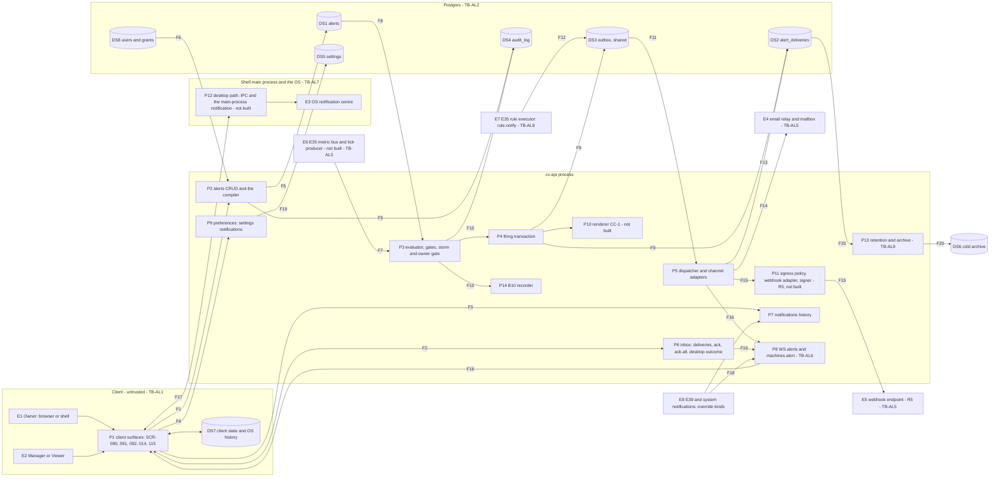

# E40 — STRIDE threat model: the alert and notification surface

- Ticket: E40-X01 (issue #1204), Part A. Owner: Security engineer (CODEOWNER). Status: **Draft** until the review the
  orchestrator's ruling on #1204 sets (BQ-10: the security and code lenses and the Owner's approval, the agent-delivery
  adaptation `e35-rule-engine.md` §11 records). Review log: end of §12. Classification: Internal (the ticket's Security
  notes): nothing from this document goes into issue text.
- Method: the `04-security-program.md` §5 template (L x I = risk), STRIDE per element and per trust boundary
  (C-12.1), rated on the matrix of `E29-oms.md` §1.3 and laid out as `e36-rule-form-editor.md`. Row ids are `AL-xnn`;
  requirements `SR-E40-nn`, epic-local, promoted when their ticket lands; findings `F-nn`, gaps `G-n`, open inputs
  `O-n`, abuse-case seeds `AC-AL-nn` (`docs/security/abuse-cases/e40-alerts.md`), private findings `PF-n` (§12.2).
- Inputs, read at `b81479ab01`: issue #1204 and the E40 epic with its 15 child tickets (`docs/plan/backlog/E40.json`);
  `11-user-stories.md` §24; `14-screens-catalogue.md` SCR-014, 090, 091, 092, 115; the `/alerts*` and
  `/notifications` operations and the `AlertConditionIr`, `AlertInput`, `Alert`, `AlertDelivery`, `Notification` and
  `Settings.notifications` schemas of `22-api-openapi.yaml`; `23-ws-protocol.md` §6.2.1, §15.7 and its view-as rules;
  `24-internal-schemas.md` §1.6; `21-database-schema.md` §3.5, §3.10.4 and its classification table; `28` B10;
  ADR-0032; `docs/design/E40/E40-D02.md` (§1, §3.5, §4.7, §10, §17); `docs/design/a11y/e40-alerts-a11y-review.md`;
  `docs/design/research/e40-alert-attention.md`; and on `main` the files cited below under
  `services/api/candleviewer/` (written `cv/`) with their tests (`tests/` paths are under `services/api/`).
- Contracts in flight, quoted by their own words and qualified "if it merges as is": E40-S02's contract slice #5676 at
  `aaed7dcc` (the render rules CC-1, the closed context CC-2, the override list and its locked cells, the `skipped`
  desktop outcome), and E35-T13's #5423 at `a5f2a1bd` (the `rule.notify` outbox topic); #5696's body bounds as its BQ-3
  states them. A merge re-pins them here.
- Path: the ticket's own, which GOV-008 reads (`scripts/check_threat_model_ticket_map.py:23`).
- Risk mapping: the ticket's Risk field reads "R11 Alert reliability"; in the register R11 is _Supply chain & tooling_
  (`32-risk-register.md` §1.2). The orchestrator's ruling on #1204 (BQ-3) records the residual under **R6** as
  RSK-093 (§12.1) and corrects the ticket's field in the backlog JSON.
- Gate note: design-level weaknesses and requirements only. No credential, account identifier or exploit detail
  appears. Findings about code on `main` went to the private advisory process (`SECURITY.md`, C-12.13); §12.2 names
  them by id, class and severity only.

## 1. Scope

In scope, the chain the ticket names: author (SCR-091) → `/alerts*` and the compiler → `alerts` → evaluator (over the
E35 metric bus) → the firing transaction → `alert_deliveries` and `outbox` → dispatcher → channels (in-app over the
`alerts` WS topic, the Electron desktop path, the email relay, the webhook) → user. With it: the read paths
(`/alerts*`, `/alerts/deliveries*`, `/notifications`, the WS `alerts` topic and `machines.alert`), the preference
path (SCR-115, `/settings` `notifications.*`) and the inbound `rule.notify` rows #5423 adds. An alert only notifies;
every authority decision is made on the server.

Out of scope (ticket): building the controls (Part B and the stories), the review and sign-off (Part C), the
pen-test (E43), live enablement (E44). Referenced, not repeated: E35 (the rule IR and runtime), E17 (the WS gateway),
E09 (sessions, RBAC, view-as), E39 (risk and the kill switch), E42 (the admin area and the user lifecycle), E14
(drawings), E27 (keys and the settings secret leaf), E04 (the relay), E07 (storage and the archive).

### 1.1 State of the build at review time

| Component                                                                             | Status on `main`                                            | Evidence                                                                                                                                                                                                  |
| ------------------------------------------------------------------------------------- | ----------------------------------------------------------- | --------------------------------------------------------------------------------------------------------------------------------------------------------------------------------------------------------- |
| Compiler: structural allow-list, schema, trigger, registry, hash, template allow-list | served                                                      | `cv/alerts/compiler.py:57-70` (the kind table), `:113-212` (the walk), `:293-310` (the template check), `:319-357`                                                                                        |
| `/alerts` CRUD, enable, snooze; `scope: self`; account grants on create and update    | served                                                      | `cv/api/alerts.py:216-241,243-298,345-466`; RBAC through `cv/api/alerts_http.py:106-129`                                                                                                                  |
| The inbox `/alerts/deliveries`, ack, ack-all, desktop outcome; the denial budget      | served                                                      | `cv/api/alert_deliveries.py:65-73,156-222,338-456`                                                                                                                                                        |
| `/notifications`: the union of alert, rule, order and system rows                     | served (no risk source yet)                                 | `cv/api/notifications.py:86-103`; per-source SQL `cv/storage/repositories/notifications_sqlalchemy.py:58-122`                                                                                             |
| WS `alerts` (the owner from the principal, #2521) and `machines.alert`                | served                                                      | `cv/alerts/ws_topic.py:11-14,187-200,284-293`; `cv/ws_wiring.py:492-497`                                                                                                                                  |
| Evaluator, gates, storm suppressor, owner gate, the B10 recorder                      | built, flag off, **fed by no producer**                     | `cv/alerts/evaluator.py:55,216-228,273-281,315-427`; `cv/alerts/gating.py:20-22,33-34,147-148`; `cv/alerts/owners.py:1-13`; `cv/settings.py:842-844`; `cv/alerts/service.py:64-68` and the tripwire below |
| The firing transaction: deliveries, outbox rows and counters in one unit of work      | built                                                       | `cv/storage/repositories/alert_firing_sqlalchemy.py:117-164`; the outbox payload holds ids and the channel only (`:158-162`)                                                                              |
| Dispatcher: in-app sent, desktop pending, email off, webhook and push disabled        | built, behind the evaluator flag                            | `cv/alerts/dispatcher.py:201-286`; `cv/app.py:3762-3791`; the webhook flag refuses to boot (`cv/app.py:3529-3530`; `cv/alerts/dispatcher.py:278-279`)                                                     |
| Tables `alerts`, `alert_deliveries`, `outbox`                                         | migrated                                                    | `cv/migrations/versions/0014_alerts.py:51-143`; `0059_alerts_disarm_reason.py`                                                                                                                            |
| Retention: 180 days hot, archived to Parquet, then deleted as `cv_owner`              | built, behind the scheduler flag                            | `cv/storage/retention/alert_tasks.py:117-150`; `cv/storage/retention/policy.py:120`                                                                                                                       |
| Alert audit actions                                                                   | registered                                                  | `alert.created` … `alert.desktop_outcome` (`cv/audit/actions.py:262-281`)                                                                                                                                 |
| The evaluation-time grant re-check                                                    | **not built**; a tripwire holds producers off               | `tests/alerts/test_alert_tick_tripwire.py:1-6,65-69` (left on #1204 by #4123)                                                                                                                             |
| Renderer (CC-1), context route (CC-2), typed preferences and mutes (CC-8, CC-9)       | **not built**; contracted by #5676                          | E40-S02 slices 2 and 3 (#1130)                                                                                                                                                                            |
| Web surfaces                                                                          | data layer only                                             | `apps/web/src/features/alerts/` (#5253); SCR-090's UI in flight; SCR-091 not built                                                                                                                        |
| Electron                                                                              | every renderer permission denied; no OS notification raised | `apps/desktop/src/main/index.ts:306-321`                                                                                                                                                                  |
| Egress policy, webhook adapter and signer                                             | **not built** (R5)                                          | E40-S03 (#1400)                                                                                                                                                                                           |
| A consumer of `rule.notify` rows                                                      | **none named**                                              | #5423 writes the rows (G-6)                                                                                                                                                                               |

A row resting on unbuilt work names the ticket that builds the control; Part C re-validates every row against
merged `main` (the ticket's Part C).

### 1.2 Assets and data classification

| Asset                                                            | Class                               | Notes                                                                                                                                                                                            |
| ---------------------------------------------------------------- | ----------------------------------- | ------------------------------------------------------------------------------------------------------------------------------------------------------------------------------------------------ |
| Alert definitions: condition, name, template, channels, schedule | **Internal** (ticket)               | The name and the template are untrusted user text wherever they are rendered (§6)                                                                                                                |
| `alerts.webhook_url_enc`, `alerts.webhook_secret_enc`            | **SECRET** (ticket; `21` class S)   | Envelope-encrypted; never selected into a DTO (`cv/storage/repositories/alerts_sqlalchemy.py:35-43`); never written in R3 (§5)                                                                   |
| `alert_deliveries.context`                                       | **Internal**, owner-scoped (ticket) | Holds the evaluation snapshot: metric values that may quote market state and position values (`cv/alerts/evaluator.py:361-365`); served to no one on `main`; CC-2 serves a closed subset (#5676) |
| The rendered message and title (CC-1)                            | Internal                            | Built from the alert's own text and values; plain text on every channel (SR-E40-06)                                                                                                              |
| `settings.notifications.*`                                       | the owner's                         | The plain `notifications.webhook_url` leaf is masked to a view-as read and is never a delivery target before its S upgrade (`21` gap G1)                                                         |
| The critical-override list (#5676 `notification-overrides.json`) | Integrity critical                  | Decides which signals no preference can silence (AL-T03, AL-E04)                                                                                                                                 |
| Audit records `alert.*` and `notifications.risk_channel_muted`   | Integrity critical                  | Hash-chained, shared with the order path's records (C-2.9, C-5.7); `alert.*` records carry the alert's `name` (`cv/api/alerts.py:132-135,350-352`)                                               |
| The cold archive of deliveries                                   | Internal, every user's              | E07's tier (AL-I09)                                                                                                                                                                              |
| The OS notification history and lock screen                      | outside the app                     | Whatever the OS shows stays there (AL-I03)                                                                                                                                                       |
| The serving loop                                                 | Availability critical               | REST, the WS gateway, order admission and the kill-switch route share it (AL-D01, AL-D03)                                                                                                        |

### 1.3 Attackers

A1 a lower-privileged user (a Viewer, or a Manager outside their grants); A2 a compromised browser session or renderer;
A3 a crafted client that talks to the API directly; A4 a well-meaning author whose alerts storm; A5 a malicious
Manager aiming at the Owner (through view-as or the Owner's audit viewer); A6 a network endpoint or resolver the
webhook path talks to (R5); A7 a database writer (as `04` RR-21). As in the E35 model, the product is reachable only
over Tailscale.

### 1.4 Rating and dispositions

Risk = L x I on the programme scale, the matrix of `E29-oms.md` §1.3: H x H Critical; M x H and H x M High; M x M,
L x H and H x L Medium; the rest Low. The Risk column is the unmitigated rating and the Res. column the residual once
the named control lands. Disposition: **Q** a requirement a named ticket builds and a named test proves; **C** a
control on `main`, cited with its test; **R** owned by another epic's model. The register's 5 x 5 score is given only
for RSK-093 (§12.1).

### 1.5 Open inputs

| Id  | Open input                                                                                                                                                                                                                                                                                                                    | Rows                           | Owner                           |
| --- | ----------------------------------------------------------------------------------------------------------------------------------------------------------------------------------------------------------------------------------------------------------------------------------------------------------------------------- | ------------------------------ | ------------------------------- |
| O-1 | #5676 is open: the render, context, override and locked-cell rules this model relies on are quoted "if #5676 merges as is"; its `skipped` reasons (`window_visible`, `desktop_off`) have none for a delivery the OS-notification cap holds back, which stays `queued` or is `skipped` with a reason the set gains (SR-E40-09) | AL-T03, AL-T04, AL-I03, AL-S02 | E40-S02 (#1130)                 |
| O-2 | No E40 consumer of `rule.notify` rows is named (#5423)                                                                                                                                                                                                                                                                        | AL-I10, AL-E02                 | the orchestrator at merge (G-6) |
| O-3 | #1864's shape (the armed-alert cap, its `409 limit_reached`, its Q5 on records of refused writes)                                                                                                                                                                                                                             | AL-D01, AL-R02                 | #1864                           |
| O-4 | The storm threshold is provisional (ADR-0032 Q3) until E40-Q02 measures it                                                                                                                                                                                                                                                    | AL-D04                         | E40-Q02 (#1203)                 |
| O-5 | The critical-override list is PROPOSED (E40-D01 §5, CO-1 to CO-12) until the Owner ratifies it on #958                                                                                                                                                                                                                        | AL-T03, AL-E04                 | the Owner                       |
| O-6 | The evaluation-time re-check's contract is `24` §19.120 and migration slot 0069, both provisional (the ruling on #1204, BQ-4)                                                                                                                                                                                                 | AL-I02, AL-E03                 | E40-X01 Part B                  |

## 2. Data-flow diagram and trust boundaries

Text alternative: the client surfaces (P1) run in the user's browser or the shell's renderer and hold client state
(DS7). They write alerts through the CRUD routes and the compiler (F1), read and settle deliveries through the inbox
(F2), read the notification history (F3) and write preferences (F4). The API stores alerts and writes its audit
records ahead of every change (F5), reading the caller's roles, grants and status (F6). Once a producer exists, ticks
reach the evaluator (F7), which keeps the live alerts in memory (F8) and, when a condition holds and every gate
passes, commits deliveries, outbox rows and counters in one transaction (F9), then records the firing (F10). The
dispatcher claims `alert.deliver` rows (F11) from an outbox that E35's `rule.notify` rows also enter (F12), settles
each delivery (F13), and hands email to the relay (F14) and, in R5, a webhook to the egress path (F15). Snapshots and
deltas go to the owner's sockets (F16); the shell turns a desktop delivery into an OS notification and reports back
(F17); risk, kill-switch and system notifications reach the same surfaces (F18). Preferences are stored per user
(F19), and retention archives delivery rows before deleting them (F20). In-process calls (P3 → P4 → P10) are
analysed on their processes.

Elements: entities **E1 to E8**; processes **P1 to P14**; stores **DS1 to DS8**; flows **F1 to F20**, each analysed
on the boundary it crosses (the table below, §3.7).

- **E1** the Owner, in a browser or the shell; **E2** a Manager or a Viewer; **E3** the shell's main process and the
  OS notification centre; **E4** the email relay (E04) and the mailbox behind it; **E5** a webhook endpoint (R5);
  **E6** the E35 metric bus and the tick producer, which does not exist yet; **E7** the E35 rule executor, which
  writes `rule.notify` rows (#5423); **E8** E39's risk and kill-switch signals and the system notifications, the
  override kinds.
- **P1** the client surfaces SCR-090, 091, 092, 014 and 115; **P2** `/alerts*` and `AlertCompiler`; **P3** the
  evaluator, its gates, the storm suppressor and the owner gate; **P4** the firing transaction; **P5** the
  dispatcher and its channel adapters; **P6** the inbox (`/alerts/deliveries*`, and the CC-2 detail #5676 adds);
  **P7** `/notifications`; **P8** the WS `alerts` topic and `machines.alert`; **P9** the preferences (SCR-115,
  `/settings` `notifications.*`); **P10** the renderer CC-1 (not built); **P11** the egress policy, the webhook
  adapter and the signer (R5, not built); **P12** the desktop path, the shell's IPC and its main-process
  notification (not built); **P13** retention and the archive; **P14** the B10 recorder.
- **DS1** `alerts`; **DS2** `alert_deliveries`; **DS3** `outbox`, shared by topics (`alert.deliver` on `main`;
  `rule.notify` with #5423; `order.submit` and `webhook.post` designed, `21` §3.10.4, with no consumer on `main`);
  **DS4** `audit_log`; **DS5** `settings`; **DS6** the cold archive; **DS7** client state and the OS notification
  history; **DS8** users, roles and grants.

| Flow | From → to            | What crosses                                                        | Boundary |
| ---- | -------------------- | ------------------------------------------------------------------- | -------- |
| F1   | P1 → P2              | alert create, update, delete, enable, snooze; list and read         | TB-AL1   |
| F2   | P1 ↔ P6              | inbox reads, ack, ack-all, desktop outcome; the CC-2 detail (#5676) | TB-AL1   |
| F3   | P1 → P7              | the notification history                                            | TB-AL1   |
| F4   | P1 → P9              | notification preferences                                            | TB-AL1   |
| F5   | P2 → DS1, DS4        | alert rows; write-ahead and refusal records                         | TB-AL2   |
| F6   | DS8 → P2, P3, P5, P7 | roles, grants and owner status                                      | TB-AL2   |
| F7   | E6 → P3              | ticks and metric values (no producer on `main`)                     | TB-AL3   |
| F8   | DS1 → P3             | live alerts at warm-up and on each change                           | TB-AL2   |
| F9   | P4 → DS2, DS3, DS1   | deliveries, outbox rows and counters, one transaction               | TB-AL2   |
| F10  | P3 → DS4, P14        | `alert.fired`, `alert.disarmed`; B10 records                        | TB-AL2   |
| F11  | DS3 → P5             | claimed `alert.deliver` rows                                        | TB-AL4   |
| F12  | E7 → DS3             | `rule.notify` rows (#5423)                                          | TB-AL8   |
| F13  | P5 → DS2             | settles and channel-failure notices                                 | TB-AL2   |
| F14  | P5 → E4              | email (no transport is built)                                       | TB-AL5   |
| F15  | P5 → P11 → E5        | webhook requests (R5, not built)                                    | TB-AL5   |
| F16  | P5, P6 → P8 → P1     | `alerts` snapshots and deltas; `machines.alert` frames              | TB-AL6   |
| F17  | P1 ↔ P12 → E3        | a desktop delivery to the OS and the outcome back                   | TB-AL7   |
| F18  | E8 → P7, P8          | risk, kill-switch and system notifications                          | TB-AL6   |
| F19  | P9 → DS5             | preference rows                                                     | TB-AL2   |
| F20  | DS2 → P13 → DS6      | delivery rows archived, then deleted                                | TB-AL9   |

Trust boundaries:

- **TB-AL1, client to API** (F1 to F4; programme TB-4; the E36 model's TB-A1): everything the client sends is
  untrusted and the client decides nothing (C-2.12).
- **TB-AL2, API to Postgres** (F5, F6, F8 to F10, F13, F19): a database writer is its own integrity domain (A7).
- **TB-AL3, metric bus to evaluator** (F7): in-process today; the values are E35's and E12's to keep right.
- **TB-AL4, evaluator to dispatcher through the shared outbox** (F11): the outbox carries other modules' topics too.
- **TB-AL5, dispatcher to the outside** (F14, F15): the relay and, in R5, any webhook endpoint (programme TB-7's
  kind); text and values leave the instance here.
- **TB-AL6, WS egress** (F16, F18; E17's TB-4 side): owned by E17, which delivers each frame only to its owner.
- **TB-AL7, renderer to main process to OS** (F17): the main process trusts no renderer (`04` §5.9, the Electron
  shell's area), and the OS shows what it is given on screens the app does not control.
- **TB-AL8, E35 to E40** (F12): another module's rows enter E40's delivery path.
- **TB-AL9, retention to archive** (F20): the `cv_owner` role and E07's archive tier.

## 3. STRIDE tables

Columns: the existing control is what `main` does today, with its test; the gap names the requirement (§10); the
control owner is the ticket that builds or holds the control and its target sprint (R3 runs S14 to S19,
`31-sprint-plan.md`; E40-S03 is R5); Verify names the seed (`docs/security/abuse-cases/e40-alerts.md`) whose test
proves the row, or `NOT RUN:` and the owner whose code or model it waits for. Programme rows extended, not repeated
(`04-security-program.md` §5.3, the rule-engine area): R1 → AL-E01 (node kinds on an allow-list); R3 → AL-I02,
AL-E03 (grants re-checked at fire time, as SR-103 asks of rules).

### 3.1 Spoofing

| ID     | Element / boundary     | Threat                                                                                                                                                                                                                              | L   | I   | Risk   | Existing control                                                                                                                                                                                                                                                                                                                                                                             | Gap → requirement                                  | Control owner (sprint)                | Verify                       | Disp. | Res. |
| ------ | ---------------------- | ----------------------------------------------------------------------------------------------------------------------------------------------------------------------------------------------------------------------------------- | --- | --- | ------ | -------------------------------------------------------------------------------------------------------------------------------------------------------------------------------------------------------------------------------------------------------------------------------------------------------------------------------------------------------------------------------------------- | -------------------------------------------------- | ------------------------------------- | ---------------------------- | ----- | ---- |
| AL-S01 | P6, E3, TB-AL7         | A desktop outcome reported by a session that is not the shell: a browser tab settles its owner's desktop row `shown` or `failed`, or reports an OS permission it never observed                                                     | M   | L   | Low    | The report is owner-only (`scope: self`), its body closed and validated, and audited with the outcome and the reported permission (`cv/api/alert_deliveries.py:423-456`; `tests/alerts/test_alert_deliveries_api.py:252-322`)                                                                                                                                                                | SR-E40-22                                          | E40-S02 slice 6 (S18)                 | AC-AL-16                     | C, Q  | Low  |
| AL-S02 | E3, P12, TB-AL7        | A hostile renderer asks the main process for an OS notification with arbitrary text, markup or a link, posing as the app's own risk or alert notice                                                                                 | L   | H   | Medium | Every renderer permission is denied and the main process raises no notification (`apps/desktop/src/main/index.ts:306-321`)                                                                                                                                                                                                                                                                   | SR-E40-09                                          | E40-S02 slice 6 (S18)                 | AC-AL-17                     | Q     | Low  |
| AL-S03 | E1, E2, P2, P6, TB-AL1 | A view-as session, a stale tab or a cross-site page acts on alerts as the wrong user                                                                                                                                                | L   | M   | Low    | The view-as guard refuses every write while viewing (`cv/api/view_as_guard.py:1-30`); records name the viewer, never the target (`cv/api/view_as_subject.py:62-69`); bearer and CSRF checks on every request (E09)                                                                                                                                                                           | None in E40: E09's model owns sessions and view-as | E09; E40-X01 Part B (S19)             | AC-AL-23                     | R     | Low  |
| AL-S04 | P1, P5, P10            | A user alert dressed as a risk or kill-switch notice (a name reading "Kill switch engaged" at severity `critical`), so a real override signal is read as an alert, or an alert as one                                               | M   | M   | Medium | None on `main`; #5676 adds the delivery `kind` (`AlertDeliveryKind`) and `"user_alerts_override": false` ("if #5676 merges as is")                                                                                                                                                                                                                                                           | SR-E40-11                                          | E40-S02 slices 4–5 (S18)              | AC-AL-21                     | Q     | Low  |
| AL-S05 | P6, P8, TB-AL1, TB-AL6 | A client fabricates a delivery or a notification: a write to the inbox, a frame on the `alerts` socket, or an ack or a report for a row it does not own                                                                             | M   | M   | Medium | Only the firing transaction writes deliveries (`cv/storage/repositories/alert_firing_sqlalchemy.py:117-164`) and only the dispatcher and the inbox settle them; no route creates one; `cv.v1` has no action frame (`23-ws-protocol.md` line 1584); an ack moves only the caller's own `sent` row (`cv/api/alert_deliveries.py:406-421`; `tests/alerts/test_alert_deliveries_api.py:152-176`) | None on the server; Part B adds the socket leg     | E40-T04 (built); E40-X01 Part B (S19) | AC-AL-16                     | C     | Low  |
| AL-S06 | E5, P11, TB-AL5        | The webhook endpoint impersonated: the request reaches a host that is not the URL's, through an ambient proxy, a resolver answer or a certificate for another name, or carries credentials the client picks up from its environment | L   | H   | Medium | None built: a webhook URL or channel is refused at write and the app refuses to boot with the webhook flag on (`cv/api/alerts.py:275-277`; `cv/app.py:3529-3530`)                                                                                                                                                                                                                            | SR-E40-13                                          | E40-S03 (R5)                          | NOT RUN: E40-S03 (#1400, R5) | Q     | Low  |

### 3.2 Tampering

| ID     | Element / boundary      | Threat                                                                                                                                                                                                                                     | L   | I   | Risk   | Existing control                                                                                                                                                                                                                                                                                                                           | Gap → requirement                            | Control owner (sprint)                                                 | Verify   | Disp. | Res. |
| ------ | ----------------------- | ------------------------------------------------------------------------------------------------------------------------------------------------------------------------------------------------------------------------------------------ | --- | --- | ------ | ------------------------------------------------------------------------------------------------------------------------------------------------------------------------------------------------------------------------------------------------------------------------------------------------------------------------------------------ | -------------------------------------------- | ---------------------------------------------------------------------- | -------- | ----- | ---- |
| AL-T01 | DS2, TB-AL2, TB-AL9     | Firing history rewritten by a database writer: a delivery's title, values or times changed after the fact, or rows deleted outside retention                                                                                               | L   | M   | Low    | DELETE is refused except for the retention role (`cv/migrations/versions/0014_alerts.py:111-120`; `tests/integration/storage/test_alerts_migration.py:82`); UPDATE stays open on every column for the status moves (`21-database-schema.md` §3.5, line 3158)                                                                               | SR-E40-19; G-4                               | G-4, a ticket filed at merge (S19)                                     | AC-AL-25 | Q     | Low  |
| AL-T02 | P2, DS1                 | Last writer wins between the owner's own sessions: one tab's edit silently replaces another's                                                                                                                                              | M   | L   | Low    | `If-Match` answers 412 on a stale replace (`cv/api/alerts.py:375-382`; `tests/alerts/test_alerts_api.py:257`); a replace without it is last-write-wins by contract (`22` `IfMatch`, line 16863; `tests/alerts/test_alerts_api.py:272`)                                                                                                     | The editor sends `If-Match` on every replace | E40-S01 (S18)                                                          | AC-AL-07 | C, Q  | Low  |
| AL-T03 | P9, DS5, DS7            | The critical-override list or a locked cell changed through the API or a client's copy, so a lockout or kill-switch signal becomes mutable                                                                                                 | M   | H   | High   | None on `main`, where no preference matrix exists; #5676 ships one list (`packages/protocol/notification-overrides.json`) compiled into both twins, and a locked cell set false is `422 validation_failed`, rule `risk_channel_locked` ("if #5676 merges as is")                                                                           | SR-E40-12                                    | E40-S02 slices 1, 3 (S18)                                              | AC-AL-15 | Q     | Low  |
| AL-T04 | P10, P5, E3, E4, TB-AL5 | User text through rendering and channels: a placeholder re-expanded from a substituted value, control or bidi characters, a line break in a header-like field                                                                              | M   | M   | Medium | The placeholder allow-list (`cv/alerts/compiler.py:293-310`); no renderer and no email transport are built (`cv/app.py:3762-3772`); #5676's CC-1 text: "Plain text, never markup: control and bidirectional-control characters are removed and a substituted value never carries `{{` or `}}`"; PF-2 (§12.2)                               | SR-E40-06, SR-E40-07                         | E40-S02 slice 2 (S18); E04 for the relay                               | AC-AL-06 | Q     | Low  |
| AL-T05 | E1, P1, DS4             | Alert text as markup: a name or a template rendered as HTML in the owner's surfaces, in a view-as session, or in the Owner's audit viewer through the `name` that `alert.*` records carry, so a Manager's text runs in the Owner's session | M   | H   | High   | React renders text by default; strict CSP (C-12.10); `.semgrep/cv-shell-dangerously-set-inner-html.yml` covers `apps/web/src/features/**` and `apps/desktop/**`; E40-D02 §10.2                                                                                                                                                             | SR-E40-08                                    | E40-S01, E40-S02 (S18); E40-X01 Part B (S19); E42 for the audit viewer | AC-AL-21 | Q     | Low  |
| AL-T06 | DS3, TB-AL4, TB-AL8     | Another topic's or another owner's row in the shared outbox read as an alert delivery, or an alert row consumed by another topic's poller                                                                                                  | L   | H   | Medium | The firing store writes only `alert.deliver` (`cv/app.py:3849-3850`); the dispatcher claims only that topic (`cv/alerts/dispatcher.py:326-329`) and reads the delivery row by its id (`:345-346`); the payload holds ids and the channel (`cv/storage/repositories/alert_firing_sqlalchemy.py:158-162`); no `order.submit` consumer exists | SR-E40-03                                    | E40-X01 Part B (S19); G-6 (S18)                                        | AC-AL-04 | Q     | Low  |

### 3.3 Repudiation

| ID     | Element / boundary | Threat                                                                          | L   | I   | Risk   | Existing control                                                                                                                                                                                                                                                                                                                                                                                      | Gap → requirement                                                         | Control owner (sprint)                         | Verify                   | Disp. | Res. |
| ------ | ------------------ | ------------------------------------------------------------------------------- | --- | --- | ------ | ----------------------------------------------------------------------------------------------------------------------------------------------------------------------------------------------------------------------------------------------------------------------------------------------------------------------------------------------------------------------------------------------------- | ------------------------------------------------------------------------- | ---------------------------------------------- | ------------------------ | ----- | ---- |
| AL-R01 | P3, P4, DS2, DS4   | "Why did this fire" cannot be shown, or a firing has no record                  | L   | M   | Low    | The evaluation snapshot is written in the firing's own unit of work (`cv/storage/repositories/alert_firing_sqlalchemy.py:117-164`); `alert.fired` follows the commit, and a failed write is logged with the delivery kept (`cv/alerts/evaluator.py:417-427`; `tests/alerts/test_alert_evaluator_wiring.py:182`); retention archives before it deletes (`cv/storage/retention/alert_tasks.py:136-150`) | SR-E40-19, SR-E40-26; G-4                                                 | G-4 (S19)                                      | AC-AL-25                 | C, Q  | Low  |
| AL-R02 | P2, P6, DS4        | A write or a refusal with no record, or a record of a write that never happened | M   | M   | Medium | Writes and scope refusals are audited ahead (`cv/api/alerts.py:238-241,349-352`); a foreign id is audited (`cv/api/alerts.py:226-229`), on the inbox under a per-caller budget (`cv/api/alert_deliveries.py:156-222`); a write the transaction refuses keeps its write-ahead record (#1204's follow-up C2; #1864 Q5); PF-5 (§12.2)                                                                    | SR-E40-20, SR-E40-21; G-7                                                 | #5696 (S19); #1864 (S18); E40-X01 Part B (S19) | AC-AL-12 (#5696's tests) | C, Q  | Low  |
| AL-R03 | P9, DS4            | A risk channel muted with no record                                             | M   | M   | Medium | None on `main`; #5676 refuses a locked cell and gives its audit, `notifications.risk_channel_muted` at high severity, to the preferences slice ("if #5676 merges as is")                                                                                                                                                                                                                              | SR-E40-12                                                                 | E40-S02 slice 3 (S18)                          | AC-AL-15                 | Q     | Low  |
| AL-R04 | E3, P6, P12        | The OS permission in a desktop outcome is the client's word                     | L   | L   | Low    | Recorded as reported, from a closed set (`cv/api/alert_deliveries.py:263-268`; `tests/alerts/test_alert_deliveries_api.py:308`)                                                                                                                                                                                                                                                                       | None: it describes the reporter's own device and settles only its own row | E40-T04 (built)                                | AC-AL-16                 | C     | Low  |

### 3.4 Information disclosure

| ID     | Element / boundary             | Threat                                                                                                                                                          | L   | I   | Risk   | Existing control                                                                                                                                                                                                                                                                                                                                                                                                                                                                                                                                                                                                                                                                                       | Gap → requirement                                                                                                                                                                                                         | Control owner (sprint)                                                   | Verify                                                | Disp. | Res. |
| ------ | ------------------------------ | --------------------------------------------------------------------------------------------------------------------------------------------------------------- | --- | --- | ------ | ------------------------------------------------------------------------------------------------------------------------------------------------------------------------------------------------------------------------------------------------------------------------------------------------------------------------------------------------------------------------------------------------------------------------------------------------------------------------------------------------------------------------------------------------------------------------------------------------------------------------------------------------------------------------------------------------------ | ------------------------------------------------------------------------------------------------------------------------------------------------------------------------------------------------------------------------- | ------------------------------------------------------------------------ | ----------------------------------------------------- | ----- | ---- |
| AL-I01 | P2, P6, P7, P8, TB-AL1, TB-AL6 | Another user's alert, delivery or history read: by id, through an `alert_id` filter, over the socket, or through the union                                      | M   | H   | High   | `scope: self`: a foreign id is the missing 404 and is audited (`cv/api/alerts.py:216-233`), on the inbox under a per-caller budget (`cv/api/alert_deliveries.py:338-349,364-370`); the socket's owner is the principal (`cv/alerts/ws_topic.py:11-14`; E17 WS-I09), and a `machines.alert` entry is bound to its owner and refused to anyone else (`tests/alerts/test_alert_charts_feed.py:33`; `tests/unit/ws/test_machines.py:153,183`); the union filters each source in SQL (`cv/storage/repositories/notifications_sqlalchemy.py:58-122`). Tests: `tests/alerts/test_alerts_api.py:290`, `tests/alerts/test_alert_deliveries_api.py:100,159,322`, `tests/alerts/test_alerts_ws_topic.py:60,78,93` | SR-E40-25 (a drawing's `alert_id`, once served); Part B's cross-user matrix runs every route as another user                                                                                                              | E40-T02, E40-T04 (built); E40-X01 Part B (S19)                           | AC-AL-07, AC-AL-08, AC-AL-10, AC-AL-11                | C     | Low  |
| AL-I02 | P3, P4, P6, P10, DS8           | Evaluation, firing and recorded values for an account the owner no longer holds: a grant revoked after the alert was written                                    | M   | H   | High   | Every account an alert names is checked against its author's grants on create and update, and a refusal is audited (#4123; `cv/api/alerts.py:278-297`; `tests/alerts/test_alerts_account_grants.py`); the tripwire keeps every tick producer out until the re-check exists (`tests/alerts/test_alert_tick_tripwire.py:65-69`)                                                                                                                                                                                                                                                                                                                                                                          | SR-E40-04, SR-E40-05; G-1                                                                                                                                                                                                 | E40-X01 Part B, its first code PR (S19); E40-S02 slice 2 (S18)           | AC-AL-09, AC-AL-13                                    | Q     | Low  |
| AL-I03 | P10, E3, E4, E5, DS7           | Account data in an OS notification, on a lock screen, in an email or in a webhook payload                                                                       | M   | H   | High   | No renderer and no external channel is built; E40-D02 D-23 (the OS text) and the a11y review B-F13; #5676: "The value of a metric of account or position scope, and every `position.*` placeholder, renders `—`" ("if #5676 merges as is")                                                                                                                                                                                                                                                                                                                                                                                                                                                             | SR-E40-06, SR-E40-09, SR-E40-15                                                                                                                                                                                           | E40-S02 slices 2, 6 (S18); E40-S03 (R5)                                  | AC-AL-06, AC-AL-17                                    | Q     | Low  |
| AL-I04 | P2, P10                        | A template names a secret, another namespace, a deeper path or a look-alike field                                                                               | M   | M   | Medium | The placeholder allow-list: exactly `namespace.leaf` from four namespaces, none holding a secret (`cv/alerts/compiler.py:82-97,285-310`; `tests/alerts/test_alert_compiler_semantics.py:136,162`)                                                                                                                                                                                                                                                                                                                                                                                                                                                                                                      | None                                                                                                                                                                                                                      | E40-T02 (built)                                                          | AC-AL-05                                              | C     | Low  |
| AL-I05 | DS1, DS5, P2, P11              | The SECRET webhook columns, or the plain `settings` webhook leaf, reach a DTO, a log or a payload                                                               | L   | H   | Medium | An explicit read allow-list without the SECRET columns (`cv/storage/repositories/alerts_sqlalchemy.py:35-43`); `Alert` answers `webhook_url: None` (`cv/api/alerts.py:182`); a webhook URL or channel is refused at write (`:275-277`). Tests: `tests/alerts/test_alert_deliveries_api.py:507`, `tests/alerts/test_alerts_ws_topic.py:624`, `tests/alerts/test_alerts_api_rbac.py:108-127`                                                                                                                                                                                                                                                                                                             | SR-E40-14; Part B's Semgrep rule (c)                                                                                                                                                                                      | E40-X01 Part B (S19); E40-S03 (R5); E40-T05 for the `22` amendment (S18) | AC-AL-19                                              | C, Q  | Low  |
| AL-I06 | P1                             | An accessible name, a description or a live region says more than the visible text: a SECRET value, a `position.*` value, or the message the OS text leaves out | M   | M   | Medium | None built; the a11y review B-F9 and B-F13                                                                                                                                                                                                                                                                                                                                                                                                                                                                                                                                                                                                                                                             | SR-E40-10                                                                                                                                                                                                                 | E40-S01, E40-S02 (S18); E40-Q02 (S19); E40-X01 Part B                    | AC-AL-22                                              | Q     | Low  |
| AL-I07 | P8, P12, E3                    | View-as: the viewer's shell notifies or sounds for the target's deliveries                                                                                      | L   | M   | Low    | View-as resolves the `alerts` topic to the target (`23-ws-protocol.md` line 1583); no OS path is built                                                                                                                                                                                                                                                                                                                                                                                                                                                                                                                                                                                                 | SR-E40-09                                                                                                                                                                                                                 | E40-S02 slice 6 (S18); the E42-D02 lane (CC-16)                          | AC-AL-23                                              | Q     | Low  |
| AL-I08 | P7                             | The union serves an order on an ungranted account, another user's system row or a rule the caller cannot read                                                   | L   | H   | Medium | Per-source filters from the caller's permissions and grants (`cv/api/notifications.py:86-103`; `tests/alerts/test_notifications_api.py:117-186`)                                                                                                                                                                                                                                                                                                                                                                                                                                                                                                                                                       | None                                                                                                                                                                                                                      | E40-T04 (built)                                                          | AC-AL-11                                              | C     | Low  |
| AL-I09 | DS6, P13, TB-AL9               | The cold archive holds every user's delivery titles and values                                                                                                  | L   | M   | Low    | Archived before deletion, by the retention role only (`cv/storage/retention/alert_tasks.py:117-150`)                                                                                                                                                                                                                                                                                                                                                                                                                                                                                                                                                                                                   | None in E40: archive access is E07's                                                                                                                                                                                      | E07                                                                      | NOT RUN: E07 (`E07-storage.md` owns the archive tier) | R     | Low  |
| AL-I10 | TB-AL8, DS3, P5                | Rule notification text and values reach E40's channels through a consumer nobody owns, or reach someone other than the rule's owner                             | M   | M   | Medium | None: #5423 writes `rule.notify` rows and names no consumer                                                                                                                                                                                                                                                                                                                                                                                                                                                                                                                                                                                                                                            | SR-E40-23; G-6                                                                                                                                                                                                            | G-6, a ticket filed at merge (S18)                                       | AC-AL-24                                              | Q     | Low  |
| AL-I11 | P2, P3, P6, P10, E6            | Account- or position-scope data read by an alert and not bound to one account its author holds                                                                  | M   | H   | High   | Create and update check every account an alert names against its author's grants (#4123; `cv/api/alerts.py:278-297`; `tests/alerts/test_alerts_account_grants.py`); no producer feeds the evaluator and the tripwire holds (`tests/alerts/test_alert_tick_tripwire.py:65-69`); PF-6 (§12.2)                                                                                                                                                                                                                                                                                                                                                                                                            | SR-E40-04, SR-E40-05; G-1; G-9: #5745 (E35), the evaluator's producer bridge, pushes market-scope metrics only until Part B's account-binding control lands, and account- and position-scope producers stay blocked on it | E40-X01 Part B, its first code PR (S19); E40-S02 slice 2 (S18); G-9      | AC-AL-13, AC-AL-14                                    | Q     | Low  |

### 3.5 Denial of service

| ID     | Element / boundary        | Threat                                                                                                  | L   | I   | Risk   | Existing control                                                                                                                                                                                                                                                                                                                    | Gap → requirement                                                                           | Control owner (sprint)                                      | Verify                                                                          | Disp. | Res. |
| ------ | ------------------------- | ------------------------------------------------------------------------------------------------------- | --- | --- | ------ | ----------------------------------------------------------------------------------------------------------------------------------------------------------------------------------------------------------------------------------------------------------------------------------------------------------------------------------- | ------------------------------------------------------------------------------------------- | ----------------------------------------------------------- | ------------------------------------------------------------------------------- | ----- | ---- |
| AL-D01 | P2, P3, DS1, E6           | Alert-count exhaustion: one user's alerts and subscriptions starve every user's evaluation              | M   | H   | High   | The evaluation queue holds 1,024 ticks and sheds the oldest, counted (`cv/alerts/evaluator.py:55,273-281`; `tests/alerts/test_alert_evaluator_wiring.py:76`); one subscription per distinct `condition_hash` (ADR-0032)                                                                                                             | SR-E40-16, SR-E40-18, SR-E40-27; G-5                                                        | #1864 (S18); E40-X01 Part B (S19)                           | AC-AL-20                                                                        | Q     | Low  |
| AL-D02 | P2, DS4, TB-AL1           | Write and refusal floods into the hash-chained audit store the order path shares                        | M   | M   | Medium | The inbox's refusal records are budgeted per caller (`cv/api/alert_deliveries.py:69-73`); PF-3 (§12.2)                                                                                                                                                                                                                              | SR-E40-16, SR-E40-21; G-3                                                                   | #5696 (S19)                                                 | AC-AL-20                                                                        | Q     | Low  |
| AL-D03 | P2, P6, TB-AL1            | Oversized alert documents and bodies on the serving loop                                                | M   | H   | High   | The condition's node and depth bounds (`cv/alerts/compiler.py:48-49`); PF-1 (§12.2)                                                                                                                                                                                                                                                 | SR-E40-17, SR-E40-27; G-2, G-5 (R-1)                                                        | #5696 (S19); G-5 (S18)                                      | AC-AL-20                                                                        | Q     | Low  |
| AL-D04 | P3, P4, P5, P10, DS2, DS3 | Firing storms, suppressed firings that still write rows, and outbox growth                              | M   | M   | Medium | The storm gate, 20 deliveries per user per 60 s (`cv/alerts/gating.py:33-34`; `tests/alerts/test_alert_gating.py:138`); INV-B10-c; the backlog and dead-letter alerts (`infra/prometheus/alerts/system_ticket.yml:470,490`); 180-day retention                                                                                      | SR-E40-16 (at most 20 suppressed rows a storm window, the rest counted in its summary); G-5 | G-5 (S18); E40-X01 Part B (S19)                             | AC-AL-20                                                                        | C, Q  | Low  |
| AL-D05 | P2, P6, P7                | An unbounded statement or read: `ack-all` over every unacknowledged row, or a page read without a bound | M   | M   | Medium | `ack-all` runs at most 10 batches of 500 and records first (`cv/api/alert_deliveries.py:385-404`; `tests/alerts/test_alert_deliveries_api.py:235`); alert and inbox pages hold at most 500 (`cv/api/alerts.py:330`; `cv/api/alert_deliveries.py:355`); the history's page is bounded (`tests/alerts/test_notifications_api.py:239`) | None                                                                                        | E40-T02, E40-T04 (built)                                    | AC-AL-20                                                                        | C     | Low  |
| AL-D06 | P1, P8, TB-AL6            | Slow consumers of the `alerts` fan-out, or a change burst queued without bound                          | L   | M   | Low    | A 500-row snapshot, 100 items a frame, and a 1,024-batch queue that re-snapshots when full (`cv/alerts/ws_topic.py:62-79`; `tests/alerts/test_alerts_ws_topic.py:552`); E17's pacing (`23` §8.4)                                                                                                                                    | None in E40: pacing is E17's                                                                | E40-T04 (built); E17                                        | AC-AL-20                                                                        | C, R  | Low  |
| AL-D07 | P11, E5, TB-AL5           | Webhook amplification, and a slow endpoint holding up in-app rows                                       | M   | M   | Medium | The channel is disabled (`cv/alerts/dispatcher.py:278-286`)                                                                                                                                                                                                                                                                         | SR-E40-15                                                                                   | E40-S03 (R5); E40-Q02's note on #1203                       | NOT RUN: E40-S03 (#1400, R5)                                                    | Q     | Low  |
| AL-D08 | E6, P3, TB-AL3            | A tick producer that feeds the evaluator per book delta or per detector event                           | M   | M   | Medium | No producer exists (`cv/alerts/service.py:64-68`; the tripwire)                                                                                                                                                                                                                                                                     | SR-E40-18; G-9                                                                              | G-9: the first alert-tick producer's ticket, filed at merge | NOT RUN: G-9 (the first alert-tick producer's ticket; E40-Q01's replay harness) | Q     | Low  |

### 3.6 Elevation of privilege

| ID     | Element / boundary     | Threat                                                                                                                                                                                                              | L   | I   | Risk     | Existing control                                                                                                                                                                                                                                                                                                                                                                                    | Gap → requirement                    | Control owner (sprint)                                         | Verify                       | Disp. | Res.      |
| ------ | ---------------------- | ------------------------------------------------------------------------------------------------------------------------------------------------------------------------------------------------------------------- | --- | --- | -------- | --------------------------------------------------------------------------------------------------------------------------------------------------------------------------------------------------------------------------------------------------------------------------------------------------------------------------------------------------------------------------------------------------- | ------------------------------------ | -------------------------------------------------------------- | ---------------------------- | ----- | --------- |
| AL-E01 | P2, P3, P4, P5         | An alert acts: an action node at any position, a look-alike key, or a node kind E35 adds later                                                                                                                      | M   | H   | High     | The notify-only invariant in eight layers, each with its test (§4): E40-T02's allow-list walk and schema (`tests/alerts/test_alert_compiler.py:62-196`; `tests/alerts/test_alert_compiler_property.py:91`; `tests/alerts/test_alerts_api.py:54,62`), the import contract (`services/api/.importlinter:585-610`) and `cv_alert_compile_rejected_total{reason}` (`cv/app.py:3474-3486`); PF-4 (§12.2) | SR-E40-01, SR-E40-02, SR-E40-26; G-8 | E40-T02 (built); E40-X01 Part B (S19)                          | AC-AL-01, AC-AL-02, AC-AL-03 | C, Q  | Low       |
| AL-E02 | P1, P5, TB-AL4, TB-AL8 | An alert acts through a side channel: a consumer that acts on a delivery or a notification row, a "create a rule" link that binds instead of copying, or a test fire on the real path                               | L   | H   | Medium   | E40-D02 D-1 (the link-out copies a draft, never a binding); the channel adapters only notify (`cv/alerts/dispatcher.py:201-286`); no consumer acts on a delivery                                                                                                                                                                                                                                    | SR-E40-03, SR-E40-24                 | E40-S01 (S18); G-6 (S18); E40-X01 Part B (S19)                 | AC-AL-04                     | Q     | Low       |
| AL-E03 | P2, DS8                | An alert names an account its author does not hold: on create, on update, or by enabling it after the grant is revoked                                                                                              | M   | H   | High     | Create and update check every named account (#4123; `cv/api/alerts.py:278-297`; `tests/alerts/test_alerts_account_grants.py`); enabling does not re-check (left on #1204 by #4123)                                                                                                                                                                                                                  | SR-E40-04; G-1                       | E40-T02 (built); E40-X01 Part B, its first code PR (S19)       | AC-AL-14                     | C, Q  | Low       |
| AL-E04 | P3, P9, P12, E8        | A mute, quiet hours, a preference or the OS-notification cap silences a lockout or kill-switch signal                                                                                                               | M   | H   | High     | None on `main`, where a mute is an injected predicate with no store behind it (`cv/alerts/gating.py:147-148`); #5676: "The critical-override kinds themselves have no cell: they are never mutable", and user alerts never override ("if #5676 merges as is")                                                                                                                                       | SR-E40-09, SR-E40-12                 | E40-S02 slices 1, 3, 6 (S18); E39                              | AC-AL-15, AC-AL-17           | Q     | Low       |
| AL-E05 | P11, E5, TB-AL5        | Webhook SSRF (R5): a URL, a redirect or a resolver that reaches loopback, link-local or metadata addresses, private ranges outside the tailnet, the tailnet's own control and DNS addresses, or the host's services | H   | H   | Critical | A webhook URL or channel is refused at write (`cv/api/alerts.py:275-277`); the app refuses to boot with the webhook flag on (`cv/app.py:3529-3530`; `cv/alerts/dispatcher.py:278-279`). Tests: `tests/alerts/test_alert_dispatcher_wiring.py:34,56`, `tests/alerts/test_alerts_api_rbac.py:108-127`                                                                                                 | SR-E40-13 (§5)                       | E40-S03 (R5); E40-X01 Part B for the egress Semgrep rule (S19) | AC-AL-18, AC-AL-19           | C, Q  | Low in R3 |
| AL-E06 | P11, E5                | The webhook signing secret leaves the secrets module (M2)                                                                                                                                                           | L   | H   | Medium   | None built                                                                                                                                                                                                                                                                                                                                                                                          | SR-E40-14                            | E40-S03 (R5)                                                   | NOT RUN: E40-S03 (#1400, R5) | Q     | Low       |

### 3.7 Coverage matrix

Every element and every boundary of §2 against all six categories. A cell names the rows that analyse the category,
or says why it does not apply. A row owned by another model is still named by the AL row that records it (R).

| Element / boundary                       | S                                                                                                            | T                                                                                                     | R                                                                                                          | I                                                | D                                                                                             | E                                                                                         |
| ---------------------------------------- | ------------------------------------------------------------------------------------------------------------ | ----------------------------------------------------------------------------------------------------- | ---------------------------------------------------------------------------------------------------------- | ------------------------------------------------ | --------------------------------------------------------------------------------------------- | ----------------------------------------------------------------------------------------- |
| E1 Owner, browser or shell               | AL-S03, AL-S05                                                                                               | AL-T05 (as the victim)                                                                                | AL-R02                                                                                                     | AL-I01, AL-I06                                   | AL-D03                                                                                        | AL-T05 (script acting with the Owner's rights); AL-E03                                    |
| E2 Manager or Viewer                     | AL-S03, AL-S05                                                                                               | AL-T02, AL-T05 (as the author)                                                                        | AL-R02                                                                                                     | AL-I01, AL-I02, AL-I08                           | AL-D01, AL-D02, AL-D03                                                                        | AL-E01, AL-E03                                                                            |
| E3 shell main process and OS centre      | AL-S01, AL-S02                                                                                               | AL-T04 (the OS text)                                                                                  | AL-R04                                                                                                     | AL-I03, AL-I07                                   | AL-S02 (rate-bounded, SR-E40-09)                                                              | AL-S02                                                                                    |
| E4 email relay and mailbox               | n/a: the relay authenticates the deployment, not a user; its sender identity is E04's                        | AL-T04                                                                                                | AL-R01 (each attempt on the delivery and outbox rows)                                                      | AL-I03                                           | AL-D04                                                                                        | n/a: an email grants nothing back; a link in it follows the deep-link contract (AL-T05)   |
| E5 webhook endpoint (R5)                 | AL-S06, AL-E06                                                                                               | AL-E06 (the signature covers the payload)                                                             | AL-R01                                                                                                     | AL-I03, AL-I05                                   | AL-D07                                                                                        | AL-E05                                                                                    |
| E6 metric bus and tick producer          | n/a: in-process with no network input; the producer is the process's own (G-9)                               | n/a: metric values are E35's and E12's to keep right (RSK-058, RSK-060)                               | AL-R01 (the snapshot records the values a firing used)                                                     | AL-I02, AL-I11                                   | AL-D01, AL-D08                                                                                | AL-E01                                                                                    |
| E7 E35 rule executor (`rule.notify`)     | AL-I10                                                                                                       | AL-T06                                                                                                | n/a: a rule's own records are E35's (`rule_events`)                                                        | AL-I10                                           | AL-D04                                                                                        | AL-E02                                                                                    |
| E8 E39 and system notifications          | AL-S04                                                                                                       | AL-T03                                                                                                | AL-R03                                                                                                     | AL-I08                                           | AL-E04 (a mute, a storm or the OS-notification cap that holds one back)                       | AL-E04                                                                                    |
| P1 client surfaces                       | AL-S03, AL-S04                                                                                               | AL-T05                                                                                                | n/a: the client writes nothing durable; the server records every change (AL-R02)                           | AL-I06, AL-I07                                   | AL-D06                                                                                        | AL-E02 (the "create a rule" link copies a draft; the client decides no authority, C-2.12) |
| P2 `/alerts*` and the compiler           | AL-S03                                                                                                       | AL-T02, AL-T04                                                                                        | AL-R02                                                                                                     | AL-I01, AL-I04, AL-I05, AL-I11                   | AL-D01, AL-D02, AL-D03, AL-D05                                                                | AL-E01, AL-E03                                                                            |
| P3 evaluator, gates, storm, owner gate   | n/a: it takes no caller; its actor is the system (`cv/alerts/evaluator.py:417-427`)                          | n/a: its state is in-process; it writes only through P4 (AL-T01)                                      | AL-R01                                                                                                     | AL-I02, AL-I11                                   | AL-D01, AL-D04, AL-D08                                                                        | AL-E01, AL-E03, AL-E04                                                                    |
| P4 firing transaction                    | n/a: no caller; the recipient is the alert's own owner from the row (`cv/alerts/evaluator.py:386-390`)       | AL-T01, AL-T06                                                                                        | AL-R01                                                                                                     | AL-I02 (values recorded in `context`)            | AL-D04                                                                                        | AL-E01, AL-E02                                                                            |
| P5 dispatcher and channel adapters       | AL-S04                                                                                                       | AL-T04, AL-T06                                                                                        | AL-R01                                                                                                     | AL-I03, AL-I05, AL-I10                           | AL-D04, AL-D07                                                                                | AL-E01, AL-E02, AL-E05                                                                    |
| P6 inbox                                 | AL-S01, AL-S03, AL-S05                                                                                       | AL-T01 (status moves only)                                                                            | AL-R02, AL-R04                                                                                             | AL-I01, AL-I02, AL-I11 (the CC-2 detail)         | AL-D03, AL-D05                                                                                | n/a: it settles only the caller's own rows; nothing it does reaches an order (§4)         |
| P7 `/notifications`                      | AL-S03                                                                                                       | n/a: read-only, with no write route                                                                   | n/a: a read changes nothing; it leaves out what the caller may not read (`cv/api/notifications.py:86-103`) | AL-I01, AL-I08, AL-I10                           | AL-D05                                                                                        | n/a: a read grants nothing                                                                |
| P8 WS `alerts` and `machines.alert`      | AL-S05                                                                                                       | n/a: server to client only; client frames read or tune the connection (`23-ws-protocol.md` line 1584) | n/a: it delivers and decides nothing; E17 records subscription refusals                                    | AL-I01, AL-I07                                   | AL-D06                                                                                        | n/a: egress grants nothing                                                                |
| P9 preferences                           | AL-S03                                                                                                       | AL-T03                                                                                                | AL-R03                                                                                                     | AL-I05 (the plain webhook leaf)                  | AL-E04 (a preference that holds an override kind back)                                        | AL-E04                                                                                    |
| P10 renderer (CC-1, not built)           | AL-S04                                                                                                       | AL-T04                                                                                                | n/a: it records nothing of its own; the firing row is the record (AL-R01)                                  | AL-I02, AL-I03, AL-I04, AL-I11                   | AL-D04 (it runs once per firing, behind the storm gate)                                       | n/a: it produces text only, and a rendered value is never parsed again (SR-E40-06)        |
| P11 egress, webhook adapter, signer (R5) | AL-S06, AL-E06                                                                                               | AL-E05                                                                                                | AL-E05 (each refusal audited and counted, SR-E40-13)                                                       | AL-I03, AL-I05                                   | AL-D07                                                                                        | AL-E05                                                                                    |
| P12 desktop path (not built)             | AL-S01, AL-S02                                                                                               | AL-T04                                                                                                | AL-R04                                                                                                     | AL-I03, AL-I07                                   | AL-S02 (rate-bounded, SR-E40-09); AL-E04 (the bound never holds an override kind back)        | AL-S02                                                                                    |
| P13 retention and archive                | n/a: a scheduled job as one role, `cv_owner`, with no caller (`cv/storage/retention/alert_tasks.py:117-133`) | AL-T01                                                                                                | AL-R01 (archived before deletion)                                                                          | AL-I09                                           | AL-D04 (retention bounds the delivery table)                                                  | n/a: the role is E07's (AL-I09)                                                           |
| P14 B10 recorder                         | n/a: driven only by the evaluator through the factory (`cv/alerts/lifecycle.py:1-10`)                        | n/a: it records; its root `KILL` is a record, never a decision (C-2.21)                               | AL-R01                                                                                                     | AL-I01 (`machines.alert` frames are the owner's) | AL-D04 (INV-B10-c)                                                                            | n/a: statecharts record and synchronous code enforces (C-2.21)                            |
| DS1 `alerts`                             | n/a: a store authenticates nothing; the owner comes from the actor (`cv/api/alerts.py:354-356`)              | AL-T02                                                                                                | AL-R02                                                                                                     | AL-I01, AL-I05                                   | AL-D01                                                                                        | AL-E01 (a stored condition is the compiled one)                                           |
| DS2 `alert_deliveries`                   | n/a: a store authenticates nothing; the firing store writes it                                               | AL-T01                                                                                                | AL-R01                                                                                                     | AL-I01, AL-I02                                   | AL-D04                                                                                        | AL-E02 (a consumer that acts on a delivery)                                               |
| DS3 `outbox`, shared                     | AL-I10 (a `rule.notify` row naming another owner)                                                            | AL-T06                                                                                                | AL-R01                                                                                                     | AL-I10                                           | AL-D04                                                                                        | AL-E02                                                                                    |
| DS4 `audit_log`                          | n/a: written only by the server; a record names the viewer while viewing (`cv/api/view_as_subject.py:62-69`) | n/a: append-only and hash-chained, with no UPDATE or DELETE (C-5.7)                                   | AL-R01, AL-R02, AL-R03                                                                                     | AL-T05 (alert names in records the Owner reads)  | AL-D02                                                                                        | n/a: a record grants nothing                                                              |
| DS5 `settings`                           | n/a: a store authenticates nothing; the route is `scope: self`                                               | AL-T03                                                                                                | AL-R03                                                                                                     | AL-I05 (the plain webhook leaf)                  | n/a: one bounded preference document per user (#5676: at most 200 muted symbols)              | AL-E04                                                                                    |
| DS6 cold archive                         | n/a: written by P13 only, as `cv_owner`                                                                      | n/a: archive integrity is E07's (`E07-storage.md`); the app never reads the archive back              | AL-R01                                                                                                     | AL-I09                                           | n/a: E07 sizes the archive tier                                                               | n/a: nothing reads it back into the app                                                   |
| DS7 client state and OS history          | n/a: a store authenticates nothing                                                                           | AL-T03 (a client copy of the override list)                                                           | n/a: client state is never evidence (AL-R02)                                                               | AL-I03, AL-I06                                   | n/a: the client holds one page and one 500-row snapshot at most (§7)                          | n/a: the server ignores client state                                                      |
| DS8 users, roles and grants              | AL-S03                                                                                                       | n/a: E09's and E42's stores, each with its own model; alerts only read them                           | n/a: grant changes are recorded by E09 and E42                                                             | AL-I02 (a revoked grant still honoured)          | n/a: owner reads are cached per owner and bounded (`cv/alerts/owners.py:27-29`)               | AL-E03                                                                                    |
| TB-AL1 client to API                     | AL-S03, AL-S05                                                                                               | AL-T02, AL-T03                                                                                        | AL-R02                                                                                                     | AL-I01, AL-I08                                   | AL-D02, AL-D03, AL-D05                                                                        | AL-E01, AL-E03                                                                            |
| TB-AL2 API to Postgres                   | n/a: one service identity writes; database authentication is E07's                                           | AL-T01                                                                                                | AL-R01                                                                                                     | AL-I05                                           | AL-D04                                                                                        | n/a: parameterised SQL in process; the store holds no authority (§4)                      |
| TB-AL3 metric bus to evaluator           | n/a: in-process with no network input; no producer exists (G-9)                                              | n/a: metric values are E35's and E12's to keep right (RSK-058, RSK-060)                               | AL-R01                                                                                                     | AL-I02                                           | AL-D01, AL-D08                                                                                | AL-E01                                                                                    |
| TB-AL4 evaluator to dispatcher (outbox)  | AL-I10                                                                                                       | AL-T06                                                                                                | AL-R01                                                                                                     | AL-I10                                           | AL-D04                                                                                        | AL-E02                                                                                    |
| TB-AL5 dispatcher to the outside         | AL-S06, AL-E06                                                                                               | AL-T04                                                                                                | AL-R01                                                                                                     | AL-I03, AL-I05                                   | AL-D07                                                                                        | AL-E05                                                                                    |
| TB-AL6 WS egress                         | AL-S05                                                                                                       | n/a: egress only; the socket takes no action frame (`23-ws-protocol.md` line 1584)                    | n/a: E17 records subscription refusals (`ws.subscribe.denied`)                                             | AL-I01, AL-I07                                   | AL-D06                                                                                        | n/a: egress grants nothing                                                                |
| TB-AL7 renderer to main process to OS    | AL-S01, AL-S02                                                                                               | AL-T04                                                                                                | AL-R04                                                                                                     | AL-I03, AL-I07                                   | AL-S02 (rate-bounded, SR-E40-09)                                                              | AL-S02                                                                                    |
| TB-AL8 E35 to E40 (`rule.notify`)        | AL-I10                                                                                                       | AL-T06                                                                                                | n/a: a rule's own records are E35's (`rule_events`)                                                        | AL-I10                                           | AL-D04                                                                                        | AL-E02                                                                                    |
| TB-AL9 retention to archive              | n/a: one role, `cv_owner`, on a schedule                                                                     | AL-T01                                                                                                | AL-R01                                                                                                     | AL-I09                                           | n/a: batched, and archived off the event loop (`cv/storage/retention/alert_tasks.py:136-150`) | n/a: the role is E07's (AL-I09)                                                           |

## 4. The notify-only invariant (AL-E01, AL-E02)

**The invariant.** No alert, delivery or notification row places, amends or cancels an order, arms or changes a rule,
or changes an account. An alert's only effects are rows in `alert_deliveries` and `outbox` (topic `alert.deliver`),
counters on its own `alerts` row, audit records and metrics. It is the epic's top-level control and the ticket's
primary threat: the layers below trace it to named, tested controls of E40-T02, not to a design intention.

| Layer | What holds on `main`                                                                                                                                                     | Where                                   | Test                                                                                                                                                                                                                                                                                                                                                             |
| ----- | ------------------------------------------------------------------------------------------------------------------------------------------------------------------------ | --------------------------------------- | ---------------------------------------------------------------------------------------------------------------------------------------------------------------------------------------------------------------------------------------------------------------------------------------------------------------------------------------------------------------- |
| L1    | The contract: `AlertConditionIr` has no `actions` block and takes no other property                                                                                      | `22-api-openapi.yaml` lines 22350-22364 | the `contract` check (C-9.1) diffs it; the server holds it through L2 to L4                                                                                                                                                                                                                                                                                      |
| L2    | `AlertInput` forbids unknown keys, so an `actions` key beside the condition is a 422                                                                                     | `cv/api/alerts.py:75-78`                | `tests/alerts/test_alerts_api.py::test_create_actions_key_at_body_level_rejected`                                                                                                                                                                                                                                                                                |
| L3    | E40-T02's structural allow-list: every object of the raw condition must be one permitted kind with exactly that kind's keys, or `action_node`                            | `cv/alerts/compiler.py:57-70,113-212`   | `tests/alerts/test_alert_compiler.py::test_compile_actions_key_at_root_rejected_as_action_node` and its siblings; the property over generated trees `tests/alerts/test_alert_compiler_property.py::test_no_tree_containing_an_action_node_ever_compiles`; through the API `tests/alerts/test_alerts_api.py::test_create_action_bearing_ir_422_nothing_persisted` |
| L4    | The schema: `AlertCondition` forbids unknown keys and has no action field                                                                                                | `cv/alerts/models.py:19-30`             | NEW for Part B, under AC-AL-01: `AlertCondition` validated directly with an `actions` key                                                                                                                                                                                                                                                                        |
| L5    | E35's semantic validator sees a rule whose one action is a synthetic in-app notification                                                                                 | `cv/alerts/compiler.py:76-80,347-357`   | `tests/alerts/test_alert_compiler_semantics.py::test_compile_semantic_error_from_e35_validator_surfaces`                                                                                                                                                                                                                                                         |
| L6    | `forbidden-M22`: the alerts module imports no OMS, exchange, paper, risk, secrets or storage module, indirect imports included; the routes' module imports no OMS module | `services/api/.importlinter:585-610`    | `lint-imports` in `.github/workflows/_job-py.yml:161`; `tests/unit/architecture/test_negative_arch_violations.py::test_clean_scaffold_passes_import_linter`; `tests/alerts/test_alerts_api.py::test_router_module_never_imports_the_oms`                                                                                                                         |
| L7    | The evaluator's side effects are rows, counters, audit records and metrics                                                                                               | `cv/alerts/evaluator.py:10-11,382-410`  | `tests/alerts/test_alert_evaluator_wiring.py::test_evaluator_records_b10_and_audits_fire_storm_disarm`                                                                                                                                                                                                                                                           |
| L8    | B10 records and never decides: the evaluator has gated and committed before an event is sent (C-2.21)                                                                    | `cv/alerts/lifecycle.py:1-10`           | `tests/alerts/test_alert_evaluator_wiring.py::test_alert_charts_record_b10_lifecycle_through_factory`                                                                                                                                                                                                                                                            |

Every refusal at L3 counts `cv_alert_compile_rejected_total{reason}` (`cv/app.py:3474-3486`); no alerting rule reads
`reason="action_node"` yet (SR-E40-26).

**The side channels** (AL-E02, AL-T06). The outbox is shared: the alerts module's firing store writes only
`alert.deliver` (`cv/app.py:3849-3850`), #5423 adds `rule.notify` to the same table, and `order.submit` and
`webhook.post` are designed topics with no consumer on `main` (`21` §3.10.4). A consumer that acted on any of these
rows would break the invariant without touching the compiler, so SR-E40-03 makes every delivery terminal. E40-D02's
"create a rule" link copies the condition into a rule draft and never binds the two (D-1); `Test` runs on the client
and writes nothing (D-14), and a server test fire (CC-13) is the caller's own and marked (SR-E40-24). B10's root
`KILL` is a record, never a decision (`28` B10; C-2.21).

**Future-proofing** (the ticket's Technical notes). E35 will add node kinds. The walk refuses any shape it does not
know (fail closed), and the model requires that the refusal stays that way by construction and by test: literal
tables and an enumeration over E35's unions and literals that fails on a new member (SR-E40-01), an import contract
that limits the alerts module to the condition half of the rule module (SR-E40-02), and a page on any `action_node`
refusal (SR-E40-26). PF-4 (§12.2) is answered by those requirements.

**Part B's mutation plan** (the ticket's Test plan), recorded in its PR: the allow-list rewritten as a deny-list fails
the property (AC-AL-02); a kind's key set widened by one fails the enumeration (AC-AL-03); an action placed in
`variables` fails the corpus (AC-AL-01); an executor import added to the alerts module fails `lint-imports`.

**Verdict.** AL-E01 is rated M x H = High unmitigated and traced to E40-T02's tested controls L2, L3 and L5 (L4's own test is
Part B's, AC-AL-01), with L6 to L8 around them; its residual is Low. No alert path reaches an order on `main`: no producer feeds the evaluator, its
side effects are rows, counters, records and metrics, and the alerts module cannot import the OMS.

## 5. The webhook egress (R5; AL-E05, AL-E06, AL-D07)

**The R3 posture (BQ-9).** A webhook URL or a `webhook` channel is refused at write (`cv/api/alerts.py:275-277`); the
app refuses to boot with `alerts_webhook_enabled` on, whatever the evaluator flag (`cv/app.py:3529-3530`;
`cv/alerts/dispatcher.py:278-279`); no route writes `webhook_url_enc` or `webhook_secret_enc`, and the read allow-list
never selects their values (`cv/storage/repositories/alerts_sqlalchemy.py:35-43`; a `has_webhook` probe only). Part C checks each environment's flag and
that no row carries a webhook URL, and records it for the R4 and R5 gates.

**E40-S03's requirements** (SR-E40-13 to SR-E40-15), for the R5 build:

- one hardened client that ignores ambient proxy, netrc and cookie configuration, with resolution pinned for the
  connection, TLS that verifies the URL's host name under the pinned address, and redirects refused;
- a name compared after one normalisation (IDNA mapping, lower case, one trailing dot removed); the metadata and
  tailnet control names, `localhost` and `*.localhost` refused before any lookup; a name that does not resolve, or
  a resolver that fails, refused;
- `https` only, except to an address inside the tailnet's CIDR;
- refused targets: loopback in every encoding, link-local and metadata addresses, RFC 1918 and other private ranges
  outside the tailnet, the tailnet's own control and DNS addresses, and the host's own services;
- an owner-level allow-list of endpoints in configuration, each change audited;
- the policy keeps the corpus's `order`, which resolves a name before it reads the allow-list: a name that is not
  listed still costs one lookup at the local resolver before the policy refuses it, an accepted residual (the ruling
  on #1400, BQ-04 (3)) that the `24` text of E40-S03's first slice states; SSRF-85 pins the order, so a reorder is a
  gap row for the corpus's owner on #1204 and #5845, never a deviation in a slice;
- every refusal made before any socket opens, audited and counted on `cv_alert_webhook_blocked_total{reason}`;
- a payload of allow-listed fields with no account data, and per-endpoint bounds (§7);
- a response read only up to its bound (§7), never decompressed or parsed; a delivery row stores a closed error
  code, and a transport's own text goes to the log only; transport text is logged only after the request URL is
  removed; at most the masked host is kept;
- the signing secret stays in the secrets module: M2 signs, or an ADR adds the edge (below).

**The SSRF corpus** is data that lands with Part A (the ruling on #1204, BQ-9):
`services/api/tests/security/alerts/ssrf_corpus.json`. Each entry names its class, a URL, the resolver script it
runs with where it has one, and the outcome the policy must give: a refusal reason, `permitted`, or `pinned`. Its
classes are the ticket's and BQ-9's: loopback in dotted, decimal, octal, hexadecimal, short and IPv6 forms;
`localhost` names; link-local and the metadata address; private ranges outside the tailnet; the tailnet's own service
and control addresses; userinfo in the authority; a redirect to a refused target; DNS rebinding by a resolver whose
answers differ; plain `http` outside the tailnet; the host's own services; with malformed authorities, reserved
ranges, embedded and encoded addresses, names that do not resolve and the allow-list's own edges beside them. Its
`order` states the policy's steps and the precedence among address classes, so each entry has one answer. A refused
class wins over the fixture allow-list, which names refused targets on purpose. The harness marks the documentation
ranges that stand in for public addresses as global through an injected classifier, never through the policy,
which refuses every address outside the tailnet that is not global unicast: multicast (SSRF-34, SSRF-36), IPv6
site-local (SSRF-68) and IPv4-compatible IPv6 (SSRF-57) addresses included, though the standard classifier
(`ipaddress`'s `is_global`) calls all three global. Its shape test is
`tests/security/alerts/test_ssrf_corpus_shape.py`; E40-S03's policy tests run every entry as a required check
(AC-AL-18).

**Two URL stores.** `alerts.webhook_url_enc` is class S (`21` classification). The plain `settings` leaf
`notifications.webhook_url` is a per-user row, masked to a view-as read, whose S upgrade is `21` gap G1 (E27-X02,
#901, post-GA). SR-E40-14 keeps that leaf from ever being a delivery target before the upgrade.

**The signing constraint.** C-3.2 makes M2 importable only by M4 and M21, and `forbidden-M22` bars it from the alerts
module. E40-S03's "secret via the E27 broker" therefore needs M2 to sign on the dispatcher's behalf, or an ADR that
adds the edge (C-3.4) (SR-E40-14, AL-E06).

## 6. User-authored text across surfaces (AL-T04, AL-T05, AL-S04, AL-I06)

| Surface                                 | Who reads it                  | Text                                                                                                 | Rule                                                 | Owner                |
| --------------------------------------- | ----------------------------- | ---------------------------------------------------------------------------------------------------- | ---------------------------------------------------- | -------------------- |
| SCR-090, 091, 092, 014                  | the alert's owner             | the name, the rendered message, a storm summary's title                                              | SR-E40-08, SR-E40-10                                 | E40-S01, E40-S02     |
| A view-as session                       | the Owner, viewing a user     | the target's names and messages                                                                      | SR-E40-08; the session is read-only (E09)            | E40-S01, E40-S02     |
| The Owner's audit viewer                | the Owner                     | `name` in `alert.created`, `alert.updated`, `alert.deleted` (`cv/api/alerts.py:350-352,383-387,406`) | SR-E40-08                                            | E42                  |
| The OS notification and the lock screen | anyone who can see the screen | the name (64 characters) and the symbol · time (D-23)                                                | SR-E40-09                                            | E40-S02 slice 6      |
| Email                                   | the owner's mailbox           | the title and the rendered message                                                                   | SR-E40-06, SR-E40-07; no line break reaches a header | E40-S02 slice 2; E04 |
| A webhook payload (R5)                  | the endpoint's operator       | allow-listed fields only                                                                             | SR-E40-15                                            | E40-S03              |
| `rule.notify` text                      | the rule's owner              | E35's notification text and values                                                                   | SR-E40-23                                            | G-6                  |

The rules: plain text everywhere, never markup; each name in an isolated bidirectional span; no automatic links; a
notification's route followed only in the three shapes the server builds (E40-D02 §10.2, §10.3;
`cv/api/notifications.py:78`), a desktop notification's click included, never a URL taken from a delivery;
the render of #5676's CC-1 ("Plain text, never markup") for every channel. A user alert
never takes the risk region, the override styling or an override kind's place (SR-E40-11), and what an accessible
name, a description or a live region says never exceeds the visible text (SR-E40-10): the ticket's "assistive
technology reads redacted content" threat (AL-I06).

## 7. Limits and rates

The ticket's Performance notes ask for numbers, not adjectives. One table, a number and a source per row; "required"
rows are targets for the ticket named, and "contracted" rows quote a contract in flight "if it merges as is".

| Limit                          | Value                                                                                                                                                                                                                                                                              | Status                                           | Source                                                                            |
| ------------------------------ | ---------------------------------------------------------------------------------------------------------------------------------------------------------------------------------------------------------------------------------------------------------------------------------- | ------------------------------------------------ | --------------------------------------------------------------------------------- |
| Condition nodes and depth      | 512 nodes, 32 levels                                                                                                                                                                                                                                                               | built                                            | `cv/alerts/compiler.py:48-49`                                                     |
| Alert name                     | 120 characters                                                                                                                                                                                                                                                                     | built                                            | `cv/api/alerts.py:79`                                                             |
| Message template               | 500 characters                                                                                                                                                                                                                                                                     | built                                            | `cv/api/alerts.py:85`                                                             |
| Channels per alert             | 1 to 5 distinct channels                                                                                                                                                                                                                                                           | built (the count); distinct required (SR-E40-16) | `cv/api/alerts.py:83`; `cv/migrations/versions/0014_alerts.py:76`; #5696          |
| Cooldown                       | 0 to 86,400 s; a 5 s floor for `every_time`                                                                                                                                                                                                                                        | built; the floor required (SR-E40-16, G-5)       | `cv/api/alerts.py:92`; `14` SCR-091 (line 2137)                                   |
| Snooze                         | 30 days at most                                                                                                                                                                                                                                                                    | built                                            | `cv/api/alerts.py:101`                                                            |
| Armed alerts per user          | 200, answered `409 limit_reached`                                                                                                                                                                                                                                                  | required (SR-E40-16)                             | #1864                                                                             |
| Stored alerts per user         | 500                                                                                                                                                                                                                                                                                | required (SR-E40-16)                             | G-5                                                                               |
| Alert writes per user          | 60 a minute, a burst of 20, `429` with `Retry-After`                                                                                                                                                                                                                               | required (SR-E40-16)                             | #5696; the drawings bucket `cv/api/drawings_limiter.py`                           |
| Refusal records per caller     | 20 an hour; 1,024 callers tracked                                                                                                                                                                                                                                                  | built on the inbox; required on the write routes | `cv/api/alert_deliveries.py:71-73`; #5696                                         |
| Body of an alert write         | 256 KiB (262,144 bytes), `413 payload_too_large`, before any decode                                                                                                                                                                                                                | required (SR-E40-17)                             | #5696 (its BQ-3)                                                                  |
| Nesting depth of an alert body | 67 levels, `422 validation_failed`, rule `json_too_deep`, before any decode                                                                                                                                                                                                        | required (SR-E40-17)                             | #5696 (its BQ-3)                                                                  |
| Values in an alert document    | 4,096, `422 validation_failed`, rule `too_many_values`, after the decode and before any validation or walk                                                                                                                                                                         | required (SR-E40-17)                             | #5696 (its BQ-3)                                                                  |
| Stored condition               | 32 KiB of canonical JSON, checked with the value bound; or a list page cut at a byte budget, with a cursor                                                                                                                                                                         | required (SR-E40-27)                             | G-5                                                                               |
| A page of alerts or deliveries | 500 rows                                                                                                                                                                                                                                                                           | built                                            | `cv/api/alerts.py:330`; `cv/api/alert_deliveries.py:355`                          |
| Evaluation queue               | 1,024 ticks, the oldest shed and counted                                                                                                                                                                                                                                           | built                                            | `cv/alerts/evaluator.py:55,273-281`                                               |
| Evaluation per tick            | at most 50 ms on the event loop; one user's share at most 200 armed alerts                                                                                                                                                                                                         | required (SR-E40-18)                             | E40-X01 Part B (the evaluator's budget); C-2.17                                   |
| Storm                          | 20 deliveries per user per 60 s (provisional)                                                                                                                                                                                                                                      | built                                            | `cv/alerts/gating.py:33-34`; ADR-0032 Q3                                          |
| Suppressed firings written     | 20 per user per storm window; the rest counted in the window's summary                                                                                                                                                                                                             | required (SR-E40-16)                             | G-5                                                                               |
| `ack-all`                      | 500 rows x 10 batches a request                                                                                                                                                                                                                                                    | built                                            | `cv/api/alert_deliveries.py:65-66`                                                |
| WS `alerts`                    | a 500-row snapshot, 100 items a frame, a queue of 1,024, 256 views, 8 loads                                                                                                                                                                                                        | built                                            | `cv/alerts/ws_topic.py:62-71`                                                     |
| Dispatcher                     | batch 64, lease 60 s, backoff at most 300 s, `max_attempts` 8                                                                                                                                                                                                                      | built                                            | `cv/alerts/dispatcher.py:63,306-307`; `cv/migrations/versions/0014_alerts.py:131` |
| Outbox backlog alert           | over 100 rows for 5 min                                                                                                                                                                                                                                                            | built                                            | `infra/prometheus/alerts/system_ticket.yml:470`                                   |
| Delivery retention             | 180 days hot, then archived and deleted                                                                                                                                                                                                                                            | built                                            | `cv/storage/retention/policy.py:120`                                              |
| Owner gate                     | a 1 s cache, 4,096 owners, a 2 s read timeout                                                                                                                                                                                                                                      | built                                            | `cv/alerts/owners.py:27-29`                                                       |
| Context answer (CC-2)          | 64 values named in at most 64 characters, 100 symbols, 1,000 characters a string                                                                                                                                                                                                   | contracted                                       | #5676 `AlertDeliveryContext`                                                      |
| Delivery title and message     | 1,000 characters                                                                                                                                                                                                                                                                   | contracted                                       | #5676 `AlertDelivery`                                                             |
| Muted symbols                  | 200                                                                                                                                                                                                                                                                                | contracted                                       | #5676 `Settings.notifications`                                                    |
| OS notification title          | 64 characters, the qualifier included                                                                                                                                                                                                                                              | required (SR-E40-09)                             | E40-D02 D-23                                                                      |
| OS notifications raised        | one per delivery id; the cap, 20 in any 60 s, counts alert deliveries and test fires only and never refuses or counts an override kind (E40-D02 §6.2, "always delivered"); a capped delivery stays `queued`, or is `skipped` with a reason #5676's set gains (O-1), and is counted | required (SR-E40-09)                             | E40-S02 slice 6 (#1130)                                                           |
| A test fire (CC-13)            | one token from the per-user write bucket (a burst of 20, 60 a minute); its delivery counts in the storm window                                                                                                                                                                     | required (SR-E40-24)                             | E40-S01 (#1129)                                                                   |
| Webhook, per endpoint (R5)     | concurrency 2, a 5 s timeout, retries within `max_attempts` 8                                                                                                                                                                                                                      | required (SR-E40-15)                             | E40-S03 (#1400)                                                                   |
| Webhook response (R5)          | the status and at most 4 KiB of the body; never decompressed or parsed                                                                                                                                                                                                             | required (SR-E40-15)                             | E40-S03 (#1400)                                                                   |
| Unclaimed `rule.notify` rows   | dead-lettered after 24 h (PROPOSED)                                                                                                                                                                                                                                                | contracted                                       | #5423                                                                             |
| `rule.notify` deliveries       | 20 per owner per 60 s, as alerts                                                                                                                                                                                                                                                   | required (SR-E40-23)                             | G-6                                                                               |

## 8. The boundary with other models, and the gaps

E40 does **not** defend against the following; the named model owns each, and this model relies on it.

| Threat                                                                     | Owner                                                     |
| -------------------------------------------------------------------------- | --------------------------------------------------------- |
| The rule IR, its evaluation and the metric vocabulary; a rule acting       | E35 (`e35-rule-engine.md`)                                |
| An `alerts` frame reaching a connection that may not read it; topic pacing | E17 (`E17-ws-gateway.md` WS-I09)                          |
| Sessions, RBAC, CSRF and view-as                                           | E09 (`e09-auth-rbac.md`)                                  |
| Risk caps, lockouts and the kill switch, and their own signals             | E39 (`E39-risk-killswitch.md`)                            |
| A disabled user's alerts (UL-F8, O7); the audit viewer                     | E42 (`e42-user-lifecycle.md`, `e42-admin.md`)             |
| A drawing's `alert_id` once it is served                                   | E14 (`E14-drawings.md` SR-E14-08), inherited as SR-E40-25 |
| The `settings` webhook leaf's encryption at rest                           | E27 (#901; `21` gap G1)                                   |
| The email relay and its headers                                            | E04                                                       |
| The archive tier and the `cv_owner` role                                   | E07 (`E07-storage.md`)                                    |

Gaps neither the stories nor another model owned, assigned in writing (the ticket's DoD):

| Gap  | Threat                                                                                                                                                                                                                                                                                                                                                 | Assigned to (sprint)                                                                                                                                                                                                                                                                                       |
| ---- | ------------------------------------------------------------------------------------------------------------------------------------------------------------------------------------------------------------------------------------------------------------------------------------------------------------------------------------------------------ | ---------------------------------------------------------------------------------------------------------------------------------------------------------------------------------------------------------------------------------------------------------------------------------------------------------- |
| G-1  | The evaluation-time grant re-check, the grant check on enable, and the binding of account- and position-scope reads to one account the alert names (SR-E40-04)                                                                                                                                                                                         | **E40-X01 Part B**, its first code PR: `24` §19.120 and migration slot 0069, both provisional, contract first; its tests replace the tripwire (S19)                                                                                                                                                        |
| G-2  | Bounded alert documents and bodies (SR-E40-17)                                                                                                                                                                                                                                                                                                         | **#5696**, Part B's first PR, its declarations under `24` §19.121 (S19)                                                                                                                                                                                                                                    |
| G-3  | The per-user write budget, the refusal-record budget, and role refusals counted and recorded (SR-E40-16, SR-E40-21)                                                                                                                                                                                                                                    | **#5696** (S19)                                                                                                                                                                                                                                                                                            |
| G-4  | Firing-record integrity: status-only updates, a snapshot digest in `alert.fired`, a lost record counted (SR-E40-19, SR-E40-26)                                                                                                                                                                                                                         | **A new ticket** the orchestrator files at merge; a migration, so the single-writer slot (S19)                                                                                                                                                                                                             |
| G-5  | The server's `every_time` cooldown floor, the stored-alert cap, a stored-size bound and the suppressed-row bound (SR-E40-16, SR-E40-27)                                                                                                                                                                                                                | **A new ticket** filed at merge, or #1864 with its owner (S18)                                                                                                                                                                                                                                             |
| G-6  | The `rule.notify` consumer and its requirements (SR-E40-23)                                                                                                                                                                                                                                                                                            | **A new ticket** filed at merge, with a carry on #5423: SR-E40-23's closed channel and severity, the owner gate and the storm bound (S18)                                                                                                                                                                  |
| G-7  | Records for writes the transaction refuses (SR-E40-20)                                                                                                                                                                                                                                                                                                 | **#1864** for the cap path (S18); **E40-X01 Part B** for the rest (S19)                                                                                                                                                                                                                                    |
| G-8  | The narrower import contract and the union enumeration (SR-E40-01, SR-E40-02)                                                                                                                                                                                                                                                                          | **E40-X01 Part B** (S19)                                                                                                                                                                                                                                                                                   |
| G-9  | What holds before a producer feeds the evaluator: the producer's half of SR-E40-04 and SR-E40-05 (#5745 pushes market-scope metrics only until Part B's account-binding control lands; account- and position-scope producers stay blocked on it); and the tick producer's cadence (SR-E40-18: ticks per trigger type and symbol, never per book delta) | **#5745** (E35), the evaluator's producer bridge, for the market-scope-only hold; **the first alert-tick producer's ticket**, which the orchestrator files at merge under the plan-gap exception, for SR-E40-18's cadence, the tripwire holding until it lands; E40-Q01's replay harness for its own ticks |
| G-10 | The amendments of §12.3                                                                                                                                                                                                                                                                                                                                | **E40-T05** for the documents (S18); the orchestrator for the ticket text                                                                                                                                                                                                                                  |

## 9. Observability: audit events and alertable signals

| Event                                                                                                                    | Writer                                                                                                                                      | Owner                   |
| ------------------------------------------------------------------------------------------------------------------------ | ------------------------------------------------------------------------------------------------------------------------------------------- | ----------------------- |
| `alert.created`, `alert.updated`, `alert.enabled`, `alert.disabled`, `alert.deleted`, `alert.snoozed`, `alert.unsnoozed` | `/alerts*`, write-ahead (`cv/api/alerts.py:345-466`)                                                                                        | on `main`               |
| `alert.denied`, `alert.scope_refused`                                                                                    | foreign ids and ungranted accounts (`cv/api/alerts.py:216-241`; on the inbox under its budget)                                              | on `main`               |
| `alert.fired`, `alert.disarmed`                                                                                          | the evaluator, as the system actor (`cv/alerts/evaluator.py:417-427`)                                                                       | on `main`               |
| `alert.delivery_acked`, `alert.deliveries_acked`, `alert.desktop_outcome`                                                | the inbox, write-ahead (`cv/api/alert_deliveries.py:385-456`)                                                                               | on `main`               |
| `notifications.risk_channel_muted`, high severity                                                                        | the preferences route on a locked cell                                                                                                      | E40-S02 slice 3 (#5676) |
| `alert.disarmed` with the reason `scope_revoked`                                                                         | the evaluator's grant re-check                                                                                                              | E40-X01 Part B (G-1)    |
| Role refusals on `/alerts*` and the inbox                                                                                | counted (SR-125) and recorded within the per-caller budget (BQ-7); `/notifications` takes no permission and answers `401` without a session | #5696                   |

The registered actions are `cv/audit/actions.py:262-281`.

Alertable signals (to the Owner out of band, SR-125 and SR-126):

| Signal                                                           | Source                                              | Threshold                                                                       |
| ---------------------------------------------------------------- | --------------------------------------------------- | ------------------------------------------------------------------------------- |
| `cv_alert_compile_rejected_total{reason="action_node"}`          | `cv/app.py:3474-3486`                               | any increase pages the Owner, through a rule with its runbook (SR-E40-26)       |
| `cv_alert_webhook_blocked_total{reason}`                         | E40-S03's egress policy (R5)                        | any increase                                                                    |
| `cv_alert_eval_dropped_total`                                    | `cv/alerts/evaluator.py:279`                        | any increase sustained for 5 min                                                |
| `cv_alert_owner_skipped_total{stage,reason}`                     | the evaluator and the dispatcher (#3349)            | any `unreadable`                                                                |
| `cv_alert_suppressed_total{reason}`                              | the evaluator's gates                               | storm suppressions at 10 times the 7-day baseline                               |
| `authz_denied_total`, role refusals on the alert routes (SR-125) | #5696                                               | over 20 in 10 min (the rule at `infra/prometheus/alerts/system_ticket.yml:253`) |
| `AlertOutboxBacklog`, `AlertOutboxDeadLettered`                  | `infra/prometheus/alerts/system_ticket.yml:470,490` | over 100 rows for 5 min; any dead letter                                        |
| A lost firing record                                             | a counter G-4 adds                                  | any                                                                             |

Metric labels never carry a user, alert or account id (`20-architecture.md` §12.1); a per-user threshold is an audit
query.

## 10. Requirements added by this model

The S02 requirements (SR-E40-05 to SR-E40-12 and SR-E40-22) were posted on #1130 as drafts on the orchestrator's
instruction, so the slices have them before they merge; a change here is posted there.

| ID        | Requirement                                                                                                                                                                                                                                                                                                                                                                                                                                                                                                                                                                                                                                                                                                                                                                                                                   | Rows                           | Owner                                                                                                  |
| --------- | ----------------------------------------------------------------------------------------------------------------------------------------------------------------------------------------------------------------------------------------------------------------------------------------------------------------------------------------------------------------------------------------------------------------------------------------------------------------------------------------------------------------------------------------------------------------------------------------------------------------------------------------------------------------------------------------------------------------------------------------------------------------------------------------------------------------------------- | ------------------------------ | ------------------------------------------------------------------------------------------------------ |
| SR-E40-01 | Every compiler allow-list is a literal table, and an enumeration test reads E35's `ConditionNode` and `Operand` unions, the op literals, `TriggerType` and the `RuleLimits` fields: a member the alert tables do not name fails CI                                                                                                                                                                                                                                                                                                                                                                                                                                                                                                                                                                                            | AL-E01                         | E40-X01 Part B (G-8)                                                                                   |
| SR-E40-02 | The alerts module (M22) imports from the rule module (M15) only the IR, its canonical form, the validator, the vocabulary and the evaluator's nodes; an import-linter contract pins it                                                                                                                                                                                                                                                                                                                                                                                                                                                                                                                                                                                                                                        | AL-E01                         | E40-X01 Part B (G-8)                                                                                   |
| SR-E40-03 | Deliveries are terminal: no consumer of a delivery, an `alert.deliver` row or a `rule.notify` row takes an order, rule or account action; the alerts module's firing store writes only its own topic; every consumer re-reads its source row and trusts no identity or authority in a payload                                                                                                                                                                                                                                                                                                                                                                                                                                                                                                                                 | AL-T06, AL-E02                 | E40-X01 Part B; G-6                                                                                    |
| SR-E40-04 | Before any gate, firing, disarm notice or render, an alert whose owner no longer holds every account it names is dropped, counted and disarmed with the reason `scope_revoked`; enabling an alert re-checks its grants (403, audited `alert.scope_refused`); every operand of account or position scope, and every `position.*` placeholder, binds to exactly one account the alert names, held to the author's grants on create, update, enable and at evaluation; an alert that reads such data while naming no account is refused at compile (422); alerts bound to different accounts never share one evaluation; no tick producer lands before this check                                                                                                                                                                | AL-I02, AL-I11, AL-E03         | E40-X01 Part B, its first code PR (G-1); the producer's half, G-9                                      |
| SR-E40-05 | The context route serves the owner's own delivery from the closed allow-list, withholds the values of an account-scope metric whose account the caller no longer holds, and serves an account-scope value only together with its account                                                                                                                                                                                                                                                                                                                                                                                                                                                                                                                                                                                      | AL-I02, AL-I11                 | E40-S02 slice 2                                                                                        |
| SR-E40-06 | The render is plain text, with control and bidi characters removed in one pass (a value is never re-scanned); `position.*` and account-scope values render as `—` on every channel until an in-app-only body exists; the title gets the same strip before any channel                                                                                                                                                                                                                                                                                                                                                                                                                                                                                                                                                         | AL-T04, AL-I03                 | E40-S02 slice 2                                                                                        |
| SR-E40-07 | A name and a template refuse unstorable text and control and bidirectional-control characters before the write-ahead record (with #1204's follow-up C2)                                                                                                                                                                                                                                                                                                                                                                                                                                                                                                                                                                                                                                                                       | AL-T04                         | E40-S02 slice 2                                                                                        |
| SR-E40-08 | Alert text is text on every surface, the Owner's audit viewer and view-as included: text nodes, isolated bidi spans, no automatic links, and deep links only in the server's three shapes (E40-D02 §10.3); the HTML-sink Semgrep rule's paths hold an alerts fixture                                                                                                                                                                                                                                                                                                                                                                                                                                                                                                                                                          | AL-T05                         | E40-S01, E40-S02; E40-X01 Part B; E42                                                                  |
| SR-E40-09 | The OS notification carries the name (at most 64 characters, D-23) and the symbol · time, never a message, a `position.*` value or an account; it is plain text, raised by the main process only for a delivery id from the owner's stream, once per delivery id, and a view-as session gets none and no sound; its cap, 20 in any 60 s, counts alert deliveries and test fires only and never refuses or counts an override kind (E40-D02 §6.2, "always delivered": the daily-loss lockout, the kill switch, a position without an exchange stop and every other locked Desktop cell); a capped delivery stays `queued`, or is `skipped` with a reason #5676's set gains (O-1), and is counted; a click focuses the window and routes in-app to one of the server's three route shapes, never to a URL taken from a delivery | AL-S02, AL-I03, AL-I07, AL-E04 | E40-S02 slice 6                                                                                        |
| SR-E40-10 | Accessible text equals visible text: no secret value, no `position.*` value outside the window, and nothing beyond the visible text in any name, description or live region                                                                                                                                                                                                                                                                                                                                                                                                                                                                                                                                                                                                                                                   | AL-I06                         | E40-S01, E40-S02 slices 4–6; E40-Q02                                                                   |
| SR-E40-11 | A user alert stays an alert, in kind, icon and text: never the risk region or the override styling, and never an override (#5676)                                                                                                                                                                                                                                                                                                                                                                                                                                                                                                                                                                                                                                                                                             | AL-S04                         | E40-S02 slices 4–5                                                                                     |
| SR-E40-12 | Mutes and quiet hours act on alert deliveries only, never on an override kind or the in-app record; a locked cell set false is refused and audited as `notifications.risk_channel_muted`; an unknown zone delivers; the server reads its own override list                                                                                                                                                                                                                                                                                                                                                                                                                                                                                                                                                                    | AL-T03, AL-R03, AL-E04         | E40-S02 slices 1, 3                                                                                    |
| SR-E40-13 | The webhook egress policy of §5, with the SSRF corpus as a required check: one client that ignores ambient proxy, netrc and cookie configuration, and TLS that verifies the URL's host name under the pinned address                                                                                                                                                                                                                                                                                                                                                                                                                                                                                                                                                                                                          | AL-S06, AL-E05                 | E40-S03                                                                                                |
| SR-E40-14 | The webhook URL and secret are write-only and never read back; M2 signs (C-3.2), or an ADR adds the edge (C-3.4); `Alert` carries a masked host at most; the plain `settings` leaf is never a delivery target before its S upgrade                                                                                                                                                                                                                                                                                                                                                                                                                                                                                                                                                                                            | AL-I05, AL-E06                 | E40-S03; E40-T05; E27 (#901)                                                                           |
| SR-E40-15 | A webhook payload holds allow-listed fields and no account data; each endpoint is bounded (§7); a response is read only up to its bound (§7) and is never decompressed or parsed; a delivery row stores a closed error code, and a transport's own text goes to the log only; transport text is logged only after the request URL is removed; at most the masked host is kept; the in-app path never waits on a network channel                                                                                                                                                                                                                                                                                                                                                                                               | AL-I03, AL-D07                 | E40-S03, its dispatcher work included (the closed error code)                                          |
| SR-E40-16 | Per-user bounds: 200 armed alerts, 500 stored, an `every_time` cooldown floor of 5 s, 60 writes a minute with a burst of 20 (`429` with `Retry-After`), 20 refusal records an hour, at most 20 storm-suppressed rows a window (the rest counted in its summary); an alert lists each channel once (`uniqueItems`, a repeat answered `422`); each refusal past a bound is counted                                                                                                                                                                                                                                                                                                                                                                                                                                              | AL-D01, AL-D02, AL-D04         | #1864; #5696; G-5                                                                                      |
| SR-E40-17 | Every alert write route reads at most 256 KiB (`413 payload_too_large`) and at most 67 levels of nesting (`422 validation_failed`, rule `json_too_deep`), and an alert document holds at most 4,096 values (`422 validation_failed`, rule `too_many_values`): bytes and depth before any decode; values after the decode, before any validation or walk; each status declared in the contract first (C-6.1)                                                                                                                                                                                                                                                                                                                                                                                                                   | AL-D03                         | #5696                                                                                                  |
| SR-E40-18 | Ticks come per trigger type and symbol, never per book delta (C-2.20); a shed tick is counted and alerted on; one user's alerts (at most 200 armed) cannot hold the evaluator past a per-tick budget: a tick's evaluation holds the event loop at most 50 ms (C-2.17)                                                                                                                                                                                                                                                                                                                                                                                                                                                                                                                                                         | AL-D01, AL-D08                 | the first alert-tick producer's ticket (G-9), for the cadence; E40-X01 Part B, for the per-tick budget |
| SR-E40-19 | An update of `alert_deliveries` changes only the status, attempt, time, error and `acked_*` columns; `alert.fired` carries the condition hash and a digest of the evaluation snapshot                                                                                                                                                                                                                                                                                                                                                                                                                                                                                                                                                                                                                                         | AL-T01, AL-R01                 | G-4                                                                                                    |
| SR-E40-20 | A write the transaction refuses leaves a refusal record, never a record of the write                                                                                                                                                                                                                                                                                                                                                                                                                                                                                                                                                                                                                                                                                                                                          | AL-R02                         | #1864; E40-X01 Part B (G-7)                                                                            |
| SR-E40-21 | A role refusal on `/alerts*` (the inbox included) is counted in `authz_denied_total` (SR-125) and recorded within the per-caller budget (BQ-7); `/notifications` takes no permission: it answers `401` without a session and filters each source with one (AC-AL-11)                                                                                                                                                                                                                                                                                                                                                                                                                                                                                                                                                          | AL-R02, AL-D02                 | #5696                                                                                                  |
| SR-E40-22 | Only the shell reports a desktop outcome, and only for a row it raised                                                                                                                                                                                                                                                                                                                                                                                                                                                                                                                                                                                                                                                                                                                                                        | AL-S01                         | E40-S02 slice 6                                                                                        |
| SR-E40-23 | The `rule.notify` consumer delivers only to the rule's owner, read from the rule row, behind the owner gate the alert path applies; its channel and severity are closed sets and never take an override kind's styling; it applies SR-E40-06 and a per-user storm bound (20 per 60 s, §7); it never acts                                                                                                                                                                                                                                                                                                                                                                                                                                                                                                                      | AL-I10                         | G-6                                                                                                    |
| SR-E40-24 | "Create a rule" copies a draft and never binds (D-1); a test fire (CC-13) is the caller's own, marked as a test, audited, and rate-limited: it takes a token from the per-user write bucket (SR-E40-16) and its delivery counts in the storm window                                                                                                                                                                                                                                                                                                                                                                                                                                                                                                                                                                           | AL-E02                         | E40-S01                                                                                                |
| SR-E40-25 | SR-E14-08, inherited: once a drawing's `alert_id` is served, a same-owner check, with one answer for a foreign and for a missing alert                                                                                                                                                                                                                                                                                                                                                                                                                                                                                                                                                                                                                                                                                        | AL-I01                         | the ticket that serves `alert_id`                                                                      |
| SR-E40-26 | Any `action_node` refusal pages the Owner out of band (SR-125, SR-126) through an alerting rule with its runbook; a lost firing record and an egress refusal are counted; metric labels carry no user, alert or account id                                                                                                                                                                                                                                                                                                                                                                                                                                                                                                                                                                                                    | AL-E01, AL-R01                 | E40-X01 Part B; G-4; E40-S03                                                                           |
| SR-E40-27 | A stored condition is bounded (its canonical JSON at most 32 KiB, checked with the value bound), or a list page stops at a byte budget and returns a cursor                                                                                                                                                                                                                                                                                                                                                                                                                                                                                                                                                                                                                                                                   | AL-D01, AL-D03                 | G-5                                                                                                    |

## 11. Control-to-ticket map

Every E40 ticket appears here (GOV-008); none is retired. `[ticket body]` marks an obligation the ticket already
states; "required by this model" marks one the orchestrator posts on the ticket when this model merges (the S02
requirements are on #1130 already).

| Ticket  | Obligation                                                                                                                                                                                                                                                                    |
| ------- | ----------------------------------------------------------------------------------------------------------------------------------------------------------------------------------------------------------------------------------------------------------------------------- |
| E40-K01 | Placement: a separate evaluator, hash-shared subscriptions, the provisional storm threshold `[ticket body]` (ADR-0032); required by this model: nothing beyond O-4.                                                                                                           |
| E40-T01 | The tables, the delete trigger and the outbox `[ticket body]` (built); required by this model: SR-E40-19 through G-4.                                                                                                                                                         |
| E40-D01 | The critical-override list CO-1 to CO-12 and the attention research `[ticket body]`; O-5 (the Owner ratifies the list).                                                                                                                                                       |
| E40-D02 | D-1, D-23 and §10 (the text, link and account-data rules) `[ticket body]`; required by this model: CC-5's 5 s floor becomes a server rule (SR-E40-16; the ruling on #1204, BQ-5).                                                                                             |
| E40-T02 | The notify-only compiler and the CRUD routes `[ticket body]` (built: §4 L2 to L5); required by this model: SR-E40-07 with C2; SR-E40-01 with Part B.                                                                                                                          |
| E40-T03 | The evaluator, its gates and the storm suppressor `[ticket body]` (built); required by this model: SR-E40-18 for the producer (G-9); its critical-override text yields to the #1130 ruling (§12.3).                                                                           |
| E40-T04 | The dispatcher, the inbox, the union and the WS topic `[ticket body]` (built: AL-I01, AL-I08, AL-D05); required by this model: SR-E40-03.                                                                                                                                     |
| E40-S01 | SCR-090 and SCR-091 `[ticket body]`; required by this model: SR-E40-08, SR-E40-10, SR-E40-24, and `If-Match` on every replace (AL-T02).                                                                                                                                       |
| E40-S02 | Toasts, SCR-092, SCR-014 and SCR-115 `[ticket body]`; required by this model (posted on #1130): SR-E40-05 to SR-E40-12 and SR-E40-22.                                                                                                                                         |
| E40-T05 | Reconcile the documents `[ticket body]`; required by this model: the amendments of §12.3 (G-10).                                                                                                                                                                              |
| E40-D03 | Design QA of the shipped surfaces `[ticket body]`; required by this model: SR-E40-08 and SR-E40-10 checked on each surface.                                                                                                                                                   |
| E40-Q01 | The test plan and the E2E and contract suites `[ticket body]`; required by this model: the black-box legs of AC-AL-06, AC-AL-09, AC-AL-15, AC-AL-17, AC-AL-21 and AC-AL-22; the replay harness G-9 names.                                                                     |
| E40-Q02 | The perf, storm, chaos and accessibility audits and QA sign-off `[ticket body]`; required by this model: the storm threshold (O-4) and AC-AL-22's manual half.                                                                                                                |
| E40-S03 | Signed webhook delivery with allow-listed egress `[ticket body]` (R5); required by this model: SR-E40-13 to SR-E40-15 (§5), with the corpus as a required check (AC-AL-18) and a test that a token-bearing URL in a transport error never reaches the log (SR-E40-15).        |
| E40-X01 | This model (Part A). Part B builds the seeds of `docs/security/abuse-cases/e40-alerts.md`, G-1 (its first code PR, with SR-E40-04's account binding), G-2 and G-3 (#5696), G-8 and the Semgrep rules; Part C reviews the shipped system (AC-AL-26) and signs off on the epic. |

Other epics: E35 receives G-6's carry on #5423 (E35-T13) and G-9's on #5745; E17 keeps WS-I09; E39 owns the override kinds' own signals
(AL-E04); E42 renders `alert.*` names as text in the audit viewer (SR-E40-08) and keeps UL-F8 and O7; E14's SR-E14-08
is inherited as SR-E40-25; E27 owns the settings leaf's S upgrade (#901); E04's relay builds no header from user text
(AL-T04); E43's pen-test focus is AL-E05, AL-I02, AL-T05 and AL-D03.

## 12. Findings, risk register and sign-off

### 12.1 Findings register

| Id   | Rows           | Severity (unmitigated) | Owning ticket (sprint)                                         | Note                                                 |
| ---- | -------------- | ---------------------- | -------------------------------------------------------------- | ---------------------------------------------------- |
| F-01 | AL-E01         | High                   | E40-T02 (built); E40-X01 Part B (S19)                          | §4; PF-4                                             |
| F-02 | AL-I02, AL-E03 | High                   | E40-X01 Part B, its first code PR (S19); E40-S02 slice 2 (S18) | G-1, before any tick producer; RSK-093               |
| F-03 | AL-I03         | High                   | E40-S02 slices 2, 6 (S18); E40-S03 (R5)                        | RSK-093                                              |
| F-04 | AL-T05         | High                   | E40-S01, E40-S02 (S18); E40-X01 Part B (S19)                   | RSK-091's class, for alert text                      |
| F-05 | AL-D01         | High                   | #1864 (S18); E40-X01 Part B (S19)                              | RSK-093                                              |
| F-06 | AL-D03         | High                   | #5696 (S19)                                                    | PF-1; RSK-093                                        |
| F-07 | AL-E04, AL-T03 | High                   | E40-S02 slices 1, 3, 6 (S18)                                   | O-5                                                  |
| F-08 | AL-E05         | Critical               | E40-S03 (R5); E40-X01 Part B, the egress Semgrep rule (S19)    | Low in R3: write refused, boot refused; RSK-093 (R5) |
| F-09 | AL-T04         | Medium                 | E40-S02 slice 2 (S18)                                          | PF-2                                                 |
| F-10 | AL-D02         | Medium                 | #5696 (S19)                                                    | PF-3                                                 |
| F-11 | AL-R02         | Medium                 | #5696 (S19); #1864 (S18); E40-X01 Part B (S19)                 | G-7; PF-5                                            |
| F-12 | AL-T06, AL-E02 | Medium                 | E40-X01 Part B (S19); G-6 (S18)                                |                                                      |
| F-13 | AL-I06         | Medium                 | E40-S01, E40-S02 (S18); E40-Q02 (S19)                          |                                                      |
| F-14 | AL-T01, AL-R01 | Low                    | G-4 (S19)                                                      |                                                      |
| F-15 | AL-E06         | Medium                 | E40-S03 (R5)                                                   | C-3.2                                                |
| F-16 | AL-I10         | Medium                 | G-6 (S18)                                                      |                                                      |
| F-17 | AL-D04         | Medium                 | G-5 (S18)                                                      |                                                      |
| F-18 | AL-S02, AL-S04 | Medium                 | E40-S02 slices 4–6 (S18)                                       |                                                      |
| F-19 | AL-I01         | High                   | E40-T02, E40-T04 (built); E40-X01 Part B (S19)                 | Controls on `main`; Part B's matrix proves them      |
| F-20 | AL-I11         | High                   | E40-X01 Part B, its first code PR (G-1, S19)                   | PF-6; RSK-093                                        |

Residuals once the planned controls land:

| Id  | Rows           | Residual                                                                                                                                                    | Rating                | Requirement | Owner (sprint) |
| --- | -------------- | ----------------------------------------------------------------------------------------------------------------------------------------------------------- | --------------------- | ----------- | -------------- |
| R-1 | AL-D03, AL-D01 | After SR-E40-17, and until a stored-size bound lands, one user's list page and the evaluator's armed set are bounded only by the 256 KiB body of each alert | Medium (availability) | SR-E40-27   | G-5 (S18)      |

Every High has its control, its ticket and a sprint inside R3 (S18 or S19). F-08 is Critical unmitigated, held to
Low in R3 because the write and the boot are both refused; its R5 residual goes with E40-S03 (`30-release-roadmap.md`
§12, row 6). No High is left without a control landing in R3, so none needs an accepted-risk record (`04` §16) at
Part A; Part C fixes any High still open, or records it as accepted risk with the Owner's sign-off (BQ-10).

RSK-093 (R6, Security, L3 x I4 = 12, High) is added to `32-risk-register.md` for F-02, F-03, F-05, F-06, F-20 and F-08's
R5 residual: no entry covered an alert reaching data, people or capacity its owner may not use (RSK-091 is rule text
across users, RSK-056 a rule's runtime authority, RSK-047 observability gaps).

### 12.2 Routed to the private advisory process

Six findings about code on `main` are routed to the private advisory process (`SECURITY.md`; C-12.13) and tracked
there: PF-1 (availability, High, under AL-D03), PF-2 (injection into channel text, Low, under AL-T04), PF-3
(availability, Medium, under AL-D02), PF-4 (future-proofing of the elevation control, Low, under AL-E01), PF-5
(detection, Low, under AL-R02) and PF-6 (information disclosure, High once an evaluator producer lands, under
AL-I11). The rows carry their requirements only. Their severities are re-rated when the code
they concern changes, and at Part C.

### 12.3 Amendment notes owed (G-10)

- `22-api-openapi.yaml`: `Alert` inherits `webhook_url` as a plain `uri` read field (line 22637); a masked host at
  most (D01 G7; the a11y review B-F9; SR-E40-14). E40-T05.
- `21-database-schema.md` §3.5 names the trigger function `forbid_mutation()`; migration 0014 defines
  `alert_deliveries_forbid_delete()`. "Append-only" there means DELETE refused while UPDATE stays open on every
  column, which SR-E40-19 narrows (G-4). E40-T05.
- `04-security-program.md` §5 has no alerts area: a pointer to this model, and the §16 rows with Part C (BQ-3: no
  `04` edit in Part A). E40-T05 and Part C.
- `30-release-roadmap.md` §7.4's R3 STRIDE gate lists no E40 model (line 474). E40-T05.
- E40-T03's override text lets the critical-override list pass a mute for a user alert (`cv/alerts/gating.py:147-148`;
  `tests/alerts/test_alert_gating.py:89`); the #1130 ruling says user alerts never override (#5676
  `"user_alerts_override": false`). E40-S02 slice 3 changes the gate; E40-T05 the text.
- `14-screens-catalogue.md` SCR-091's "cooldown ≥ 5 s" against `22`'s minimum of 0 and E40-D02 CC-5's "a UI rule":
  the server floor (SR-E40-16) is a C-6.3 tightening in its own contract PR (the ruling on #1204, BQ-5).
- The ticket's Risk field, R11 → R6: the orchestrator, in the backlog JSON (the ruling on #1204, BQ-3).
- E40-X01's Agent execution brief puts the code in an `alerts/` package at the service root, the migration at
  `0009_alerts` and the branch at `feat/e40-alerts-x01`; the code is under `cv/alerts/`, the migration is 0014, and
  the pre-push hook takes a `chore/` branch: the orchestrator.

### Review log

- 2026-11-03: drafted at `b81479ab01` by E40-X01's author, on the orchestrator's ruling on #1204 (BQ-1 to BQ-10 as
  recommended), with #5676 pinned at `b6a926fb` (re-read each time its head moved, from `d6df3443` and then
  `2f516b9d`: every rule quoted here holds) and #5423 at `a5f2a1bd`. Pending the security and code lenses and the
  Owner's approval (BQ-10); the model stays Draft until then.
- 2026-11-04: the orchestrator's 23:50Z additions folded before the first push: PF-5 under AL-R02, the residual R-1
  with SR-E40-27 on G-5, and #5696 named as the control for role refusals on the alert routes (BQ-7's corrected
  facts).
- 2026-11-04: fold 1, on round 1's security and code lenses: the account binding of account- and position-scope
  reads (AL-I11, F-20 and PF-6; SR-E40-04 and SR-E40-05 extended; G-9 carries the producer's half, with #5745),
  the endpoint's identity (AL-S06), the depth and value bounds with their status codes (#5696's BQ-3), numbers
  for suppressed rows, OS notifications, test fires, a tick's evaluation, the webhook response and `rule.notify`
  deliveries, distinct channels, role refusals scoped to `/alerts*` and the inbox, §4's tests cited by name
  (L4's own is Part B's), and the SSRF corpus's name rules, normalisation, per-entry classes and shape test.
  #5676 re-pinned at `aaed7dcc` (re-read: every rule quoted holds).
- 2026-11-04: fold 2, on the fold-1 delta: the OS-notification cap counts alert deliveries and test fires only and
  never refuses or counts an override kind, and a capped delivery stays `queued` or is `skipped` (§7, SR-E40-09,
  AL-E04, AC-AL-17, O-1); G-9 keeps #5745's market-scope hold, the first alert-tick producer's ticket takes
  SR-E40-18's cadence, E40-X01 Part B its per-tick budget and E40-S03's dispatcher work the closed error code; the
  policy refuses every address outside the tailnet that is not global unicast, the three the standard classifier
  calls global named with the entries that pin them.
- 2026-11-05: fold 3, on the orchestrator's record at `73c784f9c0` (two Minors): §5 states the accepted single
  lookup at the local resolver for a name that is not on the allow-list, the corpus's step order standing (the ruling
  on #1400, BQ-04 (3)); SR-E40-15 gains a line on transport text in the log (§5, §10), and E40-S03's row of §11 the
  matching test.
