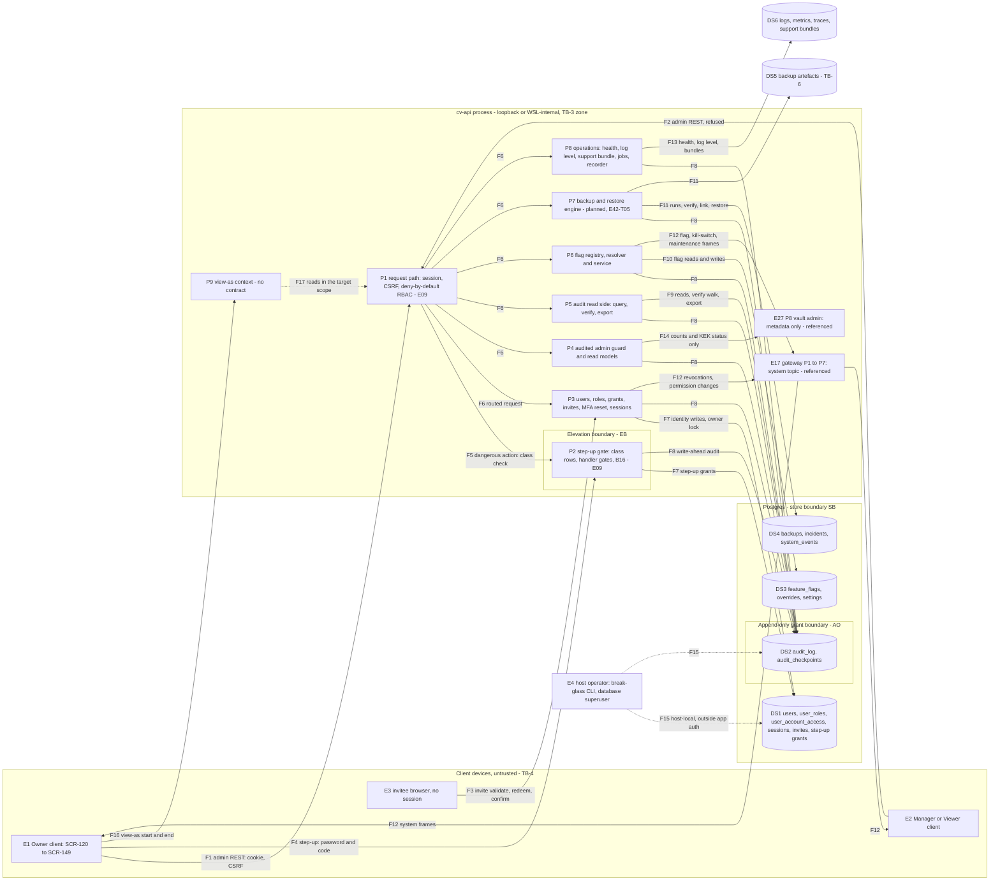

# E42 — STRIDE threat model: the admin area

- Ticket: E42-X01 (issue #890). Owner: Security engineer (CODEOWNER). Status: **Draft**, slices S1 and S2 of 4.
  Sign-off follows the E27 precedent (C-10.1): independent agent security and code reviews go in the review log
  (§13, S4), Owner acceptance of the residuals is queued on #2701, and the security engineer and Architect sign-off
  on #890 and on the epic (#63) stay human.
- Method: `docs/plan/04-security-program.md` §5 template (L x I = risk), STRIDE per element and per flow
  (C-12.1), in the four-question frame: what are we building (§1 to §3), what can go wrong (§4, §6 to §9), what
  are we going to do about it (§5, §10 to §12), did we do a good job (§13). Format mirrors `E27-accounts.md`. It
  consumes the E09 model (`e09-auth-rbac.md`, U-rows), E17 (`E17-ws-gateway.md`, WS-rows), E27
  (`E27-accounts.md`, KV-rows), E16 (`e16-recorder.md`, R-rows) and E04
  (`docs/plan/threat-models/E04-observability.md`); those threats are **referenced, not repeated**.
- Inputs, read at `a2b79c8c` (the design pass ran at `22478a7b`; every line cited here was re-checked at
  `a2b79c8c`): the 57 operations of `docs/plan/22-api-openapi.yaml` listed in §1.3; `23-ws-protocol.md` §6.2 and
  §15.9; `21-database-schema.md` §3.1, §3.9, §3.10, §8 and §12; `04-security-program.md` §2, §4.1, §5.6, §5.7,
  §6 and §7.2.2; `14-screens-catalogue.md` §10; migrations `0001`, `0003`, `0008` to `0010`, `0024`, `0025`,
  `0027` and `0028`; `infra/scripts/pg_bootstrap.sql`; `auth/rbac_seed.json`; the route matrix
  (`services/api/tests/contract/rbac/matrix.yaml`) and the composition allowlist
  (`services/api/tests/unit/architecture/composition_allowlist.json`); and, under `services/api/candleviewer/`,
  `admin/http.py`, `admin/flags/`, `api/{step_up,users,invites,sessions,audit}.py`, `audit/{access,actions}.py`,
  `auth/step_up.py`, `ws/gateway.py` and `ws_wiring.py`, with the tests §3 names.
- Path: `docs/security/threat-models/e42-admin.md`, the name the ticket gives. GOV-008
  (`scripts/check_threat_model_ticket_map.py:23-24`) matches it case-insensitively, so the level-2 or level-3
  heading that introduces the control map makes that section list all 35 non-retired E42 keys. The map is §12
  (S4); no earlier heading carries the word the check keys on.
- Deviations: (1) the blocker E42-D02 (#831) is still open. As the routing comment on #890 directs, the model is
  built against the interfaces (the OpenAPI paths, the WS `system` topic, the Postgres grant model and the flag
  registry), not the wireframes; the view-as (SCR-124) and SCR-149 rows are re-triaged when the wireframes land.
  (2) Timing: C-12.1 puts the model first, but E42-T01, E42-T03 (registry, catalogue, resolver, migration `0027`)
  and E42-T05 (migration `0028`, the read-model and backup-guard contract) merged before it. Decision D4 (§5, S2)
  records this as E27 recorded its D5: their findings go to follow-ups, and the remaining E42 work must reflect
  this model before it merges. (3) The DoD item "automated checks merged and running in CI" is E42-X03's
  deliverable (#1026). Every slice says `Refs #890`; #890 stays open until E42-X03 and the remediations land.
- Absorbs: `e42-user-lifecycle.md` (#2729), the user-lifecycle appendix. §8 (S3) absorbs it; the file stays as an
  annex marked absorbed, so its L, UL and UL-AC ids keep resolving.
- Slices: S1 and S2 of 4 are in, and the model is incomplete until S4 merges. S1: §1 to §3 (scope, build state,
  classification map, rating, data flows, boundaries, structural controls). S2: §4 to §7 (STRIDE per boundary
  with the coverage matrix, decisions, the restore path, the audit read side under load). S3: §8 to §11 (user
  lifecycle, abuse cases for E42-X03, observability, requirements `SR-E42-nn`). S4: §12 and §13 (control map,
  findings register, residuals, review log, `32-risk-register.md` and `04-security-program.md` updates).
  Findings AD-F01 to AD-F22 are reserved by the design pass and cited here by id with a one-line description.
  Four already have remediation issues: AD-F01 #3083, AD-F02 #3084, AD-F03 #3085 and AD-F10 #3086.
- Open decisions: the owner-equivalent band-raise (§1.4, security engineer) and D8, SCR-149's 15-minute window
  against per-action step-up (§2, Owner, through the E42-T06 ADR, #1085). That ADR's planned number, ADR-0022, is
  taken (`docs/plan/27-adrs/ADR-0022-hot-tier-questdb-vs-timescaledb.md`); ADR-0031 is reserved by E45-K01 and
  ADR-0037 is claimed by #3009. The E42-T06 author takes the next free number when writing it (ADR-0038 at the
  time of writing).
- Gate note: design-level weaknesses only (`SECURITY.md`, C-12.13). No credential, host, UID, IP address or
  exploit detail appears.

## 1. Scope

In scope: the admin area as the server exposes it. That is the 57 operations of `22-api-openapi.yaml` that §1.3
lists (`/users*`, `/roles`, `/permissions`, `/invites/*`, `/me/sessions*`, `/auth/step-up`, `/admin/*`,
`/health/*` and `/system/build`); the WS `system` topic (`23-ws-protocol.md` §6.2, §15.9); the Postgres grant
model and the append-only audit tables (`0003_audit_log`, `pg_bootstrap.sql`); the identity, invite, flag,
settings, incident and backup tables the admin area writes (`0001`, `0010`, `0025`, `0027`, `0028`) and the
`system_events` behind its health and incident views (`0008`); the flag registry (`admin/flags/`); the elevation
the admin area relies on (the step-up grants, a `sessions` column from `0009`); and two surfaces with no contract
yet, view-as (SCR-124) and the SCR-149 re-auth gate.

Out of scope: building the controls (owned by the tickets in §12, S4); executing the abuse cases (E42-X03) and
reviewing the built code (E42-X02); the penetration test (E43); session, MFA and step-up internals (E09,
consumed); the key vault (E27), the WS transport (E17), the recorder (E16) and the observability surface (E04),
referenced; the screens, except where a screen implies a server control.

### 1.1 State of the build at review time

"Served" is a route-matrix row in state `executed` (`matrix.yaml:10-15` defines the states); "501" is a route
mounted with no principal resolver, `not_executable` there; "contract-only" is `not_mounted` there and listed
under `openapi_pending` in the composition allowlist. `test_openapi_operations_are_served_or_explicitly_pending`
(`services/api/tests/unit/architecture/test_composition_guard.py:304-314`) and the shrinking baseline of 149
(:44, :317) keep the allowlist equal to what the app serves, and the matrix turns red when a `not_mounted` route
appears (`services/api/tests/contract/rbac/test_route_matrix.py:82`). Of the 57 operations, 28 are served, 2
answer 501 and 27 are contract-only; §1.3 gives each row's matrix (`m:`) and allowlist (`a:`) line.

<!-- prettier-ignore -->
| Component | Status | Evidence |
| --- | --- | --- |
| Audited admin guard, overview, capacity, sub-account tier | merged | E42-T01 (#2874, #2901, #2930, #2946): `admin/http.py:110-174` |
| Invites, role change, MFA reset, step-up, own sessions | merged (E09) | The served rows of §1.3; the owner-floor lock is shared with the disable store (#2916) |
| User read, PATCH and DELETE, grants, admin sessions, purge | contract only | E42-T04's contract deltas (#2658), disable store (#3062), disable service (#3096) and post-commit cascade (#3135) merged; grant store hardened (E42-T08, #3028); routes owed by E42-T04 S6, E42-T08, E42-T09 and E42-T10 |
| Audit read side | partial | The router is E09-T02's (#1608); E42-T02 added the contract, the export stub and the verify slot (#2392, #2446, #2917). Query, verify and the stub are served, and since #2433 reads and refusals are recorded within a per-user budget; the contract's verify limits and export job are not (AD-F04, AD-F05) |
| Feature flags | partial | Contract (#2592), `0027` (#2796), registry, catalogue and resolver (#2928), service read path (#2981). No route, no `system` push, no maintenance gate, and nothing composes the registry into the app (§3.2) |
| Incidents, backups, health read models | partial | `0028` (#2820) and the read-model and backup-guard contract (#2957); routes not mounted; `GET /admin/health` is mounted without a resolver (501) |
| Statechart inspector | partial | E42-T07 contract (#2958); the list and the export are served on the audited admin router (#3131); `getStatechart` is not |
| Append-only audit storage | merged | `0003_audit_log.py` and `pg_bootstrap.sql`; verified in §3.1 |
| WS `system` topic | merged (E17) | Implicit topic; flag frames planned (E42-T03, #964) |
| View-as (SCR-124), admin re-auth (SCR-149) | no contract | No path for view-as; on the server SCR-149 is observability only (§2, EB) |
| Admin screens (E42-S01 to E42-S08) | not built | Modelled only where a screen implies a server control |

A row that rests on unbuilt work says "planned" and names the ticket. Its rating assumes the ticket ships the
control; the security review of that ticket re-triages the row if the control is missing.

### 1.2 Assets and data classification

E42-X01 fixes this classification (decision D1, §5); every E42 child cites it rather than deciding it again. Asset
ids are `04-security-program.md` §2; P1 and P2 are the PII levels of `21-database-schema.md` §12 (:3646).

<!-- prettier-ignore -->
| Asset | Class | Where it lives | Notes |
| --- | --- | --- | --- |
| A-03: password hashes, TOTP seeds, recovery codes; the password and code typed at step-up, invite redemption and SCR-149 | **Secret** | `users`, `mfa_methods`, `recovery_codes`; request bodies (F3, F4) | Never returned, logged or audited (SR-069, SR-122) |
| A-04: session and refresh tokens; step-up grants | **Secret** (tokens); P2 (`ip`, `user_agent`, `tailscale_node`) | `sessions` (grants in its `step_up_elevations` column) | Session metadata is P2 (`21-database-schema.md:3656`) |
| Invite tokens and backup download tokens | **Secret** | The path of F3 and of `downloadBackup`; stored hashed | Single-use. Logs keep the route template (yaml:9194-9197); the invite shape is redacted (`observability/redaction.py:76-77`) |
| A-19: username, email, display name (P1); last login IP, session `ip` and `user_agent`, `audit_log.actor_ip` (P2) | **PII** P1, P2 | `users`, `sessions`, `audit_log` | Purge is E42-T10 (`e42-user-lifecycle.md` L4) |
| A-11: audit log contents | **Confidential**; P2 in `actor_ip` | `audit_log`, `audit_checkpoints`, exports | Crown jewel (04 §2.1), integrity-critical; the Owner reads raw, a Manager own and redacted (SR-067) |
| Roles and grants (`user_roles`, `user_account_access`) | **Confidential**, integrity-critical | Postgres (DS1) | A write is a privilege change (SR-055) |
| A-18: flags, kill-switch and maintenance state | **Confidential** (owner-only keys) or Internal; integrity-critical | `feature_flags`, `feature_flag_overrides`, the `system` topic | Visibility is declared per flag (`admin/flags/catalogue.py:48-58`, `:80-87`) |
| Operational state: health, capacity, incidents, statecharts, jobs, support bundles, log levels | **Confidential** | Read models, telemetry (DS6) | The public probes carry a state word and component names only |
| A-13: backup artefacts | **Secret-adjacent** | Encrypted volume and off-box copy (DS5, TB-6); `backups` rows | Hold wrapped DEKs and ciphertext; E42 never decrypts them (SR-091). `backups.encryption_ref` is class S, an alias (`0028_incidents_backups.py:13-14`) |

### 1.3 Endpoint classification map

Every operation the admin area serves or declares, plus the `system` topic and the two surfaces with no contract.
Columns: x-rbac is the contract's permission (`scope: none` unless shown); step-up is the class and its source (a
bare `:n` is a line of `services/api/candleviewer/api/step_up.py`, `yaml:n` of `22-api-openapi.yaml`, and
"registry test" is `services/api/tests/unit/api/test_dangerous_route_registry.py`); class is P1, P2, C
(Confidential), SA (Secret-adjacent), S (a credential crosses, in or out) or I (Internal); state is served, 501 or
contract-only (§1.1). The protecting control is what holds beyond the x-rbac permission, which the deny-by-default
router and the route matrix enforce on every row (§2, TB-4). **G** is the audited admin guard
(`admin/http.py:110-174`), which writes `admin.area_entered` ahead for allowed and denied callers; a handler guard
checks the permission in the route itself. Paths in the control column are under `services/api/candleviewer/`.

<!-- prettier-ignore -->
| operationId | Method and path | x-rbac | Step-up | Class | State | Protecting control |
| --- | --- | --- | --- | --- | --- | --- |
| **Users, roles, grants (P3)** | | | | | | |
| `listUsers` | `GET /users` | `users:read` | — | P1, C | contract-only (m:1465, a:333) | No role but the Owner holds `users:read` (`auth/rbac_seed.json` role lists) |
| `createUser` | `POST /users` | `users:write` | `users` (:389); contract silent (below) | P1; S out (invite link) | served (m:1472; `api/invites.py:211`) | Step-up row; invites grant `viewer` only (yaml:13193-13194); the link is shown once (yaml:13179) and never logged (`api/invites.py:18`); AD-F10 (the MFA flag must be true-only, C-12.2; #3086) |
| `getUser` | `GET /users/{userId}` | `users:read` | — | P1, C | contract-only (m:1484, a:337) | Owner-only permission |
| `updateUser` | `PATCH /users/{userId}` | `users:write` | `users` (:402) | C, P1 | contract-only (m:1498, a:381) | Pre-registered row; own roles or status refused and the last Owner kept, by contract (yaml:1665-1666) |
| `deleteUser` | `DELETE /users/{userId}` | `users:write` | `users` (:403) | C; P1, P2 on purge | contract-only (m:1491, a:61) | Pre-registered row; the disable cascade and the purge are `e42-user-lifecycle.md` L1 and L4 |
| `setUserRoles` | `PUT /users/{userId}/roles` | `users:write` | `users` (:392) | C, integrity | served (m:1543; `api/users.py:141`) | `enforce` (`api/users.py:156`); self-target refused and audited (:159-170); owner floor at the endpoint (:225-241) and in the database (`0001`:271-298) |
| `listUserAccountAccess` | `GET /users/{userId}/account-access` | `users:read` | — | C | contract-only (m:1505, a:341) | Owner-only permission |
| `setUserAccountAccess` | `PUT /users/{userId}/account-access` | `users:write` | `users` (:404) | C, integrity | contract-only (m:1512, a:597) | Pre-registered row; soft revoke (`e42-user-lifecycle.md` L2) |
| `listUserSessions` | `GET /users/{userId}/sessions` | `users:read` | — | P2 | contract-only (m:1549, a:345) | Owner-only permission |
| `revokeUserSession` | `DELETE /users/{userId}/sessions/{sessionId}` | `users:write` | `users` (yaml:1903); no row yet | C | contract-only (m:1556, a:65) | Inside the tripwire: it cannot be mounted ungated (§3.3) |
| `listRoles` | `GET /roles` | `users:read` | — | I; C (user counts) | contract-only (m:1191, a:293) | Owner-only permission |
| `listPermissions` | `GET /permissions` | `users:read` | — | I | contract-only (m:1007, a:245) | Owner-only permission; the vocabulary is public in `rbac_seed.json` |
| **Invites (P3)** | | | | | | |
| `listPendingInvites` | `GET /users/invites` | `users:write` | — | P1, no tokens | served (m:1478; `api/invites.py:245`) | Owner-only permission |
| `reissueInvite` | `POST /users/{userId}/invite` | `users:write` | `users` (:390); contract silent (below) | S out (new link) | served (m:1519; `api/invites.py:258`) | Step-up row; E09 U12 |
| `revokeInvite` | `DELETE /users/{userId}/invite` | `users:write` | `users` (:391); contract silent (below) | C | served (m:1525; `api/invites.py:276`) | Step-up row |
| `getInvite` | `GET /invites/{inviteToken}` | public | — | S (token in path), P1 | served (m:692; `api/invites.py:309`) | Per-IP throttle and one 404 for every invalid token (`api/invites.py:7`, :13); the token shape is redacted in logs (`observability/redaction.py:76-77`); E09 U12 |
| `redeemInvite` | `POST /invites/{inviteToken}` | public | — | S in (password) | served (m:698; `api/invites.py:355`) | As above; role and identity fields refused and audited (`api/invites.py:14-17`) |
| `confirmInvite` | `POST /invites/{inviteToken}/confirm` | public | — | S (first code in, recovery codes out once) | served (m:704; `api/invites.py:384`) | As above; E09 U23 |
| **MFA reset, own sessions, elevation** | | | | | | |
| `previewMfaReset` | `GET /users/{userId}/mfa/reset-preview` | `users:write` | — | C | served (m:1537; `api/step_up.py:675`) | Owner-only permission |
| `resetUserMfa` | `POST /users/{userId}/mfa/reset` | `users:write` | `users` (:393; handler :718) | C | served (m:1531; `api/step_up.py:702`) | Step-up row and handler gate; an Owner's own TOTP is refused (`api/step_up.py:716-717`) |
| `listMySessions` | `GET /me/sessions` | self | — | P2 (own) | contract-only (m:915, a:225) | Self scope; `GET /auth/sessions` is served instead (`api/sessions.py:760`) |
| `revokeMySession` | `DELETE /me/sessions/{sessionId}` | self | — | C (own) | served (m:922; `api/sessions.py:847`) | Self scope, no target-user parameter (SR-026) |
| `authStepUp` | `POST /auth/step-up` | self | the elevation itself | S in (password, code) | served (m:391; `api/step_up.py:582`) | E09 U11, U18; no `flags` class in code (AD-F01); the session is not rotated on elevation (AD-F11, #2101) |
| **Audit read side (P5)** | | | | | | |
| `queryAuditLog` | `GET /admin/audit` | `audit:read`, scope self | — | C; P2 (Owner raw view) | served (m:22; `api/audit.py:312`) | Role-scoped projection (`audit/access.py:113-176`, SR-067); reads and refusals recorded within a per-user budget since #2433 (AD-R06, AD-D06) |
| `verifyAuditChain` | `POST /admin/audit/verify` | `audit:read` | none by design (registry test :35) | C | served (m:41; `api/audit.py:474`) | Owner-only (`audit/access.py:43-44`); the contract's limits are owed (AD-F04) |
| `exportAuditLog` | `POST /admin/audit/export` | `audit:export` | `audit` (:405) | C, P2 in bulk | served as a stub (m:28; `api/audit.py:490-501`) | Step-up row; Owner-only; answers 202 where the contract says 501 (AD-F05) |
| `downloadAuditExport` | `GET /admin/audit/exports/{jobId}` | `audit:export` | `audit` (yaml:8380-8386) | C, P2 in bulk | contract-only (m:34, a:73) | The requester only, by contract; a read the tripwire does not sweep (AD-F01) |
| **Operations and read models (P4, P8)** | | | | | | |
| `getHealth` | `GET /admin/health` | `admin:read` | — | C (components, version, commit) | 501 (m:131; `api/health_report.py:124-127`) | Handler guard, denial not audited (AD-F22); E04 TB-O5 |
| `getLiveness` | `GET /health/live` | public | — | I | served (m:616) | A state word only (`api/health_report.py:1-7`) |
| `getReadiness` | `GET /health/ready` | public | — | I | served (m:622) | A state word and component names only |
| `setLogLevelOverride` | `PUT /admin/log-level` | `admin:write` | — | C | 501 (m:159; `api/log_level.py:47-50`, `app.py:1092-1093`) | Handler guard; E04 L3, L5 |
| `createSupportBundle` | `POST /admin/support-bundle` | `admin:read` | — | C (redacted diagnostics) | served (m:220; `api/support_bundle.py:73`) | Handler guard, denial audited (`api/support_bundle.py:90-98`); E04 H3, H4; RSK-055 |
| `getSupportBundle` | `GET /admin/support-bundle/{job_id}` | `admin:read` | — | C | served (m:226; `api/support_bundle.py:132`) | Handler guard |
| `getJob` | `GET /admin/jobs/{jobId}` | `admin:read` | — | C | served (m:153; `api/recorder_admin.py:418`) | Handler guard, denial not audited (`api/recorder_admin.py:425-426`, AD-F22) |
| `getAdminOverview` | `GET /admin/overview` | `admin:read` | — | C | served (m:167; `api/admin_overview.py:93`) | G |
| `getCapacity` | `GET /admin/capacity` | `admin:read` | — | C | served (m:103; `api/admin_overview.py:97`) | G |
| `setSubaccountTier` | `PUT /admin/capacity/subaccount-tier` | `admin:write` | none by contract (yaml:10851-10854) | C | served (m:109; `api/admin_capacity.py:136`) | G; `settings.change` written ahead |
| `listIncidents` | `GET /admin/incidents` | `admin:read` | — | C | contract-only (m:139, a:93) | Planned: G (`admin/http.py:1-2`, E42-T05) |
| `acknowledgeIncident` | `POST /admin/incidents/{incidentId}/acknowledge` | `admin:write` | — | C | contract-only (m:146, a:401) | Planned: G (E42-T05) |
| `listStatecharts` | `GET /admin/statecharts` | `admin:read` | — | C | served (m:199; `api/admin_statecharts.py:110`) | G (`api/admin_statecharts.py:108`); a non-Owner sees no account-scoped entity (:4-5) |
| `getStatechart` | `GET /admin/statecharts/{machineKey}` | `admin:read` | — | C | contract-only (m:205, a:101) | Planned: G (E42-T07) |
| `exportStatechart` | `GET /admin/statecharts/{machineKey}/export` | `admin:read` | — | I (chart structure only, yaml:11190-11191) | served (m:212; `api/admin_statecharts.py:146`) | G (`api/admin_statecharts.py:108`) |
| `getSecuritySummary` | `GET /admin/security/summary` | `audit:read`; "Owner-only" in prose (yaml:11222) | — | C | contract-only (m:192, a:97) | The matrix expects a Manager 403 (m:192-198) although Managers hold `audit:read` (AD-F20) |
| `getBuildInfo` | `GET /system/build` | self | — | I | contract-only (m:1394, a:317) | E09 U26 |
| **Recorder (referenced to E16)** | | | | | | |
| `compactRecorder` | `POST /admin/recorder/compact` | `recording:write` | none by design (registry test :41) | C | served (m:173; `api/recorder_admin.py:328`) | `e16-recorder.md` C7 |
| `importTradeArchive` | `POST /admin/recorder/import` | `recording:write` | none by design (registry test :42) | C | served (m:179; `api/recorder_admin.py:227`) | `e16-recorder.md` C6, C7 |
| `purgeRecordedData` | `POST /admin/recorder/purge` | `recording:write` | `recorder`, handler-gated (:422) | C | served (m:185; `api/recorder_purge.py:98`) | Owner-only before the step-up (`api/step_up.py:420-422`); `e16-recorder.md` R-R1, R-E1 |
| **Feature flags (P6)** | | | | | | |
| `listFeatureFlags` | `GET /admin/feature-flags` | `flags:read` | — | I; C (owner-only keys) | contract-only (m:117, a:89) | Per-flag visibility (`admin/flags/registry.py:110-112`); planned G (E42-T03) |
| `setFeatureFlag` | `PUT /admin/feature-flags/{flagKey}` | `flags:write` (dangerous) | `flags`, `killswitch` or `live_enablement`, chosen under the row lock (yaml:8856-8866) | C, integrity (live gate, kill switches, maintenance) | contract-only (m:124, a:553) | Registry refusal (§3.2); `flags.change` written ahead (yaml:8884-8892); outside the tripwire, and no `flags` class in code (AD-F01, #3083) |
| **Backups and restore (P7)** | | | | | | |
| `listBackups` | `GET /admin/backups` | `backups:read` | — | C (paths, sizes, coverage) | contract-only (m:47, a:77) | Planned (E42-T05) |
| `getBackup` | `GET /admin/backups/{backupId}` | `backups:read` | — | C | contract-only (m:61, a:81) | Planned (E42-T05) |
| `createBackup` | `POST /admin/backups` | `backups:write` | none by design (registry test :37) | SA | contract-only (m:54, a:385) | Planned (E42-T05) |
| `verifyBackup` | `POST /admin/backups/{backupId}/verify` | `backups:write` | none by design (registry test :38) | SA | contract-only (m:96, a:397) | Planned (E42-T05) |
| `deleteBackup` | `DELETE /admin/backups/{backupId}` | `backups:write` | `backups`, no grace (yaml:9086-9088); no row yet | SA | contract-only (m:68, a:17) | Inside the tripwire (registry test :165) |
| `issueBackupDownload` | `POST /admin/backups/{backupId}/download` | `backups:write` | `backups`, no grace (yaml:9139-9143); no row yet | S out (single-use link), SA | contract-only (m:75, a:389) | Inside the tripwire (§3.3) |
| `downloadBackup` | `GET /admin/backups/{backupId}/download/{token}` | `backups:read` | none: the token is the gate (yaml:9191-9202) | S (token in path), SA | contract-only (m:82, a:85) | Single-use, 5-minute, same-user token; template-only logs (yaml:9194-9197) |
| `restoreBackup` | `POST /admin/backups/{backupId}/restore` | `backups:write` | `backups`, no grace, one-shot, handler-gated (:430) | SA; the whole installation | contract-only (m:89, a:393) | Pre-registered handler gate (#3144): a no-grace grant binds the request the handler validated, which a path cannot name (`test_dangerous_route_registry.py:243`). The contract has the guard spend the grant before the preconditions (yaml:11383-11395), and §6 reconciles the two; AD-F02 (a restore must keep later revocations and its own audit tail, #3084), AD-F07 (the artefact's integrity and origin are not authenticated) |
| **Outside the REST contract** | | | | | | |
| WS `system` topic | implicit on every socket (`23-ws-protocol.md:754`) | authenticated | — | I; C (kill-switch detail, owner-only flag keys) | served (`ws/gateway.py:168`; `ws/permissions.py:202`) | Role-neutral content required (SR-188, E17 WS-I05); the broadcast is role-blind (`ws/gateway.py:291-296`); per-role flag frames planned (E42-T03; AD-F16) |
| view-as (SCR-124) | no contract | none defined | none defined | C, P1, P2 (a target's whole read scope) | no contract | None: no path, no audit action (`audit/actions.py:161-177`), no server owner (AD-F03, #3085) |
| admin re-auth (SCR-149) | no contract | — | a 15-minute window (`14-screens-catalogue.md:2216`, :2704) | S in (password, code) | no contract | Observability only: `reauth_age_s` (`admin/http.py:19-26`), pinned by `test_admin_http.py:288`; D8 open (AD-F06) |

60 rows: the 57 operations (28 served, 2 at 501, 27 contract-only), the `system` topic and the two surfaces with
no contract. Sixteen operations need a step-up: eleven have a registry row or a handler gate today, three
(`revokeUserSession`, `deleteBackup`, `issueBackupDownload`) are inside the tripwire without a row, and two
(`setFeatureFlag`, `downloadAuditExport`) are outside it (§3.3).

Contract gap (design requirement, contract-first, C-6.1): `createUser`, `reissueInvite` and `revokeInvite` are
served with the `users` step-up in code (`api/step_up.py:389-391`), but their operations do not declare it
(yaml:1605-1639, :10011-10020, :10021-10030), unlike `updateUser`, `deleteUser`, `setUserRoles` and
`revokeUserSession` (yaml:1665, :1711, :1749, :1903). The code is stricter than the contract, so nothing is
weakened, but a client generated from the contract cannot expect their `403 step_up_required`. The contract must
declare the step-up on all three. This is routed to #3086 (the small `createUser` contract fix filed from AD-F10)
as an addition; whether the register needs a finding id for it is S4's call.

### 1.4 Rating

Risk = L x I on the programme scale (Low / Medium / High / Critical), E27's matrix unchanged:

| L \ I | L      | M      | H        |
| ----- | ------ | ------ | -------- |
| L     | Low    | Low    | Medium   |
| M     | Low    | Medium | High     |
| H     | Medium | High   | Critical |

E27's H\* (a threat that lets value leave an account) applies only through the E27 rows this model references.
**Open question for the security engineer:** should an owner-equivalent outcome (the live gate, a kill-switch
release, maintenance mode, a role or grant change, a restore, a writable view-as) also raise the cell by one band?
`04-security-program.md` rates D1 (§5.7) and U3 (§5.6) Critical at M x H, which such a rule would match; with it,
AD-F01 and AD-F03 would be Critical inherent. It is not adopted. Rows are rated on the plain matrix and tagged
**OE** where the outcome is owner-equivalent, so the decision can re-rate them without a new analysis.

Disposition: **M** mitigated by a named ticket (merged or planned); **A** accepted once the Owner signs off
(pending, queued on #2701); **R** referenced (another epic's model owns it); **T** a new remediation ticket
(filed in S4; a Critical or High one is scheduled inside R3). Risk is inherent; Residual is after the mitigation
ships. Verification layers follow `04-security-program.md` §6: unit, property, integration, contract, e2e, load,
chaos, ci-gate, drill. STRIDE rows are `AD-xnn`, with x the category letter (S, T, R, I, D, E); findings are
`AD-Fnn` (§13.1, S4).

## 2. Data-flow diagram and trust boundaries

Text description (the diagram is not the only carrier): an Owner works in the admin screens (E1), and every
request crosses TB-4 as a cookie session with a CSRF token to the E09 request path (F1), which authenticates it
and checks the route's declared permissions before any handler runs. Managers and Viewers reach the same routes
and are refused (F2). An invitee with no session validates, redeems and confirms an invite link (F3), the only
unauthenticated admin flow. F3 crosses P1 as a route with no required permission (`matrix.yaml:692-704`,
`public: true`); the diagram draws it straight to P3, whose invite handlers hold the per-IP throttle and the
uniform 404 (`api/invites.py:7`, :13), so S2's TB-4 rows attach those controls to P3. A dangerous action needs
a live step-up of its class (F5), obtained with the password and an authenticator code (F4). Requests then reach
the module that owns them (F6): users and grants write identity rows under the owner lock, and step-up writes its
grants (F7); every module writes its audit record before it answers (F8, C-2.9); the audit read side queries,
verifies and exports the chain (F9); the flag service reads and writes flags (F10); the backup engine records
runs, moves artefacts to and from TB-6, and decrypts an artefact to verify or restore it (F11). Flag,
kill-switch and maintenance changes and revocations reach every socket the role admits through the E17
gateway's `system` topic and its revocation path (F12). Operations write health snapshots, log-level overrides
and support bundles to telemetry (F13). The admin read models see the vault as metadata only (F14). A host
operator reaches the database outside the app's authentication (F15). View-as (F16, F17) has no contract; the
diagram marks where a server context would sit.

Elements: external entities **E1-E4**; processes **P1-P9** plus the referenced E17 gateway and E27 P8; data stores
**DS1-DS6**; flows **F1-F17**. Ids are local to this model, as in E27 and E17; E1 and E2 keep E27's meaning. EB,
AO and SB (the id given here to E27's unnamed store boundary) are new boundary ids. Every element and flow appears
in the coverage matrix (§4.7, S2).

Boundaries (`20-architecture.md` §2.2, `04-security-program.md` §4.1):

- **TB-4, client to admin API** (F1 to F4, F12, F16; B1): REST and the WS `system` topic. Untrusted until
  authenticated, RBAC-scoped after; the client enforces nothing (C-2.12), so a hidden screen is cosmetic (04
  §5.7 D1). Every route declares its permissions and the deny-by-default router refuses one that does not
  (SR-017; `services/api/tests/unit/api/test_deny_by_default.py:19`, :47); the route matrix asserts each role's
  outcome per route (SR-018; `services/api/tests/contract/rbac/test_route_matrix.py:240`). F3 is unauthenticated
  by design. E04 calls the operations part of this crossing TB-O5; it is the same boundary.
- **EB, the elevation boundary** (F4, F5, F16; new): between an authenticated session and one elevated for an
  action class. Today it is per-class step-up (SR-025, E09 U18): the `DANGEROUS_ROUTES` rows
  (`api/step_up.py:388-409`) and the handler gates (:416-446) demand a live grant of the class. `backups`,
  `killswitch` and `live_enablement` are no-grace (`auth/step_up.py:84`): since #3088 their grant is single-use,
  bound to the challenged request and usable within 60 s of the step-up (:89-96). SCR-149's 15-minute
  admin window (`14-screens-catalogue.md:2216`, :2704) is not a server gate: the guard records `reauth_age_s`
  and never refuses on it (`admin/http.py:19-26`; `services/api/tests/unit/admin/test_admin_http.py:288`). Which
  model holds is decision D8 for the Owner (AD-F06). §3.3 states the reach of the tripwire behind this boundary.
- **SB, the store boundary** (F7 to F11, F15; E27 §2): the API and Postgres share the TB-3 zone
  (`e42-user-lifecycle.md:41-42`), so this is a privilege boundary, not a network one, and a database writer is
  its own integrity domain. The app connects as `cv_app`, whose default privileges include UPDATE and DELETE on
  every table `cv_owner` creates (`infra/scripts/pg_bootstrap.sql:95-96`). So `user_roles`,
  `user_account_access`, `feature_flags` and `backups` are protected by the application and, for the last Owner,
  by the owner-floor trigger (`0001_identity_rbac_sessions_mfa.py:271-298`), not by grants (AD-F08).
- **AO, the append-only grant boundary** (F8, F9; new, inside SB): `cv_app` holds SELECT and INSERT only on
  `audit_log` and `audit_checkpoints`, and triggers refuse UPDATE, DELETE and TRUNCATE (SR-066, C-5.7). §3.1
  verifies each layer on its own.
- **TB-6** (F11): backups and their off-box copy, encrypted at rest with a backup key distinct from the KEK and
  held offline by the Owner (SR-091; `createBackup`, yaml:9030-9032). E42 does decrypt the artefact: to verify a
  backup (a restore into a scratch namespace, yaml:9106-9109) and to restore one. What it never decrypts are the
  wrapped DEKs and API-key ciphertext inside the artefact (A-13, §1.2). The artefact decrypt on verify and restore
  is the TB-6 to SB crossing that §6 (S2) analyses: where the backup key enters the process, and how the
  artefact's authenticity is checked before a restore (AD-F07).
- **Host** (F15): the break-glass CLI and a database superuser act outside the app's authentication; E09 §3.6.1
  (U10) and E27 KV-E08 own them. Referenced.
- **In-process capability boundaries, not trust boundaries:** the flag store and registry (P6), the backup engine
  (P7), the recorder (E16 C7), health and the support bundle (E04 TB-O5) and the statechart inspector (E42-T07)
  are modules of one Python process. Like E27's M2 facades they stop accidental use, not hostile in-process code
  (E27 §4.3, KV-I09). A request is rated at the boundary it entered through (TB-4, EB or SB).
- **The key vault** (F14): referenced to E27, not repeated. The admin module sees M2 as metadata only (E27 P8,
  F17): `AdminService` holds `SecretsMetadata` (`admin/service.py:20-26`), pinned by
  `test_metadata_protocol_is_metadata_only` (`services/api/tests/unit/credentials_m2/test_capability_boundary.py:117`).
  E27 KV-E08, KV-T08, KV-R05 and KV-I09 (`E27-accounts.md:294`, :228, :242, :257) cover it.
- B4 (renderer to Electron main, `20-architecture.md` §2.2) carries no E42 flow: the admin screens reach only the
  API, and the Electron shell has no admin IPC.

## 3. Structural controls verified

The ticket singles out two controls the rest of the epic leans on, the append-only audit storage and the flag
registry's refusal of security-gating flags, and asks for each to be verified independently. This section does
that against `main`, and adds the reach of the step-up tripwire, which every dangerous admin write depends on.

### 3.1 Append-only audit storage: two layers, each proven alone

SR-066 asks for both a role with INSERT and SELECT only and a trigger that refuses UPDATE and DELETE (C-5.7). Each
layer has a test that fails when that layer is removed, whether or not the other layer is still in place. The
grant test expects the privilege error, which ends the statement before any trigger runs (`_attack`,
`test_audit_guard_cv_app.py:320-328`); the trigger check runs as the owner, whom no privilege stops.

<!-- prettier-ignore -->
| Layer | What enforces it | Proven by | Why that test isolates the layer |
| --- | --- | --- | --- |
| Grants | `cv_app` keeps SELECT and INSERT on both tables. What takes effect is the guarded REVOKE of UPDATE, DELETE and TRUNCATE in `0003_audit_log.py:166-176` (`audit_log`) and :193-200 (`audit_checkpoints`). The `pg_bootstrap.sql` backstop (:102-126) is narrower: it matches only `audit_log` and `%_audit_log` names (:121), so not `audit_checkpoints`, and revokes UPDATE and DELETE but not TRUNCATE (:123). A fresh install runs it before `0003` creates the table (`.github/workflows/_job-migrations.yml:77-83`, then `alembic upgrade head`; `test_audit_guard_cv_app.py:3-5`), so there it changes nothing; it re-asserts the REVOKE only if re-run after migration | `test_audit_guard_cv_app.py:353`: the privileges `cv_app` holds are exactly SELECT and INSERT. :427: UPDATE, DELETE and TRUNCATE as `cv_app` fail with "permission denied for table" (:114-115) and the rows are unchanged | A missing privilege ends the statement before any row trigger runs, and `_attack` accepts only that error: without the REVOKE, the trigger's refusal would fail the test |
| Triggers | `trg_audit_append` and `trg_audit_ckpt_append` run `forbid_mutation()` (`0003_audit_log.py:80-81`, :152-153, :189-190); `trg_audit_no_truncate` and `trg_audit_ckpt_no_truncate` refuse TRUNCATE (:154-155, :191-192) | `_assert_guard_enforces` (`test_audit_guard_cv_app.py:301-318`), run by the tests at :448, :464 and :473: as `cv_owner`, "whom no privilege stops", every UPDATE, DELETE and TRUNCATE on both tables raises "append-only". `test_audit_repository.py:112`: TRUNCATE is refused even for the owner | The owner holds every table privilege, so only a trigger can refuse |

Both files are under `services/api/tests/integration/audit/` and run in the integration lane
(`.github/workflows/_job-integration.yml:67`); `test_audit_guard_cv_app.py` applies the shipped `pg_bootstrap.sql`
roles and migrates as `cv_owner` (:242, :260, :271), so it tests what ships. The guard also outlives
`cv_app`'s attempts on it: `cv_app` owns nothing (`test_audit_guard_cv_app.py:366`), the tables and guard
functions belong to `cv_owner` (:390), every trigger exists and is enabled (:399), and dropping or disabling a
trigger, defeating the guard or replacing a guard function are refused, after which the trigger check runs again
(:448, :464, :473, through `_assert_guard_survives`, :331-339). Detection sits behind both layers: the verifier
locates a tampered row (`test_audit_repository.py:100`).

The bootstrap backstop's comment still names `0012_governance` as the revision that creates `audit_log`
(`pg_bootstrap.sql:106-108`); `0003` does (an amendment note for §13.3, S4). Owed, as S2 rows: a trigger-only case
named as such, for a privileged role that is not the owner, and a two-connection insert case. Residuals, by id:
**AD-F14** (the owner role and superusers hold every privilege and can remove the trigger layer, so for them the
guard is detection only until the chain's external anchors land, SR-068, #1238) and **AD-F15** (chain order
under concurrent insert paths).

### 3.2 The flag registry refuses a security-gating definition

C-4.14 and US-ADMIN-007 say no flag may weaken a security control. The ticket calls the control compile-time
rejection; in Python it happens at import time and again at construction time.

- **Import time.** Every `FlagSpec` runs `check_spec` in `__post_init__` (`admin/flags/registry.py:103-104`).
  `check_spec` (:125-154) refuses a definition that declares any `DENIED` category (:57-66: authentication,
  RBAC, audit, the native stop-loss, risk limits, the withdrawal check, the rate-limit reserve and demo/live
  isolation), declares no category or no visibility, has a malformed key or a value of the wrong kind, or is a
  kill switch or the live gate whose class and gates disagree. The catalogue builds its definitions at module
  level (`admin/flags/catalogue.py:25-88`), so a refused one fails the import.
- **Construction time.** `FlagRegistry` checks every spec again and refuses a duplicate key (`registry.py:169-176`),
  so a spec that escaped its constructor still stops the registry.
- **Tests** (under `services/api/tests/unit/admin/`): `test_flag_registry.py:56` walks all 8,192 combinations of
  the 13 categories (only a non-empty set of the five allowed ones passes, and the error names the flag and
  C-4.14); :78 forces a spec past its constructor and the registry refuses it; :115 (malformed definitions), :120
  (duplicate keys), :189 (only ordinary flags take overrides) and :193 (visibility is mandatory).
  `test_flag_catalogue.py:31` holds the catalogue to `21-database-schema.md` §10.7 row for row;
  `test_flag_resolver.py:108` shows safety flags ignore every override and fail closed;
  `test_flag_service.py:58` shows a kill-switch change in the database is seen within 5 s.

Two limits, both **AD-F09**:

- **Self-attestation.** `check_spec` sees the categories a definition declares, not what the code that reads the
  flag does, and nothing ties a key to its call sites. The control that closes this is the E42-X03 rule against
  flag lookups in safety modules (#1026); `.semgrep/` has no such rule on `main`.
- **The boot refusal is not wired.** The registry promises that the process refuses to boot (`registry.py:9-11`),
  but `default_registry()` (`catalogue.py:91-93`) has no caller outside `admin/flags/`, and neither the registry
  nor the flag service is composed into `create_app`. No flag value is consulted at runtime on `main`, so nothing
  is weakened today; E42-T03's wiring PR owes the composition and a test that `create_app` refuses a denied
  definition.

### 3.3 The reach of the step-up tripwire

`DANGEROUS_ROUTES` maps a method and path to an action class (`api/step_up.py:388-409`), and
`HANDLER_GATED_ROUTES` declares the body-aware gates (:416-446). The tripwire,
`test_every_mounted_dangerous_write_route_is_gated` (`services/api/tests/unit/api/test_dangerous_route_registry.py:65`),
fails the build when a mounted write whose path matches `DANGEROUS_PATH_PATTERN` (`api/step_up.py:453-456`) is in
neither registry nor the test's explicit list of non-dangerous writes (:33-43). It sees routes inside included
routers (:69) and sub-applications (:127); fixtures of future routes prove it fires (:176); and the contract's
dangerous routes map to their class (:183-206). So `revokeUserSession`, `deleteBackup` and `issueBackupDownload`,
which have no row yet, cannot be mounted ungated: their paths are inside the pattern (fixture :165).

Its reach stops at two edges (**AD-F01**, remediation #3083):

- It sweeps writes only (`_WRITE`, :31; :58-62), and a read is asserted ungated (:209). The contract gates one
  read: `downloadAuditExport` needs a live `audit` step-up (`22-api-openapi.yaml:8380-8386`).
- The pattern has no `admin/feature-flags` alternative, although `flags:write` is seeded dangerous
  (`auth/rbac_seed.json:79-81`) and the contract makes every flag write need a fresh `flags`, `killswitch` or
  `live_enablement` elevation, chosen under the row lock (yaml:8856-8866). The `flags` class is in the
  contract's enum (yaml:9636) but not in `ACTION_CLASSES` (`auth/step_up.py:80-82`) or the B16 binding
  (`statechart/bindings/b16_session.py:294-296`).

Neither route is mounted (`matrix.yaml:124`, :34), so nothing is reachable today. Design requirement, before
E42-T03 mounts the flag write and E42-T02 the export download: drive the sweep from the seeded dangerous
permissions and each operation's x-rbac for every mounted method; add `flags` to `ACTION_CLASSES` and the B16
binding with its contract test; and declare the flag write handler-gated with a handler test, because its class
depends on the stored value. Until then it is a required change on #964 and #889, and #3083 tracks it. Outside
the gate by design: `verifyAuditChain` (04 §7.2.2 row 49a), `createBackup` and `verifyBackup` (row 52),
`compactRecorder` and `importTradeArchive` (row 51), and `setSubaccountTier`, whose contract says why
(yaml:10851-10854).

## 4. STRIDE per boundary

One table per STRIDE category, as in E27. Each row names its boundary and the §2 elements and flows it concerns.
Boundaries (§2): **TB-4** client to admin API; **EB** elevation; **SB** the store, with the host path (E4, F15);
**AO** the append-only grant boundary inside SB; **SUB** the subsystem services the ticket lists (the read models
P4, flags P6, the backup engine P7 with TB-6 and DS5, operations and the recorder P8), which are in-process
capability boundaries (§2); **KV** the key vault, referenced to E27 (§4.7). The existing control is what `main`
does today, with the test that proves it; a control only the contract states is marked as contract and not built,
and where no test exists the row says the test is owed and by whom. The gap names the mitigation and its owner. A row
tied to a finding names it (`AD-Fnn`, §13.1, S4) and its issue where one is filed. Rows of E09 (`U`), E17 (`WS`),
E27 (`KV`), E16 (`R-`) and E04 (`H`, `L`) are referenced, not repeated; `UL` rows are the user-lifecycle annex's
(§8, S3). Paths: code under `services/api/candleviewer/`; tests under `services/api/tests/` by file name (each name
is unique there); migrations by file name; `yaml:n` is a line of `22-api-openapi.yaml`.

### 4.1 Spoofing

<!-- prettier-ignore -->
| ID | Boundary: element | Threat | L | I | Risk | Existing control and test | Gap → mitigation | Owner | Verify | Disp. | Residual |
| --- | --- | --- | --- | --- | --- | --- | --- | --- | --- | --- | --- |
| AD-S01 | TB-4: E3, F3, P3 | Invite-link replay: a used, expired, revoked or guessed token redeems an account, or a forwarded link is redeemed by someone other than the invitee | L | H | Medium | Single-use token hashed at rest (E09 U12); one 404 for every invalid token and a per-source budget (`api/invites.py:7-18`); the token shape is redacted in logs (`observability/redaction.py:76-77`); `test_stepup_invite_abuse.py:73` (guessing), :84 (expired), :92 (reuse after acceptance) | None new. A forwarded, unredeemed link is a bearer credential until it expires, so the Owner promotes only after activation (yaml:13193) | E09 | integration | R | Low |
| AD-S02 | EB: F4, P2 | TOTP replay at the re-auth gate: a code seen during one step-up is replayed inside its time step to elevate another request or session | L | H | Medium | Password and code both required (#2154); one acceptance per authenticator time step (SR-021; `auth/step_up.py:562-563`); `test_step_up.py:156` (replayed code refused), `test_stepup_invite_abuse.py:43` (replay refused, grace not extendable); E09 U11 | SCR-149 has no server path (D8). If the Owner adopts a server window, its re-auth reuses `_verify_both` (`auth/step_up.py:524-532`) and the same floor, never a second verifier | E09; E42-S01 | unit, integration | R | Low |
| AD-S03 | EB: F4, F5 | Session fixation on elevation: an identifier planted or captured before the step-up carries the elevated grant, because elevation does not rotate the session (SR-013) | L | H | Medium | `SameSite=Strict` cookie and CSRF double-submit (SR-041; E09 U5, U6); fixation attempts are recorded as `auth.session_fixation_attempt` (`audit/actions.py:49`) | The 200 promises a rotated session (yaml:9642-9648) but the service elevates the existing id (`auth/step_up.py:442-463`). AD-F11: rotation on step-up and role change is #2101, which owns the test | #2101 (E09) | integration | M | Low after #2101 |
| AD-S04 | TB-4: F1, P3 | An invitee is created with MFA off: `createUser` accepts `mfa_required: false` (C-12.2) | L | H | Medium | Fails closed twice today: the invite store writes `true` whatever the request says (`storage/repositories/invites_sqlalchemy.py:49-53`), and login refuses a user without MFA (`auth/login_service.py:140-153`) | The field is a plain boolean (yaml:13195) where `UpdateUserRequest` allows only `true` (yaml:13208-13211), and the model accepts `false` (`auth/models.py:373`), so the value is silently dropped. AD-F10: enum `[true]`, `Literal[True]` and `test_create_user_mfa_required_false_400` | #3086 | contract, unit | T | Low |
| AD-S05 | TB-4: E1, F1 | A stolen or unattended Owner session, or a cross-site request riding its cookie, drives the admin area | M | H | High OE | `HttpOnly`, `Secure`, `SameSite=Strict` cookie and CSRF on every state change (SR-012, SR-041; E09 U5, U22); idle lock and read-only downgrade (SR-024, E09); a fresh step-up of its class for each dangerous write (§3.3) | What such a session can do is bounded by AD-E01 (reads need no fresh re-auth, D8), AD-E02 (flag writes are outside the tripwire) and AD-E04 (view-as). Session theft itself is E09's | E09; #3083, #3085, E42-T06 | e2e, integration | R | Medium until D8, #3083 and #3085 |
| AD-S06 | TB-4: E2, F2, P1, P4 | A request reaches an admin handler with no verified principal, or with one built from client input | L | H | Medium | The principal comes from the server-side session: no resolver is 501, no session 401, no audit writer 503, all before any handler (`admin/http.py:119-126`; `test_admin_http.py:136`); an undeclared route fails the build and the request (SR-017; `test_deny_by_default.py:19`, :30) | None | E09, E42-T01 | unit | M | Low |
| AD-S07 | EB: F5, P2 | A step-up grant is transplanted to another session, user or class | L | H | Medium | Grants are server state per session and class (E09 U18): `test_stepup_invite_abuse.py:32` (not across session or class), :56 (another user's code), :62 (unknown session) | None | E09 | integration | R | Low |
| AD-S08 | EB: F4, F5 | A no-grace grant (`backups`, `killswitch`, `live_enablement`) authorises a request other than the one the Owner approved: another backup, other acknowledgements, a swapped body | L | H | Medium OE | Since #3088 the grant is bound to the SHA-256 of the challenged request, single use, 60 s (`auth/step_up.py:84-96`); a gate that cannot bind its request fails closed (`test_step_up_binding_router.py:122`), and no path row may name a no-grace class (`test_dangerous_route_registry.py:236`); one conditional write spends it (`test_step_up_grant_race_pg.py:173`); E09 U35 | Each no-grace handler (restore, backup delete, link issue) binds its own validated request (§6) | E09; E42-T05 (#966) | integration | R, M | Low |
| AD-S09 | SB: E4, F15 | A host operator, or a process holding the database credentials, acts as the app or the Owner outside app authentication | L | H | Medium | Host access is the boundary (E09 U10 and its §3.6.1; E27 KV-E08); planned: the break-glass CLI needs host access and the KEK, and records before acting (#2119) | What such a writer changes leaves no record (AD-R08, AD-F08); audit rewrites are AD-T02 | E09, E27; #2119 | drill | R | Low |
| AD-S10 | AO: F8, DS2 | A forged audit row attributes an action to another user: `cv_app` may insert any row, and `actor_label` is free text | L | M | Low | One writer fills the actor from the verified principal (`AuditWriter`; the insert at `storage/repositories/audit_sqlalchemy.py:205-208`) | Append-only grants cannot tell a forged row from a real one; SR-062's actor type (#2763) makes a writer-side check testable. Accepted: the actor needs code execution or injection in cv-api (AD-F08's precondition) | Owner (#2701); #2763 | manual-review | A | Low |
| AD-S11 | SUB: TB-6, DS5, P7 | Artefact origin spoofed: encryption to a recipient proves nothing about who produced the file, so an artefact made by anyone holding the public recipient decrypts and restores as a backup | L | H | Medium OE | Contract, not built: encrypted at rest with a key distinct from the KEK, held offline (SR-091; an age recipient, `21-database-schema.md:3244`; "age/AES-256", yaml:9030) | AD-F07: sign each artefact with a key `cv_app` never holds, or use an authenticated repository format, and check the origin before any decrypt (§6); E42-T05 owes the origin test | E42-T05 (#966) | integration, drill | M | Low |

### 4.2 Tampering

<!-- prettier-ignore -->
| ID | Boundary: element | Threat | L | I | Risk | Existing control and test | Gap → mitigation | Owner | Verify | Disp. | Residual |
| --- | --- | --- | --- | --- | --- | --- | --- | --- | --- | --- | --- |
| AD-T01 | AO: DS2, F8 | Audit-row mutation through the app role: UPDATE, DELETE or TRUNCATE on `audit_log` or `audit_checkpoints` | L | H | Medium | Two layers, each proven alone (§3.1): grants (`test_audit_guard_cv_app.py:353`, :427) and triggers (`_assert_guard_enforces`, :301-318, run by :448, :464 and :473); E09 U14 | Owed: a trigger-only case for a privileged role that is not the owner (§3.1) | E42-X03, #1238 | integration | M | Low |
| AD-T02 | AO: DS2, E4 | The owner role or a superuser rewrites audit history: the REVOKE covers `cv_app` and `cv_ro` only (`0003_audit_log.py:166-175`), the triggers are not `ENABLE ALWAYS` (:150-155, unlike `0024_api_keys_write_once.py:74`), and the chain is unkeyed (yaml:7896-7899) | L | H | Medium | Detection after the fact by a verify walk (`test_audit_repository.py:100`) | A consistent rebuild passes every in-database check: no external anchor exists (SR-068, #1238), the daily checkpoint job has no caller in the app (`audit/checkpoint.py:33`), and no verify runner is wired (`main.py:79-83`, #2966). AD-F14: accepted until #1238 lands; consider `ENABLE ALWAYS` in a new revision (C-5.4) | Owner (#2701); #1238, #2966 | drill | A, M | Medium until #1238 |
| AD-T03 | SB: DS3, F10 | Flags changed out of band: a database writer sets `trading.live_enabled`, releases `maintenance.mode` or a `killswitch.*` flag, or adds overrides | L | H | Medium OE | Safety flags ignore every override at resolution (`test_flag_resolver.py:108`, :117). Contract, not built: the API path writes `flags.change` ahead with before and after (SR-065; yaml:8884-8892) | `cv_app` holds UPDATE and DELETE on `feature_flags` (`pg_bootstrap.sql:95-96`), and a stored value takes effect within 5 s (`test_flag_service.py:58`) with no record of its writer. AD-F08: change capture into an append-only table, or a reconciliation of each key against its last `flags.change`, with a P1 alert | new (S4) | integration, chaos | T | Low |
| AD-T04 | TB-4: F1, P3 | Grant or role sets forged client-side: roles outside the system set, accounts outside the grant, freeze or cap fields, or a pre-elevated invitee | L | H | Medium OE | Server-side only (C-2.12): role names come from the system set (`api/users.py:189-197`); invites grant `viewer` only (yaml:13189-13194; `test_stepup_invite_abuse.py:100`); `extra="forbid"` models (SR-040); scope from the session, never the body (E09 U15, U31; E27 KV-E01) | Grant replacement is contract-only: the soft revoke keeps freezes and caps (UL2-T1), and an unknown account rolls the change back (UL2-E1) | E42-T08, E42-T09 | contract, integration | M | Low |
| AD-T05 | SUB: TB-6, DS4, DS5, F11 | Backup artefact substitution before restore: the file at `target_path` is replaced, or `target_path`, `checksum_sha256` or `status` is edited, so a restore loads chosen contents | L | H | Medium OE | Contract, not built: encryption at rest (SR-091); verify compares the stored digest (`checksum_mismatch`, yaml:9110-9114); restore refuses an unusable status (yaml:11387-11388). E42-T05 owes their tests | Digest, path and status are mutable columns with no trigger or grant (`0028_incidents_backups.py:13-14`, :88, :89, :91), and verify and restore are separate calls. AD-F07: bind the digest in the append-only `backup.run` record, re-check it immediately before restore, make the columns write-once (the `0024` pattern) | E42-T05 (#966) | integration | M | Low |
| AD-T06 | SB: DS1, F7 | Roles, grants or a session's step-up grants written out of band: an Owner self-promotion, accounts added to a Manager, an elevation minted in `sessions` | L | H | Medium OE | The owner floor stops removal only (`0001_identity_rbac_sessions_mfa.py:271-298`); API writes are recorded ahead in the same transaction (`api/users.py:203-222`) | `cv_app` holds UPDATE and DELETE on every identity table (`pg_bootstrap.sql:95-96`), and nothing compares rows with their records. AD-F08, as AD-T03 | new (S4) | integration | T | Low |
| AD-T07 | TB-4: F1, P6 | A flag write races another: a stale console overwrites a newer value, or the elevation is chosen from a cached value | M | M | Medium | Contract: `expected_updated_at` checked under the row lock, 409 with `current`, never last-write-wins (yaml:8870-8873); the class is chosen from the value read under that lock (yaml:8856-8863) | Not built; the route's tests are owed with it | E42-T03 (#964) | integration | M | Low |
| AD-T08 | SUB: P4, P8 | The health or incident view is falsified to hide a degraded subsystem | L | M | Low | Computed server-side from a cached registry snapshot, with no write path (`api/health_report.py:1-7`); E04 H2 | None new | E04; E42-T05 | integration | R | Low |
| AD-T09 | TB-4: F12, WS | A `system` frame (kill switch, maintenance, flags) is forged or altered, so a client shows a false safety state | L | M | Low | Server-only frames on the authenticated socket, and client envelopes cannot carry server fields (E17 WS-T05); enforcement never reads the mirror (C-2.21; E17 WS-E06) | None new | E17 | unit | R | Low |
| AD-T10 | EB: F16, P2 | The client's elevation state (the SCR-149 countdown, a `reauth_expires_at`) is trusted as authority | L | H | Medium | Elevation is server state on the session row (E09 U18; SR-182) | If D8 adopts a server window, it is issued and checked server-side (`14-screens-catalogue.md:2707`) | E09; E42-S01 | unit | R | Low |
| AD-T11 | TB-4: F1, F5 | A captured admin write (a role change, a flag write, a restore) is replayed | L | M | Low | TLS (SR-049) and CSRF on every write (SR-041; `test_csrf_double_submit.py:317`); a no-grace grant is spent once (AD-S08; `test_step_up_grant_race_pg.py:173`). Contract, not built: the restore's idempotency key is recorded only after every admission check, step-up included (yaml:207-215), and the flag precondition answers a replay 409 (yaml:8870-8873) | None new; E42-T05 and E42-T03 owe those tests with their routes | E09; E42-T03, E42-T05 | integration | M | Low |
| AD-T12 | EB: F5, P2 | An elevation window is stretched: activity, a refresh or a repeated step-up extends a grace grant, so the session stays elevated | L | H | Medium | The window is fixed when the grant is written (`auth/step_up.py:461-463`); `test_stepup_invite_abuse.py:43` (grace cannot be extended) | None | E09 | integration | R | Low |

### 4.3 Repudiation

<!-- prettier-ignore -->
| ID | Boundary: element | Threat | L | I | Risk | Existing control and test | Gap → mitigation | Owner | Verify | Disp. | Residual |
| --- | --- | --- | --- | --- | --- | --- | --- | --- | --- | --- | --- |
| AD-R01 | TB-4: F2, P8 | An admin route denies without a record: routes with their own guard answer 403 and write nothing | M | L | Low | The audited guard writes `admin.area_entered` ahead for allowed and denied callers (`admin/http.py:128-157`; `test_admin_http.py:94`, :209); every state change is recorded ahead (C-2.9, SR-060; E09 U19) | `GET /admin/health` (`api/health_report.py:131-132`) and `GET /admin/jobs/{jobId}` (`api/recorder_admin.py:425-426`) deny unrecorded. AD-F22: move them onto `admin_router`, and E42-X03's Semgrep rules for own guards | E42-T05, E42-X03 | unit, ci-gate | M | Low |
| AD-R02 | SUB: P6, P7, P9 | An E42 action has no registered vocabulary, so its write-ahead record is refused and the action fails, or a slice records it under another name | M | L | Low | The writer refuses an unregistered action (`AUDIT_ACTIONS`, `audit/actions.py:29-199`; `test_redact_actions_access.py:73`) | Missing: `maintenance.enabled` and `.disabled` (yaml:8891-8892), `backup.verified`, `.deleted` and `.downloaded` (yaml:9088, :9114, :9144), `admin.view_as_*` (`14-screens-catalogue.md:2313`), and `users.enable`, `.delete` and `.anonymise` (UL3-S2, UL4-R1). AD-F17: register each, with its test, in the slice that first emits it | E42-T03, E42-T04, E42-T05, #3085 | unit | M | Low |
| AD-R03 | AO: F8 | An entry lacks the actor's type and role at the time (SR-062): a rule, system or human action, or an Owner acting under another role, cannot be told apart | M | M | Medium | Actor id, label, address and session are recorded (`0003_audit_log.py:88-91`) | No `actor_type` or `role_at_time` column (`0003_audit_log.py:83-105`). AD-F12; #2763 owes the columns and their test | #2763 | integration | M | Low after #2763 |
| AD-R04 | AO: F8, DS2 | Chain fork under concurrent writes: a row links to a predecessor out of id order, the verifier reports a break that is not tampering, and the break blocks a live start | L | M | Low | `audit_chain()` takes the advisory lock (`0003_audit_log.py:127-132`), and the one app insert path takes it before the INSERT (`storage/repositories/audit_sqlalchemy.py:205-208`), so ids follow lock order | The id is drawn before the trigger runs (`0003_audit_log.py:84`) and the verifier walks id order (`audit/query.py:194-210`), so any path that does not lock first can fork. AD-F15: lock first on every path, or assign the id under the lock; owed `test_two_connection_inserts_link_in_id_order` (§3.1) | E42-T02 (#889) or #1238 | integration | M | Low |
| AD-R05 | AO: DS2, P7 | A restore erases its own record and the incident's audit tail: `backup.restore` is written into the database being replaced (yaml:11396-11400), and every entry after `covers_to` goes with it | M | H | High OE | None on the restore path: the CI drill proves only that a restored chain verifies (`test_restore_drill.py:191`), which an older prefix also does (`21-database-schema.md:3291`) | AD-F02, D7, §6 | #3084 | integration, drill | T | Low after #3084 |
| AD-R06 | AO: F9, P5 | Audit reads leave no record, or a Manager's cross-actor filter is narrowed silently | M | M | Medium | Since #2433: one `admin.audit_read` per new filter set, continuations counted (`api/audit.py:462-470`; `test_audit_router.py:701`); the cross-actor attempt is recorded before the narrowed read (`api/audit.py:378-382`, :410-426; `test_audit_router.py:667`); a due record that cannot be written serves nothing (:686, :730) | None on the query. AD-F04 keeps its verify part (AD-R07, AD-D04), and S4 updates its evidence | E42-T02 (#889) | unit | M | Low |
| AD-R07 | AO: F9, P5 | Integrity is reported without a check: on-demand verify writes no `admin.audit_verify`, and every query page answers `chain_verified: true` | M | M | Medium | Verify is Owner-only (`audit/access.py:43-44`; `test_audit_router.py:400`) | The contract records `started` ahead and the result after (yaml:8131-8136); `main` runs the walk directly (`api/audit.py:474-488`). The page flag is a constant (`audit/query.py:173`) where yaml:7922-7930 defines a per-page check. AD-F04; the constant is new evidence for it (S4) | E42-T02 (#889) | unit | M | Low |
| AD-R08 | SB: DS1, DS3, DS4, F15 | Out-of-band writes to roles, grants, flags or backups leave no record and raise no signal | L | H | Medium | Every API write is recorded ahead (C-2.9) | Writes outside the API bypass the writer (`pg_bootstrap.sql:95-96`). AD-F08: the change capture of AD-T03 | new (S4) | integration, chaos | T | Low |
| AD-R09 | TB-4: F2, P5 | The audit export answers 202 with a job that does not exist, so a client believes an export ran | M | L | Low | None: the stub returns a random job id (`api/audit.py:490-501`; `audit/query.py:221-228`), pinned by `test_audit_router.py:175` | The contract answers 501 and creates nothing until decision D1 of E42-T02 (yaml:8259-8272). AD-F05: answer 501 and flip the pinned test | E42-T02 (#889) | unit | M | Low |
| AD-R10 | EB: P2, F5 | A one-shot grant is spent with no record of the spend, so a restore, delete or link cannot be tied to the code that authorised it | M | M | Medium | `auth.step_up_granted` names the class (`test_step_up_audit_backups.py:104-119`); a mismatched request is recorded ahead, never answered unaudited (`api/step_up.py:294-313`; `test_step_up_binding_router.py:128`) | B16 records no spend (#2799); the restore's write-ahead record must name the challenge (`api/step_up.py:428-429`) | #2799; E42-T05 | integration | M | Low |
| AD-R11 | TB-4: E1 | The Owner, or whoever holds the session, disowns an admin action | L | M | Low | Each admin record carries the user, session and address (`admin/http.py:132-145`); a dangerous action needs password and code (#2154); E09 U7 | The chain is unkeyed until its anchors exist (AD-T02) | E09; #1238 | integration | R | Low |

### 4.4 Information disclosure

<!-- prettier-ignore -->
| ID | Boundary: element | Threat | L | I | Risk | Existing control and test | Gap → mitigation | Owner | Verify | Disp. | Residual |
| --- | --- | --- | --- | --- | --- | --- | --- | --- | --- | --- | --- |
| AD-I01 | TB-4: E2, F2, P1 | Admin route existence and permission names leak to non-owners: refusals name the missing permission (`admin/http.py:157`; `api/health_report.py:132`), and the contract is public | M | L | Low | Unknown paths are 404 before any handler (`test_deny_by_default.py:47`); one 403 body per route (E09 U25) | AD-F19: accepted, as E09 U25 | Owner (#2701) | manual-review | A | Low |
| AD-I02 | AO: F8, DS2 | Audit diffs leak a secret: a password, token, code or key value reaches `before_state`, `after_state` or `reason` | L | H | Medium | Write-time redaction by field name, before hashing (`audit/redact.py:31-75`; SR-069): `test_redact_actions_access.py:47` (no secret survives at any depth), :65 (PII hashed); the stored-row leak check `test_audit_repository.py:92-95`; `test_admin_http.py:209` | Free text is not name-redacted: `reason`, and a path token in a live-gate `evidence_url` (a residual yaml:8874-8880 accepts). Requirement for the flag write: refuse a credential-shaped `reason` as `credential_in_url` does for a query | E42-T03 (#964) | unit | M, A | Low |
| AD-I03 | SUB: P8 | The health screen leaks topology (versions, commit, components) to non-owners, or the public probes say too much | M | M | Medium | `admin:read` is Owner-only (`auth/rbac_seed.json:209-238`); the probes carry a state word and component names only (`api/health_report.py:1-7`, :100-122; `test_health_report_router.py:60`, :66, :157); E04 H6 and TB-O5 | `GET /admin/health` answers 501 on `main`, and E42-T05 moves it under `admin_router` (AD-R01) with its test. Readiness names failing components (:119-120), acceptable on a tailnet-only service as E17 WS-I04 argues | E04; E42-T05 | contract | R, M | Low |
| AD-I04 | SUB: TB-6, P7, F11 | A backup download leaks key material: artefacts hold wrapped DEKs and key ciphertext (A-13), and a link could be reused, forwarded or logged | L | H | Medium | Contract: a link needs a no-grace `backups` step-up; its token is single use, 5-minute, same user, hashed and compared in constant time; logs and records keep the route template (yaml:9137-9151, :9191-9202); the backup key is not the KEK (SR-091, SR-092; E27 KV-I01) | Not built. The off-mesh refusal records the raw path (`net/middleware.py:89-95`), and no redaction pattern is built for the token's shape (yaml:9185; `observability/redaction.py:74-77`): redact it in every path-bearing field, with a test | E42-T05 (#966) | integration | M | Low |
| AD-I05 | EB: P9, F16, F17 | View-as leaks without a record: an Owner reads a user's whole scope with no start, end or refusal record, and the target is not told | M | H | High OE | None: no contract path, no server owner and no `admin.view_as_*` action (`audit/actions.py:170-177`) | SCR-124 requires an audited, time-boxed, read-only server mode (`14-screens-catalogue.md:2311-2313`). AD-F03, D6 | #3085 | contract, integration | T | Low after #3085 |
| AD-I06 | TB-4: F12, WS | The `system` topic leaks owner-only flag keys, or the kill switch's account ids and engaging username, to Managers and Viewers | M | L | Low | SR-188 (E17 WS-I05); visibility is declared per flag (`admin/flags/registry.py:110-112`; `test_flag_service.py:244`) | `broadcast_system` sends one body to every socket (`ws/gateway.py:291-296`), and the kill-switch frame carries its detail (`ws_wiring.py:329-342`; `23-ws-protocol.md:3684-3702`). AD-F16: per-connection flag frames (`23-ws-protocol.md:3734-3743`) with a role-filter test; account ids per role (#956) | E42-T03 (#964), #956 | unit | M | Low |
| AD-I07 | AO: F9, P5 | A Manager reads another actor's entries or hidden fields through filters, cursors or the page shape | M | M | Medium | SR-067: an allow-listed projection (`audit/access.py:144-176`); the scope is applied in the SQL of every page, and a row outside it is never served (`api/audit.py:378-385`, :442-459; `test_audit_router.py:406`, :959); hidden-field filters are refused and recorded (`api/audit.py:338-342`; `test_audit_router.py:517`, :907); E09 U24 | None | E42-T02 (#889) | unit | M | Low |
| AD-I08 | TB-4: F1, P3 | Other users' identity and session PII (email, address, user agent) reaches a non-owner through the user routes | L | M | Low | `users:read` and `users:write` are Owner-only (`auth/rbac_seed.json:209-238`); no token material in session responses (UL3-I1) | The routes are contract-only; the matrix fails when one mounts without its row (`test_route_matrix.py:82`) | E42-T09 | contract | M | Low |
| AD-I09 | SUB: P5, F9 | An audit export file (the raw log in bulk) is fetched by another Owner, after expiry, or through the job status | L | H | Medium | Contract: requester-only 404, a live `audit` step-up, a rate limit, 410 after expiry and a record before any byte (yaml:8295-8306) | Not built. The download's step-up is outside the tripwire (AD-E02), and `getJob` returns any job to any `admin:read` holder (`api/recorder_admin.py:418-430`), so it must apply the requester rule to export jobs (yaml:8305-8306) | E42-T02 (#889), #3083 | integration | M | Low |
| AD-I10 | SUB: P8, DS6 | A support bundle, a log-level override or a statechart export carries secrets or PII | M | H | High | E04 H4 (redaction and a secret scan of every bundle artefact) and L4; RSK-055; the statechart export is chart structure only (yaml:11190-11191) | None new | E04; E42-T07 | unit | R | Low |
| AD-I11 | SB: DS1, DS5 | A restore revives a purged identity: an artefact older than an E42-T10 purge brings the PII back | L | M | Low | UL4-I1 accepts that backups keep pre-purge copies | A restore replays purges recorded after `covers_to` with the other revocation-class changes (§6, D7); #3084 owes the test | #3084; E42-T10 | drill | M | Low |
| AD-I12 | EB: F5 | A step-up challenge or its problem body names an object or account the caller's scope would hide | L | M | Low | Server-composed `action_summary` and `target` (E09 U35, #2304) | None new | E09 | contract | R | Low |
| AD-I13 | TB-4: F2 | Validation errors echo the caller's input (a filter value, a body key) into responses and logs | L | M | Low | `test_audit_router.py:565`, :576, :589 (nothing echoed); fixed log fields (SR-120) | None | E42-T02 (#889) | unit | M | Low |
| AD-I14 | EB: F4 | The step-up password or code leaks into logs, records or errors | L | H | Medium | Never logged (SR-122; E09 U22); a refused step-up records the rule and the challenge id, never a factor (`api/step_up.py:561-580`) | None | E09 | unit | R | Low |
| AD-I15 | SB: DS1, DS2 | The analytics role reads every identity and audit column: `cv_ro` holds SELECT on every table (`pg_bootstrap.sql:97-98`) and is the role the DuckDB attachment uses (`storage/cold/duckdb_views.py:88-97`, :170-173) | L | M | Low | The attachment is read-only and its views are fixed queries over `journal_trades` (:174-177); hashes and seeds are not stored in plain text | Least privilege: grant `cv_ro` only the tables the views read, never identity, session, MFA or audit tables, with a privilege test like `test_audit_guard_cv_app.py:353`. New; S4 registers it | new (S4) | integration | T | Low |

### 4.5 Denial of service

<!-- prettier-ignore -->
| ID | Boundary: element | Threat | L | I | Risk | Existing control and test | Gap → mitigation | Owner | Verify | Disp. | Residual |
| --- | --- | --- | --- | --- | --- | --- | --- | --- | --- | --- | --- |
| AD-D01 | TB-4, SB: P3, DS1 | The last Owner is removed: a demotion, disable, delete or purge, alone or racing another, leaves no enabled Owner | L | H | Medium | An endpoint check, then an atomic re-check under the owner lock (`api/users.py:224-245`; `test_users_router.py:162`, :228; `test_user_roles_sqlalchemy.py:98`); the deferred owner-floor trigger (`0001_identity_rbac_sessions_mfa.py:271-298`; `test_0001_identity_migration.py:118`; `test_auth_e2e_pg.py:334`); the disable service refuses the last Owner (`admin/user_disable.py:312-313`); SR-055; UL1-D1, UL3-D1 | Owed: the ten-parallel-demotion test (UL3-D1) | E42-T09 | integration, property | M | Low |
| AD-D02 | SUB: P6 | Maintenance mode abused to halt trading: a stolen session engages `maintenance.mode` or a kill-switch flag with only a `flags` elevation, or a store fault holds it engaged | L | H | Medium | Engaging is cheap by design and releasing needs `killswitch` (yaml:8859-8866); only exposure-increasing orders are refused, while cancels, flatten and native stops stay (yaml:8896-8904); the maintenance check is first by construction (`domain/order_entry.py:15-18`; `test_order_entry.py:103`, :108); an unreachable store fails closed to engaged (yaml:8743-8753; `test_flag_service.py:80`) | Owed: the maintenance gate, the 200 ms refusal, the notice and the `maintenance.*` records (E42-T03). The fail-closed halt is accepted: safety over availability, and stops stay (C-2.6) | E42-T03 (#964) | integration, chaos | M, A | Low |
| AD-D03 | AO: F9, P5 | Audit export as a resource-exhaustion primitive: long ranges, parallel jobs, repeated downloads | M | M | Medium | Owner-only behind an `audit` step-up; today a stub that costs nothing (`audit/query.py:221-228`) | The contract's limits are not built: a maximum range, a row cap, one export queued, 5 an hour, 20 downloads an hour (yaml:8278-8284, :8300). §7 | E42-T02 (#889), E42-Q03 | load | M | Low |
| AD-D04 | AO: F9, P5 | Verify as a resource-exhaustion primitive: each call walks the chain on the Postgres and the event loop the order path shares | M | M | Medium | Owner-only (`audit/access.py:43-44`; `test_audit_router.py:400`); the scheduled path has a single-flight slot (`audit/query.py:85`; `test_verify_slot.py:11`) | The on-demand path has no span cap, rate, slot, deadline or record (`api/audit.py:474-488`; `audit/query.py:177-219`; no span bound in `audit/models.py:303-317`) and hashes each batch on the event loop. AD-F04, §7; E42-T02 owes the limits with their tests, E42-Q03 the load case | E42-T02 (#889), E42-Q03 | load | M | Low |
| AD-D05 | TB-4: F2, P5 | Audit query flood: broad filters, deep cursors, parallel calls | M | M | Medium | 60 calls a minute, 2 in flight and a 4 s budget per user (`app.py:1306-1310`; `settings.py:351-354`; `test_audit_router.py:456`, :487) | None new; E42-Q03 measures ADR-0025's 10 M-row budgets | E42-Q03 | load | M | Low |
| AD-D06 | TB-4, AO: F2, F8 | Denial flood: a Manager or Viewer repeats refused calls, each writing a durable record through the writer that order intents share, and a full audit WAL makes every audited action refuse (C-2.9) | M | M | Medium | Denials are counted (SR-125; `admin/http.py:129-130`); on `/admin/audit*` refusals are capped per user since #2433 (`api/audit.py:303-309`; `test_audit_router.py:620`, :658); the step-up router budgets its own refusals (`api/step_up.py:534-538`) | The admin guard records every denial with no budget (`admin/http.py:131-157`), and a path-gated route issues a challenge and a B16 record per refused request (`api/step_up.py:504-509`; `auth/step_up.py:500-510`). AD-F13: #2836; E17 WS-D15 (#2292) is the same class | #2836; E09 | unit, load | M | Low |
| AD-D07 | SUB: P6 | A flag change disables a needed control that is not a security control: `killswitch.ingestion` stops market data, or `recorder.auto_record` or `storage.cold_tier` off loses data | L | M | Low | Owner-only `flags:write` with a `flags` step-up, every write recorded ahead (yaml:8856-8892); an unreachable store never stops ingestion (yaml:8749-8750) | Accepted: the Owner's operational choice, shown on SCR-145 | Owner (#2701) | manual-review | A | Low |
| AD-D08 | SUB: P7; SB | A restore takes the deployment down: Postgres is replaced and trading stays off until it is re-enabled | L | H | Medium OE | A no-grace `backups` step-up bound to the request; maintenance mode and position acknowledgements required (yaml:11380-11391); trading force-disabled (yaml:11377-11379) | Not built; restore drills (SR-093, RSK-046); §6 | E42-T05 (#966) | drill | M | Low |
| AD-D09 | SUB: P7, DS5 | Repeated backup runs or verifies exhaust disk, CPU or the shared Postgres | L | M | Low | One backup or restore at a time (yaml:9036-9037); Owner-only `backups:write`; verify restores into a scratch namespace (yaml:9106-9109) | Not built; a per-user rate on `createBackup` and `verifyBackup`, and the storage guard (SR-096), belong to E42-T05 | E42-T05 (#966) | load | M | Low |
| AD-D10 | EB: P2, F4 | Wrong step-up passwords lock the Owner out: each one counts toward the account lockout | L | M | Low | Shared login counters (`auth/step_up.py:534-550`); the Owner's unlock path (SR-016); E09 U27 | None new | E09 | unit | R | Low |
| AD-D11 | TB-4: F12, WS | Rapid flag writes flood every socket: flag frames bypass the 1 s `system` throttle (`23-ws-protocol.md:3738-3739`) | L | M | Low | The per-socket outbound budget closes a slow consumer with 4429 (E17 WS-D01; `test_ws_s2_s9.py:313`). Contract, not built: per-key last-write-wins coalescing of flag frames (`23-ws-protocol.md:1118`) and an Owner elevation for each flag write (yaml:8856-8866) | None new; the coalescing and its test are planned E42-T03 work | E17; E42-T03 (#964) | load | M | Low |
| AD-D12 | AO: DS2 | A chain break, real or false (AD-R04), blocks a live start (`21-database-schema.md:3291`) | L | M | Low | Detection only, and not running: no verify runner is wired (`main.py:79-83`) | The trading posture after a break is an open Owner decision (#2904); AD-F15 removes the false-break path; #2966 owes the runner and its test | Owner (#2904); #2966 | chaos | M | Low |

### 4.6 Elevation of privilege

<!-- prettier-ignore -->
| ID | Boundary: element | Threat | L | I | Risk | Existing control and test | Gap → mitigation | Owner | Verify | Disp. | Residual |
| --- | --- | --- | --- | --- | --- | --- | --- | --- | --- | --- | --- |
| AD-E01 | EB: P1, P4 | Admin routes reached without elevation: SCR-149 asks for a re-auth no older than 15 minutes on every `/admin/*` route (`14-screens-catalogue.md:2216`, :2704), while the server records `reauth_age_s` and never refuses | M | M | Medium OE | Each dangerous write needs its own class (SR-025, §3.3); every admin route is Owner-only (SR-017, SR-018) | Observability only (`admin/http.py:19-26`), pinned by `test_admin_http.py:288`. AD-F06, D8: an `admin` window enforced in `admin_area`, or an accepted residual with the catalogue amended | E42-T06 (#1085), E42-S01 | unit | M | Low; Medium if accepted |
| AD-E02 | EB: P2, F5 | The step-up tripwire misses flag writes and dangerous reads: `setFeatureFlag` and `downloadAuditExport` could mount without their elevation, and the `flags` class does not exist in code | M | H | High OE | Every mounted write under the dangerous pattern must be registered (`test_dangerous_route_registry.py:65`); the contract's extra class is tracked (`test_step_up_audit_backups.py:132-144`) | AD-F01 (§3.3): drive the sweep from the seeded dangerous permissions for every method, add `flags` to `ACTION_CLASSES` and B16, and declare the flag write handler-gated | #3083 | unit, contract | T | Low after #3083 |
| AD-E03 | SUB: P6 | A flag weakens a security control (C-4.14): a definition gates authentication, RBAC, audit, the native stop, risk limits, the withdrawal check, the rate reserve or demo/live isolation, or a lookup in such a module consults a flag | L | H | Medium | Import- and construction-time refusal (§3.2; `test_flag_registry.py:56`, :78); safety flags ignore overrides (`test_flag_resolver.py:108`) | AD-F09: categories are self-declared (`trading.one_click` is `UI_SURFACE`, `admin/flags/catalogue.py:36-38`), the boot refusal is not composed into the app, and no Semgrep rule bars flag lookups in safety modules (#1026); E42-T03 owes `test_create_app_refuses_a_denied_flag` | E42-T03 (#964), E42-X03 (#1026) | unit, ci-gate | M | Low |
| AD-E04 | EB: P9, F17 | View-as becomes writable: with no server context, a client-side read-only mode could still send writes or WS actions as the Owner, or target another Owner | M | H | High OE | None | AD-F03, D6: a server-side context refuses every unsafe method and WS action (403 `view_as_read_only`, recorded), refuses Owner targets, holds the 30-minute limit and never widens the target's grants | #3085 | contract, integration | T | Low after #3085 |
| AD-E05 | TB-4: F1, P3 | Grant self-assignment: an Owner changes their own roles, grants or status, or a non-owner reaches `users:write` | L | H | Medium | A self-target is refused and recorded before any change (`api/users.py:159-170`; `test_users_router.py:431`; `test_owner_routes_composition.py:197`); `users:write` is Owner-only (SR-055, SR-026); E09 U4; UL2-E1 | The grant and PATCH routes are contract-only; their self-target tests ship with them | E42-T08, E42-T09 | unit, contract | M | Low |
| AD-E06 | TB-4, SB: P3, DS1 | Role escalation through a concurrent write race: a demotion racing a promotion, a role revoked between challenge and action, or a demoted Owner's live elevated session | L | H | Medium | The role set is read under the owner lock and recorded ahead in the same transaction (`api/users.py:203-222`; `test_user_roles_sqlalchemy.py:98`); a role revoked mid-step-up refuses the action (`test_role_revoked_mid_step_up.py:415`, :447, :478, :505); one winner per one-shot grant (`test_step_up_grant_race_pg.py:173`); roles are re-read per request (E09 U32); sockets are re-evaluated (SR-189; E17 WS-E02) | A demotion does not rotate the session (AD-S03, #2101); the ten-parallel-demotion test is owed (AD-D01) | #2101, E42-T09 | integration, chaos | M | Low |
| AD-E07 | SUB: P7; SB | A restore rolls back revocations: sessions revoked, users disabled, roles or grants removed, keys revoked and kill switches engaged after `covers_to` all come back | M | H | High OE | None: the restore contract revokes no session and replays nothing (yaml:11376-11400) | AD-F02, D7, §6 | #3084 | integration, drill | T | Low after #3084 |
| AD-E08 | AO: F9, P5 | Owner-only operations are declared with `audit:read`, which Managers hold (`auth/rbac_seed.json:237`): `verifyAuditChain` and `getSecuritySummary` | L | M | Low | Verify is owner-only in code (`audit/access.py:43-44`; `test_audit_router.py:400`); the matrix expects a Manager 403 on the summary (`matrix.yaml:192-198`), which `test_route_matrix.py:240` enforces once the route mounts | AD-F20: the summary checks ownership as verify does (E43-S02) | E43-S02 | contract | M | Low |
| AD-E09 | TB-4: E3, F3 | An invite creates a pre-elevated account: the request or the redemption carries a role above `viewer`, or another identity | L | H | Medium | Invites grant `viewer` only (yaml:13189-13194; SR-027; `test_stepup_invite_abuse.py:100`); the invitee side refuses role and identity fields and records them (`api/invites.py:13-17`) | None | E09 | integration | R | Low |
| AD-E10 | SUB: P8 | Recorder administration (compact, import, purge) reached beyond the caller's role, or a purge without its `recorder` step-up | M | H | High | E16 R-E1: purge is Owner-only before its step-up (`api/step_up.py:420-422`); compact and import are allowed to Managers by 04 row 51 | None new | E16 | contract | R | Low |
| AD-E11 | SB: F7, P3 | An injection in an admin input reaches SQL: audit filters, a flag key, a backup id, a user id | L | H | Medium | Typed models with `extra="forbid"` (SR-040; `test_audit_router.py:506`, :565); bound parameters, with raw SQL interpolation flagged by `.semgrep/cv-raw-sql-string-interpolation.yml` | AD-F08's change capture detects what an injection would change | E42-X02, E42-X03 | unit, ci-gate | M | Low |
| AD-E12 | EB: P2 | One elevation covers several actions: after one `users` or `flags` step-up, a session that is stolen or left open makes further changes of that class for 5 minutes | L | H | Medium OE | Grace by design for grace classes (SR-025); destructive classes are no-grace (`auth/step_up.py:84`); three wrong codes make the session read-only (E09) | Accepted design residual, unless the E42-T06 ADR moves owner-equivalent writes (roles, grants) to no-grace; the live gate already needs `live_enablement` | Owner (#2701); E42-T06 | manual-review | A | Medium |
| AD-E13 | AO: F8 | The app role gains mutation rights on an append-only table: a migration widens a grant, or a new append-only table inherits `cv_app`'s default UPDATE and DELETE (`pg_bootstrap.sql:95-96`) | L | H | Medium | `cv_app`'s exact privileges on the audit tables are pinned (`test_audit_guard_cv_app.py:353`); audit migrations need security code-owner approval (SR-066); E09 U17 | The bootstrap backstop matches only `audit_log` and `%_audit_log` (`pg_bootstrap.sql:121`). Requirement: each append-only table E42 adds (AD-F08's capture table, a restore tail) ships its REVOKE, triggers and a privilege test like `test_audit_guard_cv_app.py:353` in the same revision | E42-T05; new (S4) | integration | M | Low |

### 4.7 Coverage matrix

Rows are the six boundaries §2 derives from the five the ticket names, each with the §2 elements and flows that
sit on it, so every element and flow appears. A cell lists the rows that analyse the category on that boundary;
referenced rows carry their model's prefix. No cell is empty, so no `n/a` needed arguing. The vault row is E27's:
the admin module sees M2 as metadata only (F14), and E27 analyses every category there.

<!-- prettier-ignore -->
| Boundary (elements, flows) | S | T | R | I | D | E |
| --- | --- | --- | --- | --- | --- | --- |
| TB-4 client to admin API (E1, E2, E3, P1, P3, WS; F1, F2, F3, F6, F12) | AD-S01, AD-S04, AD-S05, AD-S06; E09 U5, U12 | AD-T04, AD-T07, AD-T09, AD-T11 | AD-R01, AD-R09, AD-R11; E09 U19 | AD-I01, AD-I06, AD-I08, AD-I13; E17 WS-I05 | AD-D01, AD-D05, AD-D06, AD-D11 | AD-E05, AD-E06, AD-E09; E09 U3 |
| EB elevation (P2, P9; F4, F5, F16, F17) | AD-S02, AD-S03, AD-S07, AD-S08 | AD-T10, AD-T12 | AD-R10; view-as records in AD-I05 | AD-I05, AD-I12, AD-I14 | AD-D10 | AD-E01, AD-E02, AD-E04, AD-E12 |
| SB store and host (DS1, DS3, DS4, E4; F7, F10, F11 to DS4, F15) | AD-S09; E09 U10 | AD-T03, AD-T06 | AD-R08 | AD-I11, AD-I15 | AD-D01 (owner floor); AD-D02 (a store fault resolves the halt engaged); AD-D08 (a restore replaces the store) | AD-E06, AD-E07 (a restore rewrites the store), AD-E11 |
| AO append-only (DS2, P5; F8, F9) | AD-S10 | AD-T01, AD-T02; E09 U14 | AD-R03, AD-R04, AD-R05, AD-R06, AD-R07 | AD-I02, AD-I07 | AD-D03, AD-D04, AD-D06, AD-D12 | AD-E08, AD-E13; E09 U17 |
| SUB subsystems and TB-6 (P4, P6, P7, P8, DS5, DS6; F11 to DS5, F13) | AD-S11 | AD-T05, AD-T08 | AD-R02; E04 H3; E16 R-R1 | AD-I03, AD-I04, AD-I09, AD-I10 | AD-D02, AD-D07, AD-D08, AD-D09; E04 H5 | AD-E03, AD-E07, AD-E10 |
| KV key vault (E27 P8; F14) | E27 KV-E08 (break-glass and re-wrap need host access and the KEK) | E27 KV-T08 | E27 KV-R05 | E27 KV-I09 (F14 carries counts and KEK status only) | E27 KV-D05 (E27's own P8 and F17 cells, `E27-accounts.md:325`, :350) and KV-D02 | E27 KV-E08 |

Counts: 74 rows (11 S, 12 T, 11 R, 15 I, 12 D, 13 E). Inherent, on the plain matrix: no Critical, 8 High, 44
Medium, 22 Low. Six of the High rows are owner-equivalent (AD-S05, AD-R05, AD-I05, AD-E02, AD-E04, AD-E07); the
other two are referenced (AD-I10 to E04 H4, AD-E10 to E16 R-E1). Every High that is this model's own has a filed
remediation issue: #3083 (AD-E02), #3084 (AD-R05, AD-E07) and #3085 (AD-I05, AD-E04); AD-S05 is bounded by those
three and D8. Residual after the planned controls: no High; Medium on AD-S05 (until D8, #3083 and #3085), AD-T02
(accepted until #1238), AD-E01 (if D8 accepts the gap) and AD-E12 (accepted design residual).

## 5. Structural conclusions and decisions

### 5.1 The elevation and store boundaries carry the epic

The deny-by-default router and the route matrix keep Managers and Viewers out of every admin route (04 §5.7 D1,
E09 U3; AD-S06, AD-E05). What remains is what the Owner's own session can do, and what a database writer can do
with no session at all.

- **Elevation.** Three of this model's own High rows are elevation gaps: the tripwire reaches only writes under its
  path pattern (AD-E02), view-as has no server context (AD-E04, AD-I05), and a restore undoes every revocation
  recorded after its backup point (AD-E07). A stolen or unattended Owner session (AD-S05) is bounded by per-class
  step-up only where the tripwire reaches, and the SCR-149 window is a screen promise, not a server gate (AD-E01).
- **Store.** `cv_app`'s default privileges include UPDATE and DELETE on every table (`pg_bootstrap.sql:95-96`), so
  roles, grants, flags and backup rows are guarded by the application alone, and in the database only the owner
  floor guards anything (AD-T03, AD-T05, AD-T06, AD-R08). Append-only storage holds against `cv_app` (§3.1), but
  the chain is unkeyed and its anchors are not built (AD-T02), so the log cannot yet prove what a database writer
  changed. One structural fix covers the store rows: an append-only change capture that `cv_app` cannot alter
  (AD-F08), shipped with the REVOKE, triggers and privilege test that guard `audit_log` (AD-E13).
- **Restore.** It crosses both boundaries: an elevated action whose effect is to rewrite the store, its own audit
  tail included (§6).

### 5.2 Decisions recorded

The kickoff and review sessions with the Architect and the security engineer are replaced, as for E27, by this
agent-written model, two independent agent reviews and the Owner's acceptance of residual risk (agent-delivery
adaptation, C-10.1); the human sign-off stays on #890 and #63. Decisions:

- **D1** The classification in §1.2 (PII P1 and P2, Confidential, Secret-adjacent, Secret), applied per operation
  in §1.3. Every E42 child cites it rather than deciding it again.
- **D2 (open, security engineer)** The owner-equivalent band-raise of §1.4 is not adopted: rows are rated on E27's
  plain matrix and tagged OE. If it is adopted, the six High OE rows (AD-S05, AD-R05, AD-I05, AD-E02, AD-E04,
  AD-E07) become Critical inherent and the Medium OE rows High, and the accepted Medium residual of AD-E12 is
  decided again.
- **D3** The file is `e42-admin.md`, the path the ticket names. GOV-008 matches model names case-insensitively
  (`scripts/check_threat_model_ticket_map.py:23`), so the section under the first heading that carries the word the
  check keys on must list all 35 non-retired E42 keys. That section is the control map (§12, S4); no earlier
  heading carries the word.
- **D4** C-12.1 timing. E42-T01, E42-T03 (the registry, catalogue and resolver, and migration `0027`) and E42-T05
  (migration `0028` and the read-model and backup-guard contract) merged before this model. As E27 recorded in its
  D5, their findings go to the owning tickets as follow-ups (AD-F07 to E42-T05, AD-F09 to E42-T03), and the
  remaining E42 work reflects this model before it merges.
- **D5** E42-D02 (#831) is open, so the model is built against the interfaces, as the routing comment on #890
  directs. The view-as and SCR-149 rows (AD-E01, AD-E04, AD-I05, AD-T10) are re-triaged when the wireframes land,
  and each slice's PR states the deviation.
- **D6** View-as is server-defined or it does not ship: a contract path first (C-6.1), then a server-held context
  that refuses every unsafe method and every WS action with 403 `view_as_read_only`, refuses Owner targets, holds
  the 30-minute limit, records start, end and refusals ahead, notifies the target, and reads with the target's
  grants, never with owner-only flags. A client-only read-only mode is a writable impersonation (AD-E04). #3085
  carries it and blocks E42-S03's view-as PR.
- **D7** A restore never rolls back security state or erases its own record (§6). The Owner picks one of the two
  options #3084 lists, and no restore route mounts before that choice is in the contract.
- **D8 (open, Owner)** SCR-149's 15-minute admin window against per-action step-up (AD-E01, AD-F06). Options: (a) a
  server-enforced `admin` window in `admin_area`, which flips `test_admin_http.py:288`, issues the
  `reauth_expires_at` E42-S01 expects, registers `admin.session_elevated` (AD-F17) and settles E42-S01's
  `stepup_required` against the served `step_up_required`; (b) per-action step-up stays the model, the catalogue
  (`14-screens-catalogue.md:2216`, :2704) is amended and AD-E01 is accepted. The E42-T06 ADR (#1085)
  records the choice. Its planned number, ADR-0022, is taken
  (`docs/plan/27-adrs/ADR-0022-hot-tier-questdb-vs-timescaledb.md`); ADR-0031 is reserved by E45-K01 and ADR-0037
  is claimed by #3009, so the author takes the next free number when writing it (ADR-0038 at the time of writing).

## 6. The restore path, end to end

A restore is the one admin action that rewrites the security state itself. Roles, grants, sessions and their
step-up grants, flags (the live gate, the kill switches, maintenance mode), key rows and the audit chain all live in
the Postgres it replaces, because a restore is a whole-database point-in-time recovery
(`21-database-schema.md:3248-3266`). Incident recovery is the likeliest reason to restore, so the state written
after the backup point is the response to the incident. Nothing of the path is mounted (`restoreBackup` is
contract-only, §1.3). What exists is the handler-gate row (`api/step_up.py:430`), the `backups` table
(`0028_incidents_backups.py:85-110`), the contract (yaml:11369-11479) and the CI restore drill
(`test_restore_drill.py:191`), which proves that a restored database decrypts, starts and verifies, not that later
security state survives. The steps are design requirements for E42-T05 (#966) and #3084 (AD-F02, AD-F07).

<!-- prettier-ignore -->
| Step | On `main` and in the contract | Design requirement | Rows |
| --- | --- | --- | --- |
| 1. Admission | Authentication, CSRF and RBAC (`backups:write`, Owner); the `Idempotency-Key` is recorded only after admission (yaml:207-215) | As specified | AD-S06 |
| 2. Elevation | `backups` is no-grace (`auth/step_up.py:84`). The contract has the path guard spend the grant when it admits the request, before the service checks preconditions (yaml:11393-11396). Since #3088 a no-grace grant is bound to the challenged request, which a path cannot name, so a path gate fails closed (`api/step_up.py:342-344`); since #3144 the restore is a handler gate, gated after RBAC and validation (`api/step_up.py:423-430`; `test_dangerous_route_registry.py:243`), and a stand-in handler spends one fresh code per restore, bound to that request (`test_step_up_audit_backups.py:76`, :91) | Reconciled in the registry (#3144); the handler test ships with the mount (`_PENDING_HANDLER_GATES`, `test_dangerous_route_registry.py:289-294`). The handler validates the body first (the path id equals `confirm_backup_id`), fingerprints the validated request (method, path and canonical body, `api/step_up_challenge.py:167-170`, so the backup, `reason`, `components` and both acknowledgements) and spends the bound grant once, before the preconditions, so a refused precondition still costs the code, as the contract says. The challenge restates the backup, its `covers_to` and the acknowledgements (E09 U35); the spend is recorded (#2799) and named in `backup.restore`. E42-T05's contract change rewords yaml:11393-11396 from the guard to the handler | AD-S08, AD-R10 |
| 3. Preconditions | Maintenance mode on, nothing running, a usable status, unknown and then open positions acknowledged, in that order (yaml:11383-11391) | Evaluated under one lock with the job's creation; `status` and `covers_to` come from the append-only `backup.run` and `backup.verified` records, not from the mutable row | AD-T05, AD-D08 |
| 4. Artefact authenticity (TB-6 to SB) | Found by `target_path` and checked against `checksum_sha256`, both mutable (`0028_incidents_backups.py:13-14`, :89, :91); encrypted to an age recipient (`21-database-schema.md:3244`); verify and restore are separate calls (yaml:9101-9114) | Authenticate the origin before decrypting: a signature by a key `cv_app` never holds, or an authenticated repository format. Compare the digest with the one bound in the append-only `backup.run` record immediately before the decrypt. Make `target_path` and `checksum_sha256` write-once (the `0024` pattern, `ENABLE ALWAYS`) | AD-S11, AD-T05 |
| 5. The backup key | Distinct from the KEK and held offline by the Owner (SR-091, SR-092); `encryption_ref` is an alias, class S (`0028_incidents_backups.py:13-14`) | The key reaches only the backup engine, only for this decrypt, supplied by the Owner for this restore, and is never stored in Postgres, a log, a record or a support bundle. The wrapped DEKs and key ciphertext inside stay sealed (A-13) and decrypt only after KEK provisioning (SR-093; E27 KV-I01) | AD-I04 |
| 6. Record before the job | `backup.restore` is written ahead into the database being replaced (yaml:11396-11400) | Write the pre-restore chain head and `backup.restore` to the audit WAL or the SR-068 mirror before the job starts, and re-append both after it | AD-R05 |
| 7. The job | Trading is force-disabled for the duration (yaml:11377-11379); Postgres is recovered to a target time (`21-database-schema.md:3248-3266`) | The halt is held outside the database being replaced: a restored `maintenance.mode`, `killswitch.*` or `trading.live_enabled` row would otherwise reopen order entry, or the live gate, as of `covers_to`. It holds until step 8 completes | AD-E07, AD-D02 |
| 8. After the restore | Reconciliation, then "audit chain is verified end to end", a break blocking a live start (`21-database-schema.md:3286-3292`) | Revoke every session. Re-apply every revocation-class change recorded after `covers_to` (user disables, role and grant removals, session and key revocations, kill-switch engagements, live-gate disables, purges), or refuse the restore without the Owner's acknowledgement (below). Check the tail against the pre-restore head, the checkpoint file and the SR-068 mirror, not only for consistency | AD-E07, AD-I11, AD-R05 |

The two options #3084 puts to the Owner (D7):

1. **Restore into a staging database, then replay.** Revocations, disables, role removals and the audit tail
   recorded after `covers_to` are re-applied before cut-over; every session is revoked at cut-over; the
   `backup.restore` record and the pre-restore head survive through the WAL or the off-box mirror and are
   re-appended.
2. **Refuse instead.** A restore whose `covers_to` predates the latest revocation-class change is refused unless the
   Owner acknowledges a server-generated list of those changes; the acknowledgement is itself recorded outside the
   database being replaced.

A key revoked after `covers_to` matters most: the restore brings its row back as usable, so until the replay runs
the remote deletion at the exchange (E27 KV-S09) is the only limit. Either option owes
`test_restore_keeps_revocations_after_backup_point` (or `test_restore_refuses_without_acknowledged_revocations`) and
`test_restore_record_survives_restore`, and the SR-093 drill adds a session and a key revoked after the backup
point. Detection is absent today: no verify runner is wired (`main.py:79-83`, #2966) and the checkpoint job has no
caller (`audit/checkpoint.py:33`), so the tail check of step 8 has no anchor until #1238 lands.

## 7. Denial of service: the audit read side and export

The audit read side shares three things with the order path: the Postgres that a verify walk or an export reads,
the event loop that runs the walk, and the audit writer that every refusal record goes through, whose WAL refuses
every audited action once full (C-2.9). The contract (#2392, #2446) already sets the numbers. The table compares
them with `main`; E42-T02 (#889) builds the gaps and E42-Q03 measures them (AD-F04, AD-F05, AD-F13).

<!-- prettier-ignore -->
| Control | Contract | `main` | Rows |
| --- | --- | --- | --- |
| Query rate, concurrency and time | 60 calls a minute, 2 in flight, 4 s; then 429 or 503 (yaml:7934-7938) | Wired (`app.py:1306-1310`; `settings.py:351-354`; `test_audit_router.py:456`, :487) | AD-D05 |
| Read and refusal records | `admin.audit_read` per new filter set, flushed every 50 pages or 300 s; 120 records an hour per user, 600 for the Owner; refusals over the cap counted, not written; 64 writes in flight (yaml:7940-7966) | Wired since #2433 (`api/audit_budget.py:187`; `app.py:1292-1314`), its flush task run by the lifespan (`main.py:112-114`): one record per filter set, 429 over the cap, a bounded count over two hours (`test_audit_router.py:701`, :716, :818) | AD-R06, AD-D06 |
| Refusals before limits | Refusals fall under the budget (yaml:7948-7954) | Budgeted: `authorize` writes through the capped emitter (`api/audit.py:303-309`), and so do the `ip` and `q` refusals, which come before the rate limiter (:338-342, :367; `test_audit_router.py:620`, :658) | AD-D06 |
| Admin guard denials | Not in the contract (#2836) | One durable record per denied request (`admin/http.py:131-157`) | AD-D06 |
| Verify span | At most `audit_verify_max_span` (1,000,000) ids; with no bound, the newest span (yaml:8111-8121) | No bound: with neither id the walk runs from genesis to the head (`audit/query.py:177-219`; `audit/models.py:303-317`) | AD-D04 |
| Verify rate and single flight | 30 runs an hour per user; 409 while a run holds the slot, the nightly run included (yaml:8123-8131) | Neither: the slot exists (`audit/query.py:85`), and only the scheduled path takes it (`audit/verify_runner.py:5-9`) | AD-D04 |
| Verify deadline and records | A 60 s run deadline, 10 s per read, 4 MiB per entry; `started` ahead and the result after (yaml:8131-8145) | None; each 5,000-row batch is hashed on the event loop between reads (`audit/query.py:182`, :194-212) | AD-D04, AD-R07 |
| Export | A maximum range, a row cap, one queued or running, 5 an hour, 20 downloads an hour; 501 until E42-T02's decision D1 (yaml:8259-8284, :8300) | A stub answering 202 with no job (`api/audit.py:490-501`) | AD-D03, AD-R09 |

Worked case. E42-T02's performance notes ask verify for at least 100,000 rows a second. At that rate the span cap
bounds one run to about 10 s, inside the 60 s deadline; the rate limit bounds one Owner to 30 runs an hour, about 5
minutes of verify; and the single flight allows one run at a time, the nightly one included. On `main` none of
those bounds holds: at the 10 M rows ADR-0025 sizes the log for, one unbounded call is 2,000 reads of 5,000 rows,
each followed by 5,000 hashes on the loop the order path uses, and nothing stops a second call. Refusals on
`/admin/audit*` are capped per user since #2433, but on the other admin routes a refusal flood is bounded only by
the request rate: each refused call is one durable record through the writer order intents use (AD-D06), the class
E17 WS-D15 found on the WS path (#2292).

Requirements, each with its owner, and E42-Q03 measuring them:

1. #2836: give the admin guard the per-user budget the audit router now has, so that one bound covers every admin
   refusal; E09: bound the challenge records of the path-gated step-up guard per session.
2. E42-T02 (#889): run on-demand verify through the slot, the span cap, the rate limit, the deadline and the
   `admin.audit_verify` records, in the contract's order, and keep the hashing off the event loop (a worker
   thread, or a yield per bounded slice; C-2.18).
3. E42-T02: answer the export 501 (AD-F05) until its decision D1. When export lands its limits ship with it, and
   `getJob` applies the requester rule to export jobs (AD-I09).
4. E42-Q03 adds two cases to its export-under-load scenario, a verify walking a full span and a refusal flood from
   a Manager session, each asserting that order-path latency stays inside its budget and the audit WAL below its
   cap.
