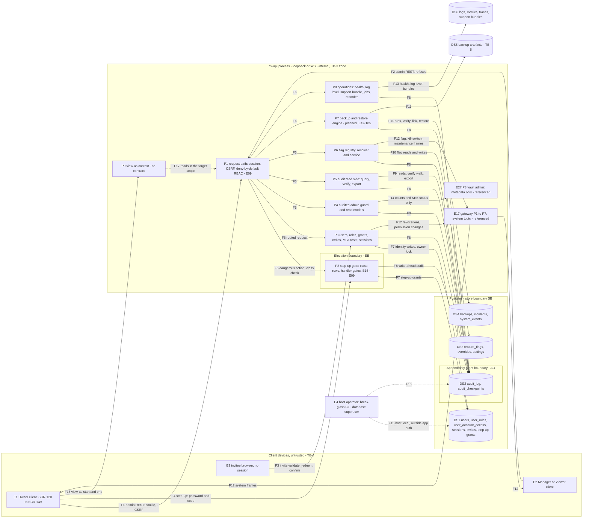

# E42 — STRIDE threat model: the admin area

- Ticket: E42-X01 (issue #890). Owner: Security engineer (CODEOWNER). Status: **Draft**, slice S1 of 4. Sign-off
  follows the E27 precedent (C-10.1): independent agent security and code reviews go in the review log (§13, S4),
  Owner acceptance of the residuals is queued on #2701, and the security engineer and Architect sign-off on #890
  and on the epic (#63) stay human.
- Method: `docs/plan/04-security-program.md` §5 template (L x I = risk), STRIDE per element and per flow
  (C-12.1), in the four-question frame: what are we building (§1 to §3), what can go wrong (§4, §6 to §9), what
  are we going to do about it (§5, §10 to §12), did we do a good job (§13). Format mirrors `E27-accounts.md`. It
  consumes the E09 model (`e09-auth-rbac.md`, U-rows), E17 (`E17-ws-gateway.md`, WS-rows), E27
  (`E27-accounts.md`, KV-rows), E16 (`e16-recorder.md`, R-rows) and E04
  (`docs/plan/threat-models/E04-observability.md`); those threats are **referenced, not repeated**.
- Inputs, read at `b5eb60a4` (the design pass ran at `22478a7b`; every line cited here was re-checked at
  `b5eb60a4`): the 57 operations of `docs/plan/22-api-openapi.yaml` listed in §1.3; `23-ws-protocol.md` §6.2 and
  §15.9; `21-database-schema.md` §3.1, §3.9, §3.10, §8 and §12; `04-security-program.md` §2, §4.1, §5.6, §5.7,
  §6 and §7.2.2; `14-screens-catalogue.md` §10; migrations `0001`, `0003`, `0024`, `0027` and `0028`;
  `infra/scripts/pg_bootstrap.sql`; `auth/rbac_seed.json`; the route matrix
  (`services/api/tests/contract/rbac/matrix.yaml`) and the composition allowlist
  (`services/api/tests/unit/architecture/composition_allowlist.json`); and, under `services/api/candleviewer/`,
  `admin/http.py`, `admin/flags/`, `api/{step_up,users,invites,sessions,audit}.py`, `audit/{access,actions}.py`,
  `auth/step_up.py`, `ws/gateway.py` and `ws_wiring.py`, with the tests §3 names.
- Path: `docs/security/threat-models/e42-admin.md`, the name the ticket gives. GOV-008
  (`scripts/check_threat_model_ticket_map.py:23-24`) matches it case-insensitively, so the level-2 or level-3
  heading that introduces the control map makes that section list all 35 non-retired E42 keys. The map is §12
  (S4); no earlier heading carries the word the check keys on.
- Deviations: (1) the blocker E42-D02 (#831) is still open. As the routing comment on #890 directs, the model is
  built against the interfaces (the OpenAPI paths, the WS `system` topic, the Postgres grant model and the flag
  registry), not the wireframes; the view-as (SCR-124) and SCR-149 rows are re-triaged when the wireframes land.
  (2) Timing: C-12.1 puts the model first, but E42-T01, E42-T03 (registry, catalogue, resolver, migration `0027`)
  and E42-T05 (migration `0028`, the read-model and backup-guard contract) merged before it. Decision D4 (§5, S2)
  records this as E27 recorded its D5: their findings go to follow-ups, and the remaining E42 work must reflect
  this model before it merges. (3) The DoD item "automated checks merged and running in CI" is E42-X03's
  deliverable (#1026). Every slice says `Refs #890`; #890 stays open until E42-X03 and the remediations land.
- Absorbs: `e42-user-lifecycle.md` (#2729), the user-lifecycle appendix. §8 (S3) absorbs it; the file stays as an
  annex marked absorbed, so its L, UL and UL-AC ids keep resolving.
- Slices: this is S1 of 4, and the model is incomplete until S4 merges. S1: §1 to §3 (scope, build state,
  classification map, rating, data flows, boundaries, structural controls). S2: §4 to §7 (STRIDE per boundary
  with the coverage matrix, decisions, the restore path, the audit read side under load). S3: §8 to §11 (user
  lifecycle, abuse cases for E42-X03, observability, requirements `SR-E42-nn`). S4: §12 and §13 (control map,
  findings register, residuals, review log, `32-risk-register.md` and `04-security-program.md` updates).
  Findings AD-F01 to AD-F22 are reserved by the design pass and cited here by id with a one-line description.
- Open decisions: the owner-equivalent band-raise (§1.4, security engineer) and D8, SCR-149's 15-minute window
  against per-action step-up (§2, Owner, through the E42-T06 ADR, #1085, whose planned number ADR-0022 is
  already `docs/plan/27-adrs/ADR-0022-hot-tier-questdb-vs-timescaledb.md`).
- Gate note: design-level weaknesses only (`SECURITY.md`, C-12.13). No credential, host, UID, IP address or
  exploit detail appears.

## 1. Scope

In scope: the admin area as the server exposes it. That is the 57 operations of `22-api-openapi.yaml` that §1.3
lists (`/users*`, `/roles`, `/permissions`, `/invites/*`, `/me/sessions*`, `/auth/step-up`, `/admin/*`,
`/health/*` and `/system/build`); the WS `system` topic (`23-ws-protocol.md` §6.2, §15.9); the Postgres grant
model and the append-only audit tables (`0003_audit_log`, `pg_bootstrap.sql`); the identity, flag, settings,
incident and backup tables the admin area writes (`0001`, `0027`, `0028`); the flag registry (`admin/flags/`);
the elevation the admin area relies on; and two surfaces with no contract yet, view-as (SCR-124) and the SCR-149
re-auth gate.

Out of scope: building the controls (owned by the tickets in §12, S4); executing the abuse cases (E42-X03) and
reviewing the built code (E42-X02); the penetration test (E43); session, MFA and step-up internals (E09,
consumed); the key vault (E27), the WS transport (E17), the recorder (E16) and the observability surface (E04),
referenced; the screens, except where a screen implies a server control.

### 1.1 State of the build at review time

"Served" is a route-matrix row in state `executed` (`matrix.yaml:10-15` defines the states); "501" is a route
mounted with no principal resolver, `not_executable` there; "contract-only" is `not_mounted` there and listed
under `openapi_pending` in the composition allowlist. `test_openapi_operations_are_served_or_explicitly_pending`
(`services/api/tests/unit/architecture/test_composition_guard.py:304-314`) and the shrinking baseline of 149
(:44, :317) keep the allowlist equal to what the app serves, and the matrix turns red when a `not_mounted` route
appears (`services/api/tests/contract/rbac/test_route_matrix.py:82`). Of the 57 operations, 26 are served, 2
answer 501 and 29 are contract-only; §1.3 gives each row's matrix (`m:`) and allowlist (`a:`) line.

<!-- prettier-ignore -->
| Component | Status | Evidence |
| --- | --- | --- |
| Audited admin guard, overview, capacity, sub-account tier | merged | E42-T01 (#2874, #2901, #2930, #2946): `admin/http.py:110-174` |
| Invites, role change, MFA reset, step-up, own sessions | merged (E09) | The served rows of §1.3; the owner-floor lock is shared with the disable store (#2916) |
| User read, PATCH and DELETE, grants, admin sessions, purge | contract only | E42-T04's contract deltas (#2658) and transactional disable store (#3062) merged; grant store hardened (E42-T08, #3028); routes owed by E42-T04 S6, E42-T08, E42-T09 and E42-T10 |
| Audit read side | partial | The router is E09-T02's (#1608); E42-T02 added the contract, the export stub and the verify slot (#2392, #2446, #2917). Query, verify and the stub are served; the contract's verify limits, read record and export job are not (AD-F04, AD-F05) |
| Feature flags | partial | Contract (#2592), `0027` (#2796), registry, catalogue and resolver (#2928), service read path (#2981). No route, no `system` push, no maintenance gate, and nothing composes the registry into the app (§3.2) |
| Incidents, backups, health read models | partial | `0028` (#2820) and the read-model and backup-guard contract (#2957); routes not mounted; `GET /admin/health` is mounted without a resolver (501) |
| Statechart inspector | contract only | E42-T07 contract (#2958) |
| Append-only audit storage | merged | `0003_audit_log.py` and `pg_bootstrap.sql`; verified in §3.1 |
| WS `system` topic | merged (E17) | Implicit topic; flag frames planned (E42-T03, #964) |
| View-as (SCR-124), admin re-auth (SCR-149) | no contract | No path for view-as; on the server SCR-149 is observability only (§2, EB) |
| Admin screens (E42-S01 to E42-S08) | not built | Modelled only where a screen implies a server control |

A row that rests on unbuilt work says "planned" and names the ticket. Its rating assumes the ticket ships the
control; the security review of that ticket re-triages the row if the control is missing.

### 1.2 Assets and data classification

E42-X01 fixes this classification (decision D1, §5); every E42 child cites it rather than deciding it again. Asset
ids are `04-security-program.md` §2; P1 and P2 are the PII levels of `21-database-schema.md` §12 (:3644).

<!-- prettier-ignore -->
| Asset | Class | Where it lives | Notes |
| --- | --- | --- | --- |
| A-03: password hashes, TOTP seeds, recovery codes; the password and code typed at step-up, invite redemption and SCR-149 | **Secret** | `users`, `mfa_methods`, `recovery_codes`; request bodies (F3, F4) | Never returned, logged or audited (SR-069, SR-122) |
| A-04: session and refresh tokens; step-up grants | **Secret** (tokens); P2 (`ip`, `user_agent`, `tailscale_node`) | `sessions`, `step_up_elevations` | Session metadata is P2 (`21-database-schema.md:3654`) |
| Invite tokens and backup download tokens | **Secret** | The path of F3 and of `downloadBackup`; stored hashed | Single-use. Logs keep the route template (yaml:9089-9092); the invite shape is redacted (`observability/redaction.py:76-77`) |
| A-19: username, email, display name (P1); last login IP, session `ip` and `user_agent`, `audit_log.actor_ip` (P2) | **PII** P1, P2 | `users`, `sessions`, `audit_log` | Purge is E42-T10 (`e42-user-lifecycle.md` L4) |
| A-11: audit log contents | **Confidential**; P2 in `actor_ip` | `audit_log`, `audit_checkpoints`, exports | Crown jewel (04 §2.1), integrity-critical; the Owner reads raw, a Manager own and redacted (SR-067) |
| Roles and grants (`user_roles`, `user_account_access`) | **Confidential**, integrity-critical | Postgres (DS1) | A write is a privilege change (SR-055) |
| A-18: flags, kill-switch and maintenance state | **Confidential** (owner-only keys) or Internal; integrity-critical | `feature_flags`, `feature_flag_overrides`, the `system` topic | Visibility is declared per flag (`admin/flags/catalogue.py:48-58`, `:80-87`) |
| Operational state: health, capacity, incidents, statecharts, jobs, support bundles, log levels | **Confidential** | Read models, telemetry (DS6) | The public probes carry a state word and component names only |
| A-13: backup artefacts | **Secret-adjacent** | Encrypted volume and off-box copy (DS5, TB-6); `backups` rows | Hold wrapped DEKs and ciphertext; E42 never decrypts them (SR-091). `backups.encryption_ref` is class S, an alias (`0028_incidents_backups.py:13-14`) |

### 1.3 Endpoint classification map

Every operation the admin area serves or declares, plus the `system` topic and the two surfaces with no contract.
Columns: x-rbac is the contract's permission (`scope: none` unless shown); step-up is the class and its source (a
bare `:n` is a line of `services/api/candleviewer/api/step_up.py`, `yaml:n` of `22-api-openapi.yaml`, and
"registry test" is `services/api/tests/unit/api/test_dangerous_route_registry.py`); class is P1, P2, C
(Confidential), SA (Secret-adjacent), S (a credential crosses, in or out) or I (Internal); state is served, 501 or
contract-only (§1.1). The protecting control is what holds beyond the x-rbac permission, which the deny-by-default
router and the route matrix enforce on every row (§2, TB-4). **G** is the audited admin guard
(`admin/http.py:110-174`), which writes `admin.area_entered` ahead for allowed and denied callers; a handler guard
checks the permission in the route itself. Paths in the control column are under `services/api/candleviewer/`.

<!-- prettier-ignore -->
| operationId | Method and path | x-rbac | Step-up | Class | State | Protecting control |
| --- | --- | --- | --- | --- | --- | --- |
| **Users, roles, grants (P3)** | | | | | | |
| `listUsers` | `GET /users` | `users:read` | — | P1, C | contract-only (m:1465, a:341) | No role but the Owner holds `users:read` (`auth/rbac_seed.json` role lists) |
| `createUser` | `POST /users` | `users:write` | `users` (:282) | P1; S out (invite link) | served (m:1472; `api/invites.py:211`) | Step-up row; invites grant `viewer` only (yaml:12808-12809); the link is shown once (yaml:12794) and never logged (`api/invites.py:18`); AD-F10 (the MFA flag must be true-only, C-12.2) |
| `getUser` | `GET /users/{userId}` | `users:read` | — | P1, C | contract-only (m:1484, a:345) | Owner-only permission |
| `updateUser` | `PATCH /users/{userId}` | `users:write` | `users` (:295) | C, P1 | contract-only (m:1498, a:389) | Pre-registered row; own roles or status refused and the last Owner kept, by contract (yaml:1657-1658) |
| `deleteUser` | `DELETE /users/{userId}` | `users:write` | `users` (:296) | C; P1, P2 on purge | contract-only (m:1491, a:61) | Pre-registered row; the disable cascade and the purge are `e42-user-lifecycle.md` L1 and L4 |
| `setUserRoles` | `PUT /users/{userId}/roles` | `users:write` | `users` (:285) | C, integrity | served (m:1543; `api/users.py:141`) | `enforce` (`api/users.py:156`); self-target refused and audited (:159-170); owner floor at the endpoint (:225-241) and in the database (`0001`:271-298) |
| `listUserAccountAccess` | `GET /users/{userId}/account-access` | `users:read` | — | C | contract-only (m:1505, a:349) | Owner-only permission |
| `setUserAccountAccess` | `PUT /users/{userId}/account-access` | `users:write` | `users` (:297) | C, integrity | contract-only (m:1512, a:605) | Pre-registered row; soft revoke (`e42-user-lifecycle.md` L2) |
| `listUserSessions` | `GET /users/{userId}/sessions` | `users:read` | — | P2 | contract-only (m:1549, a:353) | Owner-only permission |
| `revokeUserSession` | `DELETE /users/{userId}/sessions/{sessionId}` | `users:write` | `users` (yaml:1895); no row yet | C | contract-only (m:1556, a:65) | Inside the tripwire: it cannot be mounted ungated (§3.3) |
| `listRoles` | `GET /roles` | `users:read` | — | I; C (user counts) | contract-only (m:1191, a:301) | Owner-only permission |
| `listPermissions` | `GET /permissions` | `users:read` | — | I | contract-only (m:1007, a:253) | Owner-only permission; the vocabulary is public in `rbac_seed.json` |
| **Invites (P3)** | | | | | | |
| `listPendingInvites` | `GET /users/invites` | `users:write` | — | P1, no tokens | served (m:1478; `api/invites.py:245`) | Owner-only permission |
| `reissueInvite` | `POST /users/{userId}/invite` | `users:write` | `users` (:283) | S out (new link) | served (m:1519; `api/invites.py:258`) | Step-up row; E09 U12 |
| `revokeInvite` | `DELETE /users/{userId}/invite` | `users:write` | `users` (:284) | C | served (m:1525; `api/invites.py:276`) | Step-up row |
| `getInvite` | `GET /invites/{inviteToken}` | public | — | S (token in path), P1 | served (m:692; `api/invites.py:309`) | Per-IP throttle and one 404 for every invalid token (`api/invites.py:7`, :13); the token shape is redacted in logs (`observability/redaction.py:76-77`); E09 U12 |
| `redeemInvite` | `POST /invites/{inviteToken}` | public | — | S in (password) | served (m:698; `api/invites.py:355`) | As above; role and identity fields refused and audited (`api/invites.py:14-17`) |
| `confirmInvite` | `POST /invites/{inviteToken}/confirm` | public | — | S (first code in, recovery codes out once) | served (m:704; `api/invites.py:384`) | As above; E09 U23 |
| **MFA reset, own sessions, elevation** | | | | | | |
| `previewMfaReset` | `GET /users/{userId}/mfa/reset-preview` | `users:write` | — | C | served (m:1537; `api/step_up.py:562`) | Owner-only permission |
| `resetUserMfa` | `POST /users/{userId}/mfa/reset` | `users:write` | `users` (:286; handler :605) | C | served (m:1531; `api/step_up.py:589`) | Step-up row and handler gate; an Owner's own TOTP is refused (`api/step_up.py:603-604`) |
| `listMySessions` | `GET /me/sessions` | self | — | P2 (own) | contract-only (m:915, a:233) | Self scope; `GET /auth/sessions` is served instead (`api/sessions.py:760`) |
| `revokeMySession` | `DELETE /me/sessions/{sessionId}` | self | — | C (own) | served (m:922; `api/sessions.py:847`) | Self scope, no target-user parameter (SR-026) |
| `authStepUp` | `POST /auth/step-up` | self | the elevation itself | S in (password, code) | served (m:391; `api/step_up.py:472`) | E09 U11, U18; no `flags` class in code (AD-F01); the session is not rotated on elevation (AD-F11, #2101) |
| **Audit read side (P5)** | | | | | | |
| `queryAuditLog` | `GET /admin/audit` | `audit:read`, scope self | — | C; P2 (Owner raw view) | served (m:22; `api/audit.py:239`) | Role-scoped projection (`audit/access.py:113-176`, SR-067); AD-F04, AD-F13 |
| `verifyAuditChain` | `POST /admin/audit/verify` | `audit:read` | none by design (registry test :35) | C | served (m:41; `api/audit.py:343`) | Owner-only (`audit/access.py:43-44`); the contract's limits are owed (AD-F04) |
| `exportAuditLog` | `POST /admin/audit/export` | `audit:export` | `audit` (:298) | C, P2 in bulk | served as a stub (m:28; `api/audit.py:359-370`) | Step-up row; Owner-only; answers 202 where the contract says 501 (AD-F05) |
| `downloadAuditExport` | `GET /admin/audit/exports/{jobId}` | `audit:export` | `audit` (yaml:8279-8285) | C, P2 in bulk | contract-only (m:34, a:73) | The requester only, by contract; a read the tripwire does not sweep (AD-F01) |
| **Operations and read models (P4, P8)** | | | | | | |
| `getHealth` | `GET /admin/health` | `admin:read` | — | C (components, version, commit) | 501 (m:131; `api/health_report.py:124-127`) | Handler guard, denial not audited (AD-F22); E04 TB-O5 |
| `getLiveness` | `GET /health/live` | public | — | I | served (m:616) | A state word only (`api/health_report.py:1-7`) |
| `getReadiness` | `GET /health/ready` | public | — | I | served (m:622) | A state word and component names only |
| `setLogLevelOverride` | `PUT /admin/log-level` | `admin:write` | — | C | 501 (m:159; `api/log_level.py:47-50`, `app.py:1085-1086`) | Handler guard; E04 L3, L5 |
| `createSupportBundle` | `POST /admin/support-bundle` | `admin:read` | — | C (redacted diagnostics) | served (m:220; `api/support_bundle.py:73`) | Handler guard, denial audited (`api/support_bundle.py:90-98`); E04 H3, H4; RSK-055 |
| `getSupportBundle` | `GET /admin/support-bundle/{job_id}` | `admin:read` | — | C | served (m:226; `api/support_bundle.py:132`) | Handler guard |
| `getJob` | `GET /admin/jobs/{jobId}` | `admin:read` | — | C | served (m:153; `api/recorder_admin.py:418`) | Handler guard, denial not audited (`api/recorder_admin.py:425-426`, AD-F22) |
| `getAdminOverview` | `GET /admin/overview` | `admin:read` | — | C | served (m:167; `api/admin_overview.py:93`) | G |
| `getCapacity` | `GET /admin/capacity` | `admin:read` | — | C | served (m:103; `api/admin_overview.py:97`) | G |
| `setSubaccountTier` | `PUT /admin/capacity/subaccount-tier` | `admin:write` | none by contract (yaml:10694-10697) | C | served (m:109; `api/admin_capacity.py:136`) | G; `settings.change` written ahead |
| `listIncidents` | `GET /admin/incidents` | `admin:read` | — | C | contract-only (m:139, a:93) | Planned: G (`admin/http.py:1-2`, E42-T05) |
| `acknowledgeIncident` | `POST /admin/incidents/{incidentId}/acknowledge` | `admin:write` | — | C | contract-only (m:146, a:409) | Planned: G (E42-T05) |
| `listStatecharts` | `GET /admin/statecharts` | `admin:read` | — | C | contract-only (m:199, a:101) | Planned: G (E42-T07) |
| `getStatechart` | `GET /admin/statecharts/{machineKey}` | `admin:read` | — | C | contract-only (m:206, a:105) | Planned: G (E42-T07) |
| `exportStatechart` | `GET /admin/statecharts/{machineKey}/export` | `admin:read` | — | I (chart structure only, yaml:11025-11026) | contract-only (m:213, a:109) | Planned: G (E42-T07) |
| `getSecuritySummary` | `GET /admin/security/summary` | `audit:read`; "Owner-only" in prose (yaml:11057) | — | C | contract-only (m:192, a:97) | The matrix expects a Manager 403 (m:192-198) although Managers hold `audit:read` (AD-F20) |
| `getBuildInfo` | `GET /system/build` | self | — | I | contract-only (m:1394, a:325) | E09 U26 |
| **Recorder (referenced to E16)** | | | | | | |
| `compactRecorder` | `POST /admin/recorder/compact` | `recording:write` | none by design (registry test :41) | C | served (m:173; `api/recorder_admin.py:328`) | `e16-recorder.md` C7 |
| `importTradeArchive` | `POST /admin/recorder/import` | `recording:write` | none by design (registry test :42) | C | served (m:179; `api/recorder_admin.py:227`) | `e16-recorder.md` C6, C7 |
| `purgeRecordedData` | `POST /admin/recorder/purge` | `recording:write` | `recorder`, handler-gated (:323) | C | served (m:185; `api/recorder_purge.py:98`) | Owner-only before the step-up (`api/step_up.py:321-323`); `e16-recorder.md` R-R1, R-E1 |
| **Feature flags (P6)** | | | | | | |
| `listFeatureFlags` | `GET /admin/feature-flags` | `flags:read` | — | I; C (owner-only keys) | contract-only (m:117, a:89) | Per-flag visibility (`admin/flags/registry.py:110-112`); planned G (E42-T03) |
| `setFeatureFlag` | `PUT /admin/feature-flags/{flagKey}` | `flags:write` (dangerous) | `flags`, `killswitch` or `live_enablement`, chosen under the row lock (yaml:8753-8763) | C, integrity (live gate, kill switches, maintenance) | contract-only (m:124, a:561) | Registry refusal (§3.2); `flags.change` written ahead (yaml:8781-8789); outside the tripwire, and no `flags` class in code (AD-F01) |
| **Backups and restore (P7)** | | | | | | |
| `listBackups` | `GET /admin/backups` | `backups:read` | — | C (paths, sizes, coverage) | contract-only (m:47, a:77) | Planned (E42-T05) |
| `getBackup` | `GET /admin/backups/{backupId}` | `backups:read` | — | C | contract-only (m:61, a:81) | Planned (E42-T05) |
| `createBackup` | `POST /admin/backups` | `backups:write` | none by design (registry test :37) | SA | contract-only (m:54, a:393) | Planned (E42-T05) |
| `verifyBackup` | `POST /admin/backups/{backupId}/verify` | `backups:write` | none by design (registry test :38) | SA | contract-only (m:96, a:405) | Planned (E42-T05) |
| `deleteBackup` | `DELETE /admin/backups/{backupId}` | `backups:write` | `backups`, no grace (yaml:8983-8985); no row yet | SA | contract-only (m:68, a:17) | Inside the tripwire (registry test :165) |
| `issueBackupDownload` | `POST /admin/backups/{backupId}/download` | `backups:write` | `backups`, no grace (yaml:9035-9039); no row yet | S out (single-use link), SA | contract-only (m:75, a:397) | Inside the tripwire (§3.3) |
| `downloadBackup` | `GET /admin/backups/{backupId}/download/{token}` | `backups:read` | none: the token is the gate (yaml:9086-9097) | S (token in path), SA | contract-only (m:82, a:85) | Single-use, 5-minute, same-user token; template-only logs (yaml:9089-9092) |
| `restoreBackup` | `POST /admin/backups/{backupId}/restore` | `backups:write` | `backups`, no grace, one-shot (:306) | SA; the whole installation | contract-only (m:89, a:401) | Pre-registered row spends the grant before the preconditions (yaml:11218-11230); AD-F02, AD-F07 |
| **Outside the REST contract** | | | | | | |
| WS `system` topic | implicit on every socket (`23-ws-protocol.md:746`) | authenticated | — | I; C (kill-switch detail, owner-only flag keys) | served (`ws/gateway.py:166`; `ws/permissions.py:202`) | Role-neutral content required (SR-188, E17 WS-I05); the broadcast is role-blind (`ws/gateway.py:289-294`); per-role flag frames planned (E42-T03; AD-F16) |
| view-as (SCR-124) | no contract | none defined | none defined | C, P1, P2 (a target's whole read scope) | no contract | None: no path, no audit action (`audit/actions.py:159-175`), no server owner (AD-F03) |
| admin re-auth (SCR-149) | no contract | — | a 15-minute window (`14-screens-catalogue.md:2216`, :2704) | S in (password, code) | no contract | Observability only: `reauth_age_s` (`admin/http.py:19-26`), pinned by `test_admin_http.py:288`; D8 open (AD-F06) |

60 rows: the 57 operations (26 served, 2 at 501, 29 contract-only), the `system` topic and the two surfaces with
no contract. Sixteen operations need a step-up: eleven have a registry row or a handler gate today, three
(`revokeUserSession`, `deleteBackup`, `issueBackupDownload`) are inside the tripwire without a row, and two
(`setFeatureFlag`, `downloadAuditExport`) are outside it (§3.3).

### 1.4 Rating

Risk = L x I on the programme scale (Low / Medium / High / Critical), E27's matrix unchanged:

| L \ I | L      | M      | H        |
| ----- | ------ | ------ | -------- |
| L     | Low    | Low    | Medium   |
| M     | Low    | Medium | High     |
| H     | Medium | High   | Critical |

E27's H\* (a threat that lets value leave an account) applies only through the E27 rows this model references.
**Open question for the security engineer:** should an owner-equivalent outcome (the live gate, a kill-switch
release, maintenance mode, a role or grant change, a restore, a writable view-as) also raise the cell by one band?
`04-security-program.md` rates D1 (§5.7) and U3 (§5.6) Critical at M x H, which such a rule would match; with it,
AD-F01 and AD-F03 would be Critical inherent. It is not adopted. Rows are rated on the plain matrix and tagged
**OE** where the outcome is owner-equivalent, so the decision can re-rate them without a new analysis.

Disposition: **M** mitigated by a named ticket (merged or planned); **A** accepted once the Owner signs off
(pending, queued on #2701); **R** referenced (another epic's model owns it); **T** a new remediation ticket
(filed in S4; a Critical or High one is scheduled inside R3). Risk is inherent; Residual is after the mitigation
ships. Verification layers follow `04-security-program.md` §6: unit, property, integration, contract, e2e, load,
chaos, ci-gate, drill. STRIDE rows are `AD-xnn`, with x the category letter (S, T, R, I, D, E); findings are
`AD-Fnn` (§13.1, S4).

## 2. Data-flow diagram and trust boundaries

Text description (the diagram is not the only carrier): an Owner works in the admin screens (E1), and every
request crosses TB-4 as a cookie session with a CSRF token to the E09 request path (F1), which authenticates it
and checks the route's declared permissions before any handler runs. Managers and Viewers reach the same routes
and are refused (F2). An invitee with no session validates, redeems and confirms an invite link (F3), the only
unauthenticated admin flow. A dangerous action needs a live step-up of its class (F5), obtained with the
password and an authenticator code (F4). Requests then reach the module that owns them (F6): users and grants
write identity rows under the owner lock, and step-up writes its grants (F7); every module writes its audit
record before it answers (F8, C-2.9); the audit read side queries, verifies and exports the chain (F9); the flag
service reads and writes flags (F10); the backup engine records runs and moves artefacts to and from TB-6 (F11).
Flag, kill-switch and maintenance changes and revocations reach every socket the role admits through the E17
gateway's `system` topic and its revocation path (F12). Operations write health snapshots, log-level overrides
and support bundles to telemetry (F13). The admin read models see the vault as metadata only (F14). A host
operator reaches the database outside the app's authentication (F15). View-as (F16, F17) has no contract; the
diagram marks where a server context would sit.

Elements: external entities **E1-E4**; processes **P1-P9** plus the referenced E17 gateway and E27 P8; data stores
**DS1-DS6**; flows **F1-F17**. Ids are local to this model, as in E27 and E17; E1 and E2 keep E27's meaning, and
EB and AO are new boundary ids. Every element and flow appears in the coverage matrix (§4.7, S2).

Boundaries (`20-architecture.md` §2.2, `04-security-program.md` §4.1):

- **TB-4, client to admin API** (F1 to F4, F12, F16): REST and the WS `system` topic. Untrusted until
  authenticated, RBAC-scoped after; the client enforces nothing (C-2.12), so a hidden screen is cosmetic (04
  §5.7 D1). Every route declares its permissions and the deny-by-default router refuses one that does not
  (SR-017; `services/api/tests/unit/api/test_deny_by_default.py:19`, :47); the route matrix asserts each role's
  outcome per route (SR-018; `services/api/tests/contract/rbac/test_route_matrix.py:240`). F3 is unauthenticated
  by design. E04 calls the operations part of this crossing TB-O5; it is the same boundary.
- **EB, the elevation boundary** (F4, F5, F16; new): between an authenticated session and one elevated for an
  action class. Today it is per-class step-up (SR-025, E09 U18): the `DANGEROUS_ROUTES` rows
  (`api/step_up.py:281-310`) and the handler gates (:317-339) demand a live grant of the class, and `backups`,
  `killswitch` and `live_enablement` are no-grace and single-use (`auth/step_up.py:82`). SCR-149's 15-minute
  admin window (`14-screens-catalogue.md:2216`, :2704) is not a server gate: the guard records `reauth_age_s`
  and never refuses on it (`admin/http.py:19-26`; `services/api/tests/unit/admin/test_admin_http.py:288`). Which
  model holds is decision D8 for the Owner (AD-F06). §3.3 states the reach of the tripwire behind this boundary.
- **SB, the store boundary** (F7 to F11, F15; E27 §2): the API and Postgres share the TB-3 zone
  (`e42-user-lifecycle.md:41-42`), so this is a privilege boundary, not a network one, and a database writer is
  its own integrity domain. The app connects as `cv_app`, whose default privileges include UPDATE and DELETE on
  every table `cv_owner` creates (`infra/scripts/pg_bootstrap.sql:95-96`). So `user_roles`,
  `user_account_access`, `feature_flags` and `backups` are protected by the application and, for the last Owner,
  by the owner-floor trigger (`0001_identity_rbac_sessions_mfa.py:271-298`), not by grants (AD-F08).
- **AO, the append-only grant boundary** (F8, F9; new, inside SB): `cv_app` holds SELECT and INSERT only on
  `audit_log` and `audit_checkpoints`, and triggers refuse UPDATE, DELETE and TRUNCATE (SR-066, C-5.7). §3.1
  verifies each layer on its own.
- **TB-6** (F11): backups and their off-box copy, encrypted with a key distinct from the KEK (SR-091). E42 moves
  artefacts and never decrypts them.
- **Host** (F15): the break-glass CLI and a database superuser act outside the app's authentication; E09 §3.6.1
  (U10) and E27 KV-E08 own them. Referenced.
- **In-process capability boundaries, not trust boundaries:** the flag store and registry (P6), the backup engine
  (P7), the recorder (E16 C7), health and the support bundle (E04 TB-O5) and the statechart inspector (E42-T07)
  are modules of one Python process. Like E27's M2 facades they stop accidental use, not hostile in-process code
  (E27 §4.3, KV-I09). A request is rated at the boundary it entered through (TB-4, EB or SB).
- **The key vault** (F14): referenced to E27, not repeated. The admin module sees M2 as metadata only (E27 P8,
  F17): `AdminService` holds `SecretsMetadata` (`admin/service.py:20-26`), pinned by
  `test_metadata_protocol_is_metadata_only` (`services/api/tests/unit/credentials_m2/test_capability_boundary.py:117`).
  E27 KV-E08, KV-T08, KV-R05 and KV-I09 (`E27-accounts.md:294`, :228, :242, :257) cover it.

## 3. Structural controls verified

The ticket singles out two controls the rest of the epic leans on, the append-only audit storage and the flag
registry's refusal of security-gating flags, and asks for each to be verified independently. This section does
that against `main`, and adds the reach of the step-up tripwire, which every dangerous admin write depends on.

### 3.1 Append-only audit storage: two layers, each proven alone

SR-066 asks for both a role with INSERT and SELECT only and a trigger that refuses UPDATE and DELETE (C-5.7). Each
layer has a test that would still fail if the other layer were removed.

<!-- prettier-ignore -->
| Layer | What enforces it | Proven by | Why that test isolates the layer |
| --- | --- | --- | --- |
| Grants | `cv_app` keeps SELECT and INSERT on both tables: the guarded REVOKE in `0003_audit_log.py:166-176` (`audit_log`) and :193-200 (`audit_checkpoints`), re-asserted by `pg_bootstrap.sql:102-126` | `test_audit_guard_cv_app.py:353`: the privileges `cv_app` holds are exactly SELECT and INSERT. :427: UPDATE, DELETE and TRUNCATE as `cv_app` fail with "permission denied for table" (:114-115) and the rows are unchanged | A missing privilege ends the statement before any row trigger runs, so the result does not depend on the triggers |
| Triggers | `trg_audit_append` and `trg_audit_ckpt_append` run `forbid_mutation()` (`0003_audit_log.py:80-81`, :152-153, :189-190); `trg_audit_no_truncate` and `trg_audit_ckpt_no_truncate` refuse TRUNCATE (:154-155, :191-192) | `_assert_guard_enforces` (`test_audit_guard_cv_app.py:301-318`): as `cv_owner`, "whom no privilege stops", every UPDATE, DELETE and TRUNCATE on both tables raises "append-only". `test_audit_repository.py:112`: TRUNCATE is refused even for the owner | The owner holds every table privilege, so only a trigger can refuse |

Both files are under `services/api/tests/integration/audit/` and run in the integration lane
(`.github/workflows/_job-integration.yml:67`); `test_audit_guard_cv_app.py` applies the shipped `pg_bootstrap.sql`
roles and migrates as `cv_owner` (:242, :260, :271), so it tests what ships. The guard also outlives
`cv_app`'s attempts on it: `cv_app` owns nothing (`test_audit_guard_cv_app.py:366`), the tables and guard
functions belong to `cv_owner` (:390), every trigger exists and is enabled (:399), and dropping or disabling a
trigger, defeating the guard or replacing a guard function are refused, after which the trigger check runs again
(:448, :464, :473, through `_assert_guard_survives`, :331-339). Detection sits behind both layers: the verifier
locates a tampered row (`test_audit_repository.py:100`).

The bootstrap backstop's comment still names `0012_governance` as the revision that creates `audit_log`
(`pg_bootstrap.sql:106-108`); `0003` does (an amendment note for §13.3, S4). Owed, as S2 rows: a trigger-only case
named as such, for a privileged role that is not the owner, and a two-connection insert case. Residuals, by id:
**AD-F14** (the owner role and superusers stand outside both layers; detection only, until the chain's external
anchors land, SR-068, #1238) and **AD-F15** (chain order under concurrent insert paths).

### 3.2 The flag registry refuses a security-gating definition

C-4.14 and US-ADMIN-007 say no flag may weaken a security control. The ticket calls the control compile-time
rejection; in Python it happens at import time and again at construction time.

- **Import time.** Every `FlagSpec` runs `check_spec` in `__post_init__` (`admin/flags/registry.py:103-104`).
  `check_spec` (:125-154) refuses a definition that declares any `DENIED` category (:57-66: authentication,
  RBAC, audit, the native stop-loss, risk limits, the withdrawal check, the rate-limit reserve and demo/live
  isolation), declares no category or no visibility, has a malformed key or a value of the wrong kind, or is a
  kill switch or the live gate whose class and gates disagree. The catalogue builds its definitions at module
  level (`admin/flags/catalogue.py:25-88`), so a refused one fails the import.
- **Construction time.** `FlagRegistry` checks every spec again and refuses a duplicate key (`registry.py:169-176`),
  so a spec that escaped its constructor still stops the registry.
- **Tests** (under `services/api/tests/unit/admin/`): `test_flag_registry.py:56` walks all 8,192 combinations of
  the 13 categories (only a non-empty set of the five allowed ones passes, and the error names the flag and
  C-4.14); :78 forces a spec past its constructor and the registry refuses it; :115 (malformed definitions), :120
  (duplicate keys), :189 (only ordinary flags take overrides) and :193 (visibility is mandatory).
  `test_flag_catalogue.py:31` holds the catalogue to `21-database-schema.md` §10.7 row for row;
  `test_flag_resolver.py:108` shows safety flags ignore every override and fail closed;
  `test_flag_service.py:58` shows a kill-switch change in the database is seen within 5 s.

Two limits, both **AD-F09**:

- **Self-attestation.** `check_spec` sees the categories a definition declares, not what the code that reads the
  flag does, and nothing ties a key to its call sites. The control that closes this is the E42-X03 rule against
  flag lookups in safety modules (#1026); `.semgrep/` has no such rule on `main`.
- **The boot refusal is not wired.** The registry promises that the process refuses to boot (`registry.py:9-11`),
  but `default_registry()` (`catalogue.py:91-93`) has no caller outside `admin/flags/`, and neither the registry
  nor the flag service is composed into `create_app`. No flag value is consulted at runtime on `main`, so nothing
  is weakened today; E42-T03's wiring PR owes the composition and a test that `create_app` refuses a denied
  definition.

### 3.3 The reach of the step-up tripwire

`DANGEROUS_ROUTES` maps a method and path to an action class (`api/step_up.py:281-310`), and
`HANDLER_GATED_ROUTES` declares the body-aware gates (:317-339). The tripwire,
`test_every_mounted_dangerous_write_route_is_gated` (`services/api/tests/unit/api/test_dangerous_route_registry.py:65`),
fails the build when a mounted write whose path matches `DANGEROUS_PATH_PATTERN` (`api/step_up.py:346-349`) is in
neither registry nor the test's explicit list of non-dangerous writes (:33-43). It sees routes inside included
routers (:69) and sub-applications (:127); fixtures of future routes prove it fires (:176); and the contract's
dangerous routes map to their class (:183-207). So `revokeUserSession`, `deleteBackup` and `issueBackupDownload`,
which have no row yet, cannot be mounted ungated: their paths are inside the pattern (fixture :165).

Its reach stops at two edges (**AD-F01**):

- It sweeps writes only (`_WRITE`, :31; :58-62), and a read is asserted ungated (:210). The contract gates one
  read: `downloadAuditExport` needs a live `audit` step-up (`22-api-openapi.yaml:8279-8285`).
- The pattern has no `admin/feature-flags` alternative, although `flags:write` is seeded dangerous
  (`auth/rbac_seed.json:79-81`) and the contract makes every flag write need a fresh `flags`, `killswitch` or
  `live_enablement` elevation, chosen under the row lock (yaml:8753-8763). The `flags` class is in the
  contract's enum (yaml:9515) but not in `ACTION_CLASSES` (`auth/step_up.py:78-80`) or the B16 binding
  (`statechart/bindings/b16_session.py:290-292`).

Neither route is mounted (`matrix.yaml:124`, :34), so nothing is reachable today. Design requirement, before
E42-T03 mounts the flag write and E42-T02 the export download: drive the sweep from the seeded dangerous
permissions and each operation's x-rbac for every mounted method; add `flags` to `ACTION_CLASSES` and the B16
binding with its contract test; and declare the flag write handler-gated with a handler test, because its class
depends on the stored value. Until then it is a required change on #964 and #889. Outside the gate by design:
`verifyAuditChain` (04 §7.2.2 row 49a), `createBackup` and `verifyBackup` (row 52), `compactRecorder` and
`importTradeArchive` (row 51), and `setSubaccountTier`, whose contract says why (yaml:10694-10697).
