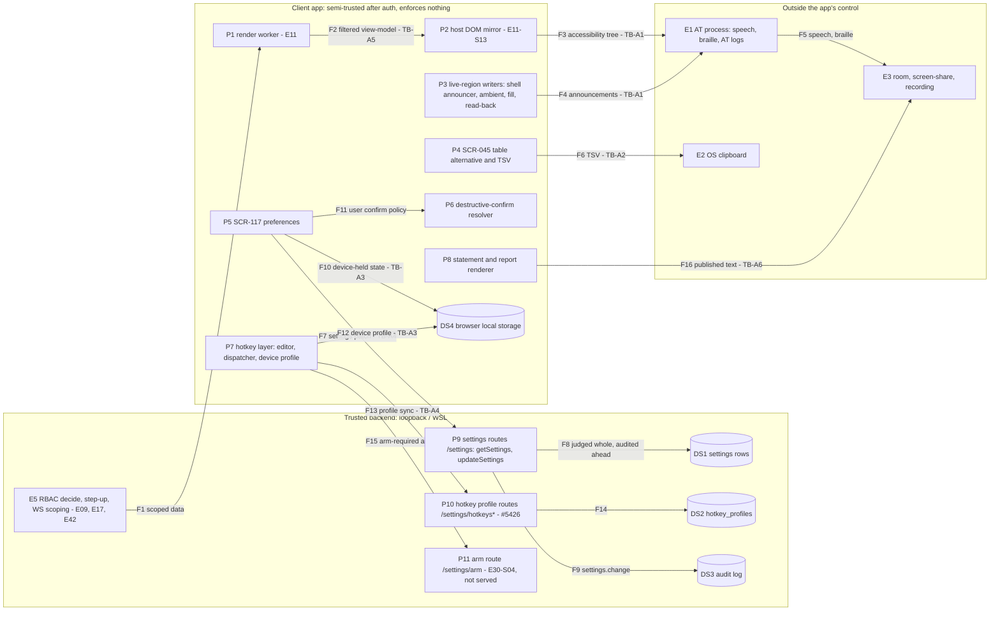

# E47 — STRIDE threat model: the accessible surface (mirror, live regions, table alternative, preferences, hotkeys)

- Ticket: E47-X01 (issue #1326). Owner: Security engineer (CODEOWNER), with the Accessibility role. Status: **Draft**.
  Sign-off is the delegated lens rounds: a security lens, an accessibility lens, and the Fable security pass as the
  Security-engineer record under the 2026-10-29 delegation; any acceptance of risk is the Owner's. Review log: end of
  the document.
- Method: `docs/plan/04-security-program.md` §5 template (L x I = risk), STRIDE per element and per flow (C-12.1).
  Format, columns and dispositions mirror `e21-dom-heatmap.md`; the rating matrix is the one `E29-oms.md` §1.3 and
  `e21-dom-heatmap.md` §1.3 use (§1.3 below). Row ids are `AX-xnn`; requirements `SR-E47-nn`; gaps `G-n`; public
  findings `F-nn` (none in this model); private findings about code on `main` `PF-n`; open inputs `O-n`.
- **What E47 adds is one question: parity.** E47 re-expresses canvas-drawn and screen data as DOM text, speech, braille
  and clipboard text, and it adds persisted preferences and a wider keyboard reach. The underlying trading, auth and
  admin controls are **referenced, not repeated**: the engine mirror's internals to `E11-chart-engine.md` (CE-T11,
  CE-T12, CE-I05, CE-D08), RBAC and step-up to `e09-auth-rbac.md` and `e42-admin.md`, drawing text to
  `E14-drawings.md`, the order path and arming to `E29-oms.md` and `E39-risk-killswitch.md`, the WS gateway to
  `E17-ws-gateway.md`. This model asks only whether the accessible copy keeps each control.
- Inputs, read at `c71daa3d3`: issue #1326 and the E47 epic with its 42 child tickets (`docs/plan/backlog/E47.json`);
  `05-accessibility-standard.md` §3.2, §3.3, §3.4, §3.5, §4, §6.1, §6.2, §6.3, §6.4, §7, and WCAG 2.2 AA (C-14.1;
  criteria cited per row: 1.4.1, 2.1.4, 2.5.3, 2.5.4, 3.3.4, 4.1.3); `21-database-schema.md` §3.1.3
  (`user_account_access`), `hotkey_profiles`, the settings tables; `22-api-openapi.yaml` `getSettings`,
  `updateSettings`, `armOneClickTrading`, the `/me/preferences` and `/settings/hotkeys*` operations;
  `14-screens-catalogue.md` SCR-045, SCR-074, SCR-075, SCR-116, SCR-117, SCR-121, SCR-127, SCR-128, SCR-135, SCR-136,
  SCR-149; `11-user-stories.md` US-SET-002, US-SET-003, US-SET-007; the E47 design texts D05, D06, D07, D09 and D13
  under `docs/design/E47/`; the D02 catalogue (`docs/plan/a11y/47-audit-catalogue.md`, pinned at `2a5bf8fd2`); and on
  `main` the web client under `apps/web/src/chart/a11y/`, `apps/web/src/features/a11y-preferences/`,
  `apps/web/src/features/confirm-policy/`, `apps/web/src/keymap/`, `apps/web/src/features/app-shell/` and the settings
  routes under `services/api/candleviewer/api/`.
- **Inputs still open.** E47-D01 (#1300, the keyboard and screen-reader baseline study) is open, and E47-D02 (#1301) is
  Partial: its text catalogue merged (#5248) and only its AC 3 waits on D01. Rows whose likelihood rests on D01's
  AT-usage baseline keep their ordinary rating and carry the Status `PROPOSED (waits on E47-D01 #1300)` (§12). They are
  re-pinned to D01's merge commit when it merges.
- **Data classification (per flow, §2.2).** Market data and chart series: **internal** (A-10, C=1, served only to
  authenticated users). Positions, balances, P&L, orders and fills: **account-scoped financial**. Other users' emails
  and masked key fragments (SCR-121, SCR-127, SCR-128): **confidential**, shown masked. Preferences, confirm policy and
  hotkey bindings: **user-scoped**, safety-relevant where they touch a confirmation or a trading key. Access tokens and
  key material: **secret**, never in any accessible copy.
- Gate note: design-level weaknesses only. No credential, host, account identifier or exploit detail appears. Findings
  about code on `main` went to the private advisory process (`SECURITY.md`, C-12.13); §11.2 names them by id,
  category, severity, status and tracker only.

## 1. Scope

In scope: the six flows the issue names, canvas → DOM mirror → AT; event → live region → AT; table alternative →
clipboard and export; preference UI → server → settings; hotkey profile UI → `/settings/hotkeys*` → `hotkey_profiles`;
statement and conformance report → renderer. Added: the destructive-confirm policy (US-SET-003), shipped by E47-S08, the
place the issue's repudiation scenario applies.

Out of scope: the underlying trading, auth and admin functionality (their own models, referenced above); the R4
pen-test (E43); abuse-case construction and exploit attempts (E47-X02 #1361); building the controls (the tickets in
§9).

### 1.0 Ground rules

1. **Standing conclusion 1.** The accessible surface is subject to the same RBAC and data scoping as the visual surface,
   with no exception (C-12.4, C-2.12). A value the pixels do not show, the accessible copy does not hold.
2. **Standing conclusion 2.** No accessibility accommodation may remove a confirmation, an arming step or the Demo/Live
   signal. Accommodations change modality; they never remove a control (C-2.11, US-SET-003).
3. **No mitigation by omission.** "Do not mirror sensitive screens" is not an acceptable mitigation, because it makes
   those screens unusable with a screen reader (C-14.1). A mitigation keeps equivalent access and applies the same
   protection the visual surface has: the same mask, the same scope, the same confirmation.
4. **The client enforces nothing.** A hidden button, a client-side check or a disabled key is not a control. Server
   RBAC, the arm token, step-up and the risk checks are the controls (C-12.4).
5. **Budgets by reference.** Availability thresholds come from the measured budgets (E47-Q05, `05` §6.2), not from
   numbers invented here.

### 1.1 State of the build at review time

Rows marked **O** (§3) rate a control that is specified but not built, or built without a verifying test.

| Surface                                                | Shipped by       | State on `main` at `c71daa3d3`                                                                                                                                                                                                                                                 |
| ------------------------------------------------------ | ---------------- | ------------------------------------------------------------------------------------------------------------------------------------------------------------------------------------------------------------------------------------------------------------------------------ |
| Engine DOM mirror (`05` §6.1)                          | E11-S13          | Not on `main`: #5467 (query surface, open, at `e9426ce74` if it merges as is) and #5480 (mirror behind a default-off flag, draft, at `f21c6425f` if it merges as is). Engine side modelled in E11 (CE-T11, CE-I05, CE-D08)                                                     |
| Shell live regions (`05` §6.2)                         | app shell        | Shipped: one message per 5 s per region (`features/app-shell/announcer.tsx:24`)                                                                                                                                                                                                |
| Ambient, fill and read-back writers                    | E47-S02 #5371    | Shipped: ambient cadence 2 s (`chart/a11y/politeWriter.ts:24`); fills batched, at most 3 said in full (`fillAnnouncer.ts:31`), an account named only from the accessible set, never an id (`:11-12`); a read-back refuses a leg outside the accessible set (`readback.ts:1-8`) |
| SCR-045 table alternative and `Ctrl+C` TSV (`05` §6.3) | E11-D04 lineage  | Shipped: windowed (`ChartDataTable.tsx:50`); copy capped at 10 000 rows (`tsv.ts:11`), series data only, no account ids (`tsv.ts:1-4`); no escaping, safe while no free-text column exists (`tsv.ts:22-25`)                                                                    |
| A11y preferences (SCR-117)                             | E47-S07 #1321    | Shipped client (`features/a11y-preferences/`); server settings routes served (`getSettings`, `updateSettings`), each change audited ahead as `settings.change` (`api/user_settings.py:20-28`); see O-1                                                                         |
| Destructive-confirm resolver (US-SET-003)              | E47-S08 #5351    | Shipped: Live never weaker than Demo, unknown environment gets Live rules, no accessibility preference is an input, `immediate` not selectable (`features/confirm-policy/resolve.ts:4-13`)                                                                                     |
| Hotkey layer and device profile (US-SET-002)           | E47-S08 #5264    | Shipped: user-keyed device profile, the pre-user key never handed to a second user (`keymap/profile.ts:57`); an imported profile's scope, arming and confirm fields are never read (`keymap/profileStore.ts:72`). Server profiles and sync: #5426 and #5507 (open)             |
| Arming (`/settings/arm`)                               | E30-S04          | Specified, not served. This model checks only that the accessible path keeps the gate                                                                                                                                                                                          |
| Statement and conformance report                       | E47-D13, E47-T05 | `docs/plan/a11y/47-conformance-report.md` on `main`; generator #5690 (open)                                                                                                                                                                                                    |

Correction to the issue text: E47-T01..T03 shipped the sweep register (#1323), the CI gates (#1324) and the contrast
matrix (#1325), not the accessible surface; and the issue's "E47-T06" is E47-T05.

**O-1 (open input, not a security row).** The accessibility-preferences save on SCR-117 is tracked as a functional
defect in #5852 (open), not as a security finding; this model carries nothing about it beyond that issue.

### 1.2 Actors

A1 a Viewer; A2 a Manager granted some accounts; A3 the Owner, including view-as; A4 a person in the user's physical
room or on a screen-share; A5 an assistive-technology process (screen reader, braille display, speech engine) that may
log what it is given; A6 another local user of a shared device. Reachability is tailnet-only (SR-045, SR-047), so every
server row assumes an authenticated A1 to A3.

### 1.3 Rating

Risk = L x I on the programme scale, the matrix of `E29-oms.md` §1.3 that `e21-dom-heatmap.md` §1.3 reuses: H x H
Critical; M x H and H x M High; M x M, L x H and H x L Medium; the rest Low. Disposition: **M** mitigated by a control
on `main` (or a named ticket) with a named verifying test; **O** open item: the control is specified or named but not
built, or has no verifying test, so it is not counted as a control; **A** accepted, pending Owner sign-off (§11.3);
**R** referenced, owned by another epic's model; **N/A** with a reason. An **O** row whose Residual sits below its
Risk (AX-S01) credits a control built on `main` whose verifying test is pending; it stays **O** until that test lands.

## 2. Data-flow diagram and trust boundaries

Text description: scoped data reaches the render worker (F1) through the gateway and REST, which E17, E09 and E42 own.
The mirror is built from the worker's filtered view-model (F2) and exposed to the AT process as an accessibility tree
(F3); live-region writers hand announcements to the same process (F4), which speaks or brailles them where others may
hear or see (F5). The table alternative copies TSV to the OS clipboard (F6). Preferences go to the server's settings
routes (F7), which judge a patch whole, write it (F8) and write `settings.change` ahead of the commit (F9). Some state
stays on the device (F10, F12), and the confirm resolver reads the user's policy (F11). The hotkey layer syncs its
profile with the server routes (F13, F14) and dispatches actions, some of which need arming (F15). The statement and
report are published text (F16).

### 2.1 Trust boundaries

- **TB-A1, renderer → AT process** (F3, F4): text handed to a screen reader leaves the application's control entirely.
  It may be spoken in a shared room, logged by AT software or routed to a braille display. What crosses must be what
  the user may see.
- **TB-A2, renderer → OS clipboard** (F6): any process of the user's session can read the clipboard; what crosses is
  bounded and carries no account identifier.
- **TB-A3, renderer → browser local storage** (F10, F12): writable by anything running as the user, by a second user of
  a shared device profile and by devtools; every read is hostile input and holds no secret (SR-129).
- **TB-A4, browser → API** (F7, F13): untrusted until a valid session; afterwards authenticated, RBAC-scoped, every
  value hostile input. The server is authoritative (C-2.12).
- **TB-A5, engine worker → host mirror** (F2): referenced to E11 (TB-C3 there, F9 "textContent only"); the mirror reads
  the same filtered view-model the pixels draw (D06 "one filtered view-model").
- **TB-A6, documents → published statement and report** (F16): the repo is public; what the statement says is public
  by design.

### 2.2 Data classification per flow

| Flow     | Data                                                                    | Classification                                                |
| -------- | ----------------------------------------------------------------------- | ------------------------------------------------------------- |
| F1-F3    | Series, positions, orders, P&L, balances, admin rows as accessible text | Internal; account-scoped financial; confidential where masked |
| F4-F5    | Announcements: fills, rejects, read-backs, prices, connection state     | Account-scoped financial; internal                            |
| F6       | TSV of chart series                                                     | Internal (A-10, C=1)                                          |
| F7-F9    | Preference and settings leaves; the audit record                        | User-scoped; audit confidential, append-only (C-2.9)          |
| F10, F12 | Device-held preferences and the hotkey device profile                   | User-scoped, safety-relevant                                  |
| F11      | The user's confirm policy                                               | User-scoped, safety-relevant                                  |
| F13-F14  | Hotkey profiles and bindings                                            | User-scoped, safety-relevant                                  |
| F15      | An arm-required action                                                  | User-scoped action                                            |
| F16      | Statement and conformance report                                        | Public                                                        |

## 3. STRIDE table

Columns as in `e21-dom-heatmap.md` §3, plus **Status**. "Verify" names the existing test where one exists; "pending"
names the ticket whose test is still to be written, which makes the row **O**. Rows that rest on D01 keep their ordinary
rating and carry the Status `PROPOSED (waits on E47-D01 #1300)`.

### 3.1 Spoofing

| ID     | Flow / element | Threat                                                                                                                                                                                    | L   | I   | Risk   | Control                                                                                                                                                                       | Owner                     | Verify                                                                    | Disp. | Residual                             | Status |
| ------ | -------------- | ----------------------------------------------------------------------------------------------------------------------------------------------------------------------------------------- | --- | --- | ------ | ----------------------------------------------------------------------------------------------------------------------------------------------------------------------------- | ------------------------- | ------------------------------------------------------------------------- | ----- | ------------------------------------ | ------ |
| AX-S01 | F3, F4, P3, P6 | An accessible name, read-back or announcement states the wrong environment (Demo said where Live is active), so a non-visual user commits a Live action believing it is Demo (WCAG 4.1.3) | M   | H   | High   | The environment comes from the bootstrap store, never guessed; unknown gets Live rules (`resolve.ts:12-13`); the read-back names the environment (`readback.ts:3`); SR-E47-02 | E47-S08, E47-S02, E30-S04 | pending: E47-Q03 a11y-tree assertion per environment (§10 item 2)         | O     | Medium until the Q03 assertion lands | Rated  |
| AX-S02 | F4, P3         | A fill or read-back names the wrong account, or an account outside the user's grant                                                                                                       | L   | H   | Medium | Accounts named only from the server-scoped accessible set; an id is never said (`fillAnnouncer.ts:11-12`); a leg outside the set refuses the read-back (`readback.ts:5-7`)    | E47-S02                   | `apps/web/test/chart/a11y/readback.test.ts`, `compositeGridHost.test.tsx` | M     | Low                                  | Rated  |
| AX-S03 | F3, F4, P2     | User-authored text (a drawing label, a rule name) in mirror or live output poses as system speech, or bidi and look-alike characters disguise a number                                    | L   | M   | Low    | Referenced: CE-T12 (engine text), E14 DR8 (drawing text); D07 R-9 closed words: templates take only closed slots                                                              | E11, E14                  | as in those models                                                        | R     | Low                                  | Rated  |
| AX-S04 | P2, P4         | Focus-visible styling faked by content to steer a keyboard user                                                                                                                           | —   | —   | —      | No user-styled content reaches the accessible surface: mirror and table text are text nodes; focus rings are design-system tokens                                             | —                         | —                                                                         | N/A   | —                                    | Rated  |

### 3.2 Tampering

| ID     | Flow / element | Threat                                                                                                                                                                                   | L   | I   | Risk   | Control                                                                                                                                                                                                                                                                                                                            | Owner                     | Verify                                                                   | Disp. | Residual                                   | Status |
| ------ | -------------- | ---------------------------------------------------------------------------------------------------------------------------------------------------------------------------------------- | --- | --- | ------ | ---------------------------------------------------------------------------------------------------------------------------------------------------------------------------------------------------------------------------------------------------------------------------------------------------------------------------------- | ------------------------- | ------------------------------------------------------------------------ | ----- | ------------------------------------------ | ------ |
| AX-T01 | F10, F12, DS4  | A preference or profile held on the device is edited outside the UI so that a destructive action loses its confirmation (WCAG 3.3.4)                                                     | M   | M   | Medium | Validated on read, fail closed to the strongest default; `immediate` refused; Live never weaker than Demo (`resolve.ts:8-10`); an imported profile's scope, arming and confirm fields never read (`profileStore.ts:72`); the server's arm token, step-up and risk checks apply regardless (C-2.12)                                 | E47-S08                   | `apps/web/test/confirm-policy.test.tsx`, `keymap-profile-store.test.ts`  | M     | Low                                        | Rated  |
| AX-T02 | F12-F15, P7    | A rebind puts an irreversible trading action on a single keystroke with no confirmation or arming, the risk E47's wider keyboard reach creates (US-SET-002, US-SET-003; WCAG 2.1.4)      | M   | H   | High   | The command registry declares arming on the order-entry commands and a confirm on every dangerous one, and a run refuses an order entry until armed (`apps/web/test/keymap-arm.test.tsx`); the client is not the control, the arm token is (C-2.12); SR-E47-04; server profiles with a closed binding schema (#5426); sync (#5507) | E47-S08, E49-S07, E30-S04 | pending: E47-Q03 rebind assertion (§10 item 4)                           | O     | High until SR-E47-04 is verified           | Rated  |
| AX-T03 | F2-F4, P2-P4   | Markup injected into mirror, table, live-region or accessible-name (`aria-label`) text executes in the trading origin                                                                    | L   | H   | Medium | Referenced: CE-T11 (mirror text as text only), SR-127; table and live text are React text nodes; G-1 TSV escaping before any free-text column                                                                                                                                                                                      | E11-S13, E47-S02          | as CE-T11; G-1 pending                                                   | R     | Low                                        | Rated  |
| AX-T04 | F7-F9, F15     | A client-supplied arming value is accepted without a server-side bound and widens arming beyond its intended limit                                                                       | L   | M   | Low    | Required: SR-E47-11, every client-supplied arming value is bounded server-side; arming is set only through its own route (SR-043), which is not served                                                                                                                                                                             | E30-S04                   | pending                                                                  | O     | Low; re-rated when the arm route is served | Rated  |
| AX-T05 | F7, F10, P5    | A motion, contrast or theme preference (on the device or the server) drops the Demo/Live signal's non-colour channel, so a user who relies on it cannot tell Live from Demo (WCAG 1.4.1) | L   | H   | Medium | Ground rule 2: a preference changes modality, never the Demo/Live channel; SR-E47-14; the environment stated in every trading announcement (SR-E47-02); the Demo/Live badge passes contrast in every theme (E47-T03, #1325); `05` §4, §7                                                                                           | E47-S06, E47-D03, E47-S04 | pending: E47-S06 per-theme check of the non-colour channel (§10 item 11) | O     | Medium until the E47-S06 check lands       | Rated  |

### 3.3 Repudiation

| ID     | Flow / element | Threat                                                                                                            | L   | I   | Risk   | Control                                                                                                                                                                                   | Owner                           | Verify                                                     | Disp. | Residual                           | Status |
| ------ | -------------- | ----------------------------------------------------------------------------------------------------------------- | --- | --- | ------ | ----------------------------------------------------------------------------------------------------------------------------------------------------------------------------------------- | ------------------------------- | ---------------------------------------------------------- | ----- | ---------------------------------- | ------ |
| AX-R01 | F11, P6, DS3   | An accommodation that weakens a safety check is not attributable to who weakened it (the issue's AC 4 class)      | M   | M   | Medium | Required: SR-E47-03, an audit record for every confirm-policy change that weakens a confirmation: `setting.confirm_policy.changed`, PROPOSED, vocabulary owner `24` / `22` (§7)           | E47-S08, E30-S04                | pending                                                    | O     | Medium until SR-E47-03 is verified | Rated  |
| AX-R02 | F13, F14, DS3  | A rebind onto a trading key cannot be attributed to who made it                                                   | M   | M   | Medium | Required: SR-E47-04, the server, not the client, is the authoritative source of a trading-key rebind record, `hotkey.trading_binding_changed` (registered, `audit/actions.py:336`; §7)    | E47-S08 (#5426, #5507), E49-S07 | pending                                                    | O     | Medium until SR-E47-04 is verified | Rated  |
| AX-R03 | F7-F9          | A server settings change, including the confirm leaves, is not attributable                                       | L   | M   | Low    | `settings.change` written ahead of the commit with actor, role, session, address and each leaf's before and after; an unwritable record refuses the change (`api/user_settings.py:20-28`) | E47-S07                         | `services/api/tests/unit/api/test_user_settings_router.py` | M     | Low                                | Rated  |
| AX-R04 | F7             | The `a11y.preference_changed` analytics event is read as audit evidence, though it carries no source and no actor | L   | L   | Low    | It is analytics, not audit (`14-screens-catalogue.md` SCR-117); AX-R03 is the record (D05-G7)                                                                                             | E47-S07                         | —                                                          | M     | Low                                | Rated  |

### 3.4 Information disclosure

| ID     | Flow / element | Threat                                                                                                                                                                                         | L   | I   | Risk   | Control                                                                                                                                                                                                                                                                                                                                                                                                              | Owner                     | Verify                                                           | Disp. | Residual                                                       | Status                            |
| ------ | -------------- | ---------------------------------------------------------------------------------------------------------------------------------------------------------------------------------------------- | --- | --- | ------ | -------------------------------------------------------------------------------------------------------------------------------------------------------------------------------------------------------------------------------------------------------------------------------------------------------------------------------------------------------------------------------------------------------------------- | ------------------------- | ---------------------------------------------------------------- | ----- | -------------------------------------------------------------- | --------------------------------- |
| AX-I01 | F2-F4, P2-P4   | A mirror, table or live copy exposes what the pixels mask: key fragments on SCR-127/128, other users' emails on SCR-121, balances of accounts outside `user_account_access` (the issue's AC 3) | M   | H   | High   | SR-E47-01 one filtered and masked view-model for every modality (D06 §10); SR-E47-08 secret-bearing values silent by class (D07 §7.5); server scoping (E17, E09)                                                                                                                                                                                                                                                     | E47-X03, E11-S13, E47-S01 | pending: X03 parity guard and E47-Q03 assertion (§10 items 1, 7) | O     | High until the X03 guard and the Q03 assertion land, before GA | Rated                             |
| AX-I02 | F3-F5, E1, E3  | Accessible output leaves the process: spoken in a shared room, on a screen-share, kept in AT logs or a braille display, exposing P&L, positions and balances                                   | M   | M   | Medium | `announce_prices` defaults to `significant` (`a11y-preferences/model.ts:25`), and the user can turn it off (`model.ts:91`), a modality switch for A4 (room, screen-share); for A5 (AT logs, braille), an E47-D13 obligation (§9), not yet built; no mitigation by omission (§1.0 rule 3). A mute never silences reject or disconnect announcements (AX-D01); a screen-share-aware mute is deferred to D01's evidence | E47-S07, E47-D13          | —                                                                | A     | Medium, accepted pending Owner (AR-1)                          | PROPOSED (waits on E47-D01 #1300) |
| AX-I03 | F6, E2         | The table's `Ctrl+C` TSV as an exfiltration path                                                                                                                                               | L   | L   | Low    | Capped at 10 000 rows (`tsv.ts:11`); series data only, no account ids (`tsv.ts:1-4`); a copy needs a focused, authenticated table                                                                                                                                                                                                                                                                                    | E11-D04, E47-S01          | `apps/web/test/chart/a11y/series.test.ts`                        | M     | Low                                                            | Rated                             |
| AX-I04 | F16            | The statement or conformance report discloses internal architecture                                                                                                                            | L   | L   | Low    | The repo is public; D13 splits user-facing statement from the evidence report; no host, account or credential in either                                                                                                                                                                                                                                                                                              | E47-D13, E47-T05          | —                                                                | A     | Low, accepted pending Owner (AR-2)                             | Rated                             |
| AX-I05 | F10, F12, DS4  | Per-user device state survives a user switch on a shared device and is read by the next user                                                                                                   | L   | L   | Low    | User-keyed storage; the pre-user key is never handed to a second user (`keymap/profile.ts:57`); no secret on the device (SR-129)                                                                                                                                                                                                                                                                                     | E47-S08, E47-S07          | `apps/web/test/keymap-device.test.tsx`                           | M     | Low                                                            | Rated                             |

### 3.5 Denial of service

| ID     | Flow / element | Threat                                                                                                | L   | I   | Risk            | Control                                                                                                                                                                                       | Owner            | Verify                                                             | Disp. | Residual  | Status                            |
| ------ | -------------- | ----------------------------------------------------------------------------------------------------- | --- | --- | --------------- | --------------------------------------------------------------------------------------------------------------------------------------------------------------------------------------------- | ---------------- | ------------------------------------------------------------------ | ----- | --------- | --------------------------------- |
| AX-D01 | F4, P3         | Announcement flooding in a fast market buries a reject or a disconnect, or stalls the AT (WCAG 4.1.3) | M   | M   | Medium          | One message per 5 s per region (`announcer.tsx:24`); ambient cadence 2 s (`politeWriter.ts:24`); fills batched, at most 3 in full (`fillAnnouncer.ts:31`); thresholds by reference to E47-Q05 | E47-S02, E47-Q05 | `apps/web/test/chart/a11y/politeWriter.test.tsx`; Q05 load pending | M     | Low       | PROPOSED (waits on E47-D01 #1300) |
| AX-D02 | F2-F3, P2      | The DOM mirror grows with the series and stalls the main thread and the accessibility tree            | M   | M   | Medium (CE-D08) | Referenced: CE-D08; D06 sets the window                                                                                                                                                       | E11-S13          | as CE-D08                                                          | R     | as CE-D08 | Rated                             |
| AX-D03 | F6, P4         | The table alternative materialises an unbounded range                                                 | L   | M   | Low             | Windowed, `WINDOW_BUFFER` 30 (`ChartDataTable.tsx:50`); `Ctrl+A` selects loaded bars and the copy is capped (`:256`, `tsv.ts:11`)                                                             | E47-S01          | `apps/web/test/chart/a11y/ChartDataTable.test.tsx`                 | M     | Low       | Rated                             |

### 3.6 Elevation of privilege

| ID     | Flow / element | Threat                                                                                                                                                                                                          | L   | I   | Risk   | Control                                                                                                                                                                                                                                                   | Owner        | Verify                                                    | Disp. | Residual                                                | Status                            |
| ------ | -------------- | --------------------------------------------------------------------------------------------------------------------------------------------------------------------------------------------------------------- | --- | --- | ------ | --------------------------------------------------------------------------------------------------------------------------------------------------------------------------------------------------------------------------------------------------------- | ------------ | --------------------------------------------------------- | ----- | ------------------------------------------------------- | --------------------------------- |
| AX-E01 | F3, P2, P7     | A Viewer reaches an owner-only control that is hidden visually but present in the accessibility tree or the keyboard order                                                                                      | M   | M   | Medium | Server RBAC is the control (C-12.4; E42); SR-E47-09 hidden means absent from the tree and the focus order                                                                                                                                                 | E47-S05, E42 | pending: E47-Q03 per-role a11y-tree snapshot (§10 item 5) | O     | Medium until the Q03 snapshot lands                     | Rated                             |
| AX-E02 | F3, P7         | A keyboard path or command skips the SCR-149 admin re-authentication gate                                                                                                                                       | L   | H   | Medium | Referenced: the server elevation check (`e42-admin.md` AD-E01, AD-E02); SR-E47-10                                                                                                                                                                         | E42, E47-S05 | pending: E47-Q03 assertion (§10 item 6)                   | R     | as AD-E01                                               | Rated                             |
| AX-E03 | F15, P7        | A hotkey, command, voice command, dictation or switch-scan selection dispatches an arm-required action unarmed, or fires one the user did not intend (mis-recognised speech, a stuck switch; WCAG 2.5.3, 2.5.4) | L   | H   | Medium | Referenced: the arm token and the order-path checks (E29, E39); the client registry refuses an unarmed order entry (`apps/web/test/keymap-arm.test.tsx`); a confirm and the read-back apply whatever the input modality (SR-E47-02, SR-E47-11; `05` §3.5) | E30-S04, E39 | X04 checklist (§10 item 3)                                | R     | as E29/E39; risk caps (E39) bound a misfire while armed | PROPOSED (waits on E47-D01 #1300) |

### 3.7 Coverage matrix

| Element / flow                | S                 | T                                         | R                            | I                                       | D                                 | E                  |
| ----------------------------- | ----------------- | ----------------------------------------- | ---------------------------- | --------------------------------------- | --------------------------------- | ------------------ |
| P1 render worker (F1)         | R (E11)           | R (E11)                                   | N/A — no actor               | R (CE-I05)                              | R (E11)                           | N/A — no principal |
| P2 DOM mirror (F2-F3)         | S03, S04          | T03                                       | N/A — reads, writes nothing  | I01                                     | D02                               | E01, E02           |
| P3 live-region writers (F4)   | S01, S02, S03     | T03                                       | N/A — reads, writes nothing  | I01, I02                                | D01                               | —                  |
| P4 table and TSV (F6)         | S04               | T03                                       | N/A — a copy changes nothing | I01, I03                                | D03                               | —                  |
| P5 preferences (F7, F10)      | —                 | T01, T05                                  | R03, R04                     | I05                                     | N/A — small authenticated writes  | —                  |
| P6 confirm resolver (F11)     | S01               | — (pure; Live floor, `immediate` refused) | R01                          | —                                       | N/A — pure function               | —                  |
| P7 hotkey layer (F12-F15)     | —                 | T01, T02                                  | R02                          | I05                                     | N/A — local                       | E01, E02, E03      |
| P8 statement and report (F16) | N/A — static text | N/A — reviewed docs                       | N/A                          | I04                                     | N/A                               | N/A                |
| P9 settings routes, DS1       | R (E09)           | T04                                       | R03                          | N/A — own-user rows                     | N/A — bounded body                | R (E09)            |
| P10 hotkey routes, DS2        | R (E09)           | T02                                       | R02                          | O — own-user scoping, SR-E47-13 (#5426) | O — body bound, SR-E47-13 (#5426) | R (E09)            |
| P11 arm route                 | R (E30)           | T04                                       | R (E30)                      | —                                       | —                                 | E03                |
| E1 AT, E3 room (F3-F5)        | S01               | —                                         | —                            | I02                                     | D01                               | —                  |
| E2 clipboard (F6)             | —                 | —                                         | —                            | I03                                     | —                                 | —                  |
| DS3 audit (F9)                | —                 | R (E09)                                   | R01-R03                      | —                                       | R (E09)                           | —                  |

Counts: 24 rows. S 4, T 5, R 4, I 5, D 3, E 3. Inherent High: AX-S01, AX-T02, AX-I01; none Critical. Residual High:
AX-T02 and AX-I01, until SR-E47-04 and SR-E47-01 are built and verified; neither is reachable on `main` today (the
mirror is unmerged, the masked screens have no accessible consumer, server profiles are unmerged). Residual Medium:
AX-S01, AX-T05, AX-R01, AX-R02, AX-I02 (proposed), AX-E01. AX-S01 is Medium, not High, because its built half (the
environment from the bootstrap store, unknown as Live, `confirm-policy.test.tsx`) is a verified control; only the
a11y-tree assertion is open. Every category has at least one analysed row; AX-S04 is the one N/A, with its reason.

## 4. The named epic threat: parity between the visual and the accessible surface

The issue's AC 3 asks what happens to a field masked in the visual UI. Today, at `c71daa3d3`: the masked fields are
SCR-127/128 key fragments, SCR-121 emails and any account outside the user's grant. None has an accessible consumer on
`main` yet: the engine mirror is unmerged, and the admin screens' accessible copies are their own DOM. The design input
is D06's "one filtered view-model" and D07 §7.5's "secret-bearing values are silent by class". AX-I01 is therefore
rated High inherent and **O**, assigned to E47-X03 (the parity guard) and E47-Q03 (the assertion), with the release
condition that both land before GA (§11.1).

Per-surface check (the issue's finding template): for each surface, the reviewer answers (a) is the accessible text
derived from the same authorisation-filtered data the renderer receives; (b) is every masked field masked the same way
in every modality; (c) does a live region say anything secret-bearing; (d) does the copy path carry an account id.

| Surface                           | (a) same filtered source | (b) same mask         | (c) silent secrets  | (d) no account id in copy |
| --------------------------------- | ------------------------ | --------------------- | ------------------- | ------------------------- |
| Chart mirror (E11-S13)            | Required (D06; CE-I05)   | Required              | n/a                 | n/a                       |
| Live regions (shell, S02 writers) | Yes: accessible set only | Required (SR-E47-08)  | Required (D07 §7.5) | n/a                       |
| SCR-045 table and TSV             | Yes: series only         | n/a — no masked field | n/a                 | Yes (`tsv.ts:1-4`)        |
| SCR-121, SCR-127, SCR-128         | Required (server-masked) | Required (SR-E47-01)  | Required            | n/a                       |
| Ladder and grids (E47-S02)        | Yes: accessible set      | Required              | Yes                 | n/a                       |

## 5. Mitigation mapping to existing controls

| Control                                                          | Rows     | Where                                          | Verifying test                                                                                                               | Status                                                                                          |
| ---------------------------------------------------------------- | -------- | ---------------------------------------------- | ---------------------------------------------------------------------------------------------------------------------------- | ----------------------------------------------------------------------------------------------- |
| Environment from the bootstrap store; unknown gets Live rules    | S01, T01 | `features/confirm-policy/resolve.ts:4-13`      | `apps/web/test/confirm-policy.test.tsx`                                                                                      | Control (Q03 assertion open)                                                                    |
| No accessibility preference is an input to the confirm resolver  | T01      | `resolve.ts:8-10`                              | `apps/web/test/confirm-policy.test.tsx`                                                                                      | Control                                                                                         |
| Accounts named only from the accessible set; no id said          | S02, I01 | `chart/a11y/fillAnnouncer.ts:11-12`            | `apps/web/test/chart/a11y/compositeGridHost.test.tsx`                                                                        | Control                                                                                         |
| Read-back refuses a leg outside the accessible set               | S02, I01 | `chart/a11y/readback.ts:1-8`                   | `apps/web/test/chart/a11y/readback.test.ts`                                                                                  | Control                                                                                         |
| One message per 5 s per region                                   | D01      | `features/app-shell/announcer.tsx:24`          | `apps/web/test/features/system-states/DegradedBanner.test.tsx:298`, `apps/web/test/features/app-shell/chipAnnouncer.test.ts` | Control                                                                                         |
| Ambient cadence 2 s                                              | D01      | `chart/a11y/politeWriter.ts:24`                | `apps/web/test/chart/a11y/politeWriter.test.tsx`                                                                             | Control                                                                                         |
| Fill batch ceiling 3                                             | D01      | `fillAnnouncer.ts:31`                          | `apps/web/test/chart/a11y/compositeGridHost.test.tsx`                                                                        | Control                                                                                         |
| Table windowed; copy capped at 10 000 rows; series data only     | I03, D03 | `ChartDataTable.tsx:50`, `tsv.ts:1-11`         | `apps/web/test/chart/a11y/ChartDataTable.test.tsx`, `series.test.ts`                                                         | Control                                                                                         |
| `announce_prices` default `significant`; user can turn it off    | I02      | `features/a11y-preferences/model.ts:25`, `:91` | `apps/web/test/features/a11y-preferences.test.tsx`                                                                           | Control for the off-switch; the default has no asserting test yet (E47-S07); rationale for AR-1 |
| Imported profile's scope, arming and confirm fields never read   | T01, T02 | `keymap/profileStore.ts:72`                    | `apps/web/test/keymap-profile-store.test.ts`                                                                                 | Control (partial for T02)                                                                       |
| User-keyed device profile; pre-user key never handed on          | I05      | `keymap/profile.ts:57`                         | `apps/web/test/keymap-device.test.tsx`                                                                                       | Control                                                                                         |
| `settings.change` ahead of the commit; unwritable record refuses | R03      | `api/user_settings.py:20-28`                   | `services/api/tests/unit/api/test_user_settings_router.py`; `services/api/tests/contract/test_user_settings_contract.py`     | Control                                                                                         |
| Arming refused on a settings patch                               | E03      | the settings patch model (SR-043)              | `services/api/tests/unit/api/test_user_settings_models.py`                                                                   | Control                                                                                         |
| Server RBAC on every route and topic                             | E01, I01 | E09, E17, E42                                  | RBAC matrix                                                                                                                  | Control (referenced)                                                                            |

## 6. Gaps and requirements

Every gap has an owning ticket from the E47 set or a referenced epic; no gap is left unassigned. No new issue is filed
for a gap below High (filing freeze); a High or Critical gets a neutral remediation issue filed by the coordinator.

| Gap  | Rows     | Gap                                                                                                                                                                               | Requirement          | Owner                           |
| ---- | -------- | --------------------------------------------------------------------------------------------------------------------------------------------------------------------------------- | -------------------- | ------------------------------- |
| G-1  | T03, I03 | The TSV has no escaping; safe only while no free-text column exists                                                                                                               | SR-E47-06            | E47-S02 (notes column), E47-S01 |
| G-2  | I01      | No parity guard proving the accessible copy masks and scopes as the pixels do; test shape: a per-field mask table diffed across modalities (pixels, a11y tree, live region, copy) | SR-E47-01, SR-E47-08 | E47-X03, E11-S13, E47-S01       |
| G-3  | S01      | No a11y-tree assertion that every trading confirm and read-back states the environment                                                                                            | SR-E47-02            | E47-Q03                         |
| G-4  | R01      | An audit record for each confirm-policy change that weakens a confirmation, with a verifying test                                                                                 | SR-E47-03            | E47-S08, E30-S04                |
| G-5  | T02, R02 | Rebind safety and a server-authoritative rebind record, with verifying tests                                                                                                      | SR-E47-04            | E47-S08 (#5426, #5507), E49-S07 |
| G-6  | E01      | No per-role a11y-tree snapshot                                                                                                                                                    | SR-E47-09            | E47-Q03, E47-S05                |
| G-7  | E02      | No keyboard-path assertion against the SCR-149 gate                                                                                                                               | SR-E47-10            | E47-Q03                         |
| G-8  | D01, I02 | Announcement load and AT-usage habits unmeasured                                                                                                                                  | SR-E47-07            | E47-D01, E47-Q05                |
| G-9  | —        | Degraded, disconnected and error states must stay perceivable and keep the trading affordances disabled                                                                           | SR-E47-12            | E47-Q06                         |
| G-10 | T05      | No per-theme check that the Demo/Live signal keeps a non-colour channel                                                                                                           | SR-E47-14            | E47-S06, E47-D03                |
| G-11 | P10      | Own-user scoping of the hotkey-profile routes, with forbidden-role and cross-user (IDOR) tests                                                                                    | SR-E47-13            | E47-S08 (#5426), E47-Q03        |

| ID        | Requirement                                                                                                                                                                                                                                  |
| --------- | -------------------------------------------------------------------------------------------------------------------------------------------------------------------------------------------------------------------------------------------- |
| SR-E47-01 | Every accessible representation (mirror, accessible name and description, live region, table) is derived from the same authorisation-filtered and masked view-model the pixels draw; a masked field is masked identically in every modality. |
| SR-E47-02 | Every accessible name, read-back and announcement of a trading action or confirm states the environment from the bootstrap store; an unknown environment is announced and treated as Live.                                                   |
| SR-E47-03 | A confirm-policy change that weakens a confirmation writes an audit record (event and fields in §7) before it takes effect; Live is never weaker than Demo; no accessibility preference is an input.                                         |
| SR-E47-04 | Confirmation and arming are resolved from the action registry, never from a binding; the server, not the client, is the authoritative source of the record of a binding onto a trading or irreversible action (§7).                          |
| SR-E47-05 | Mirror, table, live-region and accessible-name text is written as text only, never markup (SR-127; CE-T11).                                                                                                                                  |
| SR-E47-06 | The TSV escapes tabs and line breaks before any free-text column joins the copy.                                                                                                                                                             |
| SR-E47-07 | Announcement budgets per region, per field and per fill batch hold; thresholds come from E47-Q05's measurement.                                                                                                                              |
| SR-E47-08 | Secret-bearing values (key material and fragments, tokens, recovery codes, another user's email) are never placed in a live region (D07 §7.5).                                                                                               |
| SR-E47-09 | A control a role cannot use is absent from the accessibility tree and the focus order, not only visually hidden; server RBAC remains the control.                                                                                            |
| SR-E47-10 | A keyboard path or command reaches an admin route only through the SCR-149 gate; the server elevation check decides.                                                                                                                         |
| SR-E47-11 | A hotkey or command that dispatches an arm-required action goes through the same arm check; no accessible shortcut arms; every client-supplied arming value is bounded server-side.                                                          |
| SR-E47-12 | Device-held state holds no secret (SR-129), is user-keyed, validated on read and fails closed to the strongest default.                                                                                                                      |
| SR-E47-13 | The `/settings/hotkeys*` routes are own-user scoped and bound their body; they ship with a forbidden-role test and a cross-user (IDOR) test (C-12.4).                                                                                        |
| SR-E47-14 | No motion, contrast or theme preference removes the Demo/Live signal's non-colour channel (`05` §4, §7; ground rule 2).                                                                                                                      |

## 7. Security telemetry required

Audit events that SCR-135 and SCR-136 must surface (the issue's Observability note). Every name is one the registry
carries (`services/api/candleviewer/audit/actions.py:333-336`) or is marked PROPOSED with its vocabulary owner named
(`24` / `22`); this model invents none. The Required fields column states what each record must carry, not what a
writer on `main` records today.

| Event                                                                                                              | Required fields                                                                                                    | Row    |
| ------------------------------------------------------------------------------------------------------------------ | ------------------------------------------------------------------------------------------------------------------ | ------ |
| `settings.change` (registered, `audit/actions.py:333`; `04` §8.2 lists it as `setting.changed`, an amendment owed) | actor, role, session, address, leaf, before, after, traceId                                                        | AX-R03 |
| `setting.confirm_policy.changed` (PROPOSED; vocabulary owner `24` / `22`)                                          | actor, role, session, environment, action, before mode, after mode, source (`ui` or `import`), traceId             | AX-R01 |
| `hotkey.trading_binding_changed` (registered, `audit/actions.py:336`)                                              | actor, role, session, profile id, action, before keys, after keys, confirm and arm state resolved, source, traceId | AX-R02 |

Signals (no user label on metrics, per the label allow-list): announcement drops per region (client), copy caps hit
(client), and the server's existing settings-route counters.

## 8. Cross-references

- **E11** (`E11-chart-engine.md`): CE-T11 (AX-T03), CE-T12 (AX-S03), CE-I05 (AX-I01), CE-D08 (AX-D02).
- **E09** and **E42** (`e09-auth-rbac.md`, `e42-admin.md`): RBAC, step-up, AD-E01 and AD-E02 (AX-E01, AX-E02).
- **E14** (`E14-drawings.md`): DR8 and RR7, drawing text in accessible names (AX-S03); RSK-087.
- **E29**, **E39** (`E29-oms.md`, `E39-risk-killswitch.md`): arming and the order path (AX-E03).
- **E17** (`E17-ws-gateway.md`): account scoping of private topics, the source of the filtered view-model (AX-I01).
- **RSK-040** (canvas accessibility) and **RSK-094** (this model's register entry).

## 9. Control-to-ticket map

Every E47 ticket appears here (GOV-008, `scripts/check_threat_model_ticket_map.py`).

| Ticket                                        | Obligation                                                                                                                             |
| --------------------------------------------- | -------------------------------------------------------------------------------------------------------------------------------------- |
| E47-D01                                       | Baseline study: the AT-usage habits and announcement load that re-pin AX-I02, AX-D01 and AX-E03 (§12)                                  |
| E47-D02                                       | Audit catalogue: no control; its AC 3 waits on D01                                                                                     |
| E47-D03                                       | High-contrast and CVD themes: the Demo/Live signal keeps a non-colour channel (SR-E47-14, AX-T05)                                      |
| E47-D04                                       | Focus order and landmarks: hidden controls absent from the focus order (SR-E47-09)                                                     |
| E47-D05                                       | SCR-117 hi-fi: the preferences are modality only; none is an input to a confirm (SR-E47-03); D05-G7 (AX-R04)                           |
| E47-D06                                       | Canvas accessibility design: one filtered view-model (SR-E47-01)                                                                       |
| E47-D07                                       | Live regions: secret-bearing values silent by class, closed words (SR-E47-08, AX-S03)                                                  |
| E47-D08                                       | Motion design: no control                                                                                                              |
| E47-D09                                       | Keyboard design: rebinding cannot remove a confirmation or an arming step (SR-E47-04, SR-E47-11)                                       |
| E47-D10                                       | Design-system a11y primitives: text-only sinks (SR-E47-05)                                                                             |
| E47-D11                                       | Handoff pack: carries SR-E47-01..14 into the remediation specs                                                                         |
| E47-D12                                       | Design QA: checks the parity rows on every screen                                                                                      |
| E47-D13                                       | Statement and report design: tells the user about physical-context exposure (AX-I02); no internals (AX-I04)                            |
| E47-D14                                       | Design-review gate: §10's checklist applies to every new or changed UI                                                                 |
| E47-K01                                       | Audit methodology spike: no control; the screen-reader evidence capture (RSK-040)                                                      |
| E47-K02                                       | ADR and operator docs: the parity and evidence model (SR-E47-01)                                                                       |
| E47-Q01                                       | Black-box plan: includes the per-surface parity checks (§4)                                                                            |
| E47-Q02                                       | Manual screen-reader passes: the three walkthroughs of §13 live                                                                        |
| E47-Q03                                       | Keyboard and a11y-tree suite: §10 items 1, 2, 4, 5, 6, 12 as assertions (G-3, G-6, G-7, G-11)                                          |
| E47-Q04                                       | CI gates and burn-down: no control                                                                                                     |
| E47-Q05                                       | Overhead benchmarks: the announcement budgets (SR-E47-07, AX-D01)                                                                      |
| E47-Q06                                       | Chaos: reconnect, kill switch, degraded book and error states each announced in D07's closed words, trading affordances disabled (G-9) |
| E47-Q07                                       | Exploratory charters with AT users: physical-context exposure (AX-I02)                                                                 |
| E47-Q08                                       | Regression pack: keeps the §10 assertions for future screens                                                                           |
| E47-Q09                                       | QA sign-off: consumes §10 results                                                                                                      |
| E47-S01                                       | Chart surrogate and table: parity and TSV bounds (AX-I01, AX-I03, AX-D03; G-1, G-2)                                                    |
| E47-S02                                       | Grids and ladder: accessible-set naming, read-back refusal, escaping before a notes column (AX-S02, G-1)                               |
| E47-S03                                       | Rule editors: rule text as text only (SR-E47-05)                                                                                       |
| E47-S04                                       | Reduced motion: a motion preference never drops the Demo/Live channel (SR-E47-14, AX-T05)                                              |
| E47-S05                                       | Focus order and drag alternatives: hidden means absent (SR-E47-09, AX-E01, AX-E02)                                                     |
| E47-S06                                       | Themes: no colour-only Demo/Live signal (ground rule 2; SR-E47-14, AX-T05)                                                             |
| E47-S07                                       | Preferences everywhere: modality only; the server records each change (AX-R03); O-1 (#5852)                                            |
| E47-S08                                       | Settings, hotkeys and confirms: SR-E47-03, SR-E47-04, SR-E47-13 (AX-T02, AX-R01, AX-R02; G-11)                                         |
| E47-T01                                       | WCAG sweep register: no control                                                                                                        |
| E47-T02                                       | CI gates: no control                                                                                                                   |
| E47-T03                                       | Contrast matrix: the Demo/Live badge passes contrast in every theme                                                                    |
| E47-T04                                       | Screen-reader scripts: the three §13 scenarios as scripts                                                                              |
| E47-T05                                       | Conformance report generator: publishes no internals (AX-I04)                                                                          |
| E47-X01                                       | This model                                                                                                                             |
| E47-X02                                       | Abuse cases: accessible-surface leakage, hotkey tampering, voice and switch misfires (AX-E03), announcement DoS from §3                |
| E47-X03                                       | SAST/DAST rules and the parity guard: a per-field mask table diffed across modalities (G-2, SR-E47-01, SR-E47-05)                      |
| E47-X04                                       | Security review and sign-off: §10's checklist                                                                                          |
| E11 / E09 / E42 / E14 / E29 / E39 / E30 / E17 | Referenced: mirror internals, RBAC and step-up, drawing text, order path and arming, the arm route, scoping                            |

### Abuse-case seeds (handed to E47-X02)

Seeds only, at pattern level: E47-X02 (#1361, the §9 row) owns the abuse cases, their construction and
`docs/security/abuse-cases/`. "M1" is a Manager granted account A only; "V" a Viewer; "O" the Owner.

| #        | Action                                                                                                            | Expected                                                                                      | Rows                   |
| -------- | ----------------------------------------------------------------------------------------------------------------- | --------------------------------------------------------------------------------------------- | ---------------------- |
| AC-AX-01 | As M1, read positions and balances through the a11y tree, the live regions and the table copy                     | No account B value in any modality                                                            | AX-I01                 |
| AC-AX-02 | As O, read SCR-121, SCR-127 and SCR-128 through the a11y tree, the live regions and the clipboard                 | Every masked field masked as the pixels mask it; no secret-bearing value announced            | AX-I01, SR-E47-08      |
| AC-AX-03 | In Demo, in Live and with the environment unknown, open a trading confirm and a read-back                         | The environment named every time; unknown read as Live                                        | AX-S01                 |
| AC-AX-04 | Rebind a trading action onto a single key, in the UI and by import, then fire it unarmed                          | Confirmation and arming still apply; refused unarmed; the server holds the rebind record      | AX-T02, AX-R02, AX-E03 |
| AC-AX-05 | Weaken a confirm policy in the UI; edit the device-held value outside the UI                                      | The UI change writes its audit record; the edited value fails closed to the strongest default | AX-T01, AX-R01         |
| AC-AX-06 | As V, walk the focus order and the a11y tree of every screen, and reach an admin route by keyboard and command    | No Owner-only control present; the admin route only through SCR-149                           | AX-E01, AX-E02         |
| AC-AX-07 | Markup and bidi characters in a drawing label, a rule name and a notes column, read through every accessible sink | Text only; the TSV escaped                                                                    | AX-T03, AX-S03         |
| AC-AX-08 | A fast-market burst with a reject and a disconnect inside it                                                      | The reject and the disconnect announced; the region budgets hold                              | AX-D01, SR-E47-07      |
| AC-AX-09 | Each motion, contrast and theme preference, in Demo and Live                                                      | The Demo/Live non-colour channel kept                                                         | AX-T05                 |

## 10. Control checklist for E47-X04

The two standing conclusions (§1.0 rules 1 and 2) are review criteria. Items marked (Q03) or (Q06) are handed to those
tickets as assertions that must fail on a deliberately vulnerable build.

1. A masked field is masked in the a11y tree, the live regions and the copy, for SCR-121, SCR-127, SCR-128 and an
   out-of-scope account (Q03; AX-I01).
2. Every trading confirm and read-back names the environment; an unknown environment reads as Live (Q03; AX-S01).
3. No hotkey or command dispatches an arm-required action unarmed (AX-E03).
4. A rebind onto a trading action keeps its confirmation and arming, and the server records it (Q03; AX-T02, AX-R02).
5. A Viewer's a11y tree and focus order hold no Owner-only control (Q03; AX-E01).
6. No keyboard path reaches an admin route without the SCR-149 gate (Q03; AX-E02).
7. No live region says a secret-bearing value (Q03; SR-E47-08).
8. A weakening confirm-policy change writes its audit record (AX-R01).
9. Reconnect, kill switch, degraded book and error states are announced in D07's closed words and keep trading
   affordances disabled (Q06; G-9).
10. No mitigation removes access to a screen (§1.0 rule 3).
11. No motion, contrast or theme preference drops the Demo/Live signal's non-colour channel (E47-S06; AX-T05).
12. The hotkey-profile routes refuse a forbidden role and another user's profile (Q03; SR-E47-13).

## 11. Residual risks, review and sign-off

### 11.1 Residuals

- **Residual High:** AX-T02 (rebind safety) until SR-E47-04 is verified, and AX-I01 (parity of masked fields) until
  the E47-X03 guard and the E47-Q03 assertion land. Neither is reachable on `main` today. Both are release blockers
  before GA under the `04-security-program.md` §5.11 rule: §5.19 (Area 18), §16.1 RR-33, `32-risk-register.md`
  RSK-094.
- **Residual Medium:** AX-S01 (until the Q03 assertion), AX-T05 (until the E47-S06 check), AX-R01 (until SR-E47-03 is
  verified), AX-R02 (until SR-E47-04 is verified), AX-I02 (proposed, AR-1), AX-E01 (until the Q03 snapshot).
- **Low, or as referenced:** every other rated row; an **R** row carries its owning model's residual.

### 11.2 Routed to the private advisory process

Three findings about code on `main` went to the private advisory process (`SECURITY.md`; C-12.13). The public rows
carry their requirements only.

| ID   | STRIDE      | Severity | Status | Tracker          | Detail                     |
| ---- | ----------- | -------- | ------ | ---------------- | -------------------------- |
| PF-1 | Repudiation | Medium   | Open   | E47-S08          | private E47 advisory draft |
| PF-2 | Repudiation | Medium   | Open   | E47-S08, E49-S07 | private E47 advisory draft |
| PF-3 | Tampering   | Low      | Open   | E30-S04          | private E47 advisory draft |

### 11.3 Accepted risks (Owner sign-off required)

| ID   | Row    | Risk                                                                                      | Rationale                                                                                                                                                                                                                                            | Review                  |
| ---- | ------ | ----------------------------------------------------------------------------------------- | ---------------------------------------------------------------------------------------------------------------------------------------------------------------------------------------------------------------------------------------------------- | ----------------------- |
| AR-1 | AX-I02 | Accessible output is heard or seen outside the app (room, screen-share, AT logs, braille) | Speech and braille are the user's chosen modality; removing them is not a mitigation (§1.0 rule 3). The user controls price announcements (default `significant`, can be off); E47-D13 must tell users (§9). Proposed until D01 rates the likelihood | Owner; re-pinned at D01 |
| AR-2 | AX-I04 | The statement and report describe how the system behaves                                  | Public by design in a public repo; no host, account or credential; D13 keeps evidence detail in the report                                                                                                                                           | Owner                   |

### 11.4 Decisions needed

| #   | Decision                                                                                                                                                                                   | Who                                                   |
| --- | ------------------------------------------------------------------------------------------------------------------------------------------------------------------------------------------ | ----------------------------------------------------- |
| 1   | Accept AR-1 and AR-2                                                                                                                                                                       | Owner                                                 |
| 2   | The PROPOSED event name of §7 (`setting.confirm_policy.changed`), the `settings.change` / `setting.changed` spelling, and `24` §15.5 owing the registered `hotkey.trading_binding_changed` | Security engineer, `24` / `22` owner, `04` §8.2 owner |

### 11.5 Sign-off

| Role                                                               | Name | Date | Result |
| ------------------------------------------------------------------ | ---- | ---- | ------ |
| Security engineer: the Fable security pass (2026-10-29 delegation) |      |      |        |
| Accessibility role: the accessibility lens                         |      |      |        |
| Owner (AR-1, AR-2)                                                 |      |      |        |

Nothing in this section is signed by the author.

## 12. PROPOSED rows and the re-pin rule

| Row    | Rating now                            | Waits on               | What re-pins it                                                                             |
| ------ | ------------------------------------- | ---------------------- | ------------------------------------------------------------------------------------------- |
| AX-I02 | M x M = Medium                        | E47-D01 #1300          | D01's observed AT-usage contexts (shared rooms, screen-share, AT logging, braille) set L    |
| AX-D01 | M x M = Medium inherent, Low residual | E47-D01 #1300, E47-Q05 | D01's observed announcement load and Q05's measured budget set L and confirm the thresholds |
| AX-E03 | L x H = Medium (referenced)           | E47-D01 #1300          | D01's observed voice, dictation and switch-scanning use sets L for the misfire half         |

Re-pin rule: when D01 merges, a follow-up commit on this model re-pins every row above to D01's merge commit, re-rates
it from D01's evidence, replaces the Status `PROPOSED (waits on E47-D01 #1300)` with `Rated`, updates `04` §5.19 and
RSK-094 if a residual moves, and only then carries the closing keyword for #1326. A row that D01 moves to High goes to
RR-33 the same day.

## 13. Walkthrough of the three scenarios

Desk walkthroughs against the code and specs at `c71daa3d3`. The live AT passes stay with E47-Q02 and E47-T04.

**Scenario 1: a Viewer opens a chart on a permitted symbol, entirely through the accessible surface.** Series reach the
worker through the gateway's market-data permission (E17). The mirror is not on `main`; the SCR-045 table alternative
is, and it windows rows and copies series data only, capped (AX-D03, AX-I03). Price announcements follow the Viewer's
`announce_prices` setting (AX-I02). No order affordance exists for a Viewer; the server refuses `orders:write` (AX-E01,
E03). Result: parity holds on `main`; the mirror's parity is AX-I01's assertion once E11-S13 merges.

**Scenario 2: a Manager opens the admin users screen (SCR-121).** The admin area is Owner-gated server-side behind
SCR-149's elevation (E42 AD-E01). A Manager is refused by the server, and the accessible surface must say so without
naming any user: the refusal is the same generic problem the pixels show. If an Owner opens it, other users' emails are
shown masked, and the a11y tree must hold the same masked form (AX-I01, §10 item 1). Result: no accessible consumer of
SCR-121 data beyond its own DOM today; the per-role tree snapshot (G-6) is the assertion.

**Scenario 3: the Owner rotates an API key on SCR-127.** SCR-149 elevation first (AX-E02, the keyboard path must hit
the same gate). Key material is never sent to the client; fragments are masked server-side, and D07 §7.5 keeps
secret-bearing values out of every live region (SR-E47-08). Confirmation of the rotation is a destructive confirm under
US-SET-003, never weakened by an accessibility preference (AX-T01). Result: the design holds; G-2 and §10 items 1 and 7
make it verifiable.

### Review log

Sign-off is the delegated lens rounds (BQ-10 of the coordinator's ruling on #1326): a security lens, an accessibility
lens, and the Fable security pass as the Security-engineer record under the 2026-10-29 delegation. The live AT passes
stay with E47-Q02 and E47-T04; any acceptance of risk is the Owner's (§11.3). The security lens here is the Fable
security lens, one record across its rounds; the code lens (accuracy) is the third.

| Date       | Reviewer                                                                  | Result                                                                                                                                                                                                                                                            |
| ---------- | ------------------------------------------------------------------------- | ----------------------------------------------------------------------------------------------------------------------------------------------------------------------------------------------------------------------------------------------------------------- |
| 2026-11-04 | author (E47-X01 agent), at `c71daa3d3`                                    | Draft submitted                                                                                                                                                                                                                                                   |
| 2026-11-04 | Accessibility lens, on the pre-stage head `c214527f3`                     | REQUEST_CHANGES; folded. Verdict on the fold: not recorded                                                                                                                                                                                                        |
| 2026-11-04 | Code lens (accuracy), on the pre-stage head `c214527f3`                   | REQUEST_CHANGES; folded. Verdict on the fold: not recorded                                                                                                                                                                                                        |
| 2026-11-04 | coordinator BQ ruling on #1326                                            | Aligned: `PF-n` for the private findings; PROPOSED in the Status column only, ordinary ratings; audit names registered or PROPOSED with owner; O-1 is #5852                                                                                                       |
| 2026-11-04 | Fable security lens: the Security-engineer record (2026-10-29 delegation) | Round 1 on `c214527f3`: REQUEST_CHANGES (public wording of the private findings), folded; its delta APPROVE, five Lows folded. Round 2, after the BQ ruling, on `17d3e4206`: APPROVE; its Lows folded (the `04` sign-off wording, the `24` §15.5 vocabulary note) |
| 2026-11-04 | Coordinator review on `17d3e4206`                                         | REQUEST_CHANGES (4 Minor, 4 Nit, wording only); folded in the next commit                                                                                                                                                                                         |

Round 1 folds, across the three lenses: the public wording of the private findings, the AX-E01 roll-up, AX-T05,
the AX-E03 misfires, SR-E47-13 and SR-E47-14, and the citations.
